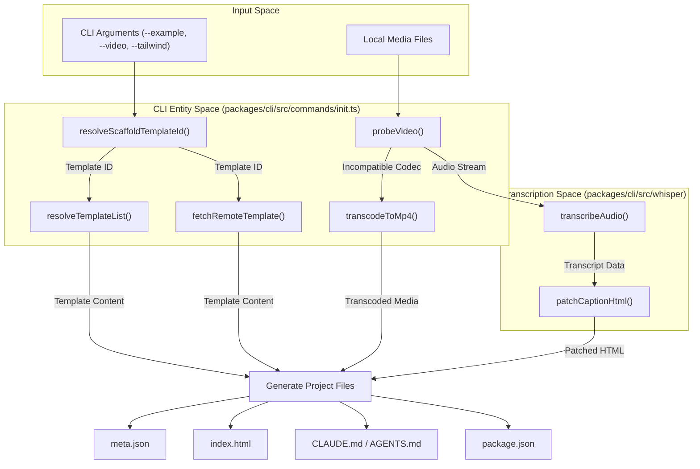
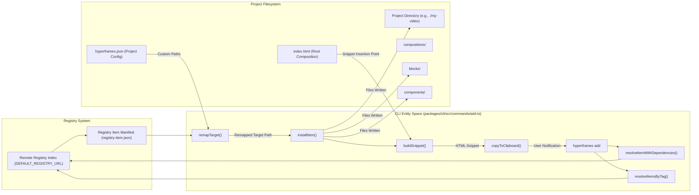

<!-- source: DeepWiki mcp.deepwiki.com · repo heygen-com/hyperframes · page 2.1 Project Initialization and Scaffolding · fetched 2026-11-02 -->

# Project Initialization and Scaffolding

Relevant source files

The following files were used as context for generating this wiki page:

- [.claude-plugin/marketplace.json](.claude-plugin/marketplace.json)
- [AGENTS.md](AGENTS.md)
- [CLAUDE.md](CLAUDE.md)
- [README.md](README.md)
- [docs/guides/skills.mdx](docs/guides/skills.mdx)
- [docs/packages/cli.mdx](docs/packages/cli.mdx)
- [docs/quickstart.mdx](docs/quickstart.mdx)
- [packages/aws-lambda/build.mjs](packages/aws-lambda/build.mjs)
- [packages/cli/src/api.test.ts](packages/cli/src/api.test.ts)
- [packages/cli/src/api/transcribe.ts](packages/cli/src/api/transcribe.ts)
- [packages/cli/src/cli.ts](packages/cli/src/cli.ts)
- [packages/cli/src/commands/add.test.ts](packages/cli/src/commands/add.test.ts)
- [packages/cli/src/commands/add.ts](packages/cli/src/commands/add.ts)
- [packages/cli/src/commands/coreSkillContent.test.ts](packages/cli/src/commands/coreSkillContent.test.ts)
- [packages/cli/src/commands/feedback.test.ts](packages/cli/src/commands/feedback.test.ts)
- [packages/cli/src/commands/feedback.ts](packages/cli/src/commands/feedback.ts)
- [packages/cli/src/commands/init.test.ts](packages/cli/src/commands/init.test.ts)
- [packages/cli/src/commands/init.ts](packages/cli/src/commands/init.ts)
- [packages/cli/src/commands/transcribe.test.ts](packages/cli/src/commands/transcribe.test.ts)
- [packages/cli/src/commands/transcribe.ts](packages/cli/src/commands/transcribe.ts)
- [packages/cli/src/help.ts](packages/cli/src/help.ts)
- [packages/cli/src/registry/boundedFile.test.ts](packages/cli/src/registry/boundedFile.test.ts)
- [packages/cli/src/registry/boundedFile.ts](packages/cli/src/registry/boundedFile.ts)
- [packages/cli/src/registry/compatibility.test.ts](packages/cli/src/registry/compatibility.test.ts)
- [packages/cli/src/registry/compatibility.ts](packages/cli/src/registry/compatibility.ts)
- [packages/cli/src/registry/index.ts](packages/cli/src/registry/index.ts)
- [packages/cli/src/registry/installer.test.ts](packages/cli/src/registry/installer.test.ts)
- [packages/cli/src/registry/installer.ts](packages/cli/src/registry/installer.ts)
- [packages/cli/src/registry/publication.test.ts](packages/cli/src/registry/publication.test.ts)
- [packages/cli/src/registry/publication.ts](packages/cli/src/registry/publication.ts)
- [packages/cli/src/registry/remote.test.ts](packages/cli/src/registry/remote.test.ts)
- [packages/cli/src/registry/remote.ts](packages/cli/src/registry/remote.ts)
- [packages/cli/src/registry/resolver.test.ts](packages/cli/src/registry/resolver.test.ts)
- [packages/cli/src/registry/resolver.ts](packages/cli/src/registry/resolver.ts)
- [packages/cli/src/registry/transport.test.ts](packages/cli/src/registry/transport.test.ts)
- [packages/cli/src/registry/transport.ts](packages/cli/src/registry/transport.ts)
- [packages/cli/src/registry/variableDefaults.test.ts](packages/cli/src/registry/variableDefaults.test.ts)
- [packages/cli/src/registry/variableDefaults.ts](packages/cli/src/registry/variableDefaults.ts)
- [packages/cli/src/telemetry/lintRun.e2e.test.ts](packages/cli/src/telemetry/lintRun.e2e.test.ts)
- [packages/cli/src/templates/_shared/AGENTS.md](packages/cli/src/templates/_shared/AGENTS.md)
- [packages/cli/src/templates/_shared/CLAUDE.md](packages/cli/src/templates/_shared/CLAUDE.md)
- [packages/cli/src/templates/generators.ts](packages/cli/src/templates/generators.ts)
- [packages/cli/src/templates/remote.ts](packages/cli/src/templates/remote.ts)
- [packages/cli/src/utils/download.test.ts](packages/cli/src/utils/download.test.ts)
- [packages/cli/src/utils/download.ts](packages/cli/src/utils/download.ts)
- [packages/cli/src/utils/motionSpec.test.ts](packages/cli/src/utils/motionSpec.test.ts)
- [packages/cli/src/utils/submitFeedback.test.ts](packages/cli/src/utils/submitFeedback.test.ts)
- [packages/cli/src/utils/submitFeedback.ts](packages/cli/src/utils/submitFeedback.ts)
- [packages/cli/src/whisper/manager.install.test.ts](packages/cli/src/whisper/manager.install.test.ts)
- [packages/cli/src/whisper/manager.model.test.ts](packages/cli/src/whisper/manager.model.test.ts)
- [packages/cli/src/whisper/manager.ts](packages/cli/src/whisper/manager.ts)
- [packages/cli/src/whisper/modelFile.ts](packages/cli/src/whisper/modelFile.ts)
- [packages/cli/src/whisper/normalize.test.ts](packages/cli/src/whisper/normalize.test.ts)
- [packages/cli/src/whisper/normalize.ts](packages/cli/src/whisper/normalize.ts)
- [packages/cli/src/whisper/parakeet.ts](packages/cli/src/whisper/parakeet.ts)
- [packages/cli/src/whisper/progress.test.ts](packages/cli/src/whisper/progress.test.ts)
- [packages/cli/src/whisper/progress.ts](packages/cli/src/whisper/progress.ts)
- [packages/cli/src/whisper/sherpa.test.ts](packages/cli/src/whisper/sherpa.test.ts)
- [packages/cli/src/whisper/sherpa.ts](packages/cli/src/whisper/sherpa.ts)
- [packages/cli/src/whisper/sherpaWorker.test.ts](packages/cli/src/whisper/sherpaWorker.test.ts)
- [packages/cli/src/whisper/sherpaWorker.ts](packages/cli/src/whisper/sherpaWorker.ts)
- [packages/cli/src/whisper/transcribe.metadata.test.ts](packages/cli/src/whisper/transcribe.metadata.test.ts)
- [packages/cli/src/whisper/transcribe.test.ts](packages/cli/src/whisper/transcribe.test.ts)
- [packages/cli/src/whisper/transcribe.ts](packages/cli/src/whisper/transcribe.ts)
- [packages/gcp-cloud-run/build.mjs](packages/gcp-cloud-run/build.mjs)
- [scripts/verify-packed-manifests.mjs](scripts/verify-packed-manifests.mjs)
- [scripts/verify-packed-manifests.test.mjs](scripts/verify-packed-manifests.test.mjs)
- [skills-manifest.json](skills-manifest.json)
- [skills/hyperframes-cli/SKILL.md](skills/hyperframes-cli/SKILL.md)
- [skills/hyperframes-cli/references/lint-validate-inspect.md](skills/hyperframes-cli/references/lint-validate-inspect.md)
- [skills/hyperframes-cli/references/preview-render.md](skills/hyperframes-cli/references/preview-render.md)
- [skills/hyperframes/SKILL.md](skills/hyperframes/SKILL.md)

## Purpose and Scope

This page details the project initialization and scaffolding subsystem of the HyperFrames CLI, driven by `hyperframes init` [docs/packages/cli.mdx:88-101]() and extended via `hyperframes add` [packages/cli/src/commands/add.ts:6-12](). It covers template resolution, media ingestion and transcoding via `ffprobe` and `ffmpeg`, Whisper transcription, metadata and agent documentation generation (`meta.json`, `CLAUDE.md`), and remote registry block installation.

---

## The `init` Lifecycle and Scaffolding Pipeline

The `hyperframes init` command executes a multi-stage pipeline to establish a new deterministic composition project directory [packages/cli/src/commands/init.ts:8-24]().

### 1. Template Resolution
Templates fall into two categories:
- **Bundled Templates**: Minimal offline scaffolds (such as `blank`) packaged directly inside the CLI build [packages/cli/src/commands/init.ts:41-46](). These are resolved using `resolveTemplateList` [packages/cli/src/templates/generators.ts:32-49]().
- **Remote Examples**: Community or registry-hosted examples (such as `warm-grain` or `swiss-grid`) retrieved via `fetchRemoteTemplate` [packages/cli/src/templates/generators.ts:36-46](), [packages/cli/src/commands/init.ts:45]().

The helper function `resolveScaffoldTemplateId` selects the base template based on CLI flags (`--example`, `--video`, `--audio`) [packages/cli/src/commands/init.ts:62-67]().

### 2. Media Ingestion and Transcoding
When a consumer supplies `--video` or `--audio` inputs, the initialization pipeline executes media analysis:
- **Probing**: The function `probeVideo` invokes `ffprobe` to extract duration, dimensions, frame rate (`fps`), codec names, and stream existence flags [packages/cli/src/commands/init.ts:116-178]().
- **Web Compatibility**: The `WEB_CODECS` set defines compatible video codecs (`h264`, `vp8`, `vp9`, `av1`) [packages/cli/src/commands/init.ts:78-78](). The `probeVideo` function determines if the video stream's codec is web-compatible.
- **Transcoding**: Incompatible streams are transcoded via `transcodeToMp4`, which wraps an `ffmpeg` spawn process targeting web-friendly H.264/AAC output [packages/cli/src/commands/init.ts:186-207]().

### 3. Transcription and Caption Patching
When media files require voice synchronization, the pipeline optionally integrates word-level Whisper transcription:
- **Transcription**: `transcribeAudio` executes local transcription engines to generate timestamped word indices [packages/cli/src/commands/transcribe.ts:113-118]().
- **Silence Stripping & Patching**: The `patchCaptionHtml` utility reads `transcript.json` and injects timed DOM elements into the scaffolded HTML [packages/cli/src/commands/transcribe.ts:147-147]().

### 4. Tailwind CSS and Agent Documentation Generation
Scaffolding concludes by writing root composition files, configuration, and agent instructions. If `--tailwind` is passed, the command injects a pinned Tailwind CSS browser runtime (`v4.2.4`) with subresource integrity [packages/cli/src/commands/init.ts:91-95](). It also writes agent guidelines (`CLAUDE.md` and `AGENTS.md`) [packages/cli/src/templates/_shared/CLAUDE.md:1-20]().

**Diagram: Init Command Data Flow**

Sources: [packages/cli/src/commands/init.ts:106-207](), [packages/cli/src/commands/transcribe.ts:113-147](), [packages/cli/src/templates/_shared/CLAUDE.md:1-20](), [packages/cli/src/commands/init.ts:62-67](), [packages/cli/src/templates/generators.ts:32-49](), [packages/cli/src/templates/generators.ts:36-46]()

---

## Project Structure and Scaffolding Artifacts

A newly scaffolded HyperFrames project contains a deterministic layout:

| Path | Description |
| :--- | :--- |
| `index.html` | Entry point composition declaring root timing and `data-composition-id` [skills/hyperframes/SKILL.md:12-12](). |
| `meta.json` | Project identity, identifier, and version metadata. |
| `package.json` | Pinned build and render scripts (`dev`, `check`, `render`, `publish`) locking `hyperframes@version` [packages/cli/src/commands/init.test.ts:37-48](). |
| `compositions/` | Directory containing sub-compositions mounted via `data-composition-src` [skills/hyperframes/SKILL.md:12-12](). |
| `CLAUDE.md` / `AGENTS.md` | Context definitions for coding agents specifying framework rules and skill routing [CLAUDE.md:1-31](). These files are kept byte-identical [CLAUDE.md:36-36](). |

Sources: [packages/cli/src/commands/init.test.ts:37-48](), [CLAUDE.md:1-31](), [CLAUDE.md:36-36](), [skills/hyperframes/SKILL.md:12-12]()

---

## Registry Installs with `hyperframes add`

The `hyperframes add` command extends an existing project by installing pre-built registry blocks and components [packages/cli/src/commands/add.ts:6-12]().

### Registry Resolution and Dependencies
The CLI resolves registry items via `resolveItemWithDependencies` or searches by tag using `resolveItemsByTag` [packages/cli/src/commands/add.ts:28-31](). It communicates with the remote registry backend to pull manifests and associated assets [packages/cli/src/registry/remote.ts:26-27]().

### Target Path Remapping and Snippet Generation
1. **Target Remapping**: The `remapTarget` function inspects item definitions and remaps destination file paths according to project settings in `hyperframes.json#paths` (e.g., relocating blocks from `compositions/` to customized directories) [packages/cli/src/commands/add.ts:53-72]().
2. **Snippet Generation**: Once files are installed, `buildSnippet` generates the correct HTML embedding markup (`data-composition-src`, `data-duration`, dimensions, and variable bindings), which is copied to the system clipboard [packages/cli/src/commands/add.ts:125-147]().

**Diagram: Registry Block Installation Flow**

Sources: [packages/cli/src/commands/add.ts:32-147](), [packages/cli/src/registry/remote.ts:26-27](), [packages/cli/src/registry/resolver.ts:76-91](), [packages/cli/src/commands/add.ts:28-31](), [packages/cli/src/commands/add.ts:53-72]()

---

## Key Implementation Details

- **Deterministic Initialization**: During `init`, media streams are probed to lock down exact `data-duration` attributes, preventing timing drift between the HTML runtime and underlying assets [packages/cli/src/commands/init.ts:151-155]().
- **Non-Interactive Execution**: For CI pipelines and automated coding agents, passing `--non-interactive` forces default resolution behavior without blocking on terminal prompts (`clack`) [packages/cli/src/commands/init.ts:19-21](), [packages/cli/src/commands/init.test.ts:59-69]().
- **EPIPE Stream Suppression**: The CLI entry point registers stream error handlers on `process.stdout` and `process.stderr` to safely handle closed pipes when executed within automated runner pipelines, avoiding uncaught exception crashes [packages/cli/src/cli.ts:17-23]().
- **AI Skill Management**: The `init` command can optionally skip AI skill installation via `--skip-skills` [packages/cli/src/commands/init.ts:21-21](). The `HYPERFRAMES_SKIP_SKILLS` environment variable also controls this behavior [packages/cli/src/commands/init.test.ts:37-43](). The `hyperframes skills update` command is used to install or refresh the core set of skills [README.md:79-79]().

Sources: [packages/cli/src/commands/init.ts:19-155](), [packages/cli/src/commands/init.test.ts:59-69](), [packages/cli/src/cli.ts:17-23](), [packages/cli/src/commands/init.ts:21-21](), [packages/cli/src/commands/init.test.ts:37-43](), [README.md:79-79]()

---

