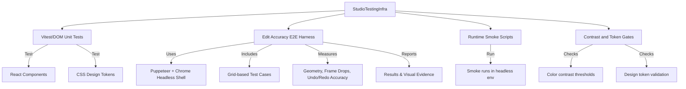

<!-- source: DeepWiki mcp.deepwiki.com · repo heygen-com/hyperframes · page 6.6 Studio Testing and Edit Accuracy Harness · fetched 2026-11-02 -->

# Studio Testing and Edit Accuracy Harness

<details>
<summary>Relevant source files</summary>

The following files were used as context for generating this wiki page:

- [packages/cli/src/cli.lifecycle.test.ts](packages/cli/src/cli.lifecycle.test.ts)
- [packages/cli/src/commands/open.ts](packages/cli/src/commands/open.ts)
- [packages/cli/src/utils/backgroundChecks.test.ts](packages/cli/src/utils/backgroundChecks.test.ts)
- [packages/cli/src/utils/projectShortcut.test.ts](packages/cli/src/utils/projectShortcut.test.ts)
- [packages/cli/src/utils/projectShortcut.ts](packages/cli/src/utils/projectShortcut.ts)
- [packages/studio-server/src/routes/thumbnail.file-race.test.ts](packages/studio-server/src/routes/thumbnail.file-race.test.ts)
- [packages/studio-server/src/routes/thumbnail.test.ts](packages/studio-server/src/routes/thumbnail.test.ts)
- [packages/studio-server/src/routes/thumbnail.ts](packages/studio-server/src/routes/thumbnail.ts)
- [packages/studio/src/hooks/gsapValueAtPlayhead.browser.test.ts](packages/studio/src/hooks/gsapValueAtPlayhead.browser.test.ts)
- [packages/studio/src/player/hooks/timelinePlayerSync.test.ts](packages/studio/src/player/hooks/timelinePlayerSync.test.ts)
- [packages/studio/src/player/hooks/timelinePlayerSync.ts](packages/studio/src/player/hooks/timelinePlayerSync.ts)
- [packages/studio/src/utils/gsapUndoRestore.browser.test.ts](packages/studio/src/utils/gsapUndoRestore.browser.test.ts)
- [packages/studio/tests/chromeTestUtils.browser.test.ts](packages/studio/tests/chromeTestUtils.browser.test.ts)
- [packages/studio/tests/chromeTestUtils.test.ts](packages/studio/tests/chromeTestUtils.test.ts)
- [packages/studio/tests/chromeTestUtils.ts](packages/studio/tests/chromeTestUtils.ts)
- [packages/studio/tests/e2e/edit-accuracy/baseline.json](packages/studio/tests/e2e/edit-accuracy/baseline.json)
- [packages/studio/tests/e2e/edit-accuracy/case.mjs](packages/studio/tests/e2e/edit-accuracy/case.mjs)
- [packages/studio/tests/e2e/edit-accuracy/grid.mjs](packages/studio/tests/e2e/edit-accuracy/grid.mjs)
- [packages/studio/tests/e2e/edit-accuracy/grid.test.mjs](packages/studio/tests/e2e/edit-accuracy/grid.test.mjs)
- [packages/studio/tests/e2e/edit-accuracy/keyframes.test.mjs](packages/studio/tests/e2e/edit-accuracy/keyframes.test.mjs)
- [packages/studio/tests/e2e/edit-accuracy/ratchet.mjs](packages/studio/tests/e2e/edit-accuracy/ratchet.mjs)
- [packages/studio/tests/e2e/edit-accuracy/ratchet.test.mjs](packages/studio/tests/e2e/edit-accuracy/ratchet.test.mjs)
- [packages/studio/tests/e2e/edit-accuracy/render.mjs](packages/studio/tests/e2e/edit-accuracy/render.mjs)
- [packages/studio/tests/e2e/edit-accuracy/render.test.mjs](packages/studio/tests/e2e/edit-accuracy/render.test.mjs)
- [packages/studio/tests/e2e/edit-accuracy/report.mjs](packages/studio/tests/e2e/edit-accuracy/report.mjs)
- [packages/studio/tests/e2e/edit-accuracy/report.test.mjs](packages/studio/tests/e2e/edit-accuracy/report.test.mjs)
- [packages/studio/tests/e2e/edit-accuracy/run.mjs](packages/studio/tests/e2e/edit-accuracy/run.mjs)
- [packages/studio/tests/e2e/edit-accuracy/server.test.mjs](packages/studio/tests/e2e/edit-accuracy/server.test.mjs)
- [packages/studio/tests/e2e/edit-accuracy/smoothness.test.mjs](packages/studio/tests/e2e/edit-accuracy/smoothness.test.mjs)
- [packages/studio/tests/e2e/edit-accuracy/teleport.mjs](packages/studio/tests/e2e/edit-accuracy/teleport.mjs)
- [packages/studio/tests/e2e/edit-accuracy/teleport.test.mjs](packages/studio/tests/e2e/edit-accuracy/teleport.test.mjs)
- [packages/studio/vite.browser.test.ts](packages/studio/vite.browser.test.ts)
- [packages/studio/vite.browser.ts](packages/studio/vite.browser.ts)
- [packages/studio/vite.browserVersion.test.ts](packages/studio/vite.browserVersion.test.ts)
- [scripts/ci/inline-gsap.mjs](scripts/ci/inline-gsap.mjs)
- [scripts/inline-gsap.test.mjs](scripts/inline-gsap.test.mjs)

</details>


This section details the testing infrastructure and edit accuracy harness utilized in the `@hyperframes/studio` package. It covers the vitest/dom unit testing setup, the comprehensive end-to-end (e2e) edit accuracy bench harness that measures gesture precision in the Studio UI, runtime smoke testing scripts, and additional quality gates such as contrast and design token validations.

---

## Purpose and Scope

The Studio Testing and Edit Accuracy Harness guarantees the quality, reliability, and smooth user interaction of the React-based Studio IDE. It validates both unit-level logic through vitest-powered tests and the entire edit interaction workflow through a simulated real-gesture bench. This infrastructure is critical to maintaining high-fidelity editing experiences, especially visual correctness and frame-accurate animation and transformation handling.

- **Test Types Supported:**
  - DOM unit tests for React components and styling.
  - Edit accuracy e2e tests simulating user gestures with pixel-precision verification.
  - Runtime smoke scripts assessing core functionality in headless browsers.
  - Contrast and design token gate tests enforcing UI accessibility and design consistency.

This page describes these components' implementation, data flow, core utilities, and test harness orchestration.

---

## 1. Vitest / DOM Unit Tests

Unit tests employ [vitest](https://vitest.dev), a fast and Vite-optimized testing framework enabling DOM and React ecosystem testing.

### Key Aspects

- Stylesheets such as `studio.css`, `theme.css`, and component-specific CSS are included for DOM rendering correctness verification.
- React components (e.g., `TimelineClip.tsx`) are individually tested for UI state, props, and interaction responses.
- Tests check CSS custom properties (design tokens) correctness against the `theme.css`.
- Motion-reduced accessibility is verified by observing CSS media queries that tailor animation transitions.
- Example test file: `timelineMotionStyles.test.ts` assesses expected CSS properties on timeline-related UI.

### Example Test Insight

Tests ensure the `.timeline-clip` CSS class properly uses design tokens like `--timeline-clip-bg` and that motion-reduced users receive reduced animation:
```ts
expect(themeCss).toContain("--timeline-clip-bg: rgba(255, 255, 255, 0.12)");
expect(baseTimelineClipRule).not.toContain("transition");
```
This setup assures components render with proper styles and that accessibility preferences are respected [packages/studio/src/player/components/timelinePlayerSync.test.ts:1-122](), [packages/studio/src/styles/theme.css:1-156]().

Sources:
* packages/studio/src/player/components/timelinePlayerSync.test.ts
* packages/studio/src/styles/theme.css

---

## 2. End-to-End Edit Accuracy Harness

This harness systematically simulates realistic user gestures in the built Studio UI to evaluate precise editing actions and rendering accuracy.

### Overview

- Tests run in a real Chromium environment with Puppeteer and Chrome Headless Shell, matching production conditions.
- Each test case consists of a generated HTML project scenario combined with a series of complex gestures (move, resize, rotate, crop, nudge).
- Results collect detailed geometric metrics of edited elements against expected positions, including pixel-level drift, frame drops, and undo/redo correctness.
- Visual evidence (screenshots) is saved on failure for in-depth troubleshooting.

### Core Components and Data Flow

```mermaid
flowchart TD
  subgraph Harness
    A[buildGrid(grid.mjs)] --> B[writeFixture(grid.mjs)]
    B --> C[startServer(case.mjs)]
    C --> D[runCase(case.mjs)]
    D --> E[executeGestures(run.mjs)]
    E --> F[geometryCalculations(geometry.mjs)]
    F --> G[renderCheck(run.mjs)]
    G --> H[scoreResults(report.mjs)]
    H --> I[saveEvidence(run.mjs)]
  end
  subgraph Runner
    J[CLI Options]
    J --> A
    H --> K[console.log/verdict(run.mjs)]
    K -.->|Outputs| L[JSON reports, Markdown tables, baseline.json]
  end
```
Sources:
* packages/studio/tests/e2e/edit-accuracy/grid.mjs
* packages/studio/tests/e2e/edit-accuracy/case.mjs
* packages/studio/tests/e2e/edit-accuracy/run.mjs
* packages/studio/tests/e2e/edit-accuracy/geometry.mjs
* packages/studio/tests/e2e/edit-accuracy/report.mjs

- **Grid Generation (`grid.mjs`)**: Builds a combinatorial grid of test case configurations such as GSAP animation states, placement types (px, percent, center), rotation, zoom, and nesting [packages/studio/tests/e2e/edit-accuracy/grid.mjs:29-40](). The `buildGrid` function generates these cases, filtering based on `kind` (e.g., "full", "keyframes", "pr") [packages/studio/tests/e2e/edit-accuracy/grid.mjs:148-157]().

- **Fixture Writer (`grid.mjs`, `writeFixture`)**: Writes the generated HTML and composition files to a temporary directory for each case [packages/studio/tests/e2e/edit-accuracy/grid.mjs:267](). This ensures that each test runs against a clean, isolated project.

- **Server Management (`case.mjs`)**: Launches the Studio preview server via the CLI, ensuring unique ports and clean shutdowns. The `startServer` function spawns a child process for the CLI and waits for it to become available [packages/studio/tests/e2e/edit-accuracy/case.mjs:71-98](). `stopServer` and `killServers` handle process termination, including platform-specific logic for Windows [packages/studio/tests/e2e/edit-accuracy/case.mjs:48-61, 103-110]().

- **Gesture Runner (`run.mjs`)**: Orchestrates test case runs:
  - Parses CLI options for grid, shards, filtering [packages/studio/tests/e2e/edit-accuracy/run.mjs:24-37]().
  - Spawns multiple Puppeteer browser instances for parallelism. The `resolveHeadlessShellPath` function is used to locate the Chrome executable [packages/studio/tests/e2e/edit-accuracy/run.mjs:41-42]().
  - Runs each case using `runCase` or `runSequence` [packages/studio/tests/e2e/edit-accuracy/run.mjs:117-117](): launches server, executes gesture scenarios, collects timing and geometry data.
  - Calls `withRender` to get producer frame and calculates geometric drift [packages/studio/tests/e2e/edit-accuracy/run.mjs:73-94]().
  - Aggregates results with scoring and prints verdicts [packages/studio/tests/e2e/edit-accuracy/run.mjs:136-140]().

- **Geometry Utils (`geometry.mjs`)**: Provides affine transformations, local/global quad conversions, distance calculations, inset parsing, and percentile calculations for rendering and tracking positional accuracy [packages/studio/tests/e2e/edit-accuracy/case.mjs:10-23]().

- **Report Generator (`report.mjs`)**: Scores each test case against thresholds:
  - Metrics tracked include tracking error (px), gesture press jump, frame drops, reload consistency, render frame drift, undo/redo byte and geometric parity, and smoothness of main-thread frame work [packages/studio/tests/e2e/edit-accuracy/report.mjs:23-35, 71-107]().
  - Generates JSON results, markdown tables, and baseline JSON for gating CI [packages/studio/tests/e2e/edit-accuracy/report.mjs:1-2,171-252]().

### Scoring Metrics Summary Table

| Metric | Description | Check Criteria |
|---|---|---|
| tracking | Maximum pixel drift after gesture | ≤ 0.5 px |
| press | Distance jump when pressing an element | ≤ 0.5 px |
| drop | Pixel drift on drop | ≤ 0.5 px |
| reload | Pixel drift on reload | ≤ 0.5 px |
| render | Pixel drift comparing Studio preview to producer rendering | ≤ 0.5 px |
| undo | Byte and geometric parity after undo/redo | ≤ 0.5 px, correct bytes |
| smooth | Main-thread work and dropped frames vs control | Work ≤ 8ms p95, no extra frame drops |

Sources:
* packages/studio/tests/e2e/edit-accuracy/report.mjs

### Evidence Capture on Failures

- Screenshots of Studio UI at key steps.
- Rendered producer frames.
- Edited files snapshots.
- All saved under `evidence/edit-accuracy/<runId>/cases/<caseId>` [packages/studio/tests/e2e/edit-accuracy/run.mjs:49-57]().

Sources:
* packages/studio/tests/e2e/edit-accuracy/run.mjs

---

## 3. Runtime Smoke Scripts and Contrast/Token Gates

Further quality assurance includes:

- **Runtime Smoke Scripts:** Lightweight headless runs to verify minimal startup, basic render and interactivity without full harnessing. Designed as baseline sanity checks. The `gsapUndoRestore.browser.test.ts` and `gsapSoftReload.ts` tests use Puppeteer to load compositions and verify element positions after undo/redo or soft reloads, ensuring the runtime behaves as expected [packages/studio/src/utils/gsapUndoRestore.browser.test.ts:1-145](). The `showWithRuntime` utility in `chromeTestUtils.ts` is crucial for injecting the HyperFrames runtime into the page [packages/studio/tests/chromeTestUtils.ts:74-82]().

- **Contrast and Token Gates:** Automated checks on CSS tokens (design variables) and color contrast levels against accessibility standards to prevent regressions in UI theming and legibility. These are typically integrated into the linting system.

These checks integrate tightly into the CI system and publishing gates, maintaining UX consistency and compliance.

Sources:
* packages/studio/src/utils/gsapUndoRestore.browser.test.ts
* packages/studio/tests/chromeTestUtils.ts

---

## Code Entity and Natural Language Mapping Diagrams

### Diagram 1: Edit Accuracy Harness - Code Entities and Data Flow

```mermaid
flowchart TD
  subgraph Harness
    A[buildGrid(grid.mjs)] --> B[writeFixture(grid.mjs)]
    B --> C[startServer(case.mjs)]
    C --> D[runCase(case.mjs)]
    D --> E[executeGestures(run.mjs)]
    E --> F[geometryCalculations(geometry.mjs)]
    F --> G[renderCheck(run.mjs)]
    G --> H[scoreResults(report.mjs)]
    H --> I[saveEvidence(run.mjs)]
  end
  subgraph Runner
    J[CLI Options]
    J --> A
    H --> K[console.log/verdict(run.mjs)]
    K -.->|Outputs| L[JSON reports, Markdown tables, baseline.json]
  end
```
Sources:
* packages/studio/tests/e2e/edit-accuracy/grid.mjs
* packages/studio/tests/e2e/edit-accuracy/case.mjs
* packages/studio/tests/e2e/edit-accuracy/run.mjs
* packages/studio/tests/e2e/edit-accuracy/geometry.mjs
* packages/studio/tests/e2e/edit-accuracy/report.mjs

### Diagram 2: Studio Test Infrastructure - Components and Test Types


Sources:
* packages/studio/tests/e2e/edit-accuracy/grid.mjs
* packages/studio/tests/e2e/edit-accuracy/case.mjs
* packages/studio/tests/e2e/edit-accuracy/run.mjs
* packages/studio/tests/e2e/edit-accuracy/geometry.mjs
* packages/studio/tests/e2e/edit-accuracy/report.mjs
* packages/studio/src/utils/gsapUndoRestore.browser.test.ts
* packages/studio/tests/chromeTestUtils.ts

---

## Summary

The Studio Testing and Edit Accuracy Harness is an extensively engineered system enabling precise validation of both UI logic in unit tests and integration-level editing fidelity under real user-like gestures. The harness systematically detects and prevents regressions in geometry, animation synchronization, rendering accuracy, and undo/redo safety. Complemented by runtime smoke scripts and UX design gates, the studio testing system is a backbone for robust product quality.

---

## References

- Edit Accuracy Harness runner and orchestration: `packages/studio/tests/e2e/edit-accuracy/run.mjs` [1-172]()
- Test grid generation and fixture writing: `packages/studio/tests/e2e/edit-accuracy/grid.mjs` [1-122]()
- Server and case management: `packages/studio/tests/e2e/edit-accuracy/case.mjs` [48-98]()
- Geometry utility functions: `packages/studio/tests/e2e/edit-accuracy/geometry.mjs` [1-89]()
- Scoring and reporting: `packages/studio/tests/e2e/edit-accuracy/report.mjs` [1-153]()
- Vitest DOM unit tests example: `packages/studio/src/player/components/timelinePlayerSync.test.ts` [1-122]()
- CSS design tokens: `packages/studio/src/styles/theme.css` [1-156]()
- Runtime smoke test example: `packages/studio/src/utils/gsapUndoRestore.browser.test.ts` [1-145]()
- Chrome test utilities: `packages/studio/tests/chromeTestUtils.ts` [74-82]()

Sources:
* packages/studio/tests/e2e/edit-accuracy/run.mjs
* packages/studio/tests/e2e/edit-accuracy/grid.mjs
* packages/studio/tests/e2e/edit-accuracy/case.mjs
* packages/studio/tests/e2e/edit-accuracy/geometry.mjs
* packages/studio/tests/e2e/edit-accuracy/report.mjs
* packages/studio/src/player/components/timelinePlayerSync.test.ts
* packages/studio/src/styles/theme.css
* packages/studio/src/utils/gsapUndoRestore.browser.test.ts
* packages/studio/tests/chromeTestUtils.ts

---

