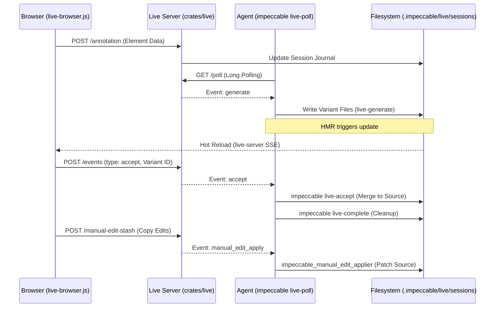

<!-- source: DeepWiki mcp.deepwiki.com · repo pbakaus/impeccable · page 5 Live Mode · fetched 2026-10-30 -->

# Live Mode

<details>
<summary>Relevant source files</summary>

The following files were used as context for generating this wiki page:

- [.agents/skills/impeccable/reference/live.md](.agents/skills/impeccable/reference/live.md)
- [.claude/skills/impeccable/reference/live.md](.claude/skills/impeccable/reference/live.md)
- [.cursor/skills/impeccable/reference/live.md](.cursor/skills/impeccable/reference/live.md)
- [.gemini/skills/impeccable/reference/live.md](.gemini/skills/impeccable/reference/live.md)
- [.kiro/skills/impeccable/reference/live.md](.kiro/skills/impeccable/reference/live.md)
- [.opencode/skills/impeccable/reference/live.md](.opencode/skills/impeccable/reference/live.md)
- [.pi/skills/impeccable/reference/live.md](.pi/skills/impeccable/reference/live.md)
- [.rovodev/skills/impeccable/reference/live.md](.rovodev/skills/impeccable/reference/live.md)
- [.trae-cn/skills/impeccable/reference/live.md](.trae-cn/skills/impeccable/reference/live.md)
- [.trae/skills/impeccable/reference/live.md](.trae/skills/impeccable/reference/live.md)
- [crates/cli/tests/agent_target.rs](crates/cli/tests/agent_target.rs)
- [crates/live/src/dev_url.rs](crates/live/src/dev_url.rs)
- [crates/live/src/lib.rs](crates/live/src/lib.rs)
- [crates/live/src/live_boot.rs](crates/live/src/live_boot.rs)
- [crates/live/src/live_generate.rs](crates/live/src/live_generate.rs)
- [crates/live/src/live_server.rs](crates/live/src/live_server.rs)
- [crates/live/src/server_state.rs](crates/live/src/server_state.rs)
- [skill/agents/impeccable-documenter.md](skill/agents/impeccable-documenter.md)
- [skill/reference/generate.md](skill/reference/generate.md)
- [skill/reference/live-setup.md](skill/reference/live-setup.md)
- [skill/reference/live.md](skill/reference/live.md)
- [skill/scripts/live-browser.js](skill/scripts/live-browser.js)
- [tests/live-agent-target.test.mjs](tests/live-agent-target.test.mjs)
- [tests/live-boot-fastpath.test.mjs](tests/live-boot-fastpath.test.mjs)
- [tests/live-browser-source.test.mjs](tests/live-browser-source.test.mjs)
- [tests/live-reference.test.mjs](tests/live-reference.test.mjs)
- [tests/oracle/golden/live-boot-full-cycle.json](tests/oracle/golden/live-boot-full-cycle.json)
- [tests/oracle/golden/live-generate-local-verdicts.json](tests/oracle/golden/live-generate-local-verdicts.json)
- [tests/oracle/golden/live-generate-no-browser-connected.json](tests/oracle/golden/live-generate-no-browser-connected.json)

</details>


**Live Mode** is a browser-based visual iteration system. It enables a tight feedback loop between the browser and the code editor, allowing users to pick DOM elements, annotate them with comments and strokes, and generate multiple design variants that are hot-swapped into the running application via Hot Module Replacement (HMR). Users can cycle through these variants in real-time and "accept" one to permanently bake the changes into the source code. The system has been expanded to include **Insert Mode** for new elements, **Copy Edit Mode** for direct text manipulation, and **Svelte Component injection** for framework-native previews.

## System Overview

Live Mode operates as a distributed system involving a client-side browser script, a local orchestration server, and the AI agent (Claude, Cursor, etc.) managing the code transformations.

### High-Level Workflow
1.  **Boot**: The user runs the `impeccable live` command, starting the helper server via `live-server` which injects `live-browser.js` into the user's dev environment [skill/reference/live.md:13]().
2.  **Pick & Annotate**: The user selects an element or insertion point. The browser script provides a UI for selection, annotation (comments and strokes), and manual text edits [skill/scripts/live-browser.js:108-110]().
3.  **Generate**: The agent polls the server using `impeccable live-poll`, receives the context (including screenshots and annotations), and creates distinct visual variants [skill/reference/live.md:16, 43]().
4.  **Cycle & Edit**: Variants are hot-swapped into the DOM. Users can cycle variants or use **Copy Edit Mode** to stage manual text changes back to source [skill/reference/live.md:46, 48]().
5.  **Commit**: Upon "Accept", the chosen variant or manual edit is merged into the source file via `impeccable live-accept` or `impeccable live-commit-manual-edits` [skill/reference/live.md:18, 46]().

### Natural Language to Code Entity Space: Architecture

The following diagram maps conceptual user actions to the specific scripts and internal state names found in the codebase.

"Live Mode Orchestration Map"
```mermaid
graph TD
    subgraph "Natural Language Space"
        UserAction["User Picks Element"]
        UserAction -->|"Go"| GenRequest["Request Variants"]
        GenRequest -->|"Wait"| AIThinking["AI Generates HTML/CSS"]
        AIThinking -->|"HMR"| UserCycling["User Cycles Variants"]
        UserCycling -->|"Accept"| Finalize["Bake into Source"]
        ManualEdit["Manual Copy Edit"] -->|"Apply"| CommitEdit["Patch Source File"]
    end

    subgraph "Code Entity Space"
        UserAction --- LBS["skill/scripts/live-browser.js"]
        GenRequest --- LS["crates/live/src/live_server.rs"]
        AIThinking --- LP["impeccable live-poll"]
        UserCycling --- LS_SSE["crates/live/src/live_server.rs (SSE)"]
        Finalize --- LA["impeccable live-accept"]
        ManualEdit --- LBS_ManualEdit["skill/scripts/live-browser.js (Manual Edit UI)"]
        CommitEdit --- LCME["crates/live/src/manual_edits.rs"]
        
        LBS -->|"/annotation"| LS
        LS -->|"/poll"| LP
        LP -->|["type: generate"]| AIThinking
        LA -->|["type: accept"]| Finalize
        LBS_ManualEdit -->|"/manual-edit-stash"| LS
        LS -->|["type: manual_edit_apply"]| LCME
    end
```
Sources: [skill/reference/live.md:13-18, 43-48](), [skill/scripts/live-browser.js:12-20, 108-110](), [crates/live/src/live_server.rs:71-81](), [crates/live/src/manual_edits.rs]()

## Component Overview

### Browser Runtime (`skill/scripts/live-browser.js`)
The client-side engine manages a complex state machine including `IDLE`, `PICKING`, `CONFIGURING`, `GENERATING`, `CYCLING`, `SAVING`, and `EDITING` [skill/scripts/live-browser.js:122](). It renders the "Global Bar" and handles high-level modes like **Insert Mode** (for placing new elements with a dotted insert-line) and **Copy Edit Mode** (for inline contenteditable staging) [skill/scripts/live-browser.js:108-110](). The script is injected into the user's page and communicates with the `live-server` via `window.__IMPECCABLE_TOKEN__` and `window.__IMPECCABLE_PORT__` globals [skill/scripts/live-browser.js:4-6]().

For details, see [Live Browser Overlay](#5.1).

### Live Server and Session Orchestration
The `crates/live/src/live_server.rs` helper server provides an SSE event bus (`/events`) and HTTP endpoints for `/poll`, `/source`, `/annotation`, and manual edit routes (`/manual-edit-stash`, `/manual-edit-commit`, `/manual-edit-discard`) [crates/live/src/live_server.rs:71-81](). It maintains a session journal under `.impeccable/live/sessions/` for durability [skill/reference/live.md:21](). The `ServerState` struct in `crates/live/src/server_state.rs` manages pending events, parked polls, SSE clients, agent targets, and leases [crates/live/src/server_state.rs:110-160]().

For details, see [Live Server and Session Orchestration](#5.2).

### Variant Lifecycle: Generate, Wrap, Accept
The variant lifecycle involves:
1.  **Generate**: The `impeccable live-generate` command initiates the process, often triggered by an agent after a user interaction [tests/live-agent-target.test.mjs:44]().
2.  **Wrap/Inject**: The server orchestrates the delivery of generated HTML+CSS variants to the browser, which are then hot-swapped into the DOM. This involves scaffolding and potentially inserting new elements [skill/reference/live.md:1]().
3.  **Accept**: The `impeccable live-accept` command is used to acknowledge and commit the chosen variant to the source code. This can involve a "carbonize" process for cleanup [skill/reference/live.md:18]().

For details, see [Variant Lifecycle: Generate, Wrap, Accept](#5.3).

### Manual Copy Edits
Live Mode supports direct manual copy edits within the browser. These edits are staged via the `/manual-edit-stash` endpoint, which includes rich AI context about the element and operations [tests/live-browser-source.test.mjs:91-94](). The edits can then be committed via `/manual-edit-commit` or discarded via `/manual-edit-discard` [tests/live-browser-source.test.mjs:98-105](). The `impeccable_manual_edit_applier` agent is responsible for applying these changes to the source code [skill/reference/live.md:61]().

Sources: [skill/scripts/live-browser.js:63-64, 108-110](), [tests/live-browser-source.test.mjs:85-134](), [skill/reference/live.md:46, 61]()

## Data Flow: Interaction Loop

"Live Mode State & Data Flow"

Sources: [skill/reference/live.md:16-18, 43-48](), [skill/scripts/live-browser.js:122-142](), [crates/live/src/live_server.rs:71-81](), [crates/live/src/server_state.rs:110-160]()

## Recovery and Status
The live system provides several CLI tools to inspect and recover from interrupted sessions:

| Command | Purpose |
| :--- | :--- |
| `impeccable live-status` | Prints connected helper state and active durable sessions [skill/reference/live.md:21](). |
| `impeccable live-resume` | Restores the active snapshot, visible variant, and next safe agent action [skill/reference/live.md:21](). |
| `impeccable live-complete` | Final manual acknowledgement for session cleanup [skill/reference/live.md:18](). |

Sources: [skill/reference/live.md:18, 21]()

---

