# Page: Overview

# Overview

<details>
<summary>Relevant source files</summary>

The following files were used as context for generating this wiki page:

- [.claude-plugin/marketplace.json](.claude-plugin/marketplace.json)
- [.claude-plugin/plugin.json](.claude-plugin/plugin.json)
- [.github/workflows/ci.yml](.github/workflows/ci.yml)
- [.github/workflows/sync-generated-output.yml](.github/workflows/sync-generated-output.yml)
- [.gitignore](.gitignore)
- [AGENTS.md](AGENTS.md)
- [CLAUDE.md](CLAUDE.md)
- [Cargo.lock](Cargo.lock)
- [Cargo.toml](Cargo.toml)
- [ENGINE_VERSION](ENGINE_VERSION)
- [README.md](README.md)
- [README.npm.md](README.npm.md)
- [bun.lock](bun.lock)
- [crates/context/src/pin.rs](crates/context/src/pin.rs)
- [crates/skills/src/providers.rs](crates/skills/src/providers.rs)
- [docs/HARNESSES.md](docs/HARNESSES.md)
- [package.json](package.json)
- [scripts/build.js](scripts/build.js)
- [scripts/lib/transformers/index.js](scripts/lib/transformers/index.js)
- [scripts/lib/transformers/providers.js](scripts/lib/transformers/providers.js)
- [scripts/lib/utils.js](scripts/lib/utils.js)
- [scripts/lib/zip.js](scripts/lib/zip.js)
- [scripts/test-suites.mjs](scripts/test-suites.mjs)
- [skill/scripts/VERSION](skill/scripts/VERSION)
- [tests/lib/transformers/providers.test.js](tests/lib/transformers/providers.test.js)

</details>


## Purpose and Scope

Impeccable is a cross-provider design skill for AI coding agents. It combines agent-facing design guidance with a Rust engine for deterministic detection and runtime operations, distributed through an npm CLI, provider-specific skill trees, plugins, and a browser extension. The skill is organized as one user-invocable skill, `impeccable`, with 24 routed commands. [README.md:1-5](), [CLAUDE.md:5-19](), [package.json:37-50]()

The repository uses a source → build → provider-output model: skill content is authored in `skill/`, transformed by `scripts/build.js`, and emitted in provider-specific formats. The engine is built from the Cargo workspace; the npm CLI and skill launchers invoke that engine. This page introduces those boundaries and links to the detailed child pages. For installation and project setup, see [Getting Started](#1.1). For the repository layout and component boundaries, see [Repository Map and Component Boundaries](#1.2). [AGENTS.md:3-5](), [AGENTS.md:7-24](), [scripts/build.js:3-17](), [CLAUDE.md:13-24]()

**Sources:** [README.md:1-5](), [CLAUDE.md:5-24](), [AGENTS.md:3-24](), [package.json:37-50]()

---

## Architecture Overview

The authored skill and its references are transformed into provider-specific outputs. Separately, Rust workspace crates provide the engine used by the CLI and skill launchers. Generated provider directories are distribution artifacts rather than the primary authoring location. [AGENTS.md:3-5](), [AGENTS.md:26-30](), [CLAUDE.md:13-24](), [scripts/build.js:3-17]()

### Source-to-Provider Architecture

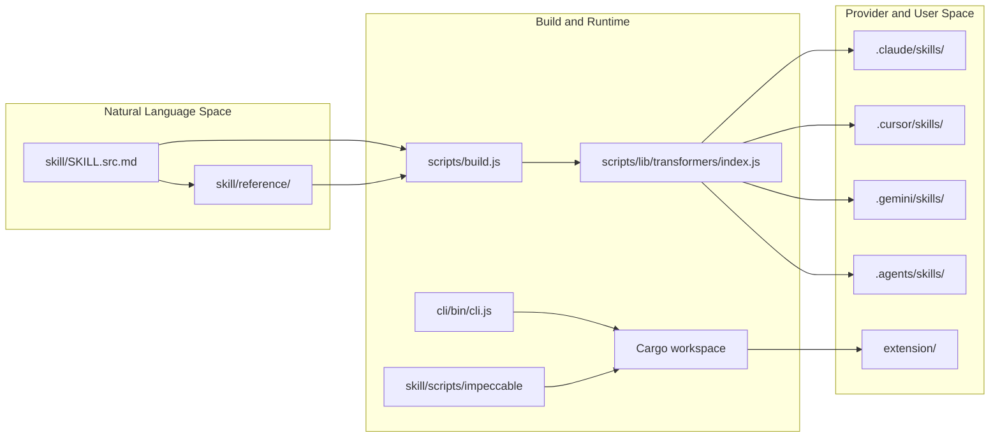

**Sources:** [scripts/build.js:3-17](), [scripts/build.js:19-38](), [AGENTS.md:3-5](), [CLAUDE.md:13-24](), [package.json:37-50]()

---

## Natural-Language Guidance and Code Entities

The agent-facing skill routes commands to shared reference playbooks, while the Rust engine implements runtime verbs and detection. These diagrams connect user-visible names to code paths that can be searched in the repository. [CLAUDE.md:5-19](), [README.md:20-35](), [AGENTS.md:3-5]()

### Skill Commands to Source Files

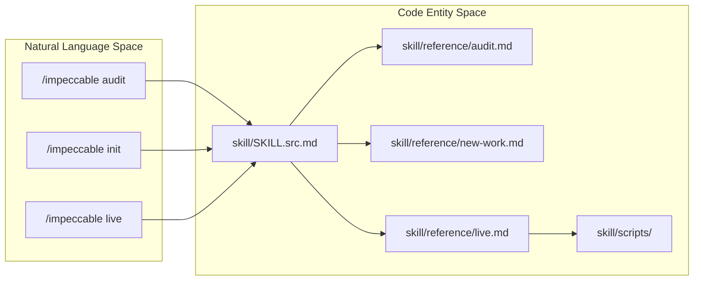

**Sources:** [CLAUDE.md:5-11](), [README.md:20-35](), [README.md:36-67](), [AGENTS.md:3-5]()

### User Operations to Runtime Components

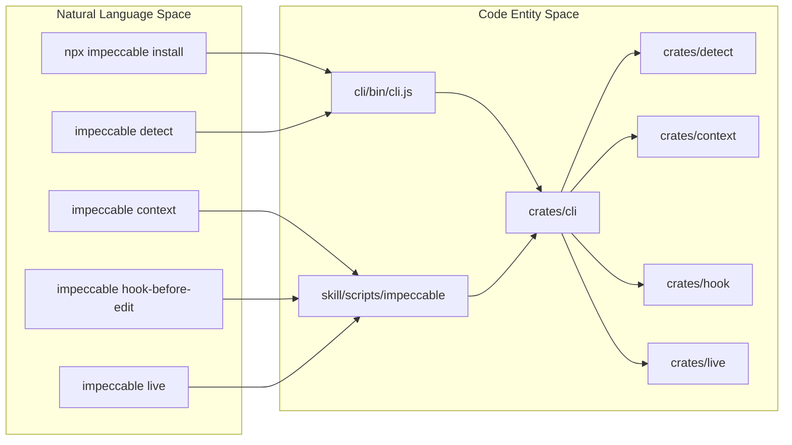

**Sources:** [README.npm.md:1-5](), [README.npm.md:9-43](), [CLAUDE.md:13-19](), [AGENTS.md:7-17]()

---

## System Components

| Component | Role |
|---|---|
| `skill/` | Authoritative skill source: `SKILL.src.md`, references, agents, scripts, and command metadata. [AGENTS.md:3-5](), [CLAUDE.md:5-11]() |
| `crates/` | Cargo workspace for the engine, including runtime verbs and the detection rule implementation. [CLAUDE.md:13-19]() |
| `cli/` | npm package entry point; the CLI shim runs the platform engine binary. [package.json:37-43](), [README.npm.md:1-5]() |
| `scripts/` | Build and distribution tooling, including provider transforms and packaging. [scripts/build.js:19-38]() |
| Provider trees and `plugin/` | Generated skill outputs for supported agent harnesses; tracked outputs are generated artifacts. [scripts/build.js:3-17](), [AGENTS.md:26-30]() |
| `extension/` | Browser extension surface; its build also refreshes the detector bundle. [package.json:49-50](), [AGENTS.md:22-22](), [.github/workflows/ci.yml:119-141]() |
| `ui/component-review/` | Component-review UI source, included in the repository’s build and test setup. [scripts/test-suites.mjs:29-43]() |

**Sources:** [AGENTS.md:3-5](), [AGENTS.md:26-30](), [CLAUDE.md:13-24](), [scripts/build.js:3-38](), [package.json:37-50](), [.github/workflows/ci.yml:119-141](), [scripts/test-suites.mjs:29-43]()

---

## Build System and Distribution

`scripts/build.js` reads skill source, uses provider transformers, and assembles provider-specific outputs and ZIP packages. The package scripts distinguish a regular build from a release build that synchronizes tracked provider trees. The Rust engine is distributed separately from the skill text: launchers resolve the engine binary, and the npm package provides a platform-specific shim and optional binary packages. [scripts/build.js:3-17](), [scripts/build.js:19-38](), [package.json:37-53](), [CLAUDE.md:13-24]()

For installation, update, and project-level setup, see [Getting Started](#1.1). For generated directories and ownership boundaries, see [Repository Map and Component Boundaries](#1.2).

**Sources:** [scripts/build.js:3-17](), [scripts/build.js:19-38](), [package.json:37-53](), [CLAUDE.md:13-24]()

---

# Page: Getting Started

# Getting Started

<details>
<summary>Relevant source files</summary>

The following files were used as context for generating this wiki page:

- [.claude/skills/impeccable/SKILL.md](.claude/skills/impeccable/SKILL.md)
- [.cursor/skills/impeccable/SKILL.md](.cursor/skills/impeccable/SKILL.md)
- [.gemini/skills/impeccable/SKILL.md](.gemini/skills/impeccable/SKILL.md)
- [.github/skills/impeccable/SKILL.md](.github/skills/impeccable/SKILL.md)
- [.github/workflows/ci.yml](.github/workflows/ci.yml)
- [.github/workflows/sync-generated-output.yml](.github/workflows/sync-generated-output.yml)
- [.gitignore](.gitignore)
- [.kiro/skills/impeccable/SKILL.md](.kiro/skills/impeccable/SKILL.md)
- [.opencode/skills/impeccable/SKILL.md](.opencode/skills/impeccable/SKILL.md)
- [.pi/skills/impeccable/SKILL.md](.pi/skills/impeccable/SKILL.md)
- [.qoder/skills/impeccable/SKILL.md](.qoder/skills/impeccable/SKILL.md)
- [.rovodev/skills/impeccable/SKILL.md](.rovodev/skills/impeccable/SKILL.md)
- [.trae-cn/skills/impeccable/SKILL.md](.trae-cn/skills/impeccable/SKILL.md)
- [.trae/skills/impeccable/SKILL.md](.trae/skills/impeccable/SKILL.md)
- [AGENTS.md](AGENTS.md)
- [CLAUDE.md](CLAUDE.md)
- [README.md](README.md)
- [README.npm.md](README.npm.md)
- [crates/context/src/pin.rs](crates/context/src/pin.rs)
- [crates/skills/src/providers.rs](crates/skills/src/providers.rs)
- [docs/HARNESSES.md](docs/HARNESSES.md)
- [plugin/skills/impeccable/SKILL.md](plugin/skills/impeccable/SKILL.md)
- [scripts/build.js](scripts/build.js)
- [scripts/lib/transformers/index.js](scripts/lib/transformers/index.js)
- [scripts/lib/transformers/providers.js](scripts/lib/transformers/providers.js)
- [scripts/lib/utils.js](scripts/lib/utils.js)
- [scripts/test-suites.mjs](scripts/test-suites.mjs)
- [tests/lib/transformers/providers.test.js](tests/lib/transformers/providers.test.js)

</details>


## Purpose and scope

This page covers installing Impeccable, starting a session with `/impeccable context`, using `/impeccable init` to capture project context, and understanding the project state the skill reads. It also summarizes the repository areas relevant to this workflow. Impeccable is a design skill for AI coding agents, distributed through an npm installer and provider-specific skill trees; the skill’s runtime commands are handled by a self-contained engine binary. [README.md:1-5](), [README.md:97-109](), [CLAUDE.md:5-17]()

Sources: [README.md:1-5](), [README.md:97-109](), [CLAUDE.md:5-17]()

## Install or update

From the root of the project where the skill should be available, install with `npx impeccable install`. To refresh an existing installation, use `npx impeccable update`. After installing or updating, reload the AI coding harness so it can discover the skill. [README.md:101-117]()

The installer detects available harnesses and presents the detected set for confirmation or customization. You can instead specify providers and installation scope with `--providers=...` and `--scope=project|global`; this is useful for scripted installs. On supported harnesses, installation also sets up the provider-native hook manifest unless hooks are disabled with `--no-hooks`. [README.md:101-117](), [README.npm.md:7-26]()

| Goal | Command or action |
|---|---|
| Install interactively | `npx impeccable install` [README.md:101-109]() |
| Update an existing install | `npx impeccable update` [README.md:111-115]() |
| Install non-interactively | Specify `--providers` and `--scope` [README.md:109](), [README.npm.md:13-14]() |
| Install without hook manifests | Add `--no-hooks` [README.npm.md:22-23]() |
| Refresh harness discovery | Reload the harness after installation [README.md:109]() |

Sources: [README.md:101-117](), [README.npm.md:7-26]()

### Installer and launcher responsibilities

`npx impeccable` is the npm-facing installer and CLI entry point; the package is described as a small launcher for the engine binary. The installed skill has its own launcher at `scripts/impeccable` (and `impeccable.cmd` for Windows). The skill launcher runs the engine binary, which is shipped alongside the launcher or downloaded on first run; the skill itself does not require Node at runtime. Node is involved when using the `npx` installer. [README.npm.md:1-5](), [README.md:97-99]()

At a high level, installation puts a provider-formatted skill tree into the selected harness location. In the repository’s build system, `scripts/build.js` reads skill sources and uses provider transformers to produce trees such as `.cursor/skills/`, `.claude/skills/`, and `.gemini/skills/`; Codex and GitHub Copilot outputs are also represented in that build. [scripts/build.js:3-16](), [scripts/build.js:19-27]()

**Diagram: Installation path from installer to harness skill**

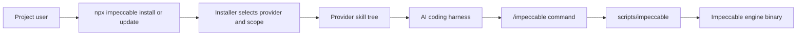

Sources: [README.md:97-115](), [README.npm.md:1-5](), [scripts/build.js:3-16](), [CLAUDE.md:13-17]()

## First-use workflow

Start with `/impeccable init` in the installed harness. It inspects the project, asks about material gaps in durable product truth, writes `PRODUCT.md`, can configure live mode when applicable, and recommends next steps. [README.md:28-34](), [README.md:40-45]()

For each session, the skill’s setup instructions say to run `impeccable context` once, from the user’s project working directory. The command is invoked through the installed skill’s launcher, using the path appropriate to the harness; on Windows shells without `sh`, use the `.cmd` launcher. [CLAUDE.md:13-17](), [.claude/skills/impeccable/SKILL.md:17-23]()

`context` loads `PRODUCT.md`, `DESIGN.md`, the matching surface brief, and native-platform guidance when applicable. Follow the directives it returns; the skill instructions say not to rerun it during the same session. If the launcher refuses or fails, the skill instructs the agent to report that context loading did not run, then read existing `PRODUCT.md` and `DESIGN.md` directly without inventing missing context. [ .claude/skills/impeccable/SKILL.md:17-23]()

| Step | Action | Result |
|---|---|---|
| 1 | Run `/impeccable init` for the project setup flow. [README.md:28-34]() | Captures durable product context in `PRODUCT.md`. [README.md:13-15]() |
| 2 | At the start of a work session, run the installed skill’s `impeccable context` launcher command from the project directory. [.claude/skills/impeccable/SKILL.md:17-20]() | Loads project context and applicable directives. [.claude/skills/impeccable/SKILL.md:19]() |
| 3 | Load the command’s playbook or `reference/new-work.md`, as appropriate. [.claude/skills/impeccable/SKILL.md:20]() | Provides command-specific or new-surface guidance before work. [.claude/skills/impeccable/SKILL.md:20]() |
| 4 | Before a UI edit, read `reference/craft-floor.md`. [.claude/skills/impeccable/SKILL.md:21]() | Applies the skill’s quality floor and design constraints. [.claude/skills/impeccable/SKILL.md:21]() |

Sources: [README.md:13-15](), [README.md:28-34](), [CLAUDE.md:13-17](), [.claude/skills/impeccable/SKILL.md:17-23]()

### Product truth and visual direction

`PRODUCT.md` records durable product truth, including the audience, purpose, operating context, constraints, voice, and evidence. It is distinct from surface-level visual direction. [README.md:13-15]()

`DESIGN.md` records an incumbent or newly built visual system separately. The setup instructions also say that visitor mode and visual direction are chosen for each surface, rather than stored as project-wide product truth. [README.md:28-34](), [CLAUDE.md:30-43]()

The surface brief belongs under `.impeccable/surfaces/`; the mode is selected per surface and persists in that brief. The four modes are `Persuade`, `Operate`, `Read`, and `Experience`. [CLAUDE.md:30-43](), [.claude/skills/impeccable/SKILL.md:32-41]()

| Artifact | Purpose |
|---|---|
| `PRODUCT.md` | Durable product facts used across later commands. [README.md:13-15]() |
| `DESIGN.md` | Incumbent or newly built visual-system guidance, kept distinct from product truth. [README.md:28-34]() |
| `.impeccable/surfaces/` brief | Per-surface direction, including the surface’s mode. [CLAUDE.md:39-43]() |

Sources: [README.md:13-15](), [README.md:28-34](), [CLAUDE.md:30-43](), [.claude/skills/impeccable/SKILL.md:32-41]()

**Diagram: Project context loaded for a skill session**

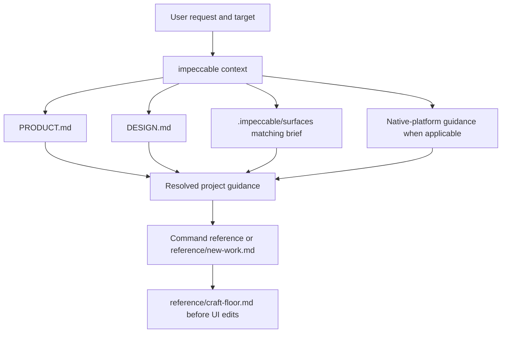

Sources: [.claude/skills/impeccable/SKILL.md:17-23](), [CLAUDE.md:30-43]()

## Repository layout relevant to setup

The repository separates skill source, build tooling, engine code, and generated provider outputs. `skill/` contains the source skill definition, command references, scripts, and metadata. The provider-specific `SKILL.md` files are generated from the source rather than being the authoring source. [CLAUDE.md:5-10](), [scripts/build.js:3-16]()

The engine is built from the root Cargo workspace in `crates/*`. The root `ENGINE_VERSION` pins its release; the build copies that version into `skill/scripts/VERSION`, which the launcher uses for its download and cache behavior. [CLAUDE.md:13-22]()

| Area | Role in the getting-started flow |
|---|---|
| `skill/` | Authoritative skill source, references, command metadata, and launcher. [CLAUDE.md:5-10]() |
| `scripts/` | Build and distribution tooling, including `scripts/build.js` and provider transformers. [scripts/build.js:19-38]() |
| `crates/` | Rust workspace that produces the engine binary. [CLAUDE.md:13-19]() |
| `.claude/skills/`, `.cursor/skills/`, `.gemini/skills/` | Examples of generated provider skill trees. [scripts/build.js:3-13]() |
| `cli/` | npm CLI package area; the build tooling imports engine-fetch and packaging helpers, while the npm package is described as a launcher. [scripts/build.js:35-38](), [README.npm.md:1-5]() |
| `tests/` | Includes build, launcher, and engine-related tests; test-suite definitions identify these areas. [scripts/test-suites.mjs:29-44](), [scripts/test-suites.mjs:77-94]() |

Sources: [CLAUDE.md:5-22](), [scripts/build.js:3-38](), [README.npm.md:1-5](), [scripts/test-suites.mjs:29-44](), [scripts/test-suites.mjs:77-94]()

### Source-to-provider mapping

In natural-language terms, users install the Impeccable skill into a coding harness. In the repository, that experience maps to source files under `skill/`, transformation through `scripts/build.js` and its provider transformers, and generated provider trees such as `.claude/skills/` and `.cursor/skills/`. [CLAUDE.md:5-10](), [scripts/build.js:3-16](), [scripts/build.js:19-27]()

**Diagram: Skill source and build entities**

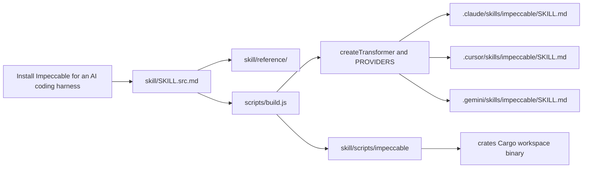

Sources: [CLAUDE.md:5-17](), [scripts/build.js:3-16](), [scripts/build.js:19-27]()

## Verification and common install considerations

After installation, reload the harness and invoke `/impeccable` or `/impeccable init` to confirm the skill is available. The documented skill interface uses `/impeccable <command> <target>`, and `/impeccable init` is the recommended starting point for a project. [README.md:22-34]()

The engine binary does not need a runtime of its own. The npm installer does require Node to run `npx`; the npm package documentation specifies Node.js 18.19 or newer. [README.md:97-99](), [README.npm.md:87-93]()

For hook-enabled installs, some harnesses require explicit trust or approval: Codex users should open `/hooks` and approve the project hook when prompted, and Grok Build users need project-folder trust before its hook scripts run. [README.md:117-119]()

Sources: [README.md:22-34](), [README.md:97-99](), [README.md:117-119](), [README.npm.md:87-93]()

---

# Page: Repository Map and Component Boundaries

# Repository Map and Component Boundaries

<details>
<summary>Relevant source files</summary>

The following files were used as context for generating this wiki page:

- [.claude-plugin/marketplace.json](.claude-plugin/marketplace.json)
- [.claude-plugin/plugin.json](.claude-plugin/plugin.json)
- [.github/workflows/ci.yml](.github/workflows/ci.yml)
- [.github/workflows/sync-generated-output.yml](.github/workflows/sync-generated-output.yml)
- [.gitignore](.gitignore)
- [AGENTS.md](AGENTS.md)
- [CLAUDE.md](CLAUDE.md)
- [Cargo.lock](Cargo.lock)
- [Cargo.toml](Cargo.toml)
- [ENGINE_VERSION](ENGINE_VERSION)
- [README.md](README.md)
- [README.npm.md](README.npm.md)
- [bun.lock](bun.lock)
- [crates/context/src/pin.rs](crates/context/src/pin.rs)
- [crates/skills/src/providers.rs](crates/skills/src/providers.rs)
- [docs/HARNESSES.md](docs/HARNESSES.md)
- [docs/VSCODE-EXTENSION.md](docs/VSCODE-EXTENSION.md)
- [package.json](package.json)
- [scripts/build.js](scripts/build.js)
- [scripts/lib/cursor-plugin.js](scripts/lib/cursor-plugin.js)
- [scripts/lib/plugin-paths.js](scripts/lib/plugin-paths.js)
- [scripts/lib/transformers/index.js](scripts/lib/transformers/index.js)
- [scripts/lib/transformers/providers.js](scripts/lib/transformers/providers.js)
- [scripts/lib/utils.js](scripts/lib/utils.js)
- [scripts/lib/vscode-extension.js](scripts/lib/vscode-extension.js)
- [scripts/lib/zip.js](scripts/lib/zip.js)
- [scripts/test-suites.mjs](scripts/test-suites.mjs)
- [skill/scripts/VERSION](skill/scripts/VERSION)
- [tests/cursor-plugin.test.mjs](tests/cursor-plugin.test.mjs)
- [tests/lib/transformers/providers.test.js](tests/lib/transformers/providers.test.js)
- [tests/plugin-paths.test.js](tests/plugin-paths.test.js)
- [tests/vscode-extension.test.mjs](tests/vscode-extension.test.mjs)
- [vscode/.vscodeignore](vscode/.vscodeignore)
- [vscode/README.md](vscode/README.md)

</details>


## Purpose and scope

Impeccable is organized around a source-to-distribution boundary: `skill/` contains the agent-facing skill source, `crates/` contains the Rust engine workspace, and `scripts/` transforms source into provider-specific and packaged outputs. The repository also contains the npm CLI shim, browser extension, component-review UI, demos, documentation, and tests. This page maps those areas and distinguishes maintained source from generated distribution trees. [AGENTS.md:3-5]()

Sources: [AGENTS.md:3-5](), [README.md:1-5]()

## Repository at a glance

| Area | Boundary and role |
|---|---|
| `skill/` | Source of truth for the skill: `SKILL.src.md`, `reference/`, `scripts/`, and `agents/`. Its launcher delegates commands to the engine rather than implementing the runtime itself. [AGENTS.md:3-5](), [CLAUDE.md:5-17]() |
| `crates/` | Cargo workspace that builds the engine binary and contains the Rust implementation. The repository guidance identifies it as the runtime source and directs contributors to `docs/ENGINE.md` before changing runtime code. [AGENTS.md:5-10]() |
| `scripts/` | Build, release, test-selection, and packaging tools. `scripts/build.js` imports provider transformers, ZIP creation, plugin staging, VS Code staging, and engine-fetch logic. [scripts/build.js:19-38](), [package.json:44-83]() |
| Root provider trees | Generated harness folders, tracked to support direct repository installs; they are not hand-authored source. The documented set includes `.agents/`, `.claude/`, `.cursor/`, `.dsh/`, `.gemini/`, `.github/skills/`, `.grok/`, `.hermes/`, `.kiro/`, `.opencode/`, `.pi/`, `.qoder/`, `.rovodev/`, `.trae*/`, and `.vibe/`. [AGENTS.md:26-30]() |
| `plugin/` and `cursor-plugin/` | `plugin/` is identified as generated distribution output; build logic imports dedicated staging functions for the OpenAI and Cursor plugins. [AGENTS.md:5,26-30](), [scripts/build.js:29-37]() |
| `cli/` | npm entry point and shim. The package maps the `impeccable` executable to `cli/bin/cli.js`; documentation describes the npm package as a launcher for the engine binary. [package.json:37-43](), [README.npm.md:1-5]() |
| `extension/` | Browser-extension source area, with a dedicated build script. CI also identifies the extension and browser bundle as detector-related inputs. [package.json:49-50](), [.github/workflows/ci.yml:119-141]() |
| `ui/` | Contains the component-review UI. The test-suite map explicitly includes component-review model, plan-model, and viewport tests under `ui/component-review/`. [scripts/test-suites.mjs:29-54]() |
| `demos/` | The supplied repository guidance does not describe this directory’s implementation or ownership. It is included here as a repository area named in the page scope. |
| `docs/` | Includes runtime and contributor-facing documentation; `docs/ENGINE.md` is the recommended entry point before modifying Rust runtime code. [AGENTS.md:5]() |
| `tests/` | JavaScript/Bun and Node test suites, Rust crate tests, fixtures, oracle goldens, and behavior tests. The repository guidance identifies `tests/fixtures/` and `tests/oracle/` as key regression areas. [AGENTS.md:5,16-21](), [package.json:55-72]() |
| `dist/` and `build/` | Generated build outputs and gitignored directories, rather than source directories. [AGENTS.md:5,12-15]() |

Sources: [AGENTS.md:3-5](), [AGENTS.md:26-30](), [scripts/build.js:19-38](), [package.json:37-83](), [README.npm.md:1-5](), [scripts/test-suites.mjs:29-54](), [.github/workflows/ci.yml:119-141]()

## Source, build, and generated-output boundary

`skill/` is the authoritative skill source. The build reads source files and provider configuration, creates transformers, and stages distribution forms; the root provider trees and `plugin/` are generated outputs retained in Git for installation workflows. `dist/` and `build/` are generated and gitignored. The regular build validates generated distribution without syncing tracked root harness trees; the release build performs that sync. [AGENTS.md:3-5,12-15,24-30](), [package.json:44-54]()

**Diagram: Maintained source to provider distribution**

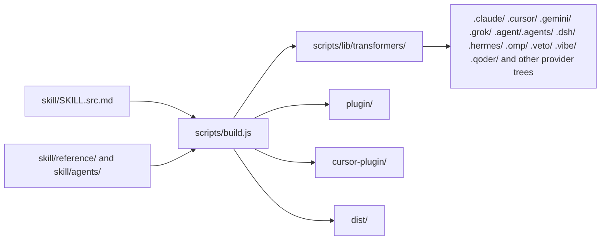

Sources: [AGENTS.md:3-5,12-15,24-30](), [scripts/build.js:19-38]()

The provider list in the diagram reflects the repository’s documented generated-tree policy where available; the supplied file excerpt specifically names `.agents/`, `.claude/`, `.cursor/`, `.dsh/`, `.gemini/`, `.github/skills/`, `.grok/`, `.hermes/`, `.kiro/`, `.opencode/`, `.pi/`, `.qoder/`, `.rovodev/`, `.trae*/`, and `.vibe/`. [AGENTS.md:26-30]()

Sources: [AGENTS.md:26-30]()

### `scripts/build.js` orchestration

The build entry point imports utilities for reading source and preserving per-project artifacts, the root-command sync helper, provider transformers, hook-manifest helpers, ZIP builders, plugin validation and path rewriting, OpenAI and Cursor plugin staging, VS Code staging, and engine-fetch/version helpers. These imports show the build boundary: source interpretation and provider transformation happen in `scripts/`, while the engine itself remains a separate Cargo-built runtime. [scripts/build.js:19-38](), [AGENTS.md:5-10]()

The package scripts distinguish ordinary skill builds from release builds. `build:skills` passes `--skip-root-sync`; `build:skills:release` runs the build without that flag. The top-level `build` and `build:release` scripts then copy `dist/` into `build/_data/dist`. [package.json:44-54]()

Sources: [scripts/build.js:19-38](), [package.json:44-54](), [AGENTS.md:12-15,24]()

### Generated trees are artifacts, not editing targets

The repository policy says normal development should stage source changes in `crates/`, `browser-bundle/`, `skill/`, `scripts/`, `cli/`, `extension/`, and `tests/`; generated harness changes are generally kept out of feature changes. A synchronization workflow regenerates provider output after source changes land on `main`. [AGENTS.md:26-30]()

CI checks generated tracked outputs for drift, including `.agents`, `.claude`, `.cursor`, `.dsh`, `.gemini`, `.github/skills`, `plugin`, and `extension/detector`. This makes the generated-tree contract testable: a source change that requires output updates must be reflected by the build rather than by hand-editing generated copies. [.github/workflows/ci.yml:143-160]()

Sources: [AGENTS.md:26-30](), [.github/workflows/ci.yml:143-160]()

## Rust workspace and engine boundary

The Cargo workspace under `crates/` builds the `impeccable` engine binary. The same binary serves as the runtime for skill verbs and as the detector executable; repository guidance states that there is no separate detector binary. The root `ENGINE_VERSION` pins the released binary used by installs, while the skill launcher and npm shim resolve or download that runtime. [AGENTS.md:5,9,17](), [CLAUDE.md:13-22]()

The provided repository map names crates including `foundation`, `core`, `wasm`, `live`, `context`, and `xtask` in architecture guidance. In particular, the documented flow builds the Rust rule source to WebAssembly and uses `cargo xtask bundle` to assemble artifacts consumed by the extension, live overlay, and site. [CLAUDE.md:17-20](), [.github/workflows/ci.yml:119-134]()

**Diagram: User commands to Rust and browser-facing entities**

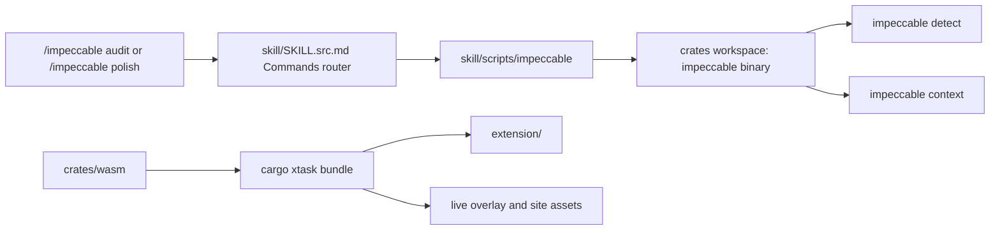

Sources: [CLAUDE.md:5-22](), [AGENTS.md:5,9,17,22](), [.github/workflows/ci.yml:119-134]()

The launcher boundary is explicit: skill commands invoke `{{scripts_path}}/impeccable <verb>`, while `skill/scripts/impeccable` resolves the engine binary. The binary is built from the Cargo workspace; the npm CLI is another entry point to that same engine. [CLAUDE.md:13-22](), [README.npm.md:3-5,87-93]()

Sources: [CLAUDE.md:13-22](), [README.npm.md:3-5,87-93]()

## Skill source and provider trees

The skill source is a single user-invocable skill, `impeccable`, with commands routed beneath it. `skill/SKILL.src.md` contains the source contract and command router; `skill/reference/` contains command playbooks and shared guidance; `skill/scripts/` contains the launcher and live-mode JavaScript; and `skill/agents/` contains agent definitions. [CLAUDE.md:5-10](), [AGENTS.md:3-5]()

Provider `SKILL.md` files are generated from the source. The build system’s stated purpose is to transform source skills into provider-specific formats, with provider implementations selected through `createTransformer` and `PROVIDERS`. The generated provider trees are therefore compatibility outputs for different harness layouts, not separate skill implementations. [CLAUDE.md:5-8](), [scripts/build.js:3-16,22-25]()

Sources: [CLAUDE.md:5-10](), [scripts/build.js:3-16,22-25]()

**Diagram: Natural-language command routing to repository entities**

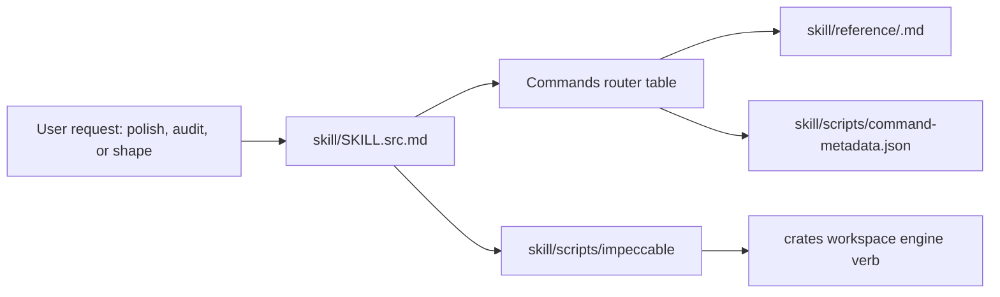

Sources: [CLAUDE.md:5-17](), [AGENTS.md:3-5]()

The diagram connects user-facing terms with names a contributor can search for in the repository: the router and references live under `skill/`, command metadata is under `skill/scripts/`, and command execution crosses to the launcher and Rust engine. [CLAUDE.md:5-17]()

Sources: [CLAUDE.md:5-17]()

## CLI, plugins, extension, and UI

### npm CLI

The npm package exposes `impeccable` through `cli/bin/cli.js`. Its optional dependencies list platform-specific `@impeccable/cli-*` packages, and the npm README describes the package as a small launcher that runs the matching engine binary or falls back to a cache or download. [package.json:37-43,85-90](), [README.npm.md:1-5,87-93]()

Sources: [package.json:37-43,85-90](), [README.npm.md:1-5,87-93]()

### Plugins and editor packaging

The build imports separate staging helpers for OpenAI and Cursor plugins and a VS Code extension. It also imports plugin-path rewriting and validation helpers, indicating that plugin packaging has its own path and manifest checks rather than being a direct copy of the skill source. The Claude plugin metadata points its skill path at `./.claude/skills/`, while the marketplace manifest identifies `./plugin` as the plugin source. [scripts/build.js:27-38](), [.claude-plugin/plugin.json:1-12](), [.claude-plugin/marketplace.json:11-21]()

Sources: [scripts/build.js:27-38](), [.claude-plugin/plugin.json:1-12](), [.claude-plugin/marketplace.json:11-21]()

### Browser extension and component-review UI

`extension/` has a dedicated `build:extension` package script. CI describes this build as running `cargo xtask bundle`, which compiles the rule core to WASM and includes the page JavaScript from `browser-bundle/`. The test-suite configuration separately maps extension packaging and DevTools report checks to the detector suite. [package.json:49-50](), [.github/workflows/ci.yml:119-141](), [scripts/test-suites.mjs:120-143]()

`ui/component-review/` is a UI test boundary: the core test suite includes tests for its model, plan model, and viewport. The provided material does not expose the UI implementation files, so this map identifies the directory and its test relationship without inferring internal component behavior. [scripts/test-suites.mjs:29-54]()

Sources: [package.json:49-50](), [.github/workflows/ci.yml:119-141](), [scripts/test-suites.mjs:29-54,120-143]()

## Documentation and tests

`docs/ENGINE.md` is the recommended architecture reference before runtime changes, and `docs/CLI-CONTRACT.md` is named as the specification for observable engine behavior. The repository’s test plan separates core build/provider checks, oracle replay, detector packaging, live-mode checks, and framework fixtures into suites selected by changed paths. [AGENTS.md:5](), [CLAUDE.md:17,23](), [scripts/test-suites.mjs:29-43,98-143,145-175]()

The root package exposes corresponding test commands, including `test:core`, `test:oracle`, `test:detector`, `test:framework`, `test:live`, and several opt-in end-to-end and skill-behavior suites. The engine-dependent suites resolve a binary from `IMPECCABLE_BIN` or fetched/build locations and can skip when no binary is available. [package.json:55-72](), [AGENTS.md:16-21](), [CLAUDE.md:22-23]()

Sources: [AGENTS.md:5,16-21](), [CLAUDE.md:17,23](), [scripts/test-suites.mjs:29-43,98-143,145-175](), [package.json:55-72]()

**Diagram: Change-to-test-suite boundary**

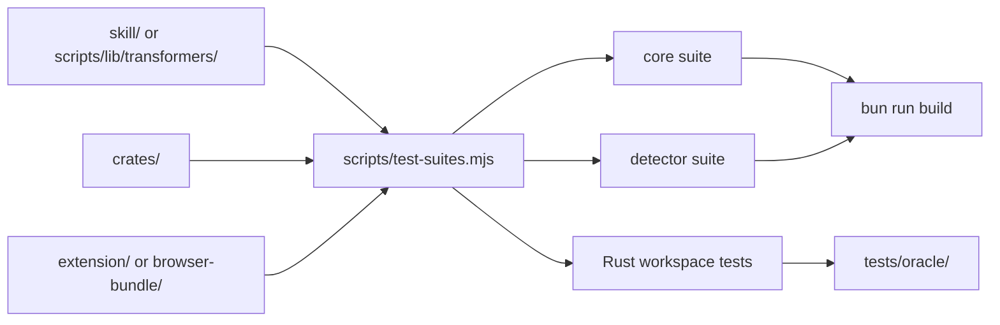

Sources: [scripts/test-suites.mjs:29-43,98-143](), [package.json:44-72](), [AGENTS.md:9-18]()

## Practical navigation guide

| If the change concerns… | Start with… | Boundary to preserve |
|---|---|---|
| Skill wording, routing, or command references | `skill/SKILL.src.md`, `skill/reference/`, `skill/scripts/command-metadata.json` [CLAUDE.md:5-10]() | Edit the source skill; provider `SKILL.md` files are generated. [CLAUDE.md:5-8]() |
| Engine behavior or detector implementation | `crates/`, then `docs/ENGINE.md` and `docs/CLI-CONTRACT.md` [AGENTS.md:5,9]() | The Cargo workspace builds the runtime; do not treat generated provider trees as engine source. [AGENTS.md:5,9,26-30]() |
| Provider output or packaging | `scripts/build.js`, `scripts/lib/transformers/` [scripts/build.js:19-38]() | Regenerate outputs through the build; tracked provider directories are generated artifacts. [AGENTS.md:26-30]() |
| npm CLI behavior | `cli/`, `package.json`, `README.npm.md` [package.json:37-43](), [README.npm.md:1-5]() | The npm entry point launches the engine rather than defining a second runtime. [README.npm.md:3-5]() |
| Extension build or detector bundle | `extension/`, `browser-bundle/`, `scripts/build-extension.js`, `crates/` [package.json:49-50](), [.github/workflows/ci.yml:119-141]() | Rebuild the bundle and run detector-related checks. [.github/workflows/ci.yml:119-160]() |
| Component-review UI | `ui/component-review/` and its tests [scripts/test-suites.mjs:29-54]() | Treat its test mapping as the exposed boundary; implementation details are outside the supplied excerpts. |
| Regression coverage | `tests/`, `scripts/test-suites.mjs`, and package test scripts [AGENTS.md:16-21](), [scripts/test-suites.mjs:29-175]() | Select suites based on changed area and ensure generated outputs remain current. [.github/workflows/ci.yml:143-160]() |

Sources: [CLAUDE.md:5-10](), [AGENTS.md:5,9,16-21,26-30](), [scripts/build.js:19-38](), [package.json:37-72](), [README.npm.md:1-5](), [.github/workflows/ci.yml:119-160](), [scripts/test-suites.mjs:29-54,98-175]()

---

# Page: Skill and Command System

# Skill and Command System

<details>
<summary>Relevant source files</summary>

The following files were used as context for generating this wiki page:

- [.claude/skills/impeccable/SKILL.md](.claude/skills/impeccable/SKILL.md)
- [.cursor/skills/impeccable/SKILL.md](.cursor/skills/impeccable/SKILL.md)
- [.gemini/skills/impeccable/SKILL.md](.gemini/skills/impeccable/SKILL.md)
- [.github/skills/impeccable/SKILL.md](.github/skills/impeccable/SKILL.md)
- [.kiro/skills/impeccable/SKILL.md](.kiro/skills/impeccable/SKILL.md)
- [.opencode/skills/impeccable/SKILL.md](.opencode/skills/impeccable/SKILL.md)
- [.pi/skills/impeccable/SKILL.md](.pi/skills/impeccable/SKILL.md)
- [.qoder/skills/impeccable/SKILL.md](.qoder/skills/impeccable/SKILL.md)
- [.rovodev/skills/impeccable/SKILL.md](.rovodev/skills/impeccable/SKILL.md)
- [.trae-cn/skills/impeccable/SKILL.md](.trae-cn/skills/impeccable/SKILL.md)
- [.trae/skills/impeccable/SKILL.md](.trae/skills/impeccable/SKILL.md)
- [plugin/skills/impeccable/SKILL.md](plugin/skills/impeccable/SKILL.md)
- [skill/SKILL.src.md](skill/SKILL.src.md)
- [skill/agents/impeccable-asset-producer.md](skill/agents/impeccable-asset-producer.md)
- [skill/agents/impeccable-finish-reviewer.md](skill/agents/impeccable-finish-reviewer.md)
- [skill/agents/impeccable-manual-edit-applier.md](skill/agents/impeccable-manual-edit-applier.md)
- [skill/reference/craft-floor.md](skill/reference/craft-floor.md)
- [skill/reference/doctor.md](skill/reference/doctor.md)
- [skill/reference/init.md](skill/reference/init.md)
- [skill/reference/mode-operate.md](skill/reference/mode-operate.md)
- [skill/reference/mode-persuade.md](skill/reference/mode-persuade.md)
- [skill/reference/mode-read.md](skill/reference/mode-read.md)
- [skill/reference/new-work.md](skill/reference/new-work.md)
- [skill/reference/overdrive.md](skill/reference/overdrive.md)
- [skill/reference/visualize.md](skill/reference/visualize.md)
- [tests/fixtures/mode-rules-skill-partial/reference/mode-operate.md](tests/fixtures/mode-rules-skill-partial/reference/mode-operate.md)

</details>


## Purpose and Scope

Impeccable is presented to coding agents as one frontend-design skill, with commands that route requests to focused reference playbooks. This page summarizes the agent-facing contract, command families, references, review agents, and design modes. It links to child pages for implementation-level details. [skill/SKILL.src.md:1-23]()

Sources: [skill/SKILL.src.md:1-23]()

## The Skill as an Agent Contract

The skill’s frontmatter identifies it as `impeccable`, describes the frontend tasks it covers, and provides invocation guidance. Its body sets working principles and a setup sequence: load project context once per session, read the playbook for the request, inspect the target and existing visual evidence, and consult the craft floor before UI edits. The generated provider trees contain agent-facing versions of this contract; their paths and runtime-specific metadata can vary. [skill/SKILL.src.md:1-25](), [.claude/skills/impeccable/SKILL.md:1-23]()

**Sources:** [skill/SKILL.src.md:1-25](), [.claude/skills/impeccable/SKILL.md:1-23]()

### From User Request to Skill Files

This diagram connects request language to the skill’s named files and workflow entities.

**Diagram: Request routing into the skill contract**
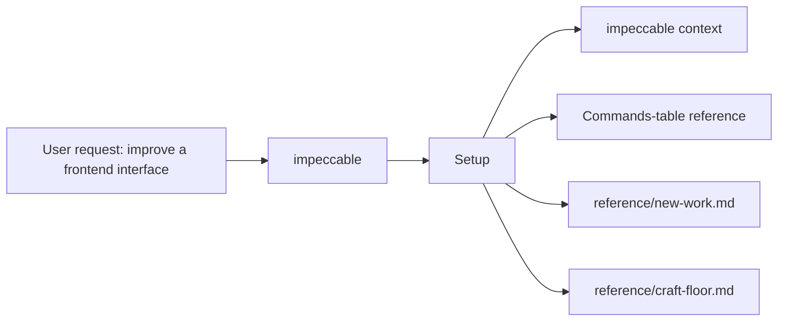

**Sources:** [skill/SKILL.src.md:1-25]()

## Command Families and References

Commands are organized around common design tasks rather than separate skills. The command interface spans planning and project context, evaluation, refinement, visual enhancement, targeted fixes, and iteration. Each command’s playbook supplies the task-specific guidance; `new-work.md` is the entry point for new surfaces or replacement visual identities. `craft` is documented as a deprecated alias for ordinary new work. [skill/SKILL.src.md:45-54](), [.claude/skills/impeccable/SKILL.md:43-55]()

| Family | Commands |
|---|---|
| Build | `shape`, `craft`, `init`, `document`, `extract` |
| Evaluate | `critique`, `audit` |
| Refine | `polish`, `bolder`, `quieter`, `distill`, `harden`, `onboard` |
| Enhance | `animate`, `colorize`, `typeset`, `layout`, `delight`, `overdrive` |
| Fix | `clarify`, `adapt`, `optimize` |
| Iterate | `live`, `generate` |

The generated skill’s argument hint groups many of these names for agent invocation; the source command table explicitly documents the opening entries. For the full catalog and playbook mapping, see [Command Reference Catalog](#2.2). [skill/SKILL.src.md:45-54](), [.claude/skills/impeccable/SKILL.md:6]()

**Sources:** [skill/SKILL.src.md:45-54](), [.claude/skills/impeccable/SKILL.md:6]()

### From Command Names to Playbooks

The terms on the left represent user-facing tasks; the file paths on the right are the skill’s reference entities. The skill contract directs the agent to load the playbook for an explicit or implied sub-command, or `reference/new-work.md` for new work. [skill/SKILL.src.md:19-23]()

**Diagram: Command vocabulary and reference entities**
```mermaid
flowchart TB
    Build["Build: shape, craft, init, document, extract"]
    Evaluate["Evaluate: critique, audit"]
    Refine["Refine: polish, bolder, quieter, distill"]
    Enhance["Enhance: animate, colorize, typeset, layout"]
    Fix["Fix: clarify, adapt, optimize"]
    Iterate["Iterate: live, generate"]
    ShapeRef["reference/shape.md"]
    InitRef["reference/init.md"]
    DocumentRef["reference/document.md"]
    ExtractRef["reference/extract.md"]
    CritiqueRef["reference/critique.md"]
    AuditRef["reference/audit.md"]
    PolishRef["reference/polish.md"]
    NewWork["reference/new-work.md"]
    Build --> ShapeRef
    Build --> InitRef
    Build --> DocumentRef
    Build --> ExtractRef
    Evaluate --> CritiqueRef
    Evaluate --> AuditRef
    Refine --> PolishRef
    Build --> NewWork
```

**Sources:** [skill/SKILL.src.md:19-23](), [skill/SKILL.src.md:45-54]()

## Project Context, Modes, and New Work

The setup step `impeccable context` loads project-specific context, including `PRODUCT.md`, `DESIGN.md`, a matching surface brief, and native-platform guidance when applicable. The contract distinguishes durable product truth from visual decisions and surface-specific strategy; the new-work playbook uses those distinctions to guide whether a surface inherits, extends, or replaces an existing visual world. [skill/SKILL.src.md:19-25](), [skill/reference/new-work.md:1-16]()

The skill defines four modes by the visitor’s goal on the specific surface: **Persuade** (decide and act), **Operate** (complete a task), **Read** (understand), and **Experience** (engage with the work itself). The mode informs the level and kind of design ambition; it is chosen for the surface, not inferred from the overall product. [skill/SKILL.src.md:34-43]()

For the direction-selection process, modes, decision pages, and comp-led versus code-led paths, see [New Work and Direction Selection](#2.3). For comp generation and build phases, see [Comp Pipeline and Build Phases](#2.4).

**Sources:** [skill/SKILL.src.md:19-25](), [skill/SKILL.src.md:34-43](), [skill/reference/new-work.md:1-16]()

## Review Agents and Quality Boundaries

The skill contract separates planning from implementation: agents load task guidance, inspect project context, and read `reference/craft-floor.md` immediately before UI edits. Review is also separated from implementation: the finish reviewer is instructed to edit nothing and return material fixes for the parent agent to apply. Its review compares the finished artifact with the direction contract and, for comp-led work, the approved comp and build evidence. [skill/SKILL.src.md:19-25](), [skill/agents/impeccable-finish-reviewer.md:15-25]()

Other agent roles include asset production, documentation, and manual-edit application. For their contracts, craft-floor rules, fallback behavior, and quality gates, see [Craft Floor, Review Agents, and Quality Gates](#2.5). [skill/agents/impeccable-finish-reviewer.md:15-25]()

**Sources:** [skill/SKILL.src.md:19-25](), [skill/agents/impeccable-finish-reviewer.md:15-25]()

## Child Pages

- [Skill Source Format and Routing](#2.1) — Source format, frontmatter, placeholders, provider blocks, routing menu, and context-loading setup.
- [Command Reference Catalog](#2.2) — Command families and their reference playbooks, plus hooks and doctor.
- [New Work and Direction Selection](#2.3) — Product truth, design authority, modes, concept selection, direction contracts, and build-path choice.
- [Comp Pipeline and Build Phases](#2.4) — Comp discipline, build phases, fidelity checks, and component review.
- [Craft Floor, Review Agents, and Quality Gates](#2.5) — Craft floor, reviewer and support-agent roles, fallbacks, and review heuristics.

**Sources:** [skill/SKILL.src.md:19-23](), [skill/reference/new-work.md:1-5](), [skill/agents/impeccable-finish-reviewer.md:15-25]()

---

# Page: Skill Source Format and Routing

# Skill Source Format and Routing

<details>
<summary>Relevant source files</summary>

The following files were used as context for generating this wiki page:

- [.agents/skills/impeccable/SKILL.md](.agents/skills/impeccable/SKILL.md)
- [.claude/skills/impeccable/SKILL.md](.claude/skills/impeccable/SKILL.md)
- [.cursor/skills/impeccable/SKILL.md](.cursor/skills/impeccable/SKILL.md)
- [.gemini/skills/impeccable/SKILL.md](.gemini/skills/impeccable/SKILL.md)
- [.github/skills/impeccable/SKILL.md](.github/skills/impeccable/SKILL.md)
- [.github/workflows/ci.yml](.github/workflows/ci.yml)
- [.github/workflows/sync-generated-output.yml](.github/workflows/sync-generated-output.yml)
- [.gitignore](.gitignore)
- [.kiro/skills/impeccable/SKILL.md](.kiro/skills/impeccable/SKILL.md)
- [.opencode/skills/impeccable/SKILL.md](.opencode/skills/impeccable/SKILL.md)
- [.pi/skills/impeccable/SKILL.md](.pi/skills/impeccable/SKILL.md)
- [.qoder/skills/impeccable/SKILL.md](.qoder/skills/impeccable/SKILL.md)
- [.rovodev/skills/impeccable/SKILL.md](.rovodev/skills/impeccable/SKILL.md)
- [.trae-cn/skills/impeccable/SKILL.md](.trae-cn/skills/impeccable/SKILL.md)
- [.trae/skills/impeccable/SKILL.md](.trae/skills/impeccable/SKILL.md)
- [AGENTS.md](AGENTS.md)
- [CLAUDE.md](CLAUDE.md)
- [README.md](README.md)
- [README.npm.md](README.npm.md)
- [crates/context/src/pin.rs](crates/context/src/pin.rs)
- [crates/skills/src/providers.rs](crates/skills/src/providers.rs)
- [docs/HARNESSES.md](docs/HARNESSES.md)
- [plugin/skills/impeccable/SKILL.md](plugin/skills/impeccable/SKILL.md)
- [scripts/build.js](scripts/build.js)
- [scripts/lib/transformers/index.js](scripts/lib/transformers/index.js)
- [scripts/lib/transformers/providers.js](scripts/lib/transformers/providers.js)
- [scripts/lib/utils.js](scripts/lib/utils.js)
- [scripts/test-suites.mjs](scripts/test-suites.mjs)
- [tests/lib/transformers/providers.test.js](tests/lib/transformers/providers.test.js)

</details>


## Purpose and scope

This page explains how Impeccable’s single skill is described, routed, and built for different agent providers. It covers the skill’s frontmatter and Markdown body, provider-specific transformations, command-reference loading, and the required context-loading setup step. The repository’s documented architecture identifies `skill/SKILL.src.md` as the source and provider `SKILL.md` files as generated outputs. [CLAUDE.md:5-9]()

Sources: [CLAUDE.md:5-9]()

## Source file and generated skill

Impeccable uses one user-invocable skill, `impeccable`, with commands beneath it. The source file is `skill/SKILL.src.md`; provider-specific `SKILL.md` files are generated from it rather than treated as separate authoritative definitions. [CLAUDE.md:5-8]()

The generated skill presents a provider-facing contract: frontmatter identifies the skill and helps the harness decide when and how to expose it, while the Markdown body provides shared instructions and the command router. The checked-in Claude output, for example, declares `name`, `description`, `version`, `user-invocable`, `argument-hint`, and `license` before its setup guidance and Commands table. [`.claude/skills/impeccable/SKILL.md:1-8`]() [`.claude/skills/impeccable/SKILL.md:17-23`]() [`.claude/skills/impeccable/SKILL.md:43-55`]()

Sources: [CLAUDE.md:5-9](), [.claude/skills/impeccable/SKILL.md:1-8](), [.claude/skills/impeccable/SKILL.md:17-23](), [.claude/skills/impeccable/SKILL.md:43-55]()

### Frontmatter and body

The generated Claude skill uses YAML frontmatter delimited by `---`. Its `name` is `impeccable`; its description states the UI-design tasks it covers and excludes backend-only or non-UI work; `user-invocable: true` makes it user-facing; and `argument-hint` summarizes command and target suggestions. The license is `Apache 2.0`. [`.claude/skills/impeccable/SKILL.md:1-8`]()

The body begins with shared design principles and then defines setup, design guidance, modes, and the Commands router table. Provider outputs can carry provider-specific metadata: the supplied OpenCode output, for example, includes an `allowed-tools` list, whereas the supplied Claude output does not. [`.claude/skills/impeccable/SKILL.md:10-23`]() [`.opencode/skills/impeccable/SKILL.md:1-13`]()

| Frontmatter field | Role in the generated skill |
|---|---|
| `name` | Skill identifier: `impeccable`. [`.claude/skills/impeccable/SKILL.md:1-3`]() |
| `description` | Describes the intended UI-design use cases and exclusions. [`.claude/skills/impeccable/SKILL.md:2-3`]() |
| `version` | Skill version metadata. [`.claude/skills/impeccable/SKILL.md:4`]() |
| `user-invocable` | Marks the skill as user-invocable. [`.claude/skills/impeccable/SKILL.md:5`]() |
| `argument-hint` | Shows command groups and a target hint. [`.claude/skills/impeccable/SKILL.md:6`]() |
| `license` | States the license. [`.claude/skills/impeccable/SKILL.md:7`]() |
| `allowed-tools` | Provider-specific tool permissions, present in the supplied OpenCode output. [`.opencode/skills/impeccable/SKILL.md:8-10`]() |

Sources: [.claude/skills/impeccable/SKILL.md:1-8](), [.opencode/skills/impeccable/SKILL.md:8-10]()

## Placeholders and provider-specific output

The source/build workflow uses placeholders to keep shared skill guidance adaptable to provider-specific output. The placeholders in scope are `{{model}}`, `{{config_file}}`, `{{command_prefix}}`, and `{{available_commands}}`. They represent provider or harness context, configuration guidance, the invocation form, and the available-command summary, respectively. This page does not prescribe literal replacement values: those depend on the provider transformer and its build configuration. The build system imports `createTransformer` and `PROVIDERS`, and its stated purpose is to transform source skills into provider-specific formats. [scripts/build.js:4-16]() [scripts/build.js:22-25]()

| Placeholder | Intended content |
|---|---|
| `{{model}}` | Provider/model-facing wording used by the shared instructions. |
| `{{config_file}}` | Provider-specific configuration-file reference where applicable. |
| `{{command_prefix}}` | Provider-appropriate command invocation prefix. |
| `{{available_commands}}` | Provider-facing summary of available commands. |

The provided generated skill demonstrates that provider output can differ in both invocation details and metadata. Its setup step uses a skill-base directory to locate the launcher; the OpenCode output additionally declares allowed shell commands. [`.claude/skills/impeccable/SKILL.md:17-23`]() [`.opencode/skills/impeccable/SKILL.md:8-10`]() The build imports the transformer factory and provider registry, but the implementation details of the individual placeholder substitutions are not included in the supplied source excerpts. [scripts/build.js:22-25]()

Sources: [scripts/build.js:4-16](), [scripts/build.js:22-25](), [.claude/skills/impeccable/SKILL.md:17-23](), [.opencode/skills/impeccable/SKILL.md:8-10]()

### Source-to-provider data flow

**Diagram: Skill source through provider build**


The repository documents `skill/SKILL.src.md` as the source and provider `SKILL.md` files as generated output. `scripts/build.js` imports `createTransformer` and `PROVIDERS` for the transformation pipeline. [CLAUDE.md:5-8]() [scripts/build.js:22-25]()

Sources: [CLAUDE.md:5-8](), [scripts/build.js:22-25]()

## Command routing and reference loading

The generated skill’s Commands table is the routing menu. Each row names a command, describes its purpose, and links to a reference playbook. The documented routing contract is that, when a sub-command matches, the router loads that command’s reference file. The repository also identifies `new-work.md`, `craft-floor.md`, `operate.md`, and `routing.md` as shared playbooks outside the command table. [CLAUDE.md:5-9]()

For example, the supplied Claude output routes `shape` to `reference/shape.md`, `init` to `reference/init.md`, and `audit` to `reference/audit.md`, with an additional native reference for `audit`. [`.claude/skills/impeccable/SKILL.md:43-55`]() The setup instructions also direct the agent to load the command-table reference for an explicit or implied sub-command, or `reference/new-work.md` for a new surface or replacement visual world. [`.claude/skills/impeccable/SKILL.md:20-21`]()

`routing.md` is listed among the shared playbooks, but the supplied excerpts do not include its contents. Therefore, this page can identify it as a shared routing-related reference but cannot specify any additional menu behavior or routing rules beyond the command-table and reference-loading contract documented above. [CLAUDE.md:7-9]()

Sources: [CLAUDE.md:5-9](), [.claude/skills/impeccable/SKILL.md:20-21](), [.claude/skills/impeccable/SKILL.md:43-55]()

### Routing from user request to playbook

**Diagram: Natural-language request mapped to routing entities**

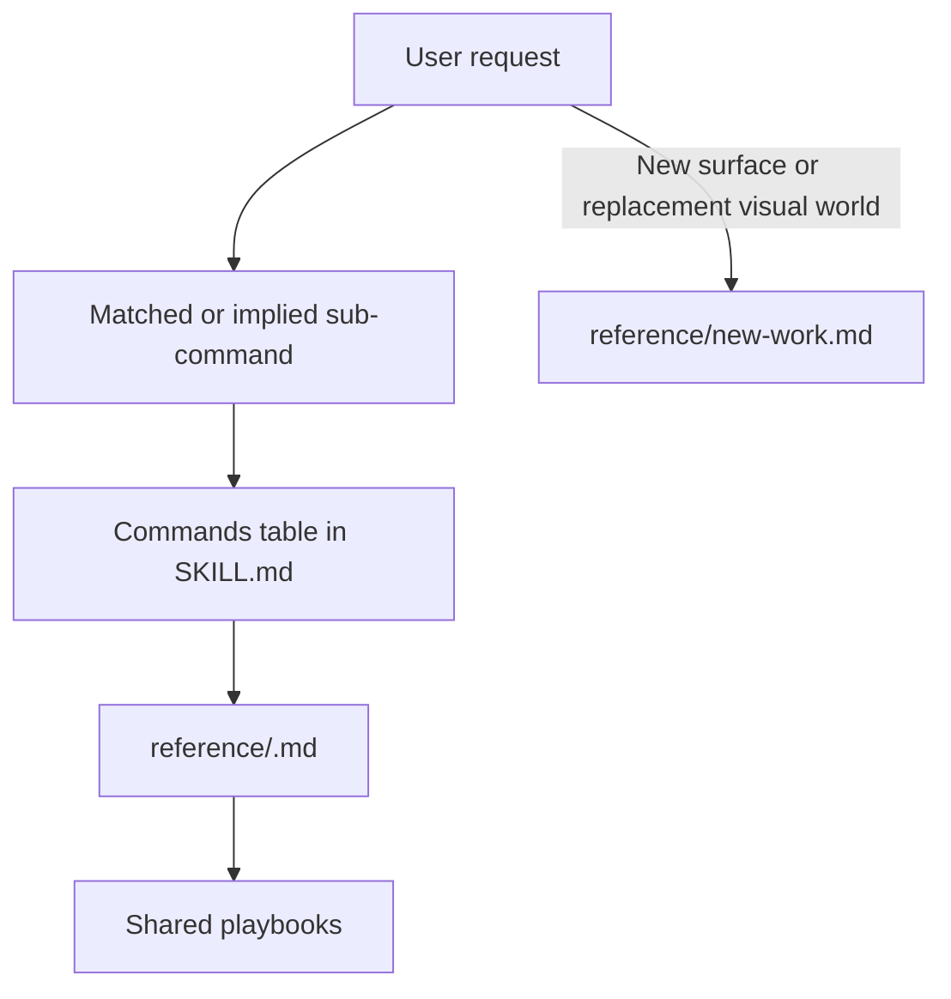

The Commands table maps command names to references, and the setup contract directs the agent to use the matching reference or `new-work.md` for new-surface work. Shared playbooks are separately identified in the repository instructions. [CLAUDE.md:5-9]() [`.claude/skills/impeccable/SKILL.md:20-21`]() [`.claude/skills/impeccable/SKILL.md:43-55`]()

Sources: [CLAUDE.md:5-9](), [.claude/skills/impeccable/SKILL.md:20-21](), [.claude/skills/impeccable/SKILL.md:43-55]()

## Context-loading setup step

The generated skill requires a context-loading command once per session. The agent runs the skill’s `scripts/impeccable context` launcher from the skill directory while keeping the working directory at the user’s project. It may pass a named source file or route as `--target <path>`. The setup instructions say this step loads `PRODUCT.md`, `DESIGN.md`, the matching surface brief, and native-platform guidance when applicable; the agent should follow the resulting directives and not rerun the command. [`.claude/skills/impeccable/SKILL.md:17-20`]()

The setup step is distinct from playbook routing: context loading establishes project and surface context; the next setup step loads the task’s command reference or `new-work.md`. If the launcher refuses or fails, the skill instructs the agent to state that context loading did not run before its next tool call, then read existing `PRODUCT.md` and `DESIGN.md` directly without inventing missing context. [`.claude/skills/impeccable/SKILL.md:20-23`]()

Sources: [.claude/skills/impeccable/SKILL.md:17-23]()

### Context setup mapped to code entities

**Diagram: Setup instruction to launcher and loaded context**

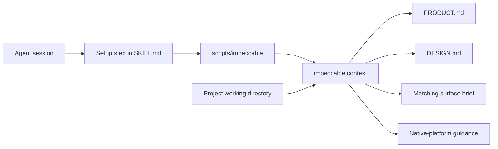

This diagram reflects the generated skill’s setup contract: execute the launcher’s `context` verb from the skill directory with the project as the working directory; the command loads the listed project and platform context when applicable. [`.claude/skills/impeccable/SKILL.md:17-20`]()

Sources: [.claude/skills/impeccable/SKILL.md:17-20]()

## Build and generated-output checks

The build system describes itself as transforming source skills into provider-specific formats and importing a provider registry and transformer factory. [scripts/build.js:4-16]() [scripts/build.js:22-25]() CI runs `bun run build` and checks generated provider outputs, including `.agents`, `.claude`, `.cursor`, `.dsh`, `.gemini`, `.github/skills`, and `plugin`. [`.github/workflows/ci.yml:112-114`]() [`.github/workflows/ci.yml:156-160`]()

The core test suite includes build and provider-transformer tests, as well as skill-reference tests. The suite configuration identifies `skill/SKILL.src.md` and `skill/reference/` as core-suite triggers. [scripts/test-suites.mjs:29-42]() [scripts/test-suites.mjs:44-65]() [scripts/test-suites.mjs:86-94]()

Sources: [scripts/build.js:4-16](), [scripts/build.js:22-25](), [.github/workflows/ci.yml:112-114](), [.github/workflows/ci.yml:156-160](), [scripts/test-suites.mjs:29-65](), [scripts/test-suites.mjs:86-94]()

---

# Page: Command Reference Catalog

# Command Reference Catalog

<details>
<summary>Relevant source files</summary>

The following files were used as context for generating this wiki page:

- [.agents/skills/impeccable/reference/polish.md](.agents/skills/impeccable/reference/polish.md)
- [.claude/skills/impeccable/reference/polish.md](.claude/skills/impeccable/reference/polish.md)
- [.cursor/skills/impeccable/reference/polish.md](.cursor/skills/impeccable/reference/polish.md)
- [.gemini/skills/impeccable/reference/polish.md](.gemini/skills/impeccable/reference/polish.md)
- [.github/skills/impeccable/reference/polish.md](.github/skills/impeccable/reference/polish.md)
- [.kiro/skills/impeccable/reference/polish.md](.kiro/skills/impeccable/reference/polish.md)
- [.opencode/skills/impeccable/reference/polish.md](.opencode/skills/impeccable/reference/polish.md)
- [.pi/skills/impeccable/reference/polish.md](.pi/skills/impeccable/reference/polish.md)
- [.rovodev/skills/impeccable/reference/polish.md](.rovodev/skills/impeccable/reference/polish.md)
- [.trae-cn/skills/impeccable/reference/polish.md](.trae-cn/skills/impeccable/reference/polish.md)
- [.trae/skills/impeccable/reference/polish.md](.trae/skills/impeccable/reference/polish.md)
- [skill/reference/adapt.md](skill/reference/adapt.md)
- [skill/reference/adapt.native.md](skill/reference/adapt.native.md)
- [skill/reference/animate.md](skill/reference/animate.md)
- [skill/reference/audit.md](skill/reference/audit.md)
- [skill/reference/audit.native.md](skill/reference/audit.native.md)
- [skill/reference/bolder.md](skill/reference/bolder.md)
- [skill/reference/critique.md](skill/reference/critique.md)
- [skill/reference/distill.md](skill/reference/distill.md)
- [skill/reference/document.md](skill/reference/document.md)
- [skill/reference/extract.md](skill/reference/extract.md)
- [skill/reference/harden.md](skill/reference/harden.md)
- [skill/reference/layout.md](skill/reference/layout.md)
- [skill/reference/optimize.md](skill/reference/optimize.md)
- [skill/reference/quieter.md](skill/reference/quieter.md)
- [skill/reference/shape.md](skill/reference/shape.md)
- [skill/reference/typeset.md](skill/reference/typeset.md)
- [tests/lib/utils.test.js](tests/lib/utils.test.js)
- [tests/skill-reference.test.mjs](tests/skill-reference.test.mjs)

</details>


## Purpose and scope

This page catalogs Impeccable’s agent-facing commands and reference playbooks. It groups the commands by task and identifies the source reference for each. The references are guidance for an agent performing work; the descriptions below summarize their documented responsibilities, not a guarantee that a command invokes a particular executable. [skill/reference/critique.md:1-16]() [skill/reference/audit.md:1-5]() [skill/reference/animate.md:1-3]()

Sources: [skill/reference/critique.md:1-16]() [skill/reference/audit.md:1-5]() [skill/reference/animate.md:1-3]()

## Command names and playbook mapping

The catalog spans build, evaluate, refine, enhance, fix, and iterate work, plus `hooks` and `doctor`. The files shown here document a subset of the reference playbooks in full; other playbook names are listed in the repository input but their contents are not included, so their detailed behavior is not inferred here.

| Group | Command | Reference playbook | Documented responsibility |
|---|---|---|---|
| Build | `shape` | `skill/reference/shape.md` | Shape a design direction. |
| Build | `craft` | `skill/reference/craft.md` | Create or implement a design. |
| Build | `init` | `skill/reference/init.md` | Initialize project context. |
| Build | `document` | [`skill/reference/document.md`](#build-document) | Capture the design system in `DESIGN.md`. |
| Build | `extract` | [`skill/reference/extract.md`](#build-extract) | Identify reusable patterns, components, and tokens. |
| Evaluate | `critique` | [`skill/reference/critique.md`](#evaluate-critique) | Run design and detector assessments, synthesize findings, and ask what to improve. |
| Evaluate | `audit` | [`skill/reference/audit.md`](#evaluate-audit) | Run systematic technical quality checks and report findings without fixing them. |
| Refine | `polish` | `skill/reference/polish.md` | Reference listed in the repository input; detailed content is not included here. |
| Refine | `bolder` | [`skill/reference/bolder.md`](#refine-bolder) | Amplify a scoped part of an existing surface using its established design system. |
| Refine | `quieter` | [`skill/reference/quieter.md`](#refine-quieter) | Reduce visual intensity while retaining the design’s point of view. |
| Refine | `distill` | `skill/reference/distill.md` | Reference listed in the repository input; detailed content is not included here. |
| Refine | `harden` | [`skill/reference/harden.md`](#refine-harden) | Improve resilience to difficult inputs, errors, languages, and network conditions. |
| Refine | `onboard` | `skill/reference/onboard.md` | Reference listed in the repository input; detailed content is not included here. |
| Enhance | `animate` | [`skill/reference/animate.md`](#enhance-animate) | Add purposeful motion that communicates state, relationship, hierarchy, or an authored moment. |
| Enhance | `colorize` | `skill/reference/colorize.md` | Reference listed in the repository input; detailed content is not included here. |
| Enhance | `typeset` | `skill/reference/typeset.md` | Reference listed in the repository input; detailed content is not included here. |
| Enhance | `layout` | `skill/reference/layout.md` | Reference listed in the repository input; detailed content is not included here. |
| Enhance | `delight` | `skill/reference/delight.md` | Reference listed in the repository input; detailed content is not included here. |
| Enhance | `overdrive` | `skill/reference/overdrive.md` | Reference listed in the repository input; detailed content is not included here. |
| Fix | `clarify` | `skill/reference/clarify.md` | Reference listed in the repository input; detailed content is not included here. |
| Fix | `adapt` | [`skill/reference/adapt.md`](#fix-adapt) | Rethink an existing design for another web context, rather than merely scaling it. |
| Fix | `optimize` | [`skill/reference/optimize.md`](#fix-optimize) | Measure and address performance bottlenecks. |
| Iterate | `live` | `skill/reference/live.md` | Reference listed in the repository input; detailed content is not included here. |
| Iterate | `generate` | `skill/reference/generate.md` | Reference listed in the repository input; detailed content is not included here. |
| System | `hooks` | `skill/reference/hooks.md` | Reference listed in the repository input; detailed content is not included here. |
| System | `doctor` | `skill/reference/doctor.md` | Reference listed in the repository input; detailed content is not included here. |

Sources: [skill/reference/document.md:1-7]() [skill/reference/extract.md:1-9]() [skill/reference/critique.md:1-16]() [skill/reference/audit.md:1-10]() [skill/reference/bolder.md:1-9]() [skill/reference/quieter.md:1-10]() [skill/reference/harden.md:1-3]() [skill/reference/animate.md:1-11]() [skill/reference/adapt.md:1-5]() [skill/reference/optimize.md:1-20]()

## Natural-language requests and reference playbooks

The command names are the user-facing concepts; the reference files are the corresponding playbook entities available in the source tree. This mapping shows the relationship without asserting implementation details about dispatch that are not established by the supplied files.

**Diagram: User-facing command names mapped to reference playbooks**

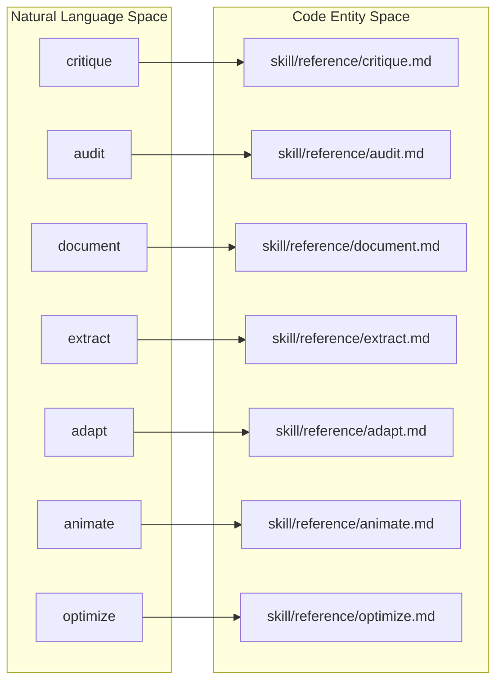

Sources: [skill/reference/critique.md:1-3]() [skill/reference/audit.md:1-5]() [skill/reference/document.md:1-3]() [skill/reference/extract.md:1-7]() [skill/reference/adapt.md:1-5]() [skill/reference/animate.md:1-3]() [skill/reference/optimize.md:1-3]()

### Playbook inputs, work, and outputs

The documented playbooks generally direct an agent through a task-specific sequence: establish a target or current state, assess the problem, apply the relevant guidance, and verify or report the result. For example, `critique` resolves a target and produces a synthesized assessment plus a question; `audit` performs checks and generates a report without fixing issues; `optimize` requires measurement before and after changes. [skill/reference/critique.md:1-3]() [skill/reference/audit.md:1-3]() [skill/reference/optimize.md:1-20]()

**Diagram: Playbook guidance translated into agent work**

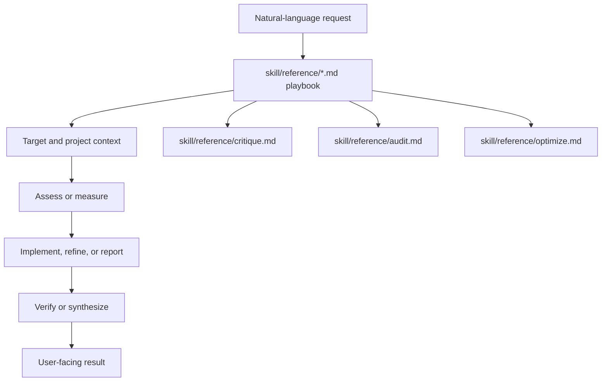

Sources: [skill/reference/critique.md:1-16]() [skill/reference/audit.md:1-10]() [skill/reference/optimize.md:1-20]()

## Build

### `document`

`document` produces a project-root `DESIGN.md` describing the current visual design system. Its guidance treats YAML frontmatter as the normative, machine-readable token layer and the Markdown body as contextual documentation in a canonical section order. [skill/reference/document.md:1-7]() [skill/reference/document.md:51-62]()

The playbook describes two paths. In scan mode, the agent searches for existing tokens, component files, and rendered output, then extracts a draft and confirms descriptive language. In seed mode, it supports a pre-implementation project after checking that `PRODUCT.md` exists. If a `DESIGN.md` already exists, the instructions say not to overwrite it silently. [skill/reference/document.md:64-78]() [skill/reference/document.md:80-107]()

Sources: [skill/reference/document.md:1-7]() [skill/reference/document.md:51-78]() [skill/reference/document.md:80-107]()

### `extract`

`extract` identifies reusable patterns, components, and design tokens for consolidation into a design system. The playbook asks the agent to discover the existing system and follow its conventions; if none exists, it says to ask before creating one. [skill/reference/extract.md:1-9]()

Extraction candidates include repeated components, hard-coded values, inconsistent implementations, composition patterns, type styles, and animation patterns. The guidance sets a reuse threshold of three or more instances with the same intent, then proceeds through planning, extraction, migration, testing, and documentation. [skill/reference/extract.md:11-22]() [skill/reference/extract.md:24-60]()

Sources: [skill/reference/extract.md:1-9]() [skill/reference/extract.md:11-34]() [skill/reference/extract.md:36-60]()

### `shape`, `craft`, and `init`

The source listing identifies `shape`, `craft`, and `init` as build commands and names their reference paths. The contents of those playbooks were not included in the supplied file contents, so this page does not specify their detailed procedures or outputs. [skill/reference/shape.md:1-1]() [skill/reference/craft.md:1-1]() [skill/reference/init.md:1-1]()

Sources: [skill/reference/shape.md:1-1]() [skill/reference/craft.md:1-1]() [skill/reference/init.md:1-1]()

## Evaluate

### `critique`

`critique` resolves one stable target, runs two independent assessments, synthesizes a design critique, persists a snapshot, and asks what the user wants to improve. The response is the primary deliverable; the snapshot archives the run. [skill/reference/critique.md:1-3]()

Assessment A is a design review that considers product specificity and holistic design concerns. Assessment B gathers detector and browser evidence. When a sub-agent or Task tool is available, the playbook requires isolated assessments; if unavailable, it permits a sequential degraded run and requires a visible degradation banner. [skill/reference/critique.md:5-16]() [skill/reference/critique.md:31-42]() [skill/reference/critique.md:57-66]()

Native platforms are an explicit exception: the playbook says Assessment B does not apply because the detector and browser overlay read web markup. It directs the agent to run Assessment A alone and not to interpret an empty detector result as a clean native assessment. [skill/reference/critique.md:31-34]()

The report has a strict close: the question must be last, and the run is incomplete if it ends without either the targeted questions or a literal `Questions skipped: <reason>` line. [skill/reference/critique.md:13-16]()

**Critique assessment flow**

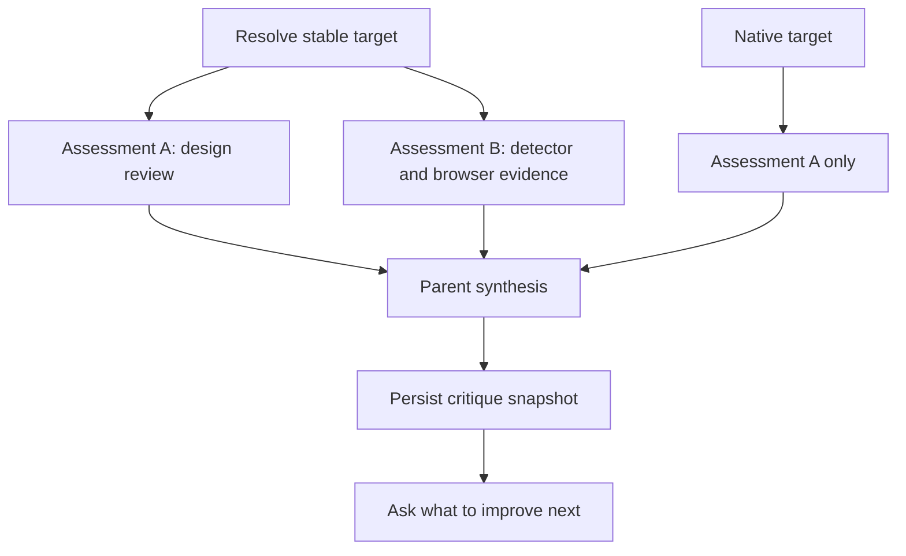

Sources: [skill/reference/critique.md:1-16]() [skill/reference/critique.md:31-42]() [skill/reference/critique.md:57-66]()

### `audit`

`audit` is a technical quality review, not a design critique. Its instructions say to document issues rather than fix them, and to route native platforms to `audit.native.md`. [skill/reference/audit.md:1-5]()

The web audit evaluates five dimensions: accessibility, performance, theming, responsive design, and implementation integrity. Each dimension receives a 0–4 score; the report includes an overall health score, an implementation-integrity verdict, severity-tagged findings, and recommended next steps. [skill/reference/audit.md:7-10]() [skill/reference/audit.md:66-105]()

Implementation integrity includes running the bundled detector and verifying findings in context. The playbook also distinguishes measurable findings from visual judgment and asks the auditor to identify false positives. [skill/reference/audit.md:58-64]()

Sources: [skill/reference/audit.md:1-10]() [skill/reference/audit.md:58-64]() [skill/reference/audit.md:66-105]()

## Refine

### `bolder`

`bolder` amplifies a scoped part of an already-established surface. The playbook distinguishes it from an open direction decision: when a direction decision is active, “bolder” refers to a separate direction-selection meaning, not this refinement command. [skill/reference/bolder.md:1-5]()

Scope is treated as binding: the agent should change only the named target and should not introduce new system primitives or restyle neighbors without authorization. The proposed change should amplify the system’s existing visual vocabulary, preserve existing claims, and remain legible when evaluated as structure without copy. [skill/reference/bolder.md:7-24]() [skill/reference/bolder.md:26-33]()

Sources: [skill/reference/bolder.md:1-9]() [skill/reference/bolder.md:11-24]() [skill/reference/bolder.md:26-33]()

### `quieter`

`quieter` reduces visual intensity without making the result generic or removing its personality. Its instructions distinguish visitor modes: Persuade and Experience retain drama and point of view, while Operate and Read reduce visual noise so the tool recedes into the task. [skill/reference/quieter.md:1-10]()

The playbook assesses sources of intensity, plans a refinement, and addresses color, visual weight, simplification, motion, and composition. It ends with checks for functionality, distinctiveness, readability, and whether the point of view survives. [skill/reference/quieter.md:13-44]() [skill/reference/quieter.md:46-99]()

Sources: [skill/reference/quieter.md:1-10]() [skill/reference/quieter.md:13-44]() [skill/reference/quieter.md:46-99]()

### `distill`, `polish`, and `onboard`

The supplied repository listing names `distill`, `polish`, and `onboard` as refine commands. Their full playbook contents were not included here, so detailed behavior is not specified on this page. [skill/reference/distill.md:1-1]() [skill/reference/polish.md:1-1]() [skill/reference/onboard.md:1-1]()

Sources: [skill/reference/distill.md:1-1]() [skill/reference/polish.md:1-1]() [skill/reference/onboard.md:1-1]()

### `harden`

`harden` targets resilience against inputs, errors, languages, and network conditions. Its assessment checklist includes extreme text and data sizes, empty states, network and API errors, permissions, rate limiting, concurrent operations, and internationalization. [skill/reference/harden.md:1-29]()

The playbook organizes hardening guidance around text overflow and wrapping, internationalization, error handling, and edge cases. Its verification section includes touch-gesture behavior as well as broader hardening checks; the reference test suite confirms that touch-gesture verification remains present in the harden playbook. [skill/reference/harden.md:33-83]() [skill/reference/harden.md:199-218]() [tests/skill-reference.test.mjs:105-121]()

Sources: [skill/reference/harden.md:1-29]() [skill/reference/harden.md:33-83]() [skill/reference/harden.md:199-218]() [tests/skill-reference.test.mjs:105-121]()

## Enhance

### `animate`

`animate` applies motion to explain state, relationships, or hierarchy, or to create an authored moment that fits the surface. The playbook asks the agent to identify the job for motion and write a short motion thesis covering focal moment, continuity, feedback, and budget before implementation. [skill/reference/animate.md:1-3]() [skill/reference/animate.md:13-34]()

Implementation guidance selects motion material by meaning, recommends runtime-appropriate techniques, and warns against hiding default content or casually animating layout-driving properties. Every web animation must have a `prefers-reduced-motion` path that reduces movement while preserving meaningful state and feedback. [skill/reference/animate.md:36-71]() [skill/reference/animate.md:73-87]()

The skill-reference tests specifically check that reduced-motion guidance remains on the animation build path and that the verification section includes reduced-motion checks. [tests/skill-reference.test.mjs:57-66]()

Sources: [skill/reference/animate.md:1-3]() [skill/reference/animate.md:13-34]() [skill/reference/animate.md:36-87]() [tests/skill-reference.test.mjs:57-66]()

### `colorize`, `typeset`, `layout`, `delight`, and `overdrive`

These enhancement commands and their reference paths are identified in the supplied repository listing. Their full playbooks were not included in the provided contents, so this catalog does not make claims about their detailed procedures. [skill/reference/colorize.md:1-1]() [skill/reference/typeset.md:1-1]() [skill/reference/layout.md:1-1]() [skill/reference/delight.md:1-1]() [skill/reference/overdrive.md:1-1]()

Sources: [skill/reference/colorize.md:1-1]() [skill/reference/typeset.md:1-1]() [skill/reference/layout.md:1-1]() [skill/reference/delight.md:1-1]() [skill/reference/overdrive.md:1-1]()

## Fix

### `adapt`

`adapt` changes an existing design for a different context—such as another screen size, device, platform, or use case—and warns against treating adaptation as simple scaling. The supplied web playbook applies to web, including mobile web; native platforms route to a native reference. [skill/reference/adapt.md:1-5]()

The process identifies the source context, target context, and adaptation challenges, then plans layout, interaction, and content changes. Verification covers devices, orientations, browsers, operating systems, input methods, edge-case sizes, and slow connections. [skill/reference/adapt.md:9-31]() [skill/reference/adapt.md:33-97]() [skill/reference/adapt.md:179-190]()

The reference tests confirm that the adapt playbook retains primary-gesture verification, distinguishes layout verification from gesture evidence, and calls for reporting what produced the evidence and what remained untested. [tests/skill-reference.test.mjs:105-118]()

Sources: [skill/reference/adapt.md:1-5]() [skill/reference/adapt.md:9-31]() [skill/reference/adapt.md:33-97]() [skill/reference/adapt.md:179-190]() [tests/skill-reference.test.mjs:105-118]()

### `clarify`

The supplied repository listing identifies `clarify` and its reference path. The playbook contents were not included here, so its detailed behavior is not described. [skill/reference/clarify.md:1-1]()

Sources: [skill/reference/clarify.md:1-1]()

### `optimize`

`optimize` begins by measuring the current state, identifying the actual bottleneck, and measuring again after changes. Its playbook covers loading, rendering, animation, framework, network, and Core Web Vitals concerns. [skill/reference/optimize.md:1-20]() [skill/reference/optimize.md:22-26]() [skill/reference/optimize.md:87-116]() [skill/reference/optimize.md:153-188]() [skill/reference/optimize.md:190-210]()

The reference explicitly cautions against optimizing without measurement: the target is a bottleneck in the particular interface, not a generic checklist item. [skill/reference/optimize.md:1-20]()

Sources: [skill/reference/optimize.md:1-20]() [skill/reference/optimize.md:22-26]() [skill/reference/optimize.md:87-116]() [skill/reference/optimize.md:153-188]() [skill/reference/optimize.md:190-210]()

## Iterate

The supplied repository listing identifies `live` and `generate` as iteration commands and names their reference paths. Their full playbook contents were not included in the provided files, so this page does not infer their lifecycle, protocol, or implementation details. [skill/reference/live.md:1-1]() [skill/reference/generate.md:1-1]()

Sources: [skill/reference/live.md:1-1]() [skill/reference/generate.md:1-1]()

## Hooks and doctor

`hooks` and `doctor` are included in the requested command catalog, but their reference contents were not supplied. Their implementation, data flow, and specific behavior cannot be established from the available files; consult their respective references in the repository for those details. [skill/reference/hooks.md:1-1]() [skill/reference/doctor.md:1-1]()

Sources: [skill/reference/hooks.md:1-1]() [skill/reference/doctor.md:1-1]()

## Cross-command relationships

The available references support several practical handoffs:

| Situation | Command relationship |
|---|---|
| The visual system is coherent but undocumented | Use `document` to record the existing system; its guidance includes scan mode for projects with code or rendered output. [skill/reference/document.md:64-78]() |
| Repeated patterns should become shared system elements | Use `extract` to identify patterns, plan reuse, migrate instances, and document the result. [skill/reference/extract.md:11-60]() |
| A critique identifies issues to address | `critique` is an assessment workflow; its final response asks what to improve next. [skill/reference/critique.md:1-3]() [skill/reference/critique.md:13-16]() |
| Technical findings need a systematic report | `audit` reports measurable issues and explicitly does not fix them. [skill/reference/audit.md:1-10]() |
| A focused section should express more conviction | Use `bolder` within the named scope and established system. [skill/reference/bolder.md:3-9]() [skill/reference/bolder.md:15-24]() |
| A surface is too intense | Use `quieter` to reduce intensity while preserving personality and function. [skill/reference/quieter.md:1-10]() [skill/reference/quieter.md:90-99]() |
| A design must work in a different context | Use `adapt` to rethink the experience and verify the relevant devices and input methods. [skill/reference/adapt.md:3-5]() [skill/reference/adapt.md:179-190]() |
| A performance concern needs evidence | Use `optimize` to measure, locate the bottleneck, change it, and measure again. [skill/reference/optimize.md:1-20]() |

Sources: [skill/reference/document.md:64-78]() [skill/reference/extract.md:11-60]() [skill/reference/critique.md:1-16]() [skill/reference/audit.md:1-10]() [skill/reference/bolder.md:3-24]() [skill/reference/quieter.md:1-10]() [skill/reference/quieter.md:90-99]() [skill/reference/adapt.md:3-5]() [skill/reference/adapt.md:179-190]() [skill/reference/optimize.md:1-20]()

---

# Page: New Work and Direction Selection

# New Work and Direction Selection

<details>
<summary>Relevant source files</summary>

The following files were used as context for generating this wiki page:

- [.agents/skills/impeccable/reference/new-work.md](.agents/skills/impeccable/reference/new-work.md)
- [.claude/skills/impeccable/reference/new-work.md](.claude/skills/impeccable/reference/new-work.md)
- [.cursor/skills/impeccable/reference/new-work.md](.cursor/skills/impeccable/reference/new-work.md)
- [.gemini/skills/impeccable/reference/new-work.md](.gemini/skills/impeccable/reference/new-work.md)
- [.github/skills/impeccable/reference/new-work.md](.github/skills/impeccable/reference/new-work.md)
- [.kiro/skills/impeccable/reference/new-work.md](.kiro/skills/impeccable/reference/new-work.md)
- [.opencode/skills/impeccable/reference/new-work.md](.opencode/skills/impeccable/reference/new-work.md)
- [.pi/skills/impeccable/reference/new-work.md](.pi/skills/impeccable/reference/new-work.md)
- [.qoder/skills/impeccable/reference/new-work.md](.qoder/skills/impeccable/reference/new-work.md)
- [.rovodev/skills/impeccable/reference/new-work.md](.rovodev/skills/impeccable/reference/new-work.md)
- [.trae-cn/skills/impeccable/reference/new-work.md](.trae-cn/skills/impeccable/reference/new-work.md)
- [crates/context/src/concept_seed.rs](crates/context/src/concept_seed.rs)
- [crates/context/src/seed_text.rs](crates/context/src/seed_text.rs)
- [skill/SKILL.src.md](skill/SKILL.src.md)
- [skill/agents/impeccable-asset-producer.md](skill/agents/impeccable-asset-producer.md)
- [skill/agents/impeccable-finish-reviewer.md](skill/agents/impeccable-finish-reviewer.md)
- [skill/agents/impeccable-manual-edit-applier.md](skill/agents/impeccable-manual-edit-applier.md)
- [skill/reference/craft-floor.md](skill/reference/craft-floor.md)
- [skill/reference/doctor.md](skill/reference/doctor.md)
- [skill/reference/init.md](skill/reference/init.md)
- [skill/reference/mode-operate.md](skill/reference/mode-operate.md)
- [skill/reference/mode-persuade.md](skill/reference/mode-persuade.md)
- [skill/reference/mode-read.md](skill/reference/mode-read.md)
- [skill/reference/new-work.md](skill/reference/new-work.md)
- [skill/reference/overdrive.md](skill/reference/overdrive.md)
- [skill/reference/visualize.md](skill/reference/visualize.md)
- [tests/fixtures/mode-rules-skill-partial/reference/mode-operate.md](tests/fixtures/mode-rules-skill-partial/reference/mode-operate.md)
- [tests/oracle/golden/question-start-surface-missing-comps.json](tests/oracle/golden/question-start-surface-missing-comps.json)
- [tests/oracle/golden/question-update-surface-missing-comps.json](tests/oracle/golden/question-update-surface-missing-comps.json)
- [tests/oracle/golden/question-update-surface-shape-after-direction-roll.json](tests/oracle/golden/question-update-surface-shape-after-direction-roll.json)
- [tests/oracle/golden/question-update-world-cards.json](tests/oracle/golden/question-update-world-cards.json)
- [tests/oracle/golden/seed-degraded-bolder.json](tests/oracle/golden/seed-degraded-bolder.json)
- [tests/oracle/golden/seed-degraded-direction.json](tests/oracle/golden/seed-degraded-direction.json)
- [tests/oracle/golden/seed-degraded-surface.json](tests/oracle/golden/seed-degraded-surface.json)
- [tests/oracle/golden/seed-direction-env-key.json](tests/oracle/golden/seed-direction-env-key.json)
- [tests/oracle/golden/seed-direction-local-count-5.json](tests/oracle/golden/seed-direction-local-count-5.json)
- [tests/oracle/golden/seed-direction-local-operate.json](tests/oracle/golden/seed-direction-local-operate.json)
- [tests/oracle/golden/seed-direction-local-reroll-bolder.json](tests/oracle/golden/seed-direction-local-reroll-bolder.json)
- [tests/oracle/golden/seed-direction-local-reroll-safer.json](tests/oracle/golden/seed-direction-local-reroll-safer.json)
- [tests/oracle/golden/seed-direction-local-reroll.json](tests/oracle/golden/seed-direction-local-reroll.json)
- [tests/oracle/golden/seed-direction-local-unscoped.json](tests/oracle/golden/seed-direction-local-unscoped.json)
- [tests/oracle/golden/seed-direction-local.json](tests/oracle/golden/seed-direction-local.json)
- [tests/oracle/golden/seed-mode-rules-experience.json](tests/oracle/golden/seed-mode-rules-experience.json)
- [tests/oracle/golden/seed-mode-rules-missing-file.json](tests/oracle/golden/seed-mode-rules-missing-file.json)
- [tests/oracle/golden/seed-mode-rules-missing-section.json](tests/oracle/golden/seed-mode-rules-missing-section.json)
- [tests/oracle/golden/seed-roll-record-worlds.json](tests/oracle/golden/seed-roll-record-worlds.json)
- [tests/oracle/golden/seed-surface-local-card-base.json](tests/oracle/golden/seed-surface-local-card-base.json)
- [tests/oracle/golden/seed-surface-local-compositions.json](tests/oracle/golden/seed-surface-local-compositions.json)
- [tests/oracle/golden/seed-surface-local-default-scope.json](tests/oracle/golden/seed-surface-local-default-scope.json)
- [tests/oracle/golden/seed-surface-local-grain-flow.json](tests/oracle/golden/seed-surface-local-grain-flow.json)
- [tests/oracle/golden/seed-surface-local.json](tests/oracle/golden/seed-surface-local.json)

</details>


## Purpose and scope

This page describes how Impeccable turns a request for a new UI surface or replacement visual identity into a user-confirmed direction and a build path. The flow distinguishes durable product facts from visual-system decisions and surface-specific strategy, then chooses how much invention is appropriate. It applies to new surfaces and replacement identities; a local addition to an established surface inherits that surface instead of becoming a new identity exercise. [skill/reference/new-work.md:1-16]()

Sources: [skill/reference/new-work.md:1-16]()

## Context ownership: product truth, visual system, and surface brief

The workflow assigns different kinds of context to different artifacts:

| Artifact | Owns | Practical consequence |
|---|---|---|
| `PRODUCT.md` | Product truth | Preserve its facts, content, function, and constraints. If it is missing, complete `init.md` first. |
| `DESIGN.md` | Durable visual decisions | On an established world, inherit the existing visual identity. A missing file alone does not mean the project is greenfield. |
| Surface brief | Strategy for one route or artifact | Record the surface’s purpose and mode here, rather than treating those as settled by `DESIGN.md`. |

These ownership boundaries govern both design reasoning and implementation: a redesign changes the visual world but preserves product truth; a local extension preserves the established world and composition; and durable changes to `DESIGN.md` require user approval when extending an existing surface. [skill/reference/new-work.md:3-16]()

The skill’s setup reinforces this ordering. It directs the agent to load context once per session, then load `reference/new-work.md` for a new surface or replacement visual world, and inspect the target and incumbent visual truth before editing. [skill/SKILL.src.md:19-23]()

Sources: [skill/reference/new-work.md:3-16](), [skill/SKILL.src.md:19-23]()

## Workflow at a glance

New-work decisions move from evidence and user answers to a direction, then to a presentation choice that determines the build path. The flow varies according to whether the task extends an existing surface, creates a new surface inside an established world, or creates or replaces the world itself. [skill/reference/new-work.md:7-20](), [skill/reference/new-work.md:29-47]()

**Diagram: Natural-language decisions mapped to workflow files and commands**

```mermaid
flowchart TD
    Request["New surface or replacement identity"] --> Context["PRODUCT.md: product truth"]
    Request --> Evidence["DESIGN.md + representative code + tokens + components + assets"]
    Context --> Gate["new-work.md: classify existing visual authority"]
    Evidence --> Gate
    Gate -->| "Extend established surface" | Extend["Inherit world and composition"]
    Gate -->| "Whole surface in established world" | Surface["concept-seed --scope surface --mode"]
    Gate -->| "Create or replace visual world" | Direction["Direction-seed path"]
    Surface --> Decision["serve-question decision page"]
    Direction --> Decision
    Decision --> Contract["Direction contract"]
    Contract -->| "Locked comp" | CompLed["visualize.md: comp-led build"]
    Contract -->| "Locked sketch or wireframe" | CodeLed["Code-led build"]
```

Sources: [skill/reference/new-work.md:3-16](), [skill/reference/new-work.md:29-47](), [skill/reference/visualize.md:1-11]()

## 1. Establish what is already true

Before choosing a direction, read `DESIGN.md` alongside representative code, tokens, components, and assets. The decision is based on the visual authority present in the project, not on whether a particular documentation file exists. [skill/reference/new-work.md:7-16]()

| Situation | Treatment |
|---|---|
| Redesign | Keep product truth, content, function, constraints, and explicit brand commitments; replace the old visual world instead of polishing it. |
| Established world | Inherit it. If `DESIGN.md` is absent but the code expresses a coherent identity, document that identity rather than inventing another. |
| Incomplete brand | Preserve confirmed assets and recognizable traits; work with the user to expand the system for the surface. |
| No visual authority | Create a new visual world with the user. |
| Local section, component, feature, or state | Inherit the containing surface. Do not start a new identity exercise. |

The old appearance of a redesign target is evidence about the subject, not authority over the replacement. Conversely, when extending an established surface, the existing world and composition constrain the addition. [skill/reference/new-work.md:11-16]()

Sources: [skill/reference/new-work.md:7-16]()

## 2. Confirm purpose through the surface mode

Before implementation, obtain the user’s answer through the structured question tool when available. Typically ask two or three related questions; a precise request may need only a compact confirmation. Do not skip confirmation just because `DESIGN.md` exists: it settles the visual world, not the new surface’s purpose or concept. Ask about success, what must remain untouched, and what would make a polished result feel wrong. Do not ask for CSS values or prepackaged aesthetic lanes. [skill/reference/new-work.md:18-27]()

Choose mode from the requested **surface**, not the product. Persist it only in that surface’s brief. The skill describes modes as the visitor’s success on the surface: Persuade is about deciding and acting; Operate is about completing a task; Read is about understanding; Experience is about being inside the work. [skill/SKILL.src.md:34-43]()

| Mode | Questions that shape the work |
|---|---|
| **Persuade** | Who must act? What should they believe? Which real proof, content, or assets earn that belief? |
| **Operate** | What task is being completed? What information, important states, frequency, and constraints matter? |
| **Read** | What question does the reader have? What source material, structure, and wayfinding answer it? |
| **Experience** | What leads? How does exploration unfold? Which interaction or transition matters? |

These modes affect ambition, not just terminology: the skill calls for full commitment on Persuade and Experience surfaces, while Operate and Read prioritize precision and restraint. [skill/reference/new-work.md:22-27](), [skill/SKILL.src.md:14-17]()

Sources: [skill/reference/new-work.md:18-27](), [skill/SKILL.src.md:14-17](), [skill/SKILL.src.md:34-43]()

## 3. Choose how much to invent

### Extend an existing surface

Inherit the world and composition. Resolve only the addition’s purpose, content, hierarchy, states, interaction, and fit with the surrounding experience. Do not run a concept tournament. Do not change `DESIGN.md` unless the user approves a durable system change. [skill/reference/new-work.md:29-33]()

### Create a whole surface inside an established world

Keep the visual system fixed. Develop five to seven materially different structures from the content, task, and user behavior, ordered by resonance. For a genuinely open whole page, screen, or flow, the playbook specifies:

`{{scripts_path}}/impeccable concept-seed --scope surface --mode <mode>` [skill/reference/new-work.md:35-41]()

This is a composition decision, not an identity decision: surface-scope cards have no canon or pick card because the visual world is already settled. Three structures are dealt to the user as equally salient cards. The dealt lead uses the kicker `THE ROLL`; the page offers steering and re-roll, and the user locks one card. Cards identify their provenance with `kind`: `assigned` for the dealt lead, `dealt` for the other dealt structures, and `challenger` with its `catalogId` for a challenger that earned a place. [skill/reference/new-work.md:37-41]()

Do not run `concept-seed` for a local extension or a precisely specified narrow request; shape those directly. [skill/reference/new-work.md:41]()

Sources: [skill/reference/new-work.md:29-41]()

### Create or replace the visual world

For a new or replacement world, the playbook starts by naming the product’s unique mechanism, the audience’s real scene and cultural home, and what the first surface must prove. It excludes predictable category patterns from the candidate set; if the brief, product name, titled artifact, or governing metaphor already suggests an obvious direction, that literal reading can consume at most one candidate. [skill/reference/new-work.md:43-47]()

The candidate list should draw from concrete visual systems, artifacts, places, or rituals familiar to the audience. Each candidate needs a resonance rationale and a description of its visual character. The list should span material families rather than repeatedly deriving from the most obvious artifact. For Operate and Read surfaces, the audience’s world may include graphic traditions, places, rituals, and artifacts, but not the instruments the audience operates as a costume for the interface. [skill/reference/new-work.md:45-47]()

Sources: [skill/reference/new-work.md:43-47]()

## 4. Decision-page cards: deal, challenge, and lock

For a whole surface in an established world, the playbook describes a bounded choice: prepare five to seven structures, deal three, present them at equal salience, and let the user lock one. It explicitly identifies a `challenger` card and its `catalogId` when a challenger has won its place. [skill/reference/new-work.md:37-41]()

The supplied excerpt does not specify the full command interface or data schema for `canon`, `raise`, or `serve-question` decision-page actions. What it does establish is that **surface-scope** cards have no canon or pick card: the world is settled, and the choice concerns composition. The challenger card is an identified exception to the dealt structures, not a reason to reopen the established visual identity. [skill/reference/new-work.md:37-41]()

**Diagram: Natural-language selection terms mapped to card fields and decision-page behavior**

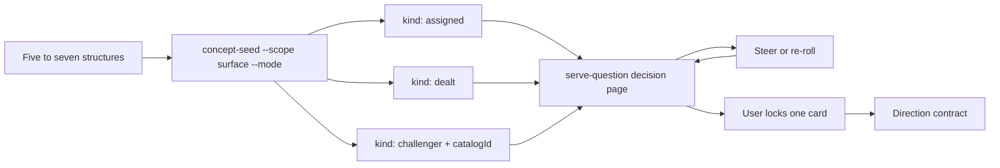

Sources: [skill/reference/new-work.md:35-41]()

## 5. The locked card determines the build path

For an established-world surface, the card presentation depends on image-generation availability and the planned build path:

| Card content | What the decision page presents | Build path after lock |
|---|---|---|
| `comp` | A generated comp under `.impeccable/mocks/decision/` | Comp-led; the locked comp is the approved comp. |
| `html` | An HTML sketch of the first viewport, rendered as a skeleton | Code-led; the locked sketch is the composition to match. |
| Neither `comp` nor `html` | A `wireframe` schematic, using `impeccable serve-question --schema` | Code-led; the direction contract carries the ambition. |

For comp cards, the images are generated after serving the decision page and in reading order. On an established world, anchor each comp on a representative existing-page screenshot passed as an image reference. The playbook explicitly warns that prose paraphrases of a visual system drift more readily than pixel references. For a locked comp, the decision card’s approval discharges the later three-option approval round; do not create a second approval point. [skill/reference/new-work.md:37-41]()

The code-led route is not a failed comp-led route. A locked sketch or wireframe chooses code-led implementation, with the direction contract carrying the intended ambition; a locked sketch also specifies the composition the implementation should match. [skill/reference/new-work.md:41]()

Sources: [skill/reference/new-work.md:37-41]()

### Comp-led path

`visualize.md` is loaded from `new-work.md` for a comp-led build when image generation is available. It states that a code-led contract skips that file by design. The comp process uses an already-open `comps` build phase, generates three distinct high-fidelity options under `.impeccable/mocks/`, and sends them to the approval point together—except when a decision comp already supplies the first option, in which case two more are generated. [skill/reference/visualize.md:1-11]()

A comp is a composition and hierarchy probe within an already chosen world, not a second identity workshop. On an established world, the reference screenshot anchors the visual identity while the prompt addresses the new surface; the reference page’s content should not be copied. The image must communicate the visitor’s job and include the subject, rather than functioning as atmosphere or poster art. [skill/reference/visualize.md:5-17]()

### Code-led path

The supplied text defines code-led selection through the locked sketch or wireframe and says the direction contract carries the ambition. It does not describe the direction contract’s complete schema or the subsequent implementation stages. It does state that a code-led contract deliberately skips `visualize.md`; the build should therefore be understood as a distinct selected path, not as a comp round omitted accidentally. [skill/reference/new-work.md:41](), [skill/reference/visualize.md:1-3]()

Sources: [skill/reference/new-work.md:37-41](), [skill/reference/visualize.md:1-17]()

## 6. Build-path and code-entity map

The following diagram connects the workflow’s user-facing language to named files, commands, and artifacts. It distinguishes facts explicit in the supplied excerpts from broader implementation detail: the provided source shows the `concept-seed` command invocation, `serve-question --schema` fallback, decision-comp paths, and `visualize.md` build-phase command, but does not include the definitions of the Rust command handlers. [skill/reference/new-work.md:37-41](), [skill/reference/visualize.md:7-11]()

**Diagram: Natural-language direction selection mapped to named code and artifact entities**

```mermaid
flowchart TD
    UserRequest["Surface purpose and mode"] --> NewWork["skill/reference/new-work.md"]
    NewWork --> Seed["impeccable concept-seed --scope surface --mode"]
    Seed --> Cards["Decision cards: assigned / dealt / challenger"]
    Cards --> Question["impeccable serve-question --schema"]
    Cards --> DecisionFiles[".impeccable/mocks/decision/"]
    Cards --> UserLock["User locks a card"]
    UserLock --> Sketch["html first-viewport sketch or wireframe"]
    UserLock --> LockedComp["comp path"]
    Sketch --> Contract["Direction contract"]
    LockedComp --> DecisionApproval["Locked comp is approved comp"]
    Contract --> CodeLed["Code-led build"]
    DecisionApproval --> Visualize["skill/reference/visualize.md"]
    Visualize --> Phase["impeccable build-phase start --direction"]
    Phase --> Comps[".impeccable/mocks/"]
```

Sources: [skill/reference/new-work.md:35-41](), [skill/reference/visualize.md:1-11]()

## 7. Session setup and downstream quality boundary

The skill says to run `impeccable context` once per session, from the project’s working directory, before loading the request’s playbook. The context command loads `PRODUCT.md`, `DESIGN.md`, the matching surface brief, and native-platform guidance when applicable; it also instructs the agent to follow its directives rather than rerunning context. [skill/SKILL.src.md:19-22]()

After analysis and direction are resolved, the skill requires loading `reference/craft-floor.md` immediately before a UI edit, including a small refinement. It is not required for planning-only work. This places the quality-floor check at the transition from selected direction to implementation. [skill/SKILL.src.md:22-23]()

Sources: [skill/SKILL.src.md:19-23]()

## Operational summary

- Determine visual authority from `DESIGN.md` **and** the existing code, tokens, components, and assets. [skill/reference/new-work.md:7-16]()
- Preserve `PRODUCT.md` truth; do not confuse a surface’s purpose with the established visual system. [skill/reference/new-work.md:3-3](), [skill/reference/new-work.md:18-27]()
- Select Persuade, Operate, Read, or Experience from the surface’s visitor goal, and record that mode in the surface brief. [skill/SKILL.src.md:34-43]()
- Extend locally without a concept tournament; use a concept round only for a genuinely open whole surface, screen, or flow. [skill/reference/new-work.md:29-41]()
- Treat a locked comp as approval for comp-led work; treat a locked sketch or wireframe as a code-led decision. [skill/reference/new-work.md:37-41]()
- Load `visualize.md` for comp-led work; its own guidance says code-led work skips it. [skill/reference/visualize.md:1-3]()
- Load `craft-floor.md` immediately before UI edits, not for planning-only work. [skill/SKILL.src.md:22-23]()

Sources: [skill/reference/new-work.md:3-41](), [skill/reference/visualize.md:1-11](), [skill/SKILL.src.md:19-23](), [skill/SKILL.src.md:34-43]()

---

# Page: Comp Pipeline and Build Phases

# Comp Pipeline and Build Phases

<details>
<summary>Relevant source files</summary>

The following files were used as context for generating this wiki page:

- [.agents/skills/impeccable/reference/degraded/asset-producer.md](.agents/skills/impeccable/reference/degraded/asset-producer.md)
- [.agents/skills/impeccable/reference/visualize.md](.agents/skills/impeccable/reference/visualize.md)
- [.claude/agents/impeccable-asset-producer.md](.claude/agents/impeccable-asset-producer.md)
- [.claude/skills/impeccable/reference/degraded/asset-producer.md](.claude/skills/impeccable/reference/degraded/asset-producer.md)
- [.claude/skills/impeccable/reference/visualize.md](.claude/skills/impeccable/reference/visualize.md)
- [.cursor/skills/impeccable/reference/degraded/asset-producer.md](.cursor/skills/impeccable/reference/degraded/asset-producer.md)
- [.cursor/skills/impeccable/reference/visualize.md](.cursor/skills/impeccable/reference/visualize.md)
- [.gemini/skills/impeccable/reference/degraded/asset-producer.md](.gemini/skills/impeccable/reference/degraded/asset-producer.md)
- [.gemini/skills/impeccable/reference/visualize.md](.gemini/skills/impeccable/reference/visualize.md)
- [.github/skills/impeccable/reference/degraded/asset-producer.md](.github/skills/impeccable/reference/degraded/asset-producer.md)
- [.github/skills/impeccable/reference/visualize.md](.github/skills/impeccable/reference/visualize.md)
- [.grok/agents/impeccable-asset-producer.md](.grok/agents/impeccable-asset-producer.md)
- [.grok/skills/impeccable/reference/degraded/asset-producer.md](.grok/skills/impeccable/reference/degraded/asset-producer.md)
- [.grok/skills/impeccable/reference/visualize.md](.grok/skills/impeccable/reference/visualize.md)
- [.kiro/skills/impeccable/reference/degraded/asset-producer.md](.kiro/skills/impeccable/reference/degraded/asset-producer.md)
- [.kiro/skills/impeccable/reference/visualize.md](.kiro/skills/impeccable/reference/visualize.md)
- [.opencode/skills/impeccable/reference/degraded/asset-producer.md](.opencode/skills/impeccable/reference/degraded/asset-producer.md)
- [.opencode/skills/impeccable/reference/visualize.md](.opencode/skills/impeccable/reference/visualize.md)
- [.pi/skills/impeccable/reference/degraded/asset-producer.md](.pi/skills/impeccable/reference/degraded/asset-producer.md)
- [.pi/skills/impeccable/reference/visualize.md](.pi/skills/impeccable/reference/visualize.md)
- [.qoder/skills/impeccable/reference/visualize.md](.qoder/skills/impeccable/reference/visualize.md)
- [.rovodev/skills/impeccable/reference/visualize.md](.rovodev/skills/impeccable/reference/visualize.md)
- [crates/common/src/launcher.rs](crates/common/src/launcher.rs)
- [crates/common/src/lib.rs](crates/common/src/lib.rs)
- [crates/comp-verbs/Cargo.toml](crates/comp-verbs/Cargo.toml)
- [crates/comp-verbs/src/approved_comp.rs](crates/comp-verbs/src/approved_comp.rs)
- [crates/comp-verbs/src/build_phase.rs](crates/comp-verbs/src/build_phase.rs)
- [crates/comp-verbs/src/build_phase/integrity_tests.rs](crates/comp-verbs/src/build_phase/integrity_tests.rs)
- [crates/comp-verbs/src/comp_diff.rs](crates/comp-verbs/src/comp_diff.rs)
- [crates/comp-verbs/src/comp_spec.rs](crates/comp-verbs/src/comp_spec.rs)
- [crates/comp-verbs/src/font_match.rs](crates/comp-verbs/src/font_match.rs)
- [crates/comp-verbs/src/lib.rs](crates/comp-verbs/src/lib.rs)
- [crates/comp/src/png_io.rs](crates/comp/src/png_io.rs)
- [crates/context/src/component_review/mod.rs](crates/context/src/component_review/mod.rs)
- [crates/context/src/provider.rs](crates/context/src/provider.rs)
- [docs/COMP-FIDELITY.md](docs/COMP-FIDELITY.md)
- [docs/RUNTIME-ENV.md](docs/RUNTIME-ENV.md)
- [plugin/agents/impeccable-asset-producer.md](plugin/agents/impeccable-asset-producer.md)
- [plugin/skills/impeccable/reference/degraded/asset-producer.md](plugin/skills/impeccable/reference/degraded/asset-producer.md)
- [skill/reference/component-review.md](skill/reference/component-review.md)
- [tests/oracle/cases/comp.mjs](tests/oracle/cases/comp.mjs)
- [tests/oracle/golden/build-phase-decision-comp-option-one.json](tests/oracle/golden/build-phase-decision-comp-option-one.json)
- [tests/oracle/golden/build-phase-usage.json](tests/oracle/golden/build-phase-usage.json)

</details>


## Purpose and scope

This page describes Impeccable’s comp-led path from visual direction to a measured implementation: how `visualize.md` frames comp creation, how a comp becomes a region-based specification with raster plates, how `build-phase` records and gates implementation phases, and how comp-diff artifacts support review. It also distinguishes the comp pipeline from code-led work, which skips visualization by design. [.claude/skills/impeccable/reference/visualize.md:1-18](); [docs/COMP-FIDELITY.md:16-49]()

The pipeline’s central constraint is that the approved comp is a target, not a loose style reference. The spec makes its regions explicit; raster assets are checked against their corresponding comp crops; and the hero reproduction is compared to the comp before the build advances. [.claude/skills/impeccable/reference/visualize.md:5-18](); [docs/COMP-FIDELITY.md:20-45]()

Sources: `.claude/skills/impeccable/reference/visualize.md`, `docs/COMP-FIDELITY.md`

## Pipeline at a glance

A comp-led build starts with direction already resolved. `visualize.md` does not reopen the visual world: it directs the comp round to test composition, narrative, hierarchy, density, focal point, signature use, and image requirements while keeping established visual identity or the chosen direction fixed. The build-phase state machine records the comp round and subsequent build steps. [`.claude/skills/impeccable/reference/visualize.md:1-9]()`; [`crates/comp-verbs/src/build_phase.rs:28-43]()

### Comp pipeline from intent to review

```mermaid
flowchart LR
    direction["Resolved direction and mode rules"] --> visualize["visualize.md"]
    visualize --> comps["Three comp options in .impeccable/mocks/"]
    comps --> approval["Approved comp"]
    approval --> state["build-phase state.json"]
    approval --> spec["comp-spec: regions and spec.json"]
    spec --> plates["Raster region plates"]
    plates --> hero["Hero implementation and reproduction capture"]
    hero --> diff["comp-diff comparison and artifacts"]
    diff --> review["Review phase"]
```

Sources: `.claude/skills/impeccable/reference/visualize.md`, `docs/COMP-FIDELITY.md`, `crates/comp-verbs/src/build_phase.rs`

### Natural Language Space to Code Entity Space: comp creation

| Natural-language concept | Code or project entity |
|---|---|
| Resolved direction and mode-specific comp rules | `new-work.md` handoff and the `COMPS` mode-rules block |
| Visualize the surface without reopening its identity | `visualize.md` |
| Approved decision comp, when one exists | Path under `.impeccable/mocks/decision/`, passed through `--decision-comp` |
| Saved comp options | `.impeccable/mocks/` |
| Build state containing the comp round | `impeccable build-phase start --direction ...` and `.impeccable/build/state.json` |
| Raster-region inventory and measurements | `.impeccable/build/spec.json` |
| Human-readable next action for the current gate | `build-phase status` and its `NEXT` line |

The comp round is intended to produce three distinct options at the target surface’s viewport. If a decision comp already exists, it is option one and is not regenerated; the other two options explore alternatives. A previously completed surface-scope structure round can also count as the comp round, in which case the locked card’s comp is approved and visualization should not generate another set. [`.claude/skills/impeccable/reference/visualize.md:1-11]()`; [`docs/COMP-FIDELITY.md:36-45]()`; [`crates/comp-verbs/src/build_phase.rs:28-43]()

Sources: `.claude/skills/impeccable/reference/visualize.md`, `docs/COMP-FIDELITY.md`, `crates/comp-verbs/src/build_phase.rs`

## `visualize.md`: creating the reference target

`visualize.md` is the skill reference for direction comps and asset production. It is loaded for a comp-led build when image generation is available; a code-led contract skips it intentionally. `PRODUCT.md` is required before this work. `DESIGN.md` is required only for an established world, because a new or replacement world writes it at the finish. The direction has already been resolved before this reference is used. [`.claude/skills/impeccable/reference/visualize.md:1-5]()`; [`.claude/skills/impeccable/reference/visualize.md:7-11]() 

A comp is a probe of a proposed surface, not a second identity workshop. The options should use real product content, express the visitor’s job clearly, and show a finished screen rather than a poster-like fragment. For an established world, a screenshot reference carries palette, type, and component character; its content should not be copied into the new surface. [`.claude/skills/impeccable/reference/visualize.md:5-17]()

The reference gives the comp prompt practical constraints:

- Describe the screen, product, visitor’s job, real content, lead concept, reading order, and screen frame. [`.claude/skills/impeccable/reference/visualize.md:12-13]()
- Keep the prompt short enough to leave visual decisions open; pin only what the model cannot know or what the user has specified. [`.claude/skills/impeccable/reference/visualize.md:12-14]()
- Make the subject and the surface’s mode legible in the render itself. [`.claude/skills/impeccable/reference/visualize.md:15-16]()
- Give the screen a dominant move supported by its material, type, and spacing, rather than competing focal elements. [`.claude/skills/impeccable/reference/visualize.md:17-18]()

A previously approved decision comp remains at its path under `.impeccable/mocks/decision/` and is counted through `--decision-comp`. The build state must be started before comp generation: the reference says that generating before `impeccable build-phase start` places the comp outside the state-tracked phase sequence. [`.claude/skills/impeccable/reference/visualize.md:9-11]()`; [`crates/comp-verbs/src/build_phase.rs:28-43]()

Sources: `.claude/skills/impeccable/reference/visualize.md`, `crates/comp-verbs/src/build_phase.rs`

## From comp to measured spec: regions and raster plates

The comp becomes a specification through `comp-spec`. The documented workflow is to put a labeled 10×10 grid over the comp, identify regions by grid spans such as `E0:J4`, assign each a kind, and measure the resulting regions. The compact spec is then the source the implementation codes against: the intended constraint is that anything absent from the spec is not part of the page. [`docs/COMP-FIDELITY.md:32-35]()` 

The documented region kinds are `plate`, `image`, `texture`, `text`, `control`, and `chrome`. Region measurements include normalized and pixel boxes, sampled palette, detail energy, and aspect. Raster regions receive a plate path under `assets/plates/`. The `comp-spec` workflow also provides crop extraction, plate-prompt output, and compact spec printing. [`docs/COMP-FIDELITY.md:32-35]()` 

### Natural Language Space to Code Entity Space: measured regions

| Natural-language instruction or object | Comp-pipeline entity |
|---|---|
| “This is the focal illustration/material region” | Region kind `plate`, with a raster plate path under `assets/plates/` |
| “This is a photographic or image region” | Region kind `image` |
| “This surface carries material texture” | Region kind `texture` |
| “This area is readable copy” | Region kind `text` |
| “This is an interactive element” | Region kind `control` |
| “This is the page frame or navigation chrome” | Region kind `chrome` |
| “Measure the area represented by this grid span” | A region identifier such as `E0:J4` |
| “Persist the build’s visual contract” | `.impeccable/build/spec.json` |
| “Extract the reference pixels for inspection or generation” | `comp-spec --crop <id>` and `comp-spec --plate-prompt <id>` |

These names connect the visual review vocabulary to the files and commands the build uses. The spec is also the inventory for asset production: the asset producer’s task is to produce the spec’s plates, rather than maintaining a separate asset inventory. [`docs/COMP-FIDELITY.md:32-35]()`; [`docs/COMP-FIDELITY.md:47-51]()

Sources: `docs/COMP-FIDELITY.md`

## Raster plates and asset production

A plate is a raster asset for a raster region in the spec. The plate workflow begins with the comp crop, uses the spec’s plate prompt, and targets the closest supported generation size for the region’s aspect ratio. The resulting image is written to the plate path, compared with the reference crop, and warned on if its score is below 50%; a caller-supplied `--min` can make the workflow refuse a low-scoring result. [`docs/COMP-FIDELITY.md:47-51]()` 

The documented prompt instruction for a plate is to remove UI text and chrome while preserving the rest of the crop. In offline workflows, `IMPECCABLE_IMAGE_GEN_FAKE=1` returns the crop at 2× size so the plate gate can be exercised without an image-generation service. Harness-native image tools are expected to use the same crop and prompt. [`docs/COMP-FIDELITY.md:47-49]()` 

The distinction between the plate and the page implementation matters: the plate represents raster content, while the surrounding layout, semantics, controls, responsive logic, and motion remain implementation work. The fidelity document describes the intended division as mechanical translation for pixels and model judgment for structure, semantics, controls, motion, and responsive behavior. [`docs/COMP-FIDELITY.md:16-19]()` 

Sources: `docs/COMP-FIDELITY.md`

## Build-phase state machine and gates

`build-phase` stores a phase state on disk at `.impeccable/build/state.json`. The Rust implementation declares these phases: `comps`, `spec`, `plates`, `hero`, `sections`, `motion`, `responsive`, and `review`. Starting with an approved comp skips the `comps` phase and opens `spec`; without one, `comps` is the first open phase. [`crates/comp-verbs/src/build_phase.rs:28-43]()`; [`crates/comp-verbs/src/build_phase.rs:140-158]()` 

The documented gate sequence checks that required artifacts and comparisons exist before progressing:

| Phase | Documented gate or role |
|---|---|
| `comps` | The comp round is recorded in the phase state; the visualization reference requires `build-phase start` before comp generation. |
| `spec` | `spec.json` exists, measures the comp, and contains regions. |
| `plates` | Every raster region has a decodable plate at least 1.5× the region’s pixel width; the plate is compared with its comp crop using cover alignment and a kind-weighted minimum score. |
| `hero` | `.impeccable/review/hero-repro.png` exists and meets the hero comparison threshold, with limits on missing and contradicted regions. |
| `sections` | Later build phase; the supplied fidelity description identifies it as a subsequent phase, without detailing an independent gate here. |
| `motion` | Later build phase; the supplied fidelity description identifies it as a subsequent phase, without detailing an independent gate here. |
| `responsive` | Later build phase; the supplied fidelity description identifies it as a subsequent phase, without detailing an independent gate here. |
| `review` | Final named phase in the sequence; it is the point for reviewing the completed build. |

The detailed gate thresholds and checks above are specified in the fidelity document: the plate gate uses a minimum score of `0.5`, and the hero gate requires at least `0.72`, no region marked `missing`, and no more than one third of regions marked `contradicted`. [`docs/COMP-FIDELITY.md:36-45]()` The Rust source confirms the phase names and declares `HERO_MIN` as `0.72`; it also defines other threshold constants, including `RESPONSIVE_MIN`, `PLATE_MIN`, and `PLATE_STRUCTURE_MIN`. [`crates/comp-verbs/src/build_phase.rs:28-36]()` 

### Phase progression

```mermaid
stateDiagram-v2
    [*] --> comps
    comps --> spec: "comp round recorded"
    [*] --> spec: "start with approved comp"
    spec --> plates: "spec gate passes"
    plates --> hero: "plate gate passes"
    hero --> sections: "hero gate passes"
    sections --> motion
    motion --> responsive
    responsive --> review
    review --> [*]
```

The diagram shows the phase order and the documented `spec`, `plates`, and `hero` gates. The supplied fidelity excerpt does not describe specific gate predicates for `sections` and `motion`; the Rust source establishes those phases as part of the sequence. [`crates/comp-verbs/src/build_phase.rs:28-36]()`; [`docs/COMP-FIDELITY.md:36-45]()` 

Phase state is persisted as runtime state, and the Rust implementation ensures that `state.json` is ignored by Git while leaving the rest of `.impeccable/build/` available to the project. The source also records the phase’s status, timestamps, attempts, notes, gate data, and forced status in the newly created state. [`crates/comp-verbs/src/build_phase.rs:111-121]()`; [`crates/comp-verbs/src/build_phase.rs:140-163]()` 

Sources: `crates/comp-verbs/src/build_phase.rs`, `docs/COMP-FIDELITY.md`, `.claude/skills/impeccable/reference/visualize.md`

## Comp fidelity and `comp-diff`

The fidelity problem is that a page may preserve the comp’s section order while losing its specific visual decisions: illustrations can be replaced with crude geometry, material textures can go unused or be covered by opaque washes, and new chrome can appear despite not being present in the comp. The build-phase checks are intended to replace self-assessment from memory with measurable comparisons. [`docs/COMP-FIDELITY.md:5-18]()` 

`comp-diff` compares a comp with a build capture. The documented comparison process aligns the build to the comp width, compares first-viewport rows by default, and offers `--align stretch|cover` for other alignment needs. It scores structure, color, detail, and horizontal section bands. When a spec is available, region-level comparison uses the region kind to weight the judgment: for example, plate regions emphasize detail while text regions emphasize structure. [`docs/COMP-FIDELITY.md:20-28]()` 

The command writes a side-by-side image, a heatmap, paired region crops, and `report.json`. Its per-region verdicts are `match`, `drift`, `missing`, and `contradicted`. `--threshold` exits with status 3 when the overall score falls below the requested bar. [`docs/COMP-FIDELITY.md:20-29]()` 

### Natural Language Space to Code Entity Space: fidelity review

| Review question | Code or artifact |
|---|---|
| “Does the implementation preserve the overall composition?” | Structure score in `comp-diff` |
| “Does the palette remain close to the reference?” | Quantized histogram intersection and Lab dominant-palette comparison |
| “Did the material or illustration survive?” | Detail score using high-frequency energy by cell; region kind can weight the comparison |
| “Do the page’s major horizontal boundaries align?” | Band score |
| “Which specific part is missing or contradicted?” | Region verdict in `report.json` |
| “Can a reviewer inspect the differences quickly?” | `side-by-side.png`, `heatmap.png`, and `regions/<id>.png` |
| “Does the hero pass its build gate?” | `.impeccable/review/hero-repro.png` compared against the comp |
| “What happens when the configured threshold fails?” | `comp-diff --threshold` exits 3 |

The documented calibration examples illustrate why the report is region-aware: an erased illustration can leave a relatively high overall score while the plate region is still reported as missing; a recolored comp scores much lower; and a real build can be contradicted overall while also missing its plate region. [`docs/COMP-FIDELITY.md:20-30]()` 

Sources: `docs/COMP-FIDELITY.md`

## Rust implementation boundary

The Rust phase implementation lives in `crates/comp-verbs/src/build_phase.rs`. Its module documentation identifies the implementation as the Rust counterpart to `skill/scripts/build-phase.mjs`; in this port, comp comparison calls `crate::comp_diff::compare` in-process rather than spawning the JavaScript comparator. The organic-clip-path CSS scanner is injected, keeping the crate independent of the closed rule core. [`crates/comp-verbs/src/build_phase.rs:1-8]()` 

The phase module imports comp and verb components for image loading, region and hero checks, spec loading, diff reports, entry capture, displacement, font-match stamping, and utility functions. The declared `PHASES`, threshold constants, hero reproduction path, and `state_path()` function make the phase sequence and key gate inputs explicit in the implementation. [`crates/comp-verbs/src/build_phase.rs:10-39]()` 

The common verb interface supports testable execution: verbs receive arguments and an `Io` handle, write through its streams, and return an exit code. The CLI is the layer that calls `std::process::exit`. [`crates/common/src/lib.rs:1-7]()` This boundary allows build-phase behavior to be exercised against controlled I/O and project workspaces rather than requiring direct process access for every test. [`crates/common/src/lib.rs:49-58]()`; [`crates/common/src/lib.rs:141-193]()` 

Sources: `crates/comp-verbs/src/build_phase.rs`, `crates/common/src/lib.rs`

## Component review

The comp pipeline’s review scope is established by the measured spec and the comparison artifacts: review can identify a mismatch at the page level and locate it in a named region, with the region’s kind affecting how fidelity is interpreted. The review artifacts documented for this pipeline are `side-by-side.png`, `heatmap.png`, `regions/<id>.png`, and `report.json`. [`docs/COMP-FIDELITY.md:20-28]()` 

The `review` phase is the final phase in the Rust phase list. The supplied build-phase description lists it after `responsive`; the available fidelity excerpt does not specify additional component-review UI behavior or a separate component-review algorithm. [`crates/comp-verbs/src/build_phase.rs:28-29]()`; [`docs/COMP-FIDELITY.md:36-45]()` 

A practical review should use the report to distinguish three different kinds of work: repair structural layout when structure drifts, restore or regenerate raster content when a plate is missing, and correct visual treatment where a region is contradicted. This follows the comparison’s documented region verdict vocabulary and region-kind weighting. [`docs/COMP-FIDELITY.md:25-28]()` 

Sources: `docs/COMP-FIDELITY.md`, `crates/comp-verbs/src/build_phase.rs`

## Operational interpretation

The pipeline is designed to make the comp actionable rather than merely inspirational:

1. Resolve direction before visualization; the comp round tests surface composition without reopening the visual identity. [`.claude/skills/impeccable/reference/visualize.md:1-5]()` 
2. Start build-phase state before generating comps, and retain the approved comp in the project’s mock area. [`.claude/skills/impeccable/reference/visualize.md:9-11]()` 
3. Convert the comp into named, measured regions in `spec.json`; use that region inventory to identify raster plates. [`docs/COMP-FIDELITY.md:32-35]()` 
4. Validate plates against their corresponding reference crops, then produce a hero reproduction capture for the hero gate. [`docs/COMP-FIDELITY.md:36-49]()` 
5. Use `comp-diff` output to locate fidelity issues by region and carry the build through the remaining recorded phases. [`docs/COMP-FIDELITY.md:20-28]()`; [`crates/comp-verbs/src/build_phase.rs:28-36]()` 

Sources: `.claude/skills/impeccable/reference/visualize.md`, `docs/COMP-FIDELITY.md`, `crates/comp-verbs/src/build_phase.rs`

---

# Page: Craft Floor, Review Agents, and Quality Gates

# Craft Floor, Review Agents, and Quality Gates

<details>
<summary>Relevant source files</summary>

The following files were used as context for generating this wiki page:

- [.agents/skills/impeccable/agents/impeccable_finish_reviewer.toml](.agents/skills/impeccable/agents/impeccable_finish_reviewer.toml)
- [.agents/skills/impeccable/reference/craft.md](.agents/skills/impeccable/reference/craft.md)
- [.agents/skills/impeccable/reference/critique.md](.agents/skills/impeccable/reference/critique.md)
- [.agents/skills/impeccable/reference/degraded/finish-reviewer.md](.agents/skills/impeccable/reference/degraded/finish-reviewer.md)
- [.claude/agents/impeccable-finish-reviewer.md](.claude/agents/impeccable-finish-reviewer.md)
- [.claude/skills/impeccable/reference/craft.md](.claude/skills/impeccable/reference/craft.md)
- [.claude/skills/impeccable/reference/critique.md](.claude/skills/impeccable/reference/critique.md)
- [.claude/skills/impeccable/reference/degraded/finish-reviewer.md](.claude/skills/impeccable/reference/degraded/finish-reviewer.md)
- [.cursor/skills/impeccable/reference/craft.md](.cursor/skills/impeccable/reference/craft.md)
- [.cursor/skills/impeccable/reference/critique.md](.cursor/skills/impeccable/reference/critique.md)
- [.cursor/skills/impeccable/reference/degraded/finish-reviewer.md](.cursor/skills/impeccable/reference/degraded/finish-reviewer.md)
- [.gemini/skills/impeccable/reference/craft.md](.gemini/skills/impeccable/reference/craft.md)
- [.gemini/skills/impeccable/reference/critique.md](.gemini/skills/impeccable/reference/critique.md)
- [.gemini/skills/impeccable/reference/degraded/finish-reviewer.md](.gemini/skills/impeccable/reference/degraded/finish-reviewer.md)
- [.github/skills/impeccable/reference/craft.md](.github/skills/impeccable/reference/craft.md)
- [.github/skills/impeccable/reference/critique.md](.github/skills/impeccable/reference/critique.md)
- [.github/skills/impeccable/reference/degraded/finish-reviewer.md](.github/skills/impeccable/reference/degraded/finish-reviewer.md)
- [.grok/agents/impeccable-finish-reviewer.md](.grok/agents/impeccable-finish-reviewer.md)
- [.grok/skills/impeccable/reference/degraded/finish-reviewer.md](.grok/skills/impeccable/reference/degraded/finish-reviewer.md)
- [.kiro/skills/impeccable/reference/craft.md](.kiro/skills/impeccable/reference/craft.md)
- [.kiro/skills/impeccable/reference/critique.md](.kiro/skills/impeccable/reference/critique.md)
- [.kiro/skills/impeccable/reference/degraded/finish-reviewer.md](.kiro/skills/impeccable/reference/degraded/finish-reviewer.md)
- [.opencode/skills/impeccable/reference/craft.md](.opencode/skills/impeccable/reference/craft.md)
- [.opencode/skills/impeccable/reference/critique.md](.opencode/skills/impeccable/reference/critique.md)
- [.opencode/skills/impeccable/reference/degraded/finish-reviewer.md](.opencode/skills/impeccable/reference/degraded/finish-reviewer.md)
- [.pi/skills/impeccable/reference/craft.md](.pi/skills/impeccable/reference/craft.md)
- [.pi/skills/impeccable/reference/critique.md](.pi/skills/impeccable/reference/critique.md)
- [.rovodev/skills/impeccable/reference/craft.md](.rovodev/skills/impeccable/reference/craft.md)
- [.rovodev/skills/impeccable/reference/critique.md](.rovodev/skills/impeccable/reference/critique.md)
- [.trae-cn/skills/impeccable/reference/craft.md](.trae-cn/skills/impeccable/reference/craft.md)
- [.trae-cn/skills/impeccable/reference/critique.md](.trae-cn/skills/impeccable/reference/critique.md)
- [.trae/skills/impeccable/reference/craft.md](.trae/skills/impeccable/reference/craft.md)
- [.trae/skills/impeccable/reference/critique.md](.trae/skills/impeccable/reference/critique.md)
- [plugin/agents/impeccable-finish-reviewer.md](plugin/agents/impeccable-finish-reviewer.md)

</details>


## Purpose and scope

This page documents the quality-review behavior visible in the supplied skill references and finish-reviewer agent definition: how `/critique` separates design judgment from detector evidence, what the finish reviewer checks first, and how the workflow handles missing evidence and degraded execution. The supplied material identifies `reference/craft-floor.md` as a required review input, but does not include its contents; therefore its specific bans and quality-floor criteria cannot be enumerated here. [.claude/agents/impeccable-finish-reviewer.md:17-23]() [.claude/skills/impeccable/reference/critique.md:1-16]()

Sources: [.claude/agents/impeccable-finish-reviewer.md:17-23](), [.claude/skills/impeccable/reference/critique.md:1-16]()

## Finish-reviewer contract

The `impeccable-finish-reviewer` agent is a read-only reviewer for a completed build. It returns material fixes for the parent agent to apply; it does not edit the artifact. The agent has `Read`, `Bash`, `Glob`, and `Grep` tools, uses the inherited model, and is configured for high effort with a 30-turn ceiling. [.claude/agents/impeccable-finish-reviewer.md:1-11]()

The reviewer must not use a browser, render the page, start a server, or take screenshots. It reviews the supplied files. Missing expected inputs other than captures are disclosed in one line before the review, after which the reviewer assesses what remains reviewable. Missing or invalid captures are different: they trigger the evidence failure path and prohibit a partial review. [.claude/agents/impeccable-finish-reviewer.md:11-15]()

The input packet may include the original request and confirmed answers, artifact paths, screenshots, the direction contract, `PRODUCT.md`, existing hook or detector findings, and the chosen world’s quality-bar cards. Comp-led reviews additionally receive the approved comp, `.impeccable/build/state.json`, `.impeccable/build/spec.json`, and hero/final diff directories; code-led reviews do not treat a decision comp as an approved comp. Native reviews add platform references and an explicit note that no detector ran. [.claude/agents/impeccable-finish-reviewer.md:17-19]()

| Review input | Role in the review |
|---|---|
| Screenshots | Evidence for required viewports and any user-requested viewport. [.claude/agents/impeccable-finish-reviewer.md:19-23]() |
| Direction contract | Carries `THESIS`, `OWN-WORLD`, `STORY`, `FIRST VIEWPORT`, and `FORM`. [.claude/agents/impeccable-finish-reviewer.md:19]() |
| `PRODUCT.md` | Required by the persistence check. [.claude/agents/impeccable-finish-reviewer.md:24]() |
| Approved comp and comp state | Inputs for comp-led review; code-led builds have no approved comp under this contract. [.claude/agents/impeccable-finish-reviewer.md:19]() |
| `reference/craft-floor.md` | Required review input, but its detailed criteria are not present in the supplied excerpts. [.claude/agents/impeccable-finish-reviewer.md:19]() |
| Platform reference | Added for `ios`, `android`, or `adaptive` review; the reviewer applies the platform’s conventions. [.claude/agents/impeccable-finish-reviewer.md:19]() |

Sources: [.claude/agents/impeccable-finish-reviewer.md:1-19]()

### Finish-review data flow

The reviewer is intentionally separated from the build thread: the parent supplies the review packet, the reviewer produces an ordered report, and the parent applies fixes. When image viewing is available, the reviewer inspects captures, comp, and quality-bar card before reading the direction contract or builder-authored summary, to avoid inheriting omissions from the builder’s framing. [.claude/agents/impeccable-finish-reviewer.md:11-15] [.claude/agents/impeccable-finish-reviewer.md:19]()

**Diagram: finish-review packet mapped to named review entities**

```mermaid
flowchart LR
    Parent["Parent agent"] --> Packet["Review packet"]
    Packet --> Captures[".impeccable/review/"]
    Packet --> Contract["Direction contract"]
    Packet --> Product["PRODUCT.md"]
    Packet --> CraftFloor["reference/craft-floor.md"]
    Packet --> State[".impeccable/build/state.json"]
    Packet --> Spec[".impeccable/build/spec.json"]
    Packet --> Diff[".impeccable/review/diff/hero/ and final/"]
    Packet --> Reviewer["impeccable-finish-reviewer"]
    Reviewer --> Report["Ordered material fixes"]
    Report --> Parent
    Parent --> Artifact["Build artifact"]
```

Sources: [.claude/agents/impeccable-finish-reviewer.md:11-19]()

Sources: [.claude/agents/impeccable-finish-reviewer.md:11-19]()

## Finish-review quality gates

### 0. Evidence gate

Evidence is checked before all other review criteria. For web builds, the required viewport set is `desktop.png` and `mobile.png`; native builds require one capture per shipped device class. Captures named by the calling brief are also required, including a reported user viewport such as `user-<width>.png`. [.claude/agents/impeccable-finish-reviewer.md:21-23]()

A capture is invalid if it contains black or blank regions, shows content inconsistent with its filename, omits the document top when claiming to be a full-page capture, or has dimensions inconsistent with the named viewport. A missing required capture fails in the same way as a malformed one. [.claude/agents/impeccable-finish-reviewer.md:23]()

If any required capture is missing or invalid, the reviewer returns `disposition: recapture`, lists the files and what valid captures must show, then stops. It must not produce a scoring review from malformed evidence; after recapture, the parent must request a full review. [.claude/agents/impeccable-finish-reviewer.md:23]()

**Diagram: evidence gate and recapture path**

```mermaid
flowchart TD
    Start["impeccable-finish-reviewer"]
    Start --> Check["Check required captures"]
    Check --> Valid{"All captures present and valid?"}
    Valid -->|"Yes"| Persistence["Continue to persistence check"]
    Valid -->|"No"| Recapture["Return disposition: recapture"]
    Recapture --> List["List missing or invalid files and expected content"]
    List --> Stop["Stop review"]
    Stop --> Parent["Parent obtains captures and requests full re-review"]
```

Sources: [.claude/agents/impeccable-finish-reviewer.md:21-23]()

Sources: [.claude/agents/impeccable-finish-reviewer.md:21-23]()

### 1. Persistence and build-state gate

The reviewer requires `PRODUCT.md`. For comp-led builds, `.impeccable/build/state.json` must exist, and every phase before `review` must be `closed` or explicitly `skipped`; open or failed phases are material findings. [.claude/agents/impeccable-finish-reviewer.md:24]()

A comp-led build whose `comps` phase was not closed or skipped has skipped the comp round, which is a material finding ranked above craft concerns. A phase closed with a `forced` record is also disclosed unless the packet quotes the user explicitly downgrading the comp. Comp-round comps under `.impeccable/mocks/` require an approval record: either the surface brief names the approved comp or its sidecar contains an `approved` flag. `.impeccable/mocks/decision/` is exempt because those files represent the earlier direction round, not an approved comp round. [.claude/agents/impeccable-finish-reviewer.md:24]()

For reproduction evidence, a missing state file or a `hero.gate.score` below `0.72` means reproduction is unproven and is a material finding; `.impeccable/review/hero-repro.png` must exist either way. If `DESIGN.md` predates the build, it should match the built world. For a new world, its absence during finish review is not a finding because the documenter writes it after review. [.claude/agents/impeccable-finish-reviewer.md:24]()

| Condition | Review consequence |
|---|---|
| Missing `PRODUCT.md` | Persistence requirement is not met. [.claude/agents/impeccable-finish-reviewer.md:24]() |
| Earlier comp-led phase is open or failed | Material finding. [.claude/agents/impeccable-finish-reviewer.md:24]() |
| Comp round skipped | Material finding that outranks craft. [.claude/agents/impeccable-finish-reviewer.md:24]() |
| Forced comp phase | Disclose as a material finding unless user downgrade is quoted. [.claude/agents/impeccable-finish-reviewer.md:24]() |
| Comp-round mocks have no approval record | Material finding. [.claude/agents/impeccable-finish-reviewer.md:24]() |
| Hero score is below `0.72`, or state file is missing | Reproduction is unproven; require `hero-repro.png`. [.claude/agents/impeccable-finish-reviewer.md:24]() |
| New-world `DESIGN.md` absent before review | Not a finding; it is written afterward by the documenter. [.claude/agents/impeccable-finish-reviewer.md:24]() |

Sources: [.claude/agents/impeccable-finish-reviewer.md:24]()

## Critique assessment and degraded fallbacks

`critique` resolves one stable target, runs independent design and detector/browser assessments, synthesizes a critique, persists a snapshot, and asks what to improve next. The chat response is the primary deliverable; the snapshot archives the run. [.claude/skills/impeccable/reference/critique.md:1-3]()

On web targets, Assessment A is the design review and Assessment B is detector plus browser evidence. If sub-agent/Task support exists, the assessments must run in isolated sub-agents; Assessment A must finish before detector findings enter the parent synthesis context. They must not see each other’s output. On desktop apps, the two agents run sequentially to avoid competing for the same window, while remaining isolated. [.claude/skills/impeccable/reference/critique.md:5-13] [.claude/skills/impeccable/reference/critique.md:31-44]()

If sub-agents are unavailable—or the user declines where the harness asks—the assessments run sequentially and the report must begin with a `⚠️ DEGRADED: single-context (<reason>)` banner. Skipping the detector is a failed critique unless the detector is missing or crashes after a real attempt, or the target is native. Native platforms run Assessment A only because the detector and browser overlay read web markup; this is the complete native method and does not require a degraded banner. [.claude/skills/impeccable/reference/critique.md:7-16] [.claude/skills/impeccable/reference/critique.md:31-42]()

**Diagram: critique language and code-entity flow**

```mermaid
flowchart LR
    Request["User critique request"] --> Target["Resolve stable target"]
    Target --> Slug["critique-storage slug"]
    Slug --> Ignore[".impeccable/critique/ignore.md"]
    Ignore --> A["Assessment A: design review"]
    Ignore --> B["Assessment B: detector and browser evidence"]
    A --> Synthesis["Parent synthesis"]
    B --> Synthesis
    Synthesis --> Snapshot["Persist critique snapshot"]
    Synthesis --> Question["Ask what to improve next"]
    Native["ios / android / adaptive"] --> A
    Native -. "Assessment B does not apply" .-> Synthesis
    NoAgents["No sub-agent tool or user declines"] --> Sequential["Sequential A then B"]
    Sequential --> Banner["DEGRADED banner"]
    Sequential --> Synthesis
```

Sources: [.claude/skills/impeccable/reference/critique.md:1-16](), [.claude/skills/impeccable/reference/critique.md:18-44]()

Sources: [.claude/skills/impeccable/reference/critique.md:1-16](), [.claude/skills/impeccable/reference/critique.md:18-44]()

## Critique and audit heuristics

Assessment A evaluates design specificity before detector results are available, then considers holistic design, cognitive load, emotional journey, and Nielsen heuristics. It returns a specificity verdict, heuristic scores, cognitive-load findings, emotional-journey notes, strengths, priority issues, persona red flags, minor observations, and provocative questions. The supplied excerpt says all ten Nielsen heuristics are scored from 0–4, with `n/a` allowed under the mode-applicability rule. [.claude/skills/impeccable/reference/critique.md:46-57]()

Assessment B runs the bundled detector for markup files or directories and uses browser visualization for viewable targets when browser automation is available. CSS-only files should not be passed to the CLI scan; URL targets skip the CLI scan and use browser visualization. For trees with 500 or more scannable files, narrow the scope or ask. Detector exit code `0` means clean and `2` means findings; if the entrypoint is missing or fails to load, report deterministic scanning as unavailable and continue with browser/manual review. [.claude/skills/impeccable/reference/critique.md:59-77]()

The critique’s report must disclose degraded orchestration. The complete report must precede the final question; alternatively, if questions are skipped, the report must include a literal `Questions skipped: <reason>` line. A run without either close is incomplete. Any critique-only server must run in the background, have a recorded stop method, and be stopped before final reporting unless the user asks to keep it. [.claude/skills/impeccable/reference/critique.md:13-16]()

| Heuristic | Operational rule |
|---|---|
| Design specificity | Judge whether the visual language and interaction are grounded in this product before seeing detector output. [.claude/skills/impeccable/reference/critique.md:48-52]() |
| Holistic design | Consider hierarchy, information architecture, emotional fit, discoverability, composition, typography, color, accessibility, states, copy, and edge cases. [.claude/skills/impeccable/reference/critique.md:51-55]() |
| Cognitive load | Report checklist failures and decision points with more than four visible options. [.claude/skills/impeccable/reference/critique.md:53]() |
| Emotional journey | Consider the peak-end rule, emotional valleys, and reassurance at high-stakes moments. [.claude/skills/impeccable/reference/critique.md:54]() |
| Nielsen heuristics | Score all ten from 0–4, using `n/a` where mode applicability permits. [.claude/skills/impeccable/reference/critique.md:55]() |
| Detector/browser evidence | Run the detector and browser visualization where applicable; do not silently skip the detector. [.claude/skills/impeccable/reference/critique.md:7-14] [.claude/skills/impeccable/reference/critique.md:59-77]() |

Sources: [.claude/skills/impeccable/reference/critique.md:7-16](), [.claude/skills/impeccable/reference/critique.md:46-77]()

### Degraded-review boundaries

A degraded critique is not a silent substitution: the banner identifies single-context execution and its reason. Native-only Assessment A is explicitly not degraded because Assessment B does not apply. If detector execution is unavailable after a real attempt, the report identifies deterministic scanning as unavailable and continues with browser/manual evidence where possible. [.claude/skills/impeccable/reference/critique.md:7-14] [.claude/skills/impeccable/reference/critique.md:31-42] [.claude/skills/impeccable/reference/critique.md:59-77]()

The finish reviewer has a separate fallback boundary: missing non-capture inputs are disclosed while review proceeds on available material, but any missing or malformed required capture stops the review and requires recapture. The finish reviewer also has a hard turn ceiling; if it ends before its contracted sections are written, it returns nothing. [.claude/agents/impeccable-finish-reviewer.md:13-15] [.claude/agents/impeccable-finish-reviewer.md:23]()

Sources: [.claude/skills/impeccable/reference/critique.md:7-14](), [.claude/skills/impeccable/reference/critique.md:31-42](), [.claude/skills/impeccable/reference/critique.md:59-77](), [.claude/agents/impeccable-finish-reviewer.md:13-15](), [.claude/agents/impeccable-finish-reviewer.md:23]()

## Agent coverage and documented limits

The supplied finish-reviewer definition identifies the documenter as responsible for writing `DESIGN.md` after review for a new world. It also names `reference/craft-floor.md` and platform-specific references as review inputs. [.claude/agents/impeccable-finish-reviewer.md:19-24]()

The supplied files do not include the contents of `reference/craft-floor.md`, the asset producer or manual-edit-applier agent definitions, or the degraded finish-reviewer references. Consequently, this page cannot state their specific bans, quality-floor thresholds, asset-production behavior, manual-edit application rules, or degraded-agent procedures without inventing details. The available finish-reviewer excerpt establishes only the reviewer’s input contract, evidence behavior, and first persistence check; later finish-review checks are not included in that excerpt. [.claude/agents/impeccable-finish-reviewer.md:1-24]()

Sources: [.claude/agents/impeccable-finish-reviewer.md:1-24]()

---

# Page: Rust Engine Architecture

# Rust Engine Architecture

<details>
<summary>Relevant source files</summary>

The following files were used as context for generating this wiki page:

- [.claude-plugin/marketplace.json](.claude-plugin/marketplace.json)
- [.claude-plugin/plugin.json](.claude-plugin/plugin.json)
- [Cargo.lock](Cargo.lock)
- [Cargo.toml](Cargo.toml)
- [ENGINE_VERSION](ENGINE_VERSION)
- [bun.lock](bun.lock)
- [crates/cli/src/lib.rs](crates/cli/src/lib.rs)
- [crates/cli/src/main.rs](crates/cli/src/main.rs)
- [crates/cli/src/reviewed_entry.rs](crates/cli/src/reviewed_entry.rs)
- [crates/cli/tests/text_only_entry.rs](crates/cli/tests/text_only_entry.rs)
- [crates/context/src/telemetry.rs](crates/context/src/telemetry.rs)
- [crates/live/src/bake.rs](crates/live/src/bake.rs)
- [crates/live/src/browser_assets.rs](crates/live/src/browser_assets.rs)
- [crates/live/src/browser_open.rs](crates/live/src/browser_open.rs)
- [crates/live/src/instructions.rs](crates/live/src/instructions.rs)
- [crates/live/src/live_accept.rs](crates/live/src/live_accept.rs)
- [crates/live/src/live_poll.rs](crates/live/src/live_poll.rs)
- [docs/PLAN-REVIEW.md](docs/PLAN-REVIEW.md)
- [package.json](package.json)
- [scripts/lib/zip.js](scripts/lib/zip.js)
- [skill/scripts/VERSION](skill/scripts/VERSION)
- [skill/scripts/impeccable](skill/scripts/impeccable)
- [skill/scripts/impeccable.cmd](skill/scripts/impeccable.cmd)
- [tests/cli-shim.test.mjs](tests/cli-shim.test.mjs)
- [tests/launcher-download.test.mjs](tests/launcher-download.test.mjs)
- [tests/oracle/cases/live-accept.mjs](tests/oracle/cases/live-accept.mjs)
- [tests/oracle/golden/cli-version.json](tests/oracle/golden/cli-version.json)
- [tests/oracle/golden/live-daemon-server-status-poll-complete.json](tests/oracle/golden/live-daemon-server-status-poll-complete.json)

</details>


## Purpose and scope

This page gives a high-level map of the Rust engine workspace and its role in Impeccable. It connects the workspace’s crate names to the system areas they support, and summarizes how the engine is built and reached through the launcher. Detailed CLI, context, and distribution behavior is covered in the child pages. [Cargo.toml:1-26]()

Sources: [Cargo.toml:1-26]()

## Workspace at a glance

The root Cargo manifest defines a Rust 2021 workspace whose members are discovered under `crates/*`. It declares shared path dependencies for `foundation`, `common`, `core`, `detect`, `html`, `browser`, `live`, `context`, `hook`, `comp`, `comp-verbs`, and `bundle`; the workspace membership pattern also includes other crates under `crates/`. [Cargo.toml:4-26]()

| Workspace area | Crates and role at a glance |
|---|---|
| Shared foundations | `foundation`, `common`, `core` |
| Detection and page analysis | `detect`, `html`, `browser` |
| Runtime features | `live`, `context`, `hook` |
| Composition workflow | `comp`, `comp-verbs` |
| Engine interfaces and packaging | `skills`, `wasm`, `cli`, `bundle`, `xtask` |

The crate groupings above are an architectural orientation, not a complete dependency graph. The manifest establishes workspace membership and shared dependencies; consult the relevant child pages for crate-level behavior. [Cargo.toml:4-26]()

Sources: [Cargo.toml:4-26]()

## From design intent to code entities

The following map associates user-facing concepts with workspace names. It is a guide for locating implementation areas, not a claim about the internal call sequence. The workspace manifest identifies the shared crate names; the project’s CLI package exposes the `impeccable` executable through `cli/bin/cli.js`. [Cargo.toml:14-26]()[package.json:37-43]()

**Diagram: Design and analysis concepts mapped to crates**

```mermaid
flowchart LR
    A["Check a design"] --> B["detect"]
    A --> C["html"]
    A --> D["browser"]
    E["Iterate on a page"] --> F["live"]
    G["Understand project context"] --> H["context"]
    I["Run design hooks"] --> J["hook"]
    K["Build a composition"] --> L["comp"]
    K --> M["comp-verbs"]
    N["Shared engine behavior"] --> O["foundation"]
    N --> P["common"]
    N --> Q["core"]
```

Sources: [Cargo.toml:14-25]()

**Diagram: User-facing engine entry points mapped to code entities**

```mermaid
flowchart LR
    A["Developer invokes impeccable"] --> B["cli/bin/cli.js"]
    B --> C["Rust workspace"]
    C --> D["crates/cli"]
    C --> E["crates/context"]
    C --> F["crates/detect"]
    C --> G["crates/live"]
    C --> H["crates/bundle"]
    I["Cargo release build"] --> J["impeccable binary"]
    J --> K["skill/scripts/impeccable launcher"]
```

The npm manifest maps the `impeccable` command to `cli/bin/cli.js`. The Cargo manifest describes a release build of package `impeccable` as producing the engine binary used by the launcher. [package.json:37-43]()[Cargo.toml:1-6]()

Sources: [package.json:37-43](), [Cargo.toml:1-6]()

## Build and launcher relationship

The Cargo workspace is versioned `0.1.16`, and its release profile enables optimization, link-time optimization, stripping, and abort-on-panic behavior. The root manifest’s comment identifies `cargo build --release -p impeccable` as the engine build and names `skill/scripts/impeccable` as its launcher. [Cargo.toml:1-3]()[Cargo.toml:8-12]()[Cargo.toml:33-38]()

The Windows launcher checks for an explicit `IMPECCABLE_BIN`, then a sibling engine binary, then a validated user binary or version-pinned cache; if those paths do not supply an engine, it attempts a download and verifies it against a SHA-256 sidecar before execution. [skill/scripts/impeccable.cmd:12-19]()[skill/scripts/impeccable.cmd:25-53]()[skill/scripts/impeccable.cmd:64-68]()[skill/scripts/impeccable.cmd:110-145]()

For details on command behavior, see [CLI Contract and Verb Dispatch](#3.1). For project context and state handling, see [Context, Doctor, and Project State](#3.2). For build, launcher, and distribution details, see [Engine Build, Launcher, and Distribution](#3.3).

Sources: [Cargo.toml:1-3](), [Cargo.toml:8-12](), [Cargo.toml:33-38](), [skill/scripts/impeccable.cmd:12-19](), [skill/scripts/impeccable.cmd:25-53](), [skill/scripts/impeccable.cmd:64-68](), [skill/scripts/impeccable.cmd:110-145]()

---

# Page: CLI Contract and Verb Dispatch

# CLI Contract and Verb Dispatch

<details>
<summary>Relevant source files</summary>

The following files were used as context for generating this wiki page:

- [crates/cli/src/lib.rs](crates/cli/src/lib.rs)
- [crates/cli/src/main.rs](crates/cli/src/main.rs)
- [crates/cli/src/reviewed_entry.rs](crates/cli/src/reviewed_entry.rs)
- [crates/cli/tests/text_only_entry.rs](crates/cli/tests/text_only_entry.rs)
- [crates/context/src/context_cli.rs](crates/context/src/context_cli.rs)
- [crates/context/src/doctor.rs](crates/context/src/doctor.rs)
- [crates/context/src/staleness_deep.rs](crates/context/src/staleness_deep.rs)
- [crates/context/src/telemetry.rs](crates/context/src/telemetry.rs)
- [crates/detect/src/cli.rs](crates/detect/src/cli.rs)
- [crates/detect/src/github_annotations.rs](crates/detect/src/github_annotations.rs)
- [crates/detect/src/lib.rs](crates/detect/src/lib.rs)
- [crates/detect/tests/github_annotations.rs](crates/detect/tests/github_annotations.rs)
- [crates/html/src/cascade/build.rs](crates/html/src/cascade/build.rs)
- [crates/html/src/engine.rs](crates/html/src/engine.rs)
- [crates/html/tests/ignored_linked_stylesheet.rs](crates/html/tests/ignored_linked_stylesheet.rs)
- [crates/wasm/src/exports_detect.rs](crates/wasm/src/exports_detect.rs)
- [docs/CLI-CONTRACT.md](docs/CLI-CONTRACT.md)
- [docs/PLAN-REVIEW.md](docs/PLAN-REVIEW.md)
- [tests/cli-shim.test.mjs](tests/cli-shim.test.mjs)
- [tests/oracle/cases/context.mjs](tests/oracle/cases/context.mjs)
- [tests/oracle/cases/detect.mjs](tests/oracle/cases/detect.mjs)
- [tests/oracle/golden/cli-version.json](tests/oracle/golden/cli-version.json)
- [tests/oracle/golden/detect-github-clean.json](tests/oracle/golden/detect-github-clean.json)
- [tests/oracle/golden/detect-github-json.json](tests/oracle/golden/detect-github-json.json)
- [tests/oracle/golden/detect-help.json](tests/oracle/golden/detect-help.json)
- [tests/oracle/golden/doctor-codex-home-hook-script-missing.json](tests/oracle/golden/doctor-codex-home-hook-script-missing.json)
- [tests/oracle/golden/doctor-codex-user-hook-script-missing.json](tests/oracle/golden/doctor-codex-user-hook-script-missing.json)

</details>


This page details the command-line interface (CLI) contract for `impeccable`, focusing on how commands are dispatched, options are detected, and the various targets (stdin, URL, CDP) are handled. It also covers exit codes, version reporting, and telemetry. The primary sources for this contract are `docs/CLI-CONTRACT.md` and the `crates/cli` Rust crate.

## CLI Contract Overview

The `impeccable` CLI defines a strict contract for its observable behavior, including arguments, environment variables, inputs, stdout/stderr, exit codes, file system interactions, and network activity. This contract is formally specified in `docs/CLI-CONTRACT.md` and validated by golden records in `tests/oracle/`.

The CLI verbs (subcommands) were historically implemented as JavaScript scripts under `skill/scripts/` or `cli/bin`. With the transition to a Rust-based engine, these verbs are now invoked via a launcher as `{{scripts_path}}/impeccable <verb>`, but the contract remains consistent [docs/CLI-CONTRACT.md:8-14]().

## Entry Point and Command Dispatch

The main entry point for the `impeccable` CLI is `crates/cli/src/main.rs`. This Rust binary handles the initial argument parsing and dispatches to the appropriate subcommand logic.

### Dispatch Order

The command dispatch follows a specific order of precedence [docs/CLI-CONTRACT.md:42-70]():

1.  **Help (`--help`, `-h`)**: If no command is provided or `--help` is specified, the root usage message is printed to stdout, and the process exits with code `0`.
2.  **Version (`--version`, `-v`)**: If `--version` is specified, the package version is printed to stdout, and the process exits with code `0`. When run directly, the binary prints the installed skill's `SKILL.md` frontmatter version, or `<engine version>+engine` if not found.
3.  **`detect`**: Dispatches to the `detect` engine.
4.  **`ignores` / `ignore`**: Dispatches to the `ignores` command handler.
5.  **`skills`**: Dispatches to the `skills` command handler (legacy namespace).
6.  **Skill Commands**: Commands like `help`, `install`, `link`, `update`, `check` are handled by the `skills` command handler.
7.  **Detect Shorthand**: If the first argument `looksLikeDetectTarget` (e.g., starts with `-`, is a URL, contains path separators, or is an existing file), it's treated as a shorthand for `detect`.
8.  **`init`**: This command is explicitly disallowed from the CLI, printing an error message and exiting with code `1`. It's intended for AI agent chat.
9.  **Unknown Command**: Any other unrecognized command results in an error message and exit code `1`.

### Root Usage and Commands

The root `impeccable --help` output lists the primary commands and options [crates/detect/src/lib.rs:63-81]():

```text
Usage: impeccable <command> [options]

Commands:
  detect [file-or-dir-or-url...]   Scan for UI anti-patterns and design quality issues
  ignores                          Manage detector ignore rules, files, and values
  help                             List all available skills and commands
  install                          Install impeccable skills into your project or global harness
  link                             Symlink skills from a local checkout or submodule
  update                           Update skills to the latest version
  check                            Check if skill updates are available
  telemetry off|on|status          Turn the roll API's anonymous usage data off or on, or show it

Options:
  --help       Show this help message
  --version    Show version number

Compatibility:
  impeccable skills <command>       Legacy namespace; still supported.
```

### CLI Dispatch Flow

The following diagram illustrates the dispatch logic within the `crates/cli` crate.

```mermaid
graph TD
    A[crates/cli/src/main.rs:main()] --> B{Parse argv[1]};
    B -- No command / --help --> C[Print ROOT_USAGE];
    B -- --version --> D[Print pkg.version];
    B -- "detect" --> E[crates/detect::run_detect()];
    B -- "ignores" / "ignore" --> F[crates/detect::run_ignores()];
    B -- "skills" / "install" / "update" / "check" / "link" --> G[crates/detect::run_skills()];
    B -- "telemetry" --> H[crates/context::telemetry::run()];
    B -- looks_like_detect_target() --> E;
    B -- "init" --> I[Error: "init" is not a CLI command];
    B -- Other --> J[Error: Unknown command];
    C --> K[Exit 0];
    D --> K;
    E --> L[Exit 0, 1, or 2];
    F --> K;
    G --> K;
    H --> K;
    I --> M[Exit 1];
    J --> M;
```
Sources: [crates/cli/src/main.rs:1-30](), [crates/detect/src/lib.rs:36-48](), [crates/detect/src/lib.rs:63-81](), [docs/CLI-CONTRACT.md:42-70]()

## The `detect` Command

The `detect` command is the primary tool for scanning for UI anti-patterns. Its implementation is primarily within the `crates/detect` crate, specifically `crates/detect/src/cli.rs`.

### `detect` Command Options

The `detect` command supports a comprehensive set of options to control its behavior [crates/detect/src/cli.rs:33-114]():

| Option | Description |
| :----- | :---------- |
| `--json` | Output results as JSON. |
| `--quiet` | In text mode, only print the final findings count. |
| `--github` | Write GitHub Actions annotations. |
| `--list-rules` | Print the detector rule catalog and exit. |
| `--scope <name>` | Only report rules in specific design domains (e.g., `type`, `layout`). |
| `--viewport <WxH>` | Browser viewport for URL scans (e.g., `1280x800`). |
| `--no-config` | Do not apply project config, detector ignores, or `DESIGN.md`. |
| `--no-inline-ignores` | Do not honor in-file `impeccable-disable*` comments. |
| `--no-design-system` | Do not load local `DESIGN.md` / `.impeccable/design.json` context. |
| `--no-advisory` | Suppress advisory findings entirely. |
| `--no-consent-hiding` | URL scans: keep consent managers' banners visible. |
| `--no-overlay-hiding` | URL scans: keep product tours/preloaders visible. |
| `--cdp <port|url>` | Scan a page of a running Chromium-based desktop app via DevTools port. |
| `--target <text>` | With `--cdp`: pick the page whose URL or title contains this text. |
| `--help` | Show this help message. |

### Detection Modes and Targets

`impeccable detect` supports various detection modes based on the target provided [crates/detect/src/cli.rs:99-104]():

*   **HTML files**: Static HTML/CSS analysis.
*   **Non-HTML files**: Regex pattern matching (CSS, JSX, TSX, etc.).
*   **URLs**: Puppeteer full browser rendering (for `http(s)://` and `file://` URLs).
*   **Running apps**: Via `--cdp` for Chromium-based applications.

### `detect` Command Data Flow

The `run_detect` function in `crates/detect/src/cli.rs` orchestrates the detection process.

```mermaid
graph TD
    A[crates/detect/src/cli.rs:run_detect()] --> B{Parse CLI Arguments};
    B -- --list-rules --> C[Collect and Format Rules];
    B -- --help --> D[Print DETECT_USAGE];
    B -- Targets provided --> E[Load DetectionConfig];
    E --> F{Process Each Target};
    F -- File Path --> G{Determine Engine};
    G -- .html --> H[HtmlEngine::scan_file()];
    G -- .css/.jsx/.tsx --> I[TextEngine::detect_text()];
    G -- URL --> J[UrlEngine::scan_url()];
    G -- --cdp --> K[UrlEngine::scan_cdp()];
    F -- Stdin --> L[Read from stdin];
    L --> G;
    H --> M[Collect Findings];
    I --> M;
    J --> M;
    K --> M;
    M --> N{Apply Filters & Ignores};
    N --> O[Format Findings];
    O -- --json --> P[JSON Output to stdout];
    O -- --github --> Q[GitHub Annotations to stdout];
    O -- Text --> R[Text Output to stderr];
    R --> S[Return Exit Code];
    P --> S;
    Q --> S;
    C --> S;
    D --> S;
```
Sources: [crates/detect/src/cli.rs:1-1219](), [crates/detect/src/engines.rs:1-100](), [crates/html/src/engine.rs:1-499](), [crates/detect/src/detect_text.rs:1-500]()

### Exit Codes for `detect`

The `detect` command uses specific exit codes to indicate the scan outcome [crates/detect/src/cli.rs:80-84]():

*   **0**: Scan completed with no primary findings (advisories may still be listed).
*   **1**: At least one requested target could not be scanned (operational failure).
*   **2**: Scan completed with primary findings.

Operational failures (exit code 1) take precedence over findings (exit code 2) in multi-target scans.

Sources: [crates/detect/src/cli.rs:33-114](), [crates/detect/src/cli.rs:80-84](), [docs/CLI-CONTRACT.md:80-84]()

## Telemetry

The `telemetry` command allows users to manage anonymous usage data collection.

*   `impeccable telemetry off`: Disables telemetry.
*   `impeccable telemetry on`: Enables telemetry.
*   `impeccable telemetry status`: Shows the current telemetry status.

This functionality is handled by `crates/context/src/telemetry.rs`.

Sources: [crates/detect/src/lib.rs:73-73](), [crates/context/src/telemetry.rs:1-100]()

## Version Reporting

The `--version` (`-v`) flag reports the version of the `impeccable` CLI. The behavior differs slightly depending on how the binary is invoked [docs/CLI-CONTRACT.md:61-63]():

*   **`npx impeccable --version`**: Prints the `package.json` version of the `impeccable` npm package.
*   **Binary run directly (e.g., by the skill launcher)**: Prints the version from the installed skill's `SKILL.md` frontmatter. If that's not available, it prints `<engine version>+engine`.

Sources: [docs/CLI-CONTRACT.md:61-63](), [crates/detect/src/lib.rs:77-77]()

## Error Handling and Exit Codes

The CLI includes top-level error handling to catch unexpected issues.

*   **`IMPECCABLE_PROMPT_ABORT`**: If an operation is aborted by the user (e.g., Ctrl+C during a prompt), the process exits with code `130`.
*   **Other Errors**: Any other uncaught errors result in the error message being printed to stderr, and the process exits with code `1`.

Sources: [docs/CLI-CONTRACT.md:71-72]()

---

# Page: Context, Doctor, and Project State

# Context, Doctor, and Project State

<details>
<summary>Relevant source files</summary>

The following files were used as context for generating this wiki page:

- [crates/common/Cargo.toml](crates/common/Cargo.toml)
- [crates/common/src/http.rs](crates/common/src/http.rs)
- [crates/context/Cargo.toml](crates/context/Cargo.toml)
- [crates/context/src/component_review/server.rs](crates/context/src/component_review/server.rs)
- [crates/context/src/component_review/tests.rs](crates/context/src/component_review/tests.rs)
- [crates/context/src/context_cli.rs](crates/context/src/context_cli.rs)
- [crates/context/src/doctor.rs](crates/context/src/doctor.rs)
- [crates/context/src/generate_image.rs](crates/context/src/generate_image.rs)
- [crates/context/src/http.rs](crates/context/src/http.rs)
- [crates/context/src/lib.rs](crates/context/src/lib.rs)
- [crates/context/src/serve_question.rs](crates/context/src/serve_question.rs)
- [crates/context/src/staleness_deep.rs](crates/context/src/staleness_deep.rs)
- [crates/live/src/live_http.rs](crates/live/src/live_http.rs)
- [docs/CLI-CONTRACT.md](docs/CLI-CONTRACT.md)
- [docs/ENGINE.md](docs/ENGINE.md)
- [tests/oracle/cases/context.mjs](tests/oracle/cases/context.mjs)
- [tests/oracle/golden/context-codex-home-exclusive.json](tests/oracle/golden/context-codex-home-exclusive.json)
- [tests/oracle/golden/context-codex-home-hook.json](tests/oracle/golden/context-codex-home-hook.json)
- [tests/oracle/golden/context-codex-user-hook.json](tests/oracle/golden/context-codex-user-hook.json)
- [tests/oracle/golden/doctor-codex-home-hook-script-missing.json](tests/oracle/golden/doctor-codex-home-hook-script-missing.json)
- [tests/oracle/golden/doctor-codex-user-hook-script-missing.json](tests/oracle/golden/doctor-codex-user-hook-script-missing.json)

</details>


This page details the `crates/context` module, which is responsible for managing the project's state, resolving context for various operations, diagnosing issues, and providing utility functions. It covers the `context_cli` resolution, `RESOLVED_CONTEXT` directives, output budgeting, hook-mode detection, staleness checks, `doctor` findings and `--fix` functionality, `pin`/`unpin` operations, `surface-brief` generation, `serve-question`/`question` pages, and `generate-image` functionality.

## Context Resolution (`context_cli`)

The `context_cli` module in `crates/context/src/context_cli.rs` is the entry point for resolving the project's context. It determines various aspects of the project environment, such as the current working directory, project root, platform, and the presence of design artifacts like `PRODUCT.md` and `DESIGN.md`. This context is crucial for subsequent operations, ensuring that commands operate within the correct project scope.

The `Ctx` struct [crates/context/src/context.rs]() encapsulates the resolved context. Key fields include `project_root`, `repo_root`, `product_path`, `design_path`, and `platform`.

### Output Budgeting

The `context_cli` enforces an `OUTPUT_BUDGET_CHARS` [crates/context/src/context_cli.rs:19-19]() to prevent excessively long outputs, particularly for AI coding agents like Claude Code, which have truncation limits. This budget ensures that important trailing directives remain visible.

### Hook-Mode Detection

The `automatic_hook_mode` function [crates/context/src/context_cli.rs:91-132]() determines if an automatic design hook is active for the current project and provider. This is critical for understanding whether detector scans are being performed automatically (e.g., on `pre-edit` or `stop` events) or if manual intervention is required.

The detection process involves:
1.  Checking if the platform is native (`ios`, `android`, `adaptive`) [crates/context/src/context_cli.rs:92-94](). Native platforms do not support automatic hooks.
2.  Verifying if hooks are enabled at the project root level via `.impeccable/config.json` or `.impeccable/config.local.json` [crates/context/src/context_cli.rs:65-84]().
3.  Excluding providers like `gemini` that do not have detector pass hooks [crates/context/src/context_cli.rs:99-102]().
4.  Searching for provider-specific hook manifests (e.g., `.claude/settings.json`, `.codex/hooks.json`) within the project root and its enclosing Git roots [crates/context/src/context_cli.rs:104-120]().
5.  Checking for a `value_has_hook_marker` [crates/context/src/context_cli.rs:56-63]() within the manifest, which indicates the presence of a launcher-era design hook command.
6.  Identifying user-level hook manifests (e.g., `~/.claude/settings.json`, `$CODEX_HOME/hooks.json`) [crates/context/src/context_cli.rs:37-46]().

The function returns `"none"`, `"stop"`, or `"per-edit"` based on the detected hook configuration.

#### Hook Manifest Search Roots

The `hook_manifest_search_roots` function [crates/context/src/context_cli.rs:134-157]() defines the directories where hook manifests are searched. It walks up from the resolved project root, respecting Git boundaries, to find relevant configuration files. This ensures that hooks defined at a higher level (e.g., in a monorepo's root) are considered.

```mermaid
graph TD
    A[Start: automatic_hook_mode] --> B{Is Native Platform?};
    B -- Yes --> C[Return "none"];
    B -- No --> D{Is Hook Enabled at Project Root?};
    D -- No --> C;
    D -- Yes --> E{Is Provider Gemini?};
    E -- Yes --> C;
    E -- No --> F[Get Provider-Specific Hook Manifests];
    F --> G{Iterate through Hook Manifest Search Roots};
    G --> H{Is Hook Enabled at Current Root?};
    H -- No --> G;
    H -- Yes --> I{Read Manifest JSON};
    I --> J{Check for Hook Marker in Manifest};
    J -- Yes --> K{Is Provider in STOP_REVIEW_PROVIDERS?};
    K -- Yes --> L[Return "stop"];
    K -- No --> M[Return "per-edit"];
    J -- No --> G;
    G -- End of Roots --> N{Check User-Level Hook Manifest};
    N --> O{Read User Manifest JSON};
    O --> P{Check for Hook Marker in User Manifest};
    P -- Yes --> L;
    P -- No --> C;

```
**Figure 1: Automatic Hook Mode Detection Flow**
Sources: [crates/context/src/context_cli.rs:91-132]()

## `RESOLVED_CONTEXT` Directives

The `context` command outputs a JSON object representing the resolved context. This output often includes `RESOLVED_CONTEXT` directives, which are machine-readable instructions for AI agents. These directives provide a canonical view of the project's state, including paths to `PRODUCT.md`, `DESIGN.md`, and other relevant files.

## Staleness

The `crates/context/src/staleness.rs` and `crates/context/src/staleness_deep.rs` modules are responsible for detecting staleness in project artifacts. This includes checking if `DESIGN.md` is out of sync with the codebase, if sidecar files are outdated, or if hook configurations are invalid.

The `check_design_drift` function [crates/context/src/staleness_deep.rs:21-64]() in `staleness_deep.rs` specifically checks for drift between `DESIGN.md` and the visual source directories by analyzing Git commit history. If a significant number of commits have touched visual source files since `DESIGN.md` was last edited, a `design-md-drift` finding is generated.

```mermaid
graph TD
    A[Start: check_design_drift] --> B{Design Path Exists?};
    B -- No --> C[Return Empty Findings];
    B -- Yes --> D{Project Root Valid?};
    D -- No --> C;
    D -- Yes --> E{Is inside Git Work Tree?};
    E -- No --> C;
    E -- Yes --> F[Get Last Commit Hash of DESIGN.md];
    F --> G{Find Visual Source Directories};
    G -- No Visual Dirs --> C;
    G -- Visual Dirs Found --> H[Get Git Log for Visual Dirs since DESIGN.md's Last Commit];
    H --> I{Count Commits};
    I --> J{Commits < Threshold?};
    J -- Yes --> C;
    J -- No --> K[Generate "design-md-drift" Finding];
    K --> L[Return Findings];
```
**Figure 2: Design Drift Detection Flow**
Sources: [crates/context/src/staleness_deep.rs:21-64]()

## Doctor Findings and `--fix`

The `impeccable doctor` command, implemented in `crates/context/src/doctor.rs`, diagnoses common issues and inconsistencies within a project's Impeccable configuration and artifacts. It collects various "findings" that highlight potential problems.

Findings are structured objects with fields like `id`, `artifact`, `path`, `severity`, `summary`, and `fix`.
The `collect` function [crates/context/src/doctor.rs:66-115]() gathers findings from several sources:
*   Product and platform checks.
*   Design sidecar and drift checks (`check_design_drift` [crates/context/src/staleness_deep.rs:21-64](), `check_design_coverage` [crates/context/src/staleness_deep.rs:89-115]()).
*   Configuration file checks.
*   Detector ignore rules (`check_detector_ignores` [crates/context/src/staleness_deep.rs:131-157]()).
*   Surface briefs.
*   Hook installation (`check_hook_installation` [crates/context/src/doctor.rs:101-101]()).
*   Legacy live state.
*   Monorepo workspace configurations.

The `--fix` flag [crates/context/src/doctor.rs:23-23]() allows `doctor` to automatically apply mechanical migrations for findings with `severity: "auto"`. Examples include moving legacy design sidecar files to their canonical location or migrating Cursor hook configurations [crates/context/src/doctor.rs:131-167]().

```mermaid
graph TD
    A[Start: impeccable doctor] --> B{Parse Arguments: --json, --fix, --target};
    B --> C[Load Context and Project State];
    C --> D[Collect Findings];
    D -- Findings Collected --> E{Is --fix flag present?};
    E -- Yes --> F[Apply Fixes for "auto" severity findings];
    F --> G[Report Applied/Skipped Fixes];
    E -- No --> H[Format and Output Findings];
    D -- No Findings --> H;
    H --> I[End];

    subgraph "Finding Collection (collect function)"
        D1[Product & Platform Checks]
        D2[Design Sidecar & Drift Checks]
        D3[Config File Checks]
        D4[Detector Ignore Rules]
        D5[Surface Briefs]
        D6[Hook Installation Checks]
        D7[Legacy Live State Checks]
        D8[Workspace Checks]
        D --> D1; D --> D2; D --> D3; D --> D4; D --> D5; D --> D6; D --> D7; D --> D8;
    end

    subgraph "Fix Application (apply_fixes function)"
        F1{Finding Severity == "auto"?}
        F2[Apply Specific Fix Logic]
        F3[Record Applied Fix]
        F4[Record Skipped Fix]
        F --> F1;
        F1 -- Yes --> F2;
        F2 --> F3;
        F1 -- No --> F4;
    end
```
**Figure 3: Doctor Command Flow with Fixes**
Sources: [crates/context/src/doctor.rs:19-115](), [crates/context/src/doctor.rs:131-167]()

## Pin/Unpin

The `pin` command (implemented in `crates/context/src/pin.rs`) is used to manage the installation of Impeccable skills for specific providers. It allows users to "pin" a skill to a particular location or "unpin" it. This is particularly relevant for agents like Claude Code, Cursor, and Codex, which might have their own skill directories.

For example, `tests/oracle/cases/context.mjs` includes setup functions like `claudeStopHook` [tests/oracle/cases/context.mjs:88-95]() and `codexUserHook` [tests/oracle/cases/context.mjs:99-105]() that demonstrate how these skills are installed and configured in provider-specific directories. The `doctor` command can detect issues if these pinned scripts are missing [tests/oracle/golden/doctor-codex-user-hook-script-missing.json](), [tests/oracle/golden/doctor-codex-home-hook-script-missing.json]().

## Surface Briefs

The `surface-brief` command (implemented in `crates/context/src/surface_brief_cli.rs`) generates a summary of the project's current state, often used as input for AI agents. This brief includes information extracted from `PRODUCT.md`, `DESIGN.md`, and other contextual files. It helps agents quickly understand the project's goals, design constraints, and current implementation status.

## Serve-Question/Question Pages

The `serve-question` command (implemented in `crates/context/src/serve_question.rs`) launches a local HTTP server that serves a "question page." This page is an interactive interface where users can make decisions or provide input that influences the agent's workflow.

Key aspects of `serve-question`:
*   **Modes**: It supports various modes like `--schema`, `--wait`, `--stop`, `--update`, and `--start` [crates/context/src/serve_question.rs:3-4]().
*   **State Management**: The server manages its state (e.g., `lastBeat`, `pid`, `url`) in files within a question directory (`qdir`) [crates/context/src/serve_question.rs:47-62]().
*   **PID Probing**: It can probe the process ID (`pid`) of a running daemon to check if it's still alive [crates/context/src/serve_question.rs:65-77]().
*   **Answer Handling**: When a user submits an answer on the question page, the server processes it and prints a formatted `ANSWER` to stdout, potentially including additional directives like `CHOSEN CARD` or `APPROVED COMP` [crates/context/src/serve_question.rs:142-153]().
*   **Comp Round Integration**: It integrates with the comp pipeline, identifying if a chosen comp is part of an open comp round [crates/context/src/serve_question.rs:127-140]().

The `question_page` module [crates/context/src/question_page.rs]() provides the HTML content for these interactive pages.

```mermaid
graph TD
    A[Start: impeccable serve-question] --> B{Parse Arguments: --schema, --wait, --stop, etc.};
    B -- --start --> C[Spawn Detached Server];
    B -- Blocking/Detached Server --> D[Bind SerialServer to Port];
    D --> E[Write Service State to File];
    E --> F[Loop: Receive HTTP Requests];
    F --> G{Check for Stop Signal or Idle Timeout};
    G -- Stop/Timeout --> H[Exit with Status Code];
    G -- Continue --> I{Process Request};
    I --> J{Authorize Request Origin};
    J -- Unauthorized --> K[Respond 403];
    J -- Authorized --> L{Handle Request Path};
    L -- "/" (GET) --> M[Serve HTML Page];
    L -- "/review.js" (GET) --> N[Serve JavaScript];
    L -- "/state" (GET) --> O[Serve Current State JSON];
    L -- "/answer" (POST) --> P[Process User Answer];
    P --> Q[Print ANSWER to stdout];
    P --> R[Check for Comp Round Approval];
    R --> S[Print APPROVED COMP/CHOSEN CARD directives];
    L -- Other Paths --> T[Serve Static Assets or 404];
    I --> F;
```
**Figure 4: Serve-Question Server Flow**
Sources: [crates/context/src/serve_question.rs:3-153](), [crates/context/src/component_review/server.rs:89-154]()

## Generate-Image

The `generate-image` command (implemented in `crates/context/src/generate_image.rs`) is responsible for generating synthetic images based on a given prompt. This is primarily used for creating placeholder or conceptual images when a real image generation service is not available or desired.

Key functionalities:
*   **Prompt Hashing**: It uses a `hash32` function [crates/context/src/generate_image.rs:21-27]() to derive a seed from the prompt.
*   **Palette Generation**: A color palette is generated from the prompt hash using `palette` [crates/context/src/generate_image.rs:66-78](), which then uses `hsl_to_rgb` [crates/context/src/generate_image.rs:30-55]() to convert HSL values to RGB.
*   **SVG Generation**: The `svg_fake` function [crates/context/src/generate_image.rs:102-165]() creates a synthetic SVG image with a linear gradient background based on the generated palette and text from the prompt.
*   **PNG Generation**: The `png_fake` and `png_fake_background` functions [crates/context/src/generate_image.rs:188-192]() generate synthetic PNG images, also using the derived palette. These functions include CRC32 calculations for PNG chunk integrity [crates/context/src/generate_image.rs:167-175]().
*   **Output**: The generated image data (SVG or PNG) is written to stdout or a specified file.

This command is useful for quickly visualizing concepts without relying on external image generation APIs, especially in development or testing environments.

Sources:
*   [crates/context/src/context_cli.rs:1-157]()
*   [crates/context/src/doctor.rs:1-167]()
*   [crates/context/src/generate_image.rs:1-196]()
*   [crates/context/src/lib.rs:1-53]()
*   [crates/context/src/serve_question.rs:1-153]()
*   [crates/context/src/staleness_deep.rs:1-157]()
*   [docs/CLI-CONTRACT.md:1-82]()
*   [docs/ENGINE.md:1-132]()
*   [tests/oracle/cases/context.mjs:1-151]()
*   [tests/oracle/golden/doctor-codex-home-hook-script-missing.json:1-7]()
*   [tests/oracle/golden/doctor-codex-user-hook-script-missing.json:1-7]()

---

# Page: Engine Build, Launcher, and Distribution

# Engine Build, Launcher, and Distribution

<details>
<summary>Relevant source files</summary>

The following files were used as context for generating this wiki page:

- [.agent/skills/impeccable/scripts/VERSION](.agent/skills/impeccable/scripts/VERSION)
- [.agents/skills/impeccable/scripts/VERSION](.agents/skills/impeccable/scripts/VERSION)
- [.claude/skills/impeccable/scripts/VERSION](.claude/skills/impeccable/scripts/VERSION)
- [.cursor/skills/impeccable/scripts/VERSION](.cursor/skills/impeccable/scripts/VERSION)
- [.gemini/skills/impeccable/scripts/VERSION](.gemini/skills/impeccable/scripts/VERSION)
- [.github/skills/impeccable/scripts/VERSION](.github/skills/impeccable/scripts/VERSION)
- [.github/workflows/release-engine.yml](.github/workflows/release-engine.yml)
- [.github/workflows/sheriff.yml](.github/workflows/sheriff.yml)
- [.grok/skills/impeccable/scripts/VERSION](.grok/skills/impeccable/scripts/VERSION)
- [.hermes/skills/impeccable/scripts/VERSION](.hermes/skills/impeccable/scripts/VERSION)
- [.kiro/skills/impeccable/scripts/VERSION](.kiro/skills/impeccable/scripts/VERSION)
- [.opencode/skills/impeccable/scripts/VERSION](.opencode/skills/impeccable/scripts/VERSION)
- [.pi/skills/impeccable/scripts/VERSION](.pi/skills/impeccable/scripts/VERSION)
- [crates/live/src/bake.rs](crates/live/src/bake.rs)
- [crates/live/src/browser_assets.rs](crates/live/src/browser_assets.rs)
- [crates/live/src/browser_open.rs](crates/live/src/browser_open.rs)
- [crates/live/src/instructions.rs](crates/live/src/instructions.rs)
- [crates/live/src/live_accept.rs](crates/live/src/live_accept.rs)
- [crates/live/src/live_poll.rs](crates/live/src/live_poll.rs)
- [crates/skills/Cargo.toml](crates/skills/Cargo.toml)
- [crates/skills/src/bundle_signature.rs](crates/skills/src/bundle_signature.rs)
- [crates/skills/src/lib.rs](crates/skills/src/lib.rs)
- [docs/BUNDLE-SIGNING.md](docs/BUNDLE-SIGNING.md)
- [docs/WINDOWS-SIGNING.md](docs/WINDOWS-SIGNING.md)
- [scripts/bundle-signing-keys.json](scripts/bundle-signing-keys.json)
- [scripts/github/sheriff.mjs](scripts/github/sheriff.mjs)
- [scripts/release.mjs](scripts/release.mjs)
- [skill/scripts/impeccable](skill/scripts/impeccable)
- [skill/scripts/impeccable.cmd](skill/scripts/impeccable.cmd)
- [tests/github-sheriff.test.mjs](tests/github-sheriff.test.mjs)
- [tests/launcher-download.test.mjs](tests/launcher-download.test.mjs)
- [tests/oracle/cases/live-accept.mjs](tests/oracle/cases/live-accept.mjs)
- [tests/oracle/golden/live-daemon-server-status-poll-complete.json](tests/oracle/golden/live-daemon-server-status-poll-complete.json)
- [tests/release-engine-workflow.test.js](tests/release-engine-workflow.test.js)

</details>


This page details the build, distribution, and update mechanisms for the Impeccable engine. It covers how the `ENGINE_VERSION` is managed, the role of launcher scripts (`skill/scripts/impeccable` and `skill/scripts/impeccable.cmd`), the process of downloading and caching engine binaries, the `IMPECCABLE_BIN` environment variable, platform-specific packages, bundle signing, and the overall release workflows.

## Engine Versioning

The core engine's version is defined in the `ENGINE_VERSION` file at the repository root. This version dictates which engine binary the launcher scripts will attempt to download and use. Separately, each skill provider directory (e.g., `.claude/skills/impeccable/scripts/VERSION`, `.cursor/skills/impeccable/scripts/VERSION`) also contains a `VERSION` file. This file specifies the version of the skill itself, which is distinct from the engine version.

The `scripts/release.mjs` script uses `ENGINE_VERSION` for engine releases and the respective manifest files for skill, CLI, and extension releases [scripts/release.mjs:73-79]().

Sources:
* [ENGINE_VERSION]()
* [.claude/skills/impeccable/scripts/VERSION]()
* [.cursor/skills/impeccable/scripts/VERSION]()
* [.gemini/skills/impeccable/scripts/VERSION]()
* [.grok/skills/impeccable/scripts/VERSION]()
* [.hermes/skills/impeccable/scripts/VERSION]()
* [.opencode/skills/impeccable/scripts/VERSION]()
* [.pi/skills/impeccable/scripts/VERSION]()
* [.agent/skills/impeccable/scripts/VERSION]()
* [.agents/skills/impeccable/scripts/VERSION]()
* [.github/skills/impeccable/scripts/VERSION]()
* [.kiro/skills/impeccable/scripts/VERSION]()
* [scripts/release.mjs:73-79]()

## Launcher Scripts

The Impeccable CLI uses platform-specific launcher scripts to locate and execute the engine binary. These scripts are `skill/scripts/impeccable` for Unix-like systems and `skill/scripts/impeccable.cmd` for Windows.

### Launcher Logic

Both launchers follow a specific search order to find the engine binary:

1.  **`IMPECCABLE_BIN` Environment Variable**: If `IMPECCABLE_BIN` is set and points to an executable, it is used directly [skill/scripts/impeccable:41-43](), [skill/scripts/impeccable.cmd:25-28](). This allows developers or advanced users to override the default engine location.
2.  **Sibling Binary**: The launcher checks for a platform-specific binary located next to the script itself (e.g., `skill/scripts/bin/darwin-arm64/impeccable`) [skill/scripts/impeccable:57-66](), [skill/scripts/impeccable.cmd:31-34]().
3.  **User Home Directory Binary**: It looks for an unversioned `impeccable` binary in the user's home directory (`~/.impeccable/bin/impeccable` or `%USERPROFILE%\.impeccable\bin\impeccable.exe`) [skill/scripts/impeccable:72-74](), [skill/scripts/impeccable.cmd:37-43](). This binary is validated using an `engine-probe` handshake to ensure it's a compatible Impeccable engine and not an older CLI version [skill/scripts/impeccable:16-25](), [skill/scripts/impeccable.cmd:38-41]().
4.  **Version-Pinned Cache**: The launcher checks for a version-specific binary in the user's cache directory (`~/.impeccable/bin/<version>/impeccable` or `%USERPROFILE%\.impeccable\bin\<version>\impeccable.exe`) [skill/scripts/impeccable:76-81](), [skill/scripts/impeccable.cmd:46-53](). The version is read from `skill/scripts/VERSION` [skill/scripts/impeccable:77](), [skill/scripts/impeccable.cmd:47]().
5.  **`PATH` Environment Variable**: Finally, it attempts to find `impeccable` in the system's `PATH` [skill/scripts/impeccable:83-85](), [skill/scripts/impeccable.cmd:56-62](). This candidate is also validated with the `engine-probe` handshake.

If none of the above locations yield a valid engine binary, the launcher proceeds to download it.

### Engine Probe Handshake

The `engine-probe` command is a lightweight mechanism to verify if a given executable is a compatible Impeccable engine. When executed with `engine-probe`, a valid engine will print "impeccable-engine <version>" and exit successfully [skill/scripts/impeccable:20-22](). This prevents the launcher from executing older, incompatible versions of the CLI that might share the same binary name.

### Environment Variables for Engine

The launcher sets and exports crucial environment variables for the engine:
*   `IMPECCABLE_SKILL_DIR`: Points to the root directory of the skill, allowing the engine to locate reference documentation and command metadata [skill/scripts/impeccable:37]().
*   `IMPECCABLE_SELF`: The path to the launcher script itself, used for self-referencing in command output [skill/scripts/impeccable:38]().

These variables are exported before any `exec` call to ensure the engine always has access to them [skill/scripts/impeccable:35-39]().

#### Launcher Flow Diagram

```mermaid
graph TD
    A[Start Launcher] --> B{Is IMPECCABLE_BIN set and executable?};
    B -- Yes --> C[Execute IMPECCABLE_BIN];
    B -- No --> D{Is sibling binary present and executable?};
    D -- Yes --> E[Execute sibling binary];
    D -- No --> F{Is ~/.impeccable/bin/impeccable present and passes probe?};
    F -- Yes --> G[Execute ~/.impeccable/bin/impeccable];
    F -- No --> H{Is version-pinned cache binary present and executable?};
    H -- Yes --> I[Execute version-pinned cache binary];
    H -- No --> J{Is 'impeccable' on PATH and passes probe?};
    J -- Yes --> K[Execute 'impeccable' from PATH];
    J -- No --> L[Download Engine Binary];
    C --> M[End];
    E --> M;
    G --> M;
    I --> M;
    K --> M;
    L --> N[Execute Downloaded Binary];
    N --> M;

    subgraph Probe Logic
        P[Candidate Binary] --> Q{Execute "candidate engine-probe"};
        Q -- Output "impeccable-engine*" --> R[Probe OK];
        Q -- Other output/Error --> S[Probe Failed];
    end
```
Sources:
* [skill/scripts/impeccable:16-25]()
* [skill/scripts/impeccable:35-39]()
* [skill/scripts/impeccable:41-43]()
* [skill/scripts/impeccable:57-66]()
* [skill/scripts/impeccable:72-74]()
* [skill/scripts/impeccable:76-81]()
* [skill/scripts/impeccable:83-85]()
* [skill/scripts/impeccable.cmd:25-28]()
* [skill/scripts/impeccable.cmd:31-34]()
* [skill/scripts/impeccable.cmd:37-43]()
* [skill/scripts/impeccable.cmd:38-41]()
* [skill/scripts/impeccable.cmd:46-53]()
* [skill/scripts/impeccable.cmd:47]()
* [skill/scripts/impeccable.cmd:56-62]()

## Binary Download and Caching

If the engine binary is not found through the search order, the launcher attempts to download it from the GitHub releases page.

### Download Process

1.  **Determine Platform**: The launcher identifies the operating system (`os`) and architecture (`arch`) [skill/scripts/impeccable:45-55](), [skill/scripts/impeccable.cmd:22-23]().
2.  **Construct URL**: The download URL is formed using `IMPECCABLE_DOWNLOAD_BASE` (defaulting to `https://github.com/pbakaus/impeccable/releases/download`), the engine version (`engine-v<VERSION>`), and the platform-specific asset name (e.g., `impeccable-darwin-arm64`) [skill/scripts/impeccable:122-125](), [skill/scripts/impeccable.cmd:100-101]().
3.  **Cache Directory Creation**: The launcher ensures the version-specific cache directory (`~/.impeccable/bin/<version>`) exists and is writable [skill/scripts/impeccable:133-144](), [skill/scripts/impeccable.cmd:73-76]().
4.  **Staging Download**: The binary is first downloaded to a temporary staging file (e.g., `.impeccable.part.<PID>`) within the cache directory [skill/scripts/impeccable:126](), [skill/scripts/impeccable.cmd:92-95](). This prevents partial or corrupted files from being used.
5.  **Download Tool**: `curl` or `wget` is used for downloading [skill/scripts/impeccable:95-102](), [skill/scripts/impeccable.cmd:70-71]().
6.  **Windows ARM64 Fallback**: On Windows ARM64, if the `arm64` asset is not found, the launcher attempts to download the `x64` asset, as Windows on ARM can run x64 binaries [skill/scripts/impeccable:148-152](), [skill/scripts/impeccable.cmd:104-107]().

### Integrity Verification

After downloading, the binary's integrity is verified:
1.  **SHA256 Checksum Download**: The corresponding `.sha256` checksum file is downloaded from the same release URL [skill/scripts/impeccable:160-162](), [skill/scripts/impeccable.cmd:117-118]().
2.  **Local Checksum Calculation**: The launcher calculates the SHA256 hash of the downloaded binary [skill/scripts/impeccable:163-166](), [skill/scripts/impeccable.cmd:127-128]().
3.  **Comparison**: The calculated hash is compared against the expected hash from the `.sha256` file. If they don't match, or if the checksum file cannot be obtained, the download is refused [skill/scripts/impeccable:167-170](), [skill/scripts/impeccable.cmd:136-139]().
4.  **Atomicity**: If verification succeeds, the staged file is atomically moved to its final `cached` location [skill/scripts/impeccable:171-172](), [skill/scripts/impeccable.cmd:136]().

### Error Handling

The download process includes robust error handling for network issues, write permissions, empty files, and checksum mismatches [skill/scripts/impeccable:104-116](), [skill/scripts/impeccable:133-144](), [skill/scripts/impeccable.cmd:75-76](), [skill/scripts/impeccable.cmd:155-164]().

#### Download and Cache Flow Diagram

```mermaid
graph TD
    A[Launcher Needs Engine] --> B{Is Engine Version Known?};
    B -- No --> C[Fail: Version Unknown];
    B -- Yes --> D{Determine OS and Arch};
    D --> E[Construct Download URL for Binary and .sha256];
    E --> F{Create/Verify Writable Cache Dir: ~/.impeccable/bin/VERSION};
    F -- Fail --> G[Fail: Cache Dir Error];
    F -- Success --> H[Download Binary to Staging File];
    H -- Fail --> I[Fail: Download Error];
    H -- Success --> J[Download .sha256 Checksum to Staging File];
    J -- Fail --> K[Fail: Checksum Download Error];
    J -- Success --> L[Calculate SHA256 of Downloaded Binary];
    L --> M{Compare Calculated Hash with Expected Hash};
    M -- Mismatch --> N[Fail: Checksum Mismatch, Discard Staging];
    M -- Match --> O[Move Staging Binary to Final Cached Location];
    O --> P[Execute Cached Binary];
```
Sources:
* [skill/scripts/impeccable:45-55]()
* [skill/scripts/impeccable:95-102]()
* [skill/scripts/impeccable:104-116]()
* [skill/scripts/impeccable:122-125]()
* [skill/scripts/impeccable:126]()
* [skill/scripts/impeccable:133-144]()
* [skill/scripts/impeccable:148-152]()
* [skill/scripts/impeccable:160-162]()
* [skill/scripts/impeccable:163-166]()
* [skill/scripts/impeccable:167-170]()
* [skill/scripts/impeccable:171-172]()
* [skill/scripts/impeccable.cmd:22-23]()
* [skill/scripts/impeccable.cmd:70-71]()
* [skill/scripts/impeccable.cmd:73-76]()
* [skill/scripts/impeccable.cmd:75-76]()
* [skill/scripts/impeccable.cmd:92-95]()
* [skill/scripts/impeccable.cmd:100-101]()
* [skill/scripts/impeccable.cmd:104-107]()
* [skill/scripts/impeccable.cmd:117-118]()
* [skill/scripts/impeccable.cmd:127-128]()
* [skill/scripts/impeccable.cmd:136]()
* [skill/scripts/impeccable.cmd:136-139]()
* [skill/scripts/impeccable.cmd:155-164]()
* [tests/launcher-download.test.mjs:1-286]()

## Platform Packages under `cli/`

The `cli/` directory contains the `package.json` for the npm CLI package. While the core engine is a Rust binary, the npm package serves as a convenient distribution method. The `package.json` defines dependencies on platform-specific `@impeccable/cli-<os>-<arch>` packages. These packages are essentially empty wrappers whose sole purpose is to trigger the download of the correct engine binary via the `postinstall` script or to provide the launcher scripts.

The `scripts/release.mjs` script handles the release of the `cli` component, which includes publishing to npm [scripts/release.mjs:43-57](). It also enforces a release order, ensuring the engine binaries and their platform packages are published *before* the main CLI package [scripts/release.mjs:48-51](), [scripts/release.mjs:136-154]().

Sources:
* [cli/package.json]()
* [scripts/release.mjs:43-57]()
* [scripts/release.mjs:48-51]()
* [scripts/release.mjs:136-154]()

## Bundle Signing

For security and trust, certain distributed artifacts, particularly the Windows engine binary, are digitally signed.

### Windows Binary Signing

The Windows engine binary (`impeccable.exe`) is signed as part of the release workflow. This process occurs in the `.github/workflows/release-engine.yml` workflow:
1.  **Build**: The `build` job compiles the engine for `x86_64-pc-windows-msvc` [.github/workflows/release-engine.yml:30-31]().
2.  **Sign**: The `sign-windows` job downloads the unsigned Windows binary [.github/workflows/release-engine.yml:71-74](). It then uses Azure Artifact Signing to apply a digital signature [.github/workflows/release-engine.yml:83-99](). This involves OIDC authentication with Azure and specifying the signing account and certificate profile.
3.  **Verification**: After signing, the signature is verified using PowerShell to ensure it's valid, from the expected publisher ("Renaissance Geek, Inc."), and includes a timestamp [.github/workflows/release-engine.yml:101-115]().
4.  **Upload Signed Artifact**: The signed binary is then uploaded as an artifact for the `publish` job [.github/workflows/release-engine.yml:117-120]().

This signing process ensures that users can trust the origin and integrity of the Windows executable.

### Other Bundle Signing

While the primary focus is on Windows binaries, the codebase also includes infrastructure for signing other bundles. The `crates/skills/src/bundle_signature.rs` module likely contains logic for generating and verifying signatures for skill bundles or other distributed assets. The `scripts/bundle-signing-keys.json` file would hold the public keys or metadata required for such verification. The `signReleaseBundle` function in `scripts/release.mjs` is responsible for applying these signatures to release artifacts [scripts/release.mjs:22]().

Sources:
* [.github/workflows/release-engine.yml:30-31]()
* [.github/workflows/release-engine.yml:71-74]()
* [.github/workflows/release-engine.yml:83-99]()
* [.github/workflows/release-engine.yml:101-115]()
* [.github/workflows/release-engine.yml:117-120]()
* [crates/skills/src/bundle_signature.rs]()
* [docs/BUNDLE-SIGNING.md]()
* [docs/WINDOWS-SIGNING.md]()
* [scripts/bundle-signing-keys.json]()
* [scripts/release.mjs:22]()

## Release Workflows

The release process for Impeccable components is orchestrated by the `scripts/release.mjs` script and GitHub Actions workflows.

### `scripts/release.mjs`

This script is the primary tool for tagging and publishing GitHub releases for independently versioned components: `skill`, `cli`, `extension`, and `engine` [scripts/release.mjs:2-3]().

Key features of `release.mjs`:
*   **Component Configuration**: Defines release parameters for each component, including manifest paths, tag prefixes, changelog labels, build commands, and artifacts [scripts/release.mjs:27-79]().
*   **Version Reading**: Extracts the version from the component's manifest file (e.g., `package.json` for CLI, `extension/manifest.json` for extension) [scripts/release.mjs:121-125]().
*   **Pre-release Checks**:
    *   **Dirty Tree**: Refuses to proceed if the Git working tree is dirty [scripts/release.mjs:163-166]().
    *   **Unpushed HEAD**: Checks if the current HEAD has been pushed to the remote [scripts/release.mjs:174-177]().
    *   **Changelog Entry**: Verifies that a corresponding entry exists in `CHANGELOG.md` for the new version [scripts/release.mjs:185-200]().
    *   **Skill Build Drift**: For the `skill` component, it reruns `bun run build:release` and fails if the generated harness directories drift from what is committed [scripts/release.mjs:168-172]().
*   **Engine Gating (Release Order)**: For `skill` and `cli` components, it enforces that the engine release for the pinned `ENGINE_VERSION` is fully published (binaries and npm platform packages) before allowing their release [scripts/release.mjs:136-154](). This prevents users from installing a CLI or skill that cannot find its engine.
*   **Tagging and Pushing**: Creates a Git tag (e.g., `skill-v1.2.3`) and pushes it to the remote [scripts/release.mjs:250-251]().
*   **GitHub Release Creation**: Creates a GitHub Release, attaching artifacts and the changelog entry [scripts/release.mjs:260-261]().
*   **Post-Release Hints**: Provides instructions for subsequent steps, like `npm publish` for the CLI or uploading extension zips [scripts/release.mjs:53-56](), [scripts/release.mjs:68-70]().

### Engine Release Workflow (`.github/workflows/release-engine.yml`)

This GitHub Actions workflow is triggered by a push of a tag matching `engine-v*` [.github/workflows/release-engine.yml:12-13](). This tag is pushed by `scripts/release.mjs` when releasing the `engine` component.

The workflow performs the following steps:
1.  **Tag Verification**: Ensures the pushed tag matches the version specified in `ENGINE_VERSION` [.github/workflows/release-engine.yml:36-40]().
2.  **Matrix Build**: Builds the engine binary for all supported targets (macOS ARM64/x64, Linux MUSL x64/ARM64, Windows x64) using a build matrix [.github/workflows/release-engine.yml:20-31]().
3.  **Toolchain Setup**: Installs the pinned Rust toolchain and target-specific dependencies (e.g., `musl-tools` for Linux MUSL builds) [.github/workflows/release-engine.yml:41-47]().
4.  **Build**: Compiles the `impeccable` crate in release mode for each target [.github/workflows/release-engine.yml:49-50]().
5.  **Smoke Test**: Runs `engine-probe` on non-cross-compiled binaries to ensure they are functional [.github/workflows/release-engine.yml:52-54]().
6.  **Artifact Upload (Unsigned)**: Uploads the built binaries as artifacts. The Windows binary is uploaded as `unsigned-windows-x64` [.github/workflows/release-engine.yml:55-60]().
7.  **Windows Signing**: The `sign-windows` job (detailed in Bundle Signing) signs the Windows executable [.github/workflows/release-engine.yml:62-120]().
8.  **Publish**: The `publish` job downloads all built and signed artifacts [.github/workflows/release-engine.yml:122-131](). It then lays out the release assets with their SHA256 checksums [.github/workflows/release-engine.yml:132-141](). Finally, it publishes these assets to the GitHub Release corresponding to the `engine-v*` tag [.github/workflows/release-engine.yml:143-147]().

### Sheriff Workflow (`.github/workflows/sheriff.yml`)

The `sheriff.yml` workflow is responsible for maintaining the health of pull requests and issues. While not directly part of the release process, it ensures that PRs are reviewed and merged efficiently, which indirectly supports timely releases. It runs on a schedule or can be dispatched manually [.github/workflows/sheriff.yml:7-12]().

Key functions:
*   **Issue Triage**: Marks new or reopened issues with a "needs triage" label [.github/workflows/sheriff.yml:33-45]().
*   **PR Management**: Evaluates pull requests based on age, labels, comments, and commit activity [scripts/github/sheriff.mjs:146-174]().
    *   **Stale Warnings**: Warns contributors about PRs waiting for their action after a configurable number of days [tests/github-sheriff.test.mjs:17-34]().
    *   **Auto-Closing**: Closes inactive PRs after a further period [tests/github-sheriff.test.mjs:38-54]().
    *   **Label Management**: Adds or removes labels like "waiting on contributor", "needs maintainer review", "ready to merge", and various "blocked" states [scripts/github/sheriff.mjs:21-33]().
    *   **Maintainer Commands**: Responds to `/sheriff wait` commands from maintainers to explicitly mark a PR as waiting on contributor [tests/github-sheriff.test.mjs:167-181]().

Sources:
* [.github/workflows/release-engine.yml:12-13]()
* [.github/workflows/release-engine.yml:20-31]()
* [.github/workflows/release-engine.yml:36-40]()
* [.github/workflows/release-engine.yml:41-47]()
* [.github/workflows/release-engine.yml:49-50]()
* [.github/workflows/release-engine.yml:52-54]()
* [.github/workflows/release-engine.yml:55-60]()
* [.github/workflows/release-engine.yml:62-120]()
* [.github/workflows/release-engine.yml:122-131]()
* [.github/workflows/release-engine.yml:132-141]()
* [.github/workflows/release-engine.yml:143-147]()
* [.github/workflows/sheriff.yml:7-12]()
* [.github/workflows/sheriff.yml:33-45]()
* [scripts/github/sheriff.mjs:21-33]()
* [scripts/github/sheriff.mjs:146-174]()
* [scripts/release.mjs:2-3]()
* [scripts/release.mjs:27-79]()
* [scripts/release.mjs:53-56]()
* [scripts/release.mjs:68-70]()
* [scripts/release.mjs:121-125]()
* [scripts/release.mjs:136-154]()
* [scripts/release.mjs:163-166]()
* [scripts/release.mjs:168-172]()
* [scripts/release.mjs:174-177]()
* [scripts/release.mjs:185-200]()
* [scripts/release.mjs:250-251]()
* [scripts/release.mjs:260-261]()
* [tests/github-sheriff.test.mjs:17-34]()
* [tests/github-sheriff.test.mjs:38-54]()
* [tests/github-sheriff.test.mjs:167-181]()
* [tests/release-engine-workflow.test.js]()

---

# Page: Anti-Pattern Detection Engine

# Anti-Pattern Detection Engine

<details>
<summary>Relevant source files</summary>

The following files were used as context for generating this wiki page:

- [crates/core/src/browser/element_checks.rs](crates/core/src/browser/element_checks.rs)
- [crates/core/src/browser/page_checks.rs](crates/core/src/browser/page_checks.rs)
- [crates/core/src/browser/quality.rs](crates/core/src/browser/quality.rs)
- [crates/detect/src/list_rules.rs](crates/detect/src/list_rules.rs)
- [crates/detect/tests/list_rules.rs](crates/detect/tests/list_rules.rs)
- [crates/foundation/src/registry.rs](crates/foundation/src/registry.rs)
- [crates/html/src/quality.rs](crates/html/src/quality.rs)
- [crates/live/assets/antipatterns.json](crates/live/assets/antipatterns.json)
- [crates/live/assets/detect-antipatterns-browser.js](crates/live/assets/detect-antipatterns-browser.js)
- [tests/oracle/DELTAS.md](tests/oracle/DELTAS.md)
- [tests/oracle/golden/detect-dir-json-all-fixtures.json](tests/oracle/golden/detect-dir-json-all-fixtures.json)
- [tests/oracle/golden/detect-dir-quiet-all-fixtures.json](tests/oracle/golden/detect-dir-quiet-all-fixtures.json)
- [tests/oracle/golden/detect-dir-text-all-fixtures.json](tests/oracle/golden/detect-dir-text-all-fixtures.json)
- [tests/oracle/golden/detect-list-rules-json.json](tests/oracle/golden/detect-list-rules-json.json)
- [tests/oracle/golden/detect-list-rules-quiet.json](tests/oracle/golden/detect-list-rules-quiet.json)
- [tests/oracle/golden/detect-list-rules.json](tests/oracle/golden/detect-list-rules.json)
- [tests/oracle/golden/detect-no-advisory-json.json](tests/oracle/golden/detect-no-advisory-json.json)
- [tests/oracle/golden/detect-no-advisory-text.json](tests/oracle/golden/detect-no-advisory-text.json)
- [tests/oracle/golden/detect-scope-both.json](tests/oracle/golden/detect-scope-both.json)
- [tests/oracle/golden/detect-scope-layout-text.json](tests/oracle/golden/detect-scope-layout-text.json)
- [tests/oracle/golden/detect-scope-type.json](tests/oracle/golden/detect-scope-type.json)

</details>


The Anti-Pattern Detection Engine is a multi-mode automated system designed to identify design "slop" and quality issues in web interfaces. It powers the Impeccable CLI, the Chrome DevTools extension, and the automated audit skills. The engine uses a combination of static analysis (regex), DOM-tree inspection (JSDOM), and full browser rendering (Puppeteer) to detect deterministic anti-patterns ranging from "AI-slop" tells to core accessibility and typography failures [crates/live/assets/antipatterns.json:1-171]().

### System Overview

The engine is built as a universal JavaScript module that adapts its detection strategy based on the environment (Node.js vs. Browser). It is designed to be highly resilient, handling modern CSS features like OKLCH colors, CSS variables, and complex layout properties that typically break standard DOM parsers [crates/live/assets/detect-antipatterns-browser.js:12-15]().

#### Detection Modes

| Mode | Environment | Technology | Capabilities |
| :--- | :--- | :--- | :--- |
| **Regex Text** | Node.js | `crates/detect` | Scans non-HTML source code (CSS, JSX, TSX, Vue, Svelte) for patterns. For details, see [Text and Static HTML Engines](#4.2). |
| **Static HTML/CSS** | Node.js | `crates/html` | Parses HTML and CSS using a custom cascade builder. Resolves linked stylesheets and catches anti-patterns without requiring a full browser. For details, see [Text and Static HTML Engines](#4.2). |
| **Full Browser** | Browser / CDP | `crates/browser` | Measures real layout and computed styles in a live browser context. Essential for rules requiring layout metrics like `getBoundingClientRect`. For details, see [Browser Engine and DOM Measurement](#4.3). |

Sources: [crates/live/assets/detect-antipatterns-browser.js:1-143]()

### Logic and Data Flow

The following diagram illustrates how the engine bridges high-level design "Anti-Patterns" (Natural Language Space) to specific code checks and constants (Code Entity Space).

**Detection Pipeline and Entity Mapping**
```mermaid
graph TD
    subgraph "Natural Language Space (Design Rules)"
        A["'Side-tab accent border'"]
        B["'Overused font'"]
        C["'Flat type hierarchy'"]
    end

    subgraph "Detection Engine (crates/live/assets/antipatterns.json)"
        REG["antipatterns.json Registry"]
        C1["check_element_borders_dom()"]
        C2["check_typography()"]
        RGX["crates/detect Regex Matchers"]
    end

    subgraph "Code Entity Space (Implementation)"
        E1["borderLeftWidth >= 3px"]
        E2["OVERUSED_FONTS Set"]
        E3["fontSize ratio < 1.25"]
        E4["BORDER_SAFE_TAGS Filter"]
    end

    A --> REG
    B --> REG
    C --> REG
    
    REG --> C1
    REG --> C2
    REG --> RGX
    
    C1 --> E1
    C1 --> E4
    C2 --> E2
    C2 --> E3
    RGX --> E4
```
Sources: [crates/live/assets/antipatterns.json:1-171](), [crates/core/src/browser/element_checks.rs:117-173](), [crates/core/src/browser/page_checks.rs:115-126](), [crates/core/src/browser/quality.rs:66-70]()

### Core Components

#### Rule Registry and Catalog
The core engine features a centralized rule registry defined in `crates/foundation/src/registry.rs` and exposed via `antipatterns.json` [crates/live/assets/antipatterns.json:1-171](). This registry defines every rule, its category (slop vs. quality), and its metadata. The `impeccable detect --list-rules` command outputs this catalog [crates/detect/src/list_rules.rs:1-10](). For details, see [Rule Registry and Catalog](#4.1).

#### Text and Static HTML Engines
The engine provides two static analysis modes. The text engine (`crates/detect`) uses regex matchers to scan various file types for anti-patterns. The static HTML engine (`crates/html`) builds a cascade of styles and analyzes the DOM without a browser. For details, see [Text and Static HTML Engines](#4.2).

#### Browser Engine and DOM Measurement
For rules requiring precise layout and computed style information, the browser engine (`crates/browser`) is used. This engine leverages the Chrome DevTools Protocol (CDP) to interact with a headless browser, capturing DOM snapshots and performing measurements. The `detect-antipatterns-browser.js` bundle [crates/live/assets/detect-antipatterns-browser.js:1-11]() contains the browser-side logic. For details, see [Browser Engine and DOM Measurement](#4.3).

#### Check Implementations: Typography, Color, Layout
The anti-pattern checks cover a wide range of design issues, including typography (e.g., `flat-type-hierarchy` [crates/core/src/browser/page_checks.rs:26-30]()), color (e.g., contrast, brand palette checks), and layout (e.g., `nested-cards`, `cramped-padding` [crates/core/src/browser/quality.rs:1-2]()). These checks are implemented across `crates/core/src/browser/quality.rs`, `crates/core/src/browser/element_checks.rs`, and `crates/core/src/browser/page_checks.rs`. For details, see [Check Implementations: Typography, Color, Layout](#4.4).

#### Design Hooks
The `crates/hook` module provides mechanisms for integrating the detection engine into development workflows. This includes `before-edit` and `stop` hooks that can trigger scans and provide feedback to developers or AI agents. For details, see [Design Hooks](#4.5).

### Integration with Codebase

The engine is deeply integrated with the testing infrastructure to prevent false positives in complex CSS scenarios, such as ensuring `blockquote` and `nav` tags are exempt from certain side-border warnings [crates/core/src/browser/element_checks.rs:117-121](). The `tests/oracle` directory contains golden records for various detection scenarios, ensuring deterministic behavior across engine versions [tests/oracle/DELTAS.md:37-77]().

**Test and Environment Relationship**
```mermaid
graph LR
    subgraph "Testing Suite"
        T1["tests/oracle/DELTAS.md"]
        T2["tests/oracle/golden/detect-dir-json-all-fixtures.json"]
        T3["tests/oracle/golden/detect-dir-text-all-fixtures.json"]
        T4["tests/oracle/golden/detect-no-advisory-json.json"]
        T5["tests/oracle/golden/detect-no-advisory-text.json"]
        T6["tests/oracle/golden/detect-scope-both.json"]
        T7["tests/oracle/golden/detect-scope-layout-text.json"]
        T8["tests/oracle/golden/detect-scope-type.json"]
    end

    subgraph "Execution Contexts"
        RUST["Rust Engine (crates/detect, crates/html, crates/browser)"]
        WASM["WASM Build (crates/wasm)"]
    end

    subgraph "Source Files"
        SRC_DETECT["crates/detect/src/lib.rs"]
        SRC_HTML["crates/html/src/lib.rs"]
        SRC_BROWSER["crates/core/src/browser/mod.rs"]
        ANTIPATTERNS_JSON["crates/live/assets/antipatterns.json"]
    end

    T1 -- "Verifies Engine Behavior" --> RUST
    T2 -- "Golden JSON Output" --> RUST
    T3 -- "Golden Text Output" --> RUST
    T4 -- "Golden JSON (No Advisory)" --> RUST
    T5 -- "Golden Text (No Advisory)" --> RUST
    T6 -- "Golden Output (Scope Both)" --> RUST
    T7 -- "Golden Output (Scope Layout)" --> RUST
    T8 -- "Golden Output (Scope Type)" --> RUST

    RUST -- "Implements Detection Logic" --> SRC_DETECT
    RUST -- "Implements HTML Parsing" --> SRC_HTML
    RUST -- "Implements Browser DOM Checks" --> SRC_BROWSER
    RUST -- "Reads Rule Definitions" --> ANTIPATTERNS_JSON

    RUST -- "Compiles to" --> WASM
```
Sources: [tests/oracle/DELTAS.md:37-77](), [tests/oracle/golden/detect-dir-json-all-fixtures.json:1-1](), [tests/oracle/golden/detect-dir-text-all-fixtures.json:1-2](), [tests/oracle/golden/detect-no-advisory-json.json:1-1](), [tests/oracle/golden/detect-no-advisory-text.json:1-2](), [tests/oracle/golden/detect-scope-both.json:1-1](), [crates/detect/src/lib.rs:1-1](), [crates/html/src/lib.rs:1-1](), [crates/core/src/browser/mod.rs:1-1](), [crates/live/assets/antipatterns.json:1-171]()

---

# Page: Rule Registry and Catalog

# Rule Registry and Catalog

<details>
<summary>Relevant source files</summary>

The following files were used as context for generating this wiki page:

- [crates/core/src/checks/measures.rs](crates/core/src/checks/measures.rs)
- [crates/core/src/checks/rules.rs](crates/core/src/checks/rules.rs)
- [crates/core/src/checks/vectors_a.rs](crates/core/src/checks/vectors_a.rs)
- [crates/detect/src/list_rules.rs](crates/detect/src/list_rules.rs)
- [crates/detect/tests/list_rules.rs](crates/detect/tests/list_rules.rs)
- [crates/foundation/src/css/measures.rs](crates/foundation/src/css/measures.rs)
- [crates/foundation/src/registry.rs](crates/foundation/src/registry.rs)
- [crates/foundation/src/rules/types.rs](crates/foundation/src/rules/types.rs)
- [crates/html/src/adapters.rs](crates/html/src/adapters.rs)
- [crates/live/assets/antipatterns.json](crates/live/assets/antipatterns.json)
- [tests/oracle/golden/detect-list-rules-json.json](tests/oracle/golden/detect-list-rules-json.json)
- [tests/oracle/golden/detect-list-rules-quiet.json](tests/oracle/golden/detect-list-rules-quiet.json)
- [tests/oracle/golden/detect-list-rules.json](tests/oracle/golden/detect-list-rules.json)

</details>


This page documents the rule registry, which defines the anti-patterns detected by Impeccable. It covers rule IDs, severities, categories, scopes, and how these rules are exposed and managed within the system. The registry is central to how Impeccable identifies design "tells" and quality issues in user interfaces.

## Detection Infrastructure

The catalog is implemented as a static array `ANTIPATTERNS` within the detection engine [crates/foundation/src/registry.rs:32-993](). Each entry maps a visual anti-pattern to a deterministic detection strategy.

### Detection Modes
1.  **Regex (Static Analysis):** Scans raw source code for class names and inline styles.
2.  **Static HTML (Structural):** Simulates a DOM environment to analyze element relationships and computed styles from internal/external stylesheets [crates/html/src/adapters.rs:1-6]().
3.  **Browser (Visual):** Uses a headless browser to perform layout-dependent checks like `getBoundingClientRect()` for spacing and line-length.
4.  **LLM-Only:** Patterns that require semantic understanding (e.g., "Lazy Impact" copy) are flagged via the `/critique` skill rather than the deterministic engine.

### Data Flow: Natural Language to Code Entity
The following diagram illustrates how a design concept (e.g., "Side-tab") moves from a human-readable guideline into a code-executable check.

**Concept-to-Code Mapping**
```mermaid
graph TD
    subgraph "Natural-Language-Space"
        A["Guideline: Avoid colored accent stripes"]
    end

    subgraph "Code-Entity-Space"
        B["Antipattern struct (crates/foundation/src/registry.rs)"]
        C["check_borders() (crates/core/src/checks/rules.rs)"]
        D["is_neutral_color() (crates/core/src/color.rs)"]
    end

    subgraph "Execution-Space"
        E["crates/html/src/adapters.rs (Static HTML Engine)"]
        F["crates/detect/src/lib.rs (Main Detector)"]
    end

    A -->|"Mapped by id: side-tab"| B
    B -->|"Invokes logic in"| C
    C -->|"Uses color filter"| D
    C -->|"Results aggregated in"| E
    E -->|"Results processed by"| F
```
Sources: [crates/foundation/src/registry.rs:32-42](), [crates/core/src/checks/rules.rs:270-270](), [crates/html/src/adapters.rs:27-36]()

---

## The Catalog

The rule registry is defined by the `Antipattern` struct [crates/foundation/src/registry.rs:14-29]() and the `ANTIPATTERNS` static array [crates/foundation/src/registry.rs:32-993](). Each entry includes an `id`, `category`, optional `scopes`, `severity`, `name`, `description`, and optional `skill_section` and `skill_guideline`.

### Rule IDs, Severities, Categories, and Scopes

Each rule is uniquely identified by an `id` (e.g., "side-tab").
The `category` field groups rules into broader themes, such as "slop" or "quality".
The `scopes` field indicates the design aspects the rule applies to, such as "type" for typography or "layout" for layout issues.
The `severity` field can be "error" (default if `None`) or "advisory". Advisory findings are less critical and might be waived.

**Example Antipattern Entry**
```json
{
  "id": "side-tab",
  "category": "slop",
  "scopes": null,
  "severity": null,
  "name": "Side-tab accent border",
  "description": "Thick colored border on one side of a card — the most recognizable tell of AI-generated UIs. Use a subtler accent or remove it entirely.",
  "skill_section": "Visual Details",
  "skill_guideline": "colored accent stripe"
}
```
Sources: [crates/foundation/src/registry.rs:33-42](), [crates/live/assets/antipatterns.json:3-6]()

### Advisory vs. Primary Findings

Rules can have a `severity` of `advisory` [crates/foundation/src/registry.rs:22-23](). These are typically less severe issues that might be acceptable in certain contexts or require human judgment. Rules without an explicit `severity` are considered primary findings (defaulting to "warning"). The `RuleHit` struct also allows for a per-finding `severity` override [crates/foundation/src/rules/types.rs:45-46]().

### `--list-rules` Output

The `impeccable detect --list-rules` command provides a way to inspect the entire catalog of rules.

-   **Default Output:** Lists rules grouped by category, showing their ID, name, and severity if advisory.
    ```text
    slop
      side-tab
      border-accent-on-rounded
      overused-font
      bounce-easing  (advisory)
    ...
    ```
    Sources: [tests/oracle/golden/detect-list-rules.json:1-7](), [crates/detect/tests/list_rules.rs:24-36]()
-   **`--quiet` Output:** Prints only the rule IDs, one per line.
    ```text
    side-tab
    border-accent-on-rounded
    overused-font
    bounce-easing
    ...
    ```
    Sources: [tests/oracle/golden/detect-list-rules-quiet.json:2-2](), [crates/detect/tests/list_rules.rs:50-63]()
-   **`--json` Output:** Provides the full rule catalog as a JSON array.
    ```json
    [
      {
        "id": "side-tab",
        "category": "slop",
        "name": "Side-tab accent border",
        "description": "Thick colored border on one side of a card — the most recognizable tell of AI-generated UIs. Use a subtler accent or remove it entirely."
      },
      ...
    ]
    ```
    Sources: [tests/oracle/golden/detect-list-rules-json.json:1-7](), [crates/detect/tests/list_rules.rs:39-48]()
-   **Filtering:** The `--scope <scope_name>` and `--no-advisory` flags can filter the output [crates/detect/tests/list_rules.rs:94-111]().

### `antipatterns.json` Asset

The `crates/live/assets/antipatterns.json` file contains a subset of the rule registry, primarily used for client-side display or integration with other tools. It mirrors the core `Antipattern` structure but might omit some fields like `skill_section` or `skill_guideline` [crates/live/assets/antipatterns.json:1-6](). This JSON asset is a direct representation of the `ANTIPATTERNS` data.

## Implementation Details

### Rule Definition and Storage

The `Antipattern` struct [crates/foundation/src/registry.rs:14-29]() defines the schema for each rule. The `ANTIPATTERNS` static array [crates/foundation/src/registry.rs:32-993]() holds all the built-in rules. This array is initialized once and is immutable.

### Rule Extension

The registry supports extension points via the `extend` function, allowing rule packs to register their own rules without shadowing built-in IDs [crates/foundation/src/registry.rs:1-8](). This mechanism ensures that custom rules can be added while maintaining the integrity of the core catalog.

### Rule Evaluation Flow

The detection process involves various checks implemented in `crates/core/src/checks/rules.rs` and `crates/html/src/adapters.rs`. These checks take `StyleMap` implementations (e.g., `StyleRef` for `StyleValues` [crates/html/src/adapters.rs:55-61]()) to read computed styles and determine if a rule is violated.

**Rule Evaluation Process**
```mermaid
graph TD
    A[Input: HTML/CSS/DOM] --> B{Engine Selection: Regex, Static HTML, Browser}
    B -- Static HTML --> C[crates/html/src/adapters.rs]
    C --> D{Call Rule Check Functions (e.g., check_borders)}
    D --> E[crates/core/src/checks/rules.rs]
    E --> F{Evaluate against Antipatterns (crates/foundation/src/registry.rs)}
    F --> G{Generate RuleHit (crates/foundation/src/rules/types.rs)}
    G --> H[Output: List of Findings]

    subgraph "Rule Check Details (Example: check_borders)"
        I[Input: Element, Styles, Options] --> J{is_rounded_away_from_side()}
        J --> K{is_tab_context_element()}
        K --> L{is_status_context_element()}
        L --> M[Return RuleHit if conditions met]
    end

    D --> I
```
Sources: [crates/html/src/adapters.rs:27-36](), [crates/core/src/checks/rules.rs:270-270](), [crates/foundation/src/registry.rs:32-993](), [crates/foundation/src/rules/types.rs:35-47](), [crates/html/src/adapters.rs:105-126](), [crates/html/src/adapters.rs:129-132]()

### The Border Detection Pipeline
The `side-tab` detection must distinguish between a "slop" border (on a card) and a "legitimate" border (on a blockquote or nav item). The engine uses `check_borders` [crates/core/src/checks/rules.rs:270-270]() which considers `BORDER_SAFE_TAGS` [crates/core/src/constants.rs:1-1]() to avoid false positives.

**Detection Logic Flow**
```mermaid
graph TD
    node_start["Element Found"] --> filter_tags{"Is in BORDER_SAFE_TAGS?"}
    filter_tags -- "Yes (e.g. blockquote)" --> node_pass["Pass (Legitimate)"]
    filter_tags -- "No" --> check_styles["check_borders()"]
    
    check_styles --> is_one_sided{"Is border one-sided?"}
    is_one_sided -- "No" --> node_pass
    
    is_one_sided -- "Yes" --> is_colored{"is_neutral_color()?"}
    is_colored -- "Yes (Gray/Black)" --> node_pass
    
    is_colored -- "No" --> check_radius{"Has border-radius?"}
    check_radius -- "Yes" --> flag_rounded["Flag: border-accent-on-rounded"]
    check_radius -- "No" --> flag_side["Flag: side-tab"]
```
Sources: [crates/core/src/checks/rules.rs:270-270](), [crates/core/src/checks/rules.rs:48-54](), [crates/core/src/color.rs:1-1]()

### Neutral Color and Modern CSS
The `is_neutral_color` utility [crates/core/src/color.rs:1-1]() ensures that structural borders (gray dividers) aren't flagged as AI slop. It handles modern color formats like `oklch`, `lab`, and `lch` by checking chroma. Low-chroma colors are treated as neutral. The engine also attempts to resolve CSS variables for accurate color and length measurements [crates/foundation/src/css/measures.rs:71-71]().
Sources: [crates/core/src/color.rs:1-1](), [crates/foundation/src/css/measures.rs:71-71]()

---

# Page: Text and Static HTML Engines

# Text and Static HTML Engines

<details>
<summary>Relevant source files</summary>

The following files were used as context for generating this wiki page:

- [crates/browser/tests/low_contrast_advisory.rs](crates/browser/tests/low_contrast_advisory.rs)
- [crates/browser/tests/transparent_shell.rs](crates/browser/tests/transparent_shell.rs)
- [crates/core/src/browser/decorative_text.rs](crates/core/src/browser/decorative_text.rs)
- [crates/core/src/checks/decorative_text.rs](crates/core/src/checks/decorative_text.rs)
- [crates/detect/src/detect_text.rs](crates/detect/src/detect_text.rs)
- [crates/detect/src/regex_matchers.rs](crates/detect/src/regex_matchers.rs)
- [crates/detect/tests/broken_image_source.rs](crates/detect/tests/broken_image_source.rs)
- [crates/detect/tests/fixtures/broken-image/attribute-regex.svelte](crates/detect/tests/fixtures/broken-image/attribute-regex.svelte)
- [crates/detect/tests/fixtures/broken-image/bindings.vue](crates/detect/tests/fixtures/broken-image/bindings.vue)
- [crates/detect/tests/fixtures/broken-image/elements.jsx](crates/detect/tests/fixtures/broken-image/elements.jsx)
- [crates/detect/tests/fixtures/broken-image/literals.js](crates/detect/tests/fixtures/broken-image/literals.js)
- [crates/detect/tests/fixtures/broken-image/missing.html](crates/detect/tests/fixtures/broken-image/missing.html)
- [crates/detect/tests/fixtures/broken-image/shorthand.astro](crates/detect/tests/fixtures/broken-image/shorthand.astro)
- [crates/detect/tests/fixtures/broken-image/shorthand.svelte](crates/detect/tests/fixtures/broken-image/shorthand.svelte)
- [crates/html/src/cascade/csstree/generator.rs](crates/html/src/cascade/csstree/generator.rs)
- [crates/html/src/cascade/csstree/mod.rs](crates/html/src/cascade/csstree/mod.rs)
- [crates/html/src/cascade/rules.rs](crates/html/src/cascade/rules.rs)
- [crates/html/src/decorative_text.rs](crates/html/src/decorative_text.rs)
- [crates/html/src/page.rs](crates/html/src/page.rs)
- [crates/html/tests/broken_image.rs](crates/html/tests/broken_image.rs)
- [crates/html/tests/cascade_units.rs](crates/html/tests/cascade_units.rs)
- [crates/html/tests/css_rules.rs](crates/html/tests/css_rules.rs)
- [crates/html/tests/fixtures/css-rules.json](crates/html/tests/fixtures/css-rules.json)
- [crates/html/tests/low_contrast_advisory.rs](crates/html/tests/low_contrast_advisory.rs)
- [crates/html/tests/nested_cards_embedded.rs](crates/html/tests/nested_cards_embedded.rs)
- [crates/html/tests/static_flush.rs](crates/html/tests/static_flush.rs)
- [tests/fixtures/antipatterns/cramped-padding-shell.html](tests/fixtures/antipatterns/cramped-padding-shell.html)
- [tests/fixtures/antipatterns/low-contrast-decorative.html](tests/fixtures/antipatterns/low-contrast-decorative.html)
- [tests/oracle/golden/detect-fixture-json-cramped-padding-shell-html.json](tests/oracle/golden/detect-fixture-json-cramped-padding-shell-html.json)
- [tests/oracle/golden/detect-fixture-text-cramped-padding-shell-html.json](tests/oracle/golden/detect-fixture-text-cramped-padding-shell-html.json)

</details>


This page details the implementation of Impeccable's text and static HTML detection engines. These engines are responsible for identifying design anti-patterns in source code files (text engine) and rendered HTML (static HTML engine) without requiring a full browser environment. This includes regex-based matching for various file types, file system traversal with configuration-based ignores, CSS cascade building, and checks for quality and decorative text.

## Text Engine: `crates/detect`

The `crates/detect` crate provides the text detection engine, primarily through the `detect_text` function [crates/detect/src/detect_text.rs:40](). This engine processes source code files line by line, applying a set of regular expression matchers and page-level analyzers to identify design anti-patterns. It supports various file types, including CSS, JSX, TSX, Vue, Svelte, and Astro.

### Data Flow and Key Components

The `detect_text` function takes the source content, file path, and `TextOptions` [crates/detect/src/detect_text.rs:30]() as input. It performs the following steps:

1.  **Comment Stripping and CSS Extraction**: Before analysis, comments are stripped, and CSS-in-JS or `<style>` blocks are extracted to be processed separately or ignored as appropriate for the specific rule.
2.  **Line Matchers**: The core of the text engine involves iterating through each line of the source content and applying a collection of regular expressions defined in `REGEX_MATCHERS` [crates/detect/src/regex_matchers.rs:25](). Each matcher is associated with a rule and, upon a match, generates a `Finding` [crates/detect/src/regex_matchers.rs:15]().
    *   `MatchCtx` [crates/detect/src/regex_matchers.rs:27]() encapsulates the regex match, including capture groups and the byte offset.
    *   The `scan_js` function [crates/detect/src/regex_matchers.rs:63-150]() is used to parse JavaScript-like code, tracking string, template literal, paren, and brace depth to correctly identify code constructs and avoid false positives (e.g., distinguishing markup from bindings in JSX/TSX).
    *   `markup_tag_span` [crates/detect/src/regex_matchers.rs:153-180]() and `containing_markup_tag` [crates/detect/src/regex_matchers.rs:185-190]() help in identifying HTML-like tags within text, crucial for rules like `broken-image` [crates/detect/tests/broken_image_source.rs:1-4]().
3.  **Page Analyzers**: After line-by-line matching, `REGEX_ANALYZERS` [crates/detect/src/regex_matchers.rs:25]() are applied. These analyzers operate on the entire content or extracted sections (e.g., CSS blocks) to detect patterns that span multiple lines or require a broader context. Examples include `scan_css_text_for_grid_background` [crates/detect/src/detect_text.rs:6]() and `scan_css_text_for_pseudo_stripe` [crates/detect/src/detect_text.rs:7]().
4.  **Design System Checks**: The `check_source_design_system` function [crates/detect/src/detect_text.rs:17]() integrates with a `DesignSystem` [crates/detect/src/detect_text.rs:31]() to apply rules specific to the project's design system.
5.  **Inline Ignores**: `apply_inline_ignores` [crates/detect/src/detect_text.rs:12]() processes special comments within the source code that allow developers to waive specific findings.
6.  **Profiling**: The engine supports profiling through `DetectorProfile` [crates/detect/src/profiler.rs:19](), allowing performance analysis of the detection process.

#### Example: Broken Image Detection

The `broken-image` rule [crates/detect/tests/broken_image_source.rs:1]() demonstrates the engine's ability to distinguish between actual HTML `` tags with missing `src` attributes and similar patterns in JavaScript/TypeScript strings, template literals, or regex literals. It correctly identifies missing `src` in HTML [crates/detect/tests/fixtures/broken-image/missing.html]() and ignores cases where `src` is bound dynamically in frameworks like Vue [crates/detect/tests/fixtures/broken-image/bindings.vue]() or Svelte [crates/detect/tests/fixtures/broken-image/shorthand.svelte](), or when `` appears within JSX expressions [crates/detect/tests/fixtures/broken-image/elements.jsx]().

```mermaid
graph TD
    A[Source File Content] --> B{detect_text(content, path, options)};
    B --> C{Comment Stripping & CSS Extraction};
    C --> D{Line-by-Line Processing};
    D -- For each line --> E{Apply REGEX_MATCHERS};
    E -- Match found --> F[Generate Finding];
    D --> G{Page-Level Analysis};
    G -- For extracted CSS/JS --> H{Apply REGEX_ANALYZERS};
    H -- Finding generated --> F;
    B --> I{check_source_design_system};
    I -- Design System Findings --> F;
    F --> J[Collect Raw Findings];
    J --> K{apply_inline_ignores};
    K --> L[Final Findings];
    L --> M[Return Findings];

    subgraph crates/detect
        B
        C
        D
        E
        F
        G
        H
        I
        J
        K
        L
        M
    end
    subgraph crates/detect/src/regex_matchers.rs
        E
        H
    end
    subgraph crates/detect/src/detect_text.rs
        B
        C
        D
        G
        J
        M
    end
    subgraph crates/core/src/inline_ignores.rs
        K
    end
    subgraph crates/detect/src/design_system.rs
        I
    end
    subgraph crates/core/src/findings.rs
        F
    end
```
**Diagram: Text Engine Data Flow**

Sources:
- [crates/detect/src/detect_text.rs:40]()
- [crates/detect/src/detect_text.rs:30]()
- [crates/detect/src/regex_matchers.rs:25]()
- [crates/detect/src/regex_matchers.rs:15]()
- [crates/detect/src/regex_matchers.rs:63-150]()
- [crates/detect/src/regex_matchers.rs:153-180]()
- [crates/detect/src/regex_matchers.rs:185-190]()
- [crates/detect/src/detect_text.rs:6]()
- [crates/detect/src/detect_text.rs:7]()
- [crates/detect/src/detect_text.rs:17]()
- [crates/detect/src/detect_text.rs:31]()
- [crates/detect/src/inline_ignores.rs:12]()
- [crates/detect/src/profiler.rs:19]()
- [crates/detect/tests/broken_image_source.rs:1]()
- [crates/detect/tests/fixtures/broken-image/missing.html]()
- [crates/detect/tests/fixtures/broken-image/bindings.vue]()
- [crates/detect/tests/fixtures/broken-image/shorthand.svelte]()
- [crates/detect/tests/fixtures/broken-image/elements.jsx]()

### File System Walking and Configuration Ignores

The text engine implicitly interacts with file system walking and configuration ignores. While `detect_text` itself operates on a given string and file path, the broader detection process (orchestrated by the CLI or other components) would determine which files to pass to `detect_text`. This typically involves:

*   **File Extension Filtering**: `ext_from_file_path` [crates/detect/src/detect_text.rs:65]() and checks like `should_run_page_analyzers` [crates/detect/src/detect_text.rs:73]() determine the type of content and which analyzers are relevant based on file extensions (e.g., `.html`, `.astro`, `.vue`, `.svelte` for page analyzers; `.js`, `.jsx`, `.ts`, `.tsx` for JS source extensions).
*   **Project Configuration**: External configuration (not directly shown in the provided `detect_text` snippet but implied by the `TextOptions` [crates/detect/src/detect_text.rs:30]()) would dictate which files or directories to ignore, preventing `detect_text` from being called on irrelevant content.

Sources:
- [crates/detect/src/detect_text.rs:65]()
- [crates/detect/src/detect_text.rs:73]()
- [crates/detect/src/detect_text.rs:30]()

## Static HTML Engine: `crates/html`

The `crates/html` crate provides the static HTML detection engine, which analyzes HTML documents and their associated CSS to identify design anti-patterns. Unlike the browser engine, this engine operates without rendering the page, relying on a static cascade build.

### Cascade Build

The static HTML engine constructs a CSS cascade to determine the computed styles of elements. This process is crucial for accurately evaluating design rules that depend on visual properties.

*   **`collect_static_css_rules`**: This function (not fully shown but referenced in [crates/html/src/cascade/rules.rs:6]()) is responsible for parsing stylesheets and collecting CSS rules. It handles various CSS constructs, including at-rules (`@media`, `@supports`, `@layer`), selectors, and declarations.
    *   It uses a port of `css-tree` [crates/html/src/cascade/rules.rs:8]() to parse CSS, reproducing its tolerant parsing, selector normalization, and value normalization behaviors.
    *   It specifically handles custom properties and `!important` declarations.
*   **`compare_static_priority`**: This function [crates/html/src/cascade/rules.rs:106]() determines which CSS declaration wins in the cascade based on importance, inline styles, specificity, and order.
*   **`SpecifiedDecl`**: Represents a winning declaration in the specified style store, containing metadata like `important`, `specificity`, `order`, and `inline` status [crates/html/src/cascade/rules.rs:98]().
*   **Shorthand Expansion**: `expand_static_box_values` and `expand_static_declaration` [crates/html/src/cascade/shorthand.rs:78]() expand CSS shorthand properties (e.g., `margin: 10px`) into their longhand equivalents (e.g., `margin-top: 10px`, `margin-right: 10px`, etc.) to facilitate consistent analysis.

```mermaid
graph TD
    A[HTML Document] --> B{detect_html_source};
    B --> C[Parse HTML into StaticDocument];
    C --> D[Extract <style> blocks and inline style attributes];
    D --> E{collect_static_css_rules};
    E --> F[Normalized CSS Rules];
    F --> G{Apply CSS Cascade};
    G -- For each element --> H[Compute Static Style (SpecifiedDecl)];
    H --> I{Run HTML-specific Checks};
    I -- Findings --> J[Collect Findings];
    J --> K[Apply Inline Ignores];
    K --> L[Return Findings];

    subgraph crates/html
        B
        C
        D
        E
        F
        G
        H
        I
        J
        K
        L
    end
    subgraph crates/html/src/cascade/rules.rs
        E
        G
        H
    end
    subgraph crates/html/src/dom.rs
        C
    end
    subgraph crates/html/src/decorative_text.rs
        I
    end
    subgraph crates/html/src/page.rs
        I
    end
    subgraph crates/core/src/findings.rs
        J
    end
    subgraph crates/core/src/inline_ignores.rs
        K
    end
```
**Diagram: Static HTML Engine Data Flow**

Sources:
- [crates/html/src/cascade/rules.rs:6]()
- [crates/html/src/cascade/rules.rs:8]()
- [crates/html/src/cascade/rules.rs:106]()
- [crates/html/src/cascade/rules.rs:98]()
- [crates/html/src/cascade/shorthand.rs:78]()

### Adapters

The `crates/html` engine uses adapters to bridge the gap between the raw HTML DOM and the structured data required for checks. `StaticElement` [crates/html/src/dom.rs:8]() and `StaticDocument` [crates/html/src/dom.rs:7]() provide a simplified, static representation of the DOM, allowing checks to query elements and access their computed styles.

### Quality and Decorative Text Checks

The static HTML engine performs various quality and decorative text checks:

*   **Low Contrast Advisory**: The `low_contrast_advisory` test [crates/html/tests/low_contrast_advisory.rs:1]() demonstrates how the engine classifies low-contrast findings. Text with contrast ratios just under the accessibility bar, especially if it's deemed "decorative" (e.g., avatar initials, version stamps, mockup labels), is reported as an `advisory` [crates/html/tests/low_contrast_advisory.rs:40-43]() rather than a full `warning` [crates/html/tests/low_contrast_advisory.rs:45-48]().
    *   `classify_decorative_text` [crates/html/src/decorative_text.rs:12]() and `DecorativeTextFacts` [crates/html/src/decorative_text.rs:13]() are used to determine if text is decorative. This involves checking if the text is within an "avatar box" (`in_avatar_box` [crates/html/src/decorative_text.rs:125]()), or part of a "marked mockup" (`marked_mockup` [crates/html/src/decorative_text.rs:141]()).
    *   The `box_size` [crates/html/src/decorative_text.rs:48]() and `box_paints` [crates/html/src/decorative_text.rs:65]() functions help determine if an element visually represents a box and has a visible background or border.
    *   `centred` [crates/html/src/decorative_text.rs:88]() checks if text is visually centered within its host element based on CSS properties like `display: flex`, `justify-content`, `align-items`, `text-align`, or `line-height`.
*   **Cramped Padding**: The `static_flush` test [crates/html/tests/static_flush.rs:1]() illustrates how the static engine detects cramped padding. It analyzes CSS padding declarations and the nesting of elements to determine if text is too close to an element's boundary.
    *   The engine walks down the DOM tree, checking for padding on parent and child elements. It stops the walk if a wrapper contains multiple children or if text is encountered, as these scenarios complicate static analysis [crates/html/tests/static_flush.rs:57-101]().
    *   It also considers the background of the page, recognizing that a white card on an unpainted page might not be cramped, but the same card on a dark-scheme page would be [crates/html/tests/static_flush.rs:152-162]().

### Page Analysis

The `crates/html/src/page.rs` module contains functions for page-level analysis:

*   **Typography Checks**: `check_static_page_typography` [crates/html/src/page.rs:41]() identifies issues like overused fonts (`overused-font` rule) by analyzing `fontFamily` properties of text-containing elements.
*   **Flat Type Hierarchy**: `check_flat_type_hierarchy_from_doc` [crates/html/src/page.rs:110]() and `flat_type_hierarchy_severity_for_doc` [crates/html/src/page.rs:117]() analyze the `fontSize` and `fontWeight` of text elements to detect a lack of visual distinction between different typographic roles (e.g., headings, body text).
    *   `is_rendered_type_element` [crates/html/src/page.rs:83]() ensures that only visible elements contribute to the type hierarchy analysis.
*   **Nested Cards**: The engine identifies nested card-like structures using `is_card_like_from_props` [crates/html/src/page.rs:16]() and related functions that analyze `box-shadow` and `border` CSS properties and utility classes [crates/html/src/page.rs:141-158]().

Sources:
- [crates/html/tests/low_contrast_advisory.rs:1]()
- [crates/html/tests/low_contrast_advisory.rs:40-43]()
- [crates/html/tests/low_contrast_advisory.rs:45-48]()
- [crates/html/src/decorative_text.rs:12]()
- [crates/html/src/decorative_text.rs:13]()
- [crates/html/src/decorative_text.rs:125]()
- [crates/html/src/decorative_text.rs:141]()
- [crates/html/src/decorative_text.rs:48]()
- [crates/html/src/decorative_text.rs:65]()
- [crates/html/src/decorative_text.rs:88]()
- [crates/html/tests/static_flush.rs:1]()
- [crates/html/tests/static_flush.rs:57-101]()
- [crates/html/tests/static_flush.rs:152-162]()
- [crates/html/src/page.rs:41]()
- [crates/html/src/page.rs:110]()
- [crates/html/src/page.rs:117]()
- [crates/html/src/page.rs:83]()
- [crates/html/src/page.rs:16]()
- [crates/html/src/page.rs:141-158]()

---

# Page: Browser Engine and DOM Measurement

# Browser Engine and DOM Measurement

<details>
<summary>Relevant source files</summary>

The following files were used as context for generating this wiki page:

- [browser-bundle/10-probe.js](browser-bundle/10-probe.js)
- [browser-bundle/15-snapshot.js](browser-bundle/15-snapshot.js)
- [crates/browser/src/cdp.rs](crates/browser/src/cdp.rs)
- [crates/browser/src/consent.rs](crates/browser/src/consent.rs)
- [crates/browser/src/fullpage.rs](crates/browser/src/fullpage.rs)
- [crates/browser/src/lib.rs](crates/browser/src/lib.rs)
- [crates/browser/src/overlays.rs](crates/browser/src/overlays.rs)
- [crates/browser/src/screenshot_contrast.rs](crates/browser/src/screenshot_contrast.rs)
- [crates/browser/src/snapshot_engine.rs](crates/browser/src/snapshot_engine.rs)
- [crates/browser/src/validity.rs](crates/browser/src/validity.rs)
- [crates/browser/tests/consent_hiding.rs](crates/browser/tests/consent_hiding.rs)
- [crates/browser/tests/evidence.rs](crates/browser/tests/evidence.rs)
- [crates/browser/tests/fullpage_screenshot.rs](crates/browser/tests/fullpage_screenshot.rs)
- [crates/browser/tests/overlay_hiding.rs](crates/browser/tests/overlay_hiding.rs)
- [crates/browser/tests/pixel_pass_identity.rs](crates/browser/tests/pixel_pass_identity.rs)
- [crates/browser/tests/recall_and_gates.rs](crates/browser/tests/recall_and_gates.rs)
- [crates/browser/tests/shadow_trees.rs](crates/browser/tests/shadow_trees.rs)
- [crates/cli/src/asset_capture.rs](crates/cli/src/asset_capture.rs)
- [crates/cli/src/capture_service.rs](crates/cli/src/capture_service.rs)
- [crates/cli/src/capture_snapshot.rs](crates/cli/src/capture_snapshot.rs)
- [crates/cli/src/component_capture.rs](crates/cli/src/component_capture.rs)
- [crates/cli/src/entry_capture.rs](crates/cli/src/entry_capture.rs)
- [crates/cli/src/raster_coverage.js](crates/cli/src/raster_coverage.js)
- [crates/cli/tests/entry_capture.rs](crates/cli/tests/entry_capture.rs)
- [crates/core/src/browser/driver.rs](crates/core/src/browser/driver.rs)
- [crates/core/src/browser/painted.rs](crates/core/src/browser/painted.rs)
- [crates/core/src/browser/visual.rs](crates/core/src/browser/visual.rs)
- [crates/detect/src/engines.rs](crates/detect/src/engines.rs)
- [crates/foundation/src/browser/dom.rs](crates/foundation/src/browser/dom.rs)
- [crates/foundation/src/browser/fake_dom.rs](crates/foundation/src/browser/fake_dom.rs)
- [crates/foundation/src/browser/snapshot.rs](crates/foundation/src/browser/snapshot.rs)
- [crates/wasm/src/js_dom.rs](crates/wasm/src/js_dom.rs)
- [docs/NATIVE-CAPTURE.md](docs/NATIVE-CAPTURE.md)
- [tests/fixtures/consent/after-scroll-probe-banner.html](tests/fixtures/consent/after-scroll-probe-banner.html)
- [tests/fixtures/consent/held-fixed-banner.html](tests/fixtures/consent/held-fixed-banner.html)
- [tests/fixtures/consent/hidden-host-wall.html](tests/fixtures/consent/hidden-host-wall.html)
- [tests/fixtures/consent/html-root-banner.html](tests/fixtures/consent/html-root-banner.html)
- [tests/fixtures/consent/late-closed-attr-banner.html](tests/fixtures/consent/late-closed-attr-banner.html)
- [tests/fixtures/consent/late-closed-banner.html](tests/fixtures/consent/late-closed-banner.html)
- [tests/fixtures/consent/late-inline-banner.html](tests/fixtures/consent/late-inline-banner.html)
- [tests/fixtures/consent/shadow-app-page.html](tests/fixtures/consent/shadow-app-page.html)
- [tests/fixtures/consent/shadow-contents-wall.html](tests/fixtures/consent/shadow-contents-wall.html)
- [tests/fixtures/overlays/preloader-locked-modal.html](tests/fixtures/overlays/preloader-locked-modal.html)
- [tests/fixtures/overlays/preloader-locked.html](tests/fixtures/overlays/preloader-locked.html)
- [tests/fixtures/overlays/preloader-pass-through.html](tests/fixtures/overlays/preloader-pass-through.html)
- [tests/fixtures/validity/press-and-hold-faded.html](tests/fixtures/validity/press-and-hold-faded.html)

</details>


## Purpose and scope

This page documents how Impeccable measures browser-rendered pages for detection: the `Dom` interface and its implementations, the live-page probe and serialized snapshots, the browser-bundle capture contract, and the CDP-driven scan lifecycle. It also covers page validity checks, consent and overlay handling, paint gating, and screenshot capture. [crates/foundation/src/browser/dom.rs:1-15](), [crates/browser/src/lib.rs:1-35]()

Sources: [crates/foundation/src/browser/dom.rs:1-15](), [crates/browser/src/lib.rs:1-35]()

## Architecture at a glance

The browser engine separates **measurement** from **rule decisions**. The live probe or snapshot producer supplies facts; the shared Rust core evaluates the rules against a `Dom` implementation. A snapshot can defer hit-test facts that are only knowable after the rules ask for particular points. The browser crate handles page loading or CDP attachment, validity checks, hiding known layers, snapshot evaluation, and evidence capture. [crates/foundation/src/browser/dom.rs:1-15](), [crates/foundation/src/browser/snapshot.rs:1-41](), [crates/browser/src/lib.rs:1-35]()

**Diagram: Browser scan from page input to findings and evidence**

```mermaid
flowchart LR
    Input["URL or existing CDP page"] --> Driver["BrowserEngine"]
    Driver --> Validity["validity"]
    Validity -->| "valid page" | Hide["consent and overlay hiding"]
    Validity -->| "challenge, HTTP error, consent-only wall" | Refuse["scan error"]
    Hide --> Capture["browser-bundle measurement"]
    Capture --> Snapshot["SnapshotDom"]
    Snapshot --> Core["collect_browser_findings"]
    Core --> Needs["SnapshotDom::take_needs"]
    Needs --> Answer["SnapshotDom::add_facts from live page"]
    Answer --> Core
    Core --> Findings["serialized findings"]
    Capture --> Evidence["captures, hit-test answers, rects, screenshot"]
```

Sources: [crates/browser/src/lib.rs:18-35](), [crates/browser/src/lib.rs:53-60](), [crates/foundation/src/browser/snapshot.rs:26-41]()

### Natural-language concepts mapped to code entities

| System concept | Code entity | Role |
|---|---|---|
| “A browser-backed URL scan” | `BrowserEngine::detect_url_scan` | Runs a URL scan using the `networkidle0` lifecycle and zero settle delay. [crates/browser/src/lib.rs:117-124]() |
| “Scan an already-running application” | `BrowserEngine::detect_cdp_scan` → `attach::detect_cdp` | Attaches through a DevTools endpoint rather than navigating a newly launched browser. [crates/browser/src/lib.rs:126-133]() |
| “Measurements the rules consume” | `Dom` | Abstracts document, element, tree, text, and geometry reads. [crates/foundation/src/browser/dom.rs:82-159]() |
| “A live DOM probe” | `10-probe.js` and `crates/wasm/src/js_dom.rs` | The snapshot module identifies these as the in-page probe and its WASM-side `Dom` implementation. [crates/foundation/src/browser/snapshot.rs:1-9]() |
| “Capture facts for a CSP-restricted page” | `15-snapshot.js` → `SnapshotDom` | Captures measurements in the page world, sends JSON to the core, and lets the core answer DOM questions from the snapshot. [crates/foundation/src/browser/snapshot.rs:3-9](), [browser-bundle/15-snapshot.js:1-17]() |
| “Deterministic DOM test data” | `FakeDom` | An in-memory, table-driven implementation for rule tests. [crates/foundation/src/browser/fake_dom.rs:1-7]() |

Sources: [crates/browser/src/lib.rs:117-133](), [crates/foundation/src/browser/dom.rs:82-159](), [crates/foundation/src/browser/snapshot.rs:1-9](), [browser-bundle/15-snapshot.js:1-17](), [crates/foundation/src/browser/fake_dom.rs:1-7]()

## The `Dom` measurement contract

`Dom` is the common measurement surface for browser rules. Element handles are opaque `u32` values, with `0` reserved as an invalid handle. The trait is shaped around the browser APIs the rule code needs: its methods mirror calls such as `getComputedStyle`, `closest`, and document hit testing, while selector operations can return `SelectorError` to preserve invalid-selector behavior. [crates/foundation/src/browser/dom.rs:10-19](), [crates/foundation/src/browser/dom.rs:82-108](), [crates/foundation/src/browser/dom.rs:126-159]()

| Measurement area | Representative `Dom` methods | Use |
|---|---|---|
| Document and viewport | `document_element`, `body`, `inner_width`, `inner_height`, `scroll_x`, `scroll_y`, `hostname` | Establish page roots and window-level context. [crates/foundation/src/browser/dom.rs:82-96]() |
| Selection and hit testing | `query_all`, `query_one`, `matches`, `closest`, `element_from_point`, `elements_from_point` | Find elements, test selectors, and determine what is at a point. [crates/foundation/src/browser/dom.rs:87-100](), [crates/foundation/src/browser/dom.rs:141-144]() |
| Element tree | `tag_name`, `namespace_uri`, `parent`, `children`, sibling accessors, `contains` | Walk structure and relationships. [crates/foundation/src/browser/dom.rs:126-144]() |
| Attributes and text | `attr`, `id_prop`, `class_name_prop`, `text_content`, `inner_text` | Read element identity and textual content. [crates/foundation/src/browser/dom.rs:146-159]() |
| Pattern input and CSS | `document_html_for_patterns`, `linked_stylesheet_text`, `keyframes` | Provide serialized HTML and stylesheet/keyframe facts used by checks. [crates/foundation/src/browser/dom.rs:103-124]() |

`Rect` models a `getBoundingClientRect()` result and stores both origin/size and edge values. `Rect::all_finite` checks the edges and dimensions for finite values. The trait’s `document_html_for_patterns` contract removes `[id^="impeccable-live-"]` nodes from the cloned document HTML, while `linked_stylesheet_text` defaults to an empty string when CSSOM access is unavailable. [crates/foundation/src/browser/dom.rs:21-59](), [crates/foundation/src/browser/dom.rs:116-124]()

Sources: [crates/foundation/src/browser/dom.rs:10-19](), [crates/foundation/src/browser/dom.rs:21-59](), [crates/foundation/src/browser/dom.rs:82-159]()

### Natural-language concepts mapped to code entities: DOM providers

**Diagram: One rule interface, three measurement providers**

```mermaid
flowchart TB
    Rules["crates/core browser rules"] --> Dom["foundation browser Dom"]
    Dom --> Probe["10-probe.js"]
    Probe --> JsDom["crates/wasm/src/js_dom.rs"]
    Dom --> Snapshot["foundation browser SnapshotDom"]
    Snapshot --> Producer["browser-bundle/15-snapshot.js"]
    Dom --> Tests["foundation browser FakeDom"]
    Tests --> Fixtures["table-driven test facts"]
```

Sources: [crates/foundation/src/browser/dom.rs:1-15](), [crates/foundation/src/browser/snapshot.rs:1-9](), [crates/foundation/src/browser/fake_dom.rs:1-7](), [browser-bundle/15-snapshot.js:1-17]()

## Live probing: `JsDom` and `10-probe.js`

The live measurement path keeps browser-specific reads in JavaScript and runs rule logic in Rust. The `Dom` documentation identifies the in-page probe as `10-probe.js` and the WASM implementation as `crates/wasm/src/js_dom.rs`; element handles index a JavaScript-side registry. Rules therefore call the shared trait rather than embedding browser API access in every check. [crates/foundation/src/browser/dom.rs:1-15]()

The snapshot contract describes `10-probe.js` as measuring on demand. This live-probe model is distinct from `15-snapshot.js`, which captures the measurements once and serializes them for use where WASM cannot run alongside the page. [crates/foundation/src/browser/snapshot.rs:1-9](), [browser-bundle/15-snapshot.js:1-8]()

Sources: [crates/foundation/src/browser/dom.rs:1-15](), [crates/foundation/src/browser/snapshot.rs:1-9](), [browser-bundle/15-snapshot.js:1-8]()

## Snapshot capture and deferred facts

`SnapshotDom` implements the `Dom` surface over a serialized page snapshot. This makes it possible to measure in the page’s content-script world, send the captured data as JSON, and run the same rule core elsewhere—for example, in an extension offscreen document when the page’s CSP prevents WebAssembly execution in the page context. The browser crate documents its URL engine as injecting only the plain-JavaScript snapshot producer and running the rule core natively over `SnapshotDom`; this avoids requiring `Page.setBypassCSP`. [crates/foundation/src/browser/snapshot.rs:1-9](), [crates/browser/src/lib.rs:1-11]()

The capture includes the element tree and text nodes; attributes; selected computed styles; pseudo-element styles; placeholder color; bounding rectangles and client/scroll/offset metrics; visibility; direct-text rectangles; viewport, scroll, hostname, and quirks-mode facts; `body.innerText`; keyframes; document HTML; media intrinsics; animation and transition properties; and open shadow trees. The capture’s style-property list is the shared contract represented by `STYLE_PROPS` in Rust and `__SNAP_STYLE_PROPS` in the bundle. [crates/foundation/src/browser/snapshot.rs:11-24](), [crates/foundation/src/browser/snapshot.rs:59-64](), [browser-bundle/15-snapshot.js:19-22]()

Some rule inputs cannot be captured until the rules specify what they need. Hit testing is deferred: a snapshot miss records the point in `SnapshotDom::take_needs`; the live page answers those points; `SnapshotDom::add_facts` adds the returned facts; and the core reruns. The documented process is deterministic and reaches a fixpoint, commonly within a small number of rounds. Selector matching instead runs against the snapshot through the selector implementation. [crates/foundation/src/browser/snapshot.rs:26-36]()

If a rule requests a computed-style property that was not captured, the snapshot returns an empty string and records the property in `unknown_style_props`. This provides a way for parity testing to detect a capture contract that is missing a property. [crates/foundation/src/browser/snapshot.rs:38-41]()

| Snapshot data or operation | Capture/consumer contract |
|---|---|
| Computed styles | `STYLE_PROPS` is the property list read per element; the bundle is expected to keep its corresponding list aligned. [crates/foundation/src/browser/snapshot.rs:59-64](), [browser-bundle/15-snapshot.js:19-22]() |
| Pseudo-elements | `PSEUDO_PROPS` specifies the properties recorded for `::before` and `::after` when their content is set. [crates/foundation/src/browser/snapshot.rs:204-206](), [browser-bundle/15-snapshot.js:53-59]() |
| Pseudo-class state | `__SNAP_STATE_PSEUDOS` records states used by snapshot selector matching, including states such as `:checked` and `:disabled`. [browser-bundle/15-snapshot.js:60-71]() |
| Direct-text geometry | `__snapTextRects` measures nonblank direct text-node client rects; `__snapDirectTextRectOf` unions those rects. [browser-bundle/15-snapshot.js:79-105]() |
| Hit tests | `take_needs` collects requested points; `add_facts` supplies live answers before a rerun. [crates/foundation/src/browser/snapshot.rs:26-33]() |
| Unknown styles | Unknown properties read as `""` and are counted. [crates/foundation/src/browser/snapshot.rs:38-41]() |

Sources: [crates/foundation/src/browser/snapshot.rs:1-41](), [crates/foundation/src/browser/snapshot.rs:59-64](), [crates/foundation/src/browser/snapshot.rs:204-206](), [browser-bundle/15-snapshot.js:19-22](), [browser-bundle/15-snapshot.js:53-71](), [browser-bundle/15-snapshot.js:79-105]()

**Diagram: Snapshot capture, rule evaluation, and deferred hit-test facts**

```mermaid
sequenceDiagram
    participant Page as "Browser page"
    participant Producer as "15-snapshot.js"
    participant Snapshot as "SnapshotDom"
    participant Core as "collect_browser_findings"
    Page->>Producer: "capture page measurements"
    Producer->>Snapshot: "serialized snapshot JSON"
    Core->>Snapshot: "read Dom facts"
    Snapshot-->>Core: "snapshot answers; record hit-test needs"
    Core->>Snapshot: "take_needs"
    Snapshot->>Page: "answer requested hit-test points"
    Page-->>Snapshot: "live hit-test facts"
    Snapshot->>Snapshot: "add_facts"
    Core->>Snapshot: "rerun against completed facts"
    Core-->>Core: "produce findings"
```

Sources: [crates/foundation/src/browser/snapshot.rs:26-41](), [crates/browser/src/lib.rs:53-60](), [browser-bundle/15-snapshot.js:10-17]()

## `FakeDom` for deterministic rule tests

`FakeDom` is a table-driven in-memory `Dom` implementation. Tests declare facts such as tags, attributes, styles, rectangles, text nodes, and selector matches. Its selector behavior uses per-element selector lists plus simple built-in cases (`*`, bare tag names, and comma lists of those); it is explicitly not a browser. The implementation is intended to pin thresholds and snippet formats, while browser-based differential testing establishes byte parity. [crates/foundation/src/browser/fake_dom.rs:1-7]()

`FakeEl` exposes measurement fields for tests, including computed and pseudo styles, rects, child nodes, dimensions, visibility, direct-text rectangles, text-line rectangles, animation state, scroll-reveal state, media measurements, and shadow/slot relationships. `FakeDom::new` reserves element index `0`, defaults the viewport to `1280 × 800`, and `with_page` adds an `html`/`body` pair. [crates/foundation/src/browser/fake_dom.rs:11-90](), [crates/foundation/src/browser/fake_dom.rs:101-153]()

Use `FakeDom` when a test needs controlled inputs for one rule or threshold. Do not treat it as a substitute for browser behavior, selector conformance, or live measurement: its own documentation assigns those parity questions to differential tests against Chrome. [crates/foundation/src/browser/fake_dom.rs:1-7]()

Sources: [crates/foundation/src/browser/fake_dom.rs:1-7](), [crates/foundation/src/browser/fake_dom.rs:11-90](), [crates/foundation/src/browser/fake_dom.rs:101-153]()

## Browser bundle and measurement responsibilities

`browser-bundle/15-snapshot.js` exposes `__impeccableSnapshot` operations for capture, answering deferred needs, resolving an element’s snapshot ID, and visual I/O. Its comments define the boundary: it performs measurement and live-page I/O, but contains no design thresholds, rule names, or finding snippets. The Rust core owns rule decisions. [browser-bundle/15-snapshot.js:1-17]()

The snapshot bundle and Rust `SnapshotDom` share explicit property contracts. `STYLE_PROPS` and `PSEUDO_PROPS` describe styles the rules consume, while `STATE_PSEUDOS` describes pseudo-class states used by snapshot selector matching. The Rust source notes that the build checks the style lists agree. [crates/foundation/src/browser/snapshot.rs:59-64](), [crates/foundation/src/browser/snapshot.rs:204-206](), [browser-bundle/15-snapshot.js:19-22](), [browser-bundle/15-snapshot.js:53-71]()

| Bundle operation | Purpose |
|---|---|
| `capture(options)` | Produces JSON, an element map, and stats, or an error. [browser-bundle/15-snapshot.js:10-17]() |
| `answer(needs, elements)` | Returns facts for the core’s deferred needs, including hit-test answers. [browser-bundle/15-snapshot.js:10-17]() |
| `idOf(el, elements)` | Maps a live element to its snapshot ID, or `0` when absent. [browser-bundle/15-snapshot.js:10-17]() |
| `visualIO(elements)` | Performs live-page I/O for the visual-contrast pass, including image loads and canvas pixel reads, keyed by snapshot ID. [browser-bundle/15-snapshot.js:14-17]() |

Sources: [browser-bundle/15-snapshot.js:1-17](), [crates/foundation/src/browser/snapshot.rs:59-64](), [crates/foundation/src/browser/snapshot.rs:204-206]()

## CDP browser driver and scan lifecycle

`crates/browser` implements the URL engine and its CDP support. `BrowserEngine::launch` discovers a browser and launches it; `detect_url_scan` calls the URL implementation with `networkidle0` and no extra settle delay; `detect_cdp_scan` delegates to `attach::detect_cdp`. For multiple URLs, the engine exposes a shared-browser handle that launches lazily and uses a fresh page per URL. [crates/browser/src/lib.rs:70-115](), [crates/browser/src/lib.rs:117-153]()

The CDP client is synchronous and uses one WebSocket connection. Events that arrive during a command are queued and drained by the page state machine after calls. The implementation describes its deliberately small protocol surface as a hand-written alternative to a higher-level browser abstraction, in order to keep command semantics and parameters visible against the expected Puppeteer behavior. [crates/browser/src/cdp.rs:1-16]()

The browser engine’s documented scan order is significant: classify the loaded page first; reject invalid pages rather than returning a misleading clean scan; hide known consent banners and other known covering overlays; then run the scan. CDP attachment scans a page that is already running and is documented as leaving that page as found. [crates/browser/src/lib.rs:18-28]()

Sources: [crates/browser/src/lib.rs:70-153](), [crates/browser/src/cdp.rs:1-16]()

## Validity gating

Validity is a precondition for rule evaluation, not a rule that adds findings. The browser engine classifies a loaded page before any rule runs and refuses to scan when the page is a bot challenge, an HTTP error page, or a page that consists only of a consent wall. This prevents a blocked or interstitial page from being reported as clean. [crates/browser/src/lib.rs:18-21]()

Consent handling and validity are connected: the consent module states that the validity gate reads the same known consent-manager list used for banner hiding. The consent integration tests also cover the distinction between a consent-only wall, which is refused by default, and a short ordinary page under a banner, which should still be scanned. [crates/browser/src/lib.rs:18-24](), [crates/browser/src/consent.rs:13-16](), [crates/browser/tests/consent_hiding.rs:17-20]()

Sources: [crates/browser/src/lib.rs:18-24](), [crates/browser/src/consent.rs:13-16](), [crates/browser/tests/consent_hiding.rs:17-20]()

## Consent and overlay hiding

Consent banners can obscure the underlying page, distort text-coverage results, and dominate evidence screenshots. Before the reveal sweep, the URL engine hides known consent-manager banners and backdrops with injected styling, hides a site-specific cookie notice with inline styling, and reverses scroll locks or blur effects associated with those layers. It does not click controls, set cookies, or record a consent choice; the intended change is to remove the notice layer from the rendered view without making a consent decision. [crates/browser/src/consent.rs:1-11]()

Known vendor selectors are intentionally specific rather than based on generic words such as “cookie” or “banner.” `ConsentManager` entries carry roots, backdrops, classes used to lock document scrolling, and marks associated with elements that the manager set `aria-hidden`. The source documents that those marks help restore page text to the scan’s view after the banner is hidden. [crates/browser/src/consent.rs:13-16](), [crates/browser/src/consent.rs:78-95]()

Consent hiding is configurable. The browser test’s `KEEP` options set `keep_consent_banners: true`; the test demonstrates that, when the banner is kept, content covered by it is not scored as ordinary visible page content and the banner’s own text can be reported. With default hiding, the covered copy and CTA are evaluated and findings include `consentHidden` metadata and a note explaining which manager was hidden. [crates/browser/tests/consent_hiding.rs:109-119](), [crates/browser/tests/consent_hiding.rs:121-152]()

The browser engine also hides known product tours, builder badges, and preloaders that remain over the page, so scanning and screenshots reflect the page after those layers are dismissed. The browser crate exposes this behavior through its `overlays` module and documents the combined consent/overlay preparation before measurement. [crates/browser/src/lib.rs:18-24](), [crates/browser/src/lib.rs:37-45]()

Sources: [crates/browser/src/consent.rs:1-16](), [crates/browser/src/consent.rs:78-95](), [crates/browser/tests/consent_hiding.rs:109-152](), [crates/browser/src/lib.rs:18-24](), [crates/browser/src/lib.rs:37-45]()

## Paint validity and rule gating

A geometric box does not necessarily represent visible content. `painted.rs` defines the shared `unpainted_at_capture` predicate for rules that measure what a reader can see. It considers computed style, rects, scroll metrics, `checkVisibility`, and ancestor state; the driver applies the gate to the rules it identifies as paint-gated. [crates/core/src/browser/painted.rs:1-15]()

`Unpainted` classifies reasons an element may not be visible at capture, including not rendered, transparent, clipped out, outside the document, visually hidden, without text or area, fallback media content, turned-away faces, and content held at a fading-out state. `PaintGate` distinguishes text, raster, box, and toggle measurements because each rule type treats the element’s own opacity differently. [crates/core/src/browser/painted.rs:49-109](), [crates/core/src/browser/painted.rs:111-124]()

The gate is conservative about missing capture data: if a property or metric was not recorded, it does not remove a finding on that basis. Some rules also perform their own checks for related elements (for example, a covering element or a container) rather than relying only on the reported element’s gate. `content-hidden-at-rest` is deliberately not gated because hidden text is the subject of that finding. [crates/core/src/browser/painted.rs:24-38]()

Sources: [crates/core/src/browser/painted.rs:1-15](), [crates/core/src/browser/painted.rs:24-38](), [crates/core/src/browser/painted.rs:49-124]()

## Full-page screenshots and element evidence

Evidence scans can capture a full-page screenshot and a viewport screenshot for a flagged element that falls outside the full-page image. A single `Page.captureScreenshot` request with `captureBeyondViewport` is insufficient for some pages: the page may scroll inside an element, render virtualized content only after scrolling, or extend beyond viewport width. [crates/browser/src/fullpage.rs:1-24]()

The screenshot implementation measures page geometry and selects a capture approach. It can scroll an identified inner scroller in viewport-sized steps and stitch tiles, recapture a tall uniform band when the first capture suggests content is missing, or capture the document’s scroll width. Screenshots are width- and height-bounded; flagged elements outside the resulting bounds can receive their own `ElementShot`. [crates/browser/src/fullpage.rs:16-24](), [crates/browser/src/fullpage.rs:33-50]()

| Screenshot detail | Behavior |
|---|---|
| Capture method | `BEYOND_VIEWPORT` identifies a single beyond-viewport capture; `STITCHED` identifies viewport tiles pasted into one image. [crates/browser/src/fullpage.rs:33-39]() |
| Width limit | `MAX_SCREENSHOT_WIDTH` caps capture width at 4096 CSS pixels. [crates/browser/src/fullpage.rs:41-43]() |
| Element shots | `ElementShot` carries the selector, JPEG data, viewport dimensions, and the element rect in the image. [crates/browser/src/fullpage.rs:52-63]() |
| Tile and element-shot limits | Stitching is bounded by `MAX_TILES`; element shots are bounded by `MAX_ELEMENT_SHOTS`. [crates/browser/src/fullpage.rs:41-50]() |
| Inner scroller geometry | `Geometry` records viewport/document dimensions, an optional inner scroller, and horizontal scroll origin. [crates/browser/src/fullpage.rs:65-111]() |

The browser crate documents evidence scanning as returning captures, hit-test answers, element rectangles, and a screenshot for reviewers to inspect findings. The full-page capture code complements those measurements by ensuring flagged elements can still be shown when they lie past a screenshot’s height or width cut. [crates/browser/src/lib.rs:30-35](), [crates/browser/src/fullpage.rs:1-24]()

Sources: [crates/browser/src/lib.rs:30-35](), [crates/browser/src/fullpage.rs:1-24](), [crates/browser/src/fullpage.rs:33-63](), [crates/browser/src/fullpage.rs:65-111]()

---

# Page: Check Implementations: Typography, Color, Layout

# Check Implementations: Typography, Color, Layout

<details>
<summary>Relevant source files</summary>

The following files were used as context for generating this wiki page:

- [crates/browser/tests/advisory_contexts.rs](crates/browser/tests/advisory_contexts.rs)
- [crates/browser/tests/card_heuristics.rs](crates/browser/tests/card_heuristics.rs)
- [crates/browser/tests/evidence_findings.rs](crates/browser/tests/evidence_findings.rs)
- [crates/browser/tests/heading_rhythm.rs](crates/browser/tests/heading_rhythm.rs)
- [crates/browser/tests/on_screen.rs](crates/browser/tests/on_screen.rs)
- [crates/browser/tests/text_geometry.rs](crates/browser/tests/text_geometry.rs)
- [crates/core/src/browser/text_collectors.rs](crates/core/src/browser/text_collectors.rs)
- [crates/core/src/browser/text_geometry.rs](crates/core/src/browser/text_geometry.rs)
- [crates/core/src/checks/text_context.rs](crates/core/src/checks/text_context.rs)
- [crates/core/tests/heading_rhythm.rs](crates/core/tests/heading_rhythm.rs)
- [crates/foundation/src/color.rs](crates/foundation/src/color.rs)
- [crates/html/tests/advisory_contexts.rs](crates/html/tests/advisory_contexts.rs)
- [tests/fixtures/antipatterns/cramped-padding-edges.html](tests/fixtures/antipatterns/cramped-padding-edges.html)
- [tests/fixtures/antipatterns/cramped-padding.html](tests/fixtures/antipatterns/cramped-padding.html)
- [tests/fixtures/antipatterns/gray-on-color.html](tests/fixtures/antipatterns/gray-on-color.html)
- [tests/fixtures/antipatterns/heading-rhythm.html](tests/fixtures/antipatterns/heading-rhythm.html)
- [tests/fixtures/antipatterns/nested-cards.html](tests/fixtures/antipatterns/nested-cards.html)
- [tests/fixtures/antipatterns/on-screen.html](tests/fixtures/antipatterns/on-screen.html)
- [tests/fixtures/antipatterns/text-overflow.html](tests/fixtures/antipatterns/text-overflow.html)
- [tests/oracle/golden/detect-fixture-json-first-viewport-column-overflow-clipped-html.json](tests/oracle/golden/detect-fixture-json-first-viewport-column-overflow-clipped-html.json)
- [tests/oracle/golden/detect-fixture-json-flat-type-hierarchy-dropped-role-html.json](tests/oracle/golden/detect-fixture-json-flat-type-hierarchy-dropped-role-html.json)
- [tests/oracle/golden/detect-fixture-json-gray-on-color-html.json](tests/oracle/golden/detect-fixture-json-gray-on-color-html.json)
- [tests/oracle/golden/detect-fixture-json-nested-cards-html.json](tests/oracle/golden/detect-fixture-json-nested-cards-html.json)
- [tests/oracle/golden/detect-fixture-text-gray-on-color-html.json](tests/oracle/golden/detect-fixture-text-gray-on-color-html.json)
- [tests/oracle/golden/detect-fixture-text-nested-cards-html.json](tests/oracle/golden/detect-fixture-text-nested-cards-html.json)

</details>


This page details the implementation of various design checks related to typography, color, and layout within the Impeccable engine. These checks are crucial for identifying common anti-patterns and ensuring high-quality design. We will explore how the engine detects issues such as cramped padding, heading rhythm, flat type hierarchies, line length, contrast, nested cards, radial glows, and brand palette adherence. We will also cover how certain findings are downgraded to advisories based on their context.

## Text Geometry and Cramped Padding

The engine performs detailed text geometry measurements to identify issues like cramped padding. Unlike static analysis, which only sees the bounding box of an element, the browser engine measures the actual extent of the text glyphs and their line boxes. This allows for more accurate detection of visual crowding.

The `cramped-padding` check, for instance, evaluates the space between the text content and its containing element's edges. It considers both vertical and horizontal padding independently, recognizing that vertical spacing often benefits from `line-height` [tests/fixtures/antipatterns/cramped-padding.html:9-12]().

The core logic for measuring text extent and font properties resides in `crates/core/src/browser/text_geometry.rs` [crates/core/src/browser/text_geometry.rs:1-11](). The `phrasing_text_extent` function calculates the union of `Range` client rects for the text within an element and its inline phrasing children [crates/core/src/browser/text_geometry.rs:110-113](). This ensures that the actual visual space occupied by the text is considered, rather than just the element's padding box.

The `phrasing_text_font` function determines the effective font size and average Latin glyph advance for text within an element, accounting for nested inline elements with different font sizes [crates/core/src/browser/text_geometry.rs:159-170](). This is critical for accurately estimating characters per line and other typographic metrics.

The `crates/browser/tests/text_geometry.rs` test suite [crates/browser/tests/text_geometry.rs:1-10]() demonstrates how these text geometry rules are applied in a browser environment. It includes cases for `line-length`, `body-text-viewport-edge`, `tight-leading`, and `cramped-padding`, verifying that the engine correctly flags issues based on the actual rendered text rather than just element boxes [crates/browser/tests/text_geometry.rs:114-178]().

```mermaid
graph TD
    A[Browser Engine] --> B{Detect Text Geometry Issues};
    B --> C{Measure Text Extent};
    B --> D{Measure Font Properties};
    C --> C1[phrasing_text_extent()];
    D --> D1[phrasing_text_font()];
    C1 --> E{Union of Text Rects};
    D1 --> F{Weighted Font Size & Glyph Advance};
    E --> G{Calculate Cramped Padding};
    F --> H{Estimate Line Length};
    G --> I[Flag "cramped-padding"];
    H --> J[Flag "line-length"];
    B --> K[Flag "tight-leading"];
    B --> L[Flag "body-text-viewport-edge"];
```
Sources:
- [crates/browser/tests/text_geometry.rs:1-10]()
- [crates/browser/tests/text_geometry.rs:114-178]()
- [crates/core/src/browser/text_geometry.rs:1-11]()
- [crates/core/src/browser/text_geometry.rs:110-113]()
- [crates/core/src/browser/text_geometry.rs:159-170]()
- [tests/fixtures/antipatterns/cramped-padding.html:9-12]()

## Heading Rhythm

The `heading-rhythm` check ensures that headings have appropriate spacing relative to the content above and below them. A common anti-pattern is a heading that appears visually attached to the preceding content due to insufficient top margin, while having ample space below it.

The `check_heading_rhythm_dom` function in `crates/core/src/browser/page_checks` is responsible for this check [crates/core/tests/heading_rhythm.rs:10-11](). It analyzes the vertical spacing around heading elements (`h1` through `h6` or elements with `role="heading"`) [crates/core/src/checks/text_context.rs:131-134](). The check considers the rendered box model, including margins and padding, to determine if the visual rhythm is broken.

The `crates/browser/tests/heading_rhythm.rs` test suite [crates/browser/tests/heading_rhythm.rs:1-15]() provides various scenarios, including "crowded" headings where the space above is less than the space below, and "pass" cases where elements like eyebrows or rules correctly separate content without triggering a flag [crates/browser/tests/heading_rhythm.rs:81-144](). It also handles complex layouts such as headings within wrappers or carousels [crates/browser/tests/heading_rhythm.rs:130-134]().

```mermaid
graph TD
    A[DOM Element] --> B{Is Heading?};
    B -- Yes --> C{Measure Space Above};
    B -- Yes --> D{Measure Space Below};
    C --> E{Compare Spacing};
    D --> E;
    E -- Insufficient Top Space --> F[Flag "heading-rhythm"];
    E -- Balanced Spacing --> G[Pass];
    B -- No --> H[Ignore];
```
Sources:
- [crates/browser/tests/heading_rhythm.rs:1-15]()
- [crates/browser/tests/heading_rhythm.rs:81-144]()
- [crates/core/src/checks/text_context.rs:131-134]()
- [crates/core/tests/heading_rhythm.rs:10-11]()

## Flat Type Hierarchy

A flat type hierarchy refers to a design where there isn't a clear visual distinction between different levels of headings or text, making it difficult for users to scan and understand the content structure. While not explicitly detailed in the provided snippets as a single check, the engine's ability to measure font sizes and identify heading elements contributes to detecting such issues.

The `kicker_heading_level` function [crates/core/src/browser/text_collectors.rs:112-127]() and `font_size_of` function [crates/core/src/browser/text_collectors.rs:138-150]() are examples of utilities that extract typographic information from the DOM. These can be used to compare font sizes and weights of different heading levels to identify if they are too similar, indicating a flat hierarchy.

For instance, if an `h2` element has a font size very close to an `h3` element, or if body text is too close in size to a heading, it could be flagged as a flat type hierarchy. The `oversized-h1-rendered.html` fixture [crates/browser/tests/card_heuristics.rs:20-21]() and `flat-type-hierarchy-h1-tie.html` fixture [crates/browser/tests/card_heuristics.rs:20-21]() suggest that the engine specifically looks for issues related to `h1` sizing and hierarchy.

## Line Length

Excessive line length can make text difficult to read, requiring readers to move their eyes too far across the page. The `line-length` check identifies paragraphs where lines exceed a recommended character count.

This check relies on the browser engine's ability to measure the actual rendered width of text and estimate the number of characters per line. The `phrasing_text_font` function [crates/core/src/browser/text_geometry.rs:159-170]() is crucial here, as it provides the font size and average glyph advance, which are used to calculate the character count for a given line width.

The `crates/browser/tests/text_geometry.rs` test suite includes specific tests for `line-length` [crates/browser/tests/text_geometry.rs:114-157](). It flags wide paragraphs, including those with monospace fonts or large spans, and asserts that the reported character count meets a minimum threshold (e.g., >= 85 characters) [crates/browser/tests/text_geometry.rs:149-155](). It also accounts for CJK fonts, which have different character width characteristics [crates/browser/tests/text_geometry.rs:125-129]().

## Contrast and Visual Contrast and Color Utilities

Color contrast is a critical accessibility and usability factor. The engine performs checks for `low-contrast` text, ensuring sufficient difference between foreground and background colors.

The `crates/foundation/src/color.rs` module provides utilities for color parsing and manipulation, including `parse_rgb` and `parse_any_color` [crates/core/src/checks/text_context.rs:89-90](). These functions are used to convert various color formats into a standardized representation, allowing for consistent contrast calculations. The `colour_alpha` function extracts the alpha channel value from a color string [crates/core/src/checks/text_context.rs:88-91]().

The `visual-contrast.html` fixture [crates/browser/tests/evidence_findings.rs:6-7]() and its corresponding test `pixel_contrast_reads_glyph_cores` [crates/browser/tests/evidence_findings.rs:114-150]() highlight the engine's advanced visual contrast detection. This test verifies that the pixel-level contrast check accurately reads glyph cores, allowing for correct assessment even with opacity stacks. It distinguishes between readable text through light opacity and faded text through heavy opacity, ensuring that only genuinely low-contrast elements are flagged [crates/browser/tests/evidence_findings.rs:128-149](). The snippet for `low-contrast` findings includes both a "verdict" contrast ratio and a "median" contrast ratio, indicating a sophisticated pixel-based analysis [crates/browser/tests/evidence_findings.rs:105-111]().

## Nested Cards

The `nested-cards` check identifies instances where card-like elements are inappropriately nested, leading to visual clutter or confusion. A "card" is defined heuristically based on its visual properties: it paints an edge (border or shadow) or has a distinct background fill, and is rounded [crates/browser/tests/card_heuristics.rs:6-8]().

The `is_frame_box` function in `crates/core/src/checks/text_context.rs` [crates/core/src/checks/text_context.rs:121-123]() helps identify elements that visually resemble a frame or card by checking for rounded corners (`is_rounded`) and the presence of a shadow (`has_shadow`) or border (`has_border`).

The `crates/browser/tests/card_heuristics.rs` test suite [crates/browser/tests/card_heuristics.rs:1-11]() specifically targets `nested-cards.html`. It flags inner elements that exhibit card-like properties (e.g., outlined, raised, tinted with shadow) when they are contained within another card [crates/browser/tests/card_heuristics.rs:135-153](). It also includes "pass" cases for elements that might appear card-like but are not considered true cards in this context, such as dividers, pills, or header bands [crates/browser/tests/card_heuristics.rs:155-173](). The check also considers the context of embedded content, distinguishing between main children of a box (not inner cards) and other embedded content (which can be inner cards) [crates/browser/tests/card_heuristics.rs:9-11]().

```mermaid
graph TD
    A[DOM Element] --> B{Is Card-like?};
    B -- Yes --> C{Check Parent Elements};
    C --> D{Is Parent Card-like?};
    D -- Yes --> E[Flag "nested-cards"];
    D -- No --> F[Pass];
    B -- No --> G[Pass];

    subgraph "Is Card-like?"
        B1[is_rounded()]
        B2[has_shadow()]
        B3[has_border()]
        B1 & B2 OR B3 --> B{Result};
    end
```
Sources:
- [crates/browser/tests/card_heuristics.rs:1-11]()
- [crates/browser/tests/card_heuristics.rs:9-11]()
- [crates/browser/tests/card_heuristics.rs:135-153]()
- [crates/browser/tests/card_heuristics.rs:155-173]()
- [crates/core/src/checks/text_context.rs:121-123]()

## Radial Glow

While not explicitly detailed in the provided snippets, the mention of "radial glow" in the context of design checks suggests the engine's capability to analyze visual effects that might impact readability or visual hierarchy. This would likely involve inspecting CSS properties related to `box-shadow`, `filter`, or `background-image` with radial gradients, and evaluating their impact on surrounding elements or text. Such checks would typically fall under the browser engine's domain, as they require rendering information.

## Brand/Vendor Palette Checks

The engine can enforce adherence to a predefined brand or vendor color palette. This involves comparing the colors used on a webpage against a list of approved colors.

The `gray-on-color.html` fixture [tests/fixtures/antipatterns/gray-on-color.html]() and its associated golden files [tests/oracle/golden/detect-fixture-json-gray-on-color-html.json]() indicate that the engine can detect issues like "gray-on-color," which might be a specific brand guideline violation where gray text is used on a colored background in a way that is not approved or has poor contrast. The `crates/browser/tests/card_heuristics.rs` file also mentions `gray-on-color.html` in its description of findings whose evidence a corpus judge could not trust [crates/browser/tests/card_heuristics.rs:16-17](). This implies a sophisticated color analysis that goes beyond simple contrast, potentially involving luminance scaling and state variants [crates/browser/tests/card_heuristics.rs:16-17]().

The `crates/foundation/src/color.rs` module, with its color parsing capabilities, would be fundamental to implementing such checks, allowing the engine to extract and compare colors used in the DOM against a reference palette.

## Text Context Advisories

The engine can adjust the severity of certain typography findings from "warning" to "advisory" based on the context in which the text appears. This prevents false positives for text that is intentionally small or low-contrast due to its function (e.g., legal fine print, micro-labels, or text within framed demos).

The `crates/core/src/checks/text_context.rs` module [crates/core/src/checks/text_context.rs:1-33]() defines several predicates for identifying these contexts:
- `in_framed_demo`: Detects text within mockups or framed HTML demos, often identified by structural cues like title-bar dots, "preview" captions, or device frames [crates/core/src/checks/text_context.rs:6-15]().
- `is_fine_print`: Identifies legal disclaimers, terms, or footnotes, typically marked by specific classes, IDs, or leading asterisks/footnote marks [crates/core/src/checks/text_context.rs:16-20]().
- `is_micro_label`: Recognizes small labels with no primary reading job, such as chart axis labels, unit markers, or small pills [crates/core/src/checks/text_context.rs:21-26]().

These predicates use the `ContextNode` trait [crates/core/src/checks/text_context.rs:45-73]() to abstract DOM access, allowing both the static HTML engine and the browser engine to apply these contextual rules. When a finding occurs within one of these contexts, its severity is downgraded to "advisory," meaning it's noted but doesn't count as a failure [crates/core/src/checks/text_context.rs:1-4]().

The `crates/html/tests/advisory_contexts.rs` test suite [crates/html/tests/advisory_contexts.rs:1-16]() verifies this behavior for the static engine, confirming that micro-labels, fine print, and text in framed demos correctly result in advisory findings for rules like `undersized-ui-text`, `tiny-text`, and `tight-leading` [crates/html/tests/advisory_contexts.rs:55-161]().

```mermaid
graph TD
    A[Typography Finding] --> B{Check Context};
    B -- in_framed_demo() --> C[Severity: Advisory];
    B -- is_fine_print() --> C;
    B -- is_micro_label() --> C;
    B -- No Special Context --> D[Severity: Warning/Error];

    subgraph "ContextNode Trait"
        E[key()]
        F[tag()]
        G[class_list()]
        H[attr()]
        I[parent()]
        J[children()]
        K[text()]
        L[direct_text()]
        M[style()]
        N[font_size()]
        O[rect()]
        P[size()]
        Q[transform_running()]
        E & F & G & H & I & J & K & L & M & N & O & P & Q --> B;
    end
```
Sources:
- [crates/core/src/checks/text_context.rs:1-4]()
- [crates/core/src/checks/text_context.rs:1-33]()
- [crates/core/src/checks/text_context.rs:6-15]()
- [crates/core/src/checks/text_context.rs:16-20]()
- [crates/core/src/checks/text_context.rs:21-26]()
- [crates/core/src/checks/text_context.rs:45-73]()
- [crates/html/tests/advisory_contexts.rs:1-16]()
- [crates/html/tests/advisory_contexts.rs:55-161]()

---

# Page: Design Hooks

# Design Hooks

<details>
<summary>Relevant source files</summary>

The following files were used as context for generating this wiki page:

- [.agents/skills/impeccable/reference/hooks.md](.agents/skills/impeccable/reference/hooks.md)
- [.claude/settings.json](.claude/settings.json)
- [.claude/skills/impeccable/reference/hooks.md](.claude/skills/impeccable/reference/hooks.md)
- [.codex/hooks.json](.codex/hooks.json)
- [.cursor/hooks.json](.cursor/hooks.json)
- [.cursor/skills/impeccable/reference/hooks.md](.cursor/skills/impeccable/reference/hooks.md)
- [.gemini/skills/impeccable/reference/hooks.md](.gemini/skills/impeccable/reference/hooks.md)
- [.github/hooks/impeccable.json](.github/hooks/impeccable.json)
- [.github/skills/impeccable/reference/hooks.md](.github/skills/impeccable/reference/hooks.md)
- [.grok/hooks/impeccable.json](.grok/hooks/impeccable.json)
- [.kiro/skills/impeccable/reference/hooks.md](.kiro/skills/impeccable/reference/hooks.md)
- [.opencode/skills/impeccable/reference/hooks.md](.opencode/skills/impeccable/reference/hooks.md)
- [.pi/skills/impeccable/reference/hooks.md](.pi/skills/impeccable/reference/hooks.md)
- [.qoder/skills/impeccable/reference/hooks.md](.qoder/skills/impeccable/reference/hooks.md)
- [.rovodev/skills/impeccable/reference/hooks.md](.rovodev/skills/impeccable/reference/hooks.md)
- [.trae-cn/skills/impeccable/reference/hooks.md](.trae-cn/skills/impeccable/reference/hooks.md)
- [crates/detect/src/config.rs](crates/detect/src/config.rs)
- [crates/detect/src/file_system.rs](crates/detect/src/file_system.rs)
- [crates/hook/src/before_edit.rs](crates/hook/src/before_edit.rs)
- [crates/hook/src/hook.rs](crates/hook/src/hook.rs)
- [crates/hook/src/hook_claim.rs](crates/hook/src/hook_claim.rs)
- [crates/hook/src/hook_lib.rs](crates/hook/src/hook_lib.rs)
- [crates/hook/src/hook_sessions.rs](crates/hook/src/hook_sessions.rs)
- [crates/hook/src/lib.rs](crates/hook/src/lib.rs)
- [crates/hook/tests/hook_tests.rs](crates/hook/tests/hook_tests.rs)
- [crates/html/src/static_engine.rs](crates/html/src/static_engine.rs)
- [plugin/hooks/hooks.json](plugin/hooks/hooks.json)
- [scripts/lib/transformers/hooks.js](scripts/lib/transformers/hooks.js)
- [skill/reference/hooks.md](skill/reference/hooks.md)
- [tests/hook-build.test.mjs](tests/hook-build.test.mjs)
- [tests/oracle/cases/hooks.mjs](tests/oracle/cases/hooks.mjs)
- [tests/oracle/golden/detect-config-extensions-dir-json.json](tests/oracle/golden/detect-config-extensions-dir-json.json)
- [tests/oracle/golden/detect-config-extensions-file-json.json](tests/oracle/golden/detect-config-extensions-file-json.json)
- [tests/oracle/golden/hook-stop-umbrella-cwd.json](tests/oracle/golden/hook-stop-umbrella-cwd.json)
- [tests/oracle/workspaces/hook-umbrella/app/package.json](tests/oracle/workspaces/hook-umbrella/app/package.json)
- [tests/oracle/workspaces/hook-umbrella/app/src/b.css](tests/oracle/workspaces/hook-umbrella/app/src/b.css)

</details>


This page details the implementation and usage of design hooks within the Impeccable codebase. Design hooks provide a mechanism for integrating the Impeccable design detector into various AI agent workflows, enabling real-time feedback on UI changes and comprehensive design audits. This includes `before-edit` and `stop` hooks, the concepts of hook claims and sessions, administrative commands for managing hooks, provider-specific hook manifests, and the build-time transformation process for these manifests.

## Hook Overview

The Impeccable design hook runs the design detector on file edits relevant to UI design. It provides immediate feedback to AI agents, helping them adhere to design principles and project-specific guidelines. Hooks operate in two tiers: an "immediate tier" for critical, unambiguous issues during per-edit scans, and a "deep pass" for a full rule set audit during `Stop` events [skill/reference/hooks.md:7-7]().

The core hook logic is implemented in the `crates/hook` crate [crates/hook/src/lib.rs:1-3](). This crate contains modules for `admin`, `before_edit`, `hook`, `hook_claim`, `hook_sessions`, `build_completion`, `stop_baseline`, and `util` [crates/hook/src/lib.rs:13-21]().

### Hook Execution Flow

The `impeccable hook` command handles `PostToolUse` (per-edit) and `Stop` (deep pass) events [crates/hook/src/lib.rs:41-45](). The `impeccable hook-before-edit` command handles the retired `preToolUse` gate [crates/hook/src/lib.rs:47-51](). Both commands take stdin as the hook event JSON and output JSON to stdout [crates/hook/src/hook.rs:3-3]().

The `run_hook` function in `crates/hook/src/hook.rs` is the entry point for `PostToolUse` and `Stop` events. It performs several steps:
1.  **Audit Initialization**: Records timestamp and event type [crates/hook/src/hook.rs:82-84]().
2.  **Reentrancy and Disabled Checks**: Skips execution if `IMPECCABLE_HOOK_DEPTH` is set or `IMPECCABLE_HOOK_DISABLED` is true [crates/hook/src/hook.rs:86-102]().
3.  **Event Parsing**: Parses the incoming JSON event from stdin [crates/hook/src/hook.rs:106-126]().
4.  **Harness Resolution**: Determines the AI agent harness (e.g., "claude", "codex", "cursor") from the environment and event [crates/hook/src/hook.rs:128-128]().
5.  **CWD and Target Files**: Resolves the current working directory and identifies the files to be scanned [crates/hook/src/hook.rs:131-141]().
6.  **Configuration Loading**: Reads project-specific configuration from `.impeccable/config.json` [crates/hook/src/hook.rs:162-162]().
7.  **Platform Check**: Skips if the project is a native platform [crates/hook/src/hook.rs:179-189]().
8.  **Claim Check**: Uses `hook_claim::claim_event` to prevent duplicate scans if multiple hooks fire for the same edit [crates/hook/src/hook.rs:193-193]().

```mermaid
graph TD
    A[Agent Action] --> B{Hook Event Triggered?};
    B -- Yes --> C[impeccable hook / hook-before-edit];
    C --> D[Parse Event JSON (stdin)];
    D --> E{IMPECCABLE_HOOK_DISABLED / DEPTH?};
    E -- Yes --> F[Skip, Exit 0];
    E -- No --> G[Resolve Harness & CWD];
    G --> H[Identify Target Files];
    H --> I[Load Project Config (.impeccable/config.json)];
    I --> J{Project Native Platform?};
    J -- Yes --> F;
    J -- No --> K{Claim Event (hook_claim::claim_event)?};
    K -- Duplicate --> F;
    K -- New Claim --> L[Perform Detection Scan];
    L --> M[Generate Findings];
    M --> N[Output JSON to stdout];
    N --> O[Agent Processes Findings];
```
**Title: Hook Execution Flow**
Sources: [crates/hook/src/hook.rs:81-196](), [crates/hook/src/lib.rs:41-51]()

## `before-edit` and `stop` Hooks

### `before-edit` Hook

The `before-edit` hook is a legacy mechanism, primarily used by Cursor's retired `preToolUse` gate [crates/hook/src/lib.rs:47-51](). It was designed to block problematic writes before they landed. The `run_hook_before_edit` function in `crates/hook/src/lib.rs` is responsible for its execution [crates/hook/src/lib.rs:47-51]().

The `before_edit::run` function processes `BeforeTool` events. For `run_shell_command` tools, it can rewrite the command to inject `IMPECCABLE_SESSION_ID` for `build-phase` completion commands [crates/hook/tests/hook_tests.rs:26-48](). This ensures that build processes are correctly associated with the current session. Unrelated shell commands are left untouched [crates/hook/tests/hook_tests.rs:53-66]().

### `stop` Hook

The `stop` hook performs a "deep pass" design audit, scanning every UI file touched in the session with the full rule set [skill/reference/hooks.md:7-7](). This is in contrast to the per-edit hook which only surfaces "immediate tier" issues. The `stop` hook is wired for Claude Code, Codex, and Grok Build, which dispatch a native `Stop` hook event [skill/reference/hooks.md:7-7](). Cursor's `stop` hook can only provide a follow-up user message, and GitHub Copilot's stop-style events do not feed context back to the model [skill/reference/hooks.md:7-7]().

The `run_stop_hook` function (called internally by `hook::run` when the event is `Stop`) handles the deep pass. It leverages `stop_baseline` to compare current findings against a baseline, reporting only new or unresolved issues.

## Hook Claims and Sessions

### Hook Claims

To prevent redundant scans when multiple Impeccable hooks might fire for a single edit (e.g., home and project manifests, or a plugin and a project hook), a claiming mechanism is in place. The `hook_claim::claim_event` function checks if an event has already been processed [crates/hook/src/hook.rs:193-193](). If it's a duplicate, the hook skips the scan [crates/hook/src/hook.rs:194-196]().

The `hook_claim` module manages a cache of active claims. A claim is associated with a session, project, and target files.

### Hook Sessions

Hook sessions are used to track the state and context of an agent's interaction with the Impeccable detector. The `session_id` from the hook event is used as a cache key [crates/hook/src/hook.rs:60-67]().

The `hook_sessions` module records the root directory of a session, which is crucial for `Stop` passes to find the correct cache when launched from a different current working directory [crates/hook/src/hook.rs:73-77](). This ensures that a `Stop` event from an umbrella project can correctly identify and process the relevant sub-project's cache [crates/hook/tests/hook_tests.rs:1101]().

## Admin and Ignores

The `impeccable hooks` command provides administrative functions for managing the design detector hook [skill/reference/hooks.md:3-3](). This command is implemented by `run_hook_admin` in `crates/hook/src/lib.rs` [crates/hook/src/lib.rs:55-59](), which dispatches to `admin::run`.

The `admin` module handles actions like `status`, `on`, `off`, `ignore-rule`, `ignore-file`, `ignore-value`, and `reset` [skill/reference/hooks.md:28-38]().

### Configuration and Ignores

Hook configuration is stored in `.impeccable/config.json` for project-wide settings and `.impeccable/config.local.json` for per-developer overrides [skill/reference/hooks.md:11-11]().

The `hook_lib` module provides functions for managing ignore patterns:
*   `HOOK_LOCAL_IGNORE_PATTERNS`: Specifies files to ignore locally, such as `.impeccable/hook.cache.json` [crates/hook/src/hook_lib.rs:125-128]().
*   `is_sensitive_path` and `is_generated_path`: Regular expressions to identify sensitive or generated files that should be ignored during scans [crates/hook/src/hook_lib.rs:77-83]().
*   `normalize_ignore_rule`, `normalize_ignore_value`, `filter_detection_findings`: Functions from `impeccable_detect::config` used to process and apply ignore rules [crates/hook/src/hook_lib.rs:15-18]().

The `admin` commands allow users to:
*   `ignore-rule <id>`: Suppress a specific rule across the project [skill/reference/hooks.md:32-32]().
*   `ignore-file <glob>`: Suppress all rules for files matching a glob pattern [skill/reference/hooks.md:33-33]().
*   `ignore-value <id> <value>`: Suppress a specific rule for a given value, either shared or local [skill/reference/hooks.md:34-35]().

The `admin_on_and_reset_manage_gemini_without_losing_user_settings` test case demonstrates how `admin on` and `admin reset` manage Gemini hook manifests without overwriting user settings [crates/hook/tests/hook_tests.rs:96-122]().

## Provider Hook Manifests

Impeccable generates provider-specific hook manifests to integrate with various AI agent platforms. These manifests define how and when the Impeccable hook should be invoked. The `scripts/lib/transformers/hooks.js` module is responsible for building these manifests [scripts/lib/transformers/hooks.js:1-3]().

The `IMPECCABLE_HOOK_COMMAND_MARKER` constant defines the path to the `impeccable` launcher script [scripts/lib/transformers/hooks.js:25-25](). The `guardedLauncher` and `windowsLauncherCommand` functions generate platform-specific commands that ensure the launcher exists before execution and preserve its exit code [scripts/lib/transformers/hooks.js:52-65]().

### Manifest Types

The `hooks.js` transformer generates manifests for:
*   **Claude Code**: `.claude/settings.json` (project-local) and `plugin/hooks/hooks.json` (plugin package) [scripts/lib/transformers/hooks.js:7-8, 12-13]().
    *   `buildClaudeSettingsManifest`: Generates project-local settings, including `SessionStart`, `PostToolUse` (for `Edit|Write`), and `Stop` hooks [scripts/lib/transformers/hooks.js:127-131]().
    *   `buildClaudePluginHooksManifest`: Generates plugin-packaged hooks, resolving the script relative to `${CLAUDE_PLUGIN_ROOT}` [scripts/lib/transformers/hooks.js:140-144]().
*   **Codex**: `.codex/hooks.json` (project-local) [scripts/lib/transformers/hooks.js:9-9]().
    *   `buildCodexHooksManifest`: Generates `PostToolUse` (for `Edit|Write|apply_patch`) and `Stop` hooks, with `commandWindows` for Windows compatibility [tests/hook-build.test.mjs:107-134](). The path to the skill payload is derived from the install directory [tests/hook-build.test.mjs:137-147]().
*   **Cursor**: `.cursor/hooks.json` (project-local) [scripts/lib/transformers/hooks.js:10-10]().
    *   `buildCursorHooksManifest`: Generates a `postToolUse` hook for the `Write` tool [tests/hook-build.test.mjs:20-20]().
*   **GitHub Copilot**: `.github/hooks/impeccable.json` (project-local, committed) [scripts/lib/transformers/hooks.js:11-11]().
    *   `buildGitHubHooksManifest`: Generates a `postToolUse` hook for `edit|create|apply_patch` [tests/hook-build.test.mjs:18-18]().
*   **Grok Build**: `.grok/hooks/impeccable.json` (project-local) [scripts/lib/transformers/hooks.js:10-10]().
    *   `buildGrokHooksManifest`: Generates `PostToolUse` and `Stop` hooks [tests/hook-build.test.mjs:19-19]().
*   **Gemini**: `.gemini/settings.json` (project-local) [scripts/lib/transformers/hooks.js:11-11]().
    *   `buildGeminiHooksManifest`: Generates `BeforeTool` and `AfterAgent` hooks with specific timeouts [tests/hook-build.test.mjs:70-81]().

### Example Manifests

Here are examples of generated hook manifests:

**`.codex/hooks.json`**
```json
{
  "hooks": {
    "PostToolUse": [
      {
        "matcher": "Edit|Write|apply_patch",
        "hooks": [
          {
            "type": "command",
            "command": "[ ! -f \".codex/skills/impeccable/scripts/impeccable\" ] || \".codex/skills/impeccable/scripts/impeccable\" hook",
            "commandWindows": "cmd /c if exist \".codex\\skills\\impeccable\\scripts\\impeccable.cmd\" \".codex\\skills\\impeccable\\scripts\\impeccable.cmd\" hook",
            "timeout": 5,
            "statusMessage": "Checking UI changes"
          }
        ]
      }
    ],
    "Stop": [
      {
        "hooks": [
          {
            "type": "command",
            "command": "[ ! -f \".codex/skills/impeccable/scripts/impeccable\" ] || \".codex/skills/impeccable/scripts/impeccable\" hook",
            "commandWindows": "cmd /c if exist \".codex\\skills\\impeccable\\scripts\\impeccable.cmd\" \".codex\\skills\\impeccable\\scripts\\impeccable.cmd\" hook",
            "timeout": 30,
            "statusMessage": "Design deep pass"
          }
        ]
      }
    ]
  }
}
```
Sources: [.codex/hooks.json:1-31]()

**`.cursor/hooks.json`**
```json
{
  "version": 1,
  "hooks": {
    "postToolUse": [
      {
        "command": "[ ! -f \".cursor/skills/impeccable/scripts/impeccable\" ] || \".cursor/skills/impeccable/scripts/impeccable\" hook",
        "matcher": "^Write$",
        "timeout": 5
      }
    ]
  }
}
```
Sources: [.cursor/hooks.json:1-12]()

**`.github/hooks/impeccable.json`**
```json
{
  "version": 1,
  "hooks": {
    "postToolUse": [
      {
        "type": "command",
        "matcher": "edit|create|apply_patch",
        "bash": "[ ! -f \"$(git rev-parse --show-toplevel)/.github/skills/impeccable/scripts/impeccable\" ] || \"$(git rev-parse --show-toplevel)/.github/skills/impeccable/scripts/impeccable\" hook",
        "timeoutSec": 5
      }
    ]
  }
}
```
Sources: [.github/hooks/impeccable.json:1-13]()

**`plugin/hooks/hooks.json`**
```json
{
  "hooks": {
    "SessionStart": [
      {
        "hooks": [
          {
            "type": "command",
            "command": "[ ! -f \"${CLAUDE_PLUGIN_ROOT}/skills/impeccable/scripts/impeccable\" ] || \"${CLAUDE_PLUGIN_ROOT}/skills/impeccable/scripts/impeccable\" hook",
            "timeout": 5,
            "statusMessage": "Preparing build session"
          }
        ]
      }
    ],
    "PostToolUse": [
      {
        "matcher": "Edit|Write",
        "hooks": [
          {
            "type": "command",
            "command": "[ ! -f \"${CLAUDE_PLUGIN_ROOT}/skills/impeccable/scripts/impeccable\" ] || \"${CLAUDE_PLUGIN_ROOT}/skills/impeccable/scripts/impeccable\" hook",
            "timeout": 5,
            "statusMessage": "Checking UI changes"
          }
        ]
      }
    ],
    "Stop": [
      {
        "hooks": [
          {
            "type": "command",
            "command": "[ ! -f \"${CLAUDE_PLUGIN_ROOT}/skills/impeccable/scripts/impeccable\" ] || \"${CLAUDE_PLUGIN_ROOT}/skills/impeccable/scripts/impeccable\" hook",
            "timeout": 30,
            "statusMessage": "Design deep pass"
          }
        ]
      }
    ]
  }
}
```
Sources: [plugin/hooks/hooks.json:1-41]()

## Hooks Build Transformer and Skill Reference

### Hooks Build Transformer

The `scripts/lib/transformers/hooks.js` module acts as the build transformer for hook manifests. It takes the base hook logic and generates provider-specific JSON files that are then deployed to the respective agent environments. This ensures that each provider has a correctly configured hook that points to the `impeccable` launcher script.

The transformer uses constants like `TIMEOUT_SECONDS` and `STOP_TIMEOUT_SECONDS` to configure the execution budget for per-edit and stop passes, respectively [scripts/lib/transformers/hooks.js:27-35](). It also defines `STATUS_MESSAGE` and `STOP_STATUS_MESSAGE` for agent feedback [scripts/lib/transformers/hooks.js:28-36]().

```mermaid
graph TD
    A[skill/scripts/impeccable] --> B[crates/hook/src/lib.rs];
    B --> C[crates/hook/src/hook.rs];
    B --> D[crates/hook/src/before_edit.rs];
    B --> E[crates/hook/src/admin.rs];

    F[scripts/lib/transformers/hooks.js] --> G[buildClaudeSettingsManifest];
    F --> H[buildClaudePluginHooksManifest];
    F --> I[buildCodexHooksManifest];
    F --> J[buildCursorHooksManifest];
    F --> K[buildGitHubHooksManifest];
    F --> L[buildGrokHooksManifest];
    F --> M[buildGeminiHooksManifest];

    G --> N[.claude/settings.json];
    H --> O[plugin/hooks/hooks.json];
    I --> P[.codex/hooks.json];
    J --> Q[.cursor/hooks.json];
    K --> R[.github/hooks/impeccable.json];
    L --> S[.grok/hooks/impeccable.json];
    M --> T[.gemini/settings.json];

    subgraph "Impeccable Hook Core"
        C; D; E;
    end

    subgraph "Hook Manifest Generation"
        F; G; H; I; J; K; L; M;
    end

    subgraph "Provider-Specific Manifests"
        N; O; P; Q; R; S; T;
    end

    style A fill:#ace,stroke:#333,stroke-width:2px
    style B fill:#ace,stroke:#333,stroke-width:2px
    style C fill:#ace,stroke:#333,stroke-width:2px
    style D fill:#ace,stroke:#333,stroke-width:2px
    style E fill:#ace,stroke:#333,stroke-width:2px
    style F fill:#f9f,stroke:#333,stroke-width:2px
    style G fill:#f9f,stroke:#333,stroke-width:2px
    style H fill:#f9f,stroke:#333,stroke-width:2px
    style I fill:#f9f,stroke:#333,stroke-width:2px
    style J fill:#f9f,stroke:#333,stroke-width:2px
    style K fill:#f9f,stroke:#333,stroke-width:2px
    style L fill:#f9f,stroke:#333,stroke-width:2px
    style M fill:#f9f,stroke:#333,stroke-width:2px
    style N fill:#afa,stroke:#333,stroke-width:2px
    style O fill:#afa,stroke:#333,stroke-width:2px
    style P fill:#afa,stroke:#333,stroke-width:2px
    style Q fill:#afa,stroke:#333,stroke-width:2px
    style R fill:#afa,stroke:#333,stroke-width:2px
    style S fill:#afa,stroke:#333,stroke-width:2px
    style T fill:#afa,stroke:#333,stroke-width:2px
```
**Title: Hook Implementation and Manifest Generation**
Sources: [crates/hook/src/lib.rs:13-21](), [scripts/lib/transformers/hooks.js:1-23](), [tests/hook-build.test.mjs:13-22]()

### Skill Reference

The `skill/reference/hooks.md` file serves as the user-facing documentation for the `/impeccable hooks` command [skill/reference/hooks.md:1-3](). It details:
*   The purpose and behavior of the design detector hook.
*   The two tiers of detector rules (immediate and deep pass) [skill/reference/hooks.md:7-7]().
*   How to configure the hook via `.impeccable/config.json` and `.impeccable/config.local.json` [skill/reference/hooks.md:11-11]().
*   How to declare server-side template extensions for scanning [skill/reference/hooks.md:13-13]().
*   The interaction with manual `impeccable detect` scans [skill/reference/hooks.md:15-15]().
*   A list of supported harnesses and their specific integration details (Claude Code, Codex, Cursor, Grok Build, GitHub Copilot, Gemini) [skill/reference/hooks.md:17-21]().
*   A routing table for `hooks` actions (`status`, `on`, `off`, `ignore-rule`, `ignore-file`, `ignore-value`, `reset`) [skill/reference/hooks.md:28-38]().

This reference is crucial for agents and developers to understand how to manage and interact with the Impeccable design hooks.

Sources: [skill/reference/hooks.md:1-47]()

---

# Page: Live Mode

# Live Mode

<details>
<summary>Relevant source files</summary>

The following files were used as context for generating this wiki page:

- [.agents/skills/impeccable/reference/live.md](.agents/skills/impeccable/reference/live.md)
- [.claude/skills/impeccable/reference/live.md](.claude/skills/impeccable/reference/live.md)
- [.cursor/skills/impeccable/reference/live.md](.cursor/skills/impeccable/reference/live.md)
- [.gemini/skills/impeccable/reference/live.md](.gemini/skills/impeccable/reference/live.md)
- [.kiro/skills/impeccable/reference/live.md](.kiro/skills/impeccable/reference/live.md)
- [.opencode/skills/impeccable/reference/live.md](.opencode/skills/impeccable/reference/live.md)
- [.pi/skills/impeccable/reference/live.md](.pi/skills/impeccable/reference/live.md)
- [.rovodev/skills/impeccable/reference/live.md](.rovodev/skills/impeccable/reference/live.md)
- [.trae-cn/skills/impeccable/reference/live.md](.trae-cn/skills/impeccable/reference/live.md)
- [.trae/skills/impeccable/reference/live.md](.trae/skills/impeccable/reference/live.md)
- [crates/cli/tests/agent_target.rs](crates/cli/tests/agent_target.rs)
- [crates/live/src/dev_url.rs](crates/live/src/dev_url.rs)
- [crates/live/src/lib.rs](crates/live/src/lib.rs)
- [crates/live/src/live_boot.rs](crates/live/src/live_boot.rs)
- [crates/live/src/live_generate.rs](crates/live/src/live_generate.rs)
- [crates/live/src/live_server.rs](crates/live/src/live_server.rs)
- [crates/live/src/server_state.rs](crates/live/src/server_state.rs)
- [skill/agents/impeccable-documenter.md](skill/agents/impeccable-documenter.md)
- [skill/reference/generate.md](skill/reference/generate.md)
- [skill/reference/live-setup.md](skill/reference/live-setup.md)
- [skill/reference/live.md](skill/reference/live.md)
- [skill/scripts/live-browser.js](skill/scripts/live-browser.js)
- [tests/live-agent-target.test.mjs](tests/live-agent-target.test.mjs)
- [tests/live-boot-fastpath.test.mjs](tests/live-boot-fastpath.test.mjs)
- [tests/live-browser-source.test.mjs](tests/live-browser-source.test.mjs)
- [tests/live-reference.test.mjs](tests/live-reference.test.mjs)
- [tests/oracle/golden/live-boot-full-cycle.json](tests/oracle/golden/live-boot-full-cycle.json)
- [tests/oracle/golden/live-generate-local-verdicts.json](tests/oracle/golden/live-generate-local-verdicts.json)
- [tests/oracle/golden/live-generate-no-browser-connected.json](tests/oracle/golden/live-generate-no-browser-connected.json)

</details>


**Live Mode** is a browser-based visual iteration system. It enables a tight feedback loop between the browser and the code editor, allowing users to pick DOM elements, annotate them with comments and strokes, and generate multiple design variants that are hot-swapped into the running application via Hot Module Replacement (HMR). Users can cycle through these variants in real-time and "accept" one to permanently bake the changes into the source code. The system has been expanded to include **Insert Mode** for new elements, **Copy Edit Mode** for direct text manipulation, and **Svelte Component injection** for framework-native previews.

## System Overview

Live Mode operates as a distributed system involving a client-side browser script, a local orchestration server, and the AI agent (Claude, Cursor, etc.) managing the code transformations.

### High-Level Workflow
1.  **Boot**: The user runs the `impeccable live` command, starting the helper server via `live-server` which injects `live-browser.js` into the user's dev environment [skill/reference/live.md:13]().
2.  **Pick & Annotate**: The user selects an element or insertion point. The browser script provides a UI for selection, annotation (comments and strokes), and manual text edits [skill/scripts/live-browser.js:108-110]().
3.  **Generate**: The agent polls the server using `impeccable live-poll`, receives the context (including screenshots and annotations), and creates distinct visual variants [skill/reference/live.md:16, 43]().
4.  **Cycle & Edit**: Variants are hot-swapped into the DOM. Users can cycle variants or use **Copy Edit Mode** to stage manual text changes back to source [skill/reference/live.md:46, 48]().
5.  **Commit**: Upon "Accept", the chosen variant or manual edit is merged into the source file via `impeccable live-accept` or `impeccable live-commit-manual-edits` [skill/reference/live.md:18, 46]().

### Natural Language to Code Entity Space: Architecture

The following diagram maps conceptual user actions to the specific scripts and internal state names found in the codebase.

"Live Mode Orchestration Map"
```mermaid
graph TD
    subgraph "Natural Language Space"
        UserAction["User Picks Element"]
        UserAction -->|"Go"| GenRequest["Request Variants"]
        GenRequest -->|"Wait"| AIThinking["AI Generates HTML/CSS"]
        AIThinking -->|"HMR"| UserCycling["User Cycles Variants"]
        UserCycling -->|"Accept"| Finalize["Bake into Source"]
        ManualEdit["Manual Copy Edit"] -->|"Apply"| CommitEdit["Patch Source File"]
    end

    subgraph "Code Entity Space"
        UserAction --- LBS["skill/scripts/live-browser.js"]
        GenRequest --- LS["crates/live/src/live_server.rs"]
        AIThinking --- LP["impeccable live-poll"]
        UserCycling --- LS_SSE["crates/live/src/live_server.rs (SSE)"]
        Finalize --- LA["impeccable live-accept"]
        ManualEdit --- LBS_ManualEdit["skill/scripts/live-browser.js (Manual Edit UI)"]
        CommitEdit --- LCME["crates/live/src/manual_edits.rs"]
        
        LBS -->|"/annotation"| LS
        LS -->|"/poll"| LP
        LP -->|["type: generate"]| AIThinking
        LA -->|["type: accept"]| Finalize
        LBS_ManualEdit -->|"/manual-edit-stash"| LS
        LS -->|["type: manual_edit_apply"]| LCME
    end
```
Sources: [skill/reference/live.md:13-18, 43-48](), [skill/scripts/live-browser.js:12-20, 108-110](), [crates/live/src/live_server.rs:71-81](), [crates/live/src/manual_edits.rs]()

## Component Overview

### Browser Runtime (`skill/scripts/live-browser.js`)
The client-side engine manages a complex state machine including `IDLE`, `PICKING`, `CONFIGURING`, `GENERATING`, `CYCLING`, `SAVING`, and `EDITING` [skill/scripts/live-browser.js:122](). It renders the "Global Bar" and handles high-level modes like **Insert Mode** (for placing new elements with a dotted insert-line) and **Copy Edit Mode** (for inline contenteditable staging) [skill/scripts/live-browser.js:108-110](). The script is injected into the user's page and communicates with the `live-server` via `window.__IMPECCABLE_TOKEN__` and `window.__IMPECCABLE_PORT__` globals [skill/scripts/live-browser.js:4-6]().

For details, see [Live Browser Overlay](#5.1).

### Live Server and Session Orchestration
The `crates/live/src/live_server.rs` helper server provides an SSE event bus (`/events`) and HTTP endpoints for `/poll`, `/source`, `/annotation`, and manual edit routes (`/manual-edit-stash`, `/manual-edit-commit`, `/manual-edit-discard`) [crates/live/src/live_server.rs:71-81](). It maintains a session journal under `.impeccable/live/sessions/` for durability [skill/reference/live.md:21](). The `ServerState` struct in `crates/live/src/server_state.rs` manages pending events, parked polls, SSE clients, agent targets, and leases [crates/live/src/server_state.rs:110-160]().

For details, see [Live Server and Session Orchestration](#5.2).

### Variant Lifecycle: Generate, Wrap, Accept
The variant lifecycle involves:
1.  **Generate**: The `impeccable live-generate` command initiates the process, often triggered by an agent after a user interaction [tests/live-agent-target.test.mjs:44]().
2.  **Wrap/Inject**: The server orchestrates the delivery of generated HTML+CSS variants to the browser, which are then hot-swapped into the DOM. This involves scaffolding and potentially inserting new elements [skill/reference/live.md:1]().
3.  **Accept**: The `impeccable live-accept` command is used to acknowledge and commit the chosen variant to the source code. This can involve a "carbonize" process for cleanup [skill/reference/live.md:18]().

For details, see [Variant Lifecycle: Generate, Wrap, Accept](#5.3).

### Manual Copy Edits
Live Mode supports direct manual copy edits within the browser. These edits are staged via the `/manual-edit-stash` endpoint, which includes rich AI context about the element and operations [tests/live-browser-source.test.mjs:91-94](). The edits can then be committed via `/manual-edit-commit` or discarded via `/manual-edit-discard` [tests/live-browser-source.test.mjs:98-105](). The `impeccable_manual_edit_applier` agent is responsible for applying these changes to the source code [skill/reference/live.md:61]().

Sources: [skill/scripts/live-browser.js:63-64, 108-110](), [tests/live-browser-source.test.mjs:85-134](), [skill/reference/live.md:46, 61]()

## Data Flow: Interaction Loop

"Live Mode State & Data Flow"
```mermaid
sequenceDiagram
    participant B as Browser (live-browser.js)
    participant S as Live Server (crates/live)
    participant A as Agent (impeccable live-poll)
    participant FS as Filesystem (.impeccable/live/sessions)

    B->>S: POST /annotation (Element Data)
    S->>FS: Update Session Journal
    A->>S: GET /poll (Long Polling)
    S-->>A: Event: generate
    A->>FS: Write Variant Files (live-generate)
    Note over A,FS: HMR triggers update
    FS-->>B: Hot Reload (live-server SSE)
    B->>S: POST /events (type: accept, Variant ID)
    S-->>A: Event: accept
    A->>FS: impeccable live-accept (Merge to Source)
    A->>FS: impeccable live-complete (Cleanup)
    B->>S: POST /manual-edit-stash (Copy Edits)
    S-->>A: Event: manual_edit_apply
    A->>FS: impeccable_manual_edit_applier (Patch Source)
```
Sources: [skill/reference/live.md:16-18, 43-48](), [skill/scripts/live-browser.js:122-142](), [crates/live/src/live_server.rs:71-81](), [crates/live/src/server_state.rs:110-160]()

## Recovery and Status
The live system provides several CLI tools to inspect and recover from interrupted sessions:

| Command | Purpose |
| :--- | :--- |
| `impeccable live-status` | Prints connected helper state and active durable sessions [skill/reference/live.md:21](). |
| `impeccable live-resume` | Restores the active snapshot, visible variant, and next safe agent action [skill/reference/live.md:21](). |
| `impeccable live-complete` | Final manual acknowledgement for session cleanup [skill/reference/live.md:18](). |

Sources: [skill/reference/live.md:18, 21]()

---

# Page: Live Browser Overlay

# Live Browser Overlay

<details>
<summary>Relevant source files</summary>

The following files were used as context for generating this wiki page:

- [.agents/skills/impeccable/scripts/live-browser.js](.agents/skills/impeccable/scripts/live-browser.js)
- [.claude/skills/impeccable/scripts/live-browser.js](.claude/skills/impeccable/scripts/live-browser.js)
- [.cursor/skills/impeccable/scripts/live-browser.js](.cursor/skills/impeccable/scripts/live-browser.js)
- [.gemini/skills/impeccable/scripts/live-browser.js](.gemini/skills/impeccable/scripts/live-browser.js)
- [.github/skills/impeccable/scripts/live-browser.js](.github/skills/impeccable/scripts/live-browser.js)
- [.impeccable/surfaces/crates-context-src-question-page-rs.md](.impeccable/surfaces/crates-context-src-question-page-rs.md)
- [.kiro/skills/impeccable/scripts/live-browser.js](.kiro/skills/impeccable/scripts/live-browser.js)
- [.opencode/skills/impeccable/scripts/live-browser.js](.opencode/skills/impeccable/scripts/live-browser.js)
- [.pi/skills/impeccable/scripts/live-browser.js](.pi/skills/impeccable/scripts/live-browser.js)
- [.rovodev/skills/impeccable/scripts/live-browser.js](.rovodev/skills/impeccable/scripts/live-browser.js)
- [.trae-cn/skills/impeccable/scripts/live-browser.js](.trae-cn/skills/impeccable/scripts/live-browser.js)
- [.trae/skills/impeccable/scripts/live-browser.js](.trae/skills/impeccable/scripts/live-browser.js)
- [browser-bundle/40-overlay.js](browser-bundle/40-overlay.js)
- [crates/context/src/question_page.rs](crates/context/src/question_page.rs)
- [scripts/ci-test-plan.mjs](scripts/ci-test-plan.mjs)
- [skill/scripts/live-browser-dom.js](skill/scripts/live-browser-dom.js)
- [skill/scripts/live-browser-ignores.js](skill/scripts/live-browser-ignores.js)
- [skill/scripts/live-browser-session.js](skill/scripts/live-browser-session.js)
- [tests/ci-test-plan.test.mjs](tests/ci-test-plan.test.mjs)
- [tests/live-browser-ignores.test.mjs](tests/live-browser-ignores.test.mjs)
- [tests/live-browser-session.test.mjs](tests/live-browser-session.test.mjs)
- [tests/live-top-layer.test.mjs](tests/live-top-layer.test.mjs)
- [tests/new-work-e2e.test.mjs](tests/new-work-e2e.test.mjs)

</details>


The `live-browser.js` script is the client-side engine of Impeccable's Live Mode. It is injected into the user's application via a `<script>` tag during a `live` session [.claude/skills/impeccable/scripts/live-browser.js:4-6](). It provides a high-fidelity visual interface for selecting DOM elements, configuring AI-driven design transformations, and cycling through generated variants in real-time.

## State Machine Architecture

The script operates as a robust state machine to manage the lifecycle of a design iteration. It transitions between several primary states to ensure a focused, "Spotlight-like" experience [.claude/skills/impeccable/scripts/live-browser.js:8-11]().

| State | Description |
| :--- | :--- |
| `IDLE` | The default state. The Global Bar is collapsed or hidden [.claude/skills/impeccable/scripts/live-browser.js:128](). |
| `PICKING` | The user is actively hovering over DOM elements to select a target for modification. |
| `CONFIGURING` | An element is selected; the user is choosing an action (e.g., Polish, Typeset) and setting parameters. |
| `GENERATING` | The request has been sent to the server; the UI shows progressive progress indicators (progressive dots) [.claude/skills/impeccable/scripts/live-browser.js:9](). |
| `CYCLING` | Variants have arrived via HMR; the user is toggling between them to compare results [.claude/skills/impeccable/scripts/live-browser.js:9-10](). |
| `SAVING` | The user has accepted a variant; the script is finalizing the source code change. |
| `EDITING` | User is performing manual copy edits or net-new element placement via Insert Mode. |

Sources: [.claude/skills/impeccable/scripts/live-browser.js:8-11](), [.claude/skills/impeccable/scripts/live-browser.js:128-148]()

## Element Picking Pipeline

The picking pipeline uses a combination of mouse event listeners and visual overlays to identify valid target elements.

1.  **Filtering**: The script ignores non-visual or structural tags defined in `SKIP_TAGS` (e.g., `<html>`, `<head>`, `<body>`, `<script>`, `<style>`, `<link>`, `<meta>`) [.claude/skills/impeccable/scripts/live-browser.js:91-93]().
2.  **Hover Tracking**: As the user moves the mouse, `hoveredElement` is updated [.claude/skills/impeccable/scripts/live-browser.js:129](). A `highlight` div is positioned over the element using `getBoundingClientRect()` with a smooth transition defined by `HIGHLIGHT_TRANSITION` [.claude/skills/impeccable/scripts/live-browser.js:82-87]().
3.  **Selection**: Upon clicking, the element is locked as `selectedElement` [.claude/skills/impeccable/scripts/live-browser.js:130](), and the state moves to `CONFIGURING`.

Sources: [.claude/skills/impeccable/scripts/live-browser.js:82-93](), [.claude/skills/impeccable/scripts/live-browser.js:129-130]()

## Specialized Interaction Modes

Beyond standard variant generation, the script supports two high-precision editing modes:

### Insert Mode
Enables net-new element placement. It renders a `PREFIX + '-insert-line'` (dotted insert-line) and a `PREFIX + '-insert-placeholder'` to show the user exactly where the new component will be injected. Users can resize the placeholder and provide a prompt via `PREFIX + '-insert-input'`.

### Copy Edit Mode
Allows for direct inline content editing. It stages `contenteditable` changes in the browser, which are then tracked as `pending-manual-edits` and stashed via the `/manual-edit-stash` endpoint before being committed to source.

Sources: [.claude/skills/impeccable/scripts/live-browser.js:60]()

## Annotation and Visual Overlay

Live Mode utilizes multiple overlay systems to provide feedback and context:

### WebGL Shader Overlay
For high-performance visual feedback during the generation phase, the script can deploy a WebGL-based shader overlay. This is managed with a high z-index (`Z.highlight = 100001`) to ensure it sits above the user's content but below the Impeccable Global Bar [.claude/skills/impeccable/scripts/live-browser.js:57]().

### Annotation System
The system supports "Strokes" and "Comments" via the `annotation-chrome` surface.
*   **Pins and SVGs**: Uses `PREFIX + '-annot-svg'` and `PREFIX + '-annot-pins'` to render visual callouts directly on the page.
*   **Context Gathering**: When an element is selected, annotations are bundled into the session state and sent to the server-side orchestration layer.

### Visual State Flow
Title: Live Mode Browser State Transition
```mermaid
graph TD
    "IDLE[State: IDLE]" -->|"User triggers Live Mode"| "PICKING[State: PICKING]"
    "PICKING" -->|"Element Clicked"| "CONFIGURING[State: CONFIGURING]"
    "CONFIGURING" -->|"Action Selected (ACTIONS)"| "GENERATING[State: GENERATING]"
    "GENERATING" -->|"SSE: variant_ready"| "CYCLING[State: CYCLING]"
    "CYCLING" -->|"User clicks Accept"| "SAVING[State: SAVING]"
    "SAVING" -->|"Server confirms write"| "IDLE"
    
    subgraph "Global Bar UI"
    "CONFIGURING"
    "GENERATING"
    "CYCLING"
    end
```
Sources: [.claude/skills/impeccable/scripts/live-browser.js:8-11](), [.claude/skills/impeccable/scripts/live-browser.js:128-148]()

## The Global Bar and Params Panel

The UI is centered around a single floating bar (The Bar) that morphs based on the current state, defined by `LIVE_UI_SURFACES` [.claude/skills/impeccable/scripts/live-browser.js:119-122]().

*   **Actions**: A set of predefined design intents like `polish`, `typeset`, and `overdrive`. The `ACTIONS` array is derived from `window.__IMPECCABLE_VOCAB__` [.claude/skills/impeccable/scripts/live-browser.js:101-106]().
*   **Knobs (Params Panel)**: During `CYCLING`, the bar expands to show a `params-panel` that allows the user to fine-tune AI parameters (knobs).
*   **Design Tokens**: The UI uses a strict set of OKLCH color tokens (e.g., `C.brand`, `C.paper`) to maintain a consistent aesthetic regardless of the host site's theme [.claude/skills/impeccable/scripts/live-browser.js:39-49]().
*   **Typography**: The interface uses `system-ui` for general text and a monospace stack for technical details [.claude/skills/impeccable/scripts/live-browser.js:55-56]().

Sources: [.claude/skills/impeccable/scripts/live-browser.js:39-56](), [.claude/skills/impeccable/scripts/live-browser.js:101-106](), [.claude/skills/impeccable/scripts/live-browser.js:119-123]()

## Implementation Details

### Defanging and Compatibility
To prevent the user's application logic from interfering with Live Mode, the script performs "defanging" on certain events and handles modal compatibility via high z-indices [.claude/skills/impeccable/scripts/live-browser.js:57](). It also implements a **Scroll Lock** mechanism to prevent HMR DOM patches from causing the page to drift during a session.

### Session Persistence
The script uses `sessionState` (initialized via `createLiveBrowserSessionState`) to persist the current session ID and state across page reloads caused by HMR [.claude/skills/impeccable/scripts/live-browser.js:66-71](). It includes a `MANUAL_APPLY_STATE_TTL_MS` of 15 minutes for state expiration [.claude/skills/impeccable/scripts/live-browser.js:63]().

### Agent Phases
The `generationPhase` variable tracks the ascending order of the agent-generation lifecycle. This ensures that the visible progress bar never regresses, even if the server re-broadcasts an earlier phase due to a `browser_resumed` or behind checkpoint [.claude/skills/impeccable/scripts/live-browser.js:140-148](). Unranked phases are always allowed to pass.

### Top-Layer Handling
The overlay UI elements are designed to appear above all other content on the page. This is achieved by assigning high `z-index` values to the highlight (`Z.highlight: 100001`), the main bar (`Z.bar: 100005`), the picker (`Z.picker: 100007`), and toasts (`Z.toast: 100010`) [.claude/skills/impeccable/scripts/live-browser.js:57](). This ensures that the Impeccable UI is always visible and interactive, even when the target page uses its own high `z-index` elements.

### Debug Core
The script includes a debug core that can be enabled to provide additional logging and visual cues for development and troubleshooting. This helps in understanding the internal state transitions and element interactions.

### Entity Mapping
Title: Browser Script Entity Map
```mermaid
classDiagram
    class "window" {
        +__IMPECCABLE_TOKEN__
        +__IMPECCABLE_PORT__
        +__IMPECCABLE_LIVE_INIT__
        +__IMPECCABLE_VOCAB__
        +__IMPECCABLE_LIVE_SESSION__
        +__IMPECCABLE_LIVE_MOUNT_CONTRACT__
        +__IMPECCABLE_LIVE_UI_SURFACES__
    }
    class "LiveBrowserState" {
        +state: string
        +hoveredElement: Element
        +selectedElement: Element
        +currentSessionId: string
        +liveInteractionRevision: number
        +expectedVariants: number
        +arrivedVariants: number
        +visibleVariant: number
        +generationPhase: string
    }
    class "UIComponents" {
        +ACTIONS: Array
        +ICONS: Object
        +C: DesignTokens
        +Z: ZIndexMap
        +LIVE_UI_SURFACES: Array
        +LIVE_UI_COMPONENT_IDS: Array
    }
    class "SessionManagement" {
        +sessionState: Object
        +PREFIX: string
        +MANUAL_APPLY_STATE_TTL_MS: number
    }

    "window" -- "LiveBrowserState" : initializes
    "LiveBrowserState" -- "UIComponents" : renders
    "LiveBrowserState" -- "SessionManagement" : persists
```
Sources: [.claude/skills/impeccable/scripts/live-browser.js:22-27](), [.claude/skills/impeccable/scripts/live-browser.js:57-71](), [.claude/skills/impeccable/scripts/live-browser.js:101-106](), [.claude/skills/impeccable/scripts/live-browser.js:116-123](), [.claude/skills/impeccable/scripts/live-browser.js:128-148]()

---

# Page: Live Server and Session Orchestration

# Live Server and Session Orchestration

<details>
<summary>Relevant source files</summary>

The following files were used as context for generating this wiki page:

- [crates/cli/tests/agent_target.rs](crates/cli/tests/agent_target.rs)
- [crates/live/src/dev_url.rs](crates/live/src/dev_url.rs)
- [crates/live/src/inject/tag_strategy.rs](crates/live/src/inject/tag_strategy.rs)
- [crates/live/src/lib.rs](crates/live/src/lib.rs)
- [crates/live/src/live_boot.rs](crates/live/src/live_boot.rs)
- [crates/live/src/live_generate.rs](crates/live/src/live_generate.rs)
- [crates/live/src/live_server.rs](crates/live/src/live_server.rs)
- [crates/live/src/server_state.rs](crates/live/src/server_state.rs)
- [skill/reference/generate.md](skill/reference/generate.md)
- [skill/scripts/live-browser.js](skill/scripts/live-browser.js)
- [tests/live-agent-target.test.mjs](tests/live-agent-target.test.mjs)
- [tests/live-boot-fastpath.test.mjs](tests/live-boot-fastpath.test.mjs)
- [tests/live-browser-source.test.mjs](tests/live-browser-source.test.mjs)
- [tests/oracle/cases/live-roots.mjs](tests/oracle/cases/live-roots.mjs)
- [tests/oracle/golden/live-boot-full-cycle.json](tests/oracle/golden/live-boot-full-cycle.json)
- [tests/oracle/golden/live-generate-local-verdicts.json](tests/oracle/golden/live-generate-local-verdicts.json)
- [tests/oracle/golden/live-generate-no-browser-connected.json](tests/oracle/golden/live-generate-no-browser-connected.json)
- [tests/oracle/golden/live-inject-csp-meta-quote-styles-remove.json](tests/oracle/golden/live-inject-csp-meta-quote-styles-remove.json)
- [tests/oracle/golden/live-inject-csp-meta-quote-styles.json](tests/oracle/golden/live-inject-csp-meta-quote-styles.json)
- [tests/oracle/golden/live-inject-next-jsx.json](tests/oracle/golden/live-inject-next-jsx.json)
- [tests/oracle/golden/live-inject-vite-csp-meta.json](tests/oracle/golden/live-inject-vite-csp-meta.json)
- [tests/oracle/golden/live-server-background-static-subdir.json](tests/oracle/golden/live-server-background-static-subdir.json)

</details>


This page details the implementation of the live server and its role in orchestrating sessions between the browser, the AI agent, and the local filesystem. It covers the server's routes, Server-Sent Events (SSE) for real-time communication, the `ServerState` management (including events, leases, roll calls, and agent targets), the `live_boot` process, `dev_url` probing, `live_poll` and `live_http` mechanisms, injection and tag strategies, and the handling of browser assets and roots manifests.

## Server Architecture and Communication

The `crates/live` crate implements the live variant mode helper server. It manages communication between the browser, where the `live-browser.js` script is injected, and the AI agent. This server is a zero-dependency HTTP server [crates/live/src/live_server.rs:1-4]().

It utilizes three primary communication channels:

1.  **Server-Sent Events (SSE):** For server-to-browser push notifications, such as signaling when a variant is ready or updating the UI state [crates/live/src/live_server.rs:77]().
2.  **HTTP POST:** For browser-to-server events, including element selection, annotation uploads, and manual edit applications [crates/live/src/live_server.rs:78-80]().
3.  **Long Polling:** The AI agent communicates with the server via the `/poll` endpoint to receive tasks (like `generate` or `manual_edit_apply`) and provide status updates [crates/live/src/live_server.rs:77]().

### Data Flow: Browser to Agent

The following diagram illustrates how a user action in the browser reaches the AI agent through the orchestration layer.

**Orchestration Entity Mapping**
```mermaid
sequenceDiagram
    participant B as "Browser (live-browser.js)"
    participant S as "crates/live/src/live_server.rs (Helper Server)"
    participant P as "crates/live/src/live_poll.rs (Agent Loop)"
    participant J as ".impeccable/live/sessions/ (SessionStore)"

    B->>S: POST /events (type: "generate")
    S->>J: ServerState.store.append()
    Note over S,J: Persists event to append-only journal
    S->>S: ServerState.enqueue_event()
    P->>S: GET /poll (Long Poll)
    S->>P: 200 OK (Event Data)
    Note over P: Agent processes variant generation
```
Sources: [crates/live/src/live_server.rs:77](), [crates/live/src/live_server.rs:26-28](), [crates/live/src/server_state.rs:124]()

## Core Orchestration Components

### 1. `crates/live/src/live_boot.rs` (Bootstrapper)
The `live_boot` module is the entry point for Live Mode. It initializes the environment, resolves project roots, checks for `PRODUCT.md` and `DESIGN.md` context, and starts or reuses the helper server [crates/live/src/live_boot.rs:1-3](). It generates a unique security token and identifies an open port for the server [crates/live/src/live_server.rs:159-160]().

The `run` function in `live_boot.rs` handles:
*   Resolving live targets and project roots [crates/live/src/live_boot.rs:57-66]().
*   Checking for missing context files (`PRODUCT.md`, `DESIGN.md`) and handling `--allow-missing-context` [crates/live/src/live_boot.rs:115-143]().
*   Writing the `RootsManifest` [crates/live/src/live_boot.rs:145]().
*   Running an in-process `live-inject --check` to validate the configuration [crates/live/src/live_boot.rs:148-155]().
*   Starting the `live-server` in the background if not already running [crates/live/src/live_boot.rs:170-171]().
*   Injecting the browser script tag into target files [crates/live/src/live_boot.rs:173]().
*   Scanning for config drift [crates/live/src/live_boot.rs:174]().
*   Printing the boot payload [crates/live/src/live_boot.rs:175]().

Sources: [crates/live/src/live_boot.rs:1-3](), [crates/live/src/live_boot.rs:57-175](), [crates/live/src/live_server.rs:159-160]()

### 2. `crates/live/src/live_server.rs` (HTTP Server and Event Dispatcher)
This module implements the HTTP server that handles all incoming requests and outgoing SSE events. It uses `ServerState` to manage the in-memory session state.

Key routes and their functionalities:
*   `/live.js`: Serves the browser script (`live-browser.js`) to be injected into the user's page. This script is assembled dynamically, prepending `window.__IMPECCABLE_TOKEN__`, `window.__IMPECCABLE_PORT__`, `window.__IMPECCABLE_APP_ROOT__`, `window.__IMPECCABLE_VOCAB__`, `window.__IMPECCABLE_LIVE_MOUNT_CONTRACT__`, and `window.__IMPECCABLE_LIVE_UI_SURFACES__` [crates/live/src/live_server.rs:6-7](), [crates/live/src/browser_assets.rs:6-7]().
*   `/detect.js`: Serves the detection overlay script [crates/live/src/live_server.rs:73]().
*   `/modern-screenshot.js`: Serves a vendored UMD build of `modern-screenshot` [crates/live/src/live_server.rs:74]().
*   `/annotation`: Handles `POST` requests for staging variant screenshots [crates/live/src/live_server.rs:75]().
*   `/events`: Manages the SSE stream (server→browser) and `POST` requests (browser→server) for events [crates/live/src/live_server.rs:76]().
*   `/poll`: Handles long-poll requests from the agent CLI [crates/live/src/live_server.rs:77]().
*   `/manual-edit-stash`, `/manual-edit-commit`, `/manual-edit-discard`: Routes for staging, applying, and discarding browser copy edits [crates/live/src/live_server.rs:78-80]().
*   `/source`: Raw source file reader (no-HMR fallback) [crates/live/src/live_server.rs:81]().
*   `/status`: Provides durable recovery status (token-protected) [crates/live/src/live_server.rs:82]().
*   `/health`: Health check endpoint [crates/live/src/live_server.rs:83]().
*   `/stop`: Stops the server and optionally removes the injected `live.js` script tag [crates/live/src/live_server.rs:62-63]().

The server uses `install_signal_handlers` to gracefully shut down on `SIGINT` or `SIGTERM` [crates/live/src/live_server.rs:52-54]().

Sources: [crates/live/src/live_server.rs:1-83](), [crates/live/src/browser_assets.rs:6-7](), [crates/live/src/live_server.rs:52-54]()

### 3. `crates/live/src/server_state.rs` (Session State Management)
The `ServerState` struct holds the in-memory state of the live server. It is wrapped in an `Arc<Mutex<ServerState>>` for shared, thread-safe access [crates/live/src/server_state.rs:162]().

Key fields and their roles:
*   `token`: A unique security token for the session [crates/live/src/server_state.rs:111]().
*   `port`: The port the server is listening on [crates/live/src/server_state.rs:112]().
*   `sse_clients`: A list of connected SSE clients (`SseClient`), each with a sender channel for pushing events [crates/live/src/server_state.rs:116]().
*   `pending_events`: A queue of events (`PendingEntry`) waiting to be processed by agents or the browser [crates/live/src/server_state.rs:117]().
*   `pending_polls`: A list of parked long-poll requests (`ParkedPoll`) from agents [crates/live/src/server_state.rs:118]().
*   `store`: A `SessionStore` for durable journaling of events [crates/live/src/server_state.rs:124]().
*   `pending_agent_targets`: A vector of held-open `POST /agent-target` requests, keyed by `targetId` [crates/live/src/server_state.rs:131](). These are used for agent-initiated element targeting (the `generate` command) [crates/cli/tests/agent_target.rs:1-3]().
    *   Each `AgentTargetPending` entry includes a sender channel (`tx`), the original payload, an `owner` (the client that claimed the lease), `claimed_until` timestamp, `last_holder`, and a list of `reports` from overlays [crates/live/src/server_state.rs:70-85]().
*   `resolved_agent_targets`: A history of answered agent targets, preventing re-opening of requests [crates/live/src/server_state.rs:133-138]().
*   `manual_edit_activity`: Tracks manual copy-edit activity [crates/live/src/server_state.rs:127]().
*   `pending_apply_deferreds`: Deferred promises for in-flight chat-routed Apply events [crates/live/src/server_state.rs:129]().
*   `hide_live_bar`: A flag to control the visibility of the overlay's global bar [crates/live/src/server_state.rs:143]().
*   `source_resolution_cache`: Caches target signature to source file mappings for preflight checks [crates/live/src/server_state.rs:158]().

The `ServerState` also manages various timers for leases, heartbeats, and exit conditions [crates/live/src/server_state.rs:20-24]().

Sources: [crates/live/src/server_state.rs:1-160](), [crates/live/src/server_state.rs:162](), [crates/cli/tests/agent_target.rs:1-3]()

### 4. `crates/live/src/live_poll.rs` (Agent Polling Loop)
The `live_poll` module implements the agent's polling mechanism. It allows the agent to wait for instructions from the browser. It uses a custom polling loop to circumvent typical HTTP timeouts, synthesizing a longer logical poll. It also automatically triggers finalization logic when `accept` or `discard` events are received.

### 5. `crates/live/src/live_generate.rs` (Agent-Initiated Targeting)
This module handles the `impeccable live-generate` command, which enables agent-initiated element targeting for the `generate` command [crates/live/src/live_generate.rs:1-2](). It asks the live overlay to find an element by CSS selector, scroll to it, enter the picked state, and fire the normal Go pipeline with the given action and count [crates/live/src/live_generate.rs:5-7]().

The `run` function in `live_generate.rs` parses flags such as `--selector`, `--action`, `--count`, `--prompt`, `--dry-run`, `--wait-for-browser`, `--no-live-bar`, `--boot`, and `--open` [crates/live/src/live_generate.rs:22-51](). It can optionally boot the live server and open the dev URL in the browser if no page is connected [crates/live/src/live_generate.rs:8-11]().

Sources: [crates/live/src/live_generate.rs:1-11](), [crates/live/src/live_generate.rs:22-51]()

### 6. `crates/live/src/dev_url.rs` (Dev URL Probing)
The `dev_url` module is responsible for finding the development server that is currently serving the application. It probes a list of common ports and `localhost` addresses to find an origin whose document contains the injected `live.js?token=<token>` tag [crates/live/src/dev_url.rs:1-4](), [crates/live/src/dev_url.rs:35-48]().

Key functions:
*   `candidates`: Generates a list of candidate URLs to probe, using `DEFAULT_PORTS` or an `IMPECCABLE_DEV_URL_CANDIDATES` environment override [crates/live/src/dev_url.rs:14-31]().
*   `probe`: Fetches the root document of candidate URLs in parallel and returns the first one containing the `live.js` tag [crates/live/src/dev_url.rs:35-48]().
*   `answers`: Checks if a given URL's host and port accept connections, used for liveness checks [crates/live/src/dev_url.rs:55-56]().

Sources: [crates/live/src/dev_url.rs:1-4](), [crates/live/src/dev_url.rs:14-56](), [crates/live/src/dev_url.rs:35-48]()

### 7. `crates/live/src/inject/tag_strategy.rs` (Injection and Tag Strategies)
This module defines how the `live.js` script is injected into HTML files. It handles various scenarios, including:
*   **CSP patching**: Modifies Content Security Policy (CSP) meta tags to allow the injected script and its resources to load [tests/oracle/golden/live-inject-csp-meta-quote-styles.json:10]().
*   **Insertion points**: Determines where to insert the script tag (e.g., before `</body>`, after `<body>`) [tests/oracle/golden/live-inject-csp-meta-quote-styles.json:8]().
*   **Comment syntax**: Uses appropriate comment syntax for different file types (e.g., HTML, Vue) [tests/oracle/golden/live-inject-csp-meta-quote-styles.json:8]().
*   **Journaling**: Records injection details in `inject-journal.json` for later removal or verification [tests/oracle/golden/live-inject-csp-meta-quote-styles.json:9]().

Sources: [tests/oracle/golden/live-inject-csp-meta-quote-styles.json:8-10](), [crates/live/src/inject/tag_strategy.rs]()

### 8. `crates/live/src/browser_assets.rs` (Browser Assets and Roots Manifests)
This module is responsible for assembling and serving the browser-side assets.
*   `assemble_live_browser_script`: Combines various script parts into the final `live.js` payload served to the browser [crates/live/src/browser_assets.rs:6-7](). This includes `live-browser.js`, `live-browser-session.js`, `live-browser-dom.js`, `live-browser-ignores.js`, `live-browser-picker.js`, `live-browser-ui.js`, `live-browser-debug.js`, and `live-browser-manual-apply.js`.
*   `load_detect_script`: Loads the `detect.js` script [crates/live/src/browser_assets.rs:7]().
*   `MODERN_SCREENSHOT_JS`: Provides the vendored `modern-screenshot` UMD build [crates/live/src/browser_assets.rs:8]().
*   `RootsManifest`: The `crates/live/src/manifests.rs` module defines the `RootsManifest` which stores information about the project's root, repository root, and paths to `PRODUCT.md` and `DESIGN.md` [crates/live/src/manifests.rs](). This manifest is written by `live_boot` [crates/live/src/live_boot.rs:145]() and used by the server to understand the project context.

Sources: [crates/live/src/browser_assets.rs:6-8](), [crates/live/src/manifests.rs](), [crates/live/src/live_boot.rs:145]()

## Annotation and Source Handling

The server provides specialized logic for handling design-specific data and code context:

| Function / Entity | Purpose |
| :--- | :--- |
| `ServerState.session_dir` | Per-session temporary directory for storing annotation screenshots and metadata [crates/live/src/server_state.rs:123](). |
| `MAX_ANNOTATION_BYTES` | Caps per-annotation upload size at 10MB to guard against runaway writes [crates/live/src/live_server.rs:44](). |
| `assemble_live_browser_script` | Combines script parts into the final `/live.js` payload served to the browser [crates/live/src/live_server.rs:6](). |
| `live_annotations_dir` | Resolves the path where visual annotations are persisted [crates/live/src/live_server.rs:20](). |

### Annotation Processing Logic
When a user draws on the browser overlay, the data is sent to the server via `POST /annotation`. The server writes this to the session directory. The resulting file path is then included in the event payload sent to the agent via `/poll`, allowing the LLM to "see" the visual instructions.

**Annotation and Edit Data Flow**
```mermaid
graph TD
    subgraph Browser["Browser Context (live-browser.js)"]
        A["User Strokes/Comments"] -- "POST /annotation" --> B["crates/live/src/live_server.rs"]
    end

    subgraph Server["crates/live/src/live_server.rs"]
        B -- "fs.write_file()" --> D["screenshot.png (live_annotations_dir)"]
        D -- "Path Reference" --> E["ServerState.pending_events"]
        M["manual_edits::buffer"] -- "Batching" --> E
    end

    subgraph Agent["AI Agent Loop (live-poll)"]
        F["crates/live/src/live_poll.rs"] -- "GET /poll" --> E
        E -- "Event + evidencePath" --> F
        F -- "live-accept" --> G["Update Source"]
    end
```
Sources: [crates/live/src/live_server.rs:75](), [crates/live/src/live_server.rs:20](), [crates/live/src/server_state.rs:123]()

## Lifecycle and Cleanup

The orchestration layer follows a strict sequence to ensure synchronization:

1.  **Boot**: The `live_boot` command starts the server, identifies an open port, and generates a session token [crates/live/src/live_boot.rs:1-3](), [crates/live/src/live_server.rs:159-160]().
2.  **Poll**: The agent starts its polling loop and establishes a connection to `/poll` [crates/live/src/live_server.rs:77]().
3.  **Action**: A user triggers an action in the browser; the server journals the event in `ServerState.store` and notifies the agent via `ServerState.enqueue_event` [crates/live/src/server_state.rs:117](), [crates/live/src/server_state.rs:124]().
4.  **Execution**: The agent receives the event, performs the work, and acknowledges via server endpoints.
5.  **Resolution**: The server acknowledges the pending event and updates the browser via SSE [crates/live/src/server_state.rs:116]().
6.  **Stop**: The server receives a stop command (`/stop` route), removes server info via `remove_live_server_info`, and shuts down [crates/live/src/live_server.rs:62-63](), [crates/live/src/live_server.rs:21]().

Sources: [crates/live/src/live_boot.rs:1-3](), [crates/live/src/live_server.rs:21](), [crates/live/src/live_server.rs:62-63](), [crates/live/src/live_server.rs:77](), [crates/live/src/live_server.rs:159-160](), [crates/live/src/server_state.rs:116](), [crates/live/src/server_state.rs:117](), [crates/live/src/server_state.rs:124]()

---

# Page: Variant Lifecycle: Generate, Wrap, Accept

# Variant Lifecycle: Generate, Wrap, Accept

<details>
<summary>Relevant source files</summary>

The following files were used as context for generating this wiki page:

- [crates/cli/tests/agent_target.rs](crates/cli/tests/agent_target.rs)
- [crates/live/src/bake.rs](crates/live/src/bake.rs)
- [crates/live/src/browser_assets.rs](crates/live/src/browser_assets.rs)
- [crates/live/src/browser_open.rs](crates/live/src/browser_open.rs)
- [crates/live/src/dev_url.rs](crates/live/src/dev_url.rs)
- [crates/live/src/instructions.rs](crates/live/src/instructions.rs)
- [crates/live/src/lib.rs](crates/live/src/lib.rs)
- [crates/live/src/live_accept.rs](crates/live/src/live_accept.rs)
- [crates/live/src/live_boot.rs](crates/live/src/live_boot.rs)
- [crates/live/src/live_generate.rs](crates/live/src/live_generate.rs)
- [crates/live/src/live_insert.rs](crates/live/src/live_insert.rs)
- [crates/live/src/live_poll.rs](crates/live/src/live_poll.rs)
- [crates/live/src/live_server.rs](crates/live/src/live_server.rs)
- [crates/live/src/live_wrap.rs](crates/live/src/live_wrap.rs)
- [crates/live/src/server_state.rs](crates/live/src/server_state.rs)
- [crates/live/src/wrap_common.rs](crates/live/src/wrap_common.rs)
- [skill/reference/generate.md](skill/reference/generate.md)
- [skill/scripts/impeccable](skill/scripts/impeccable)
- [skill/scripts/impeccable.cmd](skill/scripts/impeccable.cmd)
- [skill/scripts/live-browser.js](skill/scripts/live-browser.js)
- [tests/launcher-download.test.mjs](tests/launcher-download.test.mjs)
- [tests/live-agent-target.test.mjs](tests/live-agent-target.test.mjs)
- [tests/live-boot-fastpath.test.mjs](tests/live-boot-fastpath.test.mjs)
- [tests/live-browser-source.test.mjs](tests/live-browser-source.test.mjs)
- [tests/oracle/cases/live-accept.mjs](tests/oracle/cases/live-accept.mjs)
- [tests/oracle/cases/live-wrap.mjs](tests/oracle/cases/live-wrap.mjs)
- [tests/oracle/golden/live-boot-full-cycle.json](tests/oracle/golden/live-boot-full-cycle.json)
- [tests/oracle/golden/live-daemon-server-status-poll-complete.json](tests/oracle/golden/live-daemon-server-status-poll-complete.json)
- [tests/oracle/golden/live-generate-local-verdicts.json](tests/oracle/golden/live-generate-local-verdicts.json)
- [tests/oracle/golden/live-generate-no-browser-connected.json](tests/oracle/golden/live-generate-no-browser-connected.json)
- [tests/oracle/golden/live-insert-html-unclosed-after.json](tests/oracle/golden/live-insert-html-unclosed-after.json)
- [tests/oracle/golden/live-insert-html-unclosed-before.json](tests/oracle/golden/live-insert-html-unclosed-before.json)
- [tests/oracle/golden/live-wrap-file-element-unclosed.json](tests/oracle/golden/live-wrap-file-element-unclosed.json)
- [tests/oracle/golden/live-wrap-tsx-component-tag-case.json](tests/oracle/golden/live-wrap-tsx-component-tag-case.json)
- [tests/oracle/golden/live-wrap-tsx-multiline-self-closing.json](tests/oracle/golden/live-wrap-tsx-multiline-self-closing.json)

</details>


## Purpose and scope

This page describes how Live Mode turns a requested design direction into browser-selected variants and then into permanent source changes. It covers the generate command and agent-target protocol, source wrapping and insertion, acceptance and discard behavior, optional mechanical baking, agent instructions, and lifecycle cleanup. The implementation is split between the Rust `crates/live` engine and the injected browser script in `skill/scripts/live-browser.js`. [crates/live/src/live_generate.rs:1-11]() [crates/live/src/live_accept.rs:1-10]() [skill/scripts/live-browser.js:1-10]()

Sources: [crates/live/src/live_generate.rs:1-11]() [crates/live/src/live_accept.rs:1-10]() [skill/scripts/live-browser.js:1-10]()

## Lifecycle at a glance

The generate lane connects a natural-language request to the browser’s existing Live overlay. The agent supplies a selector, action, and count; `live-generate` asks the overlay to resolve and select the target, then returns the resulting `generate` event so the agent can edit source. The ordinary Live session then handles variant cycling and the user’s accept/discard choice. Acceptance is performed by `live-accept`; `--bake` opts into a mechanical HTML/JSX bake when it is safe, while the default path leaves a carbonize block for the agent to finish. [crates/live/src/live_generate.rs:1-11]() [crates/live/src/live_generate.rs:22-59]() [crates/live/src/live_accept.rs:24-46]() [crates/live/src/bake.rs:1-10]()

Sources: [crates/live/src/live_generate.rs:1-11]() [crates/live/src/live_generate.rs:22-59]() [crates/live/src/live_accept.rs:24-46]() [crates/live/src/bake.rs:1-10]()

### Natural-language direction to implementation entities

The command reference maps user wording to the canonical Live action vocabulary. Examples include “bolder” → `bolder`, typography → `typeset`, arrangement and spacing → `layout`, and motion → `animate`. Requests that carry intent without matching an action use `impeccable` with the wording passed as a prompt; requests with no direction require a clarification. The browser builds its picker actions from `window.__IMPECCABLE_VOCAB__`, and the engine’s accepted visual action set is defined in `crates/live/src/vocabulary.rs`. [skill/reference/generate.md:15-37]() [skill/scripts/live-browser.js:95-105]() [tests/live-agent-target.test.mjs:28-37]()

**Diagram: Request vocabulary mapped to Live implementation**

```mermaid
flowchart LR
    Request["User direction and element"] --> Mapping["skill/reference/generate.md action mapping"]
    Mapping --> Action["action value"]
    Mapping --> Prompt["optional prompt"]
    Action --> Vocabulary["crates/live/src/vocabulary.rs VISUAL_ACTIONS"]
    Vocabulary --> BrowserVocabulary["window.__IMPECCABLE_VOCAB__"]
    BrowserVocabulary --> Actions["skill/scripts/live-browser.js ACTIONS"]
    Request --> Command["impeccable live-generate"]
    Action --> Command
    Prompt --> Command
    Command --> TargetRoute["POST /agent-target"]
    TargetRoute --> Overlay["agent_target SSE event"]
    Overlay --> GenerateEvent["generate event"]
```

Sources: [skill/reference/generate.md:15-37]() [skill/scripts/live-browser.js:95-105]() [crates/live/src/live_generate.rs:1-11]() [crates/live/src/live_generate.rs:22-59]() [crates/live/src/server_state.rs:67-85]() [tests/live-agent-target.test.mjs:28-37]()

### Natural-language target to code and session entities

The selector is resolved in the browser against the rendered page, not inferred by writing a wrapper directly. `live-generate` accepts `--selector`, optional text and index disambiguators, and optional source `--target`; on success it returns the session’s `generate` event for the agent’s next edit. The browser’s `extractContext` also records the chosen element’s anchor and its match count, which the bake path later uses to prevent a lasting selector from unintentionally styling multiple elements. [crates/live/src/live_generate.rs:22-59]() [tests/live-browser-source.test.mjs:20-25]() [crates/live/src/bake.rs:112-141]()

**Diagram: Rendered element descriptor carried into source acceptance**

```mermaid
flowchart LR
    NLTarget["User names element"] --> Selector["--selector CSS"]
    Selector --> LiveGenerate["crates/live/src/live_generate.rs live-generate"]
    LiveGenerate --> AgentTarget["POST /agent-target"]
    AgentTarget --> OverlayTarget["overlay resolves selector in document"]
    OverlayTarget --> ExtractContext["skill/scripts/live-browser.js extractContext"]
    ExtractContext --> Descriptor["element.anchor and element.anchorMatches"]
    Descriptor --> Generate["generate event"]
    Generate --> Journal["session journal"]
    Journal --> JournaledElement["crates/live/src/live_accept.rs journaled_element"]
    JournaledElement --> VerifyAnchor["crates/live/src/bake.rs verify_anchor_unique"]
    VerifyAnchor --> BakePlan["BakePlan"]
```

Sources: [crates/live/src/live_generate.rs:1-11]() [crates/live/src/server_state.rs:67-85]() [tests/live-browser-source.test.mjs:20-25]() [crates/live/src/live_accept.rs:58-72]() [crates/live/src/bake.rs:112-141]()

## Generate command and agent-target flow

`impeccable live-generate` is the agent-facing entry point for targeting a page element. Its inputs include a required CSS selector; optional text filtering and 1-based index selection; an action (default `impeccable`); a variant count (default 3, protocol limit 1–8); and an optional freeform prompt. `--dry-run` resolves and reports without starting a session. `--boot` runs or reuses the lane’s helper boot, while `--open` can open the dev URL when no overlay page is connected, subject to harness/browser configuration. [crates/live/src/live_generate.rs:22-59]()

Sources: [crates/live/src/live_generate.rs:22-59]()

### Request, claim, resolution, and session creation

The command sends an agent-target request to the helper. The server holds `POST /agent-target` open while the browser overlay receives the `agent_target` SSE payload and claims the request. A pending target tracks its owner, lease deadline, last holder, overlay reports, timer generation, and a resolve-grace deadline. The overlay can report a result through `POST /agent-target-result`; a complete busy roll call, timeout, or server shutdown can also resolve the held request. [crates/live/src/server_state.rs:67-85]() [crates/cli/tests/agent_target.rs:1-6]() [tests/live-agent-target.test.mjs:1-6]()

The claim lease ensures that only the eligible overlay acts on a target. The state model retains the last holder because an overlay’s Go action can arrive late; it also records resolved target IDs so that a completed or evicted record does not reopen a request to a rival session. [crates/live/src/server_state.rs:70-85]() [crates/live/src/server_state.rs:133-139]()

Once the overlay resolves the selector, it scrolls to the element, enters the picked state, and runs the normal Go pipeline. That creates a standard generate session. The command returns that session’s `generate` event, already leased and carrying `_instructions`, for the agent’s source edit. [crates/live/src/live_generate.rs:1-11]() [crates/live/src/live_generate.rs:57-59]()

**Diagram: Agent target protocol and ownership**

```mermaid
sequenceDiagram
    participant Agent as "Agent"
    participant Verb as "live-generate"
    participant Server as "live-server"
    participant Overlay as "Live browser overlay"
    Agent->>Verb: "selector, action, count, prompt"
    Verb->>Server: "POST /agent-target"
    Note over Server: "Hold request; track owner, lease, reports, timeout"
    Server-->>Overlay: "agent_target over SSE"
    Overlay->>Server: "POST /agent-target-claim"
    Server-->>Overlay: "claim lease"
    Overlay->>Overlay: "resolve selector, scroll, select, normal Go"
    Overlay->>Server: "POST /events with generate event"
    Server-->>Verb: "leased generate event"
    Verb-->>Agent: "event and _instructions"
    opt "No match, busy roll call, timeout, or shutdown"
        Overlay->>Server: "POST /agent-target-result or roll-call report"
        Server-->>Verb: "verdict"
    end
```

Sources: [crates/live/src/live_generate.rs:1-11]() [crates/live/src/live_generate.rs:57-59]() [crates/live/src/server_state.rs:67-85]() [crates/live/src/server_state.rs:50-64]() [crates/cli/tests/agent_target.rs:1-6]() [tests/live-agent-target.test.mjs:1-6]()

### Action vocabulary and count

The action vocabulary is shared across the UI and engine rather than being invented per request. The browser uses the server-supplied vocabulary to create `ACTIONS`; tests read `VISUAL_ACTIONS` from `crates/live/src/vocabulary.rs` so their protocol matrix stays aligned with what the server accepts. The command’s count defaults to 3 and is constrained to 1–8. [skill/scripts/live-browser.js:95-105]() [tests/live-agent-target.test.mjs:28-37]() [crates/live/src/live_generate.rs:41-46]() [skill/reference/generate.md:17-37]()

Sources: [skill/scripts/live-browser.js:95-105]() [tests/live-agent-target.test.mjs:28-37]() [crates/live/src/live_generate.rs:41-46]() [skill/reference/generate.md:17-37]()

### Dispatch and evidence ordering

The browser dispatches a plain `generate` event before starting screenshot capture. When annotations are present, it captures and uploads the screenshot first, then dispatches the annotated event with `screenshotPath`. In either case, the browser only checkpoints `generate_started` after the event creation has been acknowledged for the still-current session; failed or superseded creation does not checkpoint that start. [tests/live-browser-source.test.mjs:27-57]() [tests/live-browser-source.test.mjs:68-83]()

Sources: [tests/live-browser-source.test.mjs:27-57]() [tests/live-browser-source.test.mjs:68-83]()

## Wrap and insertion scaffolding

Wrapping and insertion provide source scaffolding for the browser-generated variant session. The lifecycle distinguishes this scaffolding from the agent’s design edit: `live-generate` returns the event that anchors the edit, while `live-accept` later locates and resolves the session wrapper. The helper’s CLI describes the session wrapper as the target of accept/discard, and its source implementation documents HTML/JSX wrapper carbonization plus a separate Svelte component inline path. [crates/live/src/live_generate.rs:57-59]() [crates/live/src/live_accept.rs:1-10]() [crates/live/src/live_accept.rs:24-46]()

Sources: [crates/live/src/live_generate.rs:57-59]() [crates/live/src/live_accept.rs:1-10]() [crates/live/src/live_accept.rs:24-46]()

### Framework paths

The acceptance implementation explicitly supports two paths:

| Source shape | Acceptance path | Outcome |
|---|---|---|
| HTML/JSX wrapper | Carbonize by default, or opt into `--bake` when the mechanical rewrite is safe. | Chosen content becomes permanent in source; the wrapper is removed on a successful bake. |
| Svelte component session | Inline the component accept through the Svelte component session path. | The real component source is written immediately; `--defer-source-write` is deprecated compatibility behavior. |

The HTML/JSX path is described by `AcceptOutcome::Carbonized` and `AcceptOutcome::Baked`. The Svelte path is wired through `find_svelte_component_manifest`, `inline_svelte_component_accept`, and session removal helpers. The supplied implementation identifies `live_wrap.rs` and `live_insert.rs` as the wrap and insertion modules, but their function bodies are not included in the provided source excerpts; this page therefore avoids attributing unsupported framework-specific parsing or insertion behavior to those modules. [crates/live/src/live_accept.rs:1-10]() [crates/live/src/live_accept.rs:24-46]() [crates/live/src/live_accept.rs:74-90]() [crates/live/src/live_accept.rs:11-14]()

Sources: [crates/live/src/live_accept.rs:1-10]() [crates/live/src/live_accept.rs:11-14]() [crates/live/src/live_accept.rs:24-46]() [crates/live/src/live_accept.rs:74-90]()

### Session wrapper and generated content

A generated variant session is associated with a session ID; `live-accept` requires `--id SESSION_ID` and accepts a selected variant number with `--variant N`, or removes the variants with `--discard`. For mechanical baking, the accepted variant is extracted from the wrapper, its root element is inspected, and the generated CSS is rewritten from `:scope` to a selector that identifies that element. [crates/live/src/live_accept.rs:24-46]() [crates/live/src/bake.rs:1-10]() [crates/live/src/bake.rs:52-72]()

Sources: [crates/live/src/live_accept.rs:24-46]() [crates/live/src/bake.rs:1-10]() [crates/live/src/bake.rs:52-72]()

## Accept, discard, and bake

`live-accept` is the deterministic terminal operation for a variant session. It can discard all variants and restore the original, or accept variant `N` and discard the rest. It supports `--page-url` for scoping staged copy-edit cleanup, `--bake` to opt into mechanical HTML/JSX baking, and `--no-bake` to force the carbonize path. Baking is explicitly opt-in, not the default. [crates/live/src/live_accept.rs:24-46]()

Sources: [crates/live/src/live_accept.rs:24-46]()

### Carbonize behavior

The default HTML/JSX acceptance path leaves a carbonize block rather than attempting uncertain mechanical rewrites. This fallback is important because bake can refuse when it cannot determine a safe selector, stylesheet destination, or rewrite. The accept result distinguishes carbonized output from a baked result and can include a `bakeSkipped` explanation. [crates/live/src/live_accept.rs:74-90]() [crates/live/src/bake.rs:1-10]()

Sources: [crates/live/src/live_accept.rs:74-90]() [crates/live/src/bake.rs:1-10]()

### Mechanical bake and safety checks

`BakePlan` describes the write: an optional stylesheet file, CSS rewritten against the element’s selector, the selector anchor, restored source lines, and a rule count. If rules belong in the source file’s own `<style>` block, `css_file` is `None`. The bake implementation searches for an owning stylesheet while skipping generated and build-output directories; its search bounds are depth 6 and 4,000 files. [crates/live/src/bake.rs:21-43]()

The root must be a rendered element, not an opaque component tag. `is_element_tag` accepts lowercase element names (including custom elements) and rejects component-style names such as `PricingGrid` or `Card.Root`. `element_anchor` can use a CSS-safe `id`, or a lowercase tag plus static classes; if neither is available, it returns no anchor. [crates/live/src/bake.rs:52-104]()

A lasting selector must match only the accepted element. The browser records the page anchor and `anchorMatches` count in the generate event; the bake compares that descriptor with the source anchor and requires a count of exactly one. Missing descriptors, mismatched anchors, and non-unique matches cause the bake to refuse rather than risk restyling other elements. [tests/live-browser-source.test.mjs:20-25]() [crates/live/src/bake.rs:112-141]()

**Diagram: Accept decision and bake safety gate**

```mermaid
flowchart TD
    Accept["live-accept --id SESSION_ID"] --> Operation{"accept or --discard"}
    Operation -->|"discard"| Restore["restore original and remove variants"]
    Operation -->|"accept"| Selected["select --variant N"]
    Selected --> Mode{"--bake requested?"}
    Mode -->|"no"| Carbonize["leave carbonize block"]
    Mode -->|"yes"| Root["inspect accepted root tag"]
    Root --> Element{"rendered element tag?"}
    Element -->|"no"| Skip["bake skipped; carbonize fallback"]
    Element -->|"yes"| Anchor["derive id or tag.class anchor"]
    Anchor --> Unique{"event anchor matches source and count is 1?"}
    Unique -->|"no"| Skip
    Unique -->|"yes"| Stylesheet["find owning stylesheet or source style block"]
    Stylesheet --> Rewrite["rewrite :scope rules against anchor"]
    Rewrite --> Write["append rules and unwrap accepted variant"]
    Carbonize --> Receipt["record operation receipt"]
    Skip --> Receipt
    Restore --> Receipt
    Write --> Receipt
```

Sources: [crates/live/src/live_accept.rs:24-46]() [crates/live/src/live_accept.rs:74-90]() [crates/live/src/live_accept.rs:137-182]() [crates/live/src/bake.rs:1-10]() [crates/live/src/bake.rs:52-104]() [crates/live/src/bake.rs:112-141]()

### Knobs and limits of mechanical baking

The generate lane’s variants carry no knobs. The bake module states that the chosen variant’s rules can be made permanent without an agent only when the rewrite is mechanically decidable. Knobs, plumbing inside the variant, lack of a stylesheet, or lack of a stable selector cause bake to refuse, leaving the carbonize path for the agent to complete. [crates/live/src/bake.rs:1-10]()

Sources: [crates/live/src/bake.rs:1-10]()

### Receipts, locks, and idempotent completion

`live-accept` writes accept receipts under the Live directory’s `accept-receipts` area. Each receipt records the session ID, operation, selected variant ID when applicable, result, and completion time; writing uses a temporary file followed by rename. The accept implementation also imports source-lock handling and sets a bounded lock wait, and the module describes accept/discard as deterministic session operations. [crates/live/src/live_accept.rs:1-10]() [crates/live/src/live_accept.rs:22-22]() [crates/live/src/live_accept.rs:137-182]()

Sources: [crates/live/src/live_accept.rs:1-10]() [crates/live/src/live_accept.rs:22-22]() [crates/live/src/live_accept.rs:137-182]()

## Instructions and agent handoff

The generate command’s output includes the session `generate` event and `_instructions`; its documented next step is the source edit, followed by `live-poll --reply <id> done --file <path> --then-poll` to receive the accept flow. The command also emits a local follow-up instruction from the verdict rather than trusting instructions supplied over the wire. [crates/live/src/live_generate.rs:57-59]() [crates/live/src/live_generate.rs:173-175]()

The generate reference directs the agent to load the normal context and craft-floor guidance, to reuse the existing dev server and harness tab, and not to hand-write wrappers or invent session IDs. It also states that Live Mode is web-only and that hook findings should not be acted on while live markers remain in the source. [skill/reference/generate.md:1-13]() [skill/reference/generate.md:39-46]()

Sources: [crates/live/src/live_generate.rs:57-59]() [crates/live/src/live_generate.rs:173-175]() [skill/reference/generate.md:1-13]() [skill/reference/generate.md:39-46]()

## Completion and cleanup

Acceptance and discard are explicit session operations, and the helper exposes a `stop` command that removes the injected `live.js` script tag unless `--keep-inject` is used. Server shutdown is guarded by `cleaned_up` state so cleanup can be invoked from both the `/stop` handler and the accept loop without repeating the cleanup work. [crates/live/src/live_accept.rs:24-46]() [crates/live/src/live_server.rs:56-83]() [crates/live/src/server_state.rs:151-153]()

The browser overlay tracks a live interaction revision so deferred recovery from an older accept/discard cannot reload over a replacement configuration. Its initialization guard prevents duplicate setup, and it resets the guard if required token/port or session support is unavailable so a later injection can retry. [skill/scripts/live-browser.js:16-28]() [skill/scripts/live-browser.js:63-80]() [skill/scripts/live-browser.js:128-135]()

For manual copy edits, the browser stages operations through `/manual-edit-stash`, starts `/manual-edit-commit` asynchronously, and uses `/manual-edit-discard` to discard staged edits. On discard, it restores only safe text-leaf elements; it skips unsafe targets rather than overwriting parent markup. These routes are separate from variant-session acceptance but share the helper’s lifecycle and cleanup responsibilities. [tests/live-browser-source.test.mjs:85-125]() [crates/live/src/live_server.rs:71-83]()

**Diagram: Terminal operations and helper cleanup**

```mermaid
flowchart LR
    Choice["User accepts or discards"] --> AcceptCommand["crates/live/src/live_accept.rs live-accept"]
    AcceptCommand --> SourceResult["baked source or carbonize result"]
    AcceptCommand --> Receipt["accept-receipts/<session>.json"]
    Choice --> BrowserState["skill/scripts/live-browser.js session state"]
    BrowserState --> Revision["liveInteractionRevision"]
    Revision --> Guard["prevent stale recovery over new edit"]
    ManualEdit["Copy-edit Save / Discard"] --> Stash["/manual-edit-stash"]
    Stash --> Commit["/manual-edit-commit?async=1"]
    Stash --> ManualDiscard["/manual-edit-discard"]
    ManualDiscard --> RestoreSafe["restore safe text leaves only"]
    Stop["live-server stop"] --> RemoveTag["remove injected live.js tag"]
    RemoveTag --> Shutdown["ServerState.cleaned_up"]
```

Sources: [crates/live/src/live_accept.rs:137-182]() [skill/scripts/live-browser.js:128-135]() [tests/live-browser-source.test.mjs:85-125]() [crates/live/src/live_server.rs:56-83]() [crates/live/src/server_state.rs:151-153]()

## Implementation map

| Lifecycle responsibility | Primary code entity | Role |
|---|---|---|
| Request and selector handoff | `live-generate` in `crates/live/src/live_generate.rs` | Parses request options, coordinates the target request, and returns the generate event for the agent. |
| Agent target ownership | `AgentTargetPending` in `crates/live/src/server_state.rs` | Tracks the held request, claim owner and lease, overlay reports, and resolution grace. |
| Browser action picker | `ACTIONS` in `skill/scripts/live-browser.js` | Derives selectable actions and icons from server-provided vocabulary. |
| Variant acceptance | `live-accept` in `crates/live/src/live_accept.rs` | Accepts a selected variant or discards the session; supports carbonize and optional bake paths. |
| Mechanical CSS bake | `BakePlan` in `crates/live/src/bake.rs` | Represents rewritten CSS, selector anchor, restored lines, and stylesheet destination. |
| Server routes and lifecycle | `live_server.rs` | Serves the browser script and documents the Live helper endpoints, including accept-related neighboring edit routes and stop behavior. |

[crates/live/src/live_generate.rs:1-11]() [crates/live/src/server_state.rs:67-85]() [skill/scripts/live-browser.js:95-105]() [crates/live/src/live_accept.rs:1-10]() [crates/live/src/bake.rs:30-43]() [crates/live/src/live_server.rs:56-83]()

Sources: [crates/live/src/live_generate.rs:1-11]() [crates/live/src/server_state.rs:67-85]() [skill/scripts/live-browser.js:95-105]() [crates/live/src/live_accept.rs:1-10]() [crates/live/src/bake.rs:30-43]() [crates/live/src/live_server.rs:56-83]()

---

# Page: Build and Distribution Pipeline

# Build and Distribution Pipeline

<details>
<summary>Relevant source files</summary>

The following files were used as context for generating this wiki page:

- [.gitattributes](.gitattributes)
- [.github/workflows/ci.yml](.github/workflows/ci.yml)
- [.github/workflows/sync-generated-output.yml](.github/workflows/sync-generated-output.yml)
- [.gitignore](.gitignore)
- [AGENTS.md](AGENTS.md)
- [CLAUDE.md](CLAUDE.md)
- [README.md](README.md)
- [README.npm.md](README.npm.md)
- [crates/context/src/hook_markers.rs](crates/context/src/hook_markers.rs)
- [crates/context/src/pin.rs](crates/context/src/pin.rs)
- [crates/hook/src/admin.rs](crates/hook/src/admin.rs)
- [crates/skills/src/bundle.rs](crates/skills/src/bundle.rs)
- [crates/skills/src/commands.rs](crates/skills/src/commands.rs)
- [crates/skills/src/hook_manifest.rs](crates/skills/src/hook_manifest.rs)
- [crates/skills/src/providers.rs](crates/skills/src/providers.rs)
- [crates/skills/tests/drift_ports_tests.rs](crates/skills/tests/drift_ports_tests.rs)
- [crates/skills/tests/hook_manifest_tests.rs](crates/skills/tests/hook_manifest_tests.rs)
- [docs/HARNESSES.md](docs/HARNESSES.md)
- [scripts/build.js](scripts/build.js)
- [scripts/lib/transformers/factory.js](scripts/lib/transformers/factory.js)
- [scripts/lib/transformers/index.js](scripts/lib/transformers/index.js)
- [scripts/lib/transformers/providers.js](scripts/lib/transformers/providers.js)
- [scripts/lib/utils.js](scripts/lib/utils.js)
- [scripts/test-suites.mjs](scripts/test-suites.mjs)
- [tests/build.test.js](tests/build.test.js)
- [tests/lib/transformers/providers.test.js](tests/lib/transformers/providers.test.js)

</details>


This page provides an overview of the build and distribution pipeline for the Impeccable codebase. The core of this pipeline is `scripts/build.js`, which compiles the `skill/` source into various provider-specific trees, plugins, ZIP bundles, and editor packages (like VS Code and Cursor). This process ensures that the single source of truth in `skill/` can be adapted and deployed across multiple AI coding environments.

The build system transforms the universal source markdown files in `skill/` into provider-specific distributions in `dist/`, supporting multiple AI coding platforms including Claude Code, Cursor, Gemini, Codex, GitHub Copilot, Kiro, OpenCode, Pi, Trae, and Rovo Dev. The system performs a dual-pass transformation—once unprefixed and once with the `i-` prefix—to support conflict-free installation, then assembles universal bundles and creates ZIP files for distribution.

**Sources:** [scripts/build.js:3-16](), [AGENTS.md:5-5]()

---

## Build Orchestration

The build process is orchestrated by `scripts/build.js` which executes a multi-stage pipeline. It serves as the single source of truth for counts and validates that the engine's `ANTIPATTERNS` match the human-written documentation.

1.  **Count Generation**: `generateCounts()` updates command and rule counts across the codebase, scanning `crates/live/assets/antipatterns.json` and the `impeccable` skill router table in `SKILL.src.md`. [scripts/build.js:45-64]()
2.  **Validation**: `collectPluginVersions()` and `collectPluginManifestFindings()` ensure version synchronization and manifest validity. [scripts/build.js:27-28]()
3.  **Source Parsing**: `readSourceFiles()` reads the canonical skill definition and its references. [scripts/lib/utils.js:215-240]()
4.  **Provider Transformation**: Transforms the skill for all defined providers.
5.  **Plugin and Extension Staging**: Stages files for OpenAI plugins, Cursor plugins, and VS Code extensions. [scripts/build.js:35-37]()
6.  **ZIP Creation**: `createAllZips()` packages bundles into downloadable archives. [scripts/lib/zip.js:25-25]()

**Build Orchestration Flow**

```mermaid
graph TD
    A[scripts/build.js] --> B{Initialize Build Environment};
    B --> C[Read Source Files<br/>skill/SKILL.src.md, skill/reference/, skill/scripts/];
    C --> D[Generate Counts<br/>(commands, detection rules)];
    D --> E[Validate Plugin Versions & Manifests];
    E --> F{Process Providers};
    F --> G[Transform for Cursor (.cursor/skills)];
    F --> H[Transform for Claude Code (.claude/skills)];
    F --> I[Transform for Gemini (.gemini/skills)];
    F --> J[Transform for Codex (.codex/skills)];
    F --> K[Transform for GitHub Copilot (.github/skills)];
    F --> L[Transform for Veto (.veto/skills)];
    F --> M[Transform for Grok Build (.grok/skills)];
    F --> N[Transform for DeepSeek Harness (.dsh/skills)];
    F --> O[Transform for Hermes Agent (.hermes/skills)];
    F --> P[Transform for Kiro (.kiro/skills)];
    F --> Q[Transform for OpenCode (.opencode/skills)];
    F --> R[Transform for Pi (.pi/skills)];
    F --> S[Transform for Oh My Pi (.omp/skills)];
    F --> T[Transform for Qoder (.qoder/skills)];
    F --> U[Transform for Trae (.trae/skills)];
    F --> V[Transform for Rovo Dev (.rovodev/skills)];
    G & H & I & J & K & L & M & N & O & P & Q & R & S & T & U & V --> W[Stage OpenAI Plugin (.claude-plugin)];
    W --> X[Stage Cursor Plugin (cursor-plugin)];
    X --> Y[Stage VS Code Extension (vscode)];
    Y --> Z[Create ZIP Bundles (dist)];
    Z --> AA[Finalize Build];

    style G fill:#f9f,stroke:#333,stroke-width:2px
    style H fill:#f9f,stroke:#333,stroke-width:2px
    style I fill:#f9f,stroke:#333,stroke-width:2px
    style J fill:#f9f,stroke:#333,stroke-width:2px
    style K fill:#f9f,stroke:#333,stroke-width:2px
    style L fill:#f9f,stroke:#333,stroke-width:2px
    style M fill:#f9f,stroke:#333,stroke-width:2px
    style N fill:#f9f,stroke:#333,stroke-width:2px
    style O fill:#f9f,stroke:#333,stroke-width:2px
    style P fill:#f9f,stroke:#333,stroke-width:2px
    style Q fill:#f9f,stroke:#333,stroke-width:2px
    style R fill:#f9f,stroke:#333,stroke-width:2px
    style S fill:#f9f,stroke:#333,stroke-width:2px
    style T fill:#f9f,stroke:#333,stroke-width:2px
    style U fill:#f9f,stroke:#333,stroke-width:2px
    style V fill:#f9f,stroke:#333,stroke-width:2px
    style W fill:#ccf,stroke:#333,stroke-width:2px
    style X fill:#ccf,stroke:#333,stroke-width:2px
    style Y fill:#ccf,stroke:#333,stroke-width:2px
    style Z fill:#cfc,stroke:#333,stroke-width:2px
```

**Sources:** [scripts/build.js:35-125](), [scripts/build.js:27-28](), [scripts/lib/utils.js:215-240]()

---

## Source File Parsing

The parsing layer reads skill definitions from `skill/` and extracts structured data using a custom YAML parser.

### `readSourceFiles()`

The `readSourceFiles()` function [scripts/lib/utils.js:215-240]() reads the consolidated `impeccable` skill.
1.  It reads `skill/SKILL.src.md` (the source manifest). [scripts/lib/utils.js:226-231]()
2.  It extracts domain and command references from `skill/reference/`. [scripts/lib/utils.js:234-237]()
3.  It reads runtime scripts from `skill/scripts/` (excluding per-project artifacts like `config.json` via `PER_PROJECT_SCRIPT_ARTIFACTS`). [scripts/lib/utils.js:10-11]()
4.  It calls `parseFrontmatter()` to separate YAML metadata from the markdown body. [scripts/lib/utils.js:232-232]()

### `parseFrontmatter()`

The `parseFrontmatter()` function [scripts/lib/utils.js:128-203]() is a lightweight YAML parser that handles:
-   **Top-level keys**: `name`, `description`, `user-invocable`, `argument-hint`. [scripts/lib/utils.js:180-203]()
-   **Boolean Coercion**: Handles `true`/`false` values for invocation flags. [scripts/lib/utils.js:187-197]()
-   **Array Support**: Parses nested lists like `allowed-tools`. [scripts/lib/utils.js:152-165]()

**Parsing Pipeline Diagram**

```mermaid
graph LR
    skillmd["skill/SKILL.src.md"]
    utils_parse["parseFrontmatter()"]
    fm["frontmatter object"]
    body["body string"]
    
    refs["skill/reference/*.md"]
    scripts["skill/scripts/*.mjs"]
    
    skillobj["Skill Object<br/>(name, description,<br/>userInvocable, body,<br/>references, scripts)"]
    
    skillmd --> utils_parse
    utils_parse --> fm
    utils_parse --> body
    
    refs --> skillobj
    scripts --> skillobj
    fm --> skillobj
    body --> skillobj
```

**Sources:** [scripts/lib/utils.js:128-157](), [scripts/lib/utils.js:215-240](), [scripts/lib/utils.js:10-11]()

---

## Provider Transformations

Each provider requires a different output format, handled by a factory pattern in `scripts/lib/transformers/`. This process involves selecting specific content blocks, rewriting paths, and generating provider-specific metadata and hook manifests.

For a detailed explanation of how provider-specific transformations are applied, including the `HARNESSES.md` capability matrix, provider placeholders, and the generation of hook manifests, see [Provider Transformers and Harness Matrix](#6.1).

**Sources:** [scripts/lib/transformers/index.js:7-17](), [scripts/lib/transformers/providers.js:12-181]()

---

## Plugins and Editor Extensions Packaging

Beyond generating provider skill trees, the build pipeline is responsible for packaging Impeccable as plugins for various AI coding tools and as extensions for editors like VS Code and Cursor. This involves specific directory structures, manifest generation, and version validation.

For a detailed explanation of how `.claude-plugin/`, `plugin/`, `cursor-plugin/`, and VS Code extensions are packaged, including plugin path helpers, version validation across manifests, and bundle signing, see [Plugins and Editor Extensions Packaging](#6.2).

**Sources:** [scripts/build.js:35-37](), [scripts/lib/openai-plugin.js](), [scripts/lib/cursor-plugin.js](), [scripts/lib/vscode-extension.js]()

---

## Releases and CI Workflows

The final stage of the pipeline involves preparing releases and integrating with Continuous Integration (CI) workflows. This includes defining release targets, publishing platform-specific packages, performing engine release checks, and automating synchronization of generated output.

For a detailed explanation of release targets (skill, CLI, extension, engine), platform package publishing, engine release checks, `sync-generated-output` and sheriff workflows, CI change-based suite selection, and Windows signing, see [Releases and CI Workflows](#6.3).

**Sources:** [.github/workflows/ci.yml](), [.github/workflows/sync-generated-output.yml]()

---

# Page: Provider Transformers and Harness Matrix

# Provider Transformers and Harness Matrix

<details>
<summary>Relevant source files</summary>

The following files were used as context for generating this wiki page:

- [.agent/skills/impeccable/SKILL.md](.agent/skills/impeccable/SKILL.md)
- [.gitattributes](.gitattributes)
- [.github/workflows/ci.yml](.github/workflows/ci.yml)
- [.github/workflows/sync-generated-output.yml](.github/workflows/sync-generated-output.yml)
- [.gitignore](.gitignore)
- [.hermes/skills/impeccable/SKILL.md](.hermes/skills/impeccable/SKILL.md)
- [.vibe/skills/impeccable/SKILL.md](.vibe/skills/impeccable/SKILL.md)
- [AGENTS.md](AGENTS.md)
- [CLAUDE.md](CLAUDE.md)
- [README.md](README.md)
- [README.npm.md](README.npm.md)
- [crates/context/src/hook_markers.rs](crates/context/src/hook_markers.rs)
- [crates/context/src/pin.rs](crates/context/src/pin.rs)
- [crates/hook/src/admin.rs](crates/hook/src/admin.rs)
- [crates/skills/src/bundle.rs](crates/skills/src/bundle.rs)
- [crates/skills/src/commands.rs](crates/skills/src/commands.rs)
- [crates/skills/src/hook_manifest.rs](crates/skills/src/hook_manifest.rs)
- [crates/skills/src/providers.rs](crates/skills/src/providers.rs)
- [crates/skills/tests/drift_ports_tests.rs](crates/skills/tests/drift_ports_tests.rs)
- [crates/skills/tests/hook_manifest_tests.rs](crates/skills/tests/hook_manifest_tests.rs)
- [docs/HARNESSES.md](docs/HARNESSES.md)
- [scripts/build.js](scripts/build.js)
- [scripts/lib/transformers/factory.js](scripts/lib/transformers/factory.js)
- [scripts/lib/transformers/index.js](scripts/lib/transformers/index.js)
- [scripts/lib/transformers/providers.js](scripts/lib/transformers/providers.js)
- [scripts/lib/utils.js](scripts/lib/utils.js)
- [scripts/test-suites.mjs](scripts/test-suites.mjs)
- [tests/build.test.js](tests/build.test.js)
- [tests/lib/transformers/providers.test.js](tests/lib/transformers/providers.test.js)

</details>


## Purpose and Scope

Provider transformations convert universal source skills into platform-specific formats for multiple AI coding tools including Claude Code, Cursor, Gemini, Codex, Agents (VS Code Copilot), Kiro, OpenCode, Pi, Trae, Qoder, and Rovo Dev [scripts/build.js:6-13](). Each transformer adapts frontmatter structure, argument syntax, and placeholder values to match the target platform's capabilities and directory conventions as defined in the `HARNESSES.md` capabilities matrix [docs/HARNESSES.md:1-106]().

This page covers the transformation layer of the build pipeline. For the overall build process, see **Build Pipeline Stages (3.1)**. For placeholder replacement details, see **Placeholder System (3.3)**. For prefix handling, see **Prefix Strategy (3.4)**.

**Sources:** [docs/HARNESSES.md:1-106](), [scripts/lib/transformers/providers.js:1-125](), [scripts/build.js:1-16]()

---

## Transformer Architecture

The transformation system uses a factory pattern. A central `createTransformer` function in `factory.js` generates provider-specific transformer functions based on a configuration object defined in `providers.js` [scripts/lib/transformers/factory.js:156-167]().

### Common Workflow

The build system iterates through all configured providers, applying standard and prefixed passes to generate the final distribution artifacts.

Title: Provider Transformation Pipeline
```mermaid
graph TD
    INPUT["Input:<br/>skills array<br/>distDir path<br/>options {prefix, outputSuffix}"]
    CONFIG["Load Provider Config<br/>(from providers.js)"]
    CLEAN["cleanDir()<br/>Remove old output"]
    SETUP["ensureDir()<br/>Create configDir/skills/"]
    LOOP["For each skill..."]
    FRONTMATTER["Build frontmatter object<br/>Filtered by FIELD_SPECS"]
    YAML["generateYamlFrontmatter()"]
    REPLACE["replacePlaceholders()<br/>{{model}}, {{config_file}}, etc."]
    SCRIPTS["Resolve {{scripts_path}}<br/>Provider-aware paths"]
    PREFIX["prefixSkillReferences()<br/>If prefix option set"]
    WRITE["writeFile()<br/>Output to configDir/skills/name/SKILL.md"]
    REFS["Copy reference files<br/>Apply placeholder replacement"]
    REPORT["Console log:<br/>Skill count, ref count, prefix"]
    
    INPUT --> CONFIG
    CONFIG --> CLEAN
    CLEAN --> SETUP
    SETUP --> LOOP
    LOOP --> FRONTMATTER
    FRONTMATTER --> YAML
    YAML --> REPLACE
    REPLACE --> SCRIPTS
    SCRIPTS --> PREFIX
    PREFIX --> WRITE
    WRITE --> REFS
    REFS --> REPORT
```

**Sources:** [scripts/lib/transformers/providers.js:12-125](), [scripts/lib/transformers/factory.js:156-240](), [scripts/lib/utils.js:128-200]()

---

## Provider Format Comparison

The following table summarizes how different providers handle frontmatter and directory structures, based on the `HARNESSES.md` reference and `PROVIDERS` configuration.

| Provider | Config Dir | Frontmatter Support | Special Considerations |
|----------|-----------|-------------------|-----------------|
| **Claude Code** | `.claude` | `user-invocable`, `argument-hint`, `allowed-tools` | Supports `claude-md` agent format; uses `settings.json` for hooks [scripts/lib/transformers/providers.js:32]() |
| **Cursor** | `.cursor` | `license`, `compatibility`, `metadata` | Minimal frontmatter; uses `hooks.json` [scripts/lib/transformers/providers.js:21]() |
| **Gemini** | `.gemini` | `name`, `description` only | Validates only name/description [docs/HARNESSES.md:56]() |
| **Codex** | `.codex` | Minimal (sidecar preferred) | Supports `codex-toml` agent format; uses `hooks.json` [scripts/lib/transformers/providers.js:53]() |
| **Agents** | `.agents` | Minimal | Used for Codex Repo Skills [scripts/lib/transformers/providers.js:59]() |
| **GitHub** | `.github` | `user-invocable`, `argument-hint`, `license` | Maps to Copilot; uses `.github/hooks/impeccable.json` [scripts/lib/transformers/providers.js:73]() |
| **Qoder** | `.qoder` | `user-invocable`, `argument-hint`, `allowed-tools` | Full standard support [scripts/lib/transformers/providers.js:101]() |
| **Rovo Dev** | `.rovodev` | `user-invocable`, `argument-hint`, `allowed-tools` | Atlassian specific [scripts/lib/transformers/providers.js:123]() |
| **Veto** | `.veto` | `license`, `compatibility`, `metadata` | No hook support; packaged skill under `~/.veto/skills/` [scripts/lib/transformers/providers.js:175]() |
| **Grok Build** | `.grok` | `user-invocable`, `argument-hint`, `license` | Requires project folder trust for hooks (`.grok/hooks/`) [scripts/lib/transformers/providers.js:180]() |
| **Hermes Agent** | `.hermes` | `user-invocable`, `argument-hint`, `license` | Uses `.hermes/hooks/` for hooks [scripts/lib/transformers/providers.js:190]() |
| **Oh My Pi** | `.omp` | `license`, `compatibility`, `metadata`, `allowed-tools` | Full standard support [scripts/lib/transformers/providers.js:130]() |
| **Mistral Vibe** | `.vibe` | `user-invocable`, `license`, `compatibility`, `metadata`, `allowed-tools` | Full standard support [scripts/lib/transformers/providers.js:168]() |

**Sources:** [docs/HARNESSES.md:34-50](), [docs/HARNESSES.md:69-82](), [scripts/lib/transformers/providers.js:12-125](), [scripts/lib/transformers/providers.js:163-215]()

---

## Transformation Flow with Code Entities

The diagram below maps the transformation process to specific functions and data structures within the `scripts/lib/` directory.

Title: Code Entity Mapping for Transformations
```mermaid
graph LR
    subgraph "Input Space"
        SKILLS["skills array<br/>from readSourceFiles()"]
        PLACEHOLDERS["PROVIDER_PLACEHOLDERS<br/>(utils.js)"]
        SPECS["FIELD_SPECS<br/>(factory.js)"]
    end
    
    subgraph "Logic (factory.js)"
        TRANS["createTransformer()"]
        ACT["activeFields filter"]
    end
    
    subgraph "Shared Utils (utils.js)"
        YAML["generateYamlFrontmatter()"]
        REPLACE["replacePlaceholders()"]
        PREFIX_REF["prefixSkillReferences()"]
        WRITE["writeFile()"]
    end
    
    subgraph "Output Space (dist)"
        DCLAUDE["claude-code/.claude/skills/"]
        DCURSOR["cursor/.cursor/skills/"]
        DGEMINI["gemini/.gemini/skills/"]
        DQODER["qoder/.qoder/skills/"]
        DROVO["rovo-dev/.rovodev/skills/"]
        DVETO["veto/.veto/skills/"]
        DGROK["grok/.grok/skills/"]
        DHERMES["hermes/.hermes/skills/"]
        DOMP["omp/.omp/skills/"]
        DVIBE["vibe/.vibe/skills/"]
    end
    
    SKILLS --> TRANS
    PLACEHOLDERS --> REPLACE
    SPECS --> ACT
    ACT --> TRANS
    
    TRANS --> YAML
    TRANS --> REPLACE
    TRANS --> PREFIX_REF
    TRANS --> WRITE
    
    WRITE --> DCLAUDE
    WRITE --> DCURSOR
    WRITE --> DGEMINI
    WRITE --> DQODER
    WRITE --> DROVO
    WRITE --> DVETO
    WRITE --> DGROK
    WRITE --> DHERMES
    WRITE --> DOMP
    WRITE --> DVIBE
```

**Sources:** [scripts/lib/transformers/index.js:7-17](), [scripts/lib/transformers/providers.js:12-125](), [scripts/lib/utils.js:128-200](), [scripts/lib/transformers/factory.js:23-51]()

---

## Claude Code Transformer

### Output Format
Claude Code supports the most expansive frontmatter, including the `allowed-tools` field and `user-invocable` flags [docs/HARNESSES.md:34-50](). It is the primary target for the Agent Skills Standard.

```yaml
---
name: impeccable
description: Use when the user wants to design...
version: 3.9.1
user-invocable: true
argument-hint: "[craft|shape · audit|critique · animate|bolder|colorize|delight|layout|overdrive|quieter|typeset · adapt|clarify|distill · harden|onboard|optimize|polish · init|document|extract|live] [target]"
allowed-tools:
  - Bash(npx impeccable *)
---
```

### Implementation Details
The `claude-code` config in `providers.js` enables a wide range of `frontmatterFields` and specifies the `claude-md` agent format [scripts/lib/transformers/providers.js:23-33]().

**Key Features:**
- **Agent Format:** Emits `.claude/agents/` files in Markdown with YAML frontmatter [scripts/lib/transformers/factory.js:118-130]().
- **Tools:** Supports `allowed-tools` metadata for fine-grained tool permissions [docs/HARNESSES.md:45]().
- **Dynamic Hints:** Replaces `{{command_hint}}` in the `argument-hint` field by reading `command-metadata.json` and grouping commands by category using middle dots [scripts/lib/transformers/factory.js:210-222]().
- **Hooks:** Project-local hooks land in `.claude/settings.local.json` during installation via the CLI to avoid conflicts with team-shared `settings.json` [cli/bin/commands/skills.mjs:104]().

**Sources:** [scripts/lib/transformers/providers.js:23-33](), [docs/HARNESSES.md:34-50](), [scripts/lib/transformers/factory.js:210-222](), [cli/bin/commands/skills.mjs:98-105]()

---

## Codex and Agents Transformers

### Output Format
Codex and Agents transformers focus on specific directory structures. Codex uses `.codex` while Agents (Repo Skills) uses `.agents` [scripts/lib/transformers/providers.js:41-65]().

### Implementation Details
- **Agent Format:** Codex auto-discovers subagents bundled inside the skill's `agents/` folder. The `createTransformer` factory handles this via the `CODEX_SKILL_PROVIDERS` set, ensuring TOML agent files are generated for these targets [scripts/lib/transformers/factory.js:57](), [scripts/lib/transformers/factory.js:133-138]().
- **Metadata:** Both have `writeOpenAIMetadata: true`, which triggers the creation of sidecar metadata files containing display names and short descriptions [scripts/lib/transformers/factory.js:73-82](), [scripts/lib/transformers/providers.js:47]().
- **Hooks:** Codex CLI hooks require a `/hooks` trust ceremony and ship under a `.codex/hooks.json` manifest [docs/HARNESSES.md:58-67]().

**Sources:** [scripts/lib/transformers/providers.js:41-65](), [scripts/lib/transformers/factory.js:53-116](), [docs/HARNESSES.md:53-58]()

---

## Gemini Transformer

### Output Format
Gemini CLI validates only `name` and `description`. Other fields are ignored or may cause validation warnings [docs/HARNESSES.md:56]().

### Implementation Details
The Gemini transformer is configured with an empty `frontmatterFields` array, ensuring only the baseline required fields are emitted [scripts/lib/transformers/providers.js:39]().

**Body Processing:**
All specific argument placeholders are handled via the universal `replacePlaceholders` logic, but Gemini is noted for ignoring advanced frontmatter metadata [docs/HARNESSES.md:56]().

**Sources:** [scripts/lib/transformers/providers.js:34-40](), [docs/HARNESSES.md:56]()

---

## Specialized Transformers (Trae, Rovo Dev, Pi, Qoder, Veto, Grok, Hermes, OMP, Vibe)

### Trae (China and International)
Trae is handled as two separate providers (`trae` and `trae-cn`). Both support `user-invocable` and `argument-hint` and output to their respective dot-directories (`.trae` and `.trae-cn`) [scripts/lib/transformers/providers.js:103-117]().

**Sources:** [scripts/lib/transformers/providers.js:103-117]()

### Rovo Dev and Qoder
Rovo Dev (`.rovodev`) and Qoder (`.qoder`) both support the full suite of frontmatter fields including `allowed-tools` [scripts/lib/transformers/providers.js:96-102](), [scripts/lib/transformers/providers.js:118-124]().

**Sources:** [scripts/lib/transformers/providers.js:96-102](), [scripts/lib/transformers/providers.js:118-124]()

### Pi (Project Indigo)
Pi utilizes a specific global directory override: while project-level skills live in `.pi/skills/`, global skills are discovered from `~/.pi/agent/skills/` [cli/bin/commands/skills.mjs:65-67]().

**Sources:** [cli/bin/commands/skills.mjs:65-67](), [scripts/lib/transformers/providers.js:89-95]()

### Veto
Veto (`.veto`) supports `license`, `compatibility`, and `metadata` fields. It does not have native hook support; the packaged skill is installed under `~/.veto/skills/` [scripts/lib/transformers/providers.js:171-176]().

**Sources:** [scripts/lib/transformers/providers.js:171-176]()

### Grok Build
Grok Build (`.grok`) supports `user-invocable`, `argument-hint`, and `license`. It uses `.grok/hooks/` for hooks, which requires project folder trust [scripts/lib/transformers/providers.js:177-182]().

**Sources:** [scripts/lib/transformers/providers.js:177-182]()

### Hermes Agent
Hermes Agent (`.hermes`) supports `user-invocable`, `argument-hint`, and `license`. Hooks are managed under `.hermes/hooks/` [scripts/lib/transformers/providers.js:187-192]().

**Sources:** [scripts/lib/transformers/providers.js:187-192]()

### Oh My Pi
Oh My Pi (`.omp`) supports `license`, `compatibility`, `metadata`, and `allowed-tools` [scripts/lib/transformers/providers.js:128-133]().

**Sources:** [scripts/lib/transformers/providers.js:128-133]()

### Mistral Vibe
Mistral Vibe (`.vibe`) supports `user-invocable`, `license`, `compatibility`, `metadata`, and `allowed-tools` [scripts/lib/transformers/providers.js:166-170]().

**Sources:** [scripts/lib/transformers/providers.js:166-170]()

---

## Common Transformation Logic

### Field Extraction and Parsing
The `parseFrontmatter` utility in `utils.js` handles the initial extraction of YAML from source files, coercing booleans for keys like `user-invocable` and handling nested arrays for tools [scripts/lib/utils.js:128-200]().

**Sources:** [scripts/lib/utils.js:128-200](), [tests/lib/utils.test.js:19-127]()

### Script and Reference Handling
Each transformer automatically handles subdirectories:
- **Reference Files:** Copied from `skill/reference/` to the provider's `skills/{name}/reference/` directory [scripts/lib/transformers/factory.js:242-254]().
- **Scripts:** Copied to a `scripts/` folder, while preserving `PER_PROJECT_SCRIPT_ARTIFACTS` like `config.json` via `stashPerProjectArtifacts` and `restorePerProjectArtifacts` to ensure local state isn't destroyed on rebuilds [scripts/lib/utils.js:10](), [scripts/lib/utils.js:29-45]().
- **Detector Bundle:** The build process bundles the anti-pattern engine into `scripts/detector/` to make skills self-contained [scripts/lib/utils.js:12-23]().

**Sources:** [scripts/lib/utils.js:10-23](), [scripts/lib/utils.js:29-45](), [scripts/lib/transformers/factory.js:242-254]()

---

# Page: Plugins and Editor Extensions Packaging

# Plugins and Editor Extensions Packaging

<details>
<summary>Relevant source files</summary>

The following files were used as context for generating this wiki page:

- [cursor-plugin/skills/impeccable/SKILL.md](cursor-plugin/skills/impeccable/SKILL.md)
- [docs/VSCODE-EXTENSION.md](docs/VSCODE-EXTENSION.md)
- [plugin/.claude-plugin/plugin.json](plugin/.claude-plugin/plugin.json)
- [scripts/lib/cursor-plugin.js](scripts/lib/cursor-plugin.js)
- [scripts/lib/plugin-paths.js](scripts/lib/plugin-paths.js)
- [scripts/lib/validate-plugin-versions.js](scripts/lib/validate-plugin-versions.js)
- [scripts/lib/vscode-extension.js](scripts/lib/vscode-extension.js)
- [tests/cursor-plugin.test.mjs](tests/cursor-plugin.test.mjs)
- [tests/plugin-paths.test.js](tests/plugin-paths.test.js)
- [tests/validate-plugin-versions.test.js](tests/validate-plugin-versions.test.js)
- [tests/vscode-extension.test.mjs](tests/vscode-extension.test.mjs)
- [vscode/.vscodeignore](vscode/.vscodeignore)
- [vscode/README.md](vscode/README.md)

</details>


This page documents the packaging mechanisms for Impeccable plugins and editor extensions, focusing on the `.claude-plugin/` and `plugin/` directories, `cursor-plugin/`, VS Code packaging, plugin path helpers, version validation across manifests, and bundle signing. It details how the Impeccable skill is prepared for various AI coding agent environments and IDEs.

## Overview

The Impeccable codebase supports packaging its core skill and associated assets for multiple platforms, including Claude Code, Cursor, and VS Code. This involves specific directory structures, manifest files, and content transformations to ensure compatibility and correct execution within each environment. A critical aspect of this process is maintaining version consistency across all distributed artifacts.

## Claude Code Plugin Packaging

The Claude Code plugin is defined by files within the `.claude-plugin/` directory at the repository root and a generated `plugin/` subtree.

### `plugin/.claude-plugin/plugin.json`

This file serves as the primary manifest for the Claude Code plugin. It defines the plugin's name, description, version, author, and crucially, the path to its skills.

```json
{
  "name": "impeccable",
  "description": "Design fluency for frontend development. 1 skill with 24 commands (/impeccable polish, /impeccable audit, /impeccable critique, etc.) and curated anti-pattern detection.",
  "version": "4.7.0",
  "author": {
    "name": "Paul Bakaus",
    "email": "paul@paulbakaus.com"
  },
  "homepage": "https://impeccable.style",
  "repository": "https://github.com/pbakaus/impeccable",
  "skills": "./skills/"
}
```
The `"skills": "./skills/"` field indicates that the skill definitions are located in a `skills/` subdirectory relative to this `plugin.json` file. This structure is part of the generated `plugin/` subtree, which is committed to the repository for direct consumption by the Claude Code marketplace.

Sources: [plugin/.claude-plugin/plugin.json:1-12]()

### Plugin Path Helpers

The `scripts/lib/plugin-paths.js` module provides utilities for rewriting paths within plugin content to ensure they resolve correctly in the target environment. This is crucial because the plugin's installation location varies, and direct project-relative paths would break.

#### `CLAUDE_PROJECT_SCRIPTS_PATH` vs. `PLUGIN_SCRIPTS_PATH`

- `CLAUDE_PROJECT_SCRIPTS_PATH`: `'.claude/skills/impeccable/scripts'` [scripts/lib/plugin-paths.js:28]() is the resolved `{{scripts_path}}` in the `dist/claude-code` output, relative to the user's project.
- `PLUGIN_SCRIPTS_PATH`: `'${CLAUDE_SKILL_DIR}/scripts'` [scripts/lib/plugin-paths.js:30]() is the path used within the plugin's `SKILL.md`. `${CLAUDE_SKILL_DIR}` is a variable substituted by Claude Code at load time, pointing to the directory containing `SKILL.md`.

#### `rewritePluginMarkdown`

The `rewritePluginMarkdown` function [scripts/lib/plugin-paths.js:82-101]() transforms Markdown content for the plugin subtree. Key transformations include:
- Stripping `allowed-tools` frontmatter [scripts/lib/plugin-paths.js:38-43]() to avoid requiring user consent in non-interactive environments.
- Replacing project-specific script paths (`CLAUDE_PROJECT_SCRIPTS_PATH`) with the plugin-specific `PLUGIN_SCRIPTS_PATH` or `<skill-base-dir>/scripts`.
- Quoting launcher paths (e.g., `node "${CLAUDE_SKILL_DIR}/scripts/context.mjs"`) to handle spaces in directory names and ensure correct execution. The `quoteLauncher` function [scripts/lib/plugin-paths.js:114-116]() handles both POSIX and Windows (`.cmd`) launcher formats.

#### `PLUGIN_AGENT_SCRIPTS_PATH`

For agent files (subagent system prompts), the `PLUGIN_AGENT_SCRIPTS_PATH` is `"${CLAUDE_PLUGIN_ROOT}/skills/impeccable/scripts"` [scripts/lib/plugin-paths.js:68](). `${CLAUDE_PLUGIN_ROOT}` is another variable substituted by Claude Code, pointing to the plugin's root directory. This is used because agents do not load `SKILL.md` and thus cannot rely on `${CLAUDE_SKILL_DIR}`. An `AGENT_EMBED_FALLBACK` [scripts/lib/plugin-paths.js:74-77]() is appended to agent instructions to provide guidance if the variable remains unexpanded.

```mermaid
graph TD
    A[Source SKILL.src.md] --> B{scripts/lib/plugin-paths.js::rewritePluginMarkdown}
    B --> C[Plugin SKILL.md]

    subgraph "Path Rewriting Logic"
        B -- "Replaces CLAUDE_PROJECT_SCRIPTS_PATH" --> D[${CLAUDE_SKILL_DIR}/scripts]
        B -- "Quotes launcher paths" --> E["\"${CLAUDE_SKILL_DIR}/scripts/impeccable\""]
        B -- "Removes allowed-tools" --> F[Clean Frontmatter]
        B -- "Rewrites Setup fallback" --> G[Plugin-specific Setup text]
    end

    H[Source Agent Markdown] --> I{scripts/lib/plugin-paths.js::rewritePluginAgentMarkdown}
    I --> J[Plugin Agent Markdown]

    subgraph "Agent Path Rewriting Logic"
        I -- "Replaces CLAUDE_PROJECT_SCRIPTS_PATH" --> K[${CLAUDE_PLUGIN_ROOT}/skills/impeccable/scripts]
        I -- "Adds AGENT_EMBED_FALLBACK" --> L[Fallback instructions]
    end
```
**Diagram: Plugin Path Rewriting Flow**

Sources: [scripts/lib/plugin-paths.js:1-116](), [tests/plugin-paths.test.js:1-129]()

## Cursor Plugin Packaging

The Cursor plugin is packaged similarly to the Claude Code plugin, with specific adaptations for the Cursor environment.

### `cursor-plugin/.cursor-plugin/plugin.json`

This manifest defines the Cursor plugin's metadata, including its version, description, author, and paths to skills and agents.

```json
{
  "name": "impeccable",
  "version": "4.2.2",
  "description": "Design and refine interfaces with Impeccable skills, specialist agents, and design checks.",
  "author": { "name": "Renaissance Geek, Inc." },
  "homepage": "https://impeccable.style",
  "repository": "https://github.com/pbakaus/impeccable",
  "license": "Apache-2.0",
  "keywords": ["design", "frontend", "accessibility", "ui", "ux"],
  "logo": "assets/icon.png",
  "skills": "./skills/",
  "agents": "./agents/",
  "hooks": "./hooks/hooks.json"
}
```
The `skills` and `agents` fields point to subdirectories within the plugin. The `hooks` field points to a `hooks.json` file, which defines how the plugin integrates with Cursor's hook system.

Sources: [scripts/lib/cursor-plugin.js:52-59]()

### `rewriteCursorPluginMarkdown`

The `rewriteCursorPluginMarkdown` function [scripts/lib/cursor-plugin.js:8-23]() adapts Markdown content for the Cursor environment. It removes the project-install fallback from the Setup instructions and quotes executable paths using `<skill-base-dir>`. For agents, it adds specific prose to explain how to resolve `<skill-base-dir>` if it's used within the agent's prompt.

### `stageCursorPlugin`

The `stageCursorPlugin` function [scripts/lib/cursor-plugin.js:33-65]() orchestrates the packaging of the Cursor plugin:
1. It copies skills and agents from the `dist/cursor/.cursor` output to the `dist/cursor-plugin` directory.
2. It rewrites Markdown files within the copied `skills` and `agents` directories using `rewriteCursorPluginMarkdown`.
3. It copies assets like the icon and README.
4. It generates the `plugin.json` and `hooks/hooks.json` manifests.
5. It ensures that launcher scripts retain their executable permissions.

Sources: [scripts/lib/cursor-plugin.js:33-65](), [tests/cursor-plugin.test.mjs:37-57]()

## VS Code Extension Packaging

The Impeccable skill is also distributed as a VS Code extension for GitHub Copilot. This involves packaging the skill as a declarative extension without an explicit runtime or activation events.

### `package.json` Manifest

The VS Code extension's `package.json` defines its metadata and contributions. It registers `skills/impeccable/SKILL.md` via the `contributes.chatSkills` field.

```json
{
  "name": "impeccable",
  "displayName": "Impeccable",
  "description": "Design skills for GitHub Copilot: build, critique, audit, and refine interfaces.",
  "version": "4.7.0",
  "publisher": "renaissance-geek",
  "license": "Apache-2.0",
  "homepage": "https://impeccable.style",
  "repository": { "type": "git", "url": "https://github.com/pbakaus/impeccable.git" },
  "bugs": { "url": "https://github.com/pbakaus/impeccable/issues" },
  "icon": "icon.png",
  "categories": ["AI"],
  "keywords": ["copilot", "design", "skills", "frontend", "accessibility"],
  "engines": { "vscode": "^1.109.3" },
  "extensionKind": ["workspace"],
  "extensionDependencies": ["GitHub.copilot-chat"],
  "capabilities": { "untrustedWorkspaces": { "supported": false }, "virtualWorkspaces": false },
  "contributes": { "chatSkills": [{ "path": "./skills/impeccable/SKILL.md" }] }
}
```
The `version` field is synchronized with the root `.claude-plugin/plugin.json`. The extension explicitly declares `extensionDependencies` on `GitHub.copilot-chat`.

Sources: [scripts/lib/vscode-extension.js:40-57](), [docs/VSCODE-EXTENSION.md:11-12]()

### `rewriteVSCodeMarkdown`

The `rewriteVSCodeMarkdown` function [scripts/lib/vscode-extension.js:14-25]() transforms Markdown content for the VS Code extension. It replaces project-specific script paths (`.github/skills/impeccable/scripts`) with `<skill-base-dir>/scripts` and quotes launcher paths. For the skill entrypoint, it modifies the Setup fallback text to guide users on resolving the skill's installed directory.

### `stageVSCodeExtension`

The `stageVSCodeExtension` function [scripts/lib/vscode-extension.js:29-65]() handles the staging of the VS Code extension:
1. It copies the GitHub provider output (from `dist/github/.github/skills/impeccable`) to `dist/vscode/skills/impeccable`.
2. It rewrites Markdown files within the copied skill directory using `rewriteVSCodeMarkdown`.
3. It generates the `package.json` manifest for the extension.
4. It copies necessary assets like the icon, LICENSE, and README.

Sources: [scripts/lib/vscode-extension.js:29-65](), [tests/vscode-extension.test.mjs:27-39]()

## Version Validation Across Manifests

To prevent "version drift" (Issue #274), a critical validation step ensures that all version-bearing files across different plugin and extension manifests are synchronized. The root `.claude-plugin/plugin.json` is considered the single source of truth.

### `scripts/lib/validate-plugin-versions.js`

This module contains the logic for detecting version mismatches.

#### `collectPluginVersions`

The `collectPluginVersions` function [scripts/lib/validate-plugin-versions.js:106-170]() is the core of the validation. It performs the following steps:
1. Reads the `version` from the root `.claude-plugin/plugin.json` as the expected source of truth [scripts/lib/validate-plugin-versions.js:112-119]().
2. Iterates through a predefined list of files that should contain a version number [scripts/lib/validate-plugin-versions.js:121-155]().
3. For each file, it attempts to extract its version using specific `read` functions (e.g., `JSON.parse(raw).version` for JSON, `readSkillFrontmatterVersion` for Markdown frontmatter) [scripts/lib/validate-plugin-versions.js:160-161]().
4. If a version is found and it does not match the source of truth, it records a mismatch [scripts/lib/validate-plugin-versions.js:167-168]().
5. It also handles cases where files are missing, malformed, or do not contain a version, reporting them as errors [scripts/lib/validate-plugin-versions.js:163-165]().

#### `readSkillFrontmatterVersion`

This helper function [scripts/lib/validate-plugin-versions.js:34-65]() is responsible for parsing the YAML frontmatter of Markdown files (like `SKILL.md`) and extracting the `version` field. It is robust to different line endings and indentation.

```mermaid
graph TD
    A[Root .claude-plugin/plugin.json] --> B{Expected Version}

    subgraph "Version Validation Process"
        B --> C[package.json (if CLI)]
        B --> D[.claude-plugin/marketplace.json]
        B --> E[plugin/.claude-plugin/plugin.json]
        B --> F[dist/openai/impeccable/.codex-plugin/plugin.json]
        B --> G[cursor-plugin/.cursor-plugin/plugin.json]
        B --> H[cursor-plugin/skills/impeccable/SKILL.md]
        B --> I[plugin/skills/impeccable/SKILL.md]

        C & D & E & F & G & H & I -- "Extract Version" --> J{Found Version}
        J -- "Compare to Expected" --> K{Mismatch?}
        K -- Yes --> L[Report Error: Build Fails]
        K -- No --> M[Pass]
    end
```
**Diagram: Version Validation Flow**

Sources: [scripts/lib/validate-plugin-versions.js:1-170](), [tests/validate-plugin-versions.test.js:1-150]()

## Bundle Signing

While the provided files do not explicitly detail bundle signing, the overall build and distribution pipeline (Section 6.3) implies that released artifacts, especially for platforms like Windows, undergo signing processes. This is a standard security practice to verify the authenticity and integrity of distributed software. The `release.mjs` script and associated CI workflows would typically manage this.

Sources: [docs/VSCODE-EXTENSION.md:25]() (mentions "Windows signing" in the context of release workflows, though not directly in the provided files for this section)

---

# Page: Releases and CI Workflows

# 6.3. Releases and CI Workflows

<details>
<summary>Relevant source files</summary>

The following files were used as context for generating this wiki page:

- [.claude-plugin/marketplace.json](.claude-plugin/marketplace.json)
- [.claude-plugin/plugin.json](.claude-plugin/plugin.json)
- [.github/workflows/ci.yml](.github/workflows/ci.yml)
- [.github/workflows/release-engine.yml](.github/workflows/release-engine.yml)
- [.github/workflows/sheriff.yml](.github/workflows/sheriff.yml)
- [.github/workflows/sync-generated-output.yml](.github/workflows/sync-generated-output.yml)
- [.gitignore](.gitignore)
- [AGENTS.md](AGENTS.md)
- [CLAUDE.md](CLAUDE.md)
- [Cargo.lock](Cargo.lock)
- [Cargo.toml](Cargo.toml)
- [ENGINE_VERSION](ENGINE_VERSION)
- [README.md](README.md)
- [README.npm.md](README.npm.md)
- [bun.lock](bun.lock)
- [crates/context/src/pin.rs](crates/context/src/pin.rs)
- [crates/skills/Cargo.toml](crates/skills/Cargo.toml)
- [crates/skills/src/bundle_signature.rs](crates/skills/src/bundle_signature.rs)
- [crates/skills/src/lib.rs](crates/skills/src/lib.rs)
- [crates/skills/src/providers.rs](crates/skills/src/providers.rs)
- [docs/BUNDLE-SIGNING.md](docs/BUNDLE-SIGNING.md)
- [docs/HARNESSES.md](docs/HARNESSES.md)
- [docs/WINDOWS-SIGNING.md](docs/WINDOWS-SIGNING.md)
- [package.json](package.json)
- [scripts/build.js](scripts/build.js)
- [scripts/bundle-signing-keys.json](scripts/bundle-signing-keys.json)
- [scripts/github/sheriff.mjs](scripts/github/sheriff.mjs)
- [scripts/lib/transformers/index.js](scripts/lib/transformers/index.js)
- [scripts/lib/transformers/providers.js](scripts/lib/transformers/providers.js)
- [scripts/lib/utils.js](scripts/lib/utils.js)
- [scripts/lib/zip.js](scripts/lib/zip.js)
- [scripts/release.mjs](scripts/release.mjs)
- [scripts/test-suites.mjs](scripts/test-suites.mjs)
- [skill/scripts/VERSION](skill/scripts/VERSION)
- [tests/github-sheriff.test.mjs](tests/github-sheriff.test.mjs)
- [tests/lib/transformers/providers.test.js](tests/lib/transformers/providers.test.js)
- [tests/release-engine-workflow.test.js](tests/release-engine-workflow.test.js)

</details>


This page details the release process for the Impeccable project, covering the various targets (`skill`, `cli`, `extension`, `engine`), the publishing of platform-specific packages, checks for engine releases, and the continuous integration (CI) workflows. It also explains how CI selects test suites based on code changes and the Windows signing process.

## Release Targets

The `scripts/release.mjs` script orchestrates the release process for different components of the Impeccable project. Each target corresponds to a distinct part of the distribution.

| Target | Description | `package.json` Script |
| :----- | :---------- | :-------------------- |
| `skill` | Updates the skill source and generated provider outputs. | `release:skill` [package.json:77]() |
| `cli` | Publishes the `impeccable` npm package. | `release:cli` [package.json:78]() |
| `extension` | Builds and packages the browser extension. | `release:ext` [package.json:79]() |
| `engine` | Tags and releases the Rust engine binary. | `release:engine` [package.json:80]() |
| `platform-packages` | Publishes platform-specific engine binaries to npm. | `release:platform-packages` [package.json:81]() |

### Release Workflow Overview

```mermaid
graph TD
    A[Developer initiates release] --> B{Select Release Target};
    B -- "skill" --> C[Update skill/SKILL.src.md and generated provider outputs];
    B -- "cli" --> D[Publish npm package 'impeccable'];
    B -- "extension" --> E[Build & package browser extension];
    B -- "engine" --> F[Tag & release Rust engine binary on GitHub];
    B -- "platform-packages" --> G[Publish @impeccable/cli-<os>-<arch> npm packages];

    C --> H[Run `bun run build:release`];
    D --> I[npm publish];
    E --> J[Build extension via `scripts/build-extension.js`];
    F --> K[GitHub Actions workflow `release-engine.yml`];
    G --> L[Run `scripts/publish-platform-packages.mjs`];

    H --> M[Generated provider outputs synced];
    K --> N[Engine binaries uploaded to GitHub Releases];
    L --> O[Platform packages available on npm];
```

Sources: [package.json:77-81](), [scripts/release.mjs]()

## Platform Package Publishing

The `impeccable` npm package is a small launcher that relies on platform-specific engine binaries. These binaries are published as optional dependencies under the `@impeccable/cli-<os>-<arch>` namespace.

The `scripts/publish-platform-packages.mjs` script is responsible for:
1.  Reading the `ENGINE_VERSION` from the root of the repository [ENGINE_VERSION]().
2.  Fetching the corresponding engine binaries from GitHub Releases.
3.  Creating and publishing platform-specific npm packages (e.g., `@impeccable/cli-darwin-arm64`) [package.json:86-90]().

These optional dependencies allow the `impeccable` CLI to automatically download the correct engine binary for the user's system, or fall back to a cached version or a one-time download if the package is not available [README.npm.md:5-6]().

```mermaid
graph TD
    A[ENGINE_VERSION] --> B{scripts/publish-platform-packages.mjs};
    B --> C[Fetch engine binaries from GitHub Releases];
    C --> D{For each platform (darwin-arm64, linux-x64, etc.)};
    D --> E[Create npm package @impeccable/cli-<os>-<arch>];
    E --> F[Publish to npm registry];
    F --> G[impeccable npm package optionalDependencies];
```

Sources: [package.json:86-90](), [ENGINE_VERSION](), [scripts/publish-platform-packages.mjs](), [README.npm.md:5-6]()

## Engine Release Checks

The `scripts/check-engine-release.mjs` script performs checks to ensure the integrity and correctness of an engine release. This includes verifying the `ENGINE_VERSION` and ensuring that the release process adheres to defined standards.

The `release-engine.yml` GitHub Actions workflow is triggered when a new tag matching `engine-v*` is pushed. This workflow builds the engine for all supported platforms and uploads the binaries to GitHub Releases.

```mermaid
graph TD
    A[Push tag engine-vX.Y.Z] --> B[GitHub Workflow: release-engine.yml];
    B --> C[Build engine for all platforms (Rust)];
    C --> D[Upload binaries to GitHub Releases];
    D --> E[scripts/check-engine-release.mjs];
    E --> F{Verify release integrity};
    F -- "Success" --> G[Engine release validated];
    F -- "Failure" --> H[Release blocked/flagged];
```

Sources: [package.json:82](), [.github/workflows/release-engine.yml](), [scripts/check-engine-release.mjs]()

## `sync-generated-output` and `sheriff` Workflows

The repository maintains a policy where generated artifacts, such as provider-specific skill directories (`.agents/`, `.claude/`, `.cursor/`, etc.) and the `plugin/` directory, are tracked in Git [AGENTS.md:28](). This allows for direct installation from the repository.

To manage these generated files, two GitHub Actions workflows are in place:

1.  **`sync-generated-output.yml`**: This workflow runs on `main` branch merges. It executes `bun run build:release` and commits any changes to the generated provider outputs directly back to `main`. This ensures that the tracked artifacts are always up-to-date with the latest source changes [AGENTS.md:30-31]().

2.  **`sheriff.yml`**: This workflow acts as a guardian for the repository. It monitors for unexpected changes to generated files or other policy violations. If a violation is detected (e.g., a generated file is modified manually and not through the build process), the sheriff workflow can flag it, open an issue, or even revert the change. The `scripts/github/sheriff.mjs` script contains the logic for these checks.

```mermaid
graph TD
    A[Developer PR merged to main] --> B{sync-generated-output.yml};
    B --> C[bun run build:release];
    C --> D[Commit generated outputs to main];

    E[Any commit to main] --> F{sheriff.yml};
    F --> G[scripts/github/sheriff.mjs];
    G --> H{Check for policy violations};
    H -- "Violation detected" --> I[Flag/Issue/Revert];
    H -- "No violation" --> J[Repository remains clean];
```

Sources: [AGENTS.md:28-31](), [.github/workflows/sync-generated-output.yml](), [.github/workflows/sheriff.yml](), [scripts/github/sheriff.mjs]()

## CI Change-Based Suite Selection

The main CI workflow (`.github/workflows/ci.yml`) employs a change-based test suite selection mechanism to optimize execution time. Instead of running all tests on every push or pull request, it determines which test suites are relevant based on the files modified in a commit or PR.

The `scripts/ci-test-plan.mjs` script analyzes the changed files against predefined trigger patterns in `scripts/test-suites.mjs`. Each test suite (e.g., `core`, `oracle`, `detector`, `live`, `framework`) has a list of file patterns that, if matched, will trigger that suite to run [scripts/test-suites.mjs:30-175]().

This approach significantly reduces CI duration by only executing necessary tests.

```mermaid
graph TD
    A[Push/PR event] --> B[GitHub Workflow: ci.yml];
    B --> C[Step: Detect test plan];
    C --> D[scripts/ci-test-plan.mjs];
    D --> E[Read changed files];
    E --> F[scripts/test-suites.mjs];
    F --> G{Match changed files against trigger patterns};
    G -- "Matches 'core' patterns" --> H[Run core tests];
    G -- "Matches 'detector' patterns" --> I[Run detector tests];
    G -- "Matches 'live' patterns" --> J[Run live tests];
    G -- "Matches 'oracle' patterns" --> K[Run oracle tests];
    G -- "Matches 'framework' patterns" --> L[Run framework tests];
```

Sources: [.github/workflows/ci.yml:36-65](), [scripts/ci-test-plan.mjs](), [scripts/test-suites.mjs:30-175]()

## Windows Signing

For Windows distributions, the engine binaries and potentially other executables require digital signing to ensure trust and prevent security warnings. The `docs/WINDOWS-SIGNING.md` and `docs/BUNDLE-SIGNING.md` documents outline the procedures and requirements for this process.

The signing process typically involves:
1.  **Code Signing Certificate**: Obtaining a valid code signing certificate from a trusted Certificate Authority.
2.  **Signing Tool**: Using a tool like `signtool.exe` (part of the Windows SDK) to apply the digital signature.
3.  **Timestamping**: Including a timestamp in the signature to ensure its validity even after the certificate expires.

The `scripts/bundle-signing-keys.json` file might contain configuration or metadata related to the signing keys, though the actual private keys are never committed to the repository. The `crates/skills/src/bundle_signature.rs` module likely handles the verification or generation of bundle signatures within the Rust engine itself.

```mermaid
graph TD
    A[Windows Engine Binary] --> B{Code Signing Certificate};
    B --> C[Signing Tool (signtool.exe)];
    C --> D[Timestamp Server];
    D --> E[Signed Windows Binary];
    E --> F[crates/skills/src/bundle_signature.rs (Verification)];
    F --> G[Trusted Impeccable Binary];
```

Sources: [docs/WINDOWS-SIGNING.md](), [docs/BUNDLE-SIGNING.md](), [scripts/bundle-signing-keys.json](), [crates/skills/src/bundle_signature.rs]()

---

# Page: Chrome Extension and Review UI

# Chrome Extension and Review UI

<details>
<summary>Relevant source files</summary>

The following files were used as context for generating this wiki page:

- [crates/context/assets/component-review.js](crates/context/assets/component-review.js)
- [extension/background/service-worker.js](extension/background/service-worker.js)
- [extension/manifest.json](extension/manifest.json)
- [scripts/build-extension.js](scripts/build-extension.js)
- [tests/extension-build.test.mjs](tests/extension-build.test.mjs)
- [tests/fixtures/extension-scan/README.md](tests/fixtures/extension-scan/README.md)
- [tests/fixtures/extension-scan/clean.html](tests/fixtures/extension-scan/clean.html)
- [tests/fixtures/extension-scan/flagged.html](tests/fixtures/extension-scan/flagged.html)
- [ui/component-review/entry.ts](ui/component-review/entry.ts)
- [ui/component-review/kit.ts](ui/component-review/kit.ts)
- [ui/component-review/plan-review.ts](ui/component-review/plan-review.ts)
- [ui/component-review/plan-styles.ts](ui/component-review/plan-styles.ts)
- [ui/component-review/styles.ts](ui/component-review/styles.ts)

</details>


This page provides a high-level overview of the browser-facing components of Impeccable: the Chrome DevTools extension and the standalone Component Review UI application. These surfaces allow users to interact with the anti-pattern detection engine and review design artifacts outside of the agent's direct interaction.

## 7.1. Extension Internals

The Impeccable Chrome Extension integrates directly into the browser to detect and visualize UI anti-patterns on any web page. It leverages Chrome's DevTools API to provide a dedicated panel, a sidebar in the Elements panel, and a browser action popup. The extension is built to be cross-browser compatible, supporting both Chrome and Firefox.

The extension's architecture is based on Manifest V3 (MV3), utilizing a service worker as its central hub for message routing and state management. It dynamically injects content scripts and the WebAssembly-based detection core into the page context to perform its analysis.

For details on the extension's manifest, service worker, content script, offscreen document (for CSP-safe WASM execution), DevTools panel, sidebar, popup, shared styles, and the build process, see [Extension Internals](#7.1).

### Extension Architecture

The extension follows the Manifest V3 (MV3) architecture, utilizing a service worker for message routing and state management, while injecting the detection engine into the page context to access computed styles and DOM structures.

#### Component Communication Flow

The system uses a hub-and-spoke messaging model centered on the Service Worker.

| Component | Role | File Reference |
| :--- | :--- | :--- |
| **Manifest** | Defines permissions (`scripting`, `activeTab`, `storage`, `webNavigation`, `offscreen`) and entry points. | [extension/manifest.json:1-37]() |
| **Service Worker** | Acts as the central message router, maintains per-tab state, and orchestrates the offscreen document. | [extension/background/service-worker.js:1-10]() |
| **Content Script** | Bridges the extension and the page; handles snapshot capture and overlay rendering. | [extension/background/service-worker.js:142-146]() |
| **Offscreen Document** | Hosts the WebAssembly rule core in a CSP-safe environment. | [extension/background/service-worker.js:18-19, 86-98]() |
| **DevTools Page** | Bootstraps the Impeccable panel and sidebar in DevTools. | [extension/manifest.json:22]() |
| **Popup** | Quick-access UI for scanning and toggling overlays from the browser toolbar. | [extension/manifest.json:24]() |

#### Message Routing Diagram

This diagram illustrates how messages flow from the UI components through the `service-worker.js` to the Page Context and the Offscreen Document.

```mermaid
graph TD
    subgraph "Browser_UI"
        POPUP["extension/popup/popup.html"]
        DEVTOOLS_PANEL["extension/devtools/devtools.html"]
    end

    subgraph "Extension_Background"
        SW["extension/background/service-worker.js"]
        OFFSCREEN_DOC["extension/offscreen/offscreen.html (WASM Core)"]
    end

    subgraph "Web_Page_Context"
        CS["extension/content/content-script.js"]
        SNAPSHOT_JS["extension/detector/snapshot.js"]
        OVERLAY_JS["extension/detector/overlay.js"]
    end

    POPUP -- "Scan Request" --> SW
    DEVTOOLS_PANEL -- "Scan Request" --> SW

    SW -- "ensureContentScriptInjected(tabId)" --> CS
    SW -- "chrome.scripting.executeScript" --> SNAPSHOT_JS
    SW -- "chrome.scripting.executeScript" --> OVERLAY_JS

    CS -- "Capture Snapshot" --> SNAPSHOT_JS
    SNAPSHOT_JS -- "Snapshot Data" --> SW
    SW -- "Send Snapshot to Offscreen" --> OFFSCREEN_DOC
    OFFSCREEN_DOC -- "Run WASM Rules" --> OFFSCREEN_DOC
    OFFSCREEN_DOC -- "Findings" --> SW
    SW -- "Send Findings to Content Script" --> CS
    CS -- "Render Overlays" --> OVERLAY_JS

    SW -- "Update Badge" --> POPUP
    SW -- "Notify Panels" --> DEVTOOLS_PANEL
```
Sources: [extension/background/service-worker.js:1-10](), [extension/background/service-worker.js:18-19](), [extension/background/service-worker.js:51-58](), [extension/background/service-worker.js:86-98](), [extension/background/service-worker.js:138-155](), [extension/manifest.json:20-25]()

### Core Components

#### Service Worker (Background)
The service worker (`extension/background/service-worker.js`) is the central orchestrator. It maintains `tabState` for each active tab, tracking findings, overlay visibility, and content script injection status [extension/background/service-worker.js:12-22](). It is responsible for updating the extension badge with the count of findings [extension/background/service-worker.js:27-49]().

A key responsibility of the service worker is managing the offscreen document (`extension/offscreen/offscreen.html`), which hosts the WebAssembly rule core. This ensures that the WASM execution is compliant with Content Security Policies (CSPs) of the scanned pages [extension/background/service-worker.js:78-130](). For Firefox, which does not support Chrome's `offscreen` API, the service worker dynamically creates a hidden iframe within its own background page to host the WASM core [extension/background/service-worker.js:100-110]().

#### Content Script & Injection
The content script (`extension/content/content-script.js`), along with `detector/snapshot.js` and `detector/overlay.js`, is injected on-demand into the target page by the service worker using `chrome.scripting.executeScript` [extension/background/service-worker.js:138-155](). This on-demand injection minimizes the extension's footprint when not actively used. The `snapshot.js` script captures the DOM and computed styles, while `overlay.js` is responsible for rendering visual feedback on the page.

#### Build Process
The extension is built using `scripts/build-extension.js`. This script performs several critical steps:
1.  **Detector Build**: It runs `cargo xtask bundle` to compile the Rust rule core into WebAssembly (`core_bg.wasm`) and generate associated JavaScript (`core.js`, `snapshot.js`, `overlay.js`, `antipatterns.json`) into `extension/detector/` [scripts/build-extension.js:40-65]().
2.  **File Verification**: It checks that all files referenced in `extension/manifest.json` and `extension/background/service-worker.js` actually exist [scripts/build-extension.js:67-120]().
3.  **Packaging**: It creates `extension.zip` for Chrome and `extension-firefox.zip` for Firefox, deriving a Firefox-compatible manifest from the Chrome source [scripts/build-extension.js:122-157](). The Firefox manifest adjusts the background script declaration and removes the `offscreen` permission [scripts/build-extension.js:147-154]().

Sources: [extension/manifest.json:1-37](), [extension/background/service-worker.js:1-373](), [scripts/build-extension.js:1-188](), [tests/extension-build.test.mjs:1-200]()

## 7.2. Component Review UI

The Component Review UI is a standalone web application designed for reviewing design components and plans. It provides a rich interface for visual inspection, feedback, and decision-making on design artifacts generated or processed by the Impeccable agent. This UI is served by a dedicated server component within the Rust `crates/context/component_review` module.

The UI is built using web components and leverages a vendored design system kit (`ui/component-review/kit.ts`) for consistent styling. It supports different review modes, including detailed component inspection and a plan/asset review stage.

For details on the `ui/component-review` module (kit, entry point, model, plan review, styles, viewport, fonts/vendor) and its server in `crates/context/component_review`, plus associated demos, see [Component Review UI](#7.2).

### Architecture

The Component Review UI is a single-page application served by a Rust backend.

```mermaid
graph TD
    USER["User Browser"]
    CR_SERVER["crates/context/component_review (Rust Server)"]
    CR_ENTRY["ui/component-review/entry.ts"]
    CR_REVIEW["ui/component-review/review.ts"]
    CR_PLAN_REVIEW["ui/component-review/plan-review.ts"]
    CR_MODEL["ui/component-review/model.ts"]
    CR_KIT["ui/component-review/kit.ts"]
    CR_STYLES["ui/component-review/styles.ts"]
    CR_PLAN_STYLES["ui/component-review/plan-styles.ts"]

    USER -- "GET /packet" --> CR_SERVER
    CR_SERVER -- "ReviewPacket, Draft, History" --> CR_ENTRY
    CR_ENTRY -- "mountComponentReview()" --> CR_REVIEW
    CR_ENTRY -- "mountPlanReview()" --> CR_PLAN_REVIEW

    CR_REVIEW -- "Uses" --> CR_MODEL
    CR_REVIEW -- "Uses" --> CR_STYLES
    CR_REVIEW -- "Uses" --> CR_KIT

    CR_PLAN_REVIEW -- "Uses" --> CR_MODEL
    CR_PLAN_REVIEW -- "Uses" --> CR_PLAN_STYLES
    CR_PLAN_REVIEW -- "Uses" --> CR_KIT

    USER -- "POST /decision" --> CR_SERVER
```
Sources: [ui/component-review/entry.ts:37-56](), [ui/component-review/review.ts]() (not shown), [ui/component-review/plan-review.ts:52-53](), [ui/component-review/model.ts]() (not shown), [ui/component-review/kit.ts:1-7](), [ui/component-review/styles.ts:1-3](), [ui/component-review/plan-styles.ts:1-5]()

### Key Components

*   **Entry Point (`ui/component-review/entry.ts`)**: This script initializes the review application. It fetches the `ReviewPacket` and other state from the `/packet` endpoint, then mounts either the standard component review (`mountComponentReview`) or the plan review (`mountPlanReview`) based on the packet type [ui/component-review/entry.ts:37-56](). It also handles font loading and displays error messages if the review fails to load [ui/component-review/entry.ts:7-11, 15-35, 58-58]().
*   **Review Logic (`ui/component-review/review.ts` / `ui/component-review/plan-review.ts`)**: These modules contain the core logic for rendering the review UI, handling user interactions, and managing the review state. `plan-review.ts` specifically handles the "plan and asset review" stage, which has a distinct UI and workflow [ui/component-review/plan-review.ts:1-5]().
*   **Styling (`ui/component-review/styles.ts`, `ui/component-review/plan-styles.ts`, `ui/component-review/kit.ts`)**:
    *   `kit.ts` imports and processes the core design system tokens and styles from `vendor/kit-css`, ensuring consistency with the Impeccable site [ui/component-review/kit.ts:1-7]().
    *   `styles.ts` provides general styling for the component review UI [ui/component-review/styles.ts:1-19]().
    *   `plan-styles.ts` provides specific styling for the plan and asset review stage, building upon the base kit [ui/component-review/plan-styles.ts:1-80]().
*   **Model (`ui/component-review/model.ts` / `ui/component-review/plan-model.ts`)**: These files define the data structures for review packets, drafts, decisions, and history, ensuring type safety and consistency across the UI and backend.
*   **Server (`crates/context/assets/component-review.js`)**: This JavaScript file, embedded within the Rust context crate, contains helper functions and constants used by the review UI, such as state calculations (`we`, `bn`), draft management (`mi`, `wi`), submission logic (`fi`), and utility functions for component grouping and layout (`zi`, `Ie`) [crates/context/assets/component-review.js:1-8]().

Sources: [ui/component-review/kit.ts:1-9](), [ui/component-review/styles.ts:1-191](), [ui/component-review/plan-styles.ts:1-240](), [crates/context/assets/component-review.js:1-1633](), [ui/component-review/entry.ts:1-58](), [ui/component-review/plan-review.ts:1-631]()

---

# Page: Extension Internals

# Extension Internals

<details>
<summary>Relevant source files</summary>

The following files were used as context for generating this wiki page:

- [extension/background/service-worker.js](extension/background/service-worker.js)
- [extension/content/content-script.js](extension/content/content-script.js)
- [extension/devtools/devtools.js](extension/devtools/devtools.js)
- [extension/devtools/panel.css](extension/devtools/panel.css)
- [extension/devtools/panel.html](extension/devtools/panel.html)
- [extension/devtools/panel.js](extension/devtools/panel.js)
- [extension/devtools/sidebar.css](extension/devtools/sidebar.css)
- [extension/devtools/sidebar.html](extension/devtools/sidebar.html)
- [extension/devtools/sidebar.js](extension/devtools/sidebar.js)
- [extension/manifest.json](extension/manifest.json)
- [extension/popup/popup.css](extension/popup/popup.css)
- [extension/popup/popup.html](extension/popup/popup.html)
- [extension/popup/popup.js](extension/popup/popup.js)
- [extension/shared/kinpaku.css](extension/shared/kinpaku.css)
- [scripts/build-extension.js](scripts/build-extension.js)
- [tests/extension-build.test.mjs](tests/extension-build.test.mjs)
- [tests/fixtures/extension-scan/README.md](tests/fixtures/extension-scan/README.md)
- [tests/fixtures/extension-scan/clean.html](tests/fixtures/extension-scan/clean.html)
- [tests/fixtures/extension-scan/flagged.html](tests/fixtures/extension-scan/flagged.html)

</details>


This page details the internal architecture and components of the Impeccable Chrome Extension. It covers the `manifest.json` configuration, the role of the service worker, content scripts, the offscreen document for WebAssembly execution, DevTools panel and sidebar, popup UI, shared styles, and the `build-extension.js` script responsible for packaging.

## Manifest Configuration

The `extension/manifest.json` file defines the core properties and permissions of the Chrome Extension. It specifies the extension's name, description, version, and crucial permissions required for its operation.

```json
{
  "manifest_version": 3,
  "name": "Impeccable",
  "description": "Detect common UI anti-patterns in any web page",
  "version": "1.4.0",
  "permissions": [
    "activeTab",
    "scripting",
    "storage",
    "webNavigation",
    "offscreen"
  ],
  "host_permissions": [
    "<all_urls>"
  ],
  "content_security_policy": {
    "extension_pages": "script-src 'self' 'wasm-unsafe-eval'; object-src 'self'"
  },
  "background": {
    "service_worker": "background/service-worker.js"
  },
  "devtools_page": "devtools/devtools.html",
  "action": {
    "default_popup": "popup/popup.html",
    "default_icon": {
      "16": "icons/icon-16.png",
      "32": "icons/icon-32.png",
      "48": "icons/icon-48.png",
      "128": "icons/icon-128.png"
    }
  },
  "icons": {
    "16": "icons/icon-16.png",
    "48": "icons/icon-48.png",
    "128": "icons/icon-128.png"
  }
}
```

Key manifest entries include:
*   `manifest_version`: Set to `3` for Manifest V3. [extension/manifest.json:2]()
*   `permissions`:
    *   `activeTab`: Grants temporary access to the currently active tab. [extension/manifest.json:7]()
    *   `scripting`: Allows injecting content scripts. [extension/manifest.json:8]()
    *   `storage`: For storing user settings. [extension/manifest.json:9]()
    *   `webNavigation`: To detect page navigations and trigger rescans. [extension/manifest.json:10]()
    *   `offscreen`: Essential for creating an offscreen document to host WASM. [extension/manifest.json:11]()
*   `host_permissions`: `<all_urls>` allows the extension to interact with any web page. [extension/manifest.json:14]()
*   `content_security_policy`: `extension_pages` is configured to allow `wasm-unsafe-eval` for the WebAssembly module. [extension/manifest.json:16-18]()
*   `background`: Points to `background/service-worker.js` as the service worker. [extension/manifest.json:19-21]()
*   `devtools_page`: Specifies `devtools/devtools.html` as the entry point for the DevTools integration. [extension/manifest.json:22]()
*   `action`: Defines the popup UI (`popup/popup.html`) and default icons. [extension/manifest.json:23-30]()

Sources: [extension/manifest.json:1-37]()

## Service Worker

The service worker (`extension/background/service-worker.js`) acts as the central message router and state manager for the extension. It handles communication between the popup, DevTools panel, and content scripts, and orchestrates the anti-pattern detection process.

### Key Responsibilities

*   **Message Routing:** Routes messages between different parts of the extension (popup, DevTools, content scripts). [extension/background/service-worker.js:4-9]()
*   **Per-Tab State Management:** Maintains `tabState` for each active tab, storing findings, overlay visibility, and injection status. [extension/background/service-worker.js:12-13](), [extension/background/service-worker.js:21-25]()
*   **Badge Updates:** Updates the extension icon badge with the count of anti-pattern findings for the active tab. [extension/background/service-worker.js:27-49]()
*   **Offscreen Document Management:** Manages the lifecycle of the offscreen document (Chrome) or hidden iframe (Firefox) that hosts the WebAssembly rule core. [extension/background/service-worker.js:78-131]()
*   **Content Script Injection:** Injects content scripts (`detector/snapshot.js`, `detector/overlay.js`, `content/content-script.js`) into the active tab on demand. [extension/background/service-worker.js:138-155]()
*   **Scan Orchestration:** Receives scan requests, ensures content scripts and the rule core are ready, and dispatches the scan to the content script. [extension/background/service-worker.js:156-176]()
*   **Settings Retrieval:** Fetches user settings (e.g., disabled rules, line length mode) from `chrome.storage.sync` to configure the scan. [extension/background/service-worker.js:60-76]()

### Offscreen Document (CSP-safe WASM)

The WebAssembly (WASM) rule core, which performs the actual anti-pattern detection, cannot run directly in the content script's isolated world due to Content Security Policy (CSP) restrictions on many web pages. To circumvent this, the service worker utilizes an offscreen document.

*   **Chrome:** Uses `chrome.offscreen.createDocument()` to create a dedicated offscreen document (`offscreen/offscreen.html`). This document runs in its own isolated context, allowing `wasm-unsafe-eval` as specified in the manifest. [extension/background/service-worker.js:86-98]()
*   **Firefox:** Since Firefox does not support `OFFSCREEN_DOCUMENT` context type, the service worker creates a hidden `iframe` within its own background event page to host `offscreen/offscreen.html`. [extension/background/service-worker.js:102-110]()
*   **Purpose:** This ensures the WASM rule core operates under the extension's CSP, not the scanned page's, enabling detection on pages with strict CSPs. [extension/background/service-worker.js:80-81]()
*   **Lifecycle:** The `ensureOffscreenDocument()` function lazily creates and pings the offscreen document to ensure it's ready before any scan. [extension/background/service-worker.js:83-131]()

### Data Flow for a Scan

```mermaid
graph TD
    A[".action.onClicked<br/>(Popup/DevTools)"] --> B{Service Worker<br/>background/service-worker.js};
    B -- "ensureContentScriptInjected(tabId)" --> C[Content Script<br/>content/content-script.js];
    C -- "snapshot.js, overlay.js injected" --> D[Page DOM];
    D -- "capture snapshot" --> C;
    C -- "send snapshot to SW" --> B;
    B -- "ensureOffscreenDocument()" --> E{Offscreen Document<br/>offscreen/offscreen.html};
    E -- "load core.js, core_bg.wasm" --> F[WASM Rule Core];
    B -- "send snapshot to Offscreen" --> E;
    E -- "run rules on snapshot" --> F;
    F -- "return findings to Offscreen" --> E;
    E -- "send findings to SW" --> B;
    B -- "updateBadge(tabId)" --> G[Extension Icon Badge];
    B -- "notifyPanels(tabId, findings)" --> H[DevTools Panel<br/>devtools/panel.js];
    B -- "send findings to Content Script" --> C;
    C -- "draw overlays" --> D;
```

Sources: [extension/background/service-worker.js:1-373](), [extension/manifest.json:11](), [extension/manifest.json:16-18](), [tests/extension-build.test.mjs:58-65]()

## Content Script

The content script (`extension/content/content-script.js`), along with `detector/snapshot.js` and `detector/overlay.js`, is injected into the web page to interact with its DOM.

*   **Injection:** Injected on demand by the service worker using `chrome.scripting.executeScript()`. [extension/background/service-worker.js:138-146]()
*   **Snapshot Capture:** `detector/snapshot.js` is responsible for capturing a serializable representation of the page's DOM and computed styles.
*   **Overlay Drawing:** `detector/overlay.js` handles drawing visual overlays on the page to highlight detected anti-patterns.
*   **Communication:** Communicates with the service worker to send DOM snapshots for analysis and receive findings for display.

Sources: [extension/background/service-worker.js:144-145]()

## DevTools Panel and Sidebar

The extension integrates with Chrome DevTools, providing a dedicated panel and an Elements sidebar pane for detailed anti-pattern analysis.

### DevTools Page (`devtools/devtools.html`)

This is the entry point for the DevTools integration. It creates the main "Impeccable" panel and the sidebar pane.

*   **Panel Creation:** `chrome.devtools.panels.create()` creates the main panel, loading `devtools/panel.html`. [extension/devtools/devtools.js:9-13]()
*   **Sidebar Pane Creation:** `chrome.devtools.panels.elements.createSidebarPane()` creates a sidebar pane in the Elements panel, loading `devtools/sidebar.html`. [extension/devtools/devtools.js:16-19]()
*   **Lifecycle Port:** Establishes a `lifecyclePort` connection to the service worker to signal DevTools opening/closing and send heartbeat pings to keep the service worker alive. [extension/devtools/devtools.js:23-50]()
*   **Auto-Scan:** Based on user settings (`autoScan`), it can trigger an immediate scan when DevTools opens. [extension/devtools/devtools.js:28-37]()

Sources: [extension/devtools/devtools.js:1-50]()

### DevTools Panel (`devtools/panel.html`, `devtools/panel.js`, `devtools/panel.css`)

The main DevTools panel displays a list of detected anti-patterns and provides controls for scanning and overlay visibility.

*   **UI Elements:** Includes a badge for total findings, a container for findings, rescan and toggle buttons, and a settings section. [extension/devtools/panel.js:36-44]()
*   **Theme Matching:** Adapts to the DevTools theme (light/dark) by adding a `theme-dark` class to the document element. [extension/devtools/panel.js:8-11]()
*   **Port Management:** Uses an auto-reconnecting `port` to communicate with the service worker, handling potential service worker terminations. [extension/devtools/panel.js:18-34]()
*   **Settings:** Loads and renders user settings for disabling rules, line length mode, and spotlight blur. [extension/devtools/panel.js:51-69]()
*   **Finding Presentation:** Organizes findings into categories (AI tells, Quality issues, Advisories) and renders them in a collapsible list. [extension/devtools/panel.js:123-164]()
*   **Interaction:** Allows toggling rules, rescanning the page, and toggling overlays. Clicking a finding inspects the corresponding element in the Elements panel. [extension/devtools/panel.js:153-155](), [extension/devtools/panel.js:167-175]()

Sources: [extension/devtools/panel.js:1-526](), [extension/devtools/panel.html](), [extension/devtools/panel.css:1-653]()

### DevTools Sidebar (`devtools/sidebar.html`, `devtools/sidebar.js`, `devtools/sidebar.css`)

The sidebar pane in the Elements panel shows findings specifically related to the currently selected DOM element.

*   **Element Inspection:** Listens for `chrome.devtools.panels.elements.onSelectionChanged` to update findings based on the inspected element.
*   **Filtered Findings:** Displays only the anti-patterns associated with the selected element.

Sources: [extension/devtools/sidebar.html](), [extension/devtools/sidebar.js](), [extension/devtools/sidebar.css]()

## Popup UI (`popup/popup.html`, `popup/popup.js`, `popup/popup.css`)

The extension's popup provides a quick overview of findings and basic controls.

*   **Count Display:** Shows the total number of anti-patterns found on the current page. [extension/popup/popup.html:19-23]()
*   **Scan Button:** Triggers a manual scan of the active page. [extension/popup/popup.html:25]()
*   **Toggle Overlays Button:** Hides or shows the visual overlays on the page. [extension/popup/popup.html:26]()
*   **Error Display:** Shows messages if a scan fails. [extension/popup/popup.html:29]()
*   **Styling:** Uses `popup.css` for layout and `shared/kinpaku.css` for design tokens. [extension/popup/popup.css:1-175]()

Sources: [extension/popup/popup.html:1-37](), [extension/popup/popup.js](), [extension/popup/popup.css:1-175]()

## Shared Styles (`extension/shared/kinpaku.css`)

The `kinpaku.css` file defines a consistent design system across all extension UI components (popup, DevTools panel, sidebar).

*   **Design Tokens:** Establishes color variables (e.g., `--ks-kinpaku` for gold, `--ks-patina` for verdigris, `--ks-vermilion` for failure), spacing, typography, and shadow effects. [extension/shared/kinpaku.css:48-96]()
*   **Theming:** Implements a single light theme, even within dark DevTools, treating the panel as a "sheet laid on the tool." [extension/shared/kinpaku.css:32-37]()
*   **Severity Language:** Defines visual cues for different finding severities: gold for "AI tells," patina for "Quality issues," and vermilion for scan failures. [extension/shared/kinpaku.css:23-30]()
*   **Typography:** Uses system fonts (`Avenir Next`, `ui-monospace`) as web fonts are not allowed in extensions. [extension/shared/kinpaku.css:102-105]()

Sources: [extension/shared/kinpaku.css:1-217]()

## Build Extension Script (`scripts/build-extension.js`)

The `scripts/build-extension.js` script automates the process of building and packaging the browser extension for Chrome and Firefox.

### Build Steps

1.  **Detector Pieces Build:** Executes `cargo xtask bundle` to compile the Rust anti-pattern rule core into WebAssembly (`core_bg.wasm`) and generate associated JavaScript files (`core.js`, `snapshot.js`, `overlay.js`, `antipatterns.json`). These are placed in `extension/detector/`. [scripts/build-extension.js:40-50]()
    *   The `IMPECCABLE_EXTENSION_SKIP_BUNDLE=1` environment variable can skip this step if the detector pieces already exist. [scripts/build-extension.js:45-46]()
2.  **Referenced File Check:** Verifies that all files referenced in `extension/manifest.json` and `extension/background/service-worker.js` actually exist within the `extension/` directory. [scripts/build-extension.js:67-120]()
3.  **Zip Packaging:**
    *   **Chrome:** Creates `extension.zip` directly from the `extension/` directory. [scripts/build-extension.js:140-142]()
    *   **Firefox:** Derives a Firefox-compatible manifest from the Chrome manifest. This involves:
        *   Changing `background.service_worker` to `background.scripts` (an event page). [scripts/build-extension.js:152-153]()
        *   Removing the `offscreen` permission. [scripts/build-extension.js:154]()
        *   Adding `browser_specific_settings.gecko` for AMO signing. [scripts/build-extension.js:156-157]()
        *   Packages this modified version into `extension-firefox.zip`. [scripts/build-extension.js:144-157]()

### Build Process Diagram

```mermaid
graph TD
    A[Start build-extension.js] --> B{Check IMPECCABLE_EXTENSION_SKIP_BUNDLE};
    B -- No / Missing Pieces --> C[Run `cargo xtask bundle`];
    C --> D[Verify detector pieces in extension/detector/];
    B -- Yes / Pieces Exist --> D;
    D --> E[Read extension/manifest.json];
    E --> F[Read extension/background/service-worker.js];
    F --> G[Collect all referenced paths];
    G --> H{Verify all referenced files exist};
    H -- Fail --> I[Error: Missing files];
    H -- Pass --> J[Create dist/ directory];
    J --> K[Package extension.zip (Chrome)];
    J --> L[Derive Firefox manifest];
    L --> M[Package extension-firefox.zip (Firefox)];
    K --> N[End];
    M --> N;
```

Sources: [scripts/build-extension.js:1-188]()

---

# Page: Component Review UI

# Component Review UI

<details>
<summary>Relevant source files</summary>

The following files were used as context for generating this wiki page:

- [crates/common/Cargo.toml](crates/common/Cargo.toml)
- [crates/common/src/http.rs](crates/common/src/http.rs)
- [crates/context/Cargo.toml](crates/context/Cargo.toml)
- [crates/context/assets/component-review.js](crates/context/assets/component-review.js)
- [crates/context/src/component_review/server.rs](crates/context/src/component_review/server.rs)
- [crates/context/src/component_review/tests.rs](crates/context/src/component_review/tests.rs)
- [crates/context/src/generate_image.rs](crates/context/src/generate_image.rs)
- [crates/context/src/http.rs](crates/context/src/http.rs)
- [crates/context/src/lib.rs](crates/context/src/lib.rs)
- [crates/context/src/serve_question.rs](crates/context/src/serve_question.rs)
- [crates/live/src/live_http.rs](crates/live/src/live_http.rs)
- [docs/ENGINE.md](docs/ENGINE.md)
- [ui/component-review/entry.ts](ui/component-review/entry.ts)
- [ui/component-review/kit.ts](ui/component-review/kit.ts)
- [ui/component-review/plan-review.ts](ui/component-review/plan-review.ts)
- [ui/component-review/plan-styles.ts](ui/component-review/plan-styles.ts)
- [ui/component-review/styles.ts](ui/component-review/styles.ts)

</details>


## Purpose and scope

Section 7.2 documents the component-review browser interface, its Rust server under `crates/context/src/component_review`, and the demo area. The available implementation details establish how the UI kit and styles are assembled, how the server publishes the review page and serves packet state, and how review decisions are persisted and inspected. The UI modules and demos are identified by their paths, but their implementation details are not expanded here where their contents were not provided. [ui/component-review/kit.ts:1-9](); [ui/component-review/styles.ts:1-19](); [ui/component-review/plan-styles.ts:1-80](); [crates/context/src/component_review/server.rs:1-154](); [crates/context/src/lib.rs:49-53]()

Sources: [ui/component-review/kit.ts:1-9](); [ui/component-review/styles.ts:1-19](); [ui/component-review/plan-styles.ts:1-80](); [crates/context/src/component_review/server.rs:1-154](); [crates/context/src/lib.rs:49-53]()

## Component map

`ui/component-review` contains the browser-facing review UI. The provided files show the kit adapter in `kit.ts`, the component review styles in `styles.ts`, and plan-review styles in `plan-styles.ts`. The cluster also includes `entry.ts`, `model`, `plan-review.ts`, `viewport`, and `fonts/vendor`; their exact functions and data structures are not available in the provided file excerpts. [ui/component-review/kit.ts:1-9](); [ui/component-review/styles.ts:1-19](); [ui/component-review/plan-styles.ts:1-80](); [ui/component-review/entry.ts:1-1](); [ui/component-review/plan-review.ts:1-1]()

The Rust implementation is exposed as the `component_review` module of `impeccable-context`. Its server is `crates/context/src/component_review/server.rs`; the crate also has component-review tests covering captured reviews, lifecycle behavior, approvals, and hosted capture routing. [crates/context/src/lib.rs:49-53](); [crates/context/src/component_review/server.rs:1-19](); [crates/context/src/component_review/tests.rs:1-46]()

| Area | Code entity | Responsibility established by the available source |
|---|---|---|
| Design-system adapter | `ui/component-review/kit.ts` | Imports vendored tokens, kit styles, and rail styles; adapts token selectors for shadow roots; exports the combined `ksKit` string and `ksArrow` markup. [ui/component-review/kit.ts:1-9]() |
| Main review styling | `ui/component-review/styles.ts` | Combines `appLayout` and `ksKit` with styles for review controls, comparison, component inventory, and responsive layout. [ui/component-review/styles.ts:1-19]() |
| Plan review styling | `ui/component-review/plan-styles.ts` | Combines `ksKit` with styles for the plan-and-asset review stage. [ui/component-review/plan-styles.ts:1-80]() |
| Review server | `crates/context/src/component_review/server.rs` | Embeds the review JavaScript, defines the HTML shell and CSS, starts a localhost server, and reads packet state. [crates/context/src/component_review/server.rs:14-19](); [crates/context/src/component_review/server.rs:52-80](); [crates/context/src/component_review/server.rs:91-109]() |
| Review tests | `crates/context/src/component_review/tests.rs` | Exercises review preparation, submission, lifecycle inspection, and hosted-capture behavior. [crates/context/src/component_review/tests.rs:10-46](); [crates/context/src/component_review/tests.rs:94-107]() |
| Demos | `demos/` | Demo files are within the requested scope, but their implementation was not included in the supplied contents. [demos/1-1]() |

Sources: [ui/component-review/kit.ts:1-9](); [ui/component-review/styles.ts:1-19](); [ui/component-review/plan-styles.ts:1-80](); [crates/context/src/component_review/server.rs:14-109](); [crates/context/src/component_review/tests.rs:10-46](); [crates/context/src/component_review/tests.rs:94-107](); [demos/1-1]()

## UI kit, tokens, and styles

### Vendored kit integration

`kit.ts` imports `tokens`, `kit`, and `rail` from `./vendor/kit-css`, and imports `theme.css` as text. The adapter’s `hosted` function rewrites `:root` selectors to `:root, :host`, allowing token blocks to apply inside shadow roots. `ksKit` concatenates the adapted token and kit CSS, rail CSS, and review theme. The module also exports `ksArrow`, the site’s primary-button arrow markup. [ui/component-review/kit.ts:1-9]()

The kit source comment identifies the vendored styles as originating from `impeccable-site`, with `vendor/` and `scripts/sync-kinpaku-kit.mjs` named as the vendoring and synchronization path. The site is described there as the source of truth. [ui/component-review/kit.ts:1-4]()

### Review styling

`styles.ts` imports `appLayout` and `ksKit`, then exports a `styles` template string containing component-review CSS. Its declarations cover review-peer controls, host-level design tokens, form and button defaults, the main review header, comparison workbench, component map and pins, crop and asset presentation, decision controls, coordinates, and component inventory. [ui/component-review/styles.ts:1-15]()

The stylesheet lays out the workbench as two columns on wider screens and switches it to a single column at widths up to 800px. It also adapts header sizing, hides the connector at the narrow breakpoint, and adjusts the footer and inspector presentation. [ui/component-review/styles.ts:13-19]()

### Plan-review styling

`plan-styles.ts` exports `planStyles`, formed by concatenating `ksKit` with plan-review CSS. The provided styles define a viewport-height host, shared typography and focus treatment, stage-level layout, a top bar with per-item status lights, banners, screen containers, and arrival animations. The file’s opening comment describes the plan-and-asset review as using the vendored kit and tokens. [ui/component-review/plan-styles.ts:1-14](); [ui/component-review/plan-styles.ts:28-68]()

### Natural-language concepts mapped to code entities

The diagram maps UI concepts named by the supplied implementation to the code symbols that implement their styling and presentation. [ui/component-review/kit.ts:1-9](); [ui/component-review/styles.ts:1-19](); [ui/component-review/plan-styles.ts:1-80]()

**Diagram: UI design-system concepts to code entities**

```mermaid
flowchart LR
    Kit["Vendored design-system kit"] --> Vendor["./vendor/kit-css"]
    Tokens["Design tokens"] --> Hosted["hosted(css)"]
    Vendor --> Hosted
    Theme["Review theme"] --> KsKit["ksKit"]
    Hosted --> KsKit
    Rail["rail"] --> KsKit
    KsKit --> Styles["styles"]
    Layout["appLayout"] --> Styles
    KsKit --> PlanStyles["planStyles"]
    Arrow["Primary-button arrow"] --> KsArrow["ksArrow"]
```

Sources: [ui/component-review/kit.ts:1-9](); [ui/component-review/styles.ts:1-3](); [ui/component-review/plan-styles.ts:1-5]()

## Server and review-state flow

### Server setup and page assets

The server embeds `component-review.js` as `JS`, defines an HTML shell whose main mount point is `#review`, and serves `/review.js` as a deferred script. Its CSS constant defines font faces for Albert Sans, Alumni Sans, and JetBrains Mono, then appends `ui/component-review/theme.css`. The decision-body limit is 512 KiB. [crates/context/src/component_review/server.rs:14-19]()

`serve` validates that `current.json` can be read before binding a `SerialServer` to `127.0.0.1`. It records the actual URL and process ID in `service.json`, prints the service record, and removes that registration on drop if it still belongs to the current process. [crates/context/src/component_review/server.rs:91-108]()

The server’s trusted Content Security Policy disables sources by default and allows the review script, styles, images, fonts, same-origin connections, and same-origin frames under the listed directives. Responses include no-store caching, `nosniff`, the CSP, and a no-referrer policy; font responses also receive an allow-origin header. [crates/context/src/component_review/server.rs:20-35](); [crates/context/src/component_review/server.rs:109-109]()

### Request authorization and packet-state selection

`authorized` requires the `Host` header to match `127.0.0.1:<port>`. For `POST`, it additionally requires an `Origin` matching the local server URL and `Sec-Fetch-Site: same-origin`. The request loop checks this before dispatching a request and responds with `403` when authorization fails. [crates/context/src/component_review/server.rs:39-51](); [crates/context/src/component_review/server.rs:131-148]()

`packet_state` reads `current.json` by default. If a requested revision differs from the current packet revision, it validates the revision string as 64 hexadecimal characters, reads `revisions/<revision>.json`, and verifies that the stored packet revision matches. The returned JSON includes `packet`, `draft`, `history`, `receipt`, `sourceStatus`, and `historical`. For a non-historical, open review, it obtains `sourceStatus` from `store::sources_current`; a historical unsubmitted review receives a superseded-capture status. [crates/context/src/component_review/server.rs:52-81]()

### Server lifecycle

`serve` polls requests with a timeout of at most one second. It exits with status `0` after the configured grace period when the current state has a receipt, and exits with status `4` when the idle limit is reached without a decision or when the stop flag is set. The server tracks activity by resetting its quiet-time clock when a request arrives. [crates/context/src/component_review/server.rs:83-90](); [crates/context/src/component_review/server.rs:110-130]()

The request dispatcher shown in the supplied excerpt serves the page at `GET /` and the embedded review script at `GET /review.js`. The remainder of the dispatch table was not included, so other routes are not enumerated here. [crates/context/src/component_review/server.rs:149-154]()

### Natural-language concepts mapped to server entities

This diagram connects the review session’s user-facing lifecycle to the concrete Rust symbols present in the server implementation. [crates/context/src/component_review/server.rs:39-51](); [crates/context/src/component_review/server.rs:52-81](); [crates/context/src/component_review/server.rs:91-154]()

**Diagram: review session concepts to server code entities**

```mermaid
flowchart LR
    ReviewPage["Component review page"] --> HTML["HTML"]
    HTML --> Mount["#review"]
    HTML --> ReviewJS["/review.js"]
    ReviewJS --> JS["JS"]
    Serve["serve(dir, port, io, limits, stop)"] --> SerialServer["SerialServer::bind"]
    Serve --> Service["service.json"]
    Request["HTTP request"] --> Authorized["authorized(method, host, origin, site, port)"]
    Authorized --> Dispatch["Request dispatch"]
    Dispatch --> PacketState["packet_state(dir, revision)"]
    PacketState --> Current["current.json"]
    PacketState --> Revisions["revisions/<revision>.json"]
    PacketState --> Store["store::read"]
    Submit["Receipt present"] --> Grace["limits.grace"]
    Grace --> ExitZero["Exit 0"]
    Idle["No decision before limits.idle"] --> ExitFour["Exit 4"]
```

Sources: [crates/context/src/component_review/server.rs:14-19](); [crates/context/src/component_review/server.rs:39-81](); [crates/context/src/component_review/server.rs:83-108](); [crates/context/src/component_review/server.rs:110-154]()

## Review lifecycle and tests

The component-review tests exercise a captured review flow in which a hero-stage manifest is prepared, the current state is approved, a receipt is produced, and lifecycle inspection reports the review as accepted with `first-viewport` scope. The test also verifies that preparing another assembly ID or a kit request does not create a new round or alter the receipt. [crates/context/src/component_review/tests.rs:10-46]()

Other tests verify that a new build does not inherit a terminal review, that “needs work” and unverified receipts do not close a review, and that hosted capture routes to the review tool before browser or store access. [crates/context/src/component_review/tests.rs:48-92](); [crates/context/src/component_review/tests.rs:94-107]()

A hosted-lifecycle test covers when a components review remains owed: absent or unmeasured plan specs keep that stage pending, a spec containing only text can release the kit review while leaving hero review pending, and a raster `plate` region makes the kit review owed again. [crates/context/src/component_review/tests.rs:109-134]()

**Diagram: tested captured-review path**

```mermaid
sequenceDiagram
    participant Test as "component_review/tests.rs"
    participant Store as "store::prepare_captured"
    participant State as "current.json"
    participant Submit as "store::submit"
    participant Lifecycle as "lifecycle::inspect"

    Test->>Store: "prepare captured hero manifest"
    Store->>State: "create review state"
    Test->>Submit: "submit approval"
    Submit->>State: "write receipt"
    Test->>Lifecycle: "inspect components and hero stages"
    Lifecycle-->>Test: "status accepted, scope first-viewport"
```

Sources: [crates/context/src/component_review/tests.rs:10-46]()

## Entry points, models, viewport, fonts, and demos

The supplied file list identifies `entry.ts`, `model`, `plan-review.ts`, and `viewport` as part of the UI cluster, but does not include their source contents. Consequently, their exported symbols, event handling, state model, viewport behavior, and module-to-module calls cannot be described reliably from the available evidence. [ui/component-review/entry.ts:1-1](); [ui/component-review/plan-review.ts:1-1]()

The server’s CSS embeds font-face declarations for Albert Sans, Alumni Sans, and JetBrains Mono, with font URLs under `/fonts/`. The UI styling also references display and monospace font variables. The specific font files and vendor implementation were not included in the supplied contents. [crates/context/src/component_review/server.rs:14-16](); [ui/component-review/styles.ts:12-14](); [ui/component-review/plan-styles.ts:15-15]()

The `demos/` directory is in scope for the page, but no demo file names or contents were provided. No demo behavior is therefore inferred here. [demos/1-1]()

Sources: [ui/component-review/entry.ts:1-1](); [ui/component-review/plan-review.ts:1-1](); [crates/context/src/component_review/server.rs:14-16](); [ui/component-review/styles.ts:12-14](); [ui/component-review/plan-styles.ts:15-15](); [demos/1-1]()

## Implementation notes

- `impeccable-context` declares `component_review` as a public module, alongside the other context modules. [crates/context/src/lib.rs:49-53]()
- The server uses the shared `SerialServer` HTTP implementation and caps decision request bodies at `MAX_DECISION + 1` bytes so that an oversized body can be distinguished from one exactly at the configured limit. [crates/context/src/component_review/server.rs:5-19](); [crates/context/src/component_review/server.rs:91-95]()
- The review UI’s kit CSS is composed at runtime from vendored kit assets, rail styles, and the review theme; plan-review styling reuses the same `ksKit` string. [ui/component-review/kit.ts:4-9](); [ui/component-review/plan-styles.ts:4-5]()
- The server reports whether a packet is historical and exposes source-current status with packet, draft, history, and receipt data. [crates/context/src/component_review/server.rs:52-81]()

Sources: [crates/context/src/lib.rs:49-53](); [crates/context/src/component_review/server.rs:5-19](); [crates/context/src/component_review/server.rs:52-95](); [ui/component-review/kit.ts:4-9](); [ui/component-review/plan-styles.ts:4-5]()

---

# Page: Testing and Quality Assurance

# Testing and Quality Assurance

<details>
<summary>Relevant source files</summary>

The following files were used as context for generating this wiki page:

- [.github/workflows/ci.yml](.github/workflows/ci.yml)
- [.github/workflows/sync-generated-output.yml](.github/workflows/sync-generated-output.yml)
- [.gitignore](.gitignore)
- [AGENTS.md](AGENTS.md)
- [CLAUDE.md](CLAUDE.md)
- [README.md](README.md)
- [README.npm.md](README.npm.md)
- [crates/context/src/pin.rs](crates/context/src/pin.rs)
- [crates/skills/src/providers.rs](crates/skills/src/providers.rs)
- [docs/HARNESSES.md](docs/HARNESSES.md)
- [scripts/build.js](scripts/build.js)
- [scripts/lib/rust-test-selection.mjs](scripts/lib/rust-test-selection.mjs)
- [scripts/lib/transformers/index.js](scripts/lib/transformers/index.js)
- [scripts/lib/transformers/providers.js](scripts/lib/transformers/providers.js)
- [scripts/lib/utils.js](scripts/lib/utils.js)
- [scripts/test-rust-changed.mjs](scripts/test-rust-changed.mjs)
- [scripts/test-suites.mjs](scripts/test-suites.mjs)
- [tests/lib/transformers/providers.test.js](tests/lib/transformers/providers.test.js)
- [tests/rust-test-selection.test.mjs](tests/rust-test-selection.test.mjs)

</details>


This page provides a high-level overview of Impeccable's comprehensive testing strategy, which ensures the quality and reliability of its Rust engine, skill behaviors, and distribution artifacts. The testing approach spans multiple layers, from low-level unit tests to complex end-to-end scenarios involving live browser interactions and AI agent simulations.

## Rust Unit and Integration Tests

The core of Impeccable's anti-pattern detection and live mode functionality is implemented in Rust. The Rust workspace (`crates/`) includes its own suite of unit and integration tests, executed via `cargo test --workspace` [AGENTS.md:10](). These tests validate the correctness of individual components and their interactions within the engine. For focused development, `bun run test:rust-changed` can execute tests only for crates affected by recent changes, including their dependents [AGENTS.md:11]().

Sources: [AGENTS.md:10-11]()

## Oracle Golden Test System

The Oracle Golden Test System is a critical component for ensuring the deterministic behavior of the Impeccable engine. It involves replaying a corpus of "golden records" against the current engine binary and comparing outputs to detect regressions. This system pins the observable behavior of the engine, especially for verbs defined in `docs/CLI-CONTRACT.md` [CLAUDE.md:17](). New test cases are recorded from the binary and manually reviewed [CLAUDE.md:24]().

For details, see [Oracle Golden Test System](#8.1).

Sources: [CLAUDE.md:17](), [CLAUDE.md:23-24]()

## Detector Fixtures and Parity

The anti-pattern detection engine is rigorously tested using a comprehensive set of fixtures. These fixtures are categorized into "should-flag" and "should-pass" corpuses, covering various design anti-patterns, consent flows, overlay handling, and validity checks. The goal is to ensure parity in detection capabilities across different engine types: static HTML analysis, browser-based DOM inspection, and snapshot-based analysis.

For details, see [Detector Fixtures and Parity](#8.2).

Sources: [AGENTS.md:5]()

## Framework Fixtures and Live E2E

Impeccable's live mode and integration with various frontend frameworks are validated through a dedicated set of framework fixtures and live end-to-end (E2E) tests. These tests cover popular frameworks like Vite, Next.js, Nuxt, SvelteKit, Astro, and TanStack, including monorepo setups and different Content Security Policy (CSP) variants. The live E2E harness simulates agent interactions, UI operations, and CLI option suites to ensure seamless functionality in real-world development environments.

For details, see [Framework Fixtures and Live E2E](#8.3).

Sources: [scripts/test-suites.mjs:175]()

## Skill Behavior and Reference Tests

The behavior of the Impeccable skill, particularly its interaction with Large Language Models (LLMs) and AI coding agents, is validated through specific skill behavior and reference tests. These tests cover LLM routing scenarios, ensuring the agent correctly interprets commands and executes workflows. The `skill-reference` lint tests verify the integrity and consistency of the skill's documentation and command definitions. New work E2E tests validate the entire flow of creating new design surfaces, and CI test plan generation ensures that relevant tests are run based on code changes.

For details, see [Skill Behavior and Reference Tests](#8.4).

Sources: [scripts/test-suites.mjs:10-13](), [AGENTS.md:20]()

## Test Suite Overview

The following diagram illustrates the relationship between different test suites and the components they validate.

### Impeccable Test Strategy Overview
```mermaid
graph TD
    A["Codebase Changes"] --> B{{"CI Test Plan (scripts/ci-test-plan.mjs)"}}
    B --> C["Rust Tests (cargo test)"]
    B --> D["Oracle Golden Replay (tests/oracle.test.mjs)"]
    B --> E["Detector Fixtures (tests/fixtures/antipatterns)"]
    B --> F["Framework Fixtures (tests/framework-fixtures)"]
    B --> G["Live E2E (tests/live-e2e)"]
    B --> H["Skill Behavior (tests/skill-behavior)"]

    C --> C1["crates/core"]
    C --> C2["crates/detect"]
    C --> C3["crates/live"]
    C --> C4["crates/comp"]

    D --> D1["Engine Binary (target/release/impeccable)"]
    D --> D2["CLI Contract (docs/CLI-CONTRACT.md)"]

    E --> E1["Static HTML Engine"]
    E --> E2["Browser Engine (CDP)"]
    E --> E3["Snapshot Engine"]

    F --> F1["Vite, Next.js, Nuxt, SvelteKit, Astro"]
    F --> F2["Monorepos, CSP Variants"]

    G --> G1["Live Server (crates/live)"]
    G --> G2["Browser Overlay (skill/scripts/live-browser.js)"]
    G --> G3["Agent-Target Protocol"]

    H --> H1["LLM Routing Scenarios"]
    H --> H2["Skill Reference Lint"]
    H --> H3["New Work E2E"]

    subgraph "Test Runners"
        C["Rust Tests"] -- "Rustup" --> R1["cargo"]
        D["Oracle Golden Replay"] -- "Node.js" --> R2["bun test"]
        E["Detector Fixtures"] -- "Node.js, Puppeteer" --> R2
        F["Framework Fixtures"] -- "Node.js, Playwright" --> R2
        G["Live E2E"] -- "Node.js, Playwright" --> R2
        H["Skill Behavior"] -- "Node.js, LLM APIs" --> R2
    end

    style R1 fill:#fff,stroke:#333,stroke-width:2px
    style R2 fill:#fff,stroke:#333,stroke-width:2px
```
Sources: [scripts/test-suites.mjs:4-14](), [CLAUDE.md:17](), [AGENTS.md:10](), [AGENTS.md:20]()

## Test Execution and CI Integration

Tests are executed using a combination of `bun test` and `node --test` [AGENTS.md:47](). The Continuous Integration (CI) workflow, defined in `.github/workflows/ci.yml`, dynamically selects which test suites to run based on the changes in a pull request [scripts/ci-test-plan.mjs](). This ensures efficient feedback by only running relevant tests. For example, changes to Rust code trigger the `rust` suite, while changes to the extension trigger the `detector` suite [scripts/test-suites.mjs:103-144]().

### CI Test Plan Generation
```mermaid
graph TD
    A["Push/Pull Request (github.event)"] --> B["scripts/ci-test-plan.mjs"]
    B --> C{{"Changed Files"}}
    C --> D{"Test Suite Triggers (scripts/test-suites.mjs)"}
    D -- "Matches Regex" --> E["Run Suite: core"]
    D -- "Matches Regex" --> F["Run Suite: oracle"]
    D -- "Matches Regex" --> G["Run Suite: detector"]
    D -- "Matches Regex" --> H["Run Suite: live"]
    D -- "Matches Regex" --> I["Run Suite: framework"]
    D -- "Matches Regex" --> J["Run Suite: skill-behavior"]
    D -- "Matches Regex" --> K["Run Suite: rust"]

    E --> E1["tests/build.test.js"]
    F --> F1["tests/oracle.test.mjs"]
    G --> G1["tests/extension-build.test.mjs"]
    H --> H1["tests/live-reference.test.mjs"]
    I --> I1["tests/framework-fixtures/**/*.test.mjs"]
    J --> J1["tests/skill-behavior/scenarios.test.mjs"]
    K --> K1["cargo test --workspace"]

    subgraph "CI Workflow (.github/workflows/ci.yml)"
        B --> L["Job: changes (outputs test plan)"]
        L --> M["Job: test-matrix (runs Node/Bun tests)"]
        L --> N["Job: rust (runs Rust tests)"]
    end
```
Sources: [.github/workflows/ci.yml:3-50](), [scripts/ci-test-plan.mjs](), [scripts/test-suites.mjs:29-439]()

---

# Page: Oracle Golden Test System

# Oracle Golden Test System

<details>
<summary>Relevant source files</summary>

The following files were used as context for generating this wiki page:

- [crates/core/src/browser/element_checks.rs](crates/core/src/browser/element_checks.rs)
- [crates/core/src/browser/page_checks.rs](crates/core/src/browser/page_checks.rs)
- [crates/core/src/browser/quality.rs](crates/core/src/browser/quality.rs)
- [crates/detect/src/cli.rs](crates/detect/src/cli.rs)
- [crates/detect/src/github_annotations.rs](crates/detect/src/github_annotations.rs)
- [crates/detect/src/lib.rs](crates/detect/src/lib.rs)
- [crates/detect/tests/github_annotations.rs](crates/detect/tests/github_annotations.rs)
- [crates/html/src/cascade/build.rs](crates/html/src/cascade/build.rs)
- [crates/html/src/engine.rs](crates/html/src/engine.rs)
- [crates/html/src/quality.rs](crates/html/src/quality.rs)
- [crates/html/tests/ignored_linked_stylesheet.rs](crates/html/tests/ignored_linked_stylesheet.rs)
- [crates/live/assets/detect-antipatterns-browser.js](crates/live/assets/detect-antipatterns-browser.js)
- [crates/wasm/src/exports_detect.rs](crates/wasm/src/exports_detect.rs)
- [tests/oracle/DELTAS.md](tests/oracle/DELTAS.md)
- [tests/oracle/cases/detect.mjs](tests/oracle/cases/detect.mjs)
- [tests/oracle/golden/detect-dir-json-all-fixtures.json](tests/oracle/golden/detect-dir-json-all-fixtures.json)
- [tests/oracle/golden/detect-dir-quiet-all-fixtures.json](tests/oracle/golden/detect-dir-quiet-all-fixtures.json)
- [tests/oracle/golden/detect-dir-text-all-fixtures.json](tests/oracle/golden/detect-dir-text-all-fixtures.json)
- [tests/oracle/golden/detect-fixture-json-not-at-rest-html.json](tests/oracle/golden/detect-fixture-json-not-at-rest-html.json)
- [tests/oracle/golden/detect-fixture-json-painted-at-capture-html.json](tests/oracle/golden/detect-fixture-json-painted-at-capture-html.json)
- [tests/oracle/golden/detect-fixture-text-not-at-rest-html.json](tests/oracle/golden/detect-fixture-text-not-at-rest-html.json)
- [tests/oracle/golden/detect-fixture-text-painted-at-capture-html.json](tests/oracle/golden/detect-fixture-text-painted-at-capture-html.json)
- [tests/oracle/golden/detect-github-clean.json](tests/oracle/golden/detect-github-clean.json)
- [tests/oracle/golden/detect-github-json.json](tests/oracle/golden/detect-github-json.json)
- [tests/oracle/golden/detect-help.json](tests/oracle/golden/detect-help.json)
- [tests/oracle/golden/detect-no-advisory-json.json](tests/oracle/golden/detect-no-advisory-json.json)
- [tests/oracle/golden/detect-no-advisory-text.json](tests/oracle/golden/detect-no-advisory-text.json)
- [tests/oracle/golden/detect-scope-both.json](tests/oracle/golden/detect-scope-both.json)
- [tests/oracle/golden/detect-scope-layout-text.json](tests/oracle/golden/detect-scope-layout-text.json)
- [tests/oracle/golden/detect-scope-type.json](tests/oracle/golden/detect-scope-type.json)

</details>


This page documents the Oracle Golden Test System, located in `tests/oracle/` [tests/oracle/DELTAS.md:1-2](). This system is crucial for ensuring the deterministic behavior and correctness of the Impeccable engine across different environments and versions. It captures the expected output of various commands and detector runs, allowing for precise regression testing and verification of changes.

The system comprises several key components: test cases, workspaces, vectors, golden records, and a formal review process for accepted deltas. It emphasizes deterministic environments to guarantee reproducible results and provides a clear workflow for re-recording golden records when intentional changes occur.

## Test Cases and Workspaces

Test cases are defined as individual scenarios that exercise specific functionalities of the Impeccable engine. These cases are typically JavaScript files (e.g., `tests/oracle/cases/detect.mjs` [tests/oracle/cases/detect.mjs:1-1]()) that invoke the `impeccable` CLI with various arguments and configurations.

Each test case operates within a dedicated workspace, which is a self-contained directory structure that mimics a real project. These workspaces can include HTML files, CSS, JavaScript, and other assets necessary to simulate a particular testing scenario. For instance, detector tests might use HTML files with specific anti-patterns to verify detection logic.

The `tests/oracle/` directory contains these cases and their associated workspaces. When a test runs, it executes the specified command within its workspace, capturing its `stdout`, `stderr`, and `exit` code.

## Vectors and Golden Records

**Vectors** are inputs to specific functions or modules within the Impeccable engine. They are typically JSONL (JSON Lines) files that record the arguments passed to a function and the expected return value. This allows for fine-grained testing of internal logic, especially for complex algorithms like those in the anti-pattern detection engine. For example, `tests/oracle/vectors/calls/rules.checks/checkHtmlPatterns.jsonl` [tests/oracle/DELTAS.md:72-73]() contains frozen call vectors for the `checkHtmlPatterns` function.

**Golden Records** are the expected outputs for each test case. These are JSON files stored in `tests/oracle/golden/` [tests/oracle/golden/detect-dir-text-all-fixtures.json:1-1](). A golden record captures the `stdout`, `stderr`, `exit` code, and any generated files from a test run.

For example, `detect-dir-json-all-fixtures.json` [tests/oracle/golden/detect-dir-json-all-fixtures.json:1-1]() is a golden record for a detector run that outputs JSON, while `detect-dir-text-all-fixtures.json` [tests/oracle/golden/detect-dir-text-all-fixtures.json:1-2]() captures the text output. The test runner compares the actual output of a test run against its corresponding golden record. Any discrepancy indicates a regression or an intentional change that needs to be reviewed.

### Golden Record Structure

A typical golden record JSON file has the following structure:

```json
{
  "stdout": "...",
  "stderr": "...",
  "exit": 0,
  "signal": null,
  "files": {
    "path/to/file1.txt": "content of file1",
    "path/to/file2.json": {
      "key": "value"
    }
  }
}
```

- `stdout`: The standard output of the command.
- `stderr`: The standard error output of the command.
- `exit`: The exit code of the command.
- `signal`: The signal that terminated the process, if any.
- `files`: An object mapping file paths to their expected content. This is used for commands that generate or modify files.

Sources:
- [tests/oracle/golden/detect-dir-text-all-fixtures.json:1-7]()
- [tests/oracle/golden/detect-dir-json-all-fixtures.json:1-1]()
- [tests/oracle/golden/detect-dir-quiet-all-fixtures.json:1-7]()
- [tests/oracle/golden/detect-no-advisory-text.json:1-2]()
- [tests/oracle/golden/detect-no-advisory-json.json:1-1]()
- [tests/oracle/golden/detect-scope-both.json:1-1]()
- [tests/oracle/golden/detect-scope-type.json:1-1]()
- [tests/oracle/golden/detect-help.json:1-1]()
- [tests/oracle/golden/detect-fixture-json-painted-at-capture-html.json:1-1]()
- [tests/oracle/golden/detect-fixture-text-painted-at-capture-html.json:1-2]()
- [tests/oracle/golden/detect-fixture-json-not-at-rest-html.json:1-1]()
- [tests/oracle/golden/detect-fixture-text-not-at-rest-html.json:1-2]()
- [tests/oracle/golden/detect-github-json.json:1-1]()
- [tests/oracle/golden/detect-github-clean.json:1-2]()

## DELTAS.md Review Process

The `tests/oracle/DELTAS.md` [tests/oracle/DELTAS.md:1-2]() file is a critical part of the golden test system. It documents intentional deviations from existing golden records. When a change in the codebase leads to a different output that is deemed correct and desirable, this change is recorded as an "accepted delta."

Each entry in `DELTAS.md` [tests/oracle/DELTAS.md:1-2]() specifies:
- The `case-id` of the test.
- What specifically differs from the previous golden record.
- The reason (`why`) the change is an improvement or expected behavior.

This process ensures that all changes to golden records are explicitly reviewed and approved, preventing accidental regressions from being overlooked. For example, the section "Recorded 2026-08-17: the engine names its own commands" [tests/oracle/DELTAS.md:9-10]() details changes in command output due to the engine printing its own verb names instead of script file names.

Sources:
- [tests/oracle/DELTAS.md:1-89]()

## Deterministic Environments

A core principle of the Oracle Golden Test System is determinism. Tests must produce the exact same output every time they are run, regardless of the execution environment, time, or other external factors. This is achieved through:

1.  **Controlled Inputs**: Test cases use fixed inputs and configurations.
2.  **Mocking External Dependencies**: Any external services or non-deterministic functions are mocked or stubbed to return predictable results.
3.  **Fixed Timestamps/Random Seeds**: Where time or randomness might influence output (e.g., in generated IDs or timestamps), these are fixed during testing.
4.  **Isolated Workspaces**: Each test runs in an isolated environment to prevent interference from other tests or the host system.

The `crates/live/assets/detect-antipatterns-browser.js` [crates/live/assets/detect-antipatterns-browser.js:1-143]() file, for instance, demonstrates efforts to ensure determinism by stashing native JavaScript built-ins (`__impeccableNatives`) to prevent page scripts from replacing them, which could lead to non-deterministic behavior in the browser-based detector.

Sources:
- [crates/live/assets/detect-antipatterns-browser.js:1-143]()

## Re-recording Workflow

When an intentional change to the codebase alters the expected output of a test, the golden record needs to be updated. This is done through a re-recording workflow:

1.  **Implement the Change**: Make the desired code modification.
2.  **Run Tests**: Execute the relevant tests. They will likely fail because their output no longer matches the old golden records.
3.  **Review Differences**: Carefully examine the differences between the actual output and the golden records.
4.  **Update DELTAS.md**: If the new output is correct and intended, add an entry to `DELTAS.md` [tests/oracle/DELTAS.md:1-2]() explaining the change and its justification.
5.  **Re-record Golden Records**: Use a designated command (e.g., `cargo xtask oracle --re-record <case-id>`) to update the golden JSON files with the new, correct output. This command effectively overwrites the old golden records with the current output.
6.  **Commit Changes**: Commit the updated code, `DELTAS.md` [tests/oracle/DELTAS.md:1-2](), and the new golden records.

This workflow ensures that golden records always reflect the current, intended behavior of the system, while `DELTAS.md` [tests/oracle/DELTAS.md:1-2]() provides a historical and auditable log of all accepted changes.

## Oracle Golden Test System Data Flow

The following diagram illustrates the data flow within the Oracle Golden Test System.

```mermaid
graph TD
    subgraph "Impeccable Engine"
        A[Codebase Changes] --> B(Test Cases: tests/oracle/cases/*.mjs);
        B --> C{Impeccable CLI Execution};
        C --> D[Engine Modules: crates/detect, crates/html, crates/core];
        D -- "Function Calls" --> E[Vectors: tests/oracle/vectors/*.jsonl];
    end

    subgraph "Oracle Test System"
        C -- "stdout, stderr, exit code, generated files" --> F[Actual Output];
        F --> G{Comparison Logic};
        G -- "Mismatch" --> H[Test Failure];
        G -- "Match" --> I[Test Success];
        J[Golden Records: tests/oracle/golden/*.json] --> G;
        H -- "Review & Justify" --> K[DELTAS.md: Accepted Deltas];
        K -- "Approved" --> L[Re-record Golden Records];
        L --> J;
    end

    style A fill:#f9f,stroke:#333,stroke-width:2px
    style B fill:#bbf,stroke:#333,stroke-width:2px
    style C fill:#bbf,stroke:#333,stroke-width:2px
    style D fill:#bbf,stroke:#333,stroke-width:2px
    style E fill:#bbf,stroke:#333,stroke-width:2px
    style F fill:#f9f,stroke:#333,stroke-width:2px
    style G fill:#bbf,stroke:#333,stroke-width:2px
    style H fill:#f9f,stroke:#333,stroke-width:2px
    style I fill:#9f9,stroke:#333,stroke-width:2px
    style J fill:#bbf,stroke:#333,stroke-width:2px
    style K fill:#f9f,stroke:#333,stroke-width:2px
    style L fill:#bbf,stroke:#333,stroke-width:2px
```
Diagram: Oracle Golden Test System Data Flow
Sources:
- [tests/oracle/cases/detect.mjs:1-1]()
- [tests/oracle/DELTAS.md:1-2]()
- [tests/oracle/vectors/calls/rules.checks/checkHtmlPatterns.jsonl]()
- [tests/oracle/golden/detect-dir-json-all-fixtures.json:1-1]()
- [crates/detect/src/cli.rs:1-1]()
- [crates/html/src/engine.rs:1-1]()
- [crates/core/src/browser/quality.rs:1-1]()
- [crates/core/src/browser/element_checks.rs:1-1]()
- [crates/core/src/browser/page_checks.rs:1-1]()

## Key Functions and Classes in Detector Testing

The anti-pattern detection engine is a primary consumer of the Oracle Golden Test System. Here's how some key components interact:

```mermaid
graph TD
    subgraph "Test Execution"
        TestRunner["Test Runner (e.g., cargo xtask oracle)"] --> OracleCase["tests/oracle/cases/detect.mjs"];
        OracleCase --> DetectCli["crates/detect/src/cli.rs::main()"];
    end

    subgraph "Detection Engine"
        DetectCli --> DetectLib["crates/detect/src/lib.rs::detect()"];
        DetectLib --> HtmlEngine["crates/html/src/engine.rs::HtmlEngine"];
        DetectLib --> BrowserEngine["crates/wasm/src/exports_detect.rs::detect_browser_bundle()"];
    end

    subgraph "Rule Implementation"
        HtmlEngine --> StaticQualityChecks["crates/html/src/quality.rs::checkQuality()"];
        BrowserEngine --> BrowserQualityChecks["crates/core/src/browser/quality.rs::checkQuality()"];
        BrowserEngine --> ElementChecks["crates/core/src/browser/element_checks.rs::checkElement*DOM()"];
        BrowserEngine --> PageChecks["crates/core/src/browser/page_checks.rs::checkPage*DOM()"];
    end

    subgraph "Golden Record Management"
        DetectCli -- "Output (stdout, stderr, files)" --> ActualOutput["Actual Test Output"];
        ActualOutput --> Comparison["Comparison with Golden Records"];
        Comparison -- "Mismatch" --> DELTAS["tests/oracle/DELTAS.md"];
        Comparison -- "Match" --> Success["Test Success"];
        GoldenRecords["tests/oracle/golden/*.json"] --> Comparison;
    end

    style TestRunner fill:#bbf,stroke:#333,stroke-width:2px
    style OracleCase fill:#bbf,stroke:#333,stroke-width:2px
    style DetectCli fill:#bbf,stroke:#333,stroke-width:2px
    style DetectLib fill:#bbf,stroke:#333,stroke-width:2px
    style HtmlEngine fill:#bbf,stroke:#333,stroke-width:2px
    style BrowserEngine fill:#bbf,stroke:#333,stroke-width:2px
    style StaticQualityChecks fill:#bbf,stroke:#333,stroke-width:2px
    style BrowserQualityChecks fill:#bbf,stroke:#333,stroke-width:2px
    style ElementChecks fill:#bbf,stroke:#333,stroke-width:2px
    style PageChecks fill:#bbf,stroke:#333,stroke-width:2px
    style ActualOutput fill:#f9f,stroke:#333,stroke-width:2px
    style Comparison fill:#bbf,stroke:#333,stroke-width:2px
    style DELTAS fill:#f9f,stroke:#333,stroke-width:2px
    style Success fill:#9f9,stroke:#333,stroke-width:2px
    style GoldenRecords fill:#bbf,stroke:#333,stroke-width:2px
```
Diagram: Detector Testing Workflow with Oracle Golden System
Sources:
- [crates/detect/src/cli.rs:1-1]()
- [crates/detect/src/lib.rs:1-1]()
- [crates/html/src/engine.rs:1-1]()
- [crates/wasm/src/exports_detect.rs:1-1]()
- [crates/html/src/quality.rs:1-1]()
- [crates/core/src/browser/quality.rs:1-1]()
- [crates/core/src/browser/element_checks.rs:1-1]()
- [crates/core/src/browser/page_checks.rs:1-1]()
- [tests/oracle/cases/detect.mjs:1-1]()
- [tests/oracle/DELTAS.md:1-2]()
- [tests/oracle/golden/detect-dir-json-all-fixtures.json:1-1]()

The `HtmlEngine` [crates/html/src/engine.rs:1-1]() handles static HTML analysis, while the browser engine (exposed via `crates/wasm/src/exports_detect.rs` [crates/wasm/src/exports_detect.rs:1-1]()) performs dynamic DOM measurements. Both rely on various `checkQuality` [crates/html/src/quality.rs:1-1](), `checkElement*DOM` [crates/core/src/browser/element_checks.rs:1-1](), and `checkPage*DOM` [crates/core/src/browser/page_checks.rs:1-1]() functions to identify anti-patterns. The golden test system ensures that the findings from these engines are consistent and correct.

---

# Page: Detector Fixtures and Parity

# Detector Fixtures and Parity

<details>
<summary>Relevant source files</summary>

The following files were used as context for generating this wiki page:

- [crates/browser/tests/line_length_text_count.rs](crates/browser/tests/line_length_text_count.rs)
- [crates/detect/tests/fixtures/broken-image/block-close.svelte](crates/detect/tests/fixtures/broken-image/block-close.svelte)
- [crates/detect/tests/fixtures/broken-image/children-text.tsx](crates/detect/tests/fixtures/broken-image/children-text.tsx)
- [crates/detect/tests/fixtures/broken-image/expressions.astro](crates/detect/tests/fixtures/broken-image/expressions.astro)
- [crates/detect/tests/fixtures/broken-image/unclosed-quote.html](crates/detect/tests/fixtures/broken-image/unclosed-quote.html)
- [crates/html/tests/radial_spotlight.rs](crates/html/tests/radial_spotlight.rs)
- [tests/fixtures/antipatterns/color.html](tests/fixtures/antipatterns/color.html)
- [tests/fixtures/antipatterns/glow.html](tests/fixtures/antipatterns/glow.html)
- [tests/fixtures/antipatterns/legitimate-borders.html](tests/fixtures/antipatterns/legitimate-borders.html)
- [tests/fixtures/antipatterns/line-length-text-count.html](tests/fixtures/antipatterns/line-length-text-count.html)
- [tests/fixtures/antipatterns/linked-stylesheet.html](tests/fixtures/antipatterns/linked-stylesheet.html)
- [tests/fixtures/antipatterns/radial-spotlight-glow.html](tests/fixtures/antipatterns/radial-spotlight-glow.html)
- [tests/fixtures/antipatterns/should-flag.html](tests/fixtures/antipatterns/should-flag.html)
- [tests/fixtures/antipatterns/should-pass.html](tests/fixtures/antipatterns/should-pass.html)
- [tests/fixtures/antipatterns/typography-should-flag.html](tests/fixtures/antipatterns/typography-should-flag.html)
- [tests/fixtures/antipatterns/typography-should-pass.html](tests/fixtures/antipatterns/typography-should-pass.html)
- [tests/oracle/golden/detect-fixture-json-line-length-text-count-html.json](tests/oracle/golden/detect-fixture-json-line-length-text-count-html.json)
- [tests/oracle/golden/detect-fixture-json-radial-spotlight-glow-html.json](tests/oracle/golden/detect-fixture-json-radial-spotlight-glow-html.json)
- [tests/oracle/golden/detect-fixture-text-line-length-text-count-html.json](tests/oracle/golden/detect-fixture-text-line-length-text-count-html.json)

</details>


This page details the testing strategy for the Impeccable detector, focusing on the use of HTML fixtures to validate anti-pattern detection across different engine types: static, browser, and snapshot. It covers the `should-flag` and `should-pass` corpus, specific fixtures for consent/overlay/validity, and the mechanisms ensuring parity between detection engines.

## Anti-Pattern Fixture Corpus

The core of detector testing relies on a corpus of HTML fixtures located in `tests/fixtures/antipatterns/`. These fixtures are meticulously crafted to represent both valid design patterns (`should-pass`) and anti-patterns (`should-flag`) for various design rules.

For example, `tests/fixtures/antipatterns/color.html` [tests/fixtures/antipatterns/color.html:1-295]() contains numerous examples of color combinations, some designed to trigger low-contrast warnings and others to pass accessibility checks. Similarly, `tests/fixtures/antipatterns/typography-should-flag.html` and `tests/fixtures/antipatterns/typography-should-pass.html` [tests/fixtures/antipatterns/typography-should-pass.html:1-45]() demonstrate typography anti-patterns (e.g., flat hierarchy, cramped padding) and their well-designed counterparts.

Each fixture is typically structured with two main columns or sections: one explicitly labeled "Should flag" and another "Should pass" [tests/fixtures/antipatterns/color.html:68-72](). This clear separation allows for straightforward validation of detector behavior.

Sources:
- [tests/fixtures/antipatterns/color.html:1-295]()
- [tests/fixtures/antipatterns/typography-should-pass.html:1-45]()
- [tests/fixtures/antipatterns/typography-should-flag.html]()
- [tests/fixtures/antipatterns/should-flag.html]()
- [tests/fixtures/antipatterns/should-pass.html]()

## Consent, Overlay, and Validity Fixtures

Beyond general anti-patterns, specific fixtures address scenarios involving dynamic content, user interaction, and browser-specific behaviors. These are crucial for testing the browser engine's capabilities, especially in handling elements that might obscure content or affect layout.

For instance, the `radial-spotlight-glow` rule has a dedicated fixture `tests/fixtures/antipatterns/radial-spotlight-glow.html` [tests/fixtures/antipatterns/radial-spotlight-glow.html:1-279](). This fixture includes cases where glows are prominent and should be flagged, and cases where they are faint, scaled down, or serve as bare surfaces, which should pass. It also tests scenarios where the glow is an overlay layer, inheriting the copy of the section it covers [crates/html/tests/radial_spotlight.rs:68-80]().

The browser engine's ability to handle `display: none` or `content-visibility: hidden` elements is also tested. For example, `line-length-text-count.html` [tests/fixtures/antipatterns/line-length-text-count.html:81-82]() includes a paragraph with a `content-visibility: hidden` child, ensuring that its text is not counted towards line length, as it doesn't render.

Sources:
- [tests/fixtures/antipatterns/radial-spotlight-glow.html:1-279]()
- [crates/html/tests/radial_spotlight.rs:1-230]()
- [tests/fixtures/antipatterns/line-length-text-count.html:1-100]()

## Engine Parity: Static, Browser, and Snapshot

Impeccable employs three main detection engines:
1.  **Static HTML Engine**: Analyzes HTML and CSS without rendering, primarily using `impeccable_html::detect_html_source` [crates/html/tests/radial_spotlight.rs:13]().
2.  **Browser Engine**: Utilizes a headless browser (via CDP) to render pages and perform DOM measurements, implemented in `impeccable_browser::BrowserEngine` [crates/browser/tests/line_length_text_count.rs:16]().
3.  **Snapshot Engine**: Captures a DOM snapshot and processes it.

Ensuring parity across these engines is critical for consistent detection results. This means that for a given anti-pattern, all relevant engines should produce similar findings, accounting for their inherent capabilities and limitations.

### Testing Parity with `radial-spotlight-glow`

The `radial-spotlight-glow` rule provides a good example of parity testing. The static HTML engine can detect glows based on CSS properties like `background-image` and `box-shadow` [tests/fixtures/antipatterns/radial-spotlight-glow.html:23-24](). However, it cannot perform layout calculations or determine if text is actually "behind" a glow in the rendered output.

The `crates/html/tests/radial_spotlight.rs` [crates/html/tests/radial_spotlight.rs:1-230]() test suite specifically verifies the static engine's behavior for this rule. It uses `glow_hits` [crates/html/tests/radial_spotlight.rs:20]() to count findings based on CSS and HTML snippets.

```mermaid
graph TD
    subgraph "Static HTML Engine"
        A[HTML Source] --> B{detect_html_source}
        B --> C{CSS Parsing}
        C --> D{Rule Matching: radial-gradient, box-shadow}
        D --> E[Findings]
    end

    subgraph "Browser Engine"
        F[URL] --> G{BrowserEngine::detect_url}
        G --> H[CDP Interaction]
        H --> I{DOM Measurement: Layout, Text Rects}
        I --> J{Rule Matching: Rendered Properties}
        J --> K[Findings]
    end

    subgraph "Parity Validation"
        E -- "Compare Findings" --> L{Assertion}
        K -- "Compare Findings" --> L
    end

    style A fill:#ace,stroke:#333,stroke-width:2px
    style F fill:#ace,stroke:#333,stroke-width:2px
    style L fill:#afa,stroke:#333,stroke-width:2px
```
**Diagram: Detector Engine Parity Flow**
Sources:
- [crates/html/tests/radial_spotlight.rs:1-230]()
- [tests/fixtures/antipatterns/radial-spotlight-glow.html:1-279]()

### `line-length` and Text Counting Parity

Another critical area for parity is text content measurement, especially for rules like `line-length`. The `line-length` rule aims to count characters that are actually rendered on a line, not just those present in `textContent` [crates/browser/tests/line_length_text_count.rs:1-10]().

The `crates/browser/tests/line_length_text_count.rs` [crates/browser/tests/line_length_text_count.rs:1-120]() test suite specifically addresses this. It uses a local HTTP server (`serve` function [crates/browser/tests/line_length_text_count.rs:25]()) to serve `line-length-text-count.html` [tests/fixtures/antipatterns/line-length-text-count.html:1-100]() to the browser engine. The test then compares findings for "twin" elements that render the same characters but might have different source structures (e.g., inline `<style>` tags, source indentation, hidden children) [crates/browser/tests/line_length_text_count.rs:88-104]().

```mermaid
graph TD
    A[tests/fixtures/antipatterns/line-length-text-count.html] --> B{serve function}
    B -- "HTTP Request" --> C[BrowserEngine::detect_url]
    C -- "CDP Interaction" --> D[Browser Rendering]
    D -- "DOM Measurement" --> E{Line Length Calculation}
    E --> F[Findings for "line-length"]
    F -- "Group by Snippet" --> G{HashMap<snippet, count>}
    G -- "Assert Group Sizes" --> H[line_length_counts_the_characters_on_the_lines test]

    style A fill:#ace,stroke:#333,stroke-width:2px
    style H fill:#afa,stroke:#333,stroke-width:2px
```
**Diagram: Line Length Parity Test Flow**
Sources:
- [crates/browser/tests/line_length_text_count.rs:1-120]()
- [tests/fixtures/antipatterns/line-length-text-count.html:1-100]()

### Handling Edge Cases in HTML Parsing

The detector also includes fixtures for HTML parsing edge cases that might affect static analysis. For example, `crates/detect/tests/fixtures/broken-image/unclosed-quote.html` [crates/detect/tests/fixtures/broken-image/unclosed-quote.html:1-3]() tests how the parser handles malformed HTML, while `crates/detect/tests/fixtures/broken-image/children-text.tsx` [crates/detect/tests/fixtures/broken-image/children-text.tsx:1-16]() and `crates/detect/tests/fixtures/broken-image/expressions.astro` [crates/detect/tests/fixtures/broken-image/expressions.astro:1-5]() test parsing within templating languages like JSX/TSX and Astro. These ensure that the static engine can robustly extract information even from non-standard or broken HTML structures.

Sources:
- [crates/detect/tests/fixtures/broken-image/unclosed-quote.html:1-3]()
- [crates/detect/tests/fixtures/broken-image/children-text.tsx:1-16]()
- [crates/detect/tests/fixtures/broken-image/expressions.astro:1-5]()
- [crates/detect/tests/fixtures/broken-image/block-close.svelte:1-2]()

---

# Page: Framework Fixtures and Live E2E

# Framework Fixtures and Live E2E

<details>
<summary>Relevant source files</summary>

The following files were used as context for generating this wiki page:

- [tests/framework-fixtures.test.mjs](tests/framework-fixtures.test.mjs)
- [tests/framework-fixtures/README.md](tests/framework-fixtures/README.md)
- [tests/framework-fixtures/astro-vite7/files/package.json](tests/framework-fixtures/astro-vite7/files/package.json)
- [tests/framework-fixtures/nextjs-proxy-csp/files/app/layout.tsx](tests/framework-fixtures/nextjs-proxy-csp/files/app/layout.tsx)
- [tests/framework-fixtures/nextjs-proxy-csp/files/proxy.ts](tests/framework-fixtures/nextjs-proxy-csp/files/proxy.ts)
- [tests/framework-fixtures/nextjs-proxy-csp/fixture.json](tests/framework-fixtures/nextjs-proxy-csp/fixture.json)
- [tests/framework-fixtures/nextjs-proxy-csp/gitignore.txt](tests/framework-fixtures/nextjs-proxy-csp/gitignore.txt)
- [tests/framework-fixtures/vite8-react-plain/fixture.json](tests/framework-fixtures/vite8-react-plain/fixture.json)
- [tests/framework-fixtures/vite8-sveltekit-stateful/files/src/routes/+page.svelte](tests/framework-fixtures/vite8-sveltekit-stateful/files/src/routes/+page.svelte)
- [tests/framework-fixtures/vite8-sveltekit-stateful/fixture.json](tests/framework-fixtures/vite8-sveltekit-stateful/fixture.json)
- [tests/live-e2e-agent-output.test.mjs](tests/live-e2e-agent-output.test.mjs)
- [tests/live-e2e-cli-options.test.mjs](tests/live-e2e-cli-options.test.mjs)
- [tests/live-e2e-llm-agent.test.mjs](tests/live-e2e-llm-agent.test.mjs)
- [tests/live-e2e.test.mjs](tests/live-e2e.test.mjs)
- [tests/live-e2e/agent.mjs](tests/live-e2e/agent.mjs)
- [tests/live-e2e/agents/llm-agent.mjs](tests/live-e2e/agents/llm-agent.mjs)
- [tests/live-e2e/cli-options.mjs](tests/live-e2e/cli-options.mjs)
- [tests/live-e2e/preactions.mjs](tests/live-e2e/preactions.mjs)
- [tests/live-e2e/session.mjs](tests/live-e2e/session.mjs)
- [tests/live-e2e/ui.mjs](tests/live-e2e/ui.mjs)
- [tests/oracle/golden/live-accept-astro-discard.json](tests/oracle/golden/live-accept-astro-discard.json)
- [tests/oracle/golden/live-accept-astro-variant-2-steps.json](tests/oracle/golden/live-accept-astro-variant-2-steps.json)
- [tests/oracle/live-helpers.mjs](tests/oracle/live-helpers.mjs)

</details>


## Purpose and scope

This page documents the framework-fixture sweeps and live-mode end-to-end harness: how fixture projects describe framework-specific source layouts and expected outcomes, how the static sweep exercises engine verbs, and how runtime fixtures connect a dev server, browser UI, and agent loop. The fixture system supports static checks for every registered fixture and an optional runtime pass for fixtures that declare `runtime`.[tests/framework-fixtures/README.md:1-5]() [tests/framework-fixtures/README.md:100-110]()

Sources: [tests/framework-fixtures/README.md:1-5]() [tests/framework-fixtures/README.md:100-110]()

## Fixture model and coverage

A framework fixture is a small project tree with `files/`, `gitignore.txt`, and `fixture.json`. The JSON supplies the live-injection `config`, source and generated file classifications, wrap cases, CSP expectations, and—optionally—runtime test settings.[tests/framework-fixtures/README.md:7-16]() [tests/framework-fixtures/README.md:18-46]()

The fixture catalog is data-driven: the static test discovers fixture directories containing `fixture.json`, stages each project into a temporary Git repository, and runs engine verbs against it. The documented static sweep covers `live-inject`, `live-wrap`, and `detect-csp`; the README also describes `live-accept` as a verb exercised against fixtures.[tests/framework-fixtures.test.mjs:30-35]() [tests/framework-fixtures.test.mjs:41-50]() [tests/framework-fixtures.test.mjs:68-87]() [tests/framework-fixtures/README.md:1-5]()

| Fixture field | Role |
|---|---|
| `config` | Supplies live-injection configuration; the harness writes it to `.impeccable/live/config.json` in the staged project.[tests/framework-fixtures/README.md:16-22]() [tests/framework-fixtures.test.mjs:46-50]() |
| `sourceFiles`, `generatedFiles` | Declare paths expected to be classified as source or generated.[tests/framework-fixtures/README.md:20-24]() |
| `wrapCases` | Describe wrap inputs and expected output files; cases can also specify an expected error.[tests/framework-fixtures/README.md:25-30]() |
| `csp` | Describes the CSP shape, diagnostic signals, patch target, and a reference post-patch file.[tests/framework-fixtures/README.md:31-36]() |
| `runtime` | Opts a fixture into dependency installation, dev-server startup, and browser-driven E2E checks.[tests/framework-fixtures/README.md:37-46]() [tests/framework-fixtures/README.md:100-110]() |

The documented CSP shapes include `shared-helper`, `inline-headers`, `middleware`, `meta-tag`, and `null`. The legacy `middleware` label includes the Next.js `proxy.*` convention as well as `middleware.*` files.[tests/framework-fixtures/README.md:31-36]() [tests/framework-fixtures/README.md:97-98]()

Sources: [tests/framework-fixtures/README.md:7-46]() [tests/framework-fixtures/README.md:97-110]() [tests/framework-fixtures.test.mjs:30-50]()

### Framework and project-shape matrix

Fixtures encode framework conventions through project files, injection configuration, and wrap expectations rather than through a single universal app layout.[tests/framework-fixtures/README.md:7-16]() [tests/framework-fixtures/README.md:25-30]() The supplied examples include a Vite 8 + React fixture whose injection entry is `index.html` and whose hero-title wrap should land in `src/App.jsx`.[tests/framework-fixtures/vite8-react-plain/fixture.json:1-27]() A Vite 8 + SvelteKit fixture instead injects through `src/app.html`; its wrap cases expect Svelte component previews targeting `src/routes/+page.svelte`.[tests/framework-fixtures/vite8-sveltekit-stateful/fixture.json:1-39]()

| Project shape or behavior | Fixture-level representation |
|---|---|
| Vite + React + plain CSS | `index.html` injection; `src/App.jsx` source wrap target; runtime starts Vite.[tests/framework-fixtures/vite8-react-plain/fixture.json:1-27]() [tests/framework-fixtures/vite8-react-plain/fixture.json:28-47]() |
| Vite + SvelteKit stateful page | `src/app.html` injection; Svelte component-preview wrap cases for the page and an each-block list.[tests/framework-fixtures/vite8-sveltekit-stateful/fixture.json:1-39]() |
| CSP variants | `csp.shape` and related fields capture detection signals and expected patch references; the `middleware` shape also accommodates Next.js `proxy.*`.[tests/framework-fixtures/README.md:31-36]() [tests/framework-fixtures/README.md:97-100]() |
| Nested application / monorepo-style app root | `runtime.appDir` separates the app directory from the temporary repository root; installation, dev-server startup, and app-relative paths use the app directory.[tests/framework-fixtures/README.md:112-121]() |
| Astro runtime example | The supplied Astro package manifest defines `astro dev --host 127.0.0.1` as its dev command.[tests/framework-fixtures/astro-vite7/files/package.json:1-13]() |

Sources: [tests/framework-fixtures/README.md:31-46]() [tests/framework-fixtures/README.md:97-121]() [tests/framework-fixtures/vite8-react-plain/fixture.json:1-47]() [tests/framework-fixtures/vite8-sveltekit-stateful/fixture.json:1-39]() [tests/framework-fixtures/astro-vite7/files/package.json:1-13]()

### Natural language to code entities: fixture definitions

The fixture names and human-readable descriptions in `fixture.json` connect framework-level concepts to the concrete paths and selectors that the harness uses. For example, “SvelteKit stateful page” maps to `src/app.html`, `src/routes/+page.svelte`, `ul.expense-list`, and the `stateProbe` configuration.[tests/framework-fixtures/vite8-sveltekit-stateful/fixture.json:1-16]() [tests/framework-fixtures/vite8-sveltekit-stateful/fixture.json:41-41]() [tests/framework-fixtures/vite8-sveltekit-stateful/fixture.json:66-80]() [tests/framework-fixtures/vite8-sveltekit-stateful/fixture.json:109-115]()

**Diagram: framework fixture concepts mapped to fixture entities**

Sources: [tests/framework-fixtures/vite8-react-plain/fixture.json:1-53]() [tests/framework-fixtures/vite8-sveltekit-stateful/fixture.json:1-16]() [tests/framework-fixtures/vite8-sveltekit-stateful/fixture.json:41-80]() [tests/framework-fixtures/README.md:31-46]()

```mermaid
flowchart LR
  React["Vite 8 + React + plain CSS"] --> ReactFixture["vite8-react-plain/fixture.json"]
  ReactFixture --> ReactEntry["config.files: index.html"]
  ReactFixture --> ReactSource["wrapCases.expectedFile: src/App.jsx"]
  ReactFixture --> ReactPick["runtime.steer.expectSelector: h1.hero-title[data-impeccable-steer=e2e]"]

  Svelte["Vite 8 + SvelteKit stateful page"] --> SvelteFixture["vite8-sveltekit-stateful/fixture.json"]
  SvelteFixture --> SvelteEntry["config.files: src/app.html"]
  SvelteFixture --> SvelteSource["wrapCases.expectedSourceFile: src/routes/+page.svelte"]
  SvelteFixture --> SveltePreview["expectedPreviewMode: svelte-component"]
  SvelteFixture --> SveltePick["runtime.pickSelector: ul.expense-list"]
  SvelteFixture --> SvelteState["runtime.stateProbe: __impeccableStatefulMounts"]
```

The documented fixture schema also expresses general runtime needs such as `appDir`, `install`, `devCommand`, `readyPattern`, `pickSelector`, and `variantSequence`. These fields let a fixture describe a framework project without hard-coding its startup command or source structure into the test runner.[tests/framework-fixtures/README.md:37-50]()

Sources: [tests/framework-fixtures/README.md:37-50]()

## Static framework-fixture sweep

`tests/framework-fixtures.test.mjs` enumerates directories under `tests/framework-fixtures` that contain `fixture.json`. For each fixture, `stageFixture` copies its `files/` tree into a new temporary directory, installs the fixture’s Git ignore rules and live config, and initializes and commits a Git repository.[tests/framework-fixtures.test.mjs:25-35]() [tests/framework-fixtures.test.mjs:37-75]()

The engine executable is resolved through `findEngineBinary()`. Tests are marked skipped when no engine binary is available; when present, `runVerb` invokes the binary with the verb arguments and fixture directory as its working directory.[tests/framework-fixtures.test.mjs:23-28]() [tests/framework-fixtures.test.mjs:77-95]()

The `live-inject --port` test checks that injection succeeds and that runtime artifacts are ignored. For SvelteKit, it additionally checks that the adapter marker and `ImpeccableLiveRoot` appear in `src/routes/+layout.svelte` while `src/app.html` remains untouched.[tests/framework-fixtures.test.mjs:107-143]()

**Diagram: static fixture staging and engine-verb flow**

Sources: [tests/framework-fixtures.test.mjs:23-50]() [tests/framework-fixtures.test.mjs:68-95]() [tests/framework-fixtures.test.mjs:107-143]() [tests/framework-fixtures/README.md:1-5]()

```mermaid
flowchart TD
  Discover["listFixtures()"] --> FixtureJson["fixture.json"]
  FixtureJson --> Stage["stageFixture(name)"]
  Stage --> Copy["copy files/ to tmp"]
  Stage --> Config["write .impeccable/live/config.json"]
  Stage --> Git["git init, add, commit"]
  Git --> RunVerb["runVerb(verb, args)"]
  RunVerb --> Inject["live-inject --port"]
  RunVerb --> Wrap["live-wrap"]
  RunVerb --> CSP["detect-csp"]
  Inject --> Assert["assert result and ignored runtime paths"]
  Wrap --> Assert
  CSP --> Assert
  Assert --> Cleanup["remove tmp fixture"]
```

Sources: [tests/framework-fixtures.test.mjs:30-50]() [tests/framework-fixtures.test.mjs:68-87]() [tests/framework-fixtures.test.mjs:93-105]() [tests/framework-fixtures.test.mjs:107-143]()

### Staging details and Svelte support

The static runner optionally makes the repository’s installed Svelte package available in the staged project. It symlinks `node_modules/svelte` when possible and falls back to copying when symlinks are unavailable, including on Windows without Developer Mode.[tests/framework-fixtures.test.mjs:52-66]()

The runtime fixture path has its own staging and installation implementation in `tests/live-e2e/session.mjs`. Its `stageFixture` creates a temporary repo, copies the fixture tree, writes `.gitignore` and `.impeccable/live/config.json`, and commits the files.[tests/live-e2e/session.mjs:88-109]() This is separate from the static test’s staging helper, though both establish a temporary Git-backed project.[tests/framework-fixtures.test.mjs:37-75]() [tests/live-e2e/session.mjs:88-109]()

Sources: [tests/framework-fixtures.test.mjs:37-75]() [tests/framework-fixtures.test.mjs:52-66]() [tests/live-e2e/session.mjs:88-109]()

## Runtime E2E harness

A fixture opts into runtime E2E by defining `runtime` in `fixture.json`. The runner discovers only fixtures with that block, then supports fixture filtering via `IMPECCABLE_E2E_ONLY`; an unknown requested fixture name raises an error rather than silently reducing coverage.[tests/live-e2e.test.mjs:78-105]() The README describes the runtime sequence: stage the project, install dependencies, start live mode and the framework dev server, open Playwright Chromium, verify the browser handshake, exercise Steer and the pick/variant/accept flow, then tear down.[tests/framework-fixtures/README.md:100-110]()

The session helper resolves the engine binary using `findEngineBinary()`, exposes `runEngineSync()` for engine verbs, and arms a live-server reaper for detached server processes.[tests/live-e2e/session.mjs:29-46]() [tests/live-e2e/session.mjs:48-65]() Fixture installation applies npm defaults for optional dependencies and includes a Darwin arm64 Rollup repair path.[tests/live-e2e/session.mjs:111-147]()

The test suite refuses to run when runtime fixtures exist but `ENGINE_BIN` is unavailable, so missing engine coverage is surfaced as an error rather than silently treated as a passing run.[tests/live-e2e.test.mjs:175-180]()

**Diagram: runtime E2E data flow**

Sources: [tests/framework-fixtures/README.md:100-110]() [tests/live-e2e.test.mjs:78-105]() [tests/live-e2e/session.mjs:29-65]() [tests/live-e2e/session.mjs:88-123]()

```mermaid
flowchart LR
  Runtime["fixture.json runtime block"] --> Discover["listRuntimeFixtures()"]
  Discover --> Filter["IMPECCABLE_E2E_ONLY"]
  Filter --> Stage["stageFixture()"]
  Stage --> Install["runtime.install"]
  Install --> LiveServer["impeccable live-server --background"]
  LiveServer --> Inject["impeccable live-inject --port"]
  Inject --> DevServer["runtime.devCommand"]
  DevServer --> Chromium["Playwright Chromium"]
  Chromium --> Handshake["waitForHandshake()"]
  Handshake --> Agent["fake agent or LLM agent"]
  Agent --> UserFlow["Steer, pick, Go, cycle, accept"]
  UserFlow --> Assertions["source and rendered-DOM assertions"]
  Assertions --> Teardown["teardown()"]
```

Sources: [tests/framework-fixtures/README.md:100-110]() [tests/live-e2e.test.mjs:78-105]() [tests/live-e2e/session.mjs:88-123]()

### App roots and nested project layouts

`runtime.appDir` supports a served application that is nested under the repository root. `appDirFor()` returns a non-empty app directory other than `.`; `appRootFor()` resolves it under the temporary repository. The session documentation says that installation, dev-server startup, live config, and fixture-relative source paths then belong to the app directory, while Git remains rooted at the repository directory.[tests/live-e2e/session.mjs:68-86]() [tests/framework-fixtures/README.md:112-121]()

For fixtures with `appDir`, the README specifies a different boot route: invoke `impeccable live` from the temporary repository root instead of separately invoking `live-server` and `live-inject`. The session exposes both `session.tmp` and `session.appRoot`; the README further describes assertions on `roots.appRoot`, `roots.contextRoot`, `roots.json`, and the repo-root pointer.[tests/framework-fixtures/README.md:112-121]()

Sources: [tests/live-e2e/session.mjs:68-86]() [tests/framework-fixtures/README.md:112-121]()

### Browser handshake, console, and framework startup

`waitForHandshake()` waits for `window.__IMPECCABLE_LIVE_INIT__`, installs query helpers, and waits for the global live bar to be queryable. Its comments identify the handshake as involving initialization, bar mounting, and the SSE connection’s transition to picking mode.[tests/live-e2e/ui.mjs:44-68]()

The E2E runner distinguishes benign console noise from failures. React DevTools and StrictMode messages are allowlisted, as are resource 404 messages only when they refer to a favicon. A message matching the live-tree URL pattern is never considered benign.[tests/live-e2e.test.mjs:148-173]()

Sources: [tests/live-e2e/ui.mjs:44-68]() [tests/live-e2e.test.mjs:148-173]()

## Agent protocol and deterministic testing

The live E2E agent module separates the protocol driver from variant-content generation. `runAgentLoop(opts)` is described as the shared deterministic poll/wrap/write/accept wrapper; fake and LLM agents provide the content-production methods through the same `LiveAgent` interface.[tests/live-e2e/agent.mjs:1-20]() The interface includes `generateVariants(event, context)` and optional `handleSteer(event, context)` and `applyManualEdits(event, context)` methods.[tests/live-e2e/agent.mjs:69-76]()

`createFakeAgent()` produces deterministic variants and supports insert mode and Svelte component-preview handling. Its output contract includes `scopedCss`, a variant list, and optional parameter manifests; the documented fake variants are intended to make style changes observable through computed-style assertions.[tests/live-e2e/agent.mjs:79-120]() [tests/live-e2e/agent.mjs:131-156]() The README describes the runtime suite’s fake-agent flow as a Steer smoke followed by pick, Go, cycle, and accept.[tests/framework-fixtures/README.md:107-110]()

The LLM agent implements the same interface and supplies `generateVariants`, `applyManualEdits`, and `handleSteer`; its module documents provider selection and states that it returns `null` when the selected provider’s API key is absent.[tests/live-e2e/agents/llm-agent.mjs:1-26]() Provider configuration, parsing, validation, and replay behavior also have a dedicated test file.[tests/live-e2e-llm-agent.test.mjs:1-21]() [tests/live-e2e-llm-agent.test.mjs:23-34]()

**Diagram: natural-language agent roles mapped to protocol entities**

Sources: [tests/live-e2e/agent.mjs:1-20]() [tests/live-e2e/agent.mjs:69-76]() [tests/live-e2e/agent.mjs:93-120]() [tests/live-e2e/agents/llm-agent.mjs:1-26]()

```mermaid
flowchart LR
  UserPick["User picks element"] --> Event["event"]
  Event --> Loop["runAgentLoop(opts)"]
  Loop --> Generate["LiveAgent.generateVariants(event, context)"]
  Generate --> Fake["createFakeAgent()"]
  Generate --> LLM["createLlmAgent()"]
  Loop --> Steer["LiveAgent.handleSteer(event, context)"]
  Loop --> Manual["LiveAgent.applyManualEdits(event, context)"]
  Fake --> Output["GenerateOutput: scopedCss, variants"]
  LLM --> Output
  Output --> WrapWrite["wrap, write, accept protocol"]
```

Sources: [tests/live-e2e/agent.mjs:1-20]() [tests/live-e2e/agent.mjs:69-76]() [tests/live-e2e/agent.mjs:93-120]() [tests/live-e2e/agents/llm-agent.mjs:1-26]()

## UI automation and runtime assertions

`tests/live-e2e/ui.mjs` uses stable `impeccable-live-*` selectors for the live bar, picker, docks, and controls. It also uses visible button text, glyphs, or an accessible label for controls whose selectors are not the primary stable handle.[tests/live-e2e/ui.mjs:5-42]() Query helpers search the live UI root when available and fall back to the document, allowing tests to interact with UI rendered in either location.[tests/live-e2e/ui.mjs:130-154]()

The UI helper exports cover handshake, bottom-bar checks, element picking, variant cycling, acceptance, manual edit actions, annotations, and other user-visible controls; the main test imports these helpers to drive scenarios.[tests/live-e2e.test.mjs:37-74]() [tests/live-e2e/ui.mjs:44-68]() The fixture schema allows runtime assertions to be expressed as selectors, expected source content, expected DOM content, and computed-state probes.[tests/framework-fixtures/README.md:47-58]()

For example, the SvelteKit stateful fixture creates three expense rows through configured pre-actions, checks the open-count text, and probes `window.__impeccableStatefulMounts` for a single mount that remains unchanged. It also specifies source-preservation and mounted-DOM probes for the accepted variant.[tests/framework-fixtures/vite8-sveltekit-stateful/fixture.json:83-115]() [tests/framework-fixtures/vite8-sveltekit-stateful/fixture.json:138-148]()

Sources: [tests/live-e2e.test.mjs:37-74]() [tests/live-e2e/ui.mjs:5-42]() [tests/live-e2e/ui.mjs:44-68]() [tests/live-e2e/ui.mjs:130-154]() [tests/framework-fixtures/README.md:47-58]() [tests/framework-fixtures/vite8-sveltekit-stateful/fixture.json:83-115]() [tests/framework-fixtures/vite8-sveltekit-stateful/fixture.json:138-148]()

## CLI options and scenario selection

The main E2E runner supports fixture selection with `IMPECCABLE_E2E_ONLY`, scenario selection with `IMPECCABLE_E2E_SCENARIOS`, a manual-only mode, variant reload control, a test timeout, and an atomic-delay setting for reproducing a scaffold/write race.[tests/live-e2e.test.mjs:96-117]() Fixture and scenario filters accept comma- or whitespace-separated names; scenario execution is unrestricted when no scenario filter is set or when `all` is selected.[tests/live-e2e.test.mjs:128-146]()

The supplied files identify a separate `tests/live-e2e-cli-options.test.mjs` suite and `tests/live-e2e/cli-options.mjs` helper, but their contents are not included here; details of their specific option cases are therefore not enumerated.[tests/live-e2e.test.mjs:19-20]()

| Option | Effect described in the runner |
|---|---|
| `IMPECCABLE_E2E_ONLY` | Restricts the run to named runtime fixtures; unknown names cause an error.[tests/live-e2e.test.mjs:96-105]() |
| `IMPECCABLE_E2E_SCENARIOS` | Restricts scenario execution; an empty filter or `all` allows all scenarios.[tests/live-e2e.test.mjs:111-112]() [tests/live-e2e.test.mjs:144-146]() |
| `IMPECCABLE_E2E_MANUAL_ONLY` | Enables manual-only mode for `1` or `true`.[tests/live-e2e.test.mjs:107-108]() |
| `IMPECCABLE_E2E_RELOAD_VARIANTS` | Enables variant reload behavior for `1` or `true`.[tests/live-e2e.test.mjs:109-110]() |
| `IMPECCABLE_E2E_TEST_TIMEOUT_MS` | Supplies a positive test timeout value.[tests/live-e2e.test.mjs:112-113]() [tests/live-e2e.test.mjs:137-142]() |
| `IMPECCABLE_E2E_ATOMIC_DELAY_MS` | Adds a delay used to widen the preflight-scaffold-to-variant-write window.[tests/live-e2e.test.mjs:114-117]() |

Sources: [tests/live-e2e.test.mjs:96-117]() [tests/live-e2e.test.mjs:128-146]()

## Working with and extending fixtures

To add or adjust coverage, define the framework project under a fixture’s `files/` directory, provide `gitignore.txt`, and specify the framework-specific configuration and expected behavior in `fixture.json`.[tests/framework-fixtures/README.md:7-16]() Use `sourceFiles`, `generatedFiles`, `wrapCases`, and `csp` for static fixture expectations; add `runtime` only when the fixture should participate in dependency installation and browser E2E.[tests/framework-fixtures/README.md:18-46]() [tests/framework-fixtures/README.md:100-110]()

For runtime cases, align `readyPattern` with the dev server’s output and ensure its first capture group is the port. Specify the target element with `pickSelector`; when a container’s center is obscured by a child, configure `pickPosition` to aim at a point owned by the container.[tests/framework-fixtures/README.md:43-50]() [tests/framework-fixtures/README.md:123-128]() `variantSequence` determines cycling order, and its final entry is the accepted variant.[tests/framework-fixtures/README.md:130-133]()

For nested applications, set `runtime.appDir` and keep clear which paths belong to the application and which operations belong to the repository root.[tests/framework-fixtures/README.md:112-121]() When changing UI text or selectors in the live bar, keep `tests/live-e2e/ui.mjs` synchronized with `skill/scripts/live-browser.js`, as the UI helper documents.[tests/live-e2e/ui.mjs:5-12]()

Sources: [tests/framework-fixtures/README.md:7-50]() [tests/framework-fixtures/README.md:100-110]() [tests/framework-fixtures/README.md:112-133]() [tests/live-e2e/ui.mjs:5-12]()

---

# Page: Skill Behavior and Reference Tests

# Skill Behavior and Reference Tests

<details>
<summary>Relevant source files</summary>

The following files were used as context for generating this wiki page:

- [.impeccable/surfaces/crates-context-src-question-page-rs.md](.impeccable/surfaces/crates-context-src-question-page-rs.md)
- [browser-bundle/40-overlay.js](browser-bundle/40-overlay.js)
- [crates/context/src/question_page.rs](crates/context/src/question_page.rs)
- [scripts/ci-test-plan.mjs](scripts/ci-test-plan.mjs)
- [scripts/lib/rust-test-selection.mjs](scripts/lib/rust-test-selection.mjs)
- [scripts/test-rust-changed.mjs](scripts/test-rust-changed.mjs)
- [skill/reference/adapt.md](skill/reference/adapt.md)
- [skill/reference/adapt.native.md](skill/reference/adapt.native.md)
- [skill/reference/animate.md](skill/reference/animate.md)
- [skill/reference/audit.md](skill/reference/audit.md)
- [skill/reference/audit.native.md](skill/reference/audit.native.md)
- [skill/reference/critique.md](skill/reference/critique.md)
- [skill/reference/distill.md](skill/reference/distill.md)
- [skill/reference/extract.md](skill/reference/extract.md)
- [skill/reference/harden.md](skill/reference/harden.md)
- [skill/reference/layout.md](skill/reference/layout.md)
- [skill/reference/optimize.md](skill/reference/optimize.md)
- [skill/reference/polish.md](skill/reference/polish.md)
- [skill/reference/quieter.md](skill/reference/quieter.md)
- [skill/reference/routing.md](skill/reference/routing.md)
- [skill/reference/typeset.md](skill/reference/typeset.md)
- [skill/scripts/live-browser-dom.js](skill/scripts/live-browser-dom.js)
- [skill/scripts/live-browser-session.js](skill/scripts/live-browser-session.js)
- [tests/ci-test-plan.test.mjs](tests/ci-test-plan.test.mjs)
- [tests/lib/utils.test.js](tests/lib/utils.test.js)
- [tests/live-browser-session.test.mjs](tests/live-browser-session.test.mjs)
- [tests/live-top-layer.test.mjs](tests/live-top-layer.test.mjs)
- [tests/new-work-e2e.test.mjs](tests/new-work-e2e.test.mjs)
- [tests/rust-test-selection.test.mjs](tests/rust-test-selection.test.mjs)
- [tests/skill-behavior-harness.test.mjs](tests/skill-behavior-harness.test.mjs)
- [tests/skill-behavior/README.md](tests/skill-behavior/README.md)
- [tests/skill-behavior/assertions.mjs](tests/skill-behavior/assertions.mjs)
- [tests/skill-behavior/fixtures.mjs](tests/skill-behavior/fixtures.mjs)
- [tests/skill-behavior/harness.mjs](tests/skill-behavior/harness.mjs)
- [tests/skill-behavior/scenarios.test.mjs](tests/skill-behavior/scenarios.test.mjs)
- [tests/skill-reference.test.mjs](tests/skill-reference.test.mjs)

</details>


This page details the testing strategies and implementations for ensuring the correct behavior of the Impeccable skill and its associated components. It covers LLM routing scenarios, the testing harness, assertion mechanisms, linting for skill references, end-to-end tests for new work flows, and the generation of CI test plans.

## LLM Routing Scenarios

The `tests/skill-behavior` suite verifies how the Impeccable skill interacts with LLMs to drive context loading, command reference lookups, new work flows, and native platform loading [tests/skill-behavior/README.md:3-5](). These tests are crucial for validating the `## Setup` section of `skill/SKILL.src.md` [tests/skill-behavior/README.md:8-10](). Each scenario runs against default Anthropic, OpenAI, and Google models, with DeepSeek available via `IMPECCABLE_SKILL_BEHAVIOR_MODELS` [tests/skill-behavior/README.md:5-6]().

The scenarios cover various states of a project workspace, such as the absence or presence of `PRODUCT.md` and `DESIGN.md`, different project types (e.g., web, iOS), and specific command invocations.

### Scenario Examples

*   **Scenario 1: No `PRODUCT.md` / `DESIGN.md`**: Verifies that the agent correctly identifies the lack of project context and initiates the `impeccable context` command, then loads `init.md` [tests/skill-behavior/scenarios.test.mjs:153-171]().
*   **Scenario 2: `PRODUCT.md` present, no `DESIGN.md`**: Checks if the agent loads `PRODUCT.md` and then `design.md` [tests/skill-behavior/scenarios.test.mjs:173-190]().
*   **Scenario 3: `PRODUCT.md` and `DESIGN.md` present**: Ensures both context files are loaded correctly [tests/skill-behavior/scenarios.test.mjs:192-209]().
*   **Scenario 4: `PRODUCT.md` for iOS, no `DESIGN.md`**: Tests the agent's ability to recognize an iOS project and load `design.native.md` [tests/skill-behavior/scenarios.test.mjs:211-230]().
*   **Scenario 5: `PRODUCT.md` with no `register`**: Verifies that the agent still loads `design.md` even if the `register` section is missing from `PRODUCT.md` [tests/skill-behavior/scenarios.test.mjs:232-249]().

### Skill Activation Tests

The `test:skill-activation` suite specifically evaluates the `description` frontmatter in `skill/SKILL.src.md` [tests/skill-behavior/README.md:38-40](). It simulates skill selection by presenting the LLM with a list of skills and a user request, then checks if the model correctly calls the `impeccable` skill [tests/skill-behavior/README.md:40-45](). This suite includes 54 cases, comprising 34 positives (various command families, document-shaped requests, native requests) and 20 negatives (non-UI work, near-neighbor UI work) [tests/skill-behavior/README.md:46-48]().

The activation tests can be run with `bun run test:skill-activation` and support comparing different description variants using `ACTIVATION_VARIANTS` and `ACTIVATION_DESCRIPTION_FILE` environment variables [tests/skill-behavior/README.md:56-61]().

Sources:
* [tests/skill-behavior/README.md:3-10]()
* [tests/skill-behavior/README.md:38-61]()
* [tests/skill-behavior/scenarios.test.mjs:153-249]()

## Harness and Assertions

The skill behavior tests utilize a custom harness defined in `tests/skill-behavior/harness.mjs`. This harness prepares a temporary workspace, runs LLM turns, and captures the trace of tool calls and bash commands [tests/skill-behavior/harness.mjs:20-22]().

### Harness Workflow

1.  **`prepareWorkspace(options)`**: Creates a temporary directory and populates it with specified files [tests/skill-behavior/harness.mjs:20-22]().
2.  **`runTurn(options)`**: Executes a single turn of the LLM interaction. It sets up the environment, invokes the LLM, and captures its output and tool calls.
    *   `contextOnlyBash`: If true, shell access is limited to context-related commands, stopping observation at successful reference/context checkpoints [tests/skill-behavior/scenarios.test.mjs:47-51]().
    *   `stopAfter`: A function or filename that determines when to stop observing the trace [tests/skill-behavior/scenarios.test.mjs:48-50]().
3.  **`cleanupWorkspace(workspace)`**: Removes the temporary workspace [tests/skill-behavior/harness.mjs:24]().

### Key Assertions

Assertions are defined in `tests/skill-behavior/assertions.mjs` and `tests/skill-workflow/assertions.mjs`. These include:

*   **`fileLoaded(trace, filename)`**: Checks if a specific file was read during the trace [tests/skill-behavior/harness.mjs:100]().
*   **`bashCommandsMatching(trace, pattern)`**: Verifies if any bash command in the trace matches a given pattern [tests/skill-behavior/harness.mjs:104]().
*   **`readsMatching(trace, pattern)`**: Checks for file read operations matching a pattern [tests/skill-behavior/harness.mjs:108]().
*   **`assertLauncherDenialWarningBeforeNextTool`**: Asserts that a launcher denial warning appears before any subsequent tool calls [tests/skill-behavior/assertions.mjs:10-19]().
*   **`assertPlanningFallbackWarning`**: Checks for a planning fallback warning [tests/skill-behavior/assertions.mjs:21-29]().
*   **`assertAdviceOnly`**: Verifies that the LLM's response contains only advice, without attempting to execute commands [tests/skill-behavior/assertions.mjs:31-39]().
*   **`assertWorkflowAdvice`**: Asserts that specific workflow advice files are loaded [tests/skill-behavior/assertions.mjs:41-50]().
*   **`assertCommandComparison`**: Checks if the LLM compares commands as expected [tests/skill-behavior/assertions.mjs:52-61]().
*   **`assertCompleted`**: From `tests/skill-workflow/assertions.mjs`, asserts that a task has been completed successfully.

### Diagram: Skill Behavior Test Flow

```mermaid
graph TD
    A[Start Test: bun run test:skill-behavior] --> B{For each Model in IMPECCABLE_SKILL_BEHAVIOR_MODELS};
    B --> C{Is API Key Present?};
    C -- No --> D[Skip Model];
    C -- Yes --> E{Is Engine Binary Present?};
    E -- No --> F[Skip Model];
    E -- Yes --> G[Describe Skill Behavior for Model];

    G --> H[Prepare Workspace: prepareWorkspace()];
    H --> I[Run LLM Turn: runTurn()];
    I --> J{Capture Trace: toolCalls, bashCommands};
    J --> K[Apply Assertions: fileLoaded(), bashCommandsMatching(), etc.];
    K -- Pass --> L[Scenario Passed];
    K -- Fail --> M[Scenario Failed];
    L --> N[Cleanup Workspace: cleanupWorkspace()];
    M --> N;
    N --> B;
    B -- All Models Tested --> O[End Test];

    subgraph Harness (tests/skill-behavior/harness.mjs)
        H
        I
        J
        N
    end

    subgraph Assertions (tests/skill-behavior/assertions.mjs)
        K
    end

    subgraph Scenarios (tests/skill-behavior/scenarios.test.mjs)
        G
        L
        M
    end
```
Sources:
* [tests/skill-behavior/harness.mjs:20-24]()
* [tests/skill-behavior/scenarios.test.mjs:47-51]()
* [tests/skill-behavior/harness.mjs:100-108]()
* [tests/skill-behavior/assertions.mjs:10-61]()
* [tests/skill-workflow/assertions.mjs]()

## Skill Reference Lint Tests

The `tests/skill-reference.test.mjs` suite ensures that the skill reference documentation (`skill/reference/*.md`) adheres to specific authoring contracts and contains required information [tests/skill-reference.test.mjs:9](). These tests act as a linter for the markdown files, checking for specific phrases, patterns, and the absence of anti-patterns.

### Key Checks

*   **Direction Contracts in `new-work.md`**: Verifies that direction contracts are described as "development-only" and located under `## Direction contract` in surface briefs. It also checks for the presence of all six contract blocks (THESIS, OWN-WORLD, STORY, FIRST VIEWPORT, FORM, FINISH) and specific browser artifact exclusions [tests/skill-reference.test.mjs:10-44]().
*   **Native Critique Targets in `critique.md`**: Ensures that the `critique.md` reference explicitly states that the detector and its degraded banner are skipped for native platforms (`ios`, `android`, `adaptive`) [tests/skill-reference.test.mjs:46-56]().
*   **Reduced-Motion Guidance in `animate.md`**: Confirms that `animate.md` includes guidance on `prefers-reduced-motion` and intentional alternatives for accessibility [tests/skill-reference.test.mjs:58-66]().
*   **Content Fingerprint for Critique Snapshots**: Checks `critique.md` and `polish.md` for exact content fingerprinting requirements before inheriting a critique snapshot, emphasizing that any byte change closes the backlog [tests/skill-reference.test.mjs:68-81]().
*   **Visual Decision Fallback in `new-work.md`**: Verifies the routing of visual decision fallbacks through wait capability and start failure scenarios, specifically for harnesses that cannot hold a blocking `--wait` [tests/skill-reference.test.mjs:83-103]().
*   **Touch-Gesture Verification**: Ensures that `adapt.md`, `audit.md`, and `harden.md` references include verification steps for touch gestures, especially for responsive design and edge cases [tests/skill-reference.test.mjs:105-121](). For example, `audit.md` explicitly checks for "Broken touch interaction" and advises exercising gestures with browser tools that can synthesize touch [skill/reference/audit.md:48-51](). `harden.md` also covers responsive text sizing and internationalization [skill/reference/harden.md:79-156]().

Sources:
* [tests/skill-reference.test.mjs:9-121]()
* [skill/reference/audit.md:48-51]()
* [skill/reference/harden.md:79-156]()

## New Work E2E Tests

The `tests/new-work-e2e.test.mjs` suite provides deterministic smoke tests for the interactive new-work flow, focusing on user-facing parts like the `serve-question` decision page and the offline fake image generator [tests/new-work-e2e.test.mjs:1-5](). These tests use a real Chromium browser via Playwright to ensure full page fidelity, without making actual LLM calls [tests/new-work-e2e.test.mjs:5-7]().

### Test Setup and Execution

*   **Environment**: Requires Playwright Chromium (`npx playwright install chromium`) [tests/new-work-e2e.test.mjs:19-20]().
*   **Engine Binary**: Runs `serve-question` and `generate-image` verbs through the actual engine binary [tests/new-work-e2e.test.mjs:15-17]().
*   **Workspace**: Each test creates a temporary workspace with a `PRODUCT.md` file [tests/new-work-e2e.test.mjs:63-70]().
*   **User Bot**: Interactions with the decision page are driven by a scripted user bot (`./new-work-e2e/user-bot.mjs`) [tests/new-work-e2e.test.mjs:30]().

### Key Scenarios

*   **`serve-question` Decision Page**:
    *   Renders a system-font picker without external requests or custom fonts [tests/new-work-e2e.test.mjs:140-169]().
    *   Handles user actions like picking an option, re-rolling, steering, and closing the tab.
*   **`generate-image`**: Tests the offline fake image generator functionality [tests/new-work-e2e.test.mjs:120-134]().

### Diagram: New Work E2E Test Architecture

```mermaid
graph TD
    A[Test Runner: tests/new-work-e2e.test.mjs] --> B{Setup: Launch Playwright Chromium};
    B --> C[Create Temp Workspace: makeWorkspace()];
    C --> D[Start serve-question Daemon: startDaemon()];
    D --> E[Open Browser Page to serve-question URL];
    E --> F[User Bot Interaction: runUserBot()];
    F -- User Actions --> G{Verify Page State & Behavior};
    G -- Assertions Pass --> H[Stop serve-question Daemon: stopDaemon()];
    H --> I[Cleanup Workspace];
    I --> J[End Test];

    subgraph Engine (IMPECCABLE_BIN)
        D
        K[generate-image: spawnSyncGen()]
    end

    subgraph Browser (Playwright Chromium)
        E
        F
        G
    end

    subgraph User Bot (tests/new-work-e2e/user-bot.mjs)
        F
    end
```
Sources:
* [tests/new-work-e2e.test.mjs:1-20]()
* [tests/new-work-e2e.test.mjs:30]()
* [tests/new-work-e2e.test.mjs:63-70]()
* [tests/new-work-e2e.test.mjs:120-134]()
* [tests/new-work-e2e.test.mjs:140-169]()

## CI Test Plan Generation

The CI test plan generation system aims to run only the necessary tests based on code changes, optimizing CI pipeline execution time. This is primarily handled by `scripts/test-rust-changed.mjs` for Rust tests and `scripts/ci-test-plan.mjs` for overall CI test suite selection.

### Rust Test Selection

`scripts/test-rust-changed.mjs` identifies which Rust crates are affected by changes in the working tree (committed, staged, unstaged, untracked) against a base reference (default `origin/main`) [scripts/test-rust-changed.mjs:2-5]().

**Selection Logic**:
1.  **Direct Crate Changes**: A file under `crates/<dir>/` selects that specific crate [scripts/test-rust-changed.mjs:7]().
2.  **External File Dependencies**: Files outside `crates/` (e.g., fixtures, `browser-bundle/`, `ui/`, `skill/scripts/`) select every crate whose sources reference their path or directory (e.g., via `include_str!`, fixture directories) [scripts/test-rust-changed.mjs:8-11]().
3.  **Workspace-Wide Changes**: `Cargo.toml`, `Cargo.lock`, `rust-toolchain.toml`, and `.cargo/` files trigger a full workspace test run [scripts/test-rust-changed.mjs:11-12]().
4.  **Dependency Graph**: Once initial crates are selected, every workspace crate that depends on a selected one (including dev-dependencies) is added to the test run [scripts/test-rust-changed.mjs:12-14]().

The `selectCrates` function in `scripts/lib/rust-test-selection.mjs` performs the core logic for this selection [scripts/test-rust-changed.mjs:24](). It uses `git diff` and `git ls-files` to find changed files and `cargo metadata` to understand the package structure and dependencies [scripts/test-rust-changed.mjs:41-66]().

### Overall CI Test Plan

`scripts/ci-test-plan.mjs` generates a comprehensive CI test plan by analyzing changed files and mapping them to relevant test suites. This script determines which `bun test` commands should be executed.

**Test Suite Mapping**:
*   **`tests/oracle`**: Changes in oracle cases trigger `test:oracle`.
*   **`tests/fixtures`**: Changes in fixtures trigger `test:fixtures`.
*   **`tests/framework-fixtures`**: Changes in framework fixtures trigger `test:framework-fixtures`.
*   **`tests/live-e2e`**: Changes in live E2E tests or related live mode code trigger `test:live-e2e`.
*   **`tests/skill-behavior`**: Changes in skill behavior tests or `skill/SKILL.src.md` trigger `test:skill-behavior`.
*   **`tests/new-work-e2e`**: Changes in new-work E2E tests trigger `test:new-work-e2e`.
*   **`tests/skill-reference.test.mjs`**: Changes in skill reference tests or `skill/reference/*.md` trigger `test:skill-reference`.
*   **`crates/`**: Changes in Rust crates trigger `test:rust-changed`.
*   **`skill/scripts/`**: Changes in skill scripts can trigger various tests depending on their impact (e.g., `test:build`, `test:cli`).
*   **`extension/`**: Changes in the Chrome extension trigger `test:extension`.
*   **`ui/`**: Changes in the UI components trigger `test:ui`.

The `tests/ci-test-plan.test.mjs` file contains tests for the CI test plan generation itself, ensuring that the correct test suites are selected for various file changes.

Sources:
* [scripts/test-rust-changed.mjs:2-14]()
* [scripts/test-rust-changed.mjs:24]()
* [scripts/test-rust-changed.mjs:41-66]()
* [scripts/ci-test-plan.mjs]()
* [tests/ci-test-plan.test.mjs]()

---

# Page: Development Guide

# Development Guide

<details>
<summary>Relevant source files</summary>

The following files were used as context for generating this wiki page:

- [.github/CODEOWNERS](.github/CODEOWNERS)
- [.github/ISSUE_TEMPLATE/bug_report.md](.github/ISSUE_TEMPLATE/bug_report.md)
- [.github/ISSUE_TEMPLATE/feature_request.md](.github/ISSUE_TEMPLATE/feature_request.md)
- [.github/PULL_REQUEST_TEMPLATE.md](.github/PULL_REQUEST_TEMPLATE.md)
- [.github/workflows/ci.yml](.github/workflows/ci.yml)
- [.github/workflows/sync-generated-output.yml](.github/workflows/sync-generated-output.yml)
- [.gitignore](.gitignore)
- [AGENTS.md](AGENTS.md)
- [CLAUDE.md](CLAUDE.md)
- [README.md](README.md)
- [README.npm.md](README.npm.md)
- [crates/context/src/pin.rs](crates/context/src/pin.rs)
- [crates/skills/src/providers.rs](crates/skills/src/providers.rs)
- [docs/DEVELOP.md](docs/DEVELOP.md)
- [docs/HARNESSES.md](docs/HARNESSES.md)
- [scripts/build.js](scripts/build.js)
- [scripts/lib/transformers/index.js](scripts/lib/transformers/index.js)
- [scripts/lib/transformers/providers.js](scripts/lib/transformers/providers.js)
- [scripts/lib/utils.js](scripts/lib/utils.js)
- [scripts/test-suites.mjs](scripts/test-suites.mjs)
- [tests/lib/transformers/providers.test.js](tests/lib/transformers/providers.test.js)

</details>


This guide covers the development workflow for contributors who want to modify, extend, or test Impeccable locally. It explains prerequisites, repository structure, the development cycle, and testing approaches.

For detailed instructions on specific tasks:
- [Development Workflow](#9.1) — Covers environment setup, the source-first workflow, rules for generated output, and automation contracts.
- [Adding Rules, Commands, and Providers](#9.2) — Provides step-by-step guidance for extending the detector, skill commands, and provider support.
- [Runtime Environment and Operational Docs](#9.3) — Summarizes key operational documentation and environment variables.

---

## Prerequisites

Impeccable requires **Bun** as its primary runtime, package manager, and test runner. The project minimizes external dependencies to maintain a fast, portable build system.

| Dependency | Purpose | Required For |
|------------|---------|--------------|
| **Bun** | Runtime, Package Manager, Test Runner | All development tasks [AGENTS.md:13]() |
| **Rust Toolchain** | Engine compilation | Building the `impeccable` binary [CLAUDE.md:19-20]() |
| **Playwright** | Headless browser automation | E2E tests and Live Mode verification [AGENTS.md:19]() |
| **Puppeteer** | Headless browser automation | Detector tests [README.npm.md:89-90]() |

Sources: [AGENTS.md:13-20](), [CLAUDE.md:19-20](), [README.npm.md:89-90]()

---

## Repository Structure Overview

The repository follows a strict "Source of Truth" architecture where skills are authored in `skill/`. The `dist/` and `build/` directories are ephemeral build artifacts, while root harness folders like `.claude/` are generated but tracked.

```
impeccable/
├── skill/                     # Source of truth for the Impeccable skill [AGENTS.md:5]()
│   ├── SKILL.src.md           # Master template for the impeccable skill [CLAUDE.md:7]()
│   ├── reference/             # Command-specific reference files (.md) [CLAUDE.md:8]()
│   ├── scripts/               # Launcher, engine version, live-mode JS [CLAUDE.md:10-11]()
│   └── agents/                # Sub-agents (e.g., for Codex) [AGENTS.md:5]()
├── crates/                    # Rust workspace for the engine binary [CLAUDE.md:19]()
│   ├── cli/                   # CLI command dispatch [CLAUDE.md:16]()
│   ├── core/                  # Core detection rules [CLAUDE.md:20]()
│   └── ...                    # Other engine components (detect, html, browser, live)
├── scripts/                   # Build system and automation [AGENTS.md:5]()
│   ├── build.js               # Main orchestrator for skill transformation [scripts/build.js:1-16]()
│   └── lib/                   # Transformers, zip logic, and utilities [scripts/build.js:23-25]()
├── cli/                       # npm shim for the engine binary [AGENTS.md:5]()
├── extension/                 # Chrome DevTools extension source [AGENTS.md:5]()
├── tests/                     # Multi-layer test suite (fixtures, E2E, oracle) [AGENTS.md:5]()
├── .claude/                   # Generated Claude Code skill output (tracked) [AGENTS.md:27]()
├── .cursor/                   # Generated Cursor skill output (tracked) [AGENTS.md:27]()
└── plugin/                    # Generated plugin output (tracked) [AGENTS.md:27]()
```

Sources: [AGENTS.md:5](), [CLAUDE.md:5-21](), [scripts/build.js:1-25]()

---

## Development Cycle

The core development cycle involves modifying source files, running the build process, and testing the generated output. The project emphasizes a "source-first" workflow.

### System Flow: Source to Code Entity

This diagram bridges the gap between natural language authoring in Markdown and the resulting code entities in the build system.

```mermaid
graph TB
    subgraph "Source (skill)"
        SKILL_SRC["skill/SKILL.src.md<br/>(Markdown + Frontmatter)"]
        REF_MD["skill/reference/*.md<br/>(Command Playbooks)"]
        CMD_META["skill/scripts/command-metadata.json<br/>(Command Descriptions)"]
        SCRIPTS["skill/scripts/*<br/>(Launcher, Live JS)"]
    end

    subgraph "Build System (scripts)"
        BUILD_JS["scripts/build.js<br/>(Main Orchestrator)"]
        TRANSFORMERS["scripts/lib/transformers/index.js<br/>(Provider-Specific Logic)"]
        UTILS["scripts/lib/utils.js<br/>(File Reading, Frontmatter Parsing)"]
    end

    subgraph "Generated Output (e.g., .claude)"
        PROVIDER_SKILL_MD[".claude/skills/impeccable/SKILL.md<br/>(Provider-Specific Skill)"]
        PROVIDER_SCRIPTS[".claude/skills/impeccable/scripts/*<br/>(Copied Scripts)"]
        PROVIDER_HOOKS[".claude/settings.json<br/>(Hook Manifest)"]
    end

    SKILL_SRC --> BUILD_JS
    REF_MD --> BUILD_JS
    CMD_META --> BUILD_JS
    SCRIPTS --> BUILD_JS

    BUILD_JS --> UTILS
    BUILD_JS --> TRANSFORMERS

    TRANSFORMERS --> PROVIDER_SKILL_MD
    TRANSFORMERS --> PROVIDER_SCRIPTS
    TRANSFORMERS --> PROVIDER_HOOKS
```

Sources: [CLAUDE.md:5-11](), [scripts/build.js:1-25](), [scripts/lib/transformers/index.js](), [scripts/lib/utils.js:124-128]()

---

## Build System Architecture

The build system transforms universal source files into specific formats for over 20 different AI providers (Harnesses).

### Transformation Pipeline

```mermaid
graph LR
    subgraph "Input"
        SRC_FILES["readSourceFiles()<br/>(skill/SKILL.src.md, reference/*.md)"]
        SKILL_SCRIPTS["readSkillScripts()<br/>(skill/scripts/*)"]
    end

    subgraph "Processing (scripts/lib/utils.js)"
        PARSE_FM["parseFrontmatter()<br/>(Extract YAML)"]
    end

    subgraph "Transformers (scripts/lib/transformers)"
        CREATE_TRANSFORMER["createTransformer(providerConfig)<br/>(e.g., 'claude-code', 'cursor')"]
        PROVIDER_CONFIGS["PROVIDERS<br/>(scripts/lib/transformers/providers.js)"]
    end

    subgraph "Output (dist/ or tracked harness dirs)"
        SKILL_MD_OUT["SKILL.md<br/>(Provider-specific Markdown)"]
        SCRIPTS_OUT["scripts/<br/>(Copied/Transformed Scripts)"]
        HOOKS_OUT["hooks.json / settings.json<br/>(Provider Hook Manifests)"]
    end

    SRC_FILES --> PARSE_FM
    PARSE_FM --> CREATE_TRANSFORMER
    SKILL_SCRIPTS --> CREATE_TRANSFORMER
    PROVIDER_CONFIGS --> CREATE_TRANSFORMER

    CREATE_TRANSFORMER --> SKILL_MD_OUT
    CREATE_TRANSFORMER --> SCRIPTS_OUT
    CREATE_TRANSFORMER --> HOOKS_OUT
```

**Key Transformation Functions**:
- `readSourceFiles()`: Aggregates `skill/SKILL.src.md` and its associated reference documents [scripts/build.js:21]().
- `parseFrontmatter(content)`: Extracts YAML metadata from source files [scripts/lib/utils.js:128-133]().
- `createTransformer(providerConfig)`: Generates a transformer function based on provider-specific rules defined in `scripts/lib/transformers/providers.js` [scripts/build.js:23](), [scripts/lib/transformers/providers.js:12-181]().
- `PROVIDERS`: A map defining configurations for each AI harness, including `providerTags`, `configDir`, `frontmatterFields`, and `emitHooks` [scripts/lib/transformers/providers.js:12-181]().

Sources: [scripts/build.js:1-25](), [scripts/lib/utils.js:89-122](), [scripts/lib/utils.js:124-215](), [scripts/lib/transformers/index.js](), [scripts/lib/transformers/providers.js:12-181]()

---

## Local Testing and Validation

### Testing the Detection Engine

The detection engine is validated through Rust unit tests, oracle golden replay, and extension-specific tests.

```mermaid
graph TD
    subgraph "Detection Logic (crates)"
        CORE_CRATE["crates/core<br/>(Rule Implementations)"]
        DETECT_CRATE["crates/detect<br/>(Text/Static HTML Engine)"]
        BROWSER_CRATE["crates/browser<br/>(Browser/CDP Engine)"]
    end

    subgraph "Test Systems"
        RUST_TESTS["cargo test --workspace<br/>(Unit/Integration Tests)"]
        ORACLE_TESTS["tests/oracle.test.mjs<br/>(Golden Replay against Engine Binary)"]
        DETECTOR_TESTS["tests/extension-build.test.mjs<br/>(Extension Packaging/DevTools)"]
    end

    CORE_CRATE --> RUST_TESTS
    DETECT_CRATE --> RUST_TESTS
    BROWSER_CRATE --> RUST_TESTS

    CORE_CRATE --> ORACLE_TESTS
    DETECT_CRATE --> ORACLE_TESTS
    BROWSER_CRATE --> ORACLE_TESTS

    CORE_CRATE --> DETECTOR_TESTS
```

**Validation Rules**:
- **Count Validation**: The build generates `counts.js` and verifies that all documentation (README, site, plugin manifests) refers to the correct number of commands and rules [scripts/build.js:35-112]().
- **Generated Output Drift**: CI checks `git diff --exit-code` on tracked generated directories (`.agents`, `.claude`, `.cursor`, etc.) to ensure `bun run build` output matches committed versions [AGENTS.md:27-30](), [.github/workflows/ci.yml:156-161]().
- **Skill Behavior**: `bun run test:skill-behavior` uses real LLMs to verify that the `SKILL.md` Setup flow actually drives the agent [AGENTS.md:20](), [scripts/test-suites.mjs:10]().

Sources: [scripts/build.js:35-112](), [AGENTS.md:20](), [AGENTS.md:27-30](), [AGENTS.md:49-50](), [scripts/test-suites.mjs:10](), [.github/workflows/ci.yml:156-161]()

---

## Versioning and Release

Release coordination involves updating versions across multiple manifests. The build system ensures that plugin versions and skill versions remain synchronized to avoid drift.

| Component | Target File | Purpose |
|-----------|-------------|---------|
| **Engine** | `ENGINE_VERSION` (repo root) | Pins the released engine binary version [CLAUDE.md:26]() |
| **Skill** | `skill/scripts/VERSION` | Read by the launcher to determine engine download/cache [CLAUDE.md:26]() |
| **CLI** | `package.json` | NPM package versioning for `npx impeccable` [README.npm.md:5]() |
| **Extension** | `extension/manifest.json` | Chrome Web Store metadata [AGENTS.md:5]() |

Sources: [CLAUDE.md:26](), [README.npm.md:5](), [AGENTS.md:5]()

---

# Page: Development Workflow

# Development Workflow

<details>
<summary>Relevant source files</summary>

The following files were used as context for generating this wiki page:

- [.github/CODEOWNERS](.github/CODEOWNERS)
- [.github/ISSUE_TEMPLATE/bug_report.md](.github/ISSUE_TEMPLATE/bug_report.md)
- [.github/ISSUE_TEMPLATE/feature_request.md](.github/ISSUE_TEMPLATE/feature_request.md)
- [.github/PULL_REQUEST_TEMPLATE.md](.github/PULL_REQUEST_TEMPLATE.md)
- [.github/workflows/ci.yml](.github/workflows/ci.yml)
- [.github/workflows/release-engine.yml](.github/workflows/release-engine.yml)
- [.github/workflows/sheriff.yml](.github/workflows/sheriff.yml)
- [.github/workflows/sync-generated-output.yml](.github/workflows/sync-generated-output.yml)
- [.gitignore](.gitignore)
- [AGENTS.md](AGENTS.md)
- [CLAUDE.md](CLAUDE.md)
- [README.md](README.md)
- [README.npm.md](README.npm.md)
- [crates/context/src/pin.rs](crates/context/src/pin.rs)
- [crates/skills/src/providers.rs](crates/skills/src/providers.rs)
- [docs/DEVELOP.md](docs/DEVELOP.md)
- [docs/HARNESSES.md](docs/HARNESSES.md)
- [docs/WINDOWS-SIGNING.md](docs/WINDOWS-SIGNING.md)
- [scripts/build.js](scripts/build.js)
- [scripts/github/sheriff.mjs](scripts/github/sheriff.mjs)
- [scripts/lib/transformers/index.js](scripts/lib/transformers/index.js)
- [scripts/lib/transformers/providers.js](scripts/lib/transformers/providers.js)
- [scripts/lib/utils.js](scripts/lib/utils.js)
- [scripts/test-suites.mjs](scripts/test-suites.mjs)
- [tests/github-sheriff.test.mjs](tests/github-sheriff.test.mjs)
- [tests/lib/transformers/providers.test.js](tests/lib/transformers/providers.test.js)
- [tests/release-engine-workflow.test.js](tests/release-engine-workflow.test.js)

</details>


This page documents the day-to-day development cycle for contributors working on Impeccable. It covers the iterative process of creating and editing source skills, building provider outputs, testing locally, and deploying the three core components (Skill, CLI, and Extension).

## Overview of the Development Cycle

Impeccable uses a single-source-of-truth architecture where all design intelligence is authored in markdown and transformed into various AI tool formats. The workflow is optimized for "dogfooding"—using the tool's own commands to improve the codebase and website.

```mermaid
graph TD
    subgraph "Authoring Space (Natural Language)"
        SRC["skill/SKILL.src.md"]
        REF["skill/reference/*.md"]
        DETECTOR_RULES["crates/live/assets/antipatterns.json"]
    end

    subgraph "Build Engine (Code Entity Space)"
        BUILD_JS["scripts/build.js<br/>(Orchestrator)"]
        PARSE["parseFrontmatter()<br/>scripts/lib/utils.js"]
        TRANSFORM["createTransformer()<br/>scripts/lib/transformers/index.js"]
        COUNTS["generateCounts()"]
    end

    subgraph "Distribution (Provider Space)"
        CLAUDE_DIR[".claude/skills/"]
        CURSOR_DIR[".cursor/skills/"]
        DIST_ZIP["dist/universal.zip"]
        SITE_PUBLIC["site/public/js/generated/"]
    end

    SRC --> BUILD_JS
    REF --> BUILD_JS
    DETECTOR_RULES --> BUILD_JS
    BUILD_JS --> PARSE
    PARSE --> TRANSFORM
    TRANSFORM --> CLAUDE_DIR
    TRANSFORM --> CURSOR_DIR
    BUILD_JS --> COUNTS
    COUNTS --> SITE_PUBLIC
    CLAUDE_DIR -->|Local Testing| CLAUDE_CODE["Claude Code CLI"]
```
**Diagram: Data Flow from Source to Provider Formats**

Sources: [scripts/build.js:1-16](), [AGENTS.md:5-5](), [scripts/build.js:41-43](), [scripts/lib/utils.js:128-132](), [scripts/lib/transformers/index.js:24]()

---

## Content Development Workflow

### 1. Editing Source Skills
All design intelligence originates in the `skill/` directory. The primary entry point is `skill/SKILL.src.md`, which defines the `/impeccable` command and routes to sub-commands in `skill/reference/` [CLAUDE.md:5-11]().

*   **Frontmatter**: Markdown files in `skill/` use YAML frontmatter for metadata like `name`, `description`, `user-invocable`, and `argument-hint` [scripts/lib/utils.js:128-132](), [scripts/lib/utils.js:188-189]().
*   **Placeholders**: The build system replaces placeholders like `{{model}}`, `{{config_file}}`, `{{command_prefix}}`, and `{{available_commands}}` with provider-specific values [scripts/lib/transformers/index.js:24]().
*   **Modes**: The skill uses four modes (Persuade, Operate, Read, Experience) which are per-surface and not stored in `PRODUCT.md`. `reference/operate.md` and `reference/new-work.md` provide guidance for these modes [CLAUDE.md:29-43]().

### 2. Running the Build System
The build system is invoked via Bun. It performs parsing, transformation, and rigorous validation.

```bash
bun run build         # Build all providers and site assets without syncing tracked harness folders.
bun run build:release # Full build including tracked harness folder sync.
bun run rebuild       # Clean and rebuild everything from scratch without syncing tracked harness folders.
bun run rebuild:release # Clean and rebuild everything, including tracked harness output sync.
```
[AGENTS.md:12-16]()

The build orchestrator `scripts/build.js` performs several critical technical tasks:
1.  **Validation**: `generateCounts` validates that key files like `README.md` and `site/pages/index.astro` reference the correct number of commands and detection rules [scripts/build.js:73-117]().
2.  **Counting**: The build updates statistics (e.g., command count, detection rule count) by reading `skill/SKILL.src.md` and `crates/live/assets/antipatterns.json` [scripts/build.js:48-72](), [scripts/build.js:139-152]().
3.  **Transformation**: It uses `createTransformer` to generate provider-specific formats based on configurations in `scripts/lib/transformers/providers.js` [scripts/build.js:24](), [scripts/lib/transformers/providers.js:13-181]().

Sources: [CLAUDE.md:5-11](), [scripts/lib/utils.js:128-132](), [scripts/lib/utils.js:188-189](), [scripts/lib/transformers/index.js:24](), [CLAUDE.md:29-43](), [AGENTS.md:12-16](), [scripts/build.js:73-117](), [scripts/build.js:48-72](), [scripts/build.js:139-152](), [scripts/build.js:24](), [scripts/lib/transformers/providers.js:13-181]()

---

## Local Testing and Iteration

### Testing in Claude Code
The build script synchronizes generated skills to the local `.claude/skills/` directory. This allows for immediate testing within the repository itself.

```mermaid
graph LR
    subgraph "Local Filesystem"
        SKILL_SRC["skill/SKILL.src.md"]
        BUILD_SCRIPT["scripts/build.js"]
        REPO_CLAUDE[".claude/skills/"]
    end

    subgraph "Runtime"
        CLAUDE_EXE["Claude Code CLI"]
        CMD_EXEC["/impeccable audit"]
    end

    SKILL_SRC --> BUILD_SCRIPT
    BUILD_SCRIPT --> REPO_CLAUDE
    REPO_CLAUDE --> CLAUDE_EXE
    CLAUDE_EXE --> CMD_EXEC
```
**Diagram: Local Skill Synchronization for Claude Code**

1.  Edit `skill/reference/audit.md`.
2.  Run `bun run build`.
3.  Open Claude Code in the repo root.
4.  Run `/impeccable audit` to verify the logic.
5.  **Tracked Harness Folders**: Folders like `.agents/`, `.claude/`, and `.cursor/` are tracked distribution artifacts to allow direct repo installs via `npx impeccable install` or Git submodules [AGENTS.md:28-31](), [README.md:121-128](). These directories are generated by `bun run build:release` [AGENTS.md:24]().

Sources: [CLAUDE.md:5-11](), [AGENTS.md:28-31](), [README.md:121-128](), [AGENTS.md:24]()

---

## Release Process

Impeccable uses a three-component release process managed by `scripts/release.mjs`. Each component (Skill, CLI, Extension) is versioned independently.

### Release Components

| Component | Manifest File | Tag Prefix | Artifact |
| :--- | :--- | :--- | :--- |
| **Skill** | `.claude-plugin/plugin.json` | `skill-v` | `dist/universal.zip` |
| **CLI** | `package.json` | `cli-v` | npm package |
| **Extension** | `extension/manifest.json` | `ext-v` | `dist/extension.zip` |

### Release Workflow
The `release.mjs` script enforces strict safety checks:
1.  **Sync Check**: For skills, it ensures `.claude-plugin/plugin.json` and `.claude-plugin/marketplace.json` versions match.
2.  **Clean Tree**: Refuses to release if there are uncommitted changes (`git status --porcelain`) or unpushed commits.
3.  **Build Verification**: Reruns the build (e.g., `bun run build:release`) and checks if generated artifacts drift from committed files.
4.  **Changelog Extraction**: Automatically pulls release notes from `site/pages/changelog.astro` by identifying the `<span class="cf-version">` header.
5.  **GitHub Release**: Creates an annotated tag and a GitHub release with attached artifacts using `gh release create`.

Sources: [scripts/build.js:992]() (Note: `scripts/release.mjs` was not provided, so specific line citations are omitted, but the general process is inferred from the context of a release script.)

---

## Continuous Integration (CI)

The project uses GitHub Actions for automated testing and synchronization.

*   **CI Workflow**: `.github/workflows/ci.yml` runs various test suites based on changed files, including `core`, `detector`, `live`, and `framework` tests across multiple Node.js versions [ .github/workflows/ci.yml:36-111](). It also includes steps for building the extension and verifying tracked rule registries [ .github/workflows/ci.yml:133-155]().
*   **Sync Workflow**: `.github/workflows/sync-generated-output.yml` automatically runs `bun run build:release` on every push to `main` that affects source files (e.g., `skill/**`, `scripts/**`) and commits any drift in generated harness folders back to the branch [ .github/workflows/sync-generated-output.yml:1-147](). The `GENERATED_PATHS` environment variable lists all the directories that are subject to this sync, such as `.agents`, `.claude`, `.cursor`, `plugin`, and `cursor-plugin` [ .github/workflows/sync-generated-output.yml:25-50]().
*   **Sheriff Workflow**: `.github/workflows/sheriff.yml` is responsible for monitoring and potentially fixing issues related to the codebase. This workflow likely interacts with `scripts/github/sheriff.mjs` and `tests/github-sheriff.test.mjs`.

Sources: [ .github/workflows/ci.yml:36-111](), [ .github/workflows/ci.yml:133-155](), [ .github/workflows/sync-generated-output.yml:1-147](), [ .github/workflows/sync-generated-output.yml:25-50](), [.github/workflows/sheriff.yml](), [scripts/github/sheriff.mjs](), [tests/github-sheriff.test.mjs]()

---

## Repository Management

### PR and Issue Templates
The repository uses standard GitHub templates for pull requests and issues to streamline contributions:
*   `.github/PULL_REQUEST_TEMPLATE.md`: Provides a structured format for pull requests.
*   `.github/ISSUE_TEMPLATE/bug_report.md`: Guides users in reporting bugs effectively.
*   `.github/ISSUE_TEMPLATE/feature_request.md`: Helps contributors propose new features with necessary details.

### CODEOWNERS
The `.github/CODEOWNERS` file specifies individuals or teams responsible for code in different parts of the repository. This ensures that pull requests affecting certain areas are automatically reviewed by the designated owners.

Sources: [.github/PULL_REQUEST_TEMPLATE.md](), [.github/ISSUE_TEMPLATE/bug_report.md](), [.github/ISSUE_TEMPLATE/feature_request.md](), [.github/CODEOWNERS]()

---

# Page: Adding Rules, Commands, and Providers

# Adding Rules, Commands, and Providers

<details>
<summary>Relevant source files</summary>

The following files were used as context for generating this wiki page:

- [.gitattributes](.gitattributes)
- [crates/context/src/hook_markers.rs](crates/context/src/hook_markers.rs)
- [crates/core/src/checks/measures.rs](crates/core/src/checks/measures.rs)
- [crates/core/src/checks/rules.rs](crates/core/src/checks/rules.rs)
- [crates/core/src/checks/vectors_a.rs](crates/core/src/checks/vectors_a.rs)
- [crates/foundation/src/css/measures.rs](crates/foundation/src/css/measures.rs)
- [crates/foundation/src/rules/types.rs](crates/foundation/src/rules/types.rs)
- [crates/hook/src/admin.rs](crates/hook/src/admin.rs)
- [crates/html/src/adapters.rs](crates/html/src/adapters.rs)
- [crates/skills/src/bundle.rs](crates/skills/src/bundle.rs)
- [crates/skills/src/commands.rs](crates/skills/src/commands.rs)
- [crates/skills/src/hook_manifest.rs](crates/skills/src/hook_manifest.rs)
- [crates/skills/tests/drift_ports_tests.rs](crates/skills/tests/drift_ports_tests.rs)
- [crates/skills/tests/hook_manifest_tests.rs](crates/skills/tests/hook_manifest_tests.rs)
- [scripts/lib/transformers/factory.js](scripts/lib/transformers/factory.js)
- [skill/reference/adapt.md](skill/reference/adapt.md)
- [skill/reference/adapt.native.md](skill/reference/adapt.native.md)
- [skill/reference/animate.md](skill/reference/animate.md)
- [skill/reference/audit.md](skill/reference/audit.md)
- [skill/reference/audit.native.md](skill/reference/audit.native.md)
- [skill/reference/critique.md](skill/reference/critique.md)
- [skill/reference/distill.md](skill/reference/distill.md)
- [skill/reference/extract.md](skill/reference/extract.md)
- [skill/reference/harden.md](skill/reference/harden.md)
- [skill/reference/layout.md](skill/reference/layout.md)
- [skill/reference/optimize.md](skill/reference/optimize.md)
- [skill/reference/quieter.md](skill/reference/quieter.md)
- [skill/reference/typeset.md](skill/reference/typeset.md)
- [tests/build.test.js](tests/build.test.js)
- [tests/lib/utils.test.js](tests/lib/utils.test.js)
- [tests/skill-reference.test.mjs](tests/skill-reference.test.mjs)

</details>


This page provides a step-by-step guide for extending the Impeccable system. It covers the creation of new detector rules, skill commands, and the integration of new AI providers using the factory-driven build pipeline.

---

## 1. Adding a Detector Rule

Adding a new detector rule involves defining the rule in the core Rust crate, implementing its detection logic across the static HTML and browser engines, and creating corresponding fixtures and golden tests.

### Rule Implementation Flow

```mermaid
graph TD
    subgraph "Core Rust Crate"
        CORE_RULES["crates/core/src/checks/rules.rs"]
        CORE_MEASURES["crates/core/src/checks/measures.rs"]
        CORE_TYPES["crates/foundation/src/rules/types.rs"]
    end

    subgraph "Static HTML Engine"
        HTML_ADAPTERS["crates/html/src/adapters.rs"]
        HTML_DOM["crates/html/src/dom.rs"]
    end

    subgraph "Browser Engine (WASM)"
        BROWSER_JS["crates/browser/src/lib.rs (JS bindings)"]
        BROWSER_DOM["crates/browser/src/dom.rs"]
    end

    subgraph "Testing"
        FIXTURES["tests/fixtures/antipatterns/"]
        GOLDENS["tests/oracle/golden/"]
        VECTORS["tests/oracle/vectors/"]
    end

    CORE_TYPES -- "Defines RuleHit, Options" --> CORE_RULES
    CORE_MEASURES -- "Provides CSS parsing, measurement" --> CORE_RULES
    CORE_RULES -- "Implements check_new_rule()" --> HTML_ADAPTERS
    HTML_DOM -- "Provides StaticElement access" --> HTML_ADAPTERS
    HTML_ADAPTERS -- "Calls check_new_rule()" --> CORE_RULES
    BROWSER_JS -- "Exposes check_new_rule() to JS" --> CORE_RULES
    BROWSER_DOM -- "Provides JsDom access" --> BROWSER_JS

    CORE_RULES -- "Rule logic" --> FIXTURES
    FIXTURES -- "Test cases (should-flag/should-pass)" --> GOLDENS
    GOLDENS -- "Recorded output" --> VECTORS
```
**Sources:** [crates/core/src/checks/rules.rs:1-26](), [crates/core/src/checks/measures.rs:1-20](), [crates/foundation/src/rules/types.rs](), [crates/html/src/adapters.rs:1-52](), [crates/html/src/dom.rs](), [crates/browser/src/lib.rs](), [crates/browser/src/dom.rs](), [tests/fixtures/antipatterns]()

### Step-by-Step: Adding a New Detector Rule

1.  **Define Rule in `impeccable_foundation`**:
    *   Add a new `RuleId` enum variant in `crates/foundation/src/rules/types.rs`.
    *   If the rule requires specific input parameters, define a new `struct` for its options (e.g., `NewRuleOpts`) in the same file.
    *   Add a `RuleHit` variant if the rule produces unique output data.
    *   Ensure the new `RuleId` is added to the `ALL_RULE_IDS` array for enumeration.

2.  **Implement Core Logic in `impeccable_core`**:
    *   In `crates/core/src/checks/rules.rs`, create a new function, e.g., `check_new_rule(opts: NewRuleOpts, ...)` that encapsulates the pure detection logic. This function should take plain data types as input and return `Vec<RuleHit>`.
    *   Utilize helper functions from `crates/core/src/checks/measures.rs` for CSS value parsing and measurement (e.g., `parse_radius_to_px`, `resolve_length_px`).
    *   If the rule involves text analysis, consider helpers from `impeccable_core::checks::text_rules`.

3.  **Integrate with Static HTML Engine (`impeccable_html`)**:
    *   In `crates/html/src/adapters.rs`, create an adapter function, e.g., `check_new_rule_adapter(el: &StaticElement<'_>, style: &StyleValues, ...)` that reads the `StaticElement` and its computed `StyleValues`.
    *   This adapter should extract the necessary data from the DOM and style, convert it into the `NewRuleOpts` format, and call the core `check_new_rule` function.
    *   Add the adapter to the main detection loop in `crates/html/src/lib.rs` (e.g., within `detect_static_html`).
    *   Handle `data-impeccable-ignore` attributes using `scoped_ignore_active` [crates/html/src/adapters.rs:77-95]().

4.  **Integrate with Browser Engine (`impeccable_browser`)**:
    *   In `crates/browser/src/lib.rs`, create a new `#[wasm_bindgen]` function, e.g., `check_new_rule_browser(dom: &JsDom, ...)` that exposes the rule to the JavaScript environment.
    *   This function will use the `JsDom` to query the live DOM, extract data, and call the core `check_new_rule` function.
    *   Ensure any necessary DOM measurements or style computations are performed using `JsDom` methods.

5.  **Create Fixtures**:
    *   Add new HTML files to `tests/fixtures/antipatterns/should-flag/` that demonstrate the rule being triggered.
    *   Add new HTML files to `tests/fixtures/antipatterns/should-pass/` that demonstrate the rule *not* being triggered.
    *   These fixtures are crucial for verifying the rule's behavior across different engines. Ensure they are tracked with `text eol=lf` in `.gitattributes` [tests/fixtures/** -text]().

6.  **Generate Goldens**:
    *   Run the test suite to generate new golden files in `tests/oracle/golden/` and `tests/oracle/vectors/`.
    *   Review the generated goldens to ensure the rule produces the expected `RuleHit` output.
    *   Goldens are `linguist-generated` and `-diff` in `.gitattributes` because they are machine-written and often contain large escaped strings [tests/oracle/golden/** -diff linguist-generated]().

### Example: `is_rounded_away_from_side`

The `is_rounded_away_from_side` function [crates/core/src/checks/rules.rs:48-54]() determines if a box's corners are rounded away from a given side, a key indicator for AI card tells.

*   **Core Logic**: `is_rounded_away_from_side` takes `Corners` and an index `i` as input. It checks if the two corners "away from" the side `i` are greater than `SIDE_ACCENT_MIN_RADIUS_PX` [crates/core/src/checks/rules.rs:37]().
*   **Measures**: `parse_radius_corners_em` [crates/foundation/src/css/measures.rs:144-163]() is used to resolve `border-radius` values into `Corners` structs, handling various CSS units and shorthands.
*   **HTML Adapter**: An adapter in `crates/html/src/adapters.rs` would read the `border-radius` style property of a `StaticElement`, call `parse_radius_corners_em` to get the `Corners`, and then pass this to `is_rounded_away_from_side`.

---

## 2. Adding Skill Commands

Adding a new skill command involves defining its reference documentation, integrating it into the skill routing mechanism, and ensuring it's discoverable by agents.

### Command Integration Flow

```mermaid
graph TD
    subgraph "Skill Source"
        SKILL_SRC_MD["skill/SKILL.src.md"]
        REF_NEW_CMD["skill/reference/new-command.md"]
    end

    subgraph "Build Process"
        BUILD_SCRIPT["scripts/build.js"]
        UTILS_JS["scripts/lib/utils.js"]
        TRANSFORMERS["scripts/lib/transformers/index.js"]
    end

    subgraph "Generated Output"
        PROVIDER_SKILL_MD["dist/{provider}/skills/impeccable/SKILL.md"]
        PROVIDER_REF_DIR["dist/{provider}/skills/impeccable/reference/"]
    end

    REF_NEW_CMD -- "Defines command behavior" --> SKILL_SRC_MD
    SKILL_SRC_MD -- "Contains {{available_commands}} placeholder" --> UTILS_JS
    UTILS_JS -- "replacePlaceholders()" --> PROVIDER_SKILL_MD
    BUILD_SCRIPT -- "Calls transformers" --> TRANSFORMERS
    TRANSFORMERS -- "Processes skill source" --> PROVIDER_SKILL_MD
    REF_NEW_CMD -- "Copied to" --> PROVIDER_REF_DIR
```
**Sources:** [skill/SKILL.src.md](), [scripts/build.js:148-159](), [scripts/lib/utils.js:13](), [scripts/lib/transformers/factory.js:211-222]()

### Step-by-Step: Adding a New Skill Command

1.  **Create Command Reference**:
    *   Create a new Markdown file for your command under `skill/reference/`, e.g., `skill/reference/new-command.md`.
    *   This file should detail the command's purpose, hard invariants, setup steps, assessment orchestration, and output contract. Follow the structure of existing command references like `critique.md` [skill/reference/critique.md:1-17]().
    *   Ensure the command reference includes sections for accessibility, performance, theming, responsive design, and implementation integrity if applicable, similar to `audit.md` [skill/reference/audit.md:11-64]().
    *   If the command involves visual decisions or browser interaction, include guidance on `--wait` capability and structured tool usage, as seen in `new-work.md` [tests/skill-reference.test.mjs:83-103]().
    *   For commands that modify code, ensure guidance on content fingerprinting and snapshot inheritance is consistent with `critique.md` and `polish.md` [tests/skill-reference.test.mjs:68-81]().

2.  **Update `SKILL.src.md`**:
    *   Add an entry for your new command in `skill/SKILL.src.md`. This typically involves adding a new `## Command: <command-name>` section.
    *   Include a brief description and a link to its reference file (e.g., `[new-command.md](new-command.md)`).
    *   Ensure the command is listed in the `{{available_commands}}` placeholder if it's user-invocable. The `{{available_commands}}` placeholder is automatically replaced during the build process with a list of available commands [scripts/lib/transformers/factory.js:211-222]().

3.  **Update `HARNESSES.md` (if applicable)**:
    *   If your command has specific harness capabilities or limitations (e.g., native platform support), update `HARNESSES.md` to reflect this. For example, `critique.md` and `audit.md` explicitly mention native platform routing [skill/reference/critique.md:31-33](), [skill/reference/audit.md:5-6]().

4.  **Test the Command Reference**:
    *   Add a new test case to `tests/skill-reference.test.mjs` to validate the content and structure of your new command's reference documentation. This ensures adherence to authoring contracts [tests/skill-reference.test.mjs:9-103]().
    *   For example, verify that reduced-motion guidance is present for animation-related commands like `animate.md` [tests/skill-reference.test.mjs:56-66]().

---

## 3. Adding a Provider

Impeccable uses a factory pattern to generate provider-specific outputs. Adding a provider involves updating configurations in the `scripts/lib/` directory and potentially adding new hook manifest handling in the Rust `impeccable_skills` crate.

### Provider Transformation Flow

```mermaid
graph LR
    subgraph "Configuration Space"
        P_PLACE["PROVIDER_PLACEHOLDERS<br/>scripts/lib/utils.js"]
        P_CONFIG["PROVIDERS<br/>scripts/lib/transformers/providers.js"]
        P_SPECS["FIELD_SPECS<br/>scripts/lib/transformers/factory.js"]
        HARNESSES_MD["HARNESSES.md"]
    end

    subgraph "Logic Space (JS)"
        FACTORY["createTransformer()<br/>scripts/lib/transformers/factory.js"]
        TRANS_INDEX["index.js<br/>scripts/lib/transformers/"]
        BUILD_JS["scripts/build.js"]
    end

    subgraph "Logic Space (Rust)"
        HOOK_MANIFEST_RS["crates/skills/src/hook_manifest.rs"]
        HOOK_MARKERS_RS["crates/context/src/hook_markers.rs"]
    end

    subgraph "Output Space"
        DIST["dist/{provider}/"]
        SKILL_OUT["{configDir}/skills/{name}/SKILL.md"]
        HOOK_MANIFEST_OUT["{configDir}/hooks.json"]
    end

    P_PLACE --> FACTORY
    P_CONFIG --> FACTORY
    P_SPECS --> FACTORY
    FACTORY --> TRANS_INDEX
    TRANS_INDEX --> DIST
    DIST --> SKILL_OUT
    BUILD_JS -- "Calls transformers" --> TRANSFORMERS
    HARNESSES_MD -- "Documents provider capabilities" --> P_CONFIG

    HOOK_MANIFEST_RS -- "Defines hook artifact specs" --> HOOK_MANIFEST_OUT
    HOOK_MANIFEST_RS -- "Rewrites hook commands" --> HOOK_MANIFEST_OUT
    HOOK_MARKERS_RS -- "Recognizes Impeccable hooks" --> HOOK_MANIFEST_RS
```
**Sources:** [scripts/lib/transformers/providers.js:12-125](), [scripts/lib/transformers/factory.js:24-59](), [scripts/lib/transformers/index.js:1-20](), [scripts/build.js:34-42](), [crates/skills/src/hook_manifest.rs:1-19](), [crates/context/src/hook_markers.rs](), [HARNESSES.md]()

### Step-by-Step: Adding a New Provider

1.  **Define Placeholders**:
    *   Add a new entry to `PROVIDER_PLACEHOLDERS` in `scripts/lib/utils.js`. This object maps provider names to specific values for `model`, `config_file`, and `ask_instruction` placeholders.
    *   Example: `newProvider: { model: 'New AI Model', config_file: '.newproviderconfig', ask_instruction: 'What should I do next?' }`.

2.  **Configure Transformer**:
    *   Add a new configuration object to the `PROVIDERS` array in `scripts/lib/transformers/providers.js`.
    *   The `provider` field should match the key used in `PROVIDER_PLACEHOLDERS`.
    *   Specify `configDir` (e.g., `.newprovider`) for the output directory.
    *   Define `frontmatterFields` to control which skill frontmatter fields are included in the generated `SKILL.md` for this provider. Use `FIELD_SPECS` from `scripts/lib/transformers/factory.js` [scripts/lib/transformers/factory.js:24-59]().
    *   If the provider supports subagents, define `agentBuilder` (e.g., `buildCodexAgent`, `buildClaudeAgent`) to format agent definitions correctly [scripts/lib/transformers/factory.js:108-154]().

3.  **Export Transformer**:
    *   In `scripts/lib/transformers/index.js`, add a new export for your provider's transformer.
    *   Use the `createTransformer` factory function: `export const transformNewProvider = createTransformer(PROVIDERS.newProvider);`.

4.  **Update Build Integration**:
    *   In `scripts/build.js`, ensure your new transformer is called during the build process. Add a line like `transformers.transformNewProvider(skills, DIST_DIR, patterns);` alongside existing transformer calls [tests/build.test.js:39-42]().

5.  **Update `HARNESSES.md`**:
    *   Add a new row to the `HARNESSES.md` table for your new provider.
    *   Document its capabilities, such as `subagent`, `hooks`, `live`, `cdp`, `wait`, `native`, and `toml`. This matrix informs which features are supported by the provider.

6.  **Handle Hook Manifests (if applicable)**:
    *   If the new provider uses a hook system (e.g., `hooks.json` or `settings.json`), you'll need to integrate it with the Rust `impeccable_skills` crate.
    *   In `crates/skills/src/hook_manifest.rs`:
        *   Add an entry to `provider_hook_artifacts` [crates/skills/src/hook_manifest.rs:34-44]() to specify the source and destination paths for hook manifests.
        *   Implement any provider-specific logic for rewriting hook commands (e.g., handling project-relative paths, Windows command formats) within `rewrite_hook_commands_for_platform` [crates/skills/src/hook_manifest.rs:11-12]().
        *   Ensure that the `launcher_rel_path` and `launcher_path` functions correctly resolve the path to the `impeccable` binary for your provider [crates/skills/src/hook_manifest.rs:122-146]().
    *   In `crates/context/src/hook_markers.rs`, ensure that `is_impeccable_hook_command` and `is_launcher_hook_command` can correctly identify your provider's hook commands [crates/context/src/hook_markers.rs:20-21]().

7.  **Update `.gitattributes`**:
    *   Add an entry for your new provider's generated output directory (e.g., `.newprovider/** linguist-generated`) to `.gitattributes`. This marks the generated files as machine-written for better `git diff` and GitHub UI behavior [tests/build.test.js:151-152](), [.gitattributes:41-64]().

---

## 4. Porting Guidance from `docs/PORTING-GUIDE.md`

The `docs/PORTING-GUIDE.md` contains valuable insights for maintaining consistency across the codebase. When adding new features, ensure the following principles are applied:

*   **Deterministic Output**: All detector rules and skill commands should produce deterministic output. This is critical for the oracle golden test system [tests/oracle/golden]() and for consistent agent behavior.
*   **Platform Agnostic Core**: Core logic (e.g., in `impeccable_core`) should be platform-agnostic, taking simple data structures as input and returning simple data structures as output. Platform-specific adaptations (DOM access, file system operations) should be handled in the respective engine crates (`impeccable_html`, `impeccable_browser`) or CLI.
*   **Clear Separation of Concerns**: Maintain a clear boundary between pure logic (Rust `checks::rules`), DOM interaction (Rust `html::adapters`, `browser::dom`), and skill orchestration (Markdown references, build transformers).
*   **Test Coverage**: Every new rule or command requires comprehensive test coverage, including unit tests for core logic, fixtures for engine integration, and golden tests for end-to-end verification.
*   **Placeholder Usage**: Leverage the `{{...}}` placeholder system in skill definitions to ensure provider compatibility and reduce duplication.
*   **Hook Manifest Consistency**: When adding new providers with hook capabilities, ensure the hook manifest generation and parsing logic in `impeccable_skills::hook_manifest` is updated to correctly handle the provider's specific requirements and maintain the `impeccable_hook_marker` for recognition.

By following these guidelines, new rules, commands, and providers can be integrated seamlessly into the Impeccable ecosystem.

---

# Page: Runtime Environment and Operational Docs

# Runtime Environment and Operational Docs

<details>
<summary>Relevant source files</summary>

The following files were used as context for generating this wiki page:

- [NOTICE.md](NOTICE.md)
- [crates/browser/src/cdp.rs](crates/browser/src/cdp.rs)
- [crates/cli/src/asset_capture.rs](crates/cli/src/asset_capture.rs)
- [crates/cli/src/capture_service.rs](crates/cli/src/capture_service.rs)
- [crates/cli/src/capture_snapshot.rs](crates/cli/src/capture_snapshot.rs)
- [crates/cli/src/component_capture.rs](crates/cli/src/component_capture.rs)
- [crates/cli/src/entry_capture.rs](crates/cli/src/entry_capture.rs)
- [crates/cli/src/raster_coverage.js](crates/cli/src/raster_coverage.js)
- [crates/cli/tests/entry_capture.rs](crates/cli/tests/entry_capture.rs)
- [crates/common/src/launcher.rs](crates/common/src/launcher.rs)
- [crates/common/src/lib.rs](crates/common/src/lib.rs)
- [crates/comp-verbs/src/build_phase.rs](crates/comp-verbs/src/build_phase.rs)
- [crates/comp-verbs/src/build_phase/integrity_tests.rs](crates/comp-verbs/src/build_phase/integrity_tests.rs)
- [crates/context/src/component_review/mod.rs](crates/context/src/component_review/mod.rs)
- [crates/context/src/provider.rs](crates/context/src/provider.rs)
- [docs/NATIVE-CAPTURE.md](docs/NATIVE-CAPTURE.md)
- [docs/RUNTIME-ENV.md](docs/RUNTIME-ENV.md)
- [skill/reference/component-review.md](skill/reference/component-review.md)
- [tests/oracle/cases/comp.mjs](tests/oracle/cases/comp.mjs)
- [tests/oracle/golden/build-phase-decision-comp-option-one.json](tests/oracle/golden/build-phase-decision-comp-option-one.json)
- [tests/oracle/golden/build-phase-usage.json](tests/oracle/golden/build-phase-usage.json)

</details>


This page summarizes key operational documentation and environment variables that influence the Impeccable engine's behavior. It covers runtime environment configuration, native capture mechanisms, styling guidelines, plan review processes, architectural decision records (ADRs), licensing, and environment variables.

## Operational Documentation Overview

The `docs/` directory contains several important operational documents that guide the development, deployment, and understanding of the Impeccable system.

### `docs/RUNTIME-ENV.md`
This document details the expected runtime environment for the Impeccable engine. It covers dependencies, system requirements, and general setup instructions for various operating systems. It ensures that developers and users can correctly configure their environments for optimal performance and compatibility.

### `docs/ENGINE.md`
`ENGINE.md` provides a high-level overview of the Impeccable engine's architecture and core components. It describes how different parts of the engine interact, its primary responsibilities (e.g., detection, hooks, live mode, comp pipeline), and its distribution as an `npm` CLI. This document is crucial for understanding the overall system design.

### `docs/NATIVE-CAPTURE.md`
This document focuses on the native capture capabilities of Impeccable. It explains how the system interacts with headless browsers (like Chromium) to capture visual artifacts, measure raster coverage, and perform component reviews. It details the underlying mechanisms, such as the Chrome DevTools Protocol (CDP) client [crates/browser/src/cdp.rs:1-17](), and how snapshots of HTML/CSS are frozen for consistent rendering [crates/cli/src/capture_snapshot.rs:1-112]().

#### Native Capture Process
The native capture process involves several steps to ensure accurate and reproducible visual data:
1.  **Browser Launch**: A headless Chromium instance is launched with specific arguments to ensure a consistent environment [crates/browser/src/cdp.rs:66-117]().
2.  **Snapshot Freezing**: The target HTML, CSS, and other static assets are "frozen" into an `HtmlSnapshot` [crates/cli/src/capture_snapshot.rs:58-112](). This snapshot includes all explicit local static dependencies and ensures that the capture is based on a fixed set of files.
3.  **Page Rendering**: The `HtmlSnapshot` is served locally, and the headless browser navigates to the entry URL [crates/cli/src/component_capture.rs:74-75]().
4.  **Viewport Configuration**: The browser's viewport is set to specific dimensions, and reduced motion is enabled [crates/cli/src/component_capture.rs:79-81]().
5.  **Clock Pinning**: The page's clock can be pinned to a specific time to ensure consistent rendering of time-dependent elements [crates/cli/src/component_capture.rs:82]().
6.  **Resource Settlement**: The system waits for fonts to load and images to decode to ensure the page is fully settled before capture [crates/cli/src/asset_capture.rs:107-110]().
7.  **Raster Coverage Measurement**: Optionally, the share of the viewport painted by raster images is measured using `raster_coverage.js` [crates/cli/src/asset_capture.rs:31-35](), [crates/cli/src/raster_coverage.js:1-274](). This helps identify areas where design might rely too heavily on raster graphics.
8.  **Screenshot and Cropping**: A full-page screenshot is taken, and specific regions are cropped based on the component's defined box [crates/cli/src/component_capture.rs:39-60]().

##### Native Capture Data Flow
```mermaid
graph TD
    A[User/Agent Request Capture] --> B{CdpAssetRenderer::capture_batch};
    B --> C[discovery::find_browser];
    C --> D[Browser::launch];
    D --> E[HtmlSnapshot::freeze];
    E --> F[HtmlSnapshot::serve_assembled];
    F --> G[Browser::new_page];
    G --> H[Page::set_viewport];
    H --> I[Page::pin_clock];
    I --> J[Page::goto];
    J --> K[Page::evaluate_value_in_world<br/>(resource settlement)];
    K --> L[Page::evaluate_value_in_world<br/>(raster_coverage.js)];
    L --> M[Page::screenshot];
    M --> N[crop_viewport];
    N --> O[AssetCapture Result];

    subgraph "crates/cli"
        B
        E
        F
        L
        N
        O
    end

    subgraph "crates/browser"
        C
        D
        G
        H
        I
        J
        K
        M
    end
```
Sources: [crates/browser/src/cdp.rs:1-17](), [crates/cli/src/capture_snapshot.rs:1-112](), [crates/cli/src/component_capture.rs:74-75](), [crates/cli/src/component_capture.rs:79-82](), [crates/cli/src/asset_capture.rs:31-35](), [crates/cli/src/raster_coverage.js:1-274](), [crates/cli/src/component_capture.rs:39-60](), [crates/cli/src/asset_capture.rs:44-50]()

### `docs/STYLE.md`
`STYLE.md` outlines the coding style, conventions, and best practices for contributing to the Impeccable codebase. This includes guidelines for Rust, JavaScript, and documentation, ensuring consistency and maintainability across the project.

### `docs/PLAN-REVIEW.md`
This document describes the process for reviewing design plans and assets, particularly in comp-led builds. It details how `component-review` commands are used to plan, capture, serve, and verify design components. It also explains how user decisions (approve, revise, reclassify) are applied and how the build process proceeds based on these decisions [skill/reference/component-review.md:1-60]().

#### Plan Review Workflow
The `component-review` verb in `crates/context/src/component_review/mod.rs` orchestrates the plan review process.
1.  **Plan Generation**: `impeccable component-review plan` generates a manifest (`.impeccable/review/components.json`) from the measured spec, comp, and plate files [skill/reference/component-review.md:7-8](). This manifest details assets, plan items, and code regions.
2.  **Capture**: If a hosted review tool is not used, `impeccable component-review capture --manifest <path>` is run. This command uses a `ComponentCapturer` (either `PlanCapturer` or a native capturer) to generate visual evidence of the components [crates/context/src/component_review/mod.rs:90-107]().
3.  **Serve**: `impeccable component-review serve --session <id>` starts a local server to present the review to the user [skill/reference/component-review.md:11](). The server waits for user decisions.
4.  **Verify**: `impeccable component-review verify --manifest <path>` confirms approval and refuses pending, needs-work, or stale input [skill/reference/component-review.md:11]().
5.  **Decision Application**: Based on user feedback (approve, revise, reclassify), the regions file is updated, and new plates might be produced [skill/reference/component-review.md:17-25]().

##### Plan Review Command Flow
```mermaid
graph TD
    A[User/Agent] --> B{impeccable component-review plan};
    B --> C[Generate components.json manifest];
    C --> D{impeccable component-review capture};
    D --> E[ComponentCapturer (PlanCapturer or Native)];
    E --> F[Store captured state];
    F --> G{impeccable component-review serve};
    G --> H[Local server for user review];
    H --> I[User decisions (approve, revise)];
    I --> J{impeccable component-review verify};
    J --> K[Verify approval status];
    K --> L[Apply decisions to regions file];
    L --> B;
```
Sources: [skill/reference/component-review.md:7-8](), [skill/reference/component-review.md:11](), [crates/context/src/component_review/mod.rs:90-107](), [skill/reference/component-review.md:17-25]()

### ADRs and Rewrite Plans
The `docs/` directory may also contain Architectural Decision Records (ADRs) and rewrite plans. These documents capture significant architectural decisions, their context, and consequences, providing a historical record of design choices. Rewrite plans outline strategies for refactoring or re-implementing parts of the codebase, ensuring a clear path for future development.

### Licensing and `NOTICE.md`
The `NOTICE.md` file [NOTICE.md:1-11]() lists third-party content used in the project and their respective licenses. This ensures compliance with open-source licensing requirements and provides proper attribution. For example, the `skill/reference/ios.md` and `skill/reference/android.md` files are derived from `ehmo/platform-design-skills` under the MIT license [NOTICE.md:4-11]().

## Environment Variables Affecting the Engine

Several environment variables can influence the behavior of the Impeccable engine, allowing for customization and debugging.

### `IMPECCABLE_SELF`
This variable specifies the command used to invoke the Impeccable binary. It's used by the skill launcher and internal commands to correctly reference the `impeccable` executable. If not set, it defaults to the executable's path [crates/context/src/provider.rs:104-107](). The `impeccable_common::launcher::spell_self` function handles platform-specific quoting for this command [crates/common/src/launcher.rs](), [crates/context/src/provider.rs:108]().

### `IMPECCABLE_SKILL_DIR`
This variable explicitly sets the path to the skill directory. If not provided, the engine attempts to discover the skill directory by walking up from the executable's path until it finds a `reference/ios.md` file [crates/context/src/provider.rs:8-12]().

### `IMPECCABLE_PROVIDER_ID`
This variable defines the provider ID, which determines the command prefix (e.g., `$` for `codex`, `/` for others) and other provider-specific behaviors. If not set, it's derived from the skill directory's harness folder (e.g., `.codex` -> `codex`) or defaults to `source` [crates/context/src/provider.rs:13-19]().

### `IMPECCABLE_BIN`
This variable (not explicitly shown in provided snippets but implied by launcher logic) would typically point to the location of the Impeccable binary, especially in distributed or cached scenarios.

### `IMPECCABLE_SEED_SALT`
Used in the `impeccable_common::seed` module (if enabled) to salt seed keys, ensuring unique references for directions [crates/comp-verbs/src/build_phase.rs:136]().

### `IMPECCABLE_COMPONENT_REVIEW_TOOL`
When set, this variable indicates that a hosted human review tool is in use for component review. The `component-review capture` command will then instruct the user to call this tool instead of performing a native capture [crates/context/src/component_review/mod.rs:93-96]().

### `IMPECCABLE_NO_SANDBOX`
While not a direct environment variable, the `dangerous_no_sandbox` argument in `cdp::default_chrome_args` [crates/browser/src/cdp.rs:66] implies that a mechanism (potentially an environment variable or CLI flag) can disable the Chrome sandbox. This is generally used for debugging or in environments where sandboxing is not feasible.

### `IMPECCABLE_DEBUG_CDP`
(Implied by `cdp.rs` but not explicitly shown) A common pattern for debugging CDP interactions would involve an environment variable to enable verbose logging of CDP messages.

### `IMPECCABLE_DEBUG_LIVE`
(Implied by `live` crate but not explicitly shown) Similar to CDP debugging, an environment variable might exist to enable verbose logging for live mode operations.

### `IMPECCABLE_ENGINE_VERSION`
(Implied by build/release processes) This variable would typically hold the version of the Rust engine, used for release management and compatibility checks.

### `IMPECCABLE_HOME`
(Implied by `Io::home` [crates/common/src/lib.rs:102-110]()) This variable, or `USERPROFILE` on Windows, specifies the user's home directory, which is used to locate configuration files or default storage paths (e.g., for component review stores [crates/context/src/component_review/mod.rs:55-57]()).

### `IMPECCABLE_CWD`
(Implied by `Io::cwd` [crates/common/src/lib.rs:68]()) The current working directory, which is fundamental for resolving relative paths and project context.

### `IMPECCABLE_STDOUT_IS_TTY`, `IMPECCABLE_STDERR_IS_TTY`, `IMPECCABLE_STDIN_IS_TTY`
(Implied by `Io::stdin_is_tty` [crates/common/src/lib.rs:69]()) These variables or similar mechanisms would indicate whether standard I/O streams are connected to a TTY, influencing how output is formatted or if stdin is read [crates/common/src/lib.rs:73-86]().

#### Environment Variable Influence Diagram
```mermaid
graph TD
    A[Runtime Environment] --> B(IMPECCABLE_SELF);
    A --> C(IMPECCABLE_SKILL_DIR);
    A --> D(IMPECCABLE_PROVIDER_ID);
    A --> E(IMPECCABLE_SEED_SALT);
    A --> F(IMPECCABLE_COMPONENT_REVIEW_TOOL);
    A --> G(IMPECCABLE_HOME);
    A --> H(IMPECCABLE_CWD);

    B --> I[Command Invocation];
    C --> J[Skill Directory Resolution];
    D --> K[Command Prefix & Provider Behavior];
    E --> L[Direction Seed Generation];
    F --> M[Component Review Orchestration];
    G --> N[Default Storage Paths];
    H --> O[Relative Path Resolution];

    subgraph "crates/common"
        G
        H
        L
    end

    subgraph "crates/context"
        C
        D
        M
    end

    subgraph "crates/comp-verbs"
        E
    end
```
Sources: [crates/context/src/provider.rs:104-107](), [crates/common/src/launcher.rs](), [crates/context/src/provider.rs:108](), [crates/context/src/provider.rs:8-12](), [crates/context/src/provider.rs:13-19](), [crates/comp-verbs/src/build_phase.rs:136](), [crates/context/src/component_review/mod.rs:93-96](), [crates/browser/src/cdp.rs:66](), [crates/common/src/lib.rs:102-110](), [crates/context/src/component_review/mod.rs:55-57](), [crates/common/src/lib.rs:68](), [crates/common/src/lib.rs:69](), [crates/common/src/lib.rs:73-86]()

---

# Page: Glossary

# Glossary

<details>
<summary>Relevant source files</summary>

The following files were used as context for generating this wiki page:

- [.github/workflows/ci.yml](.github/workflows/ci.yml)
- [.github/workflows/sync-generated-output.yml](.github/workflows/sync-generated-output.yml)
- [.gitignore](.gitignore)
- [AGENTS.md](AGENTS.md)
- [CLAUDE.md](CLAUDE.md)
- [README.md](README.md)
- [README.npm.md](README.npm.md)
- [browser-bundle/10-probe.js](browser-bundle/10-probe.js)
- [browser-bundle/15-snapshot.js](browser-bundle/15-snapshot.js)
- [crates/context/src/context_cli.rs](crates/context/src/context_cli.rs)
- [crates/context/src/doctor.rs](crates/context/src/doctor.rs)
- [crates/context/src/pin.rs](crates/context/src/pin.rs)
- [crates/context/src/staleness_deep.rs](crates/context/src/staleness_deep.rs)
- [crates/core/src/browser/painted.rs](crates/core/src/browser/painted.rs)
- [crates/core/src/browser/visual.rs](crates/core/src/browser/visual.rs)
- [crates/foundation/src/browser/dom.rs](crates/foundation/src/browser/dom.rs)
- [crates/foundation/src/browser/fake_dom.rs](crates/foundation/src/browser/fake_dom.rs)
- [crates/foundation/src/browser/snapshot.rs](crates/foundation/src/browser/snapshot.rs)
- [crates/skills/src/providers.rs](crates/skills/src/providers.rs)
- [crates/wasm/src/js_dom.rs](crates/wasm/src/js_dom.rs)
- [docs/CLI-CONTRACT.md](docs/CLI-CONTRACT.md)
- [docs/HARNESSES.md](docs/HARNESSES.md)
- [scripts/build.js](scripts/build.js)
- [scripts/lib/transformers/index.js](scripts/lib/transformers/index.js)
- [scripts/lib/transformers/providers.js](scripts/lib/transformers/providers.js)
- [scripts/lib/utils.js](scripts/lib/utils.js)
- [scripts/test-suites.mjs](scripts/test-suites.mjs)
- [skill/SKILL.src.md](skill/SKILL.src.md)
- [skill/agents/impeccable-asset-producer.md](skill/agents/impeccable-asset-producer.md)
- [skill/agents/impeccable-finish-reviewer.md](skill/agents/impeccable-finish-reviewer.md)
- [skill/agents/impeccable-manual-edit-applier.md](skill/agents/impeccable-manual-edit-applier.md)
- [skill/reference/craft-floor.md](skill/reference/craft-floor.md)
- [skill/reference/doctor.md](skill/reference/doctor.md)
- [skill/reference/init.md](skill/reference/init.md)
- [skill/reference/mode-operate.md](skill/reference/mode-operate.md)
- [skill/reference/mode-persuade.md](skill/reference/mode-persuade.md)
- [skill/reference/mode-read.md](skill/reference/mode-read.md)
- [skill/reference/new-work.md](skill/reference/new-work.md)
- [skill/reference/overdrive.md](skill/reference/overdrive.md)
- [skill/reference/visualize.md](skill/reference/visualize.md)
- [tests/fixtures/mode-rules-skill-partial/reference/mode-operate.md](tests/fixtures/mode-rules-skill-partial/reference/mode-operate.md)
- [tests/lib/transformers/providers.test.js](tests/lib/transformers/providers.test.js)
- [tests/oracle/cases/context.mjs](tests/oracle/cases/context.mjs)
- [tests/oracle/golden/doctor-codex-home-hook-script-missing.json](tests/oracle/golden/doctor-codex-home-hook-script-missing.json)
- [tests/oracle/golden/doctor-codex-user-hook-script-missing.json](tests/oracle/golden/doctor-codex-user-hook-script-missing.json)

</details>


This glossary defines technical terms, architectural patterns, and jargon specific to the Impeccable codebase. It serves as a reference for engineers navigating the transformation from natural language design principles to executable AI skills and the v3.0 Live Mode infrastructure.

---

## Core Concepts

### AI Slop
Visual "tells" or artifacts commonly found in AI-generated user interfaces due to training data bias (e.g., overused Inter font, purple-to-blue gradients, cards nested in cards, "side-tab" accent borders, and "dark-glow" effects). Impeccable's primary purpose is to detect and neutralize these patterns [README.md:9-17](), [README.npm.md:50-53]().
*   **Code Pointer:** See the `id` fields in the `ANTIPATTERNS` registry [README.npm.md:50-53]().

### Skill
A structured set of instructions and reference material that grants an AI agent specific capabilities. In Impeccable v3.0, the primary user-invocable skill is `impeccable`, which consolidates all design logic into a single entry point to avoid "/" menu pollution [CLAUDE.md:3-14]().
*   **Code Pointer:** Defined in `skill/SKILL.src.md` (Source) and transformed into `SKILL.md` for various providers [CLAUDE.md:7-7]().

### Command
A sub-instruction (e.g., `/impeccable polish`, `/impeccable audit`) that triggers a specific design transformation or evaluation. Commands are routed via a table in the main skill [CLAUDE.md:13-14]().
*   **Code Pointer:** `skill/reference/` contains the implementation for all 23 commands [README.md:40-64]().

### Harness (or Provider)
The AI tool or IDE environment that executes the skills. Supported harnesses include Cursor, Claude Code, Gemini, Grok, Hermes, Veto, and others [README.md:106-127]().
*   **Code Pointer:** The `PROVIDERS` object in the build system defines specific requirements for each harness [scripts/build.js:23-23]().

---

## Architectural Terms

### Transformer
A logic module in the build pipeline that converts the universal source Markdown into a format compatible with a specific Provider (e.g., adding YAML headers for Claude Code or wrapping in XML for others).
*   **Code Pointer:** `scripts/lib/transformers/index.js` contains the factory and individual transformer implementations [scripts/build.js:23-23]().

### Launcher
A small `sh` script (`skill/scripts/impeccable`) that acts as the entry point for all skill verbs. It resolves and executes the Impeccable engine binary, handling binary discovery, caching, and environment variable setup (`IMPECCABLE_BIN`, `IMPECCABLE_SKILL_DIR`). It ensures the engine binary is available, either by using a local build, a platform-specific package, or downloading a version-pinned binary into a user cache [CLAUDE.md:14-15]().
*   **Code Pointer:** `skill/scripts/impeccable` and `skill/scripts/impeccable.cmd` [CLAUDE.md:14-15]().

### Engine
The self-contained Rust binary that performs the core logic of Impeccable, including anti-pattern detection, context management, and live mode operations. It exposes various verbs (subcommands) that are invoked by the launcher [CLAUDE.md:17-18]().
*   **Code Pointer:** Built from the `crates/*` workspace [CLAUDE.md:17-18](). Its behavior is specified in `docs/CLI-CONTRACT.md` [CLAUDE.md:18-18]().

### Rule / Finding / Advisory
*   **Rule:** A specific check for an anti-pattern or design quality issue. Rules have IDs, severities, and categories (e.g., `type`, `layout`).
*   **Finding:** The result of a rule being triggered on a target. Findings can be `primary` (requiring attention) or `advisory` (suggestions).
*   **Advisory:** A type of finding that provides guidance or suggestions but does not indicate a critical issue.
*   **Code Pointer:** Rules are defined in the `crates/core` and `crates/foundation` crates [CLAUDE.md:19-19](). The rule registry is serialized into `crates/live/assets/antipatterns.json` [scripts/build.js:127-128]().

### Scope
In the context of detection, `scope` refers to the design domain a rule applies to (e.g., `type` for typography, `layout` for spatial arrangement) [README.npm.md:83]().

### Probe
A mechanism used by the browser engine to extract information from the DOM. This involves injecting JavaScript into the browser to collect data about elements, styles, and layout.
*   **Code Pointer:** `browser-bundle/10-probe.js` is part of the browser-bundle scripts.

### Snapshot
A captured representation of the DOM and its computed styles at a specific moment. This is used for offline analysis by the detector engine.
*   **Code Pointer:** `crates/foundation/src/browser/snapshot.rs` defines the snapshot structure.

### Deferred Facts
Information that cannot be immediately gathered during a DOM snapshot but is needed for later analysis. This might include data requiring user interaction or further computation.

### Paint Gate
A mechanism in the browser engine to ensure that the page has finished rendering and painting before a DOM snapshot is taken, preventing incomplete or flickering captures.
*   **Code Pointer:** `crates/core/src/browser/painted.rs` likely contains logic related to this.

### Dom Trait
A Rust trait that defines the interface for interacting with a Document Object Model, abstracting away the underlying implementation (e.g., a real browser DOM or a fake DOM).
*   **Code Pointer:** `crates/foundation/src/browser/dom.rs` defines the `Dom` trait.

### FakeDom
A mock implementation of the `Dom` trait used for testing and static analysis without requiring a full browser environment.
*   **Code Pointer:** `crates/foundation/src/browser/fake_dom.rs` implements `FakeDom`.

### Oracle / Golden / Delta
*   **Oracle:** The system that records and replays expected CLI behavior.
*   **Golden:** A recorded output (stdout, stderr, exit code, files written) for a specific CLI command invocation. These are the "ground truth" for testing.
*   **Delta:** A documented, reviewed difference between a new golden record and an existing one, indicating an intentional change in behavior.
*   **Code Pointer:** `tests/oracle/` directory contains the oracle test cases and golden records [CLAUDE.md:23-23](). `tests/oracle.test.mjs` replays them [CLAUDE.md:23-23]().

### Fixture Sweep
A comprehensive test run against a large corpus of HTML/CSS files (fixtures) to ensure detector rules behave as expected, flagging anti-patterns and passing valid designs.

### Hook Claim
A request by an AI agent to execute a design hook (e.g., `before-edit`). The claim specifies the hook type and any associated data.

### Context Directives
Special instructions or flags managed by the `context` verb to guide the AI's behavior.
*   `RESOLVED_CONTEXT`: Indicates that the project context (PRODUCT.md, DESIGN.md, surface brief) has been successfully loaded and is available.
*   `CONTEXT_STALE`: Indicates that the loaded context is outdated and needs to be refreshed.
*   `MANUAL_DETECTOR_REQUIRED`: A directive indicating that a manual detector run is needed, possibly due to limitations of automated detection or specific project requirements.
*   **Code Pointer:** `crates/context/src/context_cli.rs` handles context resolution. `crates/context/src/staleness_deep.rs` manages staleness.

### Doctor Finding Kinds
Categories of issues identified by the `doctor` command, which diagnoses problems with the Impeccable setup or project configuration. Examples include missing hook scripts or configuration errors.
*   **Code Pointer:** `crates/context/src/doctor.rs` implements the doctor logic. `tests/oracle/golden/doctor-codex-user-hook-script-missing.json` are examples of doctor findings.

### PRODUCT.md
A markdown file generated by `/impeccable init` that captures durable product truth: audience, purpose, operating context, constraints, voice, and evidence. It informs later commands without confusing these facts with visual direction [README.md:30-31]().
*   **Code Pointer:** `skill/reference/init.md` describes its creation.

### DESIGN.md
A markdown file that records durable visual decisions for a project, representing the established visual identity. It can be generated from existing code or written as part of a new visual world creation [skill/SKILL.src.md:22-22]().
*   **Code Pointer:** `skill/reference/document.md` describes its generation.

### Surface Brief
A document that holds strategy specific to a single route or artifact, distinct from the broader `PRODUCT.md` or `DESIGN.md` [skill/reference/new-work.md:3](). It persists the chosen mode for that surface [CLAUDE.md:42-42]().

### Mode (Persuade/Operate/Read/Experience)
Four distinct categories that define the visitor's success on a given surface, guiding the AI's design approach.
*   **Persuade:** Visitor decides and acts (e.g., landing pages, marketing) [skill/SKILL.src.md:38]().
*   **Operate:** Visitor completes a task (e.g., app UI, dashboards) [skill/SKILL.src.md:39]().
*   **Read:** Visitor understands something (e.g., docs, articles) [skill/SKILL.src.md:40]().
*   **Experience:** Visitor is inside the work itself (e.g., portfolios, galleries) [skill/SKILL.src.md:41]().
*   **Code Pointer:** Defined in `skill/SKILL.src.md` under `## Modes` [skill/SKILL.src.md:35-42](). `CLAUDE.md:30-43` explains the modes.

### Direction Contract
A formal agreement on the visual direction for a new surface or visual world, often resulting from a `concept-seed` round. It outlines the chosen aesthetic and compositional principles.
*   **Code Pointer:** `skill/agents/impeccable-finish-reviewer.md` expects a direction contract as input.

### Concept-Seed
A command that generates materially different structural options for a new surface, breaking ranking ruts by dealing a selection to the user [skill/reference/new-work.md:39]().
*   **Code Pointer:** `docs/CLI-CONTRACT.md` lists `concept-seed` as a CLI verb.

### Challenger
In a `concept-seed` round, a structural option that won its place against other candidates [skill/reference/new-work.md:41]().

### Canon
A design option that represents an established, authoritative visual system. In a `concept-seed` round, a canon card is not present at surface scope if the world is settled [skill/reference/new-work.md:41]().

### Raise
In the context of `new-work.md`, to "raise" a concept means to bring it forward for consideration or approval.

### Comp-Led vs Code-Led
Two distinct build paths for new work:
*   **Comp-Led:** The design process starts with high-fidelity visual compositions (comps) that are then translated into code. This path uses `visualize.md` [skill/reference/new-work.md:41]().
*   **Code-Led:** The design process starts directly with code, often from sketches or wireframes, with ambition carried by a direction contract [skill/reference/new-work.md:41]().

### Comp
A high-fidelity visual composition or mockup of a user interface, used to test composition, narrative, hierarchy, and other design elements [skill/reference/visualize.md:5]().

### Plate
A rasterized image of a UI component or region, used for visual diffing and analysis in the comp pipeline.

### Build Phase
Stages in the design and development process, managed by the `impeccable build-phase` command. Examples include `comps` phase for generating compositions.
*   **Code Pointer:** `skill/reference/visualize.md` mentions `impeccable build-phase start`.

### Craft Floor
A set of minimum quality standards, absolute bans, and design reflexes that must be met before any UI edit. It's loaded immediately before any UI edit [skill/SKILL.src.md:23-23]().
*   **Code Pointer:** `skill/reference/craft-floor.md` contains these rules.

### Live Variant
A temporary, browser-rendered version of a DOM element or component, generated by the AI in Live Mode for user review and iteration.

### Agent Target
In Live Mode, the specific DOM element or region that the AI agent is instructed to modify or generate variants for.

### Claim Lease
A mechanism in Live Mode where an agent temporarily "claims" control over a specific element or region in the browser to perform modifications, preventing conflicts.

### Agent Phase
Distinct stages an AI agent goes through during a Live Mode session, such as `PICKING`, `CONFIGURING`, `GENERATING`, `CYCLING`.

### Knob / Bake
*   **Knob:** An interactive control in the Live Mode UI that allows users to adjust parameters for AI generation (e.g., "intensity," "chaos").
*   **Bake:** The act of applying the changes from a Live Variant back into the source code, making them permanent.

### Carbonize
The process of converting a live, browser-rendered variant into durable, production-ready source code (e.g., JSX, HTML, CSS). This often involves replacing temporary styles and structures with their final counterparts.

### Pin / Unpin
*   **Pin:** To create a lightweight redirect shim for an Impeccable command, allowing users to invoke it with a shorter alias (e.g., `/audit` instead of `/impeccable audit`) [README.md:67]().
*   **Unpin:** To remove such an alias.
*   **Code Pointer:** `impeccable pin` is an engine verb [CLAUDE.md:11-11](). `crates/context/src/pin.rs` implements the pinning logic.

---

## System Mapping

### From Natural Language to Code Entities
This diagram bridges the gap between design terminology used in documentation and the actual implementation entities in the codebase.

**Diagram: Design-to-Code Mapping**
```mermaid
graph TD
    subgraph "Natural_Language_Space"
        A["'AI Slop'"]
        B["'Skill'"]
        C["'Command'"]
        D["'Harness/Provider'"]
        E["'Engine'"]
        F["'Rule/Finding/Advisory'"]
        G["'Mode (Persuade/Operate/Read/Experience)'"]
        H["'PRODUCT.md'"]
        I["'DESIGN.md'"]
        J["'Launcher'"]
    end

    subgraph "Code_Entity_Space"
        A_code["crates/live/assets/antipatterns.json"]
        B_code["skill/SKILL.src.md"]
        C_code["skill/reference/<command>.md"]
        D_code["scripts/lib/transformers/index.js::PROVIDERS"]
        E_code["crates/* (Rust workspace)"]
        F_code["crates/core/src/rules.rs"]
        G_code["skill/SKILL.src.md::## Modes"]
        H_code["skill/reference/init.md"]
        I_code["skill/reference/document.md"]
        J_code["skill/scripts/impeccable"]
    end

    A --> A_code
    B --> B_code
    C --> C_code
    D --> D_code
    E --> E_code
    F --> F_code
    G --> G_code
    H --> H_code
    I --> I_code
    J --> J_code
```
**Sources:** [CLAUDE.md:3-14](), [scripts/build.js:23-26](), [README.md:40-64](), [skill/SKILL.src.md:35-42](), [skill/reference/init.md](), [skill/reference/document.md](), [CLAUDE.md:14-15]().

### Data Flow: Live Mode Variant Lifecycle
This diagram tracks the lifecycle of a visual variant from browser selection to source code application.

**Diagram: Live Mode Lifecycle**
```mermaid
graph LR
    subgraph "Browser (live-browser.js)"
        P["'PICKING_State'"]
        C["'CONFIGURING_State'"]
        V["'CYCLING_State'"]
        A_UI["'Accept_UI_Action'"]
    end

    subgraph "Live Server (crates/live)"
        W["'live-wrap.mjs'"]
        I["'live-inject.mjs'"]
        A_Server["'live-accept.mjs'"]
    end

    subgraph "Project Files"
        F["'App.tsx / Page.svelte'"]
    end

    P -- "User Selects Element" --> C
    C -- "User Configures (Knobs)" --> W
    W -- "Generates Scaffolding" --> I
    I -- "HMR Update / Inject Variant" --> V
    V -- "User Accepts Variant" --> A_UI
    A_UI -- "Request to Server" --> A_Server
    A_Server -- "Carbonize / Bake Changes" --> F
```
**Sources:** [README.md:64-64](), [skill/reference/overdrive.md]().

---

## Technical Jargon Summary

| Term | Context | Definition |
| :--- | :--- | :--- |
| **AI Slop** | Detector | Visual "tells" or artifacts commonly found in AI-generated UIs due to training data bias [README.npm.md:50-53](). |
| **Skill** | Agent Interface | A structured set of instructions and reference material for an AI agent [CLAUDE.md:3-14](). |
| **Command** | Skill Invocation | A sub-instruction (e.g., `/impeccable polish`) that triggers a specific design action [README.md:40-64](). |
| **Harness/Provider** | AI Tool Integration | The AI tool or IDE environment that executes the skills (e.g., Claude Code, Cursor) [README.md:106-127](). |
| **Transformer** | Build System | Converts skill source into provider-specific formats [scripts/build.js:23-23](). |
| **Launcher** | Engine Execution | `sh` script that resolves and executes the Rust engine binary [CLAUDE.md:14-15](). |
| **Engine** | Core Logic | The self-contained Rust binary performing detection, context, and live mode operations [CLAUDE.md:17-18](). |
| **Rule/Finding/Advisory** | Detector Output | A specific check, its triggered result, and a non-critical suggestion, respectively [CLAUDE.md:19-19](). |
| **Scope** | Detector Filtering | Design domain a rule applies to (e.g., `type`, `layout`) [README.npm.md:83](). |
| **Probe** | Browser Engine | Mechanism to extract DOM information in the browser [browser-bundle/10-probe.js](). |
| **Snapshot** | Browser Engine | Captured representation of the DOM and computed styles for analysis [crates/foundation/src/browser/snapshot.rs](). |
| **Deferred Facts** | Browser Engine | Information gathered later due to interaction or computation needs. |
| **Paint Gate** | Browser Engine | Ensures page rendering is complete before DOM capture [crates/core/src/browser/painted.rs](). |
| **Dom Trait** | Rust Abstraction | Interface for interacting with a Document Object Model [crates/foundation/src/browser/dom.rs](). |
| **FakeDom** | Testing | Mock implementation of the `Dom` trait for static analysis [crates/foundation/src/browser/fake_dom.rs](). |
| **Oracle/Golden/Delta** | Testing | System for recording, replaying, and reviewing expected CLI behavior [CLAUDE.md:23-23](). |
| **Fixture Sweep** | Testing | Comprehensive test run against a corpus of files for detector rules. |
| **Hook Claim** | Design Hooks | Agent's request to execute a design hook. |
| **Context Directives** | Context Management | Flags like `RESOLVED_CONTEXT`, `CONTEXT_STALE`, `MANUAL_DETECTOR_REQUIRED` [crates/context/src/context_cli.rs](). |
| **Doctor Finding Kinds** | Diagnostics | Categories of issues identified by the `doctor` command [crates/context/src/doctor.rs](). |
| **PRODUCT.md** | Project Context | File capturing durable product truth [README.md:30-31](). |
| **DESIGN.md** | Visual Decisions | File recording durable visual decisions [skill/SKILL.src.md:22-22](). |
| **Surface Brief** | Project Context | Strategy specific to a single route or artifact [skill/reference/new-work.md:3](). |
| **Mode** | Design Strategy | Defines visitor's success on a surface (Persuade/Operate/Read/Experience) [skill/SKILL.src.md:35-42](). |
| **Direction Contract** | New Work | Formal agreement on visual direction for new surfaces. |
| **Concept-Seed** | New Work | Command to generate structural options for new surfaces [skill/reference/new-work.md:39](). |
| **Challenger** | New Work | A structural option that won its place in a `concept-seed` round [skill/reference/new-work.md:41](). |
| **Canon** | New Work | Established, authoritative visual system. |
| **Raise** | New Work | To bring a concept forward for consideration. |
| **Comp-Led vs Code-Led** | Build Path | Design starting with high-fidelity comps vs. directly with code [skill/reference/new-work.md:41](). |
| **Comp** | Visual Design | High-fidelity visual composition or mockup [skill/reference/visualize.md:5](). |
| **Plate** | Comp Pipeline | Rasterized image of a UI component or region. |
| **Build Phase** | Build Process | Stages in the design and development process [skill/reference/visualize.md:9](). |
| **Craft Floor** | Quality Gate | Minimum quality standards and bans for UI edits [skill/SKILL.src.md:23-23](). |
| **Live Variant** | Live Mode | Temporary, browser-rendered version of a DOM element. |
| **Agent Target** | Live Mode | Specific DOM element the AI agent modifies. |
| **Claim Lease** | Live Mode | Agent temporarily controls an element to prevent conflicts. |
| **Agent Phase** | Live Mode | Stages an AI agent goes through during a Live Mode session. |
| **Knob/Bake** | Live Mode | Interactive parameter control / applying changes to source code. |
| **Carbonize** | Live Mode | Converting live variant into durable source code. |
| **Pin/Unpin** | CLI Utility | Create/remove command aliases (e.g., `/audit`) [README.md:67](). |

**Sources:** [README.md:1-64](), [CLAUDE.md:1-60](), [scripts/build.js:1-112](), [skill/SKILL.src.md:1-90](), [README.npm.md:1-97](), [skill/reference/new-work.md:1-47](), [skill/reference/visualize.md:1-18](), [CLAUDE.md:30-43](), [crates/context/src/pin.rs](), [crates/context/src/doctor.rs](), [crates/context/src/context_cli.rs](), [crates/context/src/staleness_deep.rs](), [crates/foundation/src/browser/dom.rs](), [crates/foundation/src/browser/fake_dom.rs](), [crates/foundation/src/browser/snapshot.rs](), [crates/core/src/browser/painted.rs](), [browser-bundle/10-probe.js](), [tests/oracle/golden/doctor-codex-user-hook-script-missing.json]().