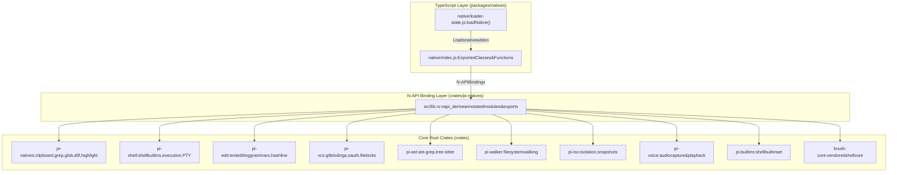
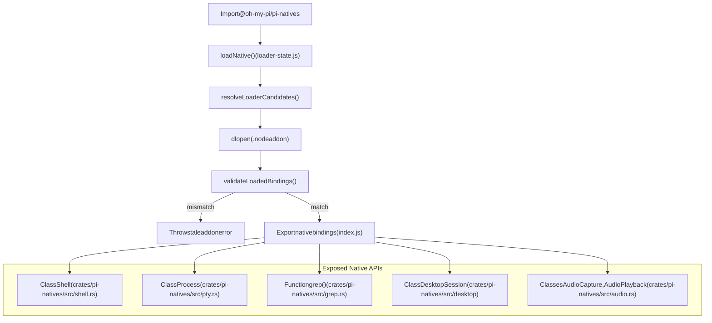

<!-- source: DeepWiki mcp.deepwiki.com · repo can1357/oh-my-pi · page 9 Native Performance Layer · fetched 2026-10-30 -->

# Native Performance Layer

Relevant source files

The following files were used as context for generating this wiki page:

- [crates/pi-natives/Cargo.toml](crates/pi-natives/Cargo.toml)
- [crates/pi-natives/src/ast.rs](crates/pi-natives/src/ast.rs)
- [crates/pi-natives/src/desktop/applications.rs](crates/pi-natives/src/desktop/applications.rs)
- [crates/pi-natives/src/desktop/backend.rs](crates/pi-natives/src/desktop/backend.rs)
- [crates/pi-natives/src/desktop/control.rs](crates/pi-natives/src/desktop/control.rs)
- [crates/pi-natives/src/desktop/control/macos.rs](crates/pi-natives/src/desktop/control/macos.rs)
- [crates/pi-natives/src/desktop/macos/applications.rs](crates/pi-natives/src/desktop/macos/applications.rs)
- [crates/pi-natives/src/desktop/macos/ax.rs](crates/pi-natives/src/desktop/macos/ax.rs)
- [crates/pi-natives/src/desktop/macos/ax/menus.rs](crates/pi-natives/src/desktop/macos/ax/menus.rs)
- [crates/pi-natives/src/desktop/macos/ax/open_menu.rs](crates/pi-natives/src/desktop/macos/ax/open_menu.rs)
- [crates/pi-natives/src/desktop/macos/capture.rs](crates/pi-natives/src/desktop/macos/capture.rs)
- [crates/pi-natives/src/desktop/macos/input.rs](crates/pi-natives/src/desktop/macos/input.rs)
- [crates/pi-natives/src/desktop/macos/mod.rs](crates/pi-natives/src/desktop/macos/mod.rs)
- [crates/pi-natives/src/desktop/macos/skylight.rs](crates/pi-natives/src/desktop/macos/skylight.rs)
- [crates/pi-natives/src/desktop/macos/spaces.rs](crates/pi-natives/src/desktop/macos/spaces.rs)
- [crates/pi-natives/src/desktop/mod.rs](crates/pi-natives/src/desktop/mod.rs)
- [crates/pi-natives/src/fd.rs](crates/pi-natives/src/fd.rs)
- [crates/pi-natives/src/glob.rs](crates/pi-natives/src/glob.rs)
- [crates/pi-natives/src/glob_util.rs](crates/pi-natives/src/glob_util.rs)
- [crates/pi-natives/src/grep.rs](crates/pi-natives/src/grep.rs)
- [crates/pi-natives/src/highlight.rs](crates/pi-natives/src/highlight.rs)
- [crates/pi-natives/src/lib.rs](crates/pi-natives/src/lib.rs)
- [crates/pi-natives/src/pty.rs](crates/pi-natives/src/pty.rs)
- [crates/pi-natives/src/shell.rs](crates/pi-natives/src/shell.rs)
- [crates/pi-shell/Cargo.toml](crates/pi-shell/Cargo.toml)
- [crates/pi-shell/src/lib.rs](crates/pi-shell/src/lib.rs)
- [crates/pi-shell/src/output_decode.rs](crates/pi-shell/src/output_decode.rs)
- [crates/pi-shell/src/shell.rs](crates/pi-shell/src/shell.rs)
- [docs/computer-use.md](docs/computer-use.md)
- [docs/tools/computer.md](docs/tools/computer.md)
- [packages/coding-agent/src/exec/bash-executor.ts](packages/coding-agent/src/exec/bash-executor.ts)
- [packages/coding-agent/src/prompts/tools/computer.md](packages/coding-agent/src/prompts/tools/computer.md)
- [packages/coding-agent/src/tools/bash-interactive.ts](packages/coding-agent/src/tools/bash-interactive.ts)
- [packages/coding-agent/src/tools/bash-pty-selection.ts](packages/coding-agent/src/tools/bash-pty-selection.ts)
- [packages/coding-agent/src/tools/computer.ts](packages/coding-agent/src/tools/computer.ts)
- [packages/coding-agent/src/tools/computer/call.ts](packages/coding-agent/src/tools/computer/call.ts)
- [packages/coding-agent/src/tools/computer/prelude.js](packages/coding-agent/src/tools/computer/prelude.js)
- [packages/coding-agent/src/tools/computer/prelude.py](packages/coding-agent/src/tools/computer/prelude.py)
- [packages/coding-agent/src/tools/computer/protocol.ts](packages/coding-agent/src/tools/computer/protocol.ts)
- [packages/coding-agent/src/tools/computer/supervisor.ts](packages/coding-agent/src/tools/computer/supervisor.ts)
- [packages/coding-agent/src/tools/computer/worker.ts](packages/coding-agent/src/tools/computer/worker.ts)
- [packages/coding-agent/test/bash-executor.test.ts](packages/coding-agent/test/bash-executor.test.ts)
- [packages/coding-agent/test/slash-commands/computer.test.ts](packages/coding-agent/test/slash-commands/computer.test.ts)
- [packages/coding-agent/test/tools/bash-interactive.test.ts](packages/coding-agent/test/tools/bash-interactive.test.ts)
- [packages/coding-agent/test/tools/bash-pty-selection.test.ts](packages/coding-agent/test/tools/bash-pty-selection.test.ts)
- [packages/coding-agent/test/tools/computer.test.ts](packages/coding-agent/test/tools/computer.test.ts)
- [packages/natives/CHANGELOG.md](packages/natives/CHANGELOG.md)
- [packages/natives/bench/grep.ts](packages/natives/bench/grep.ts)
- [packages/natives/native/index.d.ts](packages/natives/native/index.d.ts)
- [packages/natives/native/index.js](packages/natives/native/index.js)
- [packages/natives/test/native.test.ts](packages/natives/test/native.test.ts)

The Native Performance Layer delivers high-performance system-level capabilities implemented in Rust and exposed to the TypeScript runtime through N-API bindings within the `pi-natives` package and related crates [crates/pi-natives/src/lib.rs:1-7](). This layer addresses demanding operations such as shell command execution, advanced text processing, AST-aware code manipulation, version control integration, and desktop automation that would be inefficient or impractical in pure JavaScript.

The native layer consists of core Rust crates including `pi-natives`, along with specialized crates for shell management (`pi-shell`), editing (`pi-edit`), version control (`pi-vcs`), AST tooling (`pi-ast`), filesystem walking (`pi-walker`), environment isolation (`pi-iso`), audio handling (`pi-voice`), shell builtins (`pi-builtins`), prediction utilities (`pi-predict`), virtual filesystem abstraction (`pi-vfs`), and the vendored `brush-core` shell engine implementation [crates/pi-natives/src/lib.rs:25-83](). Together, these crates underpin Oh My Pi’s native tooling stack, enabling performant and reliable core operations.

This page presents a high-level overview of the Native Performance Layer architecture, its integration with TypeScript via N-API, and how the various crates fit together. For in-depth technical details of each subsystem, linked child pages provide comprehensive coverage.

---

## Child Pages

- [Shell Execution](#9.1) — Explores the `pi-shell` crate and the integration with the vendored `brush-core` shell engine, covering shell builtin implementations, command execution pipelines, PTY and process management, and the shell minimizer subsystem [crates/pi-natives/src/lib.rs:67-74]().  
- [Text Processing](#9.2) — Documents native utilities for text processing including `grep`, `glob`, `fd`, diff generation, syntax highlighting, and other core text functions implemented primarily in `pi-natives` [crates/pi-natives/src/lib.rs:34-45]().  
- [AST Tools](#9.3) — Details structural code search and editing leveraging `ast-grep-core`, Tree-sitter parsing, and the `pi-edit` crate grammars for language-aware AST tooling [crates/pi-natives/src/lib.rs:27]().  
- [VCS, OS and Platform Bindings](#9.4) — Covers version control bindings for Git and Jujutsu repositories, native OAuth callback servers, file locks, desktop automation/accessibility APIs, process listing, clipboard, and Windows/macOS platform-specific support [crates/pi-natives/src/lib.rs:30-64]().

---

## Architecture Overview

The Native Performance Layer builds on a set of Rust crates compiled into native shared libraries (`.node` addons) and loaded dynamically by the TypeScript runtime using a custom loader in `packages/natives/native/loader-state.js` [packages/natives/native/loader-state.js:1-20](). This loader manages platform detection, candidate resolution, Windows staging, and validation of binary version stamps to ensure ABI compatibility with the JavaScript package [packages/natives/native/loader-state.js:11-155]().

The runtime interface between TypeScript and Rust is implemented using N-API through the `napi_derive` crate macros inside `crates/pi-natives/src/lib.rs` [crates/pi-natives/src/lib.rs:93-94](). This binding layer exports Rust classes and functions to JavaScript, covering core abstractions like shell sessions, text differencing, desktop automation, version control repo bindings, and audio capture/playback [packages/natives/native/index.js:25-50](), [crates/pi-natives/src/lib.rs:1-83]().

### High-Level Component Map: Natural Language Concepts to Code Entities

Sources: [crates/pi-natives/src/lib.rs:1-83](), [packages/natives/native/index.js:25-50](), [packages/natives/native/loader-state.js:1-20]()

---

## Native Module Loading and Version Validation

The entrypoint `packages/natives/native/index.js` invokes `loadNative()` from `loader-state.js` which resolves the appropriate prebuilt `.node` binary for the platform, handles any staging needed on Windows, and loads the native addon dynamically [packages/natives/native/index.js:1-23](), [packages/natives/native/loader-state.js:11-155]().

To guard against ABI mismatches from stale builds, native binding versions are validated at runtime using a binary version stamp embedded in the addon and verified by validation routines [packages/natives/native/index.js:16-23](). On mismatch, a clear error message directs the user to reinstall the package.

Sources: [packages/natives/native/index.js:1-50](), [crates/pi-natives/src/lib.rs:25-83]()

---

## Subsystem Overviews

### Shell Execution

The shell subsystem is built around the vendored `brush-core` shell engine integrated within the `pi-shell` crate, which provides persistent shell sessions, builtin command implementations, process execution, PTY management, and streaming command output [crates/pi-natives/src/lib.rs:67-74](), [crates/pi-shell/src/shell.rs:1-50](). This native layer supports performant shell execution capabilities required by the agent and interactive tools while minimizing overhead.

Full details including API design and PTY handling are covered in the [Shell Execution](#9.1) child page.

Sources: [crates/pi-shell/src/shell.rs:1-120]()

---

### Text Processing

The `pi-natives` crate implements a broad suite of text processing utilities essential for searching, diffing, and rendering code and text. This includes native Rust implementations for `grep` regex search, glob and file discovery (`fd`), diff streaming via `DiffStream`, ANSI-aware visible width calculations, syntax highlighting with `HighlightStream`, and document conversions [crates/pi-natives/src/lib.rs:34-45](), [crates/pi-natives/src/grep.rs:1-75](), [packages/natives/native/index.js:29-33](). These enable fast file scanning and agent UI text rendering at native speeds.

See [Text Processing](#9.2) for detailed API documentation and usage patterns.

Sources: [crates/pi-natives/src/lib.rs:34-45](), [crates/pi-natives/src/grep.rs:1-110]()

---

### AST Tools

For language-aware code analysis and editing, `pi-ast` and `pi-edit` crates integrate Tree-sitter and ast-grep-core parsing and matching. These provide robust AST grammars, structural pattern matching, and fine-grained code manipulation useful for tasks such as refactoring, code structural search, and patch generation [crates/pi-natives/src/lib.rs:27](), [crates/pi-natives/src/ast.rs:1-30](). This makes complex code understanding and automation feasible within the native performance layer.

Comprehensive information is in [AST Tools](#9.3).

Sources: [crates/pi-natives/src/lib.rs:25-30]()

---

### VCS, OS and Platform Bindings

The platform bindings subsystem includes `pi-vcs`, which offers rich Git and Jujutsu repository bindings for repository read/write, patch application, and workspace management [crates/pi-natives/src/lib.rs:62-64](), alongside native OAuth callback servers, file locking mechanisms via `FileLock`, desktop automation and accessibility snapshots exposed by `DesktopSession`, process listing utilities (`ps`), clipboard access, and platform-specific support [crates/pi-natives/src/lib.rs:30-56](), [packages/natives/native/index.js:32-49](), [crates/pi-natives/src/desktop/mod.rs:1-46]().

For details on interfacing with version control systems and OS features, see [VCS, OS and Platform Bindings](#9.4).

Sources: [crates/pi-natives/src/lib.rs:30-65](), [crates/pi-natives/src/desktop/mod.rs:1-46]()

---

# Summary

The Native Performance Layer composes a collection of focused, high-performance Rust crates that are dynamically loaded into the TypeScript runtime via N-API, offering fast and reliable core operations to Oh My Pi [crates/pi-natives/src/lib.rs:1-7](). By separating intense computation and platform-dependent code into native modules, the system achieves efficient execution for shell commands, text processing, AST tooling, version control operations, and platform integration while maintaining a clean interface to higher-level TypeScript components [packages/natives/native/index.js:1-50]().

Sources: [crates/pi-natives/src/lib.rs:1-83](), [packages/natives/native/index.js:1-50]()

---

