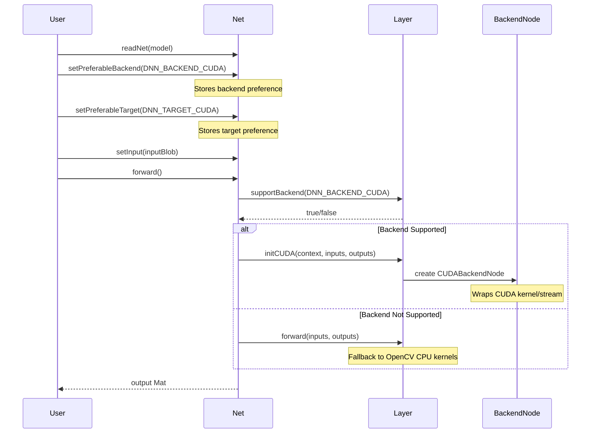
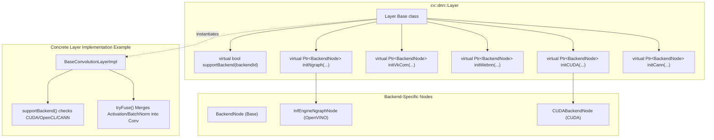
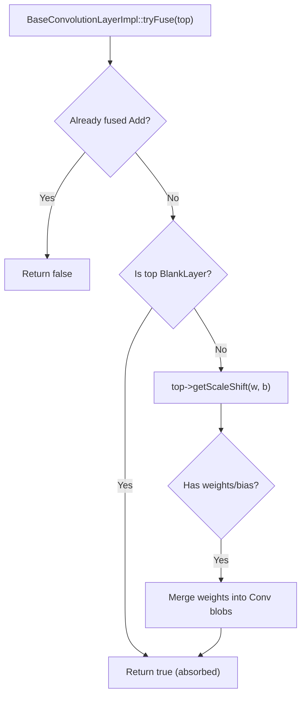

<!-- source: DeepWiki mcp.deepwiki.com · repo opencv/opencv · page 5.2 Network Execution and Backend Selection · fetched 2026-10-30 -->

# Network Execution and Backend Selection

Relevant source files

The following files were used as context for generating this wiki page:

- [cmake/OpenCVDetectInferenceEngine.cmake](cmake/OpenCVDetectInferenceEngine.cmake)
- [doc/tutorials/dnn/dnn_custom_layers/dnn_custom_layers.md](doc/tutorials/dnn/dnn_custom_layers/dnn_custom_layers.md)
- [modules/dnn/CMakeLists.txt](modules/dnn/CMakeLists.txt)
- [modules/dnn/include/opencv2/dnn/dnn.hpp](modules/dnn/include/opencv2/dnn/dnn.hpp)
- [modules/dnn/misc/js/gen_dict.json](modules/dnn/misc/js/gen_dict.json)
- [modules/dnn/misc/objc/gen_dict.json](modules/dnn/misc/objc/gen_dict.json)
- [modules/dnn/misc/python/test/test_dnn.py](modules/dnn/misc/python/test/test_dnn.py)
- [modules/dnn/src/dnn.cpp](modules/dnn/src/dnn.cpp)
- [modules/dnn/src/dnn_common.hpp](modules/dnn/src/dnn_common.hpp)
- [modules/dnn/src/dnn_read.cpp](modules/dnn/src/dnn_read.cpp)
- [modules/dnn/src/graph_block_layout.cpp](modules/dnn/src/graph_block_layout.cpp)
- [modules/dnn/src/graph_buffer_allocator.cpp](modules/dnn/src/graph_buffer_allocator.cpp)
- [modules/dnn/src/graph_const_args.cpp](modules/dnn/src/graph_const_args.cpp)
- [modules/dnn/src/graph_const_fold.cpp](modules/dnn/src/graph_const_fold.cpp)
- [modules/dnn/src/ie_ngraph.cpp](modules/dnn/src/ie_ngraph.cpp)
- [modules/dnn/src/ie_ngraph.hpp](modules/dnn/src/ie_ngraph.hpp)
- [modules/dnn/src/kv_cache_manager.cpp](modules/dnn/src/kv_cache_manager.cpp)
- [modules/dnn/src/kv_cache_manager.hpp](modules/dnn/src/kv_cache_manager.hpp)
- [modules/dnn/src/layer.cpp](modules/dnn/src/layer.cpp)
- [modules/dnn/src/layer_internals.hpp](modules/dnn/src/layer_internals.hpp)
- [modules/dnn/src/layers/attention_layer.cpp](modules/dnn/src/layers/attention_layer.cpp)
- [modules/dnn/src/layers/attention_onnxai_layer.cpp](modules/dnn/src/layers/attention_onnxai_layer.cpp)
- [modules/dnn/src/layers/conv2_common.cpp](modules/dnn/src/layers/conv2_common.cpp)
- [modules/dnn/src/layers/conv2_common.hpp](modules/dnn/src/layers/conv2_common.hpp)
- [modules/dnn/src/layers/convolution_layer.cpp](modules/dnn/src/layers/convolution_layer.cpp)
- [modules/dnn/src/layers/fully_connected_layer.cpp](modules/dnn/src/layers/fully_connected_layer.cpp)
- [modules/dnn/src/layers/layers_common.cpp](modules/dnn/src/layers/layers_common.cpp)
- [modules/dnn/src/layers/layers_common.hpp](modules/dnn/src/layers/layers_common.hpp)
- [modules/dnn/src/layers/layers_common.simd.hpp](modules/dnn/src/layers/layers_common.simd.hpp)
- [modules/dnn/src/layers/pooling_layer.cpp](modules/dnn/src/layers/pooling_layer.cpp)
- [modules/dnn/src/layers/randomnormallike_layer.cpp](modules/dnn/src/layers/randomnormallike_layer.cpp)
- [modules/dnn/src/layers/recurrent_layers.cpp](modules/dnn/src/layers/recurrent_layers.cpp)
- [modules/dnn/src/legacy_backend.cpp](modules/dnn/src/legacy_backend.cpp)
- [modules/dnn/src/model.cpp](modules/dnn/src/model.cpp)
- [modules/dnn/src/net.cpp](modules/dnn/src/net.cpp)
- [modules/dnn/src/net_impl.cpp](modules/dnn/src/net_impl.cpp)
- [modules/dnn/src/net_impl.hpp](modules/dnn/src/net_impl.hpp)
- [modules/dnn/src/net_impl2.cpp](modules/dnn/src/net_impl2.cpp)
- [modules/dnn/src/net_impl_backend.cpp](modules/dnn/src/net_impl_backend.cpp)
- [modules/dnn/src/net_openvino.cpp](modules/dnn/src/net_openvino.cpp)
- [modules/dnn/src/op_inf_engine.cpp](modules/dnn/src/op_inf_engine.cpp)
- [modules/dnn/src/op_inf_engine.hpp](modules/dnn/src/op_inf_engine.hpp)
- [modules/dnn/src/precomp.hpp](modules/dnn/src/precomp.hpp)
- [modules/dnn/src/tflite/tflite_importer.cpp](modules/dnn/src/tflite/tflite_importer.cpp)
- [modules/dnn/test/test_ie_models.cpp](modules/dnn/test/test_ie_models.cpp)
- [modules/dnn/test/test_misc.cpp](modules/dnn/test/test_misc.cpp)
- [modules/dnn/test/test_model.cpp](modules/dnn/test/test_model.cpp)
- [modules/dnn/test/test_tflite_importer.cpp](modules/dnn/test/test_tflite_importer.cpp)
- [samples/dnn/classification.cpp](samples/dnn/classification.cpp)
- [samples/dnn/classification.py](samples/dnn/classification.py)
- [samples/dnn/colorization.cpp](samples/dnn/colorization.cpp)
- [samples/dnn/colorization.py](samples/dnn/colorization.py)
- [samples/dnn/common.hpp](samples/dnn/common.hpp)
- [samples/dnn/common.py](samples/dnn/common.py)
- [samples/dnn/custom_layer_onnx.cpp](samples/dnn/custom_layer_onnx.cpp)
- [samples/dnn/download_models.py](samples/dnn/download_models.py)
- [samples/dnn/edge_detection.cpp](samples/dnn/edge_detection.cpp)
- [samples/dnn/edge_detection.py](samples/dnn/edge_detection.py)
- [samples/dnn/gemma3_inference.py](samples/dnn/gemma3_inference.py)
- [samples/dnn/ldm_inpainting.py](samples/dnn/ldm_inpainting.py)
- [samples/dnn/models.yml](samples/dnn/models.yml)
- [samples/dnn/object_detection.cpp](samples/dnn/object_detection.cpp)
- [samples/dnn/object_detection.py](samples/dnn/object_detection.py)
- [samples/dnn/object_tracker.cpp](samples/dnn/object_tracker.cpp)
- [samples/dnn/object_tracker.py](samples/dnn/object_tracker.py)
- [samples/dnn/person_reid.cpp](samples/dnn/person_reid.cpp)
- [samples/dnn/person_reid.py](samples/dnn/person_reid.py)
- [samples/dnn/qwen_inference.py](samples/dnn/qwen_inference.py)
- [samples/dnn/segmentation.cpp](samples/dnn/segmentation.cpp)
- [samples/dnn/segmentation.py](samples/dnn/segmentation.py)

## Purpose and Scope

This document describes how the OpenCV `dnn` module executes neural networks across different computational backends and hardware targets. It covers the `Net` class's management of layer graphs, the backend selection mechanism via `setPreferableBackend` and `setPreferableTarget`, layer-level backend support, and the execution flow from network configuration to inference.

For information about model import and graph construction, see [Model Importers (ONNX, TensorFlow, Caffe, Darknet)](../5.1).

---

## Backend and Target Enumeration

OpenCV DNN provides an abstraction layer that allows the same network to execute on different computational backends and hardware targets. The backend determines the execution engine, while the target specifies the hardware device.

### Supported Backends and Targets

```mermaid
graph TB
    subgraph "cv::dnn::Backend"
        BACKEND["Backend enum"]
        BACKEND --> OPENCV["DNN_BACKEND_OPENCV<br/>Pure OpenCV implementation"]
        BACKEND --> IE["DNN_BACKEND_INFERENCE_ENGINE<br/>Intel OpenVINO"]
        BACKEND --> CUDA["DNN_BACKEND_CUDA<br/>NVIDIA CUDA + cuDNN"]
        BACKEND --> VKCOM["DNN_BACKEND_VKCOM<br/>Vulkan Compute"]
        BACKEND --> WEBNN["DNN_BACKEND_WEBNN<br/>Web Neural Network API"]
        BACKEND --> TIMVX["DNN_BACKEND_TIMVX<br/>VeriSilicon TIM-VX"]
        BACKEND --> CANN["DNN_BACKEND_CANN<br/>Huawei CANN"]
    end
    
    subgraph "cv::dnn::Target"
        TARGET["Target enum"]
        TARGET --> CPU["DNN_TARGET_CPU"]
        TARGET --> OPENCL["DNN_TARGET_OPENCL"]
        TARGET --> OPENCL_FP16["DNN_TARGET_OPENCL_FP16"]
        TARGET --> MYRIAD["DNN_TARGET_MYRIAD<br/>Intel Movidius"]
        TARGET --> CUDA_T["DNN_TARGET_CUDA"]
        TARGET --> CUDA_FP16["DNN_TARGET_CUDA_FP16"]
        TARGET --> FPGA["DNN_TARGET_FPGA"]
        TARGET --> HDDL["DNN_TARGET_HDDL"]
        TARGET --> NPU["DNN_TARGET_NPU"]
        TARGET --> CPU_FP16["DNN_TARGET_CPU_FP16 (ARM)"]
    end
    
    OPENCV -.->|supports| CPU
    OPENCV -.->|supports| OPENCL
    OPENCV -.->|supports| OPENCL_FP16
    OPENCV -.->|supports| CPU_FP16
    
    IE -.->|supports| CPU
    IE -.->|supports| OPENCL
    IE -.->|supports| MYRIAD
    IE -.->|supports| FPGA
    IE -.->|supports| NPU
    
    CUDA -.->|supports| CUDA_T
    CUDA -.->|supports| CUDA_FP16
```

**Sources:**
- [modules/dnn/include/opencv2/dnn/dnn.hpp:71-108]()

---

## Network Configuration Flow

The user configures backend and target selection through the `cv::dnn::Net` class. This configuration propagates to all layers during network initialization and determines how the forward pass is computed.

### Configuration API and Execution Setup

**Key API Methods:**

| Method | Purpose | Location |
|--------|---------|----------|
| `Net::setPreferableBackend(int)` | Configure execution backend (e.g., `DNN_BACKEND_OPENCV`) | [modules/dnn/include/opencv2/dnn/dnn.hpp:69-72]() |
| `Net::setPreferableTarget(int)` | Configure hardware target (e.g., `DNN_TARGET_OPENCL`) | [modules/dnn/include/opencv2/dnn/dnn.hpp:95-96]() |
| `Layer::supportBackend(int)` | Check if layer supports specific backend/target combo | [modules/dnn/src/layers/convolution_layer.cpp:183-205]() |
| `Layer::finalize()` | Prepare layer for execution (paddings, shapes) | [modules/dnn/src/layers/convolution_layer.cpp:111-159]() |

**Sources:**
- [modules/dnn/include/opencv2/dnn/dnn.hpp:71-108]()
- [modules/dnn/src/layers/convolution_layer.cpp:111-159]()
- [modules/dnn/src/layers/pooling_layer.cpp:143-181]()

---

## Layer Backend Support Architecture

Each layer implementation determines which backends it supports through the `supportBackend()` method and provides backend-specific initialization through `init*()` methods.

### Backend Support Interface

**Backend Node Types:**

| Backend | Node Class | Purpose | Location |
|---------|-----------|---------|----------|
| OpenVINO | `InfEngineNgraphNode` | Wraps `ov::Node` for OpenVINO execution | [modules/dnn/src/ie_ngraph.cpp:173-202]() |
| CUDA | `CUDABackendNode` | Wraps CUDA kernel and stream management | [modules/dnn/src/op_cuda.hpp]() |
| CANN | `CannBackendNode` | Wraps Huawei CANN operator | [modules/dnn/src/op_cann.hpp]() |

**Sources:**
- [modules/dnn/include/opencv2/dnn/dnn.hpp:153-161]()
- [modules/dnn/src/layers/convolution_layer.cpp:174-210]()
- [modules/dnn/src/layers/pooling_layer.cpp:183-200]()
- [modules/dnn/src/ie_ngraph.cpp:173-202]()

---

## Layer Fusion and Optimization

OpenCV DNN performs layer fusion to optimize execution, particularly for CPU, OpenCL, and CUDA backends. A common optimization is fusing Activation (ReLU, Sigmoid) or Batch Normalization into the preceding Convolution or Fully Connected layer.

### Convolution Fusion Logic

The `tryFuse` method allows a layer to "absorb" the next layer in the graph if they are compatible.

**Sources:**
- [modules/dnn/src/layers/convolution_layer.cpp:174-210]()

---

## OpenCL Acceleration (ocl4dnn)

When the target is `DNN_TARGET_OPENCL` or `DNN_TARGET_OPENCL_FP16`, OpenCV uses the `ocl4dnn` library to execute kernels. This is enabled via the `CV_OCL4DNN` definition during build.

### ocl4dnn Components

| Component | Purpose | Location |
|-----------|---------|----------|
| `OCL4DNNPool` | OpenCL implementation for Max/Average pooling | [modules/dnn/src/layers/pooling_layer.cpp:140-141]() |
| `ocl4dnn_conv_spatial.cpp` | Implementation of spatial convolution in OpenCL | [modules/dnn/src/ocl4dnn/src/ocl4dnn_conv_spatial.cpp]() |
| `ocl4dnn_pooling.cl` | OpenCL kernel source for pooling operations | [modules/dnn/src/opencl/ocl4dnn_pooling.cl]() |

**Sources:**
- [modules/dnn/CMakeLists.txt:26-30]()
- [modules/dnn/src/layers/convolution_layer.cpp:60-63]()
- [modules/dnn/src/layers/pooling_layer.cpp:65-68]()

---

## High-Level Model API

OpenCV provides a high-level `Model` API to simplify inference tasks. These classes encapsulate the `Net` and handle standard pre-processing (like `blobFromImage`) and post-processing.

### Model API Classes

| Class | Task | Key Methods | Location |
|-------|------|-------------|----------|
| `ClassificationModel` | Image Classification | `classify()` | [modules/dnn/test/test_model.cpp:96-111]() |
| `DetectionModel` | Object Detection | `detect()` | [modules/dnn/src/model.cpp]() |
| `SegmentationModel` | Semantic Segmentation | `segment()` | [modules/dnn/test/test_model.cpp:135-159]() |
| `TextRecognitionModel` | OCR | `recognize()` | [modules/dnn/test/test_model.cpp:161-171]() |
| `KeypointsModel` | Pose Estimation | `estimate()` | [modules/dnn/test/test_model.cpp:113-133]() |

**Sources:**
- [modules/dnn/src/model.cpp:1-50]()
- [modules/dnn/test/test_model.cpp:96-180]()

---

## Summary of Execution Components

| Entity | File Path | Role |
|--------|-----------|------|
| `Net` | [modules/dnn/src/net.cpp]() | User-facing class for network execution. |
| `NetImpl` | [modules/dnn/src/net_impl.cpp]() | Internal implementation of network logic and graph management. |
| `LayerParams` | [modules/dnn/include/opencv2/dnn/dnn.hpp:153-161]() | Data container for layer initialization (blobs, scalars). |
| `BackendNode` | [modules/dnn/include/opencv2/dnn/dnn.hpp:166-173]() | Base for backend-specific operation wrappers. |
| `BackendWrapper` | [modules/dnn/include/opencv2/dnn/dnn.hpp:178-189]() | Manages data synchronization between CPU and backend devices. |

**Sources:**
- [modules/dnn/include/opencv2/dnn/dnn.hpp:1-200]()
- [modules/dnn/src/layers/convolution_layer.cpp:1-150]()
- [modules/dnn/src/layers/pooling_layer.cpp:1-150]()

---

