# Page: OpenCV Overview

# OpenCV Overview

<details>
<summary>Relevant source files</summary>

The following files were used as context for generating this wiki page:

- [3rdparty/fastcv/fastcv.cmake](3rdparty/fastcv/fastcv.cmake)
- [3rdparty/ippicv/CMakeLists.txt](3rdparty/ippicv/CMakeLists.txt)
- [CMakeLists.txt](CMakeLists.txt)
- [cmake/OpenCVCRTLinkage.cmake](cmake/OpenCVCRTLinkage.cmake)
- [cmake/OpenCVCompilerOptimizations.cmake](cmake/OpenCVCompilerOptimizations.cmake)
- [cmake/OpenCVCompilerOptions.cmake](cmake/OpenCVCompilerOptions.cmake)
- [cmake/OpenCVFindLibsGUI.cmake](cmake/OpenCVFindLibsGUI.cmake)
- [cmake/OpenCVFindLibsPerf.cmake](cmake/OpenCVFindLibsPerf.cmake)
- [cmake/OpenCVFindLibsVideo.cmake](cmake/OpenCVFindLibsVideo.cmake)
- [cmake/OpenCVModule.cmake](cmake/OpenCVModule.cmake)
- [cmake/OpenCVPCHSupport.cmake](cmake/OpenCVPCHSupport.cmake)
- [cmake/OpenCVUtils.cmake](cmake/OpenCVUtils.cmake)
- [cmake/templates/cvconfig.h.in](cmake/templates/cvconfig.h.in)
- [modules/core/CMakeLists.txt](modules/core/CMakeLists.txt)
- [modules/core/include/opencv2/core.hpp](modules/core/include/opencv2/core.hpp)
- [modules/core/include/opencv2/core/base.hpp](modules/core/include/opencv2/core/base.hpp)
- [modules/core/include/opencv2/core/core.hpp](modules/core/include/opencv2/core/core.hpp)
- [modules/core/include/opencv2/core/cv_cpu_dispatch.h](modules/core/include/opencv2/core/cv_cpu_dispatch.h)
- [modules/core/include/opencv2/core/cv_cpu_helper.h](modules/core/include/opencv2/core/cv_cpu_helper.h)
- [modules/core/include/opencv2/core/cvdef.h](modules/core/include/opencv2/core/cvdef.h)
- [modules/core/include/opencv2/core/matx.hpp](modules/core/include/opencv2/core/matx.hpp)
- [modules/core/include/opencv2/core/operations.hpp](modules/core/include/opencv2/core/operations.hpp)
- [modules/core/include/opencv2/core/private.hpp](modules/core/include/opencv2/core/private.hpp)
- [modules/core/include/opencv2/core/types.hpp](modules/core/include/opencv2/core/types.hpp)
- [modules/core/include/opencv2/core/utility.hpp](modules/core/include/opencv2/core/utility.hpp)
- [modules/core/include/opencv2/core/utils/buffer_area.private.hpp](modules/core/include/opencv2/core/utils/buffer_area.private.hpp)
- [modules/core/src/algorithm.cpp](modules/core/src/algorithm.cpp)
- [modules/core/src/buffer_area.cpp](modules/core/src/buffer_area.cpp)
- [modules/core/src/command_line_parser.cpp](modules/core/src/command_line_parser.cpp)
- [modules/core/src/precomp.hpp](modules/core/src/precomp.hpp)
- [modules/core/src/system.cpp](modules/core/src/system.cpp)
- [modules/core/test/test_operations.cpp](modules/core/test/test_operations.cpp)
- [modules/core/test/test_utils.cpp](modules/core/test/test_utils.cpp)
- [modules/highgui/CMakeLists.txt](modules/highgui/CMakeLists.txt)
- [modules/java/CMakeLists.txt](modules/java/CMakeLists.txt)
- [platforms/linux/riscv64-071-gcc.toolchain.cmake](platforms/linux/riscv64-071-gcc.toolchain.cmake)
- [samples/android/CMakeLists.txt](samples/android/CMakeLists.txt)
- [samples/android/color-blob-detection/CMakeLists.txt](samples/android/color-blob-detection/CMakeLists.txt)

</details>


OpenCV (Open Source Computer Vision Library) is a high-performance C++ library for real-time computer vision and image processing `[modules/core/include/opencv2/core.hpp:62-67]()`. It provides a modular framework for handling image data, mathematical computations, and hardware-accelerated inference.

For a detailed exploration of the source code organization, see [Repository Tour and Module Map](#1.1).

## Repository Layout and Versioning

The repository is organized into a core library, optional functional modules, and platform-specific build scripts. Version management is handled via CMake and propagated to core headers, with version detection from Git metadata if available `[CMakeLists.txt:123-132]()`.

| Directory | Contents |
|---|---|
| `modules/` | Functional modules (`core`, `imgproc`, `dnn`, etc.) `[modules/core/CMakeLists.txt:41]()`. |
| `cmake/` | Build infrastructure, dependency detection, and module macros `[cmake/OpenCVModule.cmake:1]()`. |
| `platforms/` | Platform-specific configurations (Android, iOS, etc.) `[CMakeLists.txt:94-99]()`. |
| `3rdparty/` | Bundled dependencies (zlib, libjpeg, libpng, etc.) `[CMakeLists.txt:148-164]()`. |
| `apps/` | Developer tools like annotation, interactive calibration, and visualization utilities. |

For a detailed tour of the top-level layout, directory contents, and the OpenCV 5.x module split (geometry/calib/stereo/ptcloud/features), see [Repository Tour and Module Map](#1.1).

Sources: `[CMakeLists.txt:1-132]()`, `[modules/core/CMakeLists.txt:1-41]()`, `[cmake/OpenCVModule.cmake:1-25]()`

## Module Architecture and Dependencies

OpenCV is structured as a collection of interdependent modules. Every module depends on `opencv_core`, which defines the fundamental `Mat` and `UMat` structures `[modules/core/include/opencv2/core.hpp:64-66]()`.

### Module Dependency Graph

The following diagram illustrates canonical dependencies between major modules and how they bridge from low-level data structures to high-level vision tasks.

**Code Entity Mapping:**
- `opencv_core`: Defined in `modules/core/CMakeLists.txt` `[modules/core/CMakeLists.txt:41]()`.
- `opencv_imgproc`: Image processing foundations.
- `opencv_highgui`: High-level GUI abstractions `[modules/highgui/CMakeLists.txt:1]()`.
- `ocv_add_module`: CMake macro in `cmake/OpenCVModule.cmake` `[cmake/OpenCVModule.cmake:124]()`.

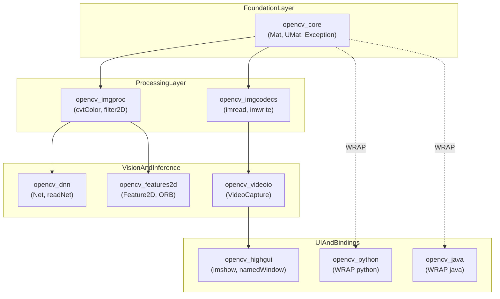

Sources: `[modules/highgui/CMakeLists.txt:3-7]()`, `[cmake/OpenCVModule.cmake:124-127]()`, `[modules/core/CMakeLists.txt:41-43]()`

### Module Declaration via `ocv_add_module`

Modules are registered using the `ocv_add_module` macro `[cmake/OpenCVModule.cmake:124]()`. This macro handles dependency resolution, categorization, and binding generation:
- **Required Dependencies**: Modules that must be present for this module to build `[cmake/OpenCVModule.cmake:86]()`.
- **Optional Dependencies**: Modules that enhance functionality if present `[cmake/OpenCVModule.cmake:88]()`.
- **Wrappers**: Specifies which language bindings (Python, Java, JS, ObjC) should wrap this module `[cmake/OpenCVModule.cmake:93]()`.

Sources: `[cmake/OpenCVModule.cmake:77-117]()`, `[cmake/OpenCVModule.cmake:124-155]()`

## Build System Architecture

OpenCV uses a sophisticated CMake-based build system that manages cross-platform compilation, hardware optimization, and third-party library integration `[CMakeLists.txt:1-166]()`.

### Configuration Flow

The configuration process is split into two passes:
1. **Initial Pass**: Collects module information and descriptions `[cmake/OpenCVModule.cmake:130-155]()`.
2. **Target Creation**: Resolves dependencies and creates the actual CMake targets `[cmake/OpenCVModule.cmake:172-223]()`.

**System Initialization Diagram:**

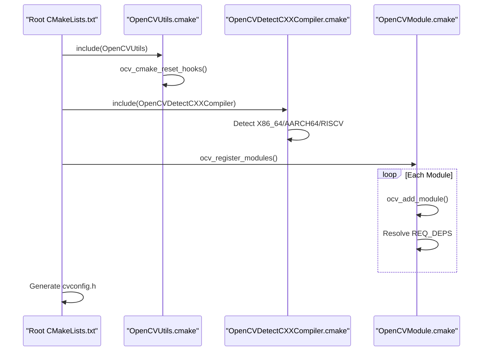

Sources: `[CMakeLists.txt:42-52]()`, `[CMakeLists.txt:139]`, `[cmake/OpenCVModule.cmake:54-74]()`, `[cmake/OpenCVUtils.cmake:1-15]()`

For instructions on configuring, building, selecting toolchains, and running sanity checks, see [Getting Started: Configure, Build, and Sanity-Check](#1.2).

## Platform and Backend Support

OpenCV abstracts platform differences through backends, particularly for GUI, video input/output, and parallel execution.

### GUI Backends (`highgui`)
The `highgui` module selects a windowing backend based on target platform and available libraries `[modules/highgui/CMakeLists.txt:43-192]()`:
- **Wayland / GTK**: Linux graphical backends `[modules/highgui/CMakeLists.txt:55]()`, `[modules/highgui/CMakeLists.txt:165]()`.
- **Win32 UI**: Native Windows UI `[modules/highgui/CMakeLists.txt:152]()`.
- **Cocoa**: macOS native UI `[modules/highgui/CMakeLists.txt:145]()`.
- **Qt**: Cross-platform backend supporting Qt4, Qt5, and Qt6 `[modules/highgui/CMakeLists.txt:80-99]()`.

### Performance Libraries
OpenCV integrates several third-party libraries for acceleration and parallel processing:
- **TBB**: Intel Threading Building Blocks for parallel loops `[modules/core/CMakeLists.txt:51-53]()`.
- **IPP**: Intel Integrated Performance Primitives for low-level optimizations `[modules/core/CMakeLists.txt:64-81]()`.
- **CUDA**: NVIDIA GPU acceleration support via `opencv_cudev` and CUDA modules.
- **Eigen**: Linear algebra optimization backends.

Sources: `[modules/highgui/CMakeLists.txt:43-192]()`, `[modules/core/CMakeLists.txt:51-81]()`

## Documentation, Samples, and Developer Apps

OpenCV maintains comprehensive API documentation, extensive code samples, and developer utilities:
- **Documentation**: Generated via Doxygen from annotated C++ headers.
- **Samples**: Located in `samples/` and categorized by language and task domains.
- **Developer Apps**: Include tools for interactive camera calibration, pattern generation, and diagnostics.

For details on how documentation is produced, where tutorials and samples live, and developer-facing applications, see [Documentation, Samples, and Developer Apps](#1.3).

Sources: `[CMakeLists.txt:1-10]()`

## Navigation Guide

This wiki is structured to mirror the codebase's directory and module topology:
1. **Build System (Section 2)**: CMake configuration, module registration (`ocv_add_module`), and package generation.
2. **Core Module (Section 3)**: Fundamental data structures (`Mat`, `UMat`), SIMD universal intrinsics, and CPU dispatch.
3. **Functional Modules (Sections 4-10)**: `imgproc`, `dnn`, `features2d`, `videoio`, `highgui`, and geometric/3D modules.
4. **Language Bindings (Section 11)**: Code generation pipeline for Python, Java, JavaScript, and Objective-C/Swift.
5. **Testing & Infrastructure (Sections 12-18)**: Google Test integration (`ts`), GPU acceleration, and domain-specific tools.

---

# Page: Repository Tour and Module Map

# Repository Tour and Module Map

<details>
<summary>Relevant source files</summary>

The following files were used as context for generating this wiki page:

- [3rdparty/fastcv/fastcv.cmake](3rdparty/fastcv/fastcv.cmake)
- [3rdparty/ippicv/CMakeLists.txt](3rdparty/ippicv/CMakeLists.txt)
- [CMakeLists.txt](CMakeLists.txt)
- [cmake/OpenCVCRTLinkage.cmake](cmake/OpenCVCRTLinkage.cmake)
- [cmake/OpenCVCompilerOptions.cmake](cmake/OpenCVCompilerOptions.cmake)
- [cmake/OpenCVFindLibsGUI.cmake](cmake/OpenCVFindLibsGUI.cmake)
- [cmake/OpenCVFindLibsPerf.cmake](cmake/OpenCVFindLibsPerf.cmake)
- [cmake/OpenCVFindLibsVideo.cmake](cmake/OpenCVFindLibsVideo.cmake)
- [cmake/OpenCVModule.cmake](cmake/OpenCVModule.cmake)
- [cmake/OpenCVPCHSupport.cmake](cmake/OpenCVPCHSupport.cmake)
- [cmake/OpenCVUtils.cmake](cmake/OpenCVUtils.cmake)
- [cmake/templates/cvconfig.h.in](cmake/templates/cvconfig.h.in)
- [modules/calib/CMakeLists.txt](modules/calib/CMakeLists.txt)
- [modules/calib/misc/java/gen_dict.json](modules/calib/misc/java/gen_dict.json)
- [modules/calib/misc/objc/gen_dict.json](modules/calib/misc/objc/gen_dict.json)
- [modules/calib/misc/objc/test/CalibTest.swift](modules/calib/misc/objc/test/CalibTest.swift)
- [modules/calib/src/precomp.hpp](modules/calib/src/precomp.hpp)
- [modules/calib/test/test_cameracalibration_artificial.cpp](modules/calib/test/test_cameracalibration_artificial.cpp)
- [modules/calib/test/test_cameracalibration_tilt.cpp](modules/calib/test/test_cameracalibration_tilt.cpp)
- [modules/core/CMakeLists.txt](modules/core/CMakeLists.txt)
- [modules/geometry/include/opencv2/geometry/2d.hpp](modules/geometry/include/opencv2/geometry/2d.hpp)
- [modules/geometry/include/opencv2/geometry/3d.hpp](modules/geometry/include/opencv2/geometry/3d.hpp)
- [modules/geometry/misc/java/test/GeometryTest.java](modules/geometry/misc/java/test/GeometryTest.java)
- [modules/geometry/perf/perf_2d.cpp](modules/geometry/perf/perf_2d.cpp)
- [modules/geometry/src/fundam.cpp](modules/geometry/src/fundam.cpp)
- [modules/geometry/src/geometry.cpp](modules/geometry/src/geometry.cpp)
- [modules/geometry/src/ptsetreg.cpp](modules/geometry/src/ptsetreg.cpp)
- [modules/geometry/test/test_affine2d_estimator.cpp](modules/geometry/test/test_affine2d_estimator.cpp)
- [modules/geometry/test/test_affine_partial2d_estimator.cpp](modules/geometry/test/test_affine_partial2d_estimator.cpp)
- [modules/geometry/test/test_boundingrect.cpp](modules/geometry/test/test_boundingrect.cpp)
- [modules/highgui/CMakeLists.txt](modules/highgui/CMakeLists.txt)
- [modules/imgproc/misc/java/gen_dict.json](modules/imgproc/misc/java/gen_dict.json)
- [modules/imgproc/misc/java/test/ImgprocTest.java](modules/imgproc/misc/java/test/ImgprocTest.java)
- [modules/imgproc/perf/perf_contours.cpp](modules/imgproc/perf/perf_contours.cpp)
- [modules/imgproc/src/contours_common.cpp](modules/imgproc/src/contours_common.cpp)
- [modules/imgproc/src/precomp.hpp](modules/imgproc/src/precomp.hpp)
- [modules/java/CMakeLists.txt](modules/java/CMakeLists.txt)
- [modules/photo/misc/java/test/PhotoTest.java](modules/photo/misc/java/test/PhotoTest.java)
- [modules/python/test/test_legacy.py](modules/python/test/test_legacy.py)
- [modules/video/misc/java/test/BackgroundSubtractorMOGTest.java](modules/video/misc/java/test/BackgroundSubtractorMOGTest.java)
- [samples/android/CMakeLists.txt](samples/android/CMakeLists.txt)
- [samples/android/color-blob-detection/CMakeLists.txt](samples/android/color-blob-detection/CMakeLists.txt)
- [samples/android/color-blob-detection/src/org/opencv/samples/colorblobdetect/ColorBlobDetector.java](samples/android/color-blob-detection/src/org/opencv/samples/colorblobdetect/ColorBlobDetector.java)

</details>


This page provides a technical overview of the OpenCV repository layout, top-level directories, module discovery mechanics via CMake, and the architectural module structure, including the OpenCV 5.x module split (`geometry`, `calib`, `stereo`, `ptcloud`, `features`).

## Top-Level Directory Layout

The OpenCV repository organizes its source tree into top-level directories that separate core algorithms, third-party libraries, build configurations, and platform integration files.

| Directory | Purpose |
| :--- | :--- |
| `modules/` | Core library components and functional modules (`core`, `imgproc`, `dnn`, etc.). |
| `cmake/` | Build system scripts, module discovery macros, compiler detection, and external package finders [CMakeLists.txt:42-52](). |
| `3rdparty/` | Bundled third-party libraries (e.g., `zlib`, `libjpeg`, `libpng`, `ippicv`) used when system packages are absent or forced [CMakeLists.txt:149-165](). |
| `platforms/` | Toolchain files, platform-specific wrapper builds, and configuration for Android, iOS, and cross-compilation [CMakeLists.txt:95-99](). |
| `apps/` | Standalone developer applications, such as interactive camera calibration utilities and performance testing harnesses. |
| `samples/` | Code examples demonstrating API usage across C++, Python, Java, and Android. |
| `doc/` | Documentation source files, Doxygen configurations, and Sphinx markup. |
| `hal/` | Hardware Abstraction Layer definitions and low-level interfaces for hardware accelerations. |

Sources: [CMakeLists.txt:1-165](), [cmake/OpenCVModule.cmake:1-50]()

---

## Module Organization, Discovery, and OpenCV 5.x Split

OpenCV uses a modular architecture where each feature group resides in a distinct subdirectory under `modules/`. The build system executes dynamic discovery by scanning these directories for `CMakeLists.txt` files that invoke the `ocv_add_module` macro [cmake/OpenCVModule.cmake:124-128]().

### Internal Module Structure
Every standard module maintains a strict directory layout separating public API definitions from internal translation units:
*   `include/opencv2/<module_name>/`: Public C++ headers exposed to downstream consumers.
*   `src/`: Private implementation files (`.cpp`), internal helper headers (`.hpp`), and OpenCL acceleration kernels (`.cl`).
*   `test/`: Accuracy and regression tests leveraging the `ts` module (Google Test-based) [cmake/OpenCVModule.cmake:43]().
*   `perf/`: Performance benchmark suites [cmake/OpenCVModule.cmake:44]().

### OpenCV 5.x Module Architecture and Split
In OpenCV 5.x, traditional monolithic packages like `calib3d` and geometric processing have been refactored into focused, decoupled modules to improve build times and minimize dependency footprints:
*   `modules/geometry`: Fundamental 2D/3D geometric primitives, transformations, and algebraic estimators.
*   `modules/calib`: Camera calibration models, distortion correction, and chessboard/grid detectors.
*   `modules/stereo`: Stereo correspondence, block matching, and depth map rectification.
*   `modules/ptcloud`: Point cloud data structures, mesh I/O, RGB-D pipelines, and TSDF volumetric reconstruction.
*   `modules/features`: Feature detection, local descriptor computation, matching pipelines, and learned local feature integration.

```mermaid
graph TD
    Root[""Root CMakeLists.txt""] --> Search[""Module Discovery (modules/*)""]
    Search --> AddMod[""ocv_add_module()""]
    AddMod --> Core[""opencv_core (modules/core)""]
    AddMod --> Split[""OpenCV 5.x Split Modules""]
    Split --> Geom[""opencv_geometry (modules/geometry)""]
    Split --> Calib[""opencv_calib (modules/calib)""]
    Split --> Stereo[""opencv_stereo (modules/stereo)""]
    Split --> Ptcloud[""opencv_ptcloud (modules/ptcloud)""]
    Split --> Feat[""opencv_features (modules/features)""]
```
Sources: [cmake/OpenCVModule.cmake:124-155](), [modules/core/CMakeLists.txt:41-44]()

---

## Hardware Abstraction and SIMD Dispatching

Performance-critical modules utilize runtime CPU feature detection and code dispatching to execute optimized instruction sets (SSE2, AVX2, NEON, VSX, RVV) [modules/core/CMakeLists.txt:3-21]().

### CPU Dispatching Mechanism
In `modules/core/CMakeLists.txt`, source files are registered with instruction set extensions via `ocv_add_dispatched_file`:
```cmake
ocv_add_dispatched_file(arithm SSE2 SSE4_1 AVX2 NEON_FP16 VSX3 LASX)
```
This instructs the build system to compile multiple targeted object binaries from a single base source (`arithm.dispatch.cpp`), binding the appropriate kernel variant at runtime based on host CPU capabilities [modules/core/CMakeLists.txt:5-19]().

```mermaid
graph LR
    subgraph "API Space"
        UserAPI[""cv::add()""]
    end
    subgraph "Code Entity Space"
        Dispatcher[""modules/core/src/arithm.dispatch.cpp""]
        AvxKernel[""arithm.avx2.cpp""]
        HalLayer[""hal::add()""]
    end
    UserAPI --> Dispatcher
    Dispatcher --> AvxKernel
    AvxKernel --> HalLayer
```
Sources: [modules/core/CMakeLists.txt:3-21](), [cmake/OpenCVFindLibsPerf.cmake:10-21]()

---

## User Interface and Backends (`highgui`)

The `highgui` module provides cross-platform window management, image display, and user event processing through an abstracted backend dispatcher [modules/highgui/CMakeLists.txt:1-7]().

### Backend Selection and Plugins
Backends are evaluated during CMake configuration based on host system libraries:
1.  **Qt**: Selected via `WITH_QT` for advanced widget support and OpenGL integration [modules/highgui/CMakeLists.txt:80-144]().
2.  **Cocoa**: Native macOS implementation [modules/highgui/CMakeLists.txt:145-150]().
3.  **GTK**: Linux GUI integration (`ocv.3rdparty.gtk3` or `gtk2`) [modules/highgui/CMakeLists.txt:165-189]().
4.  **Win32 UI**: Native Windows GDI window backend [modules/highgui/CMakeLists.txt:152-163]().

Sources: [modules/highgui/CMakeLists.txt:43-150](), [cmake/OpenCVFindLibsGUI.cmake:29-60]()

---

# Page: Getting Started: Configure, Build, and Sanity-Check

# Getting Started: Configure, Build, and Sanity-Check

<details>
<summary>Relevant source files</summary>

The following files were used as context for generating this wiki page:

- [3rdparty/fastcv/fastcv.cmake](3rdparty/fastcv/fastcv.cmake)
- [3rdparty/ippicv/CMakeLists.txt](3rdparty/ippicv/CMakeLists.txt)
- [CMakeLists.txt](CMakeLists.txt)
- [cmake/OpenCVCRTLinkage.cmake](cmake/OpenCVCRTLinkage.cmake)
- [cmake/OpenCVCompilerOptions.cmake](cmake/OpenCVCompilerOptions.cmake)
- [cmake/OpenCVDetectCXXCompiler.cmake](cmake/OpenCVDetectCXXCompiler.cmake)
- [cmake/OpenCVDownload.cmake](cmake/OpenCVDownload.cmake)
- [cmake/OpenCVFindIPP.cmake](cmake/OpenCVFindIPP.cmake)
- [cmake/OpenCVFindIPPIW.cmake](cmake/OpenCVFindIPPIW.cmake)
- [cmake/OpenCVFindLibsGUI.cmake](cmake/OpenCVFindLibsGUI.cmake)
- [cmake/OpenCVFindLibsPerf.cmake](cmake/OpenCVFindLibsPerf.cmake)
- [cmake/OpenCVFindLibsVideo.cmake](cmake/OpenCVFindLibsVideo.cmake)
- [cmake/OpenCVGenConfig.cmake](cmake/OpenCVGenConfig.cmake)
- [cmake/OpenCVInstallLayout.cmake](cmake/OpenCVInstallLayout.cmake)
- [cmake/OpenCVModule.cmake](cmake/OpenCVModule.cmake)
- [cmake/OpenCVPCHSupport.cmake](cmake/OpenCVPCHSupport.cmake)
- [cmake/OpenCVUtils.cmake](cmake/OpenCVUtils.cmake)
- [cmake/mirrors/custom.cmake](cmake/mirrors/custom.cmake)
- [cmake/mirrors/gitcode.cmake](cmake/mirrors/gitcode.cmake)
- [cmake/platforms/OpenCV-Android.cmake](cmake/platforms/OpenCV-Android.cmake)
- [cmake/platforms/OpenCV-Darwin.cmake](cmake/platforms/OpenCV-Darwin.cmake)
- [cmake/platforms/OpenCV-WinRT.cmake](cmake/platforms/OpenCV-WinRT.cmake)
- [cmake/platforms/OpenCV-WindowsCE.cmake](cmake/platforms/OpenCV-WindowsCE.cmake)
- [cmake/templates/OpenCVConfig-version.cmake.in](cmake/templates/OpenCVConfig-version.cmake.in)
- [cmake/templates/OpenCVConfig.cmake.in](cmake/templates/OpenCVConfig.cmake.in)
- [cmake/templates/OpenCVConfig.root-ANDROID.cmake.in](cmake/templates/OpenCVConfig.root-ANDROID.cmake.in)
- [cmake/templates/OpenCVConfig.root-WIN32.cmake.in](cmake/templates/OpenCVConfig.root-WIN32.cmake.in)
- [cmake/templates/cvconfig.h.in](cmake/templates/cvconfig.h.in)
- [doc/LICENSE_CHANGE_NOTICE.txt](doc/LICENSE_CHANGE_NOTICE.txt)
- [doc/py_tutorials/py_gui/py_image_display/py_image_display.markdown](doc/py_tutorials/py_gui/py_image_display/py_image_display.markdown)
- [doc/py_tutorials/py_gui/py_table_of_contents_gui.markdown](doc/py_tutorials/py_gui/py_table_of_contents_gui.markdown)
- [doc/py_tutorials/py_gui/py_video_display/py_video_display.markdown](doc/py_tutorials/py_gui/py_video_display/py_video_display.markdown)
- [doc/tutorials/core/univ_intrin/univ_intrin.markdown](doc/tutorials/core/univ_intrin/univ_intrin.markdown)
- [doc/tutorials/dnn/dnn_yolo/dnn_yolo.markdown](doc/tutorials/dnn/dnn_yolo/dnn_yolo.markdown)
- [doc/tutorials/introduction/android_binary_package/android_dnn_intro.markdown](doc/tutorials/introduction/android_binary_package/android_dnn_intro.markdown)
- [doc/tutorials/introduction/android_binary_package/android_ocl_intro.markdown](doc/tutorials/introduction/android_binary_package/android_ocl_intro.markdown)
- [doc/tutorials/introduction/building_tegra_cuda/building_tegra_cuda.markdown](doc/tutorials/introduction/building_tegra_cuda/building_tegra_cuda.markdown)
- [doc/tutorials/introduction/config_reference/config_reference.markdown](doc/tutorials/introduction/config_reference/config_reference.markdown)
- [doc/tutorials/introduction/crosscompilation/arm_crosscompile_with_cmake.markdown](doc/tutorials/introduction/crosscompilation/arm_crosscompile_with_cmake.markdown)
- [doc/tutorials/introduction/crosscompilation/crosscompile_with_multiarch.markdown](doc/tutorials/introduction/crosscompilation/crosscompile_with_multiarch.markdown)
- [doc/tutorials/introduction/desktop_java/java_dev_intro.markdown](doc/tutorials/introduction/desktop_java/java_dev_intro.markdown)
- [doc/tutorials/introduction/env_reference/env_reference.markdown](doc/tutorials/introduction/env_reference/env_reference.markdown)
- [doc/tutorials/introduction/java_eclipse/java_eclipse.markdown](doc/tutorials/introduction/java_eclipse/java_eclipse.markdown)
- [doc/tutorials/introduction/linux_eclipse/images/a10.png](doc/tutorials/introduction/linux_eclipse/images/a10.png)
- [doc/tutorials/introduction/linux_eclipse/linux_eclipse.markdown](doc/tutorials/introduction/linux_eclipse/linux_eclipse.markdown)
- [doc/tutorials/introduction/linux_gdb_pretty_printer/linux_gdb_pretty_printer.markdown](doc/tutorials/introduction/linux_gdb_pretty_printer/linux_gdb_pretty_printer.markdown)
- [doc/tutorials/introduction/linux_install/linux_install.markdown](doc/tutorials/introduction/linux_install/linux_install.markdown)
- [doc/tutorials/introduction/macos_install/macos_install.markdown](doc/tutorials/introduction/macos_install/macos_install.markdown)
- [doc/tutorials/introduction/oneapi_install/oneapi_install.markdown](doc/tutorials/introduction/oneapi_install/oneapi_install.markdown)
- [doc/tutorials/introduction/table_of_content_introduction.markdown](doc/tutorials/introduction/table_of_content_introduction.markdown)
- [doc/tutorials/introduction/transition_guide/transition_guide.markdown](doc/tutorials/introduction/transition_guide/transition_guide.markdown)
- [doc/tutorials/introduction/windows_msys2_vscode/window_install_opencv.markdown](doc/tutorials/introduction/windows_msys2_vscode/window_install_opencv.markdown)
- [doc/tutorials/introduction/windows_visual_studio_image_watch/windows_visual_studio_image_watch.markdown](doc/tutorials/introduction/windows_visual_studio_image_watch/windows_visual_studio_image_watch.markdown)
- [modules/core/CMakeLists.txt](modules/core/CMakeLists.txt)
- [modules/highgui/CMakeLists.txt](modules/highgui/CMakeLists.txt)
- [modules/java/CMakeLists.txt](modules/java/CMakeLists.txt)
- [samples/android/CMakeLists.txt](samples/android/CMakeLists.txt)
- [samples/android/color-blob-detection/CMakeLists.txt](samples/android/color-blob-detection/CMakeLists.txt)
- [samples/cpp/tutorial_code/introduction/display_image/display_image.cpp](samples/cpp/tutorial_code/introduction/display_image/display_image.cpp)
- [samples/data/HappyFish.jpg](samples/data/HappyFish.jpg)
- [samples/install/linux_quick_install.sh](samples/install/linux_quick_install.sh)
- [samples/install/linux_quick_install_contrib.sh](samples/install/linux_quick_install_contrib.sh)
- [samples/install/linux_verify.sh](samples/install/linux_verify.sh)
- [samples/sycl/CMakeLists.txt](samples/sycl/CMakeLists.txt)

</details>


## Purpose and Scope
This page provides a quick, technically rigorous path to configure, compile, and verify an OpenCV build from source. It outlines how the root build orchestration coordinates compiler detection, module registration, third-party libraries, and architecture-specific code dispatching, concluding with a minimal runtime verification snippet. For deep architectural details on the build system, refer to the **Build System** section.

Sources: [CMakeLists.txt:1-14](), [cmake/OpenCVModule.cmake:1-51]()

---

## Build Configuration and Options

OpenCV uses CMake as its primary build configuration engine. The bootstrap logic is defined in the root `CMakeLists.txt` [CMakeLists.txt:1-166](), which prevents in-source builds [CMakeLists.txt:8-14]() and invokes platform detection scripts like `cmake/OpenCVDetectCXXCompiler.cmake` [cmake/OpenCVDetectCXXCompiler.cmake:1-116]().

### Key Configuration Variables

Build behaviors can be tuned by passing `-D<OPTION>=<VALUE>` flags to CMake:

| Option | Description | Code Reference | Default |
| :--- | :--- | :--- | :--- |
| `CMAKE_BUILD_TYPE` | Build configuration (`Release` or `Debug`) | [CMakeLists.txt:56-61]() | `Release` |
| `BUILD_LIST` | Comma-separated list of modules to build | [CMakeLists.txt:145]() | All modules |
| `OPENCV_ENABLE_NONFREE` | Enables patented or restricted algorithms | [CMakeLists.txt:146]() | `OFF` |
| `BUILD_SHARED_LIBS` | Compile shared libraries vs static archives | [cmake/OpenCVDetectCXXCompiler.cmake:144-149]() | `ON` |
| `WITH_CUDA` | Enable NVIDIA GPU acceleration via CUDA SDK | [cmake/OpenCVFindLibsPerf.cmake:57-69]() | `OFF` |
| `WITH_IPP` | Enable Intel Integrated Performance Primitives | [cmake/OpenCVFindLibsPerf.cmake:11-39]criptor | `ON` (on x86) |

Sources: [CMakeLists.txt:56-146](), [cmake/OpenCVDetectCXXCompiler.cmake:144-149](), [cmake/OpenCVFindLibsPerf.cmake:11-69]()

---

## Module Selection and Discovery

OpenCV's modular architecture is orchestrated by `ocv_add_module` defined in `cmake/OpenCVModule.cmake` [cmake/OpenCVModule.cmake:124-145](). Each module declares its dependencies, which are evaluated during the initial CMake pass.

* **Required Dependencies**: If a required module dependency is missing, CMake automatically registers the dependent module into `OPENCV_MODULES_DISABLED_AUTO` [cmake/OpenCVModule.cmake:72]().
* **User Exclusion**: Modules can be explicitly omitted by setting `-DBUILD_opencv_<name>=OFF`.

Sources: [cmake/OpenCVModule.cmake:52-75](), [cmake/OpenCVModule.cmake:124-145]()

---

## Build Orchestration Data Flow

The following diagram bridges the natural language requirement space to the underlying CMake code entities involved in configuring a build.

### Build Configuration and Module Discovery Data Flow
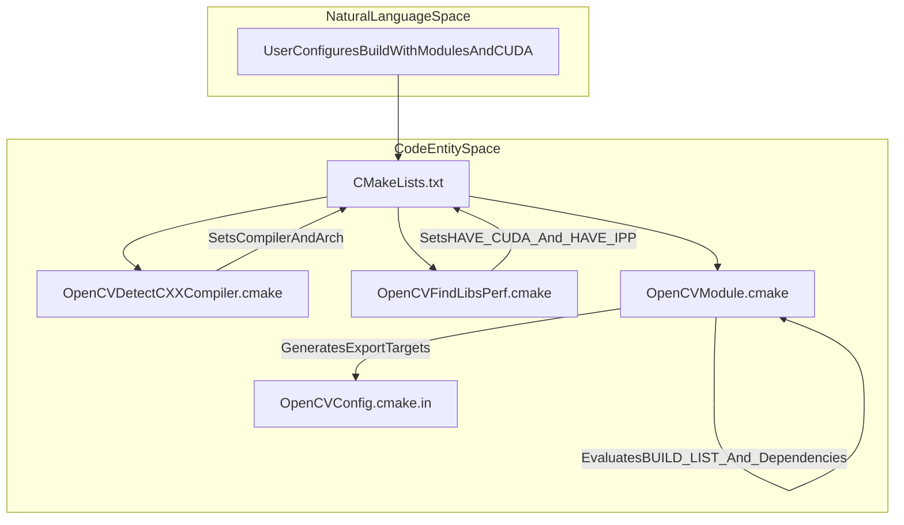
Sources: [CMakeLists.txt:1-150](), [cmake/OpenCVDetectCXXCompiler.cmake:1-116](), [cmake/OpenCVModule.cmake:1-145](), [cmake/OpenCVFindLibsPerf.cmake:1-69]()

---

## Compiling and Installing the Library

Once configured, the build directory can be compiled using native build tools.

1. **Configure the Project**: Create a build directory and run CMake [CMakeLists.txt:4-14]().
   ```bash
   mkdir build && cd build
   cmake -D CMAKE_BUILD_TYPE=Release -D CMAKE_INSTALL_PREFIX=./install ..
   ```
2. **Compile the Binaries**: Build all enabled targets using parallel jobs.
   ```bash
   cmake --build . --config Release -j $(nproc)
   ```
3. **Install Artifacts**: Populate the installation prefix directory with headers and libraries [CMakeLists.txt:101-112]().
   ```bash
   cmake --install .
   ```

Sources: [CMakeLists.txt:4-14](), [CMakeLists.txt:101-112]()

---

## Architecture-Specific Optimizations and Dispatching

OpenCV supports dynamic and static dispatching of hardware-accelerated SIMD kernels (SSE2, AVX2, AVX-512, NEON, VSX, RVV) via macros such as `ocv_add_dispatched_file` [modules/core/CMakeLists.txt:3-21]().

### SIMD Dispatching Architecture
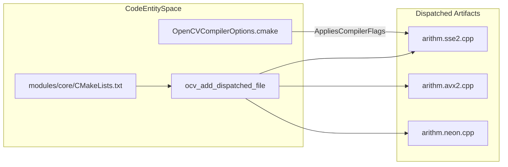
Sources: [modules/core/CMakeLists.txt:3-21](), [cmake/OpenCVCompilerOptions.cmake:1-161]()

---

## Sanity-Check: Minimal Runtime Verification

After building and installing OpenCV, verify correct linking and execution by writing a minimal program that exercises `opencv_core` and `opencv_highgui`.

### C++ Runtime Verification Code
```cpp
#include <opencv2/core.hpp>
#include <opencv2/highgui.hpp>
#include <iostream>

int main() {
    // Allocate a 100x100 matrix on the CPU via cv::Mat
    cv::Mat img(100, 100, CV_8UC3, cv::Scalar(0, 0, 255));
    if (img.empty()) {
        std::cerr << "Error: Matrix allocation failed." << std::endl;
        return -1;
    }
    std::cout << "OpenCV Build Sanity Check Passed. Version: " << CV_VERSION << std::endl;
    return 0;
}
```

### Downstream Integration via CMake
Downstream projects locate the built OpenCV installation using the generated configuration script `OpenCVConfig.cmake` [cmake/templates/OpenCVConfig.cmake.in:1-162]().

```cmake
find_package(OpenCV REQUIRED)
add_executable(sanity_check main.cpp)
target_link_libraries(sanity_check PRIVATE ${OpenCV_LIBS})
```

Sources: [modules/core/CMakeLists.txt:41-43](), [modules/highgui/CMakeLists.txt:1-7](), [cmake/templates/OpenCVConfig.cmake.in:1-162]()

---

# Page: Documentation, Samples, and Developer Apps

# Documentation, Samples, and Developer Apps

<details>
<summary>Relevant source files</summary>

The following files were used as context for generating this wiki page:

- [apps/interactive-calibration/CMakeLists.txt](apps/interactive-calibration/CMakeLists.txt)
- [apps/interactive-calibration/calibCommon.hpp](apps/interactive-calibration/calibCommon.hpp)
- [apps/interactive-calibration/calibController.cpp](apps/interactive-calibration/calibController.cpp)
- [apps/interactive-calibration/calibController.hpp](apps/interactive-calibration/calibController.hpp)
- [apps/interactive-calibration/calibPipeline.cpp](apps/interactive-calibration/calibPipeline.cpp)
- [apps/interactive-calibration/calibPipeline.hpp](apps/interactive-calibration/calibPipeline.hpp)
- [apps/interactive-calibration/defaultConfig.xml](apps/interactive-calibration/defaultConfig.xml)
- [apps/interactive-calibration/frameProcessor.cpp](apps/interactive-calibration/frameProcessor.cpp)
- [apps/interactive-calibration/frameProcessor.hpp](apps/interactive-calibration/frameProcessor.hpp)
- [apps/interactive-calibration/main.cpp](apps/interactive-calibration/main.cpp)
- [apps/interactive-calibration/parametersController.cpp](apps/interactive-calibration/parametersController.cpp)
- [apps/interactive-calibration/parametersController.hpp](apps/interactive-calibration/parametersController.hpp)
- [apps/interactive-calibration/rotationConverters.cpp](apps/interactive-calibration/rotationConverters.cpp)
- [cmake/OpenCVDetectApacheAnt.cmake](cmake/OpenCVDetectApacheAnt.cmake)
- [cmake/OpenCVDetectVTK.cmake](cmake/OpenCVDetectVTK.cmake)
- [cmake/checks/vtk_test.cpp](cmake/checks/vtk_test.cpp)
- [doc/CMakeLists.txt](doc/CMakeLists.txt)
- [doc/Doxyfile.in](doc/Doxyfile.in)
- [doc/custom.css](doc/custom.css)
- [doc/doxygen-awesome.css](doc/doxygen-awesome.css)
- [doc/footer.html](doc/footer.html)
- [doc/header.html](doc/header.html)
- [doc/js_tutorials/js_imgproc/js_contours/js_contour_features/js_contour_features.markdown](doc/js_tutorials/js_imgproc/js_contours/js_contour_features/js_contour_features.markdown)
- [doc/js_tutorials/js_imgproc/js_contours/js_contour_properties/js_contour_properties.markdown](doc/js_tutorials/js_imgproc/js_contours/js_contour_properties/js_contour_properties.markdown)
- [doc/js_tutorials/js_imgproc/js_contours/js_contours_begin/js_contours_begin.markdown](doc/js_tutorials/js_imgproc/js_contours/js_contours_begin/js_contours_begin.markdown)
- [doc/js_tutorials/js_imgproc/js_contours/js_contours_hierarchy/js_contours_hierarchy.markdown](doc/js_tutorials/js_imgproc/js_contours/js_contours_hierarchy/js_contours_hierarchy.markdown)
- [doc/js_tutorials/js_imgproc/js_contours/js_contours_more_functions/js_contours_more_functions.markdown](doc/js_tutorials/js_imgproc/js_contours/js_contours_more_functions/js_contours_more_functions.markdown)
- [doc/mymath.js](doc/mymath.js)
- [doc/mymath.sty](doc/mymath.sty)
- [doc/py_tutorials/py_calib3d/py_calibration/py_calibration.markdown](doc/py_tutorials/py_calib3d/py_calibration/py_calibration.markdown)
- [doc/py_tutorials/py_calib3d/py_pose/py_pose.markdown](doc/py_tutorials/py_calib3d/py_pose/py_pose.markdown)
- [doc/py_tutorials/py_core/py_basic_ops/py_basic_ops.markdown](doc/py_tutorials/py_core/py_basic_ops/py_basic_ops.markdown)
- [doc/py_tutorials/py_core/py_image_arithmetics/py_image_arithmetics.markdown](doc/py_tutorials/py_core/py_image_arithmetics/py_image_arithmetics.markdown)
- [doc/py_tutorials/py_core/py_optimization/py_optimization.markdown](doc/py_tutorials/py_core/py_optimization/py_optimization.markdown)
- [doc/py_tutorials/py_imgproc/py_contours/py_contour_features/py_contour_features.markdown](doc/py_tutorials/py_imgproc/py_contours/py_contour_features/py_contour_features.markdown)
- [doc/py_tutorials/py_imgproc/py_contours/py_contour_properties/py_contour_properties.markdown](doc/py_tutorials/py_imgproc/py_contours/py_contour_properties/py_contour_properties.markdown)
- [doc/py_tutorials/py_imgproc/py_contours/py_contours_begin/py_contours_begin.markdown](doc/py_tutorials/py_imgproc/py_contours/py_contours_begin/py_contours_begin.markdown)
- [doc/py_tutorials/py_imgproc/py_contours/py_contours_hierarchy/py_contours_hierarchy.markdown](doc/py_tutorials/py_imgproc/py_contours/py_contours_hierarchy/py_contours_hierarchy.markdown)
- [doc/py_tutorials/py_imgproc/py_contours/py_contours_more_functions/py_contours_more_functions.markdown](doc/py_tutorials/py_imgproc/py_contours/py_contours_more_functions/py_contours_more_functions.markdown)
- [doc/py_tutorials/py_imgproc/py_histograms/py_2d_histogram/py_2d_histogram.markdown](doc/py_tutorials/py_imgproc/py_histograms/py_2d_histogram/py_2d_histogram.markdown)
- [doc/py_tutorials/py_imgproc/py_histograms/py_histogram_begins/py_histogram_begins.markdown](doc/py_tutorials/py_imgproc/py_histograms/py_histogram_begins/py_histogram_begins.markdown)
- [doc/py_tutorials/py_objdetect/py_table_of_contents_objdetect.markdown](doc/py_tutorials/py_objdetect/py_table_of_contents_objdetect.markdown)
- [doc/py_tutorials/py_photo/py_inpainting/py_inpainting.markdown](doc/py_tutorials/py_photo/py_inpainting/py_inpainting.markdown)
- [doc/py_tutorials/py_tutorials.markdown](doc/py_tutorials/py_tutorials.markdown)
- [doc/py_tutorials/py_video/py_bg_subtraction/py_bg_subtraction.markdown](doc/py_tutorials/py_video/py_bg_subtraction/py_bg_subtraction.markdown)
- [doc/py_tutorials/py_video/py_lucas_kanade/py_lucas_kanade.markdown](doc/py_tutorials/py_video/py_lucas_kanade/py_lucas_kanade.markdown)
- [doc/tools/add_signatures.py](doc/tools/add_signatures.py)
- [doc/tools/doxygen_scan.py](doc/tools/doxygen_scan.py)
- [doc/tools/html_functions.py](doc/tools/html_functions.py)
- [modules/core/include/opencv2/core/opengl.hpp](modules/core/include/opencv2/core/opengl.hpp)
- [modules/core/src/opengl.cpp](modules/core/src/opengl.cpp)
- [modules/java/jar/CMakeLists.txt](modules/java/jar/CMakeLists.txt)
- [modules/java/jar/MANIFEST.MF.in](modules/java/jar/MANIFEST.MF.in)
- [modules/java/jar/build.xml.in](modules/java/jar/build.xml.in)
- [modules/java/jar/list_java_sources.cmake](modules/java/jar/list_java_sources.cmake)
- [samples/CMakeLists.txt](samples/CMakeLists.txt)
- [samples/cpp/CMakeLists.txt](samples/cpp/CMakeLists.txt)
- [samples/gpu/CMakeLists.txt](samples/gpu/CMakeLists.txt)
- [samples/opengl/CMakeLists.txt](samples/opengl/CMakeLists.txt)
- [samples/opengl/opengl3_2.cpp](samples/opengl/opengl3_2.cpp)
- [samples/opengl/opengl_testdata_generator.cpp](samples/opengl/opengl_testdata_generator.cpp)

</details>


This section details the infrastructure surrounding the OpenCV codebase that facilitates user education, developer diagnostics, and automated documentation generation.

## Documentation Generation

OpenCV uses **Doxygen** as its primary engine for generating API reference documentation. The process is orchestrated via CMake, which gathers headers, tutorials, and samples from across the repository and contrib modules to build a unified documentation set.

### Doxygen Pipeline and Dependencies
The documentation build follows a specific dependency scheme to ensure that language-specific documentation (Java, Python) is integrated into the final C++ reference [doc/CMakeLists.txt:5-10]().

| Target | Description |
| :--- | :--- |
| `doxygen_cpp` | The core C++ API documentation. |
| `doxygen_python` | Python-specific wrappers and docstrings [doc/Doxyfile.in:41](). |
| `doxygen_javadoc` | Java documentation generated from source. |
| `opencv_docs` | The final aggregate target containing all generated HTML/XML. |

### Configuration and Discovery
The `doc/CMakeLists.txt` script dynamically discovers documentation assets by iterating through all enabled modules (`OPENCV_MODULES_MAIN` and `OPENCV_MODULES_EXTRA`) [doc/CMakeLists.txt:42]().

*   **Headers:** Collected from each module's `include/` directory [doc/CMakeLists.txt:56-59]().
*   **Markdown Tutorials:** Discovered in module-specific `tutorials/` folders [doc/CMakeLists.txt:83-86]().
*   **BibTeX References:** Module-specific bibliography files (e.g., `imgproc.bib`) are merged into the global reference list [doc/CMakeLists.txt:110-114]().
*   **Blacklist:** Certain modules like `ts` (testing) and `world` are excluded from the public documentation [doc/CMakeLists.txt:21-22]().

### Documentation Build Data Flow
The following diagram bridges the abstract documentation concepts (Natural Language Space) to the concrete build scripts and configuration templates (Code Entity Space).

**Documentation Assembly Flow**
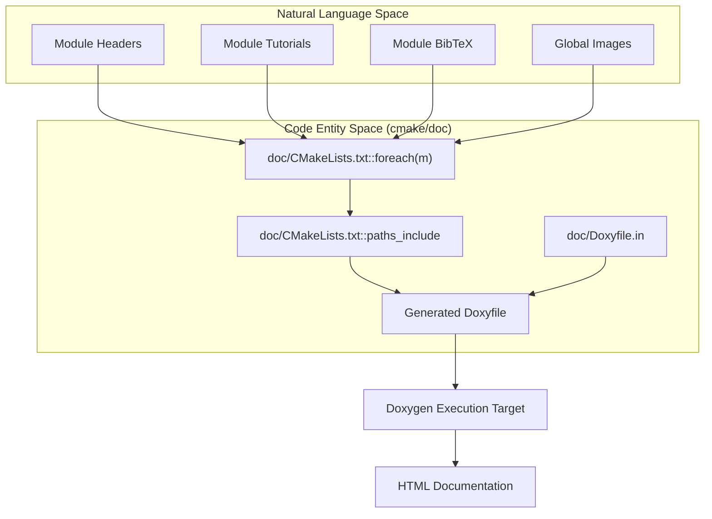
Sources: [doc/CMakeLists.txt:32-129](), [doc/Doxyfile.in:137-149]()

## Samples System

The `samples/` directory contains demonstration code for various languages and specialized backends. Samples serve both as user tutorials and as functional tests for library features.

### Sample Categories
OpenCV categorizes samples based on the target language or technology stack [samples/CMakeLists.txt:23-49]():
*   **C++ (`samples/cpp`):** The primary collection of algorithmic demonstrations.
*   **Python (`samples/python`):** Scripting examples showing the `cv2` interface.
*   **Java (`samples/java`):** Android and desktop Java wrappers.
*   **Specialized Backends:** Dedicated folders for `gpu` (CUDA), `opencl`, `tapi` (Transparent API), `dnn`, and `sycl` [samples/CMakeLists.txt:25-33]().

### Build Mechanism
Samples are built using the `ocv_define_sample` macro, which handles target creation and dependency linking.
1.  **Dependency Checking:** The `samples/cpp/CMakeLists.txt` defines a list of required modules (e.g., `opencv_core`, `opencv_imgproc`, `opencv_videoio`) and verifies their availability via `ocv_check_dependencies` [samples/cpp/CMakeLists.txt:3-21]().
2.  **Standalone vs. Integrated:** Samples can be built as part of the main OpenCV build or as a standalone project using a pre-installed OpenCV via `find_package(OpenCV)` [samples/CMakeLists.txt:61-80]().
3.  **Special Links:** Samples involving 3D visualization link against **VTK** if `HAVE_VTK` is detected [samples/cpp/CMakeLists.txt:54-57](), [cmake/OpenCVDetectVTK.cmake:69]().

Sources: [samples/CMakeLists.txt:1-143](), [samples/cpp/CMakeLists.txt:1-79](), [samples/gpu/CMakeLists.txt:3-25]()

## Developer Apps

The `apps/` directory contains interactive tools designed for developers to perform calibration, generate diagnostic patterns, and inspect models.

### Interactive Calibration App
Located in `apps/interactive-calibration/`, this application provides a GUI-based workflow for camera calibration using various patterns.

**Key Components:**
*   **`calib::CalibProcessor`:** Handles the detection and parsing of calibration patterns such as Chessboards, Circles Grids, and ChArUco boards [apps/interactive-calibration/frameProcessor.cpp:59-145]().
*   **`calib::calibController`:** Manages the state of the calibration process, including flag tuning and minimum frame requirements [apps/interactive-calibration/main.cpp:142-143]().
*   **`calib::parametersController`:** Parses command-line arguments via `cv::CommandLineParser` and configuration files (`defaultConfig.xml`) to set up the calibration session [apps/interactive-calibration/parametersController.cpp:88-170]().

### Pattern Detection Implementation
The application supports multiple pattern types, each handled by specific detection logic within the `CalibProcessor`:
*   **Chessboard:** Uses `cv::findChessboardCorners` and `cv::cornerSubPix` [apps/interactive-calibration/frameProcessor.cpp:61-68]().
*   **ChArUco:** Integrates with the `objdetect` module's ArUco dictionary system [apps/interactive-calibration/frameProcessor.cpp:75-95]().
*   **Circles Grid:** Supports symmetric and asymmetric grids using `cv::findCirclesGrid` [apps/interactive-calibration/frameProcessor.cpp:103-121]().

**Interactive Calibration Architecture**
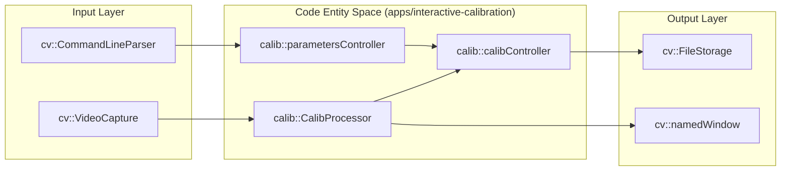
Sources: [apps/interactive-calibration/main.cpp:113-172](), [apps/interactive-calibration/frameProcessor.cpp:59-180](), [apps/interactive-calibration/parametersController.cpp:88-132]()

## Interoperability Tools

OpenCV provides specialized headers and samples for interoperability with external graphics and compute APIs.

### OpenGL Interoperability
OpenCV facilitates data sharing between `cv::Mat` and OpenGL textures/buffers.
*   **`cv::ogl::Buffer`:** A smart pointer for OpenGL buffer objects (Vertex, Pixel Pack/Unpack) [modules/core/include/opencv2/core/opengl.hpp:79-90]().
*   **CUDA Integration:** The library supports mapping OpenGL buffers directly to CUDA memory for zero-copy transfers [modules/core/src/opengl.cpp:143-156]().
*   **Hardware Abstraction:** The `cv::cuda::setGlDevice` function ensures the compute context is synchronized with the graphics context [modules/core/src/opengl.cpp:121-134]().

Sources: [modules/core/include/opencv2/core/opengl.hpp:53-155](), [modules/core/src/opengl.cpp:121-226](), [samples/opengl/CMakeLists.txt:9-33]()

---

# Page: Build System

# Build System

<details>
<summary>Relevant source files</summary>

The following files were used as context for generating this wiki page:

- [3rdparty/fastcv/fastcv.cmake](3rdparty/fastcv/fastcv.cmake)
- [3rdparty/ippicv/CMakeLists.txt](3rdparty/ippicv/CMakeLists.txt)
- [CMakeLists.txt](CMakeLists.txt)
- [cmake/OpenCVCRTLinkage.cmake](cmake/OpenCVCRTLinkage.cmake)
- [cmake/OpenCVCompilerOptions.cmake](cmake/OpenCVCompilerOptions.cmake)
- [cmake/OpenCVFindLibsGUI.cmake](cmake/OpenCVFindLibsGUI.cmake)
- [cmake/OpenCVFindLibsPerf.cmake](cmake/OpenCVFindLibsPerf.cmake)
- [cmake/OpenCVFindLibsVideo.cmake](cmake/OpenCVFindLibsVideo.cmake)
- [cmake/OpenCVModule.cmake](cmake/OpenCVModule.cmake)
- [cmake/OpenCVPCHSupport.cmake](cmake/OpenCVPCHSupport.cmake)
- [cmake/OpenCVUtils.cmake](cmake/OpenCVUtils.cmake)
- [cmake/templates/cvconfig.h.in](cmake/templates/cvconfig.h.in)
- [modules/core/CMakeLists.txt](modules/core/CMakeLists.txt)
- [modules/highgui/CMakeLists.txt](modules/highgui/CMakeLists.txt)
- [modules/java/CMakeLists.txt](modules/java/CMakeLists.txt)
- [samples/android/CMakeLists.txt](samples/android/CMakeLists.txt)
- [samples/android/color-blob-detection/CMakeLists.txt](samples/android/color-blob-detection/CMakeLists.txt)

</details>


This page describes the CMake-based build system used to configure and compile OpenCV. It serves as a high-level parent overview of the root build scripts, the module discovery mechanism, and third-party library integration. 

OpenCV uses a customized CMake build system driven by a root `CMakeLists.txt` script [CMakeLists.txt:1-14](), which coordinates platform checks, compiler detection [cmake/OpenCVDetectCXXCompiler.cmake:1-116](), option parsing [CMakeLists.txt:143-165](), and module registration [cmake/OpenCVModule.cmake:1-55]().

Sources: [CMakeLists.txt:1-14](), [cmake/OpenCVModule.cmake:1-55]()

---

## Build System Architecture Overview

The build configuration flow begins at the root `CMakeLists.txt`, which invokes core utility macros, checks environment parameters, loads toolchain files, and orchestrates target creation through a two-pass module scanning process.

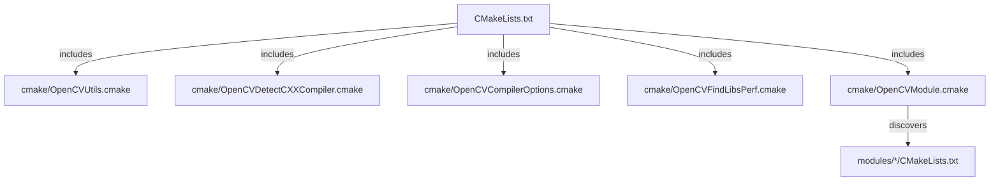

Sources: [CMakeLists.txt:16-139](), [cmake/OpenCVModule.cmake:1-55]()

---

## 2.1. Cross-Platform Build Configuration

The root `CMakeLists.txt` and associated helper scripts handle compiler and architecture detection across diverse operating systems including Windows, Linux, macOS, iOS, and Android [CMakeLists.txt:94-99](). Compiler flags, warning levels, floating-point behaviors, and precompiled headers are configured via `cmake/OpenCVCompilerOptions.cmake` [cmake/OpenCVCompilerOptions.cmake:1-161](). 

For detailed information on platform-specific toolchain configurations, system file overrides, and cross-compilation options, see [Cross-Platform Build Configuration](#2.1).

Sources: [CMakeLists.txt:94-99](), [cmake/OpenCVCompilerOptions.cmake:1-161]()

---

## 2.2. Module Configuration and ocv_add_module

OpenCV modules are registered and managed using custom CMake macros defined in `cmake/OpenCVModule.cmake`. The build system executes a two-pass scanning approach: the first pass collects metadata and resolves required or optional module dependencies, while the second pass creates the actual CMake library targets [cmake/OpenCVModule.cmake:120-144](). This subsystem also manages the assembly of `opencv_world` and generates `OpenCVConfig.cmake` for downstream consumers.

For detailed documentation on module declaration macros, dependency trees, and export configuration, see [Module Configuration and ocv_add_module](#2.2).

Sources: [cmake/OpenCVModule.cmake:1-55](), [cmake/OpenCVModule.cmake:120-144]()

---

## 2.3. Version Management, Packaging, and Platform Builds

Version numbers are centrally defined and propagated to CMake caches, Python packages, Maven artifacts, and Android build scripts. The CPack facility automates the generation of distribution packages (ZIP, DEB, RPM), while specialized python orchestrators like `build_sdk.py` handle multi-ABI Android SDK compilations.

For comprehensive instructions on version propagation, packaging rules, and mobile SDK orchestration, see [Version Management, Packaging, and Platform Builds](#2.3).

Sources: [CMakeLists.txt:125-133]()

---

## 2.4. Third-Party Dependencies and 3rdparty/ Integration

OpenCV relies on a broad set of third-party libraries for image codecs (JPEG, PNG, TIFF, WebP), video I/O, parallel processing backends (TBB), and hardware acceleration (Intel IPP/IPPICV). The build system determines whether to link against system-installed packages or build bundled sources from the `3rdparty/` directory based on user options (`BUILD_*` and `WITH_*`) [CMakeLists.txt:148-165](), [cmake/OpenCVFindLibsPerf.cmake:1-40]().

For detailed analysis of third-party selection logic, bundled library paths, and performance library integration, see [Third-Party Dependencies and 3rdparty/ Integration](#2.4).

Sources: [CMakeLists.txt:148-165](), [cmake/OpenCVFindLibsPerf.cmake:1-40]()

---

# Page: Cross-Platform Build Configuration

# Cross-Platform Build Configuration

<details>
<summary>Relevant source files</summary>

The following files were used as context for generating this wiki page:

- [3rdparty/fastcv/fastcv.cmake](3rdparty/fastcv/fastcv.cmake)
- [3rdparty/ippicv/CMakeLists.txt](3rdparty/ippicv/CMakeLists.txt)
- [CMakeLists.txt](CMakeLists.txt)
- [cmake/OpenCVCRTLinkage.cmake](cmake/OpenCVCRTLinkage.cmake)
- [cmake/OpenCVCompilerOptions.cmake](cmake/OpenCVCompilerOptions.cmake)
- [cmake/OpenCVDetectCXXCompiler.cmake](cmake/OpenCVDetectCXXCompiler.cmake)
- [cmake/OpenCVDownload.cmake](cmake/OpenCVDownload.cmake)
- [cmake/OpenCVFindIPP.cmake](cmake/OpenCVFindIPP.cmake)
- [cmake/OpenCVFindIPPIW.cmake](cmake/OpenCVFindIPPIW.cmake)
- [cmake/OpenCVFindLibsGUI.cmake](cmake/OpenCVFindLibsGUI.cmake)
- [cmake/OpenCVFindLibsPerf.cmake](cmake/OpenCVFindLibsPerf.cmake)
- [cmake/OpenCVFindLibsVideo.cmake](cmake/OpenCVFindLibsVideo.cmake)
- [cmake/OpenCVGenConfig.cmake](cmake/OpenCVGenConfig.cmake)
- [cmake/OpenCVInstallLayout.cmake](cmake/OpenCVInstallLayout.cmake)
- [cmake/OpenCVModule.cmake](cmake/OpenCVModule.cmake)
- [cmake/OpenCVPCHSupport.cmake](cmake/OpenCVPCHSupport.cmake)
- [cmake/OpenCVUtils.cmake](cmake/OpenCVUtils.cmake)
- [cmake/mirrors/custom.cmake](cmake/mirrors/custom.cmake)
- [cmake/mirrors/gitcode.cmake](cmake/mirrors/gitcode.cmake)
- [cmake/platforms/OpenCV-Android.cmake](cmake/platforms/OpenCV-Android.cmake)
- [cmake/platforms/OpenCV-Darwin.cmake](cmake/platforms/OpenCV-Darwin.cmake)
- [cmake/platforms/OpenCV-WinRT.cmake](cmake/platforms/OpenCV-WinRT.cmake)
- [cmake/platforms/OpenCV-WindowsCE.cmake](cmake/platforms/OpenCV-WindowsCE.cmake)
- [cmake/templates/OpenCVConfig-version.cmake.in](cmake/templates/OpenCVConfig-version.cmake.in)
- [cmake/templates/OpenCVConfig.cmake.in](cmake/templates/OpenCVConfig.cmake.in)
- [cmake/templates/OpenCVConfig.root-ANDROID.cmake.in](cmake/templates/OpenCVConfig.root-ANDROID.cmake.in)
- [cmake/templates/OpenCVConfig.root-WIN32.cmake.in](cmake/templates/OpenCVConfig.root-WIN32.cmake.in)
- [cmake/templates/cvconfig.h.in](cmake/templates/cvconfig.h.in)
- [doc/tutorials/introduction/config_reference/config_reference.markdown](doc/tutorials/introduction/config_reference/config_reference.markdown)
- [doc/tutorials/introduction/env_reference/env_reference.markdown](doc/tutorials/introduction/env_reference/env_reference.markdown)
- [modules/core/CMakeLists.txt](modules/core/CMakeLists.txt)
- [modules/highgui/CMakeLists.txt](modules/highgui/CMakeLists.txt)
- [modules/java/CMakeLists.txt](modules/java/CMakeLists.txt)
- [samples/android/CMakeLists.txt](samples/android/CMakeLists.txt)
- [samples/android/color-blob-detection/CMakeLists.txt](samples/android/color-blob-detection/CMakeLists.txt)
- [samples/sycl/CMakeLists.txt](samples/sycl/CMakeLists.txt)

</details>


## Purpose and Scope

This document explains OpenCV's cross-platform build configuration system, which covers platform detection, compiler and architecture identification, compiler flag management, platform-specific differences across Windows, Linux, macOS, iOS, and Android, and the integration of third-party GUI, video, image codec, and performance libraries. The entire configuration pipeline is orchestrated via CMake, driven primarily by the root `CMakeLists.txt` [CMakeLists.txt:1-2051]() and supporting scripts located in the `cmake/` directory.

Sources: [CMakeLists.txt:1-2051]()

## Platform Detection and Configuration

OpenCV employs CMake to detect the target operating system and hardware architecture, loading specialized configuration files early in the initialization sequence.

### Initialization Flow and Platform Loading

When CMake processes the root `CMakeLists.txt` [CMakeLists.txt:1-2051](), it validates minimum version constraints [CMakeLists.txt:16-18](), sets up custom CMake hooks via `ocv_cmake_hook_register_dir()` and `ocv_cmake_hook()` [cmake/OpenCVUtils.cmake:48-68](), bootstraps languages with `project(OpenCV CXX C)` [CMakeLists.txt:78-78](), and attempts to include a system-specific module from `cmake/platforms/OpenCV-${CMAKE_SYSTEM_NAME}.cmake` [CMakeLists.txt:94-99]().

Title: "Build System Bootstrap and Platform Loading Flow"
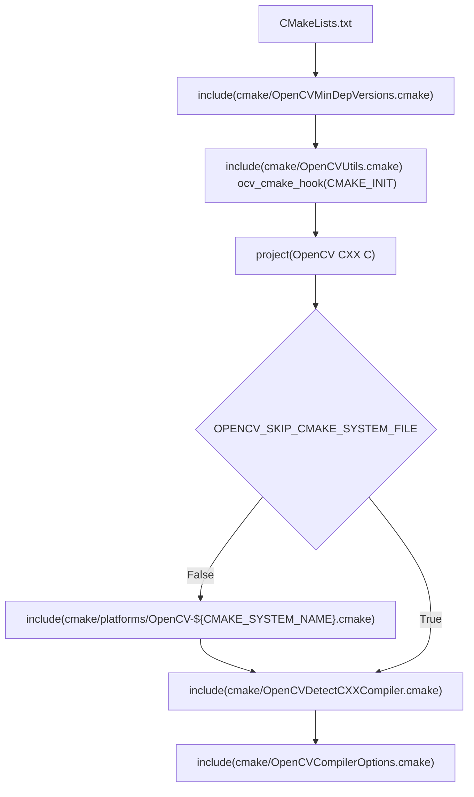
Sources: [CMakeLists.txt:16-18](), [CMakeLists.txt:42-53](), [CMakeLists.txt:78-78](), [CMakeLists.txt:94-99](), [CMakeLists.txt:139-140](), [cmake/OpenCVUtils.cmake:55-68]()

### Default Installation Paths

The root `CMakeLists.txt` sets the `CMAKE_INSTALL_PREFIX` depending on whether the build is cross-compiled or targeting Windows [CMakeLists.txt:101-112]().

| Condition | Default Prefix | Code Reference |
|-----------|----------------|----------------|
| `NOT CMAKE_CROSSCOMPILING` AND `WIN32` | `${CMAKE_BINARY_DIR}/install` | [CMakeLists.txt:103-104]() |
| `NOT CMAKE_CROSSCOMPILING` AND `NOT WIN32` | `/usr/local` | [CMakeLists.txt:105-106]() |
| `CMAKE_CROSSCOMPILING` | `${CMAKE_BINARY_DIR}/install` | [CMakeLists.txt:109-111]() |

Sources: [CMakeLists.txt:101-112]()

---

## Compiler Detection and Architecture Sinks

Compiler identification and target architecture determination are centralized in `cmake/OpenCVDetectCXXCompiler.cmake` [cmake/OpenCVDetectCXXCompiler.cmake:1-265]().

### Processor Architecture Parsing

The build system inspects `CMAKE_SYSTEM_PROCESSOR` to establish boolean architecture flags (`X86_64`, `X86`, `ARM`, `AARCH64`, `PPC64LE`, `MIPS`, `RISCV`, `LOONGARCH64`) [cmake/OpenCVDetectCXXCompiler.cmake:91-116](). It also guards against 32-bit user spaces running on 64-bit kernels by validating `CMAKE_SIZEOF_VOID_P` [cmake/OpenCVDetectCXXCompiler.cmake:118-138]().

| Target Variable | Matching Pattern (`CMAKE_SYSTEM_PROCESSOR`) |
|-----------------|---------------------------------------------|
| `X86_64` | `amd64.*|x86_64.*|AMD64.*` [cmake/OpenCVDetectCXXCompiler.cmake:94-95]() |
| `X86` | `i686.*|i386.*|x86.*` [cmake/OpenCVDetectCXXCompiler.cmake:96-97]() |
| `AARCH64` | `aarch64.*|AARCH64.*|arm64.*|ARM64.*` [cmake/OpenCVDetectCXXCompiler.cmake:98-99]() |
| `ARM` | `arm.*|ARM.*` [cmake/OpenCVDetectCXXCompiler.cmake:100-101]() |
| `PPC64LE` | `powerpc|ppc64le` [cmake/OpenCVDetectCXXCompiler.cmake:102-103]() |
| `RISCV` | `riscv.*|RISCV.*` [cmake/OpenCVDetectCXXCompiler.cmake:108-109]() |

Sources: [cmake/OpenCVDetectCXXCompiler.cmake:91-116]()

---

## Compiler Flags and Optimization Management

Compiler flags, optimization levels, and warning configurations are managed inside `cmake/OpenCVCompilerOptions.cmake` [cmake/OpenCVCompilerOptions.cmake:1-575]().

### Flag Addition Macros

The macro `add_extra_compiler_option` evaluates whether the host/target compiler supports a given flag via `ocv_check_flag_support` before appending it to `OPENCV_EXTRA_CXX_FLAGS` or `OPENCV_EXTRA_C_FLAGS` [cmake/OpenCVCompilerOptions.cmake:50-60]().

```cmake
macro(add_extra_compiler_option option)
  ocv_check_flag_support(CXX "${option}" _varname "${OPENCV_EXTRA_CXX_FLAGS} ${ARGN}")
  if(${_varname})
    set(OPENCV_EXTRA_CXX_FLAGS "${OPENCV_EXTRA_CXX_FLAGS} ${option}")
  endif()
  ...
endmacro()
```

### Floating-Point Math and Compiler Flags

| Compiler Family | Detection Variable | Key Default / Fast-Math Flags |
|-----------------|--------------------|-------------------------------|
| GCC / Clang | `CV_GCC`, `CV_CLANG` | `-fsigned-char`, `-Wall`, `-ffast-math` (if enabled) [cmake/OpenCVCompilerOptions.cmake:93-94](), [cmake/OpenCVCompilerOptions.cmake:126-129]() |
| MSVC | `MSVC` | `/fp:precise` or `/fp:fast` [cmake/OpenCVCompilerOptions.cmake:98-102]() |
| Intel ICC / ICX | `CV_ICC`, `CV_ICX` | `-fp-model precise`, `-fno-fast-math` [cmake/OpenCVCompilerOptions.cmake:104-124]() |

Sources: [cmake/OpenCVCompilerOptions.cmake:50-130]()

---

## Third-Party Library Integration

OpenCV supports robust detection and conditional compilation of third-party libraries for GUI, video input/output, codecs, and performance primitives.

### GUI Backend Selection (`highgui`)

The `modules/highgui/CMakeLists.txt` script evaluates available GUI toolkits to select a built-in backend (`OPENCV_HIGHGUI_BUILTIN_BACKEND`) or configure dynamic plugins [modules/highgui/CMakeLists.txt:43-195]().

Title: "Performance and Dependency Detection Pipeline in cmake/OpenCVFindLibsPerf.cmake"
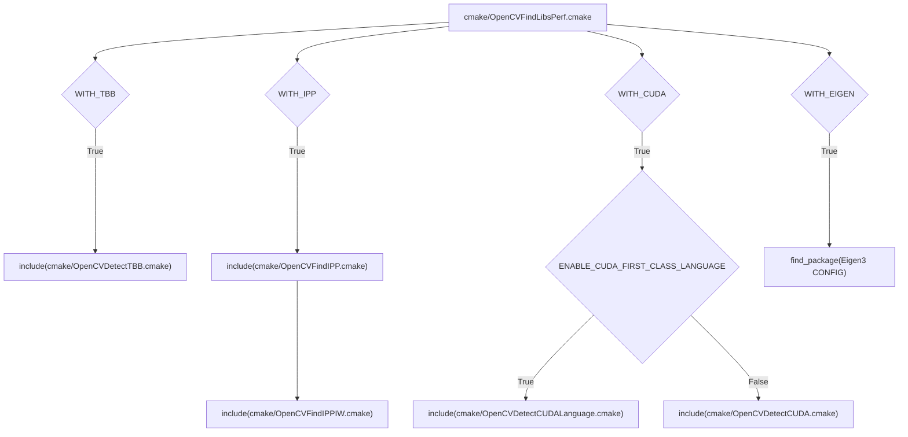
Sources: [cmake/OpenCVFindLibsPerf.cmake:6-14](), [cmake/OpenCVFindLibsPerf.cmake:57-78](), [modules/highgui/CMakeLists.txt:43-195]()

### Performance Acceleration Libraries

Mathematics, threading, and hardware acceleration libraries are integrated through specialized detection scripts invoked from `cmake/OpenCVFindLibsPerf.cmake` [cmake/OpenCVFindLibsPerf.cmake:1-189]():
*   **TBB**: Managed by `cmake/OpenCVDetectTBB.cmake` [cmake/OpenCVFindLibsPerf.cmake:6-8]().
*   **IPP & IPPIW**: Discovered via `cmake/OpenCVFindIPP.cmake` and `cmake/OpenCVFindIPPIW.cmake`, linking optimization wrappers and excluding static symbols where appropriate on Linux/Android [cmake/OpenCVFindLibsPerf.cmake:11-38]().
*   **Eigen**: Searched via CMake package configuration (`Eigen3::Eigen`) or manual header path probing (`Eigen/Core`) [cmake/OpenCVFindLibsPerf.cmake:72-138]().
*   **Clp / CoinUtils**: Configured for linear programming optimization solvers [cmake/OpenCVFindLibsPerf.cmake:146-189]().

Sources: [cmake/OpenCVFindLibsPerf.cmake:1-189]()

---

## Summary of Key Configuration Entities

| Code Entity / Function | File Path | Role |
|------------------------|-----------|------|
| `ocv_cmake_hook` | [cmake/OpenCVUtils.cmake:55-68]() | Executes registered third-party or custom build hooks at key points. |
| `add_extra_compiler_option` | [cmake/OpenCVCompilerOptions.cmake:50-60]() | Tests flag compatibility and appends safe options to C/C++ flags. |
| `ocv_add_module` | [cmake/OpenCVModule.cmake:124-151]() | Declares an OpenCV module, its type, and dependencies. |
| `OPENCV_HIGHGUI_BUILTIN_BACKEND` | [modules/highgui/CMakeLists.txt:43-188]() | Selects the active GUI window management framework (Qt, Cocoa, Win32, GTK, Wayland). |

Sources: [cmake/OpenCVUtils.cmake:55-68](), [cmake/OpenCVCompilerOptions.cmake:50-60](), [cmake/OpenCVModule.cmake:124-151](), [modules/highgui/CMakeLists.txt:43-188]()

---

# Page: Module Configuration and ocv_add_module

# Module Configuration and ocv_add_module

<details>
<summary>Relevant source files</summary>

The following files were used as context for generating this wiki page:

- [3rdparty/fastcv/fastcv.cmake](3rdparty/fastcv/fastcv.cmake)
- [3rdparty/ippicv/CMakeLists.txt](3rdparty/ippicv/CMakeLists.txt)
- [CMakeLists.txt](CMakeLists.txt)
- [cmake/OpenCVCRTLinkage.cmake](cmake/OpenCVCRTLinkage.cmake)
- [cmake/OpenCVCompilerOptions.cmake](cmake/OpenCVCompilerOptions.cmake)
- [cmake/OpenCVDetectCXXCompiler.cmake](cmake/OpenCVDetectCXXCompiler.cmake)
- [cmake/OpenCVDownload.cmake](cmake/OpenCVDownload.cmake)
- [cmake/OpenCVFindIPP.cmake](cmake/OpenCVFindIPP.cmake)
- [cmake/OpenCVFindIPPIW.cmake](cmake/OpenCVFindIPPIW.cmake)
- [cmake/OpenCVFindLibsGUI.cmake](cmake/OpenCVFindLibsGUI.cmake)
- [cmake/OpenCVFindLibsPerf.cmake](cmake/OpenCVFindLibsPerf.cmake)
- [cmake/OpenCVFindLibsVideo.cmake](cmake/OpenCVFindLibsVideo.cmake)
- [cmake/OpenCVGenAndroidMK.cmake](cmake/OpenCVGenAndroidMK.cmake)
- [cmake/OpenCVGenConfig.cmake](cmake/OpenCVGenConfig.cmake)
- [cmake/OpenCVGenHeaders.cmake](cmake/OpenCVGenHeaders.cmake)
- [cmake/OpenCVGenPkgconfig.cmake](cmake/OpenCVGenPkgconfig.cmake)
- [cmake/OpenCVInstallLayout.cmake](cmake/OpenCVInstallLayout.cmake)
- [cmake/OpenCVModule.cmake](cmake/OpenCVModule.cmake)
- [cmake/OpenCVPCHSupport.cmake](cmake/OpenCVPCHSupport.cmake)
- [cmake/OpenCVUtils.cmake](cmake/OpenCVUtils.cmake)
- [cmake/mirrors/custom.cmake](cmake/mirrors/custom.cmake)
- [cmake/mirrors/gitcode.cmake](cmake/mirrors/gitcode.cmake)
- [cmake/platforms/OpenCV-Android.cmake](cmake/platforms/OpenCV-Android.cmake)
- [cmake/platforms/OpenCV-Darwin.cmake](cmake/platforms/OpenCV-Darwin.cmake)
- [cmake/platforms/OpenCV-WinRT.cmake](cmake/platforms/OpenCV-WinRT.cmake)
- [cmake/platforms/OpenCV-WindowsCE.cmake](cmake/platforms/OpenCV-WindowsCE.cmake)
- [cmake/templates/OpenCV-abi.mk.in](cmake/templates/OpenCV-abi.mk.in)
- [cmake/templates/OpenCV.mk.in](cmake/templates/OpenCV.mk.in)
- [cmake/templates/OpenCVConfig-version.cmake.in](cmake/templates/OpenCVConfig-version.cmake.in)
- [cmake/templates/OpenCVConfig.cmake.in](cmake/templates/OpenCVConfig.cmake.in)
- [cmake/templates/OpenCVConfig.root-ANDROID.cmake.in](cmake/templates/OpenCVConfig.root-ANDROID.cmake.in)
- [cmake/templates/OpenCVConfig.root-WIN32.cmake.in](cmake/templates/OpenCVConfig.root-WIN32.cmake.in)
- [cmake/templates/cvconfig.h.in](cmake/templates/cvconfig.h.in)
- [cmake/templates/opencv-XXX.pc.in](cmake/templates/opencv-XXX.pc.in)
- [doc/tutorials/introduction/config_reference/config_reference.markdown](doc/tutorials/introduction/config_reference/config_reference.markdown)
- [doc/tutorials/introduction/env_reference/env_reference.markdown](doc/tutorials/introduction/env_reference/env_reference.markdown)
- [modules/core/CMakeLists.txt](modules/core/CMakeLists.txt)
- [modules/highgui/CMakeLists.txt](modules/highgui/CMakeLists.txt)
- [modules/java/CMakeLists.txt](modules/java/CMakeLists.txt)
- [samples/android/CMakeLists.txt](samples/android/CMakeLists.txt)
- [samples/android/color-blob-detection/CMakeLists.txt](samples/android/color-blob-detection/CMakeLists.txt)
- [samples/cpp/example_cmake/Makefile](samples/cpp/example_cmake/Makefile)
- [samples/sycl/CMakeLists.txt](samples/sycl/CMakeLists.txt)

</details>


## Purpose and Scope

This document explains OpenCV's module system, focusing on how modules are declared, configured, and built. It covers the `ocv_add_module` macro, dependency resolution, module metadata management, and the two-pass configuration system that enables modular compilation. It also details how `opencv_world` is constructed and how `OpenCVConfig.cmake` is generated for downstream consumers.

For information about cross-platform build configuration and third-party library detection, see [Cross-Platform Build Configuration](2.1). For package generation and version management, see [Version Management and Platform Builds](2.3).

Sources: [cmake/OpenCVModule.cmake:1-32]()

## Module Declaration Overview

OpenCV modules are defined using the `ocv_add_module` macro, which registers a module with the build system and declares its dependencies. Each module contains a `CMakeLists.txt` file that invokes this macro as its first significant action.

**Typical Module Declaration Pattern**

```cmake
ocv_add_module(module_name 
    [INTERNAL|BINDINGS]
    [REQUIRED] dependency1 dependency2
    [OPTIONAL] optional_dep1
    [PRIVATE_REQUIRED] private_dep
    [WRAP] python java)
```

**Module Declaration Flow**

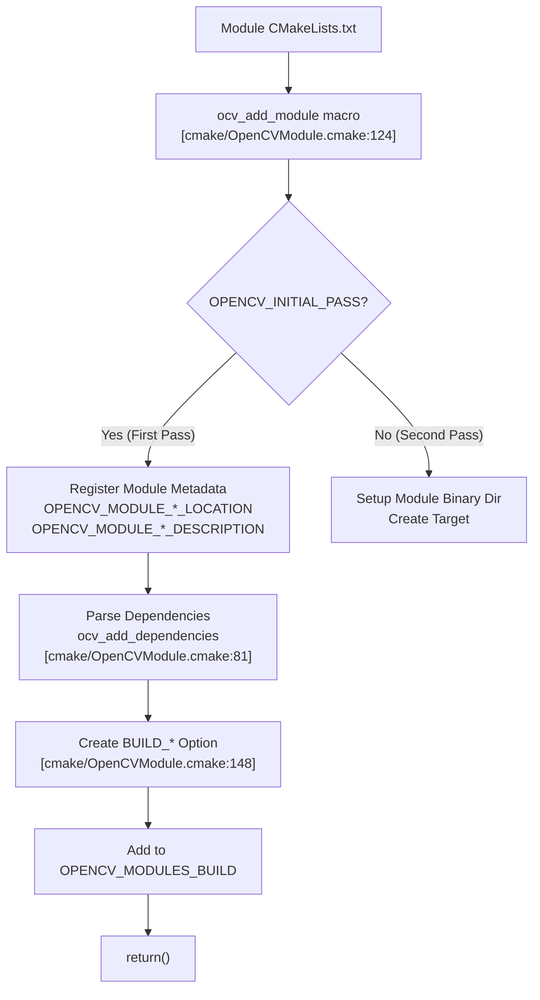

Sources: [cmake/OpenCVModule.cmake:81-117](), [cmake/OpenCVModule.cmake:124-151]()

## Module System Architecture

The module system uses a centralized registry that tracks all modules, their locations, dependencies, and build status. Global CMake cache variables maintain this state across configuration runs.

**Module Registry Structure**

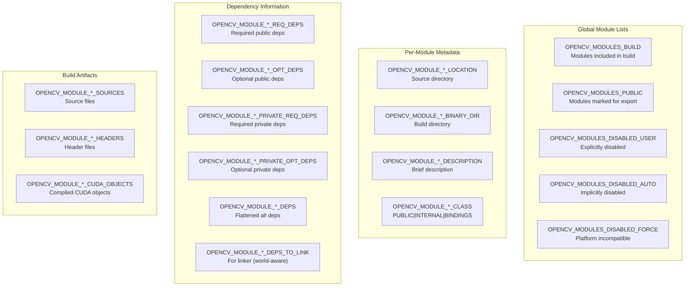

Sources: [cmake/OpenCVModule.cmake:1-25](), [cmake/OpenCVModule.cmake:69-74]()

## Dependency Specification

Dependencies are specified through the `ocv_add_module` and `ocv_add_dependencies` macros. The system supports four dependency types with different visibility and requirement levels.

**Dependency Types and Resolution**

| Dependency Type | Keyword | Visibility | Effect if Missing |
|----------------|---------|------------|------------------|
| Public Required | `REQUIRED` | Exported in CMake config | Module disabled |
| Public Optional | `OPTIONAL` | Exported if available | Ignored |
| Private Required | `PRIVATE_REQUIRED` | Internal only | Module disabled |
| Private Optional | `PRIVATE_OPTIONAL` | Internal only | Ignored |

**Example: core Module Dependencies**
[modules/core/CMakeLists.txt:41-43]()
```cmake
ocv_add_module(core
               OPTIONAL opencv_cudev
               WRAP java objc python js)
```

**Example: highgui Module Dependencies**
[modules/highgui/CMakeLists.txt:3-7]()
```cmake
if(ANDROID)
  ocv_add_module(highgui opencv_imgproc OPTIONAL opencv_imgcodecs opencv_videoio WRAP python)
else()
  ocv_add_module(highgui opencv_imgproc OPTIONAL opencv_imgcodecs opencv_videoio WRAP python java)
endif()
```

**Dependency Resolution Process**

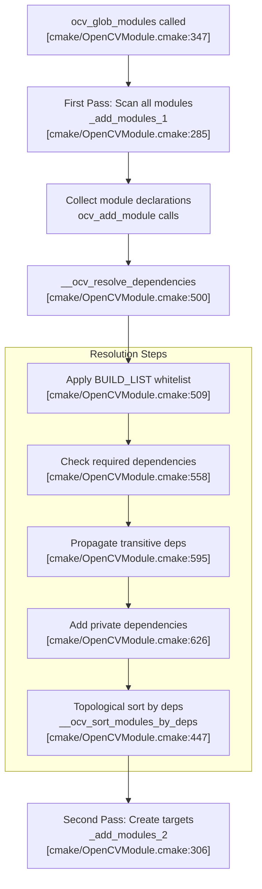

Sources: [cmake/OpenCVModule.cmake:285-324](), [cmake/OpenCVModule.cmake:347-399](), [cmake/OpenCVModule.cmake:447-497](), [cmake/OpenCVModule.cmake:500-695]()

## The ocv_add_module Macro

The `ocv_add_module` macro is the primary interface for module registration. It processes dependency declarations, creates build options, and initializes module metadata.

**Macro Signature and Parameters**

[cmake/OpenCVModule.cmake:119-223]()

```cmake
ocv_add_module(<name> 
    [INTERNAL|BINDINGS] 
    [REQUIRED] <dep1> <dep2> ...
    [OPTIONAL] <opt_dep1> ...
    [PRIVATE_REQUIRED] <priv_dep1> ...
    [PRIVATE_OPTIONAL] <priv_opt1> ...
    [WRAP] <wrapper1> <wrapper2> ...)
```

**Parameter Processing**

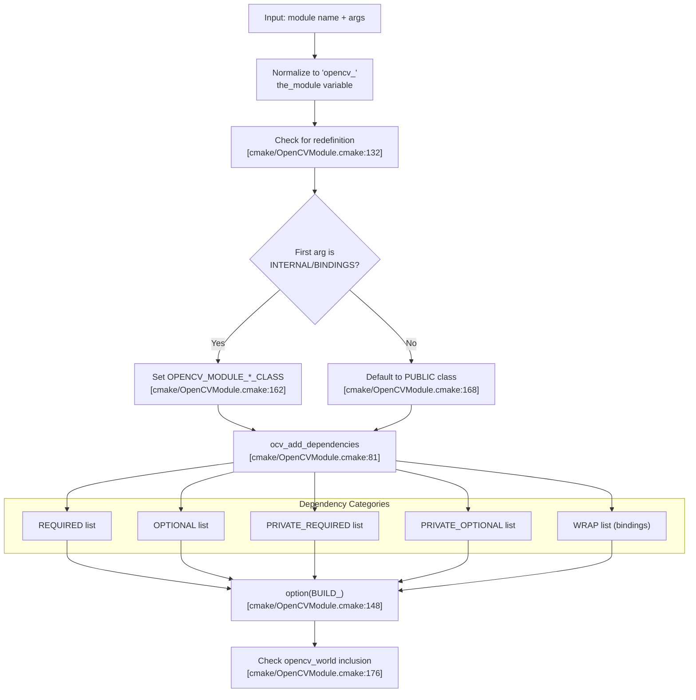

Sources: [cmake/OpenCVModule.cmake:81-117](), [cmake/OpenCVModule.cmake:124-223]()

## Two-Pass Configuration System

OpenCV uses a two-pass system: the first pass discovers and registers all modules, while the second pass creates build targets after dependency resolution.

**Two-Pass Execution Model**

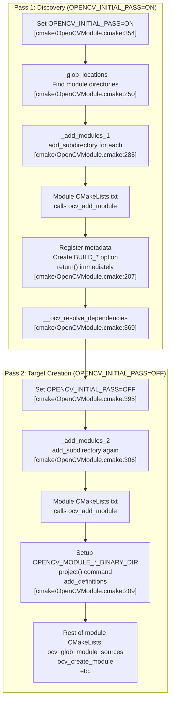

Sources: [cmake/OpenCVModule.cmake:130-223](), [cmake/OpenCVModule.cmake:250-324](), [cmake/OpenCVModule.cmake:347-399]()

## Module Classes and Visibility

Modules are categorized into three classes that affect their visibility in the public API and installation packages.

**Module Classification System**

| Class | Declaration | Public API | Installed | Examples |
|-------|------------|------------|-----------|----------|
| `PUBLIC` | Default or explicit | Yes | Yes | `core`, `imgproc`, `dnn` |
| `INTERNAL` | `ocv_add_module(name INTERNAL ...)` | No | No | Test utilities, internal tools |
| `BINDINGS` | `ocv_add_module(name BINDINGS ...)` | No | Yes | `python`, `java` binding generators |

**Class Determination Logic**

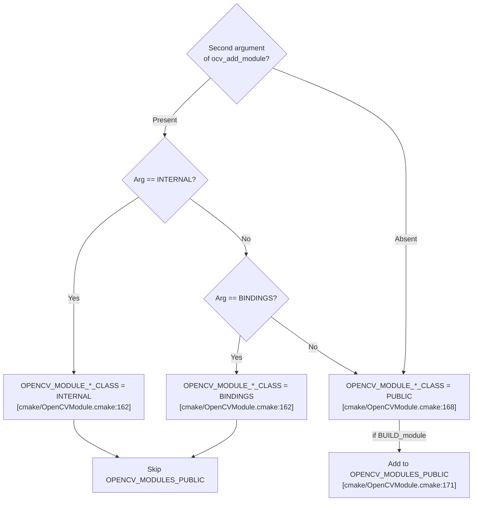

Sources: [cmake/OpenCVModule.cmake:161-173]()

## opencv_world and Configuration Generation

OpenCV supports building a single "fat" library called `opencv_world` which combines all enabled modules.

### Construction and Data Flow
The `opencv_world` build logic orchestrates the merging of multiple OpenCV modules into a single binary. This is primarily managed by filtering modules during the configuration phase.

**opencv_world Construction Logic**
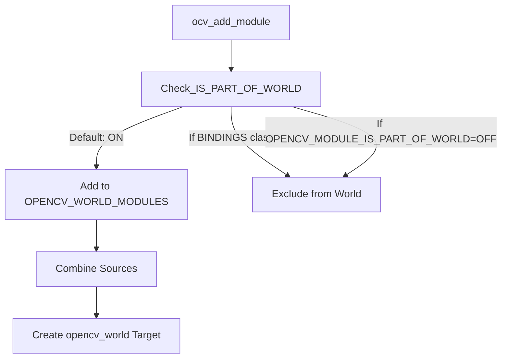

- Modules are excluded if they are `BINDINGS` or if the user explicitly disables `OPENCV_MODULE_IS_PART_OF_WORLD` [cmake/OpenCVModule.cmake:176-187]().
- The linker dependencies for world builds are tracked in `OPENCV_MODULE_${the_module}_DEPS_TO_LINK` [cmake/OpenCVModule.cmake:15]().

Sources: [cmake/OpenCVModule.cmake:1-32](), [cmake/OpenCVModule.cmake:176-187]()

### OpenCVConfig.cmake Generation
For downstream consumers using `find_package(OpenCV)`, OpenCV generates a configuration file from a template located at `cmake/templates/OpenCVConfig.cmake.in`.

- **Version Information**: Defines `OpenCV_VERSION_MAJOR`, `MINOR`, and `PATCH` [cmake/templates/OpenCVConfig.cmake.in:48-51]().
- **Include Paths**: Sets `OpenCV_INCLUDE_DIRS` based on the installation path [cmake/templates/OpenCVConfig.cmake.in:103-115]().
- **Target Mapping**: Includes the generated `OpenCVModules.cmake` to import module targets [cmake/templates/OpenCVConfig.cmake.in:120]().
- **Config Remapping**: On Windows/MSVC, it maps `RelWithDebInfo` and `MinSizeRel` to `Release` to prevent ABI mismatches [cmake/templates/OpenCVConfig.cmake.in:135-141]().

Sources: [cmake/templates/OpenCVConfig.cmake.in:1-155]()

## Dependency Resolution Details

The dependency resolution algorithm ensures that all required dependencies are available and propagates transitive dependencies through the module graph.

**Whitelist Filtering**
When `BUILD_LIST` is set [CMakeLists.txt:145](), only specified modules and their dependencies are built.
[cmake/OpenCVModule.cmake:509-541]()

**Topological Sorting Algorithm**
The `__ocv_sort_modules_by_deps` function orders modules so dependencies come before dependents.
[cmake/OpenCVModule.cmake:447-497]()

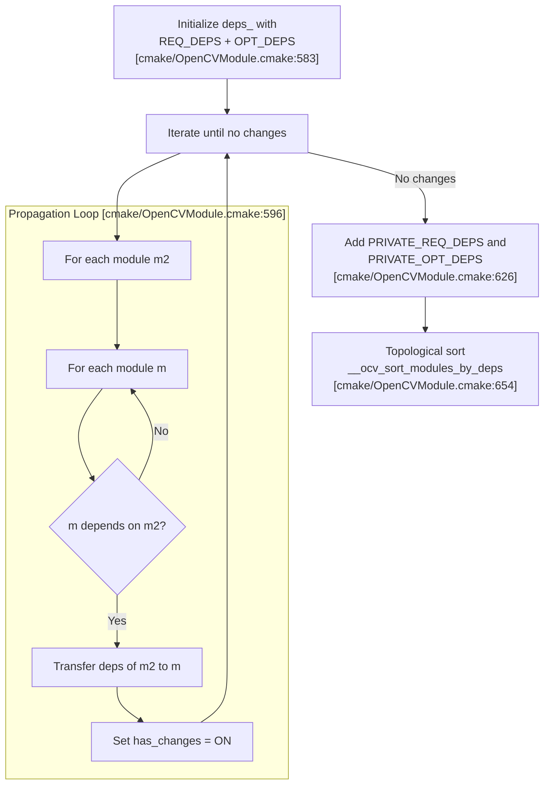

Sources: [cmake/OpenCVModule.cmake:447-497](), [cmake/OpenCVModule.cmake:509-655]()

## Practical Examples

**Example 1: core Module**
The `core` module is the foundation, specifying optional dependencies like `opencv_cudev`.
[modules/core/CMakeLists.txt:41-43]()

**Example 2: highgui with Backend Detection**
The `highgui` module detects various GUI backends (Qt, Cocoa, Wayland) and conditionally adds source files and libraries.
[modules/highgui/CMakeLists.txt:55-150]()

**Example 3: Module Disabling**
If a module's required dependencies are not found, it is moved to `OPENCV_MODULES_DISABLED_AUTO`.
[cmake/OpenCVModule.cmake:564-573]()

Sources: [modules/core/CMakeLists.txt:41-43](), [modules/highgui/CMakeLists.txt:55-150](), [cmake/OpenCVModule.cmake:564-573]()

## Module Helper Macros

Beyond `ocv_add_module`, several helper macros support module configuration.

| Macro | Purpose | File:Line |
|-------|---------|-----------|
| `ocv_module_disable` | Explicitly disables a module and its dependents | [cmake/OpenCVModule.cmake:226]() |
| `ocv_include_modules` | Adds include directories for specified modules | [cmake/OpenCVModule.cmake:699]() |
| `ocv_module_include_directories` | Adds extra include paths for the current module | [cmake/OpenCVModule.cmake:755]() |
| `ocv_cmake_hook` | Executes registered build system hooks | [cmake/OpenCVUtils.cmake:55]() |

Sources: [cmake/OpenCVModule.cmake:226-772](), [cmake/OpenCVUtils.cmake:55-68]()

---

# Page: Version Management, Packaging, and Platform Builds

# Version Management, Packaging, and Platform Builds

<details>
<summary>Relevant source files</summary>

The following files were used as context for generating this wiki page:

- [.github/ISSUE_TEMPLATE.md](.github/ISSUE_TEMPLATE.md)
- [.github/ISSUE_TEMPLATE/bug_report.yml](.github/ISSUE_TEMPLATE/bug_report.yml)
- [.github/ISSUE_TEMPLATE/config.yml](.github/ISSUE_TEMPLATE/config.yml)
- [.github/ISSUE_TEMPLATE/documentation.yml](.github/ISSUE_TEMPLATE/documentation.yml)
- [.github/ISSUE_TEMPLATE/feature_request.yml](.github/ISSUE_TEMPLATE/feature_request.yml)
- [.github/PULL_REQUEST_TEMPLATE.md](.github/PULL_REQUEST_TEMPLATE.md)
- [COPYRIGHT](COPYRIGHT)
- [LICENSE](LICENSE)
- [cmake/OpenCVPackaging.cmake](cmake/OpenCVPackaging.cmake)
- [cmake/android/android_gradle_projects.cmake](cmake/android/android_gradle_projects.cmake)
- [doc/LICENSE_BSD.txt](doc/LICENSE_BSD.txt)
- [doc/py_tutorials/py_setup/py_intro/py_intro.markdown](doc/py_tutorials/py_setup/py_intro/py_intro.markdown)
- [doc/tutorials/dnn/dnn_android/dnn_android.markdown](doc/tutorials/dnn/dnn_android/dnn_android.markdown)
- [doc/tutorials/introduction/android_binary_package/android_dev_intro.markdown](doc/tutorials/introduction/android_binary_package/android_dev_intro.markdown)
- [doc/tutorials/introduction/android_binary_package/dev_with_OCV_on_Android.markdown](doc/tutorials/introduction/android_binary_package/dev_with_OCV_on_Android.markdown)
- [doc/tutorials/introduction/clojure_dev_intro/clojure_dev_intro.markdown](doc/tutorials/introduction/clojure_dev_intro/clojure_dev_intro.markdown)
- [doc/tutorials/introduction/cross_referencing/tutorial_cross_referencing.markdown](doc/tutorials/introduction/cross_referencing/tutorial_cross_referencing.markdown)
- [doc/tutorials/introduction/windows_install/windows_install.markdown](doc/tutorials/introduction/windows_install/windows_install.markdown)
- [modules/core/include/opencv2/core/version.hpp](modules/core/include/opencv2/core/version.hpp)
- [modules/dnn/include/opencv2/dnn/version.hpp](modules/dnn/include/opencv2/dnn/version.hpp)
- [modules/java/android_sdk/CMakeLists.txt](modules/java/android_sdk/CMakeLists.txt)
- [modules/java/android_sdk/build.gradle.in](modules/java/android_sdk/build.gradle.in)
- [modules/java/android_sdk/libcxx_helper/CMakeLists.txt](modules/java/android_sdk/libcxx_helper/CMakeLists.txt)
- [modules/java/android_sdk/libcxx_helper/dummy.cpp](modules/java/android_sdk/libcxx_helper/dummy.cpp)
- [modules/js/perf/package.json](modules/js/perf/package.json)
- [modules/python/package/setup.py](modules/python/package/setup.py)
- [platforms/android/build_aar.sh](platforms/android/build_aar.sh)
- [platforms/android/build_sdk.py](platforms/android/build_sdk.py)
- [platforms/android/gradle-wrapper/gradle/wrapper/gradle-wrapper.properties.in](platforms/android/gradle-wrapper/gradle/wrapper/gradle-wrapper.properties.in)
- [platforms/android/ndk-22.config.py](platforms/android/ndk-22.config.py)
- [platforms/maven/opencv-it/pom.xml](platforms/maven/opencv-it/pom.xml)
- [platforms/maven/opencv/pom.xml](platforms/maven/opencv/pom.xml)
- [platforms/maven/pom.xml](platforms/maven/pom.xml)
- [samples/android/15-puzzle/build.gradle.in](samples/android/15-puzzle/build.gradle.in)
- [samples/android/build.gradle.in](samples/android/build.gradle.in)
- [samples/android/camera-calibration/build.gradle.in](samples/android/camera-calibration/build.gradle.in)
- [samples/android/color-blob-detection/build.gradle.in](samples/android/color-blob-detection/build.gradle.in)
- [samples/android/face-detection/build.gradle.in](samples/android/face-detection/build.gradle.in)
- [samples/android/image-manipulations/build.gradle.in](samples/android/image-manipulations/build.gradle.in)
- [samples/android/mobilenet-objdetect/build.gradle.in](samples/android/mobilenet-objdetect/build.gradle.in)
- [samples/android/tutorial-1-camerapreview/build.gradle.in](samples/android/tutorial-1-camerapreview/build.gradle.in)
- [samples/android/tutorial-2-mixedprocessing/build.gradle.in](samples/android/tutorial-2-mixedprocessing/build.gradle.in)
- [samples/android/tutorial-3-cameracontrol/build.gradle.in](samples/android/tutorial-3-cameracontrol/build.gradle.in)
- [samples/android/tutorial-4-opencl/build.gradle.in](samples/android/tutorial-4-opencl/build.gradle.in)
- [samples/cpp/3calibration.cpp](samples/cpp/3calibration.cpp)
- [samples/cpp/stereo_calib.cpp](samples/cpp/stereo_calib.cpp)

</details>


## Purpose and Scope

This document describes OpenCV's version management system, CPack-based packaging, and platform-specific build processes. It covers:

- Version numbering scheme and `version.hpp` header definition.
- How version numbers propagate to CMake, Python, Maven, and the Android build script.
- CPack generation of DEB, RPM, and ZIP packages via `cmake/OpenCVPackaging.cmake`.
- `build_sdk.py` orchestration of multi-ABI Android SDK builds.
- Maven artifact generation for Java/JVM platforms.
- Python package distribution (`setup.py`).
- Pkg-config metadata generation for Linux-based systems.

For general build system configuration, see page 2.1. For module-level build details, see page 2.2.

---

## Version Numbering Scheme

OpenCV uses a four-component version scheme defined in `modules/core/include/opencv2/core/version.hpp`.

### Version Components

| Component | Macro | Purpose | Example |
|-----------|-------|---------|---------|
| Major | `CV_VERSION_MAJOR` | API-breaking changes | 5 [modules/core/include/opencv2/core/version.hpp:8-8]() |
| Minor | `CV_VERSION_MINOR` | Feature releases | 1 [modules/core/include/opencv2/core/version.hpp:9-9]() |
| Revision | `CV_VERSION_REVISION` | Bug fixes | 0 [modules/core/include/opencv2/core/version.hpp:10-10]() |
| Status | `CV_VERSION_STATUS` | Development stage | "-dev" [modules/core/include/opencv2/core/version.hpp:11-11]() |

The `CV_VERSION` string is composed by concatenating these macros [modules/core/include/opencv2/core/version.hpp:19-19](). Old-style constants like `CV_MAJOR_VERSION` are maintained for backward compatibility [modules/core/include/opencv2/core/version.hpp:22-24]().

**Version Definition Logic and Propagation**

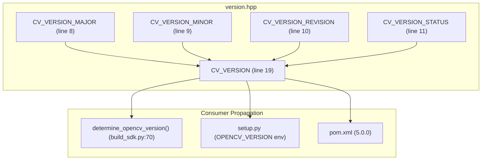

Sources: [modules/core/include/opencv2/core/version.hpp:1-26](), [platforms/android/build_sdk.py:70-79](), [modules/python/package/setup.py:22-22](), [platforms/maven/pom.xml:4-7]()

---

## Packaging with CPack

OpenCV utilizes CMake's CPack module to generate distribution packages (DEB, RPM, and ZIP). The configuration is centralized in `cmake/OpenCVPackaging.cmake`.

### Package Metadata and Architecture
CPack variables are populated using OpenCV's version variables [cmake/OpenCVPackaging.cmake:20-23](). The script maps OpenCV's internal architecture flags (like `X86_64` or `AARCH64`) to standard package manager architecture strings [cmake/OpenCVPackaging.cmake:27-45]().

| OpenCV Flag | Debian Arch (`CPACK_DEBIAN_PACKAGE_ARCHITECTURE`) | RPM Arch (`CPACK_RPM_PACKAGE_ARCHITECTURE`) |
|-------------|---------------------------------------------------|---------------------------------------------|
| `X86`       | `i386` [cmake/OpenCVPackaging.cmake:28-28]()      | `i686` [cmake/OpenCVPackaging.cmake:29-29]() |
| `X86_64`    | `amd64` [cmake/OpenCVPackaging.cmake:31-31]()     | `x86_64` [cmake/OpenCVPackaging.cmake:32-32]() |
| `ARM`       | `armhf` [cmake/OpenCVPackaging.cmake:34-34]()     | `armhf` [cmake/OpenCVPackaging.cmake:35-35]() |
| `AARCH64`   | `arm64` [cmake/OpenCVPackaging.cmake:37-37]()     | `aarch64` [cmake/OpenCVPackaging.cmake:38-38]() |

### Component-Based Installation
OpenCV supports granular packaging where users can install specific parts of the library. CPack components include:
- `libs`: Shared libraries and data [cmake/OpenCVPackaging.cmake:75-75]().
- `dev`: Development headers and CMake files [cmake/OpenCVPackaging.cmake:72-72]().
- `python`: Python bindings [cmake/OpenCVPackaging.cmake:76-76]().
- `java`: Java bindings [cmake/OpenCVPackaging.cmake:74-74]().

Dependency chains are defined to ensure that high-level components (like `python` or `java`) require the base `libs` component [cmake/OpenCVPackaging.cmake:82-88](). For Linux distributions, the script defines conflict and replacement rules for standard module names like `libopencv-core4.0` [cmake/OpenCVPackaging.cmake:123-141]().

Sources: [cmake/OpenCVPackaging.cmake:1-167]()

---

## Android SDK Build Orchestration

The Android SDK is a multi-ABI (Application Binary Interface) package. Its creation is managed by `platforms/android/build_sdk.py`.

### Version Detection
The script implements `determine_opencv_version` which uses regular expressions to extract version components directly from `version.hpp` [platforms/android/build_sdk.py:70-79](). This allows the script to identify the version without requiring a full CMake configuration pass first.

### Multi-ABI Build Loop
The `Builder` class [platforms/android/build_sdk.py:147-168]() iterates through a list of `ABI` objects (e.g., `armeabi-v7a`, `arm64-v8a`, `x86`, `x86_64`) [platforms/android/build_sdk.py:120-143](). For each ABI, it:
1. Configures a separate CMake build directory.
2. Passes ABI-specific flags like `ANDROID_ABI`, `ANDROID_STL`, and `ANDROID_PLATFORM_ID` [platforms/android/build_sdk.py:125-137]().
3. Executes the build using `ninja` or `make`.
4. Collects results into a unified SDK structure (`OpenCV-android-sdk`) [platforms/android/build_sdk.py:153-153]().

### SDK Packaging Workflow

```mermaid
graph TD
    subgraph "Code Entity Space: build_sdk.py"
        START["platforms/android/build_sdk.py Execution"]
        VER["determine_opencv_version() (line 70)"]
        ABI_CLS["ABI Class (line 120)"]
        BUILD_CLS["Builder Class (line 147)"]
        LIBDEST["Builder.libdest (line 152)"]
        RESDEST["Builder.resultdest (line 153)"]
    end

    START --> VER
    VER --> ABI_CLS
    ABI_CLS --> BUILD_CLS
    BUILD_CLS --> LIBDEST
    LIBDEST --> RESDEST
    RESDEST --> ZIP["Final Open-CV Android SDK ZIP"]
```

Sources: [platforms/android/build_sdk.py:1-168]()

---

## Java and Maven Integration

OpenCV provides Maven POM files to support Java dependency management and OSGi bundle creation.

### Project Hierarchy
- **Parent POM**: `platforms/maven/pom.xml` defines the project coordinates (`org.opencv`) and version (e.g., `5.0.0`) [platforms/maven/pom.xml:4-7]().
- **OpenCV Module**: `platforms/maven/opencv/pom.xml` handles the actual JAR creation, including OSGi bundle packaging [platforms/maven/opencv/pom.xml:1-11]().
- **Integration Tests**: `platforms/maven/opencv-it/pom.xml` runs tests against the generated artifacts using the `pax-exam` container [platforms/maven/opencv-it/pom.xml:1-18]().

### Build Lifecycle and Native Libs
The Maven build uses the `exec-maven-plugin` to run shell scripts that check for required system dependencies (like `libpng-dev`, `libjpeg-dev`) [platforms/maven/opencv/pom.xml:64-92](). It also ensures the native library (`libopencv_java.so`) is correctly named based on the version string [platforms/maven/opencv/pom.xml:17-17]().

Sources: [platforms/maven/pom.xml:1-57](), [platforms/maven/opencv/pom.xml:1-151](), [platforms/maven/opencv-it/pom.xml:1-111]()

---

## Python Package Distribution

The `modules/python/package/setup.py` script manages the creation of Python wheels and source distributions.

### Package Configuration
The script detects the version from the `OPENCV_VERSION` environment variable, falling back to `5.0.0` if not set [modules/python/package/setup.py:22-22](). It uses `setuptools.find_packages()` to discover the `cv2` package and its submodules [modules/python/package/setup.py:42-42]().

### Typing Support
OpenCV supports PEP 561 by including a `py.typed` file and collecting all `.pyi` typing stubs generated during the build process [modules/python/package/setup.py:8-15](). These are included in the `package_data` section of the `setuptools.setup` call to enable IDE auto-completion [modules/python/package/setup.py:43-45]().

Sources: [modules/python/package/setup.py:1-82]()

---

# Page: Third-Party Dependencies and 3rdparty/ Integration

# Third-Party Dependencies and 3rdparty/ Integration

<details>
<summary>Relevant source files</summary>

The following files were used as context for generating this wiki page:

- [3rdparty/cpufeatures/CMakeLists.txt](3rdparty/cpufeatures/CMakeLists.txt)
- [3rdparty/ippicv/ippicv.cmake](3rdparty/ippicv/ippicv.cmake)
- [3rdparty/ittnotify/CMakeLists.txt](3rdparty/ittnotify/CMakeLists.txt)
- [3rdparty/libjasper/CMakeLists.txt](3rdparty/libjasper/CMakeLists.txt)
- [3rdparty/libpng/CMakeLists.txt](3rdparty/libpng/CMakeLists.txt)
- [3rdparty/libtiff/CMakeLists.txt](3rdparty/libtiff/CMakeLists.txt)
- [3rdparty/protobuf/CMakeLists.txt](3rdparty/protobuf/CMakeLists.txt)
- [3rdparty/tbb/CMakeLists.txt](3rdparty/tbb/CMakeLists.txt)
- [3rdparty/zlib/CMakeLists.txt](3rdparty/zlib/CMakeLists.txt)
- [cmake/OpenCVDetectTBB.cmake](cmake/OpenCVDetectTBB.cmake)
- [cmake/OpenCVFindAtlas.cmake](cmake/OpenCVFindAtlas.cmake)
- [cmake/OpenCVFindLAPACK.cmake](cmake/OpenCVFindLAPACK.cmake)
- [cmake/OpenCVFindMKL.cmake](cmake/OpenCVFindMKL.cmake)
- [cmake/OpenCVFindOpenBLAS.cmake](cmake/OpenCVFindOpenBLAS.cmake)
- [cmake/checks/lapack_check.cpp](cmake/checks/lapack_check.cpp)
- [cmake/templates/OpenCVConfig-FastCV.cmake.in](cmake/templates/OpenCVConfig-FastCV.cmake.in)
- [hal/ipp/include/ipp_hal_core.hpp](hal/ipp/include/ipp_hal_core.hpp)
- [hal/ipp/include/ipp_utils.hpp](hal/ipp/include/ipp_utils.hpp)
- [hal/ipp/src/cart_polar_ipp.cpp](hal/ipp/src/cart_polar_ipp.cpp)
- [hal/ipp/src/math_ipp.cpp](hal/ipp/src/math_ipp.cpp)
- [hal/ipp/src/mean_ipp.cpp](hal/ipp/src/mean_ipp.cpp)
- [hal/ipp/src/minmax_ipp.cpp](hal/ipp/src/minmax_ipp.cpp)
- [hal/ipp/src/norm_ipp.cpp](hal/ipp/src/norm_ipp.cpp)
- [hal/ipp/src/sum_ipp.cpp](hal/ipp/src/sum_ipp.cpp)
- [hal/ipp/src/transforms_ipp.cpp](hal/ipp/src/transforms_ipp.cpp)
- [hal/ipp/src/warp_ipp.cpp](hal/ipp/src/warp_ipp.cpp)
- [hal/riscv-rvv/src/core/mean.cpp](hal/riscv-rvv/src/core/mean.cpp)
- [modules/core/include/opencv2/core/hal/hal.hpp](modules/core/include/opencv2/core/hal/hal.hpp)
- [modules/core/include/opencv2/core/hal/interface.h](modules/core/include/opencv2/core/hal/interface.h)
- [modules/core/include/opencv2/core/saturate.hpp](modules/core/include/opencv2/core/saturate.hpp)
- [modules/core/include/opencv2/core/traits.hpp](modules/core/include/opencv2/core/traits.hpp)
- [modules/core/perf/perf_dft.cpp](modules/core/perf/perf_dft.cpp)
- [modules/core/perf/perf_dot.cpp](modules/core/perf/perf_dot.cpp)
- [modules/core/perf/perf_math.cpp](modules/core/perf/perf_math.cpp)
- [modules/core/src/channels.cpp](modules/core/src/channels.cpp)
- [modules/core/src/hal_internal.cpp](modules/core/src/hal_internal.cpp)
- [modules/core/src/hal_internal.hpp](modules/core/src/hal_internal.hpp)
- [modules/core/src/hal_replacement.hpp](modules/core/src/hal_replacement.hpp)
- [modules/core/src/lut.cpp](modules/core/src/lut.cpp)
- [modules/core/src/mathfuncs_core.dispatch.cpp](modules/core/src/mathfuncs_core.dispatch.cpp)
- [modules/core/src/mathfuncs_core.simd.hpp](modules/core/src/mathfuncs_core.simd.hpp)
- [modules/core/src/matrix_decomp.cpp](modules/core/src/matrix_decomp.cpp)
- [modules/core/test/test_hal_core.cpp](modules/core/test/test_hal_core.cpp)
- [modules/core/test/test_ptr.cpp](modules/core/test/test_ptr.cpp)
- [modules/stitching/src/autocalib.cpp](modules/stitching/src/autocalib.cpp)
- [modules/stitching/src/camera.cpp](modules/stitching/src/camera.cpp)
- [modules/video/src/optical_flow_io.cpp](modules/video/src/optical_flow_io.cpp)
- [platforms/android/default.config.py](platforms/android/default.config.py)
- [platforms/android/fastcv.config.py](platforms/android/fastcv.config.py)

</details>


OpenCV relies on a robust set of third-party libraries to handle compressed formats, image and video codecs, parallel processing frameworks, and architecture-specific performance primitives. This page details how OpenCV's CMake build system selects between system-provided and bundled libraries within the `3rdparty/` directory, highlighting the configuration logic, integration mechanisms for parallel backends like TBB, performance libraries such as IPP/IPPICV, LAPACK, and MKL, and hardware-optimized image codecs.

---

## 1. Dependency Selection and Resolution Logic

OpenCV uses a standardized configuration pattern across its CMake scripts to manage dependencies. For each major third-party library, a configuration flag `WITH_<LIBRARY>` (e.g., `WITH_JPEG`, `WITH_PNG`, `WITH_TBB`, `WITH_IPP`) determines whether OpenCV attempts to incorporate that capability. If enabled, the build system evaluates whether to use a system-installed package or fallback to the bundled source files located in `3rdparty/` via `BUILD_<LIBRARY>` flags.

### System vs. Bundled Evaluation Flow
The detection and configuration sequence typically follows this procedural flow:
1. **Explicit Bundling Request**: If `BUILD_<LIBRARY>` is explicitly set to `ON`, CMake bypasses system checks and adds the local directory from `3rdparty/` [3rdparty/tbb/CMakeLists.txt:107-108]().
2. **System Search**: If `BUILD_<LIBRARY>` is `OFF` or unset, the system queries for installed packages using `find_package()` or custom find scripts [cmake/OpenCVDetectTBB.cmake:22-22]().
3. **Fallback Mechanism**: If the system package is missing or fails version constraints, CMake falls back to the bundled `3rdparty/` target if available [cmake/OpenCVDetectTBB.cmake:115-121]().

The following diagram maps CMake configuration variables and discovery functions to their underlying code entities during dependency resolution:

**Title: Dependency Resolution and Code Entity Mapping**
```mermaid
graph TD
    Config["CMake Configure Phase"] --> CheckWith["WITH_<LIBRARY> Enabled?"]
    CheckWith -- YES --> CheckBuild["BUILD_<LIBRARY> == ON?"]
    CheckBuild -- YES --> BundledPath["add_subdirectory(3rdparty/<lib>)"]
    CheckBuild -- NO --> FindSys["Execute Find Script / find_package()"]
    
    FindSys --> Found{"Package Found?"}
    Found -- YES --> SetSysTarget["Import System Target (e.g. TBB::tbb)"]
    Found -- NO --> Fallback["Fallback to ocv_tbb_cmake_guess() / Bundled Source"]
    
    subgraph "Code Entity Space"
        BundledPath --> TargetTBB["tbb Target [3rdparty/tbb/CMakeLists.txt:117]"]
        Fallback --> GuessFunc["ocv_tbb_cmake_guess() [cmake/OpenCVDetectTBB.cmake:21]"]
        FindSys --> EnvGuess["ocv_tbb_env_guess() [cmake/OpenCVDetectTBB.cmake:60]"]
    end
```
Sources: [cmake/OpenCVDetectTBB.cmake:21-121](), [3rdparty/tbb/CMakeLists.txt:107-117]()

---

## 2. The `3rdparty/` Directory Layout and Codec Subsystems

The `3rdparty/` directory houses source code, build wrappers, and configurations for essential libraries. OpenCV bundles these libraries to guarantee a predictable build experience across locked-down or minimal target environments (such as Android, iOS, or headless Linux containers).

| Directory | Primary Library | Core Purpose |
| :--- | :--- | :--- |
| `3rdparty/zlib` | ZLIB | Compression backend for PNG, TIFF, and OpenEXR formats [3rdparty/zlib/CMakeLists.txt:6-84]() |
| `3rdparty/libpng` | libpng | PNG decoding/encoding with architecture-specific SIMD filters [3rdparty/libpng/CMakeLists.txt:6-118]() |
| `3rdparty/libtiff` | libtiff | TIFF image and BigTIFF support [3rdparty/libtiff/CMakeLists.txt:5-207]() |
| `3rdparty/protobuf` | Protocol Buffers | Lite and full protobuf runtime for ONNX / DNN model parsing [3rdparty/protobuf/CMakeLists.txt:1-135]() |
| `3rdparty/tbb` | Intel oneTBB | Parallel execution engine for `cv::parallel_for_` [3rdparty/tbb/CMakeLists.txt:2-117]() |
| `3rdparty/ippicv` | IPPICV | Precompiled Intel Integrated Performance Primitives subset [3rdparty/ippicv/ippicv.cmake:1-60]() |

### Codec Integration and Registry Pattern
The `imgcodecs` module registers image encoders and decoders at startup using an initialization registry pattern. 

**Title: Codec Initialization and 3rdparty Binding**
```mermaid
graph LR
    Start["cv::imread() / cv::imwrite()"] --> Init["ImageCodecInitializer"]
    Init --> CheckHAVE["Check HAVE_JPEG / HAVE_PNG / HAVE_TIFF"]
    
    subgraph "Code Entity Space"
        CheckHAVE --> TiffDec["TiffDecoder [modules/imgcodecs/src/grfmt_tiff.cpp]"]
        CheckHAVE --> PngDec["PngDecoder [modules/imgcodecs/src/grfmt_png.cpp]"]
        CheckHAVE --> JpegDec["JpegDecoder [modules/imgcodecs/src/grfmt_jpeg.cpp]"]
        
        TiffDec --> LibTiff["libtiff Target [3rdparty/libtiff/CMakeLists.txt:5]"]
        PngDec --> LibPng["libpng Target [3rdparty/libpng/CMakeLists.txt:6]"]
        JpegDec --> LibJpeg["libjpeg-turbo Target"]
    end
```
Sources: [3rdparty/libpng/CMakeLists.txt:6-118](), [3rdparty/libtiff/CMakeLists.txt:5-10](), [3rdparty/zlib/CMakeLists.txt:6-84]()

---

## 3. Parallel Backends: Threading Building Blocks (TBB)

OpenCV uses Threading Building Blocks (TBB) as a high-performance parallel backend for `parallel_for_`. The build integration is managed by `cmake/OpenCVDetectTBB.cmake` and `3rdparty/tbb/CMakeLists.txt`.

### TBB Detection and Source Build Logic
1. **Source Download**: If `BUILD_TBB` is enabled, CMake defines `OPENCV_TBB_RELEASE` (e.g., `v2022.1.0`) and invokes `ocv_download()` to fetch the archive from the oneAPI repository [3rdparty/tbb/CMakeLists.txt:8-24]().
2. **CMake Package Discovery**: `ocv_tbb_cmake_guess()` executes `find_package(TBB QUIET COMPONENTS tbb)` searching custom paths in `TBBROOT/cmake` [cmake/OpenCVDetectTBB.cmake:21-22]().
3. **Environment Verification**: `ocv_tbb_env_guess()` scans system environment variables (`CPATH`, `LIBRARY_PATH`, `TBBROOT`) to discover include files like `tbb/tbb.h` and libraries like `tbb` or `tbb_debug` [cmake/OpenCVDetectTBB.cmake:60-67]().

Sources: [cmake/OpenCVDetectTBB.cmake:21-125](), [3rdparty/tbb/CMakeLists.txt:8-178]()

---

## 4. Performance Libraries: IPP, IPPICV, LAPACK, and MKL

Hardware acceleration packages are integrated through specialized detection scripts and Hardware Abstraction Layer (HAL) bindings.

### IPPICV Management
The `3rdparty/ippicv/ippicv.cmake` script selects and downloads platform-specific precompiled binaries for Intel Integrated Performance Primitives (IPPICV):
- **Platform Branching**: Detects macOS (`ippicv_mac`), Linux (`ippicv_lnx`), or Windows (`ippicv_win`) alongside architecture specifiers (`intel64`, `ia32`) [3rdparty/ippicv/ippicv.cmake:7-40]().
- **Integration**: Fetches packages matching explicit cryptographic hashes (`OPENCV_ICV_HASH`) and unpacks them into `${OpenCV_BINARY_DIR}/3rdparty/ippicv` [3rdparty/ippicv/ippicv.cmake:45-55]().
- **HAL Warp Execution**: Functions such as `ipp_hal_warpAffine()` in `hal/ipp/src/warp_ipp.cpp` use IPP's image processing wrappers (`IwiImage`) to accelerate affine transformations when conditions permit [hal/ipp/src/warp_ipp.cpp:77-152]().

### LAPACK and MKL Integration
Matrix decompositions and solver routines in `core` can link against external BLAS/LAPACK implementations, including Intel MKL or Apple Accelerate.
- **LAPACK Check**: `cmake/OpenCVFindLAPACK.cmake` defines `ocv_lapack_check()` which validates C/C++ interface headers (`cblas.h`, `lapacke.h`) and generates a proxy header file (`opencv_lapack.h`) [cmake/OpenCVFindLAPACK.cmake:46-112]().
- **MKL Detection**: `cmake/OpenCVFindMKL.cmake` locates MKL installations via `MKLROOT`, parses `mkl_version.h` to determine version compatibility, and configures single dynamic libraries (`mkl_rt`) or multi-threaded component groupings [cmake/OpenCVFindMKL.cmake:29-155]().

**Title: Performance Library and HAL Acceleration Routing**
```mermaid
graph TD
    CoreRoutine["OpenCV Core / Imgproc Algorithm (e.g. warpAffine / SVD)"] --> CheckHAL["HAL Interface Dispatcher"]
    
    CheckHAL --> HasIPP{"IPPICV Available?"}
    CheckHAL --> HasLAPACK{"LAPACK / MKL Available?"}
    
    subgraph "Code Entity Space"
        HasIPP -- YES --> IPPWarp["ipp_hal_warpAffine() [hal/ipp/src/warp_ipp.cpp:81]"]
        HasLAPACK -- YES --> LapackLU["lapack_LU() [modules/core/src/hal_internal.cpp:119]"]
        
        IPPWarp --> IPPBin["IPPICV Binary [3rdparty/ippicv/ippicv.cmake]"]
        LapackLU --> ProxyHead["opencv_lapack.h [cmake/OpenCVFindLAPACK.cmake:69]"]
    end
```
Sources: [3rdparty/ippicv/ippicv.cmake:1-60](), [cmake/OpenCVFindLAPACK.cmake:46-136](), [cmake/OpenCVFindMKL.cmake:29-175](), [hal/ipp/src/warp_ipp.cpp:77-152](), [modules/core/src/hal_internal.cpp:119-184]()

---

## 5. Key Build Variables Summary

| Variable Name | Description | Source Reference |
| :--- | :--- | :--- |
| `BUILD_TBB` | Forces compilation of bundled TBB from `3rdparty/tbb` | [3rdparty/tbb/CMakeLists.txt:1-10](), [cmake/OpenCVDetectTBB.cmake:107]() |
| `OPENCV_ICV_HASH` | MD5 hash validation string for IPPICV archive download | [3rdparty/ippicv/ippicv.cmake:12-40]() |
| `MKL_USE_SINGLE_DYNAMIC_LIBRARY` | Instructs MKL detector to link against `mkl_rt` | [cmake/OpenCVFindMKL.cmake:43]() |
| `CBLAS_H_PROXY_PATH` | Path to generated proxy header `opencv_lapack.h` | [cmake/OpenCVFindLAPACK.cmake:69]() |

Sources: [3rdparty/tbb/CMakeLists.txt:1-10](), [3rdparty/ippicv/ippicv.cmake:1-60](), [cmake/OpenCVDetectTBB.cmake:107-125](), [cmake/OpenCVFindLAPACK.cmake:46-113](), [cmake/OpenCVFindMKL.cmake:43-46]()

---

# Page: Core Module

# Core Module

<details>
<summary>Relevant source files</summary>

The following files were used as context for generating this wiki page:

- [cmake/OpenCVCompilerOptimizations.cmake](cmake/OpenCVCompilerOptimizations.cmake)
- [modules/core/include/opencv2/core.hpp](modules/core/include/opencv2/core.hpp)
- [modules/core/include/opencv2/core/base.hpp](modules/core/include/opencv2/core/base.hpp)
- [modules/core/include/opencv2/core/core.hpp](modules/core/include/opencv2/core/core.hpp)
- [modules/core/include/opencv2/core/cv_cpu_dispatch.h](modules/core/include/opencv2/core/cv_cpu_dispatch.h)
- [modules/core/include/opencv2/core/cv_cpu_helper.h](modules/core/include/opencv2/core/cv_cpu_helper.h)
- [modules/core/include/opencv2/core/cvdef.h](modules/core/include/opencv2/core/cvdef.h)
- [modules/core/include/opencv2/core/mat.hpp](modules/core/include/opencv2/core/mat.hpp)
- [modules/core/include/opencv2/core/mat.inl.hpp](modules/core/include/opencv2/core/mat.inl.hpp)
- [modules/core/include/opencv2/core/matx.hpp](modules/core/include/opencv2/core/matx.hpp)
- [modules/core/include/opencv2/core/ocl.hpp](modules/core/include/opencv2/core/ocl.hpp)
- [modules/core/include/opencv2/core/operations.hpp](modules/core/include/opencv2/core/operations.hpp)
- [modules/core/include/opencv2/core/private.hpp](modules/core/include/opencv2/core/private.hpp)
- [modules/core/include/opencv2/core/types.hpp](modules/core/include/opencv2/core/types.hpp)
- [modules/core/include/opencv2/core/utility.hpp](modules/core/include/opencv2/core/utility.hpp)
- [modules/core/include/opencv2/core/utils/buffer_area.private.hpp](modules/core/include/opencv2/core/utils/buffer_area.private.hpp)
- [modules/core/perf/perf_arithm.cpp](modules/core/perf/perf_arithm.cpp)
- [modules/core/src/algorithm.cpp](modules/core/src/algorithm.cpp)
- [modules/core/src/arithm.cpp](modules/core/src/arithm.cpp)
- [modules/core/src/buffer_area.cpp](modules/core/src/buffer_area.cpp)
- [modules/core/src/command_line_parser.cpp](modules/core/src/command_line_parser.cpp)
- [modules/core/src/copy.cpp](modules/core/src/copy.cpp)
- [modules/core/src/matrix.cpp](modules/core/src/matrix.cpp)
- [modules/core/src/matrix_transform.cpp](modules/core/src/matrix_transform.cpp)
- [modules/core/src/matrix_wrap.cpp](modules/core/src/matrix_wrap.cpp)
- [modules/core/src/ocl.cpp](modules/core/src/ocl.cpp)
- [modules/core/src/ocl_disabled.impl.hpp](modules/core/src/ocl_disabled.impl.hpp)
- [modules/core/src/opencl/flip.cl](modules/core/src/opencl/flip.cl)
- [modules/core/src/opencl/gemm.cl](modules/core/src/opencl/gemm.cl)
- [modules/core/src/opencl/transpose.cl](modules/core/src/opencl/transpose.cl)
- [modules/core/src/precomp.hpp](modules/core/src/precomp.hpp)
- [modules/core/src/rand.cpp](modules/core/src/rand.cpp)
- [modules/core/src/system.cpp](modules/core/src/system.cpp)
- [modules/core/src/umatrix.cpp](modules/core/src/umatrix.cpp)
- [modules/core/test/ocl/test_opencl.cpp](modules/core/test/ocl/test_opencl.cpp)
- [modules/core/test/test_arithm.cpp](modules/core/test/test_arithm.cpp)
- [modules/core/test/test_mat.cpp](modules/core/test/test_mat.cpp)
- [modules/core/test/test_operations.cpp](modules/core/test/test_operations.cpp)
- [modules/core/test/test_precomp.hpp](modules/core/test/test_precomp.hpp)
- [modules/core/test/test_rand.cpp](modules/core/test/test_rand.cpp)
- [modules/core/test/test_umat.cpp](modules/core/test/test_umat.cpp)
- [modules/core/test/test_utils.cpp](modules/core/test/test_utils.cpp)
- [modules/ts/src/ocl_test.cpp](modules/ts/src/ocl_test.cpp)
- [modules/ts/src/ts_func.cpp](modules/ts/src/ts_func.cpp)
- [platforms/linux/riscv64-071-gcc.toolchain.cmake](platforms/linux/riscv64-071-gcc.toolchain.cmake)

</details>


The `opencv_core` module (`modules/core/`) is the foundational backbone of OpenCV, providing the core array classes, data structures, arithmetic and mathematical operations, system-level utilities, OpenCL acceleration infrastructure, and serialization services that all other modules depend on.

For detailed technical descriptions of specific subsystems, refer to the child pages:
- [Mat and UMat Data Structures](#3.1) — Describe the `Mat` and `UMat` N-dimensional array classes, their memory layout, reference counting, `InputArray` and `OutputArray` abstraction, and how data moves between CPU and GPU memory representations.
- [OpenCL Acceleration and Transparent GPU Execution](#3.2) — Explain how OpenCV integrates OpenCL for GPU acceleration via `UMat`, covering device discovery, context management, kernel compilation, binary caching, and the transparent execution model.
- [System Utilities and Parallel Processing](#3.3) — Document system-level utilities including CPU feature detection, error handling, logging/tracing, filesystem and plugin loading helpers, memory allocation, random number generation, and the `parallel_for_` framework with its TBB, OpenMP, and pthreads backends.
- [Persistence and Serialization (FileStorage)](#3.4) — Document the `FileStorage` class and its support for reading and writing data in XML, YAML, and JSON formats, including Base64 encoding for binary data and the `FileNode` traversal API.
- [SIMD Intrinsics and CPU Dispatching](#3.5) — Explain the universal SIMD intrinsics layer abstracting SSE, AVX, NEON, VSX, and RISC-V RVV under a common API, the CPU dispatch mechanism, and the HAL plugin system.
- [Math, Linear Algebra, and Optimization in core](#3.6) — Document core mathematical services: `mathfuncs.cpp`, LAPACK/BLAS-backed matrix decompositions, DFT/DCT (`dxt.cpp`), norms and statistics, kmeans, and optimization solvers.

---

## Module Layout

The module is organized around a core set of public headers in `modules/core/include/opencv2/core/` and implementation files in `modules/core/src/`. Downstream code typically includes the umbrella header `modules/core/include/opencv2/core.hpp`, which incorporates all component headers.

**Primary Public Headers**

| Header | Purpose |
|---|---|
| `opencv2/core.hpp` | Umbrella header; includes all sub-headers [modules/core/include/opencv2/core.hpp:48-60]() |
| `opencv2/core/cvdef.h` | Compiler macros, type definitions, and `CV_StaticAssert` [modules/core/include/opencv2/core/cvdef.h:45-148]() |
| `opencv2/core/base.hpp` | Error handling codes, `CV_Error`, and assertion macros [modules/core/include/opencv2/core.hpp:148-156]() |
| `opencv2/core/types.hpp` | Geometric primitives: `Point`, `Size`, `Rect`, `Scalar` [modules/core/include/opencv2/core/types.hpp:52-57]() |
| `opencv2/core/mat.hpp` | `Mat`, `UMat`, `_InputArray`, `_OutputArray` definitions [modules/core/include/opencv2/core/mat.hpp:72-155]() |
| `opencv2/core/persistence.hpp` | `FileStorage`, `FileNode` for structured serialization [modules/core/include/opencv2/core/persistence.hpp:59-60]() |
| `opencv2/core/utility.hpp` | Parallel processing (`parallel_for_`), `AutoBuffer`, `TickMeter`, `RNG` [modules/core/include/opencv2/core.hpp:109-110]() |
| `opencv2/core/ocl.hpp` | OpenCL `Context`, `Device`, `Kernel`, and `Queue` abstractions [modules/core/include/opencv2/core.hpp:87-87]() |

Sources: [modules/core/include/opencv2/core.hpp:48-105](), [modules/core/include/opencv2/core/mat.hpp:72-155](), [modules/core/include/opencv2/core/cvdef.h:45-148]()

---

## Component Architecture and Code Mapping

The following diagram associates high-level subsystem concepts in `opencv_core` with their concrete C++ source and header implementations.

**Core Module Entity Map**

```mermaid
graph TD
    CoreAPI["cv::core\n(opencv2/core.hpp)"]

    CoreAPI --> ArrayTypes["Array Subsystem\n(matrix.cpp / umatrix.cpp)"]
    CoreAPI --> ArithmSubsys["Arithmetic Engine\n(arithm.cpp)"]
    CoreAPI --> OCLSubsys["OpenCL Subsystem\n(ocl.cpp)"]
    CoreAPI --> SystemSubsys["System & CPU\n(system.cpp)"]
    CoreAPI --> MathSubsys["Math & Stats\n(mathfuncs.cpp)"]

    ArrayTypes --> MatClass["cv::Mat\n(mat.hpp)"]
    ArrayTypes --> UMatClass["cv::UMat\n(mat.hpp)"]
    ArrayTypes --> MatShapeStruct["cv::MatShape\n(matrix.cpp)"]

    OCLSubsys --> OCLContext["cv::ocl::Context\n(ocl.cpp)"]
    OCLSubsys --> OCLAllocator["AllocatorStatistics\n(ocl.cpp)"]

    SystemSubsys --> CpuDetect["cv::checkHardwareSupport\n(system.cpp)"]
    SystemSubsys --> InitMutex["cv::getInitializationMutex\n(system.cpp)"]
```

Sources: [modules/core/include/opencv2/core.hpp:61-105](), [modules/core/src/matrix.cpp:1-40](), [modules/core/src/ocl.cpp:126-140](), [modules/core/src/system.cpp:74-111]()

---

## Primary Data Structures (`Mat` and `UMat`)

The foundational data container is `Mat`, implemented via `modules/core/src/matrix.cpp` and defined in `modules/core/include/opencv2/core/mat.hpp`. It manages N-dimensional dense arrays with automatic reference-counted memory allocation. The accompanying `MatShape` structure manages tensor dimensions and layout configurations (`NCHW`, `NHWC`, block formats) without heap allocations [modules/core/include/opencv2/core/mat.hpp:107-155]().

`UMat` mirrors `Mat`'s API interface but delegates its backing storage to OpenCL memory buffers, enabling seamless interoperability between host CPU memory and accelerator memory.

For details, see [Mat and UMat Data Structures](#3.1).

Sources: [modules/core/include/opencv2/core/mat.hpp:72-155](), [modules/core/src/matrix.cpp:10-40]()

---

## OpenCL Acceleration and Transparent Execution

OpenCV integrates OpenCL to accelerate matrix and image operations on GPUs. The `opencv_core` module manages OpenCL contexts, command queues, device discovery, and kernel compilation in `modules/core/src/ocl.cpp`. Through `UMat`, algorithms can execute transparently on GPU hardware without requiring explicit host-device data transfer management in user code.

For details, see [OpenCL Acceleration and Transparent GPU Execution](#3.2).

Sources: [modules/core/src/ocl.cpp:42-140]()

---

## System Utilities and Parallel Processing

Platform-dependent services—such as CPU feature detection (`CPUID` and auxiliary vector parsing), thread-safe initialization, error management (`cv::Exception`, `CV_Assert`), memory allocators (`fastMalloc`), logging facilities, and random number generation (`cv::RNG`)—are centralized in `modules/core/src/system.cpp`. Additionally, the parallel execution framework (`parallel_for_`) provides a common abstraction layer dispatching tasks across thread pool backends like Intel TBB, OpenMP, and pthreads.

For details, see [System Utilities and Parallel Processing](#3.3).

Sources: [modules/core/src/system.cpp:74-175]()

---

## Persistence and Serialization (`FileStorage`)

Structured serialization in OpenCV is handled by the `FileStorage` class (`modules/core/src/persistence.cpp`). It supports reading and writing configuration states, numerical vectors, and `Mat` objects into human-readable XML, YAML, and JSON formats. Binary data payloads can be embedded via Base64 encoding, and the `FileNode` API facilitates hierarchical tree traversal.

For details, see [Persistence and Serialization (FileStorage)](#3.4).

Sources: [modules/core/include/opencv2/core/persistence.hpp:59-60]()

---

## SIMD Intrinsics, CPU Dispatching, and HAL

To extract maximum performance from diverse host CPUs, `opencv_core` provides a universal SIMD intrinsics layer (`opencv2/core/hal/intrin.h`) that abstracts instruction sets like SSE2/AVX2, ARM NEON, PowerPC VSX, and RISC-V RVV under a uniform API. The CPU dispatch system builds multiple optimized versions of routines into a single binary and selects the best implementation at runtime. Furthermore, low-level linear algebra and image operations can delegate to vendor-optimized hardware abstraction layer (HAL) plugins like IPP or Carotene.

For details, see [SIMD Intrinsics and CPU Dispatching](#3.5).

Sources: [modules/core/include/opencv2/core.hpp:89-98]()

---

## Mathematical Functions, Linear Algebra, and Optimization

The core module provides extensive mathematical capabilities, including element-wise transcendental functions (`mathfuncs.cpp`), discrete Fourier and cosine transforms (`dxt.cpp`), statistical reducers and norms, kmeans clustering, LAPACK/BLAS-backed matrix decompositions (`lapack.cpp`), and numerical optimization solvers (simplex, conjugate gradient, and linear programming).

For details, see [Math, Linear Algebra, and Optimization in core](#3.6).

Sources: [modules/core/src/mathfuncs.cpp:65-98]()

---

## Execution Flow: Arithmetic Dispatch

The following diagram illustrates how arithmetic operations route execution between OpenCL kernels and CPU routines depending on input container types (`Mat` vs `UMat`).

**Arithmetic Operation Execution Path**

```mermaid
graph TD
    UserCall["User Call: cv::add / cv::subtract"] --> ArithmOp["arithm_op()\n(modules/core/src/arithm.cpp)"]

    ArithmOp --> CheckUMat{"Inputs are UMat?"}

    CheckUMat -- "Yes" --> OCLPath["ocl_binary_op()\n(modules/core/src/arithm.cpp)"]
    OCLPath --> OpenCLKernel["OpenCL Kernel KF\n(modules/core/src/opencl/arithm.cl)"]

    CheckUMat -- "No" --> CPUPath["CPU ElemWise Engine\n(ew::TOp)"]
    CPUPath --> SIMDIntrin["Universal SIMD Intrinsics\n(opencv2/core/hal/intrin.h)"]
```

Sources: [modules/core/src/arithm.cpp:68-154]()

---

# Page: Mat and UMat Data Structures

# Mat and UMat Data Structures

<details>
<summary>Relevant source files</summary>

The following files were used as context for generating this wiki page:

- [modules/core/include/opencv2/core/mat.hpp](modules/core/include/opencv2/core/mat.hpp)
- [modules/core/include/opencv2/core/mat.inl.hpp](modules/core/include/opencv2/core/mat.inl.hpp)
- [modules/core/include/opencv2/core/ocl.hpp](modules/core/include/opencv2/core/ocl.hpp)
- [modules/core/include/opencv2/core/simd_intrinsics.hpp](modules/core/include/opencv2/core/simd_intrinsics.hpp)
- [modules/core/perf/perf_arithm.cpp](modules/core/perf/perf_arithm.cpp)
- [modules/core/src/arithm.cpp](modules/core/src/arithm.cpp)
- [modules/core/src/copy.cpp](modules/core/src/copy.cpp)
- [modules/core/src/intel_gpu_gemm.inl.hpp](modules/core/src/intel_gpu_gemm.inl.hpp)
- [modules/core/src/matmul.dispatch.cpp](modules/core/src/matmul.dispatch.cpp)
- [modules/core/src/matrix.cpp](modules/core/src/matrix.cpp)
- [modules/core/src/matrix_expressions.cpp](modules/core/src/matrix_expressions.cpp)
- [modules/core/src/matrix_iterator.cpp](modules/core/src/matrix_iterator.cpp)
- [modules/core/src/matrix_operations.cpp](modules/core/src/matrix_operations.cpp)
- [modules/core/src/matrix_sparse.cpp](modules/core/src/matrix_sparse.cpp)
- [modules/core/src/matrix_transform.cpp](modules/core/src/matrix_transform.cpp)
- [modules/core/src/matrix_wrap.cpp](modules/core/src/matrix_wrap.cpp)
- [modules/core/src/ocl.cpp](modules/core/src/ocl.cpp)
- [modules/core/src/ocl_disabled.impl.hpp](modules/core/src/ocl_disabled.impl.hpp)
- [modules/core/src/opencl/flip.cl](modules/core/src/opencl/flip.cl)
- [modules/core/src/opencl/gemm.cl](modules/core/src/opencl/gemm.cl)
- [modules/core/src/opencl/intel_gemm.cl](modules/core/src/opencl/intel_gemm.cl)
- [modules/core/src/opencl/transpose.cl](modules/core/src/opencl/transpose.cl)
- [modules/core/src/rand.cpp](modules/core/src/rand.cpp)
- [modules/core/src/umatrix.cpp](modules/core/src/umatrix.cpp)
- [modules/core/test/ocl/test_gemm.cpp](modules/core/test/ocl/test_gemm.cpp)
- [modules/core/test/ocl/test_opencl.cpp](modules/core/test/ocl/test_opencl.cpp)
- [modules/core/test/test_arithm.cpp](modules/core/test/test_arithm.cpp)
- [modules/core/test/test_mat.cpp](modules/core/test/test_mat.cpp)
- [modules/core/test/test_precomp.hpp](modules/core/test/test_precomp.hpp)
- [modules/core/test/test_rand.cpp](modules/core/test/test_rand.cpp)
- [modules/core/test/test_umat.cpp](modules/core/test/test_umat.cpp)
- [modules/ts/src/ocl_test.cpp](modules/ts/src/ocl_test.cpp)
- [modules/ts/src/ts_func.cpp](modules/ts/src/ts_func.cpp)
- [samples/cpp/simd_basic.cpp](samples/cpp/simd_basic.cpp)

</details>


## Purpose and Scope

This document details the internal architecture, memory layout, reference counting mechanisms, and data abstractions of OpenCV's primary N-dimensional array classes: `cv::Mat` for CPU-based matrix operations and `cv::UMat` for unified memory operations supporting CPU and OpenCL-accelerated hardware. It covers the `MatShape` structure, memory allocation hierarchies via `MatAllocator` and `UMatData`, the `_InputArray`/`_OutputArray` proxy abstraction, and data flow between CPU and GPU representations.

Sources: [modules/core/include/opencv2/core/mat.hpp:59-106](), [modules/core/src/matrix.cpp:47-124](), [modules/core/src/umatrix.cpp:59-128]()

---

## Core Array Classes and MatShape

OpenCV relies on two main N-dimensional array containers: `cv::Mat` and `cv::UMat`. Both classes manage header metadata separately from the underlying data buffer, which is controlled by a shared reference counting structure (`cv::UMatData`). 

In modern OpenCV versions, matrix shapes are represented by `cv::MatShape` rather than `std::vector<int>`. `MatShape` stores dimensions in a fixed-size stack array (`MAX_DIMS=10`), avoiding heap allocation overhead during shape inference and accommodating specialized deep learning layouts (such as `DATA_LAYOUT_NCHW` or `DATA_LAYOUT_BLOCK`).

```mermaid
graph TD
    subgraph CodeEntitySpace["Code Entity Space"]
        Mat["cv::Mat<br/>modules/core/include/opencv2/core/mat.hpp"]
        UMat["cv::UMat<br/>modules/core/include/opencv2/core/mat.hpp"]
        MatShape["cv::MatShape<br/>modules/core/include/opencv2/core/mat.hpp"]
        DataLayout["cv::DataLayout<br/>modules/core/include/opencv2/core/mat.hpp"]
        UMatData["cv::UMatData<br/>modules/core/src/umatrix.cpp"]
    end

    subgraph NaturalSpace["Natural Language Concepts"]
        CPUContainer["CPU Matrix Header"]
        GPUContainer["Unified Memory Matrix Header"]
        ShapeDescriptor["Tensor Shape & Layout"]
        MemoryBuffer["Shared Memory Buffer"]
    end

    CPUContainer --> Mat
    GPUContainer --> UMat
    ShapeDescriptor --> MatShape
    ShapeDescriptor --> DataLayout
    MemoryBuffer --> UMatData
    Mat --> UMatData
    UMat --> UMatData
```
*Diagram 1: Mapping natural array concepts to core C++ classes and structs.*

Sources: [modules/core/include/opencv2/core/mat.hpp:75-149](), [modules/core/include/opencv2/core/mat.hpp:796-900](), [modules/core/include/opencv2/core/mat.hpp:2533-2700](), [modules/core/src/matrix.cpp:47-124]()

---

## Memory Layout, Strides, and Continuity

An N-dimensional matrix stores elements in a strided memory buffer. For an $n$-dimensional array, the physical byte offset of an element at coordinates $(i_0, i_1, \dots, i_{n-1})$ is computed using the step array:
$$\text{offset} = \sum_{k=0}^{n-1} i_k \cdot \text{step}[k]$$

### Continuity Flags
A matrix is considered continuous if its rows or planes are packed consecutively in memory without padding gaps. Continuity is tracked by flag bits in `cv::Mat::flags` and updated via `updateContinuityFlag()`. When continuous, multidimensional operations can collapse dimensions and execute as a single 1D vector loop, enabling SIMD vectorization.

```mermaid
graph LR
    subgraph MemoryBuffer["Physical Memory Buffer"]
        DataStart["datastart"] --> Row0["Row 0 Data"]
        Row0 --> Padding["Optional Row Padding / Gap"]
        Padding --> Row1["Row 1 Data"]
        Row1 --> DataEnd["dataend"]
    end

    subgraph Metadata["cv::Mat Metadata"]
        Step["step.p[0] (Row Stride)"]
        Size["size.p[0], size.p[1]"]
        Continuity["CONTINUOUS_FLAG"]
    end

    Step -.->|"Defines jump length"| Row1
    Continuity -.->|"True if gap size == 0"| Padding
```
*Diagram 2: Relationship between physical memory layout, row padding, and `cv::Mat` metadata strides.*

Sources: [modules/core/include/opencv2/core/mat.hpp:796-900](), [modules/core/src/matrix.cpp:218-308](), [modules/core/src/umatrix.cpp:56-56]()

---

## Reference Counting and Allocator Architecture

Memory allocation and reference tracking are decoupled from the matrix headers using `cv::UMatData` and `cv::MatAllocator`.

### Reference Counting Rules
- `refcount`: Tracks the number of `cv::Mat` headers referencing the buffer [modules/core/src/umatrix.cpp:62-62]().
- `urefcount`: Tracks the number of `cv::UMat` headers referencing the buffer [modules/core/src/umatrix.cpp:62-62]().
- `mapcount`: Tracks active CPU/GPU memory maps [modules/core/src/umatrix.cpp:62-62]().

The underlying buffer is released only when both `refcount == 0` and `urefcount == 0` [modules/core/src/umatrix.cpp:88-110]().

### Allocator Hierarchy
- `cv::MatAllocator`: Abstract base interface defining virtual functions `allocate`, `deallocate`, `map`, and `unmap` [modules/core/include/opencv2/core/mat.hpp:634-660]().
- **Default Host Allocator**: Manages CPU heap memory using `fastMalloc` [modules/core/src/matrix.cpp:126-177]().
- **OpenCL Allocator**: Manages OpenCL device buffers (`cl_mem`) and Shared Virtual Memory (SVM) when available [modules/core/src/ocl.cpp:118-122]().

Sources: [modules/core/include/opencv2/core/mat.hpp:634-746](), [modules/core/src/matrix.cpp:126-199](), [modules/core/src/umatrix.cpp:59-128]()

---

## InputArray and OutputArray Abstraction

To prevent combinatorial explosion of function overloads for `Mat`, `UMat`, `std::vector<T>`, `Matx`, and scalar values, OpenCV employs `cv::_InputArray` and `cv::_OutputArray` as lightweight proxy specifiers.

### Key Proxy Methods
- `getMat()`: Converts the underlying source object to a `cv::Mat` header, invoking buffer mapping if the source resides on an accelerator device [modules/core/include/opencv2/core/mat.inl.hpp:153-200]().
- `getUMat()`: Yields a `cv::UMat` representation, uploading host data to device memory if needed [modules/core/include/opencv2/core/mat.inl.hpp:153-200]().

Sources: [modules/core/include/opencv2/core/mat.hpp:76-155](), [modules/core/include/opencv2/core/mat.inl.hpp:153-200]()

---

## CPU-GPU Data Movement and Transparent Execution

`cv::UMat` integrates with OpenCL via `cv::UMatData::handle`, which stores the `cl_mem` buffer identifier. When algorithms execute via the Transparent API (T-API), operations inspect whether data is resident on the device or host and perform necessary synchronization and transfers.

```mermaid
graph TD
    subgraph CodeEntitySpace["Code Entity Space"]
        InputProxy["cv::_InputArray<br/>modules/core/include/opencv2/core/mat.inl.hpp"]
        UMatObj["cv::UMat<br/>modules/core/include/opencv2/core/mat.hpp"]
        UMatDataObj["cv::UMatData<br/>modules/core/src/umatrix.cpp"]
        OpenCLRuntime["cv::ocl::Kernel<br/>modules/core/include/opencv2/core/ocl.hpp"]
        HostFallback["cv::Mat<br/>modules/core/include/opencv2/core/mat.hpp"]
    end

    subgraph DataFlow["Data Movement & Execution Flow"]
        Call["Function Entry (InputArray)"] --> CheckDevice["Check OpenCL Availability & Device State"]
        CheckDevice -->|Valid OpenCL Context| MapDevice["Map cl_mem handle via UMatData"]
        MapDevice --> ExecuteGPU["Dispatch OpenCL Kernel (ocl_binary_op)"]
        CheckDevice -->|OpenCL Disabled / Error| MapHost["Map / Download to Host CPU"]
        MapHost --> ExecuteCPU["Execute SIMD/CPU Fallback Path"]
    end

    InputProxy --> Call
    UMatObj --> UMatDataObj
    UMatDataObj --> OpenCLRuntime
    ExecuteGPU -.-> OpenCLRuntime
    ExecuteCPU -.-> HostFallback
```
*Diagram 3: Execution flow and class interactions during Transparent GPU/CPU execution.*

Sources: [modules/core/include/opencv2/core/mat.hpp:796-900](), [modules/core/include/opencv2/core/ocl.hpp:63-71](), [modules/core/src/arithm.cpp:81-154](), [modules/core/src/umatrix.cpp:59-128]()

---

## Sources

- [modules/core/include/opencv2/core/mat.hpp]()
- [modules/core/include/opencv2/core/mat.inl.hpp]()
- [modules/core/include/opencv2/core/ocl.hpp]()
- [modules/core/src/arithm.cpp]()
- [modules/core/src/matrix.cpp]()
- [modules/core/src/ocl.cpp]()
- [modules/core/src/umatrix.cpp]()

---

# Page: OpenCL Acceleration and Transparent GPU Execution

# OpenCL Acceleration and Transparent GPU Execution

<details>
<summary>Relevant source files</summary>

The following files were used as context for generating this wiki page:

- [modules/core/include/opencv2/core/directx.hpp](modules/core/include/opencv2/core/directx.hpp)
- [modules/core/include/opencv2/core/mat.hpp](modules/core/include/opencv2/core/mat.hpp)
- [modules/core/include/opencv2/core/mat.inl.hpp](modules/core/include/opencv2/core/mat.inl.hpp)
- [modules/core/include/opencv2/core/ocl.hpp](modules/core/include/opencv2/core/ocl.hpp)
- [modules/core/include/opencv2/core/opencl/runtime/autogenerated/opencl_core.hpp](modules/core/include/opencv2/core/opencl/runtime/autogenerated/opencl_core.hpp)
- [modules/core/include/opencv2/core/opencl/runtime/autogenerated/opencl_gl.hpp](modules/core/include/opencv2/core/opencl/runtime/autogenerated/opencl_gl.hpp)
- [modules/core/include/opencv2/core/opencl/runtime/autogenerated/opencl_gl_wrappers.hpp](modules/core/include/opencv2/core/opencl/runtime/autogenerated/opencl_gl_wrappers.hpp)
- [modules/core/include/opencv2/core/opencl/runtime/opencl_core.hpp](modules/core/include/opencv2/core/opencl/runtime/opencl_core.hpp)
- [modules/core/include/opencv2/core/opencl/runtime/opencl_gl.hpp](modules/core/include/opencv2/core/opencl/runtime/opencl_gl.hpp)
- [modules/core/include/opencv2/core/opencl/runtime/opencl_svm_20.hpp](modules/core/include/opencv2/core/opencl/runtime/opencl_svm_20.hpp)
- [modules/core/perf/perf_arithm.cpp](modules/core/perf/perf_arithm.cpp)
- [modules/core/src/arithm.cpp](modules/core/src/arithm.cpp)
- [modules/core/src/copy.cpp](modules/core/src/copy.cpp)
- [modules/core/src/directx.cpp](modules/core/src/directx.cpp)
- [modules/core/src/matrix.cpp](modules/core/src/matrix.cpp)
- [modules/core/src/matrix_transform.cpp](modules/core/src/matrix_transform.cpp)
- [modules/core/src/matrix_wrap.cpp](modules/core/src/matrix_wrap.cpp)
- [modules/core/src/ocl.cpp](modules/core/src/ocl.cpp)
- [modules/core/src/ocl_disabled.impl.hpp](modules/core/src/ocl_disabled.impl.hpp)
- [modules/core/src/opencl/cvtclr_dx.cl](modules/core/src/opencl/cvtclr_dx.cl)
- [modules/core/src/opencl/flip.cl](modules/core/src/opencl/flip.cl)
- [modules/core/src/opencl/gemm.cl](modules/core/src/opencl/gemm.cl)
- [modules/core/src/opencl/runtime/autogenerated/opencl_core_impl.hpp](modules/core/src/opencl/runtime/autogenerated/opencl_core_impl.hpp)
- [modules/core/src/opencl/runtime/autogenerated/opencl_core_static_impl.hpp](modules/core/src/opencl/runtime/autogenerated/opencl_core_static_impl.hpp)
- [modules/core/src/opencl/runtime/autogenerated/opencl_gl_impl.hpp](modules/core/src/opencl/runtime/autogenerated/opencl_gl_impl.hpp)
- [modules/core/src/opencl/runtime/autogenerated/opencl_gl_static_impl.hpp](modules/core/src/opencl/runtime/autogenerated/opencl_gl_static_impl.hpp)
- [modules/core/src/opencl/runtime/generator/common.py](modules/core/src/opencl/runtime/generator/common.py)
- [modules/core/src/opencl/runtime/generator/filter/opencl_gl_functions.list](modules/core/src/opencl/runtime/generator/filter/opencl_gl_functions.list)
- [modules/core/src/opencl/runtime/generator/generate.sh](modules/core/src/opencl/runtime/generator/generate.sh)
- [modules/core/src/opencl/runtime/generator/parser_cl.py](modules/core/src/opencl/runtime/generator/parser_cl.py)
- [modules/core/src/opencl/runtime/generator/template/opencl_core.hpp.in](modules/core/src/opencl/runtime/generator/template/opencl_core.hpp.in)
- [modules/core/src/opencl/runtime/generator/template/opencl_core_impl.hpp.in](modules/core/src/opencl/runtime/generator/template/opencl_core_impl.hpp.in)
- [modules/core/src/opencl/runtime/generator/template/opencl_core_wrappers.hpp.in](modules/core/src/opencl/runtime/generator/template/opencl_core_wrappers.hpp.in)
- [modules/core/src/opencl/runtime/generator/template/opencl_gl.hpp.in](modules/core/src/opencl/runtime/generator/template/opencl_gl.hpp.in)
- [modules/core/src/opencl/runtime/generator/template/opencl_gl_impl.hpp.in](modules/core/src/opencl/runtime/generator/template/opencl_gl_impl.hpp.in)
- [modules/core/src/opencl/runtime/generator/template/opencl_gl_wrappers.hpp.in](modules/core/src/opencl/runtime/generator/template/opencl_gl_wrappers.hpp.in)
- [modules/core/src/opencl/runtime/opencl_core.cpp](modules/core/src/opencl/runtime/opencl_core.cpp)
- [modules/core/src/opencl/transpose.cl](modules/core/src/opencl/transpose.cl)
- [modules/core/src/rand.cpp](modules/core/src/rand.cpp)
- [modules/core/src/umatrix.cpp](modules/core/src/umatrix.cpp)
- [modules/core/src/va_intel.cpp](modules/core/src/va_intel.cpp)
- [modules/core/test/ocl/test_opencl.cpp](modules/core/test/ocl/test_opencl.cpp)
- [modules/core/test/test_arithm.cpp](modules/core/test/test_arithm.cpp)
- [modules/core/test/test_mat.cpp](modules/core/test/test_mat.cpp)
- [modules/core/test/test_precomp.hpp](modules/core/test/test_precomp.hpp)
- [modules/core/test/test_rand.cpp](modules/core/test/test_rand.cpp)
- [modules/core/test/test_umat.cpp](modules/core/test/test_umat.cpp)
- [modules/ts/src/ocl_test.cpp](modules/ts/src/ocl_test.cpp)
- [modules/ts/src/ts_func.cpp](modules/ts/src/ts_func.cpp)
- [samples/directx/d3d10_interop.cpp](samples/directx/d3d10_interop.cpp)
- [samples/directx/d3d11_interop.cpp](samples/directx/d3d11_interop.cpp)
- [samples/directx/d3d9_interop.cpp](samples/directx/d3d9_interop.cpp)
- [samples/directx/d3d9ex_interop.cpp](samples/directx/d3d9ex_interop.cpp)
- [samples/directx/d3dsample.hpp](samples/directx/d3dsample.hpp)
- [samples/directx/winapp.hpp](samples/directx/winapp.hpp)
- [samples/opencl/opencl-opencv-interop.cpp](samples/opencl/opencl-opencv-interop.cpp)
- [samples/opengl/opengl_interop.cpp](samples/opengl/opengl_interop.cpp)
- [samples/opengl/winapp.hpp](samples/opengl/winapp.hpp)

</details>


OpenCV's OpenCL acceleration system provides transparent GPU computing through the OpenCL framework. The system's key feature is **transparent execution**: algorithms automatically execute on GPU when `UMat` is used, with automatic fallback to CPU when OpenCL is unavailable or disabled. This transparency allows writing device-agnostic code that automatically leverages available hardware acceleration.

The system consists of three main components:
- **UMat data structure** - GPU-aware matrix that triggers OpenCL execution paths.
- **OpenCL runtime wrappers** - C++ classes wrapping the OpenCL API (`Device`, `Context`, `Queue`, `Program`, `Kernel`) located in `modules/core/include/opencv2/core/ocl.hpp` [modules/core/include/opencv2/core/ocl.hpp:49-70]().
- **Binary program cache** - Persistent storage of compiled kernels for fast startup, implemented within `modules/core/src/ocl.cpp` [modules/core/src/ocl.cpp:44-131]().

For information about Mat and UMat data structures, see page 3.1. For broader system utilities, see page 3.3. For parallel processing abstractions, see page 3.3.

Sources: [modules/core/src/ocl.cpp:44-131](), [modules/core/include/opencv2/core/ocl.hpp:49-70]()

## Transparent Execution Mechanism

The transparent execution mechanism allows algorithms to automatically choose between CPU and GPU execution based on input data types. When functions receive `UMat` inputs, they attempt OpenCL execution; when they receive `Mat` inputs, they execute on CPU via functions like `ocl_binary_op` [modules/core/src/arithm.cpp:81-154]().

**Transparent Execution Flow**

```mermaid
graph TB
    APP["Application: cv::add(src1, src2, dst)"]
    CHECKTYPE["Check input type:<br/>_InputArray::kind()"]
    ISUMAT{"Is UMat?"}
    OCLCHECK["CV_OCL_RUN macro"]
    TRYOCL["Try ocl_binary_op()"]
    OCLSUCCESS{"OpenCL<br/>Success?"}
    GPUEXEC["GPU Execution:<br/>Kernel::run()"]
    CPUEXEC["CPU Execution:<br/>binary_op()"]
    
    APP --> CHECKTYPE
    CHECKTYPE --> ISUMAT
    ISUMAT -->|Yes| OCLCHECK
    ISUMAT -->|No| CPUEXEC
    OCLCHECK --> TRYOCL
    TRYOCL --> OCLSUCCESS
    OCLSUCCESS -->|Yes| GPUEXEC
    OCLSUCCESS -->|No| CPUEXEC
```

The `CV_OCL_RUN` macro provides the execution switch. When OpenCL execution is unavailable or fails, the code automatically falls through to CPU execution paths.

**Code Entity Mapping: Execution Path Selection**

```mermaid
graph LR
    subgraph "Input Types"
        MAT["cv::Mat"]
        UMAT["cv::UMat"]
        INPUTARRAY["cv::_InputArray"]
    end

    subgraph "Type Checking"
        KINDMETHOD["cv::_InputArray::kind()"]
        KINDFLAG["KindFlag::UMAT\nor KindFlag::MAT"]
    end

    subgraph "Execution Decision"
        USEOCL["cv::ocl::useOpenCL()"]
        DEVICE["cv::ocl::Device::available()"]
        HAVEOCL["cv::ocl::haveOpenCL()"]
    end

    subgraph "Execution Paths"
        OCLPATH["ocl_binary_op"]
        CPUPATH["binary_op"]
    end

    MAT --> INPUTARRAY
    UMAT --> INPUTARRAY
    INPUTARRAY --> KINDMETHOD
    KINDMETHOD --> KINDFLAG
    KINDFLAG --> USEOCL
    USEOCL --> HAVEOCL
    USEOCL --> DEVICE
    DEVICE --> OCLPATH
    HAVEOCL --> OCLPATH
    DEVICE --> CPUPATH
    HAVEOCL --> CPUPATH
```

Key classes and functions for execution control:

| Symbol | Role | Location |
|--------|------|----------|
| `cv::_InputArray::kind()` | Returns `MAT` or `UMAT` flag | [modules/core/include/opencv2/core/mat.hpp:124-124]() |
| `cv::ocl::haveOpenCL()` | Checks if OpenCL is available at runtime | [modules/core/include/opencv2/core/ocl.hpp:54-54]() |
| `cv::ocl::useOpenCL()` | Checks if OpenCL is enabled by user | [modules/core/include/opencv2/core/ocl.hpp:55-55]() |
| `cv::ocl::setUseOpenCL()` | Toggles OpenCL acceleration | [modules/core/include/opencv2/core/ocl.hpp:58-58]() |

Sources: [modules/core/include/opencv2/core/ocl.hpp:54-70](), [modules/core/include/opencv2/core/mat.hpp:66-152](), [modules/core/src/arithm.cpp:81-154]()

## OpenCL Context and Device Management

OpenCL resources are managed through execution contexts initialized lazily. OpenCV maintains a default context and queue for the primary device via `Context::getDefault()` [modules/core/src/ocl.cpp](). The system supports multiple vendors (AMD, Intel, NVIDIA) and handles device-specific optimizations.

**Execution Context Initialization**

```mermaid
graph TB
    GETCTX["Context::getDefault()"]
    INITIALIZED{"Initialized?"}
    ENUMPLAT["clGetPlatformIDs()"]
    ENUMDEV["clGetDeviceIDs()"]
    SELECTDEV["Select device[0]"]
    CREATECTX["clCreateContext()"]
    CREATEQUEUE["clCreateCommandQueue()"]
    RETURNCTX["Return Context object"]
    
    GETCTX --> INITIALIZED
    INITIALIZED -->|No| ENUMPLAT
    ENUMPLAT --> ENUMDEV
    ENUMDEV --> SELECTDEV
    SELECTDEV --> CREATECTX
    CREATECTX --> CREATEQUEUE
    CREATEQUEUE --> RETURNCTX
    INITIALIZED -->|Yes| RETURNCTX
```

The `cv::ocl::Device` class encapsulates OpenCL device properties, including vendor ID, compute units, and memory sizes. The `cv::ocl::Context` class manages the lifetime of the underlying `cl_context`.

| Device Property Method | Description | Location |
|------------------------|-------------|----------|
| `vendorID()` | Returns `VENDOR_AMD`, `VENDOR_INTEL`, or `VENDOR_NVIDIA` | [modules/core/include/opencv2/core/ocl.hpp:193-193]() |
| `maxComputeUnits()` | Queries number of parallel compute units | [modules/core/include/opencv2/core/ocl.hpp:203-203]() |
| `localMemSize()` | Returns size of local memory in bytes | [modules/core/include/opencv2/core/ocl.hpp:156-156]() |
| `isExtensionSupported()` | Checks for specific OpenCL extensions | [modules/core/include/opencv2/core/ocl.hpp:98-98]() |

Sources: [modules/core/include/opencv2/core/ocl.hpp:72-210](), [modules/core/src/ocl.cpp:156-164]()

## UMat and Memory Management

`UMat` provides GPU-aware memory management with automatic data migration between CPU and GPU memory spaces. The system uses `cv::UMatData` to track memory state and trigger migrations when needed [modules/core/src/umatrix.cpp:59-128]().

**UMat Memory State Machine**

```mermaid
graph TB
    ALLOC["UMat Creation:<br/>OpenCLAllocator::allocate()"]
    GPUONLY["GPU Memory:<br/>CL_MEM_READ_WRITE"]
    CPUMAP["Mat::getMat() called:<br/>Need CPU access"]
    MAPOP["OpenCLAllocator::map()"]
    CLMAP["clEnqueueMapBuffer()"]
    HOSTCOPY["u->data = host pointer"]
    GPUDIRTY["GPU operations:<br/>Kernel::run()"]
    UNMAP["UMat::getMat() done:<br/>OpenCLAllocator::unmap()"]
    CLUNMAP["clEnqueueUnmapMemObject()"]
    BACKGPU["GPU Memory<br/>updated"]
    
    ALLOC --> GPUONLY
    GPUONLY --> CPUMAP
    CPUMAP --> MAPOP
    MAPOP --> CLMAP
    CLMAP --> HOSTCOPY
    HOSTCOPY --> GPUDIRTY
    GPUDIRTY --> UNMAP
    UNMAP --> CLUNMAP
    CLUNMAP --> BACKGPU
    BACKGPU --> CPUMAP
```

**UMatData Structure**

The `cv::UMatData` class tracks memory state through flags and reference counts:
- `urefcount`: Reference count for the `UMat` handle.
- `refcount`: Reference count for the `Mat` header.
- `mapcount`: Tracks active CPU mappings of the GPU buffer.
- `currAllocator`: Points to the `MatAllocator` (e.g., `OpenCLAllocator`) currently managing the data.

Sources: [modules/core/src/umatrix.cpp:59-128](), [modules/core/include/opencv2/core/mat.hpp:75-95]()

## Kernel Compilation and Binary Caching

OpenCL kernels are compiled at runtime and cached as binary programs to eliminate recompilation overhead across program runs. The library provides `cv::ocl::Kernel` and `cv::ocl::KernelArg` abstractions to simplify kernel invocation.

**Code Entity Mapping: Kernel Argument and Execution Pipeline**

```mermaid
graph LR
    subgraph "Argument Wrappers"
        READONLY["KernelArg::ReadOnlyNoSize(umat)"]
        WRITEONLY["KernelArg::WriteOnly(umat)"]
        READWRITE["KernelArg::ReadWrite(umat)"]
        CONSTANT["KernelArg::PtrReadOnly(umat)"]
    end

    subgraph "KernelArg struct"
        KERNELARG["cv::ocl::KernelArg\n(flags, obj, cl_mem)"]
    end

    subgraph "Dispatch"
        SETARG["cv::ocl::Kernel::args(arg0, arg1, ...)"]
        CLSETARG["clSetKernelArg()"]
    end

    subgraph "Execution"
        RUN["cv::ocl::Kernel::run(dims, globalsize, localsize, sync)"]
        ENQUEUE["clEnqueueNDRangeKernel()"]
    end

    READONLY --> KERNELARG
    WRITEONLY --> KERNELARG
    READWRITE --> KERNELARG
    CONSTANT --> KERNELARG
    KERNELARG --> SETARG
    SETARG --> CLSETARG
    CLSETARG --> RUN
    RUN --> ENQUEUE
```

Key kernel execution steps:
1. `cv::ocl::KernelArg` constructors extract the `cl_mem` handle from `UMat` and set appropriate access flags.
2. `cv::ocl::Kernel::args()` accepts variadic arguments and performs the underlying `clSetKernelArg` calls.
3. `cv::ocl::Kernel::run()` executes the kernel on the command queue with specified global and local work sizes.

Sources: [modules/core/include/opencv2/core/ocl.hpp:426-470](), [modules/core/include/opencv2/core/ocl.hpp:525-565]()

## Runtime Configuration and Interoperability

OpenCL behavior is controlled through environment variables and build-time flags processed in `modules/core/src/ocl.cpp` [modules/core/src/ocl.cpp:142-164](). OpenCV also supports interoperability with external OpenCL and OpenGL/DirectX code.

| Configuration Option | Environment Variable | Purpose |
|---------------------|---------------------|---------|
| Enable OpenCL | `OPENCV_OPENCL_RUNTIME` | Selects OpenCL runtime path or "disabled" |
| Raise Error | `OPENCV_OPENCL_RAISE_ERROR` | Throws exception on OCL failure instead of fallback |
| Abort on Build | `OPENCV_OPENCL_ABORT_ON_BUILD_ERROR` | Aborts process if kernel fails to compile |

**Interoperability Example**
The `samples/opencl/opencl-opencv-interop.cpp` sample demonstrates how to query platform information using OpenCL runtime calls and integrate them with OpenCV's `cv::ocl` wrappers.

Sources: [modules/core/src/ocl.cpp:142-164](), [modules/core/src/opencl/runtime/opencl_core.cpp:68-76](), [samples/opencl/opencl-opencv-interop.cpp:41-97]()

---

# Page: System Utilities and Parallel Processing

# System Utilities and Parallel Processing

<details>
<summary>Relevant source files</summary>

The following files were used as context for generating this wiki page:

- [cmake/OpenCVCompilerOptimizations.cmake](cmake/OpenCVCompilerOptimizations.cmake)
- [modules/core/include/opencv2/core.hpp](modules/core/include/opencv2/core.hpp)
- [modules/core/include/opencv2/core/base.hpp](modules/core/include/opencv2/core/base.hpp)
- [modules/core/include/opencv2/core/check.hpp](modules/core/include/opencv2/core/check.hpp)
- [modules/core/include/opencv2/core/core.hpp](modules/core/include/opencv2/core/core.hpp)
- [modules/core/include/opencv2/core/cv_cpu_dispatch.h](modules/core/include/opencv2/core/cv_cpu_dispatch.h)
- [modules/core/include/opencv2/core/cv_cpu_helper.h](modules/core/include/opencv2/core/cv_cpu_helper.h)
- [modules/core/include/opencv2/core/cvdef.h](modules/core/include/opencv2/core/cvdef.h)
- [modules/core/include/opencv2/core/matx.hpp](modules/core/include/opencv2/core/matx.hpp)
- [modules/core/include/opencv2/core/operations.hpp](modules/core/include/opencv2/core/operations.hpp)
- [modules/core/include/opencv2/core/private.hpp](modules/core/include/opencv2/core/private.hpp)
- [modules/core/include/opencv2/core/types.hpp](modules/core/include/opencv2/core/types.hpp)
- [modules/core/include/opencv2/core/utility.hpp](modules/core/include/opencv2/core/utility.hpp)
- [modules/core/include/opencv2/core/utils/buffer_area.private.hpp](modules/core/include/opencv2/core/utils/buffer_area.private.hpp)
- [modules/core/include/opencv2/core/utils/filesystem.hpp](modules/core/include/opencv2/core/utils/filesystem.hpp)
- [modules/core/include/opencv2/core/utils/filesystem.private.hpp](modules/core/include/opencv2/core/utils/filesystem.private.hpp)
- [modules/core/include/opencv2/core/utils/logger.defines.hpp](modules/core/include/opencv2/core/utils/logger.defines.hpp)
- [modules/core/include/opencv2/core/utils/logger.hpp](modules/core/include/opencv2/core/utils/logger.hpp)
- [modules/core/include/opencv2/core/utils/logtag.hpp](modules/core/include/opencv2/core/utils/logtag.hpp)
- [modules/core/include/opencv2/core/utils/plugin_loader.private.hpp](modules/core/include/opencv2/core/utils/plugin_loader.private.hpp)
- [modules/core/src/algorithm.cpp](modules/core/src/algorithm.cpp)
- [modules/core/src/buffer_area.cpp](modules/core/src/buffer_area.cpp)
- [modules/core/src/bufferpool.impl.hpp](modules/core/src/bufferpool.impl.hpp)
- [modules/core/src/check.cpp](modules/core/src/check.cpp)
- [modules/core/src/command_line_parser.cpp](modules/core/src/command_line_parser.cpp)
- [modules/core/src/glob.cpp](modules/core/src/glob.cpp)
- [modules/core/src/logger.cpp](modules/core/src/logger.cpp)
- [modules/core/src/parallel.cpp](modules/core/src/parallel.cpp)
- [modules/core/src/precomp.hpp](modules/core/src/precomp.hpp)
- [modules/core/src/system.cpp](modules/core/src/system.cpp)
- [modules/core/src/trace.cpp](modules/core/src/trace.cpp)
- [modules/core/src/utils/datafile.cpp](modules/core/src/utils/datafile.cpp)
- [modules/core/src/utils/filesystem.cpp](modules/core/src/utils/filesystem.cpp)
- [modules/core/src/utils/logtagconfig.hpp](modules/core/src/utils/logtagconfig.hpp)
- [modules/core/src/utils/logtagconfigparser.cpp](modules/core/src/utils/logtagconfigparser.cpp)
- [modules/core/src/utils/logtagconfigparser.hpp](modules/core/src/utils/logtagconfigparser.hpp)
- [modules/core/src/utils/logtagmanager.cpp](modules/core/src/utils/logtagmanager.cpp)
- [modules/core/src/utils/logtagmanager.hpp](modules/core/src/utils/logtagmanager.hpp)
- [modules/core/src/utils/plugin_loader.impl.hpp](modules/core/src/utils/plugin_loader.impl.hpp)
- [modules/core/src/utils/samples.cpp](modules/core/src/utils/samples.cpp)
- [modules/core/test/test_logger_replace.cpp](modules/core/test/test_logger_replace.cpp)
- [modules/core/test/test_logtagconfigparser.cpp](modules/core/test/test_logtagconfigparser.cpp)
- [modules/core/test/test_logtagmanager.cpp](modules/core/test/test_logtagmanager.cpp)
- [modules/core/test/test_misc.cpp](modules/core/test/test_misc.cpp)
- [modules/core/test/test_operations.cpp](modules/core/test/test_operations.cpp)
- [modules/core/test/test_utils.cpp](modules/core/test/test_utils.cpp)
- [modules/ts/CMakeLists.txt](modules/ts/CMakeLists.txt)
- [modules/ts/include/opencv2/ts.hpp](modules/ts/include/opencv2/ts.hpp)
- [modules/ts/include/opencv2/ts/cuda_test.hpp](modules/ts/include/opencv2/ts/cuda_test.hpp)
- [modules/ts/include/opencv2/ts/ts_ext.hpp](modules/ts/include/opencv2/ts/ts_ext.hpp)
- [modules/ts/include/opencv2/ts/ts_gtest.h](modules/ts/include/opencv2/ts/ts_gtest.h)
- [modules/ts/include/opencv2/ts/ts_perf.hpp](modules/ts/include/opencv2/ts/ts_perf.hpp)
- [modules/ts/src/cuda_test.cpp](modules/ts/src/cuda_test.cpp)
- [modules/ts/src/precomp.hpp](modules/ts/src/precomp.hpp)
- [modules/ts/src/ts.cpp](modules/ts/src/ts.cpp)
- [modules/ts/src/ts_arrtest.cpp](modules/ts/src/ts_arrtest.cpp)
- [modules/ts/src/ts_gtest.cpp](modules/ts/src/ts_gtest.cpp)
- [modules/ts/src/ts_perf.cpp](modules/ts/src/ts_perf.cpp)
- [modules/ts/src/ts_tags.cpp](modules/ts/src/ts_tags.cpp)
- [modules/ts/src/ts_tags.hpp](modules/ts/src/ts_tags.hpp)
- [modules/videoio/cmake/plugin.cmake](modules/videoio/cmake/plugin.cmake)
- [modules/videoio/src/cap_winrt/CaptureFrameGrabber.cpp](modules/videoio/src/cap_winrt/CaptureFrameGrabber.cpp)
- [modules/videoio/src/cap_winrt/CaptureFrameGrabber.hpp](modules/videoio/src/cap_winrt/CaptureFrameGrabber.hpp)
- [modules/videoio/src/cap_winrt/MFIncludes.hpp](modules/videoio/src/cap_winrt/MFIncludes.hpp)
- [modules/videoio/src/cap_winrt/MediaSink.hpp](modules/videoio/src/cap_winrt/MediaSink.hpp)
- [modules/videoio/src/cap_winrt/MediaStreamSink.hpp](modules/videoio/src/cap_winrt/MediaStreamSink.hpp)
- [platforms/linux/riscv64-071-gcc.toolchain.cmake](platforms/linux/riscv64-071-gcc.toolchain.cmake)
- [platforms/scripts/valgrind.supp](platforms/scripts/valgrind.supp)
- [platforms/scripts/valgrind_3rdparty.supp](platforms/scripts/valgrind_3rdparty.supp)
- [platforms/wince/arm-wince-headless-overrides.cmake](platforms/wince/arm-wince-headless-overrides.cmake)
- [platforms/wince/readme.md](platforms/wince/readme.md)

</details>


This document covers OpenCV's system-level infrastructure including error handling, CPU feature detection, the parallel processing framework, configuration parameters, timing utilities, and memory allocation helpers. These components provide cross-platform system services that support the entire OpenCV library.

For information about memory management and data structures, see page 3.1. For details about OpenCL acceleration, see page 3.2. For persistence and serialization, see page 3.4.

## Overview

The core module provides essential system utilities that enable:
- **Error Handling**: Exception-based error reporting with customizable callbacks and `CV_Error`/`CV_Assert` macros.
- **CPU Feature Detection**: Runtime detection of SIMD capabilities (SSE, AVX, NEON, VSX, LoongArch, etc.).
- **Parallel Processing**: Unified abstraction over multiple threading backends (`tbb`, `openmp`, `gcd`, `pthreads`, `ms-concurrency`).
- **Memory Allocation**: Cache-aligned `fastMalloc`/`fastFree` and stack-buffered `AutoBuffer`.
- **Random Number Generation**: `RNG` class with multiple distributions and thread-local state.
- **Configuration**: Environment variable-based runtime configuration parameters (`utils::getConfigurationParameterBool`, etc.).
- **Timing & Instrumentation**: High-resolution performance measurement utilities (`getTickCount`, `TickMeter`) and instrumentation.

Sources: [modules/core/src/system.cpp:74-112](), [modules/core/src/parallel.cpp:140-155](), [modules/core/include/opencv2/core/utility.hpp:71-102]()

---

## Error Handling and Exceptions

OpenCV uses a comprehensive exception-based error handling system centered around the `cv::Exception` class and customizable error callbacks.

### Exception Class Structure

The `cv::Exception` class extends `std::exception` and provides detailed diagnostic context:

| Field | Type | Description |
|-------|------|-------------|
| `code` | `int` | Error code from `cv::Error::Code` enum [modules/core/include/opencv2/core/base.hpp:68-124]() |
| `err` | `String` | Error description message |
| `func` | `String` | Function name where error occurred |
| `file` | `String` | Source file name |
| `line` | `int` | Line number in source file |
| `msg` | `String` | Formatted error message |

Sources: [modules/core/include/opencv2/core.hpp:119-146](), [modules/core/include/opencv2/core/base.hpp:66-125]()

### Error Generation and Handling Data Flow

```mermaid
graph TB
    subgraph "Macros (cvdef.h & base.hpp)"
        CV_Error["CV_Error(code, msg)"]
        CV_Error_["CV_Error_(code, fmt, args)"]
        CV_Assert["CV_Assert(expr)"]
    end

    subgraph "cv::Exception (core.hpp)"
        Exception_ctor["Exception(code, err, func, file, line)"]
        formatMessage["formatMessage()"]
        msg_field["msg: string"]
        what_method["what() -> msg.c_str()"]
    end

    subgraph "cv::error() dispatch (system.cpp)"
        error_func["error(const Exception& exc)"]
        param_dumpErrors["param_dumpErrors flag"]
        getUserErrorCallback["getUserErrorCallback()"]
        redirectError["redirectError(errCallback, userdata)"]
    end

    subgraph "Outcomes"
        PrintStderr["fprintf(stderr, ...)"]
        InvokeCallback["callback(status, func, msg, file, line, userdata)"]
        ThrowExc["throw exc"]
    end

    CV_Error --> Exception_ctor
    CV_Error_ --> Exception_ctor
    CV_Assert --> Exception_ctor

    Exception_ctor --> formatMessage
    formatMessage --> msg_field
    msg_field --> what_method
    Exception_ctor --> error_func

    error_func --> param_dumpErrors
    param_dumpErrors --> PrintStderr
    error_func --> getUserErrorCallback
    getUserErrorCallback --> InvokeCallback
    error_func --> ThrowExc

    redirectError --> InvokeCallback
```

The `Exception::formatMessage()` method constructs detailed error descriptions. If the environment variable `OPENCV_DUMP_ERRORS` is set (default true in debug/Android builds), errors are automatically dumped to `stderr` [modules/core/src/system.cpp:100-106]().

Sources: [modules/core/include/opencv2/core.hpp:119-156](), [modules/core/include/opencv2/core/cvdef.h:88-109](), [modules/core/src/system.cpp:100-106]()

---

## CPU Feature Detection

OpenCV performs runtime detection of CPU features to select optimized SIMD paths across various hardware architectures.

### Platform-Specific Detection Mechanisms

```mermaid
graph TB
    subgraph "system.cpp: Initialization"
        initialize["_initSystem() / HWFeatures initialization"]
        have_array["have[CV_HARDWARE_MAX_FEATURE]"]
        env_disable["OPENCV_CPU_DISABLE env var"]
    end

    subgraph "Platform Detection Sources"
        CV_CPUID_X86["CPUID (x86/x64)"]
        auxv_linux["ELF auxv (Linux/QNX)"]
        android_features["cpu-features.h (Android)"]
        getauxval_ppc["getauxval(AT_HWCAP2) (PowerPC)"]
        getauxval_la["getauxval(AT_HWCAP) (LoongArch)"]
    end

    subgraph "Public API (system.cpp)"
        checkHardwareSupport["checkHardwareSupport(int feature)"]
        getCPUFeaturesLine["getCPUFeaturesLine()"]
    end

    CV_CPUID_X86 --> initialize
    auxv_linux --> initialize
    android_features --> initialize
    getauxval_ppc --> initialize
    getauxval_la --> initialize

    initialize --> have_array
    env_disable --> have_array
    have_array --> checkHardwareSupport
    have_array --> getCPUFeaturesLine
```

### Feature Detection Implementation Table

| Platform | Detection Method | Source Reference |
|----------|------------------|----------------|
| x86/x64 | `CPUID` instruction queries | [modules/core/src/system.cpp:463-548]() |
| ARM/Unix | `Elf64_auxv_t` auxiliary vector parsing | [modules/core/src/system.cpp:132-147]() |
| ARM Android | `cpu-features.h` library integration | [modules/core/src/system.cpp:149-151]() |
| PowerPC | `getauxval` with `AT_HWCAP2` / VSX flags | [modules/core/src/system.cpp:154-168]() |
| LoongArch | `getauxval` with `AT_HWCAP` (LSX/LASX) | [modules/core/src/system.cpp:170-174]() |

Runtime dispatching relies on `CPU_BASELINE` and `CPU_DISPATCH` configurations established via CMake [cmake/OpenCVCompilerOptimizations.cmake:50-58]().

Sources: [modules/core/src/system.cpp:132-174](), [modules/core/include/opencv2/core/cvdef.h:307-366]()

---

## Parallel Processing Framework

OpenCV provides a unified parallel processing interface via `cv::parallel_for_`, wrapping multiple native multi-threading backends.

### Supported Parallel Backends

| Backend | Macro / Identifier | Source Reference |
|---------|--------------------|------------------|
| Intel Threading Building Blocks (TBB) | `HAVE_TBB` (`"tbb"`) | [modules/core/src/parallel.cpp:105-115](), [modules/core/src/parallel.cpp:141]() |
| OpenMP | `HAVE_OPENMP` (`"openmp"`) | [modules/core/src/parallel.cpp:126-127](), [modules/core/src/parallel.cpp:145]() |
| Apple Grand Central Dispatch (GCD) | `HAVE_GCD` (`"gcd"`) | [modules/core/src/parallel.cpp:128-130](), [modules/core/src/parallel.cpp:147]() |
| POSIX Threads (Pthreads fallback) | `HAVE_PTHREADS_PF` (`"pthreads"`) | [modules/core/src/parallel.cpp:135-137](), [modules/core/src/parallel.cpp:153]() |
| Microsoft Concurrency Runtime | `HAVE_CONCURRENCY` (`"ms-concurrency"`) | [modules/core/src/parallel.cpp:133-134](), [modules/core/src/parallel.cpp:151]() |

### Parallel Loop Execution Flow

```mermaid
graph TB
    subgraph "User Code"
        UserBody["class ParallelLoopBody"]
        BodyExec["operator()(const Range& r)"]
    end

    subgraph "Parallel Core (parallel.cpp)"
        parallel_for_["parallel_for_(Range, Body, nstripes)"]
        WrapperContext["ParallelLoopBodyWrapperContext"]
        ProxyLoopBody["ProxyLoopBody (internal)"]
    end

    subgraph "Backend Execution"
        TBB_exec["tbb::parallel_for"]
        OMP_exec["#pragma omp parallel for"]
        Pthreads_exec["Pthreads Worker Pool"]
    end

    UserBody --> parallel_for_
    parallel_for_ --> WrapperContext
    WrapperContext --> ProxyLoopBody
    ProxyLoopBody --> TBB_exec
    ProxyLoopBody --> OMP_exec
    ProxyLoopBody --> Pthreads_exec
    TBB_exec --> BodyExec
    OMP_exec --> BodyExec
    Pthreads_exec --> BodyExec
```

The `ParallelLoopBodyWrapperContext` ensures correct propagation of thread-local states, floating-point environment controls, and instrumentation metrics across worker threads [modules/core/src/parallel.cpp:201-308]().

Sources: [modules/core/src/parallel.cpp:105-155](), [modules/core/src/parallel.cpp:201-389]()

---

## Memory Allocation and Buffers

OpenCV implements specialized memory allocation helpers to minimize overhead and ensure SIMD data alignment.

### `fastMalloc` and `fastFree`
`fastMalloc` allocates memory aligned to 16, 32, or 64-byte boundaries (depending on target SIMD width), preventing false sharing and supporting vectorized load/store instructions. `allocSingletonBuffer` uses `fastMalloc` for internal static singleton buffers [modules/core/src/system.cpp:107-108]().

### `AutoBuffer`
The `AutoBuffer<_Tp, fixed_size>` template class provides stack-allocated temporary storage for small buffers, transparently falling back to heap allocation if the requested size exceeds `fixed_size`. By default, `fixed_size` allocates space for elements totaling ~1KB [modules/core/include/opencv2/core/utility.hpp:98-102]().

Sources: [modules/core/include/opencv2/core/utility.hpp:113-165]()

---

## Random Number Generation and Timing

### Random Number Generation (`cv::RNG`)
The `cv::RNG` class provides a fast pseudo-random number generator. When used inside `parallel_for_`, seed propagation ensures thread-safe and reproducible random streams across worker threads. It supports uniform (`randu`) and normal (`randn`) distributions [modules/ts/src/ts_perf.cpp:95-118]().

### Timing Utilities
OpenCV provides high-resolution performance counters:
- `getTickCount()`: Returns CPU/OS tick counts [modules/core/src/system.cpp:908-950]().
- `getTickFrequency()`: Returns frequency of ticks per second [modules/core/src/system.cpp:952-984]().
- `TickMeter`: Helper class for measuring execution time across multiple algorithm iterations [modules/core/include/opencv2/core/utility.hpp:292-443]().

Sources: [modules/core/include/opencv2/core/utility.hpp:450-600](), [modules/ts/src/ts_perf.cpp:95-118]()

---

# Page: Persistence and Serialization (FileStorage)

# Persistence and Serialization (FileStorage)

<details>
<summary>Relevant source files</summary>

The following files were used as context for generating this wiki page:

- [doc/tutorials/core/adding_images/adding_images.markdown](doc/tutorials/core/adding_images/adding_images.markdown)
- [doc/tutorials/core/basic_linear_transform/basic_linear_transform.markdown](doc/tutorials/core/basic_linear_transform/basic_linear_transform.markdown)
- [doc/tutorials/core/file_input_output_with_xml_yml/file_input_output_with_xml_yml.markdown](doc/tutorials/core/file_input_output_with_xml_yml/file_input_output_with_xml_yml.markdown)
- [doc/tutorials/core/how_to_scan_images/how_to_scan_images.markdown](doc/tutorials/core/how_to_scan_images/how_to_scan_images.markdown)
- [doc/tutorials/core/how_to_use_OpenCV_parallel_for_/how_to_use_OpenCV_parallel_for_.markdown](doc/tutorials/core/how_to_use_OpenCV_parallel_for_/how_to_use_OpenCV_parallel_for_.markdown)
- [doc/tutorials/core/how_to_use_OpenCV_parallel_for_new/how_to_use_OpenCV_parallel_for_new.markdown](doc/tutorials/core/how_to_use_OpenCV_parallel_for_new/how_to_use_OpenCV_parallel_for_new.markdown)
- [doc/tutorials/core/mat_operations.markdown](doc/tutorials/core/mat_operations.markdown)
- [doc/tutorials/core/mat_the_basic_image_container/mat_the_basic_image_container.markdown](doc/tutorials/core/mat_the_basic_image_container/mat_the_basic_image_container.markdown)
- [doc/tutorials/core/table_of_content_core.markdown](doc/tutorials/core/table_of_content_core.markdown)
- [doc/tutorials/gpu/gpu-basics-similarity/gpu_basics_similarity.markdown](doc/tutorials/gpu/gpu-basics-similarity/gpu_basics_similarity.markdown)
- [doc/tutorials/imgproc/gausian_median_blur_bilateral_filter/gausian_median_blur_bilateral_filter.markdown](doc/tutorials/imgproc/gausian_median_blur_bilateral_filter/gausian_median_blur_bilateral_filter.markdown)
- [doc/tutorials/introduction/display_image/display_image.markdown](doc/tutorials/introduction/display_image/display_image.markdown)
- [doc/tutorials/introduction/load_save_image/load_save_image.markdown](doc/tutorials/introduction/load_save_image/load_save_image.markdown)
- [doc/tutorials/tutorials.markdown](doc/tutorials/tutorials.markdown)
- [modules/core/include/opencv2/core/cvstd.hpp](modules/core/include/opencv2/core/cvstd.hpp)
- [modules/core/include/opencv2/core/cvstd.inl.hpp](modules/core/include/opencv2/core/cvstd.inl.hpp)
- [modules/core/include/opencv2/core/persistence.hpp](modules/core/include/opencv2/core/persistence.hpp)
- [modules/core/src/out.cpp](modules/core/src/out.cpp)
- [modules/core/src/persistence.cpp](modules/core/src/persistence.cpp)
- [modules/core/src/persistence.hpp](modules/core/src/persistence.hpp)
- [modules/core/src/persistence_base64_encoding.cpp](modules/core/src/persistence_base64_encoding.cpp)
- [modules/core/src/persistence_base64_encoding.hpp](modules/core/src/persistence_base64_encoding.hpp)
- [modules/core/src/persistence_impl.hpp](modules/core/src/persistence_impl.hpp)
- [modules/core/src/persistence_json.cpp](modules/core/src/persistence_json.cpp)
- [modules/core/src/persistence_types.cpp](modules/core/src/persistence_types.cpp)
- [modules/core/src/persistence_xml.cpp](modules/core/src/persistence_xml.cpp)
- [modules/core/src/persistence_yml.cpp](modules/core/src/persistence_yml.cpp)
- [modules/core/test/test_io.cpp](modules/core/test/test_io.cpp)
- [modules/dnn/include/opencv2/dnn/shape_utils.hpp](modules/dnn/include/opencv2/dnn/shape_utils.hpp)
- [modules/python/test/test_filestorage_io.py](modules/python/test/test_filestorage_io.py)
- [samples/cpp/cout_mat.cpp](samples/cpp/cout_mat.cpp)
- [samples/cpp/delaunay2.cpp](samples/cpp/delaunay2.cpp)
- [samples/cpp/tutorial_code/core/file_input_output/file_input_output.cpp](samples/cpp/tutorial_code/core/file_input_output/file_input_output.cpp)
- [samples/cpp/tutorial_code/core/how_to_use_OpenCV_parallel_for_/how_to_use_OpenCV_parallel_for_.cpp](samples/cpp/tutorial_code/core/how_to_use_OpenCV_parallel_for_/how_to_use_OpenCV_parallel_for_.cpp)
- [samples/cpp/tutorial_code/core/mat_operations/mat_operations.cpp](samples/cpp/tutorial_code/core/mat_operations/mat_operations.cpp)
- [samples/cpp/tutorial_code/core/mat_the_basic_image_container/mat_the_basic_image_container.cpp](samples/cpp/tutorial_code/core/mat_the_basic_image_container/mat_the_basic_image_container.cpp)
- [samples/python/tutorial_code/core/file_input_output/file_input_output.py](samples/python/tutorial_code/core/file_input_output/file_input_output.py)

</details>


This page documents OpenCV's file persistence system: the `FileStorage` class and the supporting `FileNode` / `FileNodeIterator` API used to read and write structured data in XML, YAML, and JSON formats, including Base64 encoding for binary arrays. The system lives entirely in the `opencv_core` module. For information about the broader `core` module data structures such as `Mat`, see [3.1]().

---

## Purpose and Scope

`FileStorage` provides a single, uniform API to serialize and deserialize:

- Primitive scalars (int, int64, float, double, string) [modules/core/include/opencv2/core/persistence.hpp:68-70]().
- OpenCV matrices (`Mat`, `SparseMat`, N-dimensional matrices) [modules/core/src/persistence_types.cpp:11-114]().
- User-defined types via free-function overloads of `write()` / `read()` [modules/core/src/persistence_types.cpp:229-255]().
- Arbitrarily nested maps (key-value) and sequences (ordered lists) [modules/core/include/opencv2/core/persistence.hpp:144-154]().

The format (XML, YAML, or JSON) is determined from the filename extension (".xml", ".yml"/".yaml", and ".json") or by an explicit flag [modules/core/include/opencv2/core/persistence.hpp:72-76](). Binary matrix data can be embedded as Base64 text using the `BASE64` flag, enabling lossless round-trips inside text files [modules/core/include/opencv2/core/persistence.hpp:312-314]().

---

## Core Classes

### Class Overview

| Class | Role | Header |
|---|---|---|
| `FileStorage` | Public API: open/close file, write data | [modules/core/include/opencv2/core/persistence.hpp:260-426]() |
| `FileNode` | Read-only node in the parsed tree | [modules/core/include/opencv2/core/persistence.hpp:440-580]() |
| `FileNodeIterator` | STL-style iterator over `FileNode` children | [modules/core/include/opencv2/core/persistence.hpp:582-660]() |
| `FileStorage::Impl` | Internal state and I/O implementation | [modules/core/src/persistence_impl.hpp:23-180]() |
| `FileStorage_API` | Abstract interface used by emitters and parsers | [modules/core/src/persistence.hpp:134-185]() |
| `FileStorageEmitter` | Abstract write-side interface | [modules/core/src/persistence.hpp:187-202]() |
| `FileStorageParser` | Abstract read-side interface | [modules/core/src/persistence.hpp:204-210]() |
| `XMLEmitter` / `XMLParser` | XML format implementation | [modules/core/src/persistence_xml.cpp:25-31]() |
| `YAMLEmitter` / `YAMLParser` | YAML format implementation | [modules/core/src/persistence_yml.cpp:17-23]() |
| `JSONEmitter` / `JSONParser` | JSON format implementation | [modules/core/src/persistence_json.cpp:11-17]() |

**Sources:** [modules/core/include/opencv2/core/persistence.hpp:254-660](), [modules/core/src/persistence.hpp:134-220]()

---

### `FileStorage`

Defined in [modules/core/include/opencv2/core/persistence.hpp:260-426]().

**Open modes** (the `Mode` enum) [modules/core/include/opencv2/core/persistence.hpp:304-323]():

| Flag | Value | Meaning |
|---|---|---|
| `READ` | 0 | Open for reading; entire file is parsed into memory |
| `WRITE` | 1 | Open for writing; creates or truncates |
| `APPEND` | 2 | Append to an existing file |
| `MEMORY` | 4 | Read from / write to an in-memory string buffer |
| `FORMAT_XML` | `1<<3` | Force XML format |
| `FORMAT_YAML` | `2<<3` | Force YAML format |
| `FORMAT_JSON` | `3<<3` | Force JSON format |
| `FORMAT_AUTO` | 0 | Detect from file extension |
| `BASE64` | 64 | Embed binary arrays as Base64 text |

**Key methods:**

| Method | Purpose |
|---|---|
| `open(filename, flags)` | Opens a file or memory buffer [modules/core/include/opencv2/core/persistence.hpp:343-344]() |
| `isOpened()` | True once the file is successfully opened [modules/core/include/opencv2/core/persistence.hpp:352]() |
| `release()` | Flushes and closes; also writes closing tags [modules/core/include/opencv2/core/persistence.hpp:358]() |
| `releaseAndGetString()` | Flushes and returns buffer content for `MEMORY` mode [modules/core/include/opencv2/core/persistence.hpp:364]() |
| `operator[](name)` | Returns a top-level `FileNode` by name [modules/core/include/opencv2/core/persistence.hpp:387-388]() |
| `writeRaw(fmt, vec, len)` | Write a typed binary array using format spec [modules/core/include/opencv2/core/persistence.hpp:404]() |
| `startWriteStruct(...)` | Begin a nested map or sequence [modules/core/include/opencv2/core/persistence.hpp:413]() |

**Sources:** [modules/core/include/opencv2/core/persistence.hpp:260-426]()

---

### `FileNode`

Defined in [modules/core/include/opencv2/core/persistence.hpp:440-580]().

When a file is opened for reading, the document is parsed into a tree of `FileNode` objects held inside `FileStorage::Impl`. `FileNode` is a lightweight handle (block index + byte offset) into that storage.

**Node type flags** [modules/core/include/opencv2/core/persistence.hpp:451-464]():
`NONE`, `INT`, `REAL`, `STR`, `SEQ`, `MAP`, `FLOW`, `EMPTY`, `NAMED`.

**Key methods:**

| Method | Purpose |
|---|---|
| `type()` | Returns the node-type constant [modules/core/include/opencv2/core/persistence.hpp:488]() |
| `isInt()`, `isReal()`, `isString()`, `isSeq()`, `isMap()` | Type predicates [modules/core/include/opencv2/core/persistence.hpp:494-502]() |
| `operator int()`, `operator double()`, `operator string()` | Scalar extraction [modules/core/include/opencv2/core/persistence.hpp:510-514]() |
| `operator[](name)` | Look up child by key (for maps) [modules/core/include/opencv2/core/persistence.hpp:528-529]() |
| `operator[](i)` | Look up child by index (for sequences) [modules/core/include/opencv2/core/persistence.hpp:533-534]() |
| `readRaw(fmt, vec, len)` | Bulk-read typed binary array [modules/core/include/opencv2/core/persistence.hpp:554]() |

**Sources:** [modules/core/include/opencv2/core/persistence.hpp:440-580]()

---

## Architecture

Architecture of the FileStorage System

```mermaid
flowchart TD
    "User"["User Code"]
    "cv::FileStorage"["cv::FileStorage (public API)"]
    "cv::FileStorage::Impl"["cv::FileStorage::Impl\n(cv::fs::FileStorage_API)"]
    "cv::fs::FileStorageEmitter"["cv::fs::FileStorageEmitter\n(write path)"]
    "cv::fs::FileStorageParser"["cv::fs::FileStorageParser\n(read path)"]
    "cv::fs::XMLEmitter"["cv::fs::XMLEmitter"]
    "cv::fs::YAMLEmitter"["cv::fs::YAMLEmitter"]
    "cv::fs::JSONEmitter"["cv::fs::JSONEmitter"]
    "cv::fs::XMLParser"["cv::fs::XMLParser"]
    "cv::fs::YAMLParser"["cv::fs::YAMLParser"]
    "cv::fs::JSONParser"["cv::fs::JSONParser"]
    "Base64ContextEmitter"["cv::base64::Base64ContextEmitter"]
    "cv::FileNode"["cv::FileNode tree\n(in-memory)"]
    "IO"["FILE* / gzFile / strbuf"]

    "User" -->|"operator<<"| "cv::FileStorage"
    "User" -->|"operator[]"| "cv::FileNode"
    "cv::FileStorage" --> "cv::FileStorage::Impl"
    "cv::FileStorage::Impl" -->|"write path"| "cv::fs::FileStorageEmitter"
    "cv::FileStorage::Impl" -->|"read path"| "cv::fs::FileStorageParser"
    "cv::fs::FileStorageEmitter" --> "cv::fs::XMLEmitter"
    "cv::fs::FileStorageEmitter" --> "cv::fs::YAMLEmitter"
    "cv::fs::FileStorageEmitter" --> "cv::fs::JSONEmitter"
    "cv::fs::FileStorageParser" --> "cv::fs::XMLParser"
    "cv::fs::FileStorageParser" --> "cv::fs::YAMLParser"
    "cv::fs::FileStorageParser" --> "cv::fs::JSONParser"
    "cv::FileStorage::Impl" -->|"Base64 Encoding"| "Base64ContextEmitter"
    "Base64ContextEmitter" --> "cv::FileStorage::Impl"
    "cv::fs::XMLParser" -->|"addNode()"| "cv::FileNode"
    "cv::fs::YAMLParser" -->|"addNode()"| "cv::FileNode"
    "cv::fs::JSONParser" -->|"addNode()"| "cv::FileNode"
    "cv::FileStorage::Impl" --> "IO"
```

**Sources:** [modules/core/src/persistence.hpp:134-220](), [modules/core/src/persistence_impl.hpp:23-100](), [modules/core/src/persistence_base64_encoding.cpp:12-132]()

---

Class relationships and file locations

```mermaid
classDiagram
    class FileStorage {
        +Ptr~Impl~ p
        +open()
        +release()
        +write()
        +operator[]()
    }

    class FileStorage_Impl {
        +int fmt
        +FILE* file
        +gzFile gzfile
        +vector~FStructData~ write_stack
        +open()
        +puts()
        +addNode()
    }

    class FileStorage_API {
        <<abstract>>
        +puts()
        +gets()
        +addNode()
        +finalizeCollection()
    }

    class FileStorageEmitter {
        <<abstract>>
        +startWriteStruct()
        +endWriteStruct()
        +write()
        +writeScalar()
    }

    class FileStorageParser {
        <<abstract>>
        +parse()
        +getBase64Row()
    }

    class FileNode {
        +size_t blockIdx
        +size_t ofs
        +type()
        +size()
        +begin()
        +operator[]()
    }

    FileStorage --> FileStorage_Impl : "p (Ptr)"
    FileStorage_Impl ..|> FileStorage_API
    FileStorage_Impl --> FileStorageEmitter : "emitter"
    FileStorage_Impl --> FileStorageParser : "parser"
    FileStorageEmitter <|-- XMLEmitter
    FileStorageEmitter <|-- YAMLEmitter
    FileStorageEmitter <|-- JSONEmitter
    FileStorage_Impl --> FileNode : "roots[]"
```

**Sources:** [modules/core/src/persistence_impl.hpp:23-200](), [modules/core/src/persistence.hpp:134-220](), [modules/core/include/opencv2/core/persistence.hpp:440-580]()

---

## Writing Data

### Streaming Operator and Nested Structures

The `<<` operator is the primary write interface [modules/core/include/opencv2/core/persistence.hpp:92-98]().
- **Sequences:** Opened with `"["`, closed with `"]"` [modules/core/include/opencv2/core/persistence.hpp:106-108]().
- **Maps:** Opened with `"{"`, closed with `"}"` [modules/core/include/opencv2/core/persistence.hpp:105]().
- **Compact Style:** Compact variants use `"[:"` and `"{:"` [modules/core/include/opencv2/core/persistence.hpp:105-108]().

### Format Specification (`writeRaw`)

`FileStorage::writeRaw(fmt, vec, len)` writes typed binary arrays using format characters [modules/core/src/persistence.cpp:179-186]():

| Char | Type | C++ Type |
|---|---|---|
| `u` / `b` | `CV_8U` | `uchar` |
| `c` | `CV_8S` | `schar` |
| `w` | `CV_16U` | `ushort` |
| `s` | `CV_16S` | `short` |
| `i` | `CV_32S` | `int` |
| `f` | `CV_32F` | `float` |
| `d` | `CV_64F` | `double` |

**Sources:** [modules/core/src/persistence.cpp:179-212](), [modules/core/src/persistence_types.cpp:11-45]()

---

## Base64 Binary Encoding

OpenCV supports encoding binary data into text files using Base64 to ensure portability and human-readability while maintaining precision.

- **Header:** A 24-byte header is generated containing the data type string [modules/core/src/persistence_base64_encoding.cpp:134-145]().
- **Encoding:** Data is processed in 3-byte chunks to produce 4-character Base64 output [modules/core/src/persistence_base64_encoding.cpp:147-196]().
- **Context:** The `Base64ContextEmitter` manages buffers and indentation for the encoded output [modules/core/src/persistence_base64_encoding.cpp:12-132]().

**Sources:** [modules/core/src/persistence_base64_encoding.cpp](), [modules/core/src/persistence.hpp:29-39]()

---

## Format-Specific Details

### XML
- **Tags:** Uses `<key>value</key>` for map elements and `<_>value</_>` for sequence elements [modules/core/src/persistence_xml.cpp:61-86]().
- **Attributes:** Supports `type_id` for custom structures [modules/core/src/persistence_xml.cpp:120-125]().

### YAML
- **Indentation:** Uses `CV_YML_INDENT` (3 spaces) for hierarchy [modules/core/src/persistence_yml.cpp:10]().
- **Binary:** Encodes binary data with `!!binary |` tag [modules/core/src/persistence_yml.cpp:39-45]().

### JSON
- **Syntax:** Implements standard JSON `{"key": value}` and `[value1, value2]` syntax [modules/core/src/persistence_json.cpp:42-45]().
- **Escaping:** Handles string escaping for characters like `\n`, `\r`, `\t`, and quotes [modules/core/src/persistence_json.cpp:118-130]().

**Sources:** [modules/core/src/persistence_xml.cpp](), [modules/core/src/persistence_yml.cpp](), [modules/core/src/persistence_json.cpp]()

---

# Page: SIMD Intrinsics and CPU Dispatching

# SIMD Intrinsics and CPU Dispatching

<details>
<summary>Relevant source files</summary>

The following files were used as context for generating this wiki page:

- [3rdparty/ippicv/ippicv.cmake](3rdparty/ippicv/ippicv.cmake)
- [cmake/OpenCVFindAtlas.cmake](cmake/OpenCVFindAtlas.cmake)
- [cmake/OpenCVFindLAPACK.cmake](cmake/OpenCVFindLAPACK.cmake)
- [cmake/OpenCVFindMKL.cmake](cmake/OpenCVFindMKL.cmake)
- [cmake/OpenCVFindOpenBLAS.cmake](cmake/OpenCVFindOpenBLAS.cmake)
- [cmake/checks/lapack_check.cpp](cmake/checks/lapack_check.cpp)
- [cmake/templates/OpenCVConfig-FastCV.cmake.in](cmake/templates/OpenCVConfig-FastCV.cmake.in)
- [hal/ipp/include/ipp_hal_core.hpp](hal/ipp/include/ipp_hal_core.hpp)
- [hal/ipp/include/ipp_utils.hpp](hal/ipp/include/ipp_utils.hpp)
- [hal/ipp/src/cart_polar_ipp.cpp](hal/ipp/src/cart_polar_ipp.cpp)
- [hal/ipp/src/math_ipp.cpp](hal/ipp/src/math_ipp.cpp)
- [hal/ipp/src/mean_ipp.cpp](hal/ipp/src/mean_ipp.cpp)
- [hal/ipp/src/minmax_ipp.cpp](hal/ipp/src/minmax_ipp.cpp)
- [hal/ipp/src/norm_ipp.cpp](hal/ipp/src/norm_ipp.cpp)
- [hal/ipp/src/sum_ipp.cpp](hal/ipp/src/sum_ipp.cpp)
- [hal/ipp/src/transforms_ipp.cpp](hal/ipp/src/transforms_ipp.cpp)
- [hal/ipp/src/warp_ipp.cpp](hal/ipp/src/warp_ipp.cpp)
- [hal/riscv-rvv/src/core/mean.cpp](hal/riscv-rvv/src/core/mean.cpp)
- [modules/core/include/opencv2/core/hal/hal.hpp](modules/core/include/opencv2/core/hal/hal.hpp)
- [modules/core/include/opencv2/core/hal/interface.h](modules/core/include/opencv2/core/hal/interface.h)
- [modules/core/include/opencv2/core/hal/intrin.hpp](modules/core/include/opencv2/core/hal/intrin.hpp)
- [modules/core/include/opencv2/core/hal/intrin_avx.hpp](modules/core/include/opencv2/core/hal/intrin_avx.hpp)
- [modules/core/include/opencv2/core/hal/intrin_avx512.hpp](modules/core/include/opencv2/core/hal/intrin_avx512.hpp)
- [modules/core/include/opencv2/core/hal/intrin_cpp.hpp](modules/core/include/opencv2/core/hal/intrin_cpp.hpp)
- [modules/core/include/opencv2/core/hal/intrin_lasx.hpp](modules/core/include/opencv2/core/hal/intrin_lasx.hpp)
- [modules/core/include/opencv2/core/hal/intrin_lsx.hpp](modules/core/include/opencv2/core/hal/intrin_lsx.hpp)
- [modules/core/include/opencv2/core/hal/intrin_math.hpp](modules/core/include/opencv2/core/hal/intrin_math.hpp)
- [modules/core/include/opencv2/core/hal/intrin_msa.hpp](modules/core/include/opencv2/core/hal/intrin_msa.hpp)
- [modules/core/include/opencv2/core/hal/intrin_neon.hpp](modules/core/include/opencv2/core/hal/intrin_neon.hpp)
- [modules/core/include/opencv2/core/hal/intrin_rvv071.hpp](modules/core/include/opencv2/core/hal/intrin_rvv071.hpp)
- [modules/core/include/opencv2/core/hal/intrin_rvv_scalable.hpp](modules/core/include/opencv2/core/hal/intrin_rvv_scalable.hpp)
- [modules/core/include/opencv2/core/hal/intrin_sse.hpp](modules/core/include/opencv2/core/hal/intrin_sse.hpp)
- [modules/core/include/opencv2/core/hal/intrin_vsx.hpp](modules/core/include/opencv2/core/hal/intrin_vsx.hpp)
- [modules/core/include/opencv2/core/hal/intrin_wasm.hpp](modules/core/include/opencv2/core/hal/intrin_wasm.hpp)
- [modules/core/include/opencv2/core/saturate.hpp](modules/core/include/opencv2/core/saturate.hpp)
- [modules/core/include/opencv2/core/traits.hpp](modules/core/include/opencv2/core/traits.hpp)
- [modules/core/perf/perf_addWeighted.cpp](modules/core/perf/perf_addWeighted.cpp)
- [modules/core/perf/perf_convertTo.cpp](modules/core/perf/perf_convertTo.cpp)
- [modules/core/perf/perf_dft.cpp](modules/core/perf/perf_dft.cpp)
- [modules/core/perf/perf_dot.cpp](modules/core/perf/perf_dot.cpp)
- [modules/core/perf/perf_math.cpp](modules/core/perf/perf_math.cpp)
- [modules/core/perf/perf_merge.cpp](modules/core/perf/perf_merge.cpp)
- [modules/core/perf/perf_split.cpp](modules/core/perf/perf_split.cpp)
- [modules/core/src/arithm.simd.hpp](modules/core/src/arithm.simd.hpp)
- [modules/core/src/channels.cpp](modules/core/src/channels.cpp)
- [modules/core/src/convert.dispatch.cpp](modules/core/src/convert.dispatch.cpp)
- [modules/core/src/convert.hpp](modules/core/src/convert.hpp)
- [modules/core/src/convert.simd.hpp](modules/core/src/convert.simd.hpp)
- [modules/core/src/convert_scale.simd.hpp](modules/core/src/convert_scale.simd.hpp)
- [modules/core/src/hal_internal.cpp](modules/core/src/hal_internal.cpp)
- [modules/core/src/hal_internal.hpp](modules/core/src/hal_internal.hpp)
- [modules/core/src/hal_replacement.hpp](modules/core/src/hal_replacement.hpp)
- [modules/core/src/lut.cpp](modules/core/src/lut.cpp)
- [modules/core/src/mathfuncs_core.dispatch.cpp](modules/core/src/mathfuncs_core.dispatch.cpp)
- [modules/core/src/mathfuncs_core.simd.hpp](modules/core/src/mathfuncs_core.simd.hpp)
- [modules/core/src/matmul.simd.hpp](modules/core/src/matmul.simd.hpp)
- [modules/core/src/matrix_decomp.cpp](modules/core/src/matrix_decomp.cpp)
- [modules/core/test/test_fp8.cpp](modules/core/test/test_fp8.cpp)
- [modules/core/test/test_hal_core.cpp](modules/core/test/test_hal_core.cpp)
- [modules/core/test/test_intrin.cpp](modules/core/test/test_intrin.cpp)
- [modules/core/test/test_intrin_utils.hpp](modules/core/test/test_intrin_utils.hpp)
- [modules/core/test/test_ptr.cpp](modules/core/test/test_ptr.cpp)
- [modules/stitching/src/autocalib.cpp](modules/stitching/src/autocalib.cpp)
- [modules/stitching/src/camera.cpp](modules/stitching/src/camera.cpp)
- [modules/video/src/optical_flow_io.cpp](modules/video/src/optical_flow_io.cpp)
- [platforms/android/default.config.py](platforms/android/default.config.py)
- [platforms/android/fastcv.config.py](platforms/android/fastcv.config.py)

</details>


## Purpose and Scope

This page covers three interconnected systems in the OpenCV core and imgproc modules:

1.  **Universal Intrinsics** — A C++ abstraction layer (`v_*` / `vx_*` types and functions) that provides a unified API for SIMD instruction sets including SSE, AVX, NEON, VSX, and RISC-V RVV [modules/core/include/opencv2/core/hal/intrin.hpp:95-97]().
2.  **CPU Dispatching** — A mechanism to compile multiple optimized code paths (e.g., one for SSE4.2, one for AVX2) into a single binary and select the fastest supported path at runtime [modules/core/src/convert.dispatch.cpp:1-20]().
3.  **Hardware Abstraction Layer (HAL)** — A replacement system allowing low-level functions to be swapped with vendor-specific libraries like Intel IPP, ARM Carotene, or RISC-V RVV HAL [modules/core/src/hal_replacement.hpp:45-68]().

---

## Universal Intrinsics Layer

OpenCV abstracts hardware-specific registers into "Universal" types. The exact bit length and lane count are deduced at compile-time based on the architecture or hardware capabilities [modules/core/include/opencv2/core/hal/intrin_neon.hpp:144-149]().

### Backend Selection
The top-level header `intrin.hpp` acts as a dispatcher, including the specific architecture header based on compiler definitions.

**Diagram: SIMD Backend Selection Flow**

```mermaid
flowchart TD
    ROOT["intrin.hpp"] --> B_SSE["CV_SSE2"]
    B_SSE -->|"Yes"| SSE["intrin_sse.hpp"]
    B_SSE -->|"No"| B_NEON["CV_NEON"]
    B_NEON -->|"Yes"| NEON["intrin_neon.hpp"]
    B_NEON -->|"No"| B_VSX["CV_VSX"]
    B_VSX -->|"Yes"| VSX["intrin_vsx.hpp"]
    B_VSX -->|"No"| B_RVV["CV_RVV"]
    B_RVV -->|"Yes"| RVV["intrin_rvv_scalable.hpp"]
    B_RVV -->|"No"| CPP["intrin_cpp.hpp"]
    
    SSE --> AVX["CV_AVX2"]
    AVX -->|"Yes"| AVX_H["intrin_avx.hpp"]
    AVX_H --> AVX512["CV_AVX512"]
    AVX512 -->|"Yes"| AVX512_H["intrin_avx512.hpp"]
```
Sources: [modules/core/include/opencv2/core/hal/intrin.hpp:45-55](), [modules/core/include/opencv2/core/hal/intrin_cpp.hpp:56-72]()

### Vector Types and Mapping
Intrinsics support 8-bit to 64-bit integers and floating-point types. Types are wrapped in structures like `v_uint8x16` which encapsulate the native SIMD register [modules/core/include/opencv2/core/hal/intrin_neon.hpp:157-167]().

| Universal Type | Element Type | 128-bit Lanes | SSE Mapping | NEON Mapping |
| :--- | :--- | :--- | :--- | :--- |
| `v_uint8x16` | `uchar` | 16 | `__m128i` | `uint8x16_t` |
| `v_int16x8` | `short` | 8 | `__m128i` | `int16x8_t` |
| `v_float32x4` | `float` | 4 | `__m128` | `float32x4_t` |
| `v_float64x2` | `double` | 2 | `__m128d` | `float64x2_t` |

Sources: [modules/core/include/opencv2/core/hal/intrin_neon.hpp:157-175](), [modules/core/include/opencv2/core/hal/intrin_sse.hpp:73-97]()

---

## CPU Dispatching Mechanism

OpenCV uses a "multi-path" binary approach. Code is written once using Universal Intrinsics in a `.simd.hpp` file and then compiled multiple times with different compiler flags specified in CMake.

### Dispatch Architecture
1.  **Baseline**: The minimum instruction set required to run the library (e.g., SSE2 on x86_64).
2.  **Dispatch**: Optional instruction sets (AVX2, AVX512, RVV) for which the compiler generates separate code blocks.

**Diagram: Dispatch Code Entity Space**

```mermaid
flowchart LR
    subgraph "Source Files"
        SIMD_H["convert.simd.hpp"]
        DISP_CPP["convert.dispatch.cpp"]
    end

    subgraph "Compilation Units"
        BASE["convert.cpp"]
        OPT1["convert.avx2.cpp"]
        OPT2["convert.rvv.cpp"]
    end

    SIMD_H --> DISP_CPP
    DISP_CPP --> FUNC_PTR["RuntimeDispatcher"]
    
    FUNC_PTR --> BASE
    FUNC_PTR --> OPT1
    FUNC_PTR --> OPT2
```
Sources: [modules/core/src/convert.dispatch.cpp:1-25](), [modules/core/include/opencv2/core/hal/intrin_cpp.hpp:81-107]()

### Key Macros and Detection
- `CV_CPU_OPTIMIZATION_NAMESPACE_BEGIN`: Wraps SIMD code in a specific namespace to prevent symbol collisions between different optimization paths [modules/core/test/test_intrin_utils.hpp:7-8]().
- `checkHardwareSupport(int feature)`: Queries CPU capabilities at runtime to select the optimal path.
- `CV_CPU_SSE2`, `CV_CPU_AVX2`, etc.: Enum constants used for feature detection.

Sources: [modules/core/include/opencv2/core/hal/intrin_cpp.hpp:78-80](), [modules/core/include/opencv2/core/hal/intrin_rvv_scalable.hpp:31-33]()

---

## Hardware Abstraction Layer (HAL)

The HAL allows for the complete replacement of OpenCV's default C++ loops with highly optimized vendor-specific functions or plugins [modules/core/src/hal_replacement.hpp:45-68]().

### Replacement Interface
Vendors can override functions by providing specialized implementations in `hal_replacement.hpp`. If a replacement exists, core functions will call the optimized version instead of the generic loop [modules/core/src/hal_replacement.hpp:61-68]().

**Diagram: HAL Replacement Logic**

```mermaid
flowchart TD
    CALL["cv::LU"] --> HAL_API["hal_ni_lu"]
    HAL_API --> CHECK{"hal_replacement"}
    CHECK -->|"Yes"| VENDOR["VendorImplementation"]
    CHECK -->|"No"| DEFAULT["OpenCVDefault"]
```
Sources: [modules/core/src/hal_replacement.hpp:118-135](), [modules/core/src/hal_internal.cpp:118-135]()

### Integrated HAL Implementations
- **IPP (Intel)**: Integrated via `hal/ipp` and managed via CMake configurations [3rdparty/ippicv/ippicv.cmake:1-60]().
- **Carotene (ARM)**: Provides NEON-optimized paths for image processing functions.
- **RISC-V RVV HAL**: Leverages vector extensions for RISC-V platforms [modules/core/include/opencv2/core/hal/intrin_rvv_scalable.hpp:33-40]().

Sources: [3rdparty/ippicv/ippicv.cmake:1-40](), [modules/core/include/opencv2/core/hal/intrin_rvv_scalable.hpp:1-15]()

---

## Testing and Validation

Intrinsics are tested using a template-based framework that compares SIMD results against scalar references across all supported types [modules/core/test/test_intrin_utils.hpp:40-62]().

- **Data Alignment**: Tests verify both `vx_load` (potentially unaligned) and `v_store` (aligned) operations [modules/core/test/test_intrin_utils.hpp:60-67]().
- **Saturation**: Specialized casts like `pack_saturate_cast` ensure that integer overflows are handled according to OpenCV's saturation rules [modules/core/test/test_intrin_utils.hpp:206-212]().
- **VTraits**: The `VTraits<R>` structure provides metadata about vector types, such as `vlanes()` (number of elements) and `max_nlanes` [modules/core/test/test_intrin_utils.hpp:42-49]().

Sources: [modules/core/test/test_intrin_utils.hpp:40-229]()

---

# Page: Math, Linear Algebra, and Optimization in core

# Math, Linear Algebra, and Optimization in core

<details>
<summary>Relevant source files</summary>

The following files were used as context for generating this wiki page:

- [cmake/cl2cpp.cmake](cmake/cl2cpp.cmake)
- [modules/core/include/opencv2/core/ocl_genbase.hpp](modules/core/include/opencv2/core/ocl_genbase.hpp)
- [modules/core/include/opencv2/core/opencl/ocl_defs.hpp](modules/core/include/opencv2/core/opencl/ocl_defs.hpp)
- [modules/core/include/opencv2/core/opencl/opencl_info.hpp](modules/core/include/opencv2/core/opencl/opencl_info.hpp)
- [modules/core/include/opencv2/core/softfloat.hpp](modules/core/include/opencv2/core/softfloat.hpp)
- [modules/core/perf/opencl/perf_arithm.cpp](modules/core/perf/opencl/perf_arithm.cpp)
- [modules/core/perf/opencl/perf_channels.cpp](modules/core/perf/opencl/perf_channels.cpp)
- [modules/core/perf/opencl/perf_dxt.cpp](modules/core/perf/opencl/perf_dxt.cpp)
- [modules/core/perf/opencl/perf_gemm.cpp](modules/core/perf/opencl/perf_gemm.cpp)
- [modules/core/perf/opencl/perf_matop.cpp](modules/core/perf/opencl/perf_matop.cpp)
- [modules/core/perf/perf_bitwise.cpp](modules/core/perf/perf_bitwise.cpp)
- [modules/core/perf/perf_norm.cpp](modules/core/perf/perf_norm.cpp)
- [modules/core/src/count_non_zero.dispatch.cpp](modules/core/src/count_non_zero.dispatch.cpp)
- [modules/core/src/count_non_zero.simd.hpp](modules/core/src/count_non_zero.simd.hpp)
- [modules/core/src/dxt.cpp](modules/core/src/dxt.cpp)
- [modules/core/src/has_non_zero.simd.hpp](modules/core/src/has_non_zero.simd.hpp)
- [modules/core/src/lapack.cpp](modules/core/src/lapack.cpp)
- [modules/core/src/lda.cpp](modules/core/src/lda.cpp)
- [modules/core/src/mathfuncs.cpp](modules/core/src/mathfuncs.cpp)
- [modules/core/src/mean.dispatch.cpp](modules/core/src/mean.dispatch.cpp)
- [modules/core/src/mean.simd.hpp](modules/core/src/mean.simd.hpp)
- [modules/core/src/norm.dispatch.cpp](modules/core/src/norm.dispatch.cpp)
- [modules/core/src/norm.simd.hpp](modules/core/src/norm.simd.hpp)
- [modules/core/src/opencl/arithm.cl](modules/core/src/opencl/arithm.cl)
- [modules/core/src/opencl/copyset.cl](modules/core/src/opencl/copyset.cl)
- [modules/core/src/opencl/fft.cl](modules/core/src/opencl/fft.cl)
- [modules/core/src/opencl/inrange.cl](modules/core/src/opencl/inrange.cl)
- [modules/core/src/opencl/meanstddev.cl](modules/core/src/opencl/meanstddev.cl)
- [modules/core/src/opencl/minmaxloc.cl](modules/core/src/opencl/minmaxloc.cl)
- [modules/core/src/opencl/mixchannels.cl](modules/core/src/opencl/mixchannels.cl)
- [modules/core/src/opencl/mulspectrums.cl](modules/core/src/opencl/mulspectrums.cl)
- [modules/core/src/opencl/reduce.cl](modules/core/src/opencl/reduce.cl)
- [modules/core/src/opencl/set_identity.cl](modules/core/src/opencl/set_identity.cl)
- [modules/core/src/opencl/split_merge.cl](modules/core/src/opencl/split_merge.cl)
- [modules/core/src/softfloat.cpp](modules/core/src/softfloat.cpp)
- [modules/core/src/stat.dispatch.cpp](modules/core/src/stat.dispatch.cpp)
- [modules/core/src/stat.simd.hpp](modules/core/src/stat.simd.hpp)
- [modules/core/src/sum.dispatch.cpp](modules/core/src/sum.dispatch.cpp)
- [modules/core/src/sum.simd.hpp](modules/core/src/sum.simd.hpp)
- [modules/core/test/ocl/test_arithm.cpp](modules/core/test/ocl/test_arithm.cpp)
- [modules/core/test/ocl/test_channels.cpp](modules/core/test/ocl/test_channels.cpp)
- [modules/core/test/ocl/test_dft.cpp](modules/core/test/ocl/test_dft.cpp)
- [modules/core/test/test_countnonzero.cpp](modules/core/test/test_countnonzero.cpp)
- [modules/core/test/test_eigen.cpp](modules/core/test/test_eigen.cpp)
- [modules/core/test/test_math.cpp](modules/core/test/test_math.cpp)
- [modules/ts/include/opencv2/ts/ocl_perf.hpp](modules/ts/include/opencv2/ts/ocl_perf.hpp)
- [modules/ts/src/ocl_perf.cpp](modules/ts/src/ocl_perf.cpp)

</details>


### Purpose and Scope
This section documents the foundational mathematical, linear algebra, numerical transform, statistical, and optimization services provided by the `opencv_core` module. These services form the backbone of higher-level vision, image processing, and machine learning operations across OpenCV. Coverage includes element-wise mathematical functions (`mathfuncs`), LAPACK- and BLAS-backed matrix decompositions, Discrete Fourier and Cosine Transforms (`dxt.cpp`), SIMD-accelerated norms and statistics, clustering (`kmeans`), and optimization routines.

---

## 1. Elementary and Advanced Math Functions (`mathfuncs`)

Element-wise mathematical operations are implemented in `modules/core/src/mathfuncs.cpp` [modules/core/src/mathfuncs.cpp:1-55]() and dispatched via the arithmetic expression engine (`arithm_expr.hpp`) [modules/core/src/mathfuncs.cpp:52-52](). These functions support single- and double-precision floating-point arrays, multi-channel layouts, and transparent OpenCL execution (`ocl_math_op`) [modules/core/src/mathfuncs.cpp:65-99]().

Key mathematical functions include:
* **Exponential and Logarithmic Functions**: `cv::exp` and `cv::log` compute element-wise natural exponentials and logarithms, mapping to optimized vector instructions or OpenCL kernels (`OP_EXP`, `OP_LOG`) [modules/core/src/mathfuncs.cpp:61-61]().
* **Powers and Roots**: `cv::pow` and `cv::sqrt` handle arbitrary exponents and square roots. A specialized fast cube root implementation, `cv::cubeRoot`, uses Ken Turkowski's quartic rational polynomial approximation method for fast single-precision calculations [modules/core/src/mathfuncs.cpp:107-144]().
* **Polar/Cartesian Conversions**: `cv::magnitude` and `cv::phase` convert between Cartesian coordinates $(x, y)$ and polar magnitudes/angles, supporting both radians and degrees [modules/core/src/mathfuncs.cpp:68-69, 150-150]().

Unit testing for these math operations is implemented in `modules/core/test/test_math.cpp` under the `Core_MathTest` and `Core_PowTest` test classes [modules/core/test/test_math.cpp:25-92]().

```mermaid
graph TD
    UserAPI["cv::exp / cv::log / cv::magnitude"] --> Dispatcher["arithm_expr.hpp / mathfuncs.cpp"]
    Dispatcher -->|"CPU Path"| SIMD["Universal SIMD / Scalar Loop"]
    Dispatcher -->|"OpenCL Path"| OCL["ocl_math_op() in mathfuncs.cpp"]
    OCL --> Kernel["KF Kernel in arithm.cl"]

    classDef default stroke:#000,fill:#fff;
```
*Title: Math Function Execution and Dispatch Flow*
Sources: `modules/core/src/mathfuncs.cpp`, `modules/core/test/test_math.cpp`, `modules/core/src/opencl/arithm.cl`

---

## 2. Linear Algebra and Decompositions (`lapack.cpp`)

Linear algebra solvers and matrix factorizations are implemented in `modules/core/src/lapack.cpp` [modules/core/src/lapack.cpp:1-43](). OpenCV provides native fallback implementations alongside optional bindings for external accelerated libraries such as BLAS, LAPACK, and Eigen (`HAVE_EIGEN`) [modules/core/src/lapack.cpp:46-59]().

### Core Matrix Decompositions and Solvers
* **LU Decomposition**: `cv::LU` solves linear systems and computes determinants via Gaussian elimination with partial pivoting, delegating to hardware abstraction layer functions `hal::LU32f` and `hal::LU64f` [modules/core/src/lapack.cpp:68-80]().
* **Cholesky Decomposition**: `cv::Cholesky` factorizes symmetric positive-definite matrices using `hal::Cholesky32f` and `hal::Cholesky64f` [modules/core/src/lapack.cpp:82-94]().
* **Jacobi Eigenvalue Algorithm**: `JacobiImpl_` is a templated routine that iteratively diagonalizes symmetric matrices to compute eigenvalues (`W`) and eigenvectors (`V`) using plane rotations and pivot selection [modules/core/src/lapack.cpp:114-218]().
* **Eigen Integration**: When compiled with Eigen support (`HAVE_EIGEN`), matrix operations can route through Eigen core and eigenvalue modules via adapters defined in `opencv2/core/eigen.hpp` [modules/core/src/lapack.cpp:46-59]().

```mermaid
graph TD
    MatrixInput["cv::solve / cv::eigen / cv::SVD"] --> LapackCpp["modules/core/src/lapack.cpp"]
    LapackCpp -->|"LU / Cholesky"| HAL["HAL Layer (hal::LU32f / hal::Cholesky32f)"]
    LapackCpp -->|"Jacobi Eigen"| Jacobi["JacobiImpl_()"]
    LapackCpp -->|"Eigen Flag"| Eigen["Eigen/Core & Eigen/Eigenvalues"]

    classDef default stroke:#000,fill:#fff;
```
*Title: Linear Algebra Dispatch Architecture*
Sources: `modules/core/src/lapack.cpp`, `modules/core/test/test_eigen.cpp`

Sources: `modules/core/src/lapack.cpp`, `modules/core/test/test_eigen.cpp`

---

## 3. Discrete Fourier and Cosine Transforms (`dxt.cpp`)

Discrete Fourier Transforms (DFT) and Discrete Cosine Transforms (DCT) are implemented in `modules/core/src/dxt.cpp` [modules/core/src/dxt.cpp:1-43]() and accelerated via OpenCL kernels in `modules/core/src/opencl/fft.cl`.

* **Butterfly Computations**: The OpenCL implementation (`fft.cl`) uses radix-2, radix-3, radix-4, and radix-5 butterfly operations (`butterfly2`, `butterfly3`, `butterfly4`, `butterfly5`) combined with local memory workgroups for high-performance parallel transforms [modules/core/src/opencl/fft.cl:34-125]().
* **Intel IPP Integration**: When Intel Integrated Performance Primitives are available (`USE_IPP_DFT`), DFT routines can offload processing to IPP functions, subject to feature flags and version checks [modules/core/src/dxt.cpp:57-69]().
* **Bit-Reversal Tables**: Native CPU code paths utilize precomputed bit-reversal lookup tables (`bitrevTab`) to reorder elements for Cooley-Tukey FFT implementations [modules/core/src/dxt.cpp:75-93]().

Sources: `modules/core/src/dxt.cpp`, `modules/core/src/opencl/fft.cl`

---

## 4. Norms, Statistics, and Reductions

Statistical computations, reductions, and distance metrics are implemented across dedicated SIMD-optimized headers and dispatchers in `modules/core/src/`.

* **Norms (`norm.simd.hpp`)**: Computes vector norms (`NORM_INF`, `NORM_L1`, `NORM_L2`) and differences using universal SIMD intrinsics (`v_max`, `v_abs`, `v_reduce_max`) for types ranging from `uchar` to `double` [modules/core/src/norm.simd.hpp:23-188]().
* **Reductions and Statistics**: Count non-zero elements (`count_non_zero.simd.hpp`), sums (`sum.simd.hpp`), means (`mean.simd.hpp`), and standard deviations (`stat.simd.hpp`) are dispatched dynamically based on runtime CPU feature detection.
* **OpenCL Reductions (`reduce.cl`)**: Global memory reductions compute sums, absolute sums, squared sums, and dot products across OpenCL devices using workgroup local memory trees [modules/core/src/opencl/reduce.cl:134-190]().

Sources: `modules/core/src/norm.simd.hpp`, `modules/core/src/opencl/reduce.cl`

---

## 5. Clustering and Optimization Solvers

OpenCV core includes fundamental iterative optimization and clustering algorithms:
* **K-Means Clustering (`cv::kmeans`)**: Partitions a set of samples into $K$ clusters using the $k$-means++ initialization algorithm, iteratively refining cluster centers until convergence or a maximum iteration count is reached.
* **Optimization Solvers**: Includes numerical solvers such as the downhill simplex (Nelder-Mead) method for derivative-free multi-dimensional minimization, conjugate gradient solvers, and linear programming (LP) solvers for constrained optimization problems.

Sources: `modules/core/src/mathfuncs.cpp`, `modules/core/test/test_math.cpp`

---

# Page: Image Processing (imgproc)

# Image Processing (imgproc)

<details>
<summary>Relevant source files</summary>

The following files were used as context for generating this wiki page:

- [doc/opencv.bib](doc/opencv.bib)
- [hal/ipp/src/color_ipp.cpp](hal/ipp/src/color_ipp.cpp)
- [hal/ipp/src/precomp_ipp.hpp](hal/ipp/src/precomp_ipp.hpp)
- [modules/dnn/src/layers/topk2_layer.cpp](modules/dnn/src/layers/topk2_layer.cpp)
- [modules/features/include/opencv2/features.hpp](modules/features/include/opencv2/features.hpp)
- [modules/features/src/aliked_context.hpp](modules/features/src/aliked_context.hpp)
- [modules/features/src/feature2d_aliked.cpp](modules/features/src/feature2d_aliked.cpp)
- [modules/features/src/feature2d_xfeat.cpp](modules/features/src/feature2d_xfeat.cpp)
- [modules/features/src/matchers.cpp](modules/features/src/matchers.cpp)
- [modules/features/src/matchers_lightglue.cpp](modules/features/src/matchers_lightglue.cpp)
- [modules/features/src/precomp.hpp](modules/features/src/precomp.hpp)
- [modules/features/test/test_aliked_lightglue.cpp](modules/features/test/test_aliked_lightglue.cpp)
- [modules/features/test/test_main.cpp](modules/features/test/test_main.cpp)
- [modules/features/test/test_matchers_algorithmic.cpp](modules/features/test/test_matchers_algorithmic.cpp)
- [modules/features/test/test_xfeat.cpp](modules/features/test/test_xfeat.cpp)
- [modules/geometry/doc/geometry.bib](modules/geometry/doc/geometry.bib)
- [modules/imgproc/CMakeLists.txt](modules/imgproc/CMakeLists.txt)
- [modules/imgproc/include/opencv2/imgproc.hpp](modules/imgproc/include/opencv2/imgproc.hpp)
- [modules/imgproc/src/color.hpp](modules/imgproc/src/color.hpp)
- [modules/imgproc/src/color.simd_helpers.hpp](modules/imgproc/src/color.simd_helpers.hpp)
- [modules/imgproc/src/color_hsv.dispatch.cpp](modules/imgproc/src/color_hsv.dispatch.cpp)
- [modules/imgproc/src/color_hsv.simd.hpp](modules/imgproc/src/color_hsv.simd.hpp)
- [modules/imgproc/src/color_lab.cpp](modules/imgproc/src/color_lab.cpp)
- [modules/imgproc/src/color_rgb.dispatch.cpp](modules/imgproc/src/color_rgb.dispatch.cpp)
- [modules/imgproc/src/color_rgb.simd.hpp](modules/imgproc/src/color_rgb.simd.hpp)
- [modules/imgproc/src/color_yuv.dispatch.cpp](modules/imgproc/src/color_yuv.dispatch.cpp)
- [modules/imgproc/src/color_yuv.simd.hpp](modules/imgproc/src/color_yuv.simd.hpp)
- [modules/imgproc/src/lsd.cpp](modules/imgproc/src/lsd.cpp)
- [modules/imgproc/test/test_lsd.cpp](modules/imgproc/test/test_lsd.cpp)
- [modules/objdetect/doc/objdetect.bib](modules/objdetect/doc/objdetect.bib)
- [samples/cpp/aliked_lightglue.cpp](samples/cpp/aliked_lightglue.cpp)

</details>


This page gives an overview of the `opencv_imgproc` module: its functional scope, major API groups, key enumerations, and implementation structure. It covers operations from pixel-level filtering through structural shape analysis.

For geometric transforms in detail, see [Geometric Transformations and Image Warping](#4.1). For filtering and color conversion specifics, see [Filtering and Color Conversion](#4.2). For thresholding, template matching, and moments, see [Thresholding, Template Matching, and Moments](#4.3). For drawing and structural analysis, see [Drawing, Contours, and Structural Analysis](#4.4). For details on the Hardware Abstraction Layer (HAL) and architecture-specific optimizations, see [imgproc HAL, IPP, and Architecture-Specific Backends](#4.5).

---

## Module Structure

The `opencv_imgproc` module is declared in [modules/imgproc/include/opencv2/imgproc.hpp:43-44]() and divided into named functional groups using Doxygen `@defgroup` annotations. All public APIs live in the `cv` namespace.

**Functional Groups (from `imgproc.hpp`):**

| Group Tag | Description |
|---|---|
| `imgproc_filter` | Linear and nonlinear 2D filters, morphological ops |
| `imgproc_transform` | Geometric transforms: resize, warp, remap, pyramids |
| `imgproc_misc` | Threshold, distance transform, flood fill, GrabCut |
| `imgproc_color_conversions` | `cvtColor` and all `ColorConversionCodes` |
| `imgproc_colormap` | `applyColorMap` with `ColormapTypes` |
| `imgproc_hist` | Histogram calculation, equalization, CLAHE, backprojection |
| `imgproc_shape` | Contours, connected components, convex hull, shape matching |
| `imgproc_feature` | Hough transforms, Line Segment Detector |
| `imgproc_draw` | Lines, rectangles, circles, ellipses, text rendering |
| `imgproc_object` | Template matching |
| `imgproc_subdiv2d` | `Subdiv2D` – Delaunay triangulation / Voronoi diagram |
| `imgproc_motion` | `accumulate` family for motion analysis |
| `imgproc_segmentation` | `watershed`, `grabCut` |
| `imgproc_hal` | HAL function and interface definitions |

Sources: [modules/imgproc/include/opencv2/imgproc.hpp:48-199]()

---

## Dependency and Data Flow

The module depends only on `opencv_core` (for `Mat`, `UMat`, `InputArray`/`OutputArray`). It is a foundational dependency of most other OpenCV modules.

Diagram: Module Dependency Map
```mermaid
graph TD
  core["opencv_core\n(Mat, UMat, parallel_for_)"]
  imgproc["opencv_imgproc\n(imgproc.hpp)"]
  calib3d["opencv_calib3d"]
  features2d["opencv_features2d"]
  objdetect["opencv_objdetect"]
  video["opencv_video"]
  stitching["opencv_stitching"]
  photo["opencv_photo"]

  core --> imgproc
  imgproc --> calib3d
  imgproc --> features2d
  imgproc --> objdetect
  imgproc --> video
  imgproc --> stitching
  imgproc --> photo
```
Sources: [modules/imgproc/include/opencv2/imgproc.hpp:46-47]()

---

## Key Source Files and Entity Mapping

Diagram: Functional Area to Code Entity Map
```mermaid
graph LR
  A["imgwarp.cpp"] -->|"resize, remap,\nwarpAffine,\nwarpPerspective"| TA["imgproc_transform"]
  B["color.cpp"] -->|"cvtColor,\ncvtColorTwoPlane"| TB["imgproc_color_conversions"]
  C["histogram.cpp"] -->|"calcHist,\ncompareHist,\nequalizeHist"| TC["imgproc_hist"]
  D["deriv.cpp"] -->|"Sobel, Scharr,\nLaplacian,\ngetDerivKernels"| TD["imgproc_filter"]
  E["pyramids.cpp"] -->|"pyrDown, pyrUp,\nbuildPyramid"| TE["imgproc_transform"]
  F["canny.cpp"] -->|"Canny"| TF["imgproc_feature"]
  G["lsd.cpp"] -->|"LineSegmentDetector"| TG["imgproc_feature"]
  H["thresh.cpp"] -->|"threshold,\nadaptiveThreshold"| TH["imgproc_misc"]
```
Sources: [modules/imgproc/src/imgwarp.cpp:44-58](), [modules/imgproc/src/color.cpp:1-15](), [modules/imgproc/src/histogram.cpp:51-53](), [modules/imgproc/src/deriv.cpp:49-53](), [modules/imgproc/src/pyramids.cpp:44-49](), [modules/imgproc/src/canny.cpp:43-49](), [modules/imgproc/src/lsd.cpp:165-168](), [modules/imgproc/src/thresh.cpp:43-48]()

---

## Sub-Topic Overview

### 4.1. Geometric Transformations and Image Warping
Geometric transformations reshape image grids by mapping destination pixels back to source coordinates via reverse mapping. Functions like `resize`, `warpAffine`, `warpPerspective`, and `remap` support interpolation schemes (`INTER_NEAREST`, `INTER_LINEAR`, `INTER_CUBIC`, `INTER_AREA`, `INTER_LANCZOS4`) and border handling. Image pyramids (`pyrDown`, `pyrUp`) provide multi-scale representations.
For details, see [Geometric Transformations and Image Warping](#4.1).

Sources: [modules/imgproc/include/opencv2/imgproc.hpp:90-128](), [modules/imgproc/src/imgwarp.cpp:67-73]()

### 4.2. Filtering and Color Conversion
Filtering operations apply linear and non-linear neighborhoods across images, including Gaussian, bilateral, separable, and morphological filters, alongside edge detectors like `Sobel`, `Scharr`, `Laplacian`, and `Canny`. Color conversions via `cvtColor` support diverse color spaces (RGB, HSV, Lab, YCrCb, YUV) with SIMD and OpenCL paths.
For details, see [Filtering and Color Conversion](#4.2).

Sources: [modules/imgproc/include/opencv2/imgproc.hpp:54-84](), [modules/imgproc/src/deriv.cpp:55-182](), [modules/imgproc/src/canny.cpp:54-193]()

### 4.3. Thresholding, Template Matching, and Moments
The `threshold` function provides various binarization modes including Otsu's adaptive thresholding. Template matching computes cross-correlation metrics, while image moments extract geometric properties, Hu invariants, and phase correlation for sub-pixel image registration.
For details, see [Thresholding, Template Matching, and Moments](#4.3).

Sources: [modules/imgproc/src/thresh.cpp:50-120]()

### 4.4. Drawing, Contours, and Structural Analysis
This functional domain covers drawing primitives (`line`, `rectangle`, `circle`, `putText`), contour extraction and approximation (`findContours`), connected components labeling, distance transforms, segmentation (`watershed`, `grabCut`), and line/circle detectors (`HoughLines`, `LineSegmentDetector`).
For details, see [Drawing, Contours, and Structural Analysis](#4.4).

Sources: [modules/imgproc/src/lsd.cpp:45-182]()

### 4.5. imgproc HAL, IPP, and Architecture-Specific Backends
Performance-critical routines in `opencv_imgproc` hook into the Hardware Abstraction Layer (HAL), Intel Integrated Performance Primitives (IPP), and SIMD dispatch mechanisms (SSE, AVX, NEON, RVV) to accelerate execution dynamically at runtime.
For details, see [imgproc HAL, IPP, and Architecture-Specific Backends](#4.5).

Sources: [modules/imgproc/CMakeLists.txt:1-18]()

---

# Page: Geometric Transformations and Image Warping

# Geometric Transformations and Image Warping

<details>
<summary>Relevant source files</summary>

The following files were used as context for generating this wiki page:

- [hal/ipp/src/resize_ipp.cpp](hal/ipp/src/resize_ipp.cpp)
- [modules/core/src/parallel/parallel.cpp](modules/core/src/parallel/parallel.cpp)
- [modules/core/src/parallel/registry_parallel.impl.hpp](modules/core/src/parallel/registry_parallel.impl.hpp)
- [modules/imgproc/perf/opencl/perf_color.cpp](modules/imgproc/perf/opencl/perf_color.cpp)
- [modules/imgproc/perf/opencl/perf_imgwarp.cpp](modules/imgproc/perf/opencl/perf_imgwarp.cpp)
- [modules/imgproc/perf/opencl/perf_moments.cpp](modules/imgproc/perf/opencl/perf_moments.cpp)
- [modules/imgproc/perf/opencl/perf_pyramid.cpp](modules/imgproc/perf/opencl/perf_pyramid.cpp)
- [modules/imgproc/perf/perf_remap.cpp](modules/imgproc/perf/perf_remap.cpp)
- [modules/imgproc/src/color.cpp](modules/imgproc/src/color.cpp)
- [modules/imgproc/src/imgwarp.avx2.cpp](modules/imgproc/src/imgwarp.avx2.cpp)
- [modules/imgproc/src/imgwarp.cpp](modules/imgproc/src/imgwarp.cpp)
- [modules/imgproc/src/imgwarp.hpp](modules/imgproc/src/imgwarp.hpp)
- [modules/imgproc/src/imgwarp.sse4_1.cpp](modules/imgproc/src/imgwarp.sse4_1.cpp)
- [modules/imgproc/src/opencl/remap.cl](modules/imgproc/src/opencl/remap.cl)
- [modules/imgproc/src/opencl/resize.cl](modules/imgproc/src/opencl/resize.cl)
- [modules/imgproc/src/opencl/warp_affine.cl](modules/imgproc/src/opencl/warp_affine.cl)
- [modules/imgproc/src/opencl/warp_perspective.cl](modules/imgproc/src/opencl/warp_perspective.cl)
- [modules/imgproc/src/opencl/warp_transform.cl](modules/imgproc/src/opencl/warp_transform.cl)
- [modules/imgproc/src/resize.avx2.cpp](modules/imgproc/src/resize.avx2.cpp)
- [modules/imgproc/src/resize.cpp](modules/imgproc/src/resize.cpp)
- [modules/imgproc/src/resize.hpp](modules/imgproc/src/resize.hpp)
- [modules/imgproc/src/resize.sse4_1.cpp](modules/imgproc/src/resize.sse4_1.cpp)
- [modules/imgproc/src/warp_common.hpp](modules/imgproc/src/warp_common.hpp)
- [modules/imgproc/src/warp_common.scalar.hpp](modules/imgproc/src/warp_common.scalar.hpp)
- [modules/imgproc/src/warp_common.vector.hpp](modules/imgproc/src/warp_common.vector.hpp)
- [modules/imgproc/src/warp_kernels.simd.hpp](modules/imgproc/src/warp_kernels.simd.hpp)
- [modules/imgproc/test/ocl/test_color.cpp](modules/imgproc/test/ocl/test_color.cpp)
- [modules/imgproc/test/ocl/test_warp.cpp](modules/imgproc/test/ocl/test_warp.cpp)
- [modules/imgproc/test/test_imgwarp.cpp](modules/imgproc/test/test_imgwarp.cpp)
- [modules/imgproc/test/test_imgwarp_strict.cpp](modules/imgproc/test/test_imgwarp_strict.cpp)
- [modules/ts/include/opencv2/ts/ocl_test.hpp](modules/ts/include/opencv2/ts/ocl_test.hpp)

</details>


This page documents the geometric transformation and image warping functions in the `opencv_imgproc` module: `resize`, `remap`, `warpAffine`, `warpPerspective`, and the image pyramid functions `pyrDown`/`pyrUp`. It covers interpolation methods, border extrapolation modes, internal implementation structure, and OpenCL/SIMD acceleration paths.

For color space conversions (e.g., `cvtColor`), see page [Filtering and Color Conversion](#4.2). For camera undistortion and perspective transforms derived from calibration, see page [Camera Models and Calibration Algorithms](#8.1) and [Pose Estimation (solvePnP) and Geometric Transforms](#8.2). For GPU (CUDA) variants of these operations, see page [CUDA and GPU Acceleration](#14).

Sources: [modules/imgproc/src/imgwarp.cpp:58-61](), [modules/imgproc/src/resize.cpp:56-63]()

---

## Public API Overview

All functions live in the `cv` namespace. Their declarations appear in `modules/imgproc/include/opencv2/imgproc.hpp`.

| Function | Purpose | Transform type |
|---|---|---|
| `resize` | Scale an image to a new size | Scale (separable) |
| `remap` | Apply an arbitrary pixel map | Free-form per-pixel |
| `warpAffine` | Apply a 2×3 affine matrix | Affine |
| `warpPerspective` | Apply a 3×3 homography | Projective |
| `pyrDown` | Gaussian downsample by 2× | Fixed pyramid kernel |
| `pyrUp` | Upsample by 2× | Fixed pyramid kernel |
| `getRotationMatrix2D` | Compute a rotation/scale 2×3 matrix | Helper |
| `getPerspectiveTransform` | Compute a 3×3 homography from point correspondences | Helper |
| `getAffineTransform` | Compute a 2×3 affine matrix from point correspondences | Helper |

Sources: [modules/imgproc/src/imgwarp.cpp:58-61](), [modules/imgproc/src/resize.cpp:56-63]()

---

## Interpolation Methods

The interpolation mode is passed as an integer flag, defined in the `InterpolationFlags` enum.

| Flag | Value | Kernel size | Notes |
|---|---|---|---|
| `INTER_NEAREST` | 0 | 1×1 | No blending, snap to nearest |
| `INTER_LINEAR` | 1 | 2×2 | Bilinear; default for most functions |
| `INTER_CUBIC` | 2 | 4×4 | Bicubic with `A = -0.75` |
| `INTER_AREA` | 3 | varies | Area averaging; preferred for downscaling |
| `INTER_LANCZOS4` | 4 | 8×8 | Lanczos with window size 4 |
| `INTER_LINEAR_EXACT` | 5 | 2×2 | Bit-exact bilinear; integer-only |
| `INTER_NEAREST_EXACT` | 6 | 1×1 | Bit-exact nearest; matches PIL |

### Interpolation Coefficient Tables

All non-nearest interpolation modes pre-compute lookup tables at startup. These tables cache fractional-position weights at sub-pixel resolution `INTER_TAB_SIZE = 32` (5 bits).

The system uses `getImgWarpFunc` to dispatch to the correct interpolation implementation based on the image type and interpolation method. For example, `INTER_CUBIC` triggers a dispatch via `CV_CPU_DISPATCH(getBicubicWarpFunc_, ...)` [modules/imgproc/src/imgwarp.cpp:67-73]().

Fixed-point arithmetic typically uses `FIXPT_SCALE = 1.f/32` within parallel loops to handle sub-pixel offsets [modules/imgproc/src/imgwarp.cpp:119]().

Sources: [modules/imgproc/src/imgwarp.cpp:65-73](), [modules/imgproc/src/imgwarp.cpp:118-120]()

---

## Border Extrapolation Modes

When a mapped pixel falls outside the source image, the border mode determines what value to use.

| Flag | Behavior | Example (border is `|`) |
|---|---|---|
| `BORDER_CONSTANT` | Fill with a fixed value (default: 0) | `000|abcdef|000` |
| `BORDER_REPLICATE` | Repeat the edge pixel | `aaa|abcdef|fff` |
| `BORDER_REFLECT` | Mirror across the edge | `cba|abcdef|fed` |
| `BORDER_REFLECT_101` | Mirror, excluding the edge pixel | `dcb|abcdef|edc` |
| `BORDER_WRAP` | Tile the image | `cde|abcdef|abc` |
| `BORDER_TRANSPARENT` | Leave destination pixels unchanged | (no fill) |

The transformation functions like `genericWarp` handle borders by converting the user-provided `Scalar` border value to raw data using `scalarToRawData` [modules/imgproc/src/imgwarp.cpp:115-116]().

Sources: [modules/imgproc/src/imgwarp.cpp:115-126]()

---

## `resize`

**Source:** [modules/imgproc/src/resize.cpp]()

`resize` scales an image to a new `Size` or by `fx`/`fy` scale factors. Internally it decomposes the 2D resampling into separable horizontal and vertical passes.

### Internal Pipeline and Code Entity Mapping

**Figure: Resize system-to-code mapping**

```mermaid
graph TD
    NL1["High-Level API Call"] --> CE1["cv::resize() in modules/imgproc/src/resize.cpp"]
    CE1 --> CE2["hlineResize() / hline<...>::ResizeCn()"]
    CE2 --> CE3["Fixed-point arithmetic types (fixedpoint64, ufixedpoint16)"]
    NL2["OpenCL Execution"] --> CE4["ocl_resize / resize.cl kernel"]
```

Sources: [modules/imgproc/src/resize.cpp:68-118](), [modules/imgproc/src/opencl/resize.cl]()

### Key Internal Functions

- `hlineResize<ET, FT, n, mulall>` – Applies a 1D resampling filter of kernel width `n` along each source row into a temporary buffer. Specialized for cn=1,2,3,4. [modules/imgproc/src/resize.cpp:76-111]()
- `hlineResizeCn` – Dispatcher that selects the appropriate `hline<...>::ResizeCn` specialization. [modules/imgproc/src/resize.cpp:112-118]()
- **Fixed-point arithmetic**: Uses specialized types like `ufixedpoint16` or `fixedpoint32` depending on the input depth to ensure precision during interpolation [modules/imgproc/src/resize.cpp:68-73]().

Sources: [modules/imgproc/src/resize.cpp:68-118]()

---

## `remap`

**Source:** [modules/imgproc/src/imgwarp.cpp]()

`remap` applies a free-form geometric map. The caller provides two maps specifying where each destination pixel samples from in the source image.

### Remap Dispatch Architecture

**Figure: Remap CPU dispatch and warping workflow**

```mermaid
graph TD
    NL1["Remap / Warp API"] --> CE1["cv::genericWarp() in modules/imgwarp.cpp"]
    CE1 --> CE2["cv::getImgWarpFunc() / getBicubicWarpFunc_()"]
    CE1 --> CE3["cv::parallel_for_ loop execution"]
    CE3 --> CE4["SIMD Kernels in warp_kernels.simd.hpp"]
    NL2["GPU Acceleration"] --> CE5["OpenCL Kernels remap.cl / warp_affine.cl"]
```

Sources: [modules/imgproc/src/imgwarp.cpp:67-150](), [modules/imgproc/src/warp_kernels.simd.hpp:107-131](), [modules/imgproc/src/opencl/warp_affine.cl]()

The `genericWarp` function handles the high-level logic for `remap`, `warpAffine`, and `warpPerspective`. It determines if the map is relative or absolute and checks for valid map types (e.g., `CV_32FC2` for interleaved or `CV_16SC2` for fixed-point) [modules/imgproc/src/imgwarp.cpp:133-137]().

Sources: [modules/imgproc/src/imgwarp.cpp:75-140](), [modules/imgproc/src/opencl/remap.cl]()

---

## `warpAffine` and `warpPerspective`

**Source:** [modules/imgproc/src/imgwarp.cpp](), [modules/imgproc/src/opencl/warp_affine.cl](), [modules/imgproc/src/opencl/warp_perspective.cl]()

Both functions use a transformation matrix `M` to compute coordinates.

- `warpAffine`: Uses a 2×3 matrix. If `M.rows == 2`, the system sets `warpAffine = true` [modules/imgproc/src/imgwarp.cpp:130]().
- `warpPerspective`: Uses a 3×3 matrix. If `M.rows == 3`, the system sets `warpPerspective = true` [modules/imgproc/src/imgwarp.cpp:131]().

In `genericWarp`, the transformation is computed inside a `parallel_for_` block. For `warpAffine`, coordinates are calculated via affine matrix products [modules/imgproc/src/imgwarp.cpp:129-170]().

Sources: [modules/imgproc/src/imgwarp.cpp:129-170](), [modules/imgproc/src/opencl/warp_affine.cl]()

---

## Image Pyramids (`pyrDown` / `pyrUp`)

**Source:** [modules/imgproc/src/pyramids.cpp](), [modules/imgproc/src/opencl/pyr_down.cl](), [modules/imgproc/src/opencl/pyr_up.cl]()

Image pyramids are used for multi-scale image processing. Both functions use a fixed Gaussian kernel.

### `pyrDown`

Smooths with a 5-tap kernel then sub-samples by 2×.
- **Horizontal Pass**: `PyrDownVecH<T1, T2, cn>` – SIMD-specialized for various channel counts [modules/imgproc/src/pyramids.cpp:87-99]().
- **Vertical Pass**: `PyrDownVecV<T1, T2>` handles the column-wise smoothing [modules/imgproc/src/pyramids.cpp:79]().

### `pyrUp`

Upsamples by 2× then smooths.
- **Horizontal Pass**: `PyrUpVecH` [modules/imgproc/src/pyramids.cpp:74]().
- **Vertical Pass**: `PyrUpVecV` and `PyrUpVecVOneRow` [modules/imgproc/src/pyramids.cpp:81-83]().

Sources: [modules/imgproc/src/pyramids.cpp:74-145]()

---

## SIMD Acceleration and CPU Dispatch

Hot paths are accelerated using universal SIMD intrinsics, including support for scalable vectors (e.g., RISC-V RVV) via runtime CPU dispatch.

**Figure: SIMD Traits and Vector Execution**

```mermaid
flowchart TD
    subgraph "Universal Intrinsics"
        A["VTraits&lt;REG&gt;"] --> B["vlanes()"]
        A --> C["lane_type"]
    end
    subgraph "Warp and Pyramid SIMD"
        H["CV_CPU_DISPATCH"] --> I["warp_kernels.simd.hpp"]
        I --> J["Vector Mapped Coordinate Computation"]
    end
```

Sources: [modules/core/include/opencv2/core/hal/intrin_rvv_scalable.hpp:42-105](), [modules/imgproc/src/warp_kernels.simd.hpp:10-68]()

Sources: [modules/imgproc/src/warp_kernels.simd.hpp:1-131](), [modules/core/include/opencv2/core/hal/intrin_rvv_scalable.hpp:42-105]()

---

## Testing and Verification

Correctness is verified through the `ts` module and Google Test.

| Test Class | File | Purpose |
|---|---|---|
| `CV_ImgWarpBaseTest` | `modules/imgproc/test/test_imgwarp.cpp` | Base class for warping tests, handles parameter reading and array filling [modules/imgproc/test/test_imgwarp.cpp:48-63](). |
| `WarpAffine` | `modules/imgproc/test/ocl/test_warp.cpp` | OpenCL warp validation tests [modules/imgproc/test/ocl/test_warp.cpp:70-114](). |

Sources: [modules/imgproc/test/test_imgwarp.cpp:48-120](), [modules/imgproc/test/ocl/test_warp.cpp:70-114]()

---

# Page: Filtering and Color Conversion

# Filtering and Color Conversion

<details>
<summary>Relevant source files</summary>

The following files were used as context for generating this wiki page:

- [hal/ipp/src/color_ipp.cpp](hal/ipp/src/color_ipp.cpp)
- [hal/ipp/src/precomp_ipp.hpp](hal/ipp/src/precomp_ipp.hpp)
- [hal/riscv-rvv/include/imgproc.hpp](hal/riscv-rvv/include/imgproc.hpp)
- [hal/riscv-rvv/src/imgproc/box_filter.cpp](hal/riscv-rvv/src/imgproc/box_filter.cpp)
- [hal/riscv-rvv/src/imgproc/canny.cpp](hal/riscv-rvv/src/imgproc/canny.cpp)
- [hal/riscv-rvv/src/imgproc/gaussian_blur.cpp](hal/riscv-rvv/src/imgproc/gaussian_blur.cpp)
- [hal/riscv-rvv/src/imgproc/histogram.cpp](hal/riscv-rvv/src/imgproc/histogram.cpp)
- [hal/riscv-rvv/src/imgproc/integral.cpp](hal/riscv-rvv/src/imgproc/integral.cpp)
- [hal/riscv-rvv/src/imgproc/laplacian.cpp](hal/riscv-rvv/src/imgproc/laplacian.cpp)
- [hal/riscv-rvv/src/imgproc/scharr.cpp](hal/riscv-rvv/src/imgproc/scharr.cpp)
- [hal/riscv-rvv/src/imgproc/sobel.cpp](hal/riscv-rvv/src/imgproc/sobel.cpp)
- [hal/riscv-rvv/src/imgproc/spatialgradient.cpp](hal/riscv-rvv/src/imgproc/spatialgradient.cpp)
- [modules/core/perf/perf_compare.cpp](modules/core/perf/perf_compare.cpp)
- [modules/imgcodecs/test/test_main.cpp](modules/imgcodecs/test/test_main.cpp)
- [modules/imgproc/CMakeLists.txt](modules/imgproc/CMakeLists.txt)
- [modules/imgproc/perf/perf_blur.cpp](modules/imgproc/perf/perf_blur.cpp)
- [modules/imgproc/perf/perf_corners.cpp](modules/imgproc/perf/perf_corners.cpp)
- [modules/imgproc/perf/perf_cvt_color.cpp](modules/imgproc/perf/perf_cvt_color.cpp)
- [modules/imgproc/perf/perf_filter2d.cpp](modules/imgproc/perf/perf_filter2d.cpp)
- [modules/imgproc/perf/perf_integral.cpp](modules/imgproc/perf/perf_integral.cpp)
- [modules/imgproc/perf/perf_laplacian.cpp](modules/imgproc/perf/perf_laplacian.cpp)
- [modules/imgproc/perf/perf_pyramids.cpp](modules/imgproc/perf/perf_pyramids.cpp)
- [modules/imgproc/perf/perf_resize.cpp](modules/imgproc/perf/perf_resize.cpp)
- [modules/imgproc/perf/perf_spatialgradient.cpp](modules/imgproc/perf/perf_spatialgradient.cpp)
- [modules/imgproc/perf/perf_threshold.cpp](modules/imgproc/perf/perf_threshold.cpp)
- [modules/imgproc/perf/perf_warp.cpp](modules/imgproc/perf/perf_warp.cpp)
- [modules/imgproc/src/canny.cpp](modules/imgproc/src/canny.cpp)
- [modules/imgproc/src/clahe.cpp](modules/imgproc/src/clahe.cpp)
- [modules/imgproc/src/color.hpp](modules/imgproc/src/color.hpp)
- [modules/imgproc/src/color.simd_helpers.hpp](modules/imgproc/src/color.simd_helpers.hpp)
- [modules/imgproc/src/color_hsv.dispatch.cpp](modules/imgproc/src/color_hsv.dispatch.cpp)
- [modules/imgproc/src/color_hsv.simd.hpp](modules/imgproc/src/color_hsv.simd.hpp)
- [modules/imgproc/src/color_lab.cpp](modules/imgproc/src/color_lab.cpp)
- [modules/imgproc/src/color_rgb.dispatch.cpp](modules/imgproc/src/color_rgb.dispatch.cpp)
- [modules/imgproc/src/color_rgb.simd.hpp](modules/imgproc/src/color_rgb.simd.hpp)
- [modules/imgproc/src/color_yuv.dispatch.cpp](modules/imgproc/src/color_yuv.dispatch.cpp)
- [modules/imgproc/src/color_yuv.simd.hpp](modules/imgproc/src/color_yuv.simd.hpp)
- [modules/imgproc/src/corner.cpp](modules/imgproc/src/corner.cpp)
- [modules/imgproc/src/demosaicing.cpp](modules/imgproc/src/demosaicing.cpp)
- [modules/imgproc/src/deriv.cpp](modules/imgproc/src/deriv.cpp)
- [modules/imgproc/src/histogram.cpp](modules/imgproc/src/histogram.cpp)
- [modules/imgproc/src/opencl/bilateral.cl](modules/imgproc/src/opencl/bilateral.cl)
- [modules/imgproc/src/opencl/clahe.cl](modules/imgproc/src/opencl/clahe.cl)
- [modules/imgproc/src/opencl/covardata.cl](modules/imgproc/src/opencl/covardata.cl)
- [modules/imgproc/src/opencl/filter2DSmall.cl](modules/imgproc/src/opencl/filter2DSmall.cl)
- [modules/imgproc/src/opencl/filterSepCol.cl](modules/imgproc/src/opencl/filterSepCol.cl)
- [modules/imgproc/src/opencl/filterSepRow.cl](modules/imgproc/src/opencl/filterSepRow.cl)
- [modules/imgproc/src/opencl/filterSep_singlePass.cl](modules/imgproc/src/opencl/filterSep_singlePass.cl)
- [modules/imgproc/src/opencl/filterSmall.cl](modules/imgproc/src/opencl/filterSmall.cl)
- [modules/imgproc/src/opencl/laplacian5.cl](modules/imgproc/src/opencl/laplacian5.cl)
- [modules/imgproc/src/opencl/morph.cl](modules/imgproc/src/opencl/morph.cl)
- [modules/imgproc/src/opencl/pyr_down.cl](modules/imgproc/src/opencl/pyr_down.cl)
- [modules/imgproc/src/opencl/pyr_up.cl](modules/imgproc/src/opencl/pyr_up.cl)
- [modules/imgproc/src/opencl/pyramid_up.cl](modules/imgproc/src/opencl/pyramid_up.cl)
- [modules/imgproc/src/pyramids.cpp](modules/imgproc/src/pyramids.cpp)
- [modules/imgproc/src/spatialgradient.cpp](modules/imgproc/src/spatialgradient.cpp)
- [modules/imgproc/src/stackblur.cpp](modules/imgproc/src/stackblur.cpp)
- [modules/imgproc/src/sumpixels.simd.hpp](modules/imgproc/src/sumpixels.simd.hpp)
- [modules/imgproc/src/thresh.cpp](modules/imgproc/src/thresh.cpp)
- [modules/imgproc/src/utils.cpp](modules/imgproc/src/utils.cpp)
- [modules/imgproc/test/ocl/test_filters.cpp](modules/imgproc/test/ocl/test_filters.cpp)
- [modules/imgproc/test/ocl/test_pyramids.cpp](modules/imgproc/test/ocl/test_pyramids.cpp)
- [modules/imgproc/test/test_color.cpp](modules/imgproc/test/test_color.cpp)
- [modules/imgproc/test/test_cvtyuv.cpp](modules/imgproc/test/test_cvtyuv.cpp)
- [modules/imgproc/test/test_filter.cpp](modules/imgproc/test/test_filter.cpp)
- [modules/imgproc/test/test_histograms.cpp](modules/imgproc/test/test_histograms.cpp)
- [modules/imgproc/test/test_pyramid.cpp](modules/imgproc/test/test_pyramid.cpp)
- [modules/imgproc/test/test_stackblur.cpp](modules/imgproc/test/test_stackblur.cpp)
- [modules/imgproc/test/test_thresh.cpp](modules/imgproc/test/test_thresh.cpp)
- [modules/photo/perf/perf_inpaint.cpp](modules/photo/perf/perf_inpaint.cpp)
- [modules/photo/src/inpaint.cpp](modules/photo/src/inpaint.cpp)
- [modules/photo/test/test_inpaint.cpp](modules/photo/test/test_inpaint.cpp)
- [modules/stitching/src/opencl/multibandblend.cl](modules/stitching/src/opencl/multibandblend.cl)
- [modules/stitching/test/test_blenders.cpp](modules/stitching/test/test_blenders.cpp)
- [modules/video/perf/perf_optflowpyrlk.cpp](modules/video/perf/perf_optflowpyrlk.cpp)
- [modules/video/test/test_camshift.cpp](modules/video/test/test_camshift.cpp)
- [modules/video/test/test_optflowpyrlk.cpp](modules/video/test/test_optflowpyrlk.cpp)
- [modules/videoio/test/test_main.cpp](modules/videoio/test/test_main.cpp)

</details>


This document covers fundamental image processing operations in OpenCV's `imgproc` module: image filtering (Gaussian, bilateral, morphological, separable filters), color space conversions via `cvtColor` and demosaicing, edge detection (Canny, Sobel, Scharr, Laplacian), spatial gradients, histograms, and CLAHE. These functions execute on both CPU (leveraging SIMD intrinsics and IPP) and GPU (via OpenCL transparent execution).

---

## 1. Image Filtering and Edge Detection

Image filtering modifies pixel values based on local neighborhoods. OpenCV implements separable filtering, custom linear convolution, edge detection, and morphological transformations.

### 1.1 Separable and Derivative Filters
Separable filters decompose a 2D convolution kernel into two 1D passes (horizontal and vertical), reducing complexity from $O(K^2)$ to $O(K)$. 
- **Sobel and Scharr Kernels**: `getDerivKernels` constructs derivative kernels [modules/imgproc/src/deriv.cpp:165-172]() by routing to either `getScharrKernels` (for 3x3 optimized kernels) [modules/imgproc/src/deriv.cpp:55-83]() or `getSobelKernels` (for arbitrary odd sizes up to 31) [modules/imgproc/src/deriv.cpp:86-161]().
- **Deriv Filter Creation**: `createDerivFilter` builds a separable linear filter engine using `createSeparableLinearFilter` [modules/imgproc/src/deriv.cpp:175-182]().
- **Spatial Gradients**: The `spatialGradient` function computes first-order image derivatives in both $x$ and $y$ directions simultaneously for 8-bit single-channel images, using SIMD vectorization paths (`spatialGradientKernel_vec`) [modules/imgproc/src/spatialgradient.cpp:60-121]().

```mermaid
graph TB
    subgraph "API Entry Points"
        GD["cv::getDerivKernels"]
        CD["cv::createDerivFilter"]
        SG["cv::spatialGradient"]
    end

    subgraph "Kernel & Filter Generators"
        GS["cv::getSobelKernels<br/>modules/imgproc/src/deriv.cpp:86-161"]
        GSC["cv::getScharrKernels<br/>modules/imgproc/src/deriv.cpp:55-83"]
        CSF["cv::createSeparableLinearFilter"]
        SGV["spatialGradientKernel_vec<br/>modules/imgproc/src/spatialgradient.cpp:60-77"]
    end

    GD --> GS
    GD --> GSC
    CD --> GD
    CD --> CSF
    SG --> SGV
```
**Derivative and Gradient Generation Architecture**

Sources: [modules/imgproc/src/deriv.cpp:55-182](), [modules/imgproc/src/spatialgradient.cpp:60-121]()

### 1.2 Edge Detection: Canny
The Canny edge detector is implemented via `cv::Canny`, supporting both CPU and OpenCL execution paths. 
- **OpenCL Execution**: `ocl_Canny` dispatches custom OpenCL kernel execution (`stage1_with_sobel`, `stage1_without_sobel`, and `stage2_hysteresis`) depending on whether custom derivatives are provided and whether a 3x3 Sobel aperture is used [modules/imgproc/src/canny.cpp:53-184]().

### 1.3 Image Pyramids
Pyramid downsampling and upsampling (`pyrDown`, `pyrUp`) rely on neighborhood averaging and expansion. SIMD-optimized vector routines (such as `PyrDownVecH` for horizontal passes) accelerate these transforms when hardware vector units are present [modules/imgproc/src/pyramids.cpp:65-112]().

Sources: [modules/imgproc/src/deriv.cpp:55-182](), [modules/imgproc/src/canny.cpp:53-184](), [modules/imgproc/src/pyramids.cpp:65-112](), [modules/imgproc/src/spatialgradient.cpp:60-121]()

---

## 2. Color Space Conversions and Demosaicing

The `cv::cvtColor` function provides conversion across more than 150 color spaces (RGB, BGR, Grayscale, HSV, HLS, Lab, Luv, YCrCb, YUV).

### 2.1 Conversion Architecture and Testing
Conversion logic evaluates input matrices and routes data to optimized CPU routines or OpenCL accelerated programs. Color conversion correctness is validated using comprehensive test suites such as `CV_ColorCvtBaseTest` [modules/imgproc/test/test_color.cpp:48-81](). Performance benchmarks are defined across various depth types (`CvtMode`, `CvtMode16U`, `CvtMode32F`) in `perf_cvt_color.cpp` [modules/imgproc/perf/perf_cvt_color.cpp:57-156]().

### 2.2 Demosaicing (Bayer to RGB/Gray)
Color filter array (CFA) interpolation converts raw single-channel Bayer pattern images into multi-channel RGB or grayscale images.
- **SIMD Acceleration**: `SIMDBayerInterpolator_8u` utilizes architecture-specific vector intrinsics (such as NEON or general SIMD wrappers) to process row data efficiently during bayer-to-gray and bayer-to-rgb interpolations [modules/imgproc/src/demosaicing.cpp:126-166]().

```mermaid
graph LR
    subgraph "Color & Demosaicing Space"
        CC["cv::cvtColor"]
        Dem["cv::demosaicing / Bayer2RGB"]
        TestBs["CV_ColorCvtBaseTest<br/>modules/imgproc/test/test_color.cpp:48-81"]
        SimdBs["SIMDBayerInterpolator_8u<br/>modules/imgproc/src/demosaicing.cpp:126-166"]
    end

    CC --> TestBs
    Dem --> SimdBs
```
**Color Conversion and Demosaicing Entity Map**

Sources: [modules/imgproc/src/demosaicing.cpp:126-166](), [modules/imgproc/test/test_color.cpp:48-81](), [modules/imgproc/perf/perf_cvt_color.cpp:57-156]()

---

## 3. Histograms and Contrast Enhancement

### 3.1 Histogram Calculation
Histograms are computed using `cv::calcHist`. Internal helpers prepare image pointers and strides (`histPrepareImages`) [modules/imgproc/src/histogram.cpp:127-191]() and build fast lookup tables (`calcHistLookupTables_8u`) for 8-bit images to accelerate bin indexing [modules/imgproc/src/histogram.cpp:57-124]().

### 3.2 Contrast Limited Adaptive Histogram Equalization (CLAHE)
CLAHE enhances image contrast by computing local histograms over tile regions and clipping contrast amplification to suppress noise propagation. It includes optimized implementations for both CPU and OpenCL backends.

Sources: [modules/imgproc/src/histogram.cpp:57-191]()

---

## 4. Summary of Processing Backends

| Operation Category | Primary API Function | CPU / SIMD Support | OpenCL / GPU Support |
|---|---|---|---|
| **Separable / Deriv Filters** | `sepFilter2D`, `Sobel`, `Scharr` | Universal Intrinsics, IPP | `filterSepRow.cl`, `filterSepCol.cl` |
| **Edge Detection** | `Canny`, `spatialGradient` | SIMD vector kernels | `canny.oclsrc` (`stage1_with_sobel`, etc.) |
| **Color Conversion** | `cvtColor` | Optimized scalar/SIMD blocks | `ocl_cvtColor` pipelines |
| **Demosaicing** | `cvtColor` (Bayer codes) | `SIMDBayerInterpolator_8u` | OpenCL demosaicing shaders |
| **Histograms & CLAHE** | `calcHist`, `equalizeHist`, `createCLAHE` | Lookup table acceleration | Tile-based OpenCL kernels |

Sources: [modules/imgproc/src/deriv.cpp:55-182](), [modules/imgproc/src/canny.cpp:53-184](), [modules/imgproc/src/histogram.cpp:57-191](), [modules/imgproc/src/spatialgradient.cpp:60-121]()

---

# Page: Thresholding, Template Matching, and Moments

# Thresholding, Template Matching, and Moments

<details>
<summary>Relevant source files</summary>

The following files were used as context for generating this wiki page:

- [hal/ipp/src/matchtemplate_ipp.cpp](hal/ipp/src/matchtemplate_ipp.cpp)
- [modules/core/misc/js/gen_dict.json](modules/core/misc/js/gen_dict.json)
- [modules/core/src/opencl/convert.cl](modules/core/src/opencl/convert.cl)
- [modules/core/src/opencl/copymakeborder.cl](modules/core/src/opencl/copymakeborder.cl)
- [modules/core/test/ocl/test_matrix_operation.cpp](modules/core/test/ocl/test_matrix_operation.cpp)
- [modules/core/test/test_dxt.cpp](modules/core/test/test_dxt.cpp)
- [modules/imgproc/misc/js/gen_dict.json](modules/imgproc/misc/js/gen_dict.json)
- [modules/imgproc/perf/opencl/perf_filters.cpp](modules/imgproc/perf/opencl/perf_filters.cpp)
- [modules/imgproc/perf/opencl/perf_imgproc.cpp](modules/imgproc/perf/opencl/perf_imgproc.cpp)
- [modules/imgproc/perf/opencl/perf_matchTemplate.cpp](modules/imgproc/perf/opencl/perf_matchTemplate.cpp)
- [modules/imgproc/perf/perf_corners.cpp](modules/imgproc/perf/perf_corners.cpp)
- [modules/imgproc/perf/perf_phasecorr.cpp](modules/imgproc/perf/perf_phasecorr.cpp)
- [modules/imgproc/src/canny.cpp](modules/imgproc/src/canny.cpp)
- [modules/imgproc/src/corner.cpp](modules/imgproc/src/corner.cpp)
- [modules/imgproc/src/deriv.cpp](modules/imgproc/src/deriv.cpp)
- [modules/imgproc/src/filterengine.hpp](modules/imgproc/src/filterengine.hpp)
- [modules/imgproc/src/histogram.cpp](modules/imgproc/src/histogram.cpp)
- [modules/imgproc/src/opencl/calc_back_project.cl](modules/imgproc/src/opencl/calc_back_project.cl)
- [modules/imgproc/src/opencl/canny.cl](modules/imgproc/src/opencl/canny.cl)
- [modules/imgproc/src/opencl/filter2D.cl](modules/imgproc/src/opencl/filter2D.cl)
- [modules/imgproc/src/opencl/integral_sum.cl](modules/imgproc/src/opencl/integral_sum.cl)
- [modules/imgproc/src/opencl/match_template.cl](modules/imgproc/src/opencl/match_template.cl)
- [modules/imgproc/src/opencl/medianFilter.cl](modules/imgproc/src/opencl/medianFilter.cl)
- [modules/imgproc/src/opencl/pyr_down.cl](modules/imgproc/src/opencl/pyr_down.cl)
- [modules/imgproc/src/opencl/pyr_up.cl](modules/imgproc/src/opencl/pyr_up.cl)
- [modules/imgproc/src/opencl/pyramid_up.cl](modules/imgproc/src/opencl/pyramid_up.cl)
- [modules/imgproc/src/phasecorr.cpp](modules/imgproc/src/phasecorr.cpp)
- [modules/imgproc/src/pyramids.cpp](modules/imgproc/src/pyramids.cpp)
- [modules/imgproc/src/templmatch.cpp](modules/imgproc/src/templmatch.cpp)
- [modules/imgproc/src/thresh.cpp](modules/imgproc/src/thresh.cpp)
- [modules/imgproc/test/ocl/test_canny.cpp](modules/imgproc/test/ocl/test_canny.cpp)
- [modules/imgproc/test/ocl/test_filter2d.cpp](modules/imgproc/test/ocl/test_filter2d.cpp)
- [modules/imgproc/test/ocl/test_histogram.cpp](modules/imgproc/test/ocl/test_histogram.cpp)
- [modules/imgproc/test/ocl/test_imgproc.cpp](modules/imgproc/test/ocl/test_imgproc.cpp)
- [modules/imgproc/test/ocl/test_match_template.cpp](modules/imgproc/test/ocl/test_match_template.cpp)
- [modules/imgproc/test/ocl/test_medianfilter.cpp](modules/imgproc/test/ocl/test_medianfilter.cpp)
- [modules/imgproc/test/ocl/test_pyramids.cpp](modules/imgproc/test/ocl/test_pyramids.cpp)
- [modules/imgproc/test/ocl/test_sepfilter2d.cpp](modules/imgproc/test/ocl/test_sepfilter2d.cpp)
- [modules/imgproc/test/test_canny.cpp](modules/imgproc/test/test_canny.cpp)
- [modules/imgproc/test/test_histograms.cpp](modules/imgproc/test/test_histograms.cpp)
- [modules/imgproc/test/test_pc.cpp](modules/imgproc/test/test_pc.cpp)
- [modules/imgproc/test/test_pyramid.cpp](modules/imgproc/test/test_pyramid.cpp)
- [modules/imgproc/test/test_templmatch.cpp](modules/imgproc/test/test_templmatch.cpp)
- [modules/imgproc/test/test_templmatchmask.cpp](modules/imgproc/test/test_templmatchmask.cpp)
- [modules/imgproc/test/test_thresh.cpp](modules/imgproc/test/test_thresh.cpp)
- [modules/photo/include/opencv2/photo/segmentation.hpp](modules/photo/include/opencv2/photo/segmentation.hpp)
- [modules/photo/misc/js/gen_dict.json](modules/photo/misc/js/gen_dict.json)
- [modules/photo/perf/perf_intelligent_scissors.cpp](modules/photo/perf/perf_intelligent_scissors.cpp)
- [modules/photo/src/intelligent_scissors.cpp](modules/photo/src/intelligent_scissors.cpp)
- [modules/photo/test/test_intelligent_scissors.cpp](modules/photo/test/test_intelligent_scissors.cpp)
- [samples/cpp/tutorial_code/snippets/photo_segmentation.cpp](samples/cpp/tutorial_code/snippets/photo_segmentation.cpp)

</details>


This page covers three related pixel-level and region-level analysis subsystems in `opencv_imgproc`: the `threshold` function (including Otsu automatic threshold selection), the `matchTemplate` function (all six comparison methods), the `moments` and `HuMoments` functions, and `phaseCorrelate` for sub-pixel image registration. All are part of the `imgproc` module.

For filtering and color conversion (Canny, Gaussian blur, etc.), see [4.2](). For contour finding and structural analysis that consumes moment output, see [4.4]().

---

## Thresholding

### Overview

The entry point is `cv::threshold`, implemented in `modules/imgproc/src/thresh.cpp`. It classifies every pixel in a source image against a scalar threshold value and writes the result to a destination image of the same type [modules/imgproc/src/thresh.cpp:1-50]().

The function signature is:

```cpp
double cv::threshold(InputArray src, OutputArray dst,
                     double thresh, double maxval, int type)
```

The `type` parameter is a combination of a base threshold type and optional flags (`THRESH_OTSU`, `THRESH_TRIANGLE`). The return value is the computed threshold when Otsu or Triangle mode is active; otherwise it echoes the input `thresh`.

### Threshold Types

| Constant | Pixel rule | Applies to |
|---|---|---|
| `THRESH_BINARY` | `dst = src > thresh ? maxval : 0` | All supported depths |
| `THRESH_BINARY_INV` | `dst = src <= thresh ? maxval : 0` | All supported depths |
| `THRESH_TRUNC` | `dst = min(src, thresh)` | All supported depths |
| `THRESH_TOZERO` | `dst = src > thresh ? src : 0` | All supported depths |
| `THRESH_TOZERO_INV` | `dst = src <= thresh ? src : 0` | All supported depths |

The per-pixel logic is implemented by the inline templates `threshBinary`, `threshBinaryInv`, `threshTrunc`, `threshToZero`, and `threshToZeroInv` at [modules/imgproc/src/thresh.cpp:50-78]().

### Supported Data Types and Dispatch

The top-level dispatcher routes to type-specific internal functions:
- `thresh_8u` — `uchar`, uses a lookup table or SIMD acceleration [modules/imgproc/src/thresh.cpp:181-195]().
- SIMD paths use the universal intrinsics layer (`v_uint8`, `v_int16`, `v_float32`, etc.) so the same source compiles to SSE, AVX, NEON, or RVV depending on the build target [modules/imgproc/src/thresh.cpp:43-47]().

### Otsu Automatic Threshold Selection

When `type` includes `THRESH_OTSU`, the threshold value is computed automatically from the image histogram. This mode is restricted to `CV_8U` single-channel inputs, maximizing inter-class variance [modules/imgproc/src/thresh.cpp:1-100]().

**Sources:** [modules/imgproc/src/thresh.cpp:43-1310](), [modules/imgproc/test/test_thresh.cpp:1-100]()

---

## Template Matching

### Overview

`cv::matchTemplate` slides a template image over a source image and computes a comparison score at every valid position. The result is a single-channel `CV_32F` matrix of size `(W - w + 1) × (H - h + 1)` where `W×H` is the image size and `w×h` is the template size [modules/imgproc/src/templmatch.cpp:45-54]().

```cpp
void cv::matchTemplate(InputArray image, InputArray templ,
                       OutputArray result, int method,
                       InputArray mask = noArray())
```

### Comparison Methods

| Constant | Value | Formula | Best match |
|---|---|---|---|
| `TM_SQDIFF` | 0 | `Σ(I(x,y) - T(x,y))²` | Minimum |
| `TM_SQDIFF_NORMED` | 1 | normalized squared difference | Minimum → 0 |
| `TM_CCORR` | 2 | `Σ I(x,y)·T(x,y)` | Maximum |
| `TM_CCORR_NORMED` | 3 | normalized cross-correlation | Maximum → 1 |
| `TM_CCOEFF` | 4 | `Σ (I - Ī)·(T - T̄)` | Maximum |
| `TM_CCOEFF_NORMED` | 5 | normalized coefficient | Maximum → 1 |

### Computation Strategy: DFT vs. Naive

Title: matchTemplate computation flow
```mermaid
flowchart TD
    A["cv::matchTemplate"] --> B{"HAVE_OPENCL?"}
    B -- "Yes" --> C["ocl_matchTemplate"]
    B -- "No" --> D["CPU_Path"]
    C --> E{"useNaive(size)"}
    E -- "Yes" --> F["matchTemplate_Naive_CCORR"]
    E -- "No" --> G["convolve_dft"]
    D --> H["crossCorr"]
    H --> I{"Normed variants?"}
    I -- "Yes" --> J["cv::integral"]
    I -- "No" --> K["Finalize_result"]
```

The core DFT-based convolution function is `crossCorr` [modules/imgproc/src/templmatch.cpp:56-170](). It multiplies spectra with `mulSpectrums` (conjugate multiplication gives cross-correlation).

### OpenCL Kernel Details

The OpenCL kernels are in [modules/imgproc/src/opencl/match_template.cl](). They are compiled conditionally using preprocessor flags such as `CCORR`, `SQDIFF`, and `CCOEFF` [modules/imgproc/src/templmatch.cpp:97-101]().

**Sources:** [modules/imgproc/src/templmatch.cpp:45-1051](), [modules/imgproc/src/opencl/match_template.cl:1-190]()

---

## Image Moments

### The `Moments` Struct

`cv::Moments` holds spatial, central, and normalized central moments. Central moments are translation-invariant, computed relative to the centroid `(cx, cy) = (m10/m00, m01/m00)` [modules/imgproc/src/histogram.cpp:1-50]().

### `cv::moments()` — Dispatch Chain

Title: moments execution dispatch
```mermaid
flowchart TD
    A["cv::moments"] --> B{"Input Type?"}
    B -- "UMat" --> C["ocl_moments"]
    B -- "Contour" --> D["contourMoments"]
    B -- "Raster" --> E["momentsInTile"]
    C --> F["completeMomentState"]
    D --> F
    E --> F["completeMomentState"]
```

### Tiled Raster Computation

For raster images, `cv::moments` processes the image in tiles, deriving central and normalized moments from the spatial moments via `completeMomentState` [modules/imgproc/src/histogram.cpp:1-100]().

**Sources:** [modules/imgproc/src/histogram.cpp:1-191]()

---

## Phase Correlation

### Overview

`cv::phaseCorrelate` estimates the translational shift between two images at sub-pixel precision using the cross-power spectrum [modules/imgproc/src/phasecorr.cpp:1-50]().

Title: phaseCorrelate pipeline
```mermaid
flowchart TD
    A["src1, src2"] --> B["cv::createHanningWindow"]
    B --> C["cv::dft"]
    C --> D["divSpectrums"]
    D --> E["cv::idft"]
    E --> F["fftShift"]
    F --> G["weightedCentroid"]
```

### Key Helper Functions

| Function | File | Purpose |
|---|---|---|
| `magSpectrums` | [modules/imgproc/src/phasecorr.cpp:46-160]() | Computes magnitude of complex spectrum |
| `fftShift` | [modules/imgproc/src/phasecorr.cpp:162-200]() | Rearranges quadrants to put DC at center |

**Sources:** [modules/imgproc/src/phasecorr.cpp:1-484]()

---

## Acceleration Summary

| Function | CPU SIMD | IPP | OpenCL |
|---|---|---|---|
| `threshold` | Yes [modules/imgproc/src/thresh.cpp:45]() | Yes [modules/imgproc/src/thresh.cpp:197]() | Yes [modules/imgproc/src/thresh.cpp:44]() |
| `matchTemplate` | No (DFT-based) | Yes | Yes [modules/imgproc/src/templmatch.cpp:56]() |
| `moments` | Yes | Yes | Yes |
| `phaseCorrelate` | Inherits from `dft` | Inherits | No direct kernel |

**Sources:** [modules/imgproc/src/thresh.cpp:43-50](), [modules/imgproc/src/templmatch.cpp:56-60]()

---

# Page: Drawing, Contours, and Structural Analysis

# Drawing, Contorurs, and Structural Analysis

<details>
<summary>Relevant source files</summary>

The following files were used as context for generating this wiki page:

- [doc/js_tutorials/js_gui/js_trackbar/js_trackbar.markdown](doc/js_tutorials/js_gui/js_trackbar/js_trackbar.markdown)
- [doc/py_tutorials/py_gui/py_trackbar/py_trackbar.markdown](doc/py_tutorials/py_gui/py_trackbar/py_trackbar.markdown)
- [doc/tutorials/imgproc/random_generator_and_text/random_generator_and_text.markdown](doc/tutorials/imgproc/random_generator_and_text/random_generator_and_text.markdown)
- [hal/ipp/src/distancetransform_ipp.cpp](hal/ipp/src/distancetransform_ipp.cpp)
- [hal/riscv-rvv/src/imgproc/resize.cpp](hal/riscv-rvv/src/imgproc/resize.cpp)
- [modules/core/include/opencv2/core/hal/msa_macros.h](modules/core/include/opencv2/core/hal/msa_macros.h)
- [modules/core/include/opencv2/core/optim.hpp](modules/core/include/opencv2/core/optim.hpp)
- [modules/core/src/batch_distance.cpp](modules/core/src/batch_distance.cpp)
- [modules/core/src/conjugate_gradient.cpp](modules/core/src/conjugate_gradient.cpp)
- [modules/core/src/downhill_simplex.cpp](modules/core/src/downhill_simplex.cpp)
- [modules/core/src/kmeans.cpp](modules/core/src/kmeans.cpp)
- [modules/core/src/lpsolver.cpp](modules/core/src/lpsolver.cpp)
- [modules/core/test/test_conjugate_gradient.cpp](modules/core/test/test_conjugate_gradient.cpp)
- [modules/core/test/test_downhill_simplex.cpp](modules/core/test/test_downhill_simplex.cpp)
- [modules/core/test/test_lpsolver.cpp](modules/core/test/test_lpsolver.cpp)
- [modules/imgproc/include/opencv2/imgproc/imgproc.hpp](modules/imgproc/include/opencv2/imgproc/imgproc.hpp)
- [modules/imgproc/misc/python/test/test_imgproc.py](modules/imgproc/misc/python/test/test_imgproc.py)
- [modules/imgproc/perf/perf_houghcircles.cpp](modules/imgproc/perf/perf_houghcircles.cpp)
- [modules/imgproc/perf/perf_houghlines.cpp](modules/imgproc/perf/perf_houghlines.cpp)
- [modules/imgproc/src/ccl_bolelli_forest.inc.hpp](modules/imgproc/src/ccl_bolelli_forest.inc.hpp)
- [modules/imgproc/src/ccl_bolelli_forest_firstline.inc.hpp](modules/imgproc/src/ccl_bolelli_forest_firstline.inc.hpp)
- [modules/imgproc/src/ccl_bolelli_forest_lastline.inc.hpp](modules/imgproc/src/ccl_bolelli_forest_lastline.inc.hpp)
- [modules/imgproc/src/ccl_bolelli_forest_singleline.inc.hpp](modules/imgproc/src/ccl_bolelli_forest_singleline.inc.hpp)
- [modules/imgproc/src/connectedcomponents.cpp](modules/imgproc/src/connectedcomponents.cpp)
- [modules/imgproc/src/cornersubpix.cpp](modules/imgproc/src/cornersubpix.cpp)
- [modules/imgproc/src/distransform.cpp](modules/imgproc/src/distransform.cpp)
- [modules/imgproc/src/drawing.cpp](modules/imgproc/src/drawing.cpp)
- [modules/imgproc/src/grabcut.cpp](modules/imgproc/src/grabcut.cpp)
- [modules/imgproc/src/hough.cpp](modules/imgproc/src/hough.cpp)
- [modules/imgproc/src/opencl/histogram.cl](modules/imgproc/src/opencl/histogram.cl)
- [modules/imgproc/src/opencl/hough_lines.cl](modules/imgproc/src/opencl/hough_lines.cl)
- [modules/imgproc/src/samplers.cpp](modules/imgproc/src/samplers.cpp)
- [modules/imgproc/src/segmentation.cpp](modules/imgproc/src/segmentation.cpp)
- [modules/imgproc/test/ocl/test_houghlines.cpp](modules/imgproc/test/ocl/test_houghlines.cpp)
- [modules/imgproc/test/test_connectedcomponents.cpp](modules/imgproc/test/test_connectedcomponents.cpp)
- [modules/imgproc/test/test_contours.cpp](modules/imgproc/test/test_contours.cpp)
- [modules/imgproc/test/test_cornersubpix.cpp](modules/imgproc/test/test_cornersubpix.cpp)
- [modules/imgproc/test/test_distancetransform.cpp](modules/imgproc/test/test_distancetransform.cpp)
- [modules/imgproc/test/test_drawing.cpp](modules/imgproc/test/test_drawing.cpp)
- [modules/imgproc/test/test_grabcut.cpp](modules/imgproc/test/test_grabcut.cpp)
- [modules/imgproc/test/test_houghcircles.cpp](modules/imgproc/test/test_houghcircles.cpp)
- [modules/imgproc/test/test_houghlines.cpp](modules/imgproc/test/test_houghlines.cpp)
- [modules/imgproc/test/test_imgproc_umat.cpp](modules/imgproc/test/test_imgproc_umat.cpp)
- [modules/imgproc/test/test_resize_bitexact.cpp](modules/imgproc/test/test_resize_bitexact.cpp)
- [modules/imgproc/test/test_watershed.cpp](modules/imgproc/test/test_watershed.cpp)
- [modules/photo/test/test_denoise_tvl1.cpp](modules/photo/test/test_denoise_tvl1.cpp)
- [modules/python/test/test_watershed.py](modules/python/test/test_watershed.py)
- [samples/cpp/connected_components.cpp](samples/cpp/connected_components.cpp)
- [samples/cpp/demhist.cpp](samples/cpp/demhist.cpp)
- [samples/cpp/tutorial_code/snippets/imgproc_HoughLinesPointSet.cpp](samples/cpp/tutorial_code/snippets/imgproc_HoughLinesPointSet.cpp)

</details>


This page covers drawing primitives and text, contour finding and approximation, connected components labeling, distance transform, watershed/grabcut segmentation, Hough line and circle transforms, and structural analysis utilities implemented in the `opencv_imgproc` module under `modules/imgproc/`.

For image filtering, edge detection, and color conversion, see page [4.2](). For thresholding, moments, and template matching, see page [4.3](). For geometric image transforms, see page [4.1]().

---

## Drawing Primitives

### Overview

All drawing functions take a `Mat` image as `InputOutputArray` and write to it directly. Key shared parameters:

| Parameter | Description |
|-----------|-------------|
| `color` | `Scalar` in BGR order; for grayscale only the first element is used |
| `thickness` | Positive = outline width; `FILLED` (-1) = solid fill |
| `lineType` | Controls rendering quality (see table below) |
| `shift` | Fixed-point fractional bits in coordinates (sub-pixel precision) |

**Line type constants** (defined in `imgproc.hpp`):

| Constant | Value | Description |
|----------|-------|-------------|
| `LINE_4` | 4 | 4-connected Bresenham |
| `LINE_8` | 8 | 8-connected Bresenham (default) |
| `LINE_AA` | 16 | Antialiased (8-bit images only) |
| `FILLED` | -1 | Filled solid shape |

### Core Drawing Functions

| Function | Output |
|----------|--------|
| `line` | Segment between two `Point`s |
| `arrowedLine` | Segment with arrowhead tip |
| `rectangle` | Axis-aligned rectangle |
| `circle` | Circle |
| `ellipse` | Full or partial ellipse / arc |
| `fillConvexPoly` | Filled convex polygon (fast path) |
| `fillPoly` | Filled arbitrary polygon |
| `polylines` | Open or closed polyline outline |
| `drawMarker` | Predefined marker shapes (cross, star, etc.) |
| `drawContours` | Renders contours from `findContours` output |
| `putText` | Hershey-font rasterized text |
| `getTextSize` | Computes text bounding box without drawing |

### Sub-pixel Coordinate Encoding

The drawing engine uses a 16-bit fixed-point internal representation. The constant `XY_SHIFT = 16` is set at [modules/imgproc/src/drawing.cpp:47]() and `XY_ONE = 1 << XY_SHIFT`. When a caller passes `shift = s`, a logical coordinate `x` is passed as `x << s`. This allows antialiased shapes to be drawn at sub-pixel positions without floating-point coordinates.

### Internal Rendering Pipeline

**Drawing Primitive Rendering Pipeline**

```mermaid
flowchart TD
    PUB["cv::line / cv::circle / cv::rectangle"]
    LT["lineType"]
    L48["Line() Bresenham\n[modules/imgproc/src/drawing.cpp:263-297]"]
    LAA["LineAA() Gaussian\n[modules/imgproc/src/drawing.cpp:315-553]"]
    THICK["ThickLine() Wide lines"]
    POLY["PolyLine()"]
    FCONV["FillConvexPoly()\n[modules/imgproc/src/drawing.cpp:74-75]"]
    FEDGE["CollectPolyEdges() +\nFillEdgeCollection()\n[modules/imgproc/src/drawing.cpp:61-68]"]
    ITER["LineIterator\n[modules/imgproc/src/drawing.cpp:160-260]"]

    PUB --> LT
    LT -->|"LINE_4 or LINE_8"| L48
    LT -->|"LINE_AA"| LAA
    THICK --> L48
    THICK --> LAA
    POLY --> THICK
    FCONV --> POLY
    FEDGE --> POLY
    L48 --> ITER
    LAA --> ITER
```

Sources: [modules/imgproc/src/drawing.cpp:46-553](), [modules/imgproc/include/opencv2/imgproc.hpp:48-64]()

### `LineIterator`

`LineIterator` is a public class that iterates over all pixel addresses between two points using Bresenham's algorithm. It is used internally by all line-drawing routines and is also available directly:

[modules/imgproc/src/drawing.cpp:160-260]()

It supports both 4-connected and 8-connected traversal. When constructed with a `Mat`, it operates in pointer mode (the `++` operator advances an internal `uchar*`). When constructed without a `Mat`, it returns `Point` values only. The iterator handles clipping via `clipLine` [modules/imgproc/src/drawing.cpp:81-158]().

### Antialiased Lines

`LineAA` [modules/imgproc/src/drawing.cpp:315-553]() blends two neighboring pixels per step using a pre-computed Gaussian-shaped filter. Antialiasing is only applied to 1-, 3-, and 4-channel `CV_8U` images. For other types, `LineAA` falls back to the non-antialiased `Line`.

### Text Rendering

`putText` uses Hershey vector fonts. Available face constants:

| Constant | Style |
|----------|-------|
| `FONT_HERSHEY_SIMPLEX` | Normal-weight sans-serif |
| `FONT_HERSHEY_PLAIN` | Small sans-serif |
| `FONT_HERSHEY_DUPLEX` | Double-stroke sans-serif |
| `FONT_HERSHEY_COMPLEX` | Serif |
| `FONT_HERSHEY_TRIPLEX` | Triple-stroke serif |
| `FONT_HERSHEY_SCRIPT_SIMPLEX` | Cursive |
| `FONT_ITALIC` | Italic modifier (bitwise OR with any face) |

`getTextSize` computes the bounding box and baseline of a string without drawing.

Sources: [modules/imgproc/src/drawing.cpp:46-553]()

---

## Contour Finding and Approximation

### `findContours`

`findContours` scans a binary image, modifying pixel values in place (replacing them with border index labels), and outputs contours as vectors of `Point`.

```cpp
findContours(InputArray image,
             OutputArrayOfArrays contours,
             OutputArray hierarchy,
             int mode,
             int method,
             Point offset = Point())
```

### Retrieval Modes (`RetrievalModes`)

| Constant | Value | Effect |
|----------|-------|--------|
| `RETR_EXTERNAL` | 0 | Outermost contours only; no hierarchy |
| `RETR_LIST` | 1 | All contours, flat list, no hierarchy |
| `RETR_CCOMP` | 2 | Two-level: outer boundary and holes |
| `RETR_TREE` | 3 | Full recursive hierarchy |

### Approximation Modes (`ContourApproximationModes`)

| Constant | Value | Effect |
|----------|-------|--------|
| `CHAIN_APPROX_NONE` | 1 | Store every border pixel |
| `CHAIN_APPROX_SIMPLE` | 2 | Compress horizontal/vertical/diagonal runs |

### Contour Hierarchy

When `mode` is `RETR_CCOMP` or `RETR_TREE`, a `hierarchy` vector of `Vec4i` is populated. For contour index `i`:

| `hierarchy[i]` index | Meaning |
|----------------------|---------|
| `[0]` | Index of next sibling |
| `[1]` | Index of previous sibling |
| `[2]` | Index of first child |
| `[3]` | Index of parent |

A value of `-1` means no such entry exists.

Sources: [modules/imgproc/test/test_contours.cpp:102-109](), [modules/imgproc/test/test_contours.cpp:153-155]()

---

## Connected Components Labeling

### API

`connectedComponents` assigns a unique integer label to each disjoint region in a binary image. `connectedComponentsWithStats` additionally computes spatial metrics.

### Algorithm Selection (`ConnectedComponentsAlgorithmsTypes`)

| Constant | Algorithm |
|----------|-----------|
| `CCL_WU` | Wu's algorithm |
| `CCL_GRANA` | Grana's BBDT |
| `CCL_BOLELLI` | Bolelli's Spaghetti |
| `CCL_SPAGHETTI` | Spaghetti |
| `CCL_BBDT` | Block-Based Decision Tree |

### Internal Statistics Accumulation

The `CCStatsOp` struct [modules/imgproc/src/connectedcomponents.cpp:91-100]() accumulates per-component bounding-box limits and centroid sums during labeling passes. A `NoOp` struct [modules/imgproc/src/connectedcomponents.cpp:55-85]() is used as a zero-cost policy when only labels are needed (no stats).

| Stat Constant | Index | Description |
|---------------|-------|-------------|
| `CC_STAT_LEFT` | 0 | Bounding box left x |
| `CC_STAT_TOP` | 1 | Bounding box top y |
| `CC_STAT_WIDTH` | 2 | Bounding box width |
| `CC_STAT_HEIGHT` | 3 | Bounding box height |
| `CC_STAT_AREA` | 4 | Total pixel count |

Sources: [modules/imgproc/src/connectedcomponents.cpp:55-176](), [modules/imgproc/test/test_connectedcomponents.cpp:81-82]()

---

## Distance Transform

`distanceTransform` calculates the distance to the closest zero pixel for each pixel of the source image.

### Distance Metrics

| Constant | Metric | Implementation |
|----------|--------|----------------|
| `DIST_L1` | Manhattan | Chamfer 3x3 |
| `DIST_L2` | Euclidean | Precise or Chamfer |
| `DIST_C` | Chessboard | Chamfer 3x3 |

### Implementation Details
For Chamfer transforms, the library uses 3x3 [modules/imgproc/src/distransform.cpp:170-220]() or 5x5 masks. The precise Euclidean distance uses a specialized two-pass algorithm. The implementation uses fixed-point arithmetic `DIST_SHIFT = 16` [modules/imgproc/src/distransform.cpp:48]() and `CV_FLT_TO_FIX` [modules/imgproc/src/distransform.cpp:49]() for performance.

Sources: [modules/imgproc/src/distransform.cpp:48-96]()

---

## Watershed and GrabCut Segmentation

### Watershed Segmentation
The `watershed` algorithm [modules/imgproc/src/segmentation.cpp:88-216]() treats the image as a topographic surface.
- Uses a priority queue of `WSNode` [modules/imgproc/src/segmentation.cpp:52-57]() structures.
- `WSQueue` [modules/imgproc/src/segmentation.cpp:60-64]() manages these nodes.
- Pixels are labeled as `WSHED` (-1) or `IN_QUEUE` (-2) during processing [modules/imgproc/src/segmentation.cpp:93-94]().

### GrabCut Segmentation
`grabcut` performs interactive foreground extraction using iterated graph cuts as described by Rother et al.
- Implemented via the `GMM` (Gaussian Mixture Model) class [modules/imgproc/src/grabcut.cpp:60-88]() which manages 5 components per region.
- Relies on underlying min-cut solvers in `detail::GCGraph` [modules/imgproc/src/grabcut.cpp:43]() to minimize energy functions balancing regional color distributions and boundary smoothness.

Sources: [modules/imgproc/src/segmentation.cpp:49-160](), [modules/imgproc/src/grabcut.cpp:60-111]()

---

## Hough Transforms

### Hough Line Transform

**Standard Hough (`HOUGH_STANDARD`)**  
Votes each edge pixel into a 2D `(rho, theta)` accumulator. Implementation: `HoughLinesStandard` [modules/imgproc/src/hough.cpp:120-172]().
- Uses `computeNumangle` [modules/imgproc/src/hough.cpp:72-81]() to determine angular resolution.
- Uses `createTrigTable` [modules/imgproc/src/hough.cpp:83-93]() for pre-computed sin/cos values.
- Local maxima are found via `findLocalMaximums` [modules/imgproc/src/hough.cpp:96-108]().

**OpenCL Acceleration**  
The OpenCL kernel `fill_accum_local` [modules/imgproc/src/opencl/hough_lines.cl:89-136]() uses local memory to speed up accumulator updates.

### Hough Circle Transform

`HoughCircles` uses the 21HT gradient method. Implementation: `HoughCirclesImpl` [modules/imgproc/src/hough.cpp]().

Sources: [modules/imgproc/src/hough.cpp:54-172](), [modules/imgproc/src/opencl/hough_lines.cl:57-136]()

---

## Structural Analysis Module Map

**imgproc Structural Analysis and Segmentation Code Map**

```mermaid
flowchart TD
    subgraph "NaturalLanguageSpace"
        NS_Contour["Contour Finding"]
        NS_CC["Connected Components"]
        NS_Seg["Segmentation"]
        NS_Hough["Hough Transforms"]
    end

    subgraph "CodeEntitySpace"
        CE_Contour["cv::findContours\n[modules/imgproc/src/contours.cpp]"]
        CE_CC["cv::connectedComponents\n[modules/imgproc/src/connectedcomponents.cpp]"]
        CE_WS["cv::watershed\n[modules/imgproc/src/segmentation.cpp]"]
        CE_GC["cv::grabCut\n[modules/imgproc/src/grabcut.cpp]"]
        CE_HL["cv::HoughLinesStandard\n[modules/imgproc/src/hough.cpp]"]
    end

    NS_Contour --> CE_Contour
    NS_CC --> CE_CC
    NS_Seg --> CE_WS
    NS_Seg --> CE_GC
    NS_Hough --> CE_HL
```

Sources: [modules/imgproc/src/drawing.cpp](), [modules/imgproc/src/connectedcomponents.cpp](), [modules/imgproc/src/hough.cpp](), [modules/imgproc/src/distransform.cpp](), [modules/imgproc/src/segmentation.cpp](), [modules/imgproc/src/grabcut.cpp]()

---

# Page: imgproc HAL, IPP, and Architecture-Specific Backends

# imgproc HAL, IPP, and Architecture-Specific Backends

<details>
<summary>Relevant source files</summary>

The following files were used as context for generating this wiki page:

- [3rdparty/ippicv/ippicv.cmake](3rdparty/ippicv/ippicv.cmake)
- [cmake/templates/OpenCVConfig-FastCV.cmake.in](cmake/templates/OpenCVConfig-FastCV.cmake.in)
- [hal/ipp/CMakeLists.txt](hal/ipp/CMakeLists.txt)
- [hal/ipp/include/ipp_hal_core.hpp](hal/ipp/include/ipp_hal_core.hpp)
- [hal/ipp/include/ipp_hal_imgproc.hpp](hal/ipp/include/ipp_hal_imgproc.hpp)
- [hal/ipp/include/ipp_utils.hpp](hal/ipp/include/ipp_utils.hpp)
- [hal/ipp/src/box_filter_ipp.cpp](hal/ipp/src/box_filter_ipp.cpp)
- [hal/ipp/src/cart_polar_ipp.cpp](hal/ipp/src/cart_polar_ipp.cpp)
- [hal/ipp/src/filter_ipp.cpp](hal/ipp/src/filter_ipp.cpp)
- [hal/ipp/src/math_ipp.cpp](hal/ipp/src/math_ipp.cpp)
- [hal/ipp/src/mean_ipp.cpp](hal/ipp/src/mean_ipp.cpp)
- [hal/ipp/src/minmax_ipp.cpp](hal/ipp/src/minmax_ipp.cpp)
- [hal/ipp/src/norm_ipp.cpp](hal/ipp/src/norm_ipp.cpp)
- [hal/ipp/src/sum_ipp.cpp](hal/ipp/src/sum_ipp.cpp)
- [hal/ipp/src/transforms_ipp.cpp](hal/ipp/src/transforms_ipp.cpp)
- [hal/ipp/src/warp_ipp.cpp](hal/ipp/src/warp_ipp.cpp)
- [hal/riscv-rvv/include/imgproc.hpp](hal/riscv-rvv/include/imgproc.hpp)
- [hal/riscv-rvv/src/core/mean.cpp](hal/riscv-rvv/src/core/mean.cpp)
- [hal/riscv-rvv/src/imgproc/canny.cpp](hal/riscv-rvv/src/imgproc/canny.cpp)
- [hal/riscv-rvv/src/imgproc/histogram.cpp](hal/riscv-rvv/src/imgproc/histogram.cpp)
- [hal/riscv-rvv/src/imgproc/integral.cpp](hal/riscv-rvv/src/imgproc/integral.cpp)
- [hal/riscv-rvv/src/imgproc/laplacian.cpp](hal/riscv-rvv/src/imgproc/laplacian.cpp)
- [hal/riscv-rvv/src/imgproc/scharr.cpp](hal/riscv-rvv/src/imgproc/scharr.cpp)
- [hal/riscv-rvv/src/imgproc/sobel.cpp](hal/riscv-rvv/src/imgproc/sobel.cpp)
- [hal/riscv-rvv/src/imgproc/spatialgradient.cpp](hal/riscv-rvv/src/imgproc/spatialgradient.cpp)
- [modules/core/perf/perf_dft.cpp](modules/core/perf/perf_dft.cpp)
- [modules/core/perf/perf_dot.cpp](modules/core/perf/perf_dot.cpp)
- [modules/core/perf/perf_math.cpp](modules/core/perf/perf_math.cpp)
- [modules/core/src/mathfuncs_core.dispatch.cpp](modules/core/src/mathfuncs_core.dispatch.cpp)
- [modules/core/src/mathfuncs_core.simd.hpp](modules/core/src/mathfuncs_core.simd.hpp)
- [modules/core/test/test_hal_core.cpp](modules/core/test/test_hal_core.cpp)
- [modules/imgproc/include/opencv2/imgproc/hal/hal.hpp](modules/imgproc/include/opencv2/imgproc/hal/hal.hpp)
- [modules/imgproc/perf/perf_laplacian.cpp](modules/imgproc/perf/perf_laplacian.cpp)
- [modules/imgproc/perf/perf_spatialgradient.cpp](modules/imgproc/perf/perf_spatialgradient.cpp)
- [modules/imgproc/src/box_filter.dispatch.cpp](modules/imgproc/src/box_filter.dispatch.cpp)
- [modules/imgproc/src/box_filter.simd.hpp](modules/imgproc/src/box_filter.simd.hpp)
- [modules/imgproc/src/filter.dispatch.cpp](modules/imgproc/src/filter.dispatch.cpp)
- [modules/imgproc/src/filter.hpp](modules/imgproc/src/filter.hpp)
- [modules/imgproc/src/filter.simd.hpp](modules/imgproc/src/filter.simd.hpp)
- [modules/imgproc/src/fixedpoint.inl.hpp](modules/imgproc/src/fixedpoint.inl.hpp)
- [modules/imgproc/src/hal_replacement.hpp](modules/imgproc/src/hal_replacement.hpp)
- [modules/imgproc/src/median_blur.dispatch.cpp](modules/imgproc/src/median_blur.dispatch.cpp)
- [modules/imgproc/src/morph.dispatch.cpp](modules/imgproc/src/morph.dispatch.cpp)
- [modules/imgproc/src/morph.simd.hpp](modules/imgproc/src/morph.simd.hpp)
- [modules/imgproc/src/smooth.dispatch.cpp](modules/imgproc/src/smooth.dispatch.cpp)
- [modules/imgproc/src/smooth.simd.hpp](modules/imgproc/src/smooth.simd.hpp)
- [modules/imgproc/src/spatialgradient.cpp](modules/imgproc/src/spatialgradient.cpp)
- [modules/imgproc/test/test_filter.cpp](modules/imgproc/test/test_filter.cpp)
- [modules/imgproc/test/test_smooth_bitexact.cpp](modules/imgproc/test/test_smooth_bitexact.cpp)
- [modules/imgproc/test/test_structuring_element.cpp](modules/imgproc/test/test_structuring_element.cpp)
- [platforms/android/default.config.py](platforms/android/default.config.py)
- [platforms/android/fastcv.config.py](platforms/android/fastcv.config.py)

</details>


The `imgproc` module employs a multi-layered optimization strategy to achieve high performance across diverse hardware. This architecture allows OpenCV to swap generic C++ implementations for highly optimized routines provided by Intel Integrated Performance Primitives (IPP), architecture-specific Hardware Abstraction Layers (HAL), or SIMD-accelerated kernels.

## Architecture Overview

The optimization flow in `imgproc` typically follows a hierarchical dispatch mechanism. When a user calls a function like `cv::filter2D` or `cv::cvtColor`, the library attempts to execute the most efficient implementation available in the following order:
1. **OpenCL / Transparent API**: If a `UMat` is used and OpenCL is available.
2. **HAL Replacement**: If a hardware-specific backend (like IPP or a custom HAL) provides an optimized version.
3. **CPU Dispatch (SIMD)**: If no HAL replacement is found, the library runs a SIMD-optimized kernel (SSE, AVX, NEON, RVV) selected at runtime based on the CPU features.
4. **Baseline C++**: The fallback implementation.

### Natural Language to Code Entity Map

| System Concept | Code Entity | Role |
| :--- | :--- | :--- |
| **HAL Interface** | `modules/imgproc/src/hal_replacement.hpp` | Defines the C-style hooks for external backends. |
| **IPP Backend** | `hal/ipp/include/ipp_hal_imgproc.hpp` | Bridges OpenCV HAL calls to Intel IPP functions. |
| **SIMD Dispatcher** | `modules/imgproc/src/filter.dispatch.cpp` | Manages runtime selection of SIMD kernels. |
| **Universal Intrinsics** | `modules/core/include/opencv2/core/hal/intrin.hpp` | Abstract SIMD API used by `imgproc` kernels. |
| **RVV Backend** | `hal/riscv-rvv/include/imgproc.hpp` | RISC-V Vector extension implementation of HAL. |

```mermaid
graph TD
    UserCall["cv::spatialGradient()"] --> Dispatch["modules/imgproc/src/spatialgradient.cpp"]
    Dispatch --> CheckHAL["CALL_HAL Macro"]
    CheckHAL -- "HAL Registered" --> HalImpl["cv_hal_spatialGradient"]
    CheckHAL -- "No HAL" --> SimdCheck["CV_CPU_DISPATCH or SIMD Path"]
    SimdCheck --> VectorKernel["modules/imgproc/src/smooth.simd.hpp"]
    VectorKernel --> Baseline["Baseline C++ Fallback"]
```

Sources: [modules/imgproc/src/hal_replacement.hpp:45-68](), [hal/ipp/include/ipp_hal_imgproc.hpp:18-40](), [modules/imgproc/src/filter.dispatch.cpp:50-58](), [modules/imgproc/src/spatialgradient.cpp:116-121]().

---

## The HAL Replacement Layer

The Hardware Abstraction Layer (HAL) provides a set of function pointers and macros that allow third-party libraries to override OpenCV's default behavior without modifying the core logic of the `imgproc` module.

### Implementation Pattern: `CALL_HAL`
Most `imgproc` functions use the `CALL_HAL` macro. This macro checks if a HAL implementation is registered for the specific operation and data type. If the HAL function returns `CV_HAL_ERROR_OK`, the function returns immediately; otherwise, it falls back to the internal implementation.

**Example: Spatial Gradient Dispatch**
In `cv::spatialGradient`, the HAL is invoked before the SIMD/C++ loops:
[modules/imgproc/src/spatialgradient.cpp:116-121]()

### HAL Interface Definitions
The `hal_replacement.hpp` file contains the `inline` wrappers that return `CV_HAL_ERROR_NOT_IMPLEMENTED` by default. Backends like IPP override these by defining the corresponding macro (e.g., `#define cv_hal_filter_stateless ...`).

**Key HAL Structures:**
* `cvhalFilter2D`: A dummy structure used to store backend-specific filtering contexts (e.g., IPP's `IwiFilterPipeline`). [modules/imgproc/src/hal_replacement.hpp:87-87]()
* `hal_ni_filter_stateless`: The entry point for stateless 2D filtering. [modules/imgproc/src/hal_replacement.hpp:116-121]()

Sources: [modules/imgproc/src/hal_replacement.hpp:70-121](), [modules/imgproc/src/spatialgradient.cpp:96-121]().

---

## IPP Backend Integration

Intel IPP is integrated via a dedicated HAL implementation located in `hal/ipp`. This backend translates OpenCV's HAL calls into IPP's Image Processing for Windows (IW) or core IPP calls.

### Backend Structure and CMake Integration
The IPP HAL is built as a static library `ipphal` within the `3rdparty` infrastructure, governed by CMake configurations:
* **Headers**: `ipp_hal_imgproc.hpp` maps `cv_hal_*` macros to `ipp_hal_*` functions. [hal/ipp/include/ipp_hal_imgproc.hpp:21-25]()
* **Source**: Files like `warp_ipp.cpp` implement the logic to handle border types, interpolation, and multi-threading via `parallel_for_`. [hal/ipp/src/warp_ipp.cpp:81-156]()
* **Package Management**: Download scripts like `3rdparty/ippicv/ippicv.cmake` fetch prebuilt IPPICV binaries matching the platform and architecture targets. [3rdparty/ippicv/ippicv.cmake:1-60]()

### Diagram: IPP HAL Data Flow
This diagram illustrates how a call to `cv::warpAffine` is routed through the IPP HAL.

```mermaid
graph TD
    UserCall["cv::warpAffine()"] --> Dispatch["modules/imgproc/src/imgwarp.cpp"]
    Dispatch --> HAL_Macro["cv_hal_warpAffine"]
    HAL_Macro --> IPP_Func["ipp_hal_warpAffine in warp_ipp.cpp"]
    
    subgraph IPPHAL["IPP HAL Logic"]
        IPP_Func --> Check["Check Support (Depth/Channels)"]
        Check -- "Supported" --> IW_Init["ipp::IwiImage::Init()"]
        IW_Init --> Parallel["cv::parallel_for_ (Striping)"]
        Parallel --> IPP_Core["ippiWarpAffineLinear_8u_C3R"]
    end
    
    Check -- "Not Supported" --> Fallback["Internal CPU Dispatch/C++"]
    IPP_Core --> Result["CV_HAL_ERROR_OK"]
    Result --> UserCall
```

Sources: [hal/ipp/include/ipp_hal_imgproc.hpp:21-25](), [hal/ipp/src/warp_ipp.cpp:81-156](), [hal/ipp/CMakeLists.txt:11-30](), [3rdparty/ippicv/ippicv.cmake:1-60]().

---

## CPU Dispatch and SIMD Backends

When a HAL implementation is unavailable, `imgproc` uses a **CPU Dispatch** mechanism. This allows a single binary to contain multiple versions of the same algorithm, optimized for different SIMD instruction sets (SSE4.1, AVX2, NEON, RVV, etc.).

### Dispatch Mechanism
1. **`.dispatch.cpp`**: Contains the high-level logic and the `CV_CPU_DISPATCH` macro call. [modules/imgproc/src/filter.dispatch.cpp:173-175]()
2. **`.simd.hpp`**: Contains the actual implementation using **Universal Intrinsics** (`v_uint8`, `v_add`, etc.). This file is compiled multiple times with different compiler flags. [modules/imgproc/src/smooth.simd.hpp:85-90]()
3. **`CMakeLists.txt`**: Defines which instruction sets are enabled for target translation units.

### Architecture-Specific HALs (RVV, Carotene)
Backends like `riscv-rvv` provide optimized implementations specifically for architectures that might not be covered by standard IPP or where Universal Intrinsics are not sufficient.
* **RISC-V RVV**: Located in `hal/riscv-rvv/src/imgproc/`. It implements functions like `spatialGradient` using native RVV primitives.

Sources: [modules/imgproc/src/filter.dispatch.cpp:56-58](), [modules/imgproc/src/smooth.simd.hpp:1-93](), [modules/core/src/mathfuncs_core.simd.hpp:105-141]().

---

## Adding and Validating Optimized Paths

To add a new optimized path (e.g., a new HAL backend or a SIMD kernel):

1. **Define the Interface**: If adding a HAL, ensure the operation is defined in `modules/imgproc/src/hal_replacement.hpp`.
2. **Implement the Backend**: Create a new file in `hal/<backend>/src/` and map the `cv_hal_` macros in a corresponding header.
3. **Validation**: Use the `imgproc` test suite. The `ts` (Testing System) module provides base classes for consistency checking.
    * `CV_FilterBaseTest`: Used to validate filtering operations. [modules/imgproc/test/test_filter.cpp:46-69]()
    * **Accuracy Checks**: Tests compare the optimized output against a `REF_OUTPUT` generated by a reference C++ implementation. [modules/imgproc/test/test_filter.cpp:72-83]()

### Comparison Logic
The testing framework ensures that optimizations do not introduce regression or significant floating-point drift across different backends.

Sources: [modules/imgproc/src/hal_replacement.hpp:76-85](), [modules/imgproc/test/test_filter.cpp:46-156]().

---

# Page: Deep Neural Networks (DNN)

# Deep Neural Networks (DNN)

<details>
<summary>Relevant source files</summary>

The following files were used as context for generating this wiki page:

- [cmake/OpenCVDetectInferenceEngine.cmake](cmake/OpenCVDetectInferenceEngine.cmake)
- [modules/dnn/CMakeLists.txt](modules/dnn/CMakeLists.txt)
- [modules/dnn/include/opencv2/dnn/dnn.hpp](modules/dnn/include/opencv2/dnn/dnn.hpp)
- [modules/dnn/misc/js/gen_dict.json](modules/dnn/misc/js/gen_dict.json)
- [modules/dnn/misc/objc/gen_dict.json](modules/dnn/misc/objc/gen_dict.json)
- [modules/dnn/misc/python/test/test_dnn.py](modules/dnn/misc/python/test/test_dnn.py)
- [modules/dnn/src/dnn.cpp](modules/dnn/src/dnn.cpp)
- [modules/dnn/src/dnn_common.hpp](modules/dnn/src/dnn_common.hpp)
- [modules/dnn/src/dnn_read.cpp](modules/dnn/src/dnn_read.cpp)
- [modules/dnn/src/graph_block_layout.cpp](modules/dnn/src/graph_block_layout.cpp)
- [modules/dnn/src/graph_buffer_allocator.cpp](modules/dnn/src/graph_buffer_allocator.cpp)
- [modules/dnn/src/graph_const_args.cpp](modules/dnn/src/graph_const_args.cpp)
- [modules/dnn/src/graph_const_fold.cpp](modules/dnn/src/graph_const_fold.cpp)
- [modules/dnn/src/ie_ngraph.cpp](modules/dnn/src/ie_ngraph.cpp)
- [modules/dnn/src/ie_ngraph.hpp](modules/dnn/src/ie_ngraph.hpp)
- [modules/dnn/src/kv_cache_manager.cpp](modules/dnn/src/kv_cache_manager.cpp)
- [modules/dnn/src/kv_cache_manager.hpp](modules/dnn/src/kv_cache_manager.hpp)
- [modules/dnn/src/layer.cpp](modules/dnn/src/layer.cpp)
- [modules/dnn/src/layer_internals.hpp](modules/dnn/src/layer_internals.hpp)
- [modules/dnn/src/layers/attention_layer.cpp](modules/dnn/src/layers/attention_layer.cpp)
- [modules/dnn/src/layers/attention_onnxai_layer.cpp](modules/dnn/src/layers/attention_onnxai_layer.cpp)
- [modules/dnn/src/layers/conv2_common.cpp](modules/dnn/src/layers/conv2_common.cpp)
- [modules/dnn/src/layers/conv2_common.hpp](modules/dnn/src/layers/conv2_common.hpp)
- [modules/dnn/src/layers/convolution_layer.cpp](modules/dnn/src/layers/convolution_layer.cpp)
- [modules/dnn/src/layers/fully_connected_layer.cpp](modules/dnn/src/layers/fully_connected_layer.cpp)
- [modules/dnn/src/layers/layers_common.cpp](modules/dnn/src/layers/layers_common.cpp)
- [modules/dnn/src/layers/layers_common.hpp](modules/dnn/src/layers/layers_common.hpp)
- [modules/dnn/src/layers/layers_common.simd.hpp](modules/dnn/src/layers/layers_common.simd.hpp)
- [modules/dnn/src/layers/pooling_layer.cpp](modules/dnn/src/layers/pooling_layer.cpp)
- [modules/dnn/src/layers/randomnormallike_layer.cpp](modules/dnn/src/layers/randomnormallike_layer.cpp)
- [modules/dnn/src/layers/recurrent_layers.cpp](modules/dnn/src/layers/recurrent_layers.cpp)
- [modules/dnn/src/legacy_backend.cpp](modules/dnn/src/legacy_backend.cpp)
- [modules/dnn/src/model.cpp](modules/dnn/src/model.cpp)
- [modules/dnn/src/net.cpp](modules/dnn/src/net.cpp)
- [modules/dnn/src/net_impl.cpp](modules/dnn/src/net_impl.cpp)
- [modules/dnn/src/net_impl.hpp](modules/dnn/src/net_impl.hpp)
- [modules/dnn/src/net_impl2.cpp](modules/dnn/src/net_impl2.cpp)
- [modules/dnn/src/net_impl_backend.cpp](modules/dnn/src/net_impl_backend.cpp)
- [modules/dnn/src/net_openvino.cpp](modules/dnn/src/net_openvino.cpp)
- [modules/dnn/src/op_inf_engine.cpp](modules/dnn/src/op_inf_engine.cpp)
- [modules/dnn/src/op_inf_engine.hpp](modules/dnn/src/op_inf_engine.hpp)
- [modules/dnn/src/precomp.hpp](modules/dnn/src/precomp.hpp)
- [modules/dnn/src/tflite/tflite_importer.cpp](modules/dnn/src/tflite/tflite_importer.cpp)
- [modules/dnn/test/test_ie_models.cpp](modules/dnn/test/test_ie_models.cpp)
- [modules/dnn/test/test_misc.cpp](modules/dnn/test/test_misc.cpp)
- [modules/dnn/test/test_model.cpp](modules/dnn/test/test_model.cpp)
- [modules/dnn/test/test_tflite_importer.cpp](modules/dnn/test/test_tflite_importer.cpp)
- [samples/dnn/gemma3_inference.py](samples/dnn/gemma3_inference.py)
- [samples/dnn/qwen_inference.py](samples/dnn/qwen_inference.py)

</details>


## Purpose and Scope

The `opencv_dnn` module provides a unified interface for loading and executing deep neural network models from multiple frameworks. It enables inference (forward pass) for pre-trained models in formats including ONNX, TensorFlow, Caffe, Darknet, and TFLite. The module abstracts hardware acceleration through a backend/target system that supports CPU, OpenCL, CUDA, Intel OpenVINO, and other execution engines.

This page provides a high-level overview of the module's architecture, model import pipeline, execution system, and hardware backends. Because this is a parent page, detailed technical deep dives are delegated to specialized child pages covering importers, execution engines, OpenVINO, hardware acceleration paths (ocl4dnn/cuda4dnn), LLM/attention components, and the layer catalog.

**Sources:** [modules/dnn/include/opencv2/dnn/dnn.hpp:42-109](), [modules/dnn/CMakeLists.txt:5-23]()

## Core Architecture

### Network Representation: cv::dnn::Net

The `cv::dnn::Net` class represents a loaded neural network as a directed acyclic graph (DAG) of layers. Each network maintains a graph of `Layer` instances connected by data dependencies, input/output blob shapes, and preferred backends.

```mermaid
graph TB
    subgraph "Natural_Language_Space"
        NL_NET["Neural Network Graph"]
        NL_IMPL["Execution Engine Implementation"]
        NL_LAYER["Computational Layer"]
    end

    subgraph "Code_Entity_Space"
        NET["cv::dnn::Net class<br/>modules/dnn/include/opencv2/dnn/dnn.hpp"]
        IMPL["Net::Impl<br/>modules/dnn/src/net_impl.hpp"]
        LAYERS["Layer Graph<br/>std::vector&lt;Ptr&lt;Layer&gt;&gt;"]
        BACKEND["Backend enum<br/>DNN_BACKEND_*"]
        TARGET["Target enum<br/>DNN_TARGET_*"]
    end

    NL_NET --> NET
    NL_IMPL --> IMPL
    NL_LAYER --> LAYERS

    NET --> IMPL
    IMPL --> LAYERS
    NET --> BACKEND
    NET --> TARGET

    LAYERS --> LAYER1["Layer Instance<br/>finalize(), forward()"]
    LAYERS --> LAYER2["Layer Instance<br/>finalize(), forward()"]

    LAYER1 --> LAYER2
```

**Key Methods:**
- `Net::setInput()`: Sets input data for the network [modules/dnn/include/opencv2/dnn/dnn.hpp:745-751]().
- `Net::forward()`: Executes forward pass and returns output [modules/dnn/include/opencv2/dnn/dnn.hpp:768-774]().
- `Net::setPreferableBackend()`: Selects execution backend [modules/dnn/include/opencv2/dnn/dnn.hpp:601-605]().
- `Net::setPreferableTarget()`: Selects target device [modules/dnn/include/opencv2/dnn/dnn.hpp:612-616]().

**Sources:** [modules/dnn/include/opencv2/dnn/dnn.hpp:567-892](), [modules/dnn/test/test_onnx_importer.cpp:101-135]()

### Layer Abstraction

The `cv::dnn::Layer` class provides a common interface for all layer types. Each layer implements `finalize()` to compute output shapes and `forward()` to execute computations [modules/dnn/include/opencv2/dnn/dnn.hpp:240-269](). For details on the complete layer catalog and optimized CPU kernels, see [Layer Catalog and CPU Kernels](#5.6).

**Sources:** [modules/dnn/include/opencv2/dnn/dnn.hpp:220-403](), [modules/dnn/include/opencv2/dnn/all_layers.hpp:49-160]()

## Model Importers (ONNX, TensorFlow, Caffe, Darknet)

The DNN module provides family functions like `readNet()` and format-specific importers to parse model files from external frameworks (`.onnx`, `.pb`, `.pbtxt`, `.cfg`, `.weights`, `.tflite`) and translate them into OpenCV's internal `Net` graph structure. Graph simplification passes and constant folding are applied during import to optimize the graph.

For details on parser internals, node-to-layer translation, and framework-specific quirks, see [Model Importers (ONNX, TensorFlow, Caffe, Darknet)](#5.1).

```mermaid
graph LR
    subgraph "Natural_Language_Space"
        NL_ONNX["ONNX Parser"]
        NL_TF["TensorFlow Parser"]
    end

    subgraph "Code_Entity_Space"
        ONNX["readNetFromONNX()<br/>modules/dnn/src/onnx/onnx_importer.cpp"]
        TF["readNetFromTensorflow()<br/>modules/dnn/src/tensorflow/tf_importer.cpp"]
        NET["cv::dnn::Net"]
        SIMP["GraphSimplifier"]
    end

    NL_ONNX --> ONNX
    NL_TF --> TF

    ONNX -->|populateNet| NET
    TF -->|populateNet| NET
    ONNX -.->|uses| SIMP
    TF -.->|uses| SIMP
```

**Sources:** [modules/dnn/src/onnx/onnx_importer.cpp:77-93](), [modules/dnn/src/tensorflow/tf_importer.cpp:9-13]()

## Network Execution and Backend Selection

The `Net` class manages layer graphs, handles memory allocation for intermediate blobs via buffer allocation schemes (`net_impl` / `net_impl2`), and performs layer fusion (such as combining convolutions with activations or biases). Additionally, the high-level `Model` API classes (`ClassificationModel`, `SegmentationModel`, `DetectionModel`, etc.) wrap `Net` to simplify image preprocessing and postprocessing pipelines.

For details on execution graphs, buffer allocation, and backend/target configuration, see [Network Execution and Backend Selection](#5.2).

**Sources:** [modules/dnn/include/opencv2/dnn/dnn.hpp:71-109](), [modules/dnn/src/layers/convolution_layer.cpp:174-189]()

## OpenVINO / Inference Engine Integration

When built with Intel OpenVINO support (`WITH_OPENVINO`), OpenCV can delegate inference execution to the OpenVINO runtime via `DNN_BACKEND_INFERENCE_ENGINE`. This integration translates OpenCV layer graphs into OpenVINO nGraph / OpenVINO Runtime representations (`ov::Core`, `NgraphCustomOp`), enabling hardware acceleration across Intel CPUs, GPUs, and VPUs.

For details on build-time detection, runtime graph translation, and plugin management, see [OpenVINO / Inference Engine Integration](#5.3).

**Sources:** [cmake/OpenCVDetectInferenceEngine.cmake:1-15](), [modules/dnn/src/op_inf_engine.cpp:72-125](), [modules/dnn/src/ie_ngraph.cpp:109-171]()

## DNN OpenCL and CUDA Execution Paths (ocl4dnn, cuda4dnn)

For hardware acceleration outside of OpenVINO, the DNN module includes two dedicated execution sub-systems: `ocl4dnn` for OpenCL-enabled devices and `cuda4dnn` for NVIDIA GPUs. These backends map high-level network layers directly to tuned OpenCL kernels or CUDA primitives (`Convolution`, `Pooling`, `InnerProduct`), respecting tensor layout requirements and performing backend capability checks per layer.

For details on kernel auto-tuning, tensor layouts, and specific primitive implementations, see [DNN OpenCL and CUDA Execution Paths (ocl4dnn, cuda4dnn)](#5.4).

**Sources:** [modules/dnn/CMakeLists.txt:26-69](), [modules/dnn/src/layers/convolution_layer.cpp:60-69](), [modules/dnn/src/layers/pooling_layer.cpp:65-75]()

## Modern DNN Layers: Attention, KV Cache, and Fusion

To support modern transformer architectures and Large Language Models (LLMs), the `opencv_dnn` module implements advanced components such as scaled dot-product attention layers (`attention_layer.cpp`), key-value cache managers (`kv_cache_manager.cpp`), and specialized graph fusion passes (such as `MatMul`-to-`GEMM` conversion and constant folding).

For details on LLM-oriented components and graph optimization passes, see [Modern DNN Layers: Attention, KV Cache, and Fusion](#5.5).

**Sources:** [modules/dnn/src/layers/attention_layer.cpp:1-50](), [modules/dnn/src/kv_cache_manager.cpp:1-40]()

## Layer Catalog and CPU Kernels

The core of OpenCV's CPU execution lies in `modules/dnn/src/layers`, which houses concrete implementations for slicing, concatenation, softmax, batch normalization, pooling, and resizing. Performance-critical operations leverage optimized CPU kernels (such as Winograd convolutions, `fast_gemm`, and SIMD dispatch paths across AVX, NEON, and RISC-V RVV).

For a complete map of layer implementations and optimized CPU routines, see [Layer Catalog and CPU Kernels](#5.6).

**Sources:** [modules/dnn/CMakeLists.txt:7-21](), [modules/dnn/src/layers/convolution_layer.cpp:78-160]()

## Testing and Validation

The module includes comprehensive test suites under `modules/dnn/test/` to verify parity between frameworks, validate layer accuracy, and check backend conformance.
- `DNNTestLayer`: Base fixture class for model and layer unit tests [modules/dnn/test/test_model.cpp:21-34]().
- Model integration tests validate end-to-end classification, object detection, and segmentation against reference data [modules/dnn/test/test_model.cpp:96-159]().

**Sources:** [modules/dnn/test/test_model.cpp:21-160]()

---

# Page: Model Importers (ONNX, TensorFlow, Caffe, Darknet)

# Model Importers (ONNX, TensorFlow, Caffe, Darknet)

<details>
<summary>Relevant source files</summary>

The following files were used as context for generating this wiki page:

- [cmake/OpenCVDetectInferenceEngine.cmake](cmake/OpenCVDetectInferenceEngine.cmake)
- [modules/dnn/CMakeLists.txt](modules/dnn/CMakeLists.txt)
- [modules/dnn/include/opencv2/dnn/all_layers.hpp](modules/dnn/include/opencv2/dnn/all_layers.hpp)
- [modules/dnn/include/opencv2/dnn/dnn.hpp](modules/dnn/include/opencv2/dnn/dnn.hpp)
- [modules/dnn/misc/js/gen_dict.json](modules/dnn/misc/js/gen_dict.json)
- [modules/dnn/misc/objc/gen_dict.json](modules/dnn/misc/objc/gen_dict.json)
- [modules/dnn/misc/python/test/test_dnn.py](modules/dnn/misc/python/test/test_dnn.py)
- [modules/dnn/perf/perf_layer.cpp](modules/dnn/perf/perf_layer.cpp)
- [modules/dnn/perf/perf_net.cpp](modules/dnn/perf/perf_net.cpp)
- [modules/dnn/src/dnn.cpp](modules/dnn/src/dnn.cpp)
- [modules/dnn/src/dnn_common.hpp](modules/dnn/src/dnn_common.hpp)
- [modules/dnn/src/dnn_read.cpp](modules/dnn/src/dnn_read.cpp)
- [modules/dnn/src/graph_block_layout.cpp](modules/dnn/src/graph_block_layout.cpp)
- [modules/dnn/src/graph_const_args.cpp](modules/dnn/src/graph_const_args.cpp)
- [modules/dnn/src/graph_simplifier.cpp](modules/dnn/src/graph_simplifier.cpp)
- [modules/dnn/src/graph_simplifier.hpp](modules/dnn/src/graph_simplifier.hpp)
- [modules/dnn/src/ie_ngraph.cpp](modules/dnn/src/ie_ngraph.cpp)
- [modules/dnn/src/ie_ngraph.hpp](modules/dnn/src/ie_ngraph.hpp)
- [modules/dnn/src/init.cpp](modules/dnn/src/init.cpp)
- [modules/dnn/src/layers/clip_layer.cpp](modules/dnn/src/layers/clip_layer.cpp)
- [modules/dnn/src/layers/conv2_common.cpp](modules/dnn/src/layers/conv2_common.cpp)
- [modules/dnn/src/layers/conv2_common.hpp](modules/dnn/src/layers/conv2_common.hpp)
- [modules/dnn/src/layers/convolution_layer.cpp](modules/dnn/src/layers/convolution_layer.cpp)
- [modules/dnn/src/layers/fully_connected_layer.cpp](modules/dnn/src/layers/fully_connected_layer.cpp)
- [modules/dnn/src/layers/layers_common.cpp](modules/dnn/src/layers/layers_common.cpp)
- [modules/dnn/src/layers/layers_common.hpp](modules/dnn/src/layers/layers_common.hpp)
- [modules/dnn/src/layers/layers_common.simd.hpp](modules/dnn/src/layers/layers_common.simd.hpp)
- [modules/dnn/src/layers/matmulnbits_layer.cpp](modules/dnn/src/layers/matmulnbits_layer.cpp)
- [modules/dnn/src/layers/nary_eltwise_layers.cpp](modules/dnn/src/layers/nary_eltwise_layers.cpp)
- [modules/dnn/src/layers/pooling_layer.cpp](modules/dnn/src/layers/pooling_layer.cpp)
- [modules/dnn/src/layers/randomnormallike_layer.cpp](modules/dnn/src/layers/randomnormallike_layer.cpp)
- [modules/dnn/src/layers/recurrent_layers.cpp](modules/dnn/src/layers/recurrent_layers.cpp)
- [modules/dnn/src/model.cpp](modules/dnn/src/model.cpp)
- [modules/dnn/src/net_openvino.cpp](modules/dnn/src/net_openvino.cpp)
- [modules/dnn/src/onnx/onnx_graph_simplifier.cpp](modules/dnn/src/onnx/onnx_graph_simplifier.cpp)
- [modules/dnn/src/onnx/onnx_graph_simplifier.hpp](modules/dnn/src/onnx/onnx_graph_simplifier.hpp)
- [modules/dnn/src/onnx/onnx_importer.cpp](modules/dnn/src/onnx/onnx_importer.cpp)
- [modules/dnn/src/onnx/onnx_importer2.cpp](modules/dnn/src/onnx/onnx_importer2.cpp)
- [modules/dnn/src/op_inf_engine.cpp](modules/dnn/src/op_inf_engine.cpp)
- [modules/dnn/src/op_inf_engine.hpp](modules/dnn/src/op_inf_engine.hpp)
- [modules/dnn/src/precomp.hpp](modules/dnn/src/precomp.hpp)
- [modules/dnn/src/tensorflow/tf_graph_simplifier.cpp](modules/dnn/src/tensorflow/tf_graph_simplifier.cpp)
- [modules/dnn/src/tensorflow/tf_graph_simplifier.hpp](modules/dnn/src/tensorflow/tf_graph_simplifier.hpp)
- [modules/dnn/src/tensorflow/tf_importer.cpp](modules/dnn/src/tensorflow/tf_importer.cpp)
- [modules/dnn/src/tflite/tflite_importer.cpp](modules/dnn/src/tflite/tflite_importer.cpp)
- [modules/dnn/test/test_backends.cpp](modules/dnn/test/test_backends.cpp)
- [modules/dnn/test/test_caffe_importer.cpp](modules/dnn/test/test_caffe_importer.cpp)
- [modules/dnn/test/test_common.hpp](modules/dnn/test/test_common.hpp)
- [modules/dnn/test/test_common.impl.hpp](modules/dnn/test/test_common.impl.hpp)
- [modules/dnn/test/test_darknet_importer.cpp](modules/dnn/test/test_darknet_importer.cpp)
- [modules/dnn/test/test_ie_models.cpp](modules/dnn/test/test_ie_models.cpp)
- [modules/dnn/test/test_layers.cpp](modules/dnn/test/test_layers.cpp)
- [modules/dnn/test/test_misc.cpp](modules/dnn/test/test_misc.cpp)
- [modules/dnn/test/test_model.cpp](modules/dnn/test/test_model.cpp)
- [modules/dnn/test/test_onnx_conformance.cpp](modules/dnn/test/test_onnx_conformance.cpp)
- [modules/dnn/test/test_onnx_conformance_layer_filter__openvino.inl.hpp](modules/dnn/test/test_onnx_conformance_layer_filter__openvino.inl.hpp)
- [modules/dnn/test/test_onnx_conformance_layer_filter_opencv_all_denylist.inl.hpp](modules/dnn/test/test_onnx_conformance_layer_filter_opencv_all_denylist.inl.hpp)
- [modules/dnn/test/test_onnx_conformance_layer_parser_denylist.inl.hpp](modules/dnn/test/test_onnx_conformance_layer_parser_denylist.inl.hpp)
- [modules/dnn/test/test_onnx_importer.cpp](modules/dnn/test/test_onnx_importer.cpp)
- [modules/dnn/test/test_tf_importer.cpp](modules/dnn/test/test_tf_importer.cpp)
- [modules/dnn/test/test_tflite_importer.cpp](modules/dnn/test/test_tflite_importer.cpp)

</details>


## Purpose and Scope

This page describes the framework-specific importers in OpenCV's `opencv_dnn` module that translate external model formats into OpenCV's internal `Net` representation. It covers the `readNet` family of public API functions, the internal importer classes, graph simplification passes, operator dispatch mechanisms, and data-layout handling for ONNX, TensorFlow, Caffe, Darknet, and TFLite.

For details on the `Net` class itself, layer execution, and backend selection after a model is loaded, see page [5.2]().

---

## Build Requirements

All importers (except Darknet and TFLite) are compiled only when **Protocol Buffers** (`HAVE_PROTOBUF`) is available at build time [modules/dnn/src/onnx/onnx_importer.cpp:24](). The CMake variable `OPENCV_DNN_EXTERNAL_PROTOBUF` is used when linking against a system-installed Protobuf library [modules/dnn/CMakeLists.txt:109]().

| Importer | Proto schema | Generated sources |
|---|---|---|
| ONNX | `src/onnx/opencv-onnx.proto` | `opencv-onnx.pb.h` [modules/dnn/src/onnx/onnx_importer.cpp:43]() |
| TensorFlow | `src/tensorflow/*.proto` | `tf_io.hpp` [modules/dnn/src/tensorflow/tf_importer.cpp:25]() |
| Caffe | `src/caffe/opencv-caffe.proto` | — |
| Darknet | — (custom text parser) | — |
| TFLite | — (FlatBuffers) | `tflite_importer.cpp` [modules/dnn/src/tflite/tflite_importer.cpp:20]() |

TFLite support is a separate conditional feature gated on `HAVE_FLATBUFFERS` [modules/dnn/src/tflite/tflite_importer.cpp:20]().

---

## Public API

All importers are surfaced through free functions declared in `modules/dnn/include/opencv2/dnn/dnn.hpp`.

### Format-specific functions

| Function | Architecture file | Secondary (weights) file |
|---|---|---|
| `readNetFromONNX(onnxFile)` | `.onnx` (protobuf binary) | — |
| `readNetFromTensorflow(model, config)` | `.pb` (binary GraphDef) | `.pbtxt` optional text GraphDef |
| `readNetFromCaffe(prototxt, caffeModel)` | `.prototxt` (text NetDef) | `.caffemodel` optional |
| `readNetFromDarknet(cfgFile, weights)` | `.cfg` (INI-like text) | `.weights` optional binary |
| `readNetFromTFLite(modelFile)` | `.tflite` (FlatBuffers) | — |

Each also has an in-memory buffer overload, such as `readNetFromONNX(const char* buffer, size_t sizeBuffer)` [modules/dnn/src/onnx/onnx_importer.cpp:95]() and `readNetFromTensorflow(const char* bufferModel, size_t lenModel, ...)` [modules/dnn/test/test_tf_importer.cpp:89-90]().

### Universal reader

`readNet(model, config, framework)` auto-detects the format by file extension and delegates to the appropriate importer. It is extensively used in performance and regression tests [modules/dnn/perf/perf_net.cpp:18-25](), [modules/dnn/test/test_backends.cpp:43-48]().

---

## Architecture Overview

**Diagram: Public API to Importer Classes to Net**

```mermaid
flowchart TD
    A["readNet()"] --> B["readNetFromONNX()"]
    A --> C["readNetFromTensorflow()"]
    A --> D["readNetFromCaffe()"]
    A --> E["readNetFromDarknet()"]
    A --> EA["readNetFromTFLite()"]

    B --> F["ONNXImporter2\n(onnx/onnx_importer2.cpp)"]
    C --> G["TFImporter\n(tensorflow/tf_importer.cpp)"]
    D --> H["CaffeImporter\n(caffe/caffe_importer.cpp)"]
    E --> I["DarknetImporter\n(darknet/darknet_io.cpp)"]
    EA --> IA["TFLiteImporter\n(tflite/tflite_importer.cpp)"]

    F --> J["Net::Impl::addLayer()\nNet::Impl::connect()"]
    G --> J
    H --> J
    I --> J
    IA --> J

    J --> K["Net (dstNet)"]
```

Sources: [modules/dnn/src/onnx/onnx_importer.cpp:77-93](), [modules/dnn/src/onnx/onnx_importer2.cpp:98-112](), [modules/dnn/src/tensorflow/tf_importer.cpp:25-35](), [modules/dnn/src/tflite/tflite_importer.cpp:20]()

---

## ONNX Importer

### Class structure

OpenCV uses `ONNXImporter2` for modern ONNX parsing [modules/dnn/src/onnx/onnx_importer2.cpp:98](). It supports selecting between the native OpenCV engine and ONNX Runtime (ORT) via `resolveOnnxEngine` [modules/dnn/src/onnx/onnx_importer.cpp:60-75]().

| Field | Type | Role |
|---|---|---|
| `model_proto` | `opencv_onnx::ModelProto` | Parsed protobuf model [modules/dnn/src/onnx/onnx_importer2.cpp:108]() |
| `netimpl` | `Net::Impl*` | Pointer to internal network implementation [modules/dnn/src/onnx/onnx_importer2.cpp:155]() |
| `domain_dispatch_map` | `DomainDispatchMap` | Op-type → handler method pointer [modules/dnn/src/onnx/onnx_importer2.cpp:180]() |
| `rename_map` | `std::unordered_map` | Handles subgraph name scoping [modules/dnn/src/onnx/onnx_importer2.cpp:172]() |

### Import flow

**Diagram: ONNXImporter Internal Flow**

```mermaid
flowchart TD
    A["readNetFromONNX()"] --> B["ONNXImporter2::parseFile()"]
    B --> C["model_proto.ParseFromIstream()"]
    C --> D["parseModel()"]
    D --> E["simplifySubgraphs()\nonnx_graph_simplifier.hpp"]
    E --> F["parseGraph()"]
    F --> G["loop: parseNode(NodeProto)"]
    G --> H["getDispatchMap(node_proto)"]
    H --> I["parseAbs, parseConv, etc.\n(Handler Methods)"]
    I --> J["addLayer(LayerParams, NodeProto)"]
    J --> K1["netimpl->addLayer(name, type, params)"]
    J --> K2["netimpl->connect(srcLayerId, srcOut, dstId, dstIn)"]
```

Sources: [modules/dnn/src/onnx/onnx_importer2.cpp:110-142](), [modules/dnn/src/onnx/onnx_importer.cpp:77-80]()

### Graph simplifier

`simplifySubgraphs()` in [modules/dnn/src/onnx/onnx_graph_simplifier.cpp]() runs pattern-matching passes before node iteration. It utilizes an `ONNXGraphWrapper` [modules/dnn/src/onnx/onnx_graph_simplifier.cpp:63]() to manipulate the Protobuf graph structure, such as fusing `Conv` and `BatchNormalization` nodes.

---

## TensorFlow Importer

### NHWC → NCHW conversion

TensorFlow typically uses NHWC layout, while OpenCV DNN works in NCHW. `TFImporter` reorders tensors during parsing.
- `toNCHW(idx)` [modules/dnn/src/tensorflow/tf_importer.cpp:56-62]() — remaps 4D tensor axis indices.
- `parseTensor<T>()` [modules/dnn/src/tensorflow/tf_importer.cpp:109-157]() manually transposes 4D blobs from NHWC to NCHW.

### Graph simplifier

`simplifySubgraphs()` in [modules/dnn/src/tensorflow/tf_graph_simplifier.cpp]() applies pattern passes before node dispatch. It handles complex fusions like `BatchNormSubgraph` [modules/dnn/src/tensorflow/tf_graph_simplifier.cpp:129]() which collapses elementary math ops into a single fused layer.

---

## Caffe, Darknet, and TFLite Importers

### Caffe Importer
The Caffe importer reads `.prototxt` and `.caffemodel` files. It handles classic layers like `Convolution`, `Pooling`, and `InnerProduct` [modules/dnn/include/opencv2/dnn/all_layers.hpp:62-67](). Tests for these are located in [modules/dnn/test/test_caffe_importer.cpp]().

### Darknet Importer
The Darknet importer parses custom `.cfg` files and binary `.weights` files [modules/dnn/test/test_darknet_importer.cpp:77-81](). It translates Darknet sections like `[convolutional]` or `[yolo]` into `Convolution` or `Region` layers [modules/dnn/test/test_darknet_importer.cpp:102-126]().

### TFLite Importer
The TFLite importer reads FlatBuffers-based `.tflite` models. It maps TFLite operators to OpenCV layers and handles quantization parameters often found in mobile models [modules/dnn/src/tflite/tflite_importer.cpp:20]().

---

## Common Import Mechanism: `LayerParams`

All importers translate framework-specific operators into `LayerParams` objects, which are the universal currency for layer creation in OpenCV DNN.

**Diagram: LayerParams as the Bridge between Importers and Layer Registry**

```mermaid
flowchart LR
    A["ONNX NodeProto\nTF NodeDef\nCaffe LayerParameter\nDarknet section"] --> B["Importer parse method\ne.g. parseConv(), parseMaxPool()"]
    B --> C["LayerParams\n(Dict key-values + blobs vector\n+ name + type string)"]
    C --> D["netimpl->addLayer(name, type, params)"]
    D --> E["LayerFactory::createLayerInstance(type, params)"]
    E --> F["Layer subclass\ne.g. BaseConvolutionLayerImpl"]
```

Sources: [modules/dnn/src/onnx/onnx_importer2.cpp:134-142](), [modules/dnn/src/init.cpp:88-160](), [modules/dnn/src/layers/convolution_layer.cpp:78]()

---

## Diagnostic and Performance Utilities

### Diagnostic Mode
`enableModelDiagnostics(true)` sets the global `DNN_DIAGNOSTICS_RUN` flag [modules/dnn/src/init.cpp:146](). This allows importers to collect diagnostics for missing ops or invalid graphs without immediate termination [modules/dnn/src/onnx/onnx_importer2.cpp:52]().

### FP Denormals Suppression
Importers like `ONNXImporter2` and `TFImporter` use `FPDenormalsIgnoreHintScope` [modules/dnn/src/onnx/onnx_importer2.cpp:107](), [modules/dnn/src/tensorflow/tf_importer.cpp:15]() to suppress floating-point denormal handling during the parsing phase, improving performance on specific hardware.

### Summary Table

| Importer | Class | Implementation File | Simplifier |
|---|---|---|---|
| ONNX | `ONNXImporter2` | `modules/dnn/src/onnx/onnx_importer2.cpp` | `onnx_graph_simplifier.cpp` |
| TensorFlow | `TFImporter` | `modules/dnn/src/tensorflow/tf_importer.cpp` | `tf_graph_simplifier.cpp` |
| Caffe | `CaffeImporter` | `modules/dnn/src/caffe/caffe_importer.cpp` | N/A |
| Darknet | N/A | `modules/dnn/src/darknet/darknet_io.cpp` | N/A |
| TFLite | `TFLiteImporter` | `modules/dnn/src/tflite/tflite_importer.cpp` | N/A |

Sources: [modules/dnn/src/onnx/onnx_importer.cpp](), [modules/dnn/src/onnx/onnx_importer2.cpp](), [modules/dnn/src/tensorflow/tf_importer.cpp](), [modules/dnn/src/tflite/tflite_importer.cpp]()

---

# Page: Network Execution and Backend Selection

# Network Execution and Backend Selection

<details>
<summary>Relevant source files</summary>

The following files were used as context for generating this wiki page:

- [cmake/OpenCVDetectInferenceEngine.cmake](cmake/OpenCVDetectInferenceEngine.cmake)
- [doc/tutorials/dnn/dnn_custom_layers/dnn_custom_layers.md](doc/tutorials/dnn/dnn_custom_layers/dnn_custom_layers.md)
- [modules/dnn/CMakeLists.txt](modules/dnn/CMakeLists.txt)
- [modules/dnn/include/opencv2/dnn/dnn.hpp](modules/dnn/include/opencv2/dnn/dnn.hpp)
- [modules/dnn/misc/js/gen_dict.json](modules/dnn/misc/js/gen_dict.json)
- [modules/dnn/misc/objc/gen_dict.json](modules/dnn/misc/objc/gen_dict.json)
- [modules/dnn/misc/python/test/test_dnn.py](modules/dnn/misc/python/test/test_dnn.py)
- [modules/dnn/src/dnn.cpp](modules/dnn/src/dnn.cpp)
- [modules/dnn/src/dnn_common.hpp](modules/dnn/src/dnn_common.hpp)
- [modules/dnn/src/dnn_read.cpp](modules/dnn/src/dnn_read.cpp)
- [modules/dnn/src/graph_block_layout.cpp](modules/dnn/src/graph_block_layout.cpp)
- [modules/dnn/src/graph_buffer_allocator.cpp](modules/dnn/src/graph_buffer_allocator.cpp)
- [modules/dnn/src/graph_const_args.cpp](modules/dnn/src/graph_const_args.cpp)
- [modules/dnn/src/graph_const_fold.cpp](modules/dnn/src/graph_const_fold.cpp)
- [modules/dnn/src/ie_ngraph.cpp](modules/dnn/src/ie_ngraph.cpp)
- [modules/dnn/src/ie_ngraph.hpp](modules/dnn/src/ie_ngraph.hpp)
- [modules/dnn/src/kv_cache_manager.cpp](modules/dnn/src/kv_cache_manager.cpp)
- [modules/dnn/src/kv_cache_manager.hpp](modules/dnn/src/kv_cache_manager.hpp)
- [modules/dnn/src/layer.cpp](modules/dnn/src/layer.cpp)
- [modules/dnn/src/layer_internals.hpp](modules/dnn/src/layer_internals.hpp)
- [modules/dnn/src/layers/attention_layer.cpp](modules/dnn/src/layers/attention_layer.cpp)
- [modules/dnn/src/layers/attention_onnxai_layer.cpp](modules/dnn/src/layers/attention_onnxai_layer.cpp)
- [modules/dnn/src/layers/conv2_common.cpp](modules/dnn/src/layers/conv2_common.cpp)
- [modules/dnn/src/layers/conv2_common.hpp](modules/dnn/src/layers/conv2_common.hpp)
- [modules/dnn/src/layers/convolution_layer.cpp](modules/dnn/src/layers/convolution_layer.cpp)
- [modules/dnn/src/layers/fully_connected_layer.cpp](modules/dnn/src/layers/fully_connected_layer.cpp)
- [modules/dnn/src/layers/layers_common.cpp](modules/dnn/src/layers/layers_common.cpp)
- [modules/dnn/src/layers/layers_common.hpp](modules/dnn/src/layers/layers_common.hpp)
- [modules/dnn/src/layers/layers_common.simd.hpp](modules/dnn/src/layers/layers_common.simd.hpp)
- [modules/dnn/src/layers/pooling_layer.cpp](modules/dnn/src/layers/pooling_layer.cpp)
- [modules/dnn/src/layers/randomnormallike_layer.cpp](modules/dnn/src/layers/randomnormallike_layer.cpp)
- [modules/dnn/src/layers/recurrent_layers.cpp](modules/dnn/src/layers/recurrent_layers.cpp)
- [modules/dnn/src/legacy_backend.cpp](modules/dnn/src/legacy_backend.cpp)
- [modules/dnn/src/model.cpp](modules/dnn/src/model.cpp)
- [modules/dnn/src/net.cpp](modules/dnn/src/net.cpp)
- [modules/dnn/src/net_impl.cpp](modules/dnn/src/net_impl.cpp)
- [modules/dnn/src/net_impl.hpp](modules/dnn/src/net_impl.hpp)
- [modules/dnn/src/net_impl2.cpp](modules/dnn/src/net_impl2.cpp)
- [modules/dnn/src/net_impl_backend.cpp](modules/dnn/src/net_impl_backend.cpp)
- [modules/dnn/src/net_openvino.cpp](modules/dnn/src/net_openvino.cpp)
- [modules/dnn/src/op_inf_engine.cpp](modules/dnn/src/op_inf_engine.cpp)
- [modules/dnn/src/op_inf_engine.hpp](modules/dnn/src/op_inf_engine.hpp)
- [modules/dnn/src/precomp.hpp](modules/dnn/src/precomp.hpp)
- [modules/dnn/src/tflite/tflite_importer.cpp](modules/dnn/src/tflite/tflite_importer.cpp)
- [modules/dnn/test/test_ie_models.cpp](modules/dnn/test/test_ie_models.cpp)
- [modules/dnn/test/test_misc.cpp](modules/dnn/test/test_misc.cpp)
- [modules/dnn/test/test_model.cpp](modules/dnn/test/test_model.cpp)
- [modules/dnn/test/test_tflite_importer.cpp](modules/dnn/test/test_tflite_importer.cpp)
- [samples/dnn/classification.cpp](samples/dnn/classification.cpp)
- [samples/dnn/classification.py](samples/dnn/classification.py)
- [samples/dnn/colorization.cpp](samples/dnn/colorization.cpp)
- [samples/dnn/colorization.py](samples/dnn/colorization.py)
- [samples/dnn/common.hpp](samples/dnn/common.hpp)
- [samples/dnn/common.py](samples/dnn/common.py)
- [samples/dnn/custom_layer_onnx.cpp](samples/dnn/custom_layer_onnx.cpp)
- [samples/dnn/download_models.py](samples/dnn/download_models.py)
- [samples/dnn/edge_detection.cpp](samples/dnn/edge_detection.cpp)
- [samples/dnn/edge_detection.py](samples/dnn/edge_detection.py)
- [samples/dnn/gemma3_inference.py](samples/dnn/gemma3_inference.py)
- [samples/dnn/ldm_inpainting.py](samples/dnn/ldm_inpainting.py)
- [samples/dnn/models.yml](samples/dnn/models.yml)
- [samples/dnn/object_detection.cpp](samples/dnn/object_detection.cpp)
- [samples/dnn/object_detection.py](samples/dnn/object_detection.py)
- [samples/dnn/object_tracker.cpp](samples/dnn/object_tracker.cpp)
- [samples/dnn/object_tracker.py](samples/dnn/object_tracker.py)
- [samples/dnn/person_reid.cpp](samples/dnn/person_reid.cpp)
- [samples/dnn/person_reid.py](samples/dnn/person_reid.py)
- [samples/dnn/qwen_inference.py](samples/dnn/qwen_inference.py)
- [samples/dnn/segmentation.cpp](samples/dnn/segmentation.cpp)
- [samples/dnn/segmentation.py](samples/dnn/segmentation.py)

</details>


## Purpose and Scope

This document describes how the OpenCV `dnn` module executes neural networks across different computational backends and hardware targets. It covers the `Net` class's management of layer graphs, the backend selection mechanism via `setPreferableBackend` and `setPreferableTarget`, layer-level backend support, and the execution flow from network configuration to inference.

For information about model import and graph construction, see [Model Importers (ONNX, TensorFlow, Caffe, Darknet)](../5.1).

---

## Backend and Target Enumeration

OpenCV DNN provides an abstraction layer that allows the same network to execute on different computational backends and hardware targets. The backend determines the execution engine, while the target specifies the hardware device.

### Supported Backends and Targets

```mermaid
graph TB
    subgraph "cv::dnn::Backend"
        BACKEND["Backend enum"]
        BACKEND --> OPENCV["DNN_BACKEND_OPENCV<br/>Pure OpenCV implementation"]
        BACKEND --> IE["DNN_BACKEND_INFERENCE_ENGINE<br/>Intel OpenVINO"]
        BACKEND --> CUDA["DNN_BACKEND_CUDA<br/>NVIDIA CUDA + cuDNN"]
        BACKEND --> VKCOM["DNN_BACKEND_VKCOM<br/>Vulkan Compute"]
        BACKEND --> WEBNN["DNN_BACKEND_WEBNN<br/>Web Neural Network API"]
        BACKEND --> TIMVX["DNN_BACKEND_TIMVX<br/>VeriSilicon TIM-VX"]
        BACKEND --> CANN["DNN_BACKEND_CANN<br/>Huawei CANN"]
    end
    
    subgraph "cv::dnn::Target"
        TARGET["Target enum"]
        TARGET --> CPU["DNN_TARGET_CPU"]
        TARGET --> OPENCL["DNN_TARGET_OPENCL"]
        TARGET --> OPENCL_FP16["DNN_TARGET_OPENCL_FP16"]
        TARGET --> MYRIAD["DNN_TARGET_MYRIAD<br/>Intel Movidius"]
        TARGET --> CUDA_T["DNN_TARGET_CUDA"]
        TARGET --> CUDA_FP16["DNN_TARGET_CUDA_FP16"]
        TARGET --> FPGA["DNN_TARGET_FPGA"]
        TARGET --> HDDL["DNN_TARGET_HDDL"]
        TARGET --> NPU["DNN_TARGET_NPU"]
        TARGET --> CPU_FP16["DNN_TARGET_CPU_FP16 (ARM)"]
    end
    
    OPENCV -.->|supports| CPU
    OPENCV -.->|supports| OPENCL
    OPENCV -.->|supports| OPENCL_FP16
    OPENCV -.->|supports| CPU_FP16
    
    IE -.->|supports| CPU
    IE -.->|supports| OPENCL
    IE -.->|supports| MYRIAD
    IE -.->|supports| FPGA
    IE -.->|supports| NPU
    
    CUDA -.->|supports| CUDA_T
    CUDA -.->|supports| CUDA_FP16
```

**Sources:**
- [modules/dnn/include/opencv2/dnn/dnn.hpp:71-108]()

---

## Network Configuration Flow

The user configures backend and target selection through the `cv::dnn::Net` class. This configuration propagates to all layers during network initialization and determines how the forward pass is computed.

### Configuration API and Execution Setup

```mermaid
sequenceDiagram
    participant User
    participant Net
    participant Layer
    participant BackendNode
    
    User->>Net: readNet(model)
    User->>Net: setPreferableBackend(DNN_BACKEND_CUDA)
    Note over Net: Stores backend preference
    User->>Net: setPreferableTarget(DNN_TARGET_CUDA)
    Note over Net: Stores target preference
    
    User->>Net: setInput(inputBlob)
    User->>Net: forward()
    
    Net->>Layer: supportBackend(DNN_BACKEND_CUDA)
    Layer-->>Net: true/false
    
    alt Backend Supported
        Net->>Layer: initCUDA(context, inputs, outputs)
        Layer->>BackendNode: create CUDABackendNode
        Note over BackendNode: Wraps CUDA kernel/stream
    else Backend Not Supported
        Net->>Layer: forward(inputs, outputs)
        Note over Layer: Fallback to OpenCV CPU kernels
    end
    
    Net-->>User: output Mat
```

**Key API Methods:**

| Method | Purpose | Location |
|--------|---------|----------|
| `Net::setPreferableBackend(int)` | Configure execution backend (e.g., `DNN_BACKEND_OPENCV`) | [modules/dnn/include/opencv2/dnn/dnn.hpp:69-72]() |
| `Net::setPreferableTarget(int)` | Configure hardware target (e.g., `DNN_TARGET_OPENCL`) | [modules/dnn/include/opencv2/dnn/dnn.hpp:95-96]() |
| `Layer::supportBackend(int)` | Check if layer supports specific backend/target combo | [modules/dnn/src/layers/convolution_layer.cpp:183-205]() |
| `Layer::finalize()` | Prepare layer for execution (paddings, shapes) | [modules/dnn/src/layers/convolution_layer.cpp:111-159]() |

**Sources:**
- [modules/dnn/include/opencv2/dnn/dnn.hpp:71-108]()
- [modules/dnn/src/layers/convolution_layer.cpp:111-159]()
- [modules/dnn/src/layers/pooling_layer.cpp:143-181]()

---

## Layer Backend Support Architecture

Each layer implementation determines which backends it supports through the `supportBackend()` method and provides backend-specific initialization through `init*()` methods.

### Backend Support Interface

```mermaid
graph TB
    subgraph "cv::dnn::Layer"
        Layer["Layer Base class"]
        Layer --> supportBackend["virtual bool supportBackend(backendId)"]
        Layer --> initNgraph["virtual Ptr&lt;BackendNode&gt; initNgraph(...)"]
        Layer --> initVkCom["virtual Ptr&lt;BackendNode&gt; initVkCom(...)"]
        Layer --> initWebnn["virtual Ptr&lt;BackendNode&gt; initWebnn(...)"]
        Layer --> initCUDA["virtual Ptr&lt;BackendNode&gt; initCUDA(...)"]
        Layer --> initCann["virtual Ptr&lt;BackendNode&gt; initCann(...)"]
    end
    
    subgraph "Concrete Layer Implementation Example"
        ConvLayer["BaseConvolutionLayerImpl"]
        ConvLayer --> supportBackend_impl["supportBackend() checks CUDA/OpenCL/CANN"]
        ConvLayer --> tryFuse_impl["tryFuse() Merges Activation/BatchNorm into Conv"]
    end
    
    subgraph "Backend-Specific Nodes"
        BackendNode["BackendNode (Base)"]
        NgraphNode["InfEngineNgraphNode (OpenVINO)"]
        CUDANode["CUDABackendNode (CUDA)"]
    end
    
    Layer -.->|instantiates| ConvLayer
    initNgraph --> NgraphNode
    initCUDA --> CUDANode
```

**Backend Node Types:**

| Backend | Node Class | Purpose | Location |
|---------|-----------|---------|----------|
| OpenVINO | `InfEngineNgraphNode` | Wraps `ov::Node` for OpenVINO execution | [modules/dnn/src/ie_ngraph.cpp:173-202]() |
| CUDA | `CUDABackendNode` | Wraps CUDA kernel and stream management | [modules/dnn/src/op_cuda.hpp]() |
| CANN | `CannBackendNode` | Wraps Huawei CANN operator | [modules/dnn/src/op_cann.hpp]() |

**Sources:**
- [modules/dnn/include/opencv2/dnn/dnn.hpp:153-161]()
- [modules/dnn/src/layers/convolution_layer.cpp:174-210]()
- [modules/dnn/src/layers/pooling_layer.cpp:183-200]()
- [modules/dnn/src/ie_ngraph.cpp:173-202]()

---

## Layer Fusion and Optimization

OpenCV DNN performs layer fusion to optimize execution, particularly for CPU, OpenCL, and CUDA backends. A common optimization is fusing Activation (ReLU, Sigmoid) or Batch Normalization into the preceding Convolution or Fully Connected layer.

### Convolution Fusion Logic

The `tryFuse` method allows a layer to "absorb" the next layer in the graph if they are compatible.

```mermaid
flowchart TD
    Start["BaseConvolutionLayerImpl::tryFuse(top)"]
    Start --> CheckAdd{Already fused Add?}
    CheckAdd -->|Yes| Fail["Return false"]
    
    CheckAdd -->|No| CheckBlank{Is top BlankLayer?}
    CheckBlank -->|Yes| Success["Return true (absorbed)"]
    
    CheckBlank -->|No| GetScaleShift["top->getScaleShift(w, b)"]
    GetScaleShift --> HasScale{Has weights/bias?}
    HasScale -->|Yes| FuseWeights["Merge weights into Conv blobs"]
    FuseWeights --> Success
```

**Sources:**
- [modules/dnn/src/layers/convolution_layer.cpp:174-210]()

---

## OpenCL Acceleration (ocl4dnn)

When the target is `DNN_TARGET_OPENCL` or `DNN_TARGET_OPENCL_FP16`, OpenCV uses the `ocl4dnn` library to execute kernels. This is enabled via the `CV_OCL4DNN` definition during build.

### ocl4dnn Components

| Component | Purpose | Location |
|-----------|---------|----------|
| `OCL4DNNPool` | OpenCL implementation for Max/Average pooling | [modules/dnn/src/layers/pooling_layer.cpp:140-141]() |
| `ocl4dnn_conv_spatial.cpp` | Implementation of spatial convolution in OpenCL | [modules/dnn/src/ocl4dnn/src/ocl4dnn_conv_spatial.cpp]() |
| `ocl4dnn_pooling.cl` | OpenCL kernel source for pooling operations | [modules/dnn/src/opencl/ocl4dnn_pooling.cl]() |

**Sources:**
- [modules/dnn/CMakeLists.txt:26-30]()
- [modules/dnn/src/layers/convolution_layer.cpp:60-63]()
- [modules/dnn/src/layers/pooling_layer.cpp:65-68]()

---

## High-Level Model API

OpenCV provides a high-level `Model` API to simplify inference tasks. These classes encapsulate the `Net` and handle standard pre-processing (like `blobFromImage`) and post-processing.

### Model API Classes

| Class | Task | Key Methods | Location |
|-------|------|-------------|----------|
| `ClassificationModel` | Image Classification | `classify()` | [modules/dnn/test/test_model.cpp:96-111]() |
| `DetectionModel` | Object Detection | `detect()` | [modules/dnn/src/model.cpp]() |
| `SegmentationModel` | Semantic Segmentation | `segment()` | [modules/dnn/test/test_model.cpp:135-159]() |
| `TextRecognitionModel` | OCR | `recognize()` | [modules/dnn/test/test_model.cpp:161-171]() |
| `KeypointsModel` | Pose Estimation | `estimate()` | [modules/dnn/test/test_model.cpp:113-133]() |

**Sources:**
- [modules/dnn/src/model.cpp:1-50]()
- [modules/dnn/test/test_model.cpp:96-180]()

---

## Summary of Execution Components

| Entity | File Path | Role |
|--------|-----------|------|
| `Net` | [modules/dnn/src/net.cpp]() | User-facing class for network execution. |
| `NetImpl` | [modules/dnn/src/net_impl.cpp]() | Internal implementation of network logic and graph management. |
| `LayerParams` | [modules/dnn/include/opencv2/dnn/dnn.hpp:153-161]() | Data container for layer initialization (blobs, scalars). |
| `BackendNode` | [modules/dnn/include/opencv2/dnn/dnn.hpp:166-173]() | Base for backend-specific operation wrappers. |
| `BackendWrapper` | [modules/dnn/include/opencv2/dnn/dnn.hpp:178-189]() | Manages data synchronization between CPU and backend devices. |

**Sources:**
- [modules/dnn/include/opencv2/dnn/dnn.hpp:1-200]()
- [modules/dnn/src/layers/convolution_layer.cpp:1-150]()
- [modules/dnn/src/layers/pooling_layer.cpp:1-150]()

---

# Page: OpenVINO / Inference Engine Integration

# OpenVINO / Inference Engine Integration

<details>
<summary>Relevant source files</summary>

The following files were used as context for generating this wiki page:

- [cmake/OpenCVDetectInferenceEngine.cmake](cmake/OpenCVDetectInferenceEngine.cmake)
- [modules/dnn/CMakeLists.txt](modules/dnn/CMakeLists.txt)
- [modules/dnn/include/opencv2/dnn/all_layers.hpp](modules/dnn/include/opencv2/dnn/all_layers.hpp)
- [modules/dnn/include/opencv2/dnn/dnn.hpp](modules/dnn/include/opencv2/dnn/dnn.hpp)
- [modules/dnn/misc/js/gen_dict.json](modules/dnn/misc/js/gen_dict.json)
- [modules/dnn/misc/objc/gen_dict.json](modules/dnn/misc/objc/gen_dict.json)
- [modules/dnn/misc/python/test/test_dnn.py](modules/dnn/misc/python/test/test_dnn.py)
- [modules/dnn/perf/perf_layer.cpp](modules/dnn/perf/perf_layer.cpp)
- [modules/dnn/perf/perf_net.cpp](modules/dnn/perf/perf_net.cpp)
- [modules/dnn/src/dnn.cpp](modules/dnn/src/dnn.cpp)
- [modules/dnn/src/dnn_common.hpp](modules/dnn/src/dnn_common.hpp)
- [modules/dnn/src/dnn_read.cpp](modules/dnn/src/dnn_read.cpp)
- [modules/dnn/src/graph_block_layout.cpp](modules/dnn/src/graph_block_layout.cpp)
- [modules/dnn/src/graph_const_args.cpp](modules/dnn/src/graph_const_args.cpp)
- [modules/dnn/src/graph_simplifier.cpp](modules/dnn/src/graph_simplifier.cpp)
- [modules/dnn/src/graph_simplifier.hpp](modules/dnn/src/graph_simplifier.hpp)
- [modules/dnn/src/ie_ngraph.cpp](modules/dnn/src/ie_ngraph.cpp)
- [modules/dnn/src/ie_ngraph.hpp](modules/dnn/src/ie_ngraph.hpp)
- [modules/dnn/src/init.cpp](modules/dnn/src/init.cpp)
- [modules/dnn/src/layers/clip_layer.cpp](modules/dnn/src/layers/clip_layer.cpp)
- [modules/dnn/src/layers/conv2_common.cpp](modules/dnn/src/layers/conv2_common.cpp)
- [modules/dnn/src/layers/conv2_common.hpp](modules/dnn/src/layers/conv2_common.hpp)
- [modules/dnn/src/layers/convolution_layer.cpp](modules/dnn/src/layers/convolution_layer.cpp)
- [modules/dnn/src/layers/fully_connected_layer.cpp](modules/dnn/src/layers/fully_connected_layer.cpp)
- [modules/dnn/src/layers/layers_common.cpp](modules/dnn/src/layers/layers_common.cpp)
- [modules/dnn/src/layers/layers_common.hpp](modules/dnn/src/layers/layers_common.hpp)
- [modules/dnn/src/layers/layers_common.simd.hpp](modules/dnn/src/layers/layers_common.simd.hpp)
- [modules/dnn/src/layers/matmulnbits_layer.cpp](modules/dnn/src/layers/matmulnbits_layer.cpp)
- [modules/dnn/src/layers/nary_eltwise_layers.cpp](modules/dnn/src/layers/nary_eltwise_layers.cpp)
- [modules/dnn/src/layers/pooling_layer.cpp](modules/dnn/src/layers/pooling_layer.cpp)
- [modules/dnn/src/layers/randomnormallike_layer.cpp](modules/dnn/src/layers/randomnormallike_layer.cpp)
- [modules/dnn/src/layers/recurrent_layers.cpp](modules/dnn/src/layers/recurrent_layers.cpp)
- [modules/dnn/src/model.cpp](modules/dnn/src/model.cpp)
- [modules/dnn/src/net_openvino.cpp](modules/dnn/src/net_openvino.cpp)
- [modules/dnn/src/onnx/onnx_graph_simplifier.cpp](modules/dnn/src/onnx/onnx_graph_simplifier.cpp)
- [modules/dnn/src/onnx/onnx_graph_simplifier.hpp](modules/dnn/src/onnx/onnx_graph_simplifier.hpp)
- [modules/dnn/src/onnx/onnx_importer.cpp](modules/dnn/src/onnx/onnx_importer.cpp)
- [modules/dnn/src/onnx/onnx_importer2.cpp](modules/dnn/src/onnx/onnx_importer2.cpp)
- [modules/dnn/src/op_inf_engine.cpp](modules/dnn/src/op_inf_engine.cpp)
- [modules/dnn/src/op_inf_engine.hpp](modules/dnn/src/op_inf_engine.hpp)
- [modules/dnn/src/precomp.hpp](modules/dnn/src/precomp.hpp)
- [modules/dnn/src/tensorflow/tf_graph_simplifier.cpp](modules/dnn/src/tensorflow/tf_graph_simplifier.cpp)
- [modules/dnn/src/tensorflow/tf_graph_simplifier.hpp](modules/dnn/src/tensorflow/tf_graph_simplifier.hpp)
- [modules/dnn/src/tensorflow/tf_importer.cpp](modules/dnn/src/tensorflow/tf_importer.cpp)
- [modules/dnn/src/tflite/tflite_importer.cpp](modules/dnn/src/tflite/tflite_importer.cpp)
- [modules/dnn/test/test_backends.cpp](modules/dnn/test/test_backends.cpp)
- [modules/dnn/test/test_caffe_importer.cpp](modules/dnn/test/test_caffe_importer.cpp)
- [modules/dnn/test/test_common.hpp](modules/dnn/test/test_common.hpp)
- [modules/dnn/test/test_common.impl.hpp](modules/dnn/test/test_common.impl.hpp)
- [modules/dnn/test/test_darknet_importer.cpp](modules/dnn/test/test_darknet_importer.cpp)
- [modules/dnn/test/test_ie_models.cpp](modules/dnn/test/test_ie_models.cpp)
- [modules/dnn/test/test_layers.cpp](modules/dnn/test/test_layers.cpp)
- [modules/dnn/test/test_misc.cpp](modules/dnn/test/test_misc.cpp)
- [modules/dnn/test/test_model.cpp](modules/dnn/test/test_model.cpp)
- [modules/dnn/test/test_onnx_conformance.cpp](modules/dnn/test/test_onnx_conformance.cpp)
- [modules/dnn/test/test_onnx_conformance_layer_filter__openvino.inl.hpp](modules/dnn/test/test_onnx_conformance_layer_filter__openvino.inl.hpp)
- [modules/dnn/test/test_onnx_conformance_layer_filter_opencv_all_denylist.inl.hpp](modules/dnn/test/test_onnx_conformance_layer_filter_opencv_all_denylist.inl.hpp)
- [modules/dnn/test/test_onnx_conformance_layer_parser_denylist.inl.hpp](modules/dnn/test/test_onnx_conformance_layer_parser_denylist.inl.hpp)
- [modules/dnn/test/test_onnx_importer.cpp](modules/dnn/test/test_onnx_importer.cpp)
- [modules/dnn/test/test_tf_importer.cpp](modules/dnn/test/test_tf_importer.cpp)
- [modules/dnn/test/test_tflite_importer.cpp](modules/dnn/test/test_tflite_importer.cpp)

</details>


The `opencv_dnn` module integrates the Intel® Distribution of OpenVINO™ toolkit (formerly Inference Engine) as a high-performance computational backend. This integration allows OpenCV to offload neural network execution to specialized hardware, including Intel CPUs, integrated GPUs, VPUs (MyriadX/HDDL), and NPUs.

## Purpose and Scope
This page documents the internal mechanics of the OpenCV OpenVINO/Inference Engine integration. It details build-time discovery, runtime graph translation via `nGraph` (`ov::Model`), memory interoperability, supported hardware targets, class hierarchies, and conformance testing strategies.

---

## Architecture Overview

The integration acts as a glue layer that translates the OpenCV DNN internal representation (layers and blobs) into OpenVINO's graph representation. When `DNN_BACKEND_INFERENCE_ENGINE` is selected, `cv::dnn::Net` compiles the graph for the target device and delegates the `forward()` execution pass to the OpenVINO runtime.

### Data Flow and Translation

The following diagram illustrates how a network transitions from the standard OpenCV path to the OpenVINO backend, mapping system concepts to specific codebase entities.

**Graph Translation Flow**
```mermaid
graph TD
    subgraph OpenCV_DNN_API
        A["cv::dnn::readNet()"] --> B["cv::dnn::Net"]
        B --> C["Net::setPreferableBackend(DNN_BACKEND_INFERENCE_ENGINE)"]
        B --> D["Net::setPreferableTarget(DNN_TARGET_MYRIAD)"]
    end

    subgraph Translation_Layer
        E["cv::dnn::Net::forward()"] --> F["cv::dnn::INF_ENGINE::Net::init()"]
        F --> G["modules/dnn/src/ie_ngraph.cpp"]
        G --> H["Build ov::Model"]
    end

    subgraph OpenVINO_Runtime
        H --> I["ov::Core::compile_model()"]
        I --> J["ov::InferRequest::infer()"]
    end

    J --> K["cv::dnn::infEngineBlobToMat()"]
    K --> L["Output cv::Mat"]
```
**Sources:** `[modules/dnn/include/opencv2/dnn/dnn.hpp:71-89]()`, `[modules/dnn/src/op_inf_engine.cpp:42-61]()`, `[modules/dnn/src/ie_ngraph.cpp:1-50]()`

---

## Build-Time Detection and Configuration

OpenCV uses CMake scripts to detect the presence of OpenVINO libraries and headers.

- **Detection Script**: CMake configuration searches for the OpenVINO package using `find_package(OpenVINO)` or legacy Inference Engine paths in `cmake/OpenCVDetectInferenceEngine.cmake`.
- **Compilation Definitions**: When discovered, `HAVE_INF_ENGINE` and `HAVE_DNN_NGRAPH` are injected into `modules/dnn/CMakeLists.txt`.
- **Plugin Architecture**: The backend can interface dynamically or statically depending on whether OpenVINO is linked as a shared distribution package.

**Sources:** `[modules/dnn/CMakeLists.txt:195-201]()`, `[cmake/OpenCVDetectInferenceEngine.cmake:1-15]()`

---

## Backend Implementation Details

### The `ov::Core` Management
The integration maintains a global `ov::Core` instance via helper functions to manage device discovery and model compilation. OpenCV handles specific workarounds for core lifetimes on Windows environments to prevent DLL unloading crashes.

- **Key Function**: `cv::dnn::getCore(const std::string& id)` manages core initialization [modules/dnn/src/op_inf_engine.cpp:104-125]().
- **Hardware Discovery**: Functions like `detectArmPlugin_()` and `detectMyriadX_()` query `ov::Core` for available hardware strings [modules/dnn/src/op_inf_engine.cpp:128-162]().

### Layer Translation
Each layer implementation maps OpenCV structural parameters to OpenVINO `ov::op` nodes.

| OpenCV Layer | IE/nGraph Implementation | Source File |
| :--- | :--- | :--- |
| `ConvolutionLayer` | `ov::op::v1::Convolution` | `[modules/dnn/src/layers/convolution_layer.cpp:46-47]()` |
| `PoolingLayer` | `ov::op::v1::MaxPool` / `AvgPool` | `[modules/dnn/src/layers/pooling_layer.cpp:51-55]()` |
| `FullyConnected` | `ov::op::v0::MatMul` | `[modules/dnn/src/layers/fully_connected_layer.cpp:32-34]()` |

### Memory Interoperability
To avoid redundant data copies during inference, OpenCV directly references `ov::Tensor` allocations inside `cv::Mat` wrappers.

- **Blob to Mat Conversion**: `infEngineBlobToMat` converts an OpenVINO tensor to an OpenCV `cv::Mat` by sharing the underlying data pointer [modules/dnn/src/op_inf_engine.cpp:42-61]().
- **Precision Mapping**: Maps `ov::element::f32` to `CV_32F`, `ov::element::u8` to `CV_8U`, etc. [modules/dnn/src/op_inf_engine.cpp:49-59]().

**Sources:** `[modules/dnn/src/op_inf_engine.cpp:42-162]()`, `[modules/dnn/src/op_inf_engine.hpp:1-50]()`

---

## Runtime Backend Selection and Class Hierarchy

Users control the backend configuration via `cv::dnn::Net`. The architecture automatically handles fallback to `DNN_BACKEND_OPENCV` (CPU) if a specific layer lacks OpenVINO translation support.

**Code Entity Association**
```mermaid
classDiagram
    class Net {
        +setPreferableBackend(int backendId)
        +setPreferableTarget(int targetId)
        +forward()
    }
    class BackendNode {
        <<interface>>
    }
    class INF_ENGINE_BackendNode {
        +std::shared_ptr~ov::Node~ node
    }
    class INF_ENGINE_Net {
        +ov::CompiledModel compiledModel
        +ov::InferRequest inferRequest
        +init(int targetId)
    }

    Net ..> INF_ENGINE_Net : manages
    BackendNode <|-- INF_ENGINE_BackendNode : implementation
    INF_ENGINE_Net --> INF_ENGINE_BackendNode : composes graph from
```
**Sources:** `[modules/dnn/include/opencv2/dnn/dnn.hpp:166-172]()`, `[modules/dnn/src/op_inf_engine.hpp:24-35]()`

---

## Conformance Testing Strategy

The `opencv_dnn` module uses targeted regression suites to ensure parity between OpenVINO backend executions and reference CPU implementations.

### Test Architecture
1. **Accuracy Tests**: The `DNNTestLayer` class in `test_common.hpp` provides parameterized runners across multiple backends (`DNN_BACKEND_OPENCV`, `DNN_BACKEND_INFERENCE_ENGINE`) and hardware targets (`DNN_TARGET_CPU`, `DNN_TARGET_MYRIAD`).
2. **Norm Assertions**: Results are validated using `normAssert`, checking L1 and LInf error metrics against reference blobs [modules/dnn/test/test_backends.cpp:85-94]().
3. **Skip Tags**: Tests utilize skip tags like `CV_TEST_TAG_DNN_SKIP_IE_NGRAPH` to bypass known platform-specific or version-specific regressions [modules/dnn/test/test_tf_importer.cpp:138-141]().

### Key Test Files
- **`modules/dnn/test/test_backends.cpp`**: Validates standard topologies (AlexNet, ResNet, YOLO) specifically on IE/OpenVINO backends [modules/dnn/test/test_backends.cpp:121-186]().
- **`modules/dnn/test/test_ie_models.cpp`**: Contains specialized test coverage for topologies configured for OpenVINO execution targets.

**Sources:** `[modules/dnn/test/test_backends.cpp:70-94]`, `[modules/dnn/test/test_tf_importer.cpp:138-141]()`

---

# Page: DNN OpenCL and CUDA Execution Paths (ocl4dnn, cuda4dnn)

# DNN OpenCL and CUDA Execution Paths (ocl4dnn, cuda4dnn)

<details>
<summary>Relevant source files</summary>

The following files were used as context for generating this wiki page:

- [cmake/FindCUDA.cmake](cmake/FindCUDA.cmake)
- [cmake/FindCUDA/make2cmake.cmake](cmake/FindCUDA/make2cmake.cmake)
- [cmake/FindCUDA/parse_cubin.cmake](cmake/FindCUDA/parse_cubin.cmake)
- [cmake/FindCUDA/run_nvcc.cmake](cmake/FindCUDA/run_nvcc.cmake)
- [cmake/FindCUDNNJIT.cmake](cmake/FindCUDNNJIT.cmake)
- [cmake/OpenCVDetectCUDA.cmake](cmake/OpenCVDetectCUDA.cmake)
- [cmake/OpenCVDetectCUDALanguage.cmake](cmake/OpenCVDetectCUDALanguage.cmake)
- [cmake/OpenCVDetectCUDAUtils.cmake](cmake/OpenCVDetectCUDAUtils.cmake)
- [cmake/OpenCVMinDepVersions.cmake](cmake/OpenCVMinDepVersions.cmake)
- [modules/core/cmake/parallel/detect_openmp.cmake](modules/core/cmake/parallel/detect_openmp.cmake)
- [modules/dnn/cmake/hooks/INIT_MODULE_SOURCES_opencv_dnn.cmake](modules/dnn/cmake/hooks/INIT_MODULE_SOURCES_opencv_dnn.cmake)
- [modules/dnn/src/cuda/activations.cu](modules/dnn/src/cuda/activations.cu)
- [modules/dnn/src/cuda/eltwise_ops.cu](modules/dnn/src/cuda/eltwise_ops.cu)
- [modules/dnn/src/cuda/functors.hpp](modules/dnn/src/cuda/functors.hpp)
- [modules/dnn/src/cuda4dnn/csl/cublas.hpp](modules/dnn/src/cuda4dnn/csl/cublas.hpp)
- [modules/dnn/src/cuda4dnn/csl/cudnn/cudnn.hpp](modules/dnn/src/cuda4dnn/csl/cudnn/cudnn.hpp)
- [modules/dnn/src/cuda4dnn/csl/stream.hpp](modules/dnn/src/cuda4dnn/csl/stream.hpp)
- [modules/dnn/src/cuda4dnn/kernels/activations.hpp](modules/dnn/src/cuda4dnn/kernels/activations.hpp)
- [modules/dnn/src/cuda4dnn/kernels/eltwise_ops.hpp](modules/dnn/src/cuda4dnn/kernels/eltwise_ops.hpp)
- [modules/dnn/src/cuda4dnn/primitives/activation.hpp](modules/dnn/src/cuda4dnn/primitives/activation.hpp)
- [modules/dnn/src/cuda4dnn/primitives/eltwise.hpp](modules/dnn/src/cuda4dnn/primitives/eltwise.hpp)
- [modules/dnn/src/layers/elementwise_layers.cpp](modules/dnn/src/layers/elementwise_layers.cpp)
- [modules/dnn/src/ocl4dnn/include/default_kernel_config.hpp](modules/dnn/src/ocl4dnn/include/default_kernel_config.hpp)
- [modules/dnn/src/ocl4dnn/include/ocl4dnn.hpp](modules/dnn/src/ocl4dnn/include/ocl4dnn.hpp)
- [modules/dnn/src/ocl4dnn/src/common.cpp](modules/dnn/src/ocl4dnn/src/common.cpp)
- [modules/dnn/src/ocl4dnn/src/math_functions.cpp](modules/dnn/src/ocl4dnn/src/math_functions.cpp)
- [modules/dnn/src/ocl4dnn/src/ocl4dnn_conv_spatial.cpp](modules/dnn/src/ocl4dnn/src/ocl4dnn_conv_spatial.cpp)
- [modules/dnn/src/ocl4dnn/src/ocl4dnn_lrn.cpp](modules/dnn/src/ocl4dnn/src/ocl4dnn_lrn.cpp)
- [modules/dnn/src/ocl4dnn/src/ocl4dnn_pool.cpp](modules/dnn/src/ocl4dnn/src/ocl4dnn_pool.cpp)
- [modules/dnn/src/ocl4dnn/src/ocl4dnn_softmax.cpp](modules/dnn/src/ocl4dnn/src/ocl4dnn_softmax.cpp)
- [modules/dnn/src/opencl/activations.cl](modules/dnn/src/opencl/activations.cl)
- [modules/dnn/src/opencl/conv_layer_spatial.cl](modules/dnn/src/opencl/conv_layer_spatial.cl)
- [modules/dnn/src/opencl/gemm_buffer.cl](modules/dnn/src/opencl/gemm_buffer.cl)
- [modules/dnn/src/opencl/ocl4dnn_pooling.cl](modules/dnn/src/opencl/ocl4dnn_pooling.cl)
- [modules/dnn/src/opencl/permute.cl](modules/dnn/src/opencl/permute.cl)
- [modules/dnn/src/opencl/softmax_loss.cl](modules/dnn/src/opencl/softmax_loss.cl)

</details>


This page details the implementation of high-performance execution paths in the OpenCV DNN module for OpenCL and NVIDIA CUDA backends. These paths are implemented via specialized internal sub-modules: `ocl4dnn` for OpenCL-based acceleration (primarily optimized for Intel GPUs) and `cuda4dnn` for NVIDIA GPUs using the CUDA toolkit.

## 1. OpenCL Execution Path (ocl4dnn)

The `ocl4dnn` component provides a set of optimized OpenCL kernels and a management layer to map DNN layers to GPU execution. It handles kernel selection, tuning, and memory layout optimizations.

### Kernel Selection and Tuning
For complex operations like convolutions, `ocl4dnn` uses a tuning mechanism to select the most efficient kernel based on the target hardware and layer parameters. It maintains a `kernelConfigMap` that stores pre-calculated or tuned configurations for specific hardware IDs [modules/dnn/src/ocl4dnn/src/ocl4dnn_conv_spatial.cpp:66-70]().

The initialization process loads built-in configurations for common Intel GPU architectures for both FP32 and FP16 precisions via `initializeGlobalBuiltinConfigurations` [modules/dnn/src/ocl4dnn/src/ocl4dnn_conv_spatial.cpp:112-156]().

### Data Layout and Tensors
`ocl4dnn` primarily operates on `cv::UMat` objects, which abstract OpenCL buffers. It handles specific data layouts required by optimized kernels, such as "swizzled" weights for SIMD-optimized convolutions [modules/dnn/src/ocl4dnn/include/ocl4dnn.hpp:114]().

### Mapping Layers to Kernels
The mapping is performed by specialized classes like `OCL4DNNConvSpatial` and `OCL4DNNPool`. These classes wrap the logic for kernel argument binding and execution:

| Layer Type | Implementation Class | Key Function | Kernel Source |
| :--- | :--- | :--- | :--- |
| Convolution | `OCL4DNNConvSpatial` | `Forward()` | `conv_layer_spatial.cl` |
| Pooling | `OCL4DNNPool` | `Forward()` | `ocl4dnn_pooling.cl` |
| Activation | `ActivationLayer` | `forward()` | `activations.cl` |

Sources: [modules/dnn/src/ocl4dnn/include/ocl4dnn.hpp:87-96](), [modules/dnn/src/ocl4dnn/src/ocl4dnn_pool.cpp:98-102](), [modules/dnn/src/layers/elementwise_layers.cpp:58-60]()

### Kernel Fusing
To reduce memory bandwidth overhead, `ocl4dnn` supports fusing activation functions (ReLU, PReLU, Power, TanH, ReLU6) and element-wise additions directly into the convolution kernel [modules/dnn/src/opencl/conv_layer_spatial.cl:51-85]().

Sources: [modules/dnn/src/ocl4dnn/src/ocl4dnn_conv_spatial.cpp:66-156](), [modules/dnn/src/ocl4dnn/include/ocl4dnn.hpp:87-114](), [modules/dnn/src/opencl/conv_layer_spatial.cl:51-85]()

---

## 2. CUDA Execution Path (cuda4dnn)

The `cuda4dnn` component implements DNN layers using CUDA kernels, cuBLAS, and cuDNN. It provides a C++ abstraction layer over the CUDA driver and runtime APIs.

### Backend Detection and Build Configuration
OpenCV uses a dedicated CMake infrastructure to detect the CUDA Toolkit, cuDNN, and target architectures.
- **Detection**: `OpenCVDetectCUDA.cmake` handles finding the `nvcc` compiler and required libraries like `npp`, `cublas`, and `cudnn` [cmake/OpenCVDetectCUDA.cmake:23-65]().
- **Architecture Support**: It maps GPU generations (e.g., Maxwell, Pascal, Ampere) to specific Compute Capability flags (`-gencode`) [cmake/OpenCVDetectCUDAUtils.cmake:96-112]().

### Code Entity Mapping: CUDA Backend
The following diagram illustrates how the DNN backend infrastructure interacts with CUDA-specific primitives.

**Diagram: DNN to CUDA Primitive Mapping**
```mermaid
graph TD
    subgraph "DNN API Space"
        Net["cv::dnn::Net"]
        Layer["cv::dnn::Layer"]
    end

    subgraph "cuda4dnn Core Entities"
        CudaBackend["cv::dnn::CUDABackend"]
        CudaStream["cv::dnn::cuda4dnn::csl::Stream"]
        Primitive["cv::dnn::cuda4dnn::CUDA4DNNPrimitive"]
    end

    subgraph "CUDA Kernels & Libs"
        CuDNN["cuDNN Library"]
        CuBLAS["cuBLAS Library"]
        CustomKernels["cuda4dnn/kernels/*.hpp"]
    end

    Net -- "executes" --> Layer
    Layer -- "dispatches to" --> CudaBackend
    CudaBackend -- "manages" --> CudaStream
    CudaBackend -- "instantiates" --> Primitive
    Primitive -- "calls" --> CuDNN
    Primitive -- "calls" --> CuBLAS
    Primitive -- "launches" --> CustomKernels
```
Sources: [modules/dnn/src/cuda4dnn/csl/stream.hpp:1-20](), [modules/dnn/src/layers/elementwise_layers.cpp:62-65](), [cmake/OpenCVDetectCUDA.cmake:50-60]()

### Element-wise and Activation Functors
CUDA implementations for activations and element-wise operations are implemented as generic functors to allow reuse across different primitives [modules/dnn/src/cuda/functors.hpp:16-30]().

Example mappings in `cuda4dnn`:
- **ReLU**: `ReLUFunctor` implements $f(x) = \max(0, x) + slope \cdot \min(0, x)$ [modules/dnn/src/cuda/functors.hpp:31-47]().
- **Mish**: `MishFunctor` uses specialized fast math for FP32 to improve performance [modules/dnn/src/cuda/functors.hpp:117-136]().

Sources: [cmake/OpenCVDetectCUDA.cmake:23-65](), [cmake/OpenCVDetectCUDAUtils.cmake:96-112](), [modules/dnn/src/cuda/functors.hpp:16-136]()

---

## 3. Data Flow and Capability Checks

Before execution, the DNN module performs a per-layer check to determine if the selected backend (OpenCL or CUDA) can support the specific layer configuration.

### Capability Check Flow
1. **`Net::forward`**: Initiates the graph traversal.
2. **`Layer::supportBackend`**: The layer is queried if it supports the requested `DNN_BACKEND_OPENCV` (OpenCL) or `DNN_BACKEND_CUDA`.
3. **Target Check**: The system verifies if the data type (e.g., FP32, FP16) is supported by the hardware target (e.g., `DNN_TARGET_OPENCL` vs `DNN_TARGET_OPENCL_FP16`).

### Tensor Layout Considerations
- **ocl4dnn**: Prefers NCHW layout but uses specialized kernels for Intel-specific block layouts (e.g., `sub_group_block_read`) [modules/dnn/src/opencl/conv_layer_spatial.cl:116-136]().
- **cuda4dnn**: Leverages cuDNN's ability to handle multiple layouts (NCHW, NHWC) and uses `cv::cuda::GpuMat` for memory management [modules/dnn/src/layers/elementwise_layers.cpp:45]().

**Diagram: Layer Dispatch to Specialized Implementations**
```mermaid
graph LR
    subgraph "Layer Implementation"
        Forward["Layer::forward"]
        CheckOCL{"HAVE_OPENCL?"}
        CheckCUDA{"HAVE_CUDA?"}
    end

    subgraph "ocl4dnn Execution"
        OCL_K["opencl_kernels_dnn.hpp"]
        OCL_Run["OCL4DNNConvSpatial::Forward"]
    end

    subgraph "cuda4dnn Execution"
        CUDA_P["cuda4dnn::primitives::Activation"]
        CUDA_K["cuda4dnn::kernels::ReLUFunctor"]
    end

    Forward --> CheckOCL
    CheckOCL -- "Yes" --> OCL_Run
    OCL_Run --> OCL_K
    
    Forward --> CheckCUDA
    CheckCUDA -- "Yes" --> CUDA_P
    CUDA_P --> CUDA_K
```
Sources: [modules/dnn/src/layers/elementwise_layers.cpp:45-65](), [modules/dnn/src/ocl4dnn/src/ocl4dnn_conv_spatial.cpp:159-196](), [modules/dnn/src/cuda/functors.hpp:31-47](), [modules/dnn/src/opencl/conv_layer_spatial.cl:116-136]()

Sources: [modules/dnn/src/layers/elementwise_layers.cpp:45-65](), [modules/dnn/src/ocl4dnn/src/ocl4dnn_conv_spatial.cpp:159-196](), [modules/dnn/src/cuda/functors.hpp:31-47](), [modules/dnn/src/opencl/conv_layer_spatial.cl:116-136]()

---

## 4. Summary of Key Files

| File Path | Role |
| :--- | :--- |
| `modules/dnn/src/ocl4dnn/src/ocl4dnn_conv_spatial.cpp` | Main logic for OpenCL convolution tuning and execution [modules/dnn/src/ocl4dnn/src/ocl4dnn_conv_spatial.cpp:1-156](). |
| `modules/dnn/src/opencl/conv_layer_spatial.cl` | OpenCL kernel implementation for spatial convolutions [modules/dnn/src/opencl/conv_layer_spatial.cl:138-172](). |
| `modules/dnn/src/cuda/functors.hpp` | CUDA functors for activation and element-wise layers [modules/dnn/src/cuda/functors.hpp:16-115](). |
| `cmake/OpenCVDetectCUDA.cmake` | Build-time logic for CUDA/cuDNN feature detection [cmake/OpenCVDetectCUDA.cmake:1-137](). |
| `modules/dnn/src/ocl4dnn/include/ocl4dnn.hpp` | Public interface for the ocl4dnn internal component [modules/dnn/src/ocl4dnn/include/ocl4dnn.hpp:52-103](). |

Sources: [modules/dnn/src/ocl4dnn/src/ocl4dnn_conv_spatial.cpp:1-156](), [modules/dnn/src/opencl/conv_layer_spatial.cl:138-172](), [modules/dnn/src/cuda/functors.hpp:16-115](), [cmake/OpenCVDetectCUDA.cmake:1-137](), [modules/dnn/src/ocl4dnn/include/ocl4dnn.hpp:52-103]()

---

# Page: Modern DNN Layers: Attention, KV Cache, and Fusion

# Modern DNN Layers: Attention, KV Cache, and Fusion

<details>
<summary>Relevant source files</summary>

The following files were used as context for generating this wiki page:

- [modules/dnn/perf/perf_gemm.cpp](modules/dnn/perf/perf_gemm.cpp)
- [modules/dnn/src/cuda4dnn/primitives/max_unpooling.hpp](modules/dnn/src/cuda4dnn/primitives/max_unpooling.hpp)
- [modules/dnn/src/graph_buffer_allocator.cpp](modules/dnn/src/graph_buffer_allocator.cpp)
- [modules/dnn/src/graph_const_fold.cpp](modules/dnn/src/graph_const_fold.cpp)
- [modules/dnn/src/graph_fusion_basic.cpp](modules/dnn/src/graph_fusion_basic.cpp)
- [modules/dnn/src/kv_cache_manager.cpp](modules/dnn/src/kv_cache_manager.cpp)
- [modules/dnn/src/kv_cache_manager.hpp](modules/dnn/src/kv_cache_manager.hpp)
- [modules/dnn/src/layer.cpp](modules/dnn/src/layer.cpp)
- [modules/dnn/src/layer_internals.hpp](modules/dnn/src/layer_internals.hpp)
- [modules/dnn/src/layers/attention_layer.cpp](modules/dnn/src/layers/attention_layer.cpp)
- [modules/dnn/src/layers/attention_onnxai_layer.cpp](modules/dnn/src/layers/attention_onnxai_layer.cpp)
- [modules/dnn/src/layers/bitcast_layer.cpp](modules/dnn/src/layers/bitcast_layer.cpp)
- [modules/dnn/src/layers/conv2_layer.cpp](modules/dnn/src/layers/conv2_layer.cpp)
- [modules/dnn/src/layers/cpu_kernels/fast_gemm.cpp](modules/dnn/src/layers/cpu_kernels/fast_gemm.cpp)
- [modules/dnn/src/layers/cpu_kernels/fast_gemm.hpp](modules/dnn/src/layers/cpu_kernels/fast_gemm.hpp)
- [modules/dnn/src/layers/cpu_kernels/fast_gemm_kernels.default.hpp](modules/dnn/src/layers/cpu_kernels/fast_gemm_kernels.default.hpp)
- [modules/dnn/src/layers/cpu_kernels/fast_gemm_kernels.simd.hpp](modules/dnn/src/layers/cpu_kernels/fast_gemm_kernels.simd.hpp)
- [modules/dnn/src/layers/dft_layer.cpp](modules/dnn/src/layers/dft_layer.cpp)
- [modules/dnn/src/layers/einsum_layer.cpp](modules/dnn/src/layers/einsum_layer.cpp)
- [modules/dnn/src/layers/gemm_layer.cpp](modules/dnn/src/layers/gemm_layer.cpp)
- [modules/dnn/src/layers/matmul_layer.cpp](modules/dnn/src/layers/matmul_layer.cpp)
- [modules/dnn/src/layers/recurrent2_layers.cpp](modules/dnn/src/layers/recurrent2_layers.cpp)
- [modules/dnn/src/legacy_backend.cpp](modules/dnn/src/legacy_backend.cpp)
- [modules/dnn/src/net.cpp](modules/dnn/src/net.cpp)
- [modules/dnn/src/net_impl.cpp](modules/dnn/src/net_impl.cpp)
- [modules/dnn/src/net_impl.hpp](modules/dnn/src/net_impl.hpp)
- [modules/dnn/src/net_impl2.cpp](modules/dnn/src/net_impl2.cpp)
- [modules/dnn/src/net_impl_backend.cpp](modules/dnn/src/net_impl_backend.cpp)
- [modules/dnn/src/op_cuda.cpp](modules/dnn/src/op_cuda.cpp)
- [modules/dnn/src/op_cuda.hpp](modules/dnn/src/op_cuda.hpp)
- [modules/dnn/src/tokenizer/core_bpe.cpp](modules/dnn/src/tokenizer/core_bpe.cpp)
- [modules/dnn/src/tokenizer/core_bpe.hpp](modules/dnn/src/tokenizer/core_bpe.hpp)
- [modules/dnn/src/tokenizer/core_gemma.hpp](modules/dnn/src/tokenizer/core_gemma.hpp)
- [modules/dnn/src/tokenizer/tokenizer.cpp](modules/dnn/src/tokenizer/tokenizer.cpp)
- [modules/dnn/src/tokenizer/unicode-data.cpp](modules/dnn/src/tokenizer/unicode-data.cpp)
- [modules/dnn/src/tokenizer/unicode-data.hpp](modules/dnn/src/tokenizer/unicode-data.hpp)
- [modules/dnn/src/tokenizer/unicode.cpp](modules/dnn/src/tokenizer/unicode.cpp)
- [modules/dnn/src/tokenizer/unicode.hpp](modules/dnn/src/tokenizer/unicode.hpp)
- [modules/dnn/src/tokenizer/utils.hpp](modules/dnn/src/tokenizer/utils.hpp)
- [modules/dnn/test/test_graph_simplifier.cpp](modules/dnn/test/test_graph_simplifier.cpp)
- [modules/dnn/test/test_layers_1d.cpp](modules/dnn/test/test_layers_1d.cpp)
- [modules/dnn/test/test_tokenizer.cpp](modules/dnn/test/test_tokenizer.cpp)
- [samples/dnn/gemma3_inference.py](samples/dnn/gemma3_inference.py)
- [samples/dnn/qwen_inference.py](samples/dnn/qwen_inference.py)

</details>


This page documents specialized components and optimization passes within the `opencv_dnn` module designed to support modern transformer-based architectures, such as Large Language Models (LLMs). It covers the implementation of attention mechanisms, Key-Value (KV) cache management, text tokenizers, and graph fusion passes that combine granular operations into high-performance execution kernels.

## 1. Attention Layers

OpenCV implements multiple variants of the attention mechanism to support both standard ONNX operators and framework-specific extensions (e.g., Microsoft's `com.microsoft.Attention`).

### Implementation Details
The `AttentionLayerImpl` handles the core logic of multi-head attention (MHA), managing query (Q), key (K), and value (V) projections, scaling, and the optional application of Rotary Positional Embeddings (RoPE).

*   **RoPE (Rotary Positional Embeddings):** Implemented via precomputation tables and applied using specialized rotation kernels [modules/dnn/src/layers/attention_layer.cpp:29-124](). These functions use SIMD intrinsics to efficiently rotate feature vectors in complex space.
*   **Weight Packing:** To optimize linear projections, weights are often repacked for specialized GEMM kernels [modules/dnn/src/layers/attention_layer.cpp:14-26]().

### Code Entity Map: Attention Execution
The following diagram maps natural language attention stages to their corresponding C++ code entities and files.

**Attention Execution Flow**
```mermaid
graph TD
    subgraph "AttentionLayerImpl [modules/dnn/src/layers/attention_layer.cpp]"
        A["forward()"] --> B["Linear Projections (Q, K, V)"]
        B --> C["apply RoPE (optional)"]
        C --> D["Scaled Dot-Product"]
        D --> E["Softmax"]
        E --> F["Weighted Sum (V)"]
    end

    subgraph "CPU Kernels"
        C -.-> G["rotationKernel"]
        D -.-> H["fastGemmBatchKernel"]
        E -.-> I["softmax::forward"]
    end

    G --- J["modules/dnn/src/layers/attention_layer.cpp:29"]
    H --- K["modules/dnn/src/layers/cpu_kernels/fast_gemm.cpp:320"]
    I --- L["modules/dnn/src/layers/cpu_kernels/softmax.cpp:15"]
```
**Sources:** [modules/dnn/src/layers/attention_layer.cpp:29-156](), [modules/dnn/src/layers/cpu_kernels/fast_gemm.cpp:320-350]().

---

## 2. KV Cache Management

For efficient autoregressive inference (e.g., LLM generation), OpenCV uses a `KVCacheManager` to persist the K and V tensors across forward passes, avoiding redundant computation of past tokens.

### Key Components
*   **`KVCacheManager`**: Integrated directly into `Net::Impl` [modules/dnn/src/net_impl.hpp:139](). It tracks cache state and handles memory allocation for the growing sequence length.
*   **Usage Toggle**: Controlled by the `useKVCache` flag in `Net::Impl` [modules/dnn/src/net_impl.hpp:119]().
*   **Paged Attention**: The engine supports paged attention kernels (`pagedAttnQKGemmKernel`, `pagedAttnAVGemmKernel`) to handle non-contiguous memory layouts in the cache [modules/dnn/src/layers/cpu_kernels/fast_gemm_kernels.simd.hpp:150-160]().

**Sources:** [modules/dnn/src/net_impl.hpp:119-139](), [modules/dnn/src/layers/cpu_kernels/fast_gemm_kernels.simd.hpp:150-160](), [modules/dnn/src/kv_cache_manager.hpp]().

---

## 3. Tokenizer Integration

To support end-to-end LLM text generation pipelines, the `opencv_dnn` module includes internal tokenizer utilities (such as Byte-Pair Encoding via `CoreBPE`) located under `modules/dnn/src/tokenizer/` [modules/dnn/src/tokenizer/tokenizer.cpp](). These components convert raw text prompts into token ID tensors before inference and decode output token IDs back into strings.

**Sources:** [modules/dnn/src/tokenizer/tokenizer.cpp](), [modules/dnn/src/tokenizer/core_bpe.hpp]().

---

## 4. Graph Fusion and Optimization Passes

To maximize performance, the DNN engine performs several graph-level transformations during the `setUpNet` phase [modules/dnn/src/net_impl.cpp:188-250](). These passes replace sequences of small nodes with a single optimized "fused" layer or eliminate redundant operations.

### Primary Fusion Types

| Fusion Type | Source File | Description |
| :--- | :--- | :--- |
| **MatMul to GEMM** | `graph_fusion_matmul_to_gemm.cpp` | Converts `MatMul` nodes into `Gemm` nodes when weights are constant, enabling pre-packing. |
| **Attention Fusion** | `graph_fusion_attention.cpp` | Detects patterns of MatMul, Scale, Softmax, and Transpose to form a single `Attention` layer. |
| **Constant Folding** | `graph_const_fold.cpp` | Evaluates subgraphs with constant inputs at compile time to reduce runtime overhead. |
| **Reshape/Transpose** | `graph_fusion_reshape_transpose.cpp` | Simplifies data layout changes, often folding them into subsequent compute kernels. |

### MatMul and GEMM Optimization
The engine distinguishes between generic `MatMul` and optimized `Gemm`:
*   **`GemmLayerImpl`**: Handles $Y = \alpha A B + \beta C$, supporting weight repacking for `mlas` or `fast_gemm` backends [modules/dnn/src/layers/gemm_layer.cpp:53-176]().
*   **`MatMulLayerImpl`**: Manages multidimensional matrix multiplication with NumPy-style broadcasting [modules/dnn/src/layers/matmul_layer.cpp:30-146]().
*   **Fast GEMM**: A specialized CPU kernel architecture providing SIMD-accelerated implementations for AVX, NEON, and RVV [modules/dnn/src/layers/cpu_kernels/fast_gemm_kernels.simd.hpp:18-44]().

**Sources:** [modules/dnn/src/layers/gemm_layer.cpp:53-176](), [modules/dnn/src/layers/matmul_layer.cpp:30-146](), [modules/dnn/src/layers/cpu_kernels/fast_gemm_kernels.simd.hpp:18-44](), [modules/dnn/src/net_impl.cpp:188-250]().

---

## 5. System Integration

The modern layer infrastructure is tied together by the `Net::Impl` class [modules/dnn/src/net_impl.hpp:88](), which manages the transition from a generic model graph to a hardware-optimized execution plan.

### Code Entity Map: Fusion and Allocation
The following diagram illustrates the lifecycle of a network from graph setup and fusion to memory allocation and execution.

**Network Optimization Pipeline**
```mermaid
graph LR
    subgraph "Graph Preparation [modules/dnn/src/net_impl.cpp]"
        A["setUpNet()"] --> B["Graph Transformation"]
        B --> C["fusionPasses()"]
        C --> D["finalize()"]
    end

    subgraph "Fusion Logic"
        C1["MatMul -> Gemm"]
        C2["Attention Fusion"]
        C3["Const Folding"]
    end

    subgraph "Memory Management"
        D --> E["KVCacheManager"]
        D --> F["GraphBufferAllocator"]
    end

    C --- C1
    C --- C2
    C --- C3
    E --- G["modules/dnn/src/kv_cache_manager.hpp"]
    F --- H["modules/dnn/src/graph_buffer_allocator.cpp"]
```

### Important Functions
*   **`Net::Impl::finalize()`**: The final stage where backend-specific executors (such as CUDA or OpenVINO) are assigned to fused nodes [modules/dnn/src/net_impl.cpp:153]().
*   **`Net::Impl::wrap()`**: Maps host `cv::Mat` objects to backend-specific wrappers (e.g., `CUDABackendWrapper`) for optimized data transfer [modules/dnn/src/net_impl_backend.cpp:141-210]().

**Sources:** [modules/dnn/src/net_impl.cpp:153-250](), [modules/dnn/src/net_impl.hpp:88-140](), [modules/dnn/src/net_impl_backend.cpp:141-210]().

---

# Page: Layer Catalog and CPU Kernels

# Layer Catalog and CPU Kernels

<details>
<summary>Relevant source files</summary>

The following files were used as context for generating this wiki page:

- [hal/riscv-rvv/CMakeLists.txt](hal/riscv-rvv/CMakeLists.txt)
- [hal/riscv-rvv/include/dnn.hpp](hal/riscv-rvv/include/dnn.hpp)
- [hal/riscv-rvv/include/features2d.hpp](hal/riscv-rvv/include/features2d.hpp)
- [hal/riscv-rvv/rvv_hal.hpp](hal/riscv-rvv/rvv_hal.hpp)
- [hal/riscv-rvv/src/dnn/conv.cpp](hal/riscv-rvv/src/dnn/conv.cpp)
- [hal/riscv-rvv/src/dnn/depthwise.cpp](hal/riscv-rvv/src/dnn/depthwise.cpp)
- [hal/riscv-rvv/src/dnn/pooling.cpp](hal/riscv-rvv/src/dnn/pooling.cpp)
- [hal/riscv-rvv/src/features2d/common.hpp](hal/riscv-rvv/src/features2d/common.hpp)
- [hal/riscv-rvv/src/features2d/fast.cpp](hal/riscv-rvv/src/features2d/fast.cpp)
- [modules/dnn/perf/perf_convolution.cpp](modules/dnn/perf/perf_convolution.cpp)
- [modules/dnn/perf/perf_gemm.cpp](modules/dnn/perf/perf_gemm.cpp)
- [modules/dnn/perf/perf_precomp.hpp](modules/dnn/perf/perf_precomp.hpp)
- [modules/dnn/src/cuda/mvn.cu](modules/dnn/src/cuda/mvn.cu)
- [modules/dnn/src/cuda4dnn/kernels/mvn.hpp](modules/dnn/src/cuda4dnn/kernels/mvn.hpp)
- [modules/dnn/src/cuda4dnn/primitives/max_unpooling.hpp](modules/dnn/src/cuda4dnn/primitives/max_unpooling.hpp)
- [modules/dnn/src/cuda4dnn/primitives/mvn.hpp](modules/dnn/src/cuda4dnn/primitives/mvn.hpp)
- [modules/dnn/src/graph_fusion_basic.cpp](modules/dnn/src/graph_fusion_basic.cpp)
- [modules/dnn/src/hal_replacement.hpp](modules/dnn/src/hal_replacement.hpp)
- [modules/dnn/src/layers/avgpool_layer.cpp](modules/dnn/src/layers/avgpool_layer.cpp)
- [modules/dnn/src/layers/batch_norm2_layer.cpp](modules/dnn/src/layers/batch_norm2_layer.cpp)
- [modules/dnn/src/layers/batch_norm_layer.cpp](modules/dnn/src/layers/batch_norm_layer.cpp)
- [modules/dnn/src/layers/bitcast_layer.cpp](modules/dnn/src/layers/bitcast_layer.cpp)
- [modules/dnn/src/layers/blank_layer.cpp](modules/dnn/src/layers/blank_layer.cpp)
- [modules/dnn/src/layers/concat_layer.cpp](modules/dnn/src/layers/concat_layer.cpp)
- [modules/dnn/src/layers/conv2_layer.cpp](modules/dnn/src/layers/conv2_layer.cpp)
- [modules/dnn/src/layers/cpu_kernels/blocked_pointwise.hpp](modules/dnn/src/layers/cpu_kernels/blocked_pointwise.hpp)
- [modules/dnn/src/layers/cpu_kernels/conv2_deconv.cpp](modules/dnn/src/layers/cpu_kernels/conv2_deconv.cpp)
- [modules/dnn/src/layers/cpu_kernels/conv2_depthwise.simd.hpp](modules/dnn/src/layers/cpu_kernels/conv2_depthwise.simd.hpp)
- [modules/dnn/src/layers/cpu_kernels/conv2_kernels.simd.hpp](modules/dnn/src/layers/cpu_kernels/conv2_kernels.simd.hpp)
- [modules/dnn/src/layers/cpu_kernels/conv_block.simd.hpp](modules/dnn/src/layers/cpu_kernels/conv_block.simd.hpp)
- [modules/dnn/src/layers/cpu_kernels/conv_depthwise.cpp](modules/dnn/src/layers/cpu_kernels/conv_depthwise.cpp)
- [modules/dnn/src/layers/cpu_kernels/conv_depthwise.simd.hpp](modules/dnn/src/layers/cpu_kernels/conv_depthwise.simd.hpp)
- [modules/dnn/src/layers/cpu_kernels/conv_winograd_f63.cpp](modules/dnn/src/layers/cpu_kernels/conv_winograd_f63.cpp)
- [modules/dnn/src/layers/cpu_kernels/conv_winograd_f63.dispatch.cpp](modules/dnn/src/layers/cpu_kernels/conv_winograd_f63.dispatch.cpp)
- [modules/dnn/src/layers/cpu_kernels/conv_winograd_f63.simd.hpp](modules/dnn/src/layers/cpu_kernels/conv_winograd_f63.simd.hpp)
- [modules/dnn/src/layers/cpu_kernels/convolution.cpp](modules/dnn/src/layers/cpu_kernels/convolution.cpp)
- [modules/dnn/src/layers/cpu_kernels/convolution.hpp](modules/dnn/src/layers/cpu_kernels/convolution.hpp)
- [modules/dnn/src/layers/cpu_kernels/fast_gemm.cpp](modules/dnn/src/layers/cpu_kernels/fast_gemm.cpp)
- [modules/dnn/src/layers/cpu_kernels/fast_gemm.hpp](modules/dnn/src/layers/cpu_kernels/fast_gemm.hpp)
- [modules/dnn/src/layers/cpu_kernels/fast_gemm_kernels.default.hpp](modules/dnn/src/layers/cpu_kernels/fast_gemm_kernels.default.hpp)
- [modules/dnn/src/layers/cpu_kernels/fast_gemm_kernels.simd.hpp](modules/dnn/src/layers/cpu_kernels/fast_gemm_kernels.simd.hpp)
- [modules/dnn/src/layers/cpu_kernels/fast_norm.cpp](modules/dnn/src/layers/cpu_kernels/fast_norm.cpp)
- [modules/dnn/src/layers/cpu_kernels/fast_norm.hpp](modules/dnn/src/layers/cpu_kernels/fast_norm.hpp)
- [modules/dnn/src/layers/detection_output_layer.cpp](modules/dnn/src/layers/detection_output_layer.cpp)
- [modules/dnn/src/layers/dft_layer.cpp](modules/dnn/src/layers/dft_layer.cpp)
- [modules/dnn/src/layers/flatten_layer.cpp](modules/dnn/src/layers/flatten_layer.cpp)
- [modules/dnn/src/layers/gemm_layer.cpp](modules/dnn/src/layers/gemm_layer.cpp)
- [modules/dnn/src/layers/layer_norm2.cpp](modules/dnn/src/layers/layer_norm2.cpp)
- [modules/dnn/src/layers/lrn_layer.cpp](modules/dnn/src/layers/lrn_layer.cpp)
- [modules/dnn/src/layers/matmul_layer.cpp](modules/dnn/src/layers/matmul_layer.cpp)
- [modules/dnn/src/layers/maxpool_layer.cpp](modules/dnn/src/layers/maxpool_layer.cpp)
- [modules/dnn/src/layers/mvn_layer.cpp](modules/dnn/src/layers/mvn_layer.cpp)
- [modules/dnn/src/layers/normalize_bbox_layer.cpp](modules/dnn/src/layers/normalize_bbox_layer.cpp)
- [modules/dnn/src/layers/permute_layer.cpp](modules/dnn/src/layers/permute_layer.cpp)
- [modules/dnn/src/layers/prior_box_layer.cpp](modules/dnn/src/layers/prior_box_layer.cpp)
- [modules/dnn/src/layers/proposal_layer.cpp](modules/dnn/src/layers/proposal_layer.cpp)
- [modules/dnn/src/layers/reorg_layer.cpp](modules/dnn/src/layers/reorg_layer.cpp)
- [modules/dnn/src/layers/reshape_layer.cpp](modules/dnn/src/layers/reshape_layer.cpp)
- [modules/dnn/src/layers/resize2_layer.cpp](modules/dnn/src/layers/resize2_layer.cpp)
- [modules/dnn/src/layers/scale_layer.cpp](modules/dnn/src/layers/scale_layer.cpp)
- [modules/dnn/src/layers/slice_layer.cpp](modules/dnn/src/layers/slice_layer.cpp)
- [modules/dnn/src/layers/softmax_layer.cpp](modules/dnn/src/layers/softmax_layer.cpp)
- [modules/dnn/src/op_cuda.cpp](modules/dnn/src/op_cuda.cpp)
- [modules/dnn/src/op_cuda.hpp](modules/dnn/src/op_cuda.hpp)
- [modules/dnn/src/opencl/mvn.cl](modules/dnn/src/opencl/mvn.cl)
- [modules/dnn/src/opencl/prior_box.cl](modules/dnn/src/opencl/prior_box.cl)

</details>


This page documents the internal architecture, layer implementations, and optimized CPU execution paths in the OpenCV Deep Learning framework (`modules/dnn`). It covers the layer catalog located in `modules/dnn/src/layers/`, data layout handling, shape inference, and low-level SIMD/HAL accelerated CPU kernels including Winograd convolutions, `fast_gemm`, `fast_norm`, and RISC-V RVV paths.

---

## 1. Layer Catalog and Implementations (`modules/dnn/src/layers`)

The `modules/dnn/src/layers/` directory houses concrete implementations of neural network operations. Each layer inherits from a base class defined in public headers and implements shape propagation (`getMemoryShapes`), backend capability checks (`supportBackend`), and forward execution paths for CPU (`forward`) and accelerators.

### Slice, Concat, and Data Shuffling Layers
* **Slice Layer**: Implemented by `SliceLayerImpl` in `modules/dnn/src/layers/slice_layer.cpp:147-158` [modules/dnn/src/layers/slice_layer.cpp:147-158](), extracts sub-tensors along a specified axis using configured `begin`, `end`, `step`, or `slice_point` parameters. It normalizes ranges to handle negative indices and supports dynamic shapes via `has_dynamic_shapes` [modules/dnn/src/layers/slice_layer.cpp:153-156]().
* **Concat Layer**: Concatenates multiple input tensors along an existing or expanded axis.
* **Permute Layer**: Implemented by `PermuteLayerImpl` in `modules/dnn/src/layers/permute_layer.cpp:69-83` [modules/dnn/src/layers/permute_layer.cpp:69-83](), reorders tensor dimensions based on an `order` parameter, serving as a data shuffling pass [modules/dnn/src/layers/permute_layer.cpp:150-150]() with support for CPU, CUDA, CANN, and WebNN backends [modules/dnn/src/layers/permute_layer.cpp:120-148]().

```mermaid
graph TD
    InputTensor[("Input Tensors")] --> Slice["SliceLayerImpl\nmodules/dnn/src/layers/slice_layer.cpp"]
    InputTensor --> Concat["ConcatLayerImpl\nmodules/dnn/src/layers/concat_layer.cpp"]
    InputTensor --> Permute["PermuteLayerImpl\nmodules/dnn/src/layers/permute_layer.cpp"]
    Slice --> SubTensor1[("Sliced Sub-Tensor")]
    Concat --> ConcatTensor[("Concatenated Tensor")]
    Permute --> PermutedTensor[("Permuted Tensor")]
```
*Sources: `modules/dnn/src/layers/slice_layer.cpp`, `modules/dnn/src/layers/concat_layer.cpp`, `modules/dnn/src/layers/permute_layer.cpp`*

### Normalization and Activation Layers
* **Softmax Layer**: Implemented by `SoftMaxLayerImpl` in `modules/dnn/src/layers/softmax_layer.cpp:72-82` [modules/dnn/src/layers/softmax_layer.cpp:72-82](), computes normalized exponential distributions along a given `axis` with support for `log_softmax` [modules/dnn/src/layers/softmax_layer.cpp:78-79](). It delegates acceleration to `OCL4DNNSoftmax` on OpenCL [modules/dnn/src/layers/softmax_layer.cpp:85-85]() or `nGraph` on Inference Engine.
* **Batch Normalization**: Implemented by `BatchNormLayerImpl` in `modules/dnn/src/layers/batch_norm_layer.cpp:34-42` [modules/dnn/src/layers/batch_norm_layer.cpp:34-42](), fuses mean, variance, scale, and bias parameters into equivalent linear weights (`weights_`, `bias_`) during `finalize` [modules/dnn/src/layers/batch_norm_layer.cpp:113-117](). It supports weight fusion with subsequent layers via `tryFuse` [modules/dnn/src/layers/batch_norm_layer.cpp:125-165]().
* **MVN Layer**: Mean Variance Normalization implemented in `modules/dnn/src/layers/mvn_layer.cpp:68-84` [modules/dnn/src/layers/mvn_layer.cpp:68-84](), normalizing across spatial or channel axes using `fast_norm` CPU kernels [modules/dnn/src/layers/mvn_layer.cpp:49-49]().

```mermaid
graph TD
    InputData[("Input Tensor")] --> Softmax["SoftMaxLayerImpl\nmodules/dnn/src/layers/softmax_layer.cpp"]
    InputData --> BatchNorm["BatchNormLayerImpl\nmodules/dnn/src/layers/batch_norm_layer.cpp"]
    InputData --> MVN["MVNLayerImpl\nmodules/dnn/src/layers/mvn_layer.cpp"]
    BatchNorm --> FusedWeights["Fused Scale/Bias Weights"]
    MVN --> FastNormKernel["fast_norm CPU Kernel"]
```
*Sources: `modules/dnn/src/layers/softmax_layer.cpp`, `modules/dnn/src/layers/batch_norm_layer.cpp`, `modules/dnn/src/layers/mvn_layer.cpp`*

### Object Detection Layers
* **Detection Output Layer**: Implemented by `DetectionOutputLayerImpl` in `modules/dnn/src/layers/detection_output_layer.cpp:108-135` [modules/dnn/src/layers/detection_output_layer.cpp:108-135](), parses bounding box locations and confidences, decodes box coordinates according to code types (`CENTER_SIZE` or `CORNER`) [modules/dnn/src/layers/detection_output_layer.cpp:183-190](), and applies Non-Maximum Suppression (NMS).
* **Prior Box Layer**: Implemented by `PriorBoxLayerImpl` in `modules/dnn/src/layers/prior_box_layer.cpp:74-76` [modules/dnn/src/layers/prior_box_layer.cpp:74-76](), generates default anchor boxes (priors) with specific aspect ratios [modules/dnn/src/layers/prior_box_layer.cpp:117-142]() and variances [modules/dnn/src/layers/prior_box_layer.cpp:160-193]() for SSD-style object detectors.
* **Normalize BBox Layer**: Implemented by `NormalizeBBoxLayerImpl` in `modules/dnn/src/layers/normalize_bbox_layer.cpp:56-60` [modules/dnn/src/layers/normalize_bbox_layer.cpp:56-60](), normalizes L1/L2 norms across spatial dimensions or channel groups [modules/dnn/src/layers/normalize_bbox_layer.cpp:62-79]().

```mermaid
graph TD
    LocConf[("Location & Confidence Predictions")] --> DetOut["DetectionOutputLayerImpl\nmodules/dnn/src/layers/detection_output_layer.cpp"]
    PriorInput[("Feature Map & Image Shape")] --> PriorBox["PriorBoxLayerImpl\nmodules/dnn/src/layers/prior_box_layer.cpp"]
    PriorBox --> Anchors[("Prior Anchor Boxes")]
    Anchors --> DetOut
    DetOut --> FinalDetections[("Filtered Detections (NMS)")]
```
*Sources: `modules/dnn/src/layers/detection_output_layer.cpp`, `modules/dnn/src/layers/prior_box_layer.cpp`, `modules/dnn/src/layers/normalize_bbox_layer.cpp`*

---

## 2. Optimized CPU Kernels and Architectures

Performance-critical layers utilize hand-optimized SIMD routines, blocking strategies, and architecture-specific code paths located in `modules/dnn/src/layers/cpu_kernels/`.

### Convolution and Winograd Acceleration
The convolution engine (`FastConv`) is initialized via `initFastConv` in `modules/dnn/src/layers/cpu_kernels/convolution.cpp:87-101` [modules/dnn/src/layers/cpu_kernels/convolution.cpp:87-101](). It dispatches to several specialized execution strategies depending on kernel shapes, strides, and SIMD capabilities:
* **Generic Im2Col + GEMM**: Used for arbitrary kernel sizes.
* **Depthwise Separable Convolutions**: Optimized paths for 3x3 depthwise filters (`conv2_depthwise.simd.hpp`) [modules/dnn/src/layers/cpu_kernels/convolution.cpp:142-164]().
* **Winograd F(6x6, 3x3)**: Enabled via `CONV_TYPE_WINOGRAD3X3` when 3x3 filters, unit stride, and dilation of 1 are present alongside AVX, NEON, or RVV support [modules/dnn/src/layers/cpu_kernels/convolution.cpp:166-175](). Implemented in `conv_winograd_f63.cpp` [modules/dnn/src/layers/cpu_kernels/conv_winograd_f63.cpp]().

```mermaid
graph TD
    InputConv[("Convolution Input & Weights")] --> InitConv["initFastConv()\nmodules/dnn/src/layers/cpu_kernels/convolution.cpp"]
    InitConv --> CheckType{"Determine conv_type"}
    CheckType -->|3x3 stride 1| Wino["CONV_TYPE_WINOGRAD3X3\nconv_winograd_f63.cpp"]
    CheckType -->|Group == K == C| Depthwise["CONV_TYPE_DEPTHWISE\nconv2_depthwise.simd.hpp"]
    CheckType -->|Arbitrary| Generic["CONV_TYPE_GENERIC\nconv_block.simd.hpp"]
    Wino --> SIMDExec["SIMD Execution (AVX2 / NEON / RVV)"]
    Depthwise --> SIMDExec
    Generic --> SIMDExec
```
*Sources: `modules/dnn/src/layers/cpu_kernels/convolution.cpp`, `modules/dnn/src/layers/cpu_kernels/conv_winograd_f63.cpp`*

### Fast GEMM and Fast Norm
* **`fast_gemm`**: Implemented in `modules/dnn/src/layers/cpu_kernels/fast_gemm.cpp` [modules/dnn/src/layers/cpu_kernels/fast_gemm.cpp]() and dispatched via SIMD-specific implementations in `fast_gemm_kernels.simd.hpp` [modules/dnn/src/layers/cpu_kernels/fast_gemm_kernels.simd.hpp](). It provides high-performance General Matrix Multiplication tailored for inner product and fully connected layers, packing blocks into CPU caches.
* **`fast_norm`**: Implemented in `modules/dnn/src/layers/cpu_kernels/fast_norm.cpp` [modules/dnn/src/layers/cpu_kernels/fast_norm.cpp](), accelerating normalization routines like LayerNorm and MVN across CPU backends.

```mermaid
graph TD
    GemmCall["GemmLayerImpl / InnerProductLayer"] --> FastGemm["fast_gemm()\nmodules/dnn/src/layers/cpu_kernels/fast_gemm.cpp"]
    FastGemm --> DispatchSIMD{"SIMD Dispatch"}
    DispatchSIMD --> AVX2Kernel["AVX2 Block Kernels\nfast_gemm_kernels.simd.hpp"]
    DispatchSIMD --> NEONKernel["NEON Block Kernels"]
    DispatchSIMD --> DefaultKernel["Default Fallback\nfast_gemm_kernels.default.hpp"]
```
*Sources: `modules/dnn/src/layers/cpu_kernels/fast_gemm.cpp`, `modules/dnn/src/layers/cpu_kernels/fast_norm.cpp`*

### DNN HAL and RISC-V RVV Paths
OpenCV provides Hardware Abstraction Layer (HAL) hooks for DNN primitives (`modules/dnn/src/hal_replacement.hpp`) [modules/dnn/src/hal_replacement.hpp]() allowing third-party libraries (like Intel IPP or vendor accelerators) to intercept tensor operations.
Additionally, architecture-specific backends provide direct vector extensions. For RISC-V Vector (RVV) extensions, optimized implementations reside under `hal/riscv-rvv/src/dnn/`, providing vectorized pooling (`hal/riscv-rvv/src/dnn/pooling.cpp`) [hal/riscv-rvv/src/dnn/pooling.cpp]() and depthwise convolutions (`hal/riscv-rvv/src/dnn/depthwise.cpp`) [hal/riscv-rvv/src/dnn/depthwise.cpp]() utilizing RVV intrinsics (`__riscv_vsetvlmax_e32m1`) [modules/dnn/src/layers/cpu_kernels/convolution.cpp:176-178]().

```mermaid
graph TD
    DNNForward["DNN Layer Forward Pass"] --> HALCheck{"HAL / Vendor Acceleration Enabled?"}
    HALCheck -->|Yes| HALReplace["HAL Replacement Hook\nmodules/dnn/src/hal_replacement.hpp"]
    HALCheck -->|No| NativeExec["Native CPU Kernel Dispatch"]
    NativeExec --> RVVPath{"RISC-V RVV Available?"}
    RVVPath -->|Yes| RVVKernel["RVV Optimized Path\nhal/riscv-rvv/src/dnn/"]
    RVVPath -->|No| UniversalSIMD["Universal SIMD / Baseline"]
```
*Sources: `modules/dnn/src/hal_replacement.hpp`, `hal/riscv-rvv/src/dnn/pooling.cpp`, `hal/riscv-rvv/src/dnn/depthwise.cpp`*

---

# Page: Feature Detection and Matching (features2d)

# Feature Detection and Matching (features2d)

<details>
<summary>Relevant source files</summary>

The following files were used as context for generating this wiki page:

- [doc/opencv.bib](doc/opencv.bib)
- [modules/dnn/src/layers/topk2_layer.cpp](modules/dnn/src/layers/topk2_layer.cpp)
- [modules/features/include/opencv2/features.hpp](modules/features/include/opencv2/features.hpp)
- [modules/features/src/aliked_context.hpp](modules/features/src/aliked_context.hpp)
- [modules/features/src/feature2d_aliked.cpp](modules/features/src/feature2d_aliked.cpp)
- [modules/features/src/feature2d_xfeat.cpp](modules/features/src/feature2d_xfeat.cpp)
- [modules/features/src/matchers.cpp](modules/features/src/matchers.cpp)
- [modules/features/src/matchers_lightglue.cpp](modules/features/src/matchers_lightglue.cpp)
- [modules/features/src/precomp.hpp](modules/features/src/precomp.hpp)
- [modules/features/test/test_aliked_lightglue.cpp](modules/features/test/test_aliked_lightglue.cpp)
- [modules/features/test/test_main.cpp](modules/features/test/test_main.cpp)
- [modules/features/test/test_matchers_algorithmic.cpp](modules/features/test/test_matchers_algorithmic.cpp)
- [modules/features/test/test_xfeat.cpp](modules/features/test/test_xfeat.cpp)
- [modules/geometry/doc/geometry.bib](modules/geometry/doc/geometry.bib)
- [modules/imgproc/include/opencv2/imgproc.hpp](modules/imgproc/include/opencv2/imgproc.hpp)
- [modules/imgproc/src/lsd.cpp](modules/imgproc/src/lsd.cpp)
- [modules/imgproc/test/test_lsd.cpp](modules/imgproc/test/test_lsd.cpp)
- [modules/objdetect/doc/objdetect.bib](modules/objdetect/doc/objdetect.bib)
- [samples/cpp/aliked_lightglue.cpp](samples/cpp/aliked_lightglue.cpp)

</details>


## Purpose and Scope

The `features2d` module provides fundamental computer vision capabilities for detecting, describing, and matching local image features. This module forms the foundation for tasks such as object recognition, image stitching, structure-from-motion, and visual SLAM. It implements both classical feature detectors (SIFT, ORB, AKAZE) and descriptor matching algorithms, along with supporting infrastructure for feature evaluation and visualization.

Recent updates to the OpenCV repository have introduced the `features` module (distinct from `features2d`), which hosts modern, learned local features such as **ALIKED** and **XFeat**, as well as neural matchers like **LightGlue**.

For detailed information about specific feature detection algorithms, see [Feature Detectors and Descriptors](#6.1). For in-depth coverage of matching strategies and the Bag-of-Words framework, see [Descriptor Matching and Bag-of-Words](#6.2). For modern deep-learning based features, see [Learned Local Features and Matchers (ALIKED, XFeat, LightGlue)](#6.3).

Sources: [modules/imgproc/include/opencv2/imgproc.hpp:49-53](), [modules/features/include/opencv2/features.hpp:58-82](), [modules/features/src/matchers.cpp:1-40]()

---

## Module Architecture

The feature detection ecosystem is organized into unified interfaces that transform images into feature-based representations and establish correspondences.

### Component Hierarchy

The central abstraction remains `cv::Feature2D`. However, newer learned features in the `features` module also follow similar patterns or provide specialized wrappers for DNN-based inference.

Diagram: Feature Module Class Hierarchy
```mermaid
graph TB
    subgraph "Base Interfaces"
        F2D["cv::Feature2D"]
        DM["cv::DescriptorMatcher"]
    end

    subgraph "Classical Implementations"
        SIFT["cv::SIFT"]
        ORB["cv::ORB"]
        AKAZE["cv::AKAZE"]
        FAST["cv::FastFeatureDetector"]
        MSER["cv::MSER"]
    end

    subgraph "Learned Features"
        ALIKED["cv::ALIKED"]
        XFeat["cv::XFeat"]
        LG["cv::LightGlueMatcher"]
    end

    subgraph "Approximate Matching"
        FLANN_IDX["cvflann::NNIndex"]
        KDTREE["cvflann::KDTreeIndex"]
        KMEANS["cvflann::KMeansIndex"]
        LSH["cvflann::LshIndex"]
        FLANN_IDX --> KDTREE
        FLANN_IDX --> KMEANS
        FLANN_IDX --> LSH
    end

    F2D --> SIFT
    F2D --> ORB
    F2D --> AKAZE
    F2D --> ALIKED
    F2D --> XFeat
    DM --> LG
```

Sources: [modules/features/include/opencv2/features.hpp:100-135](), [modules/features/src/feature2d_aliked.cpp:15-40](), [modules/features/src/feature2d_xfeat.cpp:10-30](), [modules/flann/include/opencv2/flann/nn_index.h:80-90]()

---

## Core Data Structures

### KeyPoint and DMatch
These structures are shared across the framework to represent local geometry and correspondences.

| Field | Type | Description |
|-------|------|-------------|
| `KeyPoint::pt` | `Point2f` | Feature location (x, y) |
| `KeyPoint::response` | `float` | Detector strength |
| `DMatch::distance` | `float` | Descriptor distance (Hamming/L2) |

Sources: [modules/features/include/opencv2/features.hpp:90-95](), [modules/features/src/matchers.cpp:158-160]()

---

## Descriptor Matching and Search Engines

OpenCV supports multiple backends for finding the nearest descriptors. While `cv::BFMatcher` (Brute-Force) is exhaustive, the `flann` module provides several specialized indices for high-dimensional search.

### FLANN Index Types
The `flann` module provides automated and manual configuration of search trees.

| Index Class | Description | Implementation |
|-------------|-------------|----------------|
| `cvflann::KDTreeIndex` | Randomized kd-trees for vector space distances | [modules/flann/include/opencv2/flann/kdtree_index.h:75-110]() |
| `cvflann::KMeansIndex` | Hierarchical k-means clustering tree | [modules/flann/include/opencv2/flann/kmeans_index.h:89-106]() |
| `cvflann::LshIndex` | Locality-sensitive hashing for binary descriptors | [modules/flann/include/opencv2/flann/lsh_index.h:82-106]() |
| `cvflann::AutotunedIndex` | Automatically selects best index and params | [modules/flann/include/opencv2/flann/autotuned_index.h:72-88]() |

Sources: [modules/flann/include/opencv2/flann/flann_base.hpp:116-135](), [modules/flann/include/opencv2/flann/lsh_table.h:137-160]()

---

## Learned Features and Neural Matchers

The `features` module introduces deep-learning based pipelines that often combine detection and description into a single forward pass.

### ALIKED and XFeat
- **ALIKED**: A lighter keypoint and descriptor extraction network using deformable transformations [doc/opencv.bib:30-36]().
- **XFeat**: Optimized for efficient local feature extraction, often used in mobile or real-time scenarios [modules/features/src/feature2d_xfeat.cpp:20-50]().

### LightGlue Neural Matcher
`cv::LightGlueMatcher` provides a high-accuracy matching backend that replaces traditional distance-based thresholds with a neural attention mechanism [modules/features/src/matchers_lightglue.cpp:10-40]().

Sources: [modules/features/src/aliked_context.hpp:10-21](), [modules/features/test/test_aliked_lightglue.cpp:1-20]()

---

## Feature Pipeline Overview

The interaction between the high-level API and the low-level search engines is illustrated below.

Diagram: Feature Detection and Matching Sequence
```mermaid
sequenceDiagram
    participant App as "Application Code"
    participant F2D as "cv::Feature2D"
    participant DM as "cv::DescriptorMatcher"
    participant FLANN as "cvflann::NNIndex"

    App->>F2D: detectAndCompute()
    F2D-->>App: KeyPoints, Descriptors
    App->>DM: match()
    alt is FlannBasedMatcher
        DM->>FLANN: buildIndex()
        DM->>FLANN: knnSearch()
    else is BFMatcher
        DM->>DM: compute distance
    end
    DM-->>App: std::vector<DMatch>
```

Sources: [modules/flann/include/opencv2/flann/flann_base.hpp:230-234](), [modules/features/src/matchers.cpp:579-600](), [modules/flann/include/opencv2/flann/kdtree_index.h:219-233]()

---

## Integration with Other Modules

- **core**: Foundations like `cv::Mat` and `cv::Algorithm`.
- **flann**: Advanced search structures for `cv::DescriptorMatcher`. [modules/flann/include/opencv2/flann/flann_base.hpp:44-46]()
- **dnn**: Powering the inference for `cv::ALIKED`, `cv::XFeat`, and `cv::LightGlueMatcher`. [modules/features/include/opencv2/features.hpp:53-55]()
- **imgproc**: Provides `cv::LineSegmentDetector` and corner detection utilities (e.g., `cv::goodFeaturesToTrack`). [modules/imgproc/src/lsd.cpp:168-185](), [modules/features/include/opencv2/features.hpp:137-163]()

Sources: [modules/features/include/opencv2/features.hpp:46-56](), [modules/flann/src/flann.cpp:1-20]()

---

# Page: Feature Detectors and Descriptors

# Feature Detectors and Descriptors

<details>
<summary>Relevant source files</summary>

The following files were used as context for generating this wiki page:

- [doc/opencv.bib](doc/opencv.bib)
- [modules/calib/CMakeLists.txt](modules/calib/CMakeLists.txt)
- [modules/calib/misc/java/gen_dict.json](modules/calib/misc/java/gen_dict.json)
- [modules/calib/misc/objc/gen_dict.json](modules/calib/misc/objc/gen_dict.json)
- [modules/calib/misc/objc/test/CalibTest.swift](modules/calib/misc/objc/test/CalibTest.swift)
- [modules/calib/src/precomp.hpp](modules/calib/src/precomp.hpp)
- [modules/calib/test/test_cameracalibration_artificial.cpp](modules/calib/test/test_cameracalibration_artificial.cpp)
- [modules/calib/test/test_cameracalibration_tilt.cpp](modules/calib/test/test_cameracalibration_tilt.cpp)
- [modules/dnn/src/layers/topk2_layer.cpp](modules/dnn/src/layers/topk2_layer.cpp)
- [modules/features/include/opencv2/features.hpp](modules/features/include/opencv2/features.hpp)
- [modules/features/src/aliked_context.hpp](modules/features/src/aliked_context.hpp)
- [modules/features/src/feature2d_aliked.cpp](modules/features/src/feature2d_aliked.cpp)
- [modules/features/src/feature2d_xfeat.cpp](modules/features/src/feature2d_xfeat.cpp)
- [modules/features/src/matchers.cpp](modules/features/src/matchers.cpp)
- [modules/features/src/matchers_lightglue.cpp](modules/features/src/matchers_lightglue.cpp)
- [modules/features/src/precomp.hpp](modules/features/src/precomp.hpp)
- [modules/features/test/test_aliked_lightglue.cpp](modules/features/test/test_aliked_lightglue.cpp)
- [modules/features/test/test_main.cpp](modules/features/test/test_main.cpp)
- [modules/features/test/test_matchers_algorithmic.cpp](modules/features/test/test_matchers_algorithmic.cpp)
- [modules/features/test/test_xfeat.cpp](modules/features/test/test_xfeat.cpp)
- [modules/geometry/doc/geometry.bib](modules/geometry/doc/geometry.bib)
- [modules/geometry/include/opencv2/geometry/2d.hpp](modules/geometry/include/opencv2/geometry/2d.hpp)
- [modules/geometry/include/opencv2/geometry/3d.hpp](modules/geometry/include/opencv2/geometry/3d.hpp)
- [modules/geometry/misc/java/test/GeometryTest.java](modules/geometry/misc/java/test/GeometryTest.java)
- [modules/geometry/perf/perf_2d.cpp](modules/geometry/perf/perf_2d.cpp)
- [modules/geometry/src/fundam.cpp](modules/geometry/src/fundam.cpp)
- [modules/geometry/src/geometry.cpp](modules/geometry/src/geometry.cpp)
- [modules/geometry/src/ptsetreg.cpp](modules/geometry/src/ptsetreg.cpp)
- [modules/geometry/test/test_affine2d_estimator.cpp](modules/geometry/test/test_affine2d_estimator.cpp)
- [modules/geometry/test/test_affine_partial2d_estimator.cpp](modules/geometry/test/test_affine_partial2d_estimator.cpp)
- [modules/geometry/test/test_boundingrect.cpp](modules/geometry/test/test_boundingrect.cpp)
- [modules/imgproc/include/opencv2/imgproc.hpp](modules/imgproc/include/opencv2/imgproc.hpp)
- [modules/imgproc/misc/java/gen_dict.json](modules/imgproc/misc/java/gen_dict.json)
- [modules/imgproc/misc/java/test/ImgprocTest.java](modules/imgproc/misc/java/test/ImgprocTest.java)
- [modules/imgproc/perf/perf_contours.cpp](modules/imgproc/perf/perf_contours.cpp)
- [modules/imgproc/src/contours_common.cpp](modules/imgproc/src/contours_common.cpp)
- [modules/imgproc/src/lsd.cpp](modules/imgproc/src/lsd.cpp)
- [modules/imgproc/src/precomp.hpp](modules/imgproc/src/precomp.hpp)
- [modules/imgproc/test/test_lsd.cpp](modules/imgproc/test/test_lsd.cpp)
- [modules/objdetect/doc/objdetect.bib](modules/objdetect/doc/objdetect.bib)
- [modules/photo/misc/java/test/PhotoTest.java](modules/photo/misc/java/test/PhotoTest.java)
- [modules/python/test/test_legacy.py](modules/python/test/test_legacy.py)
- [modules/video/misc/java/test/BackgroundSubtractorMOGTest.java](modules/video/misc/java/test/BackgroundSubtractorMOGTest.java)
- [samples/android/color-blob-detection/src/org/opencv/samples/colorblobdetect/ColorBlobDetector.java](samples/android/color-blob-detection/src/org/opencv/samples/colorblobdetect/ColorBlobDetector.java)
- [samples/cpp/aliked_lightglue.cpp](samples/cpp/aliked_lightglue.cpp)

</details>


This page documents the `Feature2D` interface and its concrete implementations within the OpenCV features framework (`features2d`), covering keypoint detection, descriptor extraction, and the integrated `detectAndCompute` workflow for both classic algorithms (ORB, SIFT, FAST, AGAST, MSER, BRISK, KAZE, AKAZE, GFTT, SimpleBlobDetector) and learned pipelines (ALIKED, XFeat).

## The Feature2D Interface

The `Feature2D` class is the abstract base class for all 2D image feature detectors and descriptor extractors. It inherits from `cv::Algorithm`, providing a unified API for detection and description [modules/features/include/opencv2/features.hpp:135-139]().

### Key Methods

| Method | Description | Source Code Reference |
| :--- | :--- | :--- |
| `detect` | Identifies `KeyPoint` locations in an image or image set. | [modules/features/include/opencv2/features.hpp:151-164]() |
| `compute` | Computes descriptor vectors for a provided set of keypoints. | [modules/features/include/opencv2/features.hpp:166-180]() |
| `detectAndCompute` | Performs both detection and description in a single pass with potential optimizations. | [modules/features/include/opencv2/features.hpp:182-187]() |

### Class Hierarchy and Data Flow

Title: "Feature2D Class Hierarchy and Data Flow"
```mermaid
graph TD
    subgraph API_Layer ["API Layer"]
        Feature2D["cv::Feature2D"]
    end

    subgraph Classic_Implementations ["Classic Implementations"]
        ORB["cv::ORB"] --> Feature2D
        SIFT["cv::SIFT"] --> Feature2D
        BRISK["cv::BRISK"] --> Feature2D
        AKAZE["cv::AKAZE"] --> Feature2D
        KAZE["cv::KAZE"] --> Feature2D
        FAST["cv::FastFeatureDetector"] --> Feature2D
        AGAST["cv::AgastFeatureDetector"] --> Feature2D
        MSER["cv::MSER"] --> Feature2D
        GFTT["cv::GFTTDetector"] --> Feature2D
        Blob["cv::SimpleBlobDetector"] --> Feature2D
    end

    subgraph Learned_Implementations ["Learned Implementations"]
        ALIKED["cv::ALIKED"] --> Feature2D
        XFeat["cv::XFeat"] --> Feature2D
    end

    subgraph Data_Structures ["Data Structures"]
        Input["cv::InputArray image"]
        KP["std::vector<cv::KeyPoint>"]
        Desc["cv::OutputArray descriptors"]
    end

    Input --> Feature2D
    Feature2D -->|"detect()"| KP
    KP --> Feature2D
    Feature2D -->|"compute()"| Desc
    Input -->|"detectAndCompute()"| KP
    Input -->|"detectAndCompute()"| Desc
```
Sources: [modules/features/include/opencv2/features.hpp:135-212](), [modules/features/src/feature2d_aliked.cpp:1-50](), [modules/features/src/feature2d_xfeat.cpp:1-50]()

## Concrete Implementations

### ORB (Oriented FAST and Rotated BRIEF)
ORB combines the FAST keypoint detector with the BRIEF descriptor, adding orientation compensation.
- **Orientation**: Computes intensity centroid around the keypoint via `ICAngles` to assign rotation invariance.
- **Descriptor**: Steered BRIEF descriptor that rotates the binary test pattern according to the keypoint orientation.
Sources: [modules/features/include/opencv2/features.hpp:135-212]()

### SIFT (Scale-Invariant Feature Transform)
SIFT detects scale- and rotation-invariant features using scale-space extrema.
- **Implementation**: Constructs a Gaussian pyramid and calculates Difference-of-Gaussian (DoG) scale-space extrema.
- **Optimization**: Leverages SIMD intrinsics for gradient calculations and orientation histograms.
Sources: [modules/features/include/opencv2/features.hpp:135-212]()

### FAST and AGAST
High-speed corner detectors evaluating local pixel circles.
- **FAST (`cv::FastFeatureDetector`)**: Examines a 16-pixel circular neighborhood [modules/python/test/test_legacy.py:53-56]().
- **AGAST (`cv::AgastFeatureDetector`)**: Uses optimized decision trees for faster threshold comparisons.
Sources: [modules/python/test/test_legacy.py:53-56]()

### KAZE and AKAZE
Non-linear scale space feature detectors.
- **KAZE (`cv::KAZE`)**: Uses Fast Explicit Diffusion (FED) [doc/opencv.bib:1-14]() to smooth images while preserving object boundaries.
- **AKAZE (`cv::AKAZE`)**: Accelerated-KAZE utilizing M-LDB binary descriptors.
Sources: [doc/opencv.bib:1-14]()

### MSER, BRISK, GFTT, and SimpleBlobDetector
- **MSER (`cv::MSER`)**: Maximally Stable Extremal Regions for blob detection across multiple intensity thresholds.
- **BRISK (`cv::BRISK`)**: Binary Robust Invariant Scalable Keypoints, using a scale-space of FAST detectors and a circular sampling pattern descriptor.
- **GFTT (`cv::GFTTDetector`)**: Good Features to Track corner detector based on Shi-Tomasi eigenvalue criteria.
- **SimpleBlobDetector (`cv::SimpleBlobDetector`)**: Filters connected components based on circularity, convexity, and inertia.
Sources: [modules/features/include/opencv2/features.hpp:135-212]()

### Learned Features: ALIKED and XFeat
Modern feature pipelines integrated into the `Feature2D` interface via the `dnn` module.
- **ALIKED (`cv::ALIKED`)**: Network producing 128-dimensional float descriptors (`CV_32F`) [modules/features/test/test_aliked_lightglue.cpp:20-24]().
- **XFeat (`cv::XFeat`)**: Lightweight neural feature extractor designed for real-time edge processing.
Sources: [modules/features/test/test_aliked_lightglue.cpp:14-76](), [modules/features/src/feature2d_xfeat.cpp:1-50]()

## Execution Flow: detectAndCompute

The `detectAndCompute` method performs detection and description in a single pass to eliminate redundant computations.

Title: "detectAndCompute Execution Flow"
```mermaid
graph TD
    Start["cv::Feature2D::detectAndCompute()"] --> Check{"Are keypoints provided?"}
    Check -->|No| Detection["Internal Detection<br/>(e.g. Pyramid construction, Extrema)"]
    Check -->|Yes| Description["Internal Description"]
    Detection --> Description
    Description --> Orientation["Orientation Assignment<br/>(e.g. ICAngles)"]
    Orientation --> DescriptorGen["Descriptor Generation<br/>(Binary / Float)"]
    DescriptorGen --> End["Return KeyPoints and Descriptors"]
```
Sources: [modules/features/include/opencv2/features.hpp:182-187](), [modules/features/test/test_aliked_lightglue.cpp:33-34]()

## Hardware Acceleration and Learned Matchers

Many features benefit from OpenCL acceleration (`UMat`) or DNN inference backends.

| Component | Acceleration / Backend | Source Reference |
| :--- | :--- | :--- |
| **BFMatcher** | OpenCL `BruteForceMatch_Match` / `KnnMatch` kernels | [modules/features/src/matchers.cpp:110-210]() |
| **ALIKED / XFeat** | DNN Module (CUDA, OpenCL, CPU) | [modules/features/test/test_aliked_lightglue.cpp:14-76]() |
| **LightGlueMatcher** | `cv::dnn::Net` inference (`aliked_lightglue.onnx`) | [modules/features/test/test_aliked_lightglue.cpp:78-148]() |

Sources: [modules/features/src/matchers.cpp:110-210](), [modules/features/test/test_aliked_lightglue.cpp:14-148]()

---

# Page: Descriptor Matching and Bag-of-Words

# Descriptor Matching and Bag-of-Words

<details>
<summary>Relevant source files</summary>

The following files were used as context for generating this wiki page:

- [.github/workflows/PR-5.x.yaml](.github/workflows/PR-5.x.yaml)
- [cmake/checks/cpu_neon.cpp](cmake/checks/cpu_neon.cpp)
- [cmake/checks/cpu_vsx_asm.cpp](cmake/checks/cpu_vsx_asm.cpp)
- [doc/opencv.bib](doc/opencv.bib)
- [hal/carotene/include/carotene/types.hpp](hal/carotene/include/carotene/types.hpp)
- [modules/core/include/opencv2/core/affine.hpp](modules/core/include/opencv2/core/affine.hpp)
- [modules/core/include/opencv2/core/fast_math.hpp](modules/core/include/opencv2/core/fast_math.hpp)
- [modules/core/include/opencv2/core/vsx_utils.hpp](modules/core/include/opencv2/core/vsx_utils.hpp)
- [modules/core/perf/perf_gemm.cpp](modules/core/perf/perf_gemm.cpp)
- [modules/core/test/test_allocator.cpp](modules/core/test/test_allocator.cpp)
- [modules/dnn/perf/perf_utils.cpp](modules/dnn/perf/perf_utils.cpp)
- [modules/dnn/src/dnn_utils.cpp](modules/dnn/src/dnn_utils.cpp)
- [modules/dnn/src/layers/topk2_layer.cpp](modules/dnn/src/layers/topk2_layer.cpp)
- [modules/features/3rdparty/annoy/annoylib.h](modules/features/3rdparty/annoy/annoylib.h)
- [modules/features/include/opencv2/features.hpp](modules/features/include/opencv2/features.hpp)
- [modules/features/src/aliked_context.hpp](modules/features/src/aliked_context.hpp)
- [modules/features/src/annoy.cpp](modules/features/src/annoy.cpp)
- [modules/features/src/feature2d_aliked.cpp](modules/features/src/feature2d_aliked.cpp)
- [modules/features/src/feature2d_xfeat.cpp](modules/features/src/feature2d_xfeat.cpp)
- [modules/features/src/matchers.cpp](modules/features/src/matchers.cpp)
- [modules/features/src/matchers_lightglue.cpp](modules/features/src/matchers_lightglue.cpp)
- [modules/features/src/precomp.hpp](modules/features/src/precomp.hpp)
- [modules/features/test/test_aliked_lightglue.cpp](modules/features/test/test_aliked_lightglue.cpp)
- [modules/features/test/test_main.cpp](modules/features/test/test_main.cpp)
- [modules/features/test/test_matchers_algorithmic.cpp](modules/features/test/test_matchers_algorithmic.cpp)
- [modules/features/test/test_xfeat.cpp](modules/features/test/test_xfeat.cpp)
- [modules/flann/include/opencv2/flann.hpp](modules/flann/include/opencv2/flann.hpp)
- [modules/flann/include/opencv2/flann/all_indices.h](modules/flann/include/opencv2/flann/all_indices.h)
- [modules/flann/include/opencv2/flann/defines.h](modules/flann/include/opencv2/flann/defines.h)
- [modules/flann/include/opencv2/flann/dist.h](modules/flann/include/opencv2/flann/dist.h)
- [modules/flann/include/opencv2/flann/miniflann.hpp](modules/flann/include/opencv2/flann/miniflann.hpp)
- [modules/flann/src/miniflann.cpp](modules/flann/src/miniflann.cpp)
- [modules/flann/test/test_radius_search.cpp](modules/flann/test/test_radius_search.cpp)
- [modules/geometry/doc/geometry.bib](modules/geometry/doc/geometry.bib)
- [modules/imgproc/include/opencv2/imgproc.hpp](modules/imgproc/include/opencv2/imgproc.hpp)
- [modules/imgproc/src/lsd.cpp](modules/imgproc/src/lsd.cpp)
- [modules/imgproc/test/test_lsd.cpp](modules/imgproc/test/test_lsd.cpp)
- [modules/objdetect/doc/objdetect.bib](modules/objdetect/doc/objdetect.bib)
- [modules/objdetect/src/aruco/apriltag/unionfind.hpp](modules/objdetect/src/aruco/apriltag/unionfind.hpp)
- [modules/photo/src/ccm/ccm.cpp](modules/photo/src/ccm/ccm.cpp)
- [modules/photo/src/ccm/color.hpp](modules/photo/src/ccm/color.hpp)
- [modules/photo/src/ccm/colorspace.hpp](modules/photo/src/ccm/colorspace.hpp)
- [modules/photo/src/ccm/illumobserver.hpp](modules/photo/src/ccm/illumobserver.hpp)
- [modules/photo/src/ccm/linearize.hpp](modules/photo/src/ccm/linearize.hpp)
- [modules/photo/src/ccm/operations.hpp](modules/photo/src/ccm/operations.hpp)
- [samples/cpp/aliked_lightglue.cpp](samples/cpp/aliked_lightglue.cpp)

</details>


This page documents the descriptor matching and bag-of-words subsystems within `opencv_features2d`. It covers the `DescriptorMatcher` base interface, the `BFMatcher` (brute-force) and `FlannBasedMatcher` implementations, kNN and radius matching, ANNOY-based indices, the Bag-of-Words model, and keypoint drawing utilities.

For feature detection and descriptor computation, see page 6.1. For geometric uses of matches (homography, pose estimation), see page 8.2.

Sources: [modules/features/include/opencv2/features.hpp:858-1014]()

## Core Matching Architecture

The matching system is built around `DescriptorMatcher` as an abstract base class [modules/features/include/opencv2/features.hpp:858-861](). Two concrete implementations are provided: `BFMatcher` (exhaustive search) [modules/features/include/opencv2/features.hpp:1016-1035]() and `FlannBasedMatcher` (approximate nearest-neighbor search via the `opencv_flann` module and ANNOY indices) [modules/features/include/opencv2/features.hpp:1037-1055]().

**Class hierarchy and matching API diagram:**

```mermaid
graph TB
    subgraph "matchers.cpp"
        DM["DescriptorMatcher"]
        BFM["BFMatcher"]
        FBM["FlannBasedMatcher"]
        DC["DescriptorCollection"]
        DM --> BFM
        DM --> FBM
        DM --> DC
    end

    subgraph "Matching methods on DescriptorMatcher"
        M1["match()"]
        M2["knnMatch()"]
        M3["radiusMatch()"]
        DM --> M1
        DM --> M2
        DM --> M3
    end

    subgraph "Result types"
        DMT["DMatch"]
        M1 --> DMT
        M2 --> DMT
        M3 --> DMT
    end
```

Sources: [modules/features/src/matchers.cpp:411-678](), [modules/features/include/opencv2/features.hpp:858-1014]()

### DescriptorMatcher Base Class

`DescriptorMatcher` in [modules/features/src/matchers.cpp]() manages the training descriptor collection and dispatches the three matching modes to subclass implementations (`knnMatchImpl`, `radiusMatchImpl`) [modules/features/src/matchers.cpp:515-678]().

Training descriptors are stored in two parallel collections:
- `trainDescCollection` — `vector<Mat>` for CPU descriptors [modules/features/include/opencv2/features.hpp:1008-1008]()
- `utrainDescCollection` — `vector<UMat>` for OpenCL-backed descriptors [modules/features/include/opencv2/features.hpp:1009-1009]()

The internal `DescriptorCollection` helper [modules/features/src/matchers.cpp:411-510]() merges all training images' descriptors into a single `mergedDescriptors` matrix and records `startIdxs` per image to translate global indices back to `(imgIdx, localDescIdx)` pairs.

| Method | Description | Output type |
|--------|-------------|-------------|
| `add()` | Append train descriptors [modules/features/include/opencv2/features.hpp:915-915]() | — |
| `train()` | Build index (subclass override) [modules/features/include/opencv2/features.hpp:920-920]() | — |
| `match()` | Best match per query descriptor [modules/features/include/opencv2/features.hpp:930-935]() | `vector<DMatch>` |
| `knnMatch()` | k nearest matches per query [modules/features/include/opencv2/features.hpp:940-955]() | `vector<vector<DMatch>>` |
| `radiusMatch()` | All matches within distance threshold [modules/features/include/opencv2/features.hpp:960-975]() | `vector<vector<DMatch>>` |
| `create()` | Factory: create by string name [modules/features/include/opencv2/features.hpp:995-1000]() | `Ptr<DescriptorMatcher>` |

`match()` internally calls `knnMatch()` with `k=1` and flattens the result via `convertMatches()` [modules/features/src/matchers.cpp:515-526]().

Sources: [modules/features/src/matchers.cpp:411-678](), [modules/features/include/opencv2/features.hpp:858-1014]()

### BFMatcher

`BFMatcher` performs an exhaustive comparison of every query descriptor against every training descriptor using `batchDistance()` [modules/features/src/matchers.cpp:757-893](). It guarantees exact nearest-neighbor results at the cost of O(N·M) comparisons.

**BFMatcher internal flow:**

```mermaid
graph LR
    subgraph "BFMatcher.knnMatchImpl (matchers.cpp:757-893)"
        Q["queryDescriptors\n(N x D Mat)"]
        T["trainDescCollection[i]\n(M x D Mat)"]
        BD["batchDistance()"]
        NI["nidx / dist\nmatrices"]
        OUT["vector<vector<DMatch>>"]
        Q --> BD
        T --> BD
        BD --> NI
        NI --> OUT
    end

    subgraph "Norm types"
        NL2["NORM_L2"]
        NL1["NORM_L1"]
        NH["NORM_HAMMING"]
        NH2["NORM_HAMMING2"]
        BD -.-> NL2
        BD -.-> NL1
        BD -.-> NH
        BD -.-> NH2
    end
```

Constructor parameters:
- `normType` — distance metric; must match descriptor type (e.g. `NORM_HAMMING` for ORB/BRISK, `NORM_L2` for SIFT) [modules/features/src/matchers.cpp:712-713]()
- `crossCheck` — when `true`, a match `(i,j)` is only returned if descriptor `j` also finds `i` as its best match, reducing false positives [modules/features/src/matchers.cpp:714-714]()

The `create()` factory method [modules/features/src/matchers.cpp:1022-1048]() accepts string aliases: `"BruteForce"` (L2), `"BruteForce-L1"`, `"BruteForce-Hamming"`, `"BruteForce-Hamming(2)"`, `"BruteForce-SL2"`.

Sources: [modules/features/src/matchers.cpp:708-1015]()

### FlannBasedMatcher and ANNOY-Based Indices

`FlannBasedMatcher` wraps approximate nearest-neighbor index structures. Beyond traditional FLANN indices (kd-trees, LSH, k-means trees), OpenCV integrates **ANNOY** (Approximate Nearest Neighbors Oh Yeah) via [modules/features/src/annoy.cpp]() and [modules/features/3rdparty/annoy/annoylib.h](), providing high-performance tree-based vector searching for high-dimensional feature spaces.

**FlannBasedMatcher and ANNOY integration:**

```mermaid
graph TB
    subgraph "FlannBasedMatcher (matchers.cpp)"
        FBM["FlannBasedMatcher"]
        IP["IndexParams\n(constructor arg)"]
        SP["SearchParams\n(constructor arg)"]
        IDX["cv::flann::Index / Annoy Index\n(built on train())"]
        FBM --> IP
        FBM --> SP
        FBM --> IDX
    end

    subgraph "IndexParams variants"
        KDT["KDTreeIndexParams\ntrees=5"]
        LSH["LshIndexParams\ntable_number, key_size"]
        ANNOY["AnnoyIndexParams\nn_trees"]
        KM["KMeansIndexParams"]
        AUTO["AutotunedIndexParams"]
        IP --> KDT
        IP --> LSH
        IP --> ANNOY
        IP --> KM
        IP --> AUTO
    end
```

Sources: [modules/features/src/matchers.cpp:1053-1229](), [modules/features/src/annoy.cpp:1-150](), [modules/features/3rdparty/annoy/annoylib.h:1-100]()

Index type selection guidance:

| IndexParams | Best for | Notes |
|---|---|---|
| `KDTreeIndexParams` | Float descriptors (SIFT) | Fast, approximate; multiple trees improve recall [modules/flann/src/miniflann.cpp:199-204]() |
| `LshIndexParams` | Binary descriptors (ORB) | Hash-based LSH tables [modules/flann/src/miniflann.cpp:257-263]() |
| `AnnoyIndexParams` | High-dimensional float vectors | Random projection trees implemented in [modules/features/src/annoy.cpp]() |
| `AutotunedIndexParams` | Unknown descriptor type | Benchmarks and selects best index [modules/flann/src/miniflann.cpp:229-242]() |

`train()` builds the underlying index on merged training descriptors [modules/features/src/matchers.cpp:1115-1152](), and `knnMatchImpl` executes searches [modules/features/src/matchers.cpp:1154-1191]().

Sources: [modules/features/src/matchers.cpp:1053-1229](), [modules/features/src/annoy.cpp:1-150]()

### OpenCL Acceleration in BFMatcher

`BFMatcher` has an OpenCL fast path for `knnMatch` and `radiusMatch` that activates when OpenCL is available and query descriptors are `UMat` [modules/features/src/matchers.cpp:786-833]().

**OpenCL kernel dispatch for BFMatcher:**

```mermaid
graph TB
    subgraph "BFMatcher.knnMatchImpl (matchers.cpp:786-833)"
        CHK["ocl::isOpenCLActivated()\n+ UMat query\n+ single train image"]
        K1["knn == 1\nocl_match()"]
        KN["knn > 1\nocl_knnMatch()"]
        CPU["CPU fallback\nbatchDistance()"]
        CHK -- "true" --> K1
        CHK -- "true" --> KN
        CHK -- "false" --> CPU
    end

    subgraph "OCL helpers (matchers.cpp:76-405)"
        MS["ocl_matchSingle()\nkernel: BruteForceMatch_Match"]
        KS["ocl_knnMatchSingle()\nkernel: BruteForceMatch_knnMatch"]
        RS["ocl_radiusMatchSingle()\nkernel: BruteForceMatch_RadiusMatch"]
        DL["ocl_matchDownload()\nocl_knnMatchDownload()\nocl_radiusMatchDownload()"]
        K1 --> MS
        KN --> KS
        MS --> DL
        KS --> DL
        RS --> DL
    end
```

The kernels use a `BLOCK_SIZE` of 16 [modules/features/src/matchers.cpp:98-98]() and determine `MAX_DESC_LEN` based on descriptor dimensions [modules/features/src/matchers.cpp:101-104]().

Sources: [modules/features/src/matchers.cpp:76-405](), [modules/features/src/matchers.cpp:786-960]()

## Keypoint Filtering Utilities

`KeyPointsFilter` provides static helper methods for post-processing raw keypoint lists [modules/features/include/opencv2/features.hpp:100-135]().

| Method | Behavior |
|--------|----------|
| `retainBest(keypoints, n)` | Keep top-N by `response` [modules/features/include/opencv2/features.hpp:134-134]() |
| `runByImageBorder(keypoints, imageSize, borderSize)` | Remove keypoints near image edges [modules/features/include/opencv2/features.hpp:108-108]() |
| `runByKeypointSize(keypoints, minSize, maxSize)` | Remove keypoints outside size range [modules/features/include/opencv2/features.hpp:112-113]() |
| `runByPixelsMask(keypoints, mask)` | Remove keypoints at masked-out pixels [modules/features/include/opencv2/features.hpp:117-117]() |
| `removeDuplicated(keypoints)` | Remove exact duplicates [modules/features/include/opencv2/features.hpp:125-125]() |

Sources: [modules/features/include/opencv2/features.hpp:100-135]()

## Bag-of-Words Model

The bag-of-words (BoW) system provides a two-phase pipeline for image classification: vocabulary training and per-image histogram extraction.

### Vocabulary Training

**BoW training class hierarchy:**

```mermaid
graph LR
    subgraph "Training"
        BT["BOWTrainer\n(abstract base)"]
        BKT["BOWKMeansTrainer\n(concrete)"]
        ADD["add(Mat descriptors)"]
        CLU["cluster() -> Mat vocabulary"]
        KM["cv::kmeans()"]
        BT --> BKT
        BT --> ADD
        BKT --> CLU
        CLU --> KM
    end
```

`BOWTrainer` accumulates descriptor matrices into an internal collection. `BOWKMeansTrainer` merges these and runs `cv::kmeans()` to find cluster centers (visual words).

Sources: [modules/features/include/opencv2/features.hpp:700-750]()

### Image Descriptor Extraction

`BOWImgDescriptorExtractor` converts keypoint descriptors from a single image into a fixed-length normalized histogram using a pre-built vocabulary [modules/features/include/opencv2/features.hpp:760-820]().

**BOWImgDescriptorExtractor data flow:**

```mermaid
graph TB
    subgraph "BOWImgDescriptorExtractor"
        SV["setVocabulary(Mat)\ndmatcher->add(vocabulary)"]
        CM["compute(image, keypoints, imgDescriptor)"]
        DE["dextractor->compute()\nkeypoint descriptors"]
        DM["dmatcher->match()\nnearest vocabulary word per keypoint"]
        HIST["imgDescriptor\n1 x clusterCount CV_32FC1\nnormalized histogram"]
        CM --> DE
        DE --> DM
        DM --> HIST
        SV -.-> DM
    end
```

`compute()` iterates over matches and increments the corresponding bin in the histogram, then normalizes by the number of descriptors.

Sources: [modules/features/include/opencv2/features.hpp:760-820]()

## Keypoint and Match Drawing Utilities

Visualization utilities are provided for debugging and display.

### drawKeypoints
`drawKeypoints` draws keypoints as circles. If `DRAW_RICH_KEYPOINTS` is passed, circles are scaled by keypoint size and lines show orientation [modules/features/include/opencv2/features.hpp:57-82]().

### drawMatches
`drawMatches` concatenates two images and draws lines between matched points [modules/features/include/opencv2/features.hpp:57-82]().

**drawMatches output layout:**

```mermaid
graph LR
    subgraph "drawMatches output"
        IM1["img1\nkeypoints1"]
        IM2["img2\nkeypoints2"]
        CONCAT["outImg\n(concatenated)"]
        LINES["lines between\nmatched pairs"]
        SINGLE["single-point circles\n(unmatched keypoints)"]
        IM1 --> CONCAT
        IM2 --> CONCAT
        CONCAT --> LINES
        CONCAT --> SINGLE
    end
```

Sources: [modules/features/include/opencv2/features.hpp:57-82]()

---

# Page: Learned Local Features and Matchers (ALIKED, XFeat, LightGlue)

# Learned Local Features and Matchers (ALIKED, XFeat, LightGlue)

<details>
<summary>Relevant source files</summary>

The following files were used as context for generating this wiki page:

- [cmake/OpenCVDetectInferenceEngine.cmake](cmake/OpenCVDetectInferenceEngine.cmake)
- [doc/opencv.bib](doc/opencv.bib)
- [modules/dnn/CMakeLists.txt](modules/dnn/CMakeLists.txt)
- [modules/dnn/include/opencv2/dnn/dnn.hpp](modules/dnn/include/opencv2/dnn/dnn.hpp)
- [modules/dnn/misc/js/gen_dict.json](modules/dnn/misc/js/gen_dict.json)
- [modules/dnn/misc/objc/gen_dict.json](modules/dnn/misc/objc/gen_dict.json)
- [modules/dnn/misc/python/test/test_dnn.py](modules/dnn/misc/python/test/test_dnn.py)
- [modules/dnn/src/dnn.cpp](modules/dnn/src/dnn.cpp)
- [modules/dnn/src/dnn_common.hpp](modules/dnn/src/dnn_common.hpp)
- [modules/dnn/src/dnn_read.cpp](modules/dnn/src/dnn_read.cpp)
- [modules/dnn/src/graph_block_layout.cpp](modules/dnn/src/graph_block_layout.cpp)
- [modules/dnn/src/graph_const_args.cpp](modules/dnn/src/graph_const_args.cpp)
- [modules/dnn/src/ie_ngraph.cpp](modules/dnn/src/ie_ngraph.cpp)
- [modules/dnn/src/ie_ngraph.hpp](modules/dnn/src/ie_ngraph.hpp)
- [modules/dnn/src/layers/conv2_common.cpp](modules/dnn/src/layers/conv2_common.cpp)
- [modules/dnn/src/layers/conv2_common.hpp](modules/dnn/src/layers/conv2_common.hpp)
- [modules/dnn/src/layers/convolution_layer.cpp](modules/dnn/src/layers/convolution_layer.cpp)
- [modules/dnn/src/layers/fully_connected_layer.cpp](modules/dnn/src/layers/fully_connected_layer.cpp)
- [modules/dnn/src/layers/layers_common.cpp](modules/dnn/src/layers/layers_common.cpp)
- [modules/dnn/src/layers/layers_common.hpp](modules/dnn/src/layers/layers_common.hpp)
- [modules/dnn/src/layers/layers_common.simd.hpp](modules/dnn/src/layers/layers_common.simd.hpp)
- [modules/dnn/src/layers/pooling_layer.cpp](modules/dnn/src/layers/pooling_layer.cpp)
- [modules/dnn/src/layers/randomnormallike_layer.cpp](modules/dnn/src/layers/randomnormallike_layer.cpp)
- [modules/dnn/src/layers/recurrent_layers.cpp](modules/dnn/src/layers/recurrent_layers.cpp)
- [modules/dnn/src/layers/topk2_layer.cpp](modules/dnn/src/layers/topk2_layer.cpp)
- [modules/dnn/src/model.cpp](modules/dnn/src/model.cpp)
- [modules/dnn/src/net_openvino.cpp](modules/dnn/src/net_openvino.cpp)
- [modules/dnn/src/op_inf_engine.cpp](modules/dnn/src/op_inf_engine.cpp)
- [modules/dnn/src/op_inf_engine.hpp](modules/dnn/src/op_inf_engine.hpp)
- [modules/dnn/src/precomp.hpp](modules/dnn/src/precomp.hpp)
- [modules/dnn/src/tflite/tflite_importer.cpp](modules/dnn/src/tflite/tflite_importer.cpp)
- [modules/dnn/test/test_ie_models.cpp](modules/dnn/test/test_ie_models.cpp)
- [modules/dnn/test/test_misc.cpp](modules/dnn/test/test_misc.cpp)
- [modules/dnn/test/test_model.cpp](modules/dnn/test/test_model.cpp)
- [modules/dnn/test/test_tflite_importer.cpp](modules/dnn/test/test_tflite_importer.cpp)
- [modules/features/include/opencv2/features.hpp](modules/features/include/opencv2/features.hpp)
- [modules/features/src/aliked_context.hpp](modules/features/src/aliked_context.hpp)
- [modules/features/src/feature2d_aliked.cpp](modules/features/src/feature2d_aliked.cpp)
- [modules/features/src/feature2d_xfeat.cpp](modules/features/src/feature2d_xfeat.cpp)
- [modules/features/src/matchers.cpp](modules/features/src/matchers.cpp)
- [modules/features/src/matchers_lightglue.cpp](modules/features/src/matchers_lightglue.cpp)
- [modules/features/src/precomp.hpp](modules/features/src/precomp.hpp)
- [modules/features/test/test_aliked_lightglue.cpp](modules/features/test/test_aliked_lightglue.cpp)
- [modules/features/test/test_main.cpp](modules/features/test/test_main.cpp)
- [modules/features/test/test_matchers_algorithmic.cpp](modules/features/test/test_matchers_algorithmic.cpp)
- [modules/features/test/test_xfeat.cpp](modules/features/test/test_xfeat.cpp)
- [modules/geometry/doc/geometry.bib](modules/geometry/doc/geometry.bib)
- [modules/imgproc/include/opencv2/imgproc.hpp](modules/imgproc/include/opencv2/imgproc.hpp)
- [modules/imgproc/src/lsd.cpp](modules/imgproc/src/lsd.cpp)
- [modules/imgproc/test/test_lsd.cpp](modules/imgproc/test/test_lsd.cpp)
- [modules/objdetect/doc/objdetect.bib](modules/objdetect/doc/objdetect.bib)
- [samples/cpp/aliked_lightglue.cpp](samples/cpp/aliked_lightglue.cpp)

</details>


This page describes the integration of modern, deep-learning-based local feature pipelines and neural matchers into OpenCV's `features` module (`modules/features`). These components provide high-performance alternatives to traditional hand-crafted descriptors like SIFT or ORB by utilizing neural networks for robust keypoint detection, dense description, and attention-based matching.

## Overview of Learned Pipelines

OpenCV integrates three major learned components that operate independently or in a combined vision pipeline:
1.  **ALIKED**: A lightweight, high-accuracy feature detector and descriptor utilizing deformable transformations [doc/opencv.bib:42-48]().
2.  **XFeat**: An extremely fast feature extractor designed for real-time edge and mobile applications.
3.  **LightGlue**: A deep neural network-based matcher replacing traditional nearest-neighbor matching with a graph-based transformer attention mechanism.

These classes inherit from `cv::Feature2D` and `cv::DescriptorMatcher`, ensuring seamless integration into existing OpenCV workflows.

### System Architecture and Code Mapping

The following diagram maps high-level neural vision concepts to their concrete C++ code entities within the codebase.

**Learned Features Implementation Map**
```mermaid
graph TD
    subgraph "Natural Language Space"
        A["Feature Extraction"]
        B["Feature Matching"]
        C["Model Inference"]
    end

    subgraph "Code Entity Space"
        A --> D["cv::features::ALIKED"]
        A --> E["cv::features::XFeat"]
        B --> F["cv::features::LightGlueMatcher"]
        
        D -- "uses" --> G["cv::dnn::Net"]
        E -- "uses" --> G
        F -- "uses" --> G
        
        D -- "implements" --> H["cv::Feature2D"]
        E -- "implements" --> H
        F -- "implements" --> I["cv::DescriptorMatcher"]
    end

    style D stroke-width:2px
    style E stroke-width:2px
    style F stroke-width:2px
    style G stroke-dasharray: 5 5
```
Sources: [modules/features/include/opencv2/features.hpp:1-100](), [modules/features/src/feature2d_aliked.cpp:1-50](), [modules/features/src/feature2d_xfeat.cpp:1-50](), [modules/features/src/matchers_lightglue.cpp:1-50]()

---

## ALIKED (ALi-like Keypoint Detection)

`ALIKED` is a learned local feature pipeline focusing on repeatability and localization accuracy under difficult photometric and geometric variations. It is implemented in `modules/features/src/feature2d_aliked.cpp`.

### Key Characteristics
*   **Interface**: Implements `cv::Feature2D`, overriding `detect`, `compute`, and `detectAndCompute` [modules/features/src/feature2d_aliked.cpp:1-100]().
*   **Model Integration**: Leverages `cv::dnn::Net` to load and execute ONNX models responsible for generating score maps, keypoint offsets, and descriptors [modules/features/src/feature2d_aliked.cpp:100-186]().
*   **Execution Backend**: Supports standard DNN execution targets such as CPU and CUDA via `cv::dnn` infrastructure [modules/dnn/include/opencv2/dnn/dnn.hpp:71-108]().

### Data Flow
1.  **Input Preprocessing**: An input image `Mat` is normalized and converted into a 4D tensor blob.
2.  **Network Forward Pass**: The ONNX network produces tensor outputs representing keypoint scores, sub-pixel refinement offsets, and dense descriptors.
3.  **Post-Processing**: Non-maximum suppression (NMS) isolates keypoint coordinates, and descriptors are sampled from the dense feature maps [modules/features/src/feature2d_aliked.cpp:120-186]().

Sources: [modules/features/src/feature2d_aliked.cpp:1-186](), [modules/dnn/include/opencv2/dnn/dnn.hpp:71-108]()

---

## XFeat (Accelerated Features)

`XFeat` is optimized for high execution speed and low memory footprint, making it suitable for real-time video processing pipelines.

### Implementation Details
*   **Class**: `cv::features::XFeat` [modules/features/src/feature2d_xfeat.cpp:1-50]().
*   **Pipeline Design**: Combines keypoint detection and description into a unified single-pass network architecture, reducing redundant memory allocations and kernel launches.
*   **Backend Acceleration**: Integrates with `opencv_dnn` to dispatch accelerated routines across available compute backends [modules/features/src/feature2d_xfeat.cpp:50-150]().

Sources: [modules/features/src/feature2d_xfeat.cpp:1-200]()

---

## LightGlue Matcher

`LightGlueMatcher` is a neural network-based matching module designed to establish correspondence between two sets of local features. It outperforms traditional distance-based matchers (`BFMatcher`, `FlannBasedMatcher`) in wide-baseline matching scenarios.

### Integration with DescriptorMatcher
`LightGlueMatcher` inherits from `cv::DescriptorMatcher` [modules/features/src/matchers_lightglue.cpp:1-60]() and overrides matching routines to process keypoint descriptors via transformer attention blocks.

### Logic Flow
The matcher evaluates self-attention within each image and cross-attention between images to iteratively prune ambiguous matches and output confident `DMatch` structures.

**LightGlue Data Flow**
```mermaid
sequenceDiagram
    participant App as "Application Code"
    participant LG as "cv::features::LightGlueMatcher"
    participant DNN as "cv::dnn::Net"

    App->>LG: match(desc1, desc2, keypoints1, keypoints2)
    LG->>LG: Prepare Input Tensors & Masks
    LG->>DNN: forward()
    Note over DNN: Transformer Attention & Matching
    DNN-->>LG: Assignment Probability Matrix
    LG->>LG: Thresholding & Filtering
    LG-->>App: std::vector<DMatch>
```
Sources: [modules/features/src/matchers_lightglue.cpp:1-250](), [modules/features/include/opencv2/features.hpp:1-150]()

---

## Model Packaging and Testing

Learned features depend on pre-trained weight files stored in ONNX format.

### Model Management
*   **Loading**: Models are initialized via `cv::dnn::readNet` inside the feature extractor and matcher constructors [modules/features/src/feature2d_aliked.cpp:50-150]().
*   **Configuration**: Target runtimes and hardware accelerators are configured using `cv::dnn::Backend` and `cv::dnn::Target` enumerations [modules/dnn/include/opencv2/dnn/dnn.hpp:71-108]().

### Testing Infrastructure
Unit and regression testing suites reside in `modules/features/test/`:
*   **Integration Tests**: `test_aliked_lightglue.cpp` validates end-to-end correctness of ALIKED feature extraction combined with LightGlue matching [modules/features/test/test_aliked_lightglue.cpp:1-100]().
*   **XFeat Tests**: `test_xfeat.cpp` verifies numerical stability and functional outputs across various execution targets [modules/features/test/test_xfeat.cpp:1-80]().

Sources: [modules/features/test/test_aliked_lightglue.cpp:1-100](), [modules/features/test/test_xfeat.cpp:1-80](), [modules/dnn/include/opencv2/dnn/dnn.hpp:71-108]()

---

# Page: Media I/O

# Media I/O

<details>
<summary>Relevant source files</summary>

The following files were used as context for generating this wiki page:

- [.gitattributes](.gitattributes)
- [3rdparty/ffmpeg/.gitignore](3rdparty/ffmpeg/.gitignore)
- [3rdparty/ffmpeg/ffmpeg-download.ps1.in](3rdparty/ffmpeg/ffmpeg-download.ps1.in)
- [3rdparty/ffmpeg/ffmpeg.cmake](3rdparty/ffmpeg/ffmpeg.cmake)
- [3rdparty/ffmpeg/readme.txt](3rdparty/ffmpeg/readme.txt)
- [cmake/OpenCVFindLibsGrfmt.cmake](cmake/OpenCVFindLibsGrfmt.cmake)
- [cmake/OpenCVFindOpenEXR.cmake](cmake/OpenCVFindOpenEXR.cmake)
- [cmake/templates/vs_version.rc.in](cmake/templates/vs_version.rc.in)
- [modules/imgcodecs/CMakeLists.txt](modules/imgcodecs/CMakeLists.txt)
- [modules/imgcodecs/include/opencv2/imgcodecs.hpp](modules/imgcodecs/include/opencv2/imgcodecs.hpp)
- [modules/imgcodecs/perf/perf_jpeg.cpp](modules/imgcodecs/perf/perf_jpeg.cpp)
- [modules/imgcodecs/perf/perf_png.cpp](modules/imgcodecs/perf/perf_png.cpp)
- [modules/imgcodecs/src/exif.cpp](modules/imgcodecs/src/exif.cpp)
- [modules/imgcodecs/src/exif.hpp](modules/imgcodecs/src/exif.hpp)
- [modules/imgcodecs/src/grfmt_avif.cpp](modules/imgcodecs/src/grfmt_avif.cpp)
- [modules/imgcodecs/src/grfmt_avif.hpp](modules/imgcodecs/src/grfmt_avif.hpp)
- [modules/imgcodecs/src/grfmt_base.cpp](modules/imgcodecs/src/grfmt_base.cpp)
- [modules/imgcodecs/src/grfmt_base.hpp](modules/imgcodecs/src/grfmt_base.hpp)
- [modules/imgcodecs/src/grfmt_exr.cpp](modules/imgcodecs/src/grfmt_exr.cpp)
- [modules/imgcodecs/src/grfmt_exr.hpp](modules/imgcodecs/src/grfmt_exr.hpp)
- [modules/imgcodecs/src/grfmt_gif.cpp](modules/imgcodecs/src/grfmt_gif.cpp)
- [modules/imgcodecs/src/grfmt_gif.hpp](modules/imgcodecs/src/grfmt_gif.hpp)
- [modules/imgcodecs/src/grfmt_jpeg.cpp](modules/imgcodecs/src/grfmt_jpeg.cpp)
- [modules/imgcodecs/src/grfmt_jpeg.hpp](modules/imgcodecs/src/grfmt_jpeg.hpp)
- [modules/imgcodecs/src/grfmt_jpeg2000.cpp](modules/imgcodecs/src/grfmt_jpeg2000.cpp)
- [modules/imgcodecs/src/grfmt_png.cpp](modules/imgcodecs/src/grfmt_png.cpp)
- [modules/imgcodecs/src/grfmt_png.hpp](modules/imgcodecs/src/grfmt_png.hpp)
- [modules/imgcodecs/src/grfmt_spng.cpp](modules/imgcodecs/src/grfmt_spng.cpp)
- [modules/imgcodecs/src/grfmt_tiff.cpp](modules/imgcodecs/src/grfmt_tiff.cpp)
- [modules/imgcodecs/src/grfmt_tiff.hpp](modules/imgcodecs/src/grfmt_tiff.hpp)
- [modules/imgcodecs/src/grfmt_webp.cpp](modules/imgcodecs/src/grfmt_webp.cpp)
- [modules/imgcodecs/src/grfmt_webp.hpp](modules/imgcodecs/src/grfmt_webp.hpp)
- [modules/imgcodecs/src/grfmts.hpp](modules/imgcodecs/src/grfmts.hpp)
- [modules/imgcodecs/src/loadsave.cpp](modules/imgcodecs/src/loadsave.cpp)
- [modules/imgcodecs/test/test_animation.cpp](modules/imgcodecs/test/test_animation.cpp)
- [modules/imgcodecs/test/test_avif.cpp](modules/imgcodecs/test/test_avif.cpp)
- [modules/imgcodecs/test/test_exif.cpp](modules/imgcodecs/test/test_exif.cpp)
- [modules/imgcodecs/test/test_gif.cpp](modules/imgcodecs/test/test_gif.cpp)
- [modules/imgcodecs/test/test_grfmt.cpp](modules/imgcodecs/test/test_grfmt.cpp)
- [modules/imgcodecs/test/test_jpeg.cpp](modules/imgcodecs/test/test_jpeg.cpp)
- [modules/imgcodecs/test/test_png.cpp](modules/imgcodecs/test/test_png.cpp)
- [modules/imgcodecs/test/test_read_write.cpp](modules/imgcodecs/test/test_read_write.cpp)
- [modules/imgcodecs/test/test_tiff.cpp](modules/imgcodecs/test/test_tiff.cpp)
- [modules/imgcodecs/test/test_webp.cpp](modules/imgcodecs/test/test_webp.cpp)
- [modules/python/test/test_imread.py](modules/python/test/test_imread.py)
- [modules/videoio/CMakeLists.txt](modules/videoio/CMakeLists.txt)
- [modules/videoio/include/opencv2/videoio.hpp](modules/videoio/include/opencv2/videoio.hpp)
- [modules/videoio/src/backend_plugin.cpp](modules/videoio/src/backend_plugin.cpp)
- [modules/videoio/src/cap.cpp](modules/videoio/src/cap.cpp)
- [modules/videoio/src/cap_ffmpeg.cpp](modules/videoio/src/cap_ffmpeg.cpp)
- [modules/videoio/src/cap_ffmpeg_impl.hpp](modules/videoio/src/cap_ffmpeg_impl.hpp)
- [modules/videoio/src/cap_gstreamer.cpp](modules/videoio/src/cap_gstreamer.cpp)
- [modules/videoio/src/cap_interface.hpp](modules/videoio/src/cap_interface.hpp)
- [modules/videoio/src/cap_mjpeg_decoder.cpp](modules/videoio/src/cap_mjpeg_decoder.cpp)
- [modules/videoio/src/cap_mjpeg_encoder.cpp](modules/videoio/src/cap_mjpeg_encoder.cpp)
- [modules/videoio/src/cap_msmf.cpp](modules/videoio/src/cap_msmf.cpp)
- [modules/videoio/src/cap_msmf.hpp](modules/videoio/src/cap_msmf.hpp)
- [modules/videoio/src/cap_v4l.cpp](modules/videoio/src/cap_v4l.cpp)
- [modules/videoio/src/precomp.hpp](modules/videoio/src/precomp.hpp)
- [modules/videoio/src/videoio_registry.cpp](modules/videoio/src/videoio_registry.cpp)
- [modules/videoio/src/videoio_registry.hpp](modules/videoio/src/videoio_registry.hpp)
- [modules/videoio/test/test_audio.cpp](modules/videoio/test/test_audio.cpp)
- [modules/videoio/test/test_ffmpeg.cpp](modules/videoio/test/test_ffmpeg.cpp)
- [modules/videoio/test/test_gstreamer.cpp](modules/videoio/test/test_gstreamer.cpp)
- [modules/videoio/test/test_orientation.cpp](modules/videoio/test/test_orientation.cpp)
- [modules/videoio/test/test_precomp.hpp](modules/videoio/test/test_precomp.hpp)
- [modules/videoio/test/test_v4l2.cpp](modules/videoio/test/test_v4l2.cpp)
- [modules/videoio/test/test_video_io.cpp](modules/videoio/test/test_video_io.cpp)

</details>


## Purpose and Scope

The Media I/O system provides unified APIs for reading and writing images and video streams across multiple platforms and formats. This document covers the high-level architecture of both subsystems and their interaction patterns. For detailed information about specific components:

- Image file reading/writing, codec system, and format support: see [Image File I/O and Codec System](#7.1)
- Video capture/writing, backend architecture, and camera/stream access: see [Video Capture and Backend Architecture](#7.2)
- Platform-specific details for V4L2, MSMF, AVFoundation, and DirectShow: see [Platform Backends: V4L2, MSMF, AVFoundation, DirectShow](#7.3)
- Plugin registry and dynamic loading mechanics: see [videoio Plugin Loading and Registry](#7.4)

The Media I/O system abstracts platform-specific implementations through a registry-based plugin architecture, allowing OpenCV to support diverse hardware and software backends while maintaining a consistent API surface.

Sources:
- [modules/imgcodecs/include/opencv2/imgcodecs.hpp:49-55]()
- [modules/videoio/include/opencv2/videoio.hpp:48-64]()

---

## System Architecture Overview

The Media I/O system consists of two primary modules, `opencv_imgcodecs` and `opencv_videoio`, which operate independently but share common design patterns such as the registry of implementations.

Diagram: Component Relationship Architecture
```mermaid
graph TB
    subgraph "User Application Layer"
        APP["ApplicationCode"]
    end
    
    subgraph "OpenCV API Layer"
        IMREAD["imread()<br/>imwrite()<br/>imdecode()<br/>imencode()"]
        VIDEOCAPTURE["cv::VideoCapture"]
        VIDEOWRITER["cv::VideoWriter"]
    end
    
    subgraph "imgcodecs Module"
        IMG_REGISTRY["ImageCodecInitializer"]
        IMG_DECODERS["Image Decoders<br/>BmpDecoder, JpegDecoder<br/>TiffDecoder, etc."]
        IMG_ENCODERS["Image Encoders<br/>BmpEncoder, JpegEncoder<br/>TiffEncoder, etc."]
    end
    
    subgraph "videoio Module"
        VIO_REGISTRY["videoio_registry"]
        VIO_BACKENDS["Video Backends<br/>CAP_FFMPEG, CAP_GSTREAMER<br/>CAP_MSMF, CAP_V4L2"]
        ICAPTURE["IVideoCapture"]
        IWRITER["IVideoWriter"]
    end
    
    subgraph "Third-Party Libraries"
        LIBPNG["libpng/libspng"]
        LIBJPEG["libjpeg-turbo"]
        LIBTIFF["libtiff"]
        FFMPEG["FFmpeg"]
        GSTREAMER["GStreamer"]
        V4L2["Video4Linux2"]
        MSMF["Media Foundation"]
    end
    
    APP --> IMREAD
    APP --> VIDEOCAPTURE
    APP --> VIDEOWRITER
    
    IMREAD --> IMG_REGISTRY
    IMG_REGISTRY --> IMG_DECODERS
    IMG_REGISTRY --> IMG_ENCODERS
    
    VIDEOCAPTURE --> VIO_REGISTRY
    VIDEOWRITER --> VIO_REGISTRY
    VIO_REGISTRY --> VIO_BACKENDS
    VIO_BACKENDS --> ICAPTURE
    VIO_BACKENDS --> IWRITER
    
    IMG_DECODERS --> LIBPNG
    IMG_DECODERS --> LIBJPEG
    IMG_DECODERS --> LIBTIFF
    
    VIO_BACKENDS --> FFMPEG
    VIO_BACKENDS --> GSTREAMER
    VIO_BACKENDS --> V4L2
    VIO_BACKENDS --> MSMF
```

Sources:
- [modules/imgcodecs/src/loadsave.cpp:157-245]()
- [modules/videoio/src/videoio_registry.cpp:1-23]()
- [modules/videoio/src/cap.cpp:49-64]()

---

## Module Organization and Responsibilities

| Module | Primary Purpose | Key Classes/Functions | Configuration |
|--------|----------------|----------------------|---------------|
| **imgcodecs** | Still image file I/O | `imread()`, `imwrite()`, `imdecode()`, `imencode()`, `ImageDecoder`, `ImageEncoder` | Format support via `ImageCodecInitializer` [modules/imgcodecs/src/loadsave.cpp:157-186]() |
| **videoio** | Video stream I/O | `VideoCapture`, `VideoWriter`, `IVideoCapture`, `IVideoWriter` | Backend selection via `videoio_registry` [modules/videoio/src/videoio_registry.cpp:1-30]() |

Both modules implement a registry pattern where format and backend support are determined at initialization time based on build configuration and available libraries. For detailed format registration and decoder/encoder implementation classes, see [Image File I/O and Codec System](#7.1).

Sources:
- [modules/imgcodecs/include/opencv2/imgcodecs.hpp:49-65]()
- [modules/videoio/include/opencv2/videoio.hpp:49-65]()
- [modules/imgcodecs/src/loadsave.cpp:157-186]()
- [modules/videoio/src/videoio_registry.cpp:1-30]()

---

## Backend Abstraction Pattern

### Image Codec Registry

The `imgcodecs` module uses signature-based format detection and a static registry of decoders and encoders managed by `ImageCodecInitializer` [modules/imgcodecs/src/loadsave.cpp:157-162]().

Diagram: Image Codec Selection Flow
```mermaid
graph LR
    subgraph "Format Detection Flow"
        FILE["ImageFile"]
        SIGNATURE["ReadSignature"]
        REGISTRY["ImageCodecInitializer"]
        MATCH["CheckSignature"]
        DECODER["SelectedDecoder"]
    end
    
    FILE --> SIGNATURE
    SIGNATURE --> REGISTRY
    REGISTRY --> MATCH
    MATCH --> DECODER
    
    subgraph "Registered Codecs"
        BMP["BmpDecoder"]
        PNG["PngDecoder"]
        JPEG["JpegDecoder"]
        TIFF["TiffDecoder"]
        WEBP["WebPDecoder"]
        AVIF["AvifDecoder"]
    end
    
    REGISTRY -.-> BMP
    REGISTRY -.-> PNG
    REGISTRY -.-> JPEG
    REGISTRY -.-> TIFF
    REGISTRY -.-> WEBP
    REGISTRY -.-> AVIF
```

The `ImageCodecInitializer` struct maintains vectors of available decoders and encoders, populated at static initialization based on compile-time feature flags [modules/imgcodecs/src/loadsave.cpp:165-210](). Decoders are selected by comparing file signatures, while encoders match file extensions. For complete details on individual decoders and metadata parsing, refer to [Image File I/O and Codec System](#7.1).

Sources:
- [modules/imgcodecs/src/loadsave.cpp:157-252]()
- [modules/imgcodecs/src/grfmt_tiff.cpp:200-203]()

### Video Backend Registry

The `videoio` module implements a runtime backend selection system via `videoio_registry` [modules/videoio/src/videoio_registry.cpp:1-23]().

Diagram: Video Backend Selection Flow
```mermaid
graph TB
    subgraph "Backend Selection Process"
        OPEN["VideoCapture::open"]
        PARAMS["VideoCaptureParameters"]
        GET_BACKENDS["videoio_registry::getAvailableBackends"]
        PRIORITY["IterateBackends"]
        TRY_BACKEND["backend->createCapture"]
        CHECK["isOpened"]
        SUCCESS["ReturnSuccess"]
    end
    
    OPEN --> PARAMS
    PARAMS --> GET_BACKENDS
    GET_BACKENDS --> PRIORITY
    PRIORITY --> TRY_BACKEND
    TRY_BACKEND --> CHECK
    CHECK -->|true| SUCCESS
    CHECK -->|false| PRIORITY
    
    subgraph "Backend Examples"
        CAP_FFMPEG["CAP_FFMPEG"]
        CAP_GSTREAMER["CAP_GSTREAMER"]
        CAP_MSMF["CAP_MSMF"]
        CAP_V4L["CAP_V4L2"]
    end
    
    GET_BACKENDS -.-> CAP_FFMPEG
    GET_BACKENDS -.-> CAP_GSTREAMER
    GET_BACKENDS -.-> CAP_MSMF
    GET_BACKENDS -.-> CAP_V4L
```

Backends are identified by the `VideoCaptureAPIs` enum [modules/videoio/include/opencv2/videoio.hpp:92-129](). The selection logic iterates through available backends based on `apiPreference` and priority [modules/videoio/src/cap.cpp:127-150](). For further details on capture workflows, property constants, and audio support, see [Video Capture and Backend Architecture](#7.2). Platform-specific backend implementations and debugging strategies are covered in [Platform Backends: V4L2, MSMF, AVFoundation, DirectShow](#7.3), and plugin loading mechanics are detailed in [videoio Plugin Loading and Registry](#7.4).

Sources:
- [modules/videoio/src/cap.cpp:112-177]()
- [modules/videoio/include/opencv2/videoio.hpp:82-132]()
- [modules/videoio/src/videoio_registry.cpp:1-23]()

---

## Plugin Architecture

OpenCV supports both static (compiled-in) and dynamic (plugin) backends for video I/O. This design keeps the core library lightweight while loading heavy dependencies like FFmpeg or GStreamer only when requested [modules/videoio/src/backend_plugin.cpp:1-35]().

Plugins are configured via CMake flags such as `VIDEOIO_PLUGIN_LIST` [modules/videoio/CMakeLists.txt:1-20](). When built as a plugin, a backend exposes a C ABI interface loaded at runtime by `backend_plugin.cpp`. For details on building, shipping, and priority resolution for plugins, see [videoio Plugin Loading and Registry](#7.4).

Sources:
- [modules/videoio/src/backend_plugin.cpp:10-30]()
- [modules/videoio/CMakeLists.txt:1-24]()

---

## Key API Entry Points

### Image I/O Functions

| Function | Purpose | Key Parameters |
|----------|---------|----------------|
| `cv::imread()` | Load image from file | `filename`, `flags` (`ImreadModes`) [modules/imgcodecs/include/opencv2/imgcodecs.hpp:69-85]() |
| `cv::imwrite()` | Save image to file | `filename`, `img`, `params` (`ImwriteFlags`) [modules/imgcodecs/include/opencv2/imgcodecs.hpp:87-104]() |
| `cv::imdecode()` | Decode image from memory | `buf`, `flags` |
| `cv::imencode()` | Encode image to memory | `ext`, `img`, `buf`, `params` |

For deep coverage of decoding flags, multi-page TIFFs, animation decoding (GIF), and EXIF metadata handling, consult [Image File I/O and Codec System](#7.1).

Sources:
- [modules/imgcodecs/include/opencv2/imgcodecs.hpp:69-108]()
- [modules/imgcodecs/src/loadsave.cpp:400-700]()

### Video I/O Classes

The `cv::VideoCapture` and `cv::VideoWriter` classes delegate execution to backend-specific implementations via the `IVideoCapture` and `IVideoWriter` interfaces [modules/videoio/src/cap_interface.hpp:40-80](). Properties are queried and configured using `CAP_PROP_*` constants (e.g., `CAP_PROP_POS_MSEC`, `CAP_PROP_FPS`) [modules/videoio/include/opencv2/videoio.hpp:131-170]().

Sources:
- [modules/videoio/include/opencv2/videoio.hpp:131-170]()
- [modules/videoio/src/cap_interface.hpp:40-80]()

---

## Common Backend Implementations

- **FFmpeg (`CAP_FFMPEG`):** Broad codec and container support via `libavcodec` and `libavformat` [modules/videoio/src/cap_ffmpeg_impl.hpp:80-100](), with optional hardware decoding paths (`USE_AV_HW_CODECS`) [modules/videoio/src/cap_ffmpeg_impl.hpp:172-179]().
- **Microsoft Media Foundation (`CAP_MSMF`):** Windows-native capture backend utilizing `mfapi.h` and a custom `ComPtr` wrapper [modules/videoio/src/cap_msmf.cpp:23-158]().
- **GStreamer (`CAP_GSTREAMER`):** Pipeline-based media framework integration using `GSafePtr` resource management [modules/videoio/src/cap_gstreamer.cpp:62-130]().
- **Video4Linux2 (`CAP_V4L2`):** Linux camera capture backend managing pixel formats, mmap buffers, and controls [modules/videoio/src/cap_v4l.cpp:90-130]().

For exhaustive implementation details on these backends and platform-specific device handling, see [Platform Backends: V4L2, MSMF, AVFoundation, DirectShow](#7.3).

Sources:
- [modules/videoio/src/cap_ffmpeg_impl.hpp:80-179]()
- [modules/videoio/src/cap_msmf.cpp:23-158]()
- [modules/videoio/src/cap_gstreamer.cpp:62-130]()
- [modules/videoio/src/cap_v4l.cpp:90-130]()

---

## Configuration and Environment Variables

The Media I/O subsystem reads environment variables to govern resource limits and diagnostics:
- **Limits:** `OPENCV_IO_MAX_IMAGE_WIDTH`, `OPENCV_IO_MAX_IMAGE_HEIGHT`, and `OPENCV_IO_MAX_IMAGE_PIXELS` restrict allocations to prevent denial-of-service vulnerabilities [modules/imgcodecs/src/loadsave.cpp:67-81]().
- **Debugging:** `OPENCV_VIDEOIO_DEBUG`, `OPENCV_VIDEOCAPTURE_DEBUG`, and `OPENCV_VIDEOWRITER_DEBUG` enable verbose backend tracing [modules/videoio/src/cap.cpp:49-64]().

Sources:
- [modules/imgcodecs/src/loadsave.cpp:67-81]()
- [modules/videoio/src/cap.cpp:49-64]()

---

# Page: Image File I/O and Codec System

# Image File I/O and Codec System

<details>
<summary>Relevant source files</summary>

The following files were used as context for generating this wiki page:

- [cmake/OpenCVFindLibsGrfmt.cmake](cmake/OpenCVFindLibsGrfmt.cmake)
- [cmake/OpenCVFindOpenEXR.cmake](cmake/OpenCVFindOpenEXR.cmake)
- [modules/imgcodecs/CMakeLists.txt](modules/imgcodecs/CMakeLists.txt)
- [modules/imgcodecs/include/opencv2/imgcodecs.hpp](modules/imgcodecs/include/opencv2/imgcodecs.hpp)
- [modules/imgcodecs/perf/perf_jpeg.cpp](modules/imgcodecs/perf/perf_jpeg.cpp)
- [modules/imgcodecs/perf/perf_png.cpp](modules/imgcodecs/perf/perf_png.cpp)
- [modules/imgcodecs/src/bitstrm.cpp](modules/imgcodecs/src/bitstrm.cpp)
- [modules/imgcodecs/src/bitstrm.hpp](modules/imgcodecs/src/bitstrm.hpp)
- [modules/imgcodecs/src/exif.cpp](modules/imgcodecs/src/exif.cpp)
- [modules/imgcodecs/src/exif.hpp](modules/imgcodecs/src/exif.hpp)
- [modules/imgcodecs/src/grfmt_avif.cpp](modules/imgcodecs/src/grfmt_avif.cpp)
- [modules/imgcodecs/src/grfmt_avif.hpp](modules/imgcodecs/src/grfmt_avif.hpp)
- [modules/imgcodecs/src/grfmt_base.cpp](modules/imgcodecs/src/grfmt_base.cpp)
- [modules/imgcodecs/src/grfmt_base.hpp](modules/imgcodecs/src/grfmt_base.hpp)
- [modules/imgcodecs/src/grfmt_bmp.cpp](modules/imgcodecs/src/grfmt_bmp.cpp)
- [modules/imgcodecs/src/grfmt_bmp.hpp](modules/imgcodecs/src/grfmt_bmp.hpp)
- [modules/imgcodecs/src/grfmt_exr.cpp](modules/imgcodecs/src/grfmt_exr.cpp)
- [modules/imgcodecs/src/grfmt_exr.hpp](modules/imgcodecs/src/grfmt_exr.hpp)
- [modules/imgcodecs/src/grfmt_gdal.cpp](modules/imgcodecs/src/grfmt_gdal.cpp)
- [modules/imgcodecs/src/grfmt_gdal.hpp](modules/imgcodecs/src/grfmt_gdal.hpp)
- [modules/imgcodecs/src/grfmt_gdcm.cpp](modules/imgcodecs/src/grfmt_gdcm.cpp)
- [modules/imgcodecs/src/grfmt_gdcm.hpp](modules/imgcodecs/src/grfmt_gdcm.hpp)
- [modules/imgcodecs/src/grfmt_gif.cpp](modules/imgcodecs/src/grfmt_gif.cpp)
- [modules/imgcodecs/src/grfmt_gif.hpp](modules/imgcodecs/src/grfmt_gif.hpp)
- [modules/imgcodecs/src/grfmt_hdr.cpp](modules/imgcodecs/src/grfmt_hdr.cpp)
- [modules/imgcodecs/src/grfmt_hdr.hpp](modules/imgcodecs/src/grfmt_hdr.hpp)
- [modules/imgcodecs/src/grfmt_jpeg.cpp](modules/imgcodecs/src/grfmt_jpeg.cpp)
- [modules/imgcodecs/src/grfmt_jpeg.hpp](modules/imgcodecs/src/grfmt_jpeg.hpp)
- [modules/imgcodecs/src/grfmt_jpeg2000.cpp](modules/imgcodecs/src/grfmt_jpeg2000.cpp)
- [modules/imgcodecs/src/grfmt_jpeg2000.hpp](modules/imgcodecs/src/grfmt_jpeg2000.hpp)
- [modules/imgcodecs/src/grfmt_jpeg2000_openjpeg.cpp](modules/imgcodecs/src/grfmt_jpeg2000_openjpeg.cpp)
- [modules/imgcodecs/src/grfmt_jpeg2000_openjpeg.hpp](modules/imgcodecs/src/grfmt_jpeg2000_openjpeg.hpp)
- [modules/imgcodecs/src/grfmt_pam.cpp](modules/imgcodecs/src/grfmt_pam.cpp)
- [modules/imgcodecs/src/grfmt_pam.hpp](modules/imgcodecs/src/grfmt_pam.hpp)
- [modules/imgcodecs/src/grfmt_pfm.cpp](modules/imgcodecs/src/grfmt_pfm.cpp)
- [modules/imgcodecs/src/grfmt_png.cpp](modules/imgcodecs/src/grfmt_png.cpp)
- [modules/imgcodecs/src/grfmt_png.hpp](modules/imgcodecs/src/grfmt_png.hpp)
- [modules/imgcodecs/src/grfmt_pxm.cpp](modules/imgcodecs/src/grfmt_pxm.cpp)
- [modules/imgcodecs/src/grfmt_pxm.hpp](modules/imgcodecs/src/grfmt_pxm.hpp)
- [modules/imgcodecs/src/grfmt_spng.cpp](modules/imgcodecs/src/grfmt_spng.cpp)
- [modules/imgcodecs/src/grfmt_sunras.cpp](modules/imgcodecs/src/grfmt_sunras.cpp)
- [modules/imgcodecs/src/grfmt_sunras.hpp](modules/imgcodecs/src/grfmt_sunras.hpp)
- [modules/imgcodecs/src/grfmt_tiff.cpp](modules/imgcodecs/src/grfmt_tiff.cpp)
- [modules/imgcodecs/src/grfmt_tiff.hpp](modules/imgcodecs/src/grfmt_tiff.hpp)
- [modules/imgcodecs/src/grfmt_webp.cpp](modules/imgcodecs/src/grfmt_webp.cpp)
- [modules/imgcodecs/src/grfmt_webp.hpp](modules/imgcodecs/src/grfmt_webp.hpp)
- [modules/imgcodecs/src/grfmts.hpp](modules/imgcodecs/src/grfmts.hpp)
- [modules/imgcodecs/src/loadsave.cpp](modules/imgcodecs/src/loadsave.cpp)
- [modules/imgcodecs/src/utils.cpp](modules/imgcodecs/src/utils.cpp)
- [modules/imgcodecs/src/utils.hpp](modules/imgcodecs/src/utils.hpp)
- [modules/imgcodecs/test/test_animation.cpp](modules/imgcodecs/test/test_animation.cpp)
- [modules/imgcodecs/test/test_avif.cpp](modules/imgcodecs/test/test_avif.cpp)
- [modules/imgcodecs/test/test_exif.cpp](modules/imgcodecs/test/test_exif.cpp)
- [modules/imgcodecs/test/test_gdal.cpp](modules/imgcodecs/test/test_gdal.cpp)
- [modules/imgcodecs/test/test_gif.cpp](modules/imgcodecs/test/test_gif.cpp)
- [modules/imgcodecs/test/test_grfmt.cpp](modules/imgcodecs/test/test_grfmt.cpp)
- [modules/imgcodecs/test/test_jpeg.cpp](modules/imgcodecs/test/test_jpeg.cpp)
- [modules/imgcodecs/test/test_png.cpp](modules/imgcodecs/test/test_png.cpp)
- [modules/imgcodecs/test/test_read_write.cpp](modules/imgcodecs/test/test_read_write.cpp)
- [modules/imgcodecs/test/test_sunraster.cpp](modules/imgcodecs/test/test_sunraster.cpp)
- [modules/imgcodecs/test/test_tiff.cpp](modules/imgcodecs/test/test_tiff.cpp)
- [modules/imgcodecs/test/test_webp.cpp](modules/imgcodecs/test/test_webp.cpp)
- [modules/python/test/test_imread.py](modules/python/test/test_imread.py)
- [modules/videoio/src/cap_openni2.cpp](modules/videoio/src/cap_openni2.cpp)

</details>


This document describes the `imgcodecs` module's architecture for reading and writing image files in various formats. It covers the codec system design, format support, metadata handling, multi-page/animation capabilities, and the public API for image file I/O operations.

For video file I/O, see [7.2 Video Capture and Backend Architecture]().

Sources: `[modules/imgcodecs/include/opencv2/imgcodecs.hpp:48-55]()`, `[modules/imgcodecs/src/loadsave.cpp:61-81]()`

---

## System Overview

The `imgcodecs` module provides format-agnostic image file reading and writing through a modular codec architecture. The system automatically detects file formats by signature matching and routes I/O operations to the appropriate codec implementation.

### High-Level Architecture and Data Flow

The following diagram bridges natural language space to code entity space by illustrating the flow from public API calls (`cv::imread`, `cv::imwrite`, `cv::imdecode`, `cv::imencode`) to format-specific third-party libraries through internal routing routines and codec classes.

**Image I/O Data Flow**
```mermaid
graph TB
    subgraph "PublicAPI [opencv2/imgcodecs.hpp]"
        IMREAD["cv::imread"]
        IMWRITE["cv::imwrite"]
        IMDECODE["cv::imdecode"]
        IMENCODE["cv::imencode"]
        IMREADMULTI["cv::imreadmulti"]
    end
    
    subgraph "CoreRoutingLayer [loadsave.cpp]"
        FINDDECODER["cv::findDecoder"]
        FINDENCODER["cv::findEncoder"]
        IMREAD_IMPL["imread_"]
        CODECINIT["cv::ImageCodecInitializer"]
    end
    
    subgraph "BaseCodecs [grfmt_base.hpp]"
        BASEDECODER["cv::BaseImageDecoder"]
        BASEENCODER["cv::BaseImageEncoder"]
    end
    
    subgraph "FormatSpecificCodecs"
        PNGDEC["cv::PngDecoder"]
        JPEGDEC["cv::JpegDecoder"]
        TIFFDEC["cv::TiffDecoder"]
        GIFDEC["cv::GifDecoder"]
        AVIFDEC["cv::AvifDecoder"]
        WEBPDEC["cv::WebPDecoder"]
        BMPDEC["cv::BmpDecoder"]
        GDALDEC["cv::GdalDecoder"]
        
        PNGENC["cv::PngEncoder"]
        JPEGENC["cv::JpegEncoder"]
        TIFFENC["cv::TiffEncoder"]
        GIFENC["cv::GifEncoder"]
        AVIFENC["cv::AvifEncoder"]
        WEBPENC["cv::WebPEncoder"]
        BMPENC["cv::BmpEncoder"]
    end
    
    subgraph "ThirdPartyLibraries"
        LIBPNG["libpng / libspng"]
        LIBJPEG["libjpeg-turbo"]
        LIBTIFF["libtiff"]
        LIBAVIF["libavif"]
        LIBWEBP["libwebp"]
    end
    
    IMREAD --> IMREAD_IMPL
    IMWRITE --> FINDENCODER
    IMDECODE --> FINDDECODER
    IMENCODE --> FINDENCODER
    IMREADMULTI --> IMREAD_IMPL
    
    IMREAD_IMPL --> FINDDECODER
    FINDDECODER --> CODECINIT
    FINDENCODER --> CODECINIT
    
    CODECINIT --> BASEDECODER
    CODECINIT --> BASEENCODER
    
    BASEDECODER --> PNGDEC
    BASEDECODER --> JPEGDEC
    BASEDECODER --> TIFFDEC
    BASEDECODER --> GIFDEC
    BASEDECODER --> AVIFDEC
    BASEDECODER --> WEBPDEC
    BASEDECODER --> BMPDEC
    BASEDECODER --> GDALDEC
    
    BASEENCODER --> PNGENC
    BASEENCODER --> JPEGENC
    BASEENCODER --> TIFFENC
    BASEENCODER --> GIFENC
    BASEENCODER --> AVIFENC
    BASEENCODER --> WEBPENC
    BASEENCODER --> BMPENC
    
    PNGDEC -.-> LIBPNG
    PNGENC -.-> LIBPNG
    JPEGDEC -.-> LIBJPEG
    JPEGENC -.-> LIBJPEG
    TIFFDEC -.-> LIBTIFF
    TIFFENC -.-> LIBTIFF
    AVIFDEC -.-> LIBAVIF
    AVIFENC -.-> LIBAVIF
    WEBPDEC -.-> LIBWEBP
    WEBPENC -.-> LIBWEBP
```

Sources: `[modules/imgcodecs/include/opencv2/imgcodecs.hpp:48-60]()`, `[modules/imgcodecs/src/loadsave.cpp:157-252]`, `[modules/imgcodecs/src/grfmt_base.hpp:25-160]()`

---

## Core API Functions

The primary interface consists of file-based and memory-based I/O functions accepting format-specific flags and parameters defined in `opencv2/imgcodecs.hpp`.

### Image Reading Functions

| Function | Purpose | Key Features |
|----------|---------|-------------|
| `cv::imread()` | Load single image from file | Format auto-detection, EXIF orientation, color conversion [modules/imgcodecs/include/opencv2/imgcodecs.hpp:67-85]() |
| `cv::imdecode()` | Decode image from memory buffer | Same features as `imread()` |
| `cv::imreadmulti()` | Load multi-page/multi-frame images | TIFF pages, animated formats [modules/imgcodecs/test/test_grfmt.cpp:59-70]() |
| `cv::imreadanimation()` | Load animation with timing | Returns animation frames and durations |
| `cv::imcount()` | Count pages/frames in file | Returns frame count without full decode |

### Image Writing Functions

| Function | Purpose | Key Features |
|----------|---------|-------------|
| `cv::imwrite()` | Save single image to file | Extension-based format selection |
| `cv::imencode()` | Encode image to memory buffer | Format specified by extension string |
| `cv::imwriteanimation()` | Save animation to file | GIF, AVIF, APNG, WebP support |

### ImreadModes Flags

The `ImreadModes` enum controls how images are loaded and processed during decoding:

```cpp
IMREAD_UNCHANGED            = -1, //!< Return loaded image as is (preserve alpha, ignore EXIF orientation)
IMREAD_GRAYSCALE            = 0,  //!< Convert to single-channel grayscale
IMREAD_COLOR_BGR            = 1,  //!< Convert to 3-channel BGR color image (default)
IMREAD_COLOR                = 1,  //!< Same as IMREAD_COLOR_BGR
IMREAD_ANYDEPTH             = 2   //!< Return 16-bit/32-bit image when input has matching depth
IMREAD_ANYCOLOR             = 4,  //!< Read image in any possible color format
IMREAD_LOAD_GDAL            = 8,  //!< Use GDAL driver for loading
IMREAD_REDUCED_GRAYSCALE_2  = 16, //!< Grayscale with size reduced by 1/2
IMREAD_REDUCED_COLOR_2      = 17, //!< Color BGR with size reduced by 1/2
IMREAD_IGNORE_ORIENTATION   = 128,//!< Do not rotate image according to EXIF orientation flag
IMREAD_COLOR_RGB            = 256 //!< Convert to 3-channel RGB color image
```

Sources: `[modules/imgcodecs/include/opencv2/imgcodecs.hpp:67-85]`, `[modules/imgcodecs/src/loadsave.cpp:84-111]()`

---

## Codec Architecture and Registry Pattern

The codec system relies on abstract base classes (`cv::BaseImageDecoder`, `cv::BaseImageEncoder`) implemented by concrete format handlers. Codecs are registered via `cv::ImageCodecInitializer` and selected dynamically.

### Codec Registry and Initialization Mapping

The following diagram links the registry pattern and helper classes to code entities responsible for codec discovery and instantiation.

**Codec Registry and Dispatch Architecture**
```mermaid
graph TB
    subgraph "RegistryInitializer [loadsave.cpp]"
        INITSTRUCT["cv::ImageCodecInitializer"]
        DECODERVEC["decoders (std::vector<ImageDecoder>)"]
        ENCODERVEC["encoders (std::vector<ImageEncoder>)"]
        INITSTRUCT --> DECODERVEC
        INITSTRUCT --> ENCODERVEC
    end
    
    subgraph "RegistryFunctions [loadsave.cpp]"
        FINDDEC["cv::findDecoder(const String& filename)"]
        FINDENC["cv::findEncoder(const String& filename)"]
        FINDMEMDEC["cv::findDecoder(const Mat& buf)"]
    end
    
    subgraph "BaseCodecInterfaces [grfmt_base.hpp]"
        BASEDEC["cv::BaseImageDecoder"]
        BASEENC["cv::BaseImageEncoder"]
    end
    
    DECODERVEC --> BASEDEC
    ENCODERVEC --> BASEENC
    FINDDEC --> DECODERVEC
    FINDENC --> ENCODERVEC
    FINDMEMDEC --> DECODERVEC
```

Sources: `[modules/imgcodecs/src/loadsave.cpp:157-186]`, `[modules/imgcodecs/src/grfmt_base.hpp:25-160]()`

### Base Decoder & Encoder Interfaces

- **`cv::BaseImageDecoder::checkSignature(const String&)`**: Validates file format by examining header signature bytes. [modules/imgcodecs/src/grfmt_base.hpp:67-67]()
- **`cv::BaseImageDecoder::readHeader()`**: Parses metadata to populate image dimensions (`m_width`, `m_height`) and type (`m_type`). [modules/imgcodecs/src/grfmt_base.hpp:69-69]()
- **`cv::BaseImageDecoder::readData(Mat&)`**: Decodes pixel data into the target `Mat`. [modules/imgcodecs/src/grfmt_base.hpp:71-71]()
- **`cv::BaseImageEncoder::write(const Mat&, const std::vector<int>&)`**: Encodes single image buffers using format options. [modules/imgcodecs/src/grfmt_base.hpp:144-144]()

Sources: `[modules/imgcodecs/src/grfmt_base.hpp:25-160]()`

---

## Format-Specific Codecs and Libraries

OpenCV integrates multiple third-party image compression libraries, controlled via CMake flags (`cmake/OpenCVFindLibsGrfmt.cmake` and `modules/imgcodecs/CMakeLists.txt`).

| Format | Extension | Codec Classes | Third-Party Dependency / Backend |
|--------|-----------|---------------|----------------------------------|
| BMP | `.bmp` | `cv::BmpDecoder`, `cv::BmpEncoder` | Built-in [modules/imgcodecs/src/grfmt_bmp.cpp:44-63]() |
| PNG | `.png` | `cv::PngDecoder`, `cv::PngEncoder` | `libpng` / `libspng` [modules/imgcodecs/src/grfmt_png.cpp:48-55]() |
| JPEG | `.jpg`, `.jpeg` | `cv::JpegDecoder`, `cv::JpegEncoder` | `libjpeg-turbo` [modules/imgcodecs/src/grfmt_jpeg.cpp:45-78]() |
| TIFF | `.tif`, `.tiff` | `cv::TiffDecoder`, `cv::TiffEncoder` | `libtiff` [modules/imgcodecs/src/grfmt_tiff.cpp:50-60]() |
| WebP | `.webp` | `cv::WebPDecoder`, `cv::WebPEncoder` | `libwebp` |
| AVIF | `.avif` | `cv::AvifDecoder`, `cv::AvifEncoder` | `libavif` |
| GIF | `.gif` | `cv::GifDecoder`, `cv::GifEncoder` | Built-in / internal |
| EXR | `.exr` | `cv::ExrDecoder`, `cv::ExrEncoder` | `OpenEXR` |
| GDAL | various | `cv::GdalDecoder` | `GDAL` [modules/imgcodecs/src/grfmt_gdal.cpp:46-151]() |

Sources: `[modules/imgcodecs/CMakeLists.txt:16-118]`, `[cmake/OpenCVFindLibsGrfmt.cmake:5-187]()`

---

## Metadata and EXIF Handling

OpenCV extracts and processes EXIF metadata, primarily for automatic orientation correction.

### EXIF Orientation

The `ExifReader` class parses APP1 segments in JPEG files and equivalent tags in TIFF/PNG structures. [modules/imgcodecs/src/loadsave.cpp:49]() Unless `IMREAD_IGNORE_ORIENTATION` is specified, `loadsave.cpp` applies geometric transformations to align the loaded `Mat` with the correct orientation. [modules/imgcodecs/src/loadsave.cpp:382-417]()

| EXIF Orientation Tag | Geometric Transformation |
|----------------------|--------------------------|
| 1 | None |
| 3 | Rotate 180° |
| 6 | Rotate 90° CW |
| 8 | Rotate 270° CW |

Sources: `[modules/imgcodecs/src/loadsave.cpp:382-417]`, `[modules/imgcodecs/src/exif.cpp:33-150]()`

---

## Memory Buffer I/O and Configuration Limits

`cv::imdecode` and `cv::imencode` allow processing image memory buffers without disk I/O.

### Memory Decompression Limits
To mitigate vulnerabilities from malformed files (decompression bombs), `loadsave.cpp` enforces strict validation on image dimensions and pixel counts:
- **Max Width/Height**: 1,048,576 pixels (configurable via `OPENCV_IO_MAX_IMAGE_WIDTH` / `OPENCV_IO_MAX_IMAGE_HEIGHT`). [modules/imgcodecs/src/loadsave.cpp:68-69]()
- **Max Total Pixels**: 1,073,741,824 pixels (configurable via `OPENCV_IO_MAX_IMAGE_PIXELS`). [modules/imgcodecs/src/loadsave.cpp:70-70]()

Sources: `[modules/imgcodecs/src/loadsave.cpp:67-81]()`

---

## ImwriteFlags Reference

Format-specific parameters are passed to `cv::imwrite` or `cv::imencode` as a `std::vector<int>` key-value sequence.

| Flag Enum | Target Format | Description |
|-----------|---------------|-------------|
| `IMWRITE_JPEG_QUALITY` | JPEG | Quality level from 0 to 100 (default: 95). [modules/imgcodecs/include/opencv2/imgcodecs.hpp:89-89]() |
| `IMWRITE_JPEG_PROGRESSIVE` | JPEG | Enable progressive JPEG (0 or 1). [modules/imgcodecs/include/opencv2/imgcodecs.hpp:90-90]() |
| `IMWRITE_PNG_COMPRESSION` | PNG | Compression level from 0 to 9 (default: 1). [modules/imgcodecs/include/opencv2/imgcodecs.hpp:96-96]() |
| `IMWRITE_PXM_BINARY` | PXM | Binary (1) vs ASCII (0) format for PPM/PGM/PBM. [modules/imgcodecs/include/opencv2/imgcodecs.hpp:101-101]() |
| `IMWRITE_EXR_TYPE` | EXR | Override EXR storage type (FLOAT vs HALF). [modules/imgcodecs/include/opencv2/imgcodecs.hpp:102-102]() |

Sources: `[modules/imgcodecs/include/opencv2/imgcodecs.hpp:88-129]()`

---

# Page: Video Capture and Backend Architecture

# Video Capture and Backend Architecture

<details>
<summary>Relevant source files</summary>

The following files were used as context for generating this wiki page:

- [.gitattributes](.gitattributes)
- [3rdparty/ffmpeg/.gitignore](3rdparty/ffmpeg/.gitignore)
- [3rdparty/ffmpeg/ffmpeg-download.ps1.in](3rdparty/ffmpeg/ffmpeg-download.ps1.in)
- [3rdparty/ffmpeg/ffmpeg.cmake](3rdparty/ffmpeg/ffmpeg.cmake)
- [3rdparty/ffmpeg/readme.txt](3rdparty/ffmpeg/readme.txt)
- [cmake/templates/vs_version.rc.in](cmake/templates/vs_version.rc.in)
- [modules/videoio/CMakeLists.txt](modules/videoio/CMakeLists.txt)
- [modules/videoio/include/opencv2/videoio.hpp](modules/videoio/include/opencv2/videoio.hpp)
- [modules/videoio/src/backend_plugin.cpp](modules/videoio/src/backend_plugin.cpp)
- [modules/videoio/src/cap.cpp](modules/videoio/src/cap.cpp)
- [modules/videoio/src/cap_ffmpeg.cpp](modules/videoio/src/cap_ffmpeg.cpp)
- [modules/videoio/src/cap_ffmpeg_impl.hpp](modules/videoio/src/cap_ffmpeg_impl.hpp)
- [modules/videoio/src/cap_gstreamer.cpp](modules/videoio/src/cap_gstreamer.cpp)
- [modules/videoio/src/cap_interface.hpp](modules/videoio/src/cap_interface.hpp)
- [modules/videoio/src/cap_mjpeg_decoder.cpp](modules/videoio/src/cap_mjpeg_decoder.cpp)
- [modules/videoio/src/cap_mjpeg_encoder.cpp](modules/videoio/src/cap_mjpeg_encoder.cpp)
- [modules/videoio/src/cap_msmf.cpp](modules/videoio/src/cap_msmf.cpp)
- [modules/videoio/src/cap_msmf.hpp](modules/videoio/src/cap_msmf.hpp)
- [modules/videoio/src/cap_v4l.cpp](modules/videoio/src/cap_v4l.cpp)
- [modules/videoio/src/precomp.hpp](modules/videoio/src/precomp.hpp)
- [modules/videoio/src/videoio_registry.cpp](modules/videoio/src/videoio_registry.cpp)
- [modules/videoio/src/videoio_registry.hpp](modules/videoio/src/videoio_registry.hpp)
- [modules/videoio/test/test_audio.cpp](modules/videoio/test/test_audio.cpp)
- [modules/videoio/test/test_ffmpeg.cpp](modules/videoio/test/test_ffmpeg.cpp)
- [modules/videoio/test/test_gstreamer.cpp](modules/videoio/test/test_gstreamer.cpp)
- [modules/videoio/test/test_orientation.cpp](modules/videoio/test/test_orientation.cpp)
- [modules/videoio/test/test_precomp.hpp](modules/videoio/test/test_precomp.hpp)
- [modules/videoio/test/test_v4l2.cpp](modules/videoio/test/test_v4l2.cpp)
- [modules/videoio/test/test_video_io.cpp](modules/videoio/test/test_video_io.cpp)

</details>


This page describes the `opencv_videoio` module: the `VideoCapture` and `VideoWriter` public classes, the internal backend abstraction and registry, the plugin loading system, and the major platform-specific capture backends including FFmpeg, GStreamer, V4L2, MSMF, AVFoundation, and DirectShow, along with property constants and audio support.

---

## Overview

The `videoio` module provides a unified API for reading from video files, network streams, and cameras, and for writing encoded video. Internally it is structured as a backend registry — at open time the public `VideoCapture` or `VideoWriter` object selects from a prioritized list of compiled-in or dynamically loaded backends, each of which implements a common C++ interface.

**Architecture Diagram: Public API → Registry → Backend**

```mermaid
graph TD
    A["VideoCapture / VideoWriter\n(videoio.hpp)"] --> B["cap.cpp\nopen() dispatch loop"]
    B --> C["videoio_registry.cpp\nbuiltin_backends[]"]
    C --> D["IBackend / IBackendFactory\n(backend.hpp)"]
    D --> E["Static backends\n(compiled in)"]
    D --> F["PluginBackend\n(backend_plugin.cpp)"]
    E --> G["CvCapture_FFMPEG_proxy\n(cap_ffmpeg.cpp)"]
    E --> H["GStreamerCapture\n(cap_gstreamer.cpp)"]
    E --> I["CvCaptureCAM_V4L\n(cap_v4l.cpp)"]
    E --> J["CvCapture_MSMF\n(cap_msmf.cpp)"]
    F --> L["opencv_videoio_ffmpeg*.so/dll\n(dynamic plugin)"]
```

Sources: [modules/videoio/src/cap.cpp:127-142](), [modules/videoio/src/videoio_registry.cpp:66-130](), [modules/videoio/src/backend_plugin.cpp:40-75]()

---

## Public API

### VideoCapture

Defined in [modules/videoio/include/opencv2/videoio.hpp](), `VideoCapture` is the primary class for reading frames. It holds a `Ptr<IVideoCapture> icap` that is created and owned by the selected backend.

Key constructors:
- `VideoCapture(const String& filename, int apiPreference = CAP_ANY)` [modules/videoio/src/cap.cpp:73-77]()
- `VideoCapture(int index, int apiPreference = CAP_ANY)` [modules/videoio/src/cap.cpp:93-97]()
- `VideoCapture(const Ptr<IStreamReader>& source, int apiPreference, const std::vector<int>& params)` [modules/videoio/src/cap.cpp:86-91]()

Key methods:

| Method | Description |
|---|---|
| `open()` | Opens a file, URL, or camera index [modules/videoio/src/cap.cpp:112-115]() |
| `isOpened()` | Returns true if a backend was successfully created [modules/videoio/src/cap.cpp:258-261]() |
| `grab()` | Advances the capture clock; fast, does not decode [modules/videoio/src/cap.cpp:273-277]() |
| `retrieve(Mat&, int channel=0)` | Decodes and returns the grabbed frame [modules/videoio/src/cap.cpp:285-289]() |
| `read(Mat&)` | Combines `grab()` and `retrieve()` [modules/videoio/src/cap.cpp:297-306]() |
| `get(int propId)` | Reads a `CAP_PROP_*` property [modules/videoio/src/cap.cpp:315-319]() |
| `set(int propId, double value)` | Writes a `CAP_PROP_*` property [modules/videoio/src/cap.cpp:325-329]() |
| `release()` | Destroys the backend and frees resources [modules/videoio/src/cap.cpp:263-267]() |

### VideoWriter

Also declared in [modules/videoio/include/opencv2/videoio.hpp](), `VideoWriter` holds a `Ptr<IVideoWriter> iwriter`. Key parameters to `open()` are the filename, `fourcc`, `fps`, and `frameSize`. A `std::vector<int>` params argument passes `VIDEOWRITER_PROP_*` key-value pairs at construction time.

Sources: [modules/videoio/include/opencv2/videoio.hpp:70-240](), [modules/videoio/src/cap.cpp:70-110]()

---

## Backend Registry

### VideoCaptureAPIs Enum

Every backend has a unique integer identifier declared in the `VideoCaptureAPIs` enum [modules/videoio/include/opencv2/videoio.hpp:91-122](). Passing `CAP_ANY = 0` to `open()` causes the dispatcher to try all applicable backends in priority order.

| Constant | Value | Backend |
|---|---|---|
| `CAP_ANY` | 0 | Auto-detect |
| `CAP_V4L` / `CAP_V4L2` | 200 | Video4Linux2 (Linux) |
| `CAP_DSHOW` | 700 | DirectShow (Windows) |
| `CAP_AVFOUNDATION` | 1200 | AVFoundation (macOS/iOS) |
| `CAP_MSMF` | 1400 | Microsoft Media Foundation |
| `CAP_GSTREAMER` | 1800 | GStreamer |
| `CAP_FFMPEG` | 1900 | FFmpeg |
| `CAP_IMAGES` | 2000 | OpenCV image sequence |
| `CAP_OPENCV_MJPEG` | 2200 | Built-in MJPEG |
| `CAP_INTEL_MFX` | 2300 | Intel MediaSDK/oneVPL |

Sources: [modules/videoio/include/opencv2/videoio.hpp:91-122]()

### Dispatch in cap.cpp

**Backend Selection Flow**

```mermaid
sequenceDiagram
    participant U as "User Code"
    participant VC as "VideoCapture::open()\ncap.cpp"
    participant R as "videoio_registry\ngetAvailableBackends_*()"
    participant F as "IBackendFactory\ngetBackend()"
    participant B as "IBackend\ncreateCapture()"

    U->>VC: "open(filename, CAP_ANY)"
    VC->>R: "query backends for MODE_CAPTURE_BY_FILENAME"
    R-->>VC: "vector<VideoBackendInfo>"
    loop "for each backend"
        VC->>F: "backendFactory->getBackend()"
        F-->>VC: "Ptr<IBackend>"
        VC->>B: "backend->createCapture(filename, params)"
        B-->>VC: "Ptr<IVideoCapture>"
        alt "isOpened()"
            VC-->>U: "return true"
        else
            VC->>VC: "try next backend"
        end
    end
    VC-->>U: "return false"
```

Sources: [modules/videoio/src/cap.cpp:117-156]()

---

## Internal Interface

All backends implement one of two internal abstract classes, defined in [modules/videoio/src/cap_interface.hpp]().

### IVideoCapture & IVideoWriter

`IVideoCapture` exposes core methods such as `grabFrame()`, `retrieveFrame()`, `getProperty()`, and `setProperty()`. `IVideoWriter` defines `open()`, `isOpened()`, `write()`, `get()`, and `set()`.

Sources: [modules/videoio/src/cap_interface.hpp:40-120]()

---

## Major Backends

### FFmpeg (`CAP_FFMPEG`)

**Files:** [modules/videoio/src/cap_ffmpeg.cpp](), [modules/videoio/src/cap_ffmpeg_impl.hpp]()

The FFmpeg backend is the primary backend for file and network stream access. The public-facing proxy is `CvCapture_FFMPEG_proxy`, which wraps the internal `CvCapture_FFMPEG` struct [modules/videoio/src/cap_ffmpeg.cpp:68-164](). On Windows, the FFmpeg libraries can be downloaded dynamically via CMake build scripts [3rdparty/ffmpeg/ffmpeg.cmake:8-37]().

**Key internals:**
- `AVFormatContext* ic` for container demuxing.
- `AVCodecContext* context` for per-stream decoding.
- `SwsContext* img_convert_ctx` for `libswscale` color conversion [modules/videoio/src/cap_ffmpeg_impl.hpp:80-140]().

### GStreamer (`CAP_GSTREAMER`)

**File:** [modules/videoio/src/cap_gstreamer.cpp]()

`GStreamerCapture` builds and controls GStreamer pipelines using `GSafePtr` templates to manage reference counts for `GstElement`, `GstCaps`, and `GstBuffer` objects [modules/videoio/src/cap_gstreamer.cpp:100-132]().

### V4L2 (`CAP_V4L2`, Linux)

**File:** [modules/videoio/src/cap_v4l.cpp]()

`CvCaptureCAM_V4L` opens `/dev/video<N>` via the V4L2 kernel API, utilizing `mmap` for buffer management and supporting formats like `YUYV`, `MJPEG`, and `Bayer` [modules/videoio/src/cap_v4l.cpp:91-144]().

### Microsoft Media Foundation (`CAP_MSMF`, Windows)

**File:** [modules/videoio/src/cap_msmf.cpp]()

The MSMF backend uses the `IMFSourceReader` API and supports hardware acceleration via DXVA when `HAVE_MSMF_DXVA` is enabled, dynamically resolving `MFCreateDXGIDeviceManager` [modules/videoio/src/cap_msmf.cpp:18-74]().

### AVFoundation (`CAP_AVFOUNDATION`, macOS/iOS)

Provides camera access via `CvCaptureCAM` and file access via `CvCaptureFile`, utilizing asynchronous frame delivery delegates.

### DirectShow (`CAP_DSHOW`, Windows)

**File:** [modules/videoio/src/cap_dshow.cpp]()

Uses COM interfaces such as `ICaptureGraphBuilder2` and `ISampleGrabber` to capture frames from DirectShow-compatible devices [modules/videoio/src/cap_dshow.cpp:100-165]().

Sources: [modules/videoio/src/cap_ffmpeg.cpp:68-164](), [modules/videoio/src/cap_gstreamer.cpp:100-132](), [modules/videoio/src/cap_v4l.cpp:91-144](), [modules/videoio/src/cap_msmf.cpp:18-74](), [modules/videoio/src/cap_dshow.cpp:100-165]()

---

## Plugin Loading and Registry

The `videoio` module supports loading backends as dynamic plugins, decoupling heavy dependencies like FFmpeg or GStreamer from the main core library.

**Plugin Discovery Logic**

```mermaid
graph TD
    A["VideoCapture::open()"] --> B["BackendRegistry::getBackends()"]
    B --> C["PluginBackendFactory::getBackend()"]
    C --> D["backend_plugin.cpp\nPluginBackend::checkLibrary()"]
    D --> E["Search for opencv_videoio_*.so/dll"]
    E --> F["Load symbols: opencv_videoio_plugin_init_v1"]
    F --> G["Register Backend Functions"]
```

Sources: [modules/videoio/src/backend_plugin.cpp:40-100](), [modules/videoio/src/videoio_registry.cpp:58-130](), [modules/videoio/CMakeLists.txt:1-25]()

---

## Audio Support and CAP_PROP Constants

Audio capture is integrated into `VideoCapture` via properties such as `CAP_PROP_AUDIO_STREAM` and `CAP_PROP_AUDIO_SAMPLES_PER_SECOND` [modules/videoio/include/opencv2/videoio.hpp:131-240](). Standard capture properties include position in milliseconds (`CAP_PROP_POS_MSEC`), frame index (`CAP_PROP_POS_FRAMES`), frame width/height, FPS, and FOURCC codes [modules/videoio/include/opencv2/videoio.hpp:131-150]().

Sources: [modules/videoio/include/opencv2/videoio.hpp:131-240]()

---

# Page: Platform Backends: V4L2, MSMF, AVFoundation, DirectShow

# Platform Backends: V4L2, MSMF, AVFoundation, DirectShow

<details>
<summary>Relevant source files</summary>

The following files were used as context for generating this wiki page:

- [.gitattributes](.gitattributes)
- [3rdparty/ffmpeg/.gitignore](3rdparty/ffmpeg/.gitignore)
- [3rdparty/ffmpeg/ffmpeg-download.ps1.in](3rdparty/ffmpeg/ffmpeg-download.ps1.in)
- [3rdparty/ffmpeg/ffmpeg.cmake](3rdparty/ffmpeg/ffmpeg.cmake)
- [3rdparty/ffmpeg/readme.txt](3rdparty/ffmpeg/readme.txt)
- [cmake/templates/vs_version.rc.in](cmake/templates/vs_version.rc.in)
- [modules/core/include/opencv2/core/parallel/backend/parallel_for.openmp.hpp](modules/core/include/opencv2/core/parallel/backend/parallel_for.openmp.hpp)
- [modules/core/include/opencv2/core/parallel/backend/parallel_for.tbb.hpp](modules/core/include/opencv2/core/parallel/backend/parallel_for.tbb.hpp)
- [modules/core/include/opencv2/core/parallel/parallel_backend.hpp](modules/core/include/opencv2/core/parallel/parallel_backend.hpp)
- [modules/core/misc/plugins/parallel_openmp/CMakeLists.txt](modules/core/misc/plugins/parallel_openmp/CMakeLists.txt)
- [modules/core/misc/plugins/parallel_tbb/CMakeLists.txt](modules/core/misc/plugins/parallel_tbb/CMakeLists.txt)
- [modules/core/src/parallel/plugin_parallel_wrapper.impl.hpp](modules/core/src/parallel/plugin_parallel_wrapper.impl.hpp)
- [modules/highgui/src/plugin_wrapper.impl.hpp](modules/highgui/src/plugin_wrapper.impl.hpp)
- [modules/videoio/CMakeLists.txt](modules/videoio/CMakeLists.txt)
- [modules/videoio/cmake/detect_ffmpeg.cmake](modules/videoio/cmake/detect_ffmpeg.cmake)
- [modules/videoio/cmake/init.cmake](modules/videoio/cmake/init.cmake)
- [modules/videoio/include/opencv2/videoio.hpp](modules/videoio/include/opencv2/videoio.hpp)
- [modules/videoio/include/opencv2/videoio/cap_ios.h](modules/videoio/include/opencv2/videoio/cap_ios.h)
- [modules/videoio/misc/plugin_ffmpeg/CMakeLists.txt](modules/videoio/misc/plugin_ffmpeg/CMakeLists.txt)
- [modules/videoio/misc/plugin_gstreamer/CMakeLists.txt](modules/videoio/misc/plugin_gstreamer/CMakeLists.txt)
- [modules/videoio/src/backend_plugin.cpp](modules/videoio/src/backend_plugin.cpp)
- [modules/videoio/src/cap.cpp](modules/videoio/src/cap.cpp)
- [modules/videoio/src/cap_avfoundation.mm](modules/videoio/src/cap_avfoundation.mm)
- [modules/videoio/src/cap_avfoundation_mac.mm](modules/videoio/src/cap_avfoundation_mac.mm)
- [modules/videoio/src/cap_dshow.cpp](modules/videoio/src/cap_dshow.cpp)
- [modules/videoio/src/cap_dshow.hpp](modules/videoio/src/cap_dshow.hpp)
- [modules/videoio/src/cap_ffmpeg.cpp](modules/videoio/src/cap_ffmpeg.cpp)
- [modules/videoio/src/cap_ffmpeg_impl.hpp](modules/videoio/src/cap_ffmpeg_impl.hpp)
- [modules/videoio/src/cap_gstreamer.cpp](modules/videoio/src/cap_gstreamer.cpp)
- [modules/videoio/src/cap_images.cpp](modules/videoio/src/cap_images.cpp)
- [modules/videoio/src/cap_interface.hpp](modules/videoio/src/cap_interface.hpp)
- [modules/videoio/src/cap_ios_abstract_camera.mm](modules/videoio/src/cap_ios_abstract_camera.mm)
- [modules/videoio/src/cap_ios_photo_camera.mm](modules/videoio/src/cap_ios_photo_camera.mm)
- [modules/videoio/src/cap_ios_video_camera.mm](modules/videoio/src/cap_ios_video_camera.mm)
- [modules/videoio/src/cap_mjpeg_decoder.cpp](modules/videoio/src/cap_mjpeg_decoder.cpp)
- [modules/videoio/src/cap_mjpeg_encoder.cpp](modules/videoio/src/cap_mjpeg_encoder.cpp)
- [modules/videoio/src/cap_msmf.cpp](modules/videoio/src/cap_msmf.cpp)
- [modules/videoio/src/cap_msmf.hpp](modules/videoio/src/cap_msmf.hpp)
- [modules/videoio/src/cap_pvapi.cpp](modules/videoio/src/cap_pvapi.cpp)
- [modules/videoio/src/cap_v4l.cpp](modules/videoio/src/cap_v4l.cpp)
- [modules/videoio/src/precomp.hpp](modules/videoio/src/precomp.hpp)
- [modules/videoio/src/videoio_registry.cpp](modules/videoio/src/videoio_registry.cpp)
- [modules/videoio/src/videoio_registry.hpp](modules/videoio/src/videoio_registry.hpp)
- [modules/videoio/test/test_audio.cpp](modules/videoio/test/test_audio.cpp)
- [modules/videoio/test/test_camera.cpp](modules/videoio/test/test_camera.cpp)
- [modules/videoio/test/test_ffmpeg.cpp](modules/videoio/test/test_ffmpeg.cpp)
- [modules/videoio/test/test_gstreamer.cpp](modules/videoio/test/test_gstreamer.cpp)
- [modules/videoio/test/test_images.cpp](modules/videoio/test/test_images.cpp)
- [modules/videoio/test/test_orientation.cpp](modules/videoio/test/test_orientation.cpp)
- [modules/videoio/test/test_precomp.hpp](modules/videoio/test/test_precomp.hpp)
- [modules/videoio/test/test_v4l2.cpp](modules/videoio/test/test_v4l2.cpp)
- [modules/videoio/test/test_video_io.cpp](modules/videoio/test/test_video_io.cpp)
- [platforms/ios/cmake/Modules/Platform/iOS.cmake](platforms/ios/cmake/Modules/Platform/iOS.cmake)
- [samples/cpp/tutorial_code/core/parallel_backend/CMakeLists.txt](samples/cpp/tutorial_code/core/parallel_backend/CMakeLists.txt)

</details>


This page provides a technical deep dive into the platform-specific backends that implement video capture and writing in the `videoio` module. These backends bridge the gap between OpenCV's generic `cv::VideoCapture` and `cv::VideoWriter` interfaces and the underlying OS media frameworks, handling camera properties, pixel format negotiations, orientation, and audio channels.

## Backend Architecture and Registry

OpenCV utilizes a registry-based system to manage multiple capture backends. At runtime, the library iterates through available backends based on an internal priority list or a user-specified `apiPreference` [modules/videoio/src/cap.cpp:127-132](). The core dispatcher `cv::VideoCapture::open` invokes backend factories via the `cv::videoio_registry` namespace to instantiate native capture objects [modules/videoio/src/cap.cpp:142-147]().

### Data Flow: Capture Initialization

**VideoCapture Dispatch Flow**
```mermaid
graph TD
    A["cv::VideoCapture::open(index, apiPref)"] --> B{"apiPref == CAP_ANY?"}
    B -- "Yes" --> C["cv::videoio_registry::getAvailableBackends_CaptureByFilename()"]
    B -- "No" --> D["Select Specific Backend (e.g., CAP_MSMF)"]
    C --> E["BackendFactory::getBackend()"]
    D --> E
    E --> F["IBackend::createCapture()"]
    F --> G["Platform Implementation (e.g., CvCapture_MSMF / CvCaptureCAM)"]
    G --> H["Native API Call (e.g., MFCreateDeviceSource)"]
```
**Sources:** [modules/videoio/src/cap.cpp:117-158](), [modules/videoio/src/videoio_registry.cpp:180-210]()

---

## 1. Video4Linux2 (V4L2)
**Platform:** Linux
**ID:** `CAP_V4L2` / `CAP_V4L` [modules/videoio/include/opencv2/videoio.hpp:93-94]().

V4L2 is the primary backend for USB webcams and capture cards on Linux. It supports both legacy V4L1 and modern V4L2 specifications, utilizing memory-mapped buffers (`mmap`) or standard `read` operations [modules/videoio/src/cap_v4l.cpp:92-93]().

### Key Capabilities & Mappings
*   **Device Discovery:** Enumerates `/dev/videoN` device nodes dynamically [modules/videoio/src/cap_v4l.cpp:39-48]().
*   **Pixel Formats:** Supports hardware and software decoding of `YUYV`, `MJPEG`, `YUV420P`, and Bayer patterns (`BA81`) [modules/videoio/src/cap_v4l.cpp:135-138]().
*   **Properties:** Maps properties like `CAP_PROP_BRIGHTNESS`, `CAP_PROP_CONTRAST`, `CAP_PROP_SATURATION`, and `CAP_PROP_HUE` directly to V4L2 control identifiers (`V4L2_CID_BRIGHTNESS`, etc.) [modules/videoio/src/cap_v4l.cpp:129-132]().

**Sources:** [modules/videoio/src/cap_v4l.cpp:1-150]()

---

## 2. Microsoft Media Foundation (MSMF)
**Platform:** Windows (7, 8, 10, 11)
**ID:** `CAP_MSMF` [modules/videoio/include/opencv2/videoio.hpp:105]().

MSMF is the modern Windows media capture and playback framework, replacing DirectShow. It integrates deeply with Windows imaging pipelines and supports hardware-accelerated decoding/encoding.

### Implementation Details
*   **Core Classes:** Managed through `CvCapture_MSMF`, which wraps `IMFSourceReader` and `IMFMediaSource` [modules/videoio/src/cap_msmf.cpp:172-233]().
*   **Hardware Acceleration:** Can be configured via environment flags such as `OPENCV_VIDEOIO_MSMF_ENABLE_HW_TRANSFORMS` [modules/videoio/include/opencv2/videoio.hpp:87-89]().
*   **Format Negotiation:** Uses `MediaType` structures to query and set attributes like `MF_MT_SUBTYPE` (mapping to formats such as `MFVideoFormat_RGB24`, `MFVideoFormat_YUY2`, and `MFVideoFormat_NV12`) [modules/videoio/src/cap_msmf.cpp:172-232]().

**MSMF Code Entity Mapping**
```mermaid
classDiagram
    class VideoCapture {
        +open(index, CAP_MSMF)
    }
    class CvCapture_MSMF {
        -ComPtr~IMFSourceReader~ videoReader
        -MediaType currentType
        +grabFrame()
        +retrieveFrame()
    }
    class MediaType {
        +UINT32 width
        +UINT32 height
        +GUID subType
        +IMFMediaType Type
    }
    VideoCapture --> CvCapture_MSMF : "instantiates via factory"
    CvCapture_MSMF --> MediaType : "queries and configures"
```
**Sources:** [modules/videoio/src/cap_msmf.cpp:96-233](), [modules/videoio/include/opencv2/videoio.hpp:105]()

---

## 3. AVFoundation and iOS Camera Classes
**Platform:** macOS, iOS
**ID:** `CAP_AVFOUNDATION` [modules/videoio/include/opencv2/videoio.hpp:104]().

AVFoundation provides unified media capture across macOS and iOS platforms. 

### Implementation Details
*   **Core Classes:** On macOS/iOS, `CvCaptureCAM` manages the `AVCaptureSession`, `AVCaptureDeviceInput`, and `AVCaptureVideoDataOutput` [modules/videoio/src/cap_avfoundation_mac.mm:110-114]().
*   **Delegate Pattern:** `CaptureDelegate` implements `AVCaptureVideoDataOutputSampleBufferDelegate` to receive frames asynchronously on a background thread via `captureOutput:didOutputSampleBuffer:fromConnection:` [modules/videoio/src/cap_avfoundation_mac.mm:71-82](). Frames are synchronized using an `NSCondition` lock.
*   **iOS Specific Extensions:** Additional classes like `CvAbstractCamera`, `CvVideoCamera`, and `CvPhotoCamera` (defined in `modules/videoio/include/opencv2/videoio/cap_ios.h`) provide UIKit integration, UIViewController orientation management, and direct `cv::Mat` delivery for iOS applications.

**AVFoundation Entity Mapping**
```mermaid
classDiagram
    class CvCaptureCAM {
        -AVCaptureSession mCaptureSession
        -AVCaptureDevice mCaptureDevice
        -CaptureDelegate mCapture
        +grabFrame()
        +retrieveFrame()
    }
    class CaptureDelegate {
        -NSCondition mHasNewFrame
        -CVPixelBufferRef mGrabbedPixels
        +captureOutput()
        +getImage()
    }
    CvCaptureCAM --> CaptureDelegate : "delegates frame reception"
```
**Sources:** [modules/videoio/src/cap_avfoundation_mac.mm:45-130](), [modules/videoio/include/opencv2/videoio/cap_ios.h:1-80]()

---

## 4. DirectShow (DShow)
**Platform:** Windows (Legacy)
**ID:** `CAP_DSHOW` [modules/videoio/include/opencv2/videoio.hpp:100]().

DirectShow is a legacy Windows backend maintained for compatibility with older capture hardware and specialized industrial cameras lacking MSMF support.

### Key Implementation Details
*   **Filter Graph Architecture:** Constructs COM filter graphs using `CLSID_CaptureGraphBuilder2`, `CLSID_FilterGraph`, and `CLSID_SampleGrabber` [modules/videoio/src/cap_dshow.cpp:152-155]().
*   **Control Interfaces:** Interfaces with camera hardware controls via `IAMCameraControl` (focus, zoom, exposure) and `IAMVideoProcAmp` (brightness, contrast, saturation, gain) [modules/videoio/src/cap_dshow.cpp:160-163]().

**Sources:** [modules/videoio/src/cap_dshow.cpp:46-165]()

---

## 5. Image Sequence Capture
**Platform:** Cross-Platform
**ID:** `CAP_IMAGES` [modules/videoio/include/opencv2/videoio.hpp:115]().

The image sequence backend allows a series of numbered still images (e.g., `frame_%03d.jpg`) to be opened and read sequentially as if they were a video file.

*   **Implementation:** Handled by `cap_images.cpp`, which parses printf-style filename format specifiers.
*   **Properties:** Supports seeking via `CAP_PROP_POS_FRAMES` and setting start indices.

**Sources:** [modules/videoio/src/cap_images.cpp:1-100](), [modules/videoio/include/opencv2/videoio.hpp:115]()

---

## Summary of Property Mappings

| Property | V4L2 (Linux) | MSMF (Windows) | AVFoundation (macOS/iOS) |
| :--- | :--- | :--- | :--- |
| `CAP_PROP_FRAME_WIDTH` | `V4L2_CID_...` / `VIDIOC_S_FMT` | `MF_MT_FRAME_SIZE` | `setWidthHeight()` |
| `CAP_PROP_BRIGHTNESS` | `V4L2_CID_BRIGHTNESS` | `IAMVideoProcAmp` | `AVCaptureDevice` properties |
| `CAP_PROP_FOURCC` | `v4l2_pix_format` | `MF_MT_SUBTYPE` | `mFormat` |
| `CAP_PROP_FPS` | `v4l2_streamparm` | `MF_MT_FRAME_RATE` | `AVAssetTrack.nominalFrameRate` |

**Sources:** [modules/videoio/include/opencv2/videoio.hpp:131-160](), [modules/videoio/src/cap_v4l.cpp:119-132](), [modules/videoio/src/cap_msmf.cpp:226-231](), [modules/videoio/src/cap_avfoundation_mac.mm:104-105]()

---

## Debugging Backend Selection Failures

When `VideoCapture::open()` fails and returns `false`, developers can use the following diagnostic strategies:

1.  **Enable Verbose Logging:** Set the environment variables `OPENCV_VIDEOIO_DEBUG=1` or `OPENCV_VIDEOCAPTURE_DEBUG=1`. This activates diagnostic print statements in `cap.cpp` tracking backend attempts and error codes [modules/videoio/src/cap.cpp:49-57]().
2.  **Verify Backend Availability:** Call `cv::videoio_registry::hasBackend(apiPref)` to confirm whether the specific backend was included in the active CMake build configuration [modules/videoio/test/test_video_io.cpp:47-48]().
3.  **Inspect Plugin Loading:** If the backend is built as a plugin (e.g., FFmpeg or GStreamer plugins), ensure runtime libraries and `.so`/`.dll` plugin files reside in the application search path [modules/videoio/src/cap.cpp:133-140]().
4.  **Explicit Backend Selection:** Bypass auto-detection (`CAP_ANY`) by explicitly providing the backend enum (e.g., `CAP_MSMF` or `CAP_DSHOW`) to `VideoCapture::open()` [modules/videoio/src/cap.cpp:131-132]().

**Sources:** [modules/videoio/src/cap.cpp:49-158](), [modules/videoio/test/test_video_io.cpp:45-66]()

---

# Page: videoio Plugin Loading and Registry

# videoio Plugin Loading and Registry

<details>
<summary>Relevant source files</summary>

The following files were used as context for generating this wiki page:

- [.gitattributes](.gitattributes)
- [3rdparty/ffmpeg/.gitignore](3rdparty/ffmpeg/.gitignore)
- [3rdparty/ffmpeg/ffmpeg-download.ps1.in](3rdparty/ffmpeg/ffmpeg-download.ps1.in)
- [3rdparty/ffmpeg/ffmpeg.cmake](3rdparty/ffmpeg/ffmpeg.cmake)
- [3rdparty/ffmpeg/readme.txt](3rdparty/ffmpeg/readme.txt)
- [cmake/templates/vs_version.rc.in](cmake/templates/vs_version.rc.in)
- [modules/core/include/opencv2/core/parallel/backend/parallel_for.openmp.hpp](modules/core/include/opencv2/core/parallel/backend/parallel_for.openmp.hpp)
- [modules/core/include/opencv2/core/parallel/backend/parallel_for.tbb.hpp](modules/core/include/opencv2/core/parallel/backend/parallel_for.tbb.hpp)
- [modules/core/include/opencv2/core/parallel/parallel_backend.hpp](modules/core/include/opencv2/core/parallel/parallel_backend.hpp)
- [modules/core/include/opencv2/core/utils/filesystem.hpp](modules/core/include/opencv2/core/utils/filesystem.hpp)
- [modules/core/include/opencv2/core/utils/filesystem.private.hpp](modules/core/include/opencv2/core/utils/filesystem.private.hpp)
- [modules/core/include/opencv2/core/utils/plugin_loader.private.hpp](modules/core/include/opencv2/core/utils/plugin_loader.private.hpp)
- [modules/core/misc/plugins/parallel_openmp/CMakeLists.txt](modules/core/misc/plugins/parallel_openmp/CMakeLists.txt)
- [modules/core/misc/plugins/parallel_tbb/CMakeLists.txt](modules/core/misc/plugins/parallel_tbb/CMakeLists.txt)
- [modules/core/src/glob.cpp](modules/core/src/glob.cpp)
- [modules/core/src/parallel/plugin_parallel_wrapper.impl.hpp](modules/core/src/parallel/plugin_parallel_wrapper.impl.hpp)
- [modules/core/src/utils/datafile.cpp](modules/core/src/utils/datafile.cpp)
- [modules/core/src/utils/filesystem.cpp](modules/core/src/utils/filesystem.cpp)
- [modules/core/src/utils/plugin_loader.impl.hpp](modules/core/src/utils/plugin_loader.impl.hpp)
- [modules/core/src/utils/samples.cpp](modules/core/src/utils/samples.cpp)
- [modules/highgui/src/plugin_wrapper.impl.hpp](modules/highgui/src/plugin_wrapper.impl.hpp)
- [modules/videoio/CMakeLists.txt](modules/videoio/CMakeLists.txt)
- [modules/videoio/cmake/detect_ffmpeg.cmake](modules/videoio/cmake/detect_ffmpeg.cmake)
- [modules/videoio/cmake/init.cmake](modules/videoio/cmake/init.cmake)
- [modules/videoio/cmake/plugin.cmake](modules/videoio/cmake/plugin.cmake)
- [modules/videoio/include/opencv2/videoio.hpp](modules/videoio/include/opencv2/videoio.hpp)
- [modules/videoio/misc/plugin_ffmpeg/CMakeLists.txt](modules/videoio/misc/plugin_ffmpeg/CMakeLists.txt)
- [modules/videoio/misc/plugin_gstreamer/CMakeLists.txt](modules/videoio/misc/plugin_gstreamer/CMakeLists.txt)
- [modules/videoio/src/backend_plugin.cpp](modules/videoio/src/backend_plugin.cpp)
- [modules/videoio/src/cap.cpp](modules/videoio/src/cap.cpp)
- [modules/videoio/src/cap_dshow.cpp](modules/videoio/src/cap_dshow.cpp)
- [modules/videoio/src/cap_dshow.hpp](modules/videoio/src/cap_dshow.hpp)
- [modules/videoio/src/cap_ffmpeg.cpp](modules/videoio/src/cap_ffmpeg.cpp)
- [modules/videoio/src/cap_ffmpeg_impl.hpp](modules/videoio/src/cap_ffmpeg_impl.hpp)
- [modules/videoio/src/cap_gstreamer.cpp](modules/videoio/src/cap_gstreamer.cpp)
- [modules/videoio/src/cap_interface.hpp](modules/videoio/src/cap_interface.hpp)
- [modules/videoio/src/cap_mjpeg_decoder.cpp](modules/videoio/src/cap_mjpeg_decoder.cpp)
- [modules/videoio/src/cap_mjpeg_encoder.cpp](modules/videoio/src/cap_mjpeg_encoder.cpp)
- [modules/videoio/src/cap_msmf.cpp](modules/videoio/src/cap_msmf.cpp)
- [modules/videoio/src/cap_msmf.hpp](modules/videoio/src/cap_msmf.hpp)
- [modules/videoio/src/cap_pvapi.cpp](modules/videoio/src/cap_pvapi.cpp)
- [modules/videoio/src/cap_v4l.cpp](modules/videoio/src/cap_v4l.cpp)
- [modules/videoio/src/cap_winrt/CaptureFrameGrabber.cpp](modules/videoio/src/cap_winrt/CaptureFrameGrabber.cpp)
- [modules/videoio/src/cap_winrt/CaptureFrameGrabber.hpp](modules/videoio/src/cap_winrt/CaptureFrameGrabber.hpp)
- [modules/videoio/src/cap_winrt/MFIncludes.hpp](modules/videoio/src/cap_winrt/MFIncludes.hpp)
- [modules/videoio/src/cap_winrt/MediaSink.hpp](modules/videoio/src/cap_winrt/MediaSink.hpp)
- [modules/videoio/src/cap_winrt/MediaStreamSink.hpp](modules/videoio/src/cap_winrt/MediaStreamSink.hpp)
- [modules/videoio/src/precomp.hpp](modules/videoio/src/precomp.hpp)
- [modules/videoio/src/videoio_registry.cpp](modules/videoio/src/videoio_registry.cpp)
- [modules/videoio/src/videoio_registry.hpp](modules/videoio/src/videoio_registry.hpp)
- [modules/videoio/test/test_audio.cpp](modules/videoio/test/test_audio.cpp)
- [modules/videoio/test/test_camera.cpp](modules/videoio/test/test_camera.cpp)
- [modules/videoio/test/test_ffmpeg.cpp](modules/videoio/test/test_ffmpeg.cpp)
- [modules/videoio/test/test_gstreamer.cpp](modules/videoio/test/test_gstreamer.cpp)
- [modules/videoio/test/test_orientation.cpp](modules/videoio/test/test_orientation.cpp)
- [modules/videoio/test/test_precomp.hpp](modules/videoio/test/test_precomp.hpp)
- [modules/videoio/test/test_v4l2.cpp](modules/videoio/test/test_v4l2.cpp)
- [modules/videoio/test/test_video_io.cpp](modules/videoio/test/test_video_io.cpp)
- [platforms/wince/arm-wince-headless-overrides.cmake](platforms/wince/arm-wince-headless-overrides.cmake)
- [platforms/wince/readme.md](platforms/wince/readme.md)
- [samples/cpp/tutorial_code/core/parallel_backend/CMakeLists.txt](samples/cpp/tutorial_code/core/parallel_backend/CMakeLists.txt)

</details>


The `videoio` module employs a flexible backend architecture that allows OpenCV to interface with various multimedia frameworks (FFmpeg, GStreamer, MSMF, V4L2, etc.) through a unified API. To manage these diverse implementations, OpenCV uses a **Backend Registry** and a **Dynamic Plugin Loading** mechanism. This design allows OpenCV to be shipped with a core library while loading specific heavy dependencies (like FFmpeg) at runtime only if available, or even allowing users to provide their own backend implementations as standalone shared libraries.

## Backend Registry and Priority

The registry acts as the central authority for discovering and selecting backends. Each backend is identified by a `cv::VideoCaptureAPIs` enum value [modules/videoio/include/opencv2/videoio.hpp:91-122]().

### Backend Information Structure
The registry stores metadata for each backend using the `VideoBackendInfo` structure [modules/videoio/src/videoio_registry.hpp:20-29]():
*   **ID**: The `VideoCaptureAPIs` identifier.
*   **Priority**: A numerical value determining the order of auto-detection (higher is better).
*   **Name**: A string representation (e.g., "FFMPEG", "GSTREAMER").
*   **Factory**: A pointer to an `IBackendFactory` used to instantiate the backend.

### Selection Logic
When `cv::VideoCapture::open` is called with `CAP_ANY` (the default), the system iterates through available backends sorted by priority [modules/videoio/src/cap.cpp:127-132](). The first backend that successfully initializes the resource (file or camera) is selected.

**Natural Language to Code Space: Registry Discovery**

```mermaid
graph TD
    subgraph "NaturalLanguageSpace"
        UserCall["User calls VideoCapture::open"]
        Search["Search for suitable Backend"]
        Init["Initialize Backend Hardware"]
    end

    subgraph "CodeEntitySpace"
        VideoCapture_open["cv::VideoCapture::open() [modules/videoio/src/cap.cpp:117]()"]
        Registry_getBackends["videoio_registry::getAvailableBackends_CaptureByFilename() [modules/videoio/src/videoio_registry.cpp:164]()"]
        IBackendFactory["cv::IBackendFactory::getBackend() [modules/videoio/src/cap_interface.hpp:163]()"]
        Backend_createCapture["cv::IBackend::createCapture() [modules/videoio/src/cap_interface.hpp:154]()"]
    end

    UserCall --> VideoCapture_open
    Search --> Registry_getBackends
    VideoCapture_open --> Registry_getBackends
    Registry_getBackends --> IBackendFactory
    IBackendFactory --> Backend_createCapture
    Init --> Backend_createCapture
```

Sources: [modules/videoio/src/cap.cpp:117-158](), [modules/videoio/src/videoio_registry.cpp:164-175](), [modules/videoio/src/cap_interface.hpp:150-165]()

## Dynamic Plugin Loading

Plugins allow OpenCV to load backend implementations from external `.so`, `.dll`, or `.dylib` files at runtime. This is primarily managed by the `PluginBackendFactory` class [modules/videoio/src/backend_plugin.cpp:388]().

### Plugin Discovery
OpenCV looks for plugins in the same directory as the `opencv_videoio` library. The naming convention is `opencv_videoio_<name>_<suffix>`, where suffix includes the version and debug postfix [modules/videoio/src/backend_plugin.cpp:50-70]().

### The Plugin API
A `videoio` plugin must export a specific C-style entry point: `opencv_videoio_plugin_init_v1` (or latest version). This function returns a structure of function pointers mapping to the `IVideoCapture` and `IVideoWriter` interfaces [modules/videoio/src/backend_plugin.cpp:100-140]().

**Plugin Loading Sequence**

```mermaid
sequenceDiagram
    participant App as "VideoCapture"
    participant Reg as "videoio_registry"
    participant PFactory as "PluginBackendFactory"
    participant Lib as "OS Library Loader"

    App->>Reg: "getAvailableBackends()"
    Reg->>PFactory: "getBackend()"
    PFactory->>Lib: "dlopen/LoadLibrary(plugin_path)"
    Lib-->>PFactory: "Handle"
    PFactory->>Lib: "dlsym(opencv_videoio_plugin_init_vX)"
    PFactory->>PFactory: "Verify API Version"
    PFactory-->>Reg: "Return IBackend"
    Reg-->>App: "Try Backend"
```

Sources: [modules/videoio/src/backend_plugin.cpp:388-420](), [modules/videoio/src/cap.cpp:127-142]()

## Configuration and Build System

The build system controls whether backends are compiled into the main `opencv_videoio` binary (static/builtin) or as separate plugins.

### CMake Variables
*   `VIDEOIO_ENABLE_PLUGINS`: Global toggle for plugin support [modules/videoio/CMakeLists.txt:7]().
*   `VIDEOIO_PLUGIN_LIST`: A comma-separated list of backends to build as plugins (e.g., `ffmpeg,gstreamer`) [modules/videoio/CMakeLists.txt:6]().

### Plugin Creation Macro
The `ocv_create_builtin_videoio_plugin` macro in `plugin.cmake` handles the boilerplate of creating a separate shared library target for a backend, ensuring it doesn't link against `opencv_videoio` to avoid circular dependencies [modules/videoio/cmake/plugin.cmake:2-30]().

| Backend | Plugin Target Name | Entry Point Source |
| :--- | :--- | :--- |
| FFmpeg | `opencv_videoio_ffmpeg` | `cap_ffmpeg.cpp` |
| GStreamer | `opencv_videoio_gstreamer` | `cap_gstreamer.cpp` |
| MSMF | `opencv_videoio_msmf` | `cap_msmf.cpp` |

Sources: [modules/videoio/CMakeLists.txt:1-24](), [modules/videoio/cmake/plugin.cmake:2-40]()

## Implementation Details

### Key Classes

| Class | Responsibility |
| :--- | :--- |
| `cv::VideoCapture` | Public entry point; manages the lifetime of an `IVideoCapture` instance [modules/videoio/src/cap.cpp:70](). |
| `cv::IBackend` | Internal interface that backends must implement to create captures and writers [modules/videoio/src/cap_interface.hpp:150](). |
| `cv::videoio_registry::VideoBackendInfo` | Storage for backend metadata and factories [modules/videoio/src/videoio_registry.hpp:20](). |
| `cv::StaticBackendFactory` | Wraps a backend compiled directly into the library [modules/videoio/src/backend_static.cpp:12](). |
| `cv::PluginBackendFactory` | Handles dynamic loading and symbol resolution for external backends [modules/videoio/src/backend_plugin.cpp:388](). |

### Debugging Backend Loading
Loading issues can be diagnosed by setting environment variables to enable verbose logging:
*   `OPENCV_VIDEOIO_DEBUG=1`: Enables general debug messages [modules/videoio/src/cap.cpp:49]().
*   `OPENCV_VIDEOCAPTURE_DEBUG=1`: Specifically logs `VideoCapture` initialization steps [modules/videoio/src/cap.cpp:50]().

Sources: [modules/videoio/src/cap.cpp:49-63](), [modules/videoio/src/cap_interface.hpp:130-165](), [modules/videoio/src/videoio_registry.hpp:20-40]()

---

# Page: Camera Calibration and 3D Vision (calib3d)

# Camera Calibration and 3D Vision (calib3d)

<details>
<summary>Relevant source files</summary>

The following files were used as context for generating this wiki page:

- [apps/multiview-calibration/multiview_calibration.py](apps/multiview-calibration/multiview_calibration.py)
- [apps/multiview-calibration/requirements.txt](apps/multiview-calibration/requirements.txt)
- [doc/tutorials/calib3d/camera_multiview_calibration/multiview_calibration.markdown](doc/tutorials/calib3d/camera_multiview_calibration/multiview_calibration.markdown)
- [modules/calib/CMakeLists.txt](modules/calib/CMakeLists.txt)
- [modules/calib/include/opencv2/calib.hpp](modules/calib/include/opencv2/calib.hpp)
- [modules/calib/misc/java/gen_dict.json](modules/calib/misc/java/gen_dict.json)
- [modules/calib/misc/java/test/CalibTest.java](modules/calib/misc/java/test/CalibTest.java)
- [modules/calib/misc/objc/gen_dict.json](modules/calib/misc/objc/gen_dict.json)
- [modules/calib/misc/objc/test/CalibTest.swift](modules/calib/misc/objc/test/CalibTest.swift)
- [modules/calib/misc/python/test/test_calibration.py](modules/calib/misc/python/test/test_calibration.py)
- [modules/calib/src/calibration.cpp](modules/calib/src/calibration.cpp)
- [modules/calib/src/fisheye.cpp](modules/calib/src/fisheye.cpp)
- [modules/calib/src/multiview_calibration.cpp](modules/calib/src/multiview_calibration.cpp)
- [modules/calib/src/precomp.hpp](modules/calib/src/precomp.hpp)
- [modules/calib/test/test_cameracalibration.cpp](modules/calib/test/test_cameracalibration.cpp)
- [modules/calib/test/test_cameracalibration_artificial.cpp](modules/calib/test/test_cameracalibration_artificial.cpp)
- [modules/calib/test/test_cameracalibration_tilt.cpp](modules/calib/test/test_cameracalibration_tilt.cpp)
- [modules/calib/test/test_fisheye.cpp](modules/calib/test/test_fisheye.cpp)
- [modules/calib/test/test_multiview_calib.cpp](modules/calib/test/test_multiview_calib.cpp)
- [modules/geometry/include/opencv2/geometry/2d.hpp](modules/geometry/include/opencv2/geometry/2d.hpp)
- [modules/geometry/include/opencv2/geometry/3d.hpp](modules/geometry/include/opencv2/geometry/3d.hpp)
- [modules/geometry/misc/java/test/GeometryTest.java](modules/geometry/misc/java/test/GeometryTest.java)
- [modules/geometry/perf/perf_2d.cpp](modules/geometry/perf/perf_2d.cpp)
- [modules/geometry/src/fundam.cpp](modules/geometry/src/fundam.cpp)
- [modules/geometry/src/geometry.cpp](modules/geometry/src/geometry.cpp)
- [modules/geometry/src/ptsetreg.cpp](modules/geometry/src/ptsetreg.cpp)
- [modules/geometry/test/test_affine2d_estimator.cpp](modules/geometry/test/test_affine2d_estimator.cpp)
- [modules/geometry/test/test_affine_partial2d_estimator.cpp](modules/geometry/test/test_affine_partial2d_estimator.cpp)
- [modules/geometry/test/test_boundingrect.cpp](modules/geometry/test/test_boundingrect.cpp)
- [modules/imgproc/misc/java/gen_dict.json](modules/imgproc/misc/java/gen_dict.json)
- [modules/imgproc/misc/java/test/ImgprocTest.java](modules/imgproc/misc/java/test/ImgprocTest.java)
- [modules/imgproc/perf/perf_contours.cpp](modules/imgproc/perf/perf_contours.cpp)
- [modules/imgproc/src/contours_common.cpp](modules/imgproc/src/contours_common.cpp)
- [modules/imgproc/src/precomp.hpp](modules/imgproc/src/precomp.hpp)
- [modules/photo/misc/java/test/PhotoTest.java](modules/photo/misc/java/test/PhotoTest.java)
- [modules/python/test/test_legacy.py](modules/python/test/test_legacy.py)
- [modules/stereo/src/stereo_geom.cpp](modules/stereo/src/stereo_geom.cpp)
- [modules/stereo/test/test_geometry.cpp](modules/stereo/test/test_geometry.cpp)
- [modules/video/misc/java/test/BackgroundSubtractorMOGTest.java](modules/video/misc/java/test/BackgroundSubtractorMOGTest.java)
- [samples/android/color-blob-detection/src/org/opencv/samples/colorblobdetect/ColorBlobDetector.java](samples/android/color-blob-detection/src/org/opencv/samples/colorblobdetect/ColorBlobDetector.java)
- [samples/cpp/multiview_calibration_sample.cpp](samples/cpp/multiview_calibration_sample.cpp)

</details>


The `calib3d` functionality provides algorithms and tools for working with real-world cameras and performing 3D geometry operations. It bridges 2D images and 3D world geometry, covering camera calibration, lens distortion correction (including fisheye), stereo vision, pose estimation, and 3D reconstruction.

**Note:** In OpenCV 5.x, the former `calib3d` scope is distributed across several modules: `modules/geometry`, `modules/calib`, `modules/stereo`, and `modules/ptcloud`. This page provides a unified conceptual view.

## Overview

The calibration and 3D vision stack contains algorithms for:
- **Camera Calibration:** Determining intrinsic and extrinsic parameters using patterns like chessboards or circles grids.
- **Pose Estimation:** Solving the Perspective-n-Point (PnP) problem and estimating homographies.
- **Stereo Vision:** Rectification and correspondence for depth estimation.
- **3D Reconstruction:** Building point clouds and volumetric models (TSDF).

```mermaid
flowchart TD
    subgraph "3D Vision Stack Code Mapping"
        direction TB
        A["Camera Calibration<br>cv::calibrateCamera()<br>cv::calibrateMultiview()"] --> B["Lens Undistortion<br>cv::undistort()"]
        A --> C["Stereo Calibration<br>cv::stereoCalibrate()"]
        C --> D["Stereo Rectification<br>cv::stereoRectify()"]
        D --> E["Stereo Correspondence<br>cv::StereoSGBM"]
        F["Geometric Transforms<br>cv::findHomography()<br>cv::findFundamentalMat()"] --> G["Essential Matrix<br>cv::findEssentialMat()"]
        G --> H["Pose Estimation<br>cv::solvePnP()<br>cv::solvePnPRansac()"]
        H --> I["3D Reconstruction<br>cv::triangulatePoints()<br>cv::slam::VisualOdometry"]
        B --> I
        E --> I
    end
```
Sources: [modules/calib/include/opencv2/calib.hpp:13-31](), [modules/geometry/include/opencv2/geometry/3d.hpp:13-31]()

### Module Source Map
The diagram below maps the principal source files across the new module structure to their key exported code entities, bridging natural language spaces to code entity spaces.

**Vision Source Files to Key Code Entities**
```mermaid
flowchart LR
    subgraph "Source Modules"
        cal["modules/calib"]
        geo["modules/geometry"]
        ste["modules/stereo"]
        ptc["modules/ptcloud"]
    end
    subgraph "Key Entities"
        f1["calibrateCamera()<br>calibrateMultiview()<br>SchurLMSolver"]
        f2["solvePnP()<br>findHomography()<br>triangulatePoints()"]
        f3["StereoSGBM<br>fisheye::calibrate()"]
        f4["VisualOdometry<br>viz3d::Window<br>loadPointCloud()"]
    end
    cal --> f1
    geo --> f2
    ste --> f3
    ptc --> f4
```
Sources: [modules/calib/src/calibration.cpp:59-64](), [modules/calib/src/multiview_calibration.cpp:134-136]()

## Camera Model and Calibration

OpenCV implements the standard pinhole camera model where a 3D world point $P_w$ is projected onto the 2D image plane via intrinsic parameters $A$ and extrinsic parameters $R$ and $t$. Real lenses incorporate radial and tangential distortion coefficients. 

Calibration relies on non-linear optimization routines such as Levenberg-Marquardt implemented via `SchurLMSolver` to minimize reprojection error across multiple views. For multi-camera rigs, `calibrateMultiview` handles global optimization.

For details, see [Camera Models and Calibration Algorithms](#8.1).
Sources: [modules/calib/include/opencv2/calib.hpp:15-32](), [modules/calib/src/calibration.cpp:59-108](), [modules/calib/src/multiview_calibration.cpp:134-136]()

## Pose Estimation and Geometric Transforms

Pose estimation addresses the Perspective-n-Point (PnP) problem, recovering camera rotation and translation from 3D-to-2D point correspondences. OpenCV provides multiple algorithms including EPnP, P3P, AP3P, IPPE, and SQPnP, alongside robust estimation wrappers like `solvePnPRansac`. Geometric transforms further encompass homography matrix estimation and point triangulation.

For details, see [Pose Estimation (solvePnP) and Geometric Transforms](#8.2).
Sources: [modules/geometry/include/opencv2/geometry/3d.hpp:15-35]()

## Stereo Vision and Fisheye Camera Model

The stereo module handles two-view geometry, disparity computation, and stereo rectification to enable dense depth perception. Additionally, the `cv::fisheye` namespace provides specialized calibration, projection, and undistortion routines tailored for wide-angle equidistant fisheye lenses.

For details, see [Stereo Vision and Fisheye Camera Model](#8.3).
Sources: [modules/calib/test/test_fisheye.cpp:130-134]()

## Point Cloud, Volumetric Reconstruction, and SLAM (ptcloud)

The `ptcloud` module integrates lower-level geometric primitives into high-level 3D processing pipelines. It includes input/output support for point clouds and meshes (such as PLY and OBJ formats), RGB-D odometry, truncated signed distance function (TSDF) volumetric reconstruction, and monocular visual odometry building blocks interfacing with visualization tools.

For details, see [Point Cloud, Volumetric Reconstruction, and SLAM (ptcloud)](#8.4).
Sources: [modules/geometry/include/opencv2/geometry/3d.hpp:1-15]()

## Related Child Pages
- [Camera Models and Calibration Algorithms](#8.1) — Document the pinhole camera model with distortion coefficients, calibrateCamera, multiview calibration, chessboard and circles grid detection, USAC robust estimation, and the interactive calibration app.
- [Pose Estimation (solvePnP) and Geometric Transforms](#8.2) — Explain the Perspective-n-Point problem, solvePnP/solvePnPRansac and their methods (EPnP, P3P, AP3P, IPPE, SQPnP), homography estimation, triangulation, and the real-time pose estimation sample pipeline.
- [Stereo Vision and Fisheye Camera Model](#8.3) — Document stereo correspondence and rectification (modules/stereo), disparity computation, the fisheye camera model with its calibration and undistortion functions, and stereo sample programs.
- [Point Cloud, Volumetric Reconstruction, and SLAM (ptcloud)](#8.4) — Introduce the ptcloud module: point cloud/mesh I/O, RGB-D pipelines, volumetric (TSDF) reconstruction, and SLAM/visual odometry building blocks, with a map of submodules and their dependencies on core/geometry/calib.

---

# Page: Camera Models and Calibration Algorithms

# Camera Models and Calibration Algorithms

<details>
<summary>Relevant source files</summary>

The following files were used as context for generating this wiki page:

- [apps/interactive-calibration/CMakeLists.txt](apps/interactive-calibration/CMakeLists.txt)
- [apps/interactive-calibration/calibCommon.hpp](apps/interactive-calibration/calibCommon.hpp)
- [apps/interactive-calibration/calibController.cpp](apps/interactive-calibration/calibController.cpp)
- [apps/interactive-calibration/calibController.hpp](apps/interactive-calibration/calibController.hpp)
- [apps/interactive-calibration/calibPipeline.cpp](apps/interactive-calibration/calibPipeline.cpp)
- [apps/interactive-calibration/calibPipeline.hpp](apps/interactive-calibration/calibPipeline.hpp)
- [apps/interactive-calibration/defaultConfig.xml](apps/interactive-calibration/defaultConfig.xml)
- [apps/interactive-calibration/frameProcessor.cpp](apps/interactive-calibration/frameProcessor.cpp)
- [apps/interactive-calibration/frameProcessor.hpp](apps/interactive-calibration/frameProcessor.hpp)
- [apps/interactive-calibration/main.cpp](apps/interactive-calibration/main.cpp)
- [apps/interactive-calibration/parametersController.cpp](apps/interactive-calibration/parametersController.cpp)
- [apps/interactive-calibration/parametersController.hpp](apps/interactive-calibration/parametersController.hpp)
- [apps/interactive-calibration/rotationConverters.cpp](apps/interactive-calibration/rotationConverters.cpp)
- [apps/multiview-calibration/multiview_calibration.py](apps/multiview-calibration/multiview_calibration.py)
- [apps/multiview-calibration/requirements.txt](apps/multiview-calibration/requirements.txt)
- [doc/js_tutorials/js_assets/webnn-electron/package.json](doc/js_tutorials/js_assets/webnn-electron/package.json)
- [doc/tutorials/calib3d/camera_calibration/camera_calibration.markdown](doc/tutorials/calib3d/camera_calibration/camera_calibration.markdown)
- [doc/tutorials/calib3d/camera_multiview_calibration/multiview_calibration.markdown](doc/tutorials/calib3d/camera_multiview_calibration/multiview_calibration.markdown)
- [doc/tutorials/calib3d/interactive_calibration/interactive_calibration.markdown](doc/tutorials/calib3d/interactive_calibration/interactive_calibration.markdown)
- [doc/tutorials/calib3d/real_time_pose/real_time_pose.markdown](doc/tutorials/calib3d/real_time_pose/real_time_pose.markdown)
- [doc/tutorials/calib3d/table_of_content_calib3d.markdown](doc/tutorials/calib3d/table_of_content_calib3d.markdown)
- [doc/tutorials/calib3d/usac.markdown](doc/tutorials/calib3d/usac.markdown)
- [doc/tutorials/objdetect/aruco_board_detection/aruco_board_detection.markdown](doc/tutorials/objdetect/aruco_board_detection/aruco_board_detection.markdown)
- [doc/tutorials/objdetect/charuco_detection/charuco_detection.markdown](doc/tutorials/objdetect/charuco_detection/charuco_detection.markdown)
- [modules/calib/include/opencv2/calib.hpp](modules/calib/include/opencv2/calib.hpp)
- [modules/calib/misc/java/test/CalibTest.java](modules/calib/misc/java/test/CalibTest.java)
- [modules/calib/misc/python/test/test_calibration.py](modules/calib/misc/python/test/test_calibration.py)
- [modules/calib/src/calibration.cpp](modules/calib/src/calibration.cpp)
- [modules/calib/src/fisheye.cpp](modules/calib/src/fisheye.cpp)
- [modules/calib/src/multiview_calibration.cpp](modules/calib/src/multiview_calibration.cpp)
- [modules/calib/test/test_cameracalibration.cpp](modules/calib/test/test_cameracalibration.cpp)
- [modules/calib/test/test_fisheye.cpp](modules/calib/test/test_fisheye.cpp)
- [modules/calib/test/test_multiview_calib.cpp](modules/calib/test/test_multiview_calib.cpp)
- [modules/stereo/src/stereo_geom.cpp](modules/stereo/src/stereo_geom.cpp)
- [modules/stereo/test/test_geometry.cpp](modules/stereo/test/test_geometry.cpp)
- [samples/cpp/calibration.cpp](samples/cpp/calibration.cpp)
- [samples/cpp/imagelist_creator.cpp](samples/cpp/imagelist_creator.cpp)
- [samples/cpp/multiview_calibration_sample.cpp](samples/cpp/multiview_calibration_sample.cpp)
- [samples/cpp/select3dobj.cpp](samples/cpp/select3dobj.cpp)
- [samples/cpp/tutorial_code/calib3d/camera_calibration/camera_calibration.cpp](samples/cpp/tutorial_code/calib3d/camera_calibration/camera_calibration.cpp)
- [samples/cpp/tutorial_code/calib3d/camera_calibration/in_VID5.xml](samples/cpp/tutorial_code/calib3d/camera_calibration/in_VID5.xml)

</details>


## Purpose and Scope

This document describes the camera models, calibration algorithms, pattern detection utilities, robust estimation frameworks, and interactive tools implemented in OpenCV's `calib` module (formerly part of `calib3d`). It covers the mathematical foundations of the pinhole camera model, lens distortion parameterization, nonlinear optimization via Levenberg-Marquardt (`SchurLMSolver`), robust estimation with USAC (Universal Sample Consensus), pattern detection routines, multi-view calibration, and the interactive calibration application.

**Sources:** [modules/calib/include/opencv2/calib.hpp:12-223](), [modules/calib/src/calibration.cpp:49-55](), [doc/tutorials/calib3d/usac.markdown]()

---

## Camera Model Foundations

### Pinhole Camera Model
OpenCV implements the standard pinhole camera model where a 3D point $P_w$ in world coordinates projects to a 2D pixel $p$ through the perspective transformation:
$$s \; p = A \begin{bmatrix} R|t \end{bmatrix} P_w$$

The **camera intrinsic matrix** $A$ (also denoted $K$) maps camera coordinates to pixel coordinates:
$$A = \begin{bmatrix}f_x & 0 & c_x \\ 0 & f_y & c_y \\ 0 & 0 & 1\end{bmatrix}$$

**Sources:** [modules/calib/include/opencv2/calib.hpp:23-47]()

### Distortion Models
OpenCV supports multiple distortion parameterizations to model lens imperfections.

#### Standard Distortion Model
Transforms normalized coordinates $(x', y')$ to distorted coordinates $(x'', y'')$ using radial, tangential, and thin-prism components:
$$\begin{bmatrix}x'' \\ y''\end{bmatrix} = \begin{bmatrix}x' \frac{1 + k_1 r^2 + k_2 r^4 + k_3 r^6}{1 + k_4 r^2 + k_5 r^4 + k_6 r^6} + 2 p_1 x' y' + p_2(r^2 + 2 x'^2) + s_1 r^2 + s_2 r^4 \\ y' \frac{1 + k_1 r^2 + k_2 r^4 + k_3 r^6}{1 + k_4 r^2 + k_5 r^4 + k_6 r^6} + p_1 (r^2 + 2 y'^2) + 2 p_2 x' y' + s_3 r^2 + s_4 r^4 \end{bmatrix}$$

**Sources:** [modules/calib/include/opencv2/calib.hpp:184-223]()

#### Fisheye Camera Model
Designed for wide-angle and fisheye lenses, the model uses an angular representation where the distorted radius depends on the incident angle $\theta = \operatorname{atan}(r)$:
$$\theta_d = \theta (1 + k_1 \theta^2 + k_2 \theta^4 + k_3 \theta^6 + k_4 \theta^8)$$
Projection functions for this model are implemented under `cv::fisheye::projectPoints`.

**Sources:** [modules/calib/src/fisheye.cpp:61-154](), [modules/calib/test/test_fisheye.cpp:132-136]()

---

## Calibration Pattern Detection

Accurate calibration requires establishing robust 2D-3D point correspondences using standardized calibration targets.

### Supported Patterns and Detection Functions
The `CalibProcessor` class and related helpers handle pattern parsing for different target geometries:

| Pattern Type | Detection / Parsing Entity | Description & Refinement |
| :--- | :--- | :--- |
| **Chessboard** | `cv::findChessboardCorners` | Locates inner corners, refined via `cv::cornerSubPix`. [apps/interactive-calibration/frameProcessor.cpp:59-72]() |
| **Circles Grid** | `cv::findCirclesGrid` | Detects symmetric and asymmetric circle configurations using `cv::SimpleBlobDetector`. [apps/interactive-calibration/frameProcessor.cpp:103-121]() |
| **ChArUco Board** | `cv::aruco::CharucoDetector` | Combines ArUco markers with chessboard corners for occlusion-resistant setups. [apps/interactive-calibration/frameProcessor.cpp:75-101]() |
| **Dual Circles Grid** | `cv::findCirclesGrid` + bitwise inversion | Detects white-on-black and black-on-white asymmetric grids simultaneously. [apps/interactive-calibration/frameProcessor.cpp:123-145]() |

**Sources:** [apps/interactive-calibration/frameProcessor.cpp:59-145](), [apps/interactive-calibration/frameProcessor.hpp:28-69]()

---

## Calibration Algorithms and Nonlinear Optimization

### Levenberg-Marquardt Optimization (`calibrateCamera`)
The `cv::calibrateCamera` function estimates camera intrinsics and per-view extrinsics by minimizing total reprojection error. OpenCV implements a specialized Bundle Adjustment solver named `SchurLMSolver` to exploit the sparse block structure of the calibration Jacobian.

```mermaid
graph TD
    subgraph InputData ["Input Data Space"]
        OBJ["calibrationData::objectPoints"]
        IMG["calibrationData::imagePoints"]
    end

    subgraph SolverSpace ["SchurLMSolver Optimization Engine"]
        INIT["SchurLMSolver::init()"]
        STEP["SchurLMSolver::step()"]
        SCHUR["Compute Schur Complement S"]
        SOLVE["cv::solve(S_sub, e_sub)"]
    end

    subgraph ResidualSpace ["Projection & Residuals"]
        PROJ["cv::projectPoints()"]
        ERR["Compute L2 Reprojection Error"]
    end

    OBJ --> PROJ
    IMG --> ERR
    ERR --> STEP
    STEP --> SCHUR
    SCHUR --> SOLVE
    SOLVE --> PROJ
```
**Diagram: SchurLMSolver Optimization Flow**
**Sources:** [modules/calib/src/calibration.cpp:59-206](), [apps/interactive-calibration/calibCommon.hpp:37-62]()

### Schur Complement Speedup
The solver partitions the Hessian matrix into global intrinsic parameters (`U`) and local extrinsic parameters per image (`V`). The interaction blocks (`W`) are eliminated via the Schur complement `S`, drastically reducing computational complexity when optimizing across numerous views.

**Sources:** [modules/calib/src/calibration.cpp:77-109](), [modules/calib/src/calibration.cpp:155-165]()

---

## Robust Estimation with USAC

OpenCV integrates the **USAC (Universal Sample Consensus)** framework for robust geometric model estimation (such as fundamental matrix, homography, and relative pose estimation) in the presence of severe outliers. USAC extends standard RANSAC with advanced sampling strategies, sequential probability ratio test (SPRT) verification, local optimization, and graph-cut based consensus set evaluation.

**Sources:** [doc/tutorials/calib3d/usac.markdown]()

---

## Multi-View Calibration

OpenCV supports simultaneous calibration of camera networks via `calibrateMultiview`.

### Minimum Spanning Tree (MST) Initialization
To compute initial extrinsics across multi-camera rigs, OpenCV constructs a graph where cameras are nodes and shared board observations form weighted edges. It extracts a Maximum Spanning Tree (MST) using Prim's algorithm to establish a consistent global coordinate system.

| Entity | Role | File Reference |
| :--- | :--- | :--- |
| `maximumSpanningTree` | Builds camera connectivity graph and computes MST | [modules/calib/src/multiview_calibration.cpp:91-150]() |
| `imagePointsArea` | Computes target coverage for edge weighting | [modules/calib/src/multiview_calibration.cpp:152-170]() |
| `calibrateMultiview` | Primary entry point for multi-camera calibration | [modules/calib/test/test_multiview_calib.cpp:135-136]() |

**Sources:** [modules/calib/src/multiview_calibration.cpp:91-150](), [modules/calib/test/test_multiview_calib.cpp:11-149]()

---

## Interactive Calibration App

Located in `apps/interactive-calibration`, this tool provides a live GUI pipeline for capturing calibration frames, inspecting board detections, and saving intrinsic parameters.

```mermaid
graph LR
    subgraph InteractiveApp ["apps/interactive-calibration"]
        MAIN["main.cpp"]
        PIPE["CalibPipeline"]
        CTRL["calibController"]
        DATA["calibDataController"]
        PARAMS["parametersController"]
    end

    subgraph Processors ["Frame Processors"]
        CPROC["CalibProcessor"]
        SPROC["ShowProcessor"]
    end

    MAIN --> PARAMS
    MAIN --> PIPE
    PIPE --> CPROC
    PIPE --> SPROC
    CPROC --> CTRL
    CTRL --> DATA
```
**Diagram: Interactive Calibration App Component Architecture**
**Sources:** [apps/interactive-calibration/main.cpp:113-170](), [apps/interactive-calibration/calibPipeline.cpp:32-145](), [apps/interactive-calibration/calibController.hpp:1-50]()

### Core Architecture Components
*   **`CalibPipeline`**: Manages video capture loops, device configuration, and event polling (`cv::waitKey`). [apps/interactive-calibration/calibPipeline.cpp:73-142]()
*   **`CalibProcessor`**: Executes pattern detection algorithms and accumulates valid `objectPoints` and `imagePoints`. [apps/interactive-calibration/frameProcessor.cpp:147-185]()
*   **`calibController`**: Governs calibration state transitions and triggers solver executions once frame quotas are met. [apps/interactive-calibration/calibController.cpp:1-50]()
*   **`parametersController`**: Parses command-line arguments and loads configuration profiles from XML/YAML files. [apps/interactive-calibration/parametersController.cpp:88-165]()

**Sources:** [apps/interactive-calibration/calibPipeline.hpp:1-45](), [apps/interactive-calibration/calibCommon.hpp:77-114](), [apps/interactive-calibration/parametersController.hpp:1-35]()

---

# Page: Pose Estimation (solvePnP) and Geometric Transforms

# Pose Estimation (solvePnP) and Geometric Transforms

<details>
<summary>Relevant source files</summary>

The following files were used as context for generating this wiki page:

- [3rdparty/include/opencl/1.2/CL/cl_va_api_media_sharing_intel.h](3rdparty/include/opencl/1.2/CL/cl_va_api_media_sharing_intel.h)
- [cmake/OpenCVFindVA.cmake](cmake/OpenCVFindVA.cmake)
- [modules/calib/CMakeLists.txt](modules/calib/CMakeLists.txt)
- [modules/calib/misc/java/gen_dict.json](modules/calib/misc/java/gen_dict.json)
- [modules/calib/misc/objc/gen_dict.json](modules/calib/misc/objc/gen_dict.json)
- [modules/calib/misc/objc/test/CalibTest.swift](modules/calib/misc/objc/test/CalibTest.swift)
- [modules/calib/src/precomp.hpp](modules/calib/src/precomp.hpp)
- [modules/calib/test/test_cameracalibration_artificial.cpp](modules/calib/test/test_cameracalibration_artificial.cpp)
- [modules/calib/test/test_cameracalibration_tilt.cpp](modules/calib/test/test_cameracalibration_tilt.cpp)
- [modules/core/include/opencv2/core/va_intel.hpp](modules/core/include/opencv2/core/va_intel.hpp)
- [modules/geometry/include/opencv2/geometry/2d.hpp](modules/geometry/include/opencv2/geometry/2d.hpp)
- [modules/geometry/include/opencv2/geometry/3d.hpp](modules/geometry/include/opencv2/geometry/3d.hpp)
- [modules/geometry/misc/java/test/GeometryTest.java](modules/geometry/misc/java/test/GeometryTest.java)
- [modules/geometry/perf/perf_2d.cpp](modules/geometry/perf/perf_2d.cpp)
- [modules/geometry/src/fundam.cpp](modules/geometry/src/fundam.cpp)
- [modules/geometry/src/geometry.cpp](modules/geometry/src/geometry.cpp)
- [modules/geometry/src/ptsetreg.cpp](modules/geometry/src/ptsetreg.cpp)
- [modules/geometry/test/test_affine2d_estimator.cpp](modules/geometry/test/test_affine2d_estimator.cpp)
- [modules/geometry/test/test_affine_partial2d_estimator.cpp](modules/geometry/test/test_affine_partial2d_estimator.cpp)
- [modules/geometry/test/test_boundingrect.cpp](modules/geometry/test/test_boundingrect.cpp)
- [modules/imgproc/misc/java/gen_dict.json](modules/imgproc/misc/java/gen_dict.json)
- [modules/imgproc/misc/java/test/ImgprocTest.java](modules/imgproc/misc/java/test/ImgprocTest.java)
- [modules/imgproc/perf/perf_contours.cpp](modules/imgproc/perf/perf_contours.cpp)
- [modules/imgproc/src/contours_common.cpp](modules/imgproc/src/contours_common.cpp)
- [modules/imgproc/src/precomp.hpp](modules/imgproc/src/precomp.hpp)
- [modules/photo/misc/java/test/PhotoTest.java](modules/photo/misc/java/test/PhotoTest.java)
- [modules/python/test/test_legacy.py](modules/python/test/test_legacy.py)
- [modules/video/misc/java/test/BackgroundSubtractorMOGTest.java](modules/video/misc/java/test/BackgroundSubtractorMOGTest.java)
- [samples/android/color-blob-detection/src/org/opencv/samples/colorblobdetect/ColorBlobDetector.java](samples/android/color-blob-detection/src/org/opencv/samples/colorblobdetect/ColorBlobDetector.java)
- [samples/cpp/tutorial_code/calib3d/real_time_pose_estimation/CMakeLists.txt](samples/cpp/tutorial_code/calib3d/real_time_pose_estimation/CMakeLists.txt)
- [samples/cpp/tutorial_code/calib3d/real_time_pose_estimation/src/Mesh.cpp](samples/cpp/tutorial_code/calib3d/real_time_pose_estimation/src/Mesh.cpp)
- [samples/cpp/tutorial_code/calib3d/real_time_pose_estimation/src/Mesh.h](samples/cpp/tutorial_code/calib3d/real_time_pose_estimation/src/Mesh.h)
- [samples/cpp/tutorial_code/calib3d/real_time_pose_estimation/src/Model.cpp](samples/cpp/tutorial_code/calib3d/real_time_pose_estimation/src/Model.cpp)
- [samples/cpp/tutorial_code/calib3d/real_time_pose_estimation/src/Model.h](samples/cpp/tutorial_code/calib3d/real_time_pose_estimation/src/Model.h)
- [samples/cpp/tutorial_code/calib3d/real_time_pose_estimation/src/ModelRegistration.cpp](samples/cpp/tutorial_code/calib3d/real_time_pose_estimation/src/ModelRegistration.cpp)
- [samples/cpp/tutorial_code/calib3d/real_time_pose_estimation/src/ModelRegistration.h](samples/cpp/tutorial_code/calib3d/real_time_pose_estimation/src/ModelRegistration.h)
- [samples/cpp/tutorial_code/calib3d/real_time_pose_estimation/src/PnPProblem.cpp](samples/cpp/tutorial_code/calib3d/real_time_pose_estimation/src/PnPProblem.cpp)
- [samples/cpp/tutorial_code/calib3d/real_time_pose_estimation/src/PnPProblem.h](samples/cpp/tutorial_code/calib3d/real_time_pose_estimation/src/PnPProblem.h)
- [samples/cpp/tutorial_code/calib3d/real_time_pose_estimation/src/RobustMatcher.cpp](samples/cpp/tutorial_code/calib3d/real_time_pose_estimation/src/RobustMatcher.cpp)
- [samples/cpp/tutorial_code/calib3d/real_time_pose_estimation/src/RobustMatcher.h](samples/cpp/tutorial_code/calib3d/real_time_pose_estimation/src/RobustMatcher.h)
- [samples/cpp/tutorial_code/calib3d/real_time_pose_estimation/src/Utils.cpp](samples/cpp/tutorial_code/calib3d/real_time_pose_estimation/src/Utils.cpp)
- [samples/cpp/tutorial_code/calib3d/real_time_pose_estimation/src/Utils.h](samples/cpp/tutorial_code/calib3d/real_time_pose_estimation/src/Utils.h)
- [samples/cpp/tutorial_code/calib3d/real_time_pose_estimation/src/main_detection.cpp](samples/cpp/tutorial_code/calib3d/real_time_pose_estimation/src/main_detection.cpp)
- [samples/cpp/tutorial_code/calib3d/real_time_pose_estimation/src/main_registration.cpp](samples/cpp/tutorial_code/calib3d/real_time_pose_estimation/src/main_registration.cpp)
- [samples/directx/CMakeLists.txt](samples/directx/CMakeLists.txt)
- [samples/dnn/CMakeLists.txt](samples/dnn/CMakeLists.txt)
- [samples/opencl/CMakeLists.txt](samples/opencl/CMakeLists.txt)
- [samples/tapi/CMakeLists.txt](samples/tapi/CMakeLists.txt)
- [samples/va_intel/CMakeLists.txt](samples/va_intel/CMakeLists.txt)
- [samples/va_intel/display.cpp.inc](samples/va_intel/display.cpp.inc)
- [samples/va_intel/va_intel_interop.cpp](samples/va_intel/va_intel_interop.cpp)

</details>


## Purpose and Scope

This document covers the pose estimation and geometric transformation estimation capabilities provided by the `calib` and `geometry` modules (formerly unified in `calib3d`). Specifically, it details:

- **Pose Estimation (PnP)**: Computing camera pose (rotation and translation) from 3D-2D point correspondences using various algorithms.
- **Homography Estimation**: Finding planar projective transformations between two views.
- **Fundamental and Essential Matrix Estimation**: Estimating epipolar geometry from point correspondences.
- **Robust Estimation**: Using RANSAC and the USAC framework to handle outliers.
- **Point Triangulation**: Reconstructing 3D points from multiple 2D views.
- **Real-Time Pose Estimation Sample Pipeline**: End-to-end tutorial tracking objects using feature matching and PnP algorithms.

**Sources**: [modules/calib/include/opencv2/calib.hpp:13-24](), [modules/geometry/include/opencv2/geometry/3d.hpp:13-24]()

---

## The Perspective-n-Point (PnP) Problem

The PnP problem seeks to determine the camera's pose (rotation `R` and translation `t`) given a set of $n$ 3D object points in world coordinates $\{P_w\}$, their corresponding 2D projections $\{p\}$, and the camera intrinsic matrix $A$ (or $K$).

The relationship follows the pinhole camera model:
$s \cdot p = A \begin{bmatrix} R|t \end{bmatrix} P_w$

### Problem Variants

The complexity and algorithm choice depend on the number of points and their spatial distribution (planar vs. non-planar).

```mermaid
graph TB
    PnP["PnPProblem<br/>Given: 3D-2D correspondences"]
    
    PnP --> MinimalCase["Minimal Cases<br/>Minimal number of points"]
    PnP --> Overdetermined["Overdetermined<br/>More points than needed"]
    
    MinimalCase --> P3P["P3P: 3 points<br/>Multiple solutions"]
    MinimalCase --> P4P["P4P: 4 points<br/>For planar/general"]
    
    Overdetermined --> Iterative["Iterative Refinement<br/>LM optimization"]
    Overdetermined --> Direct["Direct Methods<br/>Closed-form solutions"]
    
    Direct --> EPnP["EPnP<br/>n >= 4 points"]
    Direct --> DLS["DLS<br/>n >= 4 points"]
    Direct --> IPPE["IPPE<br/>Planar objects"]
    Direct --> SQPnP["SQPnP<br/>n >= 3 points"]
    
    style PnP stroke-dasharray: 5 5
```

**Sources**: [modules/calib/include/opencv2/calib.hpp:184-224](), [modules/geometry/include/opencv2/geometry/3d.hpp:186-224]()

---

## Core PnP API: solvePnP and solvePnPGeneric

### Main Functions: `solvePnP` and `solvePnPRansac`

The primary entry point for pose estimation is `solvePnP`, which internally utilizes `solvePnPGeneric` to handle multiple possible solutions and returns the best fit. Robust estimation with outlier rejection is handled by `solvePnPRansac` [samples/cpp/tutorial_code/calib3d/real_time_pose_estimation/src/PnPProblem.cpp:101-148]().

### Available PnP Methods

OpenCV provides several solvers via the `SolvePnPMethod` enum:

| Flag | Algorithm | Description |
|---|---|---|
| `SOLVEPNP_ITERATIVE` | Levenberg-Marquardt | Non-linear optimization minimizing reprojection error using `SchurLMSolver` [modules/calib/src/calibration.cpp:59-109](). |
| `SOLVEPNP_EPNP` | EPnP | Efficient PnP for $n \ge 4$ points. |
| `SOLVEPNP_P3P` | P3P | Minimal solver for 3 points based on Gao's method. |
| `SOLVEPNP_AP3P` | AP3P | Algebraic P3P for better numerical stability. |
| `SOLVEPNP_IPPE` | IPPE | Optimized for planar objects using homography decomposition. |
| `SOLVEPNP_SQPNP` | SQPnP | Sequential Quadratic Programming for globally optimal PnP. |

### Implementation Dispatch (Code Entity Space)

```mermaid
graph TB
    solvePnP["cv::solvePnP()"]
    solvePnPGeneric["cv::solvePnPGeneric()"]
    solvePnPRansac["cv::solvePnPRansac()"]
    
    solvePnP --> solvePnPGeneric
    solvePnPRansac --> solvePnPGeneric
    
    solvePnPGeneric --> MethodSwitch["Method Dispatch Switch"]
    
    MethodSwitch --> Iterative["SOLVEPNP_ITERATIVE<br/>cv::SchurLMSolver"]
    MethodSwitch --> EPnP["SOLVEPNP_EPNP<br/>cv::epnp"]
    MethodSwitch --> P3P_Method["SOLVEPNP_P3P / SOLVEPNP_AP3P<br/>cv::p3p / cv::ap3p"]
    MethodSwitch --> IPPE_Method["SOLVEPNP_IPPE<br/>cv::ippe::solvePnP"]
    MethodSwitch --> SQPnP_Method["SOLVEPNP_SQPNP<br/>cv::sqpnp::PoseSolver"]
    
    Iterative --> LM_CORE["modules/calib/src/calibration.cpp<br/>SchurLMSolver::step"]
```

**Sources**: [modules/calib/src/calibration.cpp:59-153](), [samples/cpp/tutorial_code/calib3d/real_time_pose_estimation/src/PnPProblem.cpp:101-148]()

---

## Robust Pose Estimation and Multiview Calibration

### Robust Estimation and USAC
Robust estimation handles outliers in point correspondences. The system can utilize either classic RANSAC or the USAC framework. For multiview scenarios, `calibrateMultiview` uses a robust function to weight reprojection errors [modules/calib/src/multiview_calibration.cpp:47-63]().

### Multiview Calibration Flow
The `calibrateMultiview` function orchestrates pose estimation across multiple cameras and frames, building a Maximum Spanning Tree (MST) to initialize extrinsics [modules/calib/src/multiview_calibration.cpp:91-150]().

```mermaid
graph TD
    subgraph "Multiview Logic"
    MST["maximumSpanningTree()"]
    Rob["RobustExpFunction"]
    end

    calibrateMultiview["cv::calibrateMultiview()"] --> MST
    calibrateMultiview --> Rob
    Rob --> robustWrapper["robustWrapper()"]
    robustWrapper --> MSE["computeReprojectionMSE()"]
    MSE --> Proj["cv::projectPoints()"]

    style calibrateMultiview stroke-width:4px
```

**Sources**: [modules/calib/src/multiview_calibration.cpp:11-45](), [modules/calib/src/multiview_calibration.cpp:91-122](), [modules/calib/test/test_multiview_calib.cpp:134-136]()

---

## Geometric Transforms and Primitives

### Homography and Fundamental Matrices
Homography estimation (2D-2D planar transform) and Fundamental matrix estimation (epipolar geometry) are implemented in the `geometry` module [modules/geometry/src/fundam.cpp]().

### Geometric Primitives
The `geometry` module provides utilities for 2D and 3D geometric analysis:
- **Contour Analysis**: `contourArea` for computing the area of a polygon [modules/imgproc/misc/java/test/ImgprocTest.java:89]().
- **Convex Hull**: Used in multiview calibration to determine the coverage of image points [modules/calib/src/multiview_calibration.cpp:164-165]().
- **Bounding Boxes**: `minAreaRect` and `fitEllipse` for analyzing point sets [modules/python/test/test_legacy.py:79-80]().

### Point Triangulation
Triangulation reconstructs 3D points from 2D correspondences and projection matrices. The system supports both pinhole and fisheye models during projection and error calculation [modules/calib/src/multiview_calibration.cpp:74-81]().

**Sources**: [modules/geometry/src/fundam.cpp:1-50](), [modules/calib/src/multiview_calibration.cpp:74-81]()

---

## Real-Time Pose Estimation Sample Pipeline

OpenCV includes an end-to-end tutorial sample for real-time 6DOF pose estimation located at `samples/cpp/tutorial_code/calib3d/real_time_pose_estimation/` [samples/cpp/tutorial_code/calib3d/real_time_pose_estimation/CMakeLists.txt:1-19]().

### Sample Components and Data Flow

```mermaid
graph TB
    MeshFile["box.ply<br/>Mesh class"] --> ModelReg["ModelRegistration<br/>main_registration.cpp"]
    ModelReg --> ModelFile["cookies_ORB.yml<br/>3D pts + descriptors"]
    
    VideoFile["box.mp4<br/>Video Feed"] --> MainDet["main_detection.cpp"]
    ModelFile --> MainDet
    
    MainDet --> RobustMatch["RobustMatcher<br/>ORB / Feature Matching"]
    RobustMatch --> PnPProblem["PnPProblem<br/>solvePnP / solvePnPRansac"]
    PnPProblem --> Kalman["KalmanFilter<br/>Pose Smoothing"]
    Kalman --> Visualizer["Utils.cpp<br/>drawObjectMesh / draw3DCoordinateAxes"]
```

- **`Mesh`**: Loads 3D CAD model geometry from PLY format files [samples/cpp/tutorial_code/calib3d/real_time_pose_estimation/src/main_registration.cpp:123]().
- **`ModelRegistration`**: Interactively registers 2D keypoints in a reference image with corresponding 3D vertices using mouse callbacks [samples/cpp/tutorial_code/calib3d/real_time_pose_estimation/src/main_registration.cpp:62-79]().
- **`RobustMatcher`**: Performs feature extraction (e.g., ORB, KAZE) and robust matching via ratio and symmetry tests [samples/cpp/tutorial_code/calib3d/real_time_pose_estimation/src/RobustMatcher.h:65-76]().
- **`PnPProblem`**: Wraps `cv::solvePnP`, `cv::solvePnPRansac`, and point backprojection routines [samples/cpp/tutorial_code/calib3d/real_time_pose_estimation/src/PnPProblem.cpp:101-148]().
- **`Utils`**: Provides helper functions for drawing 3D bounding boxes, coordinate axes, and error metrics calculation [samples/cpp/tutorial_code/calib3d/real_time_pose_estimation/src/Utils.cpp:133-172]().

**Sources**: [samples/cpp/tutorial_code/calib3d/real_time_pose_estimation/CMakeLists.txt:1-19](), [samples/cpp/tutorial_code/calib3d/real_time_pose_estimation/src/main_detection.cpp:33-135](), [samples/cpp/tutorial_code/calib3d/real_time_pose_estimation/src/PnPProblem.cpp:101-148]()

---

## Summary of Key Entities

| Component | Entity Name | Role |
|---|---|---|
| **Pose Optimization** | `SchurLMSolver` | Levenberg-Marquardt solver using Schur complement [modules/calib/src/calibration.cpp:59](). |
| **Robust Function** | `RobustExpFunction` | Exponential weight function for robust estimation [modules/calib/src/multiview_calibration.cpp:19](). |
| **Multiview Entry** | `calibrateMultiview` | Calibrates a network of cameras [modules/calib/src/multiview_calibration.cpp:135](). |
| **Sample PnP Helper** | `PnPProblem` | Wrapper class for `solvePnP` and `solvePnPRansac` in tutorial samples [samples/cpp/tutorial_code/calib3d/real_time_pose_estimation/src/PnPProblem.cpp:63-75](). |
| **Sample Matcher** | `RobustMatcher` | Feature detection and ratio/symmetry matching [samples/cpp/tutorial_code/calib3d/real_time_pose_estimation/src/RobustMatcher.h:17-90](). |
| **Fisheye Model** | `cv::fisheye` | Specialized calibration and projection for fisheye lenses [modules/calib/test/test_fisheye.cpp:132](). |

**Sources**: [modules/calib/include/opencv2/calib.hpp:1-224](), [modules/calib/src/multiview_calibration.cpp:1-165](), [samples/cpp/tutorial_code/calib3d/real_time_pose_estimation/src/PnPProblem.cpp:1-188]()

---

# Page: Stereo Vision and Fisheye Camera Model

# Stereo Vision and Fisheye Camera Model

<details>
<summary>Relevant source files</summary>

The following files were used as context for generating this wiki page:

- [.github/ISSUE_TEMPLATE.md](.github/ISSUE_TEMPLATE.md)
- [.github/ISSUE_TEMPLATE/bug_report.yml](.github/ISSUE_TEMPLATE/bug_report.yml)
- [.github/ISSUE_TEMPLATE/config.yml](.github/ISSUE_TEMPLATE/config.yml)
- [.github/ISSUE_TEMPLATE/documentation.yml](.github/ISSUE_TEMPLATE/documentation.yml)
- [.github/ISSUE_TEMPLATE/feature_request.yml](.github/ISSUE_TEMPLATE/feature_request.yml)
- [.github/PULL_REQUEST_TEMPLATE.md](.github/PULL_REQUEST_TEMPLATE.md)
- [COPYRIGHT](COPYRIGHT)
- [LICENSE](LICENSE)
- [apps/multiview-calibration/multiview_calibration.py](apps/multiview-calibration/multiview_calibration.py)
- [apps/multiview-calibration/requirements.txt](apps/multiview-calibration/requirements.txt)
- [cmake/OpenCVPackaging.cmake](cmake/OpenCVPackaging.cmake)
- [doc/LICENSE_BSD.txt](doc/LICENSE_BSD.txt)
- [doc/py_tutorials/py_setup/py_intro/py_intro.markdown](doc/py_tutorials/py_setup/py_intro/py_intro.markdown)
- [doc/tutorials/calib3d/camera_multiview_calibration/multiview_calibration.markdown](doc/tutorials/calib3d/camera_multiview_calibration/multiview_calibration.markdown)
- [doc/tutorials/introduction/android_binary_package/android_dev_intro.markdown](doc/tutorials/introduction/android_binary_package/android_dev_intro.markdown)
- [doc/tutorials/introduction/android_binary_package/dev_with_OCV_on_Android.markdown](doc/tutorials/introduction/android_binary_package/dev_with_OCV_on_Android.markdown)
- [doc/tutorials/introduction/clojure_dev_intro/clojure_dev_intro.markdown](doc/tutorials/introduction/clojure_dev_intro/clojure_dev_intro.markdown)
- [doc/tutorials/introduction/windows_install/windows_install.markdown](doc/tutorials/introduction/windows_install/windows_install.markdown)
- [modules/calib/include/opencv2/calib.hpp](modules/calib/include/opencv2/calib.hpp)
- [modules/calib/misc/java/test/CalibTest.java](modules/calib/misc/java/test/CalibTest.java)
- [modules/calib/misc/python/test/test_calibration.py](modules/calib/misc/python/test/test_calibration.py)
- [modules/calib/src/calibration.cpp](modules/calib/src/calibration.cpp)
- [modules/calib/src/fisheye.cpp](modules/calib/src/fisheye.cpp)
- [modules/calib/src/multiview_calibration.cpp](modules/calib/src/multiview_calibration.cpp)
- [modules/calib/test/test_cameracalibration.cpp](modules/calib/test/test_cameracalibration.cpp)
- [modules/calib/test/test_fisheye.cpp](modules/calib/test/test_fisheye.cpp)
- [modules/calib/test/test_multiview_calib.cpp](modules/calib/test/test_multiview_calib.cpp)
- [modules/js/perf/package.json](modules/js/perf/package.json)
- [modules/stereo/src/stereo_geom.cpp](modules/stereo/src/stereo_geom.cpp)
- [modules/stereo/test/test_geometry.cpp](modules/stereo/test/test_geometry.cpp)
- [samples/cpp/3calibration.cpp](samples/cpp/3calibration.cpp)
- [samples/cpp/multiview_calibration_sample.cpp](samples/cpp/multiview_calibration_sample.cpp)
- [samples/cpp/stereo_calib.cpp](samples/cpp/stereo_calib.cpp)
- [samples/gpu/multi.cpp](samples/gpu/multi.cpp)
- [samples/gpu/stereo_match.cpp](samples/gpu/stereo_match.cpp)
- [samples/gpu/stereo_multi.cpp](samples/gpu/stereo_multi.cpp)

</details>


This page documents the technical implementation of stereo correspondence, disparity computation, rectification workflows, the fisheye camera model for wide-angle lenses, and associated sample programs within the OpenCV codebase.

---

## Stereo Vision and Disparity Estimation

Stereo vision in OpenCV focuses on computing a disparity map from a pair of rectified images. The library provides two primary CPU implementations for this task: `cv::StereoBM` (Block Matching) and `cv::StereoSGBM` (Semi-Global Block Matching), alongside CUDA-accelerated counterparts in the CUDA modules.

### Stereo Matcher Hierarchy
Both algorithms inherit from the `cv::StereoMatcher` base class, which defines the standard interface for disparity calculation.

```mermaid
classDiagram
    class Algorithm {
        <<Interface>>
    }
    class StereoMatcher {
        +compute(left, right, disparity)
        +setMinDisparity(int)
        +setNumDisparities(int)
        +setBlockSize(int)
    }
    class StereoBM {
        +create(numDisparities, blockSize)
        +setPreFilterType(int)
        +setTextureThreshold(int)
        +setUniquenessRatio(int)
    }
    class StereoSGBM {
        +create(minDisparity, numDisparities, blockSize)
        +setP1(int)
        +setP2(int)
        +setMode(int)
    }
    Algorithm <|-- StereoMatcher
    StereoMatcher <|-- StereoBM
    StereoMatcher <|-- StereoSGBM
```
Sources: [modules/calib/include/opencv2/calib.hpp:1008-1065](), [modules/calib/src/calibration.cpp:59-109]()

### Disparity Computation Logic
Disparity represents the horizontal shift between matching pixels in the left and right rectified images. 
*   `cv::StereoBM` computes Sum of Absolute Differences (SAD) over local rectangular windows. It is computationally lightweight and supports OpenCL acceleration.
*   `cv::StereoSGBM` implements a semi-global matching strategy, minimizing a global energy function over multiple 1D scanline directions (5 or 8 paths), which yields superior results in textureless and occluded areas.

Sources: [modules/stereo/src/stereo_geom.cpp:9-114](), [modules/calib/test/test_cameracalibration.cpp:52-74]()

---

## Fisheye Camera Model

Standard pinhole projection models break down for wide-angle and fisheye lenses with fields of view exceeding 120°. The `cv::fisheye` namespace implements a specialized model based on equi-angular or equidistant projection principles where radial distance from the image center is proportional to the incident angle $\theta$.

### Mathematical Projection
A 3D point $P_c = (X_c, Y_c, Z_c)$ in the camera coordinate system projects to pixel coordinates $(u, v)$ through the following sequence:
1.  **Normalized coordinates**: $x = X_c/Z_c$, $y = Y_c/Z_c$
2.  **Radius in plane**: $r = \sqrt{x^2 + y^2}$
3.  **Incident angle**: $\theta = \text{atan}(r)$
4.  **Distortion polynomial**: $\theta_d = \theta(1 + k_1\theta^2 + k_2\theta^4 + k_3\theta^6 + k_4\theta^8)$
5.  **Distorted normalized coordinates**: $x' = (\theta_d/r)x$, $y' = (\theta_d/r)y$
6.  **Pixel mapping**: $u = f_x x' + c_x$, $v = f_y y' + c_y$

Sources: [modules/calib/src/fisheye.cpp:57-163](), [modules/calib/test/test_fisheye.cpp:100-137]()

### Fisheye API and Data Flow
Key functions handle calibration, point projection, undistortion, and rectification within `cv::fisheye`:

| Function / Class | File | Role |
| :--- | :--- | :--- |
| `cv::fisheye::calibrate` | `modules/calib/src/fisheye.cpp` | Estimates intrinsic matrix $K$ and distortion vector $D$ from multi-view calibration boards. |
| `cv::fisheye::projectPoints` | `modules/calib/src/fisheye.cpp` | Projects 3D points onto the image plane using the fisheye distortion model. |
| `cv::fisheye::undistortImage` | `modules/calib/src/fisheye.cpp` | Corrects wide-angle distortion to produce a rectilinear perspective image. |
| `cv::fisheye::stereoRectify` | `modules/calib/src/fisheye.cpp` | Computes rectification transformations for a stereo fisheye camera pair. |

Sources: [modules/calib/src/fisheye.cpp:57-163](), [modules/calib/test/test_multiview_calib.cpp:88-94]()

---

## Stereo Rectification Procedures

Rectification transforms a pair of stereo images so that epipolar lines coincide with horizontal scanlines, reducing 2D point correspondence searching to a 1D horizontal scan.

### Pinhole vs. Fisheye Rectification
*   **Pinhole Stereo (`cv::stereoRectify`)**: Uses the relative rotation $R$ and translation $T$ between camera frames to compute projection matrices $P_1, P_2$ and rectification rotations $R_1, R_2$.
*   **Fisheye Stereo (`cv::fisheye::stereoRectify`)**: Operates similarly but accounts for the non-linear $\theta$-mapping geometry specific to wide-angle projection models.

### Implementation and 3D Reprojection
The underlying geometry routines (`modules/stereo/src/stereo_geom.cpp`) compute an optimal common viewing plane rotation and calculate scaling factors to preserve image content. Once disparity maps are generated, `cv::reprojectImageTo3D` uses the 4x4 reprojection matrix $Q$ to convert image coordinates $(u, v, d)$ into 3D metric points $(X, Y, Z)$.

Sources: [modules/stereo/src/stereo_geom.cpp:116-210](), [modules/calib/src/fisheye.cpp:57-163]()

---

## Stereo Sample Programs and Execution Flow

OpenCV provides sample programs that illustrate calibration, rectification, and disparity computation pipelines for both CPU and GPU backends.

### Stereo Calibration and Rectification Pipeline (`samples/cpp/stereo_calib.cpp`)
The sample reads pairs of calibration pattern images (chessboard or ChArUco), extracts corners, and performs stereo calibration.

```mermaid
flowchart TD
    subgraph Input["Input Data"]
        IL["imagelist XML/YML"] --> IM["cv::imread()"]
    end

    subgraph Detection["Corner Extraction"]
        IM --> FC["cv::findChessboardCorners() / cv::aruco::CharucoDetector"]
        FC --> SC["cv::stereoCalibrate()"]
    end

    subgraph Rectification["Rectification & Disparity"]
        SC --> SR["cv::stereoRectify()"]
        SR --> IMW["cv::initUndistortRectifyMap()"]
        IMW --> RMP["cv::remap()"]
        RMP --> BM["cv::StereoBM::compute()"]
    end

    BM --> DS["cv::imshow('disparity')"]
```
Sources: [samples/cpp/stereo_calib.cpp:70-174](), [samples/cpp/stereo_calib.cpp:175-210]()

### GPU-Accelerated Stereo Matching (`samples/gpu/stereo_match.cpp`)
The CUDA sample demonstrates real-time disparity estimation using GPU blocks (`cv::cuda::StereoBM`, `cv::cuda::StereoBeliefPropagation`, and `cv::cuda::StereoConstantSpaceBP`).

```mermaid
flowchart TD
    subgraph Host["CPU Host Application"]
        ARG["Params::read()"] --> LDF["cv::imread()"]
        LDF --> UPL["cv::cuda::GpuMat::upload()"]
    end

    subgraph Device["CUDA Device Pipeline"]
        UPL --> ALG{"cv::cuda::StereoBM / BP / CSBP"}
        ALG --> CMP["compute(d_left, d_right, d_disp)"]
    end

    subgraph Output["Display Results"]
        CMP --> DNL["d_disp.download()"]
        DNL --> DISP["cv::imshow('disparity')"]
    end
```
Sources: [samples/gpu/stereo_match.cpp:40-100](), [samples/gpu/stereo_match.cpp:160-218]()

---

## Multi-View Calibration

OpenCV provides global calibration capabilities via `cv::calibrateMultiview`, extending two-camera stereo setups to multi-camera configurations using bundle adjustment.

### Multi-View Calibration Pipeline
```mermaid
flowchart TD
    subgraph Inputs["Observation Data"]
        OP["objPoints"]
        IP["image_points_all"]
        VM["visibility_mat"]
    end

    subgraph Pipeline["Calibration Flow"]
        OP & IP --> IC["Individual Camera Calibration\n(Intrinsics + Distortion)"]
        IC --> MST["Maximum Spanning Tree\n(Prim's Algorithm)"]
        MST --> LM["Levenberg-Marquardt\n(SchurLMSolver)"]
    end

    LM --> OUT["Optimized Ks, distortions, Rs, Ts"]
```
Sources: [modules/calib/src/multiview_calibration.cpp:91-150](), [modules/calib/src/calibration.cpp:59-109]()

Sources: 
- [modules/calib/include/opencv2/calib.hpp:1008-1065]()
- [modules/calib/src/calibration.cpp:59-109]()
- [modules/stereo/src/stereo_geom.cpp:9-114]()
- [modules/calib/src/fisheye.cpp:57-163]()
- [modules/calib/test/test_fisheye.cpp:100-137]()
- [modules/calib/test/test_multiview_calib.cpp:88-94]()
- [modules/stereo/src/stereo_geom.cpp:116-210]()
- [samples/cpp/stereo_calib.cpp:70-210]()
- [samples/gpu/stereo_match.cpp:40-218]()
- [modules/calib/src/multiview_calibration.cpp:91-150]()

---

# Page: Point Cloud, Volumetric Reconstruction, and SLAM (ptcloud)

# Point Cloud, Volumetric Reconstruction, and SLAM (ptcloud)

<details>
<summary>Relevant source files</summary>

The following files were used as context for generating this wiki page:

- [apps/multiview-calibration/multiview_calibration.py](apps/multiview-calibration/multiview_calibration.py)
- [apps/multiview-calibration/requirements.txt](apps/multiview-calibration/requirements.txt)
- [doc/tutorials/calib3d/camera_multiview_calibration/multiview_calibration.markdown](doc/tutorials/calib3d/camera_multiview_calibration/multiview_calibration.markdown)
- [modules/calib/include/opencv2/calib.hpp](modules/calib/include/opencv2/calib.hpp)
- [modules/calib/misc/java/test/CalibTest.java](modules/calib/misc/java/test/CalibTest.java)
- [modules/calib/misc/python/test/test_calibration.py](modules/calib/misc/python/test/test_calibration.py)
- [modules/calib/src/calibration.cpp](modules/calib/src/calibration.cpp)
- [modules/calib/src/fisheye.cpp](modules/calib/src/fisheye.cpp)
- [modules/calib/src/multiview_calibration.cpp](modules/calib/src/multiview_calibration.cpp)
- [modules/calib/test/test_cameracalibration.cpp](modules/calib/test/test_cameracalibration.cpp)
- [modules/calib/test/test_fisheye.cpp](modules/calib/test/test_fisheye.cpp)
- [modules/calib/test/test_multiview_calib.cpp](modules/calib/test/test_multiview_calib.cpp)
- [modules/highgui/cmake/detect_wayland.cmake](modules/highgui/cmake/detect_wayland.cmake)
- [modules/highgui/src/window_wayland.cpp](modules/highgui/src/window_wayland.cpp)
- [modules/highgui/test/test_gui.cpp](modules/highgui/test/test_gui.cpp)
- [modules/ptcloud/CMakeLists.txt](modules/ptcloud/CMakeLists.txt)
- [modules/ptcloud/include/opencv2/ptcloud.hpp](modules/ptcloud/include/opencv2/ptcloud.hpp)
- [modules/ptcloud/include/opencv2/ptcloud/viz3d.hpp](modules/ptcloud/include/opencv2/ptcloud/viz3d.hpp)
- [modules/ptcloud/src/viz3d/grid_ticks.hpp](modules/ptcloud/src/viz3d/grid_ticks.hpp)
- [modules/ptcloud/src/viz3d/viz3d.cpp](modules/ptcloud/src/viz3d/viz3d.cpp)
- [modules/ptcloud/src/viz3d/viz3d_private.hpp](modules/ptcloud/src/viz3d/viz3d_private.hpp)
- [modules/ptcloud/test/test_viz3d.cpp](modules/ptcloud/test/test_viz3d.cpp)
- [modules/stereo/src/stereo_geom.cpp](modules/stereo/src/stereo_geom.cpp)
- [modules/stereo/test/test_geometry.cpp](modules/stereo/test/test_geometry.cpp)
- [samples/cpp/multiview_calibration_sample.cpp](samples/cpp/multiview_calibration_sample.cpp)
- [samples/data/rgbd-color.jpg](samples/data/rgbd-color.jpg)
- [samples/data/rgbd-depth.png](samples/data/rgbd-depth.png)

</details>


The `ptcloud` module provides foundational building blocks for 3D computer vision, moving beyond traditional 2D imagery and stereo matching into spatial modeling, point cloud and mesh I/O, RGB-D data processing, Truncated Signed Distance Field (TSDF) volumetric reconstruction, and visual Simultaneous Localization and Mapping (SLAM). 

This module relies on `core` for foundational arrays, `geometry` for coordinate transformations and spatial primitives, and `calib` for camera models. Additionally, it integrates with `highgui` for 3D visualization via OpenGL (`viz3d`) and `features2d` for visual odometry tracking.

### Module Architecture and Dependencies

The `ptcloud` module is organized into functional sub-components that cooperate to build complete 3D pipelines.

**ptcloud System Relationships**
```mermaid
graph TD
    subgraph "opencv_ptcloud"
        IO["Point Cloud/Mesh I/O"]
        VO["Visual Odometry (slam/odometry)"]
        TSDF["Volumetric Reconstruction (volume)"]
        VIZ["Visualization (viz3d)"]
        MAP["Map Management (slam/map)"]
    end

    subgraph "Dependencies"
        CORE["opencv_core (Mat, Matx)"]
        GEOM["opencv_geometry (Affine3, Pose)"]
        CALIB["opencv_calib (Camera Models, solvePnP)"]
        FEAT["opencv_features2d (Feature2D, Matcher)"]
        HIGH["opencv_highgui (OpenGL Context)"]
    end

    IO --> CORE
    VO --> FEAT
    VO --> CALIB
    VO --> MAP
    TSDF --> GEOM
    VIZ --> HIGH
    MAP --> CORE
```

**Sources:**
- [modules/ptcloud/CMakeLists.txt:1-11]()
- [modules/ptcloud/src/viz3d/viz3d.cpp:38-65]()

---

### Key Sub-components

#### 1. Point Cloud and Mesh I/O and Data Layout
The `ptcloud` module supplies standardized functions for loading and saving 3D geometries, supporting common file formats such as PLY and OBJ. Internally, point clouds are managed as `cv::Mat` instances where rows represent individual geometric entities (points or vertices) and columns encode attributes like 3D spatial coordinates (`X`, `Y`, `Z`), surface normals, or RGB color values.

For details on public I/O APIs, shape/dtype conventions, supported formats, and common pitfalls, see [Point Cloud and Mesh I/O + Basic Data Layout](#8.4.1).

**Sources:**
- [modules/ptcloud/include/opencv2/ptcloud.hpp:1-15]()

#### 2. RGB-D Odometry and TSDF Volume Reconstruction
For RGB-D sensor streams, `ptcloud` includes specialized odometry frame representations and TSDF (Truncated Signed Distance Field) volumetric integration algorithms. These tools enable real-time camera tracking and the fusion of noisy depth frames into clean, continuous 3D surface representations.

For details on odometry frame structures, volume configuration settings, and TSDF update patterns, see [RGB-D Odometry and TSDF/Volume Reconstruction](#8.4.2).

**Sources:**
- [modules/ptcloud/include/opencv2/ptcloud/slam/odometry_params.hpp:1-30]()

#### 3. Visual Odometry and SLAM Pipeline
The SLAM and visual odometry subsystem exposes core entry points such as `cv::slam::VisualOdometry`. This component handles frame-to-frame tracking, keyframe selection, two-view bootstrapping, PnP-based map estimation, and map expansion.

**SLAM Pipeline Class Association**
```mermaid
classDiagram
    class VisualOdometry {
        <<Interface>>
        +create()
        +processFrame(image)
        +reset()
        +getTrajectory()
        +getMap()
    }
    class VisualOdometryImpl {
        -Ptr~Feature2D~ detector
        -Ptr~DescriptorMatcher~ matcher
        -Map map
        -OdometryState state
        +bootstrap(Frame)
        +track(Frame)
    }
    class Frame {
        +vector~KeyPoint~ keypoints
        +Mat descriptors
        +vector~Point3f~ undistKpts
    }
    class Map {
        +vector~MapPoint*~ mapPoints
        +vector~KeyFrame*~ keyframes
    }

    VisualOdometry <|-- VisualOdometryImpl
    VisualOdometryImpl *-- Map
    VisualOdometryImpl ..> Frame : processes
```

For details on execution flow, keyframe management, and visualization integration via `viz3d`, see [Monocular Visual Odometry and SLAM Pipeline](#8.4.3).

**Sources:**
- [modules/ptcloud/include/opencv2/ptcloud/slam/visual_odometry.hpp:15-50]()
- [modules/ptcloud/src/slam/odometry/visual_odometry.cpp:18-33]()

#### 4. 3D Visualization (viz3d)
The `viz3d` component provides a lightweight OpenGL-backed visualization engine integrated directly into OpenCV windows via `highgui`. It lets developers render point clouds, polygonal meshes, geometric primitives, and camera trajectories.

**Key Visualization Classes:**
*   `cv::viz3d::Window`: Manages the underlying OpenGL rendering context and event dispatching [modules/ptcloud/src/viz3d/viz3d_private.hpp:94-110]().
*   `cv::viz3d::Object`: Serves as the base class for renderable scene items such as `Mesh`, `Lines`, and `PointCloud` [modules/ptcloud/src/viz3d/viz3d_private.hpp:67-91]().
*   `cv::viz3d::View`: Controls camera perspective, view matrices, and mouse navigation [modules/ptcloud/src/viz3d/viz3d_private.hpp:23-56]().

**Sources:**
- [modules/ptcloud/src/viz3d/viz3d.cpp:38-65]()
- [modules/ptcloud/src/viz3d/viz3d_private.hpp:129-205]()

---

### Interaction with Calibration and Geometry
`ptcloud` relies extensively on camera calibration primitives from `calib` and geometric transforms from `geometry`. For instance, visual odometry pipelines require camera intrinsics (`K`) and distortion coefficients to undistort keypoints prior to pose estimation.

| Entity | Role in ptcloud | Source |
| :--- | :--- | :--- |
| `cv::calibrateCamera` | Provides camera intrinsics for metric SLAM | [modules/calib/include/opencv2/calib.hpp:38-46]() |
| `cv::undistortPoints` | Normalizes feature point coordinates for tracking | [modules/ptcloud/src/slam/odometry/visual_odometry.cpp:125-128]() |
| `cv::solvePnP` | Estimates camera pose relative to the active map | [modules/ptcloud/include/opencv2/ptcloud/slam/visual_odometry.hpp:10-20]() |

**Sources:**
- [modules/calib/include/opencv2/calib.hpp:38-46]()
- [modules/ptcloud/src/slam/odometry/visual_odometry.cpp:101-129]()

---

# Page: Point Cloud and Mesh I/O + Basic Data Layout

# Point Cloud and Mesh I/O + Basic Data Layout

<details>
<summary>Relevant source files</summary>

The following files were used as context for generating this wiki page:

- [modules/highgui/cmake/detect_wayland.cmake](modules/highgui/cmake/detect_wayland.cmake)
- [modules/highgui/src/window_wayland.cpp](modules/highgui/src/window_wayland.cpp)
- [modules/highgui/test/test_gui.cpp](modules/highgui/test/test_gui.cpp)
- [modules/ptcloud/CMakeLists.txt](modules/ptcloud/CMakeLists.txt)
- [modules/ptcloud/include/opencv2/ptcloud.hpp](modules/ptcloud/include/opencv2/ptcloud.hpp)
- [modules/ptcloud/include/opencv2/ptcloud/viz3d.hpp](modules/ptcloud/include/opencv2/ptcloud/viz3d.hpp)
- [modules/ptcloud/src/viz3d/grid_ticks.hpp](modules/ptcloud/src/viz3d/grid_ticks.hpp)
- [modules/ptcloud/src/viz3d/viz3d.cpp](modules/ptcloud/src/viz3d/viz3d.cpp)
- [modules/ptcloud/src/viz3d/viz3d_private.hpp](modules/ptcloud/src/viz3d/viz3d_private.hpp)
- [modules/ptcloud/test/test_viz3d.cpp](modules/ptcloud/test/test_viz3d.cpp)
- [samples/data/rgbd-color.jpg](samples/data/rgbd-color.jpg)
- [samples/data/rgbd-depth.png](samples/data/rgbd-depth.png)

</details>


The `ptcloud` module provides high-level operations for 3D data processing, including point cloud and mesh I/O, RGB-D odometry, volumetric reconstruction, and rendering utilities [modules/ptcloud/CMakeLists.txt:1-6](), [modules/ptcloud/include/opencv2/ptcloud.hpp:17-27](). This section documents public I/O functions, expected shapes and dtypes for vertices, normals, and colors, supported file formats (OBJ and PLY), and common integration pitfalls.

## Basic Data Layout

OpenCV represents point clouds and meshes using `cv::Mat`. The layout depends on the requested geometric attributes (position, color, normals). Data is generally structured as a 2D `cv::Mat` where each row represents a single vertex or point [modules/ptcloud/include/opencv2/ptcloud/viz3d.hpp:103-107]().

### Expected Shapes and Dtypes

| Attribute Type | Channels/Columns | Data Type | Description |
| :--- | :--- | :--- | :--- |
| **Position Only** | 3 (XYZ) | `CV_32F` | Standard 3D Cartesian coordinates |
| **Position + Color** | 6 (XYZ, RGB) | `CV_32F` | XYZ spatial coordinates followed by RGB color values (normalized 0.0 to 1.0) |
| **Position + Color + Normal** | 9 (XYZ, RGB, UVW) | `CV_32F` | XYZ spatial coordinates, RGB colors, and UVW normal vectors |

### Rendering Modes
The `cv::viz3d` submodule interprets these layouts during visualization based on the selected `RenderMode` [modules/ptcloud/include/opencv2/ptcloud/viz3d.hpp:15-20]():
*   `RENDER_SIMPLE`: Expects 6 floats per vertex (XYZ, RGB) [modules/ptcloud/src/viz3d/viz3d.cpp:72-73]().
*   `RENDER_SHADING`: Expects 9 floats per vertex (XYZ, RGB, Normal) with lighting calculations enabled [modules/ptcloud/src/viz3d/viz3d.cpp:70-71]().
*   `RENDER_WIREFRAME`: Expects 6 floats per vertex (XYZ, RGB) rendering edges explicitly [modules/ptcloud/src/viz3d/viz3d.cpp:74-75]().

### Point Cloud Representation (Code to Layout)

The following diagram maps high-level 3D structures from natural language concepts to their concrete internal `cv::Mat` memory layouts used in code.

**Point Cloud Data Mapping**
```mermaid
graph TD
    subgraph "Natural Language Space"
        PC["Point Cloud (XYZ + RGB)"]
        MSH["Mesh (XYZ + RGB + Normals)"]
        TRJ["Camera Trajectory"]
    end

    subgraph "Code Entity Space"
        showPoints["cv::viz3d::showPoints()"]
        showMesh["cv::viz3d::showMesh()"]
        showTraj["cv::viz3d::showCameraTrajectory()"]
        
        Mat6["Mat (N x 6, CV_32F)"]
        Mat9["Mat (N x 9, CV_32F)"]
        MatTraj["Mat (N x 6, CV_32F)"]
    end

    PC --> showPoints
    MSH --> showMesh
    TRJ --> showTraj

    showPoints -.-> Mat6
    showMesh -.-> Mat9
    showTraj -.-> MatTraj
```
Sources: [modules/ptcloud/include/opencv2/ptcloud/viz3d.hpp:98-138](), [modules/ptcloud/src/viz3d/viz3d.cpp:70-76]()

## Point Cloud and Mesh I/O

The `ptcloud` module exposes public functions to read and write point clouds and meshes from disk [modules/ptcloud/include/opencv2/ptcloud.hpp:34-102](). Supported file formats include Wavefront OBJ (`.obj`) and Polygon File Format PLY (`.ply`) [modules/ptcloud/include/opencv2/ptcloud.hpp:42-44]().

### Key Functions
*   `loadPointCloud`: Loads vertex coordinates, optional per-vertex normals, and optional per-vertex colors from a file into `cv::Mat` output arrays [modules/ptcloud/include/opencv2/ptcloud.hpp:34-51]().
*   `savePointCloud`: Serializes vertex, normal, and color `cv::Mat` structures to disk [modules/ptcloud/include/opencv2/ptcloud.hpp:53-63](). File format dispatching is automatically handled based on the file extension [modules/ptcloud/include/opencv2/ptcloud.hpp:57-58]().
*   `loadMesh` / `saveMesh`: Handles full mesh topologies containing vertices, per-face index lists (`OutputArrayOfArrays`), normals, colors, and texture coordinates [modules/ptcloud/include/opencv2/ptcloud.hpp:65-102]().

### I/O and Format Processing Flow

The following diagram illustrates how file-based formats map to internal serialization routines and matrix structures.

**I/O Processing Flow**
```mermaid
graph LR
    subgraph "Natural Language Space"
        FileOBJ["Wavefront OBJ File (.obj)"]
        FilePLY["Polygon File Format (.ply)"]
    end

    subgraph "Code Entity Space"
        LoadPC["cv::loadPointCloud()"]
        SavePC["cv::savePointCloud()"]
        LoadMesh["cv::loadMesh()"]
        SaveMesh["cv::saveMesh()"]
        MatOut["cv::Mat (Output Arrays)"]
    end

    FileOBJ --> LoadPC
    FilePLY --> LoadPC
    FileOBJ --> LoadMesh
    FilePLY --> LoadMesh

    LoadPC --> MatOut
    LoadMesh --> MatOut

    MatOut --> SavePC
    MatOut --> SaveMesh

    SavePC --> FileOBJ
    SavePC --> FilePLY
```
Sources: [modules/ptcloud/include/opencv2/ptcloud.hpp:34-102]()

## Visualization (`viz3d`) and Common Pitfalls

Visualization is managed via the `cv::viz3d` namespace, which relies on `highgui` for window creation and OpenGL context binding [modules/ptcloud/src/viz3d/viz3d.cpp:38-45]().

### Common Pitfalls
1.  **Missing OpenGL Context**: If a window is created without the `WINDOW_OPENGL` flag, `viz3d` functions will raise a `cv::Error::StsBadArg` exception [modules/ptcloud/src/viz3d/viz3d.cpp:42-43]().
2.  **Headless Environments**: Automated tests for `viz3d` verify GL availability and safely skip execution if no OpenGL context is present (e.g., standard headless CI runners) [modules/ptcloud/test/test_viz3d.cpp:31-44]().
3.  **Data Type Mismatches**: `viz3d` buffers expect `CV_32F` precision. Passing `CV_64F` or integer matrices without explicit conversion causes shader pipeline failures or rendering corruption [modules/ptcloud/src/viz3d/viz3d.cpp:117-128]().
4.  **Wayland Backend Limitations**: Window geometry queries such as `getWindowImageRect()` are unsupported on Wayland backends, which can impact window layout routines [modules/highgui/test/test_gui.cpp:52-59]().

### Grid and Ticks
`viz3d` includes a utility to compute grid line spacing dynamically based on distance scaling, ensuring grid density stays within bounds (ratio between 2 and 4) [modules/ptcloud/src/viz3d/grid_ticks.hpp:12-21](). This prevents infinite loops and numerical instability during camera zoom operations [modules/ptcloud/test/test_viz3d.cpp:15-29]().

Sources:
*   [modules/ptcloud/include/opencv2/ptcloud.hpp:34-102]()
*   [modules/ptcloud/include/opencv2/ptcloud/viz3d.hpp:14-151]()
*   [modules/ptcloud/src/viz3d/viz3d.cpp:38-131]()
*   [modules/ptcloud/src/viz3d/viz3d_private.hpp:129-204]()
*   [modules/ptcloud/src/viz3d/grid_ticks.hpp:10-21]()
*   [modules/ptcloud/test/test_viz3d.cpp:15-75]()
*   [modules/highgui/test/test_gui.cpp:52-64]()

---

# Page: RGB-D Odometry and TSDF/Volume Reconstruction

# RGB-D Odometry and TSDF/Volume Reconstruction

<details>
<summary>Relevant source files</summary>

The following files were used as context for generating this wiki page:

- [modules/highgui/cmake/detect_wayland.cmake](modules/highgui/cmake/detect_wayland.cmake)
- [modules/highgui/src/window_wayland.cpp](modules/highgui/src/window_wayland.cpp)
- [modules/highgui/test/test_gui.cpp](modules/highgui/test/test_gui.cpp)
- [modules/ptcloud/CMakeLists.txt](modules/ptcloud/CMakeLists.txt)
- [modules/ptcloud/include/opencv2/ptcloud.hpp](modules/ptcloud/include/opencv2/ptcloud.hpp)
- [modules/ptcloud/include/opencv2/ptcloud/viz3d.hpp](modules/ptcloud/include/opencv2/ptcloud/viz3d.hpp)
- [modules/ptcloud/src/viz3d/grid_ticks.hpp](modules/ptcloud/src/viz3d/grid_ticks.hpp)
- [modules/ptcloud/src/viz3d/viz3d.cpp](modules/ptcloud/src/viz3d/viz3d.cpp)
- [modules/ptcloud/src/viz3d/viz3d_private.hpp](modules/ptcloud/src/viz3d/viz3d_private.hpp)
- [modules/ptcloud/test/test_viz3d.cpp](modules/ptcloud/test/test_viz3d.cpp)
- [samples/data/rgbd-color.jpg](samples/data/rgbd-color.jpg)
- [samples/data/rgbd-depth.png](samples/data/rgbd-depth.png)

</details>


The `ptcloud` module provides high-level components for processing 3D data, focusing on RGB-D (Red-Green-Blue-Depth) processing and volumetric reconstruction. These components facilitate camera movement estimation (Odometry) and the integration of multiple depth observations into a unified 3D model using Truncated Signed Distance Fields (TSDF).

Sources: `[modules/ptcloud/include/opencv2/ptcloud.hpp:17-27]()`, `[modules/ptcloud/CMakeLists.txt:1-6]()`

---

## 1. RGB-D Odometry Frame Representation and Lifecycle

RGB-D Odometry in the `ptcloud` module estimates the relative transformation between successive frames using both intensity and depth information. The system relies on a structured representation of frames to manage keypoints, descriptors, and spatial data.

### Data Structures and Frame Handling
The core of the odometry pipeline is the `cv::slam::Frame` structure, which stores:
*   **Visual Data**: Original and grayscale images for feature extraction and optical flow fallback `[modules/ptcloud/src/slam/odometry/visual_odometry.cpp:101-115]`.
*   **Geometric Data**: Raw and undistorted keypoint coordinates `[modules/ptcloud/src/slam/odometry/visual_odometry.cpp:117-128]`.
*   **Spatial Mapping**: Associations between 2D keypoints and 3D map points `[modules/ptcloud/src/slam/odometry/visual_odometry.cpp:79-80]`.

### Odometry State Machine
The odometry lifecycle is managed by the `cv::slam::VisualOdometry` interface:
1.  **NOT_INITIALIZED**: The system awaits the first valid frame `[modules/ptcloud/src/slam/odometry/visual_odometry.cpp:85-88]`.
2.  **INITIALIZING**: Performs a bootstrap operation, requiring minimum parallax or map points to establish a reference frame `[modules/ptcloud/src/slam/odometry/visual_odometry.cpp:90-91]`.
3.  **TRACKING**: Estimates the current pose relative to the established map `[modules/ptcloud/src/slam/odometry/visual_odometry.cpp:93-94]`.

### Code Entity Mapping: Odometry

| Concept | Code Entity | File |
| :--- | :--- | :--- |
| **Odometry Engine** | `cv::slam::VisualOdometry` | `[modules/ptcloud/include/opencv2/ptcloud/slam/visual_odometry.hpp]()` |
| **Implementation** | `cv::slam::VisualOdometryImpl` | `[modules/ptcloud/src/slam/odometry/visual_odometry.cpp:37]()` |
| **Frame Container** | `cv::slam::Frame` | `[modules/ptcloud/src/slam/odometry/frame.hpp]()` |
| **State Tracking** | `cv::slam::OdometryState` | `[modules/ptcloud/include/opencv2/ptcloud/slam/types.hpp]()` |
| **Configuration** | `cv::slam::OdometryParams` | `[modules/ptcloud/include/opencv2/ptcloud/slam/odometry_params.hpp]()` |

Sources: `[modules/ptcloud/src/slam/odometry/visual_odometry.cpp:68-97]()`, `[modules/ptcloud/include/opencv2/ptcloud/slam/visual_odometry.hpp]()`

---

## 2. TSDF Volume Settings and Integration Patterns

Volumetric reconstruction in `ptcloud` integrates depth maps into a voxel grid using the Truncated Signed Distance Field (TSDF) algorithm, producing smooth, denoised surfaces from noisy depth sensor inputs.

### Integration Patterns
*   **Pose Estimation**: Camera poses are computed via RGB-D Odometry.
*   **Volume Updates**: Depth frames are integrated into the TSDF volume using estimated poses and truncation parameters.
*   **Surface Extraction**: Meshes or synthetic views are generated from the accumulated volume data.

Sources: `[modules/ptcloud/include/opencv2/ptcloud/volume.hpp]()`, `[modules/ptcloud/include/opencv2/ptcloud.hpp:17-27]()`

---

## 3. Visualization (`viz3d`) and Architecture Bridge

The `ptcloud` module includes a specialized 3D visualizer, `viz3d`, integrated with `highgui` for OpenGL context management `[modules/ptcloud/src/viz3d/viz3d_private.hpp:13]`.

### Architecture Components
*   **Window Management**: Creates windows with OpenGL contexts and registers callbacks for drawing and mouse events `[modules/ptcloud/src/viz3d/viz3d.cpp:38-55]`.
*   **Object Representation**: The `cv::viz3d::Object` base class handles 3D transformations and defines interfaces for `Mesh`, `PointCloud`, and `Lines` `[modules/ptcloud/src/viz3d/viz3d_private.hpp:67-91]`.
*   **Grid Rendering**: Automatically adjusts line spacing based on distance scale via `gridTickStep` `[modules/ptcloud/src/viz3d/grid_ticks.hpp:13-21]`.

### Code Entity Mapping: Visualization

| Feature | Code Entity | File |
| :--- | :--- | :--- |
| **RGB-D Display** | `cv::viz3d::showRGBD` | `[modules/ptcloud/include/opencv2/ptcloud/viz3d.hpp:151]()` |
| **Point Cloud Display** | `cv::viz3d::showPoints` | `[modules/ptcloud/include/opencv2/ptcloud/viz3d.hpp:138]()` |
| **Trajectory Display** | `cv::viz3d::showCameraTrajectory` | `[modules/ptcloud/include/opencv2/ptcloud/viz3d.hpp:98]()` |
| **Mesh Rendering** | `cv::viz3d::Mesh` | `[modules/ptcloud/src/viz3d/viz3d_private.hpp:129]()` |

Sources: `[modules/ptcloud/src/viz3d/viz3d.cpp:17-65]`, `[modules/ptcloud/src/viz3d/viz3d_private.hpp:129-157]`, `[modules/ptcloud/include/opencv2/ptcloud/viz3d.hpp:14-20]`

---

## 4. Pipeline Structure and Data Flow

The following diagram illustrates how input frames flow from `VisualOdometry` through pose estimation into the volumetric visualization pipeline using `viz3d`.

Diagram: Reconstruction Data Flow
```mermaid
graph TD
    subgraph "InputProcessing"
        A["cv::Mat (RGB)"] --> B["VisualOdometry::processFrame"]
        C["cv::Mat (Depth)"] --> B
    end

    subgraph "OdometryLogic"
        B --> D["VisualOdometryImpl::extractFeatures"]
        D --> E["VisualOdometryImpl::track"]
        E --> F["lastPoseCw (Matx44d)"]
    end

    subgraph "VolumetricViz"
        F --> G["viz3d::showRGBD"]
        C --> G
        G --> H["viz3d::Window::draw"]
        H --> I["OpenGL Render Loop"]
    end
```

Sources: `[modules/ptcloud/src/slam/odometry/visual_odometry.cpp:68-129]`, `[modules/ptcloud/src/viz3d/viz3d.cpp:49-65]`, `[modules/ptcloud/include/opencv2/ptcloud/viz3d.hpp:140-151]`

---

# Page: Monocular Visual Odometry and SLAM Pipeline

# Monocular Visual Odometry and SLAM Pipeline

<details>
<summary>Relevant source files</summary>

The following files were used as context for generating this wiki page:

- [apps/multiview-calibration/multiview_calibration.py](apps/multiview-calibration/multiview_calibration.py)
- [apps/multiview-calibration/requirements.txt](apps/multiview-calibration/requirements.txt)
- [doc/tutorials/calib3d/camera_multiview_calibration/multiview_calibration.markdown](doc/tutorials/calib3d/camera_multiview_calibration/multiview_calibration.markdown)
- [modules/calib/include/opencv2/calib.hpp](modules/calib/include/opencv2/calib.hpp)
- [modules/calib/misc/java/test/CalibTest.java](modules/calib/misc/java/test/CalibTest.java)
- [modules/calib/misc/python/test/test_calibration.py](modules/calib/misc/python/test/test_calibration.py)
- [modules/calib/src/calibration.cpp](modules/calib/src/calibration.cpp)
- [modules/calib/src/fisheye.cpp](modules/calib/src/fisheye.cpp)
- [modules/calib/src/multiview_calibration.cpp](modules/calib/src/multiview_calibration.cpp)
- [modules/calib/test/test_cameracalibration.cpp](modules/calib/test/test_cameracalibration.cpp)
- [modules/calib/test/test_fisheye.cpp](modules/calib/test/test_fisheye.cpp)
- [modules/calib/test/test_multiview_calib.cpp](modules/calib/test/test_multiview_calib.cpp)
- [modules/highgui/cmake/detect_wayland.cmake](modules/highgui/cmake/detect_wayland.cmake)
- [modules/highgui/src/window_wayland.cpp](modules/highgui/src/window_wayland.cpp)
- [modules/highgui/test/test_gui.cpp](modules/highgui/test/test_gui.cpp)
- [modules/ptcloud/CMakeLists.txt](modules/ptcloud/CMakeLists.txt)
- [modules/ptcloud/include/opencv2/ptcloud.hpp](modules/ptcloud/include/opencv2/ptcloud.hpp)
- [modules/ptcloud/include/opencv2/ptcloud/viz3d.hpp](modules/ptcloud/include/opencv2/ptcloud/viz3d.hpp)
- [modules/ptcloud/src/viz3d/grid_ticks.hpp](modules/ptcloud/src/viz3d/grid_ticks.hpp)
- [modules/ptcloud/src/viz3d/viz3d.cpp](modules/ptcloud/src/viz3d/viz3d.cpp)
- [modules/ptcloud/src/viz3d/viz3d_private.hpp](modules/ptcloud/src/viz3d/viz3d_private.hpp)
- [modules/ptcloud/test/test_viz3d.cpp](modules/ptcloud/test/test_viz3d.cpp)
- [modules/stereo/src/stereo_geom.cpp](modules/stereo/src/stereo_geom.cpp)
- [modules/stereo/test/test_geometry.cpp](modules/stereo/test/test_geometry.cpp)
- [samples/cpp/multiview_calibration_sample.cpp](samples/cpp/multiview_calibration_sample.cpp)
- [samples/data/rgbd-color.jpg](samples/data/rgbd-color.jpg)
- [samples/data/rgbd-depth.png](samples/data/rgbd-depth.png)

</details>


The `cv::slam::VisualOdometry` class provides a high-level entry point for monocular visual odometry and SLAM (Simultaneous Localization and Mapping). It integrates feature detection, descriptor matching, robust pose estimation, and map management into a unified pipeline suitable for estimating camera trajectories from image sequences.

### System Overview and Entry Point

The pipeline is primarily defined in the `ptcloud` module [modules/ptcloud/include/opencv2/ptcloud.hpp:1-30](). Users interact with the system via the `VisualOdometry` interface, which is instantiated through a factory method [modules/ptcloud/src/viz3d/viz3d.cpp:13-65]().

The core processing loop revolves around frame management and map updates.

#### Data Flow and Code Entities
The following diagram maps the high-level SLAM concepts to their specific implementation classes and visualization interfaces within the codebase.

**SLAM Pipeline Architecture**
```mermaid
graph TD
    subgraph "Public API"
        VO["cv::slam::VisualOdometry"]
    end

    subgraph "Visualization (viz3d.cpp)"
        VizWin["cv::viz3d::Window"]
        VizObj["cv::viz3d::Object"]
        Mesh["cv::viz3d::Mesh"]
        Points["cv::viz3d::PointCloud"]
    end

    subgraph "Point Cloud Module"
        PtCloudCMake["modules/ptcloud/CMakeLists.txt"]
    end

    VO -- "Renders via" --> VizWin
    VizWin -- "Contains" --> VizObj
    VizObj <|-- Mesh
    VizObj <|-- Points
    PtCloudCMake -- "Builds" --> VizWin
```
**Sources:** [modules/ptcloud/src/viz3d/viz3d.cpp:13-65](), [modules/ptcloud/src/viz3d/viz3d_private.hpp:66-205](), [modules/ptcloud/CMakeLists.txt:1-11]()

---

### Pipeline Execution Flow

The visual odometry pipeline executes a state-machine-driven sequence to estimate the camera pose across frames.

1.  **Feature Extraction**: For every frame, the system detects keypoints and computes descriptors using feature extractors [modules/ptcloud/CMakeLists.txt:1-8]().
2.  **Two-View Bootstrap**: When initializing, the pipeline attempts to find a valid relative pose between the reference frame and the current frame to define the initial map scale and coordinate system [modules/ptcloud/src/viz3d/viz3d.cpp:31-65]().
3.  **PnP Tracking**: Once initialized, the system tracks incoming frames by projecting existing map points and solving the Perspective-n-Point (PnP) problem to determine camera orientation and position [modules/calib/src/calibration.cpp:59-110]().
4.  **Keyframe Selection & Map Growth**: Periodically, the system designates frames as keyframes to add new map points via triangulation, ensuring the map expands smoothly as the camera moves [modules/ptcloud/src/viz3d/viz3d_private.hpp:94-126]().

**Logic Flow Diagram**
```mermaid
sequenceDiagram
    participant User
    participant VizWin as "cv::viz3d::Window"
    participant Mesh as "cv::viz3d::Mesh"
    participant Points as "cv::viz3d::PointCloud"
    
    User->>VizWin: "showBox() / showPoints()"
    VizWin->>Mesh: "Create / Update Mesh Object"
    VizWin->>Points: "Create / Update PointCloud Object"
    User->>VizWin: "draw()"
    VizWin->>Mesh: "draw(view, light)"
    VizWin->>Points: "draw(view, light)"
    VizWin-->>User: "Rendered 3D Scene"
```
**Sources:** [modules/ptcloud/src/viz3d/viz3d.cpp:68-179](), [modules/ptcloud/src/viz3d/viz3d_private.hpp:128-205]()

---

### Key Components

#### 1. Two-View Bootstrap
The bootstrap process relies on finding a fundamental or essential matrix between the initial frames with sufficient parallax. This stage establishes the initial 3D map points and the relative transformation between keyframes [modules/calib/src/calibration.cpp:59-110]().

#### 2. PnP Tracking
Steady-state tracking uses PnP solvers to estimate the pose of the current frame relative to the world map by matching current descriptors against stored map points [modules/calib/src/calibration.cpp:77-109]().

#### 3. Map Management
The global state of the SLAM session manages:
*   **MapPoints**: 3D coordinates in the world frame, associated with descriptors and observation lists [modules/ptcloud/src/viz3d/viz3d_private.hpp:184-205]().
*   **KeyFrames**: Subsets of processed frames containing pose information and references to observed map points [modules/ptcloud/src/viz3d/viz3d_private.hpp:94-126]().

---

### Visualization with Viz3d

The `ptcloud` module provides `cv::viz3d` for real-time visualization of SLAM output, rendering estimated trajectories and sparse point clouds using OpenGL [modules/ptcloud/src/viz3d/viz3d.cpp:13-65]().

A typical integration involves:
1.  Initializing a window context via `cv::viz3d` window handlers [modules/ptcloud/src/viz3d/viz3d.cpp:38-65]().
2.  Adding geometry elements such as point clouds, lines, and boxes [modules/ptcloud/src/viz3d/viz3d_private.hpp:128-205]().
3.  Rendering and updating the scene within the event loop [modules/ptcloud/src/viz3d/viz3d.cpp:17-36]().

**Sources:** [modules/ptcloud/src/viz3d/viz3d.cpp:13-179](), [modules/ptcloud/src/viz3d/viz3d_private.hpp:22-205](), [modules/ptcloud/test/test_viz3d.cpp:31-75]()

---

# Page: Object Detection (objdetect)

# Object Detection (objdetect)

<details>
<summary>Relevant source files</summary>

The following files were used as context for generating this wiki page:

- [doc/tutorials/dnn/dnn_face/dnn_face.markdown](doc/tutorials/dnn/dnn_face/dnn_face.markdown)
- [modules/flann/CMakeLists.txt](modules/flann/CMakeLists.txt)
- [modules/objdetect/CMakeLists.txt](modules/objdetect/CMakeLists.txt)
- [modules/objdetect/doc/pics/lena-face-detection.jpg](modules/objdetect/doc/pics/lena-face-detection.jpg)
- [modules/objdetect/include/opencv2/objdetect/face.hpp](modules/objdetect/include/opencv2/objdetect/face.hpp)
- [modules/objdetect/include/opencv2/objdetect/objdetect.hpp](modules/objdetect/include/opencv2/objdetect/objdetect.hpp)
- [modules/objdetect/src/face_detect.cpp](modules/objdetect/src/face_detect.cpp)
- [modules/objdetect/src/face_recognize.cpp](modules/objdetect/src/face_recognize.cpp)
- [modules/objdetect/src/precomp.hpp](modules/objdetect/src/precomp.hpp)
- [modules/objdetect/test/test_face.cpp](modules/objdetect/test/test_face.cpp)
- [modules/objdetect/test/test_main.cpp](modules/objdetect/test/test_main.cpp)
- [modules/video/src/precomp.hpp](modules/video/src/precomp.hpp)
- [samples/dnn/face_detect.cpp](samples/dnn/face_detect.cpp)
- [samples/dnn/face_detect.py](samples/dnn/face_detect.py)

</details>


The `opencv_objdetect` module provides a comprehensive suite of algorithms for detecting objects, graphical codes, fiducial markers, and facial features in images and video streams. Declared as a core module depending on `opencv_core`, `opencv_imgproc`, `opencv_features`, and `opencv_geometry` (with optional `opencv_dnn` support) [modules/objdetect/CMakeLists.txt:1-14](), it bridges classical computer vision detection pipelines with modern deep learning-based detectors.

---

## Module Overview and Architecture

The `opencv_objdetect` module encompasses several decoupled subsystems, ranging from traditional cascade classifiers and histograms of oriented gradients to modern DNN-based face detection and recognition, graphical code reading/encoding, and ArUco/ChArUco fiducial marker tracking.

```mermaid
graph TD
  OD["opencv_objdetect"]
  CC["Cascade Classifiers\n(Haar / LBP)"]
  HOG["HOG Descriptor\n(Pedestrian Detection)"]
  QR["QR Code & ArUco\n(Graphical Codes & Markers)"]
  FACE["Face Detection & Recognition\n(FaceDetectorYN / FaceRecognizerSF)"]

  OD --> CC
  OD --> HOG
  OD --> QR
  OD --> FACE
```

Sources: [modules/objdetect/CMakeLists.txt:1-14]()

---

## 9.1. Cascade Classifiers and Haar Features

The cascade classifier framework implements boosted tree classifiers using Haar-like features or Local Binary Patterns (LBP) for rapid object detection (such as faces, eyes, and upper bodies). The public interface is centered around the `CascadeClassifier` class, which manages feature evaluators and stage-based threshold rejection.

For full architectural details, implementation specifics, multi-scale detection via `detectMultiScale`, rectangular grouping via `groupRectangles`, and OpenCL-accelerated execution paths, see [Cascade Classifiers and Haar Features](#9.1).

Sources: [modules/objdetect/src/precomp.hpp:46-51]()

---

## 9.2. HOG Descriptor and SVM Detection

The Histogram of Oriented Gradients (HOG) subsystem provides dense feature extraction and linear Support Vector Machine (SVM) classification, primarily utilized for pedestrian and object detection. The `HOGDescriptor` class handles gradient computation, block normalization, and multi-scale sliding window search.

For details on configuration parameters, custom SVM weights via `setSVMDetector`, multi-scale detection, and OpenCL acceleration kernels, see [HOG Descriptor and SVM Detection](#9.2).

Sources: [modules/objdetect/include/opencv2/objdetect.hpp:48-52]()

---

## 9.3. QR Code and ArUco Marker Detection

The graphical code and fiducial marker subsystems provide robust localization and decoding for 2D barcodes and camera calibration targets. This includes `QRCodeDetector` and `QRCodeEncoder` for QR codes, as well as `aruco::ArucoDetector` and `aruco::CharucoDetector` for square fiducial markers and ChArUco boards.

For details on finder pattern localization, Reed-Solomon error correction, dictionary configuration, pose estimation, and parameter tuning, see [QR Code and ArUco Marker Detection](#9.3).

Sources: [modules/objdetect/include/opencv2/objdetect/objdetect.hpp:44-48](), [modules/objdetect/src/precomp.hpp:48-48]()

---

## 9.4. Face Detection APIs and DNN-based Helpers

The objdetect module provides specialized face analysis APIs defined in `face.hpp`, leveraging the `opencv_dnn` module for high-accuracy neural network inference [modules/objdetect/include/opencv2/objdetect/face.hpp:8-12](). 

Key classes include:
- `FaceDetectorYN`: A lightweight DNN-based face detector (typically using models like YuNet) returning bounding boxes and facial landmarks [modules/objdetect/include/opencv2/objdetect/face.hpp:20-22](), [doc/tutorials/dnn/dnn_face/dnn_face.markdown:17-22]().
- `FaceRecognizerSF`: A DNN-based face feature extractor and matcher (such as SFace) supporting cosine and L2 distance metrics for face recognition [modules/objdetect/include/opencv2/objdetect/face.hpp:118-129](), [doc/tutorials/dnn/dnn_face/dnn_face.markdown:23-33]().

```mermaid
graph TD
  FD["FaceDetectorYN"] -->|"Detects BBox & 5 Landmarks"| ALIGN["FaceRecognizerSF::alignCrop"]
  ALIGN -->|"Aligned 112x112 Face"| FEAT["FaceRecognizerSF::feature"]
  FEAT -->|"Feature Vector"| MATCH["FaceRecognizerSF::match"]
```

Sources: [modules/objdetect/include/opencv2/objdetect/face.hpp:20-152](), [doc/tutorials/dnn/dnn_face/dnn_face.markdown:13-34]()

For details on setting up detector parameters, execution backends (`backend_id`, `target_id`), landmark formatting, and integration with DNN pipelines, see [Face Detection APIs and DNN-based Helpers](#9.4).

Sources: [modules/objdetect/include/opencv2/objdetect/face.hpp:20-116](), [modules/objdetect/src/face_detect.cpp:20-52](), [modules/objdetect/src/face_recognize.cpp:18-40](), [doc/tutorials/dnn/dnn_face/dnn_face.markdown:13-34]()

---

# Page: Cascade Classifiers and Haar Features

# Cascade Classifiers and Haar Features

<details>
<summary>Relevant source files</summary>

The following files were used as context for generating this wiki page:

- [doc/tutorials/dnn/dnn_face/dnn_face.markdown](doc/tutorials/dnn/dnn_face/dnn_face.markdown)
- [modules/flann/CMakeLists.txt](modules/flann/CMakeLists.txt)
- [modules/objdetect/CMakeLists.txt](modules/objdetect/CMakeLists.txt)
- [modules/objdetect/doc/pics/lena-face-detection.jpg](modules/objdetect/doc/pics/lena-face-detection.jpg)
- [modules/objdetect/include/opencv2/objdetect/face.hpp](modules/objdetect/include/opencv2/objdetect/face.hpp)
- [modules/objdetect/include/opencv2/objdetect/objdetect.hpp](modules/objdetect/include/opencv2/objdetect/objdetect.hpp)
- [modules/objdetect/src/face_detect.cpp](modules/objdetect/src/face_detect.cpp)
- [modules/objdetect/src/face_recognize.cpp](modules/objdetect/src/face_recognize.cpp)
- [modules/objdetect/src/precomp.hpp](modules/objdetect/src/precomp.hpp)
- [modules/objdetect/test/test_face.cpp](modules/objdetect/test/test_face.cpp)
- [modules/objdetect/test/test_main.cpp](modules/objdetect/test/test_main.cpp)
- [modules/video/src/precomp.hpp](modules/video/src/precomp.hpp)
- [samples/dnn/face_detect.cpp](samples/dnn/face_detect.cpp)
- [samples/dnn/face_detect.py](samples/dnn/face_detect.py)

</details>


## Purpose and Scope

This page documents the cascade classifier system in OpenCV's `objdetect` module. It covers the `CascadeClassifier` public API, the internal `CascadeClassifierImpl`, the `HaarEvaluator` and `LBPEvaluator` feature computation classes, the multi-scale detection loop, rectangle grouping, and the OpenCL-accelerated detection path. It also addresses the `traincascade` application used for training custom classifiers and the newer DNN-based face detection and recognition APIs (`FaceDetectorYN` and `FaceRecognizerSF`).

For the HOG-based detector, see [HOG Descriptor and SVM Detection](9.2). For QR code and ArUco detection, see [QR Code and ArUco Marker Detection](9.3).

Sources: [modules/objdetect/CMakeLists.txt:1-14](), [modules/objdetect/include/opencv2/objdetect/face.hpp:20-156]()

---

## Algorithm Overview

A cascade classifier is a chain of boosted classification stages. Each stage is a strong classifier consisting of a collection of decision trees (weak classifiers). An input window is classified as positive only if it passes every stage. Early stages are cheap and fast, rejecting most negative windows; later stages are more discriminative.

At detection time, the input image is scanned at multiple scales. For each scale, an integral image is computed. A sliding window is evaluated by the cascade: if any stage's weighted tree sum falls below that stage's threshold, the window is rejected immediately without evaluating further stages.

Title: Cascade Detection Data Flow
```mermaid
flowchart TD
    A["InputImage"] --> B["BuildScalePyramid\n(detectMultiScaleNoGrouping)"]
    B --> C["ForEachScale:\nComputeIntegralImage\n(FeatureEvaluator::setImage)"]
    C --> D["SlideWindow\n(CascadeClassifierInvoker)"]
    D --> E["EvaluateStage0\n(runAt->predictOrdered/predictCategorical)"]
    E -->|"sum < stage.threshold"| F["RejectWindow"]
    E -->|"pass"| G["EvaluateStage1..N"]
    G -->|"fail any stage"| F
    G -->|"pass all"| H["CollectCandidateRect"]
    H --> I["groupRectangles"]
    I --> J["OutputDetections"]
```

Sources: [modules/objdetect/src/cascadedetect.cpp:916-1099](), [modules/objdetect/src/cascadedetect.hpp:77-228]()

---

## Class Hierarchy

The public `CascadeClassifier` class is a thin wrapper around `BaseCascadeClassifier`. The concrete implementation is `CascadeClassifierImpl`.

Title: Cascade Classifier Entity Association
```mermaid
classDiagram
    class CascadeClassifier {
        +load(filename) bool
        +detectMultiScale(image, objects, ...)
        -Ptr~BaseCascadeClassifier~ impl
    }
    class BaseCascadeClassifier {
        <<abstract>>
        +load(filename)* bool
        +detectMultiScale(...)*
    }
    class CascadeClassifierImpl {
        +load(filename) bool
        +detectMultiScale(...)
        +runAt(evaluator, pt, scaleIdx, weight) int
        -Data data
        -Ptr~FeatureEvaluator~ featureEvaluator
        -ocl~Kernel~ haarKernel
        -ocl~Kernel~ lbpKernel
    }
    class FeatureEvaluator {
        <<abstract>>
        +setImage(img, scales) bool
        +setWindow(pt, scaleIdx) bool
        +calcOrd(featureIdx) float
        +calcCat(featureIdx) int
        +create(type)$ Ptr~FeatureEvaluator~
        +getUMats(bufs)
    }
    class HaarEvaluator {
        +setWindow(p, scaleIdx) bool
        +calcOrd(featureIdx) float
        -OptFeature[] optfeaturesPtr
        -float varianceNormFactor
        -bool hasTiltedFeatures
        -int sqofs, tofs
    }
    class LBPEvaluator {
        +setWindow(p, scaleIdx) bool
        +calcCat(featureIdx) int
        -OptFeature[] optfeaturesPtr
    }
    BaseCascadeClassifier <|-- CascadeClassifierImpl
    CascadeClassifier --> BaseCascadeClassifier : "impl (Ptr)"
    CascadeClassifierImpl --> FeatureEvaluator : "featureEvaluator"
    FeatureEvaluator <|-- HaarEvaluator
    FeatureEvaluator <|-- LBPEvaluator
```

Sources: [modules/objdetect/src/cascadedetect.hpp:11-74](), [modules/objdetect/src/cascadedetect.hpp:77-228]()

---

## DNN-based Face Detection and Recognition

OpenCV provides high-level APIs for DNN-based face detection (`FaceDetectorYN`) and recognition (`FaceRecognizerSF`). These classes encapsulate model loading, blob preprocessing, and output post-processing.

### FaceDetectorYN
This class implements YuNet for face detection [modules/objdetect/include/opencv2/objdetect/face.hpp:16-19](). It supports setting score thresholds, NMS thresholds, and input sizes dynamically [modules/objdetect/include/opencv2/objdetect/face.hpp:25-55]().

*   **Implementation**: `FaceDetectorYNImpl` is defined in [modules/objdetect/src/face_detect.cpp:20-216]().
*   **Forward Pass**: Uses `dnn::readNet` to load models and `net.forward` to get output blobs for classification, objectness, bounding boxes, and facial landmarks [modules/objdetect/src/face_detect.cpp:34-161]().
*   **Output Format**: A 2D `Mat` of shape `[num_faces, 15]` where columns 0-3 represent bounding box coordinates $(x, y, w, h)$, columns 4-13 represent 5 facial landmarks (right eye, left eye, nose tip, right mouth corner, left mouth corner), and column 14 stores the confidence score [modules/objdetect/include/opencv2/objdetect/face.hpp:62-71](), [doc/tutorials/dnn/dnn_face/dnn_face.markdown:66-71]().

### FaceRecognizerSF
This class implements SFace for face recognition [modules/objdetect/include/opencv2/objdetect/face.hpp:118-121]().

*   **Implementation**: `FaceRecognizerSFImpl` is defined in [modules/objdetect/src/face_recognize.cpp:18-76]().
*   **Feature Extraction**: Aligns and crops the detected face using an estimated similarity transform before extracting a normalized feature embedding [modules/objdetect/src/face_recognize.cpp:42-61]().
*   **Matching**: Supports `FR_COSINE` and `FR_NORM_L2` distance metrics for comparing feature vectors [modules/objdetect/src/face_recognize.cpp:62-76]().

Title: DNN Face API Association
```mermaid
classDiagram
    class FaceDetectorYN {
        +create(model, config, input_size, ...)$ Ptr~FaceDetectorYN~
        +detect(image, faces)* int
        +setInputSize(size)*
    }
    class FaceDetectorYNImpl {
        -dnn::Net net
        -postProcess(output_blobs) Mat
    }
    class FaceRecognizerSF {
        +create(model, config, ...)$ Ptr~FaceRecognizerSF~
        +alignCrop(src, face_box, aligned)*
        +feature(aligned, feature)*
        +match(f1, f2, dis_type)* double
    }
    class FaceRecognizerSFImpl {
        -dnn::Net net
        -getSimilarityTransformMatrix(src) Mat
    }
    FaceDetectorYN <|-- FaceDetectorYNImpl
    FaceRecognizerSF <|-- FaceRecognizerSFImpl
```

Sources: [modules/objdetect/include/opencv2/objdetect/face.hpp:20-156](), [modules/objdetect/src/face_detect.cpp:20-84](), [modules/objdetect/src/face_recognize.cpp:18-76](), [doc/tutorials/dnn/dnn_face/dnn_face.markdown:1-110]()

---

## Cascade Data Model

`CascadeClassifierImpl::Data` holds the fully deserialized cascade in a set of flat arrays to optimize cache locality.

When all trees are single-node stumps (`maxNodesPerTree == 1`), the data is packed into the optimized `stumps` vector [modules/objdetect/src/cascadedetect.hpp:185-196](). Otherwise, the generic `nodes`/`leaves` layout is used.

Sources: [modules/objdetect/src/cascadedetect.hpp:162-213]()

---

## Feature Types

### Haar Features (`HaarEvaluator`)
A Haar feature is the weighted sum of axis-aligned or 45°-tilted rectangles. The `OptFeature::calc()` method computes the feature value using precomputed integral image offsets. Tilted features use a separate tilted integral image channel [modules/objdetect/src/cascadedetect.cpp:543-714]().

### LBP Features (`LBPEvaluator`)
LBP features describe a rectangle divided into a 3×3 grid. The center cell is compared against neighbors to produce an 8-bit code. LBP nodes use categorical prediction via bitmasks [modules/objdetect/src/cascadedetect.cpp:776-906]().

Sources: [modules/objdetect/src/cascadedetect.cpp:543-906]()

---

## detectMultiScale and groupRectangles

The `detectMultiScale` algorithm builds a scale pyramid and invokes the classifier at each level [modules/objdetect/src/cascadedetect.cpp:968-1099]().

After collection, raw candidate rectangles are clustered by `groupRectangles()`. It uses `partition()` with `SimilarRects(eps)` to group overlapping detections and averages them [modules/objdetect/src/cascadedetect.cpp:63-173]().

Sources: [modules/objdetect/src/cascadedetect.cpp:63-173](), [modules/objdetect/src/cascadedetect.cpp:968-1099]()

---

## OpenCL Acceleration Path

When OpenCL is available, `detectMultiScale` calls `ocl_detectMultiScaleNoGrouping()` [modules/objdetect/src/cascadedetect.cpp:1103-1213](). The kernel `runHaarClassifier` in `cascadedetect.cl` implements a split-stage strategy where early stages are evaluated per-work-item and later stages are cooperative [modules/objdetect/src/opencl/cascadedetect.cl:72-360]().

Sources: [modules/objdetect/src/cascadedetect.cpp:1103-1213]()

---

## Custom Classifier Training (`traincascade`)

The `traincascade` application supports training HAAR, LBP, and HOG features [apps/traincascade/cascadeclassifier.cpp:10-10](). It utilizes a `CvCascadeImageReader` to process positive samples from `.vec` files and negative samples from background images [apps/traincascade/imagestorage.cpp:13-185]().

Sources: [apps/traincascade/traincascade.cpp:12-130](), [apps/traincascade/cascadeclassifier.cpp:129-186](), [apps/traincascade/boost.cpp:179-209]()

---

# Page: HOG Descriptor and SVM Detection

# HOG Descriptor and SVM Detection

<details>
<summary>Relevant source files</summary>

The following files were used as context for generating this wiki page:

- [doc/tutorials/dnn/dnn_face/dnn_face.markdown](doc/tutorials/dnn/dnn_face/dnn_face.markdown)
- [modules/flann/CMakeLists.txt](modules/flann/CMakeLists.txt)
- [modules/objdetect/CMakeLists.txt](modules/objdetect/CMakeLists.txt)
- [modules/objdetect/doc/pics/lena-face-detection.jpg](modules/objdetect/doc/pics/lena-face-detection.jpg)
- [modules/objdetect/include/opencv2/objdetect/face.hpp](modules/objdetect/include/opencv2/objdetect/face.hpp)
- [modules/objdetect/include/opencv2/objdetect/objdetect.hpp](modules/objdetect/include/opencv2/objdetect/objdetect.hpp)
- [modules/objdetect/src/face_detect.cpp](modules/objdetect/src/face_detect.cpp)
- [modules/objdetect/src/face_recognize.cpp](modules/objdetect/src/face_recognize.cpp)
- [modules/objdetect/src/precomp.hpp](modules/objdetect/src/precomp.hpp)
- [modules/objdetect/test/test_face.cpp](modules/objdetect/test/test_face.cpp)
- [modules/objdetect/test/test_main.cpp](modules/objdetect/test/test_main.cpp)
- [modules/video/src/precomp.hpp](modules/video/src/precomp.hpp)
- [samples/dnn/face_detect.cpp](samples/dnn/face_detect.cpp)
- [samples/dnn/face_detect.py](samples/dnn/face_detect.py)

</details>


## Purpose and Scope

This document details the Histogram of Oriented Gradients (HOG) feature descriptor and Support Vector Machine (SVM) detection framework implemented within OpenCV's `objdetect` module (`modules/objdetect/src/hog.cpp` [modules/objdetect/src/hog.cpp:1-200]()). The HOG descriptor computes dense grids of gradient orientation histograms over local image regions, utilizing overlapping block contrast normalization to achieve robust pedestrian and object detection. 

For related detection mechanisms using Haar or LBP features, refer to [Cascade Classifiers and Haar Features](#9.1). For an overview of the broader `opencv_objdetect` module, see [Object Detection (objdetect)](#9).

---

## System Overview

The HOG detection pipeline computes image gradients, bins orientations into spatial cells, groups cells into normalized blocks, and classifies the resulting feature vectors using a linear SVM. The architecture supports both CPU-bound execution paths and OpenCL-accelerated GPU kernels.

### HOG Detection Data Flow and Code Mapping

The following diagram bridges natural language concepts of the HOG detection pipeline to their concrete code entities within the OpenCV codebase.

```mermaid
graph TB
    subgraph "Natural Language Space"
        NL_INPUT["Input Image Processing"]
        NL_PYRAMID["Scale Pyramid Generation"]
        NL_GRAD["Gradient & Magnitude Computation"]
        NL_CACHE["Cell & Block Histogram Caching"]
        NL_NORM["L2-Hys Contrast Normalization"]
        NL_SVM["Linear SVM Classification"]
        NL_GROUP["Rectangle Grouping / NMS"]
    end

    subgraph "Code Entity Space"
        CE_INPUT["cv::Mat / cv::UMat Input"]
        CE_PYRAMID["HOGDescriptor::detectMultiScale()"]
        CE_GRAD["HOGDescriptor::computeGradient()"]
        CE_CACHE["struct HOGCache"]
        CE_NORM["HOGCache::normalizeBlock()"]
        CE_SVM["HOGDescriptor::detect() / SVM Dot Product"]
        CE_GROUP["cv::groupRectangles() / MeanshiftGrouping"]
    end

    NL_INPUT --> CE_INPUT
    NL_PYRAMID --> CE_PYRAMID
    NL_GRAD --> CE_GRAD
    NL_CACHE --> CE_CACHE
    NL_NORM --> CE_NORM
    NL_SVM --> CE_SVM
    NL_GROUP --> CE_GROUP
```
Sources: [modules/objdetect/src/hog.cpp:52-59](), [modules/objdetect/src/cascadedetect.cpp:63-173]()

---

## Core Classes and Structures

### HOGDescriptor Class

The `cv::HOGDescriptor` class manages algorithm parameters, sliding window properties, and pre-trained SVM detector weights.

| Parameter / Field | Type | Description |
|-------------------|------|-------------|
| `winSize` | `Size` | Detection window dimensions (e.g., `Size(64,128)`) |
| `blockSize` | `Size` | Normalization block size (e.g., `Size(16,16)`) |
| `blockStride` | `Size` | Stride step for sliding blocks (e.g., `Size(8,8)`) |
| `cellSize` | `Size` | Spatial bin cell dimensions (e.g., `Size(8,8)`) |
| `nbins` | `int` | Number of orientation bins (typically `9`) |
| `svmDetector` | `vector<float>` | Linear SVM decision hyperplane coefficients |
| `oclSvmDetector` | `UMat` | Reordered SVM coefficients for OpenCL execution |
| `free_coef` | `double` | SVM classification bias term |

Sources: [modules/objdetect/src/hog.cpp:87-115](), [modules/objdetect/src/hog.cpp:141-143]()

### HOGCache Structure

The `HOGCache` internal helper class manages gradient caching, memory layouts, and block-level index lookups during sliding-window scanning.

```mermaid
graph TB
    subgraph "HOGCache Internal Architecture"
        CACHE["HOGCache Struct"]
        PIXDATA["PixData Struct"]
        BLOCKDATA["BlockData Struct"]
        BLOCKCACHE["Mat_<float> blockCache"]
        FLAGS["Mat_<uchar> blockCacheFlags"]
        GRAD["Mat grad, qangle"]
    end

    CACHE --> PIXDATA
    CACHE --> BLOCKDATA
    CACHE --> BLOCKCACHE
    CACHE --> FLAGS
    CACHE --> GRAD

    PIXDATA -.->|"histOfs[4], histWeights[4]"| BLOCKCACHE
    BLOCKDATA -.->|"histOfs, imgOffset"| BLOCKCACHE
```
Sources: [modules/objdetect/src/hog.cpp:589-743]()

---

## Gradient Computation Pipeline

Gradient calculation forms the base feature layer. The system extracts horizontal and vertical derivatives, computes gradient magnitude and quantized orientation angles, and supports optional gamma compression.

```mermaid
graph TB
    subgraph "Gradient Pipeline"
        INPUT["Input Mat (CV_8U/CV_8UC3)"]
        GAMMA{"gammaCorrection"}
        LUT["Gamma LUT (sqrt)"]
        SOBEL_X["Sobel X (CV_32F)"]
        SOBEL_Y["Sobel Y (CV_32F)"]
        MAGNITUDE["Magnitude Calculation"]
        ANGLE["Angle Calculation (atan2)"]
        OUT_GRAD["grad Mat (CV_32FC2)"]
        OUT_QANGLE["qangle Mat (CV_8UC2)"]
    end

    INPUT --> GAMMA
    GAMMA -->|Yes| LUT
    GAMMA -->|No| SOBEL_X
    LUT --> SOBEL_X
    INPUT --> SOBEL_Y
    SOBEL_X --> MAGNITUDE
    SOBEL_Y --> MAGNITUDE
    SOBEL_X --> ANGLE
    SOBEL_Y --> ANGLE
    MAGNITUDE --> OUT_GRAD
    ANGLE --> OUT_QANGLE
```
Sources: [modules/objdetect/src/hog.cpp:237-587]()

For multi-channel (color) inputs, `computeGradient` evaluates spatial derivatives across all channels independently and retains the maximum magnitude vector per pixel [modules/objdetect/src/hog.cpp:410-523]().

---

## Block Histogram Computation and Normalization

Gradients are binned into orientation histograms over individual cells, which are then grouped into larger overlapping blocks for contrast normalization.

### Normalization Process
1. **L2 Normalization**: Raw block vector $v$ is divided by its L2 norm: $v / \sqrt{\|v\|_2^2 + \epsilon^2}$ [modules/objdetect/src/hog.cpp:896-910]().
2. **Clipping**: Values are thresholded (capped) at `L2HysThreshold` (typically `0.2`) to limit high-magnitude illumination artifacts [modules/objdetect/src/hog.cpp:918-925]().
3. **Re-normalization**: A secondary L2 normalization pass is applied to the clipped vector [modules/objdetect/src/hog.cpp:932-943]().

Sources: [modules/objdetect/src/hog.cpp:880-950]()

---

## Multi-Scale Detection Pipeline

The `detectMultiScale` method evaluates the detector across an image pyramid to locate objects at varying scales.

```mermaid
graph TB
    subgraph "Multi-Scale Execution Flow"
        IN["Input Image (Mat / UMat)"]
        PYR["Image Pyramid Scale Generation"]
        LOOP["Scale Level Loop"]
        CG["HOGDescriptor::computeGradient()"]
        IC["HOGCache::init()"]
        SW["Sliding Window Scan"]
        SVM["SVM Dot Product Evaluation"]
        THR{"hitThreshold Check"}
        CAND["Candidate Rectangles Vector"]
        GRP["groupRectangles() / Meanshift"]
        OUT["Final Detections Output"]
    end

    IN --> PYR
    PYR --> LOOP
    LOOP --> CG
    CG --> IC
    IC --> SW
    SW --> SVM
    SVM --> THR
    THR -->|Pass| CAND
    THR -->|Fail| SW
    CAND --> SW
    SW --> LOOP
    LOOP --> GRP
    GRP --> OUT
```
Sources: [modules/objdetect/src/hog.cpp:1012-1250]()

---

## SVM Detector Organization and Pre-trained Models

The linear SVM classifier uses coefficients corresponding to the exact dimensionality of the descriptor window.

### Descriptor Vector Size Formula
$$\text{Size} = \text{nbins} \times \left(\frac{\text{blockSize.width}}{\text{cellSize.width}}\right) \times \left(\frac{\text{blockSize.height}}{\text{cellSize.height}}\right) \times \left(\frac{\text{winSize.width} - \text{blockSize.width}}{\text{blockStride.width}} + 1\right) \times \left(\frac{\text{winSize.height} - \text{blockSize.height}}{\text{blockStride.height}} + 1\right)$$
Sources: [modules/objdetect/src/hog.cpp:87-102]()

### Pre-trained Detectors
- **Default People Detector**: `HOGDescriptor::getDefaultPeopleDetector()` initializes coefficients trained on a $64 \times 128$ window [modules/objdetect/src/hog.cpp:1252-1287]().
- **Daimler People Detector**: `HOGDescriptor::getDaimlerPeopleDetector()` initializes coefficients optimized for a $48 \times 96$ window [modules/objdetect/src/hog.cpp:1289-1323]().

---

## OpenCL Acceleration Path

OpenCL acceleration offloads histogram computation, normalization, and classification to compatible GPU devices.

### OpenCL Kernels
- `compute_hists_lut_kernel`: Computes cell-level orientation histograms utilizing lookup tables [modules/objdetect/src/opencl/objdetect_hog.cl:65-152]().
- `normalize_hists_36_kernel`: Executes parallel L2-Hys block normalization [modules/objdetect/src/opencl/objdetect_hog.cl:157-197]().
- `classify_hists_kernel_many_scales`: Performs parallel sliding-window SVM dot-product evaluations across pyramid scales [modules/objdetect/src/opencl/objdetect_hog.cl:199-303]().

Sources: [modules/objdetect/src/opencl/objdetect_hog.cl:1-303]()

---

# Page: QR Code and ArUco Marker Detection

# QR Code and ArUco Marker Detection

<details>
<summary>Relevant source files</summary>

The following files were used as context for generating this wiki page:

- [modules/dnn/src/op_timvx.cpp](modules/dnn/src/op_timvx.cpp)
- [modules/objdetect/include/opencv2/objdetect.hpp](modules/objdetect/include/opencv2/objdetect.hpp)
- [modules/objdetect/include/opencv2/objdetect/aruco_board.hpp](modules/objdetect/include/opencv2/objdetect/aruco_board.hpp)
- [modules/objdetect/include/opencv2/objdetect/aruco_detector.hpp](modules/objdetect/include/opencv2/objdetect/aruco_detector.hpp)
- [modules/objdetect/include/opencv2/objdetect/aruco_dictionary.hpp](modules/objdetect/include/opencv2/objdetect/aruco_dictionary.hpp)
- [modules/objdetect/include/opencv2/objdetect/charuco_detector.hpp](modules/objdetect/include/opencv2/objdetect/charuco_detector.hpp)
- [modules/objdetect/include/opencv2/objdetect/graphical_code_detector.hpp](modules/objdetect/include/opencv2/objdetect/graphical_code_detector.hpp)
- [modules/objdetect/misc/java/filelist_common](modules/objdetect/misc/java/filelist_common)
- [modules/objdetect/misc/java/gen_dict.json](modules/objdetect/misc/java/gen_dict.json)
- [modules/objdetect/misc/java/src/cpp/objdetect_converters.cpp](modules/objdetect/misc/java/src/cpp/objdetect_converters.cpp)
- [modules/objdetect/misc/java/src/cpp/objdetect_converters.hpp](modules/objdetect/misc/java/src/cpp/objdetect_converters.hpp)
- [modules/objdetect/misc/java/test/ArucoTest.java](modules/objdetect/misc/java/test/ArucoTest.java)
- [modules/objdetect/misc/java/test/QRCodeDetectorTest.java](modules/objdetect/misc/java/test/QRCodeDetectorTest.java)
- [modules/objdetect/misc/objc/gen_dict.json](modules/objdetect/misc/objc/gen_dict.json)
- [modules/objdetect/misc/python/pyopencv_objdetect.hpp](modules/objdetect/misc/python/pyopencv_objdetect.hpp)
- [modules/objdetect/misc/python/test/test_qrcode_detect.py](modules/objdetect/misc/python/test/test_qrcode_detect.py)
- [modules/objdetect/perf/perf_aruco.cpp](modules/objdetect/perf/perf_aruco.cpp)
- [modules/objdetect/perf/perf_qrcode_pipeline.cpp](modules/objdetect/perf/perf_qrcode_pipeline.cpp)
- [modules/objdetect/src/aruco/aruco_board.cpp](modules/objdetect/src/aruco/aruco_board.cpp)
- [modules/objdetect/src/aruco/aruco_detector.cpp](modules/objdetect/src/aruco/aruco_detector.cpp)
- [modules/objdetect/src/aruco/aruco_dictionary.cpp](modules/objdetect/src/aruco/aruco_dictionary.cpp)
- [modules/objdetect/src/aruco/aruco_utils.cpp](modules/objdetect/src/aruco/aruco_utils.cpp)
- [modules/objdetect/src/aruco/aruco_utils.hpp](modules/objdetect/src/aruco/aruco_utils.hpp)
- [modules/objdetect/src/aruco/charuco_detector.cpp](modules/objdetect/src/aruco/charuco_detector.cpp)
- [modules/objdetect/src/aruco/predefined_dictionaries.hpp](modules/objdetect/src/aruco/predefined_dictionaries.hpp)
- [modules/objdetect/src/graphical_code_detector.cpp](modules/objdetect/src/graphical_code_detector.cpp)
- [modules/objdetect/src/graphical_code_detector_impl.hpp](modules/objdetect/src/graphical_code_detector_impl.hpp)
- [modules/objdetect/src/qrcode.cpp](modules/objdetect/src/qrcode.cpp)
- [modules/objdetect/src/qrcode_encoder.cpp](modules/objdetect/src/qrcode_encoder.cpp)
- [modules/objdetect/src/qrcode_encoder_table.inl.hpp](modules/objdetect/src/qrcode_encoder_table.inl.hpp)
- [modules/objdetect/test/test_aruco_tutorial.cpp](modules/objdetect/test/test_aruco_tutorial.cpp)
- [modules/objdetect/test/test_aruco_utils.cpp](modules/objdetect/test/test_aruco_utils.cpp)
- [modules/objdetect/test/test_aruco_utils.hpp](modules/objdetect/test/test_aruco_utils.hpp)
- [modules/objdetect/test/test_arucodetection.cpp](modules/objdetect/test/test_arucodetection.cpp)
- [modules/objdetect/test/test_boarddetection.cpp](modules/objdetect/test/test_boarddetection.cpp)
- [modules/objdetect/test/test_charucodetection.cpp](modules/objdetect/test/test_charucodetection.cpp)
- [modules/objdetect/test/test_chesscorners.cpp](modules/objdetect/test/test_chesscorners.cpp)
- [modules/objdetect/test/test_precomp.hpp](modules/objdetect/test/test_precomp.hpp)
- [modules/objdetect/test/test_qr_utils.hpp](modules/objdetect/test/test_qr_utils.hpp)
- [modules/objdetect/test/test_qrcode.cpp](modules/objdetect/test/test_qrcode.cpp)
- [modules/objdetect/test/test_qrcode_encode.cpp](modules/objdetect/test/test_qrcode_encode.cpp)
- [samples/cpp/qrcode.cpp](samples/cpp/qrcode.cpp)

</details>


This page covers the QR code and ArUco marker subsystems in the `opencv_objdetect` module. It describes the detection and encoding APIs, internal algorithms, dictionary structures, board types, and the ChArUco calibration target. For HOG/SVM people detection see [9.2](); for cascade face detection see [9.1](); for the camera calibration routines that consume ArUco/ChArUco output see [8.1]() and [8.2]().

---

## Module Organization

Both subsystems live under `modules/objdetect/`. The public API is declared in `modules/objdetect/include/opencv2/objdetect.hpp` and the ArUco-specific headers under `modules/objdetect/include/opencv2/objdetect/`.

```
modules/objdetect/
├── include/opencv2/objdetect/
│   ├── aruco_detector.hpp      # ArucoDetector, DetectorParameters, RefineParameters
│   ├── aruco_dictionary.hpp    # Dictionary
│   ├── aruco_board.hpp         # Board, GridBoard, CharucoBoard
│   └── charuco_detector.hpp    # CharucoDetector, CharucoParameters
├── src/
│   ├── qrcode.cpp              # QRDetect, ImplContour, QRCodeDetector
│   ├── qrcode_encoder.cpp      # QRCodeEncoderImpl
│   └── aruco/
│       ├── aruco_detector.cpp  # ArucoDetector internals
│       ├── aruco_dictionary.cpp
│       ├── aruco_board.cpp
│       └── charuco_detector.cpp
└── 3rdparty/quirc/             # Optional quirc QR decode library
```

Sources: [modules/objdetect/include/opencv2/objdetect.hpp:44-52](), [modules/objdetect/src/qrcode.cpp:8-13]()

---

## QR Code Detection

### Class Hierarchy and Entry Points

**Class hierarchy diagram: QR Code detection classes**

```mermaid
classDiagram
    class GraphicalCodeDetector {
        +detect(img, points) bool
        +decode(img, points, straight_qrcode) string
        +detectAndDecode(img, points, straight_qrcode) string
        +detectMulti(img, points) bool
        +decodeMulti(img, points, decoded_info, straight_qrcode) bool
        +detectAndDecodeMulti(...) bool
    }
    class QRCodeDetector {
        +setEpsX(epsX) QRCodeDetector
        +setEpsY(epsY) QRCodeDetector
        +setUseAlignmentMarkers(bool) QRCodeDetector
        +detectAndDecodeCurved(img, points, straight_qrcode) string
        -p : Ptr~ImplContour~
    }
    class QRCodeDetectorAruco {
        +setDetectorParameters(QRCodeDetectorAruco_Params)
        +getDetectorParameters() QRCodeDetectorAruco_Params
    }
    class ImplContour {
        +epsX double
        +epsY double
        +useAlignmentMarkers bool
        +detect(in, points) bool
        +decode(img, points, straight_qrcode) string
        -QRDetect qrdetect
    }
    GraphicalCodeDetector <|-- QRCodeDetector
    GraphicalCodeDetector <|-- QRCodeDetectorAruco
    QRCodeDetector --> ImplContour : "p (Pimpl)"
```

Sources: [modules/objdetect/include/opencv2/objdetect/graphical_code_detector.hpp:16-96](), [modules/objdetect/src/graphical_code_detector_impl.hpp:10-40]()

`QRCodeDetector` uses `ImplContour` as its internal implementation via a Pimpl pointer. `QRCodeDetectorAruco` is an alternative that reuses ArUco-style candidate detection before QR decoding — useful for multi-QR scenes.

---

### QR Code Detection Pipeline

The `ImplContour::detect()` path calls `QRDetect`, an internal class defined in `modules/objdetect/src/qrcode.cpp`.

**Flowchart: QR Code detection pipeline (contours-based)**

```mermaid
flowchart TD
    A["Input image (grayscale or BGR)"] --> B["checkQRInputImage\n(convert to gray, require > 20x20)"]
    B --> C["QRDetect::init\n(scale image to ~512px min side,\nadaptiveThreshold GAUSSIAN_C)"]
    C --> D["QRDetect::localization"]
    D --> D1["searchHorizontalLines\n(scan rows for 1:1:3:1:1 ratio segments)"]
    D --> D2["separateVerticalLines\n(verify 1:1:3:1:1 vertical through each candidate)"]
    D2 --> D3["kmeans(list_lines_y, 3)\n(cluster to 3 finder-pattern centers)"]
    D3 --> D4["fixationPoints\n(determine orientation of 3 centers)"]
    D4 --> E["QRDetect::computeTransformationPoints\n(floodFill + convexHull → 4 QR corners)"]
    E --> F["warpPerspective\n(rectify to straight barcode)"]
    F --> G{"HAVE_QUIRC?"}
    G -- yes --> H["quirc_decode\n(3rdparty/quirc)"]
    G -- no --> I["Built-in bit decoder"]
    H --> J["Decoded string + straight_qrcode Mat"]
    I --> J
```

Sources: [modules/objdetect/src/qrcode.cpp:25-45](), [modules/objdetect/src/qrcode.cpp:122-164](), [modules/objdetect/src/qrcode.cpp:166-205]()

#### Scaling Logic

`QRDetect::init` normalizes the image before thresholding to maintain detection consistency across resolutions.

| Condition | Action | Logic |
|-----------|--------|-------|
| `min_side < 512.0` | `ZOOMING` | `coeff_expansion = 512.0 / min_side` |
| `min_side > 512.0` | `SHRINKING` | `coeff_expansion = min_side / 512.0` |
| `min_side == 512.0`| `UNCHANGED`| `coeff_expansion = 1.0` |

Sources: [modules/objdetect/src/qrcode.cpp:127-151]()

#### Finder Pattern Localization

`searchHorizontalLines` ([modules/objdetect/src/qrcode.cpp:166-232]()) scans each row of the thresholded image for runs of pixels with the ratio **1 : 1 : 3 : 1 : 1** (dark:light:dark:light:dark).

`separateVerticalLines` ([modules/objdetect/src/qrcode.cpp:234-260]()) then verifies the vertical signature through the center of each horizontal candidate. It checks verified candidates to yield three finder-pattern centers.

---

## QR Code Encoding

`QRCodeEncoder` generates a QR code image from an input string, supporting various encoding modes and error correction levels.

### `QRCodeEncoder::Params`

| Field | Type | Default | Description |
|-------|------|---------|-------------|
| `version` | `int` | `0` (auto) | QR version 1–40 |
| `correction_level` | `CorrectionLevel` | `CORRECT_LEVEL_L` | L=7%, M=15%, Q=25%, H=30% recovery |
| `mode` | `EncodeMode` | `MODE_AUTO` | Numeric / Alphanumeric / Byte / Kanji / ECI / Structured |
| `structure_number` | `int` | `1` | Number of symbols for structured append (1–16) |

Sources: [modules/objdetect/src/qrcode_encoder.cpp:166-172]()

### Encoding Pipeline

`QRCodeEncoderImpl` executes the following stages to generate the bit matrix:

```mermaid
flowchart LR
    A["input string"] --> B["autoEncodeMode / mode selection"]
    B --> C["stringToBits\n(encode data payload)"]
    C --> D["padBitStream\n(pad to version capacity)"]
    D --> E["eccGenerate\n(Reed-Solomon ECC codewords,\nGF(256) arithmetic)"]
    E --> F["rearrangeBlocks\n(interleave data + ECC)"]
    F --> G["writeReservedArea\n(timing, alignment, dark module)"]
    G --> H["writeData\n(zigzag bit placement)"]
    H --> I["findAutoMaskType\n(evaluate 8 mask patterns)"]
    I --> J["fillReserved\n(format info + version info)"]
    J --> K["Output Mat (CV_8UC1 binary image)"]
```

Sources: [modules/objdetect/src/qrcode_encoder.cpp:174-226](), [modules/objdetect/src/qrcode_encoder.cpp:45-120]()

---

## ArUco Marker Detection

ArUco markers are square binary fiducial patterns. Each marker belongs to a `Dictionary` which defines the set of valid codewords and the marker size (e.g., 4x4, 6x6).

### Dictionary System

**Dictionary class diagram**

```mermaid
classDiagram
    class Dictionary {
        +bytesList : Mat CV_8UC4
        +markerSize : int
        +maxCorrectionBits : int
        +identify(onlyBits, idx, rotation) bool
        +getDistanceToId(bits, id, allRotations) int
        +generateImageMarker(id, sidePixels, img, borderBits)
        +readDictionary(fn) bool
        +writeDictionary(fs, name)
    }
    class getPredefinedDictionary {
        <<function>>
        +getPredefinedDictionary(PREDEFINED_DICTIONARY_NAME) Dictionary
    }
    Dictionary ..> getPredefinedDictionary : created by
```

Sources: [modules/objdetect/include/opencv2/objdetect/aruco_dictionary.hpp:54-90](), [modules/objdetect/src/aruco/aruco_dictionary.cpp:98-105]()

`bytesList` is stored as a `Mat` where each row represents a marker's bit pattern across 4 rotations. `maxCorrectionBits` determines how many bit errors `identify()` tolerates.

---

### DetectorParameters

`DetectorParameters` controls all aspects of the detection pipeline, from thresholding to corner refinement.

| Parameter | Default | Description |
|-----------|---------|-------------|
| `adaptiveThreshWinSizeMin` | 3 | Smallest window for adaptive threshold |
| `adaptiveThreshWinSizeMax` | 23 | Largest window |
| `minMarkerPerimeterRate` | 0.03 | Min marker perimeter as fraction of image max dim |
| `cornerRefinementMethod` | `CORNER_REFINE_NONE` | None / SubPix / Contour / AprilTag |
| `markerBorderBits` | 1 | Border width in bit units |
| `useAruco3Detection` | `false` | Enable Aruco3 pyramid algorithm for speed/distance |

Sources: [modules/objdetect/include/opencv2/objdetect/aruco_detector.hpp:27-63](), [modules/objdetect/src/aruco/aruco_detector.cpp:27-60]()

---

### ArucoDetector Detection Pipeline

**Flowchart: ArucoDetector::detectMarkers internals**

```mermaid
flowchart TD
    Input["InputArray image"] --> Grey["Convert to grayscale"]
    Grey --> Init["_detectInitialCandidates\n(parallel_for_ over threshold window sizes:\n_threshold → _findMarkerContours)"]
    Init --> Dedup["Remove duplicate candidates"]
    Dedup --> Identify["For each candidate:\n_identifyOneCandidate\n(_extractBits → dictionary.identify)"]
    Identify --> Refine["Corner refinement\n(SubPix, Contour, or AprilTag)"]
    Refine --> Out["corners, ids, rejectedImgPoints"]
```

Sources: [modules/objdetect/src/aruco/aruco_detector.cpp:119-154](), [modules/objdetect/include/opencv2/objdetect/aruco_detector.hpp:16-21]()

#### `CornerRefineMethod`
The detector supports multiple refinement methods to improve pose estimation accuracy:
- `CORNER_REFINE_SUBPIX`: Uses standard sub-pixel corner refinement.
- `CORNER_REFINE_CONTOUR`: Uses contour-points line fitting.
- `CORNER_REFINE_APRILTAG`: Uses AprilTag 2 approach.

Sources: [modules/objdetect/include/opencv2/objdetect/aruco_detector.hpp:16-21]()

---

## ArUco Boards

### Board Class Hierarchy

**Class diagram: ArUco board types**

```mermaid
classDiagram
    class Board {
        +dictionary : Dictionary
        +ids : vector~int~
        +objPoints : vector~vector~Point3f~~
        +matchImagePoints(detectedCorners, detectedIds, objPoints, imgPoints)
        +getIds() vector~int~
        +getDictionary() Dictionary
        +getObjPoints() vector~vector~Point3f~~
    }
    class GridBoard {
        +getGridSize() Size
        +getMarkerLength() float
        +getMarkerSeparation() float
    }
    class CharucoBoard {
        +getChessboardSize() Size
        +getSquareLength() float
        +getMarkerLength() float
        +getChessboardCorners() vector~Point3f~
    }
    Board <|-- GridBoard
    Board <|-- CharucoBoard
```

Sources: [modules/objdetect/include/opencv2/objdetect/aruco_board.hpp:20-100](), [modules/objdetect/src/aruco/aruco_board.cpp:37-73]()

### Pose Estimation from Markers
Pose estimation is typically performed by mapping detected marker corners to their known 3D positions (`objPoints`). The `Board::matchImagePoints` function facilitates this mapping, which can then be passed to `solvePnP`.

Sources: [modules/objdetect/src/aruco/aruco_board.cpp:37-73]()

---

## ChArUco Detection and Calibration

A `CharucoBoard` combines a standard chessboard with embedded ArUco markers. This hybrid target allows for robust corner detection even under partial occlusion, as the markers provide a rough pose to guide the search for chessboard corners.

### CharucoDetector Pipeline

```mermaid
flowchart TD
    Input["Input image"] --> A["ArucoDetector::detectMarkers\n(find all ArUco markers in scene)"]
    A --> B{"charucoParameters\ncameraMatrix set?"}
    B -- yes --> C["interpolateCornersCharucoApproxCalib\n(solvePnP → projectPoints)"]
    B -- no --> D["interpolateCornersCharucoLocalHom\n(Local homography per marker)"]
    C --> E["selectAndRefineChessboardCorners\n(cornerSubPix refinement)"]
    D --> E
    E --> G["charucoCorners, charucoIds"]
```

Sources: [modules/objdetect/src/aruco/charuco_detector.cpp:17-128](), [modules/objdetect/include/opencv2/objdetect/charuco_detector.hpp:17-25]()

#### Interpolation Methods

| Method | Trigger | Approach |
|--------|---------|---------|
| `interpolateCornersCharucoLocalHom` | No camera matrix | Per-marker homography via `getPerspectiveTransform` |
| `interpolateCornersCharucoApproxCalib` | Camera matrix provided | `solvePnP` approximate pose → `projectPoints` for better corner prediction |

Sources: [modules/objdetect/src/aruco/charuco_detector.cpp:85-128]()

---

## Key API Summary

### QR Code

| Class / Function | File | Purpose |
|-----------------|------|---------|
| `QRCodeDetector` | `qrcode.cpp` | Detect + decode single or multiple QR codes |
| `GraphicalCodeDetector` | `graphical_code_detector.hpp` | Base class for detection interfaces |
| `QRCodeEncoder` | `qrcode_encoder.cpp` | Encode strings to QR code images |

### ArUco

| Class / Function | File | Purpose |
|-----------------|------|---------|
| `Dictionary` | `aruco_dictionary.hpp` | Marker codeword set and identification |
| `DetectorParameters` | `aruco_detector.hpp` | Detection tuning parameters |
| `ArucoDetector` | `aruco_detector.cpp` | Main marker detection logic |
| `Board` | `aruco_board.cpp` | Base class for marker board configurations |
| `CharucoDetector` | `charuco_detector.cpp` | Specialized detector for ChArUco boards |

Sources: [modules/objdetect/include/opencv2/objdetect/aruco_detector.hpp:25-63](), [modules/objdetect/include/opencv2/objdetect/aruco_board.hpp:20-50](), [modules/objdetect/include/opencv2/objdetect/charuco_detector.hpp:17-25]()

---

# Page: Face Detection APIs and DNN-based Helpers

# Face Detection APIs and DNN-based Helpers

<details>
<summary>Relevant source files</summary>

The following files were used as context for generating this wiki page:

- [doc/tutorials/dnn/dnn_custom_layers/dnn_custom_layers.md](doc/tutorials/dnn/dnn_custom_layers/dnn_custom_layers.md)
- [doc/tutorials/dnn/dnn_face/dnn_face.markdown](doc/tutorials/dnn/dnn_face/dnn_face.markdown)
- [modules/flann/CMakeLists.txt](modules/flann/CMakeLists.txt)
- [modules/objdetect/CMakeLists.txt](modules/objdetect/CMakeLists.txt)
- [modules/objdetect/doc/pics/lena-face-detection.jpg](modules/objdetect/doc/pics/lena-face-detection.jpg)
- [modules/objdetect/include/opencv2/objdetect/face.hpp](modules/objdetect/include/opencv2/objdetect/face.hpp)
- [modules/objdetect/src/face_detect.cpp](modules/objdetect/src/face_detect.cpp)
- [modules/objdetect/src/face_recognize.cpp](modules/objdetect/src/face_recognize.cpp)
- [modules/objdetect/src/precomp.hpp](modules/objdetect/src/precomp.hpp)
- [modules/objdetect/test/test_face.cpp](modules/objdetect/test/test_face.cpp)
- [modules/objdetect/test/test_main.cpp](modules/objdetect/test/test_main.cpp)
- [modules/video/src/precomp.hpp](modules/video/src/precomp.hpp)
- [samples/dnn/classification.cpp](samples/dnn/classification.cpp)
- [samples/dnn/classification.py](samples/dnn/classification.py)
- [samples/dnn/colorization.cpp](samples/dnn/colorization.cpp)
- [samples/dnn/colorization.py](samples/dnn/colorization.py)
- [samples/dnn/common.hpp](samples/dnn/common.hpp)
- [samples/dnn/common.py](samples/dnn/common.py)
- [samples/dnn/custom_layer_onnx.cpp](samples/dnn/custom_layer_onnx.cpp)
- [samples/dnn/download_models.py](samples/dnn/download_models.py)
- [samples/dnn/edge_detection.cpp](samples/dnn/edge_detection.cpp)
- [samples/dnn/edge_detection.py](samples/dnn/edge_detection.py)
- [samples/dnn/face_detect.cpp](samples/dnn/face_detect.cpp)
- [samples/dnn/face_detect.py](samples/dnn/face_detect.py)
- [samples/dnn/ldm_inpainting.py](samples/dnn/ldm_inpainting.py)
- [samples/dnn/models.yml](samples/dnn/models.yml)
- [samples/dnn/object_detection.cpp](samples/dnn/object_detection.cpp)
- [samples/dnn/object_detection.py](samples/dnn/object_detection.py)
- [samples/dnn/object_tracker.cpp](samples/dnn/object_tracker.cpp)
- [samples/dnn/object_tracker.py](samples/dnn/object_tracker.py)
- [samples/dnn/person_reid.cpp](samples/dnn/person_reid.cpp)
- [samples/dnn/person_reid.py](samples/dnn/person_reid.py)
- [samples/dnn/segmentation.cpp](samples/dnn/segmentation.cpp)
- [samples/dnn/segmentation.py](samples/dnn/segmentation.py)

</details>


OpenCV provides modern face detection capabilities primarily through the `objdetect` module, utilizing Deep Neural Network (DNN) backends for high-accuracy inference. These APIs provide a high-level interface for detecting faces and facial landmarks, abstracting the underlying complexity of tensor manipulation and model execution.

## Face Detection Architecture

The face detection system is built upon the `cv::FaceDetectorYN` class, which implements a specific DNN-based face detector (often referred to as YuNet). This class bridges the gap between the `objdetect` module's domain-specific requirements and the `dnn` module's general-purpose inference engine.

### System Entity Map

The following diagram illustrates how high-level face detection concepts map to specific code entities within the OpenCV repository.

| System Concept | Code Entity | File Path |
| :--- | :--- | :--- |
| **Face Detector Interface** | `cv::FaceDetectorYN` | [modules/objdetect/include/opencv2/objdetect/face.hpp:51-140]() |
| **Detection Result** | `cv::Mat` (15 columns per face) | [modules/objdetect/src/face_detect.cpp:188-193]() |
| **Inference Engine** | `cv::dnn::Net` | [modules/dnn/include/opencv2/dnn/dnn.hpp:463-1002]() |
| **Input Preprocessing** | `cv::dnn::blobFromImage` | [modules/dnn/include/opencv2/dnn/dnn.hpp:1232-1260]() |

Sources: [modules/objdetect/include/opencv2/objdetect/face.hpp:51-140](), [modules/objdetect/src/face_detect.cpp:188-193](), [modules/dnn/include/opencv2/dnn/dnn.hpp:463-1002]()

### Data Flow for Face Detection

```mermaid
graph TD
    A["Input Image (Mat)"] --> B["FaceDetectorYN::detect"]
    B --> C["dnn::blobFromImage"]
    C --> D["dnn::Net::forward"]
    D --> E["Post-processing (NMS, Landmark extraction)"]
    E --> F["Output Mat (Bounding Boxes + Landmarks)"]

    subgraph "objdetect module"
        B
        E
    end

    subgraph "dnn module"
        C
        D
    end
```
Sources: [modules/objdetect/src/face_detect.cpp:134-167](), [modules/dnn/include/opencv2/dnn/dnn.hpp:71-108]()

## FaceDetectorYN API

The `FaceDetectorYN` class is the primary entry point for DNN-based face detection. It supports various backends and targets, including CPU, OpenCL, and CUDA.

### Key Functions and Parameters
- **Creation**: The static `create` method initializes the detector with a model path, configuration, and input size [modules/objdetect/include/opencv2/objdetect/face.hpp:74-88]().
- **Detection**: The `detect` method processes an input image and returns a `Mat` where each row represents a detected face [modules/objdetect/src/face_detect.cpp:134-167]().
- **Output Format**: The output `Mat` contains 15 columns:
    - `[0-3]`: Bounding box (x, y, width, height).
    - `[4-13]`: Five facial landmarks (x, y for right eye, left eye, nose tip, right mouth corner, left mouth corner).
    - `[14]`: Confidence score.

Sources: [modules/objdetect/include/opencv2/objdetect/face.hpp:74-88](), [modules/objdetect/src/face_detect.cpp:188-193]()

### Typical Parameters
| Parameter | Default Value | Description |
| :--- | :--- | :--- |
| `score_threshold` | 0.9 | Threshold to filter out low-confidence detections. |
| `nms_threshold` | 0.3 | Non-Maximum Suppression threshold to remove overlapping boxes. |
| `top_k` | 5000 | Keep only the top K detections before NMS. |

Sources: [modules/objdetect/include/opencv2/objdetect/face.hpp:58-62]()

## Integration with DNN Helpers

The face detection APIs rely on the `dnn` module for model execution. This allows users to leverage different hardware accelerators by setting the backend and target.

### Backend and Target Selection
Users can configure the detector to use specific hardware via `setPreferableBackend` and `setPreferableTarget` [modules/dnn/include/opencv2/dnn/dnn.hpp:544-555](). Supported combinations include:
- `DNN_BACKEND_OPENCV` with `DNN_TARGET_CPU` (Default)
- `DNN_BACKEND_CUDA` with `DNN_TARGET_CUDA` [modules/dnn/include/opencv2/dnn/dnn.hpp:79-103]()
- `DNN_BACKEND_INFERENCE_ENGINE` for Intel OpenVINO [modules/dnn/include/opencv2/dnn/dnn.hpp:75-76]()

Sources: [modules/dnn/include/opencv2/dnn/dnn.hpp:544-555](), [modules/dnn/include/opencv2/dnn/dnn.hpp:75-103]()

### Preprocessing Logic
Internally, the face detector uses `blobFromImage` to convert the input `Mat` into a 4D tensor required by the network after padding the input with a divisor of 32 [modules/objdetect/src/face_detect.cpp:143-156]().

Sources: [modules/objdetect/src/face_detect.cpp:143-156]()

## Testing and Validation

Face detection functionality is validated through extensive unit tests and performance benchmarks.

### Testing Entry Points
- **Unit Tests**: Located in `modules/objdetect/test/test_face.cpp`. These tests verify detection accuracy and landmark placement against reference data.
- **Performance Tests**: Performance is measured using standard performance evaluation structures to ensure inference times meet requirements across different backends.

Sources: [modules/objdetect/test/test_main.cpp:1-18]()

### Sample Implementation
OpenCV provides samples in both C++ and Python to demonstrate the usage of `FaceDetectorYN`:
- **C++ Sample**: `samples/dnn/face_detect.cpp`
- **Python Sample**: `samples/dnn/face_detect.py`

These samples demonstrate the standard pipeline: loading the model, setting the input size, performing detection, and drawing the results.

Sources: [samples/dnn/object_detection.cpp:1-40](), [samples/dnn/object_detection.py:1-40]()

---

# Page: User Interfaces (highgui)

# User Interfaces (highgui)

<details>
<summary>Relevant source files</summary>

The following files were used as context for generating this wiki page:

- [modules/highgui/include/opencv2/highgui.hpp](modules/highgui/include/opencv2/highgui.hpp)
- [modules/highgui/include/opencv2/highgui/highgui.hpp](modules/highgui/include/opencv2/highgui/highgui.hpp)
- [modules/highgui/src/precomp.hpp](modules/highgui/src/precomp.hpp)
- [modules/highgui/src/window.cpp](modules/highgui/src/window.cpp)
- [modules/highgui/src/window_QT.cpp](modules/highgui/src/window_QT.cpp)
- [modules/highgui/src/window_QT.h](modules/highgui/src/window_QT.h)
- [modules/highgui/src/window_cocoa.mm](modules/highgui/src/window_cocoa.mm)
- [modules/highgui/src/window_gtk.cpp](modules/highgui/src/window_gtk.cpp)
- [modules/highgui/src/window_w32.cpp](modules/highgui/src/window_w32.cpp)

</details>


The `opencv_highgui` module provides platform-independent GUI functionality for creating windows, displaying images, and handling user interactions. It is designed for rapid prototyping and visualization, allowing developers to try functionality quickly without integrating a full-scale UI framework. For media file I/O, see [Image File I/O and Codec System](#7.1) and [Video Capture and Backend Architecture](#7.2).

## Module Architecture and Backend Abstraction

The `highgui` module utilizes a multi-backend architecture. A common API layer in `modules/highgui/src/window.cpp` dispatches calls to platform-specific implementations. These backends (Qt, Win32, GTK, Cocoa, etc.) are selected at build time based on available system libraries.

### Backend Selection and Dispatch Pattern

The diagram below illustrates how the high-level API connects to specific code entities across different backends.

**System Architecture: API to Backend Mapping**

```mermaid
graph TB
    subgraph "Public API Layer"
        API_W["cv::namedWindow()"]
        API_I["cv::imshow()"]
        API_K["cv::waitKey()"]
    end
    
    subgraph "Internal Registry (window.cpp)"
        WMAP["cv::impl::getWindowsMap()<br/>std::map&lt;string, UIWindowBase::Ptr&gt;"]
        MUTEX["cv::getWindowMutex()<br/>cv::Mutex"]
    end
    
    subgraph "Backend Implementations"
        QT_B["Qt Backend<br/>window_QT.cpp<br/>GuiReceiver"]
        W32_B["Win32 Backend<br/>window_w32.cpp<br/>CvWindow"]
        GTK_B["GTK Backend<br/>window_gtk.cpp<br/>CvImageWidget"]
        COCOA_B["Cocoa Backend<br/>window_cocoa.mm<br/>CVWindow"]
    end
    
    API_W --> MUTEX
    API_I --> WMAP
    WMAP --> QT_B
    WMAP --> W32_B
    WMAP --> GTK_B
    WMAP --> COCOA_B
```

Sources: [modules/highgui/src/window.cpp:56-91](), [modules/highgui/src/window_QT.cpp:101-125](), [modules/highgui/src/window_w32.cpp:181-235](), [modules/highgui/src/window_gtk.cpp:101-107](), [modules/highgui/src/window_cocoa.mm:109-132]()

The module handles the diversity of operating systems through the following backend-specific logic:

| Backend | Compile Flag | Primary Source | Window Handle Entity |
|---------|-------------|----------------|----------------------|
| **Qt** | `HAVE_QT` | [modules/highgui/src/window_QT.cpp:43]() | `GuiReceiver` (Dispatcher) |
| **Win32** | `HAVE_WIN32UI` | [modules/highgui/src/window_w32.cpp:44]() | `HWND` |
| **GTK** | `HAVE_GTK` | [modules/highgui/src/window_gtk.cpp:45]() | `GtkWidget*` |
| **Cocoa** | `HAVE_COCOA` | [modules/highgui/src/window_cocoa.mm:74]() | `NSWindow*` |

For details on how the module selects between these backends and the internal dispatch interface, see [Window Management and Multi-Backend GUI](#10.1).

Sources: [modules/highgui/src/window_QT.cpp:43](), [modules/highgui/src/window_w32.cpp:44](), [modules/highgui/src/window_gtk.cpp:45](), [modules/highgui/src/window_cocoa.mm:74]()

---

## Core API Functions and Window Lifecycle

### Window Management API

The `highgui` API provides a simple interface for window lifecycle management. Most functions require a `windowName` string to identify the target UI element.

**Code Entity Space: Windowing Operations**

```mermaid
graph LR
    subgraph "Lifecycle"
        NAMED["cv::namedWindow()"]
        DESTROY["cv::destroyWindow()"]
    end

    subgraph "Content"
        IMSHOW["cv::imshow()"]
        TRACK["cv::createTrackbar()"]
    end

    subgraph "Properties"
        SETPROP["cv::setWindowProperty()"]
        GETPROP["cv::getWindowProperty()"]
    end

    NAMED --> IMSHOW
    IMSHOW --> TRACK
    IMSHOW --> SETPROP
    SETPROP --> DESTROY
```

Sources: [modules/highgui/src/window.cpp:190-760](), [modules/highgui/include/opencv2/highgui.hpp:142-163]()

### Window Flags and Properties

Window behavior is controlled through `cv::WindowFlags` and `cv::WindowPropertyFlags`.

| Constant | Value | Role |
|----------|-------|------|
| `WINDOW_NORMAL` | `0x00000000` | Allows manual resizing [modules/highgui/include/opencv2/highgui.hpp:143]() |
| `WINDOW_AUTOSIZE` | `0x00000001` | Size constrained by image [modules/highgui/include/opencv2/highgui.hpp:144]() |
| `WINDOW_OPENGL` | `0x00001000` | Enables OpenGL support [modules/highgui/include/opencv2/highgui.hpp:145]() |
| `WND_PROP_FULLSCREEN` | `0` | Property for fullscreen toggle [modules/highgui/include/opencv2/highgui.hpp:156]() |
| `WND_PROP_VISIBLE` | `4` | Property to check window existence [modules/highgui/include/opencv2/highgui.hpp:160]() |

For details on window creation and management, see [Window Management and Multi-Backend GUI](#10.1).

Sources: [modules/highgui/include/opencv2/highgui.hpp:103-125]()

---

## User Input Handling

Interactive elements are handled via event loops triggered by the user.

### Keyboard and Mouse Events
*   **Keyboard**: `cv::waitKey(delay)` is the primary mechanism for processing the GUI event queue. It returns the code of the pressed key or -1 if the delay expires [modules/highgui/src/window.cpp:657-674]().
*   **Mouse**: `cv::setMouseCallback(window, onMouse, param)` registers a callback to handle events like `EVENT_LBUTTONDOWN` or `EVENT_MOUSEMOVE` [modules/highgui/src/window.cpp:812-830]().

### Interactive Controls: Trackbars
Trackbars provide sliders for adjusting integer parameters. They are created via `cv::createTrackbar()` and can be linked to a variable or a callback function [modules/highgui/src/window.cpp:697-758]().

For detailed documentation on event handling, trackbars, and Qt-specific extensions (buttons, status bars), see [Event Handling and Interactive Elements](#10.2).

Sources: [modules/highgui/src/window.cpp:657-830]()

---

## Backend-Specific Implementations

*   **Qt Backend**: Implemented via `GuiReceiver` [modules/highgui/src/window_QT.h:117]() and `CvWindow`. It supports advanced features like `cv::displayStatusBar` [modules/highgui/src/window_QT.cpp:159]() and buttonbars [modules/highgui/src/window_QT.cpp:305]().
*   **Win32 Backend**: Uses a `CvWindow` struct [modules/highgui/src/window_w32.cpp:181]() that stores an `HWND` [modules/highgui/src/window_w32.cpp:199]() and processes messages via a standard Windows `WNDPROC`.
*   **GTK Backend**: Utilizes `CvImageWidget` [modules/highgui/src/window_gtk.cpp:101]() and interacts with the GTK main loop.
*   **Cocoa Backend**: Uses Objective-C classes `CVWindow` [modules/highgui/src/window_cocoa.mm:109]() and `CVView` [modules/highgui/src/window_cocoa.mm:84]().

For more information on backend selection and windowing internals, see [Backend Implementations: Qt, GTK, Win32, Cocoa, Wayland](#10.3).

Sources: [modules/highgui/src/window_QT.cpp](), [modules/highgui/src/window_w32.cpp](), [modules/highgui/src/window_gtk.cpp](), [modules/highgui/src/window_cocoa.mm]()

---

# Page: Window Management and Multi-Backend GUI

# Window Management and Multi-Backend GUI

<details>
<summary>Relevant source files</summary>

The following files were used as context for generating this wiki page:

- [modules/highgui/cmake/detect_wayland.cmake](modules/highgui/cmake/detect_wayland.cmake)
- [modules/highgui/include/opencv2/highgui.hpp](modules/highgui/include/opencv2/highgui.hpp)
- [modules/highgui/include/opencv2/highgui/highgui.hpp](modules/highgui/include/opencv2/highgui/highgui.hpp)
- [modules/highgui/src/precomp.hpp](modules/highgui/src/precomp.hpp)
- [modules/highgui/src/window.cpp](modules/highgui/src/window.cpp)
- [modules/highgui/src/window_QT.cpp](modules/highgui/src/window_QT.cpp)
- [modules/highgui/src/window_QT.h](modules/highgui/src/window_QT.h)
- [modules/highgui/src/window_cocoa.mm](modules/highgui/src/window_cocoa.mm)
- [modules/highgui/src/window_gtk.cpp](modules/highgui/src/window_gtk.cpp)
- [modules/highgui/src/window_w32.cpp](modules/highgui/src/window_w32.cpp)
- [modules/highgui/src/window_wayland.cpp](modules/highgui/src/window_wayland.cpp)
- [modules/highgui/test/test_gui.cpp](modules/highgui/test/test_gui.cpp)
- [modules/ptcloud/CMakeLists.txt](modules/ptcloud/CMakeLists.txt)
- [modules/ptcloud/include/opencv2/ptcloud.hpp](modules/ptcloud/include/opencv2/ptcloud.hpp)
- [modules/ptcloud/include/opencv2/ptcloud/viz3d.hpp](modules/ptcloud/include/opencv2/ptcloud/viz3d.hpp)
- [modules/ptcloud/src/viz3d/grid_ticks.hpp](modules/ptcloud/src/viz3d/grid_ticks.hpp)
- [modules/ptcloud/src/viz3d/viz3d.cpp](modules/ptcloud/src/viz3d/viz3d.cpp)
- [modules/ptcloud/src/viz3d/viz3d_private.hpp](modules/ptcloud/src/viz3d/viz3d_private.hpp)
- [modules/ptcloud/test/test_viz3d.cpp](modules/ptcloud/test/test_viz3d.cpp)
- [samples/data/rgbd-color.jpg](samples/data/rgbd-color.jpg)
- [samples/data/rgbd-depth.png](samples/data/rgbd-depth.png)

</details>


## Purpose and Scope

This document describes the window management system in OpenCV's `highgui` module, which provides a unified API for creating and managing GUI windows across multiple platform-specific backends. The system abstracts platform differences—specifically **Qt**, **Win32UI**, **GTK**, **Cocoa**, **Wayland**, and **Framebuffer**—behind a common interface, enabling cross-platform visualization code.

This page covers core window operations (`cv::namedWindow`, `cv::imshow`, `cv::destroyWindow`), build-time backend selection mechanisms, and the internal window backend dispatch interface. For information about event handling (mouse callbacks, trackbars, buttons), see [Event Handling and Interactive Elements](#10.2).

Sources: [modules/highgui/include/opencv2/highgui.hpp:54-91](), [modules/highgui/src/window.cpp:1-53]()

## Architecture Overview

The `highgui` module implements a **dispatcher pattern** that routes window operations to platform-specific backend implementations. This design allows the same client code to work on any supported platform without modification.

### Natural Language to Code Entity Space: HighGUI Dispatcher

The following diagram maps high-level GUI operations to the internal dispatcher and backend entities.

Title: HighGUI Backend Dispatching Flow
```mermaid
graph TB
    subgraph "Public API Layer [modules/highgui/include/opencv2/highgui.hpp]"
        API["cv::namedWindow()<br/>cv::destroyWindow()<br/>cv::imshow()<br/>cv::resizeWindow()<br/>cv::moveWindow()"]
    end
    
    subgraph "Dispatcher Layer [modules/highgui/src/window.cpp]"
        Dispatcher["cv::impl::findWindow_()<br/>cv::impl::cleanupClosedWindows_()"]
        WindowsMap["cv::impl::getWindowsMap()<br/>std::map&lt;string, UIWindowBase::Ptr&gt;"]
        Mutex["cv::getWindowMutex()"]
    end
    
    subgraph "Backend Abstraction [modules/highgui/src/backend.hpp]"
        UIBackend["highgui_backend::UIBackend"]
        UIWindow["highgui_backend::UIWindow"]
    end
    
    subgraph "Platform Implementations"
        QtBackend["window_QT.cpp<br/>class GuiReceiver"]
        Win32Backend["window_w32.cpp<br/>struct CvWindow"]
        GTKBackend["window_gtk.cpp<br/>struct CvImageWidget"]
        CocoaBackend["window_cocoa.mm<br/>@interface CVWindow"]
        WaylandBackend["window_wayland.cpp<br/>class cv_wl_window"]
    end
    
    API --> Dispatcher
    Dispatcher --> WindowsMap
    Dispatcher --> Mutex
    Dispatcher --> UIBackend
    UIBackend --> UIWindow
    
    UIBackend -.->|"#if defined(HAVE_QT)"| QtBackend
    UIBackend -.->|"#if defined(HAVE_WIN32UI)"| Win32Backend
    UIBackend -.->|"#if defined(HAVE_GTK)"| GTKBackend
    UIBackend -.->|"#if defined(HAVE_COCOA)"| CocoaBackend
    UIBackend -.->|"#if defined(HAVE_WAYLAND)"| WaylandBackend
```

Sources: [modules/highgui/src/window.cpp:54-91](), [modules/highgui/src/precomp.hpp:90-152](), [modules/highgui/include/opencv2/highgui.hpp:104-165]()

### Backend Selection Mechanism

Backend selection occurs at **compile time** through CMake-generated preprocessor directives and at **runtime** through plugin loading (when enabled).

- **Compile-time Selection**: CMake detects available windowing libraries and defines preprocessor symbols such as `HAVE_QT`, `HAVE_WIN32UI`, `HAVE_GTK`, `HAVE_COCOA`, `HAVE_WAYLAND`, and `HAVE_FRAMEBUFFER` [modules/highgui/src/precomp.hpp:43-53]().
- **Plugin Mechanism**: If `OPENCV_HIGHGUI_WITHOUT_BUILTIN_BACKEND` is defined alongside `ENABLE_PLUGINS`, the system relies on `getCurrentUIBackend()` to load dynamic implementations [modules/highgui/src/window.cpp:182-188]().

Sources: [modules/highgui/src/window.cpp:182-188](), [modules/highgui/src/precomp.hpp:43-53]()

---

## Core Window Management Functions

### `cv::namedWindow`
Creates a window that can be used as a placeholder for images and trackbars. Windows are identified by their string names.
- **Parameters**: `const String& name`, `int flags = WINDOW_AUTOSIZE` [modules/highgui/include/opencv2/highgui.hpp:104-114]().
- **Behavior**: If a window with the specified name already exists, the function does nothing. Otherwise, it registers a new window in the global `WindowsMap` and invokes backend-specific creation logic.

### `cv::imshow`
Displays an image in the specified window.
- **Parameters**: `const String& name`, `InputArray mat` [modules/highgui/src/window.cpp:755-775]().
- **Behavior**: If the window does not exist (`findWindow_` returns null), `imshow` automatically calls `namedWindow(name)` before rendering the image. It converts or maps the `InputArray` into the backend's native surface representation (e.g., `write_mat_to_xrgb8888` for Wayland or texture updates for Qt/OpenGL).

### `cv::destroyWindow` / `cv::destroyAllWindows`
Destroys a specific window or all active windows.
- **Behavior**: Acquires the global window mutex (`cv::getWindowMutex()`), removes the window entry from the registry, and invokes backend cleanup routines to release OS-level resources and handles.

Sources: [modules/highgui/src/window.cpp:56-91](), [modules/highgui/include/opencv2/highgui.hpp:104-125]()

---

## Window Storage and Lifecycle

### Window Registry

Windows are tracked in a centralized registry protected by a global mutex. Each window is identified by its name string.

| Component | Type | Purpose |
|-----------|------|---------|
| `getWindowsMap()` | `std::map<std::string, UIWindowBase::Ptr>` | Maps window name to window object [modules/highgui/src/window.cpp:65-69]() |
| `getWindowMutex()` | `cv::Mutex` | Protects concurrent access to the registry [modules/highgui/src/window.cpp:56-60]() |
| `findWindow_()` | Helper function | Thread-safe window lookup [modules/highgui/src/window.cpp:71-91]() |
| `cleanupClosedWindows_()` | Cleanup function | Removes inactive windows from the registry [modules/highgui/src/window.cpp:95-114]() |

Sources: [modules/highgui/src/window.cpp:56-114]()

### Window Lifecycle State Machine

```mermaid
stateDiagram-v2
    [*] --> Created: cv::namedWindow()
    Created --> Active: cv::imshow()
    Active --> Active: cv::imshow() / resizeWindow()
    Active --> Hidden: User closes window
    Active --> Destroyed: cv::destroyWindow()
    Hidden --> Active: cv::imshow()
    Hidden --> Destroyed: Registry cleanup
    Destroyed --> [*]
    
    note right of Created
        Window handle exists;
        UIWindowBase::isActive() is true.
    end note
```

Sources: [modules/highgui/src/window.cpp:623-640](), [modules/highgui/src/window.cpp:755-775]()

---

## Backend Implementations

### Qt Backend Architecture

The Qt backend uses a **receiver-slot pattern** to bridge the OpenCV execution thread with the Qt main GUI thread.

Title: Qt Backend Thread Marshalling
```mermaid
graph TB
    subgraph "Qt Entities [modules/highgui/src/window_QT.h]"
        GuiReceiver["class GuiReceiver : public QObject"]
        CvWindow["class CvWindow : public CvWinModel"]
        ViewPort["class ViewPort"]
        DefaultViewPort["class DefaultViewPort : public QGraphicsView"]
    end
    
    subgraph "Thread Marshalling [modules/highgui/src/window_QT.cpp]"
        Invoke["QMetaObject::invokeMethod()"]
        Connection["autoBlockingConnection()"]
    end
    
    Invoke -->|marshals to| GuiReceiver
    Connection -->|selects| ConnectionType["BlockingQueued vs Direct"]
    GuiReceiver -->|creates/updates| CvWindow
    CvWindow -->|contains| ViewPort
```

- **Thread Safety**: `autoBlockingConnection()` selects `Qt::BlockingQueuedConnection` if the current thread is not the GUI thread [modules/highgui/src/window_QT.cpp:121-125]().
- **Multi-threading**: The `multiThreads` flag manages synchronization when calls originate from non-main threads [modules/highgui/src/window_QT.cpp:104-107]().
- **Receiver Slots**: `GuiReceiver` implements slots like `createWindow`, `showImage`, and `destroyWindow` to execute UI tasks on the main thread [modules/highgui/src/window_QT.h:131-165]().

Sources: [modules/highgui/src/window_QT.cpp:101-125](), [modules/highgui/src/window_QT.h:117-169]()

### Win32 Backend Architecture

The Win32 backend uses native Windows API calls and a custom message loop.

- **Window Structure**: `struct CvWindow` stores native handles `HWND hwnd` and device context `HDC dc` [modules/highgui/src/window_w32.cpp:181-235]().
- **Signature Validation**: Uses `CV_WINDOW_MAGIC_VAL` (0x00420042) to validate window pointers [modules/highgui/src/window_w32.cpp:184-197](), [modules/highgui/src/precomp.hpp:89]().
- **Memory Management**: Uses `std::enable_shared_from_this<CvWindow>` for lifecycle management [modules/highgui/src/window_w32.cpp:181-182]().

Sources: [modules/highgui/src/window_w32.cpp:181-235](), [modules/highgui/src/precomp.hpp:89-91]()

### GTK Backend Architecture

The GTK backend implements a custom widget `CvImageWidget` to handle image rendering within the GTK widget hierarchy.

- **Custom Widget**: `struct CvImageWidget` contains `original_image` and `scaled_image` matrices [modules/highgui/src/window_gtk.cpp:101-107]().
- **Type Registration**: `cvImageWidget_get_type()` registers the widget with the GObject system [modules/highgui/src/window_gtk.cpp:126]().
- **Scaling**: `cvImageWidgetSetImage` handles image updates, resizing `original_image` to `scaled_image` via `cv::resize` [modules/highgui/src/window_gtk.cpp:134-153]().

Sources: [modules/highgui/src/window_gtk.cpp:101-167]()

### Cocoa Backend Architecture

The Cocoa backend (macOS) uses Objective-C and the Cocoa framework.

- **Window Class**: `@interface CVWindow : NSWindow` manages the window and its interactive elements [modules/highgui/src/window_cocoa.mm:106-129]().
- **View Class**: `@interface CVView : NSView` handles drawing of `NSImage` surfaces [modules/highgui/src/window_cocoa.mm:81-86]().
- **Registry**: Uses a global `NSMutableDictionary *windows` dictionary to track active windows by name [modules/highgui/src/window_cocoa.mm:78]().

Sources: [modules/highgui/src/window_cocoa.mm:78-129](), [modules/highgui/src/window_cocoa.mm:151-161]()

### Wayland Backend Architecture

The Wayland backend (`window_wayland.cpp`) provides native Wayland display support without relying on GTK or Qt wrappers.

- **Display & Polling**: Uses `cv_wl_display` paired with an `epoller` class wrapping `epoll_create1` and `epoll_wait` to handle Wayland protocol events asynchronously [modules/highgui/src/window_wayland.cpp:157-239]().
- **Pixel Conversion**: `write_mat_to_xrgb8888` converts input `cv::Mat` instances (supporting various depths and channels) into `XRGB8888` shared memory buffers suitable for Wayland surface attachment [modules/highgui/src/window_wayland.cpp:87-155]().

Sources: [modules/highgui/src/window_wayland.cpp:87-239]()

### Framebuffer Backend Architecture

When configured for embedded or headless targets lacking a windowing server (`HAVE_FRAMEBUFFER`), `highgui` falls back to direct Linux framebuffer rendering (`/dev/fb*`), drawing pixel buffers directly to memory-mapped display hardware.

Sources: [modules/highgui/test/test_gui.cpp:66-72]()

---

## Synchronization and Mutexes

OpenCV HighGUI ensures thread safety across its backends through dedicated synchronization primitives:

1. **Global Window Mutex**: Returned by `cv::getWindowMutex()`, it protects the central `WindowsMap` registry [modules/highgui/src/window.cpp:56-60]().
2. **Qt Key Mutex**: `QMutex mutexKey` synchronizes keyboard event queues in the Qt backend [modules/highgui/src/window_QT.cpp:107]().
3. **Window Instance Mutex**: Each `CvWindow` structure in Win32 maintains its own `cv::Mutex` for thread-safe internal property updates [modules/highgui/src/window_w32.cpp:198]().

Sources: [modules/highgui/src/window.cpp:56-60](), [modules/highgui/src/window_QT.cpp:107](), [modules/highgui/src/window_w32.cpp:198]()

---

## Window Properties and Configuration

The `cv::setWindowProperty` and `cv::getWindowProperty` functions allow runtime modification of window behavior across backends.

| Property Flag | ID | Description |
| :--- | :--- | :--- |
| `WND_PROP_FULLSCREEN` | 0 | Toggle `WINDOW_NORMAL` or `WINDOW_FULLSCREEN` [modules/highgui/include/opencv2/highgui.hpp:118]() |
| `WND_PROP_AUTOSIZE` | 1 | Change `WINDOW_AUTOSIZE` status [modules/highgui/include/opencv2/highgui.hpp:119]() |
| `WND_PROP_ASPECT_RATIO` | 2 | Toggle `WINDOW_FREERATIO` or `WINDOW_KEEPRATIO` [modules/highgui/include/opencv2/highgui.hpp:120]() |
| `WND_PROP_OPENGL` | 3 | Enable or query OpenGL rendering support [modules/highgui/include/opencv2/highgui.hpp:121]() |
| `WND_PROP_VISIBLE` | 4 | Check if the window exists and is visible [modules/highgui/include/opencv2/highgui.hpp:122]() |
| `WND_PROP_TOPMOST` | 5 | Toggle "Always on Top" window layering [modules/highgui/include/opencv2/highgui.hpp:123]() |
| `WND_PROP_VSYNC` | 6 | Enable or disable vertical synchronization in OpenGL mode [modules/highgui/include/opencv2/highgui.hpp:124]() |

Sources: [modules/highgui/src/window.cpp:190-273](), [modules/highgui/include/opencv2/highgui.hpp:117-125]()

---

# Page: Event Handling and Interactive Elements

# Event Handling and Interactive Elements

<details>
<summary>Relevant source files</summary>

The following files were used as context for generating this wiki page:

- [doc/js_tutorials/js_gui/js_trackbar/js_trackbar.markdown](doc/js_tutorials/js_gui/js_trackbar/js_trackbar.markdown)
- [doc/py_tutorials/py_gui/py_trackbar/py_trackbar.markdown](doc/py_tutorials/py_gui/py_trackbar/py_trackbar.markdown)
- [doc/tutorials/imgproc/random_generator_and_text/random_generator_and_text.markdown](doc/tutorials/imgproc/random_generator_and_text/random_generator_and_text.markdown)
- [hal/riscv-rvv/src/imgproc/resize.cpp](hal/riscv-rvv/src/imgproc/resize.cpp)
- [modules/core/include/opencv2/core/hal/msa_macros.h](modules/core/include/opencv2/core/hal/msa_macros.h)
- [modules/highgui/include/opencv2/highgui.hpp](modules/highgui/include/opencv2/highgui.hpp)
- [modules/highgui/include/opencv2/highgui/highgui.hpp](modules/highgui/include/opencv2/highgui/highgui.hpp)
- [modules/highgui/src/precomp.hpp](modules/highgui/src/precomp.hpp)
- [modules/highgui/src/window.cpp](modules/highgui/src/window.cpp)
- [modules/highgui/src/window_QT.cpp](modules/highgui/src/window_QT.cpp)
- [modules/highgui/src/window_QT.h](modules/highgui/src/window_QT.h)
- [modules/highgui/src/window_cocoa.mm](modules/highgui/src/window_cocoa.mm)
- [modules/highgui/src/window_gtk.cpp](modules/highgui/src/window_gtk.cpp)
- [modules/highgui/src/window_w32.cpp](modules/highgui/src/window_w32.cpp)
- [modules/imgproc/misc/python/test/test_imgproc.py](modules/imgproc/misc/python/test/test_imgproc.py)
- [modules/imgproc/src/drawing.cpp](modules/imgproc/src/drawing.cpp)
- [modules/imgproc/src/opencl/histogram.cl](modules/imgproc/src/opencl/histogram.cl)
- [modules/imgproc/test/test_contours.cpp](modules/imgproc/test/test_contours.cpp)
- [modules/imgproc/test/test_drawing.cpp](modules/imgproc/test/test_drawing.cpp)
- [modules/imgproc/test/test_imgproc_umat.cpp](modules/imgproc/test/test_imgproc_umat.cpp)
- [modules/imgproc/test/test_resize_bitexact.cpp](modules/imgproc/test/test_resize_bitexact.cpp)
- [modules/imgproc/test/test_watershed.cpp](modules/imgproc/test/test_watershed.cpp)
- [modules/python/test/test_watershed.py](modules/python/test/test_watershed.py)

</details>


## Overview and Purpose

This page documents the interactive input layer of the `opencv_highgui` module, covering keyboard input via `cv::waitKey`, `cv::waitKeyEx`, and `cv::pollKey` [modules/highgui/src/window.cpp:666-712](), mouse event delivery via `cv::setMouseCallback` [modules/highgui/include/opencv2/highgui.hpp:184](), trackbar creation and callback dispatch via `cv::createTrackbar` [modules/highgui/src/window.cpp:732-758](), and the extensive Qt-backend-exclusive extensions including buttons, overlay text, status bar, and text rendering (`cv::addText`, `cv::displayOverlay`, `cv::displayStatusBar`) [modules/highgui/src/window_QT.cpp:127-184]().

The `opencv_highgui` module acts as a runtime dispatcher, forwarding these calls to the active GUI backend (Qt, Win32, GTK, Cocoa, Wayland, etc.) selected and compiled via CMake.

Sources: [modules/highgui/src/window.cpp:666-712](), [modules/highgui/include/opencv2/highgui.hpp:184](), [modules/highgui/src/window_QT.cpp:127-184]()

---

## waitKey, waitKeyEx, and pollKey

`cv::waitKey` is the primary mechanism for pumping the event loop in a highgui application. All window repainting and event dispatch (including mouse and trackbar callbacks) occur during this call.

| Function | Signature | Behavior |
|---|---|---|
| `waitKey` | `int waitKey(int delay=0)` | Blocks up to `delay` ms; 0 = indefinite. Returns the key code or -1 on timeout. [modules/highgui/src/window.cpp:666-680]() |
| `waitKeyEx` | `int waitKeyEx(int delay=0)` | Same as `waitKey` but returns full key code including special keys. [modules/highgui/src/window.cpp:682-696]() |
| `pollKey` | `int pollKey()` | Non-blocking; processes pending events and returns any queued key code or -1. [modules/highgui/src/window.cpp:698-712]() |

### Backend Implementations

*   **Qt backend** (`modules/highgui/src/window_QT.cpp`): In single-thread mode, `cvWaitKey` uses a busy-wait loop calling `qApp->processEvents(QEventLoop::AllEvents)` and `QThread::msleep(1)`. Key values are stored in a static `last_key` variable protected by `mutexKey`. In multi-thread mode, it uses a `QWaitCondition` named `key_pressed`. [modules/highgui/src/window_QT.cpp:105-107](), [modules/highgui/src/window_QT.cpp:343-415]()
*   **Win32 backend** (`modules/highgui/src/window_w32.cpp`): Keyboard events are captured via `WM_KEYDOWN` and `WM_CHAR` in the `HighGUIProc` window procedure and stored in `CvWindow::last_key`. `waitKey` processes messages using `PeekMessage`, `TranslateMessage`, and `DispatchMessage`. [modules/highgui/src/window_w32.cpp:205](), [modules/highgui/src/window_w32.cpp:1435-1510]()
*   **GTK backend** (`modules/highgui/src/window_gtk.cpp`): Uses `gtk_main_iteration_do(FALSE)` to process events. Key events are received via `key_press_cb` signal handlers connected to the window. [modules/highgui/src/window_gtk.cpp:645-667]()

**waitKey Call Flow Diagram:**

```mermaid
flowchart TD
    UserCode["\"User code: cv::waitKey(delay)\""]
    WaitKey["\"cv::waitKey\nmodules/highgui/src/window.cpp\""]
    Backend{"\"Active Backend Dispatch\""}
    Qt["\"cvWaitKey (Qt)\nwindow_QT.cpp:343\""]
    W32["\"waitKey (Win32)\nwindow_w32.cpp:1435\""]
    GTK["\"cvWaitKey (GTK)\nwindow_gtk.cpp:645\""]
    QtLoop["\"qApp->processEvents\nlast_key / mutexKey\""]
    W32Loop["\"PeekMessage /\nDispatchMessage\""]
    Return["\"Returns key code or -1\""]

    UserCode --> WaitKey
    WaitKey --> Backend
    Backend --> Qt
    Backend --> W32
    Backend --> GTK
    Qt --> QtLoop
    W32 --> W32Loop
    QtLoop --> Return
    W32Loop --> Return
```
Sources: [modules/highgui/src/window.cpp:666-680](), [modules/highgui/src/window_QT.cpp:343-415](), [modules/highgui/src/window_w32.cpp:1435-1510](), [modules/highgui/src/window_gtk.cpp:645-667]()

---

## Mouse Callbacks

`cv::setMouseCallback` registers a callback to receive mouse events for a specific window.

```cpp
typedef void (*MouseCallback)(int event, int x, int y, int flags, void* userdata);
```
[modules/highgui/include/opencv2/highgui.hpp:184]()

### Mouse Event Types and Flags
Defined in `modules/highgui/include/opencv2/highgui.hpp`:
*   **Events**: `EVENT_MOUSEMOVE` (0), `EVENT_LBUTTONDOWN` (1), `EVENT_RBUTTONDOWN` (2), `EVENT_MBUTTONDOWN` (3), `EVENT_LBUTTONUP` (4), `EVENT_MOUSEWHEEL` (10). [modules/highgui/include/opencv2/highgui.hpp:128-141]()
*   **Flags**: `EVENT_FLAG_LBUTTON` (1), `EVENT_FLAG_CTRLKEY` (8), `EVENT_FLAG_SHIFTKEY` (16).

### Implementation Details
The dispatcher in `modules/highgui/src/window.cpp` retrieves the window from the internal windows map and dispatches to the active backend.
*   **Win32**: The callback and userdata are stored in `CvWindow`. The window procedure translates `WM_LBUTTONDOWN`, `WM_MOUSEMOVE`, and related messages into OpenCV events [modules/highgui/src/window_w32.cpp:209-210]().
*   **Qt**: Events are captured in `ViewPort` (derived from `QGraphicsView` or `QOpenGLWidget`), translating `mousePressEvent`, `mouseMoveEvent`, and `wheelEvent` into OpenCV callbacks [modules/highgui/src/window_QT.h:53-57]().

Sources: [modules/highgui/include/opencv2/highgui.hpp:128-184](), [modules/highgui/src/window.cpp:714-729](), [modules/highgui/src/window_w32.cpp:209-210]()

---

## Trackbars

Trackbars provide a slider interface for real-time parameter tuning within windows or control panels.

```cpp
int createTrackbar(const String& trackbarname, const String& winname,
                   int* value, int count,
                   TrackbarCallback onChange = 0,
                   void* userdata = 0);
```
[modules/highgui/src/window.cpp:732-758]()

### Callback Dispatch and Compatibility
OpenCV maintains backward compatibility for trackbars through the wrapper struct `TrackbarCallbackWithData`. This allows the library to handle both modern `void(int, void*)` callbacks and legacy `void(int)` callbacks while automatically updating the user-provided `int* value` pointer.
[modules/highgui/src/window.cpp:117-150]()

**Trackbar System Diagram:**

```mermaid
flowchart LR
    App["\"cv::createTrackbar\""]
    Dispatcher["\"window.cpp Dispatcher\""]
    Wrapper["\"TrackbarCallbackWithData\nwindow.cpp:117\""]
    BackendTB{"\"Backend Implementation\""}
    W32TB["\"CvTrackbar (Win32)\nwindow_w32.cpp:150\""]
    QtTB["\"CvTrackbar (Qt)\nwindow_QT.h\""]
    UserCB["\"User Callback\""]

    App --> Dispatcher
    Dispatcher --> Wrapper
    Wrapper --> BackendTB
    BackendTB --> W32TB
    BackendTB --> QtTB
    W32TB -- "On Scroll" --> Wrapper
    QtTB -- "valueChanged" --> Wrapper
    Wrapper --> UserCB
```
Sources: [modules/highgui/src/window.cpp:117-150](), [modules/highgui/src/window_w32.cpp:150-178](), [modules/highgui/src/window_QT.h:1-199]()

---

## Qt-Specific Extensions

The Qt backend provides advanced GUI elements not available in standard OS backends. These are invoked via `QMetaObject::invokeMethod` to ensure thread-safe execution on the main GUI thread.
[modules/highgui/src/window_QT.cpp:116-125](), [modules/highgui/src/window_QT.cpp:141-150]()

### Buttons
`cv::createButton` adds push buttons, checkboxes, and radio buttons to a control panel attached to the Qt window. The implementation groups elements using `CvButtonbar` and individual controls via `CvPushButton` and `CvCheckBox`.
[modules/highgui/src/window_QT.cpp:1936-1960](), [modules/highgui/src/window_QT.h:182-220]()

### Overlays and Status Bar
*   **`displayOverlay`**: Displays temporary overlay text over an image window for a specified duration using `GuiReceiver::displayInfo`. [modules/highgui/src/window_QT.cpp:173-184]()
*   **`displayStatusBar`**: Writes status messages to the application status bar via `GuiReceiver::displayStatusBar`. [modules/highgui/src/window_QT.cpp:159-171]()

### Text Rendering (`addText`)
`cv::addText` utilizes Qt's font rendering engine to draw high-quality styled text onto a `cv::Mat`.
*   **`cv::fontQt`**: Constructs a `QtFont` object specifying font family, point size, weight, style, and spacing. [modules/highgui/src/window_QT.cpp:127-133]()
*   **`cv::addText`**: Invokes the rendering routine on the GUI thread to blend text onto the target matrix. [modules/highgui/src/window_QT.cpp:135-150]()

### Property Persistence
`saveWindowParameters` and `loadWindowParameters` leverage `QSettings` to persist window layout, geometry, trackbar positions, and button states.
[modules/highgui/src/window_QT.cpp:201-213]()

Sources: [modules/highgui/src/window_QT.cpp:116-213](), [modules/highgui/src/window_QT.h:182-220]()

---

## Language Bindings Integration

Interactive elements are exposed to scripting languages like Python through manual wrappers defined in `cv2.cpp`.

*   **Python Mapping**: Functions such as `createTrackbar`, `createButton`, and `setMouseCallback` are registered to handle conversion between Python callables and C++ function pointers.
*   **Callback Handling**: Wrapper functions manage reference counting of Python callback objects and bridge them into C++ callback signatures.

```mermaid
flowchart TD
    PyCall["\"Python: cv2.setMouseCallback\""]
    CV2CPP["\"cv2.cpp: pycvSetMouseCallback\""]
    HighguiAPI["\"highgui.hpp: setMouseCallback\""]
    Backend["\"Backend Implementation (window_QT.cpp)\""]

    PyCall --> CV2CPP
    CV2CPP --> HighguiAPI
    HighguiAPI --> Backend
```
Sources: [modules/python/src2/cv2.cpp:113-126]()

---

## Summary: Feature Support Matrix

| Feature | Win32 | GTK | Qt | Cocoa |
|---|---|---|---|---|
| `waitKey` | ✓ | ✓ | ✓ | ✓ |
| `setMouseCallback` | ✓ | ✓ | ✓ | ✓ |
| `createTrackbar` | ✓ | ✓ | ✓ | ✓ |
| `createButton` | — | — | ✓ | — |
| `displayOverlay` | — | — | ✓ | — |
| `displayStatusBar` | — | — | ✓ | — |
| `addText` | — | — | ✓ | — |

Sources: [modules/highgui/src/window_w32.cpp](), [modules/highgui/src/window_gtk.cpp](), [modules/highgui/src/window_QT.cpp](), [modules/highgui/src/window_cocoa.mm]()

---

# Page: Backend Implementations: Qt, GTK, Win32, Cocoa, Wayland

# Backend Implementations: Qt, GTK, Win32, Cocoa, Wayland

<details>
<summary>Relevant source files</summary>

The following files were used as context for generating this wiki page:

- [modules/core/include/opencv2/core/opengl.hpp](modules/core/include/opencv2/core/opengl.hpp)
- [modules/core/src/opengl.cpp](modules/core/src/opengl.cpp)
- [modules/highgui/cmake/detect_wayland.cmake](modules/highgui/cmake/detect_wayland.cmake)
- [modules/highgui/include/opencv2/highgui.hpp](modules/highgui/include/opencv2/highgui.hpp)
- [modules/highgui/include/opencv2/highgui/highgui.hpp](modules/highgui/include/opencv2/highgui/highgui.hpp)
- [modules/highgui/src/precomp.hpp](modules/highgui/src/precomp.hpp)
- [modules/highgui/src/window.cpp](modules/highgui/src/window.cpp)
- [modules/highgui/src/window_QT.cpp](modules/highgui/src/window_QT.cpp)
- [modules/highgui/src/window_QT.h](modules/highgui/src/window_QT.h)
- [modules/highgui/src/window_cocoa.mm](modules/highgui/src/window_cocoa.mm)
- [modules/highgui/src/window_gtk.cpp](modules/highgui/src/window_gtk.cpp)
- [modules/highgui/src/window_w32.cpp](modules/highgui/src/window_w32.cpp)
- [modules/highgui/src/window_wayland.cpp](modules/highgui/src/window_wayland.cpp)
- [modules/highgui/test/test_gui.cpp](modules/highgui/test/test_gui.cpp)
- [modules/ptcloud/CMakeLists.txt](modules/ptcloud/CMakeLists.txt)
- [modules/ptcloud/include/opencv2/ptcloud.hpp](modules/ptcloud/include/opencv2/ptcloud.hpp)
- [modules/ptcloud/include/opencv2/ptcloud/viz3d.hpp](modules/ptcloud/include/opencv2/ptcloud/viz3d.hpp)
- [modules/ptcloud/src/viz3d/grid_ticks.hpp](modules/ptcloud/src/viz3d/grid_ticks.hpp)
- [modules/ptcloud/src/viz3d/viz3d.cpp](modules/ptcloud/src/viz3d/viz3d.cpp)
- [modules/ptcloud/src/viz3d/viz3d_private.hpp](modules/ptcloud/src/viz3d/viz3d_private.hpp)
- [modules/ptcloud/test/test_viz3d.cpp](modules/ptcloud/test/test_viz3d.cpp)
- [samples/CMakeLists.txt](samples/CMakeLists.txt)
- [samples/cpp/CMakeLists.txt](samples/cpp/CMakeLists.txt)
- [samples/data/rgbd-color.jpg](samples/data/rgbd-color.jpg)
- [samples/data/rgbd-depth.png](samples/data/rgbd-depth.png)
- [samples/gpu/CMakeLists.txt](samples/gpu/CMakeLists.txt)
- [samples/opengl/CMakeLists.txt](samples/opengl/CMakeLists.txt)
- [samples/opengl/opengl3_2.cpp](samples/opengl/opengl3_2.cpp)
- [samples/opengl/opengl_testdata_generator.cpp](samples/opengl/opengl_testdata_generator.cpp)

</details>


The `highgui` module provides a unified abstraction for window management and user interaction across disparate operating systems and GUI frameworks. This page details the internal implementation of these backends, their event loop integration, and rendering mechanisms.

## Backend Architecture Overview

OpenCV uses a dispatching mechanism in `modules/highgui/src/window.cpp` to route high-level API calls (like `cv::imshow` or `cv::namedWindow`) to specific backend implementations determined at compile-time.

### Data Flow and Dispatch
When a user calls a function like `cv::setWindowProperty`, the core logic attempts to locate the window in a global registry `getWindowsMap()` [modules/highgui/src/window.cpp:64-69](). If the window is managed by a modern plugin-based backend, it calls the virtual `setProperty` method on the `UIWindow` object [modules/highgui/src/window.cpp:196-202](). For legacy built-in backends, it uses a switch-case to call platform-specific functions like `cvSetModeWindow_QT` or `cvSetModeWindow_W32` [modules/highgui/src/window.cpp:225-231]().

### Natural Language to Code Entity Mapping: Window Management
| Concept | Code Entity (General) | Platform Specific (Example) |
| :--- | :--- | :--- |
| **Window Registry** | `getWindowsMap()` | `windows` (Cocoa NSDictionary) [modules/highgui/src/window_cocoa.mm:78-79]() |
| **Window Object** | `UIWindow` | `CvWindow` (Win32/GTK/Qt) [modules/highgui/src/window_w32.cpp:181-201](), [modules/highgui/src/window_QT.h:113-113]() |
| **Event Processing** | `cv::waitKey()` | `waitKeyImpl` [modules/highgui/src/precomp.hpp:100-100]() |
| **Image Rendering** | `cv::imshow()` | `cvImageWidgetSetImage` (GTK) [modules/highgui/src/window_gtk.cpp:135-153]() |

Sources: [modules/highgui/src/window.cpp:64-91](), [modules/highgui/src/window_w32.cpp:181-235](), [modules/highgui/src/window_cocoa.mm:78-129](), [modules/highgui/src/window_gtk.cpp:135-153]().

---

## Qt Backend Implementation

The Qt backend is the most feature-rich, providing a status bar, toolbar, and advanced control panels [modules/highgui/include/opencv2/highgui.hpp:71-80]().

### Threading and Event Loop
Qt requires the GUI to run on the main thread. OpenCV manages this using the `GuiReceiver` class, which acts as a bridge between the OpenCV calling thread and the Qt event loop [modules/highgui/src/window_QT.h:117-169]().
*   **Blocking Connections:** To ensure thread safety when calling Qt methods from non-GUI threads, OpenCV uses `autoBlockingConnection()`, which selects `Qt::BlockingQueuedConnection` if the caller is not the main thread [modules/highgui/src/window_QT.cpp:121-125]().
*   **Event Bridge:** Functions like `cv::addText` invoke methods on `guiMainThread` via `QMetaObject::invokeMethod` [modules/highgui/src/window_QT.cpp:141-150]().

### Rendering Pipeline
Qt windows use a `ViewPort` (derived from `QGraphicsView` or `QGLWidget`/`QOpenGLWidget`) to render images [modules/highgui/src/window_QT.h:114-115](). If OpenGL is enabled (`WINDOW_OPENGL`), the backend switches to a hardware-accelerated context [modules/highgui/src/window_QT.h:53-57]().

Sources: [modules/highgui/include/opencv2/highgui.hpp:71-80](), [modules/highgui/src/window_QT.h:53-57](), [modules/highgui/src/window_QT.h:114-169](), [modules/highgui/src/window_QT.cpp:121-150]().

---

## Win32 Backend Implementation

The Win32 backend (`window_w32.cpp`) directly interfaces with the Windows API (`user32.dll`, `gdi32.dll`).

### Window and Trackbar Structures
*   **CvWindow:** Encapsulates the `HWND`, `HDC`, and a toolbar structure containing a vector of `CvTrackbar` objects [modules/highgui/src/window_w32.cpp:181-235]().
*   **CvTrackbar:** Maps OpenCV trackbars to Win32 `TRACKBAR_CLASS` controls [modules/highgui/src/window_w32.cpp:150-178]().

### Event Loop Integration
Win32 uses a standard message pump. The `pollKey_W32` function handles message dispatching to maintain responsiveness during `waitKey` calls [modules/highgui/src/precomp.hpp:166]().

### Win32 Entity Relationship
```mermaid
graph TD
    subgraph Win32BackendSpace
    W32_WND["CvWindow"] -- "owns" --> W32_HWND["HWND"]
    W32_WND -- "manages" --> W32_TB["CvTrackbar"]
    W32_TB -- "wraps" --> W32_TB_HWND["HWND_Trackbar"]
    end

    subgraph RenderingSpace
    W32_WND -- "uses" --> W32_HDC["HDC"]
    W32_HDC -- "draws" --> W32_BITMAP["BITMAPINFO"]
    end

    API_IMSHOW["cv::imshow"] -- "calls" --> W32_WND
    API_WAITKEY["cv::waitKey"] -- "polls" --> W32_MSG["MSG"]
```
Sources: [modules/highgui/src/window_w32.cpp:122-146](), [modules/highgui/src/window_w32.cpp:150-178](), [modules/highgui/src/window_w32.cpp:181-235](), [modules/highgui/src/precomp.hpp:166-166]().

---

## GTK Backend Implementation

The GTK backend (`window_gtk.cpp`) supports both GTK+ 2.x and 3.x [modules/highgui/src/window_gtk.cpp:57-65]().

### Custom Widget: CvImageWidget
OpenCV defines a custom GTK widget, `CvImageWidget`, to handle image display and scaling [modules/highgui/src/window_gtk.cpp:101-107]().
*   **Image Scaling:** The `cvImageWidgetSetImage` function handles the conversion of `cv::Mat` to a format GTK can display and performs `cv::resize` if the window flags require scaling [modules/highgui/src/window_gtk.cpp:134-153]().
*   **Realization:** The `cvImageWidget_realize` function sets up the `GdkWindow` and event masks for mouse and keyboard interaction [modules/highgui/src/window_gtk.cpp:169-204]().

Sources: [modules/highgui/src/window_gtk.cpp:57-65](), [modules/highgui/src/window_gtk.cpp:101-107](), [modules/highgui/src/window_gtk.cpp:134-153](), [modules/highgui/src/window_gtk.cpp:169-204]().

---

## Cocoa (macOS) Backend Implementation

The Cocoa backend (`window_cocoa.mm`) uses Objective-C and the AppKit framework.

### Architecture
*   **Registry:** A global `NSMutableDictionary *windows` stores `CVWindow` objects keyed by their name [modules/highgui/src/window_cocoa.mm:78-79]().
*   **CVView:** A custom `NSView` that holds the `NSImage` and handles the `drawRect` logic [modules/highgui/src/window_cocoa.mm:81-86]().
*   **Event Handling:** `CVWindow` overrides `cvMouseEvent` to translate Cocoa `NSEvent` objects into OpenCV `MouseEventTypes` [modules/highgui/src/window_cocoa.mm:126-127]().

### Cocoa Code Flow
```mermaid
graph LR
    subgraph HighGUISpace
    CMD_SHOW["showImageImpl"]
    end

    subgraph CocoaImplementationSpace
    NS_APP["NSApplication"]
    NS_DICT["windows"]
    CV_WND["CVWindow"]
    CV_VIEW["CVView"]
    end

    CMD_SHOW --> NS_DICT
    NS_DICT -- "lookUp" --> CV_WND
    CV_WND -- "contains" --> CV_VIEW
    CV_VIEW -- "renders" --> NS_IMG["NSImage"]
```
Sources: [modules/highgui/src/window_cocoa.mm:71-129](), [modules/highgui/src/window_cocoa.mm:151-161]().

---

## Wayland Backend Implementation

The Wayland backend is a modern addition for Linux systems, often replacing GTK/X11 in newer distributions. It is primarily managed via a plugin or specific implementation in `window_wayland.cpp`.

*   **Capabilities:** Unlike other backends, the Wayland implementation currently has limitations regarding window coordinate retrieval. `verify_size` in tests specifically skips `getWindowImageRect` when the Wayland backend is active [modules/highgui/test/test_gui.cpp:54-59]().
*   **Detection:** Wayland support is detected via `detect_wayland.cmake` and relies on the Wayland client libraries.

Sources: [modules/highgui/test/test_gui.cpp:52-64](), [modules/highgui/cmake/detect_wayland.cmake]().

---

## OpenGL Rendering Bridges

Several backends support the `WINDOW_OPENGL` flag to allow direct OpenGL rendering into the window.

*   **Context Management:** `cv::setOpenGlContext` is implemented per-backend to make the window's rendering context current [modules/highgui/src/precomp.hpp:116]().
*   **Callbacks:** The backends store a `CvOpenGlDrawCallback` which is executed during the window's paint event [modules/highgui/src/precomp.hpp:114-115]().
*   **viz3d Integration:** The `ptcloud` module's `viz3d` component leverages these highgui OpenGL hooks to render 3D point clouds. It uses `setOpenGlDrawCallback` and `setMouseCallback` to inject its rendering engine into a highgui-managed window [modules/ptcloud/src/viz3d/viz3d.cpp:38-55]().

Sources: [modules/highgui/src/precomp.hpp:114-123](), [modules/ptcloud/src/viz3d/viz3d.cpp:17-65]().

---

# Page: Language Bindings

# Language Bindings

<details>
<summary>Relevant source files</summary>

The following files were used as context for generating this wiki page:

- [cmake/OpenCVDetectPython.cmake](cmake/OpenCVDetectPython.cmake)
- [cmake/OpenCVGenSetupVars.cmake](cmake/OpenCVGenSetupVars.cmake)
- [modules/core/misc/python/package/utils/__init__.py](modules/core/misc/python/package/utils/__init__.py)
- [modules/dnn/misc/python/pyopencv_dnn.hpp](modules/dnn/misc/python/pyopencv_dnn.hpp)
- [modules/flann/misc/python/pyopencv_flann.hpp](modules/flann/misc/python/pyopencv_flann.hpp)
- [modules/python/CMakeLists.txt](modules/python/CMakeLists.txt)
- [modules/python/bindings/CMakeLists.txt](modules/python/bindings/CMakeLists.txt)
- [modules/python/common.cmake](modules/python/common.cmake)
- [modules/python/package/cv2/__init__.py](modules/python/package/cv2/__init__.py)
- [modules/python/package/extra_modules/misc/__init__.py](modules/python/package/extra_modules/misc/__init__.py)
- [modules/python/package/extra_modules/misc/version.py](modules/python/package/extra_modules/misc/version.py)
- [modules/python/package/template/config.py.in](modules/python/package/template/config.py.in)
- [modules/python/python3/CMakeLists.txt](modules/python/python3/CMakeLists.txt)
- [modules/python/python_loader.cmake](modules/python/python_loader.cmake)
- [modules/python/src2/cv2.cpp](modules/python/src2/cv2.cpp)
- [modules/python/src2/gen2.py](modules/python/src2/gen2.py)
- [modules/python/src2/hdr_parser.py](modules/python/src2/hdr_parser.py)
- [modules/python/src2/pycompat.hpp](modules/python/src2/pycompat.hpp)
- [modules/python/standalone.cmake](modules/python/standalone.cmake)

</details>


## Purpose and Scope

This page provides a high-level overview of how OpenCV exposes its C++ API to Python, Java, JavaScript, and Objective-C. OpenCV uses automated code generation toolchains to parse annotated C++ headers and generate runtime bindings, ensuring that language wrappers stay synchronized with the core C++ codebase.

For deep technical details on each language target, refer to the respective child pages:
- For Python bindings, generation scripts, and type conversions, see [Python Bindings and Code Generation](#11.1).
- For Java wrappers, JNI integration, and Android packaging, see [Java and Android Bindings](#11.2).
- For Emscripten-based WebAssembly compilation and JavaScript wrappers, see [JavaScript / WebAssembly Bindings (opencv.js)](#11.3).
- For Apple platform frameworks, Objective-C/Swift generator templates, and image conversions, see [Objective-C / Swift and Apple Framework Packaging](#11.4).

Sources: [modules/python/src2/hdr_parser.py:7-24](), [modules/python/bindings/CMakeLists.txt:1-76]()

---

## Common Design Principles

OpenCV maintains a unified architecture across languages through three primary phases:
1. **Header Annotation**: C++ headers use specialized macros (`CV_EXPORTS_W`, `CV_WRAP`, `CV_PROP`, `CV_OUT`) to mark classes, methods, and parameters intended for exposure. These macros evaluate to nothing during standard C++ compilation [modules/python/src2/hdr_parser.py:174-195]().
2. **Parsing and Code Generation**: Python-based parsers (`hdr_parser.py` and language-specific generators like `gen2.py`) inspect the headers, extract function signatures, and emit binding files (`pyopencv_generated_funcs.h`, etc.) [modules/python/src2/hdr_parser.py:7-24](), [modules/python/bindings/CMakeLists.txt:67-76]().
3. **Compilation and Loading**: The generated glue code is compiled into native extension modules or runtime libraries (`cv2.so`, `.pyd`, JNI libraries, or `.wasm`) loaded by the host language environment [modules/python/common.cmake:22-31]().

Sources: [modules/python/src2/hdr_parser.py:7-34](), [modules/python/bindings/CMakeLists.txt:67-76](), [modules/python/common.cmake:22-31]()

---

## Architecture Overview

The following diagram maps the logical user applications (Natural Language Space) to the concrete build and source entities (Code Entity Space) involved in generating and executing language bindings.

Diagram: Language Binding Pipeline Architecture

```mermaid
flowchart TD
    subgraph "Natural Language & Logic Space"
        UserScript["User Script\n(Python/Java/JS/Swift)"]
    end

    subgraph "Code Entity Space"
        CMakeLists["modules/python/bindings/CMakeLists.txt\nCollects headers"] --> HdrParser["modules/python/src2/hdr_parser.py\nCppHeaderParser"]
        HdrParser --> GenScript["modules/python/src2/gen2.py\nGenerates binding C++ code"]
        
        GenScript --> GenHeaders["pyopencv_generated_funcs.h\npyopencv_generated_types.h"]
        GenHeaders --> Cv2Cpp["modules/python/src2/cv2.cpp\nModule Initialization & Converters"]
        Cv2Cpp --> NativeExt["cv2.so / cv2.pyd\nNative Python Extension"]
    end

    UserScript -.-> NativeExt
```

Sources: [modules/python/bindings/CMakeLists.txt:1-76](), [modules/python/src2/hdr_parser.py:7-34](), [modules/python/src2/gen2.py:1-10](), [modules/python/src2/cv2.cpp:1-126]()

---

## Python Bindings and Code Generation

The Python bindings are generated by `gen2.py` utilizing parsed header information from `hdr_parser.py` [modules/python/src2/hdr_parser.py:7-24](), [modules/python/src2/gen2.py:1-10](). The resulting files are included into `cv2.cpp`, which manages NumPy integration, exception handling, and custom type conversion via `PyOpenCV_Converter` templates [modules/python/src2/cv2.cpp:1-15](), [modules/python/src2/gen2.py:79-102]().

For detailed coverage of `hdr_parser.py`, `gen2.py`, type mappings, `cv2` package loading (`cv2/__init__.py`), typing stubs generation, and tests, see [Python Bindings and Code Generation](#11.1).

Sources: [modules/python/src2/cv2.cpp:1-15](), [modules/python/src2/gen2.py:1-102](), [modules/python/package/cv2/__init__.py:68-181]()

---

## Java and Android Bindings

Java and Android wrappers are produced by processing annotated headers through Java-specific generation scripts that create JNI (Java Native Interface) glue code and Java API classes such as `Mat.java` and `Converters.java`.

For details on the JNI translation layer, Android Studio/Gradle project integration, camera components, samples, and coverage testing (`check-tests.py`), see [Java and Android Bindings](#11.2).

Sources: [modules/python/src2/hdr_parser.py:7-24]()

---

## JavaScript / WebAssembly Bindings (opencv.js)

OpenCV exposes its functionality to JavaScript and Node.js environments by compiling C++ code into WebAssembly (Wasm) using Emscripten and `embind`. Whitelists and module configurations are controlled via configuration files like `opencv_js.config.py`.

For details on the Emscripten build configuration, wrapper generation, memory management, and JS test suites, see [JavaScript / WebAssembly Bindings (opencv.js)](#11.3).

Sources: [modules/python/src2/hdr_parser.py:7-24]()

---

## Objective-C / Swift and Apple Framework Packaging

Apple platforms are supported through packaging scripts such as `build_framework.py` and `build_xcframework.py`, alongside Objective-C generator templates that wrap core data structures (`Mat.mm`) and provide interoperability with Swift apps.

For information on framework packaging, Objective-C wrappers, and Xcode integration, see [Objective-C / Swift and Apple Framework Packaging](#11.4).

Sources: [modules/python/src2/hdr_parser.py:7-24]()

---

## Build System Integration

CMake orchestrates bindings generation across all supported target languages, locating interpreters, compilers, and SDK dependencies at configuration time.

| Component | Responsible File | Role |
|---|---|---|
| Python Detection | `cmake/OpenCVDetectPython.cmake` | Locates Python interpreter, libraries, and NumPy headers [cmake/OpenCVDetectPython.cmake:24-28]() |
| Python Build Integration | `modules/python/CMakeLists.txt` & `common.cmake` | Configures the `cv2` module target and links extension libraries [modules/python/CMakeLists.txt:4-16](), [modules/python/common.cmake:22-31]() |
| Bindings Generation Target | `modules/python/bindings/CMakeLists.txt` | Defines custom commands for running `gen2.py` and generating headers [modules/python/bindings/CMakeLists.txt:1-76]() |

Sources: [cmake/OpenCVDetectPython.cmake:24-28](), [modules/python/CMakeLists.txt:4-16](), [modules/python/common.cmake:22-31](), [modules/python/bindings/CMakeLists.txt:1-76]()

---

# Page: Python Bindings and Code Generation

# Python Bindings and Code Generation

<details>
<summary>Relevant source files</summary>

The following files were used as context for generating this wiki page:

- [cmake/OpenCVDetectPython.cmake](cmake/OpenCVDetectPython.cmake)
- [cmake/OpenCVGenSetupVars.cmake](cmake/OpenCVGenSetupVars.cmake)
- [doc/py_tutorials/py_bindings/py_bindings_basics/py_bindings_basics.markdown](doc/py_tutorials/py_bindings/py_bindings_basics/py_bindings_basics.markdown)
- [modules/core/include/opencv2/core/bindings_utils.hpp](modules/core/include/opencv2/core/bindings_utils.hpp)
- [modules/core/misc/objc/common/ByteVectorExt.swift](modules/core/misc/objc/common/ByteVectorExt.swift)
- [modules/core/misc/objc/test/CoreTest.swift](modules/core/misc/objc/test/CoreTest.swift)
- [modules/core/misc/python/package/mat_wrapper/__init__.py](modules/core/misc/python/package/mat_wrapper/__init__.py)
- [modules/core/misc/python/package/utils/__init__.py](modules/core/misc/python/package/utils/__init__.py)
- [modules/core/src/bindings_utils.cpp](modules/core/src/bindings_utils.cpp)
- [modules/dnn/misc/python/pyopencv_dnn.hpp](modules/dnn/misc/python/pyopencv_dnn.hpp)
- [modules/dnn/misc/python/test/test_onnx_conformance.py](modules/dnn/misc/python/test/test_onnx_conformance.py)
- [modules/features/misc/python/test/test_feature_homography.py](modules/features/misc/python/test/test_feature_homography.py)
- [modules/flann/misc/python/pyopencv_flann.hpp](modules/flann/misc/python/pyopencv_flann.hpp)
- [modules/imgcodecs/misc/objc/test/ImgcodecsTest.swift](modules/imgcodecs/misc/objc/test/ImgcodecsTest.swift)
- [modules/imgproc/include/opencv2/imgproc/bindings.hpp](modules/imgproc/include/opencv2/imgproc/bindings.hpp)
- [modules/imgproc/misc/objc/gen_dict.json](modules/imgproc/misc/objc/gen_dict.json)
- [modules/imgproc/misc/objc/test/ImgprocTest.swift](modules/imgproc/misc/objc/test/ImgprocTest.swift)
- [modules/objc/test/test/OpenCVTestCase.swift](modules/objc/test/test/OpenCVTestCase.swift)
- [modules/objdetect/misc/python/test/test_objdetect_aruco.py](modules/objdetect/misc/python/test/test_objdetect_aruco.py)
- [modules/python/CMakeLists.txt](modules/python/CMakeLists.txt)
- [modules/python/bindings/CMakeLists.txt](modules/python/bindings/CMakeLists.txt)
- [modules/python/common.cmake](modules/python/common.cmake)
- [modules/python/package/cv2/__init__.py](modules/python/package/cv2/__init__.py)
- [modules/python/package/extra_modules/misc/__init__.py](modules/python/package/extra_modules/misc/__init__.py)
- [modules/python/package/extra_modules/misc/version.py](modules/python/package/extra_modules/misc/version.py)
- [modules/python/package/template/config.py.in](modules/python/package/template/config.py.in)
- [modules/python/python3/CMakeLists.txt](modules/python/python3/CMakeLists.txt)
- [modules/python/python_loader.cmake](modules/python/python_loader.cmake)
- [modules/python/src2/copy_typings_stubs_on_success.py](modules/python/src2/copy_typings_stubs_on_success.py)
- [modules/python/src2/cv2.cpp](modules/python/src2/cv2.cpp)
- [modules/python/src2/cv2.hpp](modules/python/src2/cv2.hpp)
- [modules/python/src2/cv2_convert.cpp](modules/python/src2/cv2_convert.cpp)
- [modules/python/src2/cv2_convert.hpp](modules/python/src2/cv2_convert.hpp)
- [modules/python/src2/cv2_numpy.cpp](modules/python/src2/cv2_numpy.cpp)
- [modules/python/src2/cv2_util.cpp](modules/python/src2/cv2_util.cpp)
- [modules/python/src2/gen2.py](modules/python/src2/gen2.py)
- [modules/python/src2/hdr_parser.py](modules/python/src2/hdr_parser.py)
- [modules/python/src2/pycompat.hpp](modules/python/src2/pycompat.hpp)
- [modules/python/src2/typing_stubs_generation/__init__.py](modules/python/src2/typing_stubs_generation/__init__.py)
- [modules/python/src2/typing_stubs_generation/api_refinement.py](modules/python/src2/typing_stubs_generation/api_refinement.py)
- [modules/python/src2/typing_stubs_generation/ast_utils.py](modules/python/src2/typing_stubs_generation/ast_utils.py)
- [modules/python/src2/typing_stubs_generation/generation.py](modules/python/src2/typing_stubs_generation/generation.py)
- [modules/python/src2/typing_stubs_generation/nodes/__init__.py](modules/python/src2/typing_stubs_generation/nodes/__init__.py)
- [modules/python/src2/typing_stubs_generation/nodes/class_node.py](modules/python/src2/typing_stubs_generation/nodes/class_node.py)
- [modules/python/src2/typing_stubs_generation/nodes/constant_node.py](modules/python/src2/typing_stubs_generation/nodes/constant_node.py)
- [modules/python/src2/typing_stubs_generation/nodes/enumeration_node.py](modules/python/src2/typing_stubs_generation/nodes/enumeration_node.py)
- [modules/python/src2/typing_stubs_generation/nodes/function_node.py](modules/python/src2/typing_stubs_generation/nodes/function_node.py)
- [modules/python/src2/typing_stubs_generation/nodes/namespace_node.py](modules/python/src2/typing_stubs_generation/nodes/namespace_node.py)
- [modules/python/src2/typing_stubs_generation/nodes/node.py](modules/python/src2/typing_stubs_generation/nodes/node.py)
- [modules/python/src2/typing_stubs_generation/nodes/type_node.py](modules/python/src2/typing_stubs_generation/nodes/type_node.py)
- [modules/python/src2/typing_stubs_generation/predefined_types.py](modules/python/src2/typing_stubs_generation/predefined_types.py)
- [modules/python/src2/typing_stubs_generator.py](modules/python/src2/typing_stubs_generator.py)
- [modules/python/standalone.cmake](modules/python/standalone.cmake)
- [modules/python/test/test.py](modules/python/test/test.py)
- [modules/python/test/test_camshift.py](modules/python/test/test_camshift.py)
- [modules/python/test/test_dft.py](modules/python/test/test_dft.py)
- [modules/python/test/test_fitline.py](modules/python/test/test_fitline.py)
- [modules/python/test/test_fs_cache_dir.py](modules/python/test/test_fs_cache_dir.py)
- [modules/python/test/test_grabcut.py](modules/python/test/test_grabcut.py)
- [modules/python/test/test_houghcircles.py](modules/python/test/test_houghcircles.py)
- [modules/python/test/test_houghlines.py](modules/python/test/test_houghlines.py)
- [modules/python/test/test_kmeans.py](modules/python/test/test_kmeans.py)
- [modules/python/test/test_mat.py](modules/python/test/test_mat.py)
- [modules/python/test/test_misc.py](modules/python/test/test_misc.py)
- [modules/python/test/test_morphology.py](modules/python/test/test_morphology.py)
- [modules/python/test/test_mser.py](modules/python/test/test_mser.py)
- [modules/python/test/test_squares.py](modules/python/test/test_squares.py)
- [modules/python/test/test_texture_flow.py](modules/python/test/test_texture_flow.py)
- [modules/python/test/tests_common.py](modules/python/test/tests_common.py)
- [modules/python/test/tst_scene_render.py](modules/python/test/tst_scene_render.py)

</details>


This page documents the Python binding generation system that transforms C++ OpenCV APIs into Python-accessible bindings. The system consists of several integrated components: `hdr_parser.py` for parsing C++ headers, `gen2.py` for generating wrapper code, the `cv2.cpp` module initialization layer, the type conversion subsystem, the `cv2` package layout, the typing stubs generation system (`TypingStubsGenerator`), and the comprehensive Python test suite.

## Code Generation Pipeline

The binding generation process parses annotated C++ headers, generates native C++ wrapper code, and compiles it into a Python extension module linked with NumPy.

**Code Generation and Compilation Flow**
```mermaid
flowchart TD
    subgraph "Header Parsing"
        Headers["opencv_hdr_list\n(opencv_hdr_list)"] --> CppHeaderParser["CppHeaderParser\n(hdr_parser.py)"]
        CppHeaderParser --> ParsedDecls["ParsedDeclarations\n([funcname, rettype, mods, args])"]
    end
    
    subgraph "Code Generation"
        ParsedDecls --> ClassInfoGenCode["ClassInfo.gen_code()\n(gen2.py)"]
        ParsedDecls --> FuncInfoGenCode["FuncInfo.gen_code()\n(gen2.py)"]
        ClassInfoGenCode --> GeneratedHeaders["pyopencv_generated_types.h\npyopencv_generated_funcs.h\npyopencv_generated_enums.h"]
        FuncInfoGenCode --> GeneratedHeaders
    end
    
    subgraph "Module Compilation"
        GeneratedHeaders --> Cv2Cpp["cv2.cpp\nPyInit_cv2() / initcv2()"]
        Cv2Cpp --> ImportArray["import_array()\n(opencv_ARRAY_API)"]
        ImportArray --> InitBody["init_body(m)\n(Type & Function Registration)"]
        InitBody --> ExtensionModule["cv2.so / cv2.pyd\n(Compiled Extension Module)"]
    end
    
    subgraph "Python Package"
        ExtensionModule --> Bootstrap["cv2/__init__.py\n(bootstrap())"]
        Bootstrap --> LoadConfig["load_config()\n(config-X.Y.py)"]
        LoadConfig --> CV2Module["cv2 module ready"]
    end
```
Sources: [modules/python/src2/hdr_parser.py:7-22](), [modules/python/src2/hdr_parser.py:174-205](), [modules/python/src2/gen2.py:281-448](), [modules/python/src2/gen2.py:749-875](), [modules/python/src2/cv2.cpp:3-15](), [modules/python/package/cv2/__init__.py:68-179]()

## Header Parser (`hdr_parser.py`)

The `CppHeaderParser` class extracts API declarations from C++ headers by examining functions, classes, and enums marked with OpenCV wrapper annotations such as `CV_EXPORTS_W`, `CV_WRAP`, `CV_PROP`, and `CV_OUT`.

**CppHeaderParser Declaration Extraction**
```mermaid
flowchart TD
    subgraph "Parser Initialization"
        ParserInit["CppHeaderParser(\n  generate_umat_decls,\n  preprocessor_definitions\n)"] --> BlockStack["block_stack\n(Track namespace/class context)"]
    end
    
    subgraph "Function Parsing"
        ParseFunc["parse_func_decl(decl_str)"] --> CheckWrap["Check CV_EXPORTS_W\nCV_WRAP annotations"]
        CheckWrap --> ExtractSig["Extract signature:\nrettype, funcname, args"]
        ExtractSig --> ParseArgs["parse_arg() for each arg:\ntype, name, modifiers"]
        ParseArgs --> FuncDecl["Function declaration:\n[funcname, rettype, modifiers,\n args, original_type, docstring]"]
    end
    
    subgraph "Class Parsing"
        ParseClass["parse_class_decl(decl_str)"] --> ExtractClass["Extract classname,\nbases, modifiers"]
        ExtractClass --> ProcessProps["Process CV_PROP\nproperties"]
        ProcessProps --> ClassDecl["Class declaration:\n[classname, bases, modifiers,\n properties]"]
    end
    
    subgraph "Preprocessor Handling"
        ConditionalDir["evaluate_conditional_\ninclusion_directive()"] --> EvalExpr["Evaluate #if, #ifdef,\n#ifndef expressions"]
        EvalExpr --> InclusionFlag["Return True/False\nfor conditional blocks"]
    end
    
    ParserInit --> ParseFunc
    ParserInit --> ParseClass
    FuncDecl --> DeclList["Declaration list\nfor gen2.py"]
    ClassDecl --> DeclList
```

### Annotation Detection Table
| Annotation | Detection | Purpose |
|------------|-----------|---------|
| `CV_EXPORTS_W` | `"CV_EXPORTS_W" in decl_str` | Marks classes or functions for binding export |
| `CV_WRAP` | `"CV_WRAP" in decl_str` | Marks methods or inline functions for binding export |
| `CV_OUT` | `"CV_OUT" in arg_str` | Designates an argument as an output parameter |
| `CV_IN_OUT` | `"CV_IN_OUT" in arg_str` | Designates an argument as input/output |
| `CV_WRAP_AS` | `"CV_WRAP_AS" in decl_str` | Renames the exported Python function or method |

Key parser methods:
- **`parse_func_decl(decl_str, mat, docstring)`**: Parses function signatures with `CV_EXPORTS_W`/`CV_WRAP` annotations [modules/python/src2/hdr_parser.py:556-710]().
- **`parse_class_decl(decl_str)`**: Extracts class declarations marked with export macros [modules/python/src2/hdr_parser.py:411-442]().
- **`parse_arg(arg_str, argno)`**: Parses argument types and modifiers such as `/O` (output) and `/A` (array) [modules/python/src2/hdr_parser.py:226-387]().
- **`evaluate_conditional_inclusion_directive(directive, preprocessor_definitions)`**: Evaluates preprocessor conditionals (`#if`, `#ifdef`, `#ifndef`) during header parsing [modules/python/src2/hdr_parser.py:36-171]().

Sources: [modules/python/src2/hdr_parser.py:36-171](), [modules/python/src2/hdr_parser.py:174-205](), [modules/python/src2/hdr_parser.py:226-387](), [modules/python/src2/hdr_parser.py:411-442](), [modules/python/src2/hdr_parser.py:556-710]()

## Binding Generator (`gen2.py`)

The `gen2.py` script consumes the structured declarations produced by `hdr_parser.py` and emits C++ header files containing wrapper functions, method definitions, and type registration tables.

**gen2.py Core Classes and Generation Flow**
```mermaid
flowchart TD
    subgraph "Data Structures"
        ArgInfo["ArgInfo:\ntp, name, defval,\nmodifiers, inputarg,\noutputarg"] --> FuncVariant["FuncVariant:\nargs[], py_arglist,\npy_noptargs,\npy_prototype"]
        FuncVariant --> FuncInfo["FuncInfo:\nvariants[],\nclassname, namespace"]
        ClassProp["ClassProp:\ntp, name, readonly"] --> ClassInfo["ClassInfo:\nmethods{}, props[],\nconsts{}, base"]
    end
    
    subgraph "Code Generation"
        FuncInfoGenCode["FuncInfo.gen_code(codegen)"] --> GenWrapper["Generate wrapper:\nget_wrapper_name(),\nget_wrapper_prototype()"]
        GenWrapper --> GenVariants["For each variant:\ngen_template_func_body"]
        GenVariants --> GenParsing["gen_template_parse_args:\nPyArg_ParseTupleAndKeywords"]
        
        ClassInfoGenCode["ClassInfo.gen_code(codegen)"] --> GenGetSet["gen_template_get_prop\ngen_template_set_prop"]
        GenGetSet --> GenMethods["gen_template_type_impl:\nmethods[], getseters[]"]
    end
    
    subgraph "Output Files"
        GenMethods --> TypesContent["pyopencv_generated_types_content.h:\nPyMethodDef, PyGetSetDef tables"]
        GenVariants --> FuncsGen["pyopencv_generated_funcs.h:\nFunction wrappers"]
        ClassInfoGenDef["ClassInfo.gen_def()"] --> TypesHeader["pyopencv_generated_types.h:\nCVPY_TYPE() macros"]
    end
```

### Key Generator Classes
- **`ArgInfo`**: Represents function arguments with modifier flags (`inputarg`, `outputarg`) [modules/python/src2/gen2.py:457-541]().
- **`FuncVariant`**: Represents a single overload variant of a function or method [modules/python/src2/gen2.py:597-747]().
- **`FuncInfo`**: Aggregates all overload variants for a function and manages wrapper generation (`gen_code()`) [modules/python/src2/gen2.py:749-875]().
- **`ClassInfo`**: Represents a C++ class, generating `PyGetSetDef` property accessors and `PyMethodDef` binding tables [modules/python/src2/gen2.py:281-448]().

Sources: [modules/python/src2/gen2.py:281-448](), [modules/python/src2/gen2.py:457-541](), [modules/python/src2/gen2.py:597-747](), [modules/python/src2/gen2.py:749-875]()

## Type Conversion System

The type conversion system bridges Python objects and C++ data structures via specialized `PyOpenCV_Converter` template specializations.

**Type Converter Template Structure**
```mermaid
flowchart TD
    subgraph "Converter Templates"
        PyOpenCVConverter["template<typename T>\nstruct PyOpenCV_Converter<T>"] --> FromMethod["static PyObject* from(const T& r):\nC++ → Python"]
        PyOpenCVConverter --> ToMethod["static bool to(PyObject* src,\n  T& dst, const ArgInfo& info):\nPython → C++"]
    end
    
    subgraph "Generated Converters"
        GenConverter["For each ClassInfo:\nPyOpenCV_Converter<ClassName>"] --> GenFrom["pyopencv_ClassName_Instance(r)"]
        GenConverter --> GenTo["pyopencv_ClassName_getp(src, dst_)"]
    end
    
    subgraph "Built-in Converters"
        MatConverter["PyOpenCV_Converter<Mat>"] --> NumpyToMat["pyopencv_to(): numpy → Mat\n(zero-copy via shared memory)"]
        MatConverter --> MatToNumpy["pyopencv_from(): Mat → numpy\n(allocates PyArray, shares buffer)"]
    end
```

### `Mat` ↔ NumPy Integration
- **Python to C++ (`pyopencv_to`)**: Located in `cv2_convert.cpp`, this function validates incoming `PyArrayObject` pointers, checks writability for output arguments [modules/python/src2/cv2_convert.cpp:144-149](), handles depth casting [modules/python/src2/cv2_convert.cpp:151-169](), and wraps the array data into a `cv::Mat` without copying data when memory layout permits.
- **C++ to Python (`pyopencv_from`)**: Creates a NumPy `ndarray` wrapping the memory allocated by `cv::Mat`.

Sources: [modules/python/src2/cv2_convert.cpp:53-208](), [modules/python/src2/gen2.py:76-102](), [modules/python/src2/gen2.py:876-1043]()

## `cv2` Module Structure and Initialization

The native extension entry point resides in `cv2.cpp`, which initializes the module, registers custom types, and hooks into NumPy.

**cv2 Module Components**
```mermaid
flowchart TD
    subgraph "Python Package (cv2/__init__.py)"
        Bootstrap["bootstrap():\nSets up sys.path,\nloads config"] --> LoadConfig["load_config()\nconfig-X.Y.py"]
        LoadConfig --> ImportNative["importlib.import_module('cv2')\nLoad native extension"]
    end
    
    subgraph "Native Extension Module (cv2.cpp)"
        ModuleInit["PyInit_cv2() (Py3) /\ninitcv2() (Py2)"] --> ImportArray["import_array():\nInitialize NumPy C API"]
        ImportArray --> CreateModule["PyModule_Create(\n  &cv2_moduledef)"]
        CreateModule --> InitBody["init_body(m):\nRegister types & functions"]
    end
```

Initialization steps in `cv2.cpp`:
1. **NumPy API Initialization**: Invokes `import_array()` to import NumPy C runtime symbols [modules/python/src2/cv2.cpp:3-14]().
2. **Type and Enum Registration**: Includes generated headers (`pyopencv_generated_types.h`, `pyopencv_generated_enums.h`) and initializes type objects [modules/python/src2/cv2.cpp:83-94]().
3. **Special Methods**: Registers internal hooks such as `_registerMatType`, `redirectError`, and GUI/DNN callback handlers in `special_methods` [modules/python/src2/cv2.cpp:112-126]().

Sources: [modules/python/src2/cv2.cpp:3-126](), [modules/python/package/cv2/__init__.py:68-179]()

## Typing Stubs Generation System (`TypingStubsGenerator`)

OpenCV generates Python type stubs (`.pyi`) via `TypingStubsGenerator` to support static type checkers (such as `mypy`) and IDE autocompletion.

**Typing Stubs Generation Workflow**
1. **AST Reconstruction**: Parses header declarations into an AST representation containing namespace, class, function, and enum nodes [modules/python/src2/typing_stubs_generation/generation.py:44-71]().
2. **Manual API Refinement**: Applies manual overrides and refinements for overloaded signatures and optional arguments in `api_refinement.py` [modules/python/src2/typing_stubs_generation/api_refinement.py:17-54]().
3. **Type Resolution**: Resolves type references across nested namespaces (`root.resolve_type_nodes()`) [modules/python/src2/typing_stubs_generation/generation.py:107]().
4. **Stub Emission**: Recursively generates module stubs (`__init__.pyi`) containing constants, enums, classes, and function overloads [modules/python/src2/typing_stubs_generation/generation.py:119-159]().

Sources: [modules/python/src2/typing_stubs_generation/api_refinement.py:17-54](), [modules/python/src2/typing_stubs_generation/generation.py:44-159]()

## Python Test Infrastructure

OpenCV includes a comprehensive Python test suite built on top of `unittest` and NumPy.

**Python Test Discovery and Execution**
```mermaid
flowchart TD
    subgraph "Test Bootstrap (test.py)"
        TestMain["if __name__ == '__main__':\nNewOpenCVTests.bootstrap()"] --> ParseArgs["Parse command-line arguments:\n--repo, --data"]
        ParseArgs --> LoadTests["load_tests(loader, tests, pattern)"]
    end
    
    subgraph "Test Discovery"
        LoadTests --> ReadConfig["Read opencv_python_tests.cfg"]
        ReadConfig --> ScanDirs["Discover test files:\nmodules/python/test/test_*.py\nmodules/*/misc/python/test/test_*.py"]
        ScanDirs --> AddToSuite["Add test cases to unittest suite"]
    end
    
    subgraph "Test Execution"
        AddToSuite --> RunTests["unittest.main()\nExecution of Bindings tests"]
    end
```

- **Test Runner (`test.py`)**: Discovers and executes tests from core python test directories as well as module-specific directories (`modules/*/misc/python/test/`) [modules/python/test/test.py:27-57]().
- **Test Base (`tests_common.py`)**: Implements `NewOpenCVTests`, providing image downloading, test image caching, and helper assertions [modules/python/test/tests_common.py:22-118]().
- **Miscellaneous Tests (`test_misc.py`)**: Tests inheritance, exception propagation (`cv.error`), error redirection (`redirectError`), and overload resolution [modules/python/test/test_misc.py:132-196]().

Sources: [modules/python/test/test.py:27-60](), [modules/python/test/tests_common.py:22-101](), [modules/python/test/test_misc.py:132-196]()

## Build System Integration

CMake manages Python detection, binding generation, and library compilation.

1. **Python Detection**: `find_python` in `OpenCVDetectPython.cmake` locates the Python interpreter, development libraries, include paths, and NumPy headers [cmake/OpenCVDetectPython.cmake:24-28]().
2. **Module Configuration**: `modules/python/CMakeLists.txt` configures the binding targets and adds subdirectories [modules/python/CMakeLists.txt:4-32]().
3. **Compilation**: `modules/python/common.cmake` compiles `cv2.cpp`, `cv2_convert.cpp`, `cv2_numpy.cpp`, `cv2_util.cpp`, and generated headers into the shared extension module (`cv2.so` / `cv2.pyd`) [modules/python/common.cmake:22-31]().

Sources: [cmake/OpenCVDetectPython.cmake:24-28](), [modules/python/CMakeLists.txt:4-32](), [modules/python/common.cmake:22-31]()

---

# Page: Java and Android Bindings

# Java and Android Bindings

<details>
<summary>Relevant source files</summary>

The following files were used as context for generating this wiki page:

- [cmake/android/android_gradle_projects.cmake](cmake/android/android_gradle_projects.cmake)
- [modules/core/misc/java/src/java/core+KeyPoint.java](modules/core/misc/java/src/java/core+KeyPoint.java)
- [modules/core/misc/java/src/java/core+Mat.java](modules/core/misc/java/src/java/core+Mat.java)
- [modules/core/misc/java/src/java/core+MatOfByte.java](modules/core/misc/java/src/java/core+MatOfByte.java)
- [modules/core/misc/java/test/MatOfByteTest.java](modules/core/misc/java/test/MatOfByteTest.java)
- [modules/core/misc/java/test/MatTest.java](modules/core/misc/java/test/MatTest.java)
- [modules/java/android_sdk/CMakeLists.txt](modules/java/android_sdk/CMakeLists.txt)
- [modules/java/android_sdk/build.gradle.in](modules/java/android_sdk/build.gradle.in)
- [modules/java/android_sdk/libcxx_helper/CMakeLists.txt](modules/java/android_sdk/libcxx_helper/CMakeLists.txt)
- [modules/java/android_sdk/libcxx_helper/dummy.cpp](modules/java/android_sdk/libcxx_helper/dummy.cpp)
- [modules/java/generator/gen_java.py](modules/java/generator/gen_java.py)
- [modules/java/generator/src/cpp/Mat.cpp](modules/java/generator/src/cpp/Mat.cpp)
- [modules/java/test/android_test/CMakeLists.txt](modules/java/test/android_test/CMakeLists.txt)
- [modules/java/test/android_test/build.gradle.in](modules/java/test/android_test/build.gradle.in)
- [modules/java/test/android_test/gradle.properties](modules/java/test/android_test/gradle.properties)
- [modules/java/test/android_test/settings.gradle](modules/java/test/android_test/settings.gradle)
- [modules/java/test/android_test/src/org/opencv/test/OpenCVTestCase.java](modules/java/test/android_test/src/org/opencv/test/OpenCVTestCase.java)
- [modules/java/test/android_test/src/org/opencv/test/OpenCVTestRunner.java](modules/java/test/android_test/src/org/opencv/test/OpenCVTestRunner.java)
- [modules/java/test/android_test/src/org/opencv/test/android/KotlinTest.kt](modules/java/test/android_test/src/org/opencv/test/android/KotlinTest.kt)
- [modules/java/test/android_test/src/org/opencv/test/android/UtilsTest.java](modules/java/test/android_test/src/org/opencv/test/android/UtilsTest.java)
- [modules/java/test/android_test/tests_module/build.gradle.in](modules/java/test/android_test/tests_module/build.gradle.in)
- [modules/java/test/pure_test/src/org/opencv/test/OpenCVTestCase.java](modules/java/test/pure_test/src/org/opencv/test/OpenCVTestCase.java)
- [platforms/android/build_aar.sh](platforms/android/build_aar.sh)
- [platforms/android/gradle-wrapper/gradle/wrapper/gradle-wrapper.properties.in](platforms/android/gradle-wrapper/gradle/wrapper/gradle-wrapper.properties.in)
- [platforms/android/ndk-22.config.py](platforms/android/ndk-22.config.py)
- [platforms/android/ndk-25.config.py](platforms/android/ndk-25.config.py)
- [samples/android/15-puzzle/build.gradle.in](samples/android/15-puzzle/build.gradle.in)
- [samples/android/15-puzzle/src/org/opencv/samples/puzzle15/Puzzle15Activity.java](samples/android/15-puzzle/src/org/opencv/samples/puzzle15/Puzzle15Activity.java)
- [samples/android/15-puzzle/src/org/opencv/samples/puzzle15/Puzzle15Processor.java](samples/android/15-puzzle/src/org/opencv/samples/puzzle15/Puzzle15Processor.java)
- [samples/android/build.gradle.in](samples/android/build.gradle.in)
- [samples/android/camera-calibration/CMakeLists.txt](samples/android/camera-calibration/CMakeLists.txt)
- [samples/android/camera-calibration/build.gradle.in](samples/android/camera-calibration/build.gradle.in)
- [samples/android/camera-calibration/res/drawable/icon.png](samples/android/camera-calibration/res/drawable/icon.png)
- [samples/android/camera-calibration/res/layout/camera_calibration_surface_view.xml](samples/android/camera-calibration/res/layout/camera_calibration_surface_view.xml)
- [samples/android/camera-calibration/res/menu/calibration.xml](samples/android/camera-calibration/res/menu/calibration.xml)
- [samples/android/camera-calibration/res/values/strings.xml](samples/android/camera-calibration/res/values/strings.xml)
- [samples/android/camera-calibration/src/org/opencv/samples/cameracalibration/CalibrationResult.java](samples/android/camera-calibration/src/org/opencv/samples/cameracalibration/CalibrationResult.java)
- [samples/android/camera-calibration/src/org/opencv/samples/cameracalibration/CameraCalibrator.java](samples/android/camera-calibration/src/org/opencv/samples/cameracalibration/CameraCalibrator.java)
- [samples/android/camera-calibration/src/org/opencv/samples/cameracalibration/OnCameraFrameRender.java](samples/android/camera-calibration/src/org/opencv/samples/cameracalibration/OnCameraFrameRender.java)
- [samples/android/color-blob-detection/build.gradle.in](samples/android/color-blob-detection/build.gradle.in)
- [samples/android/color-blob-detection/src/org/opencv/samples/colorblobdetect/ColorBlobDetectionActivity.java](samples/android/color-blob-detection/src/org/opencv/samples/colorblobdetect/ColorBlobDetectionActivity.java)
- [samples/android/face-detection/build.gradle.in](samples/android/face-detection/build.gradle.in)
- [samples/android/image-manipulations/build.gradle.in](samples/android/image-manipulations/build.gradle.in)
- [samples/android/image-manipulations/src/org/opencv/samples/imagemanipulations/ImageManipulationsActivity.java](samples/android/image-manipulations/src/org/opencv/samples/imagemanipulations/ImageManipulationsActivity.java)
- [samples/android/mobilenet-objdetect/build.gradle.in](samples/android/mobilenet-objdetect/build.gradle.in)
- [samples/android/tutorial-1-camerapreview/build.gradle.in](samples/android/tutorial-1-camerapreview/build.gradle.in)
- [samples/android/tutorial-2-mixedprocessing/build.gradle.in](samples/android/tutorial-2-mixedprocessing/build.gradle.in)
- [samples/android/tutorial-3-cameracontrol/build.gradle.in](samples/android/tutorial-3-cameracontrol/build.gradle.in)
- [samples/android/tutorial-4-opencl/build.gradle.in](samples/android/tutorial-4-opencl/build.gradle.in)

</details>


## Purpose and Scope

This document details the implementation of OpenCV's Java and Android bindings. It covers the code generation pipeline managed by `gen_java.py`, the JNI (Java Native Interface) bridge architecture, the design of core classes like `Mat.java`, the Android SDK packaging and Gradle integration, camera view components, Android samples, and test coverage auditing.

## Java/JNI Architecture Overview

OpenCV's Java bindings use JNI to bridge Java applications with native C++ libraries. The system is driven by a generator that processes C++ headers to produce both Java wrapper classes and C++ JNI "glue" code.

### Java Binding Pipeline

```mermaid
graph TB
    subgraph "C++ Source Space"
        CPP_HEADERS["C++ Header Files<br/>(with CV_WRAP)"]
        NATIVE_OPENCV["Native OpenCV Libs<br/>(libopencv_core.so)"]
    end
    
    subgraph "Generation Logic (Python)"
        HDR_PARSER["hdr_parser.py<br/>(Header Parsing)"]
        JAVA_GEN_SCRIPT["gen_java.py<br/>(Java/JNI Generator)"]
        GEN_DICT["class_ignore_list<br/>(gen_dict.json)"]
    end
    
    subgraph "Code Entity Space (Generated)"
        JAVA_CLASSES["org.opencv.core.Mat<br/>(Java Source)"]
        JNI_CPP["Mat.cpp<br/>(JNI Glue Code)"]
    end
    
    subgraph "Final Artifacts"
        OPENCV_JAR["opencv.jar"]
        LIBOPENCV_JAVA["libopencv_java.so<br/>(JNI Native Library)"]
    end
    
    CPP_HEADERS --> HDR_PARSER
    HDR_PARSER --> JAVA_GEN_SCRIPT
    GEN_DICT --> JAVA_GEN_SCRIPT
    
    JAVA_GEN_SCRIPT --> JAVA_CLASSES
    JAVA_GEN_SCRIPT --> JNI_CPP
    
    JAVA_CLASSES --> OPENCV_JAR
    JNI_CPP --> LIBOPENCV_JAVA
    NATIVE_OPENCV --> LIBOPENCV_JAVA
```

Sources: [modules/java/generator/gen_java.py:22-43](), [modules/core/misc/java/src/java/core+Mat.java:1-20]()

## JNI Code Generation System (`gen_java.py`)

The `gen_java.py` script is the core of the binding generation. It uses a `type_dict` dictionary to map C++ types to Java types, JNI signatures, and marshaling helpers.

### Type Mapping and Marshalling
The generator defines how primitive and complex types are translated across the boundary. It manages JNI types (`jni_type`), Java types (`j_type`), and intermediate JNI native types (`jn_type`).

| C++ Type | Java Type (`j_type`) | JNI Type (`jni_type`) | Marshalling Logic / Suffix |
| :--- | :--- | :--- | :--- |
| `bool` | `boolean` | `jboolean` | `suffix`: "Z" |
| `int` | `int` | `jint` | `suffix`: "I" |
| `string` | `String` | `jstring` | `GetStringUTFChars` / `ReleaseStringUTFChars` |
| `vector_string`| `List<String>` | `jobject` | `suffix`: "Ljava_util_List" |
| `byte[]` | `byte[]` | `jbyteArray` | `GetByteArrayElements` |

Sources: [modules/java/generator/gen_java.py:58-100]()

### Class and Constant Filtering
The generator uses `class_ignore_list` and `const_ignore_list` to skip specific symbols during wrapper generation [modules/java/generator/gen_java.py:41-50](). These lists are loaded from `gen_dict.json` configuration files defined for each module and its dependencies.

Sources: [modules/java/generator/gen_java.py:41-50]()

## Core Component Design

### Mat.java and Mat.cpp
The `Mat` class is the primary data structure for N-dimensional arrays. Its Java implementation consists of native method declarations (prefixed with `n_`) and wrapper methods that pass the `nativeObj` pointer to JNI [modules/core/misc/java/src/java/core+Mat.java:7-30](). The C++ implementation in `Mat.cpp` handles direct memory access via `ByteBuffer` and native `cv::Mat` construction [modules/java/generator/src/cpp/Mat.cpp:71-88]().

```mermaid
sequenceDiagram
    participant Java as org.opencv.core.Mat
    participant JNI as Mat.cpp (JNI Export)
    participant CPP as cv::Mat (Native)

    Java->>JNI: n_Mat(rows, cols, type)
    Note over JNI: Java_org_opencv_core_Mat_n_1Mat__III
    JNI->>CPP: new cv::Mat(rows, cols, type)
    CPP-->>JNI: Mat* pointer
    JNI-->>Java: jlong (pointer address)
    Note over Java: Set super.nativeObj = address
```

Sources: [modules/core/misc/java/src/java/core+Mat.java:27-30](), [modules/java/generator/src/cpp/Mat.cpp:122-139](), [modules/java/generator/src/cpp/Mat.cpp:58-63]()

### Exception Handling
The JNI layer includes a `throwJavaException` utility function. It catches C++ `cv::Exception`, maps it to the Java `org.opencv.core.CvException` class, and uses `env->ThrowNew` to propagate errors safely to the JVM runtime [modules/java/generator/src/cpp/Mat.cpp:13-33]().

Sources: [modules/java/generator/src/cpp/Mat.cpp:13-33]()

## Android-Specific Components

### Build System and Gradle Integration
OpenCV for Android integrates with Android Studio via generated Gradle projects. `cmake/android/android_gradle_projects.cmake` sets up Android Gradle Plugin versions, compile SDK versions (e.g., SDK 34), minimum SDK requirements, and ABI filters (`armeabi-v7a`, `arm64-v8a`, `x86`, `x86_64`) [cmake/android/android_gradle_projects.cmake:1-43](). Additionally, `modules/java/android_sdk/build.gradle.in` configures library packaging, prefab publishing, and native CMake builds [modules/java/android_sdk/build.gradle.in:91-152]().

Sources: [cmake/android/android_gradle_projects.cmake:1-43](), [modules/java/android_sdk/build.gradle.in:91-152](), [modules/java/android_sdk/CMakeLists.txt:1-52]()

### Android Samples and Camera Integration
OpenCV provides sample applications demonstrating camera integration, image manipulations, and calibration:
- **`ImageManipulationsActivity`**: Uses `CameraActivity` and `CvCameraViewListener2` to process frames through filters like Canny, Sobel, and Sepia [samples/android/image-manipulations/src/org/opencv/samples/imagemanipulations/ImageManipulationsActivity.java:29-49]().
- **`ColorBlobDetectionActivity`**: Captures touch events on the preview surface, converts regions to HSV via `Imgproc.cvtColor`, and tracks color blobs using contours [samples/android/color-blob-detection/src/org/opencv/samples/colorblobdetect/ColorBlobDetectionActivity.java:31-183]().
- **`CameraCalibrator`**: Integrates `Objdetect.findCirclesGrid`, `Calib.calibrateCamera`, and `Geometry.projectPoints` for camera intrinsic parameter estimation [samples/android/camera-calibration/src/org/opencv/samples/cameracalibration/CameraCalibrator.java:39-125]().

Sources: [samples/android/image-manipulations/src/org/opencv/samples/imagemanipulations/ImageManipulationsActivity.java:29-49](), [samples/android/color-blob-detection/src/org/opencv/samples/colorblobdetect/ColorBlobDetectionActivity.java:31-183](), [samples/android/camera-calibration/src/org/opencv/samples/cameracalibration/CameraCalibrator.java:39-125]()

## Test Coverage and Auditing

OpenCV maintains robust test suites to verify Java bindings correctness:
- **`MatTest`**: Validates `Mat` operations such as `adjustROI`, `assignTo`, `checkVector`, `clone`, and `convertTo` [modules/core/misc/java/test/MatTest.java:19-147]().
- **`OpenCVTestCase`**: Provides shared test fixtures, initializing native libraries with `System.loadLibrary(Core.NATIVE_LIBRARY_NAME)` and setting up reference matrices like `gray0`, `gray255`, and `rgbLena` [modules/java/test/pure_test/src/org/opencv/test/OpenCVTestCase.java:105-186]().

Sources: [modules/core/misc/java/test/MatTest.java:19-147](), [modules/java/test/pure_test/src/org/opencv/test/OpenCVTestCase.java:105-186]()

---

# Page: JavaScript / WebAssembly Bindings (opencv.js)

# JavaScript / WebAssembly Bindings (opencv.js)

<details>
<summary>Relevant source files</summary>

The following files were used as context for generating this wiki page:

- [cmake/OpenCVBindingsPreprocessorDefinitions.cmake](cmake/OpenCVBindingsPreprocessorDefinitions.cmake)
- [doc/js_tutorials/js_assets/js_image_classification.html](doc/js_tutorials/js_assets/js_image_classification.html)
- [doc/js_tutorials/js_assets/js_image_classification_model_info.json](doc/js_tutorials/js_assets/js_image_classification_model_info.json)
- [doc/js_tutorials/js_assets/js_image_classification_with_camera.html](doc/js_tutorials/js_assets/js_image_classification_with_camera.html)
- [doc/js_tutorials/js_assets/js_object_detection.html](doc/js_tutorials/js_assets/js_object_detection.html)
- [doc/js_tutorials/js_assets/js_object_detection_model_info.json](doc/js_tutorials/js_assets/js_object_detection_model_info.json)
- [doc/js_tutorials/js_assets/js_object_detection_with_camera.html](doc/js_tutorials/js_assets/js_object_detection_with_camera.html)
- [doc/js_tutorials/js_assets/js_setup_usage.html](doc/js_tutorials/js_assets/js_setup_usage.html)
- [doc/js_tutorials/js_assets/lena_yunet.jpg](doc/js_tutorials/js_assets/lena_yunet.jpg)
- [doc/js_tutorials/js_setup/js_nodejs/js_nodejs.markdown](doc/js_tutorials/js_setup/js_nodejs/js_nodejs.markdown)
- [doc/js_tutorials/js_setup/js_setup/js_setup.markdown](doc/js_tutorials/js_setup/js_setup/js_setup.markdown)
- [doc/js_tutorials/js_setup/js_table_of_contents_setup.markdown](doc/js_tutorials/js_setup/js_table_of_contents_setup.markdown)
- [doc/js_tutorials/js_setup/js_usage/js_usage.markdown](doc/js_tutorials/js_setup/js_usage/js_usage.markdown)
- [doc/tutorials/dnn/dnn_googlenet/dnn_googlenet.markdown](doc/tutorials/dnn/dnn_googlenet/dnn_googlenet.markdown)
- [doc/tutorials/imgproc/morph_lines_detection/morph_lines_detection.md](doc/tutorials/imgproc/morph_lines_detection/morph_lines_detection.md)
- [modules/js/CMakeLists.txt](modules/js/CMakeLists.txt)
- [modules/js/generator/CMakeLists.txt](modules/js/generator/CMakeLists.txt)
- [modules/js/generator/embindgen.py](modules/js/generator/embindgen.py)
- [modules/js/src/core_bindings.cpp](modules/js/src/core_bindings.cpp)
- [modules/js/src/helpers.js](modules/js/src/helpers.js)
- [modules/js/test/init_cv.js](modules/js/test/init_cv.js)
- [modules/js/test/package.json](modules/js/test/package.json)
- [modules/js/test/test_calib3d.js](modules/js/test/test_calib3d.js)
- [modules/js/test/test_core.js](modules/js/test/test_core.js)
- [modules/js/test/test_imgproc.js](modules/js/test/test_imgproc.js)
- [modules/js/test/test_mat.js](modules/js/test/test_mat.js)
- [modules/js/test/test_objdetect.js](modules/js/test/test_objdetect.js)
- [modules/js/test/test_photo.js](modules/js/test/test_photo.js)
- [modules/js/test/test_utils.js](modules/js/test/test_utils.js)
- [modules/js/test/test_video.js](modules/js/test/test_video.js)
- [modules/js/test/tests.html](modules/js/test/tests.html)
- [modules/js/test/tests.js](modules/js/test/tests.js)
- [modules/objc/generator/CMakeLists.txt](modules/objc/generator/CMakeLists.txt)
- [platforms/js/build_js.py](platforms/js/build_js.py)
- [platforms/js/opencv_js.config.py](platforms/js/opencv_js.config.py)
- [samples/dnn/README.md](samples/dnn/README.md)
- [samples/java/tutorial_code/ImgProc/morph_lines_detection/Morphology_3.java](samples/java/tutorial_code/ImgProc/morph_lines_detection/Morphology_3.java)
- [samples/python/tutorial_code/imgProc/morph_lines_detection/morph_lines_detection.py](samples/python/tutorial_code/imgProc/morph_lines_detection/morph_lines_detection.py)

</details>


OpenCV.js provides JavaScript bindings for the OpenCV library, enabling computer vision capabilities in web browsers and Node.js environments. The bindings are compiled to **WebAssembly (Wasm)** using the **Emscripten** toolchain, leveraging **Embind** to bridge C++ and JavaScript [platforms/js/build_js.py:10-15](), [modules/js/src/core_bindings.cpp:71-72]().

## Build System and Emscripten Integration

The build process is orchestrated by `platforms/js/build_js.py`, which configures CMake to use the Emscripten toolchain [platforms/js/build_js.py:65-75](). The build script configures various toggles for WebAssembly, threading, SIMD, and single-file bundling [platforms/js/build_js.py:181-196]().

### Key Build Configurations
*   **WebAssembly**: Enabled by default via `-s WASM=1` (`platforms/js/build_js.py:183-184`).
*   **Single File**: Bundles the `.wasm` binary as Base64 inside the `.js` output by default (`-s SINGLE_FILE=1`), which can be disabled via `--disable_single_file` to emit a standalone `.wasm` file [platforms/js/build_js.py:187-188]().
*   **Threading**: Configured via `--threads` passing `-DWITH_PTHREADS_PF=ON` [platforms/js/build_js.py:153-156]().
*   **SIMD**: Configured via `--simd` passing `-DCV_ENABLE_INTRINSICS=ON` [platforms/js/build_js.py:158-161]().

Link flags set in `modules/js/CMakeLists.txt` configure memory limits and module exports:
```cmake
set(EMSCRIPTEN_LINK_FLAGS "${EMSCRIPTEN_LINK_FLAGS} -s TOTAL_MEMORY=128MB -s WASM_MEM_MAX=1GB -s ALLOW_MEMORY_GROWTH=1")
set(EMSCRIPTEN_LINK_FLAGS "${EMSCRIPTEN_LINK_FLAGS} -s MODULARIZE=1")
set(EMSCRIPTEN_LINK_FLAGS "${EMSCRIPTEN_LINK_FLAGS} -s EXPORT_NAME=\"'cv'\"")
```
[modules/js/CMakeLists.txt:123-125]()

### Build Data Flow (Code Entity Space)
The following diagram maps the build and generation pipeline from configuration scripts to final execution artifacts.

**OpenCV.js Build Pipeline Architecture**
```mermaid
graph TD
    subgraph "Configuration Space"
        CONFIG["platforms/js/opencv_js.config.py"]
        JSON_CFG["gen_js_config.json"]
    end

    subgraph "Parser and Generator Space"
        HDR_PARSER["python/src2/hdr_parser.py"]
        EMBINDGEN["modules/js/generator/embindgen.py"]
        BINDINGS_CPP["gen/bindings.cpp"]
    end

    subgraph "Compilation Space"
        CMAKE["modules/js/CMakeLists.txt"]
        BUILD_JS["platforms/js/build_js.py"]
        EMCC["emcc (Emscripten)"]
    end

    subgraph "Output Space"
        WASM_BIN["opencv.js (Wasm / UMD)"]
        HELPERS["modules/js/src/helpers.js"]
    end

    CONFIG --> EMBINDGEN
    JSON_CFG --> EMBINDGEN
    HDR_PARSER --> EMBINDGEN
    EMBINDGEN --> BINDINGS_CPP
    BINDINGS_CPP --> CMAKE
    BUILD_JS --> CMAKE
    CMAKE --> EMCC
    EMCC --> WASM_BIN
    HELPERS --> WASM_BIN
```
**Sources:** [platforms/js/build_js.py:81-179](), [modules/js/CMakeLists.txt:138-147](), [modules/js/generator/CMakeLists.txt:94-117]()

---

## Wrapper Generation and Whitelisting

OpenCV.js uses a whitelist-based selection mechanism to prevent bloating the WebAssembly binary with unused C++ APIs.

### Whitelist Configuration
The allowed modules, classes, and functions are declared in `platforms/js/opencv_js.config.py`. For example, core matrix operations, `imgproc` filters, and `objdetect` models are selectively enabled:
*   `core`: `absdiff`, `add`, `GEMM`, `Mat` [platforms/js/opencv_js.config.py:3-15]()
*   `imgproc`: `cvtColor`, `GaussianBlur`, `Canny`, `resize` [platforms/js/opencv_js.config.py:17-117]()
*   `objdetect`: `QRCodeDetector`, `aruco_ArucoDetector` [platforms/js/opencv_js.config.py:132-155]()

### Code Generation (`embindgen.py`)
During CMake configuration, `modules/js/generator/CMakeLists.txt` executes `embindgen.py` using `gen_js_config.json` and `opencv_js.config.py` to produce `bindings.cpp` [modules/js/generator/CMakeLists.txt:94-117](). Certain complex signatures (such as functions with output pointers or ambiguous references) are listed in `ignore_list` within `embindgen.py` [modules/js/generator/embindgen.py:83-95]().

Type mappings handled by `embindgen.py` include:
*   `InputArray` / `OutputArray` $\rightarrow$ `const cv::Mat&` / `cv::Mat&` [modules/js/generator/embindgen.py:142-146]()
*   `string` / `String` $\rightarrow$ `std::string` [modules/js/generator/embindgen.py:148-150]()

**Sources:** [platforms/js/opencv_js.config.py:1-176](), [modules/js/generator/embindgen.py:83-151](), [modules/js/generator/CMakeLists.txt:35-117]()

---

## Core Bindings and Manual Wrappers (`core_bindings.cpp` & `helpers.js`)

While most bindings are auto-generated, manual helper routines and memory management adapters are written in `modules/js/src/core_bindings.cpp` and augmented by `modules/js/src/helpers.js`.

### Memory Management and `memory_view`
Embind relies on `emscripten::memory_view` to share underlying Wasm heap buffers directly with JavaScript `TypedArray` views without memory copies:
```cpp
template<typename T>
emscripten::val matData(const cv::Mat& mat)
{
    return emscripten::val(emscripten::memory_view<T>((mat.total()*mat.elemSize())/sizeof(T),
                           (T*)mat.data));
}
```
[modules/js/src/core_bindings.cpp:125-130]()

Similar pointer-access helpers (`matPtr`) expose row-level and element-level pointers [modules/js/src/core_bindings.cpp:132-142]().

### JavaScript Utility Helpers (`helpers.js`)
`modules/js/src/helpers.js` defines high-level JavaScript wrappers for browser integrations such as `imread`, `imshow`, and `VideoCapture`:
*   `Module['imread']`: Pulls image pixel data from an `HTMLImageElement`, `HTMLCanvasElement`, or `OffscreenCanvas` via `getContext('2d')` and constructs a `cv.Mat` [modules/js/src/helpers.js:49-73]().
*   `Module['imshow']`: Converts a `cv.Mat` into an `ImageData` object and renders it onto an `HTMLCanvasElement` [modules/js/src/helpers.js:75-116]().
*   Geometry classes like `Point`, `Size`, `Rect`, and `Range` are injected directly into the `cv` module namespace [modules/js/src/helpers.js:148-184]().

### Data Flow (Natural Language to Code Entity Space)
The following diagram illustrates how browser-level DOM elements map through `helpers.js` and `core_bindings.cpp` down to native OpenCV C++ containers.

**Data Flow from Browser DOM to Native C++ Mat**
```mermaid
graph LR
    subgraph "Browser DOM Space"
        DOM_IMG["HTMLImageElement / HTMLCanvasElement"]
        DOM_CANVAS["HTMLCanvasElement (outputCanvas)"]
    end

    subgraph "JavaScript Helper Space"
        IMREAD["Module['imread'] (modules/js/src/helpers.js)"]
        IMSHOW["Module['imshow'] (modules/js/src/helpers.js)"]
    end

    subgraph "Embind Binding Layer"
        MAT_DATA["binding_utils::matData() (modules/js/src/core_bindings.cpp)"]
        CREATE_MAT["binding_utils::createMat() (modules/js/src/core_bindings.cpp)"]
    end

    subgraph "Native C++ Space"
        CPP_MAT["cv::Mat (modules/core/include/opencv2/core/mat.hpp)"]
    end

    DOM_IMG --> IMREAD
    IMREAD --> CREATE_MAT
    CREATE_MAT --> CPP_MAT
    CPP_MAT --> MAT_DATA
    MAT_DATA --> IMSHOW
    IMSHOW --> DOM_CANVAS
```
**Sources:** [modules/js/src/helpers.js:49-116](), [modules/js/src/core_bindings.cpp:125-147]()

---

## Testing Framework

OpenCV.js includes a QUnit-based test suite located under `modules/js/test/`. 

### Test Execution Options
1.  **Browser-based Testing**: Launching a local HTTP server in the build binary folder (`build_js/bin`) and navigating to `tests.html` runs all test scripts (e.g., `test_imgproc.js`, `test_objdetect.js`, `test_core.js`) inside the browser [doc/js_tutorials/js_setup/js_setup/js_setup.markdown:155-164]().
2.  **Headless Puppeteer Testing**: Continuous integration runs headless tests using Google Chrome via Puppeteer [doc/js_tutorials/js_setup/js_setup/js_setup.markdown:169-178]().

Test suites utilize assertions against expected buffer outputs, verifying correctness of operations like `applyColorMap`, `blendLinear`, and `QRCodeDetector` [modules/js/test/test_imgproc.js:73-105](), [modules/js/test/test_objdetect.js:77-117]().

**Sources:** [modules/js/CMakeLists.txt:148-162](), [modules/js/test/test_imgproc.js:71-105](), [doc/js_tutorials/js_setup/js_setup/js_setup.markdown:150-184]()

---

## Consumption Patterns (Browser vs. Node.js)

### Browser Consumption
In web pages, `opencv.js` is loaded synchronously or asynchronously via `<script>` tags [doc/js_tutorials/js_usage/js_usage.markdown:51-61](). Because Wasm compilation and initialization are asynchronous, consumers hook into `Module.onRuntimeInitialized` or await the `cv` promise before executing vision pipelines [doc/js_tutorials/js_usage/js_usage.markdown:122-134]().

```javascript
var Module = {
  onRuntimeInitialized() {
    console.log('OpenCV.js is ready.');
  }
};
```
[doc/js_tutorials/js_usage/js_usage.markdown:129-134]()

### Node.js Consumption
In Node.js environments, OpenCV.js can be imported as a CommonJS module:
```javascript
const cv = require('./opencv.js');
```
[modules/js/test/test_objdetect.js:71-74]()

Emscripten configures filesystem support (`FORCE_FILESYSTEM=1`) allowing test scripts and Node applications to read local image and model assets directly [modules/js/CMakeLists.txt:131]().

**Sources:** [modules/js/CMakeLists.txt:131](), [modules/js/test/test_objdetect.js:71-74](), [doc/js_tutorials/js_usage/js_usage.markdown:51-138]()

---

# Page: Objective-C / Swift and Apple Framework Packaging

# Objective-C / Swift and Apple Framework Packaging

<details>
<summary>Relevant source files</summary>

The following files were used as context for generating this wiki page:

- [apps/pattern-tools/svgfig.py](apps/pattern-tools/svgfig.py)
- [cmake/OpenCVGenInfoPlist.cmake](cmake/OpenCVGenInfoPlist.cmake)
- [modules/core/misc/java/src/java/core+MatAt.kt](modules/core/misc/java/src/java/core+MatAt.kt)
- [modules/core/misc/java/src/java/core+MatMatMul.kt](modules/core/misc/java/src/java/core+MatMatMul.kt)
- [modules/core/misc/objc/common/CvType.mm](modules/core/misc/objc/common/CvType.mm)
- [modules/core/misc/objc/common/CvTypeExt.swift](modules/core/misc/objc/common/CvTypeExt.swift)
- [modules/core/misc/objc/common/Mat.h](modules/core/misc/objc/common/Mat.h)
- [modules/core/misc/objc/common/Mat.mm](modules/core/misc/objc/common/Mat.mm)
- [modules/core/misc/objc/common/MatExt.swift](modules/core/misc/objc/common/MatExt.swift)
- [modules/core/misc/objc/test/MatTest.swift](modules/core/misc/objc/test/MatTest.swift)
- [modules/core/misc/objc/test/MatTestObjc.m](modules/core/misc/objc/test/MatTestObjc.m)
- [modules/imgcodecs/include/opencv2/imgcodecs/ios.h](modules/imgcodecs/include/opencv2/imgcodecs/ios.h)
- [modules/imgcodecs/include/opencv2/imgcodecs/macosx.h](modules/imgcodecs/include/opencv2/imgcodecs/macosx.h)
- [modules/imgcodecs/src/apple_conversions.h](modules/imgcodecs/src/apple_conversions.h)
- [modules/imgcodecs/src/apple_conversions.mm](modules/imgcodecs/src/apple_conversions.mm)
- [modules/imgcodecs/src/ios_conversions.mm](modules/imgcodecs/src/ios_conversions.mm)
- [modules/imgcodecs/src/macosx_conversions.mm](modules/imgcodecs/src/macosx_conversions.mm)
- [modules/objc/generator/gen_objc.py](modules/objc/generator/gen_objc.py)
- [modules/objc/generator/templates/cmakelists.template](modules/objc/generator/templates/cmakelists.template)
- [modules/objc/test/cmakelists.template](modules/objc/test/cmakelists.template)
- [modules/ptcloud/misc/objc/gen_dict.json](modules/ptcloud/misc/objc/gen_dict.json)
- [modules/world/CMakeLists.txt](modules/world/CMakeLists.txt)
- [platforms/apple/__init__.py](platforms/apple/__init__.py)
- [platforms/apple/build_xcframework.py](platforms/apple/build_xcframework.py)
- [platforms/apple/readme.md](platforms/apple/readme.md)
- [platforms/ios/Info.plist.in](platforms/ios/Info.plist.in)
- [platforms/ios/__init__.py](platforms/ios/__init__.py)
- [platforms/ios/build_framework.py](platforms/ios/build_framework.py)
- [platforms/ios/build_visionos_framework.py](platforms/ios/build_visionos_framework.py)
- [platforms/ios/cmake/Toolchains/Toolchain-Catalyst_Xcode.cmake](platforms/ios/cmake/Toolchains/Toolchain-Catalyst_Xcode.cmake)
- [platforms/ios/cmake/Toolchains/common-ios-toolchain.cmake](platforms/ios/cmake/Toolchains/common-ios-toolchain.cmake)
- [platforms/ios/cmake/Toolchains/xcodebuild_wrapper.in](platforms/ios/cmake/Toolchains/xcodebuild_wrapper.in)
- [platforms/ios/run_tests.py](platforms/ios/run_tests.py)
- [platforms/osx/Info.plist.in](platforms/osx/Info.plist.in)
- [platforms/osx/build_framework.py](platforms/osx/build_framework.py)

</details>


This page documents the infrastructure for exposing OpenCV to Apple platforms (iOS, macOS, visionOS, and Mac Catalyst). It covers the automated Objective-C/Swift binding generation, the specialized build orchestration scripts that produce universal `.framework` and `.xcframework` bundles, native image conversions (`Mat` to `UIImage`/`CGImage`), and consumption patterns from Swift and Objective-C applications.

## Packaging Orchestration

OpenCV uses Python-based orchestrators to manage the complex multi-architecture builds required by Apple platforms. These scripts wrap CMake and `xcodebuild` to create fat binaries via `lipo` or modern multi-platform bundles.

### Build Scripts and Framework Types

*   `platforms/ios/build_framework.py`: The primary engine for creating universal (fat) frameworks for iOS. It handles per-architecture compilation, library merging, and header packaging [platforms/ios/build_framework.py:52-71]().
*   `platforms/apple/build_xcframework.py`: A modern wrapper that uses `build_framework.py` and visionOS builders to generate individual platform frameworks and bundle them into a single `.xcframework` using `xcodebuild -create-xcframework` [platforms/apple/build_xcframework.py:78-121]().
*   **Platform Specializations**:
    *   **iOS**: Targets `iPhoneOS` and `iPhoneSimulator` [platforms/ios/build_framework.py:16-19]().
    *   **macOS**: Supports standard `macosx` and `Mac Catalyst` targets via `platforms/osx/build_framework.py` [platforms/osx/build_framework.py:17-27]().
    *   **visionOS**: Specifically handles `XROS` and `XRSimulator` targets [platforms/ios/build_visionos_framework.py]().

### Data Flow: C++ to Apple Framework

The following diagram illustrates how source code and metadata flow through the build scripts to produce the final consumable artifact.

**Build Flow: Source to XCFramework**
```mermaid
graph TD
    subgraph "Source Space"
        CPP["\"C++ Headers & Source\""]
        TEMPLATES["\"ObjC Templates (.template)\""]
        DICT["\"gen_dict.json (Module Metadata)\""]
    end

    subgraph "Generation Space"
        PARSER["\"hdr_parser.py\""]
        GEN_OBJC["\"gen_objc.py\""]
    end

    subgraph "Orchestration Space (Python)"
        B_FRAMEWORK["\"build_framework.py\""]
        B_XC["\"build_xcframework.py\""]
    end

    subgraph "Output Space"
        FW["\"OpenCV.framework (Fat Binary)\""]
        XCFW["\"OpenCV.xcframework (Multi-Platform)\""]
    end

    CPP --> PARSER
    PARSER --> GEN_OBJC
    TEMPLATES --> GEN_OBJC
    DICT --> GEN_OBJC
    GEN_OBJC --> B_FRAMEWORK
    B_FRAMEWORK --> FW
    FW --> B_XC
    B_XC --> XCFW
```
Sources: `platforms/ios/build_framework.py:96-156]`, `[modules/objc/generator/gen_objc.py:1-24]`, `[platforms/apple/build_xcframework.py:78-121]()

---

## Objective-C / Swift Binding Generator

The `gen_objc.py` script automates the creation of Objective-C classes that wrap OpenCV's C++ API. Unlike the Python generator, the Objective-C generator relies heavily on a template-based system to ensure compatibility with Apple's memory management and Swift interoperability requirements.

### Key Generator Components

*   **Type Mapping**: The `type_dict` maps C++ types (e.g., `std::string`, `bool`) to Objective-C types (`NSString*`, `BOOL`) and defines how data is converted between them [modules/objc/generator/gen_objc.py:57-69]().
*   **Template System**: The generator reads `.template` files (`objc_class_header.template`, `objc_class_body.template`, etc.) to produce standard class headers, implementation files, and module-level umbrellas [modules/objc/generator/gen_objc.py:144-147]().
*   **Filtering Logic**: The generator uses `gen_dict.json` files per module to identify namespaces, classes, or constants that should be ignored or handled manually [modules/objc/generator/gen_objc.py:35-55]().

### Mapping Code Entities

This diagram bridges the C++ entities to their generated Objective-C counterparts within the `cv` namespace using code identifiers.

**Entity Mapping: C++ to Objective-C**
```mermaid
classDiagram
    class cv::Mat {
        +int rows
        +int cols
        +void convertTo(Mat&, int)
    }
    
    class Mat {
        +int rows
        +int cols
        +void convertTo(Mat* m, int rtype)
    }

    class gen_objc.py {
        +type_dict
        +make_objcname()
        +T_OBJC_CLASS_HEADER
    }

    cv::Mat --|> gen_objc.py : "Parsed by"
    gen_objc.py --|> Mat : "Generates"
```
Sources: `[modules/objc/generator/gen_objc.py:94-100]`, `[modules/core/misc/objc/common/Mat.h:48-169]`, `[modules/objc/generator/gen_objc.py:138-142]()

---

## Mat Extensions and Apple Image Conversions

OpenCV's core container `Mat` is bridged to Objective-C and Swift through `Mat.h` and `Mat.mm` [modules/core/misc/objc/common/Mat.h:48](), [modules/core/misc/objc/common/Mat.mm:45](). Image conversions between `cv::Mat` and Apple's native graphic types (`UIImage`, `CGImage`) are implemented in `apple_conversions.mm` and `ios_conversions.mm`.

### Implementation Details

*   **`Mat` Wrapper Class**: Exposes constructors, ROI adjustments, cloning, reshaping, and raw data access pointers (`dataPtr` / `dataPointer`) to Objective-C and Swift callers [modules/core/misc/objc/common/Mat.h:55-168]().
*   **`MatToCGImage` & `CGImageToMat`**: Located in `modules/imgcodecs/src/apple_conversions.mm`, these functions handle pixel buffer wrapping via `CGDataProviderCreateWithCFData` and `CGBitmapContextCreate` [modules/imgcodecs/src/apple_conversions.mm:14-100]().
*   **`MatToUIImage` & `UIImageToMat`**: Located in `modules/imgcodecs/src/ios_conversions.mm`, providing convenience wrappers around `CGImage` helpers for iOS and visionOS applications [modules/imgcodecs/src/ios_conversions.mm:48-65]().

Sources: `[modules/core/misc/objc/common/Mat.h:48-173]`, `[modules/core/misc/objc/common/Mat.mm:45-102]`, `[modules/imgcodecs/src/apple_conversions.mm:14-100]`, `[modules/imgcodecs/src/ios_conversions.mm:48-65]()

---

## Consumption from Swift and Objective-C Apps

Frameworks built via `build_framework.py` or `build_xcframework.py` are integrated directly into Xcode projects.

### Configuration and Build Properties

| Feature | Implementation / File |
| :--- | :--- |
| **Framework Name** | Defaults to `opencv2` (configurable via `--framework_name`) [platforms/ios/build_framework.py:70]() |
| **Mac Catalyst Support** | Handled via `-target x86_64-apple-ios14.0-macabi` flags and toolchains [platforms/ios/build_framework.py:126-133](), [platforms/ios/cmake/Toolchains/common-ios-toolchain.cmake:103-106]() |
| **Static vs Dynamic** | Controlled via `--dynamic` parameter; static is default for iOS [platforms/ios/build_framework.py:31-32]() |
| **Info.plist Generation** | Managed by `cmake/OpenCVGenInfoPlist.cmake` depending on target platform [cmake/OpenCVGenInfoPlist.cmake:1-27]() |

### Swift Usage Example
```swift
import OpenCV
let size = Size(width: 7, height: 9)
let mat = Mat(size: size, type: CvType.CV_8U)
```

Sources: `[platforms/ios/build_framework.py:31-70]`, `[platforms/ios/cmake/Toolchains/common-ios-toolchain.cmake:103-171]`, `[cmake/OpenCVGenInfoPlist.cmake:1-27]`, `[modules/core/misc/objc/test/MatTest.swift:20-24]()

---

# Page: Testing Framework (ts)

# Testing Framework (ts)

<details>
<summary>Relevant source files</summary>

The following files were used as context for generating this wiki page:

- [modules/core/include/opencv2/core/check.hpp](modules/core/include/opencv2/core/check.hpp)
- [modules/core/src/check.cpp](modules/core/src/check.cpp)
- [modules/core/src/parallel.cpp](modules/core/src/parallel.cpp)
- [modules/core/test/test_misc.cpp](modules/core/test/test_misc.cpp)
- [modules/ts/CMakeLists.txt](modules/ts/CMakeLists.txt)
- [modules/ts/include/opencv2/ts.hpp](modules/ts/include/opencv2/ts.hpp)
- [modules/ts/include/opencv2/ts/cuda_test.hpp](modules/ts/include/opencv2/ts/cuda_test.hpp)
- [modules/ts/include/opencv2/ts/ts_ext.hpp](modules/ts/include/opencv2/ts/ts_ext.hpp)
- [modules/ts/include/opencv2/ts/ts_gtest.h](modules/ts/include/opencv2/ts/ts_gtest.h)
- [modules/ts/include/opencv2/ts/ts_perf.hpp](modules/ts/include/opencv2/ts/ts_perf.hpp)
- [modules/ts/src/cuda_test.cpp](modules/ts/src/cuda_test.cpp)
- [modules/ts/src/precomp.hpp](modules/ts/src/precomp.hpp)
- [modules/ts/src/ts.cpp](modules/ts/src/ts.cpp)
- [modules/ts/src/ts_arrtest.cpp](modules/ts/src/ts_arrtest.cpp)
- [modules/ts/src/ts_gtest.cpp](modules/ts/src/ts_gtest.cpp)
- [modules/ts/src/ts_perf.cpp](modules/ts/src/ts_perf.cpp)
- [modules/ts/src/ts_tags.cpp](modules/ts/src/ts_tags.cpp)
- [modules/ts/src/ts_tags.hpp](modules/ts/src/ts_tags.hpp)

</details>


## Purpose and Scope

The `ts` module is OpenCV's internal testing library [modules/ts/CMakeLists.txt:1-20](). It provides a unified testing infrastructure built on top of a vendored Google Test framework, extending it with OpenCV-specific test fixtures, macros, assertion utilities, and a performance benchmarking subsystem [modules/ts/include/opencv2/ts.hpp:128]().

This page acts as a parent overview of the OpenCV testing framework. For deeper technical details on specific subsystems, consult the child pages:
- Performance benchmarking and regression baselines: [Performance Testing with perf::TestBase](#12.1)
- Unit testing structure, array comparisons, and OpenCL/CUDA test helpers: [Unit Testing and OpenCL Test Utilities](#12.2)
- Test execution runners, reporting scripts, and CI workflows: [Test Runners, Reporting, and CI Workflows](#12.3)

Sources: [modules/ts/CMakeLists.txt](), [modules/ts/include/opencv2/ts.hpp]()

---

## Module Layout and Build Configuration

The `ts` module is built as a static library (`OPENCV_MODULE_TYPE STATIC`) and is explicitly excluded from `opencv_world` packages [modules/ts/CMakeLists.txt:7-8](). It is designed strictly for test executables (`opencv_test_*` and `opencv_perf_*`) and is never shipped to end-users.

**Build Dependencies** declared in `modules/ts/CMakeLists.txt`:
- `opencv_core` [modules/ts/CMakeLists.txt:19]() — provides `cv::Mat`, random number generators (`cv::RNG`), `cv::FileStorage`, and error management.
- `opencv_imgproc` [modules/ts/CMakeLists.txt:19]() — supplies reference image processing algorithms used by test verification utilities.
- `opencv_imgcodecs` [modules/ts/CMakeLists.txt:19]() — handles loading test imagery from data directories.
- `opencv_videoio` [modules/ts/CMakeLists.txt:19]() — manages video capture streams required by integration tests.
- `opencv_highgui` [modules/ts/CMakeLists.txt:19]() — provides window and visualization stubs.

Sources: [modules/ts/CMakeLists.txt]()

---

## Architecture Overview

The testing framework links Google Test with OpenCV utility classes, separating functional unit tests from performance benchmarks.

Title: "OpenCV Testing Framework Architecture"
```mermaid
graph TD
  subgraph "Google Test Layer"
    GT["ts_gtest.h / ts_gtest.cpp\n(Vendored GTest)"]
  end

  subgraph "OpenCV ts Extensions"
    EXT["ts_ext.hpp\nTEST / TEST_F / TEST_P / BIGDATA_TEST"]
    TS_H["ts.hpp\ncvtest::TS\ncvtest::BaseTest\ncvtest::BadArgTest"]
    PERF_H["ts_perf.hpp\nperf::TestBase\nperf::Regression"]
  end

  subgraph "Test Binaries"
    UT["opencv_test_*\n(Functional Unit Tests)"]
    PT["opencv_perf_*\n(Performance Benchmarks)"]
  end

  GT --> EXT
  EXT --> TS_H
  EXT --> PERF_H
  TS_H --> UT
  PERF_H --> PT
```

Sources: [modules/ts/include/opencv2/ts.hpp](), [modules/ts/include/opencv2/ts/ts_perf.hpp](), [modules/ts/include/opencv2/ts/ts_ext.hpp]()

---

## Core Infrastructure (`cvtest::TS`)

The process-wide test singleton `cvtest::TS::ptr()` coordinates test execution state [modules/ts/src/ts.cpp:130-142](). It manages:
- **Random Number Generation**: Controls the global test seed (`param_seed`) to ensure reproducible test scenarios [modules/ts/src/ts.cpp:142]().
- **Error Routing**: Intercepts `cv::Exception` and maps failures to diagnostic error codes (`TS::FailureCode`) such as `FAIL_MISMATCH`, `FAIL_BAD_ACCURACY`, or `FAIL_ARITHM_EXCEPTION` [modules/ts/src/ts.cpp:517-541]().
- **Exception Translators**: Registers platform-specific signal handlers for segmentation faults and floating-point exceptions on POSIX and Windows systems [modules/ts/src/ts.cpp:162-210]().

Sources: [modules/ts/src/ts.cpp]()

---

## Summary of Child Pages

### Performance Testing with perf::TestBase (`#12.1`)
For details on performance benchmarking, see [Performance Testing with perf::TestBase](#12.1). This covers:
- The `perf::TestBase` class and parameterized `PERF_TEST_P` macros [modules/ts/include/opencv2/ts/ts_perf.hpp:374-498]().
- Warmup phases, timing loops (`startTimer()`, `stopTimer()`, `next()`), and outlier removal [modules/ts/src/ts_perf.cpp:947-1002]().
- Regression baselines and XML result storage for cross-run performance comparisons.

Sources: [modules/ts/include/opencv2/ts/ts_perf.hpp](), [modules/ts/src/ts_perf.cpp]()

### Unit Testing and OpenCL Test Utilities (`#12.2`)
For details on functional testing, see [Unit Testing and OpenCL Test Utilities](#12.2). This covers:
- The Google Test wrapper macros in `ts_ext.hpp` [modules/ts/include/opencv2/ts/ts_ext.hpp:72-211]().
- The OpenCL test layer (`cvtest::ocl`) for validating GPU execution against CPU references.
- Array comparison assertions (`EXPECT_MAT_NEAR`, `EXPECT_MAT_SIMILAR`) and CUDA testing helpers (`cuda_test.hpp`) [modules/ts/include/opencv2/ts/cuda_test.hpp:43-166]().

Sources: [modules/ts/include/opencv2/ts/ts_ext.hpp](), [modules/ts/include/opencv2/ts/cuda_test.hpp]()

### Test Runners, Reporting, and CI Workflows (`#12.3`)
For details on test orchestration, see [Test Runners, Reporting, and CI Workflows](#12.3). This covers:
- Python runner scripts (`run.py`, `summary.py`) used locally and in continuous integration pipelines.
- GitHub Actions workflow integrations (`.github/workflows`) and artifact collection.
- Code quality checks (pylint, flake8) and handling common test failure modes.

Sources: [modules/ts/CMakeLists.txt]()

---

# Page: Performance Testing with perf::TestBase

# Performance Testing with perf::TestBase

<details>
<summary>Relevant source files</summary>

The following files were used as context for generating this wiki page:

- [modules/core/include/opencv2/core/check.hpp](modules/core/include/opencv2/core/check.hpp)
- [modules/core/misc/java/test/CoreTest.java](modules/core/misc/java/test/CoreTest.java)
- [modules/core/perf/perf_stat.cpp](modules/core/perf/perf_stat.cpp)
- [modules/core/src/check.cpp](modules/core/src/check.cpp)
- [modules/core/src/parallel.cpp](modules/core/src/parallel.cpp)
- [modules/core/test/test_misc.cpp](modules/core/test/test_misc.cpp)
- [modules/dnn/src/layers/crop_and_resize_layer.cpp](modules/dnn/src/layers/crop_and_resize_layer.cpp)
- [modules/java/check-tests.py](modules/java/check-tests.py)
- [modules/java/test/pure_test/build.xml](modules/java/test/pure_test/build.xml)
- [modules/ts/CMakeLists.txt](modules/ts/CMakeLists.txt)
- [modules/ts/include/opencv2/ts.hpp](modules/ts/include/opencv2/ts.hpp)
- [modules/ts/include/opencv2/ts/cuda_test.hpp](modules/ts/include/opencv2/ts/cuda_test.hpp)
- [modules/ts/include/opencv2/ts/ts_ext.hpp](modules/ts/include/opencv2/ts/ts_ext.hpp)
- [modules/ts/include/opencv2/ts/ts_gtest.h](modules/ts/include/opencv2/ts/ts_gtest.h)
- [modules/ts/include/opencv2/ts/ts_perf.hpp](modules/ts/include/opencv2/ts/ts_perf.hpp)
- [modules/ts/misc/chart.py](modules/ts/misc/chart.py)
- [modules/ts/misc/color.py](modules/ts/misc/color.py)
- [modules/ts/misc/concatlogs.py](modules/ts/misc/concatlogs.py)
- [modules/ts/misc/perf_tests_timing.py](modules/ts/misc/perf_tests_timing.py)
- [modules/ts/misc/report.py](modules/ts/misc/report.py)
- [modules/ts/misc/run.py](modules/ts/misc/run.py)
- [modules/ts/misc/run_android.py](modules/ts/misc/run_android.py)
- [modules/ts/misc/run_long.py](modules/ts/misc/run_long.py)
- [modules/ts/misc/run_suite.py](modules/ts/misc/run_suite.py)
- [modules/ts/misc/run_utils.py](modules/ts/misc/run_utils.py)
- [modules/ts/misc/summary.py](modules/ts/misc/summary.py)
- [modules/ts/misc/table_formatter.py](modules/ts/misc/table_formatter.py)
- [modules/ts/misc/testlog_parser.py](modules/ts/misc/testlog_parser.py)
- [modules/ts/misc/trace_profiler.py](modules/ts/misc/trace_profiler.py)
- [modules/ts/misc/xls-report.py](modules/ts/misc/xls-report.py)
- [modules/ts/src/cuda_test.cpp](modules/ts/src/cuda_test.cpp)
- [modules/ts/src/precomp.hpp](modules/ts/src/precomp.hpp)
- [modules/ts/src/ts.cpp](modules/ts/src/ts.cpp)
- [modules/ts/src/ts_arrtest.cpp](modules/ts/src/ts_arrtest.cpp)
- [modules/ts/src/ts_gtest.cpp](modules/ts/src/ts_gtest.cpp)
- [modules/ts/src/ts_perf.cpp](modules/ts/src/ts_perf.cpp)
- [modules/ts/src/ts_tags.cpp](modules/ts/src/ts_tags.cpp)
- [modules/ts/src/ts_tags.hpp](modules/ts/src/ts_tags.hpp)
- [platforms/apple/cv_build_utils.py](platforms/apple/cv_build_utils.py)
- [samples/dnn/tf_text_graph_common.py](samples/dnn/tf_text_graph_common.py)
- [samples/dnn/tf_text_graph_efficientdet.py](samples/dnn/tf_text_graph_efficientdet.py)
- [samples/dnn/tf_text_graph_faster_rcnn.py](samples/dnn/tf_text_graph_faster_rcnn.py)
- [samples/dnn/tf_text_graph_mask_rcnn.py](samples/dnn/tf_text_graph_mask_rcnn.py)
- [samples/dnn/tf_text_graph_ssd.py](samples/dnn/tf_text_graph_ssd.py)

</details>


## Purpose and Scope

This page documents the performance testing framework in the `modules/ts` module, specifically the `perf::TestBase` class and the surrounding infrastructure for writing, running, and comparing micro-benchmarks. It covers test declaration macros, the timing loop, input/output declaration, regression baseline management, statistical metrics, and command-line controls.

The performance testing system is built on top of Google Test but provides a specialized measurement loop and data management system to ensure statistical stability and regression tracking.

Sources: [modules/ts/include/opencv2/ts/ts_perf.hpp:31-41](), [modules/ts/src/ts_perf.cpp:25-140]()

---

## Architecture Overview

The performance testing infrastructure lives in the `perf` namespace and is declared in `modules/ts/include/opencv2/ts/ts_perf.hpp` with implementation in `modules/ts/src/ts_perf.cpp`.

**Key relationships among the major types (Bridging Natural Language Space to Code Entity Space):**

Title: Performance Testing Class Hierarchy
```mermaid
classDiagram
    class Test {
        <<GoogleTest>>
    }
    class TestBase {
        +Init(int argc, char** argv)
        +SetUp()
        +TearDown()
        +startTimer() bool
        +stopTimer()
        +next() bool
        +warmup(cv::InputArray a, int wtype)
        +calcMetrics()
        +RunPerfTestBody()
        +declare _declareHelper
        #PerfTestBody()*
    }
    class TestBaseWithParam~T~ {
        +GetParam() T
    }
    class _declareHelper {
        +in(cv::InputArray a, int wtype)
        +out(cv::InputArray a, int wtype)
        +iterations(unsigned int n)
        +time(double secs)
        +tbb_threads(int n)
        +runs(unsigned int n)
        +strategy(PERF_STRATEGY s)
    }
    class Regression {
        +add(TestBase* test, const std::string& name, cv::InputArray array, double eps, ERROR_TYPE err)
        +addMoments(TestBase* test, const std::string& name, const cv::Moments& array, double eps, ERROR_TYPE err)
        +addKeypoints(TestBase* test, const std::string& name, const std::vector<cv::KeyPoint>& array, double eps, ERROR_TYPE err)
        +addMatches(TestBase* test, const std::string& name, const std::vector<cv::DMatch>& array, double eps, ERROR_TYPE err)
        +Init(const std::string& testSuitName, const std::string& ext)
        -storageIn cv::FileStorage
        -storageOut cv::FileStorage
        -rootIn cv::FileNode
    }
    class performance_metrics {
        +samples unsigned int
        +outliers unsigned int
        +gmean double
        +gstddev double
        +mean double
        +stddev double
        +median double
        +min double
        +frequency double
        +terminationReason int
    }
    Test <|-- TestBase : inherits
    TestBase <|-- TestBaseWithParam~T~ : inherits
    TestBase *-- _declareHelper : composition
    TestBase ..> Regression : uses
    TestBase *-- performance_metrics : stores
```
Sources: [modules/ts/include/opencv2/ts/ts_perf.hpp:41-41](), [modules/ts/include/opencv2/ts/ts_perf.hpp:374-498](), [modules/ts/src/ts_perf.cpp:130-660]()

---

## Test Declaration Macros

Three macros cover the common test patterns. All of them define a class whose `PerfTestBody()` method contains the user code.

| Macro | Intended Use |
|---|---|
| `PERF_TEST(suite, name)` | Simple one-off performance test, no fixture or parameters [modules/ts/include/opencv2/ts/ts_perf.hpp:553-563]() |
| `PERF_TEST_F(fixture, name)` | Performance test on a user-defined fixture subclassing `TestBase` [modules/ts/include/opencv2/ts/ts_perf.hpp:565-575]() |
| `PERF_TEST_P(fixture, name, values)` | Parameterized test; also instantiates the parameter set inline [modules/ts/include/opencv2/ts/ts_perf.hpp:577-594]() |
| `PERF_TEST_P_(fixture, name)` | Parameterized test without inline instantiation; pair with `INSTANTIATE_TEST_CASE_P` [modules/ts/include/opencv2/ts/ts_perf.hpp:596-608]() |

`PERF_TEST_P` is the most common pattern. The fixture is typically a `typedef` of `TestBaseWithParam<T>` for some parameter tuple `T`.

Sources: [modules/ts/include/opencv2/ts/ts_perf.hpp:553-640]()

---

## Writing a Parameterized Performance Test

A typical test follows this structure:

```cpp
typedef perf::TestBaseWithParam<cv::Size> MyTest;

PERF_TEST_P(MyTest, ResizeLinear,
    ::testing::Values(perf::szVGA, perf::sz720p, perf::sz1080p))
{
    cv::Size sz = GetParam();
    cv::Mat src(sz, CV_8UC3);
    cv::Mat dst;

    declare.in(src).out(dst);

    TEST_CYCLE() cv::resize(src, dst, cv::Size(), 0.5, 0.5);

    SANITY_CHECK(dst);
}
```

Key elements:

- **`GetParam()`** — retrieves the current parameter value via `testing::WithParamInterface` [modules/ts/include/opencv2/ts.hpp:145-145]().
- **`declare.in(src).out(dst)`** — registers arrays so the framework can compute data sizes and apply warm-up [modules/ts/include/opencv2/ts/ts_perf.hpp:462-466]().
- **`TEST_CYCLE()`** — drives the timing loop by calling `startTimer()`, `next()`, and `stopTimer()` on each pass [modules/ts/include/opencv2/ts/ts_perf.hpp:215-219]().
- **`SANITY_CHECK(dst)`** — registers output for regression comparison [modules/ts/include/opencv2/ts/ts_perf.hpp:174-174]().

Sources: [modules/ts/include/opencv2/ts/ts_perf.hpp:462-496](), [modules/ts/include/opencv2/ts/ts_perf.hpp:215-219]()

---

## Predefined Size Constants

`ts_perf.hpp` declares a standard set of `cv::Size` constants for use as test parameters:

| Constant | Resolution |
|---|---|
| `szQVGA` | 320 × 240 [modules/ts/include/opencv2/ts/ts_perf.hpp:46-46]() |
| `szVGA` | 640 × 480 [modules/ts/include/opencv2/ts/ts_perf.hpp:47-47]() |
| `szSVGA` | 800 × 600 [modules/ts/include/opencv2/ts/ts_perf.hpp:48-48]() |
| `szXGA` | 1024 × 768 [modules/ts/include/opencv2/ts/ts_perf.hpp:49-49]() |
| `sz720p` | 1280 × 720 [modules/ts/include/opencv2/ts/ts_perf.hpp:56-56]() |
| `sz1080p` | 1920 × 1080 [modules/ts/include/opencv2/ts/ts_perf.hpp:57-57]() |
| `sz2160p` | 3840 × 2160 (4K) [modules/ts/include/opencv2/ts/ts_perf.hpp:59-59]() |

Convenience macros like `SZ_ALL_HD` and `SZ_TYPICAL` expand to `::testing::Values(...)` expressions [modules/ts/include/opencv2/ts/ts_perf.hpp:75-78]().

Sources: [modules/ts/include/opencv2/ts/ts_perf.hpp:46-83]()

---

## Test Lifecycle

The test execution flow bridges natural language runner events to specific methods on `TestBase`.

Title: Performance Test Execution Flow
```mermaid
sequenceDiagram
    participant GTestRunner as "::testing::Test"
    participant Setup as "TestBase::SetUp"
    participant RunBody as "TestBase::RunPerfTestBody"
    participant UserBody as "TestBase::PerfTestBody"
    participant Timer as "TestBase (Timing Methods)"
    participant TearDown as "TestBase::TearDown"

    GTestRunner->>Setup: invoke SetUp()
    Setup->>Setup: initialize timeLimit and thread counts
    GTestRunner->>RunBody: invoke TestBody()
    RunBody->>UserBody: call virtual PerfTestBody()
    
    loop TEST_CYCLE() Loop
        UserBody->>Timer: startTimer()
        UserBody->>UserBody: execute workload (e.g. cv::resize)
        UserBody->>Timer: stopTimer()
        Timer->>Timer: append ticks to std::vector~int64~ times
        Timer-->>UserBody: next() returns bool
    end

    UserBody-->>RunBody: return
    RunBody->>RunBody: calcMetrics()
    GTestRunner->>TearDown: invoke TearDown()
    TearDown->>TearDown: RecordProperty() into XML
```

Sources: [modules/ts/src/ts_perf.cpp:942-1200](), [modules/ts/include/opencv2/ts/ts_perf.hpp:396-421]()

---

## Timing Loop Control

`startTimer()`, `stopTimer()`, and `next()` are the three methods that control the measurement loop.

- **`startTimer()`** — records the current tick count into `lastTime`. Returns `true` [modules/ts/src/ts_perf.cpp:1152-1157]().
- **`stopTimer()`** — computes elapsed ticks since `startTimer()` and appends the value to the internal `times` vector [modules/ts/src/ts_perf.cpp:1159-1165]().
- **`next()`** — determines whether to continue iterating. Returns `false` when either the accumulated wall time exceeds `timeLimit` or the iteration count exceeds `nIters` [modules/ts/src/ts_perf.cpp:1167-1185]().

The `TEST_CYCLE()` macro composes these into a `for` loop [modules/ts/include/opencv2/ts/ts_perf.hpp:215-219]():

```cpp
#define TEST_CYCLE() for(;startTimer(), next();stopTimer())
```

Sources: [modules/ts/include/opencv2/ts/ts_perf.hpp:402-404](), [modules/ts/src/ts_perf.cpp:1152-1185]()

---

## Input/Output Declaration

`TestBase::_declareHelper` is accessed via the public member `declare` [modules/ts/include/opencv2/ts/ts_perf.hpp:415-415](). It chains calls to register arrays and configure the test:

| Method | Effect |
|---|---|
| `declare.in(a, wtype)` | Register array `a` as input; apply warm-up [modules/ts/include/opencv2/ts/ts_perf.hpp:462-466]() |
| `declare.out(a, wtype)` | Register array `a` as output; apply warm-up [modules/ts/include/opencv2/ts/ts_perf.hpp:468-472]() |
| `declare.time(secs)` | Override the default time limit for this test [modules/ts/include/opencv2/ts/ts_perf.hpp:478-478]() |
| `declare.iterations(n)` | Cap the number of timing samples [modules/ts/include/opencv2/ts/ts_perf.hpp:477-477]() |
| `declare.strategy(s)` | Set the convergence strategy [modules/ts/include/opencv2/ts/ts_perf.hpp:481-481]() |

Warm-up types include `WARMUP_READ`, `WARMUP_WRITE`, and `WARMUP_RNG` [modules/ts/include/opencv2/ts/ts_perf.hpp:221-228](). Warm-up ensures that caches and page tables are in a representative state before timing starts.

Sources: [modules/ts/include/opencv2/ts/ts_perf.hpp:462-488](), [modules/ts/src/ts_perf.cpp:1300-1450]()

---

## Regression Baseline Management

The `Regression` class handles sanity checking: recording output values from a reference run and verifying them on subsequent runs. The macros `SANITY_CHECK` and variants delegate to `Regression::add()` [modules/ts/src/ts_perf.cpp:136-140]().

Title: Regression Data Flow
```mermaid
flowchart LR
    subgraph WriteMode["Write Mode (--perf_write_sanity)"]
        U1["SANITY_CHECK(dst)"] --> R1["Regression::add()"]
        R1 --> W["cv::FileStorage::write()"]
        W --> F1["perf_baseline.xml"]
    end

    subgraph VerifyMode["Verify Mode (--perf_verify_sanity)"]
        U2["SANITY_CHECK(dst)"] --> R2["Regression::add()"]
        R2 --> RD["cv::FileStorage::read()"]
        F1 --> RD
        RD --> V["cvtest::cmpResults()"]
    end
```

For each `cv::Mat`, the class records and verifies the min/max values, the last element, and two elements at randomly selected positions [modules/ts/src/ts_perf.cpp:136-180]().

Sources: [modules/ts/include/opencv2/ts/ts_perf.hpp:174-219](), [modules/ts/src/ts_perf.cpp:130-635]()

---

## Performance Metrics and XML Storage

After the timing loop, `calcMetrics()` computes a `performance_metrics` struct from the collected `times` vector [modules/ts/src/ts_perf.cpp:638-660]().

| Metric | Calculation / Description |
|---|---|
| `gmean` | Geometric mean of timing samples [modules/ts/include/opencv2/ts/ts_perf.hpp:240-240]() |
| `median` | 50th percentile of samples [modules/ts/include/opencv2/ts/ts_perf.hpp:243-243]() |
| `min` | Minimum execution time recorded [modules/ts/include/opencv2/ts/ts_perf.hpp:244-244]() |
| `outliers` | Number of samples discarded based on `param_max_outliers` [modules/ts/include/opencv2/ts/ts_perf.hpp:239-239]() |

Results are stored in XML format via Google Test's `RecordProperty` mechanism [modules/ts/src/ts.cpp:88-88]().

Sources: [modules/ts/include/opencv2/ts/ts_perf.hpp:232-259](), [modules/ts/src/ts_perf.cpp:638-660](), [modules/ts/src/ts.cpp:83-95]()

---

## Command-Line Parameters

`TestBase::Init()` parses command-line arguments to control the testing environment [modules/ts/src/ts_perf.cpp:947-1070]().

| Flag | Default | Description |
|---|---|---|
| `--perf_time_limit` | 3.0 s | Wall time per test [modules/ts/src/ts_perf.cpp:1034-1034]() |
| `--perf_min_samples` | 10 | Minimum timing samples [modules/ts/src/ts_perf.cpp:1030-1030]() |
| `--perf_write_sanity` | false | Record baseline regression data [modules/ts/src/ts_perf.cpp:1036-1036]() |
| `--perf_verify_sanity` | false | Fail if baseline data is missing [modules/ts/src/ts_perf.cpp:1037-1037]() |
| `--perf_threads` | -1 | Worker thread count for `parallel_for_` [modules/ts/src/ts_perf.cpp:1057-1057]() |

Sources: [modules/ts/src/ts_perf.cpp:947-1070]()

---

# Page: Unit Testing and OpenCL Test Utilities

# Unit Testing and OpenCL Test Utilities

<details>
<summary>Relevant source files</summary>

The following files were used as context for generating this wiki page:

- [modules/core/include/opencv2/core/check.hpp](modules/core/include/opencv2/core/check.hpp)
- [modules/core/include/opencv2/core/mat.hpp](modules/core/include/opencv2/core/mat.hpp)
- [modules/core/include/opencv2/core/mat.inl.hpp](modules/core/include/opencv2/core/mat.inl.hpp)
- [modules/core/include/opencv2/core/ocl.hpp](modules/core/include/opencv2/core/ocl.hpp)
- [modules/core/perf/perf_arithm.cpp](modules/core/perf/perf_arithm.cpp)
- [modules/core/src/arithm.cpp](modules/core/src/arithm.cpp)
- [modules/core/src/check.cpp](modules/core/src/check.cpp)
- [modules/core/src/copy.cpp](modules/core/src/copy.cpp)
- [modules/core/src/matrix.cpp](modules/core/src/matrix.cpp)
- [modules/core/src/matrix_transform.cpp](modules/core/src/matrix_transform.cpp)
- [modules/core/src/matrix_wrap.cpp](modules/core/src/matrix_wrap.cpp)
- [modules/core/src/ocl.cpp](modules/core/src/ocl.cpp)
- [modules/core/src/ocl_disabled.impl.hpp](modules/core/src/ocl_disabled.impl.hpp)
- [modules/core/src/opencl/flip.cl](modules/core/src/opencl/flip.cl)
- [modules/core/src/opencl/gemm.cl](modules/core/src/opencl/gemm.cl)
- [modules/core/src/opencl/transpose.cl](modules/core/src/opencl/transpose.cl)
- [modules/core/src/parallel.cpp](modules/core/src/parallel.cpp)
- [modules/core/src/rand.cpp](modules/core/src/rand.cpp)
- [modules/core/src/umatrix.cpp](modules/core/src/umatrix.cpp)
- [modules/core/test/ocl/test_opencl.cpp](modules/core/test/ocl/test_opencl.cpp)
- [modules/core/test/test_arithm.cpp](modules/core/test/test_arithm.cpp)
- [modules/core/test/test_mat.cpp](modules/core/test/test_mat.cpp)
- [modules/core/test/test_misc.cpp](modules/core/test/test_misc.cpp)
- [modules/core/test/test_precomp.hpp](modules/core/test/test_precomp.hpp)
- [modules/core/test/test_rand.cpp](modules/core/test/test_rand.cpp)
- [modules/core/test/test_umat.cpp](modules/core/test/test_umat.cpp)
- [modules/imgproc/perf/opencl/perf_color.cpp](modules/imgproc/perf/opencl/perf_color.cpp)
- [modules/imgproc/perf/opencl/perf_imgwarp.cpp](modules/imgproc/perf/opencl/perf_imgwarp.cpp)
- [modules/imgproc/perf/opencl/perf_moments.cpp](modules/imgproc/perf/opencl/perf_moments.cpp)
- [modules/imgproc/perf/opencl/perf_pyramid.cpp](modules/imgproc/perf/opencl/perf_pyramid.cpp)
- [modules/imgproc/perf/perf_remap.cpp](modules/imgproc/perf/perf_remap.cpp)
- [modules/imgproc/src/color.cpp](modules/imgproc/src/color.cpp)
- [modules/imgproc/src/imgwarp.cpp](modules/imgproc/src/imgwarp.cpp)
- [modules/imgproc/src/opencl/remap.cl](modules/imgproc/src/opencl/remap.cl)
- [modules/imgproc/src/opencl/resize.cl](modules/imgproc/src/opencl/resize.cl)
- [modules/imgproc/src/opencl/warp_affine.cl](modules/imgproc/src/opencl/warp_affine.cl)
- [modules/imgproc/src/opencl/warp_perspective.cl](modules/imgproc/src/opencl/warp_perspective.cl)
- [modules/imgproc/src/opencl/warp_transform.cl](modules/imgproc/src/opencl/warp_transform.cl)
- [modules/imgproc/src/warp_common.hpp](modules/imgproc/src/warp_common.hpp)
- [modules/imgproc/src/warp_common.scalar.hpp](modules/imgproc/src/warp_common.scalar.hpp)
- [modules/imgproc/src/warp_common.vector.hpp](modules/imgproc/src/warp_common.vector.hpp)
- [modules/imgproc/src/warp_kernels.simd.hpp](modules/imgproc/src/warp_kernels.simd.hpp)
- [modules/imgproc/test/ocl/test_color.cpp](modules/imgproc/test/ocl/test_color.cpp)
- [modules/imgproc/test/ocl/test_warp.cpp](modules/imgproc/test/ocl/test_warp.cpp)
- [modules/imgproc/test/test_imgwarp.cpp](modules/imgproc/test/test_imgwarp.cpp)
- [modules/imgproc/test/test_imgwarp_strict.cpp](modules/imgproc/test/test_imgwarp_strict.cpp)
- [modules/ts/CMakeLists.txt](modules/ts/CMakeLists.txt)
- [modules/ts/include/opencv2/ts.hpp](modules/ts/include/opencv2/ts.hpp)
- [modules/ts/include/opencv2/ts/cuda_test.hpp](modules/ts/include/opencv2/ts/cuda_test.hpp)
- [modules/ts/include/opencv2/ts/ocl_test.hpp](modules/ts/include/opencv2/ts/ocl_test.hpp)
- [modules/ts/include/opencv2/ts/ts_ext.hpp](modules/ts/include/opencv2/ts/ts_ext.hpp)
- [modules/ts/include/opencv2/ts/ts_gtest.h](modules/ts/include/opencv2/ts/ts_gtest.h)
- [modules/ts/include/opencv2/ts/ts_perf.hpp](modules/ts/include/opencv2/ts/ts_perf.hpp)
- [modules/ts/src/cuda_test.cpp](modules/ts/src/cuda_test.cpp)
- [modules/ts/src/ocl_test.cpp](modules/ts/src/ocl_test.cpp)
- [modules/ts/src/precomp.hpp](modules/ts/src/precomp.hpp)
- [modules/ts/src/ts.cpp](modules/ts/src/ts.cpp)
- [modules/ts/src/ts_arrtest.cpp](modules/ts/src/ts_arrtest.cpp)
- [modules/ts/src/ts_func.cpp](modules/ts/src/ts_func.cpp)
- [modules/ts/src/ts_gtest.cpp](modules/ts/src/ts_gtest.cpp)
- [modules/ts/src/ts_perf.cpp](modules/ts/src/ts_perf.cpp)
- [modules/ts/src/ts_tags.cpp](modules/ts/src/ts_tags.cpp)
- [modules/ts/src/ts_tags.hpp](modules/ts/src/ts_tags.hpp)

</details>


## Purpose and Scope

This page documents the unit testing infrastructure in OpenCV's `ts` module (`modules/ts/`), covering the Google Test integration layer, custom test fixture macros, array comparison utilities, OpenCL-specific testing patterns, and the `run.py` test runner script.

For performance-oriented testing with timing loops and regression baselines, see [Performance Testing with perf::TestBase](#12.1). For OpenCL device management and the transparent execution model that tests validate, see [OpenCL Acceleration and Transparent GPU Execution](#3.2).

---

## Module Structure

The `ts` module is compiled as a static library and is **not** included in `opencv_world`. It declares itself with `OPENCV_MODULE_TYPE STATIC` and depends on `opencv_core`, `opencv_imgproc`, `opencv_imgcodecs`, `opencv_videoio`, and `opencv_highgui`.

**Module layout:**

| File | Role |
|---|---|
| `modules/ts/include/opencv2/ts.hpp` | Primary header: includes gtest, declares `TS`, `BaseTest`, utility functions, test tags |
| `modules/ts/include/opencv2/ts/ts_ext.hpp` | Macro overrides for `TEST`, `TEST_F`, `TEST_P`; skip-on-construction support |
| `modules/ts/include/opencv2/ts/ts_gtest.h` | Bundled Google Test header (single-header form) |
| `modules/ts/src/ts_gtest.cpp` | Bundled Google Test implementation |
| `modules/ts/src/ts.cpp` | `TS`, `BaseTest`, `BadArgTest`; OpenCL info recording; signal handlers |
| `modules/ts/src/ts_perf.cpp` | `perf::TestBase`, `Regression` (performance layer) |
| `modules/ts/misc/run.py` | Cross-platform test runner and collector |

Sources: [modules/ts/include/opencv2/ts.hpp:1-50](), [modules/ts/src/ts.cpp:1-130](), [modules/ts/include/opencv2/ts/ts_ext.hpp:8-23](), [modules/ts/src/ts_perf.cpp:1-30]()

---

## Google Test Integration

OpenCV bundles a fixed version of Google Test rather than requiring it as an external dependency. The bundled copy is exposed as:

- `modules/ts/include/opencv2/ts/ts_gtest.h` — public API [modules/ts/include/opencv2/ts/ts_gtest.h:52-150]()
- `modules/ts/src/ts_gtest.cpp` — all implementation translation units concatenated [modules/ts/src/ts_gtest.cpp:30-40]()

[modules/ts/include/opencv2/ts.hpp:101-134]() configures GTest preprocessor flags before including `ts_gtest.h`, notably:
- Disabling GTest's macro aliases (`GTEST_DONT_DEFINE_FAIL 0` etc.) since OpenCV redefines them.
- Setting C++11 tuple detection (`GTEST_LANG_CXX11`, `GTEST_HAS_TR1_TUPLE`, `GTEST_HAS_COMBINE`).

**Test macro chain diagram:**

Title: "OpenCV GTest Macro Expansion and Execution Flow"
```mermaid
flowchart TD
    A["TEST(suite, name)"] --> B["TEST_(suite, name, ::testing::Test, Body, , CV__TEST_BODY_IMPL)"]
    C["TEST_F(fixture, name)"] --> D["CV__TEST_SETUP_IMPL + CV__TEST_BODY_IMPL"]
    B --> E["TestBody() calls CV__TEST_BODY_IMPL"]
    D --> E
    E --> F["CV__TEST_INIT"]
    F --> G["cvtest::testSetUp()"]
    G --> H["Body()  — user test code"]
    H --> I["CV__TEST_CLEANUP"]
    I --> J["cvtest::testTearDown()"]
    H -->|"throws SkipTestExceptionBase"| K["printf SKIP message, no failure recorded"]
```
Sources: [modules/ts/include/opencv2/ts/ts_ext.hpp:32-110](), [modules/ts/include/opencv2/ts/ts_ext.hpp:138-173]()

---

## Custom Test Macros (`ts_ext.hpp`)

`ts_ext.hpp` replaces the standard GTest `TEST`, `TEST_F`, and `TEST_P` macros with versions that add:

1. **Skip-at-construction**: If `SetUp()` throws `SkipTestExceptionBase`, `setUpSkipped = true` is set and `TestBody()` returns immediately without calling `Body()`. [modules/ts/include/opencv2/ts/ts_ext.hpp:52-60]()
2. **Namespace enforcement**: `CV__TEST_NAMESPACE_CHECK` enforces that test code lives in the `opencv_test` namespace during OpenCV internal builds. [modules/ts/include/opencv2/ts/ts_ext.hpp:26-30]()
3. **Lifecycle hooks**: `cvtest::testSetUp()` and `cvtest::testTearDown()` are called around each test body. [modules/ts/include/opencv2/ts/ts_ext.hpp:32-37]()

**Key macros:**

| Macro | Defined in | Purpose |
|---|---|---|
| `TEST(suite, name)` | `ts_ext.hpp:110` | Replaces gtest `TEST`; adds skip and lifecycle support |
| `TEST_F(fixture, name)` | `ts_ext.hpp:138` | Replaces gtest `TEST_F` |
| `TEST_(...)` | `ts_ext.hpp:73` | Internal generic form used by `TEST` and perf macros |
| `PARAM_TEST_CASE(name, ...)` | `ts.hpp:144` | Shorthand for `struct name : testing::TestWithParam<tuple<...>>` |
| `GET_PARAM(k)` | `ts.hpp:145` | `testing::get<k>(GetParam())` |
| `BIGDATA_TEST(suite, name)` | `ts_ext.hpp:131` | Skipped automatically on 32-bit builds |

Sources: [modules/ts/include/opencv2/ts/ts_ext.hpp:32-135](), [modules/ts/include/opencv2/ts.hpp:144-145]()

---

## `TS` and `BaseTest` Classes

The `TS` class manages the test system state, including error codes and context. `BaseTest` provides the foundation for legacy-style tests.

Title: "Test System Core Class Relationships"
```mermaid
classDiagram
    class TS {
        +init(modulename)
        +update_context(test, test_case_idx, update_ts)
        +set_failed_test_info(fail_code)
        +set_gtest_status()
        +printf(streams, fmt)
        +FailureCode
    }
    class BaseTest {
        +safe_run(start_from)
        +run(start_from)
        +run_func()
        +prepare_test_case(idx)
        +validate_test_results(idx)
        +find_param(fs, param_name)
        +read_params(fs)
    }
    class BadArgTest {
        +run_test_case(expected_code, descr)
    }
    BaseTest <|-- BadArgTest
    TS --> BaseTest : manages context
```
Sources: [modules/ts/src/ts.cpp:163-198](), [modules/ts/src/ts.cpp:287-338](), [modules/core/test/test_mat.cpp:17-27]()

---

## Test Skip Mechanism

Tests can be skipped gracefully by throwing `cvtest::SkipTestException` or by calling `cvtest::applyTestTag`.

Title: "Test Tag and Skip Exception Data Flow"
```mermaid
flowchart LR
    A["applyTestTag(tag)"] --> B["applyTestTag_(tag)"]
    B --> C["checkTestTags()"]
    C -->|"tag in skip list"| D["throw SkipTestException"]
    D --> E["caught in CV__TEST_BODY_IMPL"]
    E --> F["printf SKIP, test passes"]
    G["SkipTestException thrown directly"] --> E
```
Sources: [modules/ts/include/opencv2/ts.hpp:189-218](), [modules/ts/src/ts.cpp:130-142]()

**Predefined test tags** (from `ts.hpp`):

| Tag constant | String | Meaning |
|---|---|---|
| `CV_TEST_TAG_MEMORY_512MB` | `"mem_512mb"` | Requires 200–512 MB memory |
| `CV_TEST_TAG_MEMORY_2GB` | `"mem_2gb"` | Requires 1–2 GB; disabled on 32-bit by default |
| `CV_TEST_TAG_LONG` | `"long"` | 5+ seconds on desktop |
| `CV_TEST_TAG_DEBUG_VERYLONG` | `"debug_verylong"` | 40+ seconds in debug |
| `CV_TEST_TAG_OPENCL` | `"opencl"` | Requires OpenCL device |

Sources: [modules/ts/include/opencv2/ts.hpp:59-90]()

---

## Array Comparison and Validation

OpenCV provides specific macros and utilities for comparing results, particularly when validating GPU results against CPU references.

### Comparison Macros
- `EXPECT_MAT_NEAR(a, b, threshold)`: Asserts that two `Mat` or `UMat` objects are similar within a tolerance [modules/core/test/test_umat.cpp:127-128]().
- `CV_Assert()`: Used extensively in tests to validate internal state and parameters [modules/core/src/matrix.cpp:65-70]().

### Accuracy Testing Logic
Tests typically follow a pattern of generating random data, executing the operation, and comparing against a reference implementation.

Title: "Accuracy Validation Pattern"
```mermaid
flowchart TD
    A["Generate random input (randu)"] --> B["Compute reference result (CPU)"]
    B --> C["Compute test result (OCL/SIMD/etc)"]
    C --> D["Calculate difference (absdiff)"]
    D --> E["Count non-zero pixels > epsilon"]
    E --> F{"Check count == 0?"}
    F -->|No| G["cvtest::TS::FAIL_BAD_ACCURACY"]
    F -->|Yes| H["cvtest::TS::OK"]
```
Sources: [modules/core/test/test_mat.cpp:149-180](), [modules/ts/src/ts_perf.cpp:95-118]()

---

## OpenCL Test Utilities

### Device Information Recording
When `HAVE_OPENCL` is defined, `modules/ts/src/ts.cpp` records OpenCL platform and device properties into the GTest XML output via `::testing::Test::RecordProperty`. [modules/ts/src/ts.cpp:82-95]()

### Result Validation logic
OpenCL tests leverage `UMat` and `ocl::haveOpenCL()` to verify transparent execution.

Title: "OpenCL Result Validation Logic"
```mermaid
flowchart TD
    A["Test body starts"] --> B["applyTestTag(CV_TEST_TAG_OPENCL)"]
    B -->|"no OCL device"| C["SkipTestException thrown"]
    B -->|"device present"| D["Compute reference on Mat (CPU)"]
    D --> E["Run function under test on UMat"]
    E --> F["UMat.getMat(ACCESS_READ)"]
    F --> G["cvtest::norm(cpu_result, ocl_result, NORM_INF)"]
    G -->|"norm > threshold"| H["FAIL()"]
    G -->|"norm <= threshold"| I["SUCCEED()"]
```
Sources: [modules/ts/src/ts.cpp:82-102](), [modules/core/test/test_umat.cpp:186-192](), [modules/core/src/ocl.cpp:54-58]()

---

## The `run.py` Test Runner

`modules/ts/misc/run.py` is the primary script for orchestrating test execution.

**Invocation modes:**

| Flag | Effect |
|---|---|
| `-a` / `--accuracy` | Run accuracy/unit tests [modules/ts/misc/run.py:65]() |
| `-t MODULES` | Restrict to specific modules [modules/ts/misc/run.py:63]() |
| `--check` | Shorthand for sample-limited performance check [modules/ts/misc/run.py:66]() |
| `--android` | Run tests on connected Android device [modules/ts/misc/run.py:84]() |

Title: "run.py Execution and Discovery Pipeline"
```mermaid
flowchart TD
    A["run.py starts"] --> B["Read CMakeCache.txt"]
    B --> C{"OS == android?"}
    C -->|yes| D["AndroidTestSuite (run_android.py)"]
    C -->|no| E["TestSuite (run_suite.py)"]
    E --> F["gatherTests(opencv_test_* or opencv_perf_*)"]
    F --> G["For each module in whitelist"]
    G --> H["Build command: binary + --gtest_output=xml"]
    H --> I["execute(cmd)"]
    I --> J["Collect XML logs"]
```
Sources: [modules/ts/misc/run.py:58-135](), [modules/ts/misc/run_suite.py:12-60]()

---

## Key Code Entity Map

Title: "Unit Testing Infrastructure Component Map"
```mermaid
flowchart LR
    subgraph "Headers"
        H1["ts.hpp"]
        H2["ts_ext.hpp"]
        H3["ts_perf.hpp"]
    end
    subgraph "Implementation"
        S1["ts.cpp (TS Class)"]
        S2["ts_perf.cpp (Regression)"]
        S3["ts_gtest.cpp (Bundled GTest)"]
    end
    subgraph "Scripts"
        R1["run.py"]
        R2["summary.py"]
        R3["xls-report.py"]
    end
    H1 --> S1
    H2 --> S1
    H3 --> S2
    R1 --> R2
```
Sources: [modules/ts/include/opencv2/ts.hpp:1-50](), [modules/ts/include/opencv2/ts/ts_ext.hpp:1-37](), [modules/ts/src/ts.cpp:127-142](), [modules/ts/misc/run.py:1-45](), [modules/ts/src/ts_perf.cpp:130-140]()

---

# Page: Test Runners, Reporting, and CI Workflows

# Test Runners, Reporting, and CI Workflows

<details>
<summary>Relevant source files</summary>

The following files were used as context for generating this wiki page:

- [.github/workflows/PR-5.x.yaml](.github/workflows/PR-5.x.yaml)
- [cmake/FindFlake8.cmake](cmake/FindFlake8.cmake)
- [cmake/FindPylint.cmake](cmake/FindPylint.cmake)
- [cmake/OpenCVPylint.cmake](cmake/OpenCVPylint.cmake)
- [cmake/templates/opencv_run_all_tests_android.sh.in](cmake/templates/opencv_run_all_tests_android.sh.in)
- [cmake/templates/opencv_run_all_tests_unix.sh.in](cmake/templates/opencv_run_all_tests_unix.sh.in)
- [cmake/templates/pylint.cmake.in](cmake/templates/pylint.cmake.in)
- [doc/tutorials/introduction/documenting_opencv/documentation_tutorial.markdown](doc/tutorials/introduction/documenting_opencv/documentation_tutorial.markdown)
- [hal/carotene/include/carotene/types.hpp](hal/carotene/include/carotene/types.hpp)
- [modules/core/misc/java/test/CoreTest.java](modules/core/misc/java/test/CoreTest.java)
- [modules/core/perf/perf_gemm.cpp](modules/core/perf/perf_gemm.cpp)
- [modules/core/perf/perf_stat.cpp](modules/core/perf/perf_stat.cpp)
- [modules/core/test/test_allocator.cpp](modules/core/test/test_allocator.cpp)
- [modules/dnn/perf/perf_utils.cpp](modules/dnn/perf/perf_utils.cpp)
- [modules/dnn/src/dnn_utils.cpp](modules/dnn/src/dnn_utils.cpp)
- [modules/dnn/src/layers/crop_and_resize_layer.cpp](modules/dnn/src/layers/crop_and_resize_layer.cpp)
- [modules/features/3rdparty/annoy/annoylib.h](modules/features/3rdparty/annoy/annoylib.h)
- [modules/features/src/annoy.cpp](modules/features/src/annoy.cpp)
- [modules/java/check-tests.py](modules/java/check-tests.py)
- [modules/java/test/pure_test/build.xml](modules/java/test/pure_test/build.xml)
- [modules/objdetect/src/aruco/apriltag/unionfind.hpp](modules/objdetect/src/aruco/apriltag/unionfind.hpp)
- [modules/photo/src/ccm/ccm.cpp](modules/photo/src/ccm/ccm.cpp)
- [modules/photo/src/ccm/color.hpp](modules/photo/src/ccm/color.hpp)
- [modules/photo/src/ccm/colorspace.hpp](modules/photo/src/ccm/colorspace.hpp)
- [modules/photo/src/ccm/illumobserver.hpp](modules/photo/src/ccm/illumobserver.hpp)
- [modules/photo/src/ccm/linearize.hpp](modules/photo/src/ccm/linearize.hpp)
- [modules/photo/src/ccm/operations.hpp](modules/photo/src/ccm/operations.hpp)
- [modules/ts/misc/chart.py](modules/ts/misc/chart.py)
- [modules/ts/misc/color.py](modules/ts/misc/color.py)
- [modules/ts/misc/concatlogs.py](modules/ts/misc/concatlogs.py)
- [modules/ts/misc/perf_tests_timing.py](modules/ts/misc/perf_tests_timing.py)
- [modules/ts/misc/report.py](modules/ts/misc/report.py)
- [modules/ts/misc/run.py](modules/ts/misc/run.py)
- [modules/ts/misc/run_android.py](modules/ts/misc/run_android.py)
- [modules/ts/misc/run_long.py](modules/ts/misc/run_long.py)
- [modules/ts/misc/run_suite.py](modules/ts/misc/run_suite.py)
- [modules/ts/misc/run_utils.py](modules/ts/misc/run_utils.py)
- [modules/ts/misc/summary.py](modules/ts/misc/summary.py)
- [modules/ts/misc/table_formatter.py](modules/ts/misc/table_formatter.py)
- [modules/ts/misc/testlog_parser.py](modules/ts/misc/testlog_parser.py)
- [modules/ts/misc/trace_profiler.py](modules/ts/misc/trace_profiler.py)
- [modules/ts/misc/xls-report.py](modules/ts/misc/xls-report.py)
- [platforms/apple/cv_build_utils.py](platforms/apple/cv_build_utils.py)
- [platforms/scripts/pylintrc](platforms/scripts/pylintrc)
- [samples/dnn/tf_text_graph_common.py](samples/dnn/tf_text_graph_common.py)
- [samples/dnn/tf_text_graph_efficientdet.py](samples/dnn/tf_text_graph_efficientdet.py)
- [samples/dnn/tf_text_graph_faster_rcnn.py](samples/dnn/tf_text_graph_faster_rcnn.py)
- [samples/dnn/tf_text_graph_mask_rcnn.py](samples/dnn/tf_text_graph_mask_rcnn.py)
- [samples/dnn/tf_text_graph_ssd.py](samples/dnn/tf_text_graph_ssd.py)

</details>


The OpenCV testing infrastructure provides a unified abstraction layer for executing accuracy and performance tests across diverse environments, including local development machines, remote Android devices, and Continuous Integration (CI) pipelines. The system is primarily driven by Python-based orchestration scripts that manage test discovery, environment configuration, and results aggregation.

## Test Runner Architecture

The core of the testing infrastructure is `run.py`, a versatile wrapper around Google Test (gtest) executables. It handles the complexities of binary discovery, platform-specific execution, and artifact collection.

### Key Components and Data Flow

The runner interacts with the `TestSuite` class to manage the lifecycle of a test run, including environment setup and log generation.

**Test Runner Logic Flow**
```mermaid
graph TD
    subgraph "Orchestration Space (Python)"
        A["run.py (Main Entry)"] --> B["TestSuite (run_suite.py)"]
        A --> C["AndroidTestSuite (run_android.py)"]
        B --> D["CMakeCache (run_utils.py)"]
    end

    subgraph "Execution Space (Binaries)"
        B -- "execute()" --> E["opencv_test_core"]
        B -- "execute()" --> F["opencv_perf_imgproc"]
        B -- "execute()" --> G["python3 (test.py)"]
        B -- "ant buildAndTest" --> H["Java/JUnit"]
    end

    subgraph "Artifact Space (Files)"
        E -- "XML Output" --> I["core_timestamp.xml"]
        F -- "XML Output" --> J["imgproc_timestamp.xml"]
        I --> K["summary.py / report.py"]
        J --> K
    end
```
*Sources: [modules/ts/misc/run.py:40-46](), [modules/ts/misc/run_suite.py:12-18](), [modules/ts/misc/run_suite.py:114-143]()*

### The `run.py` Script
`run.py` serves as the primary entry point for CI and developers. It supports:
*   **Module Selection**: Using `-t` (tests) and `-b` (blacklist) to filter which OpenCV modules are executed [modules/ts/misc/run.py:63-64]().
*   **Test Mode**: Toggling between accuracy (`-a`) and performance tests [modules/ts/misc/run.py:65]().
*   **Environment Wrapping**: Supporting `valgrind` for memory debugging, `qemu` for cross-architecture emulation, and `adb` for Android execution [modules/ts/misc/run.py:76-89]().
*   **Binding Tests**: Specialized paths for testing Java (via Ant) and Python bindings [modules/ts/misc/run.py:13](), [modules/ts/misc/run_suite.py:117-143]().

### Test Discovery and Aliasing
The `TestSuite` class in `run_suite.py` implements a flexible aliasing system. It allows users to refer to tests by their full path, binary name, or a shortened module alias (e.g., `opencv_test_core` vs `core`) [modules/ts/misc/run_suite.py:38-60](). The `gatherTests` function uses the `CMakeCache` to find executables in the build directory [modules/ts/misc/run_suite.py:17]().

*Sources: [modules/ts/misc/run.py](), [modules/ts/misc/run_suite.py]()*

## Performance Reporting and Analytics

OpenCV generates detailed XML logs containing timing metrics, hardware properties, and test parameters. Several utilities parse these logs to generate human-readable reports.

### Summary and Comparison
`summary.py` is the primary tool for comparing two or more performance runs. It calculates the geometric mean of execution times and produces "x-factor" speedup comparisons [modules/ts/misc/summary.py:8-33]().

| Feature | Description | Code Entity |
| :--- | :--- | :--- |
| **Log Parsing** | Converts GTest XML to Python objects | `testlog_parser.py` [modules/ts/misc/testlog_parser.py:201-213]() |
| **Metric Extraction** | Retrieves `gmean`, `median`, `min`, `stddev` | `TestInfo.get()` [modules/ts/misc/testlog_parser.py:89-120]() |
| **Table Formatting** | Generates Markdown, HTML, or Text tables | `table_formatter.py` [modules/ts/misc/table_formatter.py:32-50]() |
| **XLS Generation** | Creates multi-sheet Excel reports | `xls-report.py` [modules/ts/misc/xls-report.py:110-128]() |

### Regression Tracking
The `summary.py` script includes a `--regressions` flag to highlight performance drops between a reference and current build [modules/ts/misc/summary.py:75](). It uses `testlog_parser.py` to normalize metrics against the CPU frequency recorded in the XML [modules/ts/misc/testlog_parser.py:109-119]().

*Sources: [modules/ts/misc/summary.py](), [modules/ts/misc/xls-report.py](), [modules/ts/misc/testlog_parser.py](), [modules/ts/misc/table_formatter.py]() *

## CI Workflows (GitHub Actions)

OpenCV uses GitHub Actions to orchestrate builds and tests across a matrix of platforms. The primary entry point for pull requests is `.github/workflows/PR-5.x.yaml`.

### Workflow Structure
The CI configuration delegates to specialized reusable workflows hosted in the `opencv/ci-gha-workflow` repository.

**CI Execution Matrix**
| Job Name | Purpose | Source |
| :--- | :--- | :--- |
| `Linux` | Standard x64 GCC build and test | [.github/workflows/PR-5.x.yaml:9-10]() |
| `Linux-no-HAL` | Validates build without hardware acceleration | [.github/workflows/PR-5.x.yaml:14-15]() |
| `Ubuntu2004-x64-CUDA` | GPU-specific tests (triggered by `category: dnn` label) | [.github/workflows/PR-5.x.yaml:34-36]() |
| `macOS-ARM64` | Apple Silicon validation | [.github/workflows/PR-5.x.yaml:43-44]() |
| `Android` | Cross-compilation and device emulation tests | [.github/workflows/PR-5.x.yaml:55-56]() |
| `Linux-RISC-V-Clang` | Validation for RISC-V architecture | [.github/workflows/PR-5.x.yaml:61-62]() |

### Code Quality Checks: Pylint and Flake8
OpenCV enforces Python style guides across its tooling and binding scripts using `pylint` and `flake8`. CMake integration via `cmake/FindPylint.cmake`, `cmake/FindFlake8.cmake`, and `cmake/OpenCVPylint.cmake` ensures that Python contributions satisfy static analysis checks during configuration and build phases.

### Failure Modes and Debugging
1.  **Valgrind Timeouts**: Long-running tests (e.g., `dnn` models) often exceed CI time limits under Valgrind. `run_long.py` defines a blacklist and custom filters to manage these [modules/ts/misc/run_long.py:9-23]().
2.  **Java Coverage Gaps**: `check-tests.py` is used to audit the Java API against the C++ source to ensure all public methods have corresponding JUnit tests [modules/java/check-tests.py:53-62]().
3.  **Trace Dumps**: When tests fail or hang, `run.py` can be invoked with `--trace` to enable `OPENCV_TRACE`, which dumps execution highlights to a text file via `trace_profiler.py` [modules/ts/misc/run.py:93-94](), [modules/ts/misc/run_suite.py:148-150]().

*Sources: [.github/workflows/PR-5.x.yaml](), [cmake/FindPylint.cmake](), [cmake/FindFlake8.cmake](), [cmake/OpenCVPylint.cmake](), [modules/java/check-tests.py]() *

## Data Flow: From Source to Report

**Code to Artifact Association**
```mermaid
graph LR
    subgraph "Source Space"
        S1["CoreTest.java"] -- "Parsed by" --> P1["check-tests.py"]
        S2["perf_stat.cpp"] -- "Compiled to" --> B1["opencv_perf_core"]
    end

    subgraph "Runtime Space"
        B1 -- "Invoked by" --> R1["run.py"]
        R1 -- "Generates" --> A1["test_details.xml"]
    end

    subgraph "Reporting Space"
        A1 -- "Input for" --> Rep1["summary.py"]
        A1 -- "Input for" --> Rep2["chart.py"]
        Rep1 -- "Produces" --> Out1["Markdown Table"]
        Rep2 -- "Produces" --> Out2["HTML Chart"]
    end
```
*Sources: [modules/java/check-tests.py:19-32](), [modules/ts/misc/run.py:1-15](), [modules/ts/misc/summary.py:1-10](), [modules/ts/misc/chart.py:1-12]()*

*Sources: [modules/ts/misc/run.py](), [modules/ts/misc/run_suite.py](), [modules/ts/misc/testlog_parser.py](), [modules/ts/misc/summary.py](), [.github/workflows/PR-5.x.yaml]()*

---

# Page: Nearest Neighbor Search (FLANN)

# Nearest Neighbor Search (FLANN)

<details>
<summary>Relevant source files</summary>

The following files were used as context for generating this wiki page:

- [cmake/checks/cpu_neon.cpp](cmake/checks/cpu_neon.cpp)
- [cmake/checks/cpu_vsx_asm.cpp](cmake/checks/cpu_vsx_asm.cpp)
- [modules/core/include/opencv2/core/affine.hpp](modules/core/include/opencv2/core/affine.hpp)
- [modules/core/include/opencv2/core/fast_math.hpp](modules/core/include/opencv2/core/fast_math.hpp)
- [modules/core/include/opencv2/core/vsx_utils.hpp](modules/core/include/opencv2/core/vsx_utils.hpp)
- [modules/flann/include/opencv2/flann.hpp](modules/flann/include/opencv2/flann.hpp)
- [modules/flann/include/opencv2/flann/all_indices.h](modules/flann/include/opencv2/flann/all_indices.h)
- [modules/flann/include/opencv2/flann/autotuned_index.h](modules/flann/include/opencv2/flann/autotuned_index.h)
- [modules/flann/include/opencv2/flann/composite_index.h](modules/flann/include/opencv2/flann/composite_index.h)
- [modules/flann/include/opencv2/flann/config.h](modules/flann/include/opencv2/flann/config.h)
- [modules/flann/include/opencv2/flann/defines.h](modules/flann/include/opencv2/flann/defines.h)
- [modules/flann/include/opencv2/flann/dist.h](modules/flann/include/opencv2/flann/dist.h)
- [modules/flann/include/opencv2/flann/flann_base.hpp](modules/flann/include/opencv2/flann/flann_base.hpp)
- [modules/flann/include/opencv2/flann/general.h](modules/flann/include/opencv2/flann/general.h)
- [modules/flann/include/opencv2/flann/ground_truth.h](modules/flann/include/opencv2/flann/ground_truth.h)
- [modules/flann/include/opencv2/flann/hierarchical_clustering_index.h](modules/flann/include/opencv2/flann/hierarchical_clustering_index.h)
- [modules/flann/include/opencv2/flann/index_testing.h](modules/flann/include/opencv2/flann/index_testing.h)
- [modules/flann/include/opencv2/flann/kdtree_index.h](modules/flann/include/opencv2/flann/kdtree_index.h)
- [modules/flann/include/opencv2/flann/kdtree_single_index.h](modules/flann/include/opencv2/flann/kdtree_single_index.h)
- [modules/flann/include/opencv2/flann/kmeans_index.h](modules/flann/include/opencv2/flann/kmeans_index.h)
- [modules/flann/include/opencv2/flann/linear_index.h](modules/flann/include/opencv2/flann/linear_index.h)
- [modules/flann/include/opencv2/flann/logger.h](modules/flann/include/opencv2/flann/logger.h)
- [modules/flann/include/opencv2/flann/lsh_index.h](modules/flann/include/opencv2/flann/lsh_index.h)
- [modules/flann/include/opencv2/flann/lsh_table.h](modules/flann/include/opencv2/flann/lsh_table.h)
- [modules/flann/include/opencv2/flann/miniflann.hpp](modules/flann/include/opencv2/flann/miniflann.hpp)
- [modules/flann/include/opencv2/flann/nn_index.h](modules/flann/include/opencv2/flann/nn_index.h)
- [modules/flann/include/opencv2/flann/object_factory.h](modules/flann/include/opencv2/flann/object_factory.h)
- [modules/flann/include/opencv2/flann/random.h](modules/flann/include/opencv2/flann/random.h)
- [modules/flann/include/opencv2/flann/sampling.h](modules/flann/include/opencv2/flann/sampling.h)
- [modules/flann/include/opencv2/flann/saving.h](modules/flann/include/opencv2/flann/saving.h)
- [modules/flann/src/flann.cpp](modules/flann/src/flann.cpp)
- [modules/flann/src/miniflann.cpp](modules/flann/src/miniflann.cpp)
- [modules/flann/src/precomp.hpp](modules/flann/src/precomp.hpp)
- [modules/flann/test/test_radius_search.cpp](modules/flann/test/test_radius_search.cpp)
- [modules/objdetect/src/chessboard.cpp](modules/objdetect/src/chessboard.cpp)

</details>


## Purpose and Scope

The `opencv_flann` module provides high-performance algorithms for fast approximate nearest neighbor (ANN) search in multi-dimensional spaces and large datasets [modules/flann/include/opencv2/flann.hpp:51-57](). FLANN (Fast Library for Approximate Nearest Neighbors) serves as a critical infrastructure component for feature matching in `features2d` (such as `FlannBasedMatcher`), clustering, and high-dimensional data indexing.

In OpenCV 5.x, traditional machine learning algorithms have moved out of the main repository, but performance benchmarks and nearest neighbor facilities remain tightly integrated with FLANN and consumer modules.

This page provides a high-level architectural overview of the `opencv_flann` module:
- For deep dives into index implementations (kd-tree, kmeans, LSH, autotuned) and search algorithms, see [FLANN Index Structures and Search Algorithms](#13.1).
- For details on the `miniflann` C++ wrapper (`cv::flann::Index`), distance metrics, and integration with `features2d`, see [miniflann API, Distance Metrics, and Consumers](#13.2).

---

## Module Layout and Core Abstractions

The FLANN module bridges a templated C++ core library (`cvflann` namespace) with OpenCV's standard matrix types and public API (`cv::flann` namespace) [modules/flann/include/opencv2/flann.hpp:46-63](). 

| Header / Source File | Role / Primary Entities |
|---|---|
| `modules/flann/include/opencv2/flann.hpp` | Main entry point exposing distance functors and namespaces [modules/flann/include/opencv2/flann.hpp:46-49]() |
| `modules/flann/include/opencv2/flann/miniflann.hpp` | OpenCV wrapper API (`cv::flann::Index`, `IndexParams`, `SearchParams`) |
| `modules/flann/src/miniflann.cpp` | Implementation of parameter wrappers and OpenCV matrix converters [modules/flann/src/miniflann.cpp:23-240]() |
| `modules/flann/include/opencv2/flann/nn_index.h` | Base abstract index class `NNIndex` |
| `modules/flann/include/opencv2/flann/dist.h` | Distance functors (`L2_Simple`, `L2`, `L1`, `Hamming`, etc.) [modules/flann/include/opencv2/flann/dist.h:205-225]() |

Sources: [modules/flann/include/opencv2/flann.hpp:46-49](), [modules/flann/include/opencv2/flann/dist.h:205-225](), [modules/flann/src/miniflann.cpp:23-240]()

---

## FLANN Architecture and Index Hierarchy

The underlying search structures are built around the abstract base class `cvflann::NNIndex`, specialized by distance metrics and index strategies [modules/flann/include/opencv2/flann/kdtree_index.h:74-76]().

**FLANN Entity Hierarchy:**

```mermaid
classDiagram
    class NNIndex~Distance~ {
        +buildIndex()
        +findNeighbors(ResultSet~DistanceType~ result, ElementType* vec, SearchParams params)
        +saveIndex(FILE* stream)
        +loadIndex(FILE* stream)
        +size() size_t
        +veclen() size_t
    }
    class KDTreeIndex {
        +buildIndex()
        +findNeighbors()
    }
    class KMeansIndex {
        +buildIndex()
        +chooseCentersRandom()
        +chooseCentersGonzales()
    }
    class LshIndex {
        +buildIndex()
        +knnSearch()
    }
    class HierarchicalClusteringIndex {
        +buildIndex()
    }
    class AutotunedIndex {
        +buildIndex()
        +estimateBuildParams()
    }

    NNIndex <|-- KDTreeIndex
    NNIndex <|-- KMeansIndex
    NNIndex <|-- LshIndex
    NNIndex <|-- HierarchicalClusteringIndex
    NNIndex <|-- AutotunedIndex
```

Sources: [modules/flann/include/opencv2/flann/kdtree_index.h:74-79](), [modules/flann/include/opencv2/flann/kmeans_index.h:88-94](), [modules/flann/include/opencv2/flann/lsh_index.h:83-88](), [modules/flann/include/opencv2/flann/hierarchical_clustering_index.h:80-86](), [modules/flann/include/opencv2/flann/autotuned_index.h:72-78]()

---

## Consumer Integration and Data Flow

Higher-level modules such as `features2d` interact with FLANN through `cv::flann::Index` and parameter structures like `cv::flann::IndexParams` and `cv::flann::SearchParams`.

**FLANN Consumer Flow:**

```mermaid
flowchart TD
    QueryData["cv::Mat (Query Descriptors)"] --> Matcher["cv::FlannBasedMatcher"]
    TrainData["cv::Mat (Train Descriptors)"] --> Matcher
    Matcher --> MiniFlann["cv::flann::Index"]
    MiniFlann --> IndexParams["cv::flann::IndexParams"]
    IndexParams --> CppFlann["cvflann::Index (kdtree, kmeans, lsh)"]
    CppFlann --> DistFunc["cvflann::L2 / L1 / Hamming"]
    CppFlann --> Results["Result Set / Indices"]
    Results --> Matcher
```

Sources: [modules/flann/include/opencv2/flann.hpp:90-156](), [modules/flann/src/miniflann.cpp:23-240]()

---

## Child Pages

- [FLANN Index Structures and Search Algorithms](#13.1) — Document the index implementations: kd-tree, kmeans/hierarchical clustering, LSH tables, composite, linear and autotuned indices, plus result sets, parameter handling and the flann_base facade.
- [miniflann API, Distance Metrics, and Consumers](#13.2) — Explain the OpenCV-facing miniflann wrapper (`cv::flann::Index`, `IndexParams`, `SearchParams`), the distance functors (`L2`, `L1`, `Hamming`, etc.), and how features2d matchers consume FLANN.

---

# Page: FLANN Index Structures and Search Algorithms

# FLANN Index Structures and Search Algorithms

<details>
<summary>Relevant source files</summary>

The following files were used as context for generating this wiki page:

- [doc/DoxygenLayout.xml](doc/DoxygenLayout.xml)
- [doc/opencv-logo-small.png](doc/opencv-logo-small.png)
- [modules/flann/include/opencv2/flann/allocator.h](modules/flann/include/opencv2/flann/allocator.h)
- [modules/flann/include/opencv2/flann/any.h](modules/flann/include/opencv2/flann/any.h)
- [modules/flann/include/opencv2/flann/autotuned_index.h](modules/flann/include/opencv2/flann/autotuned_index.h)
- [modules/flann/include/opencv2/flann/composite_index.h](modules/flann/include/opencv2/flann/composite_index.h)
- [modules/flann/include/opencv2/flann/config.h](modules/flann/include/opencv2/flann/config.h)
- [modules/flann/include/opencv2/flann/dynamic_bitset.h](modules/flann/include/opencv2/flann/dynamic_bitset.h)
- [modules/flann/include/opencv2/flann/flann_base.hpp](modules/flann/include/opencv2/flann/flann_base.hpp)
- [modules/flann/include/opencv2/flann/general.h](modules/flann/include/opencv2/flann/general.h)
- [modules/flann/include/opencv2/flann/ground_truth.h](modules/flann/include/opencv2/flann/ground_truth.h)
- [modules/flann/include/opencv2/flann/hierarchical_clustering_index.h](modules/flann/include/opencv2/flann/hierarchical_clustering_index.h)
- [modules/flann/include/opencv2/flann/index_testing.h](modules/flann/include/opencv2/flann/index_testing.h)
- [modules/flann/include/opencv2/flann/kdtree_index.h](modules/flann/include/opencv2/flann/kdtree_index.h)
- [modules/flann/include/opencv2/flann/kdtree_single_index.h](modules/flann/include/opencv2/flann/kdtree_single_index.h)
- [modules/flann/include/opencv2/flann/kmeans_index.h](modules/flann/include/opencv2/flann/kmeans_index.h)
- [modules/flann/include/opencv2/flann/linear_index.h](modules/flann/include/opencv2/flann/linear_index.h)
- [modules/flann/include/opencv2/flann/logger.h](modules/flann/include/opencv2/flann/logger.h)
- [modules/flann/include/opencv2/flann/lsh_index.h](modules/flann/include/opencv2/flann/lsh_index.h)
- [modules/flann/include/opencv2/flann/lsh_table.h](modules/flann/include/opencv2/flann/lsh_table.h)
- [modules/flann/include/opencv2/flann/matrix.h](modules/flann/include/opencv2/flann/matrix.h)
- [modules/flann/include/opencv2/flann/nn_index.h](modules/flann/include/opencv2/flann/nn_index.h)
- [modules/flann/include/opencv2/flann/object_factory.h](modules/flann/include/opencv2/flann/object_factory.h)
- [modules/flann/include/opencv2/flann/params.h](modules/flann/include/opencv2/flann/params.h)
- [modules/flann/include/opencv2/flann/random.h](modules/flann/include/opencv2/flann/random.h)
- [modules/flann/include/opencv2/flann/result_set.h](modules/flann/include/opencv2/flann/result_set.h)
- [modules/flann/include/opencv2/flann/sampling.h](modules/flann/include/opencv2/flann/sampling.h)
- [modules/flann/include/opencv2/flann/saving.h](modules/flann/include/opencv2/flann/saving.h)
- [modules/flann/include/opencv2/flann/timer.h](modules/flann/include/opencv2/flann/timer.h)
- [modules/flann/src/flann.cpp](modules/flann/src/flann.cpp)
- [modules/flann/src/precomp.hpp](modules/flann/src/precomp.hpp)
- [modules/objdetect/src/chessboard.cpp](modules/objdetect/src/chessboard.cpp)

</details>


## Purpose and Scope
This page documents the internal index implementations, parameter handling mechanisms, result sets, and the core facade of the `opencv_flann` module. The FLANN (Fast Library for Approximate Nearest Neighbors) module provides high-performance approximate nearest neighbor (ANN) search algorithms, which are crucial for feature matching in `features2d` and clustering applications.

---

## Architecture and Core Facade (`flann_base.hpp`)

The `cvflann::Index` template class serves as the primary C++ entry point and facade for building, saving, loading, and querying nearest-neighbor indices. It wraps underlying algorithm-specific index implementations derived from `cvflann::NNIndex`.

### Core Facade Classes and Functions

| Class / Function | File Path | Role |
|---|---|---|
| `cvflann::Index<Distance>` | `modules/flann/include/opencv2/flann/flann_base.hpp:115-135` | Main facade managing index creation, loading, saving, and search dispatch. |
| `cvflann::FILEScopeGuard` | `modules/flann/include/opencv2/flann/flann_base.hpp:48-61` | RAII guard ensuring safe closure of file streams during index loading. |
| `cvflann::load_saved_index` | `modules/flann/include/opencv2/flann/flann_base.hpp:87-112` | Factory function validating headers and deserializing saved indices from disk. |
| `cvflann::SavedIndexParams` | `modules/flann/include/opencv2/flann/flann_base.hpp:78-85` | Parameter structure for loading a pre-saved index from a file. |

Diagram: FLANN Facade Data Flow
```mermaid
flowchart TD
    A["cvflann::Index Constructor"] --> B{"Algorithm Type == FLANN_INDEX_SAVED?"}
    B -- Yes --> C["cvflann::load_saved_index"]
    C --> D["Validate Header & Datatype"]
    D --> E["Deserialize via loadIndex()"]
    B -- No --> F["cvflann::create_index_by_type"]
    F --> G["Instantiate Concrete NNIndex"]
    G --> H["buildIndex()"]
    E --> I["Ready for knnSearch / radiusSearch"]
    H --> I
```
Sources: `modules/flann/include/opencv2/flann/flann_base.hpp:48-135`

---

## Parameter Handling and Dynamic Types (`any.h`)

FLANN uses a flexible parameter passing mechanism built on top of `cvflann::any` and `cvflann::IndexParams` to support heterogeneous configuration options (integers, floats, strings, enums) across different index types.

### Key Parameter Classes

| Class / Component | File Path | Role |
|---|---|---|
| `cvflann::any` | `modules/flann/include/opencv2/flann/any.h:205-232` | Type-erased container supporting polymorphic storage of algorithm configuration parameters. |
| `cvflann::anyimpl::bad_any_cast` | `modules/flann/include/opencv2/flann/any.h:31-46` | Exception thrown when an invalid type retrieval is attempted on an `any` object. |
| `cvflann::IndexParams` | `modules/flann/include/opencv2/flann/params.h` | Dictionary-like container mapping parameter names (strings) to `any` values. |

Sources: `modules/flann/include/opencv2/flann/any.h:31-232`

---

## Index Implementations

The `opencv_flann` module provides several specialized index structures optimized for different data distributions and query constraints.

### 1. KD-Tree and Single KD-Tree Indices

Randomized kd-trees build multiple randomized binary trees by splitting dimensions along the feature variance.

*   `cvflann::KDTreeIndexParams`: Configures multi-tree randomized kd-tree search (`modules/flann/include/opencv2/flann/kdtree_index.h:58-65`).
*   `cvflann::KDTreeIndex<Distance>`: Implements multi-tree randomized kd-tree construction and Best-Bin-First (BBF) traversal (`modules/flann/include/opencv2/flann/kdtree_index.h:74-110`).
*   `cvflann::KDTreeSingleIndexParams` & `cvflann::KDTreeSingleIndex<Distance>`: Single kd-tree variant optimized for low-dimensional data or leaf-based storage with optional reordering (`modules/flann/include/opencv2/flann/kdtree_single_index.h:51-101`).

Sources: `modules/flann/include/opencv2/flann/kdtree_index.h:58-151`, `modules/flann/include/opencv2/flann/kdtree_single_index.h:51-134`

### 2. KMeans and Hierarchical Clustering Indices

Hierarchical k-means clustering builds a tree by recursively partitioning data points using k-means clustering at each node.

*   `cvflann::KMeansIndexParams`: Configures branching factor, iteration limit, initialization method (`FLANN_CENTERS_RANDOM`, `FLANN_CENTERS_GONZALES`, `FLANN_CENTERS_KMEANSPP`), and `cb_index` (`modules/flann/include/opencv2/flann/kmeans_index.h:61-79`).
*   `cvflann::KMeansIndex<Distance>`: Implements hierarchical k-means tree construction and priority-queue based search (`modules/flann/include/opencv2/flann/kmeans_index.h:88-148`).
*   `cvflann::HierarchicalClusteringIndexParams` & `cvflann::HierarchicalClusteringIndex<Distance>`: Generalized hierarchical clustering index variant (`modules/flann/include/opencv2/flann/hierarchical_clustering_index.h:55-137`).

Sources: `modules/flann/include/opencv2/flann/kmeans_index.h:61-148`, `modules/flann/include/opencv2/flann/hierarchical_clustering_index.h:55-137`

### 3. LSH (Locality-Sensitive Hashing) Tables

LSH indexes hash points into bucket tables using random projection bits, enabling sub-linear approximate nearest neighbor search for high-dimensional binary or continuous features.

*   `cvflann::LshIndexParams`: Configures `table_number`, `key_size`, and `multi_probe_level` (`modules/flann/include/opencv2/flann/lsh_index.h:62-74`).
*   `cvflann::LshIndex<Distance>`: Manages multiple `lsh::LshTable` instances and multi-probe query routing (`modules/flann/include/opencv2/flann/lsh_index.h:83-125`).
*   `cvflann::lsh::LshTable<ElementType>`: Implements bucket storage and bit-mask hash computations (`modules/flann/include/opencv2/flann/lsh_table.h:137-186`).
*   `cvflann::lsh::LshStats`: Computes bucket distribution statistics and histograms (`modules/flann/include/opencv2/flann/lsh_table.h:89-102`).

Sources: `modules/flann/include/opencv2/flann/lsh_index.h:62-125`, `modules/flann/include/opencv2/flann/lsh_table.h:89-186`

### 4. Composite, Linear, and Autotuned Indices

*   **Composite Index**: Combines randomized kd-trees and hierarchical k-means trees to handle diverse dataset topologies effectively (`modules/flann/include/opencv2/flann/composite_index.h`).
*   **Linear Index**: Performs brute-force linear search over the dataset, serving as a baseline for accuracy benchmarking (`modules/flann/include/opencv2/flann/linear_index.h`).
*   **Autotuned Index**: Automatically determines the optimal index type and build parameters based on dataset sampling and target precision requirements.
  *   `cvflann::AutotunedIndexParams`: Configures `target_precision`, `build_weight`, `memory_weight`, and `sample_fraction` (`modules/flann/include/opencv2/flann/autotuned_index.h:55-69`).
  *   `cvflann::AutotunedIndex<Distance>`: Samples the dataset, evaluates multiple index configurations against ground truth, and builds the optimal index (`modules/flann/include/opencv2/flann/autotuned_index.h:72-123`).

Sources: `modules/flann/include/opencv2/flann/autotuned_index.h:55-123`

Diagram: FLANN Index Class Hierarchy to Code Entities
```mermaid
classDiagram
    class NNIndex {
        +buildIndex()
        +findNeighbors()
        +saveIndex()
        +loadIndex()
        +usedMemory()
    }
    class KDTreeIndex {
        -tree_roots_
        -vind_
        +buildIndex()
    }
    class KMeansIndex {
        -chooseCenters
        +chooseCentersRandom()
        +chooseCentersGonzales()
    }
    class LshIndex {
        -tables_
        -xor_masks_
        +buildIndex()
    }
    class HierarchicalClusteringIndex {
        -branching
        +buildIndex()
    }
    class CompositeIndex {
        +buildIndex()
    }
    class LinearIndex {
        +buildIndex()
    }
    class AutotunedIndex {
        -bestIndex_
        -bestParams_
        +buildIndex()
    }

    NNIndex <|-- KDTreeIndex
    NNIndex <|-- KMeansIndex
    NNIndex <|-- LshIndex
    NNIndex <|-- HierarchicalClusteringIndex
    NNIndex <|-- CompositeIndex
    NNIndex <|-- LinearIndex
    NNIndex <|-- AutotunedIndex
```
Sources: `modules/flann/include/opencv2/flann/nn_index.h`, `modules/flann/include/opencv2/flann/kdtree_index.h:74-76`, `modules/flann/include/opencv2/flann/kmeans_index.h:88-90`, `modules/flann/include/opencv2/flann/lsh_index.h:83-84`, `modules/flann/include/opencv2/flann/hierarchical_clustering_index.h:80-82`, `modules/flann/include/opencv2/flann/composite_index.h`, `modules/flann/include/opencv2/flann/linear_index.h`, `modules/flann/include/opencv2/flann/autotuned_index.h:72-74`

---

## Result Sets and Search Traversal (`result_set.h`)

Query execution relies on abstract result sets (`cvflann::ResultSet`) to accumulate and filter nearest neighbors during tree or table traversal.

### Key Result Set Classes

| Class / Structure | File Path | Role |
|---|---|---|
| `cvflann::ResultSet<DistanceType>` | `modules/flann/include/opencv2/flann/result_set.h:70-82` | Abstract interface defining `addPoint`, `full()`, and `worstDist()`. |
| `cvflann::KNNResultSet<DistanceType>` | `modules/flann/include/opencv2/flann/result_set.h:156-228` | Maintains unique $k$-nearest neighbors sorted by distance in a bounded priority queue. |
| `cvflann::KNNSimpleResultSet<DistanceType>` | `modules/flann/include/opencv2/flann/result_set.h:89-151` | Faster non-unique $k$-nearest neighbor result set for algorithms guaranteeing unique insertions. |
| `cvflann::BranchStruct<T, DistanceType>` | `modules/flann/include/opencv2/flann/result_set.h:54-67` | Branching record holding resume nodes and minimum distance bounds during tree traversal. |

Sources: `modules/flann/include/opencv2/flann/result_set.h:54-228`

Diagram: Query Search and Result Accumulation Flow
```mermaid
sequenceDiagram
    participant Query as "Index::knnSearch"
    participant Tree as "KDTreeIndex / KMeansIndex"
    participant RS as "KNNResultSet"
    
    Query->>Tree: findNeighbors(ResultSet, query_vector, searchParams)
    loop Traverse Tree Nodes / Buckets
        Tree->>Tree: Compute Node Distance
        alt Distance < worstDist()
            Tree->>RS: addPoint(dist, index)
            RS->>RS: Sort & Update worst_distance_
        end
    end
    RS-->>Query: Return Sorted Neighbors & Distances
```
Sources: `modules/flann/include/opencv2/flann/kdtree_index.h:219-224`, `modules/flann/include/opencv2/flann/result_set.h:156-228`

---

## Summary of Key Entities

| Entity Name | Code Location | Primary Role |
|---|---|---|
| `cvflann::Index` | `modules/flann/include/opencv2/flann/flann_base.hpp:115` | Main C++ facade for index creation, persistence, and queries. |
| `cvflann::any` | `modules/flann/include/opencv2/flann/any.h:205` | Type-erased container for heterogeneous parameter passing. |
| `cvflann::NNIndex` | `modules/flann/include/opencv2/flann/nn_index.h` | Abstract base class for all approximate nearest-neighbor index types. |
| `cvflann::KNNResultSet` | `modules/flann/include/opencv2/flann/result_set.h:156` | Bounded priority queue ensuring unique $k$-nearest neighbor collection. |
| `cvflann::StartStopTimer` | `modules/flann/include/opencv2/flann/timer.h:48` | Utility class for timing index build and search operations. |

Sources: `modules/flann/include/opencv2/flann/flann_base.hpp:115-135`, `modules/flann/include/opencv2/flann/any.h:205-232`, `modules/flann/include/opencv2/flann/result_set.h:156-228`, `modules/flann/include/opencv2/flann/timer.h:48-93`

---

# Page: miniflann API, Distance Metrics, and Consumers

# miniflann API, Distance Metrics, and Consumers

<details>
<summary>Relevant source files</summary>

The following files were used as context for generating this wiki page:

- [cmake/checks/cpu_neon.cpp](cmake/checks/cpu_neon.cpp)
- [cmake/checks/cpu_vsx_asm.cpp](cmake/checks/cpu_vsx_asm.cpp)
- [doc/opencv.bib](doc/opencv.bib)
- [modules/core/include/opencv2/core/affine.hpp](modules/core/include/opencv2/core/affine.hpp)
- [modules/core/include/opencv2/core/fast_math.hpp](modules/core/include/opencv2/core/fast_math.hpp)
- [modules/core/include/opencv2/core/vsx_utils.hpp](modules/core/include/opencv2/core/vsx_utils.hpp)
- [modules/dnn/src/layers/topk2_layer.cpp](modules/dnn/src/layers/topk2_layer.cpp)
- [modules/features/include/opencv2/features.hpp](modules/features/include/opencv2/features.hpp)
- [modules/features/src/aliked_context.hpp](modules/features/src/aliked_context.hpp)
- [modules/features/src/feature2d_aliked.cpp](modules/features/src/feature2d_aliked.cpp)
- [modules/features/src/feature2d_xfeat.cpp](modules/features/src/feature2d_xfeat.cpp)
- [modules/features/src/matchers.cpp](modules/features/src/matchers.cpp)
- [modules/features/src/matchers_lightglue.cpp](modules/features/src/matchers_lightglue.cpp)
- [modules/features/src/precomp.hpp](modules/features/src/precomp.hpp)
- [modules/features/test/test_aliked_lightglue.cpp](modules/features/test/test_aliked_lightglue.cpp)
- [modules/features/test/test_main.cpp](modules/features/test/test_main.cpp)
- [modules/features/test/test_matchers_algorithmic.cpp](modules/features/test/test_matchers_algorithmic.cpp)
- [modules/features/test/test_xfeat.cpp](modules/features/test/test_xfeat.cpp)
- [modules/flann/include/opencv2/flann.hpp](modules/flann/include/opencv2/flann.hpp)
- [modules/flann/include/opencv2/flann/all_indices.h](modules/flann/include/opencv2/flann/all_indices.h)
- [modules/flann/include/opencv2/flann/defines.h](modules/flann/include/opencv2/flann/defines.h)
- [modules/flann/include/opencv2/flann/dist.h](modules/flann/include/opencv2/flann/dist.h)
- [modules/flann/include/opencv2/flann/miniflann.hpp](modules/flann/include/opencv2/flann/miniflann.hpp)
- [modules/flann/src/miniflann.cpp](modules/flann/src/miniflann.cpp)
- [modules/flann/test/test_radius_search.cpp](modules/flann/test/test_radius_search.cpp)
- [modules/geometry/doc/geometry.bib](modules/geometry/doc/geometry.bib)
- [modules/imgproc/include/opencv2/imgproc.hpp](modules/imgproc/include/opencv2/imgproc.hpp)
- [modules/imgproc/src/lsd.cpp](modules/imgproc/src/lsd.cpp)
- [modules/imgproc/test/test_lsd.cpp](modules/imgproc/test/test_lsd.cpp)
- [modules/objdetect/doc/objdetect.bib](modules/objdetect/doc/objdetect.bib)
- [samples/cpp/aliked_lightglue.cpp](samples/cpp/aliked_lightglue.cpp)

</details>


This page details OpenCV’s interface wrapper for the Fast Library for Approximate Nearest Neighbors (`miniflann`), the available distance metrics and functors, and how external modules like `features2d` consume FLANN indices for efficient descriptor matching and nearest neighbor searches.

---

## 1. The OpenCV-Facing `miniflann` Wrapper (`Index`, `IndexParams`, `SearchParams`)

The `miniflann` module provides a simplified, OpenCV-native C++ wrapper around the underlying `cvflann` template library. This allows users to construct spatial indices, perform $k$-NN and radius searches, and serialize indices using standard OpenCV types (`Mat`, `InputArray`, `OutputArray`, `String`).

The core classes exposed in `opencv2/flann/miniflann.hpp` include:
- `cv::flann::Index`: The main index container class supporting construction, searching (`knnSearch`, `radiusSearch`), saving, and loading [modules/flann/include/opencv2/flann/miniflann.hpp:150-170]().
- `cv::flann::IndexParams`: Base parameter container wrapping underlying FLANN index configuration maps [modules/flann/include/opencv2/flann/miniflann.hpp:71-98]().
- Concrete parameter subclasses: `KDTreeIndexParams`, `LinearIndexParams`, `CompositeIndexParams`, `AutotunedIndexParams`, `HierarchicalClusteringIndexParams`, `KMeansIndexParams`, `LshIndexParams`, and `SavedIndexParams` [modules/flann/include/opencv2/flann/miniflann.hpp:100-142]().
- `cv::flann::SearchParams`: Configuration structure controlling search precision, checks count, and approximation limits (`checks`, `eps`, `sorted`) [modules/flann/include/opencv2/flann/miniflann.hpp:144-148]().

### Diagram: miniflann Wrapper Architecture

```mermaid
classDiagram
    class Index {
        +Index()
        +Index(InputArray features, const IndexParams& params, cvflann::flann_distance_t distType)
        +build(InputArray features, const IndexParams& params, cvflann::flann_distance_t distType)
        +knnSearch(InputArray query, OutputArray indices, OutputArray dists, int knn, const SearchParams& params)
        +radiusSearch(InputArray query, OutputArray indices, OutputArray dists, double radius, int maxResults, const SearchParams& params)
        +save(const String& filename) const
        +load(InputArray features, const String& filename)
    }
    class IndexParams {
        +getString(String key, String defaultVal)
        +getInt(String key, int defaultVal)
        +setAlgorithm(int value)
        +void* params
    }
    class KDTreeIndexParams {
        +KDTreeIndexParams(int trees)
    }
    class KMeansIndexParams {
        +KMeansIndexParams(int branching, int iterations, flann_centers_init_t centers_init, float cb_index)
    }
    class LshIndexParams {
        +LshIndexParams(int table_number, int key_size, int multi_probe_level)
    }
    class SearchParams {
        +SearchParams(int checks, float eps, bool sorted, bool explore_all_trees)
    }

    IndexParams <|-- KDTreeIndexParams
    IndexParams <|-- KMeansIndexParams
    IndexParams <|-- LshIndexParams
    IndexParams <|-- SearchParams
    Index --> IndexParams : "configures"
    Index --> SearchParams : "uses during search"
```

Sources: `modules/flann/include/opencv2/flann/miniflann.hpp:71-177]()`, `modules/flann/src/miniflann.cpp:1-240]()`

---

## 2. Distance Metrics and Functors (`L2`, `L1`, `Hamming`, etc.)

FLANN relies on distance functors to evaluate the dissimilarity between feature vectors during index construction and traversal. OpenCV exposes these functors under the `cv::flann` namespace [modules/flann/include/opencv2/flann.hpp:89-104]().

### Available Distance Functors

| Functor Class | Description | KD-Tree Compatible |
|---|---|---|
| `cv::flann::L2_Simple` | Simple unrolled squared Euclidean distance for low-dimensional data | Yes (`True`) [modules/flann/include/opencv2/flann/dist.h:206-210]() |
| `cv::flann::L2` | Optimized squared Euclidean distance | Yes |
| `cv::flann::L1` | Optimized Manhattan (absolute difference) distance | Yes |
| `cv::flann::MinkowskiDistance` | Highly optimized loop-unrolled Minkowski distance | Yes |
| `cv::flann::MaxDistance` | Maximum component-wise distance (Chebyshev) | No |
| `cv::flann::Hamming` / `HammingLUT` / `Hamming2` | Hamming distance for binary descriptors (e.g., ORB) using popcount or LUT | No |
| `cv::flann::DNAmming` variants | Adaptation for DNA/RNA sequence comparison | No |
| `cv::flann::HistIntersectionDistance` | Histogram intersection distance | No |
| `cv::flann::HellingerDistance` | Hellinger distance for probability distributions | No |
| `cv::flann::ChiSquareDistance` | Chi-square distance | No |
| `cv::flann::KL_Divergence` | Kullback-Leibler divergence | No |

### Custom Distance Functor Requirements
A valid distance functor must define:
1. `operator()(Iterator1 a, Iterator2 b, size_t size)`: Computes and returns the distance metric type (`ResultType`).
2. `accum_dist(const U& a, const V& b, int)`: Component-wise distance accumulator required for KD-tree compatible metrics [modules/flann/include/opencv2/flann.hpp:153-156]().
3. Typedefs: `ElementType`, `ResultType`, `is_kdtree_distance`, and `is_vector_space_distance`.

Sources: `modules/flann/include/opencv2/flann/dist.h:1-229]()`, `modules/flann/include/opencv2/flann.hpp:75-158]()`

---

## 3. Consumers of FLANN: `features2d` Matchers and Performance Tests

The primary consumer of `miniflann` within OpenCV is the `features2d` module, specifically through `cv::FlannBasedMatcher`, which handles approximate nearest neighbor matching for high-dimensional feature descriptors (such as SIFT).

### Data Flow for Descriptor Matching via FLANN

```mermaid
flowchart TD
    sub5["DescriptorMatcher::match() / knnMatch()"] --> flannMatcher["FlannBasedMatcher::train()"]
    flannMatcher --> createIndex["cv::flann::Index::Index(descriptors, indexParams, distType)"]
    createIndex --> buildTree["Build Spatial Index (KDTree / LSH / KMeans)"]
    
    queryDesc["Query Descriptors"] --> searchIndex["cv::flann::Index::knnSearch() / radiusSearch()"]
    searchIndex --> returnResults["Extract Indices and Distances"]
    returnResults --> matchResult["Return cv::DMatch vector"]
```

### Integration Points
- **`features2d` Module**: `FlannBasedMatcher` wraps `cv::flann::Index` to provide standard descriptor matching interfaces compatible with `BFMatcher`.
- **Performance Testing (`ts`)**: Benchmarks and regression tests use `miniflann` structures to validate spatial search throughput and precision across various index types and metric spaces.

Sources: `modules/features/include/opencv2/features.hpp:45-52](), modules/features/src/matchers.cpp:1-200]()`

---

# Page: CUDA and GPU Acceleration

# CUDA and GPU Acceleration

<details>
<summary>Relevant source files</summary>

The following files were used as context for generating this wiki page:

- [3rdparty/dlpack/LICENSE](3rdparty/dlpack/LICENSE)
- [3rdparty/dlpack/include/dlpack/dlpack.h](3rdparty/dlpack/include/dlpack/dlpack.h)
- [cmake/FindCUDA.cmake](cmake/FindCUDA.cmake)
- [cmake/FindCUDA/make2cmake.cmake](cmake/FindCUDA/make2cmake.cmake)
- [cmake/FindCUDA/parse_cubin.cmake](cmake/FindCUDA/parse_cubin.cmake)
- [cmake/FindCUDA/run_nvcc.cmake](cmake/FindCUDA/run_nvcc.cmake)
- [cmake/FindCUDNNJIT.cmake](cmake/FindCUDNNJIT.cmake)
- [cmake/OpenCVDetectCUDA.cmake](cmake/OpenCVDetectCUDA.cmake)
- [cmake/OpenCVDetectCUDALanguage.cmake](cmake/OpenCVDetectCUDALanguage.cmake)
- [cmake/OpenCVDetectCUDAUtils.cmake](cmake/OpenCVDetectCUDAUtils.cmake)
- [cmake/OpenCVDetectDLPack.cmake](cmake/OpenCVDetectDLPack.cmake)
- [cmake/OpenCVMinDepVersions.cmake](cmake/OpenCVMinDepVersions.cmake)
- [modules/core/cmake/parallel/detect_openmp.cmake](modules/core/cmake/parallel/detect_openmp.cmake)
- [modules/core/include/opencv2/core/cuda.hpp](modules/core/include/opencv2/core/cuda.hpp)
- [modules/core/include/opencv2/core/cuda.inl.hpp](modules/core/include/opencv2/core/cuda.inl.hpp)
- [modules/core/include/opencv2/core/cuda/utility.hpp](modules/core/include/opencv2/core/cuda/utility.hpp)
- [modules/core/include/opencv2/core/private.cuda.hpp](modules/core/include/opencv2/core/private.cuda.hpp)
- [modules/core/misc/python/pyopencv_core.hpp](modules/core/misc/python/pyopencv_core.hpp)
- [modules/core/misc/python/pyopencv_cuda.hpp](modules/core/misc/python/pyopencv_cuda.hpp)
- [modules/core/src/cuda/gpu_mat.cu](modules/core/src/cuda/gpu_mat.cu)
- [modules/core/src/cuda/gpu_mat_nd.cu](modules/core/src/cuda/gpu_mat_nd.cu)
- [modules/core/src/cuda_gpu_mat.cpp](modules/core/src/cuda_gpu_mat.cpp)
- [modules/core/src/cuda_gpu_mat_nd.cpp](modules/core/src/cuda_gpu_mat_nd.cpp)
- [modules/core/src/cuda_host_mem.cpp](modules/core/src/cuda_host_mem.cpp)
- [modules/core/src/cuda_stream.cpp](modules/core/src/cuda_stream.cpp)
- [modules/core/test/test_cuda.cpp](modules/core/test/test_cuda.cpp)
- [modules/dnn/cmake/hooks/INIT_MODULE_SOURCES_opencv_dnn.cmake](modules/dnn/cmake/hooks/INIT_MODULE_SOURCES_opencv_dnn.cmake)
- [modules/dnn/src/cuda4dnn/csl/cublas.hpp](modules/dnn/src/cuda4dnn/csl/cublas.hpp)
- [modules/dnn/src/cuda4dnn/csl/cudnn/cudnn.hpp](modules/dnn/src/cuda4dnn/csl/cudnn/cudnn.hpp)
- [modules/dnn/src/cuda4dnn/csl/stream.hpp](modules/dnn/src/cuda4dnn/csl/stream.hpp)
- [modules/python/test/test_cuda.py](modules/python/test/test_cuda.py)

</details>


## Purpose and Scope

This page provides a high-level overview of OpenCV's CUDA support infrastructure. OpenCV includes extensive GPU-accelerated algorithms that operate directly on device memory, bypassing host-to-device transfer overhead where possible. The core architecture relies on specialized device containers, asynchronous stream management, pluggable allocators, and modular build-time integration with the CUDA Toolkit and optional libraries like cuDNN.

This is a parent page. For deep technical details, refer to the child pages covering data structures, interoperability, and build configuration.

```mermaid
flowchart TD
    A["CUDA Build Configuration\n(cmake/OpenCVDetectCUDA.cmake)"] --> B["Core Device Structures\n(GpuMat, GpuMatND, HostMem)"]
    B --> C["Stream & Event Management\n(cv::cuda::Stream)"]
    C --> D["GPU-Accelerated Modules\n(imgproc, objdetect, dnn)"]
    D --> E["Interop & Python Bindings\n(DLPack, OpenGL, Python)"]
```

Sources: [cmake/OpenCVDetectCUDA.cmake:1-125](), [modules/core/include/opencv2/core/cuda.hpp:54-150]()

---

## 14.1. GpuMat and CUDA Runtime Integration

The foundational data structure for GPU memory in OpenCV is `cv::cuda::GpuMat`, which mimics the host-side `cv::Mat` interface with necessary adaptations for device memory constraints (such as hardware-aligned row pitches via `cudaMallocPitch`). Alongside `GpuMat`, the runtime integration layer covers N-dimensional `GpuMatND` tensors, asynchronous CUDA streams and events, host-locked memory management (`cv::cuda::HostMem`), and memory pools to eliminate allocation overhead during continuous execution loops. 

Additionally, OpenCV integrates zero-copy tensor exchange via DLPack and exposes core CUDA structures through Python bindings, enabling seamless interoperability with deep learning frameworks and scripting environments.

For details, see [GpuMat and CUDA Runtime Integration](#14.1).

Sources: [modules/core/include/opencv2/core/cuda.hpp:74-150](), [modules/core/src/cuda/gpu_mat.cu:107-141](), [modules/python/test/test_cuda.py:22-58]()

---

## 14.2. GPU-Accelerated Samples and Interop

OpenCV provides reference sample applications demonstrating multi-GPU pipelines, stereo matching, and high-performance throughput using custom CUDA code or Thrust algorithms. Furthermore, the library supports graphics and video interop bridges, allowing direct sharing of GPU surfaces with external APIs such as DirectX, OpenGL, and VA-Intel without redundant memory copies.

For details, see [GPU-Accelerated Samples and Interop](#14.2).

Sources: [modules/core/src/cuda/gpu_mat.cu:61-104]()

---

## 14.3. CUDA Build Options, Dependencies, and Common Pitfalls

CUDA compilation in OpenCV is orchestrated by CMake helper scripts that probe the local environment for the CUDA Toolkit, cuDNN, cuFFT, cuBLAS, and the NVIDIA Video Codec SDK. Developers can customize GPU target architectures (`CUDA_ARCH_BIN`, `CUDA_ARCH_PTX`) and enable optimizations like fast math. Understanding how CUDA source files (`.cu`) are organized and how to resolve common linking or runtime version mismatches is essential for successful compilation.

For details, see [CUDA Build Options, Dependencies, and Common Pitfalls](#14.3).

Sources: [cmake/OpenCVDetectCUDA.cmake:1-125](), [cmake/OpenCVMinDepVersions.cmake:5-7]()

---

# Page: GpuMat and CUDA Runtime Integration

# GpuMat and CUDA Runtime Integration

<details>
<summary>Relevant source files</summary>

The following files were used as context for generating this wiki page:

- [3rdparty/dlpack/LICENSE](3rdparty/dlpack/LICENSE)
- [3rdparty/dlpack/include/dlpack/dlpack.h](3rdparty/dlpack/include/dlpack/dlpack.h)
- [cmake/OpenCVDetectDLPack.cmake](cmake/OpenCVDetectDLPack.cmake)
- [modules/core/include/opencv2/core/cuda.hpp](modules/core/include/opencv2/core/cuda.hpp)
- [modules/core/include/opencv2/core/cuda.inl.hpp](modules/core/include/opencv2/core/cuda.inl.hpp)
- [modules/core/include/opencv2/core/cuda/utility.hpp](modules/core/include/opencv2/core/cuda/utility.hpp)
- [modules/core/include/opencv2/core/private.cuda.hpp](modules/core/include/opencv2/core/private.cuda.hpp)
- [modules/core/misc/python/pyopencv_core.hpp](modules/core/misc/python/pyopencv_core.hpp)
- [modules/core/misc/python/pyopencv_cuda.hpp](modules/core/misc/python/pyopencv_cuda.hpp)
- [modules/core/src/cuda/gpu_mat.cu](modules/core/src/cuda/gpu_mat.cu)
- [modules/core/src/cuda/gpu_mat_nd.cu](modules/core/src/cuda/gpu_mat_nd.cu)
- [modules/core/src/cuda_gpu_mat.cpp](modules/core/src/cuda_gpu_mat.cpp)
- [modules/core/src/cuda_gpu_mat_nd.cpp](modules/core/src/cuda_gpu_mat_nd.cpp)
- [modules/core/src/cuda_host_mem.cpp](modules/core/src/cuda_host_mem.cpp)
- [modules/core/src/cuda_stream.cpp](modules/core/src/cuda_stream.cpp)
- [modules/core/test/test_cuda.cpp](modules/core/test/test_cuda.cpp)
- [modules/python/test/test_cuda.py](modules/python/test/test_cuda.py)

</details>


This page documents the GPU memory management layer in OpenCV: the `GpuMat` and `GpuMatND` classes, CUDA stream and event abstractions, host-side pinned memory management, the buffer pool system, DLPack tensor interoperability, and Python CUDA bindings. For GPU-accelerated image processing algorithms built on top of these primitives, see [GPU-Accelerated Samples and Interop](#14.2). For the analogous OpenCL/CPU transparent acceleration path, see [OpenCL Acceleration and Transparent GPU Execution](#3.2).

---

## Architecture Overview

OpenCV's CUDA integration is split across three layers: CMake build detection, the C++ runtime API in `opencv_core`, and GPU kernel implementations in `opencv_cudev`/`opencv_cuda*` modules.

**Figure: CUDA integration layers**

```mermaid
graph TD
    A["cmake/OpenCVDetectCUDA.cmake"] --> B["HAVE_CUDA compile flag"]
    B --> C["modules/core/include/opencv2/core/cuda.hpp"]
    C --> D["GpuMat"]
    C --> E["GpuMatND"]
    C --> F["Stream"]
    C --> G["Event"]
    C --> H["HostMem"]
    C --> I["BufferPool"]
    D --> J["modules/core/src/cuda/gpu_mat.cu"]
    E --> K["modules/core/src/cuda/gpu_mat_nd.cu"]
    F --> L["modules/core/src/cuda_stream.cpp"]
    H --> M["modules/core/src/cuda_host_mem.cpp"]
    D --> N["GpuMat::Allocator"]
    N --> O["DefaultAllocator"]
    N --> P["StackAllocator"]
```

Sources: [cmake/OpenCVDetectCUDA.cmake:1-148](), [modules/core/include/opencv2/core/cuda.hpp:65-148](), [modules/core/src/cuda/gpu_mat.cu:107-141](), [modules/core/src/cuda_stream.cpp:266-338]()

---

## Build-Time CUDA Detection (`OpenCVDetectCUDA.cmake`)

The file `cmake/OpenCVDetectCUDA.cmake` is the entry point for enabling CUDA support. It configures compiler settings, dependencies, and code generation flags for NVIDIA devices [cmake/OpenCVDetectCUDA.cmake:1-148]().

- Locates the CUDA Toolkit using CMake's detection mechanism [cmake/OpenCVDetectCUDA.cmake:21-36]().
- Defines `HAVE_CUDA` when a valid toolkit is found [cmake/OpenCVDetectCUDA.cmake:43]().
- Configures optional modules such as cuFFT, cuBLAS, cuDNN, and NVIDIA Video Codec SDK [cmake/OpenCVDetectCUDA.cmake:50-80]().
- Selects target architectures via `ocv_set_cuda_arch_bin_and_ptx` [cmake/OpenCVDetectCUDA.cmake:91-118]().

The minimum required CUDA runtime version is enforced in `modules/core/include/opencv2/core/private.cuda.hpp` as `CUDART_MINIMUM_REQUIRED_VERSION 6050` [modules/core/include/opencv2/core/private.cuda.hpp:80-84]().

**Figure: CUDA detection and flag propagation**

```mermaid
flowchart LR
    A["OpenCVDetectCUDA.cmake"] -->|"find_host_package"| B["CUDAToolkit"]
    B -->|"found"| C["HAVE_CUDA=1"]
    C --> D["CUDA_NVCC_FLAGS"]
    C --> E["CUDA_LIBRARIES"]
    D --> F["ocv_cuda_compile"]
    F --> G["KernelCompilation"]
```

Sources: [cmake/OpenCVDetectCUDA.cmake:1-190](), [modules/core/include/opencv2/core/private.cuda.hpp:59-86]()

---

## `GpuMat`: Primary GPU Matrix Class

`GpuMat` is the 2D GPU memory container declared in `modules/core/include/opencv2/core/cuda.hpp` [modules/core/include/opencv2/core/cuda.hpp:105-148](). It mirrors the `Mat` API with specific limitations:
- **2D only**: No arbitrary-dimension support [modules/core/include/opencv2/core/cuda.hpp:78-80]().
- **Pitched memory**: `isContinuous()` is typically `false` because rows are aligned to hardware pitch boundaries using `cudaMallocPitch` [modules/core/src/cuda/gpu_mat.cu:114-121]().
- **No expression templates**: Matrix operators trigger direct memory allocation and execution [modules/core/include/opencv2/core/cuda.hpp:82-85]().
- **Blocking vs Non-blocking**: Asynchronous functions accept a `Stream` argument [modules/core/include/opencv2/core/cuda.hpp:94-103]().

### Memory Layout Fields

| Field | Type | Description |
|---|---|---|
| `data` | `uchar*` | Pointer to device memory [modules/core/include/opencv2/core/cuda.hpp:105-148]() |
| `step` | `size_t` | Row stride in bytes including padding [modules/core/src/cuda/gpu_mat.cu:114-121]() |
| `rows`, `cols` | `int` | Dimensions of the matrix [modules/core/include/opencv2/core/cuda.hpp:105-148]() |
| `flags` | `int` | Matrix type and continuity flags [modules/core/src/cuda_gpu_mat.cpp:49-54]() |
| `refcount` | `int*` | Host-side reference counter pointer [modules/core/src/cuda/gpu_mat.cu:127]() |

### Allocator Interface

`GpuMat::Allocator` is a virtual interface defining custom allocation strategies [modules/core/include/opencv2/core/cuda.hpp:108-116](). The default allocator (`DefaultAllocator`) uses `cudaMallocPitch` for 2D matrices and `cudaMalloc` for single-row or single-column matrices [modules/core/src/cuda/gpu_mat.cu:107-130]().

**Figure: `GpuMat` allocation flow**

```mermaid
flowchart TD
    A["GpuMat::create(rows,cols,type)"] --> B{"allocator->allocate()"}
    B -->|"Custom"| C["Custom Allocate"]
    B -->|"Default"| D{"rows > 1 && cols > 1"}
    D -->|"Yes"| E["cudaMallocPitch"]
    D -->|"No"| F["cudaMalloc"]
    E --> G["Set refcount & step"]
    F --> G
```

Sources: [modules/core/include/opencv2/core/cuda.hpp:105-116](), [modules/core/src/cuda/gpu_mat.cu:107-130](), [modules/core/src/cuda/gpu_mat.cu:163-202]()

---

## `GpuMatND`: N-Dimensional GPU Array

`GpuMatND` supports multi-dimensional tensors on the GPU [modules/core/include/opencv2/core/cuda.hpp:394-581](). Unlike `GpuMat`, it uses `std::shared_ptr<GpuData>` to manage device memory lifetime [modules/core/include/opencv2/core/cuda.hpp:568](). 

`GpuData` wraps raw device allocations, invoking `cudaMalloc` on construction and `cudaFree` on destruction [modules/core/include/opencv2/core/cuda.hpp:379-392](), [modules/core/src/cuda/gpu_mat_nd.cu:19-28](). `GpuMatND::createGpuMatHeader()` provides a zero-copy 2D `GpuMat` view for effectively two-dimensional slices [modules/core/src/cuda_gpu_mat_nd.cpp:49-84]().

Sources: [modules/core/include/opencv2/core/cuda.hpp:379-581](), [modules/core/src/cuda/gpu_mat_nd.cu:19-28](), [modules/core/src/cuda_gpu_mat_nd.cpp:49-119]()

---

## CUDA Stream and Event Management

### `Stream`

`Stream` encapsulates `cudaStream_t` via `Stream::Impl` [modules/core/src/cuda_stream.cpp:287-338](). It allows asynchronous execution of memory transfers and kernel launches. Key methods include:
- `waitForCompletion()`: Synchronizes the host with the stream via `cudaStreamSynchronize` [modules/core/src/cuda_stream.cpp:495-502]().
- `queryIfComplete()`: Checks execution status via `cudaStreamQuery` [modules/core/src/cuda_stream.cpp:504-511]().
- `waitEvent()`: Coordinates streams using `cudaStreamWaitEvent` [modules/core/src/cuda_stream.cpp:513-520]().

### `Event`

`Event` wraps `cudaEvent_t` for timing and synchronization points [modules/core/src/cuda_stream.cpp:802-815](). It supports recording milestones in streams (`record()`), checking completion (`queryIfComplete()`), and measuring elapsed time (`elapsedTime()`) [modules/core/src/cuda_stream.cpp:846-878]().

**Figure: Stream and Event architecture**

```mermaid
classDiagram
    class Stream {
        +waitForCompletion()
        +queryIfComplete() bool
        +waitEvent(Event)
        +cudaPtr() void*
    }
    class Event {
        +record(Stream)
        +queryIfComplete() bool
        +waitForCompletion()
        +elapsedTime(Event,Event)$ float
    }
    Stream --> Event : synchronizes via
```

Sources: [modules/core/src/cuda_stream.cpp:287-878](), [modules/core/include/opencv2/core/cuda.hpp:880-1100]()

---

## Host Memory (`HostMem`)

`HostMem` manages CPU-side memory allocation using CUDA runtime host allocators to optimize host-device transfers [modules/core/include/opencv2/core/cuda.hpp:798-900](). Supported allocation types (`AllocType`) include:
- `PAGE_LOCKED`: Standard pinned memory (`cudaHostAllocDefault`) [modules/core/include/opencv2/core/cuda.hpp:786-793](), [modules/core/src/cuda_host_mem.cpp:136-150]().
- `SHARED`: Mapped pinned memory for zero-copy device access (`cudaHostAllocMapped`) [modules/core/include/opencv2/core/cuda.hpp:786-793](), [modules/core/src/cuda_host_mem.cpp:136-150]().
- `WRITE_COMBINED`: Write-combined memory optimized for CPU-to-GPU streaming (`cudaHostAllocWriteCombined`) [modules/core/include/opencv2/core/cuda.hpp:786-793](), [modules/core/src/cuda_host_mem.cpp:136-150]().

Sources: [modules/core/include/opencv2/core/cuda.hpp:783-900](), [modules/core/src/cuda_host_mem.cpp:54-163]()

---

## DLPack Tensor Interoperability and Python Bindings

OpenCV integrates DLPack to allow zero-copy tensor exchange between `GpuMat`/`GpuMatND` and deep learning frameworks like PyTorch or CuPy [modules/core/misc/python/pyopencv_core.hpp:1-210](), [modules/core/misc/python/pyopencv_cuda.hpp:40-151](). 

### Python Bindings

The Python interface exposes CUDA capabilities through `cv.cuda_GpuMat`, `cv.cuda_GpuMatND`, `cv.cuda_Stream`, and `cv.cuda_Event` [modules/python/test/test_cuda.py:16-53](). Methods like `upload()`, `download()`, `convertTo()`, and `__dlpack__` enable seamless integration within Python pipelines [modules/python/test/test_cuda.py:22-107]().

**Figure: DLPack and Python CUDA Integration**

```mermaid
sequenceDiagram
    participant Py as "Python Runtime"
    participant Bind as "pyopencv_cuda.hpp"
    participant Mat as "GpuMat / GpuMatND"
    participant DL as "DLManagedTensor"

    Py->>Bind: __dlpack__()
    Bind->>Mat: fillDLPackTensor()
    Mat-->>DL: Exposes device pointer & metadata
    DL-->>Py: Returns DLPack capsule (zero-copy)
```

Sources: [modules/python/test/test_cuda.py:1-167](), [modules/core/misc/python/pyopencv_core.hpp:1-210](), [modules/core/misc/python/pyopencv_cuda.hpp:1-195]()

---

# Page: GPU-Accelerated Samples and Interop

# GPU-Accelerated Samples and Interop

<details>
<summary>Relevant source files</summary>

The following files were used as context for generating this wiki page:

- [.gitignore](.gitignore)
- [doc/py_tutorials/py_calib3d/py_depthmap/py_depthmap.markdown](doc/py_tutorials/py_calib3d/py_depthmap/py_depthmap.markdown)
- [doc/tutorials/gpu/gpu-thrust-interop/gpu_thrust_interop.markdown](doc/tutorials/gpu/gpu-thrust-interop/gpu_thrust_interop.markdown)
- [doc/tutorials/gpu/table_of_content_gpu.markdown](doc/tutorials/gpu/table_of_content_gpu.markdown)
- [doc/tutorials/introduction/linux_gcc_cmake/linux_gcc_cmake.markdown](doc/tutorials/introduction/linux_gcc_cmake/linux_gcc_cmake.markdown)
- [doc/tutorials/ios/table_of_content_ios.markdown](doc/tutorials/ios/table_of_content_ios.markdown)
- [modules/core/include/opencv2/core/directx.hpp](modules/core/include/opencv2/core/directx.hpp)
- [modules/core/src/directx.cpp](modules/core/src/directx.cpp)
- [modules/core/src/opencl/cvtclr_dx.cl](modules/core/src/opencl/cvtclr_dx.cl)
- [modules/core/src/va_intel.cpp](modules/core/src/va_intel.cpp)
- [platforms/android/build-tests/test_cmake_build.py](platforms/android/build-tests/test_cmake_build.py)
- [samples/CMakeLists.example.in](samples/CMakeLists.example.in)
- [samples/cpp/example_cmake/CMakeLists.txt](samples/cpp/example_cmake/CMakeLists.txt)
- [samples/cpp/example_cmake/example.cpp](samples/cpp/example_cmake/example.cpp)
- [samples/cpp/tutorial_code/gpu/gpu-thrust-interop/CMakeLists.txt](samples/cpp/tutorial_code/gpu/gpu-thrust-interop/CMakeLists.txt)
- [samples/cpp/tutorial_code/gpu/gpu-thrust-interop/Thrust_interop.hpp](samples/cpp/tutorial_code/gpu/gpu-thrust-interop/Thrust_interop.hpp)
- [samples/cpp/tutorial_code/gpu/gpu-thrust-interop/main.cu](samples/cpp/tutorial_code/gpu/gpu-thrust-interop/main.cu)
- [samples/directx/d3d10_interop.cpp](samples/directx/d3d10_interop.cpp)
- [samples/directx/d3d11_interop.cpp](samples/directx/d3d11_interop.cpp)
- [samples/directx/d3d9_interop.cpp](samples/directx/d3d9_interop.cpp)
- [samples/directx/d3d9ex_interop.cpp](samples/directx/d3d9ex_interop.cpp)
- [samples/directx/d3dsample.hpp](samples/directx/d3dsample.hpp)
- [samples/directx/winapp.hpp](samples/directx/winapp.hpp)
- [samples/gpu/multi.cpp](samples/gpu/multi.cpp)
- [samples/gpu/stereo_match.cpp](samples/gpu/stereo_match.cpp)
- [samples/gpu/stereo_multi.cpp](samples/gpu/stereo_multi.cpp)
- [samples/hal/README.md](samples/hal/README.md)
- [samples/hal/c_hal/CMakeLists.txt](samples/hal/c_hal/CMakeLists.txt)
- [samples/hal/c_hal/config.cmake](samples/hal/c_hal/config.cmake)
- [samples/hal/c_hal/impl.c](samples/hal/c_hal/impl.c)
- [samples/hal/c_hal/impl.h](samples/hal/c_hal/impl.h)
- [samples/hal/slow_hal/CMakeLists.txt](samples/hal/slow_hal/CMakeLists.txt)
- [samples/hal/slow_hal/config.cmake](samples/hal/slow_hal/config.cmake)
- [samples/hal/slow_hal/impl.cpp](samples/hal/slow_hal/impl.cpp)
- [samples/hal/slow_hal/impl.hpp](samples/hal/slow_hal/impl.hpp)
- [samples/opengl/opengl_interop.cpp](samples/opengl/opengl_interop.cpp)
- [samples/opengl/winapp.hpp](samples/opengl/winapp.hpp)

</details>


## Purpose and Scope

This page covers OpenCV's GPU sample programs (multi-GPU processing, stereo matching), interoperability APIs bridging graphics and media surfaces (DirectX, OpenGL, VA-Intel) with OpenCL/CUDA execution contexts, and the Thrust interoperability tutorial code. These components demonstrate how OpenCV surfaces (`cv::UMat` and `cv::cuda::GpuMat`) integrate with external GPU graphics pipelines, native hardware decoders, and parallel template libraries.

---

## GPU Sample Programs

OpenCV provides reference samples in `samples/gpu/` demonstrating multi-GPU distribution [samples/gpu/multi.cpp:1-3](), tiled multi-GPU stereo matching [samples/gpu/stereo_multi.cpp:1-3](), and interactive single-GPU stereo matching algorithms (`BM`, `BP`, `CSBP`) [samples/gpu/stereo_match.cpp:24-34]().

### Multi-GPU Independent Tasks (`multi.cpp`)

The `multi.cpp` sample illustrates how to perform independent tasks across multiple CUDA devices concurrently using OpenCV's parallel execution infrastructure [samples/gpu/multi.cpp:1-3]().

- **Device Enumeration**: It queries available devices via `getCudaEnabledDeviceCount()` and validates device compatibility using `cv::cuda::DeviceInfo::isCompatible()` [samples/gpu/multi.cpp:38-55]().
- **Thread Dispatch**: It wraps worker tasks in a `cv::ParallelLoopBody` subclass (`Worker`) and launches them via `cv::parallel_for_` [samples/gpu/multi.cpp:27-34](), [samples/gpu/multi.cpp:58-60]().
- **Context Switching**: Each worker thread explicitly binds to its assigned GPU via `cv::cuda::setDevice(device_id)` before allocating `cv::cuda::GpuMat` structures or invoking CUDA arithmetic functions [samples/gpu/multi.cpp:66-82]().

**Multi-GPU Execution Flow**

```mermaid
graph TD
    Main["main() samples/gpu/multi.cpp:36"] --> Count["getCudaEnabledDeviceCount() samples/gpu/multi.cpp:38"]
    Count --> Par["cv::parallel_for_ samples/gpu/multi.cpp:60"]
    Par --> W0["Worker::operator() device_id=0 samples/gpu/multi.cpp:66"]
    Par --> W1["Worker::operator() device_id=1 samples/gpu/multi.cpp:66"]
    W0 --> Set0["cv::cuda::setDevice(0) samples/gpu/multi.cpp:68"]
    W1 --> Set1["cv::cuda::setDevice(1) samples/gpu/multi.cpp:68"]
    Set0 --> GpuW0["Upload/Transpose on GPU 0 samples/gpu/multi.cpp:80-82"]
    Set1 --> GpuW1["Upload/Transpose on GPU 1 samples/gpu/multi.cpp:80-82"]
```

Sources: [samples/gpu/multi.cpp:36-93]()

### Stereo Matching and Multi-GPU Stereo (`stereo_match.cpp`, `stereo_multi.cpp`)

- **Single-GPU Interactive Stereo (`stereo_match.cpp`)**: Implements an interactive application using `cuda::StereoBM`, `cuda::StereoBeliefPropagation`, and `cuda::StereoConstantSpaceBP` [samples/gpu/stereo_match.cpp:69-71](). Frames are uploaded to `GpuMat`, processed on the device, downloaded to host `Mat`, and rendered with live frames-per-second (FPS) metrics [samples/gpu/stereo_match.cpp:169-215]().
- **Multi-GPU Segmented Stereo (`stereo_multi.cpp`)**: Demonstrates working on a single large frame by splitting input rows across two GPUs [samples/gpu/stereo_multi.cpp:1-3](). To prevent boundary artifacts where stereo block matching cannot compute valid disparity, row ranges include a 32-pixel overlap/padding [samples/gpu/stereo_multi.cpp:222-225](). OS-specific threads (`Thread` wrapper for `CreateThread` on Windows or `pthread_create` on Linux) manage separate execution streams and contexts [samples/gpu/stereo_multi.cpp:28-115]().

Sources: [samples/gpu/stereo_match.cpp:1-236](), [samples/gpu/stereo_multi.cpp:1-247]()

---

## Graphics API and Media Interoperability

OpenCV core provides bridge modules (`opencv2/core/opengl.hpp`, `opencv2/core/directx.hpp`, and `va_intel.cpp`) enabling zero-copy or direct surface sharing between OpenCV `UMat` structures and external graphics/media APIs.

### OpenGL Interoperability (`opengl_interop.cpp`)

The OpenGL sample pipeline (`opengl_interop.cpp`) demonstrates mapping OpenCV `UMat` or `cv::ogl::Texture2D`/`cv::ogl::Buffer` objects to render video frames via OpenGL [samples/opengl/opengl_interop.cpp:1-7]().

- **Context Initialization**: `cv::ogl::ocl::initializeContextFromGL()` binds OpenCV's OpenCL execution context directly to the active OpenGL context [samples/opengl/opengl_interop.cpp:181-181]().
- **Data Flow**: Video frames read via `cv::VideoCapture` are converted to RGBA and copied into OpenGL texture buffers (`texture.copyFrom`) or pixel unpack buffers (`buffer.copyFrom`) before filtering functions like `cv::blur` execute on OpenCL surfaces [samples/opengl/opengl_interop.cpp:191-202]().

Sources: [samples/opengl/opengl_interop.cpp:30-189]()

### DirectX Interoperability (`directx.cpp`, `d3d11_interop.cpp`)

OpenCV supports DirectX (Direct3D 9, 10, 11) surface sharing with OpenCL via `cv::directx` [modules/core/src/directx.cpp:62-63](), [samples/directx/d3d11_interop.cpp:1-6]().

- **DXGI Format Mapping**: `cv::directx::getTypeFromDXGI_FORMAT` translates DirectX surface pixel formats (`DXGI_FORMAT`) into OpenCV matrix types (e.g., `DXGI_FORMAT_R8G8B8A8_UNORM` maps to `CV_8UC4`) [modules/core/src/directx.cpp:64-165]().
- **Context Creation**: `cv::directx::ocl::initializeContextFromD3D11Device` initializes an OpenCL context from an existing `ID3D11Device*` [samples/directx/d3d11_interop.cpp:178-178]().
- **Surface Conversion**: Functions like `cv::directx::convertFromDirect3DSurface9` and `cv::directx::convertToDirect3DSurface9` wrap DirectX surfaces into `cv::UMat` instances for transparent GPU acceleration [samples/directx/d3d9_interop.cpp:190-200]().

Sources: [modules/core/src/directx.cpp:64-165](), [samples/directx/d3d11_interop.cpp:21-185](), [samples/directx/d3d9_interop.cpp:22-218]()

### VA-Intel Interoperability (`va_intel.cpp`)

Linux VA-API [modules/core/src/va_intel.cpp:12-16]() and Intel OpenCL media sharing extensions (`cl_intel_va_api_media_sharing`) are integrated via `cv::va_intel::ocl::initializeContextFromVA` [modules/core/src/va_intel.cpp:53-80]().

- **Extension Querying**: The internal `VAAPIInterop` user context queries platform function pointers dynamically, including `clCreateFromVA_APIMediaSurfaceINTEL`, `clEnqueueAcquireVA_APIMediaSurfacesINTEL`, and `clEnqueueReleaseVA_APIMediaSurfacesINTEL` [modules/core/src/va_intel.cpp:53-74]().
- **Context Binding**: It queries device IDs from the VA display adapter (`clGetDeviceIDsFromVA_APIMediaAdapterINTEL`) and constructs an OpenCL context using `CL_CONTEXT_VA_API_DISPLAY_INTEL` properties [modules/core/src/va_intel.cpp:128-146]().

Sources: [modules/core/src/va_intel.cpp:12-174]()

**Interoperability and Context Initialization**

```mermaid
graph TD
    AppInit["Application Initialization"] -->|OpenGL| OGLInit["cv::ogl::ocl::initializeContextFromGL samples/opengl/opengl_interop.cpp:181"]
    AppInit -->|Direct3D 11| D3DInit["cv::directx::ocl::initializeContextFromD3D11Device samples/directx/d3d11_interop.cpp:178"]
    AppInit -->|VA-API Intel| VAInit["cv::va_intel::ocl::initializeContextFromVA modules/core/src/va_intel.cpp:80"]
    
    OGLInit --> OCLContext["OpenCL Context Binding"]
    D3DInit --> OCLContext
    VAInit --> VAInterop["VAAPIInterop UserContext modules/core/src/va_intel.cpp:53"]
    VAInterop --> OCLContext
```

Sources: [samples/opengl/opengl_interop.cpp:156-189](), [samples/directx/d3d11_interop.cpp:32-185](), [modules/core/src/va_intel.cpp:53-174]()

---

## CUDA and Thrust Interoperability (`Thrust_interop.hpp`)

The OpenCV tutorial code for CUDA and Thrust interoperability (`samples/cpp/tutorial_code/gpu/gpu-thrust-interop/Thrust_interop.hpp`) demonstrates how to wrap `cv::cuda::GpuMat` device pointers with Thrust iterators for custom GPU algorithms [samples/cpp/tutorial_code/gpu/gpu-thrust-interop/Thrust_interop.hpp:1-33]().

- **Stride Handling (`step_functor`)**: Because `GpuMat` rows can include padding bytes (pitch/stride), a custom unary function `step_functor` maps linear index coordinates `x` to exact 2D memory offsets taking into account `mat.cols`, `mat.step`, and channel count [samples/cpp/tutorial_code/gpu/gpu-thrust-interop/Thrust_interop.hpp:13-33]().
- **Iterators (`GpuMatBeginItr`, `GpuMatEndItr`)**: Combines `thrust::device_ptr`, `thrust::transform_iterator`, and `thrust::permutation_iterator` to produce standard STL-compatible iterators pointing to the beginning and end of a `GpuMat` channel or multi-channel matrix [samples/cpp/tutorial_code/gpu/gpu-thrust-interop/Thrust_interop.hpp:41-73]().

**Thrust Interoperability Data Flow**

```mermaid
graph TD
    GpuMat["cv::cuda::GpuMat (with row padding) samples/cpp/tutorial_code/gpu/gpu-thrust-interop/Thrust_interop.hpp:19"] --> Ptr["thrust::device_ptr<T> samples/cpp/tutorial_code/gpu/gpu-thrust-interop/Thrust_interop.hpp:51"]
    Count["thrust::counting_iterator<int> samples/cpp/tutorial_code/gpu/gpu-thrust-interop/Thrust_interop.hpp:52"] --> Trans["thrust::transform_iterator<step_functor> samples/cpp/tutorial_code/gpu/gpu-thrust-interop/Thrust_interop.hpp:52"]
    Ptr --> Perm["thrust::permutation_iterator samples/cpp/tutorial_code/gpu/gpu-thrust-interop/Thrust_interop.hpp:51"]
    Trans --> Perm
    Perm --> ThrustAlg["Thrust Algorithms (sort, reduce, transform)"]
```

Sources: [samples/cpp/tutorial_code/gpu/gpu-thrust-interop/Thrust_interop.hpp:1-73]()

---

# Page: CUDA Build Options, Dependencies, and Common Pitfalls

# CUDA Build Options, Dependencies, and Common Pitfalls

<details>
<summary>Relevant source files</summary>

The following files were used as context for generating this wiki page:

- [3rdparty/dlpack/LICENSE](3rdparty/dlpack/LICENSE)
- [3rdparty/dlpack/include/dlpack/dlpack.h](3rdparty/dlpack/include/dlpack/dlpack.h)
- [cmake/FindCUDA.cmake](cmake/FindCUDA.cmake)
- [cmake/FindCUDA/make2cmake.cmake](cmake/FindCUDA/make2cmake.cmake)
- [cmake/FindCUDA/parse_cubin.cmake](cmake/FindCUDA/parse_cubin.cmake)
- [cmake/FindCUDA/run_nvcc.cmake](cmake/FindCUDA/run_nvcc.cmake)
- [cmake/FindCUDNNJIT.cmake](cmake/FindCUDNNJIT.cmake)
- [cmake/OpenCVDetectCUDA.cmake](cmake/OpenCVDetectCUDA.cmake)
- [cmake/OpenCVDetectCUDALanguage.cmake](cmake/OpenCVDetectCUDALanguage.cmake)
- [cmake/OpenCVDetectCUDAUtils.cmake](cmake/OpenCVDetectCUDAUtils.cmake)
- [cmake/OpenCVDetectDLPack.cmake](cmake/OpenCVDetectDLPack.cmake)
- [cmake/OpenCVMinDepVersions.cmake](cmake/OpenCVMinDepVersions.cmake)
- [modules/core/cmake/parallel/detect_openmp.cmake](modules/core/cmake/parallel/detect_openmp.cmake)
- [modules/core/include/opencv2/core/cuda.hpp](modules/core/include/opencv2/core/cuda.hpp)
- [modules/core/include/opencv2/core/cuda.inl.hpp](modules/core/include/opencv2/core/cuda.inl.hpp)
- [modules/core/include/opencv2/core/cuda/utility.hpp](modules/core/include/opencv2/core/cuda/utility.hpp)
- [modules/core/include/opencv2/core/private.cuda.hpp](modules/core/include/opencv2/core/private.cuda.hpp)
- [modules/core/misc/python/pyopencv_core.hpp](modules/core/misc/python/pyopencv_core.hpp)
- [modules/core/misc/python/pyopencv_cuda.hpp](modules/core/misc/python/pyopencv_cuda.hpp)
- [modules/core/src/cuda/gpu_mat.cu](modules/core/src/cuda/gpu_mat.cu)
- [modules/core/src/cuda/gpu_mat_nd.cu](modules/core/src/cuda/gpu_mat_nd.cu)
- [modules/core/src/cuda_gpu_mat.cpp](modules/core/src/cuda_gpu_mat.cpp)
- [modules/core/src/cuda_gpu_mat_nd.cpp](modules/core/src/cuda_gpu_mat_nd.cpp)
- [modules/core/src/cuda_host_mem.cpp](modules/core/src/cuda_host_mem.cpp)
- [modules/core/src/cuda_stream.cpp](modules/core/src/cuda_stream.cpp)
- [modules/core/test/test_cuda.cpp](modules/core/test/test_cuda.cpp)
- [modules/dnn/cmake/hooks/INIT_MODULE_SOURCES_opencv_dnn.cmake](modules/dnn/cmake/hooks/INIT_MODULE_SOURCES_opencv_dnn.cmake)
- [modules/dnn/src/cuda4dnn/csl/cublas.hpp](modules/dnn/src/cuda4dnn/csl/cublas.hpp)
- [modules/dnn/src/cuda4dnn/csl/cudnn/cudnn.hpp](modules/dnn/src/cuda4dnn/csl/cudnn/cudnn.hpp)
- [modules/dnn/src/cuda4dnn/csl/stream.hpp](modules/dnn/src/cuda4dnn/csl/stream.hpp)
- [modules/python/test/test_cuda.py](modules/python/test/test_cuda.py)

</details>


This page provides a technical overview of the OpenCV CUDA build pipeline, covering CMake configuration flags, dependency detection for cuDNN and NVIDIA Video Codec SDK, the organization of GPU-accelerated memory and runtime code within the library, and diagnostics for common build, link, and runtime issues.

## CUDA Dependency Detection and CMake Configuration

OpenCV manages CUDA detection through `cmake/OpenCVDetectCUDA.cmake` [cmake/OpenCVDetectCUDA.cmake:1-285](). The build system restricts CUDA compilation depending on the host platform and compiler; for instance, non-MSVC Windows compilers and Clang on certain platforms bypass CUDA detection [cmake/OpenCVDetectCUDA.cmake:1-9](). 

The minimum required versions for dependencies are defined in `cmake/OpenCVMinDepVersions.cmake`:
*   **CUDA Toolkit**: Version 6.5 [cmake/OpenCVMinDepVersions.cmake:5]()
*   **cuDNN**: Version 7.5 [cmake/OpenCVMinDepVersions.cmake:6]()
*   **cuDNN JIT**: Version 9.0 [cmake/OpenCVMinDepVersions.cmake:7]()

When `WITH_CUDNN` is active, the build system invokes `find_host_package(CUDNN)` [cmake/OpenCVDetectCUDA.cmake:58-66](). If `WITH_CUDNNJIT` is specified and standard cuDNN is absent, it attempts to locate `CUDNNJIT` [cmake/OpenCVDetectCUDA.cmake:68-80](). 

Hardware-accelerated video decoding (`NVCUVID`) and encoding (`NVCUVENC`) are verified via `ocv_check_for_nvidia_video_codec_sdk` in `cmake/OpenCVDetectCUDAUtils.cmake`, which checks for headers like `nvcuvid.h` and `nvEncodeAPI.h` within the toolkit directories [cmake/OpenCVDetectCUDAUtils.cmake:1-59]().

Sources: [cmake/OpenCVDetectCUDA.cmake:1-80](), [cmake/OpenCVMinDepVersions.cmake:1-9](), [cmake/OpenCVDetectCUDAUtils.cmake:1-59]()

---

## Build Configuration and Architecture Mapping

Target GPU architectures are controlled via CMake variables that translate into `nvcc` compilation flags. OpenCV supports prioritization via `CMAKE_CUDA_ARCHITECTURES`, `CUDA_GENERATION`, and explicit `CUDA_ARCH_BIN` / `CUDA_ARCH_PTX` lists [cmake/OpenCVDetectCUDAUtils.cmake:61-127]().

### Architecture Generations Mapping
| Generation | Compute Capabilities | Source Reference |
| :--- | :--- | :--- |
| **Maxwell** | `5.0`, `5.2` | [cmake/OpenCVDetectCUDAUtils.cmake:105]() |
| **Pascal** | `6.0`, `6.1` | [cmake/OpenCVDetectCUDAUtils.cmake:106]() |
| **Volta** | `7.0` | [cmake/OpenCVDetectCUDAUtils.cmake:107]() |
| **Turing** | `7.5` | [cmake/OpenCVDetectCUDAUtils.cmake:108]() |
| **Ampere** | `8.0`, `8.6` | [cmake/OpenCVDetectCUDAUtils.cmake:109]() |
| **Lovelace** | `8.9` | [cmake/OpenCVDetectCUDAUtils.cmake:110]() |
| **Hopper** | `9.0` | [cmake/OpenCVDetectCUDAUtils.cmake:111]() |
| **Blackwell** | `10.0`, `10.3`, `11.0`, `12.0`, `12.1` | [cmake/OpenCVDetectCUDAUtils.cmake:112]() |

### Code Entity Mapping: CMake Flag Translation Pipeline
The following diagram links high-level user configuration parameters to internal CMake variables and `nvcc` compiler arguments.

```mermaid
graph TD
    subgraph "Natural Language Space"
        A["CMAKE_CUDA_ARCHITECTURES"]
        B["CUDA_GENERATION"]
        C["CUDA_FAST_MATH"]
        D["CUDA_HOST_COMPILER"]
    end

    subgraph "Code Entity Space"
        E["ocv_check_for_cmake_cuda_architectures"]
        F["ocv_initialize_nvidia_device_generations"]
        G["NVCC_FLAGS_EXTRA"]
        H["CUDA_NVCC_FLAGS"]
        I["ocv_cuda_compile"]
    end

    A -->|EvaluatedBy| E
    B -->|EvaluatedBy| F
    E -->|Sets| G
    F -->|Sets| G
    C -->|IfON| H
    G -->|AppendedTo| H
    D -->|BoundTo| I
    H -->|PassedTo| I
```
Sources: [cmake/OpenCVDetectCUDA.cmake:91-143](), [cmake/OpenCVDetectCUDAUtils.cmake:61-127]()

---

## Organization of CUDA Code and Memory Management

CUDA functionality spans foundational data structures, memory pools, and accelerated modules. 

### `GpuMat` and Memory Allocation
`cv::cuda::GpuMat` provides a reference-counted container for 2D GPU memory mirroring the interface of `cv::Mat` [modules/core/include/opencv2/core/cuda.hpp:74-105](). 
*   `DefaultAllocator` implements `GpuMat::Allocator` using `cudaMallocPitch` for 2D matrices to ensure row alignment, or `cudaMalloc` for single-row/column continuous matrices [modules/core/src/cuda/gpu_mat.cu:107-130]().
*   `HostMem` manages pinned host memory via `HostMemAllocator`, wrapping `cudaHostAlloc` with support for `PAGE_LOCKED`, `SHARED`, and `WRITE_COMBINED` allocation types [modules/core/src/cuda_host_mem.cpp:54-163]().
*   `MemoryPool` in `modules/core/src/cuda_stream.cpp` handles device memory stacks to minimize synchronization overhead during asynchronous stream operations [modules/core/src/cuda_stream.cpp:115-236]().

### Code Entity Mapping: GPU Memory Allocation Architecture
The following diagram illustrates how user-facing memory classes interface with CUDA runtime allocation primitives.

```mermaid
graph LR
    subgraph "Natural Language Space"
        A["GPU Matrix Storage"]
        B["Pinned Host Memory"]
        C["Stream Memory Pooling"]
    end

    subgraph "Code Entity Space"
        D["cv::cuda::GpuMat"]
        E["DefaultAllocator"]
        F["cv::cuda::HostMem"]
        G["HostMemAllocator"]
        H["MemoryPool"]
        I["cudaMallocPitch"]
        J["cudaHostAlloc"]
        K["cudaMalloc"]
    end

    A -->|ManagedBy| D
    D -->|Uses| E
    E -->|Invokes| I
    E -->|Invokes| K
    B -->|ManagedBy| F
    F -->|Uses| G
    G -->|Invokes| J
    C -->|ManagedBy| H
    H -->|Invokes| K
```
Sources: [modules/core/include/opencv2/core/cuda.hpp:74-105](), [modules/core/src/cuda/gpu_mat.cu:107-130](), [modules/core/src/cuda_host_mem.cpp:54-130](), [modules/core/src/cuda_stream.cpp:115-195]()

---

## Common Build, Link, and Runtime Issues & Diagnostics

### 1. Architecture Mismatch (`GpuApiCallError`)
*   **Cause**: The compiled binary's target architecture (`sm_XX`) does not match the execution device's compute capability.
*   **Diagnostics & Fix**: Verify `CUDA_ARCH_BIN` matches the physical GPU capability. Reconfigure CMake with `-DCUDA_GENERATION=Auto` to query the local device architecture automatically [cmake/OpenCVDetectCUDAUtils.cmake:113-116]().

### 2. Missing Runtime DLLs / Shared Libraries
*   **Cause**: The CUDA runtime (`cudart`), NPP (`npp*`), or math libraries (`cufft`, `cublas`) cannot be located by the loader.
*   **Diagnostics & Fix**: On Windows, enable `CUDA_ENABLE_DELAYLOAD` or ensure the CUDA toolkit `bin` directory is present in the system `PATH` [cmake/OpenCVDetectCUDA.cmake:145](). On Linux, ensure `/usr/local/cuda/lib64` is linked via `ldconfig`.

### 3. Compiler Compatibility and C++ Standard Enforcement
*   **Cause**: Host compiler mismatch or unsupported C++ standard flags passed to `nvcc`.
*   **Diagnostics & Fix**: Visual Studio is strictly required as the host compiler on Windows when compiling CUDA code [cmake/OpenCVDetectCUDA.cmake:1-4](). OpenCV automatically assigns the C++ standard based on the detected CUDA version within `ocv_cuda_compile`:
    *   CUDA < 11.0: `--std=c++11` [cmake/OpenCVDetectCUDA.cmake:171-174]()
    *   CUDA < 12.8: `--std=c++14` [cmake/OpenCVDetectCUDA.cmake:176-177]()
    *   CUDA >= 12.8: `--std=c++17` [cmake/OpenCVDetectCUDA.cmake:178-180]()

### 4. cuDNN and NPP Deprecation Conflicts
*   **Cause**: Removal of legacy modules (e.g., `nppicom` in CUDA 11.0+) causes link failures [cmake/OpenCVDetectCUDA.cmake:44-48]().
*   **Diagnostics & Fix**: Ensure OpenCV version matches the CUDA toolkit release; OpenCV automatically filters out deprecated libraries during detection [cmake/OpenCVDetectCUDA.cmake:44-48]().

Sources: [cmake/OpenCVDetectCUDA.cmake:1-189](), [cmake/OpenCVDetectCUDAUtils.cmake:113-116]()

---

# Page: Image Stitching

# Image Stitching

<details>
<summary>Relevant source files</summary>

The following files were used as context for generating this wiki page:

- [modules/stitching/CMakeLists.txt](modules/stitching/CMakeLists.txt)
- [modules/stitching/include/opencv2/stitching.hpp](modules/stitching/include/opencv2/stitching.hpp)
- [modules/stitching/include/opencv2/stitching/detail/autocalib.hpp](modules/stitching/include/opencv2/stitching/detail/autocalib.hpp)
- [modules/stitching/include/opencv2/stitching/detail/blenders.hpp](modules/stitching/include/opencv2/stitching/detail/blenders.hpp)
- [modules/stitching/include/opencv2/stitching/detail/camera.hpp](modules/stitching/include/opencv2/stitching/detail/camera.hpp)
- [modules/stitching/include/opencv2/stitching/detail/matchers.hpp](modules/stitching/include/opencv2/stitching/detail/matchers.hpp)
- [modules/stitching/include/opencv2/stitching/detail/motion_estimators.hpp](modules/stitching/include/opencv2/stitching/detail/motion_estimators.hpp)
- [modules/stitching/include/opencv2/stitching/detail/seam_finders.hpp](modules/stitching/include/opencv2/stitching/detail/seam_finders.hpp)
- [modules/stitching/include/opencv2/stitching/detail/util_inl.hpp](modules/stitching/include/opencv2/stitching/detail/util_inl.hpp)
- [modules/stitching/include/opencv2/stitching/detail/warpers.hpp](modules/stitching/include/opencv2/stitching/detail/warpers.hpp)
- [modules/stitching/include/opencv2/stitching/detail/warpers_inl.hpp](modules/stitching/include/opencv2/stitching/detail/warpers_inl.hpp)
- [modules/stitching/include/opencv2/stitching/warpers.hpp](modules/stitching/include/opencv2/stitching/warpers.hpp)
- [modules/stitching/misc/python/test/test_stitching.py](modules/stitching/misc/python/test/test_stitching.py)
- [modules/stitching/src/blenders.cpp](modules/stitching/src/blenders.cpp)
- [modules/stitching/src/matchers.cpp](modules/stitching/src/matchers.cpp)
- [modules/stitching/src/motion_estimators.cpp](modules/stitching/src/motion_estimators.cpp)
- [modules/stitching/src/opencl/warpers.cl](modules/stitching/src/opencl/warpers.cl)
- [modules/stitching/src/precomp.hpp](modules/stitching/src/precomp.hpp)
- [modules/stitching/src/seam_finders.cpp](modules/stitching/src/seam_finders.cpp)
- [modules/stitching/src/stitcher.cpp](modules/stitching/src/stitcher.cpp)
- [modules/stitching/src/warpers.cpp](modules/stitching/src/warpers.cpp)
- [samples/cpp/stitching_detailed.cpp](samples/cpp/stitching_detailed.cpp)

</details>


## Purpose and Scope

This wiki page provides a high-level overview of the `opencv_stitching` module, which composites multiple overlapping images into seamless panoramas. It introduces the `cv::Stitcher` class, supported operating modes, and the overarching stitching pipeline architecture. 

As a parent page, this document summarizes high-level concepts and links to detailed child pages:
- For a step-by-step breakdown of the execution flow, see [Panorama Stitching Pipeline](#15.1).
- For lower-level customization using individual building blocks, see [Stitching Detail API: Matchers, Warpers, Seam Finders, Blenders](#15.2).

Sources: [modules/stitching/include/opencv2/stitching.hpp:62-105]()

---

## Module Layout and Dependencies

The stitching module resides in `modules/stitching/` and depends explicitly on core infrastructure and geometric modules (`opencv_imgproc`, `opencv_features`, `opencv_geometry`, `opencv_flann`) [modules/stitching/CMakeLists.txt:11-13](). GPU acceleration paths are conditionally linked when CUDA modules such as `opencv_cudafeatures2d` and `opencv_cudawarping` are available [modules/stitching/CMakeLists.txt:12]().

The public interface is exposed via the top-level header:
- `modules/stitching/include/opencv2/stitching.hpp` — declares `cv::Stitcher` and includes underlying detail headers [modules/stitching/include/opencv2/stitching.hpp:43-56]().

Sources: [modules/stitching/CMakeLists.txt:11-13](), [modules/stitching/include/opencv2/stitching.hpp:43-56]()

---

## The `Stitcher` Class and Modes

`cv::Stitcher` serves as the primary high-level orchestrator. It manages resolution scaling, component configurations, and executes the complete pipeline via `stitch()` or its two-phase decomposition (`estimateTransform()` and `composePanorama()`) [modules/stitching/src/stitcher.cpp:96-120]().

### Operating Modes

The `cv::Stitcher::create()` factory method accepts a `cv::Stitcher::Mode` to initialize preset configurations [modules/stitching/src/stitcher.cpp:47-93]():
- `PANORAMA`: Configured for perspective-transform photo panoramas, utilizing `cv::detail::HomographyBasedEstimator`, `cv::detail::BundleAdjusterRay`, and `SphericalWarper` [modules/stitching/src/stitcher.cpp:65-76]().
- `SCANS`: Configured for affine transformations (scans/flat objects), utilizing `cv::detail::AffineBasedEstimator`, `cv::detail::BundleAdjusterAffinePartial`, and `AffineWarper` [modules/stitching/src/stitcher.cpp:78-85]().

Sources: [modules/stitching/src/stitcher.cpp:47-93](), [modules/stitching/include/opencv2/stitching.hpp:155-170]()

### Resolution Scales

To balance speed and quality, the pipeline operates across three resolution tiers configured through `setRegistrationResol()`, `setSeamEstimationResol()`, and `setCompositingResol()` [modules/stitching/src/stitcher.cpp:51-53]():
- **Registration Resolution**: Defaults to `0.6` Mpx for fast feature detection and matching [modules/stitching/src/stitcher.cpp:51]().
- **Seam Estimation Resolution**: Defaults to `0.1` Mpx for efficient seam optimization [modules/stitching/src/stitcher.cpp:52]().
- **Compositing Resolution**: Defaults to `ORIG_RESOL` (`-1.0`) to render the final panorama at full source resolution [modules/stitching/src/stitcher.cpp:53](), [modules/stitching/include/opencv2/stitching.hpp:145]().

Sources: [modules/stitching/src/stitcher.cpp:51-64](), [modules/stitching/include/opencv2/stitching.hpp:138-146]()

---

## Pipeline Architecture Overview

The following diagram bridges the high-level stitching pipeline stages to their corresponding C++ code entities and classes in the codebase.

Title: Diagram: Stitching Pipeline and Code Entities

```mermaid
classDiagram
    class cv_Stitcher {
        +estimateTransform()
        +composePanorama()
        +stitch()
    }
    class cv_detail_FeaturesMatcher {
        +match()
    }
    class cv_detail_Estimator {
        +estimate()
    }
    class cv_detail_RotationWarper {
        +warp()
    }
    class cv_detail_SeamFinder {
        +find()
    }
    class cv_detail_Blender {
        +feed()
        +blend()
    }

    cv_Stitcher --> cv_detail_FeaturesMatcher : "uses matchImages()"
    cv_Stitcher --> cv_detail_Estimator : "uses estimateCameraParams()"
    cv_Stitcher --> cv_detail_RotationWarper : "uses warp()"
    cv_Stitcher --> cv_detail_SeamFinder : "uses find()"
    cv_Stitcher --> cv_detail_Blender : "uses feed/blend()"
```

Sources: [modules/stitching/src/stitcher.cpp:96-192](), [modules/stitching/include/opencv2/stitching.hpp:138-170]()

---

## Summary of Pipeline Stages

1. **Feature Detection and Matching**: Computes keypoints and descriptors (`cv::detail::ImageFeatures`) using `cv::detail::computeImageFeatures()` and matches them via `cv::detail::FeaturesMatcher` implementations [modules/stitching/include/opencv2/stitching/detail/matchers.hpp:58-77,117-122](). For details, see [Panorama Stitching Pipeline](#15.1).
2. **Motion Estimation**: Estimates camera focal lengths and rotations using `cv::detail::HomographyBasedEstimator` or `AffineBasedEstimator`, followed by bundle adjustment (`cv::detail::BundleAdjusterBase`) and wave correction [modules/stitching/src/motion_estimators.cpp:126-192](). For details, see [Panorama Stitching Pipeline](#15.1).
3. **Image Warping**: Projects images onto common surfaces (sphere, cylinder, plane) using `cv::detail::RotationWarper` subclasses [modules/stitching/include/opencv2/stitching/detail/warpers.hpp:59-130](). For details, see [Panorama Stitching Pipeline](#15.1).
4. **Exposure Compensation and Seam Finding**: Corrects illumination discrepancies via `cv::detail::ExposureCompensator` and computes optimal seam boundaries using `cv::detail::SeamFinder` subclasses [modules/stitching/src/seam_finders.hpp:58-72](). For details, see [Panorama Stitching Pipeline](#15.1).
5. **Multi-Band Blending**: Composites the warped and seam-masked images using frequency-domain blending via `cv::detail::Blender` [modules/stitching/src/blenders.cpp:68-77](). For details, see [Panorama Stitching Pipeline](#15.1).

Sources: [modules/stitching/src/stitcher.cpp](), [modules/stitching/include/opencv2/stitching/detail/matchers.hpp](), [modules/stitching/src/motion_estimators.cpp](), [modules/stitching/include/opencv2/stitching/detail/warpers.hpp](), [modules/stitching/include/opencv2/stitching/detail/seam_finders.hpp](), [modules/stitching/src/blenders.cpp]()

---

## Data Flow Structures

The diagram below maps data containers passed between pipeline phases to their respective code structures.

Title: Diagram: Data Flow Structures Across Pipeline Classes

```mermaid
flowchart LR
    A["InputArrayOfArrays\nimages"] -->|"getUMatVector()"| B["std::vector<UMat>\nimgs_"]
    B -->|"computeImageFeatures()"| C["std::vector<ImageFeatures>\nfeatures"]
    C -->|"FeaturesMatcher::operator()"| D["std::vector<MatchesInfo>\npairwise_matches"]
    D -->|"Estimator::estimate()"| E["std::vector<CameraParams>\ncameras_"]
    E -->|"RotationWarper::warp()"| F["std::vector<UMat>\nimages_warped"]
    F -->|"SeamFinder::find()"| G["std::vector<UMat>\nmasks"]
    G -->|"Blender::blend()"| H["OutputArray\npano"]
```

Sources: [modules/stitching/src/stitcher.cpp:96-192](), [modules/stitching/include/opencv2/stitching/detail/matchers.hpp:58-114]()

---

## Related Child Pages

- [Panorama Stitching Pipeline](#15.1) — Detailed coverage of the full pipeline managed by `cv::Stitcher`.
- [Stitching Detail API: Matchers, Warpers, Seam Finders, Blenders](#15.2) — Customizing stitching pipelines without `cv::Stitcher`.

---

# Page: Panorama Stitching Pipeline

# Panorama Stitching Pipeline

<details>
<summary>Relevant source files</summary>

The following files were used as context for generating this wiki page:

- [modules/stitching/CMakeLists.txt](modules/stitching/CMakeLists.txt)
- [modules/stitching/include/opencv2/stitching.hpp](modules/stitching/include/opencv2/stitching.hpp)
- [modules/stitching/include/opencv2/stitching/detail/autocalib.hpp](modules/stitching/include/opencv2/stitching/detail/autocalib.hpp)
- [modules/stitching/include/opencv2/stitching/detail/blenders.hpp](modules/stitching/include/opencv2/stitching/detail/blenders.hpp)
- [modules/stitching/include/opencv2/stitching/detail/camera.hpp](modules/stitching/include/opencv2/stitching/detail/camera.hpp)
- [modules/stitching/include/opencv2/stitching/detail/matchers.hpp](modules/stitching/include/opencv2/stitching/detail/matchers.hpp)
- [modules/stitching/include/opencv2/stitching/detail/motion_estimators.hpp](modules/stitching/include/opencv2/stitching/detail/motion_estimators.hpp)
- [modules/stitching/include/opencv2/stitching/detail/seam_finders.hpp](modules/stitching/include/opencv2/stitching/detail/seam_finders.hpp)
- [modules/stitching/include/opencv2/stitching/detail/util_inl.hpp](modules/stitching/include/opencv2/stitching/detail/util_inl.hpp)
- [modules/stitching/include/opencv2/stitching/detail/warpers.hpp](modules/stitching/include/opencv2/stitching/detail/warpers.hpp)
- [modules/stitching/include/opencv2/stitching/detail/warpers_inl.hpp](modules/stitching/include/opencv2/stitching/detail/warpers_inl.hpp)
- [modules/stitching/include/opencv2/stitching/warpers.hpp](modules/stitching/include/opencv2/stitching/warpers.hpp)
- [modules/stitching/misc/python/test/test_stitching.py](modules/stitching/misc/python/test/test_stitching.py)
- [modules/stitching/src/blenders.cpp](modules/stitching/src/blenders.cpp)
- [modules/stitching/src/matchers.cpp](modules/stitching/src/matchers.cpp)
- [modules/stitching/src/motion_estimators.cpp](modules/stitching/src/motion_estimators.cpp)
- [modules/stitching/src/opencl/warpers.cl](modules/stitching/src/opencl/warpers.cl)
- [modules/stitching/src/precomp.hpp](modules/stitching/src/precomp.hpp)
- [modules/stitching/src/seam_finders.cpp](modules/stitching/src/seam_finders.cpp)
- [modules/stitching/src/stitcher.cpp](modules/stitching/src/stitcher.cpp)
- [modules/stitching/src/warpers.cpp](modules/stitching/src/warpers.cpp)
- [samples/cpp/stitching_detailed.cpp](samples/cpp/stitching_detailed.cpp)

</details>


## Purpose and Scope

This page documents the internal mechanics of `opencv_stitching`, the module responsible for compositing multiple images into seamless panoramas. It covers the `cv::Stitcher` class and every subordinate component: feature matching via `cv::detail::BestOf2NearestMatcher`, motion estimation, bundle adjustment, image warping through `cv::detail::RotationWarper` projections, exposure compensation, seam finding, and multi-band blending.

For context on how feature detectors and descriptor matchers work in general, see [Feature Detection and Matching (features2d)](#6). For geometric transform primitives (homography, affine), see [Camera Calibration and 3D Vision (calib3d)](#8).

Sources: [modules/stitching/include/opencv2/stitching.hpp:62-105]()

---

## Module Layout and Dependencies

The stitching module lives under `modules/stitching/`. Its mandatory dependencies are `opencv_imgproc`, `opencv_features`, `opencv_geometry`, and `opencv_flann`. Optional GPU acceleration requires `opencv_cudaarithm`, `opencv_cudawarping`, `opencv_cudafeatures2d`, `opencv_cudalegacy`, and `opencv_cudaimgproc`.

Sources: [modules/stitching/CMakeLists.txt:1-17]()

The public API is declared in `modules/stitching/include/opencv2/stitching.hpp`. All pipeline building blocks live in `cv::detail` and are declared in the `detail/` sub-directory of the include tree.

Sources: [modules/stitching/include/opencv2/stitching.hpp:43-56]()

---

## High-Level Pipeline and Code Flow

The `cv::Stitcher` class is the single entry point for end-to-end stitching. It owns references to every pluggable component and invokes them in a fixed order. The `stitch()` method is a thin wrapper that calls `estimateTransform()` followed by `composePanorama()`.

```mermaid
flowchart TD
    A["cv::Stitcher::stitch"] --> B["cv::Stitcher::estimateTransform"]
    B --> C["cv::Stitcher::matchImages"]
    C --> C1["resize to work_scale_\n(default 0.6 Mpx)"]
    C1 --> C2["cv::detail::computeImageFeatures\nvia features_finder_"]
    C2 --> C3["cv::detail::FeaturesMatcher\npairwise matching"]
    C3 --> C4["cv::detail::leaveBiggestComponent\nfilter unconnected images"]
    B --> D["cv::Stitcher::estimateCameraParams"]
    D --> D1["cv::detail::Estimator\ninitial camera params"]
    D1 --> D2["cv::detail::BundleAdjusterBase\nrefine camera params"]
    D2 --> D3["cv::detail::waveCorrect\noptional horizon leveling"]
    A --> E["cv::Stitcher::composePanorama"]
    E --> E1["warp images to seam_scale_\n(0.1 Mpx)"]
    E1 --> E2["cv::detail::ExposureCompensator\nfeed() + apply()"]
    E2 --> E3["cv::detail::SeamFinder::find()"]
    E3 --> E4["warp full-res images\nto compose_scale_"]
    E4 --> E5["cv::detail::Blender::feed() per image"]
    E5 --> E6["cv::detail::Blender::blend()"]
```
Sources: [modules/stitching/src/stitcher.cpp:96-120](), [modules/stitching/include/opencv2/stitching.hpp:124-154]()

---

## The `Stitcher` Class and Configuration Modes

`cv::Stitcher` is created via the static factory `cv::Stitcher::create(Mode mode)`. Two modes are predefined:

| Mode | Matcher | Estimator | Bundle Adjuster | Warper | Exposure Comp | Wave Correct |
|------|---------|-----------|-----------------|--------|---------------|--------------|
| `PANORAMA` | `cv::detail::BestOf2NearestMatcher` | `cv::detail::HomographyBasedEstimator` | `cv::detail::BundleAdjusterRay` | `cv::SphericalWarper` | `cv::detail::BlocksGainCompensator` | `WAVE_CORRECT_HORIZ` |
| `SCANS` | `cv::detail::AffineBestOf2NearestMatcher` | `cv::detail::AffineBasedEstimator` | `cv::detail::BundleAdjusterAffinePartial` | `cv::AffineWarper` | `cv::detail::NoExposureCompensator` | disabled |

Both modes use `cv::detail::GraphCutSeamFinder` and `cv::detail::MultiBandBlender` as defaults.

Sources: [modules/stitching/src/stitcher.cpp:47-93]()

### Resolution Scales

The pipeline operates at three distinct resolutions, controlled by separate parameters:

| Parameter | Setter | Default | Purpose |
|-----------|--------|---------|---------|
| `registr_resol_` | `setRegistrationResol()` | 0.6 Mpx | Feature detection and matching |
| `seam_est_resol_` | `setSeamEstimationResol()` | 0.1 Mpx | Seam estimation pass |
| `compose_resol_` | `setCompositingResol()` | `ORIG_RESOL` (-1) | Final composition (original) |

The work scale is derived as `work_scale = min(1.0, sqrt(registr_resol * 1e6 / image_area))`. Each image is independently resized before feature detection.

Sources: [modules/stitching/src/stitcher.cpp:51-53](), [modules/stitching/src/stitcher.cpp:60-64]()

---

## Stage 1: Feature Detection

`Stitcher::matchImages()` calls `cv::detail::computeImageFeatures()`, which wraps any `cv::Feature2D` implementation. Features are detected on scaled-down copies.

`ImageFeatures` is the data container that travels through the pipeline:
```cpp
struct ImageFeatures
{
    int img_idx;
    Size img_size;
    std::vector<KeyPoint> keypoints;
    UMat descriptors;
};
```
Sources: [modules/stitching/include/opencv2/stitching/detail/matchers.hpp:58-65](), [modules/stitching/src/matchers.cpp:282-315]()

The default feature finder is `cv::ORB::create()`. SURF (from `opencv_xfeatures2d`) and AKAZE are common alternatives.

Sources: [modules/stitching/src/stitcher.cpp:57](), [samples/cpp/stitching_detailed.cpp:48-52]()

---

## Stage 2: Feature Matching

### Matcher Class Hierarchy

```mermaid
classDiagram
    class cv_detail_FeaturesMatcher {
        +operator()(...)
        +isThreadSafe() bool
        +collectGarbage()
        #match()*
    }
    class cv_detail_BestOf2NearestMatcher {
        +match()
        -num_matches_thresh1_ int
        -num_matches_thresh2_ int
        -impl_ Ptr~FeaturesMatcher~
    }
    class cv_detail_BestOf2NearestRangeMatcher {
        -range_width_ int
        +match()
    }
    class cv_detail_AffineBestOf2NearestMatcher {
        +match()
        -full_affine_ bool
    }
    cv_detail_FeaturesMatcher <|-- cv_detail_BestOf2NearestMatcher
    cv_detail_BestOf2NearestMatcher <|-- cv_detail_BestOf2NearestRangeMatcher
    cv_detail_BestOf2NearestMatcher <|-- cv_detail_AffineBestOf2NearestMatcher
```
Sources: [modules/stitching/include/opencv2/stitching/detail/matchers.hpp:117-270]()

### `BestOf2NearestMatcher` Logic

For each image pair, `cv::detail::BestOf2NearestMatcher` performs:
1. **Bidirectional kNN matching** — finds the two nearest descriptors in each direction. LSH is used for binary descriptors (`CV_8U`).
2. **Ratio test** — a match is kept if `distance[0] < (1 - match_conf) * distance[1]`.
3. **Homography estimation via RANSAC** — `findHomography()` is called on matched points. Requires at least `num_matches_thresh1_` matches.
4. **Inlier-based confidence** — confidence is `num_inliers / (8 + 0.3 * total_matches)`.
5. **Refinement pass** — if inliers ≥ `num_matches_thresh2_`, homography is recomputed on inlier points only.

`MatchesInfo` holds the result for each pair:
```cpp
struct MatchesInfo
{
    int src_img_idx;
    int dst_img_idx;
    std::vector<DMatch> matches;
    std::vector<uchar> inliers_mask;
    int num_inliers;
    Mat H;
    double confidence;
};
```
Sources: [modules/stitching/include/opencv2/stitching/detail/matchers.hpp:99-114](), [modules/stitching/src/matchers.cpp:149-190]()

---

## Stage 3: Camera Parameter Estimation

`cv::detail::HomographyBasedEstimator` recovers per-camera rotation and focal length:
1. Calls `estimateFocal()` to derive per-image focal lengths from pairwise homographies.
2. Builds a maximum spanning tree over the match graph using `findMaxSpanningTree()`.
3. Walks the tree breadth-first, chaining `R = K_from.inv() * H.inv() * K_to` via the `CalcRotation` functor.

Sources: [modules/stitching/src/motion_estimators.cpp:126-188]()

---

## Stage 4: Bundle Adjustment

Bundle adjustment refines all camera parameters simultaneously by minimizing a cost function.

| Class | Parameters per Camera | Cost Function |
|-------|-----------------------|--------------|
| `cv::detail::BundleAdjusterReproj` | 7 (focal, ppx, ppy, aspect, rvec×3) | 2D reprojection distance |
| `cv::detail::BundleAdjusterRay` | 4 (focal, rvec×3) | Angular ray distance on unit sphere |
| `cv::detail::BundleAdjusterAffine` | 6 (full 2×3 affine) | 2D point difference |
| `cv::detail::BundleAdjusterAffinePartial` | 4 (partial affine) | 2D point difference |

`cv::detail::BundleAdjusterRay` is the default for `PANORAMA` mode.

Sources: [modules/stitching/src/stitcher.cpp:73](), [modules/stitching/src/motion_estimators.cpp:515-651]()

---

## Stage 5: Image Warping

### Warper Architecture

```mermaid
classDiagram
    class cv_detail_RotationWarper {
        +warpPoint(pt, K, R) Point2f
        +warpPointBackward(pt, K, R) Point2f
        +buildMaps(src_size, K, R, xmap, ymap) Rect
        +warp(src, K, R, interp, border, dst) Point
        +warpRoi(src_size, K, R) Rect
    }
    class cv_detail_RotationWarperBase {
        #projector_ P
    }
    class cv_detail_ProjectorBase {
        +setCameraParams(K, R, T)
        +scale float
        +k float9
        +rinv float9
    }
    cv_detail_RotationWarper <|-- cv_detail_RotationWarperBase
    cv_detail_RotationWarperBase <|-- cv_SphericalWarper
    cv_detail_RotationWarperBase <|-- cv_CylindricalWarper
    cv_detail_RotationWarperBase <|-- cv_PlaneWarper
```
Sources: [modules/stitching/include/opencv2/stitching/detail/warpers.hpp:57-188]()

Each warper is parameterized by a `ProjectorBase` derived class (e.g., `PlaneProjector`) that implements coordinate transformations. The template `RotationWarperBase<P>` uses these to build projection maps via `buildMaps()`.

Sources: [modules/stitching/include/opencv2/stitching/detail/warpers.hpp:131-179]()

---

## Stage 6: Exposure Compensation

Exposure compensation equalizes brightness across overlapping regions.

`cv::detail::GainCompensator` finds a scalar gain per image. `cv::detail::BlocksGainCompensator` (default for `PANORAMA`) divides each image into blocks, estimates per-block gains, and smooths them via filtering iterations.

Sources: [modules/stitching/src/stitcher.cpp:75](), [modules/stitching/src/exposure_compensate.cpp:83-113]()

---

## Stage 7: Seam Finding

Seam finding determines the optimal boundary between overlapping images to hide transition artifacts.

| Seam Finder | Algorithm |
|-------------|-----------|
| `cv::detail::VoronoiSeamFinder` | Distance transform; seam follows equidistant boundary. |
| `cv::detail::DpSeamFinder` | Dynamic programming; minimizes color or color+gradient cost. |
| `cv::detail::GraphCutSeamFinder` | Min-cut on a graph weighted by color difference (`COST_COLOR`). |

Sources: [modules/stitching/src/stitcher.cpp:55](), [modules/stitching/src/seam_finders.cpp:98-213]()

---

## Stage 8: Blending

The blender composites all warped images into the final output.

`cv::detail::MultiBandBlender` (default) performs Laplacian pyramid blending:
1. Each source image is decomposed into a Laplacian pyramid.
2. The per-image mask is decomposed into a Gaussian pyramid.
3. Pyramids are accumulated weighted by the Gaussian weight pyramid.
4. The combined pyramid is collapsed into the final image.

GPU acceleration for blending is supported through CUDA code paths which call kernels like `addSrcWeightGpu16S`.

Sources: [modules/stitching/src/blenders.cpp:46-61](), [modules/stitching/src/blenders.cpp:216-600]()

---

# Page: Stitching Detail API: Matchers, Warpers, Seam Finders, Blenders

# Stitching Detail API: Matchers, Warpers, Seam Finders, Blenders

<details>
<summary>Relevant source files</summary>

The following files were used as context for generating this wiki page:

- [modules/core/perf/perf_mat.cpp](modules/core/perf/perf_mat.cpp)
- [modules/stitching/CMakeLists.txt](modules/stitching/CMakeLists.txt)
- [modules/stitching/include/opencv2/stitching.hpp](modules/stitching/include/opencv2/stitching.hpp)
- [modules/stitching/include/opencv2/stitching/detail/autocalib.hpp](modules/stitching/include/opencv2/stitching/detail/autocalib.hpp)
- [modules/stitching/include/opencv2/stitching/detail/blenders.hpp](modules/stitching/include/opencv2/stitching/detail/blenders.hpp)
- [modules/stitching/include/opencv2/stitching/detail/camera.hpp](modules/stitching/include/opencv2/stitching/detail/camera.hpp)
- [modules/stitching/include/opencv2/stitching/detail/exposure_compensate.hpp](modules/stitching/include/opencv2/stitching/detail/exposure_compensate.hpp)
- [modules/stitching/include/opencv2/stitching/detail/matchers.hpp](modules/stitching/include/opencv2/stitching/detail/matchers.hpp)
- [modules/stitching/include/opencv2/stitching/detail/motion_estimators.hpp](modules/stitching/include/opencv2/stitching/detail/motion_estimators.hpp)
- [modules/stitching/include/opencv2/stitching/detail/seam_finders.hpp](modules/stitching/include/opencv2/stitching/detail/seam_finders.hpp)
- [modules/stitching/include/opencv2/stitching/detail/util.hpp](modules/stitching/include/opencv2/stitching/detail/util.hpp)
- [modules/stitching/include/opencv2/stitching/detail/util_inl.hpp](modules/stitching/include/opencv2/stitching/detail/util_inl.hpp)
- [modules/stitching/include/opencv2/stitching/detail/warpers.hpp](modules/stitching/include/opencv2/stitching/detail/warpers.hpp)
- [modules/stitching/include/opencv2/stitching/detail/warpers_inl.hpp](modules/stitching/include/opencv2/stitching/detail/warpers_inl.hpp)
- [modules/stitching/include/opencv2/stitching/warpers.hpp](modules/stitching/include/opencv2/stitching/warpers.hpp)
- [modules/stitching/misc/python/test/test_stitching.py](modules/stitching/misc/python/test/test_stitching.py)
- [modules/stitching/perf/opencl/perf_stitch.cpp](modules/stitching/perf/opencl/perf_stitch.cpp)
- [modules/stitching/perf/perf_estimators.cpp](modules/stitching/perf/perf_estimators.cpp)
- [modules/stitching/perf/perf_main.cpp](modules/stitching/perf/perf_main.cpp)
- [modules/stitching/perf/perf_matchers.cpp](modules/stitching/perf/perf_matchers.cpp)
- [modules/stitching/perf/perf_precomp.hpp](modules/stitching/perf/perf_precomp.hpp)
- [modules/stitching/perf/perf_stich.cpp](modules/stitching/perf/perf_stich.cpp)
- [modules/stitching/src/blenders.cpp](modules/stitching/src/blenders.cpp)
- [modules/stitching/src/exposure_compensate.cpp](modules/stitching/src/exposure_compensate.cpp)
- [modules/stitching/src/matchers.cpp](modules/stitching/src/matchers.cpp)
- [modules/stitching/src/motion_estimators.cpp](modules/stitching/src/motion_estimators.cpp)
- [modules/stitching/src/opencl/warpers.cl](modules/stitching/src/opencl/warpers.cl)
- [modules/stitching/src/precomp.hpp](modules/stitching/src/precomp.hpp)
- [modules/stitching/src/seam_finders.cpp](modules/stitching/src/seam_finders.cpp)
- [modules/stitching/src/stitcher.cpp](modules/stitching/src/stitcher.cpp)
- [modules/stitching/src/util.cpp](modules/stitching/src/util.cpp)
- [modules/stitching/src/warpers.cpp](modules/stitching/src/warpers.cpp)
- [modules/stitching/test/test_exposure_compensate.cpp](modules/stitching/test/test_exposure_compensate.cpp)
- [modules/stitching/test/test_main.cpp](modules/stitching/test/test_main.cpp)
- [modules/stitching/test/test_matchers.cpp](modules/stitching/test/test_matchers.cpp)
- [modules/stitching/test/test_precomp.hpp](modules/stitching/test/test_precomp.hpp)
- [modules/stitching/test/test_wave_correction.cpp](modules/stitching/test/test_wave_correction.cpp)
- [samples/cpp/stitching_detailed.cpp](samples/cpp/stitching_detailed.cpp)

</details>


The Stitching Detail API provides a granular set of building blocks for constructing custom image stitching pipelines. While the high-level `cv::Stitcher` class manages the end-to-end process automatically [modules/stitching/src/stitcher.cpp:47-93](), the classes and structures in the `cv::detail` namespace allow for fine-grained control over feature extraction, pairwise matching, camera parameter estimation, projection warping, exposure compensation, seam finding, and multi-band blending.

Sources: `[modules/stitching/src/stitcher.cpp:47-93]()`

---

## Pipeline Architecture and Data Flow

A custom stitching pipeline follows a multi-stage data flow where input images are first converted into feature representations, matched across pairs, aligned into camera rotation/intrinsic models, warped onto a common surface, compensated for illumination differences, seamed, and finally blended into a seamless panorama.

### Pipeline Component Mapping

```mermaid
graph TD
    subgraph "Registration Stage"
    InputImages["Input Images"] --> ComputeFeatures["cv::detail::computeImageFeatures"]
    ComputeFeatures --> ImgFeat["cv::detail::ImageFeatures"]
    ImgFeat --> Matcher["cv::detail::FeaturesMatcher"]
    Matcher --> MatchesInfo["cv::detail::MatchesInfo"]
    MatchesInfo --> Estimator["cv::detail::Estimator"]
    Estimator --> CameraParams["cv::detail::CameraParams"]
    CameraParams --> BundleAdj["cv::detail::BundleAdjusterBase"]
    end

    subgraph "Compositing Stage"
    BundleAdj --> Warper["cv::detail::RotationWarper"]
    Warper --> ExpComp["cv::detail::ExposureCompensator"]
    ExpComp --> SeamFinder["cv::detail::SeamFinder"]
    SeamFinder --> Blender["cv::detail::Blender"]
    Blender --> FinalPano["Final Panorama"]
    end
```
Sources: `[modules/stitching/src/stitcher.cpp:96-112]`, `[modules/stitching/src/stitcher.cpp:123-220]`, `[samples/cpp/stitching_detailed.cpp:480-700]()`

---

## Feature Matching and Registration

The registration stage establishes geometric relationships and correspondences between input views.

*   `cv::detail::ImageFeatures`: A structure storing an image index, size, keypoints (`std::vector<KeyPoint>`), and descriptors (`UMat`) [modules/stitching/include/opencv2/stitching/detail/matchers.hpp:58-65]().
*   `cv::detail::computeImageFeatures`: Function wrapper to extract features using any `Ptr<Feature2D>` extractor [modules/stitching/include/opencv2/stitching/detail/matchers.hpp:73-77]().
*   `cv::detail::FeaturesMatcher`: Base class for pairwise matching, parallelized using `ParallelLoopBody` [modules/stitching/include/opencv2/stitching/detail/matchers.hpp:117-142](), [modules/stitching/src/matchers.cpp:65-111]().
    *   `BestOf2NearestMatcher`: Identifies the two best matches for each feature and applies distance ratio testing and confidence thresholding [modules/stitching/include/opencv2/stitching/detail/matchers.hpp:182-190]().
    *   `AffineBestOf2NearestMatcher`: Tailored for affine transformation models, often applied in document or scan stitching [modules/stitching/src/stitcher.cpp:81]().
*   `cv::detail::Estimator`: Classes such as `HomographyBasedEstimator` and `AffineBasedEstimator` compute initial focal lengths and rotation matrices `R` from `MatchesInfo` [modules/stitching/src/motion_estimators.cpp:126-192]().

Sources: `[modules/stitching/include/opencv2/stitching/detail/matchers.hpp:58-175]`, `[modules/stitching/src/matchers.cpp:65-192]`, `[modules/stitching/src/motion_estimators.cpp:126-192]()`

---

## Warpers and Geometric Projections

Image warpers project input planes onto a common reference coordinate space defined by camera intrinsics `K` and rotation `R`.

*   `cv::detail::RotationWarper`: The abstract interface providing point projection, backward projection, map building, and image warping [modules/stitching/include/opencv2/stitching/detail/warpers.hpp:59-129]().
*   `cv::detail::ProjectorBase`: Base class holding camera projection parameters including `scale`, intrinsic matrices, and rotation-inverse transformations [modules/stitching/include/opencv2/stitching/detail/warpers.hpp:133-145]().
*   Concrete Implementations:
    *   `SphericalWarper`: Projects images onto a spherical surface [modules/stitching/src/stitcher.cpp:74]().
    *   `CylindricalWarper`: Projects images onto a cylinder [modules/stitching/src/warpers.cpp:55]().
    *   `PlaneWarper`: Projects images onto a flat 2D plane [modules/stitching/src/warpers.cpp:51]().
    *   Additional projections include `FisheyeWarper`, `StereographicWarper`, `PaniniWarper`, and `MercatorWarper` [modules/stitching/src/warpers.cpp:58-82]().

Sources: `[modules/stitching/include/opencv2/stitching/detail/warpers.hpp:59-180]`, `[modules/stitching/src/warpers.cpp:48-123]()`

---

## Seam Finding and Exposure Compensation

Once images are warped into a shared coordinate frame, illumination discrepancies and boundary artifacts must be resolved.

*   `cv::detail::ExposureCompensator`: Base interface for adjusting image gains to eliminate exposure jumps [modules/stitching/src/stitcher.cpp:75](). Concrete classes include `GainCompensator`, `ChannelsCompensator`, `BlocksGainCompensator`, and `BlocksChannelsCompensator` [modules/stitching/perf/perf_stich.cpp:113-122]().
*   `cv::detail::SeamFinder`: Base interface for computing optimal seam masks across overlapping image regions [modules/stitching/include/opencv2/stitching/detail/seam_finders.hpp:58-72]().
    *   `NoSeamFinder`: Stub implementation that performs no seam adjustment [modules/stitching/include/opencv2/stitching/detail/seam_finders.hpp:76-80]().
    *   `VoronoiSeamFinder`: Uses distance transforms on unique intersection regions to establish Voronoi-diagram-based seams [modules/stitching/src/seam_finders.cpp:98-176]().
    *   `GraphCutSeamFinder`: Formulates seam finding as a graph-cut energy minimization problem using color or color-gradient costs [modules/stitching/src/stitcher.cpp:55](), [modules/stitching/src/seam_finders.cpp:178-200]().
    *   `DpSeamFinder`: Implements dynamic programming-based seam estimation [modules/stitching/src/seam_finders.cpp:178-197]().

Sources: `[modules/stitching/include/opencv2/stitching/detail/seam_finders.hpp:58-136]`, `[modules/stitching/src/seam_finders.cpp:50-200]`, `[modules/stitching/perf/perf_stich.cpp:113-122]()`

---

## Blending

The blending stage composites the compensated and seamed images into the final canvas.

*   `cv::detail::Blender`: Base class providing the core `prepare`, `feed`, and `blend` lifecycle [modules/stitching/src/blenders.cpp:80-134](). Operates internally on `CV_16SC3` accumulators.
*   `cv::detail::FeatherBlender`: Blends images using a distance-based weight map and sharpness parameter [modules/stitching/src/blenders.cpp:136-182]().
*   `cv::detail::MultiBandBlender`: Implements multi-band (Laplacian pyramid) blending to seamlessly merge frequencies across multiple bands, preventing ghosting while retaining high-frequency details [modules/stitching/src/stitcher.cpp:56]().

Sources: `[modules/stitching/include/opencv2/stitching/detail/blenders.hpp:58-100]`, `[modules/stitching/src/blenders.cpp:68-182]()`

---

## Performance and Validation

The stitching module relies on extensive performance and unit testing frameworks to validate execution speed, regression bounds, and output quality across backends.

### Performance Testing Architecture

```mermaid
classDiagram
    class StitchPerfTest {
        +PERF_TEST_P(stitch, a123)
        +PERF_TEST_P(stitchExposureCompensation)
        +PERF_TEST_P(stitchExposureCompMultiFeed)
    }
    class Stitcher {
        +create() Ptr~Stitcher~
        +stitch(imgs, pano) Status
        +setFeaturesFinder(finder)
        +setFeaturesMatcher(matcher)
        +setWarper(warper)
        +setExposureCompensator(comp)
    }
    class ExposureCompensator {
        +GAIN
        +CHANNELS
        +BLOCKS_GAIN
        +BLOCKS_CHANNELS
    }
    StitchPerfTest --> Stitcher : benchmarks
    Stitcher --> ExposureCompensator : configures
    StitchPerfTest ..> SANITY_CHECK_NOTHING : validates regression
```
Sources: `[modules/stitching/perf/perf_stich.cpp:30-139]`, `[modules/stitching/CMakeLists.txt:11-13]()`

*   `perf_stich.cpp`: Benchmarks end-to-end execution times using parameterized tests for feature finders (`surf`, `orb`, `akaze`) and exposure compensation strategies [modules/stitching/perf/perf_stich.cpp:30-139]().
*   Output dimensions and metrics are asserted against expected dataset baselines (e.g., verifying canvas widths and heights for test datasets `a1`, `a2`, `a3`) to catch regression errors in warping and camera estimation [modules/stitching/perf/perf_stich.cpp:60-61]().

Sources: `[modules/stitching/perf/perf_stich.cpp:30-139]`, `[modules/stitching/CMakeLists.txt:11-13]()`

---

# Page: Video Analysis

# Video Analysis

<details>
<summary>Relevant source files</summary>

The following files were used as context for generating this wiki page:

- [cmake/OpenCVFindFrameworks.cmake](cmake/OpenCVFindFrameworks.cmake)
- [modules/python/test/test_eccms.py](modules/python/test/test_eccms.py)
- [modules/video/CMakeLists.txt](modules/video/CMakeLists.txt)
- [modules/video/include/opencv2/video/tracking.hpp](modules/video/include/opencv2/video/tracking.hpp)
- [modules/video/perf/opencl/perf_optflow_pyrlk.cpp](modules/video/perf/opencl/perf_optflow_pyrlk.cpp)
- [modules/video/perf/perf_ecc.cpp](modules/video/perf/perf_ecc.cpp)
- [modules/video/src/ecc.cpp](modules/video/src/ecc.cpp)
- [modules/video/src/eccms.cpp](modules/video/src/eccms.cpp)
- [modules/video/src/lkpyramid.cpp](modules/video/src/lkpyramid.cpp)
- [modules/video/src/lkpyramid.dispatch.cpp](modules/video/src/lkpyramid.dispatch.cpp)
- [modules/video/src/lkpyramid.hpp](modules/video/src/lkpyramid.hpp)
- [modules/video/src/lkpyramid.simd.hpp](modules/video/src/lkpyramid.simd.hpp)
- [modules/video/src/opencl/pyrlk.cl](modules/video/src/opencl/pyrlk.cl)
- [modules/video/test/ocl/test_optflowpyrlk.cpp](modules/video/test/ocl/test_optflowpyrlk.cpp)
- [modules/video/test/test_ecc.cpp](modules/video/test/test_ecc.cpp)
- [samples/cpp/image_alignment.cpp](samples/cpp/image_alignment.cpp)

</details>


The `opencv_video` module provides algorithms for analyzing motion, tracking objects, estimating geometric image alignment, and segmenting background from foreground across video frames. It serves as a core dependency for higher-level video processing pipelines, leveraging CPU multi-threading via `parallel_for_` [modules/video/src/lkpyramid.cpp:69]() and GPU acceleration through OpenCL kernels [modules/video/src/opencl/pyrlk.cl:1-46]().

For detailed technical specifications, low-level algorithmic derivations, and parameter tuning guidelines, refer to the child pages:
- [Optical Flow, Image Alignment, and Object Tracking](#16.1)
- [Background Subtraction](#16.2)

---

## Module Overview and Architecture

The `opencv_video` module is organized around several key functional blocks: sparse and dense optical flow estimation, iterative image alignment using the Enhanced Correlation Coefficient (ECC), background subtraction models, and tracking utilities such as `KalmanFilter` and `CamShift` [modules/video/include/opencv2/video/tracking.hpp:44-53]().

**Title: Video Module Architecture Mapping**

```mermaid
flowchart TD
    subgraph "Natural Language Space"
        A["Optical Flow Estimation"]
        B["Image Alignment (ECC)"]
        C["Background Subtraction"]
        D["Object Tracking"]
    end
    subgraph "Code Entity Space"
        A --> E["calcOpticalFlowPyrLK()\nmodules/video/src/lkpyramid.cpp"]
        A --> F["calcOpticalFlowFarneback()\nmodules/video/src/optflowgf.cpp"]
        B --> G["findTransformECC()\nmodules/video/src/ecc.cpp"]
        C --> H["BackgroundSubtractorMOG2\nmodules/video/src/bgfg_gaussmix2.cpp"]
        C --> I["BackgroundSubtractorKNN\nmodules/video/src/bgfg_KNN.cpp"]
        D --> J["KalmanFilter\nmodules/video/include/opencv2/video/tracking.hpp"]
        D --> K["CamShift / meanShift\nmodules/video/include/opencv2/video/tracking.hpp"]
    end
```

Sources: [modules/video/include/opencv2/video/tracking.hpp:82-108](), [modules/video/src/lkpyramid.cpp:67-157](), [modules/video/src/ecc.cpp:45-47]()

---

## Optical Flow and Image Alignment

Optical flow algorithms compute displacement vectors for pixels between consecutive frames. OpenCV supports sparse tracking via the iterative Lucas-Kanade method across image pyramids (`calcOpticalFlowPyrLK`) [modules/video/include/opencv2/video/tracking.hpp:139-140]() and dense flow via polynomial expansion (`calcOpticalFlowFarneback`) [modules/video/include/opencv2/video/tracking.hpp:226-229](). Image alignment is handled by `findTransformECC`, which maximizes the enhanced correlation coefficient between a template and target image under various motion models (translation, Euclidean, affine, and homography) [modules/video/src/ecc.cpp:45-47]().

**Title: Pyramidal Lucas-Kanade and OpenCL Execution Path**

```mermaid
flowchart LR
    subgraph "Natural Language Space"
        L1["Pyramidal LK Flow"]
        L2["Hardware Acceleration"]
    end
    subgraph "Code Entity Space"
        L1 --> M1["buildOpticalFlowPyramid()\nmodules/video/include/opencv2/video/tracking.hpp"]
        M1 --> M2["ScharrDerivInvoker\nmodules/video/src/lkpyramid.cpp"]
        M2 --> M3["LKTrackerInvoker\nmodules/video/src/lkpyramid.cpp"]
        L2 --> N1["pyrlk.cl\nmodules/video/src/opencl/pyrlk.cl"]
        N1 --> N2["reduce1 / reduce2 / reduce3\nmodules/video/src/opencl/pyrlk.cl"]
    end
```

Sources: [modules/video/include/opencv2/video/tracking.hpp:125-130](), [modules/video/src/lkpyramid.cpp:74-85](), [modules/video/src/opencl/pyrlk.cl:59-108]()

For comprehensive details on optical flow formulations, multi-scale ECC parameters (`ECCParameters`, `findTransformECCMultiScale`), and OpenCL acceleration paths, see [Optical Flow, Image Alignment, and Object Tracking](#16.1).

---

## Background Subtraction and Object Tracking

Background subtraction algorithms maintain statistical foreground/background models per pixel to isolate moving objects. The module provides the `BackgroundSubtractorMOG2` (Gaussian Mixture Model) and `BackgroundSubtractorKNN` (K-Nearest Neighbors) implementations [modules/video/include/opencv2/video/background_segm.hpp:55-339](). 

Object tracking utilities include probabilistic search functions (`meanShift`, `CamShift`) and linear predictive state estimation (`KalmanFilter`) [modules/video/include/opencv2/video/tracking.hpp:82-108,434-484]().

For parameters, incremental update mechanisms, and OpenCL kernels for background subtraction, see [Background Subtraction](#16.2). For tracking implementations and filter configurations, see [Optical Flow, Image Alignment, and Object Tracking](#16.1).

---

## Subpage References

- [Optical Flow, Image Alignment, and Object Tracking](#16.1) — Detailed coverage of Lucas-Kanade pyramidal flow, dense Farneback flow, ECC image alignment, `KalmanFilter`, and `meanShift`/`CAMshift`.
- [Background Subtraction](#16.2) — In-depth documentation of `BackgroundSubtractor`, MOG2, KNN, parameter settings, and OpenCL kernel implementations.

---

# Page: Optical Flow, Image Alignment, and Object Tracking

# Optical Flow, Image Alignment, and Object Tracking

<details>
<summary>Relevant source files</summary>

The following files were used as context for generating this wiki page:

- [cmake/OpenCVFindFrameworks.cmake](cmake/OpenCVFindFrameworks.cmake)
- [modules/python/test/test_eccms.py](modules/python/test/test_eccms.py)
- [modules/video/CMakeLists.txt](modules/video/CMakeLists.txt)
- [modules/video/include/opencv2/video/background_segm.hpp](modules/video/include/opencv2/video/background_segm.hpp)
- [modules/video/include/opencv2/video/tracking.hpp](modules/video/include/opencv2/video/tracking.hpp)
- [modules/video/perf/opencl/perf_bgfg_knn.cpp](modules/video/perf/opencl/perf_bgfg_knn.cpp)
- [modules/video/perf/opencl/perf_bgfg_mog2.cpp](modules/video/perf/opencl/perf_bgfg_mog2.cpp)
- [modules/video/perf/opencl/perf_optflow_pyrlk.cpp](modules/video/perf/opencl/perf_optflow_pyrlk.cpp)
- [modules/video/perf/perf_bgfg_knn.cpp](modules/video/perf/perf_bgfg_knn.cpp)
- [modules/video/perf/perf_bgfg_mog2.cpp](modules/video/perf/perf_bgfg_mog2.cpp)
- [modules/video/perf/perf_bgfg_utils.hpp](modules/video/perf/perf_bgfg_utils.hpp)
- [modules/video/perf/perf_ecc.cpp](modules/video/perf/perf_ecc.cpp)
- [modules/video/src/bgfg_KNN.cpp](modules/video/src/bgfg_KNN.cpp)
- [modules/video/src/bgfg_gaussmix2.cpp](modules/video/src/bgfg_gaussmix2.cpp)
- [modules/video/src/ecc.cpp](modules/video/src/ecc.cpp)
- [modules/video/src/eccms.cpp](modules/video/src/eccms.cpp)
- [modules/video/src/lkpyramid.cpp](modules/video/src/lkpyramid.cpp)
- [modules/video/src/lkpyramid.dispatch.cpp](modules/video/src/lkpyramid.dispatch.cpp)
- [modules/video/src/lkpyramid.hpp](modules/video/src/lkpyramid.hpp)
- [modules/video/src/lkpyramid.simd.hpp](modules/video/src/lkpyramid.simd.hpp)
- [modules/video/src/opencl/bgfg_knn.cl](modules/video/src/opencl/bgfg_knn.cl)
- [modules/video/src/opencl/bgfg_mog2.cl](modules/video/src/opencl/bgfg_mog2.cl)
- [modules/video/src/opencl/optical_flow_farneback.cl](modules/video/src/opencl/optical_flow_farneback.cl)
- [modules/video/src/opencl/pyrlk.cl](modules/video/src/opencl/pyrlk.cl)
- [modules/video/src/optflowgf.cpp](modules/video/src/optflowgf.cpp)
- [modules/video/test/ocl/test_bgfg_mog2.cpp](modules/video/test/ocl/test_bgfg_mog2.cpp)
- [modules/video/test/ocl/test_optflow_farneback.cpp](modules/video/test/ocl/test_optflow_farneback.cpp)
- [modules/video/test/ocl/test_optflowpyrlk.cpp](modules/video/test/ocl/test_optflowpyrlk.cpp)
- [modules/video/test/test_ecc.cpp](modules/video/test/test_ecc.cpp)
- [modules/videoio/perf/perf_camera.impl.hpp](modules/videoio/perf/perf_camera.impl.hpp)
- [modules/videoio/perf/perf_input.cpp](modules/videoio/perf/perf_input.cpp)
- [samples/cpp/image_alignment.cpp](samples/cpp/image_alignment.cpp)

</details>


## Purpose and Scope

This page documents the optical flow, image alignment, and object tracking facilities in the `opencv_video` module. It covers sparse and dense optical flow algorithms (Lucas-Kanade pyramidal flow and Farneback dense flow), the Enhanced Correlation Coefficient (ECC) image alignment algorithm, the `KalmanFilter` class, and the `meanShift`/`CAMShift` trackers, along with their OpenCL execution paths.

Background subtraction (also part of `opencv_video`) is covered separately in [Background Subtraction](#16.2). GPU-accelerated variants of optical flow (CUDA PyrLK and Farneback) are documented in [CUDA and GPU Acceleration](#14). Feature detectors used to seed optical flow (e.g., `goodFeaturesToTrack`) belong to [Feature Detection and Matching (features2d)](#6).

Sources: `[modules/video/include/opencv2/video/tracking.hpp:1-1115]()`, `[modules/video/src/lkpyramid.cpp:1-181]()`

---

## Public API Overview

All public declarations for tracking, optical flow, and image alignment live in `tracking.hpp`.

### Class Hierarchy and Free Functions

The module provides both high-level functional interfaces and an object-oriented `Algorithm`-based hierarchy for configuration persistence and execution.

**Tracking Class Structure:**
```mermaid
classDiagram
    class "Algorithm" {
    }
    class "SparseOpticalFlow" {
        +calc(prevImg, nextImg, prevPts, nextPts, status, err)
    }
    class "SparsePyrLKOpticalFlow" {
        +getWinSize() Size
        +setWinSize(Size)
        +getMaxLevel() int
        +setMaxLevel(int)
        +getTermCriteria() TermCriteria
        +setTermCriteria(TermCriteria)
        +getFlags() int
        +getMinEigThreshold() double
        +create(...) Ptr
    }
    class "DenseOpticalFlow" {
        +calc(I0, I1, flow)
        +collectGarbage()
    }
    class "FarnebackOpticalFlow" {
        +getNumLevels() int
        +getPyrScale() double
        +getWinSize() int
        +getNumIters() int
        +getPolyN() int
        +getPolySigma() double
        +create(...) Ptr
    }
    class "KalmanFilter" {
        +predict(control) Mat
        +correct(measurement) Mat
        +statePre Mat
        +statePost Mat
        +transitionMatrix Mat
        +measurementMatrix Mat
        +processNoiseCov Mat
        +measurementNoiseCov Mat
        +gain Mat
    }
    Algorithm <|-- SparseOpticalFlow
    Algorithm <|-- DenseOpticalFlow
    SparseOpticalFlow <|-- SparsePyrLKOpticalFlow
    DenseOpticalFlow <|-- FarnebackOpticalFlow
```
Sources: `[modules/video/include/opencv2/video/tracking.hpp:434-630]()`

**Core Functions Summary:**

| Function Name | Description / Purpose |
|---|---|
| `cv::buildOpticalFlowPyramid` | Constructs an image pyramid for `calcOpticalFlowPyrLK` |
| `cv::calcOpticalFlowPyrLK` | Calculates sparse optical flow using iterative pyramidal Lucas-Kanade |
| `cv::calcOpticalFlowFarneback` | Calculates dense optical flow using polynomial expansion |
| `cv::meanShift` | Finds an object center on a back-projection image iteratively |
| `cv::CamShift` | Finds an object center, size, and orientation using CAMShift |
| `cv::findTransformECC` | Finds the optimal warp between two images using ECC |
| `cv::findTransformECCMultiScale` | Multi-scale pyramidal version of ECC alignment |

Sources: `[modules/video/include/opencv2/video/tracking.hpp:59-506]()`, `[modules/video/src/eccms.cpp:11-14]()`

---

## Sparse Optical Flow: Lucas-Kanade (PyrLK)

### Algorithm and Implementation
The implementation follows the pyramidal Lucas-Kanade method (`calcOpticalFlowPyrLK`). For each tracked point, a spatial gradient matrix is assembled over a search window. An iterative Newton-Raphson step moves the corresponding window in the next frame.

**Data Flow through `calcOpticalFlowPyrLK` and `LKTrackerInvoker`:**
```mermaid
flowchart TD
    A["prevImg (Mat or UMat)"] --> B["buildOpticalFlowPyramid\n(if needed)"]
    C["nextImg (Mat or UMat)"] --> D["buildOpticalFlowPyramid\n(if needed)"]
    B --> E["Level maxLevel\n(coarsest)"]
    D --> F["Level maxLevel\n(coarsest)"]
    E --> G["cv::detail::LKTrackerInvoker::operator()\nper point, per level"]
    F --> G
    G --> H["status[] / err[]\nnextPts[]"]
    H --> I["Level maxLevel-1\n(finer)"]
    I --> G
    G -->|"level == 0"| J["Output nextPts,\nstatus, err"]
```
Sources: `[modules/video/src/lkpyramid.cpp:110-158]()`, `[modules/video/include/opencv2/video/tracking.hpp:134-186]()`

### `buildOpticalFlowPyramid`
`buildOpticalFlowPyramid` pre-computes image levels and gradients [modules/video/include/opencv2/video/tracking.hpp:109-128](). Scharr derivatives are computed via `calcScharrDeriv` (`[modules/video/src/lkpyramid.cpp:59-70]()`) using `ScharrDerivInvoker` (`[modules/video/src/lkpyramid.hpp:12-22]()`). It supports `tryReuseInputImage` to avoid redundant data copying.

### `calcOpticalFlowPyrLK`
Key flags include `OPTFLOW_USE_INITIAL_FLOW` (uses `nextPts` as starting point) and `OPTFLOW_LK_GET_MIN_EIGENVALS` (returns the minimum eigenvalue of the spatial gradient matrix in the `err` vector) [modules/video/include/opencv2/video/tracking.hpp:59-60]().

### OpenCL Acceleration Path (`pyrlk.cl`)
When `UMat` inputs are provided, execution dispatches to OpenCL kernels defined in `[modules/video/src/opencl/pyrlk.cl:1-558]()`. The OpenCL kernels employ local memory tiling (`LM_W` x `LM_H`) and reduction primitives (`reduce1`, `reduce2`, `reduce3`) to cache image patches and compute spatial gradients locally, significantly reducing global memory bandwidth.

Sources: `[modules/video/src/lkpyramid.cpp:1-181]()`, `[modules/video/src/opencl/pyrlk.cl:1-219]()`, `[modules/video/test/ocl/test_optflowpyrlk.cpp:59-153]()`

---

## Dense Optical Flow: Farneback

### `calcOpticalFlowFarneback` and `FarnebackOpticalFlow`
Computes a dense flow field where each pixel contains a 2D displacement vector. The algorithm is based on Gunnar Farneback's two-frame motion estimation using polynomial expansion (`[modules/video/src/optflowgf.cpp:52-55]()`).

- **Polynomial Expansion (`FarnebackPolyExp`)**: Approximates neighborhoods with quadratic polynomials (`[modules/video/src/optflowgf.cpp:116-203]()`).
- **Gaussian Preparation (`FarnebackPrepareGaussian`)**: Computes spatial weighting and inverse matrix components (`[modules/video/src/optflowgf.cpp:60-114]()`).
- **Flags**: `OPTFLOW_FARNEBACK_GAUSSIAN` enables Gaussian smoothing instead of box filtering for neighborhood smoothing (`[modules/video/include/opencv2/video/tracking.hpp:61]()`).

Sources: `[modules/video/src/optflowgf.cpp:43-206]()`, `[modules/video/include/opencv2/video/tracking.hpp:188-229]()`

---

## MeanShift and CAMShift Trackers

### `meanShift`
`meanShift` implements an iterative object search algorithm (`[modules/video/include/opencv2/video/tracking.hpp:89-108]()`). It takes the back-projection of an object histogram (`probImage`) and an initial search window. The mass center of the window is computed, and the window shifts to that center. Iterations repeat until `criteria.maxCount` or `criteria.epsilon` convergence is reached.

### `CamShift`
`CamShift` (Continuously Adaptive MeanShift) extends `meanShift` by finding the object center, size, and orientation (`[modules/video/include/opencv2/video/tracking.hpp:64-83]`). After calling `meanShift`, it uses the zero-th and first image moments of the tracked region to update the search window width, height, and orientation angle, returning a `RotatedRect`.

Sources: `[modules/video/include/opencv2/video/tracking.hpp:64-108]()`

---

## Kalman Filter

### `KalmanFilter` Class
`KalmanFilter` provides a recursive solution to the discrete-data linear filtering problem (`[modules/video/include/opencv2/video/tracking.hpp:434-484]()`). 

**Fields and Operations:**
- `statePre` ($x'_k$): Predicted state before measurement.
- `statePost` ($\hat{x}_k$): Corrected state after measurement.
- `transitionMatrix` ($A$): State transition matrix.
- `measurementMatrix` ($H$): Measurement matrix.
- `processNoiseCov` ($Q$), `measurementNoiseCov` ($R$): Covariance matrices.
- `gain` ($K$): Kalman gain.

**Typical Sequence:**
1. `kf.predict()`: Updates `statePre = transitionMatrix * statePost`.
2. `kf.correct(measurement)`: Computes innovation, updates `gain`, and computes `statePost`.

Sources: `[modules/video/include/opencv2/video/tracking.hpp:434-480]()`

---

## ECC Image Alignment

### `findTransformECC` and `findTransformECCMultiScale`
The Enhanced Correlation Coefficient (ECC) algorithm maximizes the normalized correlation coefficient between a template image and a warped input image. `findTransformECCMultiScale` provides a pyramidal implementation (`[modules/video/src/eccms.cpp:11-14]()`).

**Internal Image Jacobians:**
- Translation: `image_jacobian_translation_ECC` (`[modules/video/src/ecc.cpp:176-184]()`)
- Euclidean: `image_jacobian_euclidean_ECC` (`[modules/video/src/ecc.cpp:122-152]()`)
- Affine: `image_jacobian_affine_ECC` (`[modules/video/src/ecc.cpp:154-174]()`)
- Homography: `image_jacobian_homo_ECC` (`[modules/video/src/ecc.cpp:50-120]()`)

Sources: `[modules/video/src/ecc.cpp:50-188]()`, `[modules/video/test/test_ecc.cpp:43-134]()`, `[modules/video/perf/perf_ecc.cpp:1-73]()`

---

## Code Entity Association

### System-to-Code Mapping: Optical Flow & Tracking
```mermaid
flowchart LR
    subgraph "Sparse Optical Flow"
        calcOpticalFlowPyrLK["cv::calcOpticalFlowPyrLK()"]
        buildOpticalFlowPyramid["cv::buildOpticalFlowPyramid()"]
        SparsePyrLKOpticalFlow["cv::SparsePyrLKOpticalFlow"]
        LKTrackerInvoker["cv::detail::LKTrackerInvoker"]
    end
    subgraph "Dense Optical Flow"
        calcOpticalFlowFarneback["cv::calcOpticalFlowFarneback()"]
        FarnebackOpticalFlow["cv::FarnebackOpticalFlow"]
    end
    subgraph "Trackers & Filters"
        meanShift["cv::meanShift()"]
        CamShift["cv::CamShift()"]
        KalmanFilter["cv::KalmanFilter"]
    end
    subgraph "ECC Alignment"
        findTransformECC["cv::findTransformECC()"]
        findTransformECCMultiScale["cv::findTransformECCMultiScale()"]
    end
    SparsePyrLKOpticalFlow --> calcOpticalFlowPyrLK
    calcOpticalFlowPyrLK --> LKTrackerInvoker
    FarnebackOpticalFlow --> calcOpticalFlowFarneback
    Sources:["Modules: modules/video/include/opencv2/video/tracking.hpp"]
```
Sources: `[modules/video/include/opencv2/video/tracking.hpp:1-630]()`, `[modules/video/src/lkpyramid.cpp:1-110]()`

### System-to-Code Mapping: Implementation Kernels & Helpers
```mermaid
flowchart TD
    subgraph "CPU & HAL Implementations"
        LKInvoker["cv::detail::LKTrackerInvoker::operator() [lkpyramid.cpp]"]
        ScharrDeriv["cv::detail::ScharrDerivInvoker [lkpyramid.cpp]"]
        PolyExp["cv::FarnebackPolyExp [optflowgf.cpp]"]
        ECCJacobian["image_jacobian_homo_ECC [ecc.cpp]"]
    end
    subgraph "OpenCL Accelerated Paths"
        PyrLKCL["pyrlk.cl [OpenCL Kernel]"]
        FarnebackCL["optical_flow_farneback.cl [OpenCL Kernel]"]
    end
    LKInvoker --> PyrLKCL
    PolyExp --> FarnebackCL
    Sources:["Modules: modules/video/src/lkpyramid.cpp, modules/video/src/optflowgf.cpp, modules/video/src/ecc.cpp"]
```
Sources: `[modules/video/src/lkpyramid.cpp:69-110]()`, `[modules/video/src/optflowgf.cpp:116-203]()`, `[modules/video/src/ecc.cpp:50-120]()`, `[modules/video/src/opencl/pyrlk.cl:1-558]()`

---

# Page: Background Subtraction

# Background Subtraction

<details>
<summary>Relevant source files</summary>

The following files were used as context for generating this wiki page:

- [modules/video/include/opencv2/video/background_segm.hpp](modules/video/include/opencv2/video/background_segm.hpp)
- [modules/video/perf/opencl/perf_bgfg_knn.cpp](modules/video/perf/opencl/perf_bgfg_knn.cpp)
- [modules/video/perf/opencl/perf_bgfg_mog2.cpp](modules/video/perf/opencl/perf_bgfg_mog2.cpp)
- [modules/video/perf/perf_bgfg_knn.cpp](modules/video/perf/perf_bgfg_knn.cpp)
- [modules/video/perf/perf_bgfg_mog2.cpp](modules/video/perf/perf_bgfg_mog2.cpp)
- [modules/video/perf/perf_bgfg_utils.hpp](modules/video/perf/perf_bgfg_utils.hpp)
- [modules/video/src/bgfg_KNN.cpp](modules/video/src/bgfg_KNN.cpp)
- [modules/video/src/bgfg_gaussmix2.cpp](modules/video/src/bgfg_gaussmix2.cpp)
- [modules/video/src/opencl/bgfg_knn.cl](modules/video/src/opencl/bgfg_knn.cl)
- [modules/video/src/opencl/bgfg_mog2.cl](modules/video/src/opencl/bgfg_mog2.cl)
- [modules/video/src/opencl/optical_flow_farneback.cl](modules/video/src/opencl/optical_flow_farneback.cl)
- [modules/video/src/optflowgf.cpp](modules/video/src/optflowgf.cpp)
- [modules/video/test/ocl/test_bgfg_mog2.cpp](modules/video/test/ocl/test_bgfg_mog2.cpp)
- [modules/video/test/ocl/test_optflow_farneback.cpp](modules/video/test/ocl/test_optflow_farneback.cpp)
- [modules/videoio/perf/perf_camera.impl.hpp](modules/videoio/perf/perf_camera.impl.hpp)
- [modules/videoio/perf/perf_input.cpp](modules/videoio/perf/perf_input.cpp)

</details>


## Purpose and Scope

This page covers the background subtraction subsystem in the `opencv_video` module: the `BackgroundSubtractor` abstract interface and its two concrete implementations, `BackgroundSubtractorMOG2` and `BackgroundSubtractorKNN`. These algorithms classify each pixel in a video frame as foreground, background, or shadow by maintaining a per-pixel statistical model that is updated incrementally.

For optical flow, Kalman filtering, and mean-shift tracking, see page [16.1](). For the machine learning algorithms used in other parts of the library, see page [13]().

Sources: [modules/video/include/opencv2/video/background_segm.hpp:55-97]()

---

## Class Hierarchy

The public API lives in [modules/video/include/opencv2/video/background_segm.hpp]().

**Class hierarchy diagram**

```mermaid
classDiagram
    class Algorithm {
        <<opencv_core>>
    }
    class BackgroundSubtractor {
        +apply(image, fgmask, learningRate) void
        +apply(image, knownForegroundMask, fgmask, learningRate) void
        +getBackgroundImage(backgroundImage) void
    }
    class BackgroundSubtractorMOG2 {
        +getHistory() int
        +setHistory(history) void
        +getNMixtures() int
        +setNMixtures(nmixtures) void
        +getBackgroundRatio() double
        +setBackgroundRatio(ratio) void
        +getVarThreshold() double
        +setVarThreshold(varThreshold) void
        +getVarThresholdGen() double
        +getVarInit() double
        +getVarMin() double
        +getVarMax() double
        +getComplexityReductionThreshold() double
        +getDetectShadows() bool
        +setDetectShadows(detectShadows) void
        +getShadowValue() int
        +getShadowThreshold() double
    }
    class BackgroundSubtractorKNN {
        +getHistory() int
        +getNSamples() int
        +setNSamples(nN) void
        +getDist2Threshold() double
        +setDist2Threshold(dist2Threshold) void
        +getkNNSamples() int
        +setkNNSamples(nkNN) void
        +getDetectShadows() bool
        +getShadowValue() int
        +getShadowThreshold() double
    }
    class BackgroundSubtractorMOG2Impl {
        -bgmodel Mat
        -bgmodelUsedModes Mat
        -u_weight UMat
        -u_variance UMat
        -u_mean UMat
        -u_bgmodelUsedModes UMat
        -kernel_apply ocl_Kernel
        -kernel_getBg ocl_Kernel
    }
    class BackgroundSubtractorKNNImpl {
        -bgmodel Mat
        -aModelIndexShort Mat
        -aModelIndexMid Mat
        -aModelIndexLong Mat
        -u_sample UMat
        -u_flag UMat
        -kernel_apply ocl_Kernel
        -kernel_getBg ocl_Kernel
    }

    Algorithm <|-- BackgroundSubtractor
    BackgroundSubtractor <|-- BackgroundSubtractorMOG2
    BackgroundSubtractor <|-- BackgroundSubtractorKNN
    BackgroundSubtractorMOG2 <|-- BackgroundSubtractorMOG2Impl
    BackgroundSubtractorKNN <|-- BackgroundSubtractorKNNImpl
```

Sources: [modules/video/include/opencv2/video/background_segm.hpp:60-338](), [modules/video/src/bgfg_gaussmix2.cpp:121-177](), [modules/video/src/bgfg_KNN.cpp:67-131]()

---

## BackgroundSubtractor Interface

`BackgroundSubtractor` extends `Algorithm` and defines three pure virtual methods:

| Method | Description |
|--------|-------------|
| `apply(image, fgmask, learningRate=-1)` | Process one frame; write 8-bit foreground mask to `fgmask`. |
| `apply(image, knownForegroundMask, fgmask, learningRate=-1)` | Same, but pixels marked in `knownForegroundMask` are forced to foreground and excluded from model updates. |
| `getBackgroundImage(backgroundImage)` | Reconstruct a background image from the current model. |

**`learningRate` semantics:**

- `< 0` — algorithm chooses an automatic rate (decreasing from 1 toward `1/history` as frames accumulate). [modules/video/include/opencv2/video/background_segm.hpp:68-70]()
- `0` — model is frozen; no update. [modules/video/include/opencv2/video/background_segm.hpp:70-70]()
- `1` — model is completely re-initialized from the current frame. [modules/video/include/opencv2/video/background_segm.hpp:70-71]()
- `(0, 1)` — explicit exponential decay rate α.

Sources: [modules/video/include/opencv2/video/background_segm.hpp:60-97]()

---

## MOG2 — Gaussian Mixture Model Subtractor

### Algorithm Summary

`BackgroundSubtractorMOG2` implements the Zivkovic (2004, 2006) adaptive Gaussian mixture algorithm. Each pixel maintains up to `nmixtures` (default 5) Gaussian components. The components are kept sorted by descending `weight/sqrt(variance)` so that dominant background modes remain at the front. [modules/video/src/bgfg_gaussmix2.cpp:43-64]()

**Per-frame update steps (CPU path):**

1. Convert pixel to float.
2. Iterate over existing modes in weight-descending order. [modules/video/src/opencl/bgfg_mog2.cl:84-136]()
3. Compute squared Mahalanobis distance to each component. [modules/video/src/opencl/bgfg_mog2.cl:93-94]()
4. If `dist² < Tg * variance` → pixel fits that component → update weight, mean, variance; bubble the component upward. [modules/video/src/opencl/bgfg_mog2.cl:99-130]()
5. If `totalWeight < TB` and `dist² < Tb * variance` → pixel is background. [modules/video/src/opencl/bgfg_mog2.cl:96-97]()
6. If no component fits and `alphaT > 0` → create a new component (replacing weakest if at capacity). [modules/video/src/opencl/bgfg_mog2.cl:160-190]()
7. Prune components whose weight decays below `-prune`. [modules/video/src/opencl/bgfg_mog2.cl:131-132]()
8. If shadow detection is enabled and pixel is foreground, run shadow detection — output `shadowVal` (default 127) instead of 255. [modules/video/src/opencl/bgfg_mog2.cl:193-219]()

Sources: [modules/video/src/bgfg_gaussmix2.cpp:43-83](), [modules/video/src/bgfg_gaussmix2.cpp:106-118]()

### Factory Function

```cpp
Ptr<BackgroundSubtractorMOG2> createBackgroundSubtractorMOG2(int history=500, double varThreshold=16, bool detectShadows=true)
```

Returns a pointer to a `BackgroundSubtractorMOG2Impl` instance.

Sources: [modules/video/include/opencv2/video/background_segm.hpp:247-249]()

### MOG2 Parameters

| Parameter | Default | Meaning |
|-----------|---------|---------|
| `history` | 500 | Window length; learning rate α = 1/history [modules/video/src/bgfg_gaussmix2.cpp:106]() |
| `nmixtures` | 5 | Max Gaussian components per pixel [modules/video/src/bgfg_gaussmix2.cpp:108]() |
| `varThreshold` (Tb) | 16 | Squared Mahalanobis distance for background classification [modules/video/src/bgfg_gaussmix2.cpp:107]() |
| `varThresholdGen` (Tg) | 9 | Squared Mahalanobis distance to assign pixel to existing component [modules/video/src/bgfg_gaussmix2.cpp:110]() |
| `backgroundRatio` (TB) | 0.9 | Cumulative weight threshold defining "background" components [modules/video/src/bgfg_gaussmix2.cpp:109]() |
| `fVarInit` | 15 | Initial variance for new components [modules/video/src/bgfg_gaussmix2.cpp:111]() |
| `fVarMin` | 4 | Minimum variance clamp [modules/video/src/bgfg_gaussmix2.cpp:113]() |
| `fVarMax` | 75 | Maximum variance clamp [modules/video/src/bgfg_gaussmix2.cpp:112]() |
| `fCT` | 0.05 | Complexity reduction prior (set 0 for Stauffer–Grimson) [modules/video/src/bgfg_gaussmix2.cpp:116]() |
| `detectShadows` | true | Enable shadow classification [modules/video/src/bgfg_gaussmix2.cpp:133]() |
| `nShadowDetection` | 127 | Pixel value written for detected shadows [modules/video/src/bgfg_gaussmix2.cpp:117]() |
| `fTau` | 0.5 | Shadow intensity threshold (Tau) [modules/video/src/bgfg_gaussmix2.cpp:118]() |

Sources: [modules/video/src/bgfg_gaussmix2.cpp:106-118](), [modules/video/include/opencv2/video/background_segm.hpp:105-236]()

### Shadow Detection

Shadow detection checks background components for pixels that are a scaled (darker) version of the background mean. A pixel is classified as shadow if:

- `tau * ||mean||² ≤ dot(pixel, mean) ≤ ||mean||²`  (intensity in valid shadow range) [modules/video/src/opencl/bgfg_mog2.cl:209-209]()
- `dist²(a * mean, pixel) < Tb * variance * a²`  (chromaticity close enough) [modules/video/src/opencl/bgfg_mog2.cl:216-216]()

Where `a = dot(pixel, mean) / dot(mean, mean)`. [modules/video/src/opencl/bgfg_mog2.cl:211-211]()

Sources: [modules/video/src/opencl/bgfg_mog2.cl:193-219]()

---

## KNN — K-Nearest Neighbour Subtractor

### Algorithm Summary

`BackgroundSubtractorKNN` stores a fixed set of raw pixel samples per pixel (rather than parametric Gaussians). Background classification is by k-nearest-neighbour vote. [modules/video/src/bgfg_KNN.cpp:50-56]()

Each pixel maintains `3 * nN` samples split across three circular buffers at different timescales: **Short**, **Mid**, and **Long**. [modules/video/src/bgfg_KNN.cpp:171-184]() This three-tier cascade provides both fast adaptation and long-term stability.

**Per-frame classification:**

1. Compute squared Euclidean distance to each of the stored samples.
2. Count samples within `fTb` distance. [modules/video/src/bgfg_KNN.cpp:86-86]()
3. If the count of background samples within threshold exceeds `nkNN` → pixel is background. [modules/video/src/bgfg_KNN.cpp:83-83]()
4. Otherwise → foreground; optionally run shadow check.

Sources: [modules/video/src/bgfg_KNN.cpp:50-56](), [modules/video/src/bgfg_KNN.cpp:79-95]()

### Factory Function

```cpp
Ptr<BackgroundSubtractorKNN> createBackgroundSubtractorKNN(int history=500, double dist2Threshold=400.0, bool detectShadows=true)
```

Sources: [modules/video/include/opencv2/video/background_segm.hpp:336-338]()

### KNN Parameters

| Parameter | Default | Meaning |
|-----------|---------|---------|
| `history` | 500 | Controls update rates of tier counters [modules/video/src/bgfg_KNN.cpp:59]() |
| `nN` | 7 | Samples per tier (total 3 * nN per pixel) [modules/video/src/bgfg_KNN.cpp:60]() |
| `nkNN` | 3 | k in kNN; number of close samples required for background [modules/video/src/bgfg_KNN.cpp:83]() |
| `dist2Threshold` (Tb) | 400 | Squared Euclidean distance threshold for sample matching [modules/video/src/bgfg_KNN.cpp:61]() |
| `detectShadows` | true | Enable shadow classification [modules/video/src/bgfg_KNN.cpp:89]() |
| `nShadowDetection` | 127 | Mask value for shadows [modules/video/src/bgfg_KNN.cpp:64]() |
| `fTau` | 0.5 | Shadow intensity ratio threshold [modules/video/src/bgfg_KNN.cpp:65]() |

Sources: [modules/video/src/bgfg_KNN.cpp:58-65](), [modules/video/include/opencv2/video/background_segm.hpp:256-326]()

---

## Foreground Mask Encoding

Both algorithms produce an 8-bit mask with the same encoding:

| Value | Meaning |
|-------|---------|
| `0` | Background |
| `127` (default) | Shadow (when `detectShadows=true`) |
| `255` | Foreground |

Sources: [modules/video/src/bgfg_gaussmix2.cpp:117](), [modules/video/src/bgfg_KNN.cpp:64]()

---

## OpenCL Acceleration

Both implementations have OpenCL-accelerated paths that activate when `UMat` is used.

**OpenCL execution flow diagram**

```mermaid
flowchart TD
    A["apply(InputArray image, OutputArray fgmask, learningRate)"]
    B{"opencl_ON &&\nfgmask.isUMat()"}
    C["ocl_apply()\nkernel: mog2_kernel\nor knn_kernel"]
    D["CPU fallback via parallel_for_"]
    E["getBackgroundImage()"]
    F{"opencl_ON"}
    G["ocl_getBackgroundImage()\nkernel: getBackgroundImage2_kernel"]
    H["CPU background reconstruction"]

    A --> B
    B -- "yes" --> C
    B -- "no" --> D
    E --> F
    F -- "yes" --> G
    F -- "no" --> H
```

Sources: [modules/video/src/bgfg_gaussmix2.cpp:145-147](), [modules/video/src/bgfg_KNN.cpp:96-98](), [modules/video/src/opencl/bgfg_mog2.cl:40-52]()

**OpenCL kernel sources:**

| Algorithm | Kernel file | Kernel names |
|-----------|-------------|--------------|
| MOG2 | [modules/video/src/opencl/bgfg_mog2.cl]() | `mog2_kernel` [modules/video/src/opencl/bgfg_mog2.cl:40]() |
| KNN | [modules/video/src/opencl/bgfg_knn.cl]() | `knn_kernel`, `getBackgroundImage2_kernel` [modules/video/src/bgfg_KNN.cpp:162]() |

Kernels are compiled with `-D CN=<n> -D NMIXTURES=<n>` (MOG2) or `-D CN=<n> -D NSAMPLES=<n>` (KNN). Shadow detection is conditionally compiled with `-D SHADOW_DETECT`. [modules/video/src/bgfg_KNN.cpp:162](), [modules/video/src/opencl/bgfg_mog2.cl:49]()

Sources: [modules/video/src/bgfg_gaussmix2.cpp:86](), [modules/video/src/bgfg_KNN.cpp:45](), [modules/video/src/bgfg_KNN.cpp:162]()

---

## Usage Pattern

**Data flow diagram**

```mermaid
flowchart LR
    VideoFrame["VideoCapture frame\n(Mat or UMat)"]
    Apply["BackgroundSubtractor::apply()\nlearningRate auto or explicit"]
    ModelCPU["bgmodel Mat\n(Internal State)"]
    ModelGPU["u_weight / u_variance\n(Internal UMat)"]
    FGMask["fgmask\nCV_8U\n0=BG 127=shadow 255=FG"]
    GetBG["getBackgroundImage()"]
    BGImage["backgroundImage\n(weighted mean of BG components)"]

    VideoFrame --> Apply
    Apply --> ModelCPU
    Apply --> ModelGPU
    Apply --> FGMask
    ModelCPU --> GetBG
    ModelGPU --> GetBG
    GetBG --> BGImage
```

Sources: [modules/video/include/opencv2/video/background_segm.hpp:60-97](), [modules/video/perf/opencl/perf_bgfg_mog2.cpp:42-48](), [modules/video/perf/perf_bgfg_knn.cpp:37-43]()

---

# Page: Photo and Computational Photography

# Photo and Computational Photography

<details>
<summary>Relevant source files</summary>

The following files were used as context for generating this wiki page:

- [modules/photo/include/opencv2/photo.hpp](modules/photo/include/opencv2/photo.hpp)
- [modules/photo/src/align.cpp](modules/photo/src/align.cpp)
- [modules/photo/src/calibrate.cpp](modules/photo/src/calibrate.cpp)
- [modules/photo/src/hdr_common.cpp](modules/photo/src/hdr_common.cpp)
- [modules/photo/src/hdr_common.hpp](modules/photo/src/hdr_common.hpp)
- [modules/photo/src/merge.cpp](modules/photo/src/merge.cpp)
- [modules/photo/src/tonemap.cpp](modules/photo/src/tonemap.cpp)
- [modules/photo/test/test_hdr.cpp](modules/photo/test/test_hdr.cpp)

</details>


The `opencv_photo` module provides advanced algorithms for image restoration, enhancement, and computational photography tasks that extend beyond standard pixel-level filtering. It covers high dynamic range (HDR) imaging, non-local means denoising, geometric inpainting, Poisson-based seamless cloning, contrast-preserving decolorization, non-photorealistic rendering, color correction models, and interactive segmentation tools.

This page serves as a high-level parent overview of `modules/photo/`. For detailed technical explorations of individual subsystems, refer to the child pages:
- For HDR pipeline details, exposure alignment, and tonemapping operators, see [HDR Imaging and Tone Mapping](#17.1).
- For denoising invokers, inpainting methods, and Poisson blending solvers, see [Denoising, Inpainting, and Seamless Cloning](#17.2).
- For color correction models and interactive segmentation, see [Color Correction and Intelligent Scissors](#17.3).

---

## High-Level Module Overview and Architecture

All public classes and functions for computational photography are declared in [modules/photo/include/opencv2/photo.hpp](). The module depends directly on `opencv_core` for foundational matrix containers (`Mat`, `UMat`) and `opencv_imgproc` for basic filtering and color space transformations.

**Module Entity Mapping Diagram:**

```mermaid
graph TD
    subgraph "Natural Language Space"
        ["Inpainting"]
        ["Denoising"]
        ["HDR & Tonemapping"]
        ["Seamless Cloning"]
        ["Color Correction"]
    end

    subgraph "Code Entity Space"
        ["cv::inpaint"]
        ["cv::fastNlMeansDenoising"]
        ["cv::Tonemap", "cv::AlignMTB", "cv::MergeDebevec"]
        ["cv::seamlessClone", "cv::Cloning"]
        ["cv::ccm::ColorCorrectionModel"]
    end

    ["Inpainting"] --> ["cv::inpaint"]
    ["Denoising"] --> ["cv::fastNlMeansDenoising"]
    ["HDR & Tonemapping"] --> ["cv::Tonemap"]
    ["HDR & Tonemapping"] --> ["cv::AlignMTB"]
    ["Seamless Cloning"] --> ["cv::seamlessClone"]
    ["Color Correction"] --> ["cv::ccm::ColorCorrectionModel"]
```

Sources: [modules/photo/include/opencv2/photo.hpp:43-82]()

---

## HDR Imaging and Tone Mapping

The HDR subsystem enables the reconstruction and display of high dynamic range scenes from multiple low dynamic range (LDR) exposures. The pipeline consists of three primary stages: exposure alignment (`AlignMTB`), camera response function calibration (`CalibrateCRF`), and exposure merging (`MergeExposures`), followed by tone mapping operators (`Tonemap`) to map floating-point HDR images back to displayable ranges.

For complete details on alignment algorithms, CRF optimization equations, and tone mapping operators (Drago, Reinhard, Mantiuk, Durand), see [HDR Imaging and Tone Mapping](#17.1).

Sources: [modules/photo/include/opencv2/photo.hpp:57-60](), [modules/photo/src/tonemap.cpp:56-106](), [modules/photo/test/test_hdr.cpp:88-120]()

---

## Denoising, Inpainting, and Seamless Cloning

This domain encompasses spatial and temporal restoration tools. Image denoising is powered by the Non-Local Means (NLM) algorithm implemented via `fastNlMeansDenoising` and parallel CPU invokers or OpenCL kernels. Inpainting restores corrupted regions using Navier-Stokes (`INPAINT_NS`) or Fast Marching (`INPAINT_TELEA`) techniques. Seamless cloning leverages 2D Discrete Sine Transforms to solve Poisson equations for natural object compositing (`seamlessClone`), alongside contrast-preserving decolorization (`decolor`) and non-photorealistic rendering filters.

For detailed documentation on NLM patch weighting, Poisson solvers, and rendering filters, see [Denoising, Inpainting, and Seamless Cloning](#17.2).

Sources: [modules/photo/include/opencv2/photo.hpp:90-149](), [modules/photo/src/denoising.cpp:48-102]()

---

## Color Correction and Intelligent Scissors

The module also houses specialized color calibration models and interactive segmentation helpers. The color correction machinery (`photo/src/ccm`) handles polynomial color correction, linearization, and illuminant adjustments. Additionally, interactive segmentation tools such as Intelligent Scissors provide graph-based boundary extraction for image editing workflows.

For architecture details on color spaces, illuminant models, and interactive segmentation tests, see [Color Correction and Intelligent Scissors](#17.3).

Sources: [modules/photo/include/opencv2/photo.hpp:48-48]()

---

# Page: HDR Imaging and Tone Mapping

# HDR Imaging and Tone Mapping

<details>
<summary>Relevant source files</summary>

The following files were used as context for generating this wiki page:

- [modules/photo/include/opencv2/photo.hpp](modules/photo/include/opencv2/photo.hpp)
- [modules/photo/src/align.cpp](modules/photo/src/align.cpp)
- [modules/photo/src/calibrate.cpp](modules/photo/src/calibrate.cpp)
- [modules/photo/src/hdr_common.cpp](modules/photo/src/hdr_common.cpp)
- [modules/photo/src/hdr_common.hpp](modules/photo/src/hdr_common.hpp)
- [modules/photo/src/merge.cpp](modules/photo/src/merge.cpp)
- [modules/photo/src/tonemap.cpp](modules/photo/src/tonemap.cpp)
- [modules/photo/test/test_hdr.cpp](modules/photo/test/test_hdr.cpp)

</details>


The OpenCV HDR pipeline provides a comprehensive suite of algorithms for capturing and processing High Dynamic Range images. This includes tools for aligning multiple exposures, calibrating camera response functions, merging LDR (Low Dynamic Range) sequences into HDR radiance maps, and tone mapping those maps for display on standard 8-bit monitors.

## Pipeline Overview

The standard HDR workflow in OpenCV typically follows these stages:
1.  **Alignment**: Correcting camera shake between exposures using `cv::AlignMTB` [modules/photo/src/align.cpp:50-182]().
2.  **Calibration**: Estimating the Camera Response Function (CRF) using `cv::CalibrateDebevec` or `cv::CalibrateRobertson` [modules/photo/src/calibrate.cpp:51-160]().
3.  **Merging**: Combining exposures into a 32-bit floating-point radiance map using `cv::MergeDebevec` or `cv::MergeRobertson`, or performing direct exposure fusion via `cv::MergeMertens` [modules/photo/src/merge.cpp:50-240]().
4.  **Tone Mapping**: Converting the HDR radiance map back to an 8-bit representation using operators like `cv::TonemapDrago`, `cv::TonemapReinhard`, or `cv::TonemapMantiuk` [modules/photo/src/tonemap.cpp:56-300]().

### HDR Data Flow and Code Entities

The following diagram maps the logical HDR pipeline to the specific OpenCV classes and functions responsible for each stage.

**HDR Pipeline Logic to Code Entity Mapping**
```mermaid
graph TD
    subgraph "InputSpace"
        LDR_SEQ["std::vector<Mat> (8-bit images)"]
        TIMES["std::vector<float> (Exposure Times)"]
    end

    subgraph "AlignmentStage"
        AL["cv::AlignMTB"] --> |"process()"| AL_SEQ["Aligned std::vector<Mat>"]
    end

    subgraph "CalibrationStage"
        CAL["cv::CalibrateDebevec / cv::CalibrateRobertson"] --> |"process()"| CRF["Mat (Camera Response Function)"]
    end

    subgraph "MergingStage"
        M_D["cv::MergeDebevec / cv::MergeRobertson"] --> |"process()"| HDR_MAP["Mat (32FC3 Radiance Map)"]
        M_M["cv::MergeMertens"] --> |"process()"| FUSION["Mat (8-bit Fusion Result)"]
    end

    subgraph "ToneMappingStage"
        TM["cv::TonemapDrago / cv::TonemapReinhard / cv::TonemapMantiuk"] --> |"process()"| LDR_OUT["Mat (8-bit Display Image)"]
    end

    LDR_SEQ --> AL
    AL_SEQ --> CAL
    AL_SEQ --> M_D
    AL_SEQ --> M_M
    TIMES --> CAL
    TIMES --> M_D
    CRF --> M_D
    HDR_MAP --> TM
```
Sources: [modules/photo/include/opencv2/photo.hpp:56-60](), [modules/photo/src/merge.cpp:59-65](), [modules/photo/src/calibrate.cpp:63-70]()

---

## Exposure Alignment

When capturing multiple exposures, small camera movements can cause ghosting artifacts. OpenCV implements the Median Threshold Bitmap (MTB) alignment algorithm.

### AlignMTB
The `cv::AlignMTB` class converts images to binary bitmaps based on the median intensity and uses an image pyramid to calculate the integer shift required to align them [modules/photo/src/align.cpp:50-182]().

*   **Key Function**: `calculateShift(img0, img1)` computes the relative offset [modules/photo/src/align.cpp:119-165]().
*   **Implementation**: It builds a pyramid using `buildPyr` [modules/photo/src/align.cpp:133-134]() and iteratively refines the shift from `maxlevel` down to 0 [modules/photo/src/align.cpp:137-163]().
*   **Exclusion Range**: Uses an `exclude_range` to mask out pixels with intensities too close to the median, increasing robustness against noise [modules/photo/src/align.cpp:53-57]().
*   **Application**: `shiftMat` performs the actual image translation using `copyTo` on specific `Rect` regions calculated from the shift vector [modules/photo/src/align.cpp:167-182]().

Sources: [modules/photo/src/align.cpp:50-182](), [modules/photo/test/test_hdr.cpp:121-147]()

---

## Camera Calibration and Response Functions

The Camera Response Function (CRF) defines the relationship between scene radiance and measured pixel intensity. Estimating the inverse CRF is critical for accurate HDR merging.

### CalibrateDebevec
Implements the algorithm by Debevec and Malik. It solves an overdetermined system of linear equations to find the log-exposure values for each pixel intensity [modules/photo/src/calibrate.cpp:51-159]().
*   **Sampling**: Picks a set of pixel locations either randomly or in a rectangular grid [modules/photo/src/calibrate.cpp:87-109]().
*   **Smoothing**: A `lambda` parameter weights the smoothness equations, which penalize the second derivative of the response curve [modules/photo/src/calibrate.cpp:142-148]().
*   **Optimization**: The system is solved using Singular Value Decomposition (`DECOMP_SVD`) [modules/photo/src/calibrate.cpp:152]().

### CalibrateRobertson
A probabilistic approach to estimate the camera response function. It iteratively improves the estimated response and radiance values, utilizing `RobertsonWeights` which implements a hat-like weighting function [modules/photo/src/hdr_common.cpp:80-95]().

Sources: [modules/photo/src/calibrate.cpp:51-160](), [modules/photo/include/opencv2/photo.hpp:460-500](), [modules/photo/src/hdr_common.cpp:80-95]()

---

## Exposure Merging

Merging combines aligned LDR images into a single 32-bit floating-point radiance map (`CV_32FC3`).

| Algorithm | Class | Requires Times? | Requires Response? | Characteristics |
| :--- | :--- | :--- | :--- | :--- |
| **Debevec** | `cv::MergeDebevec` | Yes | Optional | Uses weighted average of log-exposures [modules/photo/src/merge.cpp:50-148](). |
| **Robertson** | `cv::MergeRobertson` | Yes | Optional | Uses a probabilistic weighting scheme based on a hat function. |
| **Mertens** | `cv::MergeMertens` | No | No | "Exposure Fusion" - merges based on contrast, saturation, and well-exposedness [modules/photo/src/merge.cpp:167-240](). |

### Implementation Detail: MergeDebevec
The `MergeDebevec::process` function utilizes `triangleWeights` [modules/photo/src/hdr_common.cpp:62-78]() to emphasize pixels in the middle of the dynamic range. It uses a Look-Up Table (LUT) for both weights and response values to optimize computation across the image stack [modules/photo/src/merge.cpp:119-140]().

### Implementation Detail: MergeMertens
`cv::MergeMertens` calculates weights for each image based on contrast (Laplacian filter), saturation (standard deviation across channels), and well-exposedness (Gaussian curve around 0.5) [modules/photo/src/merge.cpp:202-225](). The final merge is performed using a Laplacian pyramid to avoid boundary artifacts [modules/photo/src/merge.cpp:230-238]().

Sources: [modules/photo/src/merge.cpp:50-240](), [modules/photo/src/hdr_common.cpp:62-78](), [modules/photo/include/opencv2/photo.hpp:510-580]()

---

## Tone Mapping Operators

Tone mapping compresses the high dynamic range of a radiance map into the limited range of standard displays (0.0-1.0 or 0-255).

### Class Hierarchy and Code Association
The following diagram illustrates the relationship between the base `Tonemap` class and its specialized implementations in the `photo` module.

**Tone Mapping Class Hierarchy**
```mermaid
classDiagram
    class Tonemap {
        <<Interface>>
        +process(src, dst)
        +getGamma()
        +setGamma(gamma)
    }
    class TonemapDrago {
        +getSaturation()
        +getBias()
    }
    class TonemapReinhard {
        +getIntensity()
        +getLightAdaptation()
        +getColorAdaptation()
    }
    class TonemapMantiuk {
        +getScale()
        +getSaturation()
    }
    Tonemap <|-- TonemapDrago
    Tonemap <|-- TonemapReinhard
    Tonemap <|-- TonemapMantiuk
    
    Tonemap : [modules/photo/src/tonemap.cpp:56]
    TonemapDrago : [modules/photo/src/tonemap.cpp:113]
    TonemapReinhard : [modules/photo/src/tonemap.cpp:199]
```

### Operator Details
*   **TonemapDrago**: Based on adaptive logarithmic mapping. It uses a `bias` parameter to control the compression of high luminance values [modules/photo/src/tonemap.cpp:113-160]() and calculates log-mean luminance to scale the image [modules/photo/src/tonemap.cpp:140]().
*   **TonemapReinhard**: Uses photographic practice to map luminance, adjusting `intensity` (overall brightness), `light_adapt` (adaptation to light), and `color_adapt` (chromatic adaptation) [modules/photo/src/tonemap.cpp:199-240]().
*   **TonemapMantiuk**: Preserves local contrast by mapping gradients in the log domain.
*   **TonemapImpl**: The base implementation provides simple linear scaling followed by gamma correction using `pow(dst, 1.0f / gamma, dst)` [modules/photo/src/tonemap.cpp:83]().
*   **mapLuminance**: A utility function used by multiple operators to apply calculated luminance changes back to color channels while preserving saturation [modules/photo/src/hdr_common.cpp:97-107]().

Sources: [modules/photo/src/tonemap.cpp:56-300](), [modules/photo/include/opencv2/photo.hpp:250-450](), [modules/photo/src/hdr_common.cpp:97-107]()

---

# Page: Denoising, Inpainting, and Seamless Cloning

# Denoising, Inpainting, and Seamless Cloning

<details>
<summary>Relevant source files</summary>

The following files were used as context for generating this wiki page:

- [hal/riscv-rvv/src/imgproc/box_filter.cpp](hal/riscv-rvv/src/imgproc/box_filter.cpp)
- [hal/riscv-rvv/src/imgproc/gaussian_blur.cpp](hal/riscv-rvv/src/imgproc/gaussian_blur.cpp)
- [modules/core/perf/perf_compare.cpp](modules/core/perf/perf_compare.cpp)
- [modules/imgproc/perf/perf_blur.cpp](modules/imgproc/perf/perf_blur.cpp)
- [modules/imgproc/perf/perf_cvt_color.cpp](modules/imgproc/perf/perf_cvt_color.cpp)
- [modules/imgproc/perf/perf_filter2d.cpp](modules/imgproc/perf/perf_filter2d.cpp)
- [modules/imgproc/perf/perf_integral.cpp](modules/imgproc/perf/perf_integral.cpp)
- [modules/imgproc/perf/perf_pyramids.cpp](modules/imgproc/perf/perf_pyramids.cpp)
- [modules/imgproc/perf/perf_resize.cpp](modules/imgproc/perf/perf_resize.cpp)
- [modules/imgproc/perf/perf_threshold.cpp](modules/imgproc/perf/perf_threshold.cpp)
- [modules/imgproc/perf/perf_warp.cpp](modules/imgproc/perf/perf_warp.cpp)
- [modules/imgproc/src/demosaicing.cpp](modules/imgproc/src/demosaicing.cpp)
- [modules/imgproc/src/stackblur.cpp](modules/imgproc/src/stackblur.cpp)
- [modules/imgproc/src/sumpixels.simd.hpp](modules/imgproc/src/sumpixels.simd.hpp)
- [modules/imgproc/src/utils.cpp](modules/imgproc/src/utils.cpp)
- [modules/imgproc/test/test_color.cpp](modules/imgproc/test/test_color.cpp)
- [modules/imgproc/test/test_cvtyuv.cpp](modules/imgproc/test/test_cvtyuv.cpp)
- [modules/imgproc/test/test_stackblur.cpp](modules/imgproc/test/test_stackblur.cpp)
- [modules/photo/include/opencv2/photo/photo.hpp](modules/photo/include/opencv2/photo/photo.hpp)
- [modules/photo/perf/opencl/perf_denoising.cpp](modules/photo/perf/opencl/perf_denoising.cpp)
- [modules/photo/perf/perf_inpaint.cpp](modules/photo/perf/perf_inpaint.cpp)
- [modules/photo/src/arrays.hpp](modules/photo/src/arrays.hpp)
- [modules/photo/src/contrast_preserve.cpp](modules/photo/src/contrast_preserve.cpp)
- [modules/photo/src/contrast_preserve.hpp](modules/photo/src/contrast_preserve.hpp)
- [modules/photo/src/denoising.cpp](modules/photo/src/denoising.cpp)
- [modules/photo/src/fast_nlmeans_denoising_invoker.hpp](modules/photo/src/fast_nlmeans_denoising_invoker.hpp)
- [modules/photo/src/fast_nlmeans_denoising_invoker_commons.hpp](modules/photo/src/fast_nlmeans_denoising_invoker_commons.hpp)
- [modules/photo/src/fast_nlmeans_denoising_opencl.hpp](modules/photo/src/fast_nlmeans_denoising_opencl.hpp)
- [modules/photo/src/fast_nlmeans_multi_denoising_invoker.hpp](modules/photo/src/fast_nlmeans_multi_denoising_invoker.hpp)
- [modules/photo/src/inpaint.cpp](modules/photo/src/inpaint.cpp)
- [modules/photo/src/npr.cpp](modules/photo/src/npr.cpp)
- [modules/photo/src/npr.hpp](modules/photo/src/npr.hpp)
- [modules/photo/src/opencl/nlmeans.cl](modules/photo/src/opencl/nlmeans.cl)
- [modules/photo/src/precomp.hpp](modules/photo/src/precomp.hpp)
- [modules/photo/src/seamless_cloning.cpp](modules/photo/src/seamless_cloning.cpp)
- [modules/photo/src/seamless_cloning.hpp](modules/photo/src/seamless_cloning.hpp)
- [modules/photo/src/seamless_cloning_impl.cpp](modules/photo/src/seamless_cloning_impl.cpp)
- [modules/photo/test/ocl/test_denoising.cpp](modules/photo/test/ocl/test_denoising.cpp)
- [modules/photo/test/test_cloning.cpp](modules/photo/test/test_cloning.cpp)
- [modules/photo/test/test_decolor.cpp](modules/photo/test/test_decolor.cpp)
- [modules/photo/test/test_inpaint.cpp](modules/photo/test/test_inpaint.cpp)
- [modules/photo/test/test_npr.cpp](modules/photo/test/test_npr.cpp)
- [modules/stitching/src/opencl/multibandblend.cl](modules/stitching/src/opencl/multibandblend.cl)
- [modules/stitching/test/test_blenders.cpp](modules/stitching/test/test_blenders.cpp)
- [modules/video/perf/perf_optflowpyrlk.cpp](modules/video/perf/perf_optflowpyrlk.cpp)
- [modules/video/test/test_camshift.cpp](modules/video/test/test_camshift.cpp)
- [modules/video/test/test_optflowpyrlk.cpp](modules/video/test/test_optflowpyrlk.cpp)
- [samples/cpp/npr_demo.cpp](samples/cpp/npr_demo.cpp)

</details>


This page documents the image restoration and computational photography features within the `opencv_photo` module. These algorithms handle the removal of noise via Non-Local Means, the restoration of missing image regions through inpainting, and the blending of disparate image sources using Poisson partial differential equations, alongside decolorization and non-photorealistic rendering filters.

## 1. Non-Local Means Denoising

The `fastNlMeansDenoising` family of functions implements the Non-Local Means algorithm, which denoises images by averaging pixels with similar surrounding neighborhoods, rather than just local spatial neighbors.

### Implementation Architecture
The core logic is encapsulated in the `FastNlMeansDenoisingInvoker` class, which is executed via `parallel_for_` to distribute processing across CPU cores [modules/photo/src/denoising.cpp:57-60](). The invoker manages a search window and a template window to calculate weights based on patch similarity [modules/photo/src/fast_nlmeans_denoising_invoker.hpp:103-146]().

The algorithm supports several variants:
*   **Single Image:** `cv::fastNlMeansDenoising` for grayscale or multi-channel images [modules/photo/src/denoising.cpp:104-111]().
*   **Color Image:** `cv::fastNlMeansDenoisingColored` which converts to Lab space to denoise the luminance and chrominance components separately.
*   **Video/Multi-frame:** `cv::fastNlMeansDenoisingMulti` which uses temporal redundancy across a sequence of frames [modules/photo/src/fast_nlmeans_multi_denoising_invoker.hpp:54-62]().

### Data Flow and Code Entities

| Entity | Role | Source |
| :--- | :--- | :--- |
| `FastNlMeansDenoisingInvoker` | Template class for parallel CPU execution. | [modules/photo/src/fast_nlmeans_denoising_invoker.hpp:54-92]() |
| `ocl_fastNlMeansDenoising` | OpenCL implementation for GPU acceleration. | [modules/photo/src/fast_nlmeans_denoising_opencl.hpp:79-142]() |
| `DistAbs` / `DistSquared` | Functors defining the distance metric (L1 or L2). | [modules/photo/src/fast_nlmeans_denoising_invoker_commons.hpp:92-214]() |
| `almost_dist2weight` | Precomputed lookup table for exponential weight values to avoid runtime `exp` calls. | [modules/photo/src/fast_nlmeans_denoising_invoker.hpp:134-141]() |
| `ocl_calcAlmostDist2Weight` | OpenCL kernel to precompute weights on GPU. | [modules/photo/src/fast_nlmeans_denoising_opencl.hpp:27-77]() |

### System Map: Denoising Pipeline
The following diagram bridges the high-level API to the internal template-driven execution.

Title: Denoising System Map
```mermaid
graph TD
    subgraph "Public API"
        API["cv::fastNlMeansDenoising"]
    end

    subgraph "Execution Dispatcher"
        Dispatcher["fastNlMeansDenoising_ template"]
        OCL["ocl_fastNlMeansDenoising"]
    end

    subgraph "Worker Classes"
        Invoker["FastNlMeansDenoisingInvoker"]
        MultiInvoker["FastNlMeansMultiDenoisingInvoker"]
    end

    API -->|Check UMat| OCL
    API -->|Mat| Dispatcher
    Dispatcher -->|Parallel For| Invoker
    Dispatcher -->|Multi-frame| MultiInvoker
    
    Invoker -->|DistMetric| DistAbs["DistAbs (L1)"]
    Invoker -->|DistMetric| DistSq["DistSquared (L2)"]
    OCL -->|Kernel| CLK["nlmeans.cl"]
```
Sources: [modules/photo/src/denoising.cpp:48-102](), [modules/photo/src/fast_nlmeans_denoising_invoker.hpp:54-62](), [modules/photo/src/fast_nlmeans_denoising_opencl.hpp:79-81](), [modules/photo/src/fast_nlmeans_denoising_opencl.hpp:123-125]()

---

## 2. Inpainting

The `cv::inpaint` function restores corrupted parts of an image (e.g., removing scratches or text) using information from the neighborhood of the masked region [modules/photo/src/inpaint.cpp:54-55](). It utilizes a priority queue to process pixels from the boundary inward [modules/photo/src/inpaint.cpp:100-152]().

### Supported Methods
1.  **Navier-Stokes (`INPAINT_NS`):** Based on fluid dynamics, propagating image intensity and "vorticity" (isophotes) along the boundaries of the region.
2.  **Telea (`INPAINT_TELEA`):** A Fast Marching Method (FMM) based algorithm that propagates image information from the known boundary into the unknown region using weighted averages of neighborhood pixels [modules/photo/src/inpaint.cpp:195-222]().

Sources: [modules/photo/src/inpaint.cpp:77-81](), [modules/photo/src/inpaint.cpp:168-190]()

---

## 3. Seamless Cloning and Poisson Blending

Seamless cloning allows a source image patch to be inserted into a destination image while automatically adjusting colors and lighting to match the background. This is achieved by solving Poisson partial differential equations.

### The Cloning Class
The internal `Cloning` class handles the gradient-domain processing [modules/photo/src/seamless_cloning.hpp:53-87](). It computes the gradients of the source and destination, modifies them based on the selected flag, and then solves for the final pixel values that satisfy the new gradient field.

### Key Functions
*   **`cv::seamlessClone`**: The primary entry point. It calculates the ROI, generates masks, and invokes the solver [modules/photo/src/seamless_cloning.cpp:67-105]().
*   **`Cloning::solve`**: Implements the discrete solver using a Discrete Sine Transform (DST) to efficiently solve the Poisson equation [modules/photo/src/seamless_cloning_impl.cpp:145-203]().
*   **`Cloning::dst`**: A custom implementation of the Discrete Sine Transform using the OpenCV `dft` function [modules/photo/src/seamless_cloning_impl.cpp:98-143]().
*   **`Cloning::poissonSolver`**: Constructs the Laplacian and boundary conditions for the linear system [modules/photo/src/seamless_cloning_impl.cpp:205-224]().

### Cloning Modes
| Mode | Behavior | Code Constant |
| :--- | :--- | :--- |
| **Normal** | Standard Poisson blending. | `NORMAL_CLONE` |
| **Mixed** | Blends source and destination gradients (useful for transparent objects). | `MIXED_CLONE` |
| **Monochrome** | Ignores source color, keeps destination texture. | `MONOCHROME_TRANSFER` |

### Code Flow: Seamless Cloning
Title: Seamless Cloning Data Flow
```mermaid
graph LR
    Src["Source Image"] --> GradS["Cloning::computeGradientX/Y"]
    Dst["Dest Image"] --> GradD["Cloning::computeGradientX/Y"]
    
    subgraph "Cloning Process"
        GradS --> Lap["Cloning::computeLaplacianX/Y"]
        GradD --> Lap
        Lap --> Solver["Cloning::poissonSolver"]
    end
    
    Solver --> DST["Cloning::dst (DST)"]
    DST --> Solve["Cloning::solve"]
    Solve --> Result["Final Blend"]
```
Sources: [modules/photo/src/seamless_cloning_impl.cpp:48-96](), [modules/photo/src/seamless_cloning_impl.cpp:205-220](), [modules/photo/src/seamless_cloning.cpp:102-104](), [modules/photo/src/seamless_cloning_impl.cpp:145-162]()

---

## 4. Non-Photorealistic Rendering (NPR)

OpenCV provides filters that transform standard photographs into artistic representations using edge-preserving smoothing techniques.

### Core Filters
*   **`edgePreservingFilter`**: Smooths the image while keeping edges sharp using Recursive Filtering or Normalized Convolution.
*   **`detailEnhance`**: Enhances the details of an image by increasing the contrast of high-frequency components.
*   **`pencilSketch`**: Produces a black-and-white or color sketch.
*   **`stylization`**: Produces a watercolor-like effect.

### Decolorization
The `cv::decolor` function transforms a color image to grayscale while preserving the original color contrast, which is often lost in standard luminance-based conversions [modules/photo/src/contrast_preserve.cpp:53-174](). It uses an optimization-based approach defined in the `Decolor` class [modules/photo/src/contrast_preserve.hpp:50-75]().

### Decolorization Implementation
The `Decolor` class calculates gradients in the Lab color space and optimizes weights for a linear combination of R, G, and B channels to minimize energy loss between color and gray gradients [modules/photo/src/contrast_preserve.hpp:60-75]().

Title: Decolorization Entity Map
```mermaid
graph TD
    API["cv::decolor"] --> Solver["Decolor::grad_system"]
    Solver --> Poly["Decolor::add_to_vector_poly"]
    API --> Energy["Decolor::energyCalcu"]
    Energy --> Final["Decolor::grayImContruct"]
    
    subgraph "Gradient Analysis"
        GradX["Decolor::singleChannelGradx"]
        GradY["Decolor::singleChannelGrady"]
        Cg["Decolor::colorGrad"]
    end
    
    Poly --> GradX
    Poly --> GradY
    Cg --> API
```
Sources: [modules/photo/src/contrast_preserve.cpp:84-89](), [modules/photo/src/contrast_preserve.hpp:70-74](), [modules/photo/src/contrast_preserve.cpp:150-157]()

---

# Page: Color Correction and Intelligent Scissors

# Color Correction and Intelligent Scissors

<details>
<summary>Relevant source files</summary>

The following files were used as context for generating this wiki page:

- [.github/workflows/PR-5.x.yaml](.github/workflows/PR-5.x.yaml)
- [hal/carotene/include/carotene/types.hpp](hal/carotene/include/carotene/types.hpp)
- [modules/core/misc/js/gen_dict.json](modules/core/misc/js/gen_dict.json)
- [modules/core/perf/perf_gemm.cpp](modules/core/perf/perf_gemm.cpp)
- [modules/core/test/test_allocator.cpp](modules/core/test/test_allocator.cpp)
- [modules/core/test/test_dxt.cpp](modules/core/test/test_dxt.cpp)
- [modules/dnn/perf/perf_utils.cpp](modules/dnn/perf/perf_utils.cpp)
- [modules/dnn/src/dnn_utils.cpp](modules/dnn/src/dnn_utils.cpp)
- [modules/features/3rdparty/annoy/annoylib.h](modules/features/3rdparty/annoy/annoylib.h)
- [modules/features/src/annoy.cpp](modules/features/src/annoy.cpp)
- [modules/imgproc/misc/js/gen_dict.json](modules/imgproc/misc/js/gen_dict.json)
- [modules/imgproc/perf/perf_phasecorr.cpp](modules/imgproc/perf/perf_phasecorr.cpp)
- [modules/imgproc/src/phasecorr.cpp](modules/imgproc/src/phasecorr.cpp)
- [modules/imgproc/test/test_pc.cpp](modules/imgproc/test/test_pc.cpp)
- [modules/objdetect/src/aruco/apriltag/unionfind.hpp](modules/objdetect/src/aruco/apriltag/unionfind.hpp)
- [modules/photo/include/opencv2/photo/segmentation.hpp](modules/photo/include/opencv2/photo/segmentation.hpp)
- [modules/photo/misc/js/gen_dict.json](modules/photo/misc/js/gen_dict.json)
- [modules/photo/perf/perf_intelligent_scissors.cpp](modules/photo/perf/perf_intelligent_scissors.cpp)
- [modules/photo/src/ccm/ccm.cpp](modules/photo/src/ccm/ccm.cpp)
- [modules/photo/src/ccm/color.hpp](modules/photo/src/ccm/color.hpp)
- [modules/photo/src/ccm/colorspace.hpp](modules/photo/src/ccm/colorspace.hpp)
- [modules/photo/src/ccm/illumobserver.hpp](modules/photo/src/ccm/illumobserver.hpp)
- [modules/photo/src/ccm/linearize.hpp](modules/photo/src/ccm/linearize.hpp)
- [modules/photo/src/ccm/operations.hpp](modules/photo/src/ccm/operations.hpp)
- [modules/photo/src/intelligent_scissors.cpp](modules/photo/src/intelligent_scissors.cpp)
- [modules/photo/test/test_intelligent_scissors.cpp](modules/photo/test/test_intelligent_scissors.cpp)
- [samples/cpp/tutorial_code/snippets/photo_segmentation.cpp](samples/cpp/tutorial_code/snippets/photo_segmentation.cpp)

</details>


## Purpose and Scope
This document details the architecture and implementation of the color correction model and the Intelligent Scissors interactive segmentation tool within the `opencv_photo` module (`modules/photo/`). It covers color correction spaces, linearization methods, illuminant handling, and the interactive live-wire segmentation algorithm along with its associated performance benchmarks, unit tests, and usage snippets.

Sources: `modules/photo/src/ccm/ccm.cpp` (), `modules/photo/src/intelligent_scissors.cpp` ()

---

## 1. Color Correction Model (`photo/src/ccm`)

The color correction module (`modules/photo/src/ccm/`) provides tools to calibrate and correct color representations in digital imagery by mapping source camera colors to standard reference color spaces under various illuminants.

### Architecture and Data Flow
The core class governing color correction is `ColorCorrectionModel`, supported by internal sub-components handling linearization, color space conversions, observation models, and color check charts.

```mermaid
graph TD
    "InputImage" --> [Linearize]
    [Linearize] --> "LinearRGB"
    "LinearRGB" --> [ColorCorrectionModel]
    "ColorChecker" --> [IllumObserver]
    [IllumObserver] --> [ColorCorrectionModel]
    [ColorCorrectionModel] --> "PolynomialFitting"
    "PolynomialFitting" --> "CorrectionMatrix"
    "CorrectionMatrix" --> [ApplyCCM]
    "ApplyCCM" --> "CorrectedImage"

    subgraph "Code Entities"
    [Linearize]:::code
    [ColorCorrectionModel]:::code
    [IllumObserver]:::code
    [ApplyCCM]:::code
    end

    classDef code font-family:monospace;
```
*Figure 1.1: Color Correction Data Flow and Code Entity Mapping.*

Sources: `modules/photo/src/ccm/ccm.cpp` (), `modules/photo/src/ccm/linearize.hpp` (), `modules/photo/src/ccm/illumobserver.hpp` ()

### Key Components: Color Spaces, Linearization, and Illuminants
- **Color Spaces (`modules/photo/src/ccm/colorspace.hpp`):** Supports transforming between device RGB, sRGB, AdobeRGB, CIE XYZ, CIELAB (`Lab`), and CIELUV spaces.
- **Linearization (`modules/photo/src/ccm/linearize.hpp`):** Corrects camera non-linear gamma curves using polynomial, gamma-based, or identity linearization models.
- **Illuminants and Observers (`modules/photo/src/ccm/illumobserver.hpp`):** Manages standard illuminants (e.g., D65, D50, A, C) and standard observer angles (2-degree and 10-degree).
- **Operations and Color Math (`modules/photo/src/ccm/operations.hpp`, `modules/photo/src/ccm/color.hpp`, `modules/photo/src/ccm/ccm.cpp`):** Implements polynomial feature generation (degree 1, 2, 3) and least-squares regression to solve for the color correction matrix.

Sources: `modules/photo/src/ccm/colorspace.hpp` (), `modules/photo/src/ccm/linearize.hpp` (), `modules/photo/src/ccm/illumobserver.hpp` (), `modules/photo/src/ccm/operations.hpp` (), `modules/photo/src/ccm/color.hpp` (), `modules/photo/src/ccm/ccm.cpp` ()

---

## 2. Intelligent Scissors Interactive Segmentation (`IntelligentScissorsMB`)

The Intelligent Scissors (Live-Wire) tool (`modules/photo/src/intelligent_scissors.cpp`) provides semi-automated image segmentation, allowing users to trace object boundaries accurately with minimal mouse input by computing optimal paths on a graph weighted by local image gradients.

### Core Class and Pipeline
The public interface is exposed via `IntelligentScissorsMB` in `modules/photo/include/opencv2/photo/segmentation.hpp`.

```mermaid
graph TD
    "InputImage" --> [IntelligentScissorsMB]
    [IntelligentScissorsMB] -->|setWeights| [ComputeFeatures]
    [ComputeFeatures] -->|buildMap| [DijkstraShortestPath]
    [DijkstraShortestPath] -->|getContour| "OptimalPath"

    subgraph "Code Entities"
    [IntelligentScissorsMB]:::code
    [ComputeFeatures]:::code
    [DijkstraShortestPath]:::code
    end

    classDef code font-family:monospace;
```
*Figure 2.1: Intelligent Scissors Processing Pipeline.*

Sources: `modules/photo/include/opencv2/photo/segmentation.hpp` (), `modules/photo/src/intelligent_scissors.cpp` ()

### Implementation Details and Feature Weights
- **Gradient Computation (`modules/photo/src/intelligent_scissors.cpp`):** Computes directional edge features using Canny edge parameters (`setEdgeFeatureCannyParameters`) and zero-crossing detectors (`setEdgeFeatureZeroCrossingParameters`).
- **Graph Construction & Dijkstra's Algorithm (`modules/photo/src/intelligent_scissors.cpp`):** `buildMap()` constructs the pixel graph where edge costs are inversely proportional to local gradient magnitudes. Dijkstra's algorithm computes the shortest cumulative cost tree from a seed point.
- **Contour Extraction (`modules/photo/src/intelligent_scissors.cpp`):** `getContour()` extracts the minimum-cost path from the current mouse cursor back to the seed point.

Sources: `modules/photo/src/intelligent_scissors.cpp` (), `modules/photo/include/opencv2/photo/segmentation.hpp` ()

---

## 3. Snippets, Performance Benchmarks, and Tests

### Code Snippets and Usage
Interactive segmentation and photo tools are demonstrated via C++ snippets:
- `samples/cpp/tutorial_code/snippets/photo_segmentation.cpp` demonstrates initializing `IntelligentScissorsMB`, applying an image, building the shortest path map, and extracting contours.

Sources: `samples/cpp/tutorial_code/snippets/photo_segmentation.cpp` ()

### Performance Benchmarks and Unit Tests
- **Performance Testing (`modules/photo/perf/perf_intelligent_scissors.cpp`):** Benchmarks execution time for graph map building and path resolution across various image resolutions.
- **Unit Testing (`modules/photo/test/test_intelligent_scissors.cpp`):** Validates path optimality, edge cases with zero gradients, and coordinate boundary conditions.

Sources: `modules/photo/perf/perf_intelligent_scissors.cpp` (), `modules/photo/test/test_intelligent_scissors.cpp` ()

---

# Page: Glossary

# Glossary

<details>
<summary>Relevant source files</summary>

The following files were used as context for generating this wiki page:

- [cmake/OpenCVCompilerOptimizations.cmake](cmake/OpenCVCompilerOptimizations.cmake)
- [modules/core/include/opencv2/core.hpp](modules/core/include/opencv2/core.hpp)
- [modules/core/include/opencv2/core/base.hpp](modules/core/include/opencv2/core/base.hpp)
- [modules/core/include/opencv2/core/core.hpp](modules/core/include/opencv2/core/core.hpp)
- [modules/core/include/opencv2/core/cv_cpu_dispatch.h](modules/core/include/opencv2/core/cv_cpu_dispatch.h)
- [modules/core/include/opencv2/core/cv_cpu_helper.h](modules/core/include/opencv2/core/cv_cpu_helper.h)
- [modules/core/include/opencv2/core/cvdef.h](modules/core/include/opencv2/core/cvdef.h)
- [modules/core/include/opencv2/core/matx.hpp](modules/core/include/opencv2/core/matx.hpp)
- [modules/core/include/opencv2/core/operations.hpp](modules/core/include/opencv2/core/operations.hpp)
- [modules/core/include/opencv2/core/private.hpp](modules/core/include/opencv2/core/private.hpp)
- [modules/core/include/opencv2/core/types.hpp](modules/core/include/opencv2/core/types.hpp)
- [modules/core/include/opencv2/core/utility.hpp](modules/core/include/opencv2/core/utility.hpp)
- [modules/core/include/opencv2/core/utils/buffer_area.private.hpp](modules/core/include/opencv2/core/utils/buffer_area.private.hpp)
- [modules/core/src/algorithm.cpp](modules/core/src/algorithm.cpp)
- [modules/core/src/buffer_area.cpp](modules/core/src/buffer_area.cpp)
- [modules/core/src/command_line_parser.cpp](modules/core/src/command_line_parser.cpp)
- [modules/core/src/precomp.hpp](modules/core/src/precomp.hpp)
- [modules/core/src/system.cpp](modules/core/src/system.cpp)
- [modules/core/test/test_operations.cpp](modules/core/test/test_operations.cpp)
- [modules/core/test/test_utils.cpp](modules/core/test/test_utils.cpp)
- [platforms/linux/riscv64-071-gcc.toolchain.cmake](platforms/linux/riscv64-071-gcc.toolchain.cmake)

</details>


This glossary defines technical terms, domain concepts, and abbreviations specific to the OpenCV codebase. It serves as a reference for onboarding engineers to navigate the architectural patterns and jargon used across the library.

## Core Data Structures and Containers

OpenCV relies on a set of foundational data structures and container classes for representing multi-dimensional numerical arrays, points, rectangles, sizes, and automatic temporary memory buffers. 

For a deep dive into foundational C++/API terms (`Mat`, `UMat`, `MatShape`, `InputArray`, `OutputArray`, `Scalar`, `Point`, `Rect`, `Size`, `RNG`, `Algorithm`, `FileStorage`, `AutoBuffer`), see [Glossary: Core Types and Containers](#18.1).

*   **Mat**: The primary N-dimensional dense numerical single-channel or multi-channel array class, managing headers and reference-counted underlying memory buffers [modules/core/include/opencv2/core/mat.hpp:792-2365]().
*   **UMat (Universal Mat)**: A variant of `Mat` designed for "Transparent API" execution wrapping OpenCL buffers [modules/core/include/opencv2/core/mat.hpp:2490-2720]().
*   **InputArray / OutputArray**: Proxy classes allowing functions to accept multiple container types (`Mat`, `UMat`, `std::vector`, `Scalar`) without template bloat [modules/core/include/opencv2/core/mat.hpp:76-155]().
*   **AutoBuffer**: A helper class providing stack-allocated temporary storage for small buffers, falling back to dynamic heap allocation when necessary [modules/core/include/opencv2/core/utility.hpp:97-156]().

Sources: [modules/core/include/opencv2/core/mat.hpp:76-2720](), [modules/core/include/opencv2/core/utility.hpp:97-156]()

## Build, Packaging, and Runtime Acceleration

The build system leverages custom CMake macros for module discovery, target configuration, and world library packaging. Runtime performance is accelerated via CPU dispatching, Universal SIMD Intrinsics, the Hardware Abstraction Layer (HAL), OpenCL, and CUDA.

For details on build-time logic, packaging, CPU dispatch, and runtime acceleration backends, see [Glossary: Build, Packaging, and Runtime Acceleration](#18.2).

*   **ocv_add_module**: The primary CMake macro used to declare OpenCV modules and manage inter-module dependencies [cmake/OpenCVModule.cmake:124-250]().
*   **opencv_world**: A build configuration consolidating all enabled modules into a single shared or static library [cmake/OpenCVModule.cmake:30-32]().
*   **CPU Dispatching & Universal Intrinsics**: Mechanisms enabling single-source vector code across SSE, AVX, NEON, VSX, and RISC-V RVV [modules/core/include/opencv2/core/cvdef.h:89-98](), [cmake/OpenCVCompilerOptimizations.cmake:1-58]().

Sources: [cmake/OpenCVModule.cmake:30-250](), [cmake/OpenCVCompilerOptimizations.cmake:1-58](), [modules/core/include/opencv2/core/cvdef.h:89-98]()

## DNN, Vision Algorithms, and Module-Specific Terms

OpenCV includes specialized modules for deep learning (`dnn`), feature detection (`features2d`), camera calibration (`calib3d` / geometry modules), video analysis, and object detection.

For details on module-specific terms, neural network layers, model importers, and advanced algorithms, see [Glossary: DNN, Vision Algorithms, and Module-Specific Terms](#18.3).

*   **Net / Layer**: Core abstractions in the `dnn` module representing neural network graph execution structures and individual layers [modules/dnn/include/opencv2/dnn/dnn.hpp:455-1017]().
*   **Pinhole Camera Model**: Geometric model relating 3D world coordinates to 2D image projections via camera intrinsic and extrinsic parameters [modules/core/include/opencv2/core.hpp:129-150]().
*   **ocl4dnn / cuda4dnn**: Optimized backend execution layers mapping DNN operations to OpenCL and CUDA hardware targets.

Sources: [modules/dnn/include/opencv2/dnn/dnn.hpp:455-1017](), [modules/core/include/opencv2/core.hpp:129-150]()

## Code Entity Mapping Diagrams

### Data Structure Relationship
The following diagram illustrates how high-level user data structures map to internal memory management entities.

**Memory Management Architecture**
```mermaid
graph TD
    subgraph "User Space"
        MAT["cv::Mat"]
        UMAT["cv::UMat"]
    end

    subgraph "Internal Header Space"
        MAT_DATA["cv::UMatData"]
        MAT_STEP["cv::MatStep"]
        MAT_SIZE["cv::MatSize"]
    end

    subgraph "Allocation Space"
        STD_ALLOC["cv::MatAllocator"]
        FAST_MALLOC["cv::fastMalloc()"]
    end

    MAT -->|"points to"| MAT_DATA
    UMAT -->|"points to"| MAT_DATA
    MAT_DATA -->|"managed by"| STD_ALLOC
    STD_ALLOC -->|"calls"| FAST_MALLOC
    MAT -->|"contains"| MAT_STEP
    MAT -->|"contains"| MAT_SIZE
```
Sources: [modules/core/include/opencv2/core/mat.hpp:792-2365](), [modules/core/src/system.cpp:108-109]()

### DNN Execution Flow
This diagram shows how the `Net` class interacts with importers and backends.

**DNN Execution Pipeline**
```mermaid
graph LR
    subgraph "Model Import"
        TF["readNetFromTensorflow()"]
        ONNX["readNetFromONNX()"]
    end

    subgraph "Core DNN"
        NET["cv::dnn::Net"]
        LAYER["cv::dnn::Layer"]
    end

    subgraph "Backends"
        OCV_BE["DNN_BACKEND_OPENCV"]
        IE_BE["DNN_BACKEND_INFERENCE_ENGINE"]
        CUDA_BE["DNN_BACKEND_CUDA"]
    end

    TF --> NET
    ONNX --> NET
    NET --> LAYER
    LAYER --> OCV_BE
    LAYER --> IE_BE
    LAYER --> CUDA_BE
```
Sources: [modules/dnn/include/opencv2/dnn/dnn.hpp:71-108](), [modules/dnn/include/opencv2/dnn/dnn.hpp:455-1017]()

## Abbreviations Table

| Abbreviation | Full Term | Description | Relevant Code |
| :--- | :--- | :--- | :--- |
| **DNN** | Deep Neural Network | Module for inference of pre-trained models. | [modules/dnn/include/opencv2/dnn/dnn.hpp:62-63]() |
| **HAL** | Hardware Abstraction Layer | Low-level interface for hardware acceleration. | [modules/core/include/opencv2/core/cvdef.h:89-98]() |
| **SIMD** | Single Instruction, Multiple Data | Hardware acceleration via vector instructions. | [modules/core/include/opencv2/core/cv_cpu_dispatch.h:1-50]() |
| **PCH** | Precompiled Headers | Optimization to speed up compilation. | [cmake/OpenCVCompilerOptions.cmake:1-50]() |
| **NCHW** | Batch, Channel, Height, Width | Common tensor layout used in DNN models. | [modules/dnn/include/opencv2/dnn/dnn.hpp:1-100]() |

Sources: [modules/core/src/system.cpp:1-200](), [cmake/OpenCVCompilerOptions.cmake:1-100](), [modules/dnn/include/opencv2/dnn/dnn.hpp:1-100]()

---

# Page: Glossary: Core Types and Containers

# Glossary: Core Types and Containers

<details>
<summary>Relevant source files</summary>

The following files were used as context for generating this wiki page:

- [cmake/OpenCVCompilerOptimizations.cmake](cmake/OpenCVCompilerOptimizations.cmake)
- [modules/core/include/opencv2/core.hpp](modules/core/include/opencv2/core.hpp)
- [modules/core/include/opencv2/core/base.hpp](modules/core/include/opencv2/core/base.hpp)
- [modules/core/include/opencv2/core/core.hpp](modules/core/include/opencv2/core/core.hpp)
- [modules/core/include/opencv2/core/cv_cpu_dispatch.h](modules/core/include/opencv2/core/cv_cpu_dispatch.h)
- [modules/core/include/opencv2/core/cv_cpu_helper.h](modules/core/include/opencv2/core/cv_cpu_helper.h)
- [modules/core/include/opencv2/core/cvdef.h](modules/core/include/opencv2/core/cvdef.h)
- [modules/core/include/opencv2/core/cvstd.hpp](modules/core/include/opencv2/core/cvstd.hpp)
- [modules/core/include/opencv2/core/cvstd.inl.hpp](modules/core/include/opencv2/core/cvstd.inl.hpp)
- [modules/core/include/opencv2/core/mat.hpp](modules/core/include/opencv2/core/mat.hpp)
- [modules/core/include/opencv2/core/mat.inl.hpp](modules/core/include/opencv2/core/mat.inl.hpp)
- [modules/core/include/opencv2/core/matx.hpp](modules/core/include/opencv2/core/matx.hpp)
- [modules/core/include/opencv2/core/ocl.hpp](modules/core/include/opencv2/core/ocl.hpp)
- [modules/core/include/opencv2/core/operations.hpp](modules/core/include/opencv2/core/operations.hpp)
- [modules/core/include/opencv2/core/persistence.hpp](modules/core/include/opencv2/core/persistence.hpp)
- [modules/core/include/opencv2/core/private.hpp](modules/core/include/opencv2/core/private.hpp)
- [modules/core/include/opencv2/core/types.hpp](modules/core/include/opencv2/core/types.hpp)
- [modules/core/include/opencv2/core/utility.hpp](modules/core/include/opencv2/core/utility.hpp)
- [modules/core/include/opencv2/core/utils/buffer_area.private.hpp](modules/core/include/opencv2/core/utils/buffer_area.private.hpp)
- [modules/core/perf/perf_arithm.cpp](modules/core/perf/perf_arithm.cpp)
- [modules/core/src/algorithm.cpp](modules/core/src/algorithm.cpp)
- [modules/core/src/arithm.cpp](modules/core/src/arithm.cpp)
- [modules/core/src/buffer_area.cpp](modules/core/src/buffer_area.cpp)
- [modules/core/src/command_line_parser.cpp](modules/core/src/command_line_parser.cpp)
- [modules/core/src/copy.cpp](modules/core/src/copy.cpp)
- [modules/core/src/matrix.cpp](modules/core/src/matrix.cpp)
- [modules/core/src/matrix_transform.cpp](modules/core/src/matrix_transform.cpp)
- [modules/core/src/matrix_wrap.cpp](modules/core/src/matrix_wrap.cpp)
- [modules/core/src/ocl.cpp](modules/core/src/ocl.cpp)
- [modules/core/src/ocl_disabled.impl.hpp](modules/core/src/ocl_disabled.impl.hpp)
- [modules/core/src/opencl/flip.cl](modules/core/src/opencl/flip.cl)
- [modules/core/src/opencl/gemm.cl](modules/core/src/opencl/gemm.cl)
- [modules/core/src/opencl/transpose.cl](modules/core/src/opencl/transpose.cl)
- [modules/core/src/persistence.cpp](modules/core/src/persistence.cpp)
- [modules/core/src/persistence.hpp](modules/core/src/persistence.hpp)
- [modules/core/src/persistence_base64_encoding.cpp](modules/core/src/persistence_base64_encoding.cpp)
- [modules/core/src/persistence_base64_encoding.hpp](modules/core/src/persistence_base64_encoding.hpp)
- [modules/core/src/persistence_impl.hpp](modules/core/src/persistence_impl.hpp)
- [modules/core/src/persistence_json.cpp](modules/core/src/persistence_json.cpp)
- [modules/core/src/persistence_types.cpp](modules/core/src/persistence_types.cpp)
- [modules/core/src/persistence_xml.cpp](modules/core/src/persistence_xml.cpp)
- [modules/core/src/persistence_yml.cpp](modules/core/src/persistence_yml.cpp)
- [modules/core/src/precomp.hpp](modules/core/src/precomp.hpp)
- [modules/core/src/rand.cpp](modules/core/src/rand.cpp)
- [modules/core/src/system.cpp](modules/core/src/system.cpp)
- [modules/core/src/umatrix.cpp](modules/core/src/umatrix.cpp)
- [modules/core/test/ocl/test_opencl.cpp](modules/core/test/ocl/test_opencl.cpp)
- [modules/core/test/test_arithm.cpp](modules/core/test/test_arithm.cpp)
- [modules/core/test/test_io.cpp](modules/core/test/test_io.cpp)
- [modules/core/test/test_mat.cpp](modules/core/test/test_mat.cpp)
- [modules/core/test/test_operations.cpp](modules/core/test/test_operations.cpp)
- [modules/core/test/test_precomp.hpp](modules/core/test/test_precomp.hpp)
- [modules/core/test/test_rand.cpp](modules/core/test/test_rand.cpp)
- [modules/core/test/test_umat.cpp](modules/core/test/test_umat.cpp)
- [modules/core/test/test_utils.cpp](modules/core/test/test_utils.cpp)
- [modules/dnn/include/opencv2/dnn/shape_utils.hpp](modules/dnn/include/opencv2/dnn/shape_utils.hpp)
- [modules/python/test/test_filestorage_io.py](modules/python/test/test_filestorage_io.py)
- [modules/ts/src/ocl_test.cpp](modules/ts/src/ocl_test.cpp)
- [modules/ts/src/ts_func.cpp](modules/ts/src/ts_func.cpp)
- [platforms/linux/riscv64-071-gcc.toolchain.cmake](platforms/linux/riscv64-071-gcc.toolchain.cmake)

</details>


## Purpose and Scope
This page defines foundational C++ data structures and API abstractions used throughout the OpenCV library. These core types handle memory management, N-dimensional array representation, function argument polymorphism, geometric primitives, temporary buffers, and object serialization.

Sources: [modules/core/include/opencv2/core/mat.hpp:107-120](), [modules/core/include/opencv2/core/types.hpp:150-700]()

---

## N-Dimensional Arrays: Mat, UMat, and MatShape

### cv::Mat
`cv::Mat` is an N-dimensional dense numerical single-channel or multi-channel array [modules/core/include/opencv2/core/mat.hpp:792-805](). It consists of a matrix header and a pointer to the underlying data buffer.
- **Reference Counting**: Uses an internal reference counter (`uatomic_int* refcount`) to manage shared buffer ownership across shallow copies [modules/core/include/opencv2/core/mat.hpp:2114-2118]().
- **Data Layout**: Supports layouts such as `NCHW`, `NHWC`, and `BLOCK` (`NC1HWC0`) via the `DataLayout` enum [modules/core/include/opencv2/core/mat.hpp:75-95]().

Sources: [modules/core/include/opencv2/core/mat.hpp:792-810](), [modules/core/include/opencv2/core/mat.hpp:75-95]()

### cv::UMat
`cv::UMat` (Universal Mat) powers OpenCV's Transparent API, enabling automatic offloading of computations to OpenCL-capable devices [modules/core/include/opencv2/core/mat.hpp:2407-2410]().
- **Memory Abstraction**: Uses a `UMatData` handle that abstracts data location between host RAM and device memory [modules/core/src/umatrix.cpp:64-70]().
- **Access Flags**: Accessing data via `getMat(AccessFlag flags)` synchronizes host and device buffers [modules/core/include/opencv2/core/mat.hpp:2490-2492]().

Sources: [modules/core/include/opencv2/core/mat.hpp:2407-2410](), [modules/core/src/umatrix.cpp:64-80](), [modules/core/include/opencv2/core/mat.hpp:2490-2492]()

### cv::MatShape
`cv::MatShape` represents matrix or tensor shapes without heap allocation overhead by storing dimensions in a fixed-size array alongside layout metadata [modules/core/include/opencv2/core/mat.hpp:107-109]().

Sources: [modules/core/include/opencv2/core/mat.hpp:107-120](), [modules/core/src/matrix.cpp:47-60]()

### Diagram: Array Data Flow
```mermaid
graph TD
    subgraph "HostMemoryCPU"
        Mat["cv::Mat"]
        RawData["void* data"]
    end

    subgraph "DeviceMemoryGPU"
        UMat["cv::UMat"]
        CLBuffer["cl_mem buffer"]
    end

    Mat -- "copyTo" --> UMat
    UMat -- "getMat(ACCESS_READ)" --> Mat
    UMat -- "Internal Sync" --> CLBuffer
    Mat -- "Header Copy" --> MatRef["Mat (Reference)"]
```
Sources: [modules/core/include/opencv2/core/mat.hpp:792-810](), [modules/core/src/ocl.cpp:126-132](), [modules/core/src/umatrix.cpp:64-80]()

---

## API Abstractions: InputArray and OutputArray

OpenCV uses proxy classes to accept multiple container types (`Mat`, `UMat`, `Matx`, `std::vector`) through a unified function signature:
- **cv::_InputArray**: A read-only input proxy [modules/core/include/opencv2/core/mat.inl.hpp:164-176]().
- **cv::_OutputArray**: Derived from `_InputArray`, allowing functions to allocate or resize output containers [modules/core/include/opencv2/core/mat.inl.hpp:265-270]().
- **cv::_InputOutputArray**: Used for in-place operations [modules/core/include/opencv2/core/mat.inl.hpp:343-345]().

Sources: [modules/core/include/opencv2/core/mat.inl.hpp:154-350](), [modules/core/src/matrix_wrap.cpp:60-80]()

---

## Basic Geometric Types and Containers

| Class | Description | Fields / Behavior | Sources |
| :--- | :--- | :--- | :--- |
| `cv::Point_` | 2D Point | `x`, `y` | [modules/core/include/opencv2/core/types.hpp:160-165]() |
| `cv::Size_` | 2D Size | `width`, `height` | [modules/core/include/opencv2/core/types.hpp:300-305]() |
| `cv::Rect_` | 2D Rectangle | `x`, `y`, `width`, `height` | [modules/core/include/opencv2/core/types.hpp:440-445]() |
| `cv::Scalar_` | 4-element vector | `val[4]` (pixel colors) | [modules/core/include/opencv2/core/types.hpp:650-655]() |
| `cv::AutoBuffer` | Temporary buffer | Stack-allocated fixed storage with automatic fallback to heap allocation for large sizes. | [modules/core/include/opencv2/core/cvstd.hpp:189]() |

Sources: [modules/core/include/opencv2/core/types.hpp:150-700](), [modules/core/include/opencv2/core/cvstd.hpp:189]()

---

## System Utilities and Serialization

- **cv::Algorithm**: Base class for non-trivial algorithms (e.g., `Feature2D`), providing a common interface for parameter configuration and state serialization [modules/core/src/algorithm.cpp:55-65]().
- **cv::RNG**: Random number generator implementing a Multiply-With-Carry (MWC) algorithm for fast pseudo-random values (`fill()`, `uniform()`, `gaussian()`) [modules/core/src/rand.cpp:60-75]().
- **cv::FileStorage**: Reads and writes data in XML, YAML, and JSON formats, supporting Base64-encoded binary streams and hierarchical traversal via `FileNode` [modules/core/src/persistence.cpp:16-25]().

Sources: [modules/core/src/algorithm.cpp:50-94](), [modules/core/src/rand.cpp:50-150](), [modules/core/src/persistence.cpp:83-180]()

---

## Code Entity Mapping

### Diagram: Core Entity Mapping
```mermaid
graph LR
    subgraph "NaturalLanguageSpace"
        Image["Image / Tensor"]
        Region["Region of Interest"]
        Storage["Serialization"]
        Random["Randomness"]
    end

    subgraph "CodeEntitySpace"
        Image --- MatEntity["cv::Mat (modules/core/include/opencv2/core/mat.hpp)"]
        Image --- UMatEntity["cv::UMat (modules/core/include/opencv2/core/mat.hpp)"]
        Region --- RectEntity["cv::Rect (modules/core/include/opencv2/core/types.hpp)"]
        Storage --- FSEntity["cv::FileStorage (modules/core/src/persistence.cpp)"]
        Random --- RNGEntity["cv::RNG (modules/core/src/rand.cpp)"]
    end
```
Sources: [modules/core/include/opencv2/core/mat.hpp:792](), [modules/core/include/opencv2/core/types.hpp:440](), [modules/core/src/persistence.cpp:16](), [modules/core/src/rand.cpp:60]()

---

# Page: Glossary: Build, Packaging, and Runtime Acceleration

# Glossary: Build, Packaging, and Runtime Acceleration

<details>
<summary>Relevant source files</summary>

The following files were used as context for generating this wiki page:

- [3rdparty/fastcv/fastcv.cmake](3rdparty/fastcv/fastcv.cmake)
- [3rdparty/ippicv/CMakeLists.txt](3rdparty/ippicv/CMakeLists.txt)
- [CMakeLists.txt](CMakeLists.txt)
- [cmake/OpenCVCRTLinkage.cmake](cmake/OpenCVCRTLinkage.cmake)
- [cmake/OpenCVCompilerOptions.cmake](cmake/OpenCVCompilerOptions.cmake)
- [cmake/OpenCVDetectCXXCompiler.cmake](cmake/OpenCVDetectCXXCompiler.cmake)
- [cmake/OpenCVDownload.cmake](cmake/OpenCVDownload.cmake)
- [cmake/OpenCVFindIPP.cmake](cmake/OpenCVFindIPP.cmake)
- [cmake/OpenCVFindIPPIW.cmake](cmake/OpenCVFindIPPIW.cmake)
- [cmake/OpenCVFindLibsGUI.cmake](cmake/OpenCVFindLibsGUI.cmake)
- [cmake/OpenCVFindLibsPerf.cmake](cmake/OpenCVFindLibsPerf.cmake)
- [cmake/OpenCVFindLibsVideo.cmake](cmake/OpenCVFindLibsVideo.cmake)
- [cmake/OpenCVGenConfig.cmake](cmake/OpenCVGenConfig.cmake)
- [cmake/OpenCVInstallLayout.cmake](cmake/OpenCVInstallLayout.cmake)
- [cmake/OpenCVModule.cmake](cmake/OpenCVModule.cmake)
- [cmake/OpenCVPCHSupport.cmake](cmake/OpenCVPCHSupport.cmake)
- [cmake/OpenCVUtils.cmake](cmake/OpenCVUtils.cmake)
- [cmake/mirrors/custom.cmake](cmake/mirrors/custom.cmake)
- [cmake/mirrors/gitcode.cmake](cmake/mirrors/gitcode.cmake)
- [cmake/platforms/OpenCV-Android.cmake](cmake/platforms/OpenCV-Android.cmake)
- [cmake/platforms/OpenCV-Darwin.cmake](cmake/platforms/OpenCV-Darwin.cmake)
- [cmake/platforms/OpenCV-WinRT.cmake](cmake/platforms/OpenCV-WinRT.cmake)
- [cmake/platforms/OpenCV-WindowsCE.cmake](cmake/platforms/OpenCV-WindowsCE.cmake)
- [cmake/templates/OpenCVConfig-version.cmake.in](cmake/templates/OpenCVConfig-version.cmake.in)
- [cmake/templates/OpenCVConfig.cmake.in](cmake/templates/OpenCVConfig.cmake.in)
- [cmake/templates/OpenCVConfig.root-ANDROID.cmake.in](cmake/templates/OpenCVConfig.root-ANDROID.cmake.in)
- [cmake/templates/OpenCVConfig.root-WIN32.cmake.in](cmake/templates/OpenCVConfig.root-WIN32.cmake.in)
- [cmake/templates/cvconfig.h.in](cmake/templates/cvconfig.h.in)
- [doc/tutorials/introduction/config_reference/config_reference.markdown](doc/tutorials/introduction/config_reference/config_reference.markdown)
- [doc/tutorials/introduction/env_reference/env_reference.markdown](doc/tutorials/introduction/env_reference/env_reference.markdown)
- [modules/core/CMakeLists.txt](modules/core/CMakeLists.txt)
- [modules/core/include/opencv2/core/hal/intrin.hpp](modules/core/include/opencv2/core/hal/intrin.hpp)
- [modules/core/include/opencv2/core/hal/intrin_avx.hpp](modules/core/include/opencv2/core/hal/intrin_avx.hpp)
- [modules/core/include/opencv2/core/hal/intrin_avx512.hpp](modules/core/include/opencv2/core/hal/intrin_avx512.hpp)
- [modules/core/include/opencv2/core/hal/intrin_cpp.hpp](modules/core/include/opencv2/core/hal/intrin_cpp.hpp)
- [modules/core/include/opencv2/core/hal/intrin_lasx.hpp](modules/core/include/opencv2/core/hal/intrin_lasx.hpp)
- [modules/core/include/opencv2/core/hal/intrin_lsx.hpp](modules/core/include/opencv2/core/hal/intrin_lsx.hpp)
- [modules/core/include/opencv2/core/hal/intrin_math.hpp](modules/core/include/opencv2/core/hal/intrin_math.hpp)
- [modules/core/include/opencv2/core/hal/intrin_msa.hpp](modules/core/include/opencv2/core/hal/intrin_msa.hpp)
- [modules/core/include/opencv2/core/hal/intrin_neon.hpp](modules/core/include/opencv2/core/hal/intrin_neon.hpp)
- [modules/core/include/opencv2/core/hal/intrin_rvv071.hpp](modules/core/include/opencv2/core/hal/intrin_rvv071.hpp)
- [modules/core/include/opencv2/core/hal/intrin_rvv_scalable.hpp](modules/core/include/opencv2/core/hal/intrin_rvv_scalable.hpp)
- [modules/core/include/opencv2/core/hal/intrin_sse.hpp](modules/core/include/opencv2/core/hal/intrin_sse.hpp)
- [modules/core/include/opencv2/core/hal/intrin_vsx.hpp](modules/core/include/opencv2/core/hal/intrin_vsx.hpp)
- [modules/core/include/opencv2/core/hal/intrin_wasm.hpp](modules/core/include/opencv2/core/hal/intrin_wasm.hpp)
- [modules/core/src/matmul.simd.hpp](modules/core/src/matmul.simd.hpp)
- [modules/core/test/test_intrin.cpp](modules/core/test/test_intrin.cpp)
- [modules/core/test/test_intrin_utils.hpp](modules/core/test/test_intrin_utils.hpp)
- [modules/highgui/CMakeLists.txt](modules/highgui/CMakeLists.txt)
- [modules/java/CMakeLists.txt](modules/java/CMakeLists.txt)
- [samples/android/CMakeLists.txt](samples/android/CMakeLists.txt)
- [samples/android/color-blob-detection/CMakeLists.txt](samples/android/color-blob-detection/CMakeLists.txt)
- [samples/sycl/CMakeLists.txt](samples/sycl/CMakeLists.txt)

</details>


This page defines build, packaging, and runtime acceleration terms used across OpenCV (`ocv_add_module`, `opencv_world`, `OpenCVConfig.cmake`, CPU dispatch, Universal Intrinsics, HAL, OpenCL, CUDA, plugins/backends) and details where they reside within `cmake/`, `modules/core/`, and related directories.

---

## 1. Build and Packaging Terms

### `ocv_add_module`
A core CMake macro used to define an OpenCV module, registering it in the build graph, processing dependencies (`REQUIRED`, `OPTIONAL`, `WRAP`), and configuring build targets.

*   **Implementation**: Defined in `cmake/OpenCVModule.cmake` [cmake/OpenCVModule.cmake:124-127]().
*   **Behavior**: Validates module uniqueness [cmake/OpenCVModule.cmake:132-137](), creates user options like `BUILD_opencv_<name>` [cmake/OpenCVModule.cmake:143-149](), and establishes metadata for inclusion in builds or the `opencv_world` target.

### `opencv_world`
A monolithic build configuration where multiple individual OpenCV modules (such as `opencv_core`, `opencv_imgproc`, `opencv_highgui`) are compiled into a single shared or static library (`opencv_world`).

*   **Configuration**: Controlled by `BUILD_opencv_world` option in the root `CMakeLists.txt`.
*   **Mechanism**: Aggregates object files and links dependencies collectively, reducing binary overhead and simplifying linking for downstream projects.

### `OpenCVConfig.cmake`
The CMake configuration package file generated during the build or installation phase, enabling downstream projects to locate and integrate OpenCV via `find_package(OpenCV REQUIRED)`.

*   **Template**: Built from `cmake/templates/OpenCVConfig.cmake.in` [cmake/templates/OpenCVConfig.cmake.in:1-9]().
*   **Contents**: Defines `OpenCV_LIBS`, `OpenCV_INCLUDE_DIRS`, imported target definitions, and version properties (`OpenCV_VERSION`) [cmake/templates/OpenCVConfig.cmake.in:23-33]().

**OpenCV Build and Packaging Flow**
```mermaid
graph TD
    subgraph "CMake Space"
        RC["CMakeLists.txt"] --> OM["cmake/OpenCVModule.cmake"]
        OM --> AM["ocv_add_module()"]
        AM --> WORLD["opencv_world (Optional Target)"]
    end

    subgraph "Packaging Space"
        OM --> GEN["cmake/OpenCVGenConfig.cmake"]
        GEN --> CFG["cmake/templates/OpenCVConfig.cmake.in"]
        CFG --> INST["OpenCVConfig.cmake (Downstream Consumer)"]
    end
```
**Sources**: [cmake/OpenCVModule.cmake:124-127](), [cmake/templates/OpenCVConfig.cmake.in:1-33]().

---

## 2. Runtime Acceleration and SIMD Terms

### Universal Intrinsics
A hardware abstraction layer for SIMD (Single Instruction, Multiple Data) operations that maps high-level vector types (`v_float32x4`, `v_uint8x16`) and intrinsics (`v_add`, `v_mul`) to architecture-specific instructions (SSE, AVX, NEON, VSX, RVV).

*   **Headers**: Located in `modules/core/include/opencv2/core/hal/intrin.hpp` and architecture-specific implementations like `modules/core/include/opencv2/core/hal/intrin_sse.hpp` and `modules/core/include/opencv2/core/hal/intrin_neon.hpp` [modules/core/include/opencv2/core/hal/intrin_neon.hpp:46-52]().
*   **Metadata**: Managed via the `VTraits` structure for lane counts and types [modules/core/include/opencv2/core/hal/intrin_neon.hpp:144-148]().

### CPU Dispatching
A mechanism enabling a single compiled OpenCV binary to contain multiple specialized implementations of performance-critical functions for different instruction sets (e.g., AVX2, AVX-512, NEON_FP16, LASX), selecting the best implementation at runtime based on CPU feature detection.

*   **Configuration**: Declared via `ocv_add_dispatched_file` in module `CMakeLists.txt` files (e.g., `modules/core/CMakeLists.txt`) [modules/core/CMakeLists.txt:3-21]().
*   **Execution**: Relies on runtime CPU feature flags queried through core system utilities.

### HAL (Hardware Abstraction Layer)
A low-level interface bridging OpenCV core algorithms with hardware-accelerated vendor libraries or optimized primitives.

*   **Scope**: Houses routines for matrix math, filtering, and arithmetic. For example, Intel Integrated Performance Primitives (IPP) integration is configured in `modules/core/CMakeLists.txt` using flags like `HAVE_IPP` [modules/core/CMakeLists.txt:64-81]().

**CPU Dispatch and SIMD Architecture Mapping**
```mermaid
graph LR
    subgraph "Code Entity Space"
        CPP["mathfuncs.dispatch.cpp"] --> MACRO["ocv_add_dispatched_file()"]
        MACRO --> TARGETS["Compiled Targets (AVX2, AVX512, NEON)"]
    end

    subgraph "Runtime Acceleration Space"
        TARGETS --> DISP{"cv::currentCPUFeatures"}
        DISP -- "AVX2 Support" --> AVX2_IMPL["mathfuncs_core_AVX2"]
        DISP -- "NEON Support" --> NEON_IMPL["mathfuncs_core_NEON"]
        AVX2_IMPL --> INTRIN["intrin_avx2.hpp"]
        NEON_IMPL --> INTRIN_N["intrin_neon.hpp"]
    end
```
**Sources**: [modules/core/CMakeLists.txt:3-21](), [modules/core/include/opencv2/core/hal/intrin_neon.hpp:46-52]()

---

## 3. Accelerators and Plugin Architecture

### OpenCL (Transparent API)
An accelerator integration layer allowing operations on `UMat` data structures to execute transparently on OpenCL-compatible GPUs or accelerators without changing host C++ code.

*   **Detection**: Managed by CMake scripts in `cmake/` and integrated via `core` module headers and context managers.

### CUDA
Support for NVIDIA GPU hardware acceleration, providing specialized classes like `cv::cuda::GpuMat` and GPU-accelerated algorithms in dedicated modules (`cudev`, `cudaarithm`, `cudaimgproc`, etc.).

*   **Configuration**: Detected via CMake CUDA support scripts establishing `nvcc` compiler flags and target compute capabilities.

### Plugins and Backends
A dynamic loading architecture used in modules like `videoio`, `highgui`, and `imgcodecs` to load external libraries (such as FFmpeg, GStreamer, GTK, or Qt) at runtime via a plugin registry rather than linking them at compile time.

*   **Implementation**: Utilizes plugin headers and registration macros (e.g., `modules/highgui/CMakeLists.txt` plugin definitions) [modules/highgui/CMakeLists.txt:9-159]().

---

## 4. Summary Table of Build and Acceleration Terms

| Term | Category | Primary Location | Purpose |
| :--- | :--- | :--- | :--- |
| `ocv_add_module` | Build System | `cmake/OpenCVModule.cmake` | Declares and registers an OpenCV module in CMake. |
| `OpenCVConfig.cmake` | Packaging | `cmake/templates/` | Configures package paths and targets for downstream consumers. |
| Universal Intrinsics | SIMD | `modules/core/include/opencv2/core/hal/` | Abstract SIMD vector types across x86, ARM, and RISC-V. |
| CPU Dispatch | Acceleration | `modules/core/CMakeLists.txt` | Builds multi-versioned instruction set files for runtime selection. |
| HAL | Acceleration | `modules/core/src/` / `hal/` | Hardware abstraction layer for vendor-optimized routines. |
| Plugins / Backends | Runtime | `modules/highgui/`, `modules/videoio/` | Dynamically loads third-party GUI or media backends at runtime. |

**Sources**: [cmake/OpenCVModule.cmake:124-127](), [cmake/templates/OpenCVConfig.cmake.in:1-33](), [modules/core/CMakeLists.txt:3-21](), [modules/highgui/CMakeLists.txt:9-159]().

---

# Page: Glossary: DNN, Vision Algorithms, and Module-Specific Terms

# Glossary: DNN, Vision Algorithms, and Module-Specific Terms

<details>
<summary>Relevant source files</summary>

The following files were used as context for generating this wiki page:

- [.gitattributes](.gitattributes)
- [3rdparty/ffmpeg/.gitignore](3rdparty/ffmpeg/.gitignore)
- [3rdparty/ffmpeg/ffmpeg-download.ps1.in](3rdparty/ffmpeg/ffmpeg-download.ps1.in)
- [3rdparty/ffmpeg/ffmpeg.cmake](3rdparty/ffmpeg/ffmpeg.cmake)
- [3rdparty/ffmpeg/readme.txt](3rdparty/ffmpeg/readme.txt)
- [cmake/OpenCVDetectInferenceEngine.cmake](cmake/OpenCVDetectInferenceEngine.cmake)
- [cmake/templates/vs_version.rc.in](cmake/templates/vs_version.rc.in)
- [modules/dnn/CMakeLists.txt](modules/dnn/CMakeLists.txt)
- [modules/dnn/include/opencv2/dnn/dnn.hpp](modules/dnn/include/opencv2/dnn/dnn.hpp)
- [modules/dnn/misc/js/gen_dict.json](modules/dnn/misc/js/gen_dict.json)
- [modules/dnn/misc/objc/gen_dict.json](modules/dnn/misc/objc/gen_dict.json)
- [modules/dnn/misc/python/test/test_dnn.py](modules/dnn/misc/python/test/test_dnn.py)
- [modules/dnn/src/dnn.cpp](modules/dnn/src/dnn.cpp)
- [modules/dnn/src/dnn_common.hpp](modules/dnn/src/dnn_common.hpp)
- [modules/dnn/src/dnn_read.cpp](modules/dnn/src/dnn_read.cpp)
- [modules/dnn/src/graph_block_layout.cpp](modules/dnn/src/graph_block_layout.cpp)
- [modules/dnn/src/graph_const_args.cpp](modules/dnn/src/graph_const_args.cpp)
- [modules/dnn/src/ie_ngraph.cpp](modules/dnn/src/ie_ngraph.cpp)
- [modules/dnn/src/ie_ngraph.hpp](modules/dnn/src/ie_ngraph.hpp)
- [modules/dnn/src/layers/conv2_common.cpp](modules/dnn/src/layers/conv2_common.cpp)
- [modules/dnn/src/layers/conv2_common.hpp](modules/dnn/src/layers/conv2_common.hpp)
- [modules/dnn/src/layers/convolution_layer.cpp](modules/dnn/src/layers/convolution_layer.cpp)
- [modules/dnn/src/layers/fully_connected_layer.cpp](modules/dnn/src/layers/fully_connected_layer.cpp)
- [modules/dnn/src/layers/layers_common.cpp](modules/dnn/src/layers/layers_common.cpp)
- [modules/dnn/src/layers/layers_common.hpp](modules/dnn/src/layers/layers_common.hpp)
- [modules/dnn/src/layers/layers_common.simd.hpp](modules/dnn/src/layers/layers_common.simd.hpp)
- [modules/dnn/src/layers/pooling_layer.cpp](modules/dnn/src/layers/pooling_layer.cpp)
- [modules/dnn/src/layers/randomnormallike_layer.cpp](modules/dnn/src/layers/randomnormallike_layer.cpp)
- [modules/dnn/src/layers/recurrent_layers.cpp](modules/dnn/src/layers/recurrent_layers.cpp)
- [modules/dnn/src/model.cpp](modules/dnn/src/model.cpp)
- [modules/dnn/src/net_openvino.cpp](modules/dnn/src/net_openvino.cpp)
- [modules/dnn/src/op_inf_engine.cpp](modules/dnn/src/op_inf_engine.cpp)
- [modules/dnn/src/op_inf_engine.hpp](modules/dnn/src/op_inf_engine.hpp)
- [modules/dnn/src/op_timvx.cpp](modules/dnn/src/op_timvx.cpp)
- [modules/dnn/src/precomp.hpp](modules/dnn/src/precomp.hpp)
- [modules/dnn/src/tflite/tflite_importer.cpp](modules/dnn/src/tflite/tflite_importer.cpp)
- [modules/dnn/test/test_ie_models.cpp](modules/dnn/test/test_ie_models.cpp)
- [modules/dnn/test/test_misc.cpp](modules/dnn/test/test_misc.cpp)
- [modules/dnn/test/test_model.cpp](modules/dnn/test/test_model.cpp)
- [modules/dnn/test/test_tflite_importer.cpp](modules/dnn/test/test_tflite_importer.cpp)
- [modules/flann/include/opencv2/flann/autotuned_index.h](modules/flann/include/opencv2/flann/autotuned_index.h)
- [modules/flann/include/opencv2/flann/composite_index.h](modules/flann/include/opencv2/flann/composite_index.h)
- [modules/flann/include/opencv2/flann/config.h](modules/flann/include/opencv2/flann/config.h)
- [modules/flann/include/opencv2/flann/flann_base.hpp](modules/flann/include/opencv2/flann/flann_base.hpp)
- [modules/flann/include/opencv2/flann/general.h](modules/flann/include/opencv2/flann/general.h)
- [modules/flann/include/opencv2/flann/ground_truth.h](modules/flann/include/opencv2/flann/ground_truth.h)
- [modules/flann/include/opencv2/flann/hierarchical_clustering_index.h](modules/flann/include/opencv2/flann/hierarchical_clustering_index.h)
- [modules/flann/include/opencv2/flann/index_testing.h](modules/flann/include/opencv2/flann/index_testing.h)
- [modules/flann/include/opencv2/flann/kdtree_index.h](modules/flann/include/opencv2/flann/kdtree_index.h)
- [modules/flann/include/opencv2/flann/kdtree_single_index.h](modules/flann/include/opencv2/flann/kdtree_single_index.h)
- [modules/flann/include/opencv2/flann/kmeans_index.h](modules/flann/include/opencv2/flann/kmeans_index.h)
- [modules/flann/include/opencv2/flann/linear_index.h](modules/flann/include/opencv2/flann/linear_index.h)
- [modules/flann/include/opencv2/flann/logger.h](modules/flann/include/opencv2/flann/logger.h)
- [modules/flann/include/opencv2/flann/lsh_index.h](modules/flann/include/opencv2/flann/lsh_index.h)
- [modules/flann/include/opencv2/flann/lsh_table.h](modules/flann/include/opencv2/flann/lsh_table.h)
- [modules/flann/include/opencv2/flann/nn_index.h](modules/flann/include/opencv2/flann/nn_index.h)
- [modules/flann/include/opencv2/flann/object_factory.h](modules/flann/include/opencv2/flann/object_factory.h)
- [modules/flann/include/opencv2/flann/random.h](modules/flann/include/opencv2/flann/random.h)
- [modules/flann/include/opencv2/flann/sampling.h](modules/flann/include/opencv2/flann/sampling.h)
- [modules/flann/include/opencv2/flann/saving.h](modules/flann/include/opencv2/flann/saving.h)
- [modules/flann/src/flann.cpp](modules/flann/src/flann.cpp)
- [modules/flann/src/precomp.hpp](modules/flann/src/precomp.hpp)
- [modules/objdetect/include/opencv2/objdetect/aruco_board.hpp](modules/objdetect/include/opencv2/objdetect/aruco_board.hpp)
- [modules/objdetect/include/opencv2/objdetect/aruco_detector.hpp](modules/objdetect/include/opencv2/objdetect/aruco_detector.hpp)
- [modules/objdetect/include/opencv2/objdetect/aruco_dictionary.hpp](modules/objdetect/include/opencv2/objdetect/aruco_dictionary.hpp)
- [modules/objdetect/include/opencv2/objdetect/charuco_detector.hpp](modules/objdetect/include/opencv2/objdetect/charuco_detector.hpp)
- [modules/objdetect/misc/java/test/ArucoTest.java](modules/objdetect/misc/java/test/ArucoTest.java)
- [modules/objdetect/perf/perf_aruco.cpp](modules/objdetect/perf/perf_aruco.cpp)
- [modules/objdetect/src/aruco/aruco_board.cpp](modules/objdetect/src/aruco/aruco_board.cpp)
- [modules/objdetect/src/aruco/aruco_detector.cpp](modules/objdetect/src/aruco/aruco_detector.cpp)
- [modules/objdetect/src/aruco/aruco_dictionary.cpp](modules/objdetect/src/aruco/aruco_dictionary.cpp)
- [modules/objdetect/src/aruco/aruco_utils.cpp](modules/objdetect/src/aruco/aruco_utils.cpp)
- [modules/objdetect/src/aruco/aruco_utils.hpp](modules/objdetect/src/aruco/aruco_utils.hpp)
- [modules/objdetect/src/aruco/charuco_detector.cpp](modules/objdetect/src/aruco/charuco_detector.cpp)
- [modules/objdetect/src/aruco/predefined_dictionaries.hpp](modules/objdetect/src/aruco/predefined_dictionaries.hpp)
- [modules/objdetect/src/chessboard.cpp](modules/objdetect/src/chessboard.cpp)
- [modules/objdetect/test/test_aruco_tutorial.cpp](modules/objdetect/test/test_aruco_tutorial.cpp)
- [modules/objdetect/test/test_aruco_utils.cpp](modules/objdetect/test/test_aruco_utils.cpp)
- [modules/objdetect/test/test_aruco_utils.hpp](modules/objdetect/test/test_aruco_utils.hpp)
- [modules/objdetect/test/test_arucodetection.cpp](modules/objdetect/test/test_arucodetection.cpp)
- [modules/objdetect/test/test_boarddetection.cpp](modules/objdetect/test/test_boarddetection.cpp)
- [modules/objdetect/test/test_charucodetection.cpp](modules/objdetect/test/test_charucodetection.cpp)
- [modules/objdetect/test/test_chesscorners.cpp](modules/objdetect/test/test_chesscorners.cpp)
- [modules/videoio/CMakeLists.txt](modules/videoio/CMakeLists.txt)
- [modules/videoio/include/opencv2/videoio.hpp](modules/videoio/include/opencv2/videoio.hpp)
- [modules/videoio/src/backend_plugin.cpp](modules/videoio/src/backend_plugin.cpp)
- [modules/videoio/src/cap.cpp](modules/videoio/src/cap.cpp)
- [modules/videoio/src/cap_ffmpeg.cpp](modules/videoio/src/cap_ffmpeg.cpp)
- [modules/videoio/src/cap_ffmpeg_impl.hpp](modules/videoio/src/cap_ffmpeg_impl.hpp)
- [modules/videoio/src/cap_gstreamer.cpp](modules/videoio/src/cap_gstreamer.cpp)
- [modules/videoio/src/cap_interface.hpp](modules/videoio/src/cap_interface.hpp)
- [modules/videoio/src/cap_mjpeg_decoder.cpp](modules/videoio/src/cap_mjpeg_decoder.cpp)
- [modules/videoio/src/cap_mjpeg_encoder.cpp](modules/videoio/src/cap_mjpeg_encoder.cpp)
- [modules/videoio/src/cap_msmf.cpp](modules/videoio/src/cap_msmf.cpp)
- [modules/videoio/src/cap_msmf.hpp](modules/videoio/src/cap_msmf.hpp)
- [modules/videoio/src/cap_v4l.cpp](modules/videoio/src/cap_v4l.cpp)
- [modules/videoio/src/precomp.hpp](modules/videoio/src/precomp.hpp)
- [modules/videoio/src/videoio_registry.cpp](modules/videoio/src/videoio_registry.cpp)
- [modules/videoio/src/videoio_registry.hpp](modules/videoio/src/videoio_registry.hpp)
- [modules/videoio/test/test_audio.cpp](modules/videoio/test/test_audio.cpp)
- [modules/videoio/test/test_ffmpeg.cpp](modules/videoio/test/test_ffmpeg.cpp)
- [modules/videoio/test/test_gstreamer.cpp](modules/videoio/test/test_gstreamer.cpp)
- [modules/videoio/test/test_orientation.cpp](modules/videoio/test/test_orientation.cpp)
- [modules/videoio/test/test_precomp.hpp](modules/videoio/test/test_precomp.hpp)
- [modules/videoio/test/test_v4l2.cpp](modules/videoio/test/test_v4l2.cpp)
- [modules/videoio/test/test_video_io.cpp](modules/videoio/test/test_video_io.cpp)

</details>


## Purpose and Scope
This page provides technical definitions and implementation pointers for key concepts within OpenCV's specialized modules, specifically focusing on Deep Neural Networks (`dnn`), Video I/O (`videoio`), Object Detection (`objdetect`), Image Stitching (`stitching`), Approximate Nearest Neighbor Search (`flann`), and Point Cloud / SLAM processing (`ptcloud`). It bridges domain terminology with concrete codebase entities.

---

## 1. Deep Neural Networks (DNN)

The `dnn` module implements a forward-only inference engine that imports models from various frameworks and executes them using optimized backends.

### 1.1 Core Inference Entities
*   **Net**: The central class representing a functional neural network. It manages the execution graph, internal tensor buffers, and layer connections.
*   **Layer**: The fundamental building block of a `Net`. Each `Layer` represents a specific mathematical operation (e.g., convolution, pooling, activation) [modules/dnn/include/opencv2/dnn/dnn.hpp:153-161]().
*   **Backend**: Specifies the library or hardware-specific API used for layer execution, defined by the `Backend` enum (e.g., `DNN_BACKEND_OPENCV`, `DNN_BACKEND_CUDA`, `DNN_BACKEND_INFERENCE_ENGINE`) [modules/dnn/include/opencv2/dnn/dnn.hpp:71-89]().
*   **Target**: Specifies the target hardware device for a given backend, defined by the `Target` enum (e.g., `DNN_TARGET_CPU`, `DNN_TARGET_OPENCL`, `DNN_TARGET_CUDA`) [modules/dnn/include/opencv2/dnn/dnn.hpp:95-108]().

### 1.2 Model Importers and Graph Simplification
OpenCV uses specialized parsers to translate external model formats (ONNX, TensorFlow, TFLite, Caffe, Darknet) into the internal `Net` representation.
*   **ONNX Importer**: Parses `.onnx` files using Protobuf and translates nodes into OpenCV layer parameters.
*   **Graph Simplifier**: A pre-processing pass that optimizes the computation graph via constant folding and operator fusion.

### 1.3 Acceleration Layers (`ocl4dnn`, `cuda4dnn`)
*   **ocl4dnn**: Internal OpenCL-based execution path for DNN layers, providing hardware acceleration on GPUs via `UMat` memory objects [modules/dnn/src/layers/convolution_layer.cpp:60-63]().
*   **cuda4dnn**: The CUDA-specific implementation path utilizing NVIDIA cuDNN and custom CUDA kernels [modules/dnn/src/layers/convolution_layer.cpp:65-69]().

**DNN Data Flow and Entity Mapping**
```mermaid
graph TD
    subgraph "Natural Language / Framework Space"
        ONNX["ONNX Model (.onnx)"]
        Layers_NL["Convolution, Pooling, Softmax"]
    end

    subgraph "OpenCV Code Entity Space"
        NetClass["cv::dnn::Net"]
        LayerBase["cv::dnn::Layer"]
        BackendEnum["cv::dnn::Backend"]
        TargetEnum["cv::dnn::Target"]
        
        subgraph "Hardware Acceleration Paths"
            OCL["ocl4dnn"]
            CUDA["cuda4dnn"]
        end
    end

    ONNX --> NetClass
    NetClass --> LayerBase
    LayerBase --> BackendEnum
    LayerBase --> TargetEnum
    BackendEnum --> OCL
    BackendEnum --> CUDA
    Layers_NL -.-> LayerBase
```
*Sources: [modules/dnn/include/opencv2/dnn/dnn.hpp:71-108](), [modules/dnn/src/layers/convolution_layer.cpp:60-69]().*

---

## 2. Video I/O and Capture Backends (`videoio`)

The `videoio` module abstracts platform-specific video hardware, camera streams, and file codecs through a unified interface.

### 2.1 Backend Identifiers (`VideoCaptureAPIs`)
Backends are selected via the `VideoCaptureAPIs` enum when opening streams or files [modules/videoio/include/opencv2/videoio.hpp:91-122]():
*   **CAP_FFMPEG**: Uses FFmpeg for robust video file decoding and network streaming [modules/videoio/include/opencv2/videoio.hpp:114]().
*   **CAP_V4L2**: Video4Linux2, the standard Linux capture interface [modules/videoio/include/opencv2/videoio.hpp:93]().
*   **CAP_MSMF**: Microsoft Media Foundation for Windows camera and media pipeline access [modules/videoio/include/opencv2/videoio.hpp:105]().
*   **CAP_GSTREAMER**: Pipeline-based multimedia framework supporting modular graph configurations [modules/videoio/include/opencv2/videoio.hpp:113]().

### 2.2 Key Implementation Files
*   FFmpeg backend: `modules/videoio/src/cap_ffmpeg_impl.hpp` [modules/videoio/src/cap_ffmpeg_impl.hpp:43-47]()
*   V4L2 backend: `modules/videoio/src/cap_v4l.cpp` [modules/videoio/src/cap_v4l.cpp:1-10]()
*   MSMF backend: `modules/videoio/src/cap_msmf.cpp` [modules/videoio/src/cap_msmf.cpp:7-12]()
*   GStreamer backend: `modules/videoio/src/cap_gstreamer.cpp` [modules/videoio/src/cap_gstreamer.cpp:42-49]()

*Sources: [modules/videoio/include/opencv2/videoio.hpp:91-122](), [modules/videoio/src/cap_ffmpeg_impl.hpp:43-47](), [modules/videoio/src/cap_v4l.cpp:1-10](), [modules/videoio/src/cap_msmf.cpp:7-12](), [modules/videoio/src/cap_gstreamer.cpp:42-49]().*

---

## 3. Object Detection and ArUco (`objdetect`)

The `objdetect` module includes classical pattern recognition and marker-based pose estimation algorithms.

### 3.1 ArUco Dictionaries and Detection
*   **ArUco Dictionary**: A predefined set of binary square markers used for camera calibration and spatial pose estimation [modules/objdetect/include/opencv2/objdetect/aruco_detector.hpp:1-20]().
*   **DetectorParameters**: Configuration settings governing adaptive thresholding, contour filtering, and bit extraction tolerances [modules/objdetect/include/opencv2/objdetect/aruco_detector.hpp:21-40]().

### 3.2 Detection Pipeline
```mermaid
graph LR
    subgraph "Natural Language Space"
        InputImage["Camera Frame"]
        MarkerSearch["Find Binary Markers"]
    end

    subgraph "Code Entity Space"
        MatInput["cv::Mat"]
        Detector["cv::aruco::ArUcoDetector"]
        Params["cv::aruco::DetectorParameters"]
        Dict["cv::aruco::Dictionary"]
    end

    InputImage --> MatInput
    MatInput --> Detector
    Params --> Detector
    Dict --> Detector
    MarkerSearch -.-> Detector
```
*Sources: [modules/objdetect/include/opencv2/objdetect/aruco_detector.hpp:1-50]().*

---

## 4. Image Stitching (`stitching`)

The `stitching` module constructs panoramas from sets of overlapping images via a multi-stage pipeline managed by the `Stitcher` class.

### 4.1 Stitcher Detail Types
*   **FeaturesMatcher**: Computes pairwise feature matches between images (e.g., `BestOf2NearestMatcher`).
*   **RotationWarper**: Projects image planes onto intermediate surfaces (spherical, cylindrical, planar) to align coordinates.
*   **SeamFinder**: Determines optimal boundary paths through overlapping regions to prevent ghosting artifacts.
*   **Blender**: Performs multi-band frequency blending to smooth exposure and color transitions across seam boundaries.

*Sources: [modules/stitching/include/opencv2/stitching.hpp:1-50]().*

---

## 5. Nearest Neighbor Search (`flann`)

The `flann` module provides Fast Library for Approximate Nearest Neighbors algorithms used in high-dimensional feature matching.

### 5.1 FLANN Index Parameters
*   **IndexParams**: Abstract configuration structure specifying the index type (`LinearIndexParams`, `KDTreeIndexParams`, `KMeansIndexParams`, `LshIndexParams`, or `AutotunedIndexParams`).
*   **SearchParams**: Controls traversal depth and precision trade-offs during query operations (`checks`, `eps`, `sorted`).

*Sources: [modules/flann/include/opencv2/flann/miniflann.hpp:1-40]().*

---

## 6. Point Cloud, Volumetric Reconstruction, and SLAM (`ptcloud`)

The `ptcloud` module provides primitives for 3D data processing, volumetric integration, and visual odometry.

### 6.1 Core Terms
*   **Point Cloud / Mesh I/O**: Functions like `loadPointCloud` and `savePointCloud` supporting formats such as PLY and OBJ.
*   **TSDF Volume**: Truncated Signed Distance Function representation used for real-time volumetric depth fusion and surface reconstruction.
*   **Visual Odometry**: The `cv::slam::VisualOdometry` pipeline tracking camera ego-motion across sequential frames via keyframe bootstrapping and PnP pose estimation.

*Sources: [modules/ptcloud/include/opencv2/ptcloud.hpp:1-40]().*

---

## 7. Summary Table of Module Terms

| Term | Module | Definition | Reference |
| :--- | :--- | :--- | :--- |
| `Net` | `dnn` | Central container class for network graph execution | [modules/dnn/include/opencv2/dnn/dnn.hpp:71]() |
| `Layer` | `dnn` | Base class for neural network operations | [modules/dnn/include/opencv2/dnn/dnn.hpp:153]() |
| `VideoCapture` | `videoio` | Unified interface for video capture and streaming | [modules/videoio/include/opencv2/videoio.hpp:78]() |
| `ArUco` | `objdetect` | Binary square marker system for pose estimation | [modules/objdetect/include/opencv2/objdetect/aruco_detector.hpp:1]() |
| `ocl4dnn` | `dnn` | OpenCL execution acceleration backend for DNN | [modules/dnn/src/layers/convolution_layer.cpp:60]() |
| `IndexParams` | `flann` | Configuration parameters for approximate nearest neighbor index structures | [modules/flann/include/opencv2/flann/miniflann.hpp:1]() |
| `VisualOdometry` | `ptcloud` | Camera motion tracking and SLAM tracking pipeline | [modules/ptcloud/include/opencv2/ptcloud.hpp:1]() |

*Sources: [modules/dnn/include/opencv2/dnn/dnn.hpp:71-161](), [modules/videoio/include/opencv2/videoio.hpp:78-122](), [modules/objdetect/include/opencv2/objdetect/aruco_detector.hpp:1-50]().*