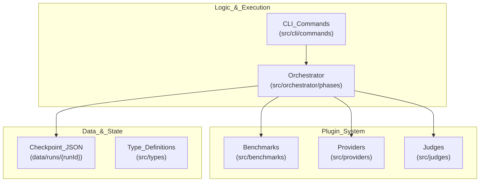
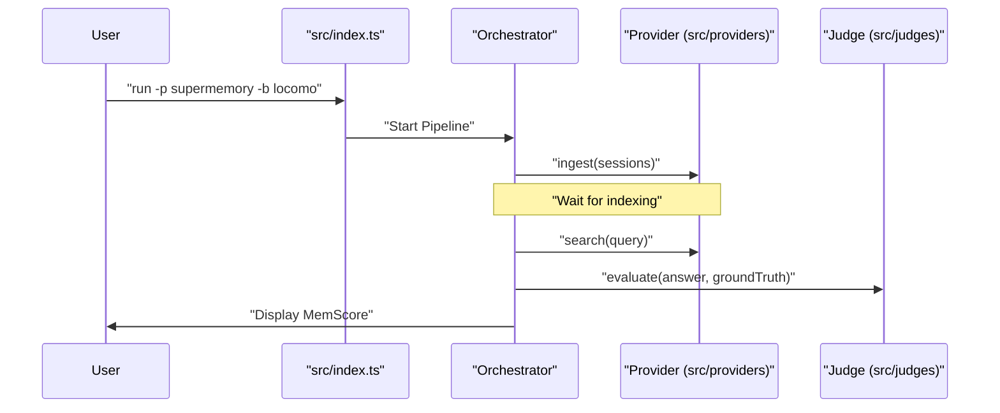

<!-- source: DeepWiki mcp.deepwiki.com · repo supermemoryai/supermemory · page 11 MemoryBench · fetched 2026-10-30 -->

# MemoryBench

Relevant source files

The following files were used as context for generating this wiki page:

- [apps/docs/memorybench/architecture.mdx](apps/docs/memorybench/architecture.mdx)
- [apps/docs/memorybench/cli.mdx](apps/docs/memorybench/cli.mdx)
- [apps/docs/memorybench/contributing.mdx](apps/docs/memorybench/contributing.mdx)
- [apps/docs/memorybench/extend-benchmark.mdx](apps/docs/memorybench/extend-benchmark.mdx)
- [apps/docs/memorybench/extend-provider.mdx](apps/docs/memorybench/extend-provider.mdx)
- [apps/docs/memorybench/github.mdx](apps/docs/memorybench/github.mdx)
- [apps/docs/memorybench/installation.mdx](apps/docs/memorybench/installation.mdx)
- [apps/docs/memorybench/integrations.mdx](apps/docs/memorybench/integrations.mdx)
- [apps/docs/memorybench/memscore.mdx](apps/docs/memorybench/memscore.mdx)
- [apps/docs/memorybench/overview.mdx](apps/docs/memorybench/overview.mdx)
- [apps/docs/memorybench/quickstart.mdx](apps/docs/memorybench/quickstart.mdx)

MemoryBench is an open-source benchmarking framework designed to provide standardized, reproducible evaluations of memory layer providers [apps/docs/memorybench/overview.mdx:2-3](). It allows developers to test memory services against industry-standard datasets to measure quality, speed, and efficiency through a unified interface.

Within the supermemory ecosystem, MemoryBench serves as the validation layer, ensuring that the memory retrieval and storage mechanisms meet performance benchmarks compared to other solutions like Mem0 or Zep [apps/docs/memorybench/overview.mdx:33-47]().

## System Overview

The framework operates by orchestrating three primary entities: **Benchmarks** (datasets), **Providers** (memory services), and **Judges** (LLM evaluators) [apps/docs/memorybench/architecture.mdx:37-44]().

### High-Level Component Mapping

The following diagram maps the logical components of MemoryBench to their respective locations in the codebase.

**MemoryBench Entity Map**

Sources: [apps/docs/memorybench/architecture.mdx:85-99](), [apps/docs/memorybench/contributing.mdx:43-53]()

## Architecture & MemScore

MemoryBench utilizes a structured pipeline that moves from data ingestion to final reporting. The pipeline consists of five main phases: **Ingest**, **Index**, **Search**, **Answer**, and **Evaluate** [apps/docs/memorybench/architecture.mdx:49-59](). Each phase is checkpointed independently in `data/runs/{runId}/checkpoint.json` to allow for resuming failed runs [apps/docs/memorybench/architecture.mdx:70-78]().

The primary metric produced is **MemScore**, a composite triple that avoids collapsing distinct performance trade-offs into a single number. It is represented as:
`Accuracy% / Latency (ms) / Context Tokens` [apps/docs/memorybench/memscore.mdx:6-12]().

| Component | Measurement | Source |
| :--- | :--- | :--- |
| **Quality** | Answer accuracy percentage | Derived from LLM judge evaluations [apps/docs/memorybench/memscore.mdx:26-26](). |
| **Latency** | Average search response time | Mean of all search phase durations [apps/docs/memorybench/memscore.mdx:27-27](). |
| **Tokens** | Average context tokens | Client-side count of retrieved context per question [apps/docs/memorybench/memscore.mdx:28-28](). |

For a deep dive into the evaluation pipeline and the mathematics behind MemScore, see [Architecture & MemScore](#11.1).

## Supported Integrations

MemoryBench supports several industry-standard datasets and memory providers out of the box.

### Benchmark Datasets
*   **LoCoMo**: Long context memory testing for fact recall across extended conversations [apps/docs/memorybench/integrations.mdx:11-11]().
*   **LongMemEval**: Evaluation across multiple sessions with knowledge updates [apps/docs/memorybench/integrations.mdx:12-12]().
*   **ConvoMem**: Conversational memory focused on personalization and preference learning [apps/docs/memorybench/integrations.mdx:13-13]().

### Memory Providers
*   **Supermemory**: Chunk-based semantic search [apps/docs/memorybench/integrations.mdx:24-26]().
*   **Mem0**: LLM-powered memory extraction [apps/docs/memorybench/integrations.mdx:28-30]().
*   **Zep**: Knowledge graph construction [apps/docs/memorybench/integrations.mdx:32-34]().

Sources: [apps/docs/memorybench/integrations.mdx:7-35]()

## CLI & Extending MemoryBench

The framework is primarily interacted with via a CLI, though it includes a Web UI for visualizing results [apps/docs/memorybench/quickstart.mdx:15-21]().

**Execution Flow**

Sources: [apps/docs/memorybench/architecture.mdx:49-59](), [apps/docs/memorybench/extend-provider.mdx:9-18](), [apps/docs/memorybench/quickstart.mdx:9-11]()

MemoryBench is designed to be extensible. Developers can add new providers by implementing the `Provider` interface [apps/docs/memorybench/extend-provider.mdx:9-18]() or new datasets by implementing the `Benchmark` interface [apps/docs/memorybench/extend-benchmark.mdx:9-17]().

For details on CLI commands, configuration, and the guide for adding custom providers or benchmarks, see [CLI & Extending MemoryBench](#11.2).

---

