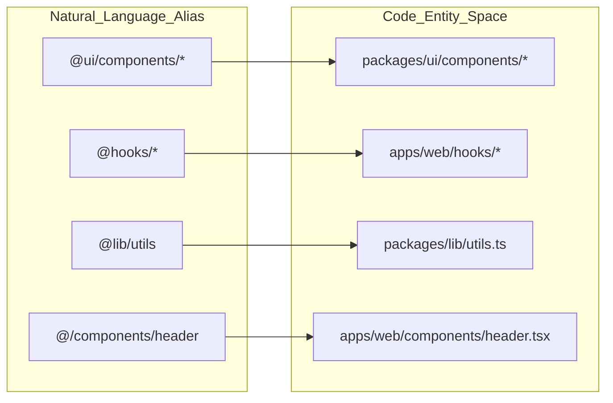
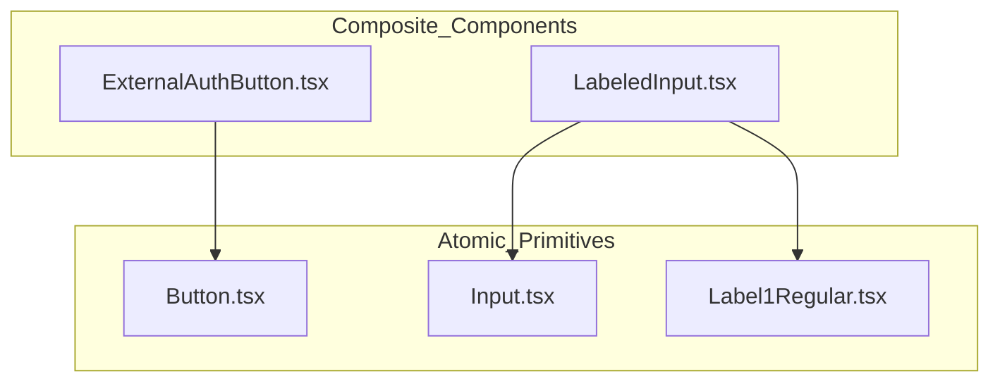

<!-- source: DeepWiki mcp.deepwiki.com · repo supermemoryai/supermemory · page 2.10 UI Component System · fetched 2026-10-30 -->

# UI Component System

<details>
<summary>Relevant source files</summary>

The following files were used as context for generating this wiki page:

- [apps/web/README.md](apps/web/README.md)
- [apps/web/biome.json](apps/web/biome.json)
- [apps/web/components.json](apps/web/components.json)
- [packages/lib/package.json](packages/lib/package.json)
- [packages/ui/assets/Logo.tsx](packages/ui/assets/Logo.tsx)
- [packages/ui/biome.json](packages/ui/biome.json)
- [packages/ui/button/external-auth.tsx](packages/ui/button/external-auth.tsx)
- [packages/ui/components/text-separator.tsx](packages/ui/components/text-separator.tsx)
- [packages/ui/globals.css](packages/ui/globals.css)
- [packages/ui/input/labeled-input.tsx](packages/ui/input/labeled-input.tsx)
- [packages/ui/package.json](packages/ui/package.json)
- [packages/ui/text/label/label-2-medium.tsx](packages/ui/text/label/label-2-medium.tsx)
- [packages/ui/text/label/label-2-regular.tsx](packages/ui/text/label/label-2-regular.tsx)
- [packages/ui/text/label/label-3-medium.tsx](packages/ui/text/label/label-3-medium.tsx)
- [packages/ui/text/label/label-3-regular.tsx](packages/ui/text/label/label-3-regular.tsx)

</details>


This page documents the UI component infrastructure used by `apps/web`: the Shadcn UI configuration, Tailwind CSS setup, the shared `packages/ui` component package, path aliases, font configuration, and the application header and navigation components.

For details about how providers are layered into the root layout, see [Application Structure & Providers](). For analytics and error tracking hooks that integrate with UI interactions, see [Analytics & Error Tracking]().

---

## Shadcn UI Configuration

The `apps/web` application uses [Shadcn UI](https://ui.shadcn.com) with a specific configuration defined in `components.json`. The setup utilizes the `new-york` style and is optimized for React Server Components (RSC).

| Field | Value | Effect |
|---|---|---|
| `style` | `new-york` | Applies the New York visual style (sharper corners, denser spacing). |
| `rsc` | `true` | Generates components compatible with React Server Components. |
| `tsx` | `true` | Uses TypeScript `.tsx` extensions. |
| `tailwind.css` | `../../packages/ui/globals.css` | Points Tailwind to the shared package's global CSS. |
| `tailwind.baseColor` | `zinc` | Default color scale for generated components. |
| `tailwind.cssVariables` | `true` | Uses CSS custom properties for theming rather than static classes. |
| `iconLibrary` | `lucide` | Uses Lucide icons throughout generated components. |

Sources: [apps/web/components.json:2-15](), [packages/ui/globals.css:1-3]()

---

## Path Aliases

The monorepo configuration uses path aliases to bridge the application code with the shared UI library and internal utilities. These are resolved by the bundler and TypeScript.

**Path alias resolution table:**

| Alias | Resolves To | Purpose |
|---|---|---|
| `@ui/*` | `packages/ui/*` | Shared components and assets. |
| `@lib/*` | `packages/lib/*` | Shared logic (auth, utils, context). |
| `@/*` | `apps/web/*` | Application-specific source code. |
| `@hooks/*` | `apps/web/hooks/*` | Application-specific hooks. |

Diagram: Path Alias Resolution



Sources: [packages/ui/button/external-auth.tsx:1-2](), [packages/ui/input/labeled-input.tsx:1-3](), [packages/ui/components/text-separator.tsx:1-1]()

---

## Shared `packages/ui` Package

All reusable primitive components and design tokens live in `packages/ui`. This package is a central repository for the design system.

### Package Dependencies
The UI package manages a comprehensive set of Radix UI primitives and visualization libraries:
- **Primitives**: `@radix-ui/react-accordion`, `react-dialog`, `react-dropdown-menu`, `react-select`, `react-slot`, etc. [packages/ui/package.json:11-29]()
- **Icons**: `lucide-react` [packages/ui/package.json:33-33]()
- **Animation**: `motion` (Framer Motion) and `tw-animate-css` [packages/ui/package.json:34-34](), [packages/ui/package.json:40-40]()
- **Visualization**: `@pixi/react`, `pixi.js` (for memory graph), and `recharts` [packages/ui/package.json:10-10](), [packages/ui/package.json:36-37]()
- **Styling**: `class-variance-authority`, `tailwindcss`, and `next-themes` [packages/ui/package.json:30-30](), [packages/ui/package.json:35-35](), [packages/ui/package.json:39-39]()

### CSS Globals
The application uses Tailwind CSS v4 directives and theme variables defined in the shared package.
- `@ui/globals.css`: Shared design tokens, OKLCH color variables, and custom scrollbar styles [packages/ui/globals.css:1-170]().
- **Theming**: Supports dark mode via the `.dark` selector and `@custom-variant dark` [packages/ui/globals.css:4-4](), [packages/ui/globals.css:112-170]().

Diagram: Shared UI Package Structure

```mermaid
graph TD
  pkg["@repo/ui_(packages/ui)"]
  globals["globals.css_(Tailwind_v4_Theme)"]
  components["components/_(Radix_Wrappers)"]
  assets["assets/_(Logo_&_SVG)"]
  text["text/_(Typography_Primitives)"]
  
  pkg --> globals
  pkg --> components
  pkg --> assets
  pkg --> text

  components --> "button.tsx"
  components --> "input.tsx"
  components --> "text-separator.tsx"
  
  text --> "label-1-regular.tsx"
  text --> "label-3-medium.tsx"

  webApp["apps/web"]
  webApp -->|"@ui/globals.css"| globals
  webApp -->|"@ui/components/*"| components
  webApp -->|"@ui/assets/Logo"| assets
```

Sources: [packages/ui/package.json:1-43](), [packages/ui/globals.css:9-49](), [packages/ui/assets/Logo.tsx:1-25]()

---

## Tailwind CSS and Typography

The styling system is driven by Tailwind CSS v4, utilizing a theme configuration based on CSS variables [packages/ui/globals.css:9-49]().

- **Fonts**: 
    - **Sans**: `Space Grotesk` and `Inter` [packages/ui/globals.css:12-14]().
    - **Mono**: `Space Mono` [packages/ui/globals.css:87-87]().
- **Typography Components**: Reusable text components like `Label3Medium` and `Label2Medium` provide consistent sizing and tracking across the app [packages/ui/text/label/label-3-medium.tsx:4-19](), [packages/ui/text/label/label-2-medium.tsx:4-19]().
- **Colors**: Uses `oklch` color space for high-precision color definitions (e.g., `--primary: oklch(0.614 0.2014 258.1073)`) [packages/ui/globals.css:53-84]().

---

## Shared UI Components

The system provides specialized components for common patterns:

### Labeled Input
The `LabeledInput` component wraps the standard `Input` with a `Label1Regular` and handles error states [packages/ui/input/labeled-input.tsx:13-51](). It uses a custom background (`#070E1B`) and specific box-shadows to match the dark theme aesthetic [packages/ui/input/labeled-input.tsx:36-38]().

### External Auth Button
The `ExternalAuthButton` is a specialized button for OAuth providers (e.g., Google, GitHub). It features a linear gradient background and a specific height of `44px` [packages/ui/button/external-auth.tsx:10-38]().

### Text Separator
Used for "OR" dividers in login forms, the `TextSeparator` provides a horizontal line with uppercase text [packages/ui/components/text-separator.tsx:7-22]().

Diagram: Component Composition



Sources: [packages/ui/input/labeled-input.tsx:27-43](), [packages/ui/button/external-auth.tsx:17-36](), [packages/ui/components/text-separator.tsx:13-20]()

---

## Navigation and Assets

### Brand Assets
The `Logo` and `LogoFull` components are exported as SVG components from `@ui/assets/Logo.tsx`, allowing for easy color manipulation via the `currentColor` fill property [packages/ui/assets/Logo.tsx:25-41]().

### Global Styling
The `globals.css` file defines the root variables for the entire design system, including shadows (`--shadow-sm`, `--shadow-md`), border radius (`--radius: 0.75rem`), and sidebar-specific colors [packages/ui/globals.css:52-108]().

Sources: [packages/ui/assets/Logo.tsx:25-41](), [packages/ui/globals.css:52-83]()

---

