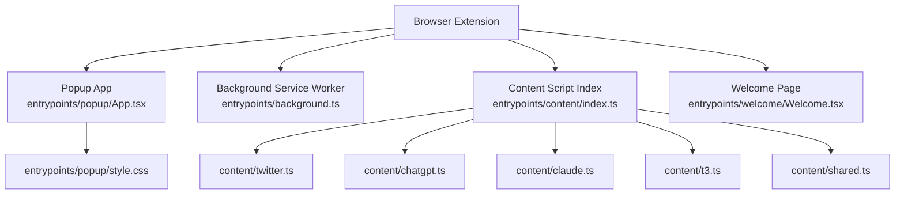
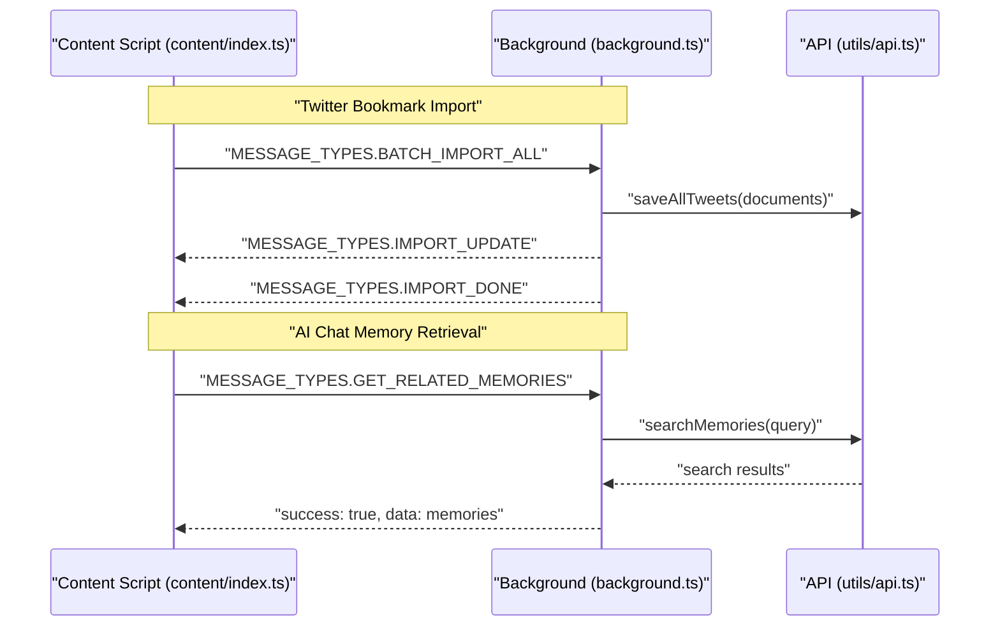
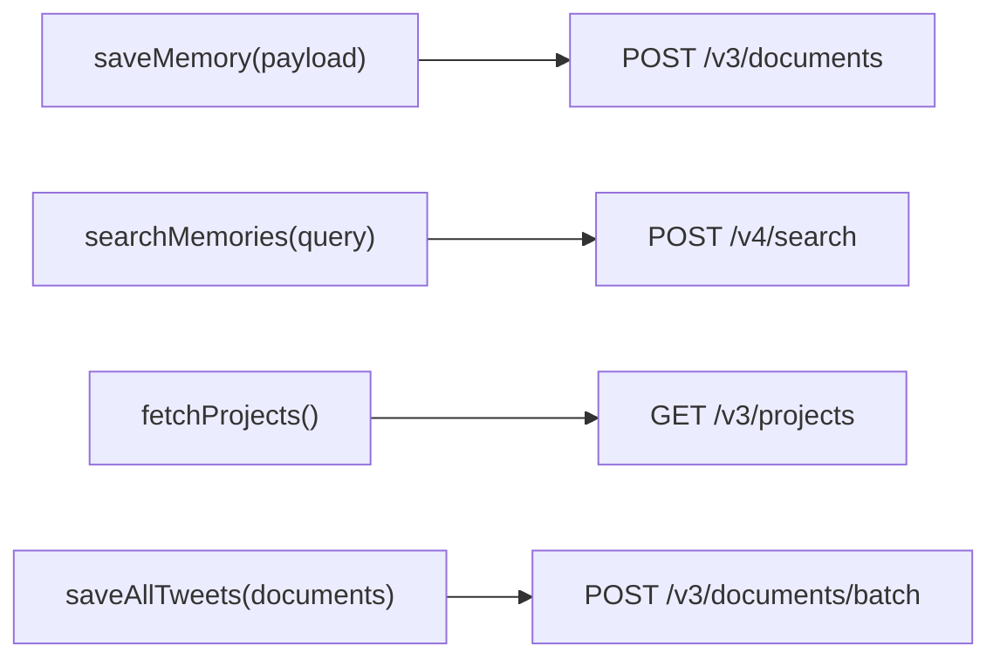

<!-- source: DeepWiki mcp.deepwiki.com · repo supermemoryai/supermemory · page 3.1 Extension Architecture · fetched 2026-10-30 -->

# Extension Architecture

<details>
<summary>Relevant source files</summary>

The following files were used as context for generating this wiki page:

- [apps/browser-extension/components/icons.tsx](apps/browser-extension/components/icons.tsx)
- [apps/browser-extension/entrypoints/background.ts](apps/browser-extension/entrypoints/background.ts)
- [apps/browser-extension/entrypoints/content/claude.ts](apps/browser-extension/entrypoints/content/claude.ts)
- [apps/browser-extension/entrypoints/content/grok.ts](apps/browser-extension/entrypoints/content/grok.ts)
- [apps/browser-extension/entrypoints/content/index.ts](apps/browser-extension/entrypoints/content/index.ts)
- [apps/browser-extension/entrypoints/content/twitter.ts](apps/browser-extension/entrypoints/content/twitter.ts)
- [apps/browser-extension/entrypoints/popup/App.tsx](apps/browser-extension/entrypoints/popup/App.tsx)
- [apps/browser-extension/entrypoints/popup/style.css](apps/browser-extension/entrypoints/popup/style.css)
- [apps/browser-extension/entrypoints/welcome/Welcome.tsx](apps/browser-extension/entrypoints/welcome/Welcome.tsx)
- [apps/browser-extension/package.json](apps/browser-extension/package.json)
- [apps/browser-extension/public/claude.png](apps/browser-extension/public/claude.png)
- [apps/browser-extension/public/gemini.png](apps/browser-extension/public/gemini.png)
- [apps/browser-extension/public/icon-48.png](apps/browser-extension/public/icon-48.png)
- [apps/browser-extension/public/logo-fullmark.svg](apps/browser-extension/public/logo-fullmark.svg)
- [apps/browser-extension/utils/api.ts](apps/browser-extension/utils/api.ts)
- [apps/browser-extension/utils/constants.ts](apps/browser-extension/utils/constants.ts)
- [apps/browser-extension/utils/twitter-import.ts](apps/browser-extension/utils/twitter-import.ts)
- [apps/browser-extension/utils/twitter-utils.ts](apps/browser-extension/utils/twitter-utils.ts)
- [apps/browser-extension/utils/types.ts](apps/browser-extension/utils/types.ts)
- [apps/browser-extension/utils/ui-components.ts](apps/browser-extension/utils/ui-components.ts)
- [apps/browser-extension/wxt.config.ts](apps/browser-extension/wxt.config.ts)

</details>


This page covers the build configuration, manifest permissions, runtime entry points, and inter-component message-passing protocol for the Supermemory browser extension located at `apps/browser-extension/`.

---

## Build System: WXT Framework

The extension is built with [WXT](https://wxt.dev), a Vite-based framework for browser extensions. WXT handles entry point discovery, manifest generation, and cross-browser output.

| Script | Command |
|---|---|
| Dev (Chrome) | `wxt --port 3001` | [apps/browser-extension/package.json:8]() |
| Dev (Firefox) | `wxt -b firefox` | [apps/browser-extension/package.json:9]() |
| Build (Chrome) | `wxt build` | [apps/browser-extension/package.json:10]() |
| Build (Firefox) | `wxt build -b firefox` | [apps/browser-extension/package.json:11]() |
| Package zip | `wxt zip` | [apps/browser-extension/package.json:12]() |
| Post-install prepare | `wxt prepare` | [apps/browser-extension/package.json:15]() |

WXT configuration is defined in [apps/browser-extension/wxt.config.ts:13-53](). The React module (`@wxt-dev/module-react`) and Tailwind CSS (`tailwindcss()`) are loaded as Vite plugins [apps/browser-extension/wxt.config.ts:14-17](). The build process also includes specific optimizations for React and TanStack Query [apps/browser-extension/wxt.config.ts:25-27]().

Key runtime dependencies declared in [apps/browser-extension/package.json:17-35]():

| Package | Purpose |
|---|---|
| `wxt` | Build framework and CLI [apps/browser-extension/package.json:33]() |
| `@wxt-dev/module-react` | React support for WXT [apps/browser-extension/package.json:31]() |
| `@tanstack/react-query` | Server state management in popup [apps/browser-extension/package.json:19]() |
| `posthog-js` | Analytics tracking [apps/browser-extension/package.json:20]() |
| `turndown` | HTML-to-Markdown conversion for memories [apps/browser-extension/package.json:24]() |
| `tailwindcss` | Utility-first styling [apps/browser-extension/package.json:23]() |

Sources: [apps/browser-extension/wxt.config.ts:1-53](), [apps/browser-extension/package.json:1-35]()

---

## Manifest Configuration

The manifest is defined inline within `wxt.config.ts` [apps/browser-extension/wxt.config.ts:29-49]().

### Permissions

```typescript
permissions: ["storage", "activeTab", "webRequest", "tabs"]
```

| Permission | Used For |
|---|---|
| `storage` | Persist `bearerToken`, `userData`, `defaultProject`, and feature flags [apps/browser-extension/wxt.config.ts:33]() |
| `activeTab` | Read current tab URL and title for saving memories [apps/browser-extension/wxt.config.ts:33]() |
| `webRequest` | Intercept X/Twitter requests to capture auth headers [apps/browser-extension/entrypoints/background.ts:40-47]() |
| `tabs` | Open new tabs (welcome page, login, bookmarks page) [apps/browser-extension/entrypoints/background.ts:33-35]() |

### Host Permissions

Declared at [apps/browser-extension/wxt.config.ts:34-42]():

| Host Pattern | Purpose |
|---|---|
| `*://x.com/*` | Twitter/X content script, `webRequest` intercept [apps/browser-extension/wxt.config.ts:35]() |
| `*://twitter.com/*` | Twitter/X content script, `webRequest` intercept [apps/browser-extension/wxt.config.ts:36]() |
| `*://supermemory.ai/*` | Cookie/session passthrough [apps/browser-extension/wxt.config.ts:37]() |
| `*://api.supermemory.ai/*` | Direct API calls from extension [apps/browser-extension/wxt.config.ts:38]() |
| `*://chatgpt.com/*` | ChatGPT content script injection [apps/browser-extension/wxt.config.ts:39]() |
| `*://chat.openai.com/*` | Legacy ChatGPT domain injection [apps/browser-extension/wxt.config.ts:40]() |
| `https://*.posthog.com/*` | Analytics event reporting [apps/browser-extension/wxt.config.ts:45]() |

### Web-Accessible Resources

Fonts (SpaceGrotesk `.ttf` files) and `icon-16.png` are exposed to content scripts via `web_accessible_resources` [apps/browser-extension/wxt.config.ts:43-48]() so injected UI elements can load them with `chrome.runtime.getURL()` or `browser.runtime.getURL()` [apps/browser-extension/utils/ui-components.ts:48-77]().

Sources: [apps/browser-extension/wxt.config.ts:29-53](), [apps/browser-extension/utils/ui-components.ts:39-92]()

---

## Extension Entry Points

WXT discovers entry points by convention from the `entrypoints/` directory.

**Extension Entry Points and Their Files:**



Sources: [apps/browser-extension/entrypoints/content/index.ts:1-78](), [apps/browser-extension/entrypoints/background.ts:1-256](), [apps/browser-extension/entrypoints/popup/App.tsx:1-10]()

### Popup (`entrypoints/popup/App.tsx`)

The popup is a React app rendered in the browser action popup. The root component `App` manages UI for authenticated users and login flows [apps/browser-extension/entrypoints/popup/App.tsx:1-10]().

On load, `App` reads the `bearerToken` from storage, validates it via `validateAuthToken()`, and conditionally renders a signed-in or sign-in UI [apps/browser-extension/entrypoints/popup/App.tsx:4-5]().

The popup uses `@tanstack/react-query` hooks (`useProjects`, `useDefaultProject`, `useUserData`, `useSetDefaultProject`) for all server-state operations [apps/browser-extension/entrypoints/popup/App.tsx:6-11]().

Sources: [apps/browser-extension/entrypoints/popup/App.tsx:1-200]()

### Background Service Worker (`entrypoints/background.ts`)

Defined with `defineBackground()`, the service worker runs persistently and handles:

1. **Install event** — opens the welcome page on first install [apps/browser-extension/entrypoints/background.ts:27-37]().
2. **`webRequest` listener** — intercepts all requests to X/Twitter domains to call `captureTwitterTokens(details)` [apps/browser-extension/entrypoints/background.ts:40-47]().
3. **`runtime.onMessage` listener** — dispatches on `message.type` or `message.action` [apps/browser-extension/entrypoints/background.ts:173-256]().

The background instantiates a `TwitterImporter` object on demand when a `BATCH_IMPORT_ALL` message is received [apps/browser-extension/entrypoints/background.ts:176-192](). It also contains the logic for `saveMemoryToSupermemory` [apps/browser-extension/entrypoints/background.ts:82-144]() and `getRelatedMemories` [apps/browser-extension/entrypoints/background.ts:146-168]().

Sources: [apps/browser-extension/entrypoints/background.ts:24-256]()

### Content Script (`entrypoints/content/index.ts`)

Registered with `matches: ["<all_urls>"]` [apps/browser-extension/entrypoints/content/index.ts:19-20](). The main entry:

1. Registers a `browser.runtime.onMessage` listener for messages from the popup and background [apps/browser-extension/entrypoints/content/index.ts:23-35]().
2. Calls `setupGlobalKeyboardShortcut()` and `setupStorageListener()` from `content/shared.ts` [apps/browser-extension/entrypoints/content/index.ts:37-41]().
3. Calls platform-specific initializers: `initializeChatGPT()`, `initializeClaude()`, `initializeT3()`, `initializeTwitter()` [apps/browser-extension/entrypoints/content/index.ts:70-74]().
4. Attaches a `MutationObserver` that re-runs the appropriate initializer whenever the DOM changes [apps/browser-extension/entrypoints/content/index.ts:44-67]().

Sources: [apps/browser-extension/entrypoints/content/index.ts:1-84]()

---

## Message-Passing Protocol

The extension uses `chrome.tabs.sendMessage` (background → content script) and `browser.runtime.sendMessage` (content script → background) as the primary communication channels.

### Message Type Constants

Centralized in `MESSAGE_TYPES` at [apps/browser-extension/utils/constants.ts:77-87]():

| Constant | String Value | Direction |
|---|---|---|
| `SAVE_MEMORY` | `"sm-save-memory"` | Content → Background [apps/browser-extension/entrypoints/background.ts:195]() |
| `SHOW_TOAST` | `"sm-show-toast"` | Popup → Content [apps/browser-extension/entrypoints/content/index.ts:24]() |
| `BATCH_IMPORT_ALL` | `"sm-batch-import-all"` | Content → Background [apps/browser-extension/entrypoints/background.ts:176]() |
| `IMPORT_UPDATE` | `"sm-import-update"` | Background → Content [apps/browser-extension/entrypoints/background.ts:57]() |
| `IMPORT_DONE` | `"sm-import-done"` | Background → Content [apps/browser-extension/entrypoints/background.ts:73]() |
| `GET_RELATED_MEMORIES` | `"sm-get-related-memories"` | Content → Background [apps/browser-extension/entrypoints/background.ts:213]() |
| `CAPTURE_PROMPT` | `"sm-capture-prompt"` | Content → Background [apps/browser-extension/entrypoints/background.ts:231]() |
| `FETCH_PROJECTS` | `"sm-fetch-projects"` | Content → Background [apps/browser-extension/entrypoints/content/twitter.ts:132]() |

### Message Flow Diagram

**Message-Passing Flow Between Extension Components:**



Sources: [apps/browser-extension/entrypoints/background.ts:173-256](), [apps/browser-extension/entrypoints/content/index.ts:22-34](), [apps/browser-extension/entrypoints/content/twitter.ts:129-183]()

---

## Storage Layer

Storage keys and typed storage helpers are defined across `utils/constants.ts` and `utils/storage.ts`.

**Storage key constants** [apps/browser-extension/utils/constants.ts:32-36]():

| Key | Purpose |
|---|---|
| `TWITTER_BOOKMARKS_ONBOARDING_SEEN` | Tracks if onboarding toast was shown [apps/browser-extension/utils/constants.ts:33]() |
| `TWITTER_BOOKMARKS_IMPORT_INTENT_UNTIL` | TTL timestamp for pending import intent [apps/browser-extension/utils/constants.ts:34-35]() |

**WXT-typed storage items** (defined in `utils/storage.ts` and referenced in `entrypoints/popup/App.tsx`):

| Export | Type | Purpose |
|---|---|---|
| `bearerToken` | `StorageItem<string>` | Supermemory API auth token [apps/browser-extension/entrypoints/popup/App.tsx:15]() |
| `userData` | `StorageItem<any>` | Cached user profile [apps/browser-extension/entrypoints/popup/App.tsx:17]() |
| `defaultProject` | `StorageItem<Project>` | Last selected project/space [apps/browser-extension/entrypoints/popup/App.tsx:16]() |
| `autoSearchEnabled` | `StorageItem<boolean>` | Toggle for auto-search in chat UIs [apps/browser-extension/entrypoints/popup/App.tsx:13]() |
| `autoCapturePromptsEnabled` | `StorageItem<boolean>` | Toggle for auto-capture in chat UIs [apps/browser-extension/entrypoints/popup/App.tsx:14]() |

Sources: [apps/browser-extension/utils/constants.ts:32-52](), [apps/browser-extension/entrypoints/popup/App.tsx:12-18]()

---

## API Layer

All HTTP calls go through `utils/api.ts`, which wraps fetch with a bearer token from storage.

**API function to endpoint mapping:**



All authenticated calls go through `makeAuthenticatedRequest<T>(endpoint, options)` [apps/browser-extension/utils/api.ts:30-57](), which:

1. Reads the bearer token via `getBearerToken()` [apps/browser-extension/utils/api.ts:17-25]().
2. Prepends `API_ENDPOINTS.SUPERMEMORY_API` (production: `https://api.supermemory.ai`) [apps/browser-extension/utils/api.ts:36]().
3. On HTTP 401, throws `AuthenticationError`; on other failures, throws `SupermemoryAPIError` [apps/browser-extension/utils/api.ts:47-53]().

Sources: [apps/browser-extension/utils/api.ts:1-193](), [apps/browser-extension/utils/constants.ts:4-11]()

---

## Domain Routing in Content Scripts

The `DOMAINS` constant defines the sets of hostnames each feature operates on [apps/browser-extension/utils/constants.ts:57-64]().

| Constant | Hostnames | Feature |
|---|---|---|
| `DOMAINS.TWITTER` | `x.com`, `twitter.com` | Bookmark import [apps/browser-extension/entrypoints/content/twitter.ts:85]() |
| `DOMAINS.CHATGPT` | `chatgpt.com`, `chat.openai.com` | AI chat integration [apps/browser-extension/entrypoints/content/index.ts:46]() |
| `DOMAINS.CLAUDE` | `claude.ai` | AI chat integration [apps/browser-extension/entrypoints/content/index.ts:49]() |
| `DOMAINS.T3` | `t3.chat` | AI chat integration [apps/browser-extension/entrypoints/content/index.ts:55]() |

The `MutationObserver` in `content/index.ts` re-checks the domain on every DOM mutation, allowing the extension to respond to SPA navigation [apps/browser-extension/entrypoints/content/index.ts:44-67]().

Sources: [apps/browser-extension/utils/constants.ts:57-64](), [apps/browser-extension/entrypoints/content/index.ts:44-67]()

---

