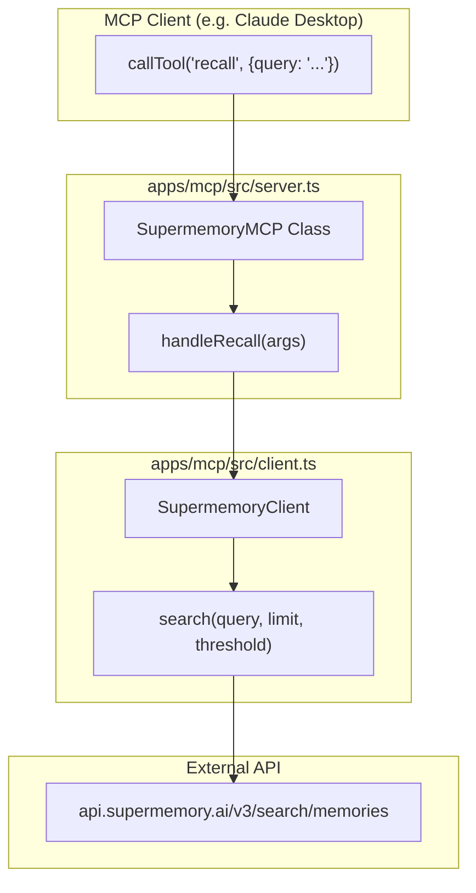
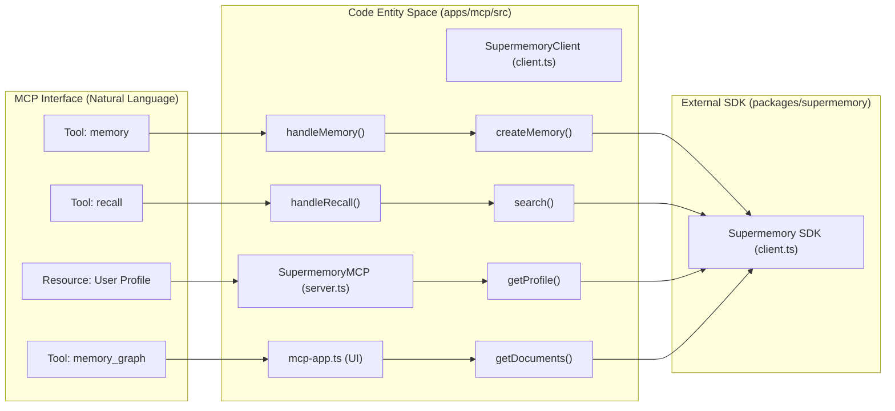

<!-- source: DeepWiki mcp.deepwiki.com · repo supermemoryai/supermemory · page 5.2 Tools, Resources & Prompts · fetched 2026-10-30 -->

# Tools, Resources & Prompts

Relevant source files

The following files were used as context for generating this wiki page:

- [CLAUDE.md](CLAUDE.md)
- [apps/mcp/.dev.vars.example](apps/mcp/.dev.vars.example)
- [apps/mcp/.gitignore](apps/mcp/.gitignore)
- [apps/mcp/mcp-app.html](apps/mcp/mcp-app.html)
- [apps/mcp/src/auth.ts](apps/mcp/src/auth.ts)
- [apps/mcp/src/client.ts](apps/mcp/src/client.ts)
- [apps/mcp/src/format.ts](apps/mcp/src/format.ts)
- [apps/mcp/src/html.d.ts](apps/mcp/src/html.d.ts)
- [apps/mcp/src/index.ts](apps/mcp/src/index.ts)
- [apps/mcp/src/posthog.ts](apps/mcp/src/posthog.ts)
- [apps/mcp/src/server.ts](apps/mcp/src/server.ts)
- [apps/mcp/src/ui/global.css](apps/mcp/src/ui/global.css)
- [apps/mcp/src/ui/mcp-app.css](apps/mcp/src/ui/mcp-app.css)
- [apps/mcp/src/ui/mcp-app.ts](apps/mcp/src/ui/mcp-app.ts)
- [apps/mcp/tsconfig.json](apps/mcp/tsconfig.json)
- [apps/mcp/vite.config.ts](apps/mcp/vite.config.ts)
- [apps/mcp/wrangler.jsonc](apps/mcp/wrangler.jsonc)
- [apps/web/components/chat/chat-graph-context-rail.tsx](apps/web/components/chat/chat-graph-context-rail.tsx)
- [apps/web/lib/chat-auto-space.ts](apps/web/lib/chat-auto-space.ts)

The Supermemory MCP server, implemented as a Cloudflare Worker using Durable Objects, provides a standardized interface for AI assistants to interact with a user's knowledge base. This page documents the specific tools, resources, and prompts registered within the MCP server, their underlying implementation in `SupermemoryMCP`, and the data flow between the MCP protocol and the Supermemory API.

## MCP Tools

Tools are executable functions that an AI assistant can call. The Supermemory MCP server registers five primary tools to manage memories, discover project contexts, and visualize the memory graph.

### Tool Definition and Registration

Tools are defined using Zod schemas for input validation and registered via the `this.server.registerTool` method within the `SupermemoryMCP` class [apps/mcp/src/server.ts:109-130]().

**Sources:** [apps/mcp/src/server.ts:121-130](), [apps/mcp/src/client.ts:242-258]()

### 1. `memory`
Used to persist or remove information. It acts as the primary write interface for the AI's long-term memory.

| Parameter | Type | Description | Default |
|-----------|------|-------------|---------|
| `content` | `string` | The text to remember or forget (max 200,000 chars). | Required |
| `action` | `"save" \| "forget"` | Whether to store the information or remove it. | `"save"` |
| `containerTag`| `string` | Optional project identifier to scope the memory. | Root tag |

**Behavior:**
- **Save:** Calls `this.client.createMemory(content)` which uses the SDK's `client.add` method [apps/mcp/src/client.ts:150-169]().
- **Forget:** Attempts an exact match first via `client.memories.forget`. If not found (404), it performs a semantic search with a high similarity threshold (0.85) to find and delete the most relevant memory [apps/mcp/src/client.ts:172-239]().

**Sources:** [apps/mcp/src/server.ts:77-84](), [apps/mcp/src/server.ts:109-118](), [apps/mcp/src/client.ts:172-239]()

### 2. `recall`
The primary retrieval tool for searching the user's knowledge base.

| Parameter | Type | Description | Default |
|-----------|------|-------------|---------|
| `query` | `string` | Search query for semantic/hybrid search. | Required |
| `includeProfile`| `boolean` | Whether to append the user's profile summary to the results. | `true` |
| `containerTag` | `string` | Optional project identifier to scope the search. | Root tag |

**Return Value:**
Returns a list of relevant memories (or document chunks) formatted via `formatMemories` and, if requested, the user's profile summary [apps/mcp/src/server.ts:121-130](), [apps/mcp/src/format.ts:1-11]().

**Sources:** [apps/mcp/src/server.ts:86-93](), [apps/mcp/src/server.ts:121-130](), [apps/mcp/src/format.ts:1-157]()

### 3. `listProjects`
Allows the AI to discover valid `containerTag` values for organizing information.

**Behavior:**
- Triggers a refresh of tags from the server using `this.refreshContainerTags()` or ensures they are fresh based on `CONTAINER_TAGS_TTL_MS` [apps/mcp/src/server.ts:211-215]().
- Accesses the cached list in `this.cachedContainerTags` [apps/mcp/src/server.ts:216]().
- Returns a formatted list of project names for the AI to use in subsequent `memory` or `recall` calls [apps/mcp/src/server.ts:233]().

**Sources:** [apps/mcp/src/server.ts:193-253]()

### 4. `whoAmI`
Returns metadata about the current authenticated session.

**Return Value:**
An object containing `userId`, `email`, `name`, and the client info (name and version) stored in the Durable Object storage [apps/mcp/src/server.ts:256-274]().

**Sources:** [apps/mcp/src/server.ts:256-274]()

### 5. `memory_graph`
Registered via `registerAppTool`, this provides an interactive visualization of the knowledge graph within supporting MCP clients (like Claude Desktop) [apps/mcp/src/server.ts:4-7]().

- **Behavior:** It fetches documents and their associated memory entries for a specific `containerTag` [apps/mcp/src/ui/mcp-app.ts:189-217]().
- **UI Implementation:** Uses `force-graph` to render a force-directed graph [apps/mcp/src/ui/mcp-app.ts:12]().
- **Visual Encoding:**
    - **Documents:** Rectangular nodes [apps/mcp/src/ui/mcp-app.ts:207-217]().
    - **Memories:** Hexagonal nodes, color-coded by state: Recent (Green), Expiring (Orange), Forgotten (Red), or Default (Blue) [apps/mcp/src/ui/mcp-app.ts:95-100](), [apps/mcp/src/ui/mcp-app.ts:162-171]().

**Sources:** [apps/mcp/src/ui/mcp-app.ts:1-217](), [apps/mcp/mcp-app.html:1-95]()

---

## MCP Resources

Resources are read-only data sources that the AI can "open" or subscribe to. They are identified by URIs.

### 1. User Profile (`supermemory://profile`)
Provides a comprehensive view of the user's identity derived from their memories.

- **Implementation:** Calls `client.getProfile()` [apps/mcp/src/server.ts:139]().
- **Data Structure:**
    - **Stable Preferences:** Static facts about the user (e.g., "Prefers TypeScript").
    - **Recent Activity:** Dynamic facts or recent interactions.
- **MIME Type:** `text/plain` [apps/mcp/src/server.ts:160]().

**Sources:** [apps/mcp/src/server.ts:133-169](), [apps/mcp/src/client.ts:274-286]()

### 2. My Projects (`supermemory://projects`)
Provides a machine-readable list of the user's projects.

- **Implementation:** Uses `this.cachedContainerTags` after ensuring they are fresh [apps/mcp/src/server.ts:177-178]().
- **MIME Type:** `application/json` [apps/mcp/src/server.ts:184]().

**Sources:** [apps/mcp/src/server.ts:172-190]()

---

## Context Prompts

Prompts are predefined templates that help guide the AI's behavior or provide system-level context.

### `context` Prompt
The `context` prompt is designed to be injected into the system message to give the AI assistant a "personality" and awareness of the user's preferences.

- **Arguments:** `includeRecent` (boolean, default `true`) and `containerTag` (optional string) [apps/mcp/src/server.ts:95-102]().
- **Behavior:** It fetches the user's profile and formats it into a system instruction, emphasizing that the AI should act as an extension of the user's memory [apps/mcp/src/server.ts:335-349]().

**Sources:** [apps/mcp/src/server.ts:335-349]()

---

## Data Flow: MCP to Code Entities

The following diagram maps the Natural Language MCP interface to the specific classes and functions in the codebase.

**Sources:** [apps/mcp/src/server.ts:109-130](), [apps/mcp/src/client.ts:129-147](), [apps/mcp/src/ui/mcp-app.ts:189-217]()

## Implementation Details: `SupermemoryClient`

The `SupermemoryClient` class in `apps/mcp/src/client.ts` acts as a wrapper around the official `supermemory` SDK to provide MCP-specific logic like character limiting and semantic deletion fallback.

- **Character Limiting:** All text returned to the MCP client is truncated via `limitByChars` (default 200,000 characters) to prevent context window overflow [apps/mcp/src/client.ts:3](), [apps/mcp/src/client.ts:110-112]().
- **Memory vs. Chunk:** The client distinguishes between atomic `memories` (facts) and document `chunks` (segments of uploaded files) using the `getMemoryText` utility [apps/mcp/src/client.ts:106-108]().
- **Normalization:** Search results from the SDK are mapped to a consistent `Memory` type that includes `id`, `similarity`, and the text content [apps/mcp/src/client.ts:260-271]().
- **Formatting:** The `formatMemories` utility in `apps/mcp/src/format.ts` provides a human-readable string representation of search results, including source metadata, document summaries, and relational context (parents, children, related) [apps/mcp/src/format.ts:1-157]().

**Sources:** [apps/mcp/src/client.ts:3-128](), [apps/mcp/src/client.ts:106-112](), [apps/mcp/src/format.ts:1-157]()

---

