# Page: Overview

# Overview

<details>
<summary>Relevant source files</summary>

The following files were used as context for generating this wiki page:

- [README.md](README.md)
- [demo.ipynb](demo.ipynb)
- [docs/changelog.md](docs/changelog.md)
- [docs/index.md](docs/index.md)
- [docs/notebooks/quickstart.ipynb](docs/notebooks/quickstart.ipynb)
- [mkdocs.yml](mkdocs.yml)
- [src/supervision/detection/core.py](src/supervision/detection/core.py)
- [src/supervision/detection/vlm.py](src/supervision/detection/vlm.py)
- [tests/detection/test_from_adapters.py](tests/detection/test_from_adapters.py)
- [tests/detection/test_vlm.py](tests/detection/test_vlm.py)

</details>


Supervision is a comprehensive computer vision toolkit designed to provide reusable, model-agnostic utilities that streamline computer vision workflows [README.md:43-45](). It offers a robust collection of tools for object detection, tracking, annotation, dataset management, and performance evaluation, allowing developers to focus on building applications rather than writing boilerplate code [README.md:43-45]().

This document provides a high-level architectural overview of the Supervision library and its central pipeline centered around `sv.Detections` [src/supervision/detection/core.py:114-121](). For details on installing dependencies, optional extras, and configuration options, see [Installation & Configuration](#1.1). For details on how the documentation is organized and navigated, see [Documentation Structure](#1.2).

Sources: [README.md:43-45](), [src/supervision/detection/core.py:114-121](), [mkdocs.yml:46-114]()

## Key Features

The library provides several core capabilities designed for production computer vision pipelines:

- **Standardized Detections (`sv.Detections`)**: Converts heterogeneous outputs from various model frameworks into a unified data structure [src/supervision/detection/core.py:114-121]().
- **Advanced Visualization**: A wide array of modular annotators supporting bounding boxes, masks, labels, heatmaps, and dynamic scaling [docs/index.md:31]().
- **Memory-Efficient Segmentation (`sv.CompactMask`)**: Specialized run-length encoded mask representation reducing memory overhead and supporting high-speed union operations [docs/changelog.md:10-10]().
- **Dataset Management (`sv.DetectionDataset`)**: Unified loading, splitting, merging, and exporting utilities for COCO, YOLO, and Pascal VOC formats [README.md:120-141]().
- **Zone Analysis (`sv.PolygonZone`, `sv.LineZone`)**: Spatial filtering and counting tools for video streams [docs/index.md:31]().
- **Performance Evaluation (`sv.metrics`)**: Comprehensive object detection and segmentation metrics with scikit-learn parity [mkdocs.yml:86-95]().

Sources: [src/supervision/detection/core.py:114-121](), [docs/changelog.md:10-10](), [docs/index.md:31](), [README.md:120-141](), [mkdocs.yml:86-95]()

## System Architecture & Code Entities

The following diagram bridges the high-level system components of Supervision to their concrete Python module and class implementations within the codebase structure.

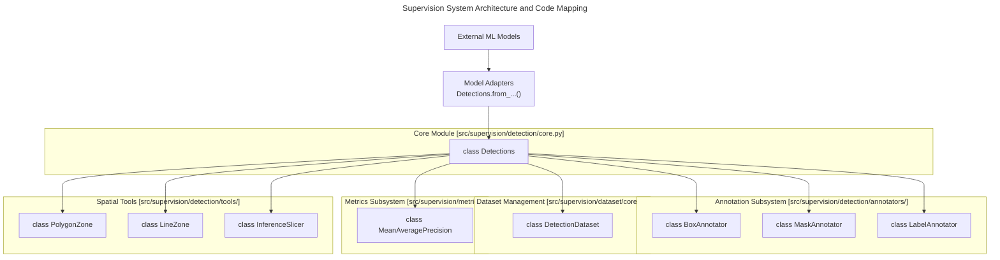

Sources: [src/supervision/detection/core.py:114-121](), [mkdocs.yml:63-106](), [README.md:59-62]()

## Data Flow & Central Pipeline

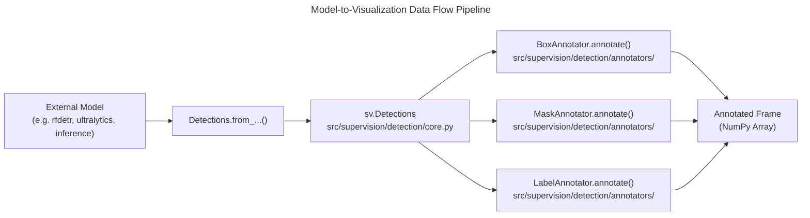

The execution pipeline standardizes model predictions into the central `sv.Detections` structure [src/supervision/detection/core.py:114-121](). Once instantiated, `sv.Detections` objects can be sliced, filtered, combined, passed into tracking systems, evaluated against ground truth via metrics, or rendered onto frames using annotators following the scene-in/scene-out pattern [README.md:101-115]().

For installation prerequisites and setup instructions, consult [Installation & Configuration](#1.1). For details on the documentation structure and navigation, see [Documentation Structure](#1.2).

Sources: [src/supervision/detection/core.py:114-121](), [README.md:101-115](), [docs/index.md:27-32]()

---

# Page: Installation & Configuration

# Installation & Configuration

<details>
<summary>Relevant source files</summary>

The following files were used as context for generating this wiki page:

- [.pre-commit-config.yaml](.pre-commit-config.yaml)
- [README.md](README.md)
- [docs/index.md](docs/index.md)
- [mkdocs.yml](mkdocs.yml)
- [pyproject.toml](pyproject.toml)
- [tests/metrics/test_sklearn_parity.py](tests/metrics/test_sklearn_parity.py)
- [uv.lock](uv.lock)

</details>


This page provides a comprehensive guide to installing `supervision`, managing its dependencies, configuring optional features (such as metrics and GeoTIFF support), and setting up the development environment using modern Python tooling (`pyproject.toml`, `uv.lock`, and `pre-commit`).

---

## System Requirements & Scope

Supervision is a model-agnostic, cross-platform computer vision toolkit designed to run seamlessly across major operating systems and hardware architectures.

```mermaid
graph TD
    A["SystemRequirements"] --> B["Python310[\"Python >= 3.10\"]"]
    A --> C["OperatingSystems"]
    C --> C1["Windows[\"Windows\"]"]
    C --> C2["Linux[\"Linux\"]"]
    C --> C3["MacOS[\"macOS\"]"]
    A --> D["Architecture"]
    D --> D1["X86[\"x86_64\"]"]
    D --> D2["ARM[\"ARM / Apple Silicon\"]"]
```

Sources: [pyproject.toml:26-26](), [pyproject.toml:32-34]()

---

## Installation Methods

### Standard Installation with pip

To install the stable release of `supervision` in a Python environment meeting the minimum version requirement, run:

```bash
pip install supervision
```

Sources: [pyproject.toml:26-26](), [README.md:51-53]()

### Optional Dependencies & Extras

Supervision keeps its core package lightweight by gating specialized integrations behind optional dependency extras defined in `pyproject.toml`.

| Extra Flag | Target Feature / Integration | Governing Code Definition |
| :--- | :--- | :--- |
| `supervision[metrics]` | Enables `pandas`-backed evaluation, data formatting, and benchmark aggregations | [pyproject.toml:64-66]() |
| `supervision[geotiff]` | Enables `rasterio`-backed spatial window-read and CRS projection utilities | [pyproject.toml:61-63]() |
| `supervision[dev]` | Installs development tools (pytest, tox, scikit-learn, ruff, ipywidgets) | [pyproject.toml:71-85]() |
| `supervision[docs]` | Installs documentation generators (mike, mkdocs-material, mkdocstrings) | [pyproject.toml:86-94]() |

Sources: [pyproject.toml:61-94]()

### Installation from Source

For development or accessing unreleased commits from the repository:

```bash
git clone https://github.com/roboflow/supervision.git
cd supervision
pip install -e .
```

Sources: [docs/index.md:126-143]()

---

## Dependency Structure & Reproducibility

The core runtime dependencies required for numerical computations, image processing, video handling, and XML parsing are strictly declared in the build system.

### Core Dependencies Table

| Package | Version Constraint | Primary Code Role |
| :--- | :--- | :--- |
| `av` | `>=14.2` | Advanced video stream decoding and muxing |
| `defusedxml` | `>=0.7.1` | Secure XML parsing for Pascal VOC annotations |
| `matplotlib` | `>=3.6` | Plotting, color mapping, and notebook visuals |
| `numpy` | `>=1.21.2` | Core tensor backend for `sv.Detections` coordinate arrays |
| `pillow` | `>=9.4` | Raster image loading and metadata inspection |
| `pydeprecate` | `>=0.9,<0.13` | Deprecation management across library versions |
| `pyyaml` | `>=5.3` | Parsing configuration files and YOLO dataset YAML specs |
| `requests` | `>=2.26` | HTTP requests for asset downloading and remote utilities |
| `scipy` | `>=1.10` | Spatial distance matrices and optimization algorithms |
| `tqdm` | `>=4.62.3` | Progress bar iterations during batch video/dataset processing |

Sources: [pyproject.toml:49-60]()

### Reproducible Builds with `uv.lock`

Supervision utilizes a `uv.lock` lockfile to lock transitive dependency versions, ensuring deterministic environment instantiation across continuous integration pipelines and local developer machines.

```mermaid
graph TD
    A["pyprojecttoml[\"pyproject.toml\"]"] -->|specifies constraints| B["uvlock[\"uv.lock\"]"]
    B -->|resolves exact hashes| C["Environment[\"Resolved Python Environment\"]"]
```

Sources: [uv.lock:1-15]()

---

## Development Configuration & Tooling

Supervision maintains strict code quality, type safety, and formatting standards enforced via configuration blocks in `pyproject.toml` and Git hooks in `.pre-commit-config.yaml`.

### Linting and Formatting Rules

*   **Ruff**: Configured for linting (`pyproject.toml` rules `A`, `E`, `F`, `I`, `PT`, `Q`, `RUF`, `S`, `UP`, `W`) with a target version of Python 3.10 and a maximum line length of 88 characters.
*   **Mypy**: Enforces strict static type checking (`strict = true`) across the codebase with explicit package bases rooted in `src`.
*   **Codespell**: Scans source files for common typos while ignoring domain-specific identifiers such as tracker variables (`STrack`).

Sources: [pyproject.toml:108-212]()

### Pre-commit Hook Pipeline

Contributors must run `pre-commit` to execute formatting and validation checks prior to committing changes.

```mermaid
graph TD
    A["gitcommit[\"git commit\"]"] --> B["PreCommit[\".pre-commit-config.yaml\"]"]
    B --> C["RuffCheck[\"ruff-check --fix\"]"]
    B --> D["RuffFormat[\"ruff-format\"]"]
    B --> E["MypyCheck[\"mypy\"]"]
    B --> F["CodeSpell[\"codespell\"]"]
    C --> G["Success[\"Clean Commit\"]"]
    D --> G
    E --> G
    F --> G
```

Sources: [.pre-commit-config.yaml:10-112]()

---

## Project Architecture Mapping

This diagram bridges natural language configuration concepts to their precise implementation entities in the codebase.

```mermaid
graph TD
    subgraph "NaturalLanguageSpace"
        NL1["Core Package Requirements"]
        NL2["Optional Metrics Support"]
        NL3["Linter and Formatter Rules"]
        NL4["Static Type Analysis"]
    end

    subgraph "CodeEntitySpace"
        CE1["pyprojecttoml[\"pyproject.toml dependencies\"]"]
        CE2["pyprojecttoml2[\"pyproject.toml optional-dependencies.metrics\"]"]
        CE3["toolruff[\"tool.ruff\"]"]
        CE4["toolmypy[\"tool.mypy\"]"]
        
        NL1 --> CE1
        NL2 --> CE2
        NL3 --> CE3
        NL4 --> CE4
    end
```

Sources: [pyproject.toml:49-66](), [pyproject.toml:108-212]()

---

## Installation Verification

To verify that Supervision is correctly installed in your current environment and check version compatibility, execute the following snippet:

```python
import sys
import supervision as sv

print(f"Supervision version: {sv.__version__}")
print(f"Python version: {sys.version}")
```

Sources: [pyproject.toml:7-7](), [pyproject.toml:26-26]()

---

# Page: Documentation Structure

# Documentation Structure

<details>
<summary>Relevant source files</summary>

The following files were used as context for generating this wiki page:

- [README.md](README.md)
- [docs/cookbooks.md](docs/cookbooks.md)
- [docs/faq.md](docs/faq.md)
- [docs/index.md](docs/index.md)
- [docs/javascripts/cookbooks-card.js](docs/javascripts/cookbooks-card.js)
- [docs/javascripts/init_kapa_widget.js](docs/javascripts/init_kapa_widget.js)
- [docs/javascripts/version-banner.js](docs/javascripts/version-banner.js)
- [docs/javascripts/zoominfo.js](docs/javascripts/zoominfo.js)
- [docs/llms-100k.txt](docs/llms-100k.txt)
- [docs/llms.full.txt](docs/llms.full.txt)
- [docs/llms.txt](docs/llms.txt)
- [docs/notebooks/occupancy_analytics.ipynb](docs/notebooks/occupancy_analytics.ipynb)
- [docs/notebooks/small-object-detection-with-sahi.ipynb](docs/notebooks/small-object-detection-with-sahi.ipynb)
- [docs/stylesheets/extra.css](docs/stylesheets/extra.css)
- [docs/theme/cookbooks.html](docs/theme/cookbooks.html)
- [docs/theme/main.html](docs/theme/main.html)
- [docs/theme/partials/header.html](docs/theme/partials/header.html)
- [mkdocs.yml](mkdocs.yml)

</details>


This page explains how the Supervision library documentation is organized and provides guidance on how to effectively navigate it. Understanding the structure will help you quickly find the information you need, whether you're looking for tutorials, API references, or examples.

## Purpose and Scope

The Supervision documentation is designed to:

1. Help new users get started quickly with the library [README.md:49-68]()
2. Provide comprehensive API reference for all components [mkdocs.yml:45-86]()
3. Offer practical examples through cookbooks and how-to guides [mkdocs.yml:36-44, 87]()
4. Enable contributors to understand and extend the codebase [mkdocs.yml:152-158]()

Sources: [README.md:49-68](), [mkdocs.yml:36-158]()

## Documentation Organization

The documentation is configured via `mkdocs.yml` and organized into several main sections, including learning guides, reference modules, cookbooks, and project meta-pages.

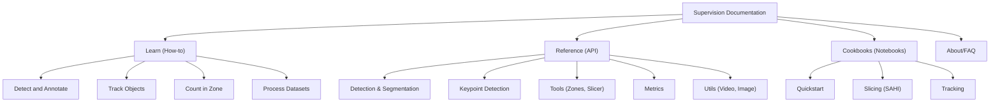

*Documentation Structure Overview*

Sources: [mkdocs.yml:31-91]()

## Content Types

The documentation leverages different formats to serve various technical needs:

| Content Type | Purpose | Implementation |
|--------------|---------|----------------|
| **How-to Guides** | Step-by-step instructions for specific tasks. | [mkdocs.yml:36-44]() |
| **API Reference** | Detailed technical documentation of classes and functions, generated from docstrings. | [mkdocs.yml:45-86, 131-151]() |
| **Cookbooks** | Executable Jupyter notebooks demonstrating end-to-end solutions. | [docs/theme/cookbooks.html:1-67]() |
| **LLM Context** | Specialized text files optimized for Large Language Model consumption. | [docs/llms.txt:1-120](), [docs/llms.full.txt:1-130]() |

Sources: [mkdocs.yml:126-151](), [docs/theme/cookbooks.html:14-64]()

## API Reference Structure

The API reference is the technical core of the documentation. It uses `mkdocstrings` to extract documentation directly from the Python source code in the `supervision/` directory [mkdocs.yml:131-137]().

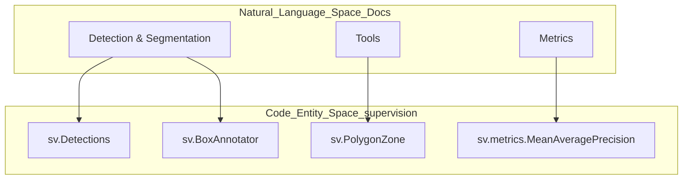

*Mapping Documentation Sections to Code Entities*

Sources: [mkdocs.yml:46-77](), [docs/llms.txt:37-60]()

## Cookbook Gallery

Cookbooks are managed through a custom HTML template [docs/theme/cookbooks.html:1-69]() and a JavaScript-driven card system [docs/javascripts/cookbooks-card.js:1-143]().

Key cookbooks include:
* **Small Object Detection**: Demonstrates `supervision.InferenceSlicer` [docs/notebooks/small-object-detection-with-sahi.ipynb:9-16]().
* **Memory-Efficient Segmentation**: Showcases `CompactMask` with SAM3 [docs/theme/cookbooks.html:61-64]().
* **Object Tracking**: Uses `sv.ByteTrack` for persistent IDs [docs/theme/cookbooks.html:33-36]().

Sources: [docs/theme/cookbooks.html:14-64](), [docs/notebooks/small-object-detection-with-sahi.ipynb:9-16]()

## Navigation & Search

The documentation site uses the `material` theme with advanced features:
* **Search**: Powered by the `search` plugin [mkdocs.yml:125]().
* **Navigation Tabs**: Enabled for top-level categories [mkdocs.yml:105]().
* **Code Annotations**: Allows inline explanations in code blocks [mkdocs.yml:104]().
* **Version Management**: Uses `mike` to support multiple versions of the library documentation [mkdocs.yml:24-25]().

Sources: [mkdocs.yml:92-119]()

## Documentation to Code Mapping

The following diagram illustrates how the documentation navigation bridges the natural language documentation space to physical file structures and Python modules.

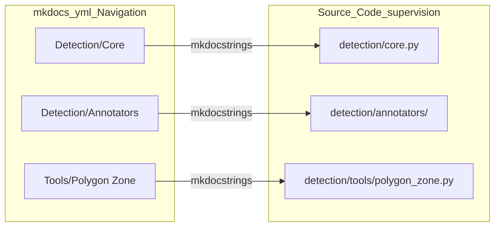

*Navigation to Source Module Mapping*

Sources: [mkdocs.yml:47-48, 63](), [docs/llms.txt:74-75, 95]()

## AI-Ready Documentation

Supervision provides specialized files for AI crawlers and LLM context:
* **llms.txt**: A high-level summary of key APIs like `sv.Detections`, `sv.BoxAnnotator`, and `sv.PolygonZone` [docs/llms.txt:37-52]().
* **llms.full.txt**: A more detailed version including full guide links [docs/llms.full.txt:70-110]().
* **robots.txt**: Explicitly allows AI crawlers like `GPTBot` and `ClaudeBot` [docs/llms.txt:11-18]().

Sources: [docs/llms.txt:1-120](), [docs/llms.full.txt:1-130]()

---

# Page: Core Components

# Core Components

<details>
<summary>Relevant source files</summary>

The following files were used as context for generating this wiki page:

- [docs/changelog.md](docs/changelog.md)
- [docs/classification/core.md](docs/classification/core.md)
- [docs/detection/core.md](docs/detection/core.md)
- [src/supervision/detection/core.py](src/supervision/detection/core.py)
- [src/supervision/detection/vlm.py](src/supervision/detection/vlm.py)
- [tests/detection/test_from_adapters.py](tests/detection/test_from_adapters.py)
- [tests/detection/test_vlm.py](tests/detection/test_vlm.py)

</details>


This page provides an overview of the core components that make up the Supervision library. Supervision is a computer vision toolkit that standardizes object detection, tracking, dataset operations, and evaluation across various machine learning frameworks and Vision-Language Models (VLMs).

For detailed implementation specifics of individual components, refer to their respective child documentation pages: [Detection System](#2.1), [Annotation System](#2.2), [Dataset Management](#2.3), [Tracking System](#2.4), [Metrics System](#2.5), and [KeyPoint System](#2.6).

## Architecture Overview

Supervision provides a standardized set of components that work together to handle the entire computer vision pipeline, from model inference to visualization and analytics.

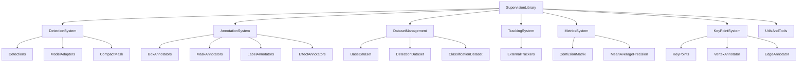

Sources: [src/supervision/detection/core.py:113-115](), [src/supervision/detection/vlm.py:22-51]()

## Core Data Structures

The main components of Supervision are built around fundamental data structures designed for interoperability across models and tasks.

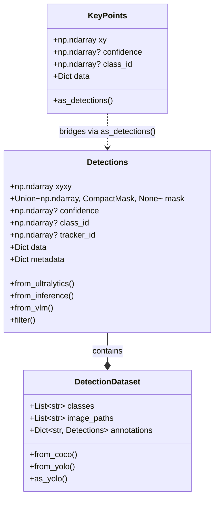

Sources: [src/supervision/detection/core.py:113-115]()

### Detections Class

The `sv.Detections` class is the cornerstone of Supervision, providing a standardized format for object detection and segmentation results [src/supervision/detection/core.py:115-121](). It supports memory-efficient mask storage via `sv.CompactMask` [src/supervision/detection/core.py:18-18]().

Key attributes:
- `xyxy`: Bounding box coordinates in `[x1, y1, x2, y2]` format.
- `mask`: Segmentation masks as `bool` arrays or `sv.CompactMask` [src/supervision/detection/core.py:18-18]().
- `confidence`, `class_id`, `tracker_id`: Optional arrays for scores, labels, and tracking IDs.
- `data` and `metadata`: Dictionaries for custom fields and auxiliary metadata.

Sources: [src/supervision/detection/core.py:113-158]()

---

## 2.1. Detection System

The Detection System handles model output normalization, spatial filtering, non-max suppression (NMS/NMM), and coordinate system transformations. It exposes robust factory methods for major frameworks:
- `from_ultralytics()`: Support for YOLO models [src/supervision/detection/core.py:155-156]()
- `from_inference()`: Integration with Roboflow Inference [src/supervision/detection/core.py:139-140]()
- `from_vlm()`: Parsing for Vision-Language Models such as PaliGemma, Qwen-VL, and Gemini [src/supervision/detection/core.py:63-78]()

For deep technical details, see [Detection System](#2.1).

Sources: [src/supervision/detection/core.py:113-198]()

---

## 2.2. Annotation System

The Annotation System implements a flexible "scene-in/scene-out" pattern where annotators draw bounding boxes, segmentation masks, labels, and visual traces directly onto frames. It features automatic dynamic scaling, rich color lookups via `ColorLookup`, and native handling of `CompactMask` objects.

For deep technical details, see [Annotation System](#2.2).

Sources: [src/supervision/detection/core.py:18-18]()

---

## 2.3. Dataset Management

Dataset Management provides classes like `DetectionDataset` and `ClassificationDataset` to handle loading, splitting, merging, and exporting annotations across standard formats (COCO, YOLO, Pascal VOC, LabelMe). It includes built-in safeguards such as lazy image loading and basename collision checks.

For deep technical details, see [Dataset Management](#2.3).

Sources: [src/supervision/detection/core.py:113-115]()

---

## 2.4. Tracking System

The Tracking System associates detections across frames using `tracker_id`. Multi-object tracking utilities coordinate with external tracking packages (such as `trackers`), while `DetectionsSmoother` reduces trajectory jitter. Keypoints can also be seamlessly bridged to trackers via `KeyPoints.as_detections()`.

For deep technical details, see [Tracking System](#2.4).

Sources: [src/supervision/detection/core.py:113-115]()

---

## 2.5. Metrics System

The Metrics System offers COCO-compliant evaluation pipelines, including `MeanAveragePrecision`, `MeanAverageRecall`, precision/recall curves, `F1Score`, and `ConfusionMatrix`. It supports configurable metric targets, object size buckets, and rigorous sklearn parity validation.

For deep technical details, see [Metrics System](#2.5).

Sources: [src/supervision/detection/core.py:113-115]()

---

## 2.6. KeyPoint System

The KeyPoint System manages pose estimation and keypoint detection data through the `KeyPoints` dataclass. It integrates with `EdgeAnnotator` and `VertexAnnotator` for skeleton rendering and bridges pose estimation outputs directly into detection pipelines via `as_detections()`.

For deep technical details, see [KeyPoint System](#2.6).

Sources: [src/supervision/detection/core.py:113-115]()

---

# Page: Detection System

# Detection System

<details>
<summary>Relevant source files</summary>

The following files were used as context for generating this wiki page:

- [docs/changelog.md](docs/changelog.md)
- [src/supervision/detection/core.py](src/supervision/detection/core.py)
- [src/supervision/detection/utils/boxes.py](src/supervision/detection/utils/boxes.py)
- [src/supervision/detection/utils/converters.py](src/supervision/detection/utils/converters.py)
- [src/supervision/detection/utils/internal.py](src/supervision/detection/utils/internal.py)
- [src/supervision/detection/utils/iou_and_nms.py](src/supervision/detection/utils/iou_and_nms.py)
- [src/supervision/detection/utils/masks.py](src/supervision/detection/utils/masks.py)
- [src/supervision/detection/utils/polygons.py](src/supervision/detection/utils/polygons.py)
- [src/supervision/detection/vlm.py](src/supervision/detection/vlm.py)
- [tests/detection/test_core.py](tests/detection/test_core.py)
- [tests/detection/test_from_adapters.py](tests/detection/test_from_adapters.py)
- [tests/detection/test_vlm.py](tests/detection/test_vlm.py)
- [tests/detection/utils/test_boxes.py](tests/detection/utils/test_boxes.py)
- [tests/detection/utils/test_converters.py](tests/detection/utils/test_converters.py)
- [tests/detection/utils/test_internal.py](tests/detection/utils/test_internal.py)
- [tests/detection/utils/test_iou_and_nms.py](tests/detection/utils/test_iou_and_nms.py)
- [tests/detection/utils/test_polygons.py](tests/detection/utils/test_polygons.py)

</details>


The Detection System is the core component of the Supervision library, providing a standardized representation for object detection and instance segmentation results. It enables consistent handling of data regardless of the source model or framework, serving as a foundation for annotators, trackers, and analysis tools.

## Overview

The system centers around the `sv.Detections` class, which acts as a bridge between various ML frameworks and the Supervision ecosystem.

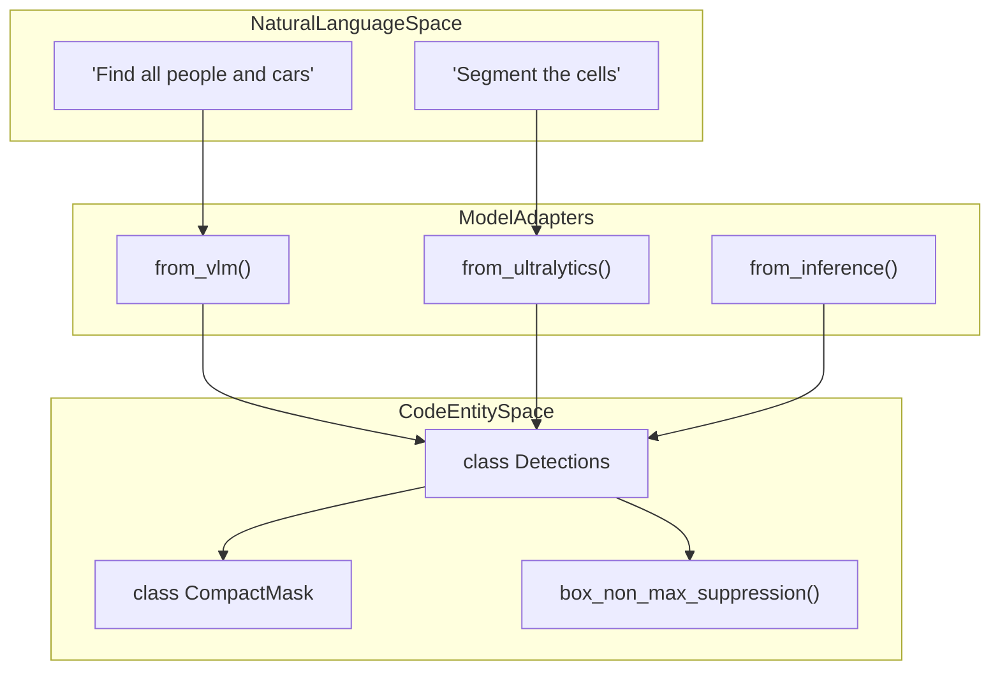

Sources: [src/supervision/detection/core.py:113-198](), [src/supervision/detection/vlm.py:22-51]()

## The Detections Class

The `Detections` class standardizes results into a common format. It is a `@dataclass` that validates its fields upon initialization [src/supervision/detection/core.py:113-198]().

### Structure and Attributes

| Attribute | Type | Description |
|-----------|------|-------------|
| `xyxy` | `np.ndarray` | Shape `(n, 4)`: `[x1, y1, x2, y2]` coordinates. |
| `mask` | `np.ndarray \| CompactMask \| None` | Shape `(n, H, W)` boolean masks or memory-efficient `CompactMask`. |
| `confidence` | `np.ndarray \| None` | Shape `(n,)` float scores. |
| `class_id` | `np.ndarray \| None` | Shape `(n,)` integer class identifiers. |
| `tracker_id` | `np.ndarray \| None` | Shape `(n,)` integer tracking identifiers. |
| `data` | `dict` | Additional per-detection data (e.g., class names). |
| `metadata` | `dict` | Global metadata (e.g., video filename). |

Sources: [src/supervision/detection/core.py:113-198]()

### Coordinate Systems
Supervision provides utilities to convert between common bounding box formats in `supervision.detection.utils.converters`:
- **xyxy**: `[x_min, y_min, x_max, y_max]` (Internal standard).
- **xywh**: `[x, y, width, height]` via `xywh_to_xyxy` [src/supervision/detection/core.py:34-39]().

Sources: [src/supervision/detection/core.py:34-39](), [src/supervision/detection/utils/boxes.py:10-48]()

## Factory Methods & VLM Parsing

The `Detections` class provides multiple static methods to ingest data from external sources.

### Standard Adapters
- `from_ultralytics(ultralytics_results)`: For YOLO models [src/supervision/detection/core.py:153-167]().
- `from_inference(roboflow_result)`: For Roboflow Inference API [src/supervision/detection/core.py:137-151]().
- `from_transformers(transformers_results)`: For HuggingFace models like DETR [src/supervision/detection/core.py:169-196]().

### Vision-Language Models (VLM)
The `from_vlm` method uses the `VLM` enum to parse text-based or dictionary-based outputs from multimodal models into structured detections [src/supervision/detection/vlm.py:22-51]().

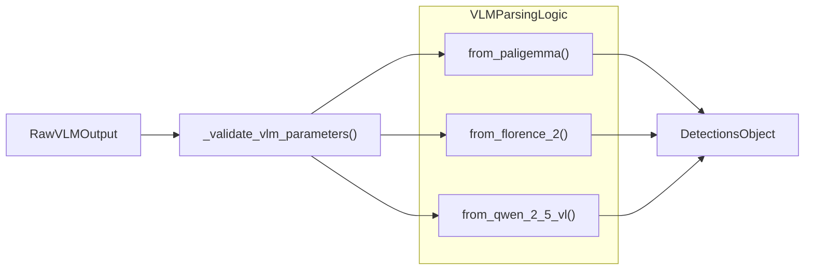

Sources: [src/supervision/detection/core.py:63-78](), [src/supervision/detection/vlm.py:22-170]()

## CompactMask: Memory Efficiency

Storing dense boolean masks for high-resolution images can consume gigabytes of RAM. `CompactMask` solves this by storing masks as **Crop-RLE** (Run-Length Encoding of a bounding-box crop).

For a deep dive into memory-efficient mask storage, union/merge semantics, benchmarks, and integration with annotators and `InferenceSlicer`, see [CompactMask](#2.1.1).

Sources: [src/supervision/detection/compact_mask.py:1-10](), [docs/changelog.md:8-12]()

## Processing Detections

### Filtering and Merging
- **Indexing**: `Detections` supports NumPy-style indexing and boolean masking [tests/detection/test_core.py:170-211]().
- **Merging**: Combines multiple detection objects, including their `data` and `metadata` dictionaries [tests/detection/test_core.py:48-91]().

### Non-Maximum Suppression (NMS) and Non-Maximum Merge (NMM)
The system provides robust NMS and NMM for both boxes and masks via `OverlapFilter` and batch operations [src/supervision/detection/utils/iou_and_nms.py:16-59]().

| Function | Strategy | Description |
|----------|----------|-------------|
| `box_non_max_suppression()` | Suppression | Discards overlapping boxes with lower confidence [src/supervision/detection/utils/iou_and_nms.py:49-59](). |
| `box_non_max_merge()` | Merging | Merges overlapping boxes into a single detection [src/supervision/detection/utils/iou_and_nms.py:49-59](). |
| `mask_non_max_suppression()` | Mask NMS | Uses mask-based IoU for suppression [src/supervision/detection/utils/iou_and_nms.py:49-59](). |
| `mask_non_max_merge()` | Mask NMM | Forms `CompactMask` unions directly from run-length encoded foreground intervals [src/supervision/detection/utils/iou_and_nms.py:49-59](). |

Sources: [src/supervision/detection/utils/iou_and_nms.py:16-59](), [docs/changelog.md:8-12]()

## Data Flow Diagram

This diagram traces a detection from raw model output to a processed state.

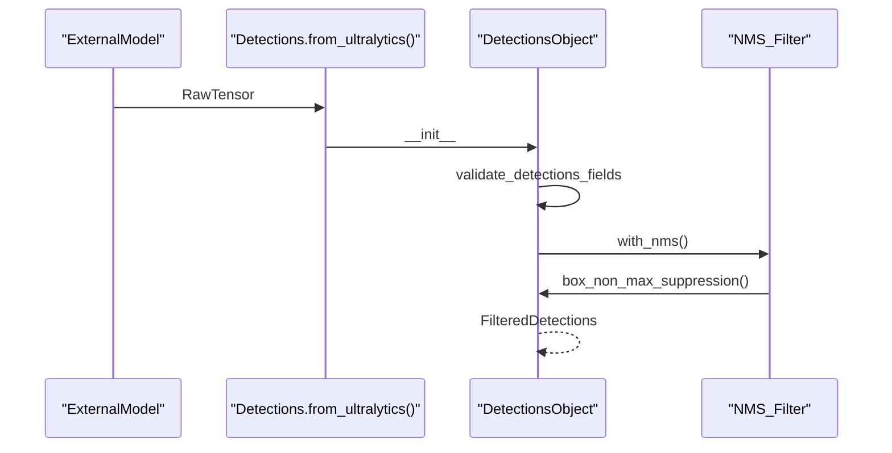

Sources: [src/supervision/detection/core.py:113-198](), [src/supervision/detection/utils/iou_and_nms.py:49-59]()

---

# Page: CompactMask

# CompactMask

<details>
<summary>Relevant source files</summary>

The following files were used as context for generating this wiki page:

- [docs/how_to/use_compact_masks.md](docs/how_to/use_compact_masks.md)
- [docs/notebooks/compact-mask-sam3.ipynb](docs/notebooks/compact-mask-sam3.ipynb)
- [examples/compact_mask/README.md](examples/compact_mask/README.md)
- [examples/compact_mask/benchmark.py](examples/compact_mask/benchmark.py)
- [examples/compact_mask/benchmark_nmm.py](examples/compact_mask/benchmark_nmm.py)
- [examples/compact_mask/requirements.txt](examples/compact_mask/requirements.txt)
- [src/supervision/detection/compact_mask.py](src/supervision/detection/compact_mask.py)
- [tests/detection/test_compact_mask.py](tests/detection/test_compact_mask.py)
- [tests/detection/test_compact_mask_union.py](tests/detection/test_compact_mask_union.py)
- [tests/detection/utils/test_masks.py](tests/detection/utils/test_masks.py)

</details>


## Purpose and Scope

`CompactMask` is a memory-efficient instance segmentation mask storage mechanism in `supervision` designed to bypass the prohibitive `O(N \cdot H \cdot W)` memory complexity of dense boolean arrays [src/supervision/detection/compact_mask.py:1-15](). High-resolution aerial imagery, satellite tiles, and dense crowd scenes with hundreds of objects frequently trigger `MemoryError` when stored as stacked `(N, H, W)` tensors [examples/compact_mask/README.md:1-17](). `CompactMask` stores each mask as a run-length encoding (RLE) scoped strictly to its bounding-box crop (`xyxy`), utilizing pre-existing detection bounding boxes without requiring extra metadata [src/supervision/detection/compact_mask.py:1-15]().

Sources: [src/supervision/detection/compact_mask.py:1-15](), [examples/compact_mask/README.md:1-17]()

---

## Architecture and Core Data Structures

The `CompactMask` class encapsulates four primary internal attributes to represent sparse masks over a shared canvas [src/supervision/detection/compact_mask.py:37-184]():
- `_rles`: A sequence of 1D `int32` numpy arrays storing column-major (F-order) run lengths [src/supervision/detection/compact_mask.py:37-146]().
- `_crop_shapes`: An `(N, 2)` `int32` array tracking the `(height, width)` of each bounding-box crop.
- `_offsets`: An `(N, 2)` `int32` array storing the `(x, y)` top-left coordinates of each crop relative to the full image.
- `_image_shape`: A tuple `(height, width)` defining the full canvas dimensions [src/supervision/detection/compact_mask.py:148-177]().

```mermaid
graph TD
    subcode ["Natural Language to Code Entity Space"]
    NL_Input[""Dense (N,H,W) Bool Array""] -->|CompactMask.from_dense| CM[""CompactMask Class (src/supervision/detection/compact_mask.py)""]
    NL_RLE[""COCO RLE Payload""] -->|CompactMask.from_coco_rle| CM
    CM --> RLES[""_rles (Sequence[NDArray[np.int32]])""]
    CM --> SHAPES[""_crop_shapes (NDArray[np.int32])""]
    CM --> OFFSETS[""_offsets (NDArray[np.int32])""]
    CM --> IMG_SHAPE[""_image_shape (tuple[int, int])""]
```
Sources: [src/supervision/detection/compact_mask.py:1-184](), [docs/how_to/use_compact_masks.md:29-61]()

---

## RLE Encoding and Internal Helpers

RLE operations in `supervision` use column-major (F-order) indexing to maintain compatibility with COCO formats (`pycocotools`) [examples/compact_mask/README.md:100-110](). The module implements several vectorised numerical helpers:

- `_rle_area(rle)`: Computes the number of `True` pixels directly from run lengths by summing alternate elements `rle[1::2]`, avoiding full array materialisation [src/supervision/detection/compact_mask.py:37-56]().
- `_rle_to_column_intervals(rle, crop_height, offset)`: Extracts foreground `(x, y_start, y_stop)` intervals in image coordinates, skipping background runs entirely to scale processing with active pixel density [src/supervision/detection/compact_mask.py:59-109]().
- `_rle_counts_int32(counts)`: Splits oversized run counts exceeding `np.int32` limits into alternating limit/zero pairs, preserving foreground/background bit parity [src/supervision/detection/compact_mask.py:111-146]().
- `_validate_uniform_image_shape(masks_list, action)`: Enforces that all collected or merged `CompactMask` instances share an identical `_image_shape`, raising `ValueError` upon mismatch [src/supervision/detection/compact_mask.py:148-178]().

Sources: [src/supervision/detection/compact_mask.py:37-178]()

---

## Union and Merge Semantics

Combining overlapping predictions, executing Non-Maximum Merging (`NMM`), or merging distinct `Detections` objects containing `CompactMask` instances relies on specialised sparse union algorithms [tests/detection/test_compact_mask_union.py:1-170]().

```mermaid
graph TD
    subcode2 ["Union Data Flow and Code Mapping"]
    InputDets[""Detections.merge / with_nmm""] --> Validate[""_validate_uniform_image_shape()""]
    Validate --> CheckDense[""_should_union_densely() Evaluates Run Ratio""]
    CheckDense -->|Sparse Path| ColIntervals[""_rle_to_column_intervals()""]
    ColIntervals --> Int32Split[""_rle_counts_int32()""]
    Int32Split --> ResultCM[""Merged CompactMask Output""]
    CheckDense -->|Dense Fallback Ratio > 0.5| DensePass[""Dense Crop Decoding Fallback""]
    DensePass --> ResultCM
```

When masks are highly fragmented (such as checkerboard patterns where the foreground-run to crop-area ratio exceeds `_DENSE_FALLBACK_RUN_RATIO = 0.5`), the engine falls back to a dense crop representation to avoid sort-cost overheads from interval unions [src/supervision/detection/compact_mask.py:180-184](). Otherwise, union calculations proceed entirely in RLE space without decoding the full-frame canvas [tests/detection/test_compact_mask_union.py:18-78]().

Sources: [src/supervision/detection/compact_mask.py:148-184](), [tests/detection/test_compact_mask_union.py:18-78]()

---

## Performance and Benchmarks

For high-resolution inputs (e.g., 4K imagery with 1,000 objects), dense boolean representations require gigabytes of memory, whereas `CompactMask` scales down to megabytes [examples/compact_mask/README.md:9-53]().

| Metric / Operation | Dense `(N, H, W)` | Crop-RLE (`CompactMask`) |
| :--- | :--- | :--- |
| **Memory (N=1,000, 4K canvas)** | ~8.3 GB | ~2 MB [examples/compact_mask/README.md:46-50]() |
| **Encode Time (N=1,000)** | O(1) (direct allocation) | O(A) scan crop rows [examples/compact_mask/README.md:56-64]() |
| **Crop-Only Decode** | O(1) (strided slice) | O(A) expand runs (~2 ms) [examples/compact_mask/README.md:75-87]() |
| **IoU / NMS Pre-filter** | Pairwise dense AND (~10,000 ms) | Bbox pre-filter + sparse intersection (~15 ms) [examples/compact_mask/README.md:88-96]() |

Sources: [examples/compact_mask/README.md:1-96]()

---

## Integration with Annotators and InferenceSlicer

`CompactMask` integrates directly into the `supervision` pipeline without changing public annotator signatures [docs/how_to/use_compact_masks.md:11-172]().

### Annotators and `requires_mask`
Annotators declare `requires_mask = False` by default (e.g., `BoxAnnotator`, `LabelAnnotator`) [docs/how_to/use_compact_masks.md:92-122](). When passing `Detections` containing `CompactMask` to non-mask annotators, users can strip or ignore the mask attribute to eliminate unnecessary decoding overhead [docs/how_to/use_compact_masks.md:92-122](). Mask-aware annotators like `MaskAnnotator` and `PolygonAnnotator` (`requires_mask = True`) consume `CompactMask` directly by rendering via crop-scoped bounding box regions rather than materialising full frames [docs/how_to/use_compact_masks.md:92-126]().

### Inference Integration
`InferenceSlicer` and `Detections.from_inference()` accept a `compact_masks=True` argument [docs/how_to/use_compact_masks.md:65-88](). This routes incoming COCO RLE dictionaries directly through `CompactMask.from_coco_rle()`, avoiding intermediate boolean tensor allocations [docs/how_to/use_compact_masks.md:65-88](). Similarly, calling `Detections.merge()` with mixed dense numpy arrays and `CompactMask` objects automatically coerces dense inputs into compact representations [docs/how_to/use_compact_masks.md:129-168]().

Sources: [docs/how_to/use_compact_masks.md:11-172]()

---

# Page: Annotation System

# Annotation System

<details>
<summary>Relevant source files</summary>

The following files were used as context for generating this wiki page:

- [docs/deprecated.md](docs/deprecated.md)
- [docs/detection/annotators.md](docs/detection/annotators.md)
- [src/supervision/annotators/base.py](src/supervision/annotators/base.py)
- [src/supervision/annotators/core.py](src/supervision/annotators/core.py)
- [src/supervision/annotators/utils.py](src/supervision/annotators/utils.py)
- [src/supervision/detection/tools/smoother.py](src/supervision/detection/tools/smoother.py)
- [src/supervision/draw/utils.py](src/supervision/draw/utils.py)
- [tests/annotators/test_core.py](tests/annotators/test_core.py)
- [tests/annotators/test_utils.py](tests/annotators/test_utils.py)
- [tests/detection/tools/test_smoother.py](tests/detection/tools/test_smoother.py)
- [tests/draw/test_utils.py](tests/draw/test_utils.py)

</details>


The Annotation System in Roboflow Supervision provides visualization tools for object detections, tracking histories, keypoints, and segmentation masks on images and video streams. Built around a consistent interface, it interoperates directly with the [Detection System](#2.1) and complements the [Drawing & Visualization](#3.2) utilities.

Sources: [src/supervision/annotators/core.py:1-30](), [docs/detection/annotators.md:1-15]()

## Overview

All annotators in Supervision implement the **scene-in/scene-out** pattern. An annotator instance consumes a mutable or copied image scene (`np.ndarray`) and a [`Detections`](../detection/core.md) object, returning the modified scene in-place or as an updated array.

### Code Entity Bridge: Annotation Flow
This diagram maps the natural language concept of rendering overlays to the underlying code entities in `supervision`.

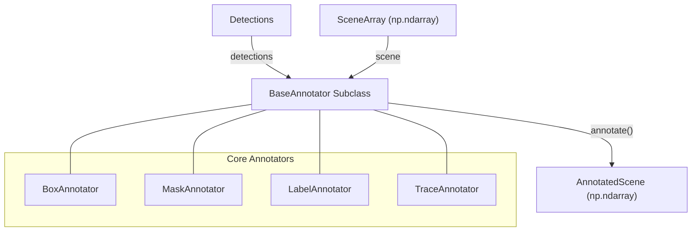
Sources: [src/supervision/annotators/base.py:7-21](), [src/supervision/annotators/core.py:189-208]()

## Annotator Architecture

Annotators inherit from `BaseAnnotator`, which declares the abstract interface method `annotate()` [src/supervision/annotators/base.py:7-21](). Additionally, annotators declare a `requires_mask` boolean flag indicating whether dense masks (`detections.mask`) must be materialized before execution [src/supervision/annotators/base.py:11-15](), [tests/annotators/test_core.py:60-112]().

### Class Hierarchy
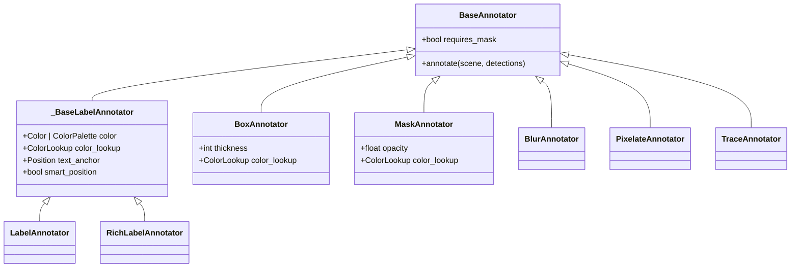
Sources: [src/supervision/annotators/base.py:7-21](), [src/supervision/annotators/core.py:111-170](), [tests/annotators/test_core.py:60-112]()

## Core Annotator Types

### Box and Shape Annotators
- **`BoxAnnotator`**: Draws standard rectangular bounding boxes [docs/detection/annotators.md:12-25]().
- **`RoundBoxAnnotator`**: Draws rectangles with rounded corners via [`draw_rounded_rectangle`](../draw/utils.md) [src/supervision/draw/utils.py:152-171]().
- **`BoxCornerAnnotator`**: Renders only the four corners of each bounding box [docs/detection/annotators.md:54-67]().
- **`OrientedBoxAnnotator`**: Visualizes rotated/oriented bounding boxes (`xyxyxyxy`) [docs/detection/annotators.md]().

### Mask, Polygon, and Region Annotators
- **`MaskAnnotator`**: Paints instance segmentation masks onto the scene. It is **CompactMask-aware**, meaning it can consume `CompactMask` structures and unpack them efficiently during drawing without requiring full-memory boolean array expansion [src/supervision/detection/compact_mask.py](), [tests/annotators/test_core.py:40-41]().
- **`PolygonAnnotator`**: Draws boundary lines around mask polygons [docs/detection/annotators.md:117-130]().
- **`HaloAnnotator`**: Adds a glowing outline effect around masks or bounding shapes [docs/detection/annotators.md:161-174]().

### Label and Text Annotators
- **`LabelAnnotator`**: Renders textual metadata attached to bounding box anchors. Supports `smart_position` (avoiding overlaps via `snap_boxes` and `spread_out_boxes`) and `max_line_length` for automatic text wrapping [src/supervision/annotators/core.py:111-170]().
- **`RichLabelAnnotator`**: Provides advanced styled formatting for text labels [tests/annotators/test_core.py:159-161]().

### Effect Annotators & Dynamic Scaling
- **`BlurAnnotator`** & **`PixelateAnnotator`**: Obscure or pixelate detection regions. When kernel or pixel sizes are omitted (`None`), they invoke [`calculate_dynamic_pixel_size`](../annotators/utils.md) and [`calculate_dynamic_kernel_size`](../annotators/utils.md) to scale effect granularity relative to bounding box dimensions [src/supervision/annotators/core.py:21-22]().

### Trace Annotator
- **`TraceAnnotator`**: Draws object motion histories over sequential frames using the [`Trace`](../annotators/utils.md) tracking buffer utility, connecting past centroid or anchor points [tests/annotators/test_core.py:83-83]().

Sources: [src/supervision/annotators/core.py:1-3549](), [tests/annotators/test_core.py:60-112]()

## Color and Styling

### ColorLookup
Color assignment across detections is governed by the `ColorLookup` enumeration [src/supervision/annotators/utils.py:20-32]():

| Strategy (`ColorLookup`) | Description |
| :--- | :--- |
| `ColorLookup.INDEX` | Colors assigned by detection index position within the current frame. |
| `ColorLookup.CLASS` | Colors mapped from `detections.class_id`. |
| `ColorLookup.TRACK` | Colors mapped from `detections.tracker_id` (with `PENDING_TRACK_ID` falling back to `PENDING_TRACK_COLOR`) [src/supervision/annotators/utils.py:16-18](). |

### Hex and RGBA Support
`Color` and annotator parameters accept 6-digit or 8-digit hex strings (e.g., `#ff00ff80`), parsed internally via `hex_to_rgba` for transparent overlay rendering [src/supervision/annotators/core.py:95-105](), [tests/annotators/test_core.py:175-183]().

Sources: [src/supervision/annotators/utils.py:20-76](), [src/supervision/annotators/core.py:95-105]()

## Common Usage Pattern

```python
import cv2
import supervision as sv

image = cv2.imread("input.jpg")
detections = sv.Detections.from_ultralytics(results)

box_annotator = sv.BoxAnnotator(color=sv.ColorPalette.DEFAULT, color_lookup=sv.ColorLookup.CLASS)
label_annotator = sv.LabelAnnotator(text_position=sv.Position.TOP_CENTER)

annotated_frame = box_annotator.annotate(scene=image.copy(), detections=detections)
annotated_frame = label_annotator.annotate(scene=annotated_frame, detections=detections)
```
Sources: [docs/detection/annotators.md:12-25](), [docs/detection/annotators.md:154-170]()

## Key Classes and Functions Reference

| Class / Function | File Path | Role |
| :--- | :--- | :--- |
| `BaseAnnotator` | [src/supervision/annotators/base.py:7-21]() | Abstract base class defining `annotate()` and `requires_mask`. |
| `_BaseLabelAnnotator` | [src/supervision/annotators/core.py:111-170]() | Shared base logic for text-labeling annotators. |
| `ColorLookup` | [src/supervision/annotators/utils.py:20-32]() | Strategy enum (`INDEX`, `CLASS`, `TRACK`) for color resolution. |
| `resolve_color` | [src/supervision/annotators/utils.py:149-167]() | Resolves concrete `Color` for a given detection index. |
| `CompactMask` | [src/supervision/detection/compact_mask.py]() | Memory-efficient mask representation utilized by mask annotators. |
| `Trace` | [src/supervision/annotators/utils.py:17-17]() | Buffer manager for tracking object trajectories. |

Sources: [src/supervision/annotators/base.py:1-21](), [src/supervision/annotators/core.py:111-170](), [src/supervision/annotators/utils.py:20-167]()

---

# Page: Dataset Management

# Dataset Management

<details>
<summary>Relevant source files</summary>

The following files were used as context for generating this wiki page:

- [docs/datasets/core.md](docs/datasets/core.md)
- [docs/how_to/process_datasets.md](docs/how_to/process_datasets.md)
- [src/supervision/classification/core.py](src/supervision/classification/core.py)
- [src/supervision/dataset/core.py](src/supervision/dataset/core.py)
- [src/supervision/dataset/formats/coco.py](src/supervision/dataset/formats/coco.py)
- [src/supervision/dataset/formats/yolo.py](src/supervision/dataset/formats/yolo.py)
- [src/supervision/dataset/utils.py](src/supervision/dataset/utils.py)
- [tests/classification/test_core.py](tests/classification/test_core.py)
- [tests/dataset/formats/test_coco.py](tests/dataset/formats/test_coco.py)
- [tests/dataset/formats/test_yolo.py](tests/dataset/formats/test_yolo.py)
- [tests/dataset/test_core.py](tests/dataset/test_core.py)

</details>


This page documents the dataset management capabilities in the Supervision library [src/supervision/dataset/core.py:39-897](). The Supervision dataset management system provides classes, methods, and utilities for efficiently loading, manipulating, splitting, merging, and exporting computer vision datasets for object detection, instance segmentation, oriented bounding boxes (OBB), and image classification tasks.

Sources: [src/supervision/dataset/core.py:39-897]()

## Overview

The dataset management system in Supervision is designed to handle multiple aspects of working with computer vision datasets:

1.  **Dataset Representation**: Structured representation of detection and classification datasets [src/supervision/dataset/core.py:59-897]().
2.  **Format Conversion**: Support for loading from and saving to common dataset formats (COCO, YOLO, Pascal VOC, CreateML, LabelMe) [src/supervision/dataset/core.py:21-41]().
3.  **Dataset Operations**: Splitting datasets into train/test sets, merging datasets, and performing basename collision checks [src/supervision/dataset/utils.py:132-180](), [src/supervision/dataset/core.py:179-332]().
4.  **Memory Efficiency**: Lazy image loading on demand from file paths to handle large datasets [src/supervision/dataset/core.py:82-91](), [src/supervision/dataset/core.py:151-158]().
5.  **Dataset Preparation**: Utilities for manipulating and preparing datasets for training [src/supervision/dataset/utils.py:42-180]().

The system is based on two primary dataset classes inheriting from an abstract base class:
*   `DetectionDataset`: For object detection, instance segmentation, and OBB datasets [src/supervision/dataset/core.py:74-666]().
*   `ClassificationDataset`: For image classification datasets [src/supervision/dataset/core.py:668-897]().

### Code Entity Architecture

The following diagram bridges the natural language concepts of dataset management to the specific code entities in the `supervision` package.

**Dataset Entity Mapping**
```mermaid
classDiagram
    class "BaseDataset[ABC]" {
        <<abstract>>
        +__len__() int
        +split() Tuple[BaseDataset, BaseDataset]
    }
    
    class "DetectionDataset" {
        +classes List[str]
        +image_paths List[str]
        +annotations Dict[str, Detections]
        +_images_in_memory Dict[str, np.ndarray]
        +__init__(classes, images, annotations)
        +__len__() int
        +__getitem__(i) Tuple[str, np.ndarray, Detections]
        +__iter__()
        +split() Tuple[DetectionDataset, DetectionDataset]
        +merge(dataset_list) DetectionDataset
        +from_coco() DetectionDataset
        +as_coco()
        +from_yolo() DetectionDataset
        +as_yolo()
        +from_pascal_voc() DetectionDataset
        +as_pascal_voc()
    }
    
    class "ClassificationDataset" {
        +classes List[str]
        +image_paths List[str]
        +annotations Dict[str, Classifications]
        +_images_in_memory Dict[str, np.ndarray]
        +__init__(classes, images, annotations)
        +__len__() int
        +__getitem__(i) Tuple[str, np.ndarray, Classifications]
        +__iter__()
        +split() Tuple[ClassificationDataset, ClassificationDataset]
        +as_folder_structure()
        +from_folder_structure() ClassificationDataset
    }
    
    "BaseDataset[ABC]" <|-- "DetectionDataset"
    "BaseDataset[ABC]" <|-- "ClassificationDataset"
```

Sources: [src/supervision/dataset/core.py:59-72](), [src/supervision/dataset/core.py:74-666](), [src/supervision/dataset/core.py:668-897]()

## Dataset Classes

### DetectionDataset

`DetectionDataset` implements the `BaseDataset` interface for object detection tasks [src/supervision/dataset/core.py:74-160](). It stores a collection of image paths and their corresponding annotations in the form of `sv.Detections` objects [src/supervision/dataset/core.py:74-92]().

**Key Features:**
*   **Lazy Loading**: When a list of image file paths is provided, images are not loaded into RAM upfront. Instead, `_get_image` uses `cv2.imread` to load individual images lazily on demand when accessed via `__getitem__` or iteration [src/supervision/dataset/core.py:82-91](), [src/supervision/dataset/core.py:151-172]().
*   **Format Support**: Native factory methods and export methods for COCO JSON [src/supervision/dataset/core.py:391-446](), YOLO TXT [src/supervision/dataset/core.py:448-538](), Pascal VOC XML [src/supervision/dataset/core.py:540-608](), CreateML [src/supervision/dataset/core.py:610-640](), and LabelMe.
*   **OBB Support**: The `from_yolo` and `as_yolo` methods support Oriented Bounding Boxes when configured [src/supervision/dataset/formats/yolo.py:147-165]().

### ClassificationDataset

`ClassificationDataset` handles image classification tasks, mapping image paths or in-memory arrays to `sv.Classifications` objects [src/supervision/dataset/core.py:668-710]().

**Key Features:**
*   **Folder Structure**: Can be instantiated from a directory structure where subdirectories represent class names via `from_folder_structure` [src/supervision/dataset/core.py:850-897]().
*   **Splitting**: Supports random splitting into subsets while maintaining dataset interfaces [src/supervision/dataset/core.py:763-823]().

Sources: [src/supervision/dataset/core.py:74-160](), [src/supervision/dataset/core.py:668-710](), [src/supervision/dataset/core.py:850-897]()

## Dataset Operations

### Loading and Exporting

Supervision provides standardized methods for converting between major computer vision formats.

| Format | Import Method | Export Method |
| :--- | :--- | :--- |
| **COCO** | `DetectionDataset.from_coco` [src/supervision/dataset/core.py:391-446]() | `DetectionDataset.as_coco` |
| **YOLO** | `DetectionDataset.from_yolo` [src/supervision/dataset/core.py:448-538]() | `DetectionDataset.as_yolo` |
| **Pascal VOC** | `DetectionDataset.from_pascal_voc` [src/supervision/dataset/core.py:540-608]() | `DetectionDataset.as_pascal_voc` |
| **CreateML** | `DetectionDataset.from_createml` [src/supervision/dataset/core.py:610-640]() | `DetectionDataset.as_createml` |

**Format Conversion Workflow**


Sources: [src/supervision/dataset/core.py:334-640](), [docs/how_to/process_datasets.md:69-158]()

### Merging and Splitting

*   **`split`**: Divides a dataset into two new instances based on a `split_ratio` [src/supervision/dataset/core.py:179-239](). It supports shuffling and a fixed `random_state` for reproducibility [src/supervision/dataset/core.py:179-239]().
*   **`merge`**: Combines a list of `DetectionDataset` instances into one [src/supervision/dataset/core.py:241-332](). It automatically resolves class list discrepancies by creating a union of all classes and remapping class IDs accordingly [src/supervision/dataset/utils.py:84-91](), [src/supervision/dataset/utils.py:94-110]().

Sources: [src/supervision/dataset/core.py:179-332](), [src/supervision/dataset/utils.py:84-110]()

### Basename Collision Checks

When datasets are merged from different source directories, multiple image files may share the same filename or basename (e.g., `a/img.jpg` and `b/img.jpg`) [src/supervision/dataset/utils.py:132-144](). Exporting them into a flat output directory keyed by basename would silently overwrite one file and corrupt annotations [src/supervision/dataset/utils.py:132-144](). Supervision guards against this using `check_no_basename_collisions`, which scans image paths and raises a `ValueError` if any collision is detected prior to writing files [src/supervision/dataset/utils.py:132-180]().

Sources: [src/supervision/dataset/utils.py:132-180]()

## Implementation Details

### Format Parsers

The core logic for dataset formats is isolated in the `supervision.dataset.formats` module:

*   **COCO**: Uses `read_json_file` and handles complex polygon/RLE segmentation masks via `coco_annotations_to_masks` [src/supervision/dataset/formats/coco.py:99-163]().
*   **YOLO**: Parses `.txt` files with normalized bounding boxes and segmentations [src/supervision/dataset/formats/yolo.py:170-220]().
*   **Pascal VOC**: Uses XML parsing to extract `bndbox` and polygon tags [src/supervision/dataset/core.py:540-608]().

### Mask and Polygon Utilities

Supervision includes internal utilities for converting between representation types during dataset export:
*   **`approximate_mask_with_polygons`**: Reduces the number of points in a binary mask to create efficient polygon annotations [src/supervision/dataset/utils.py:51-81]().
*   **`mask_to_rle` / `rle_to_mask`**: Handles Run-Length Encoding for COCO-compliant compressed masks [src/supervision/detection/utils/converters.py:21-24]().

**Data Flow: Mask to Polygon Export**
```mermaid
flowchart TD
    A["Detections.mask"] --> B["approximate_mask_with_polygons"]
    B --> C["Polygon_Points"]
    C --> D{"Format_Choice"}
    D -->|"COCO"| E["JSON_List"]
    D -->|"YOLO"| F["Normalized_TXT"]
    D -->|"Pascal_VOC"| G["XML_Tags"]
```

Sources: [src/supervision/dataset/utils.py:51-81](), [src/supervision/dataset/formats/coco.py:99-163](), [src/supervision/dataset/formats/yolo.py:170-220]()

## Usage Example: Splitting and Converting

```python
import supervision as sv

# Load a YOLO dataset with lazy image loading
ds = sv.DetectionDataset.from_yolo(
    images_directory_path="data/images",
    annotations_directory_path="data/labels",
    data_yaml_path="data/data.yaml"
)

# Split into 80/20 train/test
train_ds, test_ds = ds.split(split_ratio=0.8, shuffle=True)

# Export test split to COCO format
test_ds.as_coco(
    images_directory_path="out/images",
    annotations_path="out/test_annotations.json"
)
```

Sources: [docs/how_to/process_datasets.md:160-179](), [src/supervision/dataset/core.py:334-389]()

---

# Page: Tracking System

# Tracking System

<details>
<summary>Relevant source files</summary>

The following files were used as context for generating this wiki page:

- [docs/deprecated.md](docs/deprecated.md)
- [docs/detection/annotators.md](docs/detection/annotators.md)
- [docs/detection/tools/smoother.md](docs/detection/tools/smoother.md)
- [docs/how_to/benchmark_a_model.md](docs/how_to/benchmark_a_model.md)
- [docs/how_to/count_in_zone.md](docs/how_to/count_in_zone.md)
- [docs/how_to/detect_and_annotate.md](docs/how_to/detect_and_annotate.md)
- [docs/how_to/detect_small_objects.md](docs/how_to/detect_small_objects.md)
- [docs/how_to/filter_detections.md](docs/how_to/filter_detections.md)
- [docs/how_to/save_detections.md](docs/how_to/save_detections.md)
- [docs/how_to/track_objects.md](docs/how_to/track_objects.md)
- [src/supervision/detection/tools/smoother.py](src/supervision/detection/tools/smoother.py)
- [tests/detection/tools/test_smoother.py](tests/detection/tools/test_smoother.py)

</details>


The Tracking System in Supervision provides object tracking capabilities that enable continuous identification and monitoring of objects across video frames. Building upon the core detection pipeline, tracking assigns persistent `tracker_id` attributes to detected objects, allowing systems to follow motion trajectories over time. Following recent version updates, native tracking wrappers have been deprecated in favor of external packages, while auxiliary tools like `DetectionsSmoother` and `KeyPoints.as_detections()` provide robust post-processing and pose-tracking integration.

Sources:
- [docs/deprecated.md:19-20]()
- [docs/how_to/track_objects.md:113-120]()
- [src/supervision/detection/tools/smoother.py:28-48]()

---

## 1. External Trackers and `tracker_id` Management

As of `supervision-0.31.0`, the legacy `sv.ByteTrack` implementation has been removed from the core library. Users should install and utilize the dedicated external `trackers` package (`pip install trackers`) for tracking algorithms like ByteTrack. 

The tracking workflow relies on passing `sv.Detections` containing bounding boxes and confidence scores into a tracker instance (such as `ByteTrackTracker`), which updates each detection with a unique `tracker_id`.

```mermaid
flowchart TD
    A["RawModelOutput"] -->|sv.Detections.from_...| B["sv.Detections"]
    B -->|ByteTrackTracker.update| C["DetectionsWithTrackerId"]
    C --> D["DetectionsSmoother.update_with_detections"]
    C --> E["BoxAnnotator / TraceAnnotator"]

    subgraph CodeEntitySpace ["Core Tracking Pipeline Entities"]
        B["Detections"]
        C["tracker_id"]
        D["DetectionsSmoother"]
    end
```
Sources:
- [docs/deprecated.md:19-20]()
- [docs/how_to/track_objects.md:113-120]()
- [src/supervision/detection/tools/smoother.py:28-44]()

---

## 2. `DetectionsSmoother` for Jitter Reduction

`DetectionsSmoother` is a utility class designed to mitigate bounding box jitter and confidence fluctuations in video tracking pipelines by smoothing detections over a sliding temporal window [src/supervision/detection/tools/smoother.py:28-31]().

### Implementation Details

`DetectionsSmoother` maintains a per-track history queue using a `defaultdict` of `deque` instances [src/supervision/detection/tools/smoother.py:114-116](). When `update_with_detections()` is invoked:
1. It validates that the incoming `Detections` object contains a valid `tracker_id` array [src/supervision/detection/tools/smoother.py:150-157](). If `tracker_id` is `None`, a warning is emitted via `SupervisionWarnings` and the input is returned unmodified [src/supervision/detection/tools/smoother.py:150-157]().
2. Individual detections are appended to their corresponding track queue [src/supervision/detection/tools/smoother.py:159-163]().
3. Unseen tracks in the current frame append `None` to their history queue to maintain window alignment [src/supervision/detection/tools/smoother.py:167-170]().
4. Bounding coordinates (`xyxy`) are averaged across all non-`None` entries within the window length [src/supervision/detection/tools/smoother.py:178-182](). Confidence scores are similarly averaged only across frames where confidence is present [src/supervision/detection/tools/smoother.py:45-47]().

```mermaid
classDiagram
    class DetectionsSmoother {
        +length: int
        +tracks: defaultdict[int, deque]
        +__init__(length: int)
        +reset()
        +update_with_detections(detections: Detections) Detections
        +get_track(track_id: int) Detections
        +get_smoothed_detections(track_ids: Set[int]) Detections
    }

    class Detections {
        +xyxy: np.ndarray
        +confidence: np.ndarray
        +tracker_id: np.ndarray
        +select(index: int) Detections
    }

    DetectionsSmoother --> Detections : "maintains history and outputs smoothed"
```
Sources:
- [src/supervision/detection/tools/smoother.py:28-176]()
- [tests/detection/tools/test_smoother.py:1-44]()

---

## 3. Pose Tracking via `KeyPoints.as_detections()`

To track articulated objects or human poses across frames using multi-object tracking algorithms, Supervision provides a bridge method: `KeyPoints.as_detections()`.

This method calculates bounding boxes that encapsulate the keypoint coordinates for each detected instance, converting a `KeyPoints` object into a standard `sv.Detections` structure suitable for tracker input.

```mermaid
flowchart LR
    A["KeyPoints"] -->|"as_detections()"| B["sv.Detections"]
    B -->|"ByteTrackTracker.update()"| C["DetectionsWithTrackerId"]
    C -->|"EdgeAnnotator / VertexAnnotator"| D["AnnotatedPoseScene"]

    subgraph CodeEntitySpace ["Pose Tracking Entities"]
        A["KeyPoints"]
        B["Detections"]
    end
```
Sources:
- [docs/how_to/track_objects.md:409-414]()
- [src/supervision/key_points/core.py:1-20]()

---

# Page: Metrics System

# Metrics System

<details>
<summary>Relevant source files</summary>

The following files were used as context for generating this wiki page:

- [docs/metrics/aggregate.md](docs/metrics/aggregate.md)
- [docs/metrics/match_detections.md](docs/metrics/match_detections.md)
- [src/supervision/detection/utils/matching.py](src/supervision/detection/utils/matching.py)
- [src/supervision/metrics/__init__.py](src/supervision/metrics/__init__.py)
- [src/supervision/metrics/_confusion_matrix_metric.py](src/supervision/metrics/_confusion_matrix_metric.py)
- [src/supervision/metrics/core.py](src/supervision/metrics/core.py)
- [src/supervision/metrics/detection.py](src/supervision/metrics/detection.py)
- [src/supervision/metrics/f1_score.py](src/supervision/metrics/f1_score.py)
- [src/supervision/metrics/mean_average_precision.py](src/supervision/metrics/mean_average_precision.py)
- [src/supervision/metrics/mean_average_recall.py](src/supervision/metrics/mean_average_recall.py)
- [src/supervision/metrics/precision.py](src/supervision/metrics/precision.py)
- [src/supervision/metrics/recall.py](src/supervision/metrics/recall.py)
- [src/supervision/metrics/utils/aggregate.py](src/supervision/metrics/utils/aggregate.py)
- [src/supervision/metrics/utils/object_size.py](src/supervision/metrics/utils/object_size.py)
- [tests/detection/utils/test_matching.py](tests/detection/utils/test_matching.py)
- [tests/metrics/test_detection.py](tests/metrics/test_detection.py)
- [tests/metrics/test_f1_score.py](tests/metrics/test_f1_score.py)
- [tests/metrics/test_mean_average_precision.py](tests/metrics/test_mean_average_precision.py)
- [tests/metrics/test_mean_average_recall.py](tests/metrics/test_mean_average_recall.py)
- [tests/metrics/test_oriented_bounding_box_metrics.py](tests/metrics/test_oriented_bounding_box_metrics.py)
- [tests/metrics/test_precision.py](tests/metrics/test_precision.py)
- [tests/metrics/test_recall.py](tests/metrics/test_recall.py)
- [tests/metrics/utils/test_object_size.py](tests/metrics/utils/test_object_size.py)

</details>


The Metrics System in Supervision provides comprehensive tools for evaluating object detection, segmentation, and oriented bounding box performance. These metrics quantify model accuracy, precision, recall, and harmonic scores across varying Intersection over Union (IoU) thresholds, object size categories, and averaging methods.

For information about running inference with models, see [Model Adapters](#4.1), and for storing and manipulating detections, see [Detection System](#2.1).

## Overview and Architecture

The metrics architecture is organized around an abstract base class `Metric`, metric-specific accumulators and result containers, and utility modules for object sizing, tensor conversion, and detection matching.

### System Class Diagram

```mermaid
classDiagram
    class "Metric" {
        <<Abstract Base Class>>
        +update(predictions, targets)
        +reset()
        +compute()
    }
    
    class "MetricTarget" {
        <<Enum>>
        +BOXES
        +MASKS
        +ORIENTED_BOUNDING_BOXES
    }
    
    class "AveragingMethod" {
        <<Enum>>
        +MACRO
        +MICRO
        +WEIGHTED
    }
    
    class "MeanAveragePrecision" {
        +update()
        +reset()
        +compute()
        +benchmark()
    }
    
    class "MeanAverageRecall" {
        +update()
        +reset()
        +compute()
    }
    
    class "F1Score" {
        +update()
        +reset()
        +compute()
    }
    
    class "Precision" {
        +update()
        +reset()
        +compute()
    }
    
    class "Recall" {
        +update()
        +reset()
        +compute()
    }

    class "ConfusionMatrix" {
        +from_detections()
        +from_tensors()
        +evaluate_detection_batch()
    }
    
    class "MeanAveragePrecisionResult" {
        +map50_95
        +map50
        +map75
        +to_pandas()
    }
    
    "Metric" <|-- "MeanAveragePrecision"
    "Metric" <|-- "MeanAverageRecall"
    "Metric" <|-- "F1Score"
    "Metric" <|-- "Precision"
    "Metric" <|-- "Recall"
    
    "MeanAveragePrecision" --> "MeanAveragePrecisionResult" : "produces"
    "MeanAveragePrecision" --> "MetricTarget" : "uses"
    "F1Score" --> "AveragingMethod" : "uses"
```

Sources:
- [src/supervision/metrics/core.py:11-72]()
- [src/supervision/metrics/mean_average_precision.py:79-133]()
- [src/supervision/metrics/mean_average_recall.py:39-93]()
- [src/supervision/metrics/precision.py:41-95]()
- [src/supervision/metrics/recall.py:41-120]()
- [src/supervision/metrics/f1_score.py:41-95]()
- [src/supervision/metrics/detection.py:60-174]()

### Natural Language to Code Entity Mapping: Metric Computation

```mermaid
flowchart LR
    subgraph "Natural Language Space"
    NL_PRED["Model Predicted Boxes / Masks"]
    NL_GT["Ground Truth Annotations"]
    NL_METRIC["Computed Metric Scores & Objects"]
    end

    subgraph "Code Entity Space"
    CE_PRED["sv.Detections"]
    CE_GT["sv.Detections"]
    CE_CLASS["MeanAveragePrecision / F1Score / Recall"]
    CE_RESULT["MeanAveragePrecisionResult / F1ScoreResult"]
    CE_TENSOR["detections_to_tensor()"]
    end

    NL_PRED --> CE_PRED
    NL_GT --> CE_GT
    CE_PRED --> CE_CLASS
    CE_GT --> CE_CLASS
    CE_CLASS -- "compute()" --> CE_RESULT
    CE_PRED --> CE_TENSOR
```

Sources:
- [src/supervision/metrics/mean_average_precision.py:145-179]()
- [src/supervision/metrics/detection.py:60-126]()

## Core Components

### Base Classes and Enums

The core supervision metrics rely on shared primitives defined in `supervision.metrics.core`:

1. **`Metric`**: Abstract base class defining `update()`, `reset()`, and `compute()` [src/supervision/metrics/core.py:39-72]().
2. **`MetricTarget`**: Enum specifying the evaluation geometry [src/supervision/metrics/core.py:11-16]():
   - `MetricTarget.BOXES`
   - `MetricTarget.MASKS`
   - `MetricTarget.ORIENTED_BOUNDING_BOXES`
3. **`AveragingMethod`**: Enum controlling class aggregation strategy [src/supervision/metrics/core.py:23-36]():
   - `AveragingMethod.MACRO`: Unweighted mean across active classes.
   - `AveragingMethod.MICRO`: Global tally across all instances.
   - `AveragingMethod.WEIGHTED`: Class frequency-weighted average.

Sources:
- [src/supervision/metrics/core.py:11-72]()

## Supported Metrics

### Mean Average Precision (`MeanAveragePrecision`)
Computes COCO-compliant evaluation metrics across IoU thresholds from 0.50 to 0.95 (step 0.05). It produces a `MeanAveragePrecisionResult` holding `map50_95`, `map50`, `map75`, and per-class AP breakdown.

Sources:
- [src/supervision/metrics/mean_average_precision.py:79-133]()

### Mean Average Recall (`MeanAverageRecall`)
Evaluates model recall completeness across detection count limits (`mAR@1`, `mAR@10`, `mAR@100`) and IoU thresholds.

Sources:
- [src/supervision/metrics/mean_average_recall.py:39-93]()

### Precision, Recall, and F1 Score (`Precision`, `Recall`, `F1Score`)
Derived from the underlying `(TP, FP, FN)` confusion matrix statistics across thresholded evaluations:
- **Precision**: `TP / (TP + FP)` [src/supervision/metrics/precision.py:41-48]()
- **Recall**: `TP / (TP + FN)` [src/supervision/metrics/recall.py:41-51]()
- **F1Score**: Harmonic mean `2 * TP / (2 * TP + FP + FN)` [src/supervision/metrics/f1_score.py:41-49]()

Sources:
- [src/supervision/metrics/_confusion_matrix_metric.py:60-94]()
- [src/supervision/metrics/precision.py:41-98]()
- [src/supervision/metrics/recall.py:41-120]()
- [src/supervision/metrics/f1_score.py:41-95]()

### Confusion Matrix (`ConfusionMatrix`)
The `ConfusionMatrix` class compiles prediction-to-target matching tensors via `ConfusionMatrix.from_detections()` or `ConfusionMatrix.from_tensors()`, accounting for background false positives and missed false negatives [src/supervision/metrics/detection.py:60-174]().

Sources:
- [src/supervision/metrics/detection.py:60-174]()

## Implementation Details

### Detection Matching and Tensors
Supervision converts `sv.Detections` into standardized float32 tensors using `detections_to_tensor()`, formatting bounding boxes or oriented coordinates alongside class IDs and confidence scores [src/supervision/metrics/detection.py:60-126]().

Sources:
- [src/supervision/metrics/detection.py:60-174]()

### Object Size Buckets
All primary metrics (`MeanAveragePrecision`, `MeanAverageRecall`, `Precision`, `Recall`, `F1Score`) automatically compute stratified results across standard COCO object size categories using `ObjectSizeCategory` [src/supervision/metrics/utils/object_size.py:20-44]():
- **Small**: `area < 32²` (`ObjectSizeCategory.SMALL`)
- **Medium**: `32² ≤ area < 96²` (`ObjectSizeCategory.MEDIUM`)
- **Large**: `area ≥ 96²` (`ObjectSizeCategory.LARGE`)

Area calculations use bounding box pixel dimensions, mask pixel counts via `count_mask_pixels()` [src/supervision/metrics/utils/object_size.py:199](), or oriented bounding box geometry.

Sources:
- [src/supervision/metrics/utils/object_size.py:20-125]()
- [src/supervision/metrics/utils/object_size.py:163-203]()

### Sklearn and Parity Tests
Supervision validates metrics against established reference implementations (such as `pycocotools` and `scikit-learn`) in `tests/metrics/`. Tests verify parity for macro/micro/weighted averaging, absent class handling, and edge cases like empty prediction/target sets.

Sources:
- [tests/metrics/test_detection.py:64-110]()
- [tests/metrics/test_f1_score.py:13-41]()
- [tests/metrics/test_recall.py:13-41]()

---

# Page: KeyPoint System

# KeyPoint System

<details>
<summary>Relevant source files</summary>

The following files were used as context for generating this wiki page:

- [docs/detection/tools/inference_slicer.md](docs/detection/tools/inference_slicer.md)
- [docs/detection/tools/line_zone.md](docs/detection/tools/line_zone.md)
- [docs/detection/tools/polygon_zone.md](docs/detection/tools/polygon_zone.md)
- [docs/keypoint/annotators.md](docs/keypoint/annotators.md)
- [docs/keypoint/core.md](docs/keypoint/core.md)
- [src/supervision/assets/list.py](src/supervision/assets/list.py)
- [src/supervision/draw/base.py](src/supervision/draw/base.py)
- [src/supervision/key_points/annotators.py](src/supervision/key_points/annotators.py)
- [src/supervision/key_points/core.py](src/supervision/key_points/core.py)
- [src/supervision/key_points/skeletons.py](src/supervision/key_points/skeletons.py)
- [tests/helpers.py](tests/helpers.py)
- [tests/key_points/test_annotators.py](tests/key_points/test_annotators.py)
- [tests/key_points/test_core.py](tests/key_points/test_core.py)
- [tests/key_points/test_skeletons.py](tests/key_points/test_skeletons.py)
- [tests/utils/test_internal.py](tests/utils/test_internal.py)

</details>


The KeyPoint System in Supervision provides a standardized data structure, rich annotation capabilities, skeletal configurations, and interoperability bridges for pose estimation and landmark detection models [src/supervision/key_points/core.py:130-135](). 

---

## 1. Overview and Architecture

The keypoint subsystem decouples model inference outputs from downstream visualization, filtering, and tracking pipelines. It ingests predictions from frameworks like Ultralytics, Roboflow Inference, MediaPipe, and Hugging Face Transformers, normalizes them into the `KeyPoints` dataclass, and exposes them to specialized rendering and bridging utilities [src/supervision/key_points/core.py:130-183]().

### Diagram: Natural Language Space to Code Entity Space (Ingestion & Dataclass)

```mermaid
flowchart TD
    subgraph "NaturalLanguageSpace"
        ModelOutputs["ModelPredictions"]
        UnifiedData["StandardizedKeypoints"]
    end

    subgraph "CodeEntitySpace"
        UltralyticsAdapter["KeyPoints.from_ultralytics()"]
        InferenceAdapter["KeyPoints.from_inference()"]
        CoreDataclass["KeyPoints"]
    end

    ModelOutputs --> UltralyticsAdapter
    ModelOutputs --> InferenceAdapter
    UltralyticsAdapter --> CoreDataclass
    InferenceAdapter --> CoreDataclass
    UnifiedData -.-> CoreDataclass
```

Sources: [src/supervision/key_points/core.py:130-183]()

---

## 2. KeyPoints Dataclass & Attributes

The `KeyPoints` class manages arrays representing spatial coordinates, confidences, visibilities, and class identifiers across multiple objects in a single frame [src/supervision/key_points/core.py:130-200]().

### Core Attributes

| Attribute | Type | Shape | Description |
| :--- | :--- | :--- | :--- |
| `xy` | `npt.NDArray[np.float32]` | `(n, m, 2)` | Coordinates `[x, y]` for `n` detections and `m` keypoints per detection [src/supervision/key_points/core.py:130-170]() |
| `keypoint_confidence` | `Optional[npt.NDArray[np.float32]]` | `(n, m)` | Per-keypoint confidence scores [tests/helpers.py:146-148]() |
| `detection_confidence` | `Optional[npt.NDArray[np.float32]]` | `(n,)` | Overall detection-level confidence scores [tests/helpers.py:149-153]() |
| `visible` | `Optional[npt.NDArray[np.bool_]]` | `(n, m)` | Boolean flags indicating whether keypoints are visible/valid [tests/helpers.py:154-154]() |
| `class_id` | `Optional[npt.NDArray[np.int_]]` | `(n,)` | Object category identifiers [tests/helpers.py:155-155]() |
| `data` | `dict[str, Any]` | Variable | Custom per-detection user metadata dictionary [tests/helpers.py:156-156]() |

Sources: [src/supervision/key_points/core.py:130-200](), [tests/helpers.py:96-158]()

---

## 3. Visualization and Annotation

Supervision offers dedicated keypoint annotators adhering to the standard `.annotate(scene, key_points)` pattern [src/supervision/key_points/annotators.py:47-50]().

### Diagram: Natural Language Space to Code Entity Space (Annotation)

```mermaid
flowchart TD
    subgraph "NaturalLanguageSpace"
        VertexDrawing["KeypointVertices"]
        EdgeDrawing["SkeletonBonds"]
        Labeling["VertexLabels"]
    end

    subgraph "CodeEntitySpace"
        VertexAnn["VertexAnnotator"]
        EdgeAnn["EdgeAnnotator"]
        LabelAnn["VertexLabelAnnotator"]
        SceneRaster["annotate()"]
    end

    VertexDrawing --> VertexAnn
    EdgeDrawing --> EdgeAnn
    Labeling --> LabelAnn
    VertexAnn --> SceneRaster
    EdgeAnn --> SceneRaster
    LabelAnn --> SceneRaster
```

Sources: [src/supervision/key_points/annotators.py:47-165](), [docs/keypoint/annotators.md:7-78]()

### Annotator Classes

*   **`VertexAnnotator`**: Draws circles at valid, finite, and visible keypoint coordinates [src/supervision/key_points/annotators.py:53-134]().
*   **`EdgeAnnotator`**: Connects designated keypoint pairs with lines according to selected skeleton configurations [src/supervision/key_points/annotators.py:136-200]().
*   **`VertexLabelAnnotator`**: Renders text annotations next to individual keypoints [docs/keypoint/annotators.md:55-78]().
*   **Ellipse Area Annotators**: `VertexEllipseAreaAnnotator`, `VertexEllipseOutlineAnnotator`, and `VertexEllipseHaloAnnotator` provide probabilistic uncertainty ellipses around keypoints [docs/keypoint/annotators.md:80-135]().

Sources: [src/supervision/key_points/annotators.py:47-200](), [docs/keypoint/annotators.md:7-135]()

---

## 4. Skeleton Definitions

Predefined skeletal graphs are stored in the `Skeleton` enum within `supervision.key_points.skeletons` [src/supervision/key_points/skeletons.py:1-6](). 

### Supported Skeletons
*   `Skeleton.COCO`: 17-point standard human pose layout [src/supervision/key_points/skeletons.py:6-25]().
*   `Skeleton.HAND`: 21-point hand landmark topology [src/supervision/key_points/skeletons.py:27-49]().
*   `Skeleton.GHUM`: Comprehensive 34-point full-body skeletal graph [src/supervision/key_points/skeletons.py:51-87]().
*   `Skeleton.FACEMESH_TESSELATION_NO_IRIS`: Dense facial mesh graph [src/supervision/key_points/skeletons.py:89-116]().

When `EdgeAnnotator` is initialized with `edges=None`, it automatically selects the appropriate skeleton based on the vertex count (`SKELETONS_BY_VERTEX_COUNT`) [src/supervision/key_points/annotators.py:143-164]().

Sources: [src/supervision/key_points/skeletons.py:1-116]()

---

## 5. The `as_detections()` Bridge & Pose Tracking

To use downstream object trackers (such as `ByteTrack`) with pose models, `KeyPoints` provides the `.as_detections()` method [src/supervision/key_points/core.py:712-774](). This bridge computes bounding boxes enclosing all valid, finite keypoints for each detected instance and populates an `sv.Detections` instance [src/supervision/key_points/core.py:712-774]().

### Diagram: Pose-to-Tracking Data Flow

```mermaid
sequenceDiagram
    participant KP as KeyPoints
    participant Bridge as as_detections()
    participant Det as Detections
    participant Trk as ByteTrack

    KP->>Bridge: extract valid (x,y) coordinates
    Bridge->>Bridge: compute bounding box min/max per instance
    Bridge->>Det: instantiate Detections(xyxy, class_id, confidence)
    Det->>Trk: update(detections)
    Trk->>Det: return detections with tracker_id assigned
```

Sources: [src/supervision/key_points/core.py:712-774]()

---

## 6. Usage Example

The following example demonstrates loading a pose model, extracting `KeyPoints`, and rendering them using vertex and edge annotators [src/supervision/key_points/core.py:136-170](), [docs/keypoint/annotators.md:9-47]().

```python
import supervision as sv
from supervision import _cv2 as cv2
from ultralytics import YOLO

image = cv2.imread("<SOURCE_IMAGE_PATH>")
model = YOLO("yolo11s-pose.pt")

result = model(image)[0]
key_points = sv.KeyPoints.from_ultralytics(result)

edge_annotator = sv.EdgeAnnotator(color=sv.Color.GREEN, thickness=2)
vertex_annotator = sv.VertexAnnotator(color=sv.Color.ROBOFLOW, radius=3)

annotated_frame = edge_annotator.annotate(scene=image.copy(), key_points=key_points)
annotated_frame = vertex_annotator.annotate(scene=annotated_frame, key_points=key_points)
```

Sources: [src/supervision/key_points/core.py:136-170](), [docs/keypoint/annotators.md:9-47]()

---

## 7. Deprecation Notice

As of version `0.27.0`, the singular legacy module path `supervision.keypoint` is deprecated in favor of `supervision.key_points` [src/supervision/key_point/core.py:1-6](). Public class names and behaviors remain fully backward-compatible.

Sources: [src/supervision/key_point/core.py:1-9]()

---

# Page: Tools & Utilities

# Tools & Utilities

<details>
<summary>Relevant source files</summary>

The following files were used as context for generating this wiki page:

- [docs/utils/file.md](docs/utils/file.md)
- [docs/utils/image.md](docs/utils/image.md)
- [docs/utils/iterables.md](docs/utils/iterables.md)
- [docs/utils/notebook.md](docs/utils/notebook.md)
- [docs/utils/video.md](docs/utils/video.md)
- [src/supervision/__init__.py](src/supervision/__init__.py)
- [src/supervision/utils/conversion.py](src/supervision/utils/conversion.py)
- [src/supervision/utils/image.py](src/supervision/utils/image.py)
- [tests/utils/test_image.py](tests/utils/test_image.py)

</details>


This section provides an overview of the auxiliary tools and utilities provided by the Supervision library. These components are designed to work alongside core systems like `sv.Detections` and `sv.BaseAnnotator` to provide specialized capabilities for processing, analyzing, and managing visual data.

The tools and utilities are categorized into six main areas:
- **Zone Tools**: Counting and monitoring objects in specific spatial regions.
- **Drawing & Visualization**: Low-level primitives for rendering shapes, text, and colors.
- **Video & Image Processing**: Pipelines for frame manipulation and video I/O.
- **File & Asset Management**: Handling local files and downloading remote assets.
- **Inference Tools**: Enhancing model outputs with slicing, persistence, and format conversion.
- **OpenCV Compatibility Layer**: Ensuring execution even when OpenCV is optional or absent via pure-Python/Pillow fallbacks.

## Zone Tools (#3.1)

Supervision provides specialized tools for defining regions of interest and tracking object movement through them. These tools are essential for applications like traffic monitoring and people counting.

- **`LineZone`**: Counts objects crossing a predefined line, tracking "in" and "out" crossings using object `tracker_id` [supervision/detection/line_zone.py:23-315]().
- **`PolygonZone`**: Detects if objects are within a custom polygon region [supervision/detection/tools/polygon_zone.py:16-109]().
- **`DetectionsSmoother`**: Reduces bounding box jitter by averaging detections over a temporal window [supervision/detection/tools/smoother.py:12-124]().

For details, see [Zone Tools](#3.1).

Sources: [supervision/detection/line_zone.py](), [supervision/detection/tools/polygon_zone.py](), [supervision/detection/tools/smoother.py]()

## Drawing & Visualization (#3.2)

While the core annotation system provides high-level object visualization, the drawing utilities offer low-level control over rendering primitives.

- **Color Management**: `Color`, `ColorPalette`, and `ColorLookup` classes handle RGB/RGBA values, palettes, and hex strings [supervision/draw/color.py:15-188]().
- **Primitives**: Functions like `draw_line`, `draw_rectangle`, and `draw_polygon` allow for direct pixel manipulation [supervision/draw/utils.py:12-156]().
- **Dynamic Scaling**: `calculate_optimal_text_scale` and `calculate_optimal_line_thickness` automatically scale visual elements based on image resolution [supervision/draw/utils.py:186-224]().

For details, see [Drawing & Visualization](#3.2).

Sources: [supervision/draw/color.py](), [supervision/draw/utils.py]()

## Video & Image Processing (#3.3)

These utilities streamline the read-process-write loops common in computer vision workflows.

- **Video I/O**: `VideoInfo` retrieves metadata, while `VideoSink` handles encoded output streams [supervision/utils/video.py:13-176]().
- **Frame Generation**: `get_video_frames_generator` provides an efficient iterator for video files [supervision/utils/video.py:214-256]().
- **Image Manipulation**: Functions such as `crop_image`, `scale_image`, `resize_image`, and `letterbox_image` ensure input consistency [src/supervision/utils/image.py:134-204](), [docs/utils/image.md:9-37]().
- **Conversion & Display**: Utilities like `pillow_to_cv2`, `cv2_to_pillow` [src/supervision/utils/conversion.py:120-194](), and notebook plot helpers [docs/utils/notebook.md:5-17]() simplify inter-operability.

For details, see [Video & Image Processing](#3.3).

Sources: [src/supervision/utils/image.py](), [src/supervision/utils/conversion.py](), [docs/utils/image.md](), [docs/utils/video.md](), [docs/utils/notebook.md]()

## File & Asset Management (#3.4)

Supervision includes helpers for managing local file systems and accessing auxiliary resources.

- **File Discovery**: `list_files_with_extensions` simplifies batch processing across directories [docs/utils/file.md:8-11]().
- **Asset Downloader**: Methods to fetch example videos and images for testing and prototyping.
- **Iterables**: `create_batches` and `fill` helpers for managing data streams [docs/utils/iterables.md:8-17]().

For details, see [File & Asset Management](#3.4).

Sources: [docs/utils/file.md](), [docs/utils/iterables.md]()

## Inference Tools (#3.5)

These tools bridge the gap between raw model outputs and structured application data.

- **`InferenceSlicer`**: Implements Sliced Aided Hyper Inference (SAHI) for detecting small objects in high-resolution raster datasets and GeoTIFFs.
- **Data Sinks**: `CSVSink` and `JSONSink` provide structured persistence for detection metadata.
- **Transformers Helper**: Specialized logic for converting external model and transformer outputs into `sv.Detections`.

For details, see [Inference Tools](#3.5).

Sources: [src/supervision/__init__.py:54-60]()

## OpenCV Compatibility Layer (_cv2) (#3.6)

Supervision includes a vendored internal package, `src/supervision/_cv2`, which abstracts OpenCV dependencies. It provides pure-Python and Pillow-based fallbacks for drawing, text rendering, geometry, color space transformations, and contour operations when OpenCV is optional or unavailable.

For details, see [OpenCV Compatibility Layer (_cv2)](#3.6).

Sources: [src/supervision/_cv2]()

## System Architecture

The following diagrams illustrate how these utilities bridge the gap between high-level logic and code entities.

**Spatial Reasoning to Code Mapping**
```mermaid
graph TD
    subgraph "NaturalLanguageSpace"
        direction_crossing["Object crossed a line"]
        inside_region["Object is inside a box"]
        smooth_motion["Stop the box from flickering"]
    end

    subgraph "CodeEntitySpace"
        direction_crossing --> LineZone["sv.LineZone"]
        inside_region --> PolygonZone["sv.PolygonZone"]
        smooth_motion --> DetectionsSmoother["sv.DetectionsSmoother"]
        
        LineZone -.-> LineZoneAnnotator["sv.LineZoneAnnotator"]
        PolygonZone -.-> PolygonZoneAnnotator["sv.PolygonZoneAnnotator"]
    end
```
Sources: [supervision/detection/line_zone.py](), [supervision/detection/tools/polygon_zone.py](), [supervision/detection/tools/smoother.py]()

**Data Flow & Processing Mapping**
```mermaid
graph LR
    subgraph "InputProcessing"
        vid_file["video.mp4"] --> get_gen["get_video_frames_generator"]
        get_gen --> frame["numpy.ndarray"]
        vid_file --> vid_info["VideoInfo.from_video_path"]
    end

    subgraph "CoreLoop"
        frame --> callback["process_video"]
        callback --> detections["sv.Detections"]
    end

    subgraph "OutputAndMonitoring"
        detections --> FPS["FPSMonitor.tick"]
        detections --> Sink["VideoSink.write_frame"]
        detections --> CSV["CSVSink.append"]
    end
```
Sources: [supervision/utils/video.py](), [docs/utils/video.md](), [docs/utils/image.md]()

## Summary

The **Tools & Utilities** layer provides the connective tissue of the Supervision library. While `sv.Detections` holds the data, these utilities provide the means to move that data through files, visualize it with precision, and analyze it within specific spatial or temporal contexts.

- **Zones** for spatial logic.
- **Draw** for visual primitives.
- **Video/Image** for I/O pipelines.
- **File/Asset** for management.
- **Inference** for advanced model execution.
- **_cv2** for robust dependency compatibility.

---

# Page: Zone Tools

# Zone Tools

<details>
<summary>Relevant source files</summary>

The following files were used as context for generating this wiki page:

- [docs/detection/tools/inference_slicer.md](docs/detection/tools/inference_slicer.md)
- [docs/detection/tools/line_zone.md](docs/detection/tools/line_zone.md)
- [docs/detection/tools/polygon_zone.md](docs/detection/tools/polygon_zone.md)
- [docs/detection/tools/smoother.md](docs/detection/tools/smoother.md)
- [docs/keypoint/annotators.md](docs/keypoint/annotators.md)
- [docs/keypoint/core.md](docs/keypoint/core.md)
- [src/supervision/detection/line_zone.py](src/supervision/detection/line_zone.py)
- [src/supervision/detection/tools/polygon_zone.py](src/supervision/detection/tools/polygon_zone.py)
- [tests/detection/test_line_counter.py](tests/detection/test_line_counter.py)
- [tests/detection/test_polygonzone.py](tests/detection/test_polygonzone.py)

</details>


Zone tools in Supervision provide utilities for defining spatial regions of interest within video or image frames and detecting interactions between objects and these regions. These components are essential for analytics pipelines such as counting objects crossing boundaries, monitoring area occupancy, or measuring dwell times.

---

## Overview of Zone Tools Architecture

The architecture relies on the central `sv.Detections` pipeline, which coordinates with tracking modules (such as byte track or external trackers) and smoothing utilities to feed consistent bounding box features into zone classes (`PolygonZone` and `LineZone`). 

```mermaid
flowchart TD
    subgraph "NaturalLanguageSpace"
        A["RegionOfInterests"]
        B["CrossingCounters"]
        C["OccupancyMonitors"]
    end

    subgraph "CodeEntitySpace"
        D["src/supervision/detection/line_zone.py::LineZone"]
        E["src/supervision/detection/tools/polygon_zone.py::PolygonZone"]
        F["src/supervision/detection/tools/smoother.py::DetectionsSmoother"]
        G["src/supervision/detection/core.py::Detections"]
    end

    A --> D & E
    B --> D
    C --> E
    F --> G
    G --> D & E

    classDef default fill:none,stroke:#000,stroke-width:2px;
```

```mermaid
flowchart TD
    Dets["sv.Detections"] --> Smoother["sv.DetectionsSmoother"]
    Smoother --> LineZone["LineZone.trigger()"]
    Smoother --> PolyZone["PolygonZone.trigger()"]

    LineZone --> CrossingEvt["Crossing Events (in_count / out_count)"]
    PolyZone --> OccupancyEvt["Occupancy Events (current_count / mask)"]

    subgraph "Data Flow"
        Dets -- "tracker_id" --> Smoother
    end
```

Sources: [src/supervision/detection/line_zone.py:23-155](), [src/supervision/detection/tools/polygon_zone.py:19-124]()

---

## LineZone

`LineZone` counts objects crossing a predefined linear vector in either direction (`in_count` versus `out_count`), maintaining separation by object classes.

### Key Components and Workflow

```mermaid
flowchart LR
    subgraph "CodeEntities"
        A["src/supervision/detection/line_zone.py::LineZone.trigger"]
        B["src/supervision/detection/utils/internal.py::cross_product"]
    end

    Dets["sv.Detections"] --> A
    A --> B
    B --> C{"State Check &\nMinimum Crossing Threshold"}
    C -->|Confirmed| Update["Update Counters\n_in_count_per_class / _out_count_per_class"]
```

Sources: [src/supervision/detection/line_zone.py:89-200](), [src/supervision/detection/utils/internal.py:1-50]()

### Core Functionality & Parameters

- **`start` / `end`**: Defined via `sv.Point` instances to establish the vector line [src/supervision/detection/line_zone.py:90-92]().
- **`triggering_anchors`**: An iterable of `sv.Position` elements (defaulting to the four bounding box corners) evaluated for side-of-line positioning [src/supervision/detection/line_zone.py:93-98]().
- **`minimum_crossing_threshold`**: Specifies how many consecutive frames an object must remain on the opposite side to validate a confirmed crossing, filtering out boundary jitter [src/supervision/detection/line_zone.py:99-123]().

The primary method is `LineZone.trigger(detections: Detections)`, which updates internal queues per `tracker_id` and increments counters accordingly [src/supervision/detection/line_zone.py:128-200]().

Sources: [src/supervision/detection/line_zone.py:89-155]()

---

## PolygonZone

`PolygonZone` determines whether object detections fall inside a polygonal region defined by an array of vertices.

### Core Functionality & Implementation

```mermaid
flowchart TD
    subgraph "CodeEntities"
        A["src/supervision/detection/tools/polygon_zone.py::PolygonZone.__init__"]
        B["src/supervision/detection/utils/converters.py::polygon_to_mask"]
        C["src/supervision/detection/tools/polygon_zone.py::PolygonZone.trigger"]
    end

    Poly["polygon coordinates"] --> A
    A --> B
    B --> Mask["self.mask (2D bool array)"]
    
    Dets["sv.Detections"] --> C
    Mask --> C
    C --> Result["is_in_zone (bool array)"]
```

Sources: [src/supervision/detection/tools/polygon_zone.py:77-161](), [src/supervision/detection/utils/converters.py:9-12]()

### Key Behavior and Rules

- **Validation**: `PolygonZone` validates that the input polygon has shape `(N, 2)` and contains at least `MIN_POLYGON_POINT_COUNT` vertices (defaulting to 3) to ensure a valid area is enclosed [src/supervision/detection/tools/polygon_zone.py:98-110]().
- **Anchor Calculation**: Anchors are calculated from unclipped detection boxes to prevent edge-clipping artifacts from misallocating objects across adjacent zones [src/supervision/detection/tools/polygon_zone.py:128-132]().
- **`require_all_anchors`**: Controls whether *all* specified `triggering_anchors` must fall within the polygon mask (`True`) or *any* anchor is sufficient (`False`) [src/supervision/detection/tools/polygon_zone.py:35-42]().

Sources: [src/supervision/detection/tools/polygon_zone.py:19-162]()

---

## DetectionsSmoother

`DetectionsSmoother` mitigates bounding box jitter across consecutive video frames, reducing false positive zone triggers caused by detector instability.

### Implementation Mechanics

The smoother tracks historical bounding box arrays per `tracker_id` using a sliding window buffer, returning averaged coordinates for each active identifier.

```mermaid
flowchart LR
    subgraph "CodeEntities"
        A["src/supervision/detection/tools/smoother.py::DetectionsSmoother"]
    end

    Raw["Raw Detections"] --> A
    A --> Cache["Tracker ID History Buffer"]
    Cache --> Avg["Coordinate Averaging"]
    Avg --> Smoothed["Smoothed sv.Detections"]
```

Sources: [src/supervision/detection/tools/smoother.py:1-115]()

---

## Integration Summary

| Component | Target Use Case | Primary Requirement | Main Attributes / Outputs |
| :--- | :--- | :--- | :--- |
| `LineZone` | Counting directional crossings | `tracker_id` | `in_count`, `out_count`, `in_count_per_class`, `out_count_per_class` [src/supervision/detection/line_zone.py:41-51]() |
| `PolygonZone` | Area occupancy & regional triggers | None (optional `tracker_id`) | `current_count`, `mask` [src/supervision/detection/tools/polygon_zone.py:43-44]() |
| `DetectionsSmoother` | Bounding box jitter reduction | `tracker_id` | Averaged `sv.Detections` coordinates [src/supervision/detection/tools/smoother.py:12-24]() |

Sources: [src/supervision/detection/line_zone.py:25-52](), [src/supervision/detection/tools/polygon_zone.py:20-45](), [src/supervision/detection/tools/smoother.py:12-24]()

---

# Page: Drawing & Visualization

# Drawing & Visualization

<details>
<summary>Relevant source files</summary>

The following files were used as context for generating this wiki page:

- [docs/utils/draw.md](docs/utils/draw.md)
- [docs/utils/geometry.md](docs/utils/geometry.md)
- [src/supervision/draw/color.py](src/supervision/draw/color.py)
- [src/supervision/geometry/core.py](src/supervision/geometry/core.py)
- [src/supervision/geometry/utils.py](src/supervision/geometry/utils.py)
- [src/supervision/utils/iterables.py](src/supervision/utils/iterables.py)
- [tests/draw/test_color.py](tests/draw/test_color.py)
- [tests/geometry/test_core.py](tests/geometry/test_core.py)
- [tests/geometry/test_utils.py](tests/geometry/test_utils.py)

</details>


The Drawing & Visualization system in Supervision provides a comprehensive set of foundational utilities for rendering shapes, text, colors, and geometry primitives onto computer vision image arrays. It underpins all high-level annotation pipelines, tracking visualizations, and zone counters across the library.

## 1. System Overview & Code Mapping

The following diagram and mapping table bridge natural language concepts to their precise code entities within the Supervision repository.

```mermaid
flowchart TD
    DrawingSys["Drawing & Visualization System"] --> ColorSys["Color Management System"]
    DrawingSys --> DrawUtils["OpenCV Drawing Utilities"]
    DrawingSys --> GeomPrimitives["Geometry Primitives"]
    
    subgraph ColorSysSpace ["Color Code Entities"]
        ColorSys --> ColorClass["Color class\nsrc/supervision/draw/color.py"]
        ColorSys --> ColorPaletteClass["ColorPalette class\nsrc/supervision/draw/color.py"]
    end
    
    subgraph DrawUtilsSpace ["Drawing Code Entities"]
        DrawUtils --> DrawText["draw_text()\nsrc/supervision/draw/utils.py"]
        DrawUtils --> DrawRect["draw_rectangle()\nsrc/supervision/draw/utils.py"]
        DrawUtils --> DynScale["calculate_optimal_text_scale()\nsrc/supervision/draw/utils.py"]
    end

    subgraph GeomSpace ["Geometry Code Entities"]
        GeomPrimitives --> PointClass["Point class\nsrc/supervision/geometry/core.py"]
        GeomPrimitives --> RectClass["Rect class\nsrc/supervision/geometry/core.py"]
        GeomPrimitives --> PolyCenter["get_polygon_center()\nsrc/supervision/geometry/utils.py"]
    end
```

| Natural Language Concept | Code Entity & Path | Role & Description |
| :--- | :--- | :--- |
| **Color & RGBA Hex** | `Color` `[src/supervision/draw/color.py:66-103]()` | Dataclass representing RGBA channels with 3, 4, 6, and 8-digit hex parsing. |
| **Palette Collection** | `ColorPalette` `[src/supervision/draw/color.py:270-354]()` | Manages predefined or custom lists of `Color` instances with modulo index wrapping. |
| **Shape & Text Rendering** | `draw_text`, `draw_rectangle` `[src/supervision/draw/utils.py:14-281]()` | Functional wrappers around OpenCV with built-in padding, opacity, and BGR conversion. |
| **Dynamic Scaling** | `calculate_optimal_text_scale` `[src/supervision/draw/utils.py:346-459]()` | Resolution-aware scalar calculators for consistent text sizing and line thickness across varying image dimensions. |
| **Geometry Primitives** | `Point`, `Rect`, `Vector`, `Position` `[src/supervision/geometry/core.py:8-198]()` | Spatial containers and helpers for coordinates, bounding boxes, and centroids. |

Sources: `[src/supervision/draw/color.py:66-354]()`, `[src/supervision/draw/utils.py:14-459]`, `[src/supervision/geometry/core.py:8-198]()`, `[src/supervision/geometry/utils.py:7-55]()`

---

## 2. Color System & RGBA Hex Support

The color system is implemented in `[src/supervision/draw/color.py]()`. It standardizes color handling through the `Color` dataclass, supporting channel validations, tuple conversions, and robust hex string parsing.

### 2.1 The `Color` Class
The `Color` dataclass stores red (`r`), green (`g`), blue (`b`), and alpha (`a`) channels as 8-bit integers (`0-255`), defaulting to fully opaque (`a = 255`) `[src/supervision/draw/color.py:64-103]()`.

```mermaid
classDiagram
    class Color {
        +int r
        +int g
        +int b
        +int a
        +__post_init__() void
        +from_hex(color_hex: str) Color
        +from_rgb_tuple(color_tuple: tuple) Color
        +from_bgr_tuple(color_tuple: tuple) Color
        +from_rgba_tuple(color_tuple: tuple) Color
        +as_hex() str
        +as_rgb() tuple
        +as_bgr() tuple
        +as_rgba() tuple
        +as_bgra() tuple
    }
```

- **Hex Support (`from_hex`)**: Supports 3-digit (`#RGB`), 4-digit (`#RGBA`), 6-digit (`#RRGGBB`), and 8-digit (`#RRGGBBAA`) hex strings `[src/supervision/draw/color.py:116-155]()`. Short codes duplicate each character (e.g., `#f0f8` expands to `#ff00ff88`).
- **OpenCV Conversions**: Methods like `as_bgr()` and `as_bgra()` output tuples formatted for direct ingestion by OpenCV functions (`cv2.putText`, `cv2.rectangle`, etc.).

Sources: `[src/supervision/draw/color.py:64-228]`, `[tests/draw/test_color.py:10-103]()`

### 2.2 `ColorPalette` & `ColorLookup`
`ColorPalette` groups multiple `Color` instances to colorize detections by class ID, tracking ID, or index `[src/supervision/draw/color.py:270-354]()`. 
- **`by_idx(idx)`**: Safely indexes into the palette using modulo arithmetic (`idx % len(self.colors)`), preventing out-of-bounds exceptions when classes or tracks exceed palette length `[src/supervision/draw/utils.py]` / `[src/supervision/draw/color.py:339-354]()`.

Sources: `[src/supervision/draw/color.py:270-424]()`

---

## 3. Drawing Utilities & Primitives

Low-level drawing operations wrap OpenCV functions while adding conveniences such as auto-calculated padding, alpha blending via `cv2.addWeighted`, and robust type checking `[src/supervision/draw/utils.py:14-281]()`.

### 3.1 Shape & Text Functions

```mermaid
flowchart LR
    Start["Draw Request"] --> Validate["Validate Input Array & Coords"]
    Validate --> CheckAlpha{"Alpha Blending Needed?"}
    CheckAlpha -- Yes --> Blend["Blend via cv2.addWeighted"]
    CheckAlpha -- No --> Direct["Direct OpenCV Draw (cv2.line/rectangle/putText)"]
    Blend --> Output["Modified Scene Array"]
    Direct --> Output
```

- **`draw_rectangle` & `draw_filled_rectangle`**: Renders bounding box outlines or filled boxes `[src/supervision/draw/utils.py:44-111]()`. Filled variants support transparency via an `opacity` parameter.
- **`draw_text`**: Renders text anchored to a given `Point` with optional background rectangle, padding, and text scaling `[src/supervision/draw/utils.py:218-281]()`.

Sources: `[src/supervision/draw/utils.py:14-281]()`

---

## 4. Dynamic Text Scale, Line Thickness, and Geometry

To ensure visual elements scale gracefully across diverse input resolutions (e.g., standard definition streams vs. 4K camera feeds), Supervision provides resolution-dependent scaling utilities `[src/supervision/draw/utils.py:346-459]()`.

### 4.1 Dynamic Scaling Functions
- **`calculate_optimal_text_scale` / `calculate_optimal_line_thickness`**: Computes text scales and line thicknesses proportional to image dimensions (typically referencing the image diagonal or resolution bounds) `[src/supervision/draw/utils.py:346-459]()`.

### 4.2 Geometry Primitives
Supporting spatial calculations for drawings and zone placement are defined in `[src/supervision/geometry/core.py]()` and `[src/supervision/geometry/utils.py]()`:
- **`Point`**: Represents 2D coordinates `(x, y)` with conversion helpers `as_xy_int_tuple()` `[src/supervision/geometry/core.py:28-66]()`.
- **`Rect`**: Represents bounding boxes with `top_left`, `bottom_right`, and `pad()` methods `[src/supervision/geometry/core.py:137-198]()`.
- **`Vector`**: Computes vector magnitude, center, and cross-products for line crossing tasks `[src/supervision/geometry/core.py:69-135]()`.
- **`get_polygon_center`**: Computes the true solid figure centroid (center of mass) of polygon vertices using signed polygon area algorithms, avoiding integer overflows and deprecated NumPy methods `[src/supervision/geometry/utils.py:7-55]()`.

Sources: `[src/supervision/draw/utils.py:346-459]()`, `[src/supervision/geometry/core.py:8-198]()`, `[src/supervision/geometry/utils.py:7-55]()`, `[tests/geometry/test_utils.py:36-135]()`

---

# Page: Video & Image Processing

# Video & Image Processing

<details>
<summary>Relevant source files</summary>

The following files were used as context for generating this wiki page:

- [src/supervision/__init__.py](src/supervision/__init__.py)
- [src/supervision/_cv2/_video.py](src/supervision/_cv2/_video.py)
- [src/supervision/utils/conversion.py](src/supervision/utils/conversion.py)
- [src/supervision/utils/image.py](src/supervision/utils/image.py)
- [src/supervision/utils/notebook.py](src/supervision/utils/notebook.py)
- [src/supervision/utils/video.py](src/supervision/utils/video.py)
- [tests/cv2/test_video.py](tests/cv2/test_video.py)
- [tests/utils/test_conversion.py](tests/utils/test_conversion.py)
- [tests/utils/test_image.py](tests/utils/test_image.py)
- [tests/utils/test_notebook.py](tests/utils/test_notebook.py)
- [tests/utils/test_video.py](tests/utils/test_video.py)

</details>


This document covers the video and image processing utilities provided by the Supervision library. These utilities help developers efficiently work with multimedia data for computer vision tasks, offering streamlined methods for reading, transforming, processing, and saving video and image content.

For information about file operations and asset handling, see [File & Asset Management](#3.4).

## Overview

The Video & Image Processing utilities in Supervision provide core functionality for handling multimedia data that serves as a foundation for computer vision pipelines. These utilities are designed to work seamlessly with other components in the Supervision ecosystem, integrating OpenCV-backed operations with pure-Python fallbacks and flexible format conversion decorators.

### System Mapping: Utilities to Code Entities

The following diagram bridges the high-level utility concepts to the specific classes and functions implemented in the codebase.

```mermaid
graph TD
    subgraph "Natural Language Space"
        VP["Video Processing"]
        IP["Image Processing"]
        NB["Notebook Display"]
        CD["Conversion & Decorators"]
    end

    subgraph "Code Entity Space"
        VP --> VI["VideoInfo"]
        VP --> VS["VideoSink"]
        VP --> VFG["get_video_frames_generator"]
        VP --> PV["process_video"]
        VP --> FM["FPSMonitor"]
        
        IP --> CI["crop_image"]
        IP --> SI["scale_image"]
        IP --> RI["resize_image"]
        IP --> LI["letterbox_image"]
        IP --> IS["ImageSink"]
        
        NB --> PI["plot_image"]
        NB --> PIG["plot_images_grid"]

        CD --> EC["ensure_cv2_image_for_standalone_function"]
        CD --> P2C["pillow_to_cv2"]
        CD --> C2P["cv2_to_pillow"]
    end

    VI --- VI_FILE["src/supervision/utils/video.py"]
    PV --- PV_FILE["src/supervision/utils/video.py"]
    CI --- CI_FILE["src/supervision/utils/image.py"]
    PI --- PI_FILE["src/supervision/utils/notebook.py"]
    EC --- EC_FILE["src/supervision/utils/conversion.py"]
```

Sources: [src/supervision/utils/video.py:23-165](), [src/supervision/utils/image.py:133-202](), [src/supervision/utils/notebook.py:10-121](), [src/supervision/utils/conversion.py:43-67]()

## Video Processing

### VideoInfo

The `VideoInfo` class is a dataclass that stores essential metadata about a video file, including width, height, fps, and total number of frames [src/supervision/utils/video.py:23-54](). It includes a class method `from_video_path` to read metadata directly from a file path using OpenCV [src/supervision/utils/video.py:55-83]().

```mermaid
classDiagram
    class VideoInfo {
        +int width
        +int height
        +float fps
        +int total_frames
        +from_video_path(str video_path) VideoInfo
        +resolution_wh property
    }
```

Sources: [src/supervision/utils/video.py:23-88]()

### VideoSink

The `VideoSink` class acts as a context manager that saves video frames to a file using OpenCV's `VideoWriter` [src/supervision/utils/video.py:89-165](). It handles codec configuration via FOURCC integers and ensures correct resource cleanup upon exiting the context [src/supervision/utils/video.py:120-165]().

```mermaid
sequenceDiagram
    participant App as "Application"
    participant VS as "VideoSink"
    
    App->>VS: "__init__(target_path, video_info, codec)"
    App->>VS: "__enter__()"
    Note over VS: "Initialize cv2.VideoWriter"
    VS-->>App: "Return VideoSink instance"
    
    loop Frame Writing
        App->>VS: "write_frame(frame)"
        Note over VS: "cv2.VideoWriter.write(frame)"
    end
    
    App->>VS: "__exit__()"
    Note over VS: "cv2.VideoWriter.release()"
```

Sources: [src/supervision/utils/video.py:89-165]()

### Frame Generation and Seeking

The `get_video_frames_generator` function yields frames from a video source. It supports parameters like `stride` for skipping frames, `start` and `end` bounds, and `iterative_seek` for handling files where direct seeking via `cv2.CAP_PROP_POS_FRAMES` is unreliable [src/supervision/utils/video.py:193-210](). For environments lacking full OpenCV video backends, PyAV-backed fallbacks in `src/supervision/_cv2/_video.py` provide robust decoding and rotation correction [src/supervision/_cv2/_video.py:76-177]().

Sources: [src/supervision/utils/video.py:167-210](), [src/supervision/_cv2/_video.py:76-177]()

### Asynchronous Video Processing

The `process_video` function implements a threaded pipeline to maximize throughput by concurrently reading frames, executing a user callback, and writing output frames through dedicated queues [src/supervision/utils/video.py:212-250]().

```mermaid
flowchart LR
    subgraph "Thread: Reader"
        R["get_video_frames_generator"] --> Q1["Prefetch Queue"]
    end
    subgraph "Thread: Main"
        Q1 --> C["User Callback"]
        C --> Q2["Writer Queue"]
    end
    subgraph "Thread: Writer"
        Q2 --> W["VideoSink.write_frame"]
    end
```

Sources: [src/supervision/utils/video.py:212-250](), [tests/utils/test_video.py:100-194]()

### Performance Monitoring

The `FPSMonitor` class tracks processing speed by maintaining a rolling window of execution timestamps.

Sources: [src/supervision/utils/video.py:158]()

## Image Processing

Supervision provides standalone utility functions for image manipulation, optimized for computer vision workloads such as region extraction, normalization, and resizing.

| Function | Purpose |
| :--- | :--- |
| `crop_image` | Extracts a bounding box region (`xyxy`) from an OpenCV or PIL image [src/supervision/utils/image.py:133-202]() |
| `scale_image` | Resizes an image by a scale factor |
| `resize_image` | Resizes an image to exact dimensions |
| `letterbox_image` | Resizes an image while preserving aspect ratio and adding padding |
| `ImageSink` | Saves sequential image frames to disk |
| `load_image_from_url` | Downloads and decodes images from HTTP URLs with local caching [src/supervision/utils/image.py:59-131]() |

Sources: [src/supervision/utils/image.py:59-202](), [src/supervision/__init__.py:144-154]()

## Conversion Decorators & Utilities

To bridge NumPy arrays (OpenCV BGR format) and Pillow images (`PIL.Image.Image`), Supervision provides robust conversion functions and decorators [src/supervision/utils/conversion.py:1-194]().

- `pillow_to_cv2`: Converts Pillow images to OpenCV format, handling palette expansion and RGB-to-BGR reordering [src/supervision/utils/conversion.py:120-155]().
- `cv2_to_pillow`: Converts OpenCV arrays to Pillow format, handling channel reordering from BGR(A) to RGB(A) [src/supervision/utils/conversion.py:157-194]().
- `ensure_cv2_image_for_standalone_function`: A decorator that automatically transparently converts non-NumPy image inputs (such as `PIL.Image.Image`) into OpenCV arrays for processing and converts them back [src/supervision/utils/conversion.py:43-67]().

Sources: [src/supervision/utils/conversion.py:1-194]()

## Notebook Display Helpers

For visualization within Jupyter environments, display helpers integrate `matplotlib` while keeping heavy plotting dependencies lazy [src/supervision/utils/notebook.py:1-121]().

- `plot_image`: Plots a single image (NumPy array or `PIL.Image.Image`), automatically converting BGR arrays to RGB for correct color reproduction [src/supervision/utils/notebook.py:10-50]().
- `plot_images_grid`: Plots a list of images in a multi-row/multi-column grid layout [src/supervision/utils/notebook.py:52-121]().

Sources: [src/supervision/utils/notebook.py:1-121]()

## Summary

The Video & Image Processing utilities in Supervision provide essential capabilities for building end-to-end computer vision pipelines:
1. Managing video streams and metadata via `VideoInfo` [src/supervision/utils/video.py:23-88]().
2. Writing frames with `VideoSink` [src/supervision/utils/video.py:89-165]().
3. Multithreaded frame processing with `process_video` [src/supervision/utils/video.py:212-250]().
4. Image manipulation via `crop_image`, `letterbox_image`, and related utilities [src/supervision/utils/image.py:133-202]().
5. Format interoperability via `pillow_to_cv2`, `cv2_to_pillow`, and wrapper decorators [src/supervision/utils/conversion.py:43-194]().
6. Notebook visualization using `plot_image` and `plot_images_grid` [src/supervision/utils/notebook.py:10-121]().

---

# Page: File & Asset Management

# File & Asset Management

<details>
<summary>Relevant source files</summary>

The following files were used as context for generating this wiki page:

- [docs/assets.md](docs/assets.md)
- [docs/metrics/common_values.md](docs/metrics/common_values.md)
- [docs/metrics/f1_score.md](docs/metrics/f1_score.md)
- [docs/metrics/mean_average_precision.md](docs/metrics/mean_average_precision.md)
- [docs/metrics/mean_average_recall.md](docs/metrics/mean_average_recall.md)
- [docs/metrics/precision.md](docs/metrics/precision.md)
- [docs/metrics/recall.md](docs/metrics/recall.md)
- [src/supervision/assets/downloader.py](src/supervision/assets/downloader.py)
- [src/supervision/geometry/utils.py](src/supervision/geometry/utils.py)
- [src/supervision/utils/file.py](src/supervision/utils/file.py)
- [src/supervision/utils/iterables.py](src/supervision/utils/iterables.py)
- [tests/assets/test_downloader.py](tests/assets/test_downloader.py)
- [tests/geometry/test_utils.py](tests/geometry/test_utils.py)
- [tests/utils/test_file.py](tests/utils/test_file.py)

</details>


This page provides full technical documentation for the file operation utilities, asset management downloader, iterables helpers, and geometry utilities in Supervision. These components provide the underlying foundation for input/output handling, downloading sample media for demos and testing, and batch processing data.

## System Overview

The File & Asset Management subsystem supports the core computer vision pipeline by supplying helpers for reading/writing persistence data, downloading verified media assets, segmenting batch streams, and performing robust geometric calculations.

```mermaid
flowchart TD
    subgraph "File & Asset Management System"
        direction TB
        A["File Utilities Module"] --> A1["src/supervision/utils/file.py"]
        B["Asset Downloader Module"] --> B1["src/supervision/assets/downloader.py"]
        C["Iterables Helpers Module"] --> C1["src/supervision/utils/iterables.py"]
        D["Geometry Utilities Module"] --> D1["src/supervision/geometry/utils.py"]
    end
    
    subgraph "Natural Language to Code Entity Space"
        direction LR
        "Normalize URL" --> _normalize_http_url["_normalize_http_url()"]
        "Atomic Download" --> _download_to_file["_download_to_file()"]
        "Match MD5 Hash" --> is_md5_hash_matching["is_md5_hash_matching()"]
        "Download Asset" --> download_assets["download_assets()"]
    end

    A1 --> _normalize_http_url
    A1 --> _download_to_file
    B1 --> is_md5_hash_matching
    B1 --> download_assets
```

Sources: [src/supervision/utils/file.py:1-100](), [src/supervision/assets/downloader.py:1-75](), [src/supervision/utils/iterables.py:1-40](), [src/supervision/geometry/utils.py:1-55]()

## File Utilities

The file utilities module (`src/supervision/utils/file.py`) supplies robust, atomic helpers for downloading files over HTTP/HTTPS, serializing NumPy data types to JSON, scanning directories, and reading text files.

### Key Functions and Classes

- **`_normalize_http_url(url: str) -> str`**: Validates that a given URL uses either `http` or `https` schemes, strips malformed structures, and prepares a standard request URL [src/supervision/utils/file.py:16-50]().
- **`_download_to_file(url: str, target: Path, *, timeout: float = 30.0, stream: bool = False) -> None`**: Downloads a file atomically using a temporary file created in the target directory via `tempfile.NamedTemporaryFile` and finalizes it with `os.replace` to prevent corrupted partial files [src/supervision/utils/file.py:53-99]().
- **`NumpyJsonEncoder`**: A custom `json.JSONEncoder` subclass that handles `np.integer`, `np.floating`, and `np.ndarray` conversion [src/supervision/utils/file.py:101-110]().
- **`list_files_with_extensions(directory: str | Path, extensions: list[str] | None = None) -> list[Path]`**: Gathers file paths from a directory, supporting case-insensitive extension matching, leading dot normalization, and multi-part extensions (e.g., `tar.gz`) [src/supervision/utils/file.py:112-178]().
- **`read_txt_file(file_path: str | Path, skip_empty: bool = False) -> list[str]`**: Reads text files line-by-line, optionally omitting empty or whitespace-only lines [src/supervision/utils/file.py:181-192]().

```mermaid
classDiagram
    class NumpyJsonEncoder {
        +default(obj: Any) Any
    }
    class FileUtils {
        +_normalize_http_url(url: str) str
        +_download_to_file(url: str, target: Path, timeout: float, stream: bool)
        +list_files_with_extensions(directory, extensions)
        +read_txt_file(file_path, skip_empty)
    }
    NumpyJsonEncoder --|> json_JSONEncoder : inherits
```

Sources: [src/supervision/utils/file.py:16-192]()

## Asset Management & Downloader

The assets subsystem (`src/supervision/assets/downloader.py`) handles fetching, caching, and verifying demonstration videos and images from remote servers.

### Integrity Verification & Downloading Workflow

Assets are cataloged with expected MD5 hashes to prevent silent corruption during transfers. 
- **`is_md5_hash_matching(filename: str | Path, original_md5_hash: str) -> bool`**: Computes the MD5 hash of an existing file (using `usedforsecurity=False`) and verifies equality against the cataloged hash [src/supervision/assets/downloader.py:12-33]().
- **`download_assets(asset_name: Assets | str, directory: str | Path | None = None) -> str`**: Fetches the specified asset, verifies its integrity, handles auto-retry upon corruption, and saves it either to a custom directory or the current working directory [src/supervision/assets/downloader.py:69-134]().

```mermaid
flowchart TD
    A["download_assets(asset_name, directory)"] --> B{"File exists on disk?"}
    B -- "No" --> C["_download_asset(filename, destination)"]
    B -- "Yes" --> D{"is_md5_hash_matching()?"}
    D -- "No" --> E["os.remove(check_target)"] --> C
    D -- "True" --> F["Return file path string"]
    C --> G{"Verify MD5 hash"}
    G -- "Match" --> F
    G -- "Mismatch" --> H["Retry download once or raise ValueError"]
```

Sources: [src/supervision/assets/downloader.py:12-134]()

## Iterables & Geometry Utilities

### Iterable Helpers

Located in `src/supervision/utils/iterables.py`, these generator and sequence helpers structure batches and pad sequences:

- **`create_batches(sequence: Iterable[V], batch_size: int) -> Generator[list[V], None, None]`**: Yields chunks of items from an input sequence up to `batch_size` [src/supervision/utils/iterables.py:7-41]().
- **`fill(sequence: list[V], desired_size: int, content: V) -> list[V]`**: Pads a list with `content` until it satisfies `desired_size` [src/supervision/utils/iterables.py:43-71]().
- **`find_duplicates(sequence: list[V]) -> list[V]`**: Scans a list for non-unique items and returns them [src/supervision/utils/iterables.py:73-99]().

### Geometry Utilities

Located in `src/supervision/geometry/utils.py`, spatial helpers calculate geometric centroids:

- **`get_polygon_center(polygon: npt.NDArray[np.number]) -> Point`**: Computes the center (centroid) of a solid polygon using signed area-weighted triangle centroids, robust against overflow and precision issues [src/supervision/geometry/utils.py:7-55]().

```mermaid
flowchart TD
    subgraph "Natural Language to Code Entity Space - Iterables & Geometry"
        direction LR
        "Create Batches" --> create_batches["create_batches()"]
        "Pad Sequence" --> fill["fill()"]
        "Find Duplicates" --> find_duplicates["find_duplicates()"]
        "Get Centroid" --> get_polygon_center["get_polygon_center()"]
    end
```

Sources: [src/supervision/utils/iterables.py:7-99](), [src/supervision/geometry/utils.py:7-55]()

---

# Page: Inference Tools

# Inference Tools

<details>
<summary>Relevant source files</summary>

The following files were used as context for generating this wiki page:

- [src/supervision/config.py](src/supervision/config.py)
- [src/supervision/detection/tools/csv_sink.py](src/supervision/detection/tools/csv_sink.py)
- [src/supervision/detection/tools/inference_slicer.py](src/supervision/detection/tools/inference_slicer.py)
- [src/supervision/detection/tools/json_sink.py](src/supervision/detection/tools/json_sink.py)
- [src/supervision/detection/tools/transformers.py](src/supervision/detection/tools/transformers.py)
- [tests/detection/test_csv.py](tests/detection/test_csv.py)
- [tests/detection/test_json.py](tests/detection/test_json.py)
- [tests/detection/tools/__init__.py](tests/detection/tools/__init__.py)
- [tests/detection/tools/test_inference_slicer.py](tests/detection/tools/test_inference_slicer.py)
- [tests/detection/tools/test_inference_slicer_geotiff.py](tests/detection/tools/test_inference_slicer_geotiff.py)
- [tests/detection/tools/test_transformers.py](tests/detection/tools/test_transformers.py)

</details>


## Overview

Inference Tools in Supervision provide specialized utilities to enhance the performance, scalability, and serialization of object detection and segmentation workflows. These tools address challenges such as detecting small objects in high-resolution imagery via Slicing Adaptive Inference (`InferenceSlicer`), reading large GeoTIFF rasters via windowed datasets (`WindowedRasterDataset`), managing memory efficiently with `CompactMask`, processing Hugging Face `transformers` outputs, and exporting detection results using `CSVSink` and `JSONSink`.

Sources: [src/supervision/detection/tools/inference_slicer.py:30-153](), [src/supervision/detection/tools/csv_sink.py:31-73](), [src/supervision/detection/tools/json_sink.py:13-48](), [src/supervision/detection/tools/transformers.py:14-106]()

---

## InferenceSlicer (SAHI) & GeoTIFF Support

The `InferenceSlicer` class implements Slicing Adaptive Inference (SAHI) to divide large images into overlapping patches, execute inference callbacks in parallel or sequentially, and merge the resulting detections [src/supervision/detection/tools/inference_slicer.py:106-153]().

### Implementation Architecture

```mermaid
flowchart TD
    subgraph "Natural Language Space"
        Input["High-Resolution Image or Raster"]
        TilingStrategy["Tile Grid Generator"]
        ParallelInf["Concurrent Tile Inference"]
        OverlapMerge["Overlap Filtering & Merging"]
    end

    subgraph "Code Entity Space"
        Slicer["InferenceSlicer.__call__"]
        GenOffset["InferenceSlicer._generate_offset"]
        Executor["ThreadPoolExecutor"]
        RunCB["InferenceSlicer._run_callback"]
        MoveDet["move_detections"]
        MergeDet["Detections.merge"]
        NMS["Detections.with_nms"]
    end

    Input --> Slicer
    TilingStrategy --> GenOffset
    GenOffset --> Executor
    Executor --> RunCB
    RunCB --> MoveDet
    MoveDet --> MergeDet
    MergeDet --> NMS
```

Sources: [src/supervision/detection/tools/inference_slicer.py:60-103](), [src/supervision/detection/tools/inference_slicer.py:106-153]()

### Windowed Raster Dataset (GeoTIFF) Integration

`InferenceSlicer` supports rasterio-style datasets directly without forcing a dense numpy array materialization of massive aerial/satellite imagery. This is achieved via structural duck-typing rather than hard dependencies on `rasterio`.

```mermaid
flowchart TD
    subgraph "Natural Language Space"
        GeoInput["GeoTIFF Dataset"]
        DuckCheck["Verify Raster Protocol"]
        SafeRead["Serialized Window Read"]
    end

    subgraph "Code Entity Space"
        RasterProto["WindowedRasterDataset"]
        IsRaster["_is_windowed_raster"]
        ReadMethod["WindowedRasterDataset.read"]
        SlicerCall["InferenceSlicer.__call__"]
    end

    GeoInput --> SlicerCall
    SlicerCall --> IsRaster
    IsRaster -.->|Matches Protocol| RasterProto
    RasterProto --> ReadMethod
    ReadMethod --> SafeRead
```

*   **`WindowedRasterDataset` Protocol**: Defines the structural interface (`width`, `height`, `crs`, and `read(window)`) expected of raster datasets [src/supervision/detection/tools/inference_slicer.py:30-43]().
*   **`_is_windowed_raster`**: Duck-type validator function that checks for raster attributes without importing `rasterio` at runtime [src/supervision/detection/tools/inference_slicer.py:45-56]().
*   **Thread Safety**: When passing a raster dataset, tile reads are serialized via an internal lock to prevent race conditions during file handle reads, while model inference continues to execute concurrently [src/supervision/detection/tools/inference_slicer.py:141-147]().

Sources: [src/supervision/detection/tools/inference_slicer.py:30-57](), [src/supervision/detection/tools/inference_slicer.py:141-147]()

### Configuration Flags in Inference

`InferenceSlicer` and related utilities rely on global metadata/data configuration keys defined in `src/supervision/config.py`:
*   `SOURCE_IMAGE_METADATA_FIELD`: Temporarily stores source image references during slicing workflows [src/supervision/config.py:13-23]().
*   `ORIENTED_BOX_COORDINATES` (`xyxyxyxy`): Stores oriented bounding box corner coordinates; when detected in the first slice result, `InferenceSlicer` automatically falls back to sequential processing to maintain thread safety across OBB backends [src/supervision/config.py:24-34](), [src/supervision/detection/tools/inference_slicer.py:141-147]().

Sources: [src/supervision/config.py:1-34](), [src/supervision/detection/tools/inference_slicer.py:141-147]()

---

## CompactMask Integration

`CompactMask` stores segmentation masks as Run-Length Encodings (RLE) of their bounding-box crops rather than full-image boolean arrays, preventing massive memory overhead during tiled inference [src/supervision/detection/compact_mask.py:1-10]().

When `compact_masks=True` is passed to `InferenceSlicer`, dense slice masks are immediately compressed into `CompactMask` instances, shifted via `CompactMask.with_offset()`, and merged efficiently without expanding dense arrays [src/supervision/detection/tools/inference_slicer.py:151-153](), [src/supervision/detection/tools/inference_slicer.py:92-98]().

Sources: [src/supervision/detection/compact_mask.py:1-10](), [src/supervision/detection/tools/inference_slicer.py:92-98](), [src/supervision/detection/tools/inference_slicer.py:151-153]()

---

## Serialization Sinks (`CSVSink` & `JSONSink`)

`CSVSink` and `JSONSink` provide context-manager-backed serialization utilities for writing detection results and custom metadata to disk [src/supervision/detection/tools/csv_sink.py:31-99](), [src/supervision/detection/tools/json_sink.py:13-70]().

*   **Broadcasting and Slicing**: Both classes implement `parse_detection_data()` and `_slice_value()` to handle custom attributes. If a sequence length matches the detection count, it maps 1:1 to rows; otherwise, it broadcasts across all rows [src/supervision/detection/tools/csv_sink.py:135-190](), [src/supervision/detection/tools/json_sink.py:117-184]().
*   **JSON Serialization Hook**: `JSONSink` defines `_json_default()` to serialize NumPy scalars (`.item()`) and arrays (`.tolist()`) cleanly [src/supervision/detection/tools/json_sink.py:82-104]().

Sources: [src/supervision/detection/tools/csv_sink.py:31-190](), [src/supervision/detection/tools/json_sink.py:13-184]()

---

## Transformers Helpers

Supervision includes helper utilities in `src/supervision/detection/tools/transformers.py` to map Hugging Face `transformers` detection and segmentation outputs (such as DETR, Mask2Former, and Grounding DINO) directly into standard `sv.Detections` formats [src/supervision/detection/tools/transformers.py:14-106]().

*   `process_transformers_detection_result()`: Extracts `boxes`, `scores`, and `labels`, mapping class names via `id2label` [src/supervision/detection/tools/transformers.py:14-39]().
*   `process_transformers_v4_segmentation_result()` & `process_transformers_v5_segmentation_result()`: Handle semantic, instance, and panoptic segmentation outputs, converting mask tensors and segment maps into standard boolean stacks and bounding box coordinates [src/supervision/detection/tools/transformers.py:42-106]().

Sources: [src/supervision/detection/tools/transformers.py:14-106]()

---

## Summary Table

| Tool / Class | Primary Purpose | Key File & Class/Function |
|--------------|-----------------|---------------------------|
| **InferenceSlicer** | Tiled high-resolution inference (SAHI) | `src/supervision/detection/tools/inference_slicer.py:InferenceSlicer` [src/supervision/detection/tools/inference_slicer.py:106]() |
| **WindowedRasterDataset** | Duck-typed GeoTIFF windowed reads | `src/supervision/detection/tools/inference_slicer.py:WindowedRasterDataset` [src/supervision/detection/tools/inference_slicer.py:30]() |
| **CSVSink** | Row-by-row CSV detection export | `src/supervision/detection/tools/csv_sink.py:CSVSink` [src/supervision/detection/tools/csv_sink.py:31]() |
| **JSONSink** | Structured JSON detection export | `src/supervision/detection/tools/json_sink.py:JSONSink` [src/supervision/detection/tools/json_sink.py:13]() |
| **Transformers Helpers** | HF Transformers output adaptation | `src/supervision/detection/tools/transformers.py:process_transformers_detection_result` [src/supervision/detection/tools/transformers.py:14]() |

Sources: [src/supervision/detection/tools/inference_slicer.py:30-106](), [src/supervision/detection/tools/csv_sink.py:31](), [src/supervision/detection/tools/json_sink.py:13](), [src/supervision/detection/tools/transformers.py:14]()

---

# Page: OpenCV Compatibility Layer (_cv2)

# OpenCV Compatibility Layer (_cv2)

<details>
<summary>Relevant source files</summary>

The following files were used as context for generating this wiki page:

- [.github/scripts/verify_clean_wheel.py](.github/scripts/verify_clean_wheel.py)
- [docs/how_to/opencv_migration.md](docs/how_to/opencv_migration.md)
- [src/supervision/_cv2/__init__.py](src/supervision/_cv2/__init__.py)
- [src/supervision/_cv2/_color.py](src/supervision/_cv2/_color.py)
- [src/supervision/_cv2/_common.py](src/supervision/_cv2/_common.py)
- [src/supervision/_cv2/_components.py](src/supervision/_cv2/_components.py)
- [src/supervision/_cv2/_contours.py](src/supervision/_cv2/_contours.py)
- [src/supervision/_cv2/_drawing.py](src/supervision/_cv2/_drawing.py)
- [src/supervision/_cv2/_geometry.py](src/supervision/_cv2/_geometry.py)
- [src/supervision/_cv2/_image.py](src/supervision/_cv2/_image.py)
- [src/supervision/_cv2/_text.py](src/supervision/_cv2/_text.py)
- [src/supervision/_cv2/_transform.py](src/supervision/_cv2/_transform.py)
- [src/supervision/_cv2/constants.py](src/supervision/_cv2/constants.py)
- [tests/cv2/installed_wheel_fallback_manifest.txt](tests/cv2/installed_wheel_fallback_manifest.txt)
- [tests/cv2/test_color.py](tests/cv2/test_color.py)
- [tests/cv2/test_components.py](tests/cv2/test_components.py)
- [tests/cv2/test_constants.py](tests/cv2/test_constants.py)
- [tests/cv2/test_contours.py](tests/cv2/test_contours.py)
- [tests/cv2/test_cv2.py](tests/cv2/test_cv2.py)
- [tests/cv2/test_drawing.py](tests/cv2/test_drawing.py)
- [tests/cv2/test_geometry.py](tests/cv2/test_geometry.py)
- [tests/cv2/test_image.py](tests/cv2/test_image.py)
- [tests/cv2/test_integration.py](tests/cv2/test_integration.py)
- [tests/cv2/test_text.py](tests/cv2/test_text.py)
- [tests/cv2/test_transform.py](tests/cv2/test_transform.py)
- [tests/utils/test_sinks.py](tests/utils/test_sinks.py)

</details>


The `src/supervision/_cv2` package provides an optional OpenCV dependency layer for Supervision. Its primary purpose is to allow Supervision to function without a hard dependency on `opencv-python` or `opencv-python-headless`, while still leveraging OpenCV's capabilities when available. This is achieved through a facade pattern that dynamically loads OpenCV functions if the library is installed, or falls back to pure-Python/Pillow implementations otherwise. This design ensures that Supervision remains lightweight and flexible, catering to environments where OpenCV might be undesirable or unavailable.

Sources:
- [src/supervision/_cv2/__init__.py:1-3]()
- [docs/how_to/opencv_migration.md:7-9]()

## Architecture and Fallback Mechanism

The `_cv2` package acts as a compatibility layer. When Supervision is imported, it attempts to import `cv2` (OpenCV).
If `cv2` is successfully imported, Supervision uses the native OpenCV functions.
If `cv2` cannot be imported (due to `ImportError` or `OSError`), Supervision automatically switches to its pure-Python fallback implementations. A warning is issued in this case to inform the user about the fallback.
This dynamic selection happens once at import time and persists for the lifetime of the process.

The `_cv2.BACKEND_NAME` attribute can be used to verify which backend is active (`"opencv"` or `"fallback"`). This is primarily for diagnostic purposes and not intended for application API use.

Sources:
- [src/supervision/_cv2/__init__.py:83-88]()
- [src/supervision/_cv2/__init__.py:156-166]()
- [docs/how_to/opencv_migration.md:36-43]()

### Backend Selection Flow

```mermaid
graph TD
    A[Supervision Import] --> B{Try import cv2};
    B -- Success --> C[Set _IS_CV2_AVAILABLE = True];
    C --> D[Bind to native cv2 functions];
    D --> E[Set BACKEND_NAME = "opencv"];
    B -- Failure (ImportError/OSError) --> F[Set _IS_CV2_AVAILABLE = False];
    F --> G[Issue warning about fallback];
    G --> H[Bind to fallback implementations];
    H --> I[Set BACKEND_NAME = "fallback"];
```
**Diagram: OpenCV Backend Selection Flow**

Sources:
- [src/supervision/_cv2/__init__.py:83-88]()
- [src/supervision/_cv2/__init__.py:156-166]()

## Core Functionality and Fallbacks

The `_cv2` package provides fallback implementations for a wide range of OpenCV functionalities, categorized into:

*   **Image Operations**: Basic image manipulations like flipping, border creation, blending, scaling, and resizing.
*   **Drawing**: Primitives for drawing lines, rectangles, circles, ellipses, polygons, and contours.
*   **Text**: Functions for measuring text size and rendering text on images.
*   **Geometry**: Operations related to contours, such as area calculation, polygon approximation, and convex polygon intersection.
*   **Color**: Color space conversions and channel splitting/merging.
*   **Transforms**: Image blurring.
*   **Contours and Connected Components**: Finding contours and identifying connected regions in binary images.
*   **Video I/O**: Reading and writing video files.
*   **Constants**: Numerical constants mirroring OpenCV's definitions.

Each of these categories has a corresponding private module within `src/supervision/_cv2` (e.g., `_image.py`, `_drawing.py`, `_text.py`). These modules contain functions prefixed with an underscore (e.g., `_flip`, `_rectangle`, `_get_text_size`) which are the pure-Python/Pillow fallbacks.

Sources:
- [src/supervision/_cv2/__init__.py:10-45]()
- [src/supervision/_cv2/_image.py:1-372]()
- [src/supervision/_cv2/_drawing.py:1-212]()
- [src/supervision/_cv2/_text.py:1-132]()
- [src/supervision/_cv2/_geometry.py:1-234]()
- [src/supervision/_cv2/_color.py:1-96]()
- [src/supervision/_cv2/_transform.py:1-26]()
- [src/supervision/_cv2/_contours.py:1-100]()
- [src/supervision/_cv2/_components.py:1-100]()
- [src/supervision/_cv2/_video.py:1-200]()
- [src/supervision/_cv2/constants.py:1-32]()

### Image Operations

The `src/supervision/_cv2/_image.py` module provides NumPy-based fallbacks for common image processing tasks.

*   `_flip(image, flip_code)`: Flips an image along specified axes [src/supervision/_cv2/_image.py:22-32]().
*   `_copy_make_border(image, top, bottom, left, right, border_type, value)`: Adds a constant border to an image [src/supervision/_cv2/_image.py:35-67](). Only `_BORDER_CONSTANT` is supported by the fallback.
*   `_add_weighted(src1, alpha, src2, beta, gamma, dst, dtype)`: Blends two images with specified weights and an offset [src/supervision/_cv2/_image.py:70-94]().
*   `_convert_scale_abs(image, alpha, beta)`: Scales, offsets, takes the absolute value, and saturates an image to `uint8` [src/supervision/_cv2/_image.py:97-102]().
*   `_mean(image, mask)`: Calculates the mean of image channels, optionally masked [src/supervision/_cv2/_image.py:105-129]().
*   `_resize(src, dsize, fx, fy, interpolation)`: Resizes an image. Supports `_INTER_NEAREST` (NumPy) and `_INTER_LINEAR` (Pillow for `uint8` images, NumPy for others) [src/supervision/_cv2/_image.py:132-191]().

Sources:
- [src/supervision/_cv2/_image.py:1-372]()
- [tests/cv2/test_image.py:40-203]()

### Drawing Primitives

The `src/supervision/_cv2/_drawing.py` module implements drawing functions using NumPy and Pillow.

*   `_line(img, pt1, pt2, color, thickness, lineType, shift)`: Draws a line [src/supervision/_cv2/_drawing.py:22-40]().
*   `_rectangle(img, pt1, pt2, color, thickness, lineType, shift)`: Draws a rectangle [src/supervision/_cv2/_drawing.py:43-60]().
*   `_circle(img, center, radius, color, thickness, lineType, shift)`: Draws a circle [src/supervision/_cv2/_drawing.py:63-80]().
*   `_ellipse(img, center, axes, angle, startAngle, endAngle, color, thickness, lineType, shift)`: Draws an ellipse [src/supervision/_cv2/_drawing.py:83-100]().
*   `_polylines(img, pts, isClosed, color, thickness, lineType, shift)`: Draws polylines [src/supervision/_cv2/_drawing.py:103-120]().
*   `_fill_poly(img, pts, color, lineType, shift, offset)`: Fills a polygon [src/supervision/_cv2/_drawing.py:123-140]().
*   `_draw_contours(image, contours, contourIdx, color, thickness, lineType, hierarchy, maxLevel, offset)`: Draws contours [src/supervision/_cv2/_drawing.py:143-160](). The `hierarchy` parameter is not supported by the fallback [tests/cv2/test_drawing.py:162-172]().

Sources:
- [src/supervision/_cv2/_drawing.py:1-212]()
- [tests/cv2/test_drawing.py:41-172]()

### Text Rendering

The `src/supervision/_cv2/_text.py` module uses Pillow for text rendering. It aims to emulate OpenCV's text behavior, though visual differences may occur due to the use of proportional TrueType fonts instead of Hershey stroke fonts.

*   `_get_text_size(text, fontFace, fontScale, thickness)`: Returns the width, height, and baseline of the text [src/supervision/_cv2/_text.py:55-73](). The height and baseline are string-independent, similar to OpenCV's contract [tests/cv2/test_text.py:73-78]().
*   `_put_text(img, text, org, fontFace, fontScale, color, thickness, lineType, bottomLeftOrigin)`: Renders text on an image [src/supervision/_cv2/_text.py:76-132](). `bottomLeftOrigin` is not supported [tests/cv2/test_text.py:167-180]().

Sources:
- [src/supervision/_cv2/_text.py:1-132]()
- [tests/cv2/test_text.py:53-186]()

### Geometry Operations

The `src/supervision/_cv2/_geometry.py` module provides implementations for geometric calculations.

*   `_contour_area(contour, oriented)`: Calculates the area of a contour using the shoelace formula [src/supervision/_cv2/_geometry.py:21-29]().
*   `_approx_poly_dp(contour, epsilon, closed)`: Approximates a polygonal curve with a reduced number of vertices using the Douglas-Peucker algorithm [src/supervision/_cv2/_geometry.py:162-178]().
*   `_intersect_convex_convex(first, second, handle_nested)`: Computes the intersection area and vertices of two convex polygons [src/supervision/_cv2/_geometry.py:187-192]().

Sources:
- [src/supervision/_cv2/_geometry.py:1-234]()
- [tests/cv2/test_geometry.py:51-198]()

### Color Conversions

The `src/supervision/_cv2/_color.py` module handles color space conversions and channel manipulation.

*   `_cvt_color(src, code)`: Converts an image from one color space to another (e.g., BGR to RGB) [src/supervision/_cv2/_color.py:19-40]().
*   `_split(m)`: Splits a multi-channel array into individual single-channel arrays [src/supervision/_cv2/_color.py:43-50]().
*   `_merge(mv)`: Merges several single-channel arrays into a multi-channel array [src/supervision/_cv2/_color.py:53-60]().

Sources:
- [src/supervision/_cv2/_color.py:1-96]()
- [tests/cv2/test_color.py:39-100]()

### Transforms

The `src/supervision/_cv2/_transform.py` module includes basic image transformations.

*   `_blur(src, ksize, anchor, borderType)`: Blurs an image using a normalized box filter [src/supervision/_cv2/_transform.py:10-26]().

Sources:
- [src/supervision/_cv2/_transform.py:1-26]()
- [tests/cv2/test_transform.py:27]()

### Contours and Connected Components

The `src/supervision/_cv2/_contours.py` and `src/supervision/_cv2/_components.py` modules provide functionalities for contour detection and connected component analysis.

*   `_find_contours(image, mode, method, offset)`: Finds contours in a binary image [src/supervision/_cv2/_contours.py:10-98]().
*   `_connected_components(image, connectivity, ltype)`: Computes connected components in a binary image [src/supervision/_cv2/_components.py:10-30]().
*   `_connected_components_with_stats(image, connectivity, ltype)`: Computes connected components and their statistics [src/supervision/_cv2/_components.py:33-98]().

Sources:
- [src/supervision/_cv2/_contours.py:1-100]()
- [src/supervision/_cv2/_components.py:1-100]()
- [tests/cv2/test_contours.py:30-100]()
- [tests/cv2/test_components.py:30-100]()

### Video I/O

The `src/supervision/_cv2/_video.py` module offers classes for video capture and writing.

*   `_VideoCapture`: A class mimicking `cv2.VideoCapture` for reading video frames [src/supervision/_cv2/_video.py:10-100]().
*   `_VideoWriter`: A class mimicking `cv2.VideoWriter` for writing video frames [src/supervision/_cv2/_video.py:103-198]().
*   `_video_writer_fourcc(c1, c2, c3, c4)`: Creates a 4-character code for video codecs [src/supervision/_cv2/_video.py:201-206]().

Sources:
- [src/supervision/_cv2/_video.py:1-206]()
- [tests/utils/test_sinks.py:95-157]()

### Constants

The `src/supervision/_cv2/constants.py` module defines numerical constants that mirror their OpenCV counterparts. These are used by both the native OpenCV binding and the fallback implementations to ensure consistent behavior.

Sources:
- [src/supervision/_cv2/constants.py:1-32]()
- [tests/cv2/test_constants.py:24-53]()

## Clean-Wheel Verification and Migration Guide

Supervision no longer bundles OpenCV as a direct dependency or an extra. This change aims to reduce installation size and avoid conflicts with other libraries that might require specific OpenCV versions.

### Installation and Backend Selection

*   **Default Fallback**: Installing `pip install supervision` will use the pure-Python/Pillow/NumPy/SciPy/PyAV fallback. This is suitable if your application doesn't explicitly need OpenCV.
*   **Prefer OpenCV**: If your application relies on OpenCV or needs its native behavior, you should install a compatible OpenCV wheel (e.g., `opencv-python-headless` for servers or `opencv-python` for desktop applications) *before* installing Supervision. Supervision will detect the installed `cv2` and use it.

### Verification

To check which backend is active, you can run:
`python -c "from supervision import _cv2; print(_cv2.BACKEND_NAME)"`
This will output either `fallback` or `opencv`.

### Migration Considerations

*   **Image Baselines**: Due to differences in rendering (especially for text and anti-aliased drawing), image-level baselines might differ between the OpenCV and fallback backends. It's recommended to validate baselines using the same backend that will be used in production.
*   **File I/O**: JPEG and WebP files written by either backend now use consistent default quality settings (JPEG quality 95, lossless WebP). PNG and TIFF remain lossless.
*   **Webcam Capture**: Supervision's video helpers support file paths for both backends. However, live camera capture (e.g., `cv2.VideoCapture(0)`) remains an OpenCV-specific feature. If you need this, ensure `opencv-python` is installed.
*   **Rollback**: If an immediate migration is not feasible, you can pin Supervision to a version prior to `0.30.0` to retain the old behavior.

Sources:
- [docs/how_to/opencv_migration.md:1-63]()
- [tests/cv2/test_constants.py:79-127]()
- [tests/cv2/test_drawing.py:175-207]()

### Code Entity Diagram

```mermaid
graph TD
    subgraph "supervision._cv2"
        A[_cv2.__init__.py] --> B{_IS_CV2_AVAILABLE};
        B -- True --> C[Native OpenCV Functions];
        B -- False --> D[Fallback Implementations];

        subgraph "Fallback Modules"
            D --> D1[_image.py];
            D --> D2[_drawing.py];
            D --> D3[_text.py];
            D --> D4[_geometry.py];
            D --> D5[_color.py];
            D --> D6[_transform.py];
            D --> D7[_contours.py];
            D --> D8[_components.py];
            D --> D9[_video.py];
            D --> D10[constants.py];
        end

        D1 -- Implements --> F1[_flip];
        D1 -- Implements --> F2[_copy_make_border];
        D1 -- Implements --> F3[_add_weighted];
        D1 -- Implements --> F4[_convert_scale_abs];
        D1 -- Implements --> F5[_mean];
        D1 -- Implements --> F6[_resize];

        D2 -- Implements --> G1[_line];
        D2 -- Implements --> G2[_rectangle];
        D2 -- Implements --> G3[_circle];
        D2 -- Implements --> G4[_ellipse];
        D2 -- Implements --> G5[_polylines];
        D2 -- Implements --> G6[_fill_poly];
        D2 -- Implements --> G7[_draw_contours];

        D3 -- Implements --> H1[_get_text_size];
        D3 -- Implements --> H2[_put_text];

        D4 -- Implements --> I1[_contour_area];
        D4 -- Implements --> I2[_approx_poly_dp];
        D4 -- Implements --> I3[_intersect_convex_convex];

        D5 -- Implements --> J1[_cvt_color];
        D5 -- Implements --> J2[_split];
        D5 -- Implements --> J3[_merge];

        D6 -- Implements --> K1[_blur];

        D7 -- Implements --> L1[_find_contours];

        D8 -- Implements --> M1[_connected_components];
        D8 -- Implements --> M2[_connected_components_with_stats];

        D9 -- Implements --> N1[_VideoCapture];
        D9 -- Implements --> N2[_VideoWriter];
        D9 -- Implements --> N3[_video_writer_fourcc];

        D10 -- Defines --> O1[Constants];

        A --> P[BACKEND_NAME];
    end

    C --> Q[cv2.flip];
    C --> R[cv2.rectangle];
    C --> S[cv2.putText];
    C --> T[cv2.contourArea];
    C --> U[cv2.cvtColor];
    C --> V[cv2.blur];
    C --> W[cv2.findContours];
    C --> X[cv2.connectedComponents];
    C --> Y[cv2.VideoCapture];
    C --> Z[cv2.BORDER_CONSTANT];

    style C fill:#f9f,stroke:#333,stroke-width:2px
    style D fill:#ccf,stroke:#333,stroke-width:2px
```
**Diagram: `_cv2` Module Structure and Fallback Implementations**

Sources:
- [src/supervision/_cv2/__init__.py:10-45]()
- [src/supervision/_cv2/__init__.py:91-155]()
- [src/supervision/_cv2/__init__.py:168-219]()

---

# Page: Framework Integration

# Framework Integration

<details>
<summary>Relevant source files</summary>

The following files were used as context for generating this wiki page:

- [docs/changelog.md](docs/changelog.md)
- [docs/detection/metrics.md](docs/detection/metrics.md)
- [docs/detection/utils/vlms.md](docs/detection/utils/vlms.md)
- [docs/utils/conversion.md](docs/utils/conversion.md)
- [src/supervision/detection/core.py](src/supervision/detection/core.py)
- [src/supervision/detection/vlm.py](src/supervision/detection/vlm.py)
- [tests/detection/test_from_adapters.py](tests/detection/test_from_adapters.py)
- [tests/detection/test_vlm.py](tests/detection/test_vlm.py)

</details>


Supervision's framework integration system provides a unified interface for working with various machine learning frameworks and dataset formats. It standardizes outputs from different model architectures and file structures into consistent core objects like `sv.Detections` and `sv.DetectionDataset`. This allows for a "write once, use anywhere" pipeline for visualization, tracking, and analysis.

## Framework Integration Architecture

Supervision uses an adapter pattern to ingest data from external sources. These adapters reside primarily within factory methods of the core data classes.

### High-level Architecture Diagram

```mermaid
flowchart TD
    subgraph "External ML Models"
        M1["Ultralytics YOLO"]
        M2["HuggingFace Transformers"]
        M3["Roboflow Inference"]
        M4["VLM (PaliGemma, Florence-2, etc.)"]
    end

    subgraph "Supervision Adapter Layer"
        A1["from_ultralytics()"]
        A2["from_transformers()"]
        A3["from_inference()"]
        A4["from_vlm()"]
    end

    subgraph "Standardized Core"
        D["sv.Detections"]
    end

    M1 --> A1
    M2 --> A2
    M3 --> A3
    M4 --> A4

    A1 & A2 & A3 & A4 --> D
    
    D --> Tool1["Annotators"]
    D --> Tool2["Trackers"]
    D --> Tool3["Slicers / SAHI"]
    D --> Tool4["Zones / Counting"]
```

Sources: [src/supervision/detection/core.py:64-150](), [src/supervision/detection/vlm.py:162-200]()

### Code Entity Space: Detections Adapters

This diagram maps the natural language "Adapters" to the specific static methods defined in the `Detections` class.

```mermaid
classDiagram
    class Detections {
        +xyxy: np.ndarray
        +mask: np.ndarray | CompactMask
        +class_id: np.ndarray
        +confidence: np.ndarray
        +from_ultralytics(ultralytics_results)
        +from_inference(inference_results)
        +from_transformers(transformers_results)
        +from_sam(sam_result)
        +from_sam3(sam3_result, resolution_wh)
        +from_vlm(vlm, result, **kwargs)
        +from_deepsparse(deepsparse_results)
        +from_detectron2(detectron2_results)
    }
    
    Detections ..> TransformersTools : uses
    Detections ..> VLMUtils : uses
    
    class TransformersTools {
        +process_transformers_detection_result()
        +process_transformers_v4_segmentation_result()
    }
    
    class VLMUtils {
        +from_paligemma()
        +from_florence_2()
        +from_qwen_2_5_vl()
    }
```

Sources: [src/supervision/detection/core.py:64-159](), [src/supervision/detection/vlm.py:72-113](), [src/supervision/detection/core.py:16-20]()

## Model Adapters

Supervision supports a wide range of model frameworks. Each adapter handles the specific quirks of the source framework (e.g., coordinate scaling, mask format conversion, or text parsing for VLMs).

*   **Ultralytics**: Seamlessly handles YOLOv8 through YOLOv11, including Detection, Segmentation, and Oriented Bounding Box (OBB) results [src/supervision/detection/core.py:153-167]().
*   **Transformers**: Supports HuggingFace `DetrImageProcessor` and similar pipelines, with dedicated logic for different segmentation output versions [src/supervision/detection/core.py:169-196]().
*   **Vision Language Models (VLM)**: Features a centralized `from_vlm` entry point that uses the `VLM` enum to route results from models like PaliGemma, Florence-2, Qwen, and Gemini [src/supervision/detection/core.py:63-78](). The `VLM` enum itself defines the supported models [src/supervision/detection/vlm.py:22-51]().
*   **Inference**: Direct integration with Roboflow's inference server and package [src/supervision/detection/core.py:138-151]().

For deep technical details on specific model adapters, see **[Model Adapters](#4.1)**.

## Dataset Format Converters

Beyond model inference, Supervision facilitates the conversion between common computer vision dataset formats. This is primarily handled by the `DetectionDataset` class and its associated format-specific utilities.

### Supported Formats

| Format | Load Method | Save Method |
| :--- | :--- | :--- |
| **COCO** | `from_coco` | `as_coco` |
| **YOLO** | `from_yolo` | `as_yolo` |
| **Pascal VOC** | `from_pascal_voc` | `as_pascal_voc` |

### Conversion Utilities
Supervision provides low-level utilities to bridge the gap between different geometric representations, such as converting between Run-Length Encoding (RLE), Polygons, and Masks.

*   **Mask to Polygon**: `mask_to_polygons` is used for COCO export.
*   **Polygon to Mask**: `polygon_to_mask` is used during dataset loading [src/supervision/detection/utils/converters.py:36]().
*   **RLE Support**: `mask_to_rle` and `rle_to_mask` are available for compressed segmentation data [src/supervision/detection/utils/converters.py:37-38](). Note that `sv.mask_to_rle` and `sv.rle_to_mask` were moved from `supervision.dataset.utils` to `supervision.detection.utils.converters` in `supervision-0.31.0` [docs/changelog.md:14]().

For a guide on converting and managing datasets, see **[Dataset Format Converters](#4.2)**.

## Image Type Integration

Supervision is framework-agnostic regarding images, supporting both `numpy.ndarray` (OpenCV) and `PIL.Image` (Pillow). It uses decorators to ensure internal functions receive the expected format regardless of what the user provides.

*   **`ensure_cv2_image_for_standalone_function`**: Automatically converts PIL images to BGR NumPy arrays for processing and back to PIL for the return value. This function was removed in `supervision-0.31.0` [docs/changelog.md:14]().
*   **`ensure_pil_image_for_class_method`**: Used for annotators that prefer Pillow's drawing capabilities. This function was removed in `supervision-0.31.0` [docs/changelog.md:14]().

The `supervision._cv2` compatibility layer now handles image type conversions and fallbacks, ensuring consistent behavior whether OpenCV is installed or not. For example, `sv.VideoInfo.from_video_path` and `sv.process_video` now correctly handle rotated videos even without OpenCV [docs/changelog.md:16](). Similarly, `sv.ImageSink` and dataset exporters now write JPEG and WebP files with consistent quality settings across OpenCV and Pillow backends [docs/changelog.md:18](). `sv.IconAnnotator` and `sv.draw_image` also correctly handle CMYK JPEG/TIFF and 16-bit PNG images regardless of OpenCV installation [docs/changelog.md:20-22]().

Sources: [docs/changelog.md:14-22]()

## Best Practices

1.  **Use Factory Methods**: Always prefer `sv.Detections.from_*` methods over manual instantiation to ensure proper validation [src/supervision/detection/core.py:138-196]().
2.  **Resolution Awareness**: When using models that return normalized coordinates (like many VLMs or SAM), ensure the correct `resolution_wh` is passed to the adapter [src/supervision/detection/vlm.py:88-99]().
3.  **Validation**: Supervision automatically validates input shapes and types (e.g., ensuring masks are `bool`) during integration [src/supervision/detection/core.py:84-88]().

Sources: [src/supervision/detection/core.py:64-196](), [src/supervision/detection/vlm.py:88-99]()

---

# Page: Model Adapters

# Model Adapters

<details>
<summary>Relevant source files</summary>

The following files were used as context for generating this wiki page:

- [docs/changelog.md](docs/changelog.md)
- [src/supervision/detection/core.py](src/supervision/detection/core.py)
- [src/supervision/detection/tools/transformers.py](src/supervision/detection/tools/transformers.py)
- [src/supervision/detection/vlm.py](src/supervision/detection/vlm.py)
- [tests/detection/test_from_adapters.py](tests/detection/test_from_adapters.py)
- [tests/detection/test_from_sam.py](tests/detection/test_from_sam.py)
- [tests/detection/test_vlm.py](tests/detection/test_vlm.py)
- [tests/detection/tools/__init__.py](tests/detection/tools/__init__.py)
- [tests/detection/tools/test_transformers.py](tests/detection/tools/test_transformers.py)

</details>


Model adapters in the Supervision library serve as bridge components that convert outputs from various computer vision model frameworks into a standardized `sv.Detections` format. This standardization allows all of Supervision's visualization, analysis, and processing tools to work consistently regardless of which underlying model or framework you're using [src/supervision/detection/core.py:64-70]().

## Purpose and Architecture

Model adapters enable Supervision to support multiple AI frameworks without requiring users to handle different output formats manually. They are implemented primarily as class methods of the `Detections` class, following the `from_*` naming convention [src/supervision/detection/core.py:200-1006]().

### Data Flow Overview

```mermaid
graph TD
    subgraph "Natural Language Space"
        UserRequest["'Detect people in this image'"]
    end

    subgraph "Code Entity Space"
        Model["Model Instance (YOLO, DETR, etc.)"]
        RawOutput["Framework-Specific Output"]
        Adapter["sv.Detections.from_framework()"]
        StandardObj["sv.Detections Object"]
        
        Model -- "infer/predict" --> RawOutput
        RawOutput -- "passed to" --> Adapter
        Adapter -- "standardizes" --> StandardObj
    end

    UserRequest -.-> Model
    StandardObj -- "used by" --> Annotator["sv.BoxAnnotator"]
    StandardObj -- "used by" --> Tracker["sv.ByteTrack"]
```

Sources: [src/supervision/detection/core.py:64-130](), [src/supervision/detection/core.py:137-196]()

## Supported Model Frameworks

Supervision provides a wide range of adapters for popular computer vision frameworks and APIs:

| Framework | Adapter Method | Supported Tasks |
|-----------|---------------|-----------------|
| **Ultralytics** | `from_ultralytics` | Detection, Segmentation, OBB (YOLO v8/v9/v10/v11) |
| **Transformers** | `from_transformers` | DETR, Segmentation (HuggingFace) |
| **Inference** | `from_inference` | Roboflow API, local Inference server |
| **SAM / SAM 2** | `from_sam` / `from_sam3` | Segment Anything Model outputs |
| **VLM** | `from_vlm` | Florence-2, PaliGemma, Qwen, Gemini, Moondream, DeepSeek |
| **Legacy** | `from_yolov5`, `from_detectron2` | Older framework support |

Sources: [src/supervision/detection/core.py:200-1006](), [src/supervision/detection/vlm.py:72-93]()

## Key Implementation Details

### Ultralytics Adapter
The `from_ultralytics` method is one of the most comprehensive adapters. It handles standard bounding boxes, instance segmentation masks, and Oriented Bounding Boxes (OBB) [src/supervision/detection/core.py:234-302](). It uses internal utilities like `extract_ultralytics_masks` to handle GPU-to-CPU transfer and boolean conversion [src/supervision/detection/utils/internal.py:27-27]().

Sources: [src/supervision/detection/core.py:234-302](), [src/supervision/detection/utils/internal.py:27-27](), [tests/detection/test_from_adapters.py:64-83]()

### Transformers Adapter
The `from_transformers` adapter dynamically routes results to specific processors based on the output structure:
*   `process_transformers_detection_result`: For standard object detection [src/supervision/detection/tools/transformers.py:14-39]().
*   `process_transformers_v4_segmentation_result`: For older segmentation outputs [src/supervision/detection/tools/transformers.py:42-77]().
*   `process_transformers_v5_segmentation_result`: For newer segmentation formats [src/supervision/detection/tools/transformers.py:80-106]().

Sources: [src/supervision/detection/core.py:19-22](), [src/supervision/detection/tools/transformers.py:14-106](), [tests/detection/test_from_adapters.py:177-188](), [tests/detection/tools/test_transformers.py:113-147](), [tests/detection/tools/test_transformers.py:153-172]()

### SAM Adapters
Supervision provides two adapters for Segment Anything Model (SAM) outputs:
*   `from_sam`: Converts results from the original SAM model, which typically provides segmentation masks, bounding boxes, and areas. It can decode COCO RLE masks into dense boolean masks [tests/detection/test_from_sam.py:113-149]().
*   `from_sam3`: Designed for SAM3 (Segment Anything Model 3) results, which often come in a dictionary format with `prompt_results` containing polygons and confidence scores. It extracts bounding boxes and confidence from these polygon masks [tests/detection/test_from_sam.py:151-220]().

Sources: [src/supervision/detection/core.py:304-340](), [src/supervision/detection/core.py:342-378](), [tests/detection/test_from_sam.py:82-111](), [tests/detection/test_from_sam.py:113-149](), [tests/detection/test_from_sam.py:151-220]()

### Vision-Language Models (VLM)
The `from_vlm` adapter (and the `VLM` enum) supports a variety of modern multimodal models. It validates parameters using `_validate_vlm_parameters` to ensure the correct resolution and class lists are provided for parsing [src/supervision/detection/vlm.py:131-170]().

*   **PaliGemma**: Parsed via `from_paligemma` using regex to extract locations and labels from text strings [src/supervision/detection/vlm.py:91-97]().
*   **Florence-2**: Parsed via `from_florence_2` which supports complex tasks like `<CAPTION_TO_PHRASE_GROUNDING>` and `<OD>` [src/supervision/detection/vlm.py:117-128]().
*   **Qwen**: Supports both `QWEN_2_5_VL` and `QWEN_3_VL` [src/supervision/detection/vlm.py:91-97]().
*   **Google Gemini**: Includes support for `GOOGLE_GEMINI_2_0`, `GOOGLE_GEMINI_2_5`, `GOOGLE_GEMINI_3_5`, `GOOGLE_GEMINI_3_6`, and `GOOGLE_GEMINI_3_7` [src/supervision/detection/core.py:68-72]().
*   **DeepSeek-VL-2**: Supported via `from_deepseek_vl_2` [src/supervision/detection/core.py:66-66]().
*   **Moondream**: Supported via `from_moondream` [src/supervision/detection/core.py:74-74]().
*   **Kosmos-2**: Supported via `from_kosmos_2` [src/supervision/detection/core.py:75-75]().

The `_VLM_BOX_PARSERS` and `_VLM_SEGMENTATION_PARSERS` dictionaries map `VLM` enum values to their respective parsing functions, handling both bounding box and segmentation outputs [src/supervision/detection/core.py:91-106](). Some VLMs, like Qwen, do not report per-detection scores, so `Detections.from_vlm` fills the `confidence` field with an array of ones for these models [src/supervision/detection/core.py:109-110]().

Sources: [src/supervision/detection/core.py:64-78](), [src/supervision/detection/core.py:91-110](), [src/supervision/detection/vlm.py:22-50](), [src/supervision/detection/vlm.py:131-170](), [src/supervision/detection/vlm.py:182-196](), [tests/detection/test_vlm.py:30-77](), [tests/detection/test_vlm.py:80-206]()

### Legacy Adapters
Supervision maintains compatibility with older frameworks through legacy adapters:
*   `from_yolov5`: Converts results from YOLOv5 models [tests/detection/test_from_adapters.py:25-40]().
*   `from_detectron2`: For Detectron2 outputs [src/supervision/detection/core.py:700-739]().
*   `from_mmdetection`: For MMDetection outputs [src/supervision/detection/core.py:741-780]().
*   `from_yolo_nas`: For YOLO-NAS models [tests/detection/test_from_adapters.py:99-136]().
*   `from_tensorflow`: Handles TensorFlow detection results, including scaling for non-square images and ensuring source boxes are not mutated [tests/detection/test_from_adapters.py:139-170]().

Sources: [src/supervision/detection/core.py:700-780](), [src/supervision/detection/core.py:800-839](), [src/supervision/detection/core.py:841-879](), [src/supervision/detection/core.py:881-919](), [src/supervision/detection/core.py:921-959](), [src/supervision/detection/core.py:961-999](), [tests/detection/test_from_adapters.py:25-40](), [tests/detection/test_from_adapters.py:99-136](), [tests/detection/test_from_adapters.py:139-170]()

## Internal Data Flow and Validation

When an adapter creates a `Detections` object, it triggers `__post_init__`, which executes `_validate_detections_fields` [src/supervision/detection/core.py:113-114](). This ensures all converted data meets the internal requirements:
*   `xyxy`: Must be a 2D `np.ndarray` of shape `(N, 4)` [src/supervision/validators/__init__.py:10-25]().
*   `mask`: Must be a 3D boolean `np.ndarray` of shape `(N, H, W)` or a `CompactMask` [src/supervision/validators/__init__.py:28-50]().
*   `class_id`, `confidence`, `tracker_id`: Must be 1D arrays of length `N` [src/supervision/validators/__init__.py:66-124]().

### Adapter Pipeline Diagram

```mermaid
flowchart LR
    subgraph "Inference Space"
        Raw["Raw Framework Output"]
    end

    subgraph "sv.Detections.from_*"
        Extract["Data Extraction"]
        Convert["Coordinate Conversion\n(e.g. XYWH -> XYXY)"]
        Validation["sv._validate_detections_fields"]
    end

    subgraph "Standardized Space"
        DetObj["sv.Detections"]
    end

    Raw --> Extract
    Extract --> Convert
    Convert --> Validation
    Validation --> DetObj
```

Sources: [src/supervision/detection/core.py:113-114](), [src/supervision/validators/__init__.py:157-172]()

## Example Usage

### Ultralytics (YOLO v8/v11)
```python
import supervision as sv
from ultralytics import YOLO

model = YOLO("yolov8n.pt")
results = model(image)[0]
detections = sv.Detections.from_ultralytics(results)
```
Sources: [src/supervision/detection/core.py:153-167]()

### Roboflow Inference
```python
import supervision as sv
from inference import get_model

model = get_model(model_id="rfdetr-small")
image = cv2.imread("<SOURCE_IMAGE_PATH>")
results = model.infer(image)[0]
detections = sv.Detections.from_inference(results)
```
Sources: [src/supervision/detection/core.py:144-151]()

### Hugging Face Transformers
```python
import torch
import supervision as sv
from PIL import Image
from transformers import DetrImageProcessor, DetrForObjectDetection

processor = DetrImageProcessor.from_pretrained("facebook/detr-resnet-50")
model = DetrForObjectDetection.from_pretrained("facebook/detr-resnet-50")

image = Image.open("<SOURCE_IMAGE_PATH>")
inputs = processor(images=image, return_tensors="pt")

with torch.no_grad():
    outputs = model(**inputs)

width, height = image.size
target_size = torch.tensor([[height, width]])
results = processor.post_process_object_detection(
    outputs=outputs, target_sizes=target_size)[0]
detections = sv.Detections.from_transformers(
    transformers_results=results,
    id2label=model.config.id2label)
```
Sources: [src/supervision/detection/core.py:175-196]()

## Memory-Efficient Masks
For segmentation models, adapters now support `CompactMask`. Instead of storing full `(N, H, W)` boolean arrays, `CompactMask` stores only the foreground crops and their offsets, significantly reducing memory usage for high-resolution images [src/supervision/detection/compact_mask.py:15-15](), [src/supervision/detection/core.py:135-137](). This is particularly beneficial when merging masks, as `sv.Detections.with_nmm` and `sv.mask_non_max_merge` now form `CompactMask` unions directly from run-length encoded foreground intervals, avoiding full-image mask allocations [docs/changelog.md:10-10]().

Sources: [src/supervision/detection/core.py:135-137](), [src/supervision/detection/compact_mask.py:15-15](), [docs/changelog.md:10-10]()

---

# Page: Dataset Format Converters

# Dataset Format Converters

<details>
<summary>Relevant source files</summary>

The following files were used as context for generating this wiki page:

- [src/supervision/dataset/core.py](src/supervision/dataset/core.py)
- [src/supervision/dataset/formats/coco.py](src/supervision/dataset/formats/coco.py)
- [src/supervision/dataset/formats/createml.py](src/supervision/dataset/formats/createml.py)
- [src/supervision/dataset/formats/labelme.py](src/supervision/dataset/formats/labelme.py)
- [src/supervision/dataset/formats/pascal_voc.py](src/supervision/dataset/formats/pascal_voc.py)
- [src/supervision/dataset/formats/yolo.py](src/supervision/dataset/formats/yolo.py)
- [src/supervision/dataset/utils.py](src/supervision/dataset/utils.py)
- [tests/dataset/formats/test_coco.py](tests/dataset/formats/test_coco.py)
- [tests/dataset/formats/test_createml.py](tests/dataset/formats/test_createml.py)
- [tests/dataset/formats/test_labelme.py](tests/dataset/formats/test_labelme.py)
- [tests/dataset/formats/test_pascal_voc.py](tests/dataset/formats/test_pascal_voc.py)
- [tests/dataset/formats/test_yolo.py](tests/dataset/formats/test_yolo.py)
- [tests/dataset/test_core.py](tests/dataset/test_core.py)
- [tests/dataset/test_progress.py](tests/dataset/test_progress.py)
- [tests/dataset/test_utils.py](tests/dataset/test_utils.py)

</details>


This document describes the dataset format conversion system in Supervision, which allows seamless translation between common computer vision dataset formats including COCO, YOLO, Pascal VOC, LabelMe, and CreateML. These converters facilitate interoperability between different vision tools and workflows, enabling you to leverage datasets across different platforms and frameworks.

For information about model adapters that work with these datasets, see [Model Adapters](4.1).

## Overview of Dataset Format Converters

The Supervision library provides a comprehensive system for converting between different dataset formats for computer vision tasks. The format converters are designed to work with the `DetectionDataset` class, which serves as a unified representation of computer vision datasets.

### Natural Language to Code Entity Space: Dataset Pipeline

This diagram maps the high-level conversion concepts to the specific functions and classes implemented in the `supervision` package.

```mermaid
graph LR
    subgraph "Natural Language Space"
    COCO["COCO Format"]
    YOLO["YOLO Format"]
    VOC["Pascal VOC Format"]
    LABELME["LabelMe Format"]
    CREATEML["CreateML Format"]
    PROC["Processing/Filtering"]
    end

    subgraph "Code Entity Space"
    from_coco["sv.DetectionDataset.from_coco"]
    from_yolo["sv.DetectionDataset.from_yolo"]
    from_voc["sv.DetectionDataset.from_pascal_voc"]
    from_labelme["sv.DetectionDataset.from_labelme"]
    from_createml["sv.DetectionDataset.from_createml"]
    
    as_coco["sv.DetectionDataset.as_coco"]
    as_yolo["sv.DetectionDataset.as_yolo"]
    as_voc["sv.DetectionDataset.as_pascal_voc"]
    as_labelme["sv.DetectionDataset.as_labelme"]
    as_createml["sv.DetectionDataset.as_createml"]
    
    DD["sv.DetectionDataset"]
    DET["sv.Detections"]
    end

    COCO --> from_coco --> DD
    YOLO --> from_yolo --> DD
    VOC --> from_voc --> DD
    LABELME --> from_labelme --> DD
    CREATEML --> from_createml --> DD
    
    DD --> as_coco --> COCO
    DD --> as_yolo --> YOLO
    DD --> as_voc --> VOC
    DD --> as_labelme --> LABELME
    DD --> as_createml --> CREATEML
    
    DD -- "contains" --> DET
```

Sources: [src/supervision/dataset/core.py:21-41](), [src/supervision/dataset/core.py:391-443](), [src/supervision/dataset/core.py:446-506](), [src/supervision/dataset/core.py:561-608](), [src/supervision/dataset/core.py:610-665](), [src/supervision/dataset/core.py:667-719](), [src/supervision/dataset/core.py:721-773](), [src/supervision/dataset/core.py:775-827](), [src/supervision/dataset/core.py:829-881]()

## Supported Dataset Formats

### COCO Format
COCO (Common Objects in Context) uses a centralized JSON structure. Supervision handles category mapping, image metadata, and complex segmentations (both polygons and RLE).

*   **Implementation**: `coco.py` handles the parsing of `iscrowd` flags and conversion between COCO category IDs and zero-indexed Supervision class IDs. The `coco_categories_to_classes` function [src/supervision/dataset/formats/coco.py:34-38]() extracts class names, and `build_coco_class_index_mapping` [src/supervision/dataset/formats/coco.py:41-50]() creates the necessary mapping.
*   **Mask Handling**: Polygons are merged into a single mask using `polygon_to_mask` [src/supervision/dataset/formats/coco.py:157-158](). RLE is decoded via `rle_to_mask` [src/supervision/dataset/formats/coco.py:126-127](). The `coco_annotations_to_masks` function [src/supervision/dataset/formats/coco.py:99-164]() rasterizes COCO segmentations into boolean masks.

Sources: [src/supervision/dataset/formats/coco.py:34-38](), [src/supervision/dataset/formats/coco.py:41-50](), [src/supervision/dataset/formats/coco.py:99-164](), [src/supervision/dataset/formats/coco.py:119-154](), [src/supervision/dataset/formats/coco.py:157-202]()

### YOLO Format
YOLO format uses individual `.txt` files per image with normalized coordinates.

*   **Detection Types**: Supports standard bounding boxes, polygons for segmentation, and Oriented Bounding Boxes (OBB) [src/supervision/dataset/formats/yolo.py:170-175](). The `_parse_box` function [src/supervision/dataset/formats/yolo.py:35-45]() handles standard boxes, while `_parse_polygon` [src/supervision/dataset/formats/yolo.py:55-56]() handles polygons.
*   **Coordinate Transformation**: Converts normalized `x_center, y_center, width, height` to absolute `xyxy` pixels [src/supervision/dataset/formats/yolo.py:35-45]().
*   **Class Names**: `_extract_class_names` [src/supervision/dataset/formats/yolo.py:78-138]() reads class names from `data.yaml` files, supporting both list and dictionary formats.

Sources: [src/supervision/dataset/formats/yolo.py:35-45](), [src/supervision/dataset/formats/yolo.py:55-56](), [src/supervision/dataset/formats/yolo.py:78-138](), [src/supervision/dataset/formats/yolo.py:142-171](), [src/supervision/dataset/formats/yolo.py:262-289]()

### Pascal VOC Format
Pascal VOC uses XML files. Supervision supports both standard bounding boxes and the polygon-based segmentation extensions.

*   **Coordinate Offset**: Pascal VOC is 1-indexed; Supervision automatically handles the `+1/-1` adjustment during import/export. The `object_to_pascal_voc` function [src/supervision/dataset/formats/pascal_voc.py:26-91]() adds 1 to coordinates for export, and `detections_from_xml_obj` [src/supervision/dataset/formats/pascal_voc.py:202-203]() subtracts 1 during import.
*   **Mask Approximation**: When exporting detections with masks, `approximate_mask_with_polygons` [src/supervision/dataset/formats/pascal_voc.py:169-174]() is used to convert masks to polygons before writing to XML.

Sources: [src/supervision/dataset/formats/pascal_voc.py:26-91](), [src/supervision/dataset/formats/pascal_voc.py:56-145](), [src/supervision/dataset/formats/pascal_voc.py:148-199](), [src/supervision/dataset/formats/pascal_voc.py:169-174]()

### LabelMe Format
LabelMe uses JSON files, typically one per image, containing shape definitions.

*   **Supported Shapes**: Only `rectangle` and `polygon` shapes are imported. Other types like `circle`, `line`, `point`, `linestrip` are skipped with a warning [src/supervision/dataset/formats/labelme.py:98-101]().
*   **Shape Conversion**: `_rectangle_to_xyxy` [src/supervision/dataset/formats/labelme.py:39-50]() converts rectangle points to `xyxy` format, and `_xyxy_to_polygon` [src/supervision/dataset/formats/labelme.py:53-58]() converts `xyxy` to polygon points.
*   **Mask Generation**: When `with_masks` is `True`, both rectangle and polygon shapes produce masks using `polygon_to_mask` [src/supervision/dataset/formats/labelme.py:155-159]().
*   **Class Mapping**: Class names are inferred from labels across all files and assigned sorted, zero-based IDs [src/supervision/dataset/formats/labelme.py:171-180]().

Sources: [src/supervision/dataset/formats/labelme.py:39-50](), [src/supervision/dataset/formats/labelme.py:53-58](), [src/supervision/dataset/formats/labelme.py:61-164](), [src/supervision/dataset/formats/labelme.py:98-101](), [src/supervision/dataset/formats/labelme.py:155-159](), [src/supervision/dataset/formats/labelme.py:171-180]()

### CreateML Format
CreateML uses a single JSON file containing a list of per-image entries with axis-aligned bounding boxes.

*   **Coordinate System**: Boxes are defined by `x`, `y` (center), `width`, and `height`. `createml_annotations_to_detections` [src/supervision/dataset/formats/createml.py:58-129]() converts these to `xyxy` format.
*   **Class Inference**: Class names are inferred from the labels present in the file, similar to LabelMe, and assigned sorted, zero-based IDs [src/supervision/dataset/formats/createml.py:140-143]().
*   **Path Resolution**: `_resolve_image_path` [src/supervision/dataset/formats/createml.py:19-54]() ensures image paths are valid and within the specified directory, preventing path traversal vulnerabilities.

Sources: [src/supervision/dataset/formats/createml.py:19-54](), [src/supervision/dataset/formats/createml.py:58-129](), [src/supervision/dataset/formats/createml.py:140-143]()

## Conversion Utilities and Helpers

The conversion system relies on a suite of low-level utilities located in `supervision.detection.utils.converters` and `supervision.dataset.utils`.

### Mask and Polygon Conversions
Supervision provides high-performance utilities for bridging pixel-level masks and vector-level polygons.

```mermaid
flowchart TD
    subgraph "Mask Space"
    M["numpy.ndarray (bool)"]
    RLE["Run-Length Encoding (RLE)"]
    end

    subgraph "Vector Space"
    P["Polygon (N, 2)"]
    B["Box (xyxy)"]
    end

    M -- "mask_to_polygons" --> P
    P -- "polygon_to_mask" --> M
    M -- "mask_to_xyxy" --> B
    B -- "xyxy_to_mask" --> M
    M -- "mask_to_rle" --> RLE
    RLE -- "rle_to_mask" --> M
```

Sources: [src/supervision/detection/utils/converters.py:31-49](), [src/supervision/detection/utils/converters.py:202-224](), [src/supervision/detection/utils/converters.py:230-251](), [src/supervision/dataset/utils.py:52-77]()

### Key Conversion Functions

| Function | Purpose | Source |
|---|---|---|
| `xyxy_to_xywh` | Convert `[x1, y1, x2, y2]` to `[x, y, w, h]` | [src/supervision/detection/utils/converters.py:85-116]() |
| `xywh_to_xyxy` | Convert `[x, y, w, h]` to `[x1, y1, x2, y2]` | [src/supervision/detection/utils/converters.py:52-82]() |
| `mask_to_rle` | Encode boolean mask to RLE (compressed or uncompressed) | [src/supervision/detection/utils/converters.py:69-76]() (Reference) |
| `rle_to_mask` | Decode RLE to boolean mask | [src/supervision/detection/utils/converters.py:230-251]() |
| `polygon_to_mask` | Rasterize polygon to boolean mask | [src/supervision/detection/utils/converters.py:202-224]() |
| `mask_to_polygons` | Convert boolean mask to list of polygons | [src/supervision/detection/utils/converters.py:31-49]() |
| `approximate_mask_with_polygons` | Simplifies masks into polygons using RDP algorithm and area filtering | [src/supervision/dataset/utils.py:52-77]() |
| `map_detections_class_id` | Remaps class IDs in a `Detections` object based on a provided mapping | [src/supervision/dataset/utils.py:113-129]() |
| `check_no_basename_collisions` | Ensures no output file name collisions during export | [src/supervision/dataset/utils.py:133-180]() |

Sources: [src/supervision/detection/utils/converters.py:31-49](), [src/supervision/detection/utils/converters.py:52-82](), [src/supervision/detection/utils/converters.py:69-76](), [src/supervision/detection/utils/converters.py:85-116](), [src/supervision/detection/utils/converters.py:202-224](), [src/supervision/detection/utils/converters.py:230-251](), [src/supervision/dataset/utils.py:52-77](), [src/supervision/dataset/utils.py:113-129](), [src/supervision/dataset/utils.py:133-180]()

## DetectionDataset Class

The `DetectionDataset` class is the central component for handling computer vision datasets in Supervision. It provides methods for loading and exporting data in various formats.

```mermaid
classDiagram
    class DetectionDataset {
        +List[str] classes
        +List[str] image_paths
        +Dict[str, Detections] annotations
        +from_coco(images_path, ann_path) DetectionDataset
        +from_yolo(images_path, ann_path, yaml_path) DetectionDataset
        +from_pascal_voc(images_path, ann_path) DetectionDataset
        +from_labelme(images_path, ann_path) DetectionDataset
        +from_createml(images_path, ann_path) DetectionDataset
        +as_coco(images_path, ann_path) None
        +as_yolo(images_path, ann_path, yaml_path) None
        +as_pascal_voc(images_path, ann_path) None
        +as_labelme(images_path, ann_path) None
        +as_createml(images_path, ann_path) None
        +split(split_ratio) Tuple[DetectionDataset, DetectionDataset]
        +merge(dataset_list) DetectionDataset
    }
```

Sources: [src/supervision/dataset/core.py:54-666]()

## Loading and Exporting Examples

### COCO Loading and Export
```python
import supervision as sv

# Loading
dataset = sv.DetectionDataset.from_coco(
    images_directory_path="path/to/images",
    annotations_path="path/to/annotations.json"
)

# Exporting with mask approximation
dataset.as_coco(
    images_directory_path="path/to/output/images",
    annotations_path="path/to/output/annotations.json",
    approximation_percentage=0.75
)
```
Sources: [src/supervision/dataset/core.py:561-608](), [src/supervision/dataset/core.py:610-665]()

### YOLO Loading and Export
```python
# Loading YOLO (supports OBB)
dataset = sv.DetectionDataset.from_yolo(
    images_directory_path="path/to/images",
    annotations_directory_path="path/to/labels",
    data_yaml_path="path/to/data.yaml",
    is_obb=True
)

# Exporting YOLO
dataset.as_yolo(
    images_directory_path="path/to/output/images",
    annotations_directory_path="path/to/output/labels",
    data_yaml_path="path/to/output/data.yaml"
)
```
Sources: [src/supervision/dataset/core.py:446-506](), [src/supervision/dataset/core.py:508-558]()

### Pascal VOC Loading and Export
```python
# Loading Pascal VOC
dataset = sv.DetectionDataset.from_pascal_voc(
    images_directory_path="path/to/images",
    annotations_directory_path="path/to/annotations"
)

# Exporting Pascal VOC
dataset.as_pascal_voc(
    images_directory_path="path/to/output/images",
    annotations_directory_path="path/to/output/annotations"
)
```
Sources: [src/supervision/dataset/core.py:391-443](), [src/supervision/dataset/core.py:446-506]()

### LabelMe Loading and Export
```python
# Loading LabelMe
dataset = sv.DetectionDataset.from_labelme(
    images_directory_path="path/to/images",
    annotations_directory_path="path/to/annotations",
    force_masks=True # Ensure masks are generated even for rectangles
)

# Exporting LabelMe
dataset.as_labelme(
    images_directory_path="path/to/output/images",
    annotations_directory_path="path/to/output/annotations"
)
```
Sources: [src/supervision/dataset/core.py:667-719](), [src/supervision/dataset/core.py:721-773]()

### CreateML Loading and Export
```python
# Loading CreateML
dataset = sv.DetectionDataset.from_createml(
    images_directory_path="path/to/images",
    annotations_path="path/to/annotations.json"
)

# Exporting CreateML
dataset.as_createml(
    images_directory_path="path/to/output/images",
    annotations_path="path/to/output/annotations.json"
)
```
Sources: [src/supervision/dataset/core.py:775-827](), [src/supervision/dataset/core.py:829-881]()

## Internal Data Flow: Roboflow Integration
The `process_roboflow_result` function in `internal.py` demonstrates how Supervision standardizes raw API responses (containing RLE or points) into the internal `Detections` format.

*   **RLE Processing**: Checks for `rle` or `rle_mask` keys and uses `rle_to_mask` [src/supervision/detection/utils/internal.py:94-110]().
*   **Polygon Processing**: Checks for `points` and uses `polygon_to_mask` [src/supervision/detection/utils/internal.py:132-143]().

Sources: [src/supervision/detection/utils/internal.py:54-174]()

---

# Page: Examples & Tutorials

# Examples & Tutorials

<details>
<summary>Relevant source files</summary>

The following files were used as context for generating this wiki page:

- [docs/cookbooks.md](docs/cookbooks.md)
- [docs/javascripts/cookbooks-card.js](docs/javascripts/cookbooks-card.js)
- [docs/javascripts/init_kapa_widget.js](docs/javascripts/init_kapa_widget.js)
- [docs/javascripts/version-banner.js](docs/javascripts/version-banner.js)
- [docs/javascripts/zoominfo.js](docs/javascripts/zoominfo.js)
- [docs/notebooks/occupancy_analytics.ipynb](docs/notebooks/occupancy_analytics.ipynb)
- [docs/notebooks/small-object-detection-with-sahi.ipynb](docs/notebooks/small-object-detection-with-sahi.ipynb)
- [docs/stylesheets/extra.css](docs/stylesheets/extra.css)
- [docs/theme/cookbooks.html](docs/theme/cookbooks.html)
- [docs/theme/partials/header.html](docs/theme/partials/header.html)
- [examples/README.md](examples/README.md)

</details>


This page provides an overview of practical examples and tutorials for using the Supervision library in computer vision projects. These examples demonstrate real-world applications and show how to implement common computer vision tasks using Supervision's components.

For detailed information about specific components and systems in the Supervision library, refer to the corresponding pages in the Core Components section.

## Overview of Examples

Supervision provides a variety of examples showcasing different capabilities of the library. These examples demonstrate how to use Supervision's components together to build effective computer vision solutions.

### Example Categories

```mermaid
flowchart TD
    A["Supervision Examples"] --> B["Object Detection & Tracking"]
    A --> C["Zone Analysis"]
    A --> D["Speed Estimation"]
    A --> E["Small Object Detection"]
    A --> F["Model Evaluation"]
    
    B --> B1["Basic Object Detection"]
    B --> B2["Object Tracking"]
    
    C --> C1["Counting Objects in Zones"]
    C --> C2["Occupancy Analytics"]
    
    D --> D1["Vehicle Speed Estimation"]
    
    E --> E1["SAHI Slicing"]
    
    F --> F1["Evaluating Text-to-Image Models"]
```

Sources: [examples/README.md:1-12](), [docs/notebooks/evaluating-alignment-of-text-to-image-diffusion-models.ipynb:9-26]()

## Common Workflow Pattern

Most examples in Supervision follow a similar workflow pattern, which includes loading a model, processing video or images, detecting objects, applying additional processing (tracking, zone analysis), and visualizing the results.

```mermaid
flowchart LR
    A["Input\n(Video/Image)"] --> B["Model\nInference"]
    B --> C["sv.Detections"]
    C --> D["Processing\n(Tracking/Zones/etc.)"]
    D --> E["Visualization\n(Annotators)"]
    E --> F["Output\n(Video/Image)"]
    
    subgraph "Model Integration"
    B
    end
    
    subgraph "Supervision Core Components"
    C
    D
    E
    end
```

Sources: [examples/README.md:7-12]()

## Object Detection and Tracking

Tutorials on basic object detection and tracking workflows cover the core pipeline of converting raw model outputs into `sv.Detections` and visualizing them using various annotators.

### Object Tracking Tutorial
Supervision provides built-in support for tracking objects across video frames. This assigns a unique `tracker_id` to objects, which is essential for counting or path analysis.

For details, see [Object Detection & Tracking](#5.1).

Sources: [docs/notebooks/object-tracking.ipynb:34-35]()

## Speed Estimation

The speed estimation guide demonstrates how to combine object detection, tracking, and perspective correction using the `ViewTransformer` to calculate the real-world speed of moving objects.

Key features include:
1. **Perspective transformation**: Mapping video coordinates to real-world meters.
2. **Object tracking**: Maintaining vehicle identity to calculate displacement over time.
3. **Video Utilities**: Using `VideoInfo` and `get_video_frames_generator` for frame-by-frame processing.

For details, see [Speed Estimation](#5.2).

Sources: [examples/README.md:10]()

## Zone-Based Counting

These tutorials focus on spatial analysis within a frame. Users can define specific areas of interest using `PolygonZone` or crossing lines using `LineZone`.

### Key Counting Workflows:
- **Polygon Counting**: Counting how many objects are currently inside a defined shape.
- **Line Crossing**: Detecting when objects cross a threshold, often used for traffic or entry/exit analysis.
- **Dwell Time**: Using `time_in_zone` to measure how long objects remain within a specific area.

For details, see [Zone-based Counting](#5.3).

Sources: [examples/README.md:8-9,11]()

## Data Serialization

Supervision provides tools to export detected data for further analysis. The `sv.CSVSink` and `sv.JSONSink` tools allow for serializing detection metadata (like bounding boxes, class IDs, and tracker IDs) into structured files.

```mermaid
flowchart LR
    D["sv.Detections"] --> CSV["sv.CSVSink"]
    D --> JSON["sv.JSONSink"]
    CSV --> F1[".csv File"]
    JSON --> F2[".json File"]
```

Sources: [docs/notebooks/serialise-detections-to-csv.ipynb:9-15](), [docs/notebooks/serialise-detections-to-json.ipynb:9-15]()

## Available Tutorials & Notebooks

The `docs/notebooks/` directory and the `examples/` directory contain a rich collection of tutorials and runnable examples. These cover a wide range of use cases, from basic object detection to advanced analytics. The `docs/theme/cookbooks.html` file dynamically lists many of these notebooks, providing a quick overview of their content and the Supervision components they utilize.

### Cookbooks Overview

```mermaid
graph TD
    subgraph "Supervision Cookbooks (docs/theme/cookbooks.html)"
        A["Annotate Video with Detections"] --> B["INFERENCE, YOLOV8"]
        C["Object Tracking"] --> D["TRACKING, ANNOTATOR"]
        E["Count Objects Crossing the Line"] --> F["ANNOTATORS, LINE ZONE, TRACKING"]
        G["Serialise Detections to a CSV File"] --> H["DETECTIONS, CSV SINK, INFERENCE"]
        I["Serialise Detections to a JSON File"] --> J["DETECTIONS, JSON SINK, INFERENCE"]
        K["Small Object Detection with SAHI"] --> L["DETECTIONS, SAHI, SMALL, OBJECT, INFERENCE"]
        M["Analyzing Zone Occupancy"] --> N["ANNOTATOR, DETECTION, ZONES"]
        O["Memory-Efficient Instance Segmentation"] --> P["COMPACT MASK, SAM3, SEGMENTATION"]
        Q["Oriented Bounding Boxes for Densely Packed Objects"] --> R["OBB, DETECTIONS, NMS, DATASET"]
    end
```

Sources: [docs/theme/cookbooks.html:17-72]()

| Tutorial | Description | Key Components |
|----------|-------------|----------------|
| **Quickstart** | Basic introduction to Detection, Video, and Dataset APIs | `sv.Detections`, `sv.VideoSink` |
| **Annotate Video with Detections** | Step-by-step guide to the video processing pipeline | `sv.get_video_frames_generator` |
| **Object Tracking** | Implementing object tracking for identity persistence | `sv.Detections.track_id` |
| **Count Objects Crossing the Line** | Counting objects that cross a specific line | `sv.LineZone` |
| **Zero-Shot Object Detection with YOLO-World** | Demonstrates zero-shot detection capabilities | `sv.Detections.from_inference` |
| **Serialise Detections to a CSV File** | Exporting detection data to CSV format | `sv.CSVSink` |
| **Serialise Detections to a JSON File** | Exporting detection data to JSON format | `sv.JSONSink` |
| **Small Object Detection with SAHI** | Using `InferenceSlicer` for improved small object detection | `sv.InferenceSlicer` |
| **Analyzing Zone Occupancy** | Demonstrates occupancy analytics using zones | `sv.PolygonZone` |
| **Memory-Efficient Instance Segmentation** | Showcases `CompactMask` for efficient segmentation | `sv.CompactMask` |
| **Oriented Bounding Boxes for Densely Packed Objects** | Handling rotated bounding boxes | `sv.Detections` with OBB |

Sources: [docs/theme/cookbooks.html:17-72](), [docs/notebooks/small-object-detection-with-sahi.ipynb:9-16](), [docs/notebooks/occupancy_analytics.ipynb:9-15]()

---

# Page: Object Detection & Tracking

# Object Detection & Tracking

<details>
<summary>Relevant source files</summary>

The following files were used as context for generating this wiki page:

- [demo.ipynb](demo.ipynb)
- [docs/notebooks/annotate-video-with-detections.ipynb](docs/notebooks/annotate-video-with-detections.ipynb)
- [docs/notebooks/count-objects-crossing-the-line.ipynb](docs/notebooks/count-objects-crossing-the-line.ipynb)
- [docs/notebooks/download-supervision-assets.ipynb](docs/notebooks/download-supervision-assets.ipynb)
- [docs/notebooks/evaluating-alignment-of-text-to-image-diffusion-models.ipynb](docs/notebooks/evaluating-alignment-of-text-to-image-diffusion-models.ipynb)
- [docs/notebooks/object-tracking.ipynb](docs/notebooks/object-tracking.ipynb)
- [docs/notebooks/quickstart.ipynb](docs/notebooks/quickstart.ipynb)
- [docs/notebooks/serialise-detections-to-csv.ipynb](docs/notebooks/serialise-detections-to-csv.ipynb)
- [docs/notebooks/serialise-detections-to-json.ipynb](docs/notebooks/serialise-detections-to-json.ipynb)
- [examples/count_people_in_zone/README.md](examples/count_people_in_zone/README.md)
- [examples/heatmap_and_track/README.md](examples/heatmap_and_track/README.md)
- [examples/heatmap_and_track/requirements.txt](examples/heatmap_and_track/requirements.txt)
- [examples/heatmap_and_track/script.py](examples/heatmap_and_track/script.py)
- [examples/time_in_zone/README.md](examples/time_in_zone/README.md)
- [examples/tracking/README.md](examples/tracking/README.md)
- [examples/tracking/inference_example.py](examples/tracking/inference_example.py)
- [examples/tracking/requirements.txt](examples/tracking/requirements.txt)
- [examples/tracking/ultralytics_example.py](examples/tracking/ultralytics_example.py)
- [examples/traffic_analysis/README.md](examples/traffic_analysis/README.md)
- [examples/traffic_analysis/requirements.txt](examples/traffic_analysis/requirements.txt)

</details>


This page covers the core functionality of Supervision for detecting and tracking objects in images and videos. The guide focuses on how to use the library to perform inference with various model types, track objects across video frames, serialize results, and visualize data using advanced annotators like heatmaps.

For information about zone-based counting of objects, see [Zone-based Counting](5.3). For speed estimation capabilities, see [Speed Estimation](5.2).

## Overview

Supervision provides a streamlined workflow for object detection and tracking tasks that includes:

1. Running inference with detection models (YOLO, Transformers, etc.).
2. Standardizing detection data with the `sv.Detections` class.
3. Tracking objects between frames with the external `trackers` package.
4. Serializing detection data to persistent storage (CSV/JSON).
5. Visualizing results with various annotators and heatmaps.

```mermaid
flowchart LR
    A["Input Source\n(Image/Video)"] --> B["Object Detection"]
    B --> C["sv.Detections"]
    C --> D["Object Tracking\n(trackers package)"]
    D --> E["Serialization\n(CSV/JSON)"]
    D --> F["Visualization\n(Annotators)"]
    
    subgraph "Detection Adapters"
    B1["sv.Detections.from_ultralytics"]
    B2["sv.Detections.from_transformers"]
    B3["sv.Detections.from_inference"]
    end
    
    B1 & B2 & B3 --> B
    
    subgraph "Storage"
    E1["sv.CSVSink"]
    E2["sv.JSONSink"]
    end
    
    E --> E1 & E2
```

Sources:
- [docs/notebooks/serialise-detections-to-csv.ipynb:9-15]()
- [docs/notebooks/object-tracking.ipynb:17-19]()

## Detection System

Supervision standardizes detection data through the `sv.Detections` class, which is the central data structure for detection results. This normalization step ensures all downstream annotators and filters work identically regardless of the source model.

### Converting Model Results to Detections

Supervision provides factory methods to convert raw model outputs into `sv.Detections` objects:

| Method | Source Framework |
| :--- | :--- |
| `from_ultralytics` | Ultralytics YOLO (v8/v9/v10/v11) |
| `from_inference` | Roboflow Inference API |
| `from_transformers` | Hugging Face Transformers (DETR, etc.) |
| `from_sam` | Segment Anything Model |

### Small Object Detection (SAHI)
For high-resolution images where objects are tiny, Supervision provides the `sv.InferenceSlicer`. It divides images into smaller segments, runs inference on each, and aggregates results to improve recall.

Sources:
- [docs/notebooks/quickstart.ipynb:30-34]()

## Object Tracking with `trackers`

Supervision integrates with the external `trackers` package to provide object tracking capabilities. This package offers algorithms like ByteTrack to assign persistent `tracker_id` values to objects across video frames [docs/notebooks/object-tracking.ipynb:17-19]().

### Tracking Workflow

The typical tracking pipeline uses `sv.process_video` with a per-frame callback:

```mermaid
flowchart TD
    Frame["Video Frame"] --> Model["Inference Model"]
    Model --> RawRes["Raw Results"]
    RawRes --> Detections["sv.Detections.from_..."]
    Detections --> Tracker["trackers.ByteTrack.update_with_detections"]
    Tracker --> TrackedDets["Detections with tracker_id"]
    TrackedDets --> Annotate["Annotators.annotate"]
    Annotate --> OutFrame["Annotated Frame"]
```

### Implementation Details
- **Tracker ID Assignment**: The `tracker_id` is stored in the `detections.tracker_id` property.
- **Persistence**: Tracking allows for motion analysis and distinguishing individual objects in crowded scenes [examples/tracking/README.md:44-50]().
- **Installation**: The `trackers` package needs to be installed separately: `pip install trackers` [docs/notebooks/object-tracking.ipynb:95]().

Sources:
- [docs/notebooks/object-tracking.ipynb:17-19]()
- [docs/notebooks/object-tracking.ipynb:95]()
- [examples/tracking/README.md:44-50]()

## Data Serialization

Supervision provides tools to save detection data for post-processing or auditing via "Sinks".

### CSV Serialization
The `sv.CSVSink` tool writes object detection data (frame ID, class ID, confidence, bounding boxes) to a CSV file [docs/notebooks/serialise-detections-to-csv.ipynb:9-15]().

### JSON Serialization
Similarly, `sv.JSONSink` allows for serializing `sv.Detections` into a JSON format, which is often more suitable for hierarchical data or web integrations [docs/notebooks/serialise-detections-to-json.ipynb:9-15]().

Sources:
- [docs/notebooks/serialise-detections-to-csv.ipynb:9-15]()
- [docs/notebooks/serialise-detections-to-json.ipynb:9-15]()

## Visualization & Heatmaps

Beyond basic bounding boxes, Supervision supports advanced visualization techniques to analyze spatial distribution and motion.

### Annotator Classes
- **`sv.BoxAnnotator`**: Draws bounding boxes [docs/notebooks/quickstart.ipynb:37]().
- **`sv.LabelAnnotator`**: Overlays class names and tracker IDs [docs/notebooks/quickstart.ipynb:39]().
- **`sv.TraceAnnotator`**: Visualizes the path an object has taken across previous frames.
- **`sv.HeatMapAnnotator`**: Generates a heatmap based on detection density or object tracks, useful for identifying "hotspots" in a scene [examples/heatmap_and_track/README.md:1-5]().

### Heatmap and Track Example
The `heatmap_and_track` example combines object detection with ByteTrack and a heatmap overlay to visualize traffic or pedestrian flow over time [examples/heatmap_and_track/README.md:1-5](). This example can be run with RF-DETR or Ultralytics models [examples/heatmap_and_track/README.md:31-55]().

```mermaid
graph TD
    A[Video Input] --> B{Object Detection Model\n(RF-DETR, YOLOv8)}
    B --> C[sv.Detections]
    C --> D{Object Tracking\n(trackers.ByteTrack)}
    D --> E[sv.HeatMapAnnotator]
    D --> F[sv.BoxAnnotator]
    D --> G[sv.LabelAnnotator]
    E & F & G --> H[Annotated Video Output]

    subgraph "Parameters"
        B -- "confidence_threshold" --> B
        B -- "iou_threshold" --> B
        E -- "heatmap_alpha" --> E
        E -- "radius" --> E
        D -- "track_activation_threshold" --> D
        D -- "track_seconds" --> D
        D -- "minimum_matching_threshold" --> D
    end
```
**Diagram: Heatmap and Tracking Pipeline**

Sources:
- [docs/notebooks/quickstart.ipynb:37-39]()
- [examples/heatmap_and_track/README.md:1-5]()
- [examples/heatmap_and_track/README.md:31-55]()

## Quickstart Demo

The Supervision library includes a `demo.ipynb` (and `quickstart.ipynb`) that provides an interactive environment to test these features.

### Demo Pipeline
1.  **Setup**: Initialize constants and download assets using `supervision.assets.download_assets` [demo.ipynb:90-93]().
2.  **Inference**: Plug in models like RF-DETR, YOLO-NAS, YOLOv8, or Roboflow Inference [demo.ipynb:30-34]().
3.  **Filtering**: Filter detections by `class_id`, `confidence`, or advanced logical conditions [demo.ipynb:36-40]().
4.  **Video Processing**: Use `sv.VideoInfo` and `sv.get_video_frames_generator` to handle video streams [demo.ipynb:41-44]().

Sources:
- [demo.ipynb:11-52]()
- [demo.ipynb:30-34]()
- [demo.ipynb:36-40]()
- [demo.ipynb:41-44]()
- [demo.ipynb:90-93]()
- [docs/notebooks/quickstart.ipynb:11-52]()
- [docs/notebooks/annotate-video-with-detections.ipynb:9-16]()

---

# Page: Speed Estimation

# Speed Estimation

<details>
<summary>Relevant source files</summary>

The following files were used as context for generating this wiki page:

- [examples/heatmap_and_track/rfdetr_example.py](examples/heatmap_and_track/rfdetr_example.py)
- [examples/speed_estimation/README.md](examples/speed_estimation/README.md)
- [examples/speed_estimation/inference_example.py](examples/speed_estimation/inference_example.py)
- [examples/speed_estimation/requirements.txt](examples/speed_estimation/requirements.txt)
- [examples/speed_estimation/rfdetr_example.py](examples/speed_estimation/rfdetr_example.py)
- [examples/speed_estimation/ultralytics_example.py](examples/speed_estimation/ultralytics_example.py)
- [examples/speed_estimation/yolo_nas_example.py](examples/speed_estimation/yolo_nas_example.py)
- [examples/tracking/rfdetr_example.py](examples/tracking/rfdetr_example.py)
- [examples/traffic_analysis/rfdetr_example.py](examples/traffic_analysis/rfdetr_example.py)

</details>


## Purpose and Scope

This document details the implementation and usage of the speed estimation system in Supervision. The system provides tools to estimate the speed of moving objects in videos using object detection, tracking, and perspective transformation. It is particularly useful for vehicle traffic analysis, pedestrian monitoring, and other applications requiring motion speed measurement.

Sources: [examples/speed_estimation/README.md:6-10]()

## Overview

The speed estimation system combines object detection models, the `ByteTrackTracker` tracking algorithm, and a perspective transformation approach to calculate object speed in real-world units (km/h). The implementation handles the challenges of estimating speed from a 2D video of a 3D scene by transforming detected object positions to a normalized plane.

Sources: [examples/speed_estimation/README.md:6-10]()

### Speed Estimation Architecture

```mermaid
flowchart TD
    A["Video Input"] --> B["Object Detection"]
    B --> C["Detections Filtering"]
    C --> D["Object Tracking (ByteTrackTracker)"]
    D --> E["Perspective Transformation (ViewTransformer)"]
    E --> F["Coordinate Tracking (deque)"]
    F --> G["Speed Calculation"]
    G --> H["Visualization (Annotators)"]
    H --> I["Video Output (sv.VideoSink)"]
    
    subgraph "Models"
        B1["YOLO (Ultralytics)"]
        B2["YOLO-NAS (Legacy)"]
        B3["Roboflow Inference API"]
        B4["RF-DETR"]
    end
    
    B1 & B2 & B3 & B4 --- B
```

Sources: [examples/speed_estimation/ultralytics_example.py:55-122](), [examples/speed_estimation/yolo_nas_example.py:56-125](), [examples/speed_estimation/inference_example.py:69-138](), [examples/speed_estimation/rfdetr_example.py:99-133]()

## Key Components

### ViewTransformer

The `ViewTransformer` class is the core component responsible for transforming points from the camera perspective to a normalized coordinate system. This transformation is crucial for accurate speed estimation as it corrects for perspective distortion. It uses `cv2.getPerspectiveTransform` to compute the transformation matrix `m` and `cv2.perspectiveTransform` to map points.

```mermaid
classDiagram
    class ViewTransformer {
        +m: perspective_transform_matrix
        +__init__(source: ndarray, target: ndarray)
        +transform_points(points: ndarray): ndarray
    }
```

Sources: [examples/speed_estimation/ultralytics_example.py:25-37]()

### Data Flow: From Pixels to Speed

The system bridges natural video space to real-world speed through a sequence of code entities:

```mermaid
flowchart LR
    A["sv.Detections"] -->|"get_anchors_coordinates"| B["sv.Position.BOTTOM_CENTER"]
    B -->|"transform_points"| C["ViewTransformer.m"]
    C -->|"append"| D["defaultdict(deque)"]
    D -->|"calculate"| E["Speed (km/h)"]
```

Sources: [examples/speed_estimation/ultralytics_example.py:91-109]()

## Implementation Details

### Configuration Parameters

Two critical configuration parameters must be adjusted for each camera view to define the perspective mapping:

1. **SOURCE**: A numpy array defining a quadrilateral in the original image representing the measurement zone.
2. **TARGET**: A normalized rectangular representation of the SOURCE area, used for consistent distance measurement.

```python
SOURCE = np.array([[1252, 787], [2298, 803], [5039, 2159], [-550, 2159]])

TARGET_WIDTH = 25
TARGET_HEIGHT = 250

TARGET = np.array([
    [0, 0],
    [TARGET_WIDTH - 1, 0],
    [TARGET_WIDTH - 1, TARGET_HEIGHT - 1],
    [0, TARGET_HEIGHT - 1],
])
```

Sources: [examples/speed_estimation/ultralytics_example.py:9-21]()

### Object Tracking

The system uses `trackers.ByteTrackTracker` to maintain object identity across frames. The tracker is initialized with the video's FPS to handle temporal consistency.

```python
byte_track = ByteTrackTracker(
    frame_rate=video_info.fps, 
    track_activation_threshold=confidence_threshold
)

# In processing loop:
detections = byte_track.update(detections)
```

Sources: [examples/speed_estimation/ultralytics_example.py:57-59](), [examples/speed_estimation/ultralytics_example.py:89]()

### Coordinate Tracking and Calculation

For each `tracker_id`, the system maintains a `deque` of recent y-coordinates, limited to the number of frames per second (tracking one second of movement).

| Variable | Definition | Code Source |
|---|---|---|
| `coordinates` | `defaultdict` mapping `tracker_id` to a `deque` of positions. | [examples/speed_estimation/ultralytics_example.py:82]() |
| `distance` | `abs(coordinate_start - coordinate_end)` in normalized units. | [examples/speed_estimation/ultralytics_example.py:106]() |
| `time` | `len(coordinates[tracker_id]) / video_info.fps` in seconds. | [examples/speed_estimation/ultralytics_example.py:107]() |
| `speed` | `distance / time * 3.6` (conversion to km/h). | [examples/speed_estimation/ultralytics_example.py:108]() |

Sources: [examples/speed_estimation/ultralytics_example.py:82-109]()

### Visualization

The system utilizes Supervision's annotation suite for visual feedback:

1. **sv.BoxAnnotator**: Draws bounding boxes around detected objects.
2. **sv.TraceAnnotator**: Shows the historical path of each object.
3. **sv.LabelAnnotator**: Displays the object ID and calculated speed at `sv.Position.BOTTOM_CENTER`.

Sources: [examples/speed_estimation/ultralytics_example.py:65-75]()

## Supported Detection Models

The speed estimation examples demonstrate integration with various model providers:

| Provider | Factory Method | Example Script |
|-----------|------------------|--------------|
| Ultralytics | `sv.Detections.from_ultralytics(result)` | `ultralytics_example.py` |
| YOLO-NAS | `sv.Detections.from_yolo_nas(result)` | `yolo_nas_example.py` |
| Roboflow Inference | `sv.Detections.from_inference(results)` | `inference_example.py` |
| RF-DETR | `model.predict(...)` (returns `sv.Detections` directly) | `rfdetr_example.py` |

Sources: [examples/speed_estimation/ultralytics_example.py:87](), [examples/speed_estimation/yolo_nas_example.py:91](), [examples/speed_estimation/inference_example.py:104](), [examples/speed_estimation/rfdetr_example.py:102]()

## Usage Examples

### Video Download Utility

Before running examples, use the provided `video_downloader.py` to fetch sample data.

```bash
python video_downloader.py
```

This script downloads `vehicles.mp4` to the `data/` directory.

Sources: [examples/speed_estimation/README.md:39-40]()

### Running the Analysis

To execute speed estimation using an Ultralytics model:

```bash
python ultralytics_example.py \
    --source_video_path data/vehicles.mp4 \
    --target_video_path data/vehicles-result.mp4 \
    --confidence_threshold 0.3 \
    --iou_threshold 0.5
```

Sources: [examples/speed_estimation/README.md:86-91]()

For Roboflow Inference:

```bash
python inference_example.py \
    --roboflow_api_key "ROBOFLOW_API_KEY" \
    --source_video_path data/vehicles.mp4 \
    --target_video_path data/vehicles-result.mp4 \
    --confidence_threshold 0.3 \
    --iou_threshold 0.5
```

Sources: [examples/speed_estimation/README.md:75-81]()

For RF-DETR:

```bash
python rfdetr_example.py \
    --source_video_path data/vehicles.mp4 \
    --target_video_path data/vehicles-result.mp4 \
    --confidence_threshold 0.3 \
    --iou_threshold 0.5
```

Sources: [examples/speed_estimation/README.md:65-71]()

The `yolo_nas_example.py` script is provided for reference but is not recommended for new projects.

Sources: [examples/speed_estimation/README.md:7]()

## Customization and Calibration

### Camera Calibration

The most critical step for accuracy is setting the `SOURCE` and `TARGET` parameters.
- **SOURCE**: Quadrilateral coordinates in the image.
- **TARGET**: Normalized rectangular representation of the `SOURCE` area, used for consistent distance measurement.

It is important to adjust these parameters separately for each camera view. A YouTube tutorial is available for guidance.

Sources: [examples/speed_estimation/README.md:11](), [examples/speed_estimation/ultralytics_example.py:10-22]()

### Complete Logic Flow

```mermaid
flowchart TD
    subgraph "Input & Detection"
        A["sv.get_video_frames_generator"] --> B["Model Inference"]
        B --> C["sv.Detections.from_... / model.predict(...)"]
    end

    subgraph "Filtering & Tracking"
        C --> D["sv.PolygonZone.trigger"]
        D --> E["ByteTrackTracker.update"]
    end

    subgraph "Spatial Analysis"
        E --> F["get_anchors_coordinates (BOTTOM_CENTER)"]
        F --> G["ViewTransformer.transform_points"]
        G --> H["Update tracker_id deques"]
    end

    subgraph "Temporal Analysis"
        H --> I["Calculate speed (dist/time)"]
        I --> J["Generate labels (km/h)"]
    end

    subgraph "Output"
        J --> K["sv.Annotators (Box, Trace, Label)"]
        K --> L["sv.VideoSink.write_frame"]
    end
```

Sources: [examples/speed_estimation/ultralytics_example.py:84-122](), [examples/speed_estimation/rfdetr_example.py:99-133]()

---

# Page: Zone-based Counting

# Zone-based Counting

<details>
<summary>Relevant source files</summary>

The following files were used as context for generating this wiki page:

- [examples/count_people_in_zone/data/horizontal-zone-config.json](examples/count_people_in_zone/data/horizontal-zone-config.json)
- [examples/count_people_in_zone/data/quarters-zone-config.json](examples/count_people_in_zone/data/quarters-zone-config.json)
- [examples/count_people_in_zone/data/vertical-zone-config.json](examples/count_people_in_zone/data/vertical-zone-config.json)
- [examples/count_people_in_zone/inference_example.py](examples/count_people_in_zone/inference_example.py)
- [examples/count_people_in_zone/requirements.txt](examples/count_people_in_zone/requirements.txt)
- [examples/count_people_in_zone/ultralytics_example.py](examples/count_people_in_zone/ultralytics_example.py)
- [examples/time_in_zone/inference_file_example.py](examples/time_in_zone/inference_file_example.py)
- [examples/time_in_zone/inference_naive_stream_example.py](examples/time_in_zone/inference_naive_stream_example.py)
- [examples/time_in_zone/inference_stream_example.py](examples/time_in_zone/inference_stream_example.py)
- [examples/time_in_zone/requirements.txt](examples/time_in_zone/requirements.txt)
- [examples/time_in_zone/rfdetr_file_example.py](examples/time_in_zone/rfdetr_file_example.py)
- [examples/time_in_zone/rfdetr_naive_stream_example.py](examples/time_in_zone/rfdetr_naive_stream_example.py)
- [examples/time_in_zone/rfdetr_stream_example.py](examples/time_in_zone/rfdetr_stream_example.py)
- [examples/time_in_zone/scripts/download_from_youtube.py](examples/time_in_zone/scripts/download_from_youtube.py)
- [examples/time_in_zone/scripts/draw_zones.py](examples/time_in_zone/scripts/draw_zones.py)
- [examples/time_in_zone/scripts/stream_from_file.py](examples/time_in_zone/scripts/stream_from_file.py)
- [examples/time_in_zone/ultralytics_file_example.py](examples/time_in_zone/ultralytics_file_example.py)
- [examples/time_in_zone/ultralytics_naive_stream_example.py](examples/time_in_zone/ultralytics_naive_stream_example.py)
- [examples/time_in_zone/ultralytics_stream_example.py](examples/time_in_zone/ultralytics_stream_example.py)
- [examples/traffic_analysis/inference_example.py](examples/traffic_analysis/inference_example.py)
- [examples/traffic_analysis/ultralytics_example.py](examples/traffic_analysis/ultralytics_example.py)

</details>


This document covers the zone-based counting capabilities in the Supervision library. Zone-based counting allows you to count objects that either cross predefined lines or exist within polygon areas. For information about object detection and tracking, see [Object Detection & Tracking]().

## Overview

Supervision provides tools for monitoring spatial relationships between detections and defined regions. These tools are essential for applications like retail analytics, traffic management, and safety monitoring.

1.  **LineZone** - Counts objects crossing a line (in both directions).
2.  **PolygonZone** - Counts objects within a defined polygon area.
3.  **Time-in-Zone** - Analyzes the duration (dwell time) objects spend within specific areas.

### How Zone Counting Works

```mermaid
flowchart TD
    A["Object Detection"] --> B["Object Tracking"]
    B --> C["Zone Detection"]
    C --> D["Zone-based Counting"]
    
    subgraph "Detection Flow"
        A --> |"sv.Detections"| B
        B --> |"sv.Detections with tracker_id"| C
    end
    
    subgraph "Zone Types"
        E["sv.LineZone"] --> |"Counts objects crossing a line"| D
        F["sv.PolygonZone"] --> |"Counts objects within an area"| D
    end
    
    subgraph "Analysis"
        D --> G["Dwell Time (Time-in-Zone)"]
        D --> H["Traffic Flow (In/Out)"]
    end
```

Sources: [examples/traffic_analysis/inference_example.py:160-175](), [examples/count_people_in_zone/inference_example.py:118-127]()

## PolygonZone

`PolygonZone` is used to count objects within a defined polygon area. It tracks the current count of objects inside the zone and can be configured to trigger based on specific anchor points of a bounding box.

### PolygonZone Architecture

```mermaid
classDiagram
    class PolygonZone {
        +polygon: np.ndarray
        +triggering_anchors: Iterable[Position]
        +current_count: int
        +trigger(detections: Detections) np.ndarray
    }
    
    class PolygonZoneAnnotator {
        +zone: PolygonZone
        +color: Color
        +thickness: int
        +text_scale: float
        +annotate(scene: np.ndarray, label: str) np.ndarray
    }
    
    class DetectionsManager {
        +tracker_id_to_zone_id: dict
        +counts: dict
        +update(detections_all, detections_in, detections_out)
    }
    
    PolygonZone -- PolygonZoneAnnotator: visualizes
    PolygonZone -- DetectionsManager: provides data to
```

Sources: [examples/count_people_in_zone/inference_example.py:43-60](), [examples/traffic_analysis/inference_example.py:31-59]()

### Implementation Example

To implement polygon counting, you typically define polygons as NumPy arrays and initialize the zones.

```python
import supervision as sv
import numpy as np

# Define polygon coordinates
polygon = np.array([[592, 282], [900, 282], [900, 82], [592, 82]])

# Initialize zone
zone = sv.PolygonZone(
    polygon=polygon, 
    triggering_anchors=[sv.Position.CENTER]
)

# In the processing loop:
mask = zone.trigger(detections=detections)
detections_in_zone = detections[mask]
print(f"Objects in zone: {len(detections_in_zone)}")
```

Sources: [examples/traffic_analysis/inference_example.py:16-21](), [examples/traffic_analysis/inference_example.py:62-72](), [examples/traffic_analysis/inference_example.py:170-174]()

## Time-in-Zone (Dwell Time)

Time-in-zone analysis measures how long a specific `tracker_id` remains within a `PolygonZone`. This is implemented using a timer mechanism (e.g., `ClockBasedTimer`) that tracks the duration between the first and last appearance of a tracker ID within a zone's trigger mask.

### Dwell Time Data Flow

```mermaid
flowchart LR
    A["sv.Detections"] --> B["sv.ByteTrack"]
    B --> C["sv.PolygonZone.trigger()"]
    C --> D["Zone Mask"]
    D --> E["ClockBasedTimer.tick()"]
    E --> F["Dwell Time (Seconds)"]
    F --> G["sv.LabelAnnotator"]
```

Sources: [examples/time_in_zone/inference_stream_example.py:32-72](), [examples/time_in_zone/ultralytics_stream_example.py:35-72]()

### Implementation with Timers

The `ClockBasedTimer` (often found in example utilities) is used alongside `PolygonZone` to calculate time.

```python
# Initialize timer for each zone
timers = [ClockBasedTimer() for _ in polygons]

# Inside frame loop
for idx, zone in enumerate(zones):
    mask = zone.trigger(detections)
    detections_in_zone = detections[mask]
    
    # Calculate time for all objects in this zone
    times = timers[idx].tick(detections_in_zone)
    
    # Format labels with time
    labels = [
        f"#{tid} {int(t // 60):02d}:{int(t % 60):02d}"
        for tid, t in zip(detections_in_zone.tracker_id, times)
    ]
```

Sources: [examples/time_in_zone/inference_naive_stream_example.py:42-50](), [examples/time_in_zone/inference_naive_stream_example.py:72-95]()

## Traffic Analysis (In/Out Counting)

Traffic analysis involves using multiple zones (entry and exit) to determine flow. A `DetectionsManager` tracks which `tracker_id` entered through an "In" zone and subsequently passed through an "Out" zone.

### Logic for Flow Tracking
1.  **Entry**: If a `tracker_id` triggers `ZONE_IN`, map `tracker_id` -> `zone_in_id`.
2.  **Exit**: If a `tracker_id` triggers `ZONE_OUT` AND exists in the entry map, increment the specific counter for that path (`zone_in` -> `zone_out`).

Sources: [examples/traffic_analysis/inference_example.py:31-59](), [examples/traffic_analysis/ultralytics_example.py:29-57]()

## Zone Configuration Files

For complex setups with many zones, Supervision examples often use JSON configuration files to store polygon coordinates.

### Configuration Format
```json
{
  "polygons": [
    [[592, 282], [900, 282], [900, 82], [592, 82]],
    [[950, 860], [1250, 860], [1250, 1060], [950, 1060]]
  ]
}
```

### Loading Configuration
```python
def load_zones_config(file_path: str) -> list[np.ndarray]:
    with open(file_path) as file:
        data = json.load(file)
        return [np.array(polygon, np.int32) for polygon in data["polygons"]]
```

Sources: [examples/count_people_in_zone/inference_example.py:15-31](), [examples/count_people_in_zone/ultralytics_example.py:13-29]()

## Best Practices

| Category | Recommendation |
| :--- | :--- |
| **Tracking** | Use `sv.ByteTrack` to ensure objects maintain the same ID while in or crossing zones. [examples/traffic_analysis/inference_example.py:91]() |
| **Anchors** | Use `sv.Position.BOTTOM_CENTER` for people counting to trigger only when feet enter a zone. [examples/traffic_analysis/inference_example.py:64]() |
| **Visualization** | Use `sv.calculate_optimal_line_thickness` to scale annotations based on video resolution. [examples/count_people_in_zone/inference_example.py:37-38]() |
| **Performance** | For high-FPS streams, use `InferencePipeline` with a `CustomSink` to handle zone logic asynchronously. [examples/time_in_zone/inference_stream_example.py:17-75]() |

Sources: [examples/count_people_in_zone/inference_example.py:37-58](), [examples/time_in_zone/inference_stream_example.py:17-33](), [examples/time_in_zone/ultralytics_stream_example.py:23-33]()

---

# Page: Development & Contribution

# Development & Contribution

<details>
<summary>Relevant source files</summary>

The following files were used as context for generating this wiki page:

- [.github/CODE_OF_CONDUCT.md](.github/CODE_OF_CONDUCT.md)
- [.github/CONTRIBUTING.md](.github/CONTRIBUTING.md)
- [.github/copilot-instructions.md](.github/copilot-instructions.md)
- [AGENTS.md](AGENTS.md)
- [LICENSE.md](LICENSE.md)
- [docs/code_of_conduct.md](docs/code_of_conduct.md)
- [docs/contributing.md](docs/contributing.md)
- [docs/deprecated.md](docs/deprecated.md)
- [docs/detection/annotators.md](docs/detection/annotators.md)
- [docs/license.md](docs/license.md)
- [src/supervision/detection/tools/smoother.py](src/supervision/detection/tools/smoother.py)
- [src/supervision/validators/__init__.py](src/supervision/validators/__init__.py)
- [tests/detection/tools/test_smoother.py](tests/detection/tools/test_smoother.py)
- [tests/test_validate_deprecations.py](tests/test_validate_deprecations.py)

</details>


This page provides information for developers looking to contribute to the Supervision library. It covers environment setup, contribution workflows, and high-level summaries of the automation pipelines.

## Development Environment Setup

Supervision uses `uv` as its primary package and project manager. To set up a development environment, follow these steps:

1.  **Fork and Clone**: Fork the repository and clone it locally.
2.  **Install uv**: Follow the [uv installation guide](https://docs.astral.sh/uv/getting-started/installation).
3.  **Sync Dependencies**: Install the library along with development, documentation, and optional metric dependencies:
    ```bash
    uv sync --group dev --group docs --extra metrics
    ```
4.  **Pre-commit Hooks**: Install pre-commit hooks to ensure code style consistency:
    ```bash
    uv run pre-commit install
    ```

Sources: [.github/CONTRIBUTING.md:13-20](), [.github/copilot-instructions.md:37-45]()

## Contribution Workflow

```mermaid
graph TD
    subgraph "Natural Language Space"
        Issue["GitHub Issue / Feature Request"]
        Discuss["Community Discussion"]
    end

    subgraph "Code Entity Space"
        Branch["git checkout -b <scope>/<name>"]
        Code["Implement Logic in src/supervision/"]
        Test["pytest src/ tests/"]
        Lint["pre-commit run --all-files"]
        PR["Pull Request to 'develop' branch"]
    end

    Issue --> Discuss
    Discuss --> Branch
    Branch --> Code
    Code --> Test
    Test --> Lint
    Lint --> PR
```

### Branching and Commits
- **Target Branch**: All pull requests must target the `develop` branch [[.github/CONTRIBUTING.md:114-114]]().
- **Branch Naming**: Use prefixes like `feat/`, `fix/`, `docs/`, `chore/`, `test/`, or `refactor/` [[.github/CONTRIBUTING.md:78-83]]().
- **Conventional Commits**: Use clear, structured commit messages (e.g., `feat: add support for SAM3`) [[.github/CONTRIBUTING.md:94-109]]().

Sources: [.github/CONTRIBUTING.md:54-124](), [.github/copilot-instructions.md:134-140]()

## CI/CD Workflows

Supervision employs several GitHub Action workflows to maintain code quality and automate releases.

| Workflow | File Path | Purpose |
| :--- | :--- | :--- |
| **Pytest/Test** | [.github/workflows/ci-tests.yml]() | Matrix testing across OS (Ubuntu, Windows, macOS) and Python versions (3.9-3.13). |
| **Build Package** | [.github/workflows/build-package.yml]() | Validates the build process, runs `twine check`, and performs link checking via `lychee`. |
| **Docs Build** | [.github/workflows/ci-build-docs.yml]() | Verifies that `mkdocs` can build the site without errors on every PR. |
| **Publish Docs** | [.github/workflows/publish-docs.yml]() | Deploys versioned documentation using `mike` and notifies IndexNow. |
| **Publish Release** | [.github/workflows/publish-release.yml]() | Automates PyPI uploads for official releases. |

For details on matrix configurations and deployment logic, see [CI/CD Workflows](#6.1).

Sources: [.github/workflows/ci-tests.yml:30-32](), [.github/workflows/publish-docs.yml:3-6](), [.github/workflows/build-package.yml:36-51]()

## Testing Practices

All contributions require unit tests. Supervision targets a high coverage standard (95% for project and patch) [[.codecov.yml:22-29]]().

- **Framework**: `pytest` is used for both unit tests and doctests [[.github/workflows/ci-tests.yml:51-51]]().
- **Coverage**: Reports are uploaded to Codecov [[.github/workflows/ci-tests.yml:58-66]]().
- **Guardian Pattern**: The `testing-guardian` job ensures that the CI pipeline fails if any matrix combination fails, preventing accidental merges [[.github/workflows/ci-tests.yml:71-90]]().

For a guide on writing tests and using fixtures, see [Testing](#6.2).

Sources: [.github/workflows/ci-tests.yml:71-90](), [.codecov.yml:18-31]()

## Deprecation Policy

Supervision follows a clear deprecation policy to ensure stability while allowing for API evolution. Deprecated APIs must remain for at least **3 minor releases** before being removed [[AGENTS.md:84-84]](). For example, a feature deprecated in `0.29.0` will be removed in `0.32.0` [[AGENTS.md:84-85]]().

The library uses the `@deprecated` decorator from `pydeprecate` for public functions, methods, or classes [[AGENTS.md:88-88](), src/supervision/validators/__init__.py:44-47](). For module-level deprecations, `supervision.utils.internal.warn_deprecated` is used [[AGENTS.md:86-87]](), and for parameter renames, `supervision.utils.internal.deprecated_parameter` is applied [[AGENTS.md:87-87]](). All deprecation warnings explicitly state the version in which the feature was deprecated and when it will be removed [[AGENTS.md:90-91]]().

An example of a deprecated public validation function is `validate_xyxy` which was deprecated in `0.29.0` and is scheduled for removal in `0.32.0` [[src/supervision/validators/__init__.py:44-47]](). Internal validation functions, such as `_validate_xyxy`, are used to avoid triggering deprecation warnings within the library's own codebase [[tests/test_validate_deprecations.py:93-96]]().

Sources: [AGENTS.md:82-96](), [docs/deprecated.md:10-13](), [src/supervision/validators/__init__.py:44-47](), [tests/test_validate_deprecations.py:38-90](), [tests/test_validate_deprecations.py:93-96]()

## Code Entity Map

The following diagram bridges the high-level contribution concepts to the specific code entities used in the automation and development process.

```mermaid
flowchart LR
    subgraph "Development Tools"
        UV["uv (Project Manager)"]
        PC["pre-commit (Hooks)"]
        PYT["pytest (Test Runner)"]
    end

    subgraph "CI/CD Entities"
        BP["build-package.yml (uv build)"]
        CT["ci-tests.yml (Matrix)"]
        TG["testing-guardian (Status Aggregator)"]
        PD["publish-docs.yml (mike)"]
    end

    subgraph "Deprecation Management"
        DeprecatedDecorator["@deprecated (pydeprecate)"]
        WarnDeprecated["warn_deprecated (supervision.utils.internal)"]
        DeprecatedParameter["deprecated_parameter (supervision.utils.internal)"]
        DocsDeprecated["docs/deprecated.md (User-facing list)"]
        ValidateXYXY["validate_xyxy (src/supervision/validators/__init__.py)"]
        TestValidateDeprecations["test_validate_deprecations.py (Tests)"]
    end

    UV --> BP
    PYT --> CT
    CT --> TG
    PD --> Mike["mike (Versioned Docs)"]

    DeprecatedDecorator --> ValidateXYXY
    WarnDeprecated --> ValidateXYXY
    DeprecatedParameter --> ValidateXYXY
    ValidateXYXY --> TestValidateDeprecations
    ValidateXYXY --> DocsDeprecated
```

Sources: [.github/workflows/ci-tests.yml:17-25](), [.github/workflows/publish-docs.yml:58-73](), [.github/copilot-instructions.md:37-55](), [AGENTS.md:86-88](), [src/supervision/validators/__init__.py:44-47](), [docs/deprecated.md:10-13](), [tests/test_validate_deprecations.py:38-90]()

---

# Page: CI/CD Workflows

# CI/CD Workflows

<details>
<summary>Relevant source files</summary>

The following files were used as context for generating this wiki page:

- [.github/_tests/conftest.py](.github/_tests/conftest.py)
- [.github/_tests/test_ci_helpers.py](.github/_tests/test_ci_helpers.py)
- [.github/_tests/test_compute_is_latest_release.py](.github/_tests/test_compute_is_latest_release.py)
- [.github/_tests/test_docs_backfill_workflow.py](.github/_tests/test_docs_backfill_workflow.py)
- [.github/_tests/test_docs_publish_workflow.py](.github/_tests/test_docs_publish_workflow.py)
- [.github/_tests/test_docs_theme.py](.github/_tests/test_docs_theme.py)
- [.github/_tests/test_update_docs_stats.py](.github/_tests/test_update_docs_stats.py)
- [.github/lychee.toml](.github/lychee.toml)
- [.github/root-index.html](.github/root-index.html)
- [.github/scripts/augment_links.py](.github/scripts/augment_links.py)
- [.github/scripts/compute_is_latest_release.py](.github/scripts/compute_is_latest_release.py)
- [.github/scripts/inject_outdated_banner.py](.github/scripts/inject_outdated_banner.py)
- [.github/scripts/update_docs_stats.py](.github/scripts/update_docs_stats.py)
- [.github/workflows/build-package.yml](.github/workflows/build-package.yml)
- [.github/workflows/ci-build-docs.yml](.github/workflows/ci-build-docs.yml)
- [.github/workflows/ci-check-links.yml](.github/workflows/ci-check-links.yml)
- [.github/workflows/ci-docs-stats.yml](.github/workflows/ci-docs-stats.yml)
- [.github/workflows/ci-github-tests.yml](.github/workflows/ci-github-tests.yml)
- [.github/workflows/ci-tests.yml](.github/workflows/ci-tests.yml)
- [.github/workflows/clear-cache.yml](.github/workflows/clear-cache.yml)
- [.github/workflows/docs-backfill.yml](.github/workflows/docs-backfill.yml)
- [.github/workflows/publish-docs.yml](.github/workflows/publish-docs.yml)
- [.github/workflows/publish-pre-release.yml](.github/workflows/publish-pre-release.yml)
- [.github/workflows/publish-release.yml](.github/workflows/publish-release.yml)
- [.github/workflows/publish-testpypi.yml](.github/workflows/publish-testpypi.yml)

</details>


## Purpose and Scope

This document details the Continuous Integration and Continuous Deployment (CI/CD) workflows used in the Supervision library. It covers the automated processes for testing, documentation building, and package publishing. For information about testing practices and writing tests for Supervision, see [Testing](6.2).

## Overview of CI/CD Architecture

The Supervision project uses GitHub Actions for all CI/CD workflows. These workflows are triggered by specific events such as pull requests, pushes to branches, tag creation, and manual dispatch. The workflows help maintain code quality, automate testing, update documentation, and publish package releases.

```mermaid
flowchart TD
    subgraph "CI/CD Triggers"
        A["Pull Request"]
        B["Push to develop/release/latest"]
        C["Release Publication"]
        D["Tagged Version Push"]
        E["Manual Trigger"]
        F["Scheduled (Weekly/Monthly)"]
    end

    subgraph "CI Workflows"
        G["ci-tests.yml"]
        H["ci-build-docs.yml"]
        L["ci-check-links.yml"]
    end

    subgraph "CD Workflows"
        I["publish-docs.yml"]
        J["publish-release.yml"]
        K["clear-cache.yml"]
    end

    A --> G & H & L
    B --> I
    C --> I & J
    D --> J
    E --> I & J & K
    F --> K & L
```

Sources: [.github/workflows/ci-tests.yml:1-8](), [.github/workflows/publish-docs.yml:1-15](), [.github/workflows/publish-release.yml:1-8](), [.github/workflows/clear-cache.yml:1-6](), [.github/workflows/ci-check-links.yml:1-12]()

## Testing Workflows

### Python Testing Workflow (`ci-tests.yml`)

The main testing workflow runs `pytest` across multiple Python versions and operating systems. It employs a "Testing Guardian" pattern to ensure that the overall CI status accurately reflects the matrix results.

```mermaid
flowchart TD
    subgraph "run-tests Job (Matrix)"
        M1["ubuntu-latest"]
        M2["windows-latest"]
        M3["macos-latest"]
        P1["Python 3.10, 3.11, 3.12, 3.13"]
        CV1["cv2: none"]
        CV2["cv2: opencv-python"]
        CV3["cv2: opencv-python-headless"]
    end

    subgraph "Steps in run-tests"
        S1["uv sync --frozen --group dev --extra metrics"]
        S2["Install selected OpenCV package"]
        S3["Confirm selected cv2 backend"]
        S4["Import Test: supervision, assets, metrics"]
        S5["pytest src/ tests/ --cov"]
        S6["codecov-action"]
    end

    M1 & M2 & M3 --> P1
    P1 --> CV1 & CV2 & CV3
    CV1 & CV2 & CV3 --> S1 --> S2 --> S3 --> S4 --> S5 --> S6

    S6 --> G["testing-guardian"]
    G -->|Failure if any matrix fails| F["Workflow Fail"]
    G -->|Success if all matrix pass| S["Workflow Success"]
```

Sources: [.github/workflows/ci-tests.yml:24-70](), [.github/workflows/ci-tests.yml:71-91]()

The workflow performs:
1.  **Matrix Testing**: Validates compatibility across Linux, Windows, and macOS with Python 3.10 through 3.13. It also tests with different OpenCV configurations (`none`, `opencv-python`, `opencv-python-headless`) for Python 3.13 across all OSes [.github/workflows/ci-tests.yml:30-40]().
2.  **OpenCV Backend Confirmation**: A Python script confirms that the `_cv2.BACKEND_NAME` matches the expected backend based on the matrix configuration [.github/workflows/ci-tests.yml:59-68]().
3.  **Import Test**: Executes a smoke test `python -c "import supervision; ..."` to ensure basic package integrity [.github/workflows/ci-tests.yml:70-71]().
4.  **Coverage Reporting**: Uploads XML coverage reports to Codecov with flags for OS and Python version [.github/workflows/ci-tests.yml:84-93]().
5.  **Clean Wheel Test**: A separate job `clean-wheel` builds the package and installs it in an isolated environment without OpenCV, then verifies that the fallback `_cv2` backend is correctly used [.github/workflows/ci-tests.yml:97-139]().
6.  **Testing Guardian**: A downstream job `testing-guardian` explicitly fails if any of the `run-tests` or `clean-wheel` jobs result in `failure`, `cancelled`, or `skipped` [.github/workflows/ci-tests.yml:140-159]().

### Documentation Testing Workflow (`ci-build-docs.yml`)

This workflow verifies that the documentation builds correctly using `mkdocs` before merging changes. It installs the `docs` dependency group via `uv sync --frozen --group docs` [.github/workflows/ci-build-docs.yml:33-34]() and runs `mkdocs build --verbose` [.github/workflows/ci-build-docs.yml:42-43]().

Sources: [.github/workflows/ci-build-docs.yml:1-43]()

## Build and Deployment Workflows

### Package Building (`build-package.yml`)

This is a reusable workflow used by release processes. It performs:
-   **Link Augmentation**: Runs `.github/scripts/augment_links.py` to adjust paths in `README.md` for the specific branch, ensuring links point to the correct location on GitHub [.github/workflows/build-package.yml:31-34]().
-   **Link Checking**: Uses `lycheeverse/lychee-action` to validate URLs in `README.md` against configurations in `.github/lychee.toml` [.github/workflows/build-package.yml:36-44]().
-   **Distribution**: Builds source and wheel distributions using `uv build` and verifies them with `twine check --strict` [.github/workflows/build-package.yml:46-50]().
-   **Artifact Upload**: Uploads the built distributions as artifacts named `dist` [.github/workflows/build-package.yml:52-56]().

Sources: [.github/workflows/build-package.yml:1-56]()

### Documentation Publishing (`publish-docs.yml`)

Supervision uses `mike` for versioned documentation and implements SEO/VLM optimizations through "GEO root" injection.

```mermaid
graph TD
    A[Push to develop/release/latest or workflow_dispatch] --> B{Determine Docs Version}
    B -- "develop branch" --> C[Deploy Development Docs (mike deploy develop)]
    B -- "release/latest branch" --> D[Deploy Latest Docs (mike delete latest; mike deploy latest)]
    B -- "release published event" --> E[Determine Release Metadata (is_rc, release_tag, is_latest_release)]
    E -- "Not RC" --> F[Deploy Release Docs (mike deploy <tag>)]
    F -- "Is latest release" --> G[Archive Previously-Latest Release's Docs Tree]
    G --> H[Inject GEO root files]
    H --> I[Notify IndexNow]
    C --> H
    D --> H
```

Sources: [.github/workflows/publish-docs.yml:10-17](), [.github/workflows/publish-docs.yml:63-70](), [.github/workflows/publish-docs.yml:72-79](), [.github/workflows/publish-docs.yml:83-106](), [.github/workflows/publish-docs.yml:108-115](), [.github/workflows/publish-docs.yml:124-148]()

| Feature | Implementation |
| :--- | :--- |
| **Versioning** | `mike deploy` handles `develop`, `latest`, and `<tag>` versions. The `MIKE_DOCS_VERSION` environment variable is used to control the outdated-version banner in `mkdocs.yml` [.github/workflows/publish-docs.yml:66](). |
| **Archiving Previous Latest** | When a new stable release is published, the previously-latest release's documentation tree is patched to include an "outdated" banner using the `.github/scripts/inject_outdated_banner.py` script [.github/workflows/publish-docs.yml:124-137](). This script modifies static HTML, CSS, and JS directly to update the banner without rebuilding the entire tree. |
| **GEO Root Injection** | Copies `robots.txt`, `llms.txt`, and `sitemap.xml` to the root of the `gh-pages` branch. This ensures search engines and LLMs can correctly crawl the documentation [.github/workflows/publish-docs.yml:146-170](). |
| **IndexNow** | Notifies search engines (Bing/Yandex) of updates to key documentation URLs. This involves injecting a key file (`0d5d9799b1cc4a39825146388c6781eb.txt`) and then sending a notification via `curl` [.github/workflows/publish-docs.yml:172-211](). The key must be kept in sync across `docs/0d5d9799b1cc4a39825146388c6781eb.txt`, `docs/theme/main.html`, and this workflow [.github/workflows/publish-docs.yml:140-144](). |

Sources: [.github/workflows/publish-docs.yml:1-212](), [.github/scripts/inject_outdated_banner.py:1-450]()

### Package Publishing Workflows

Supervision maintains separate workflows for different release tiers, all utilizing `pypa/gh-action-pypi-publish`:

1.  **Release Publishing** (`publish-release.yml`): Triggers on published releases. It downloads the `dist` artifacts from the `build` job, uploads them as assets to the GitHub Release, and publishes to PyPI if it is not a pre-release [.github/workflows/publish-release.yml:41-53]().
2.  **Pre-release Publishing** (`publish-pre-release.yml`): Triggers on pushes to tags matching patterns like `*a*`, `*b*`, or `*rc*` (e.g., `1.0.0a1`, `1.0.0b1`, `1.0.0rc1`) [.github/workflows/publish-pre-release.yml:3-11](). It publishes to the main PyPI index.
3.  **TestPyPI Publishing** (`publish-testpypi.yml`): A manual or PR-based workflow that pushes to `https://test.pypi.org/legacy/` [.github/workflows/publish-testpypi.yml:39-44](). This is used for testing the publishing process without affecting the main PyPI.

Sources: [.github/workflows/publish-release.yml:1-53](), [.github/workflows/publish-pre-release.yml:1-51](), [.github/workflows/publish-testpypi.yml:1-44]()

## Maintenance Workflows

### Cache Management (`clear-cache.yml`)

To prevent cache bloat, a scheduled workflow runs on the first day of every month, or can be triggered manually via `workflow_dispatch` [.github/workflows/clear-cache.yml:4-7](). It uses `actions/github-script` to interact with the GitHub API and programmatically delete all actions caches for the repository using `github.rest.actions.deleteActionsCacheById` [.github/workflows/clear-cache.yml:18-42]().

Sources: [.github/workflows/clear-cache.yml:1-42]()

### Link Checking (`ci-check-links.yml`)

A standalone link checker runs weekly on Sundays and on pull requests [.github/workflows/ci-check-links.yml:7-12](). It uses `lycheeverse/lychee-action` to check links in all Markdown files (`./**/*.md`) [.github/workflows/ci-check-links.yml:24-31](). A custom configuration file `.github/lychee.toml` is used to define acceptable HTTP status codes (e.g., 408, 429, 502, 503, 504 for transient issues) and exclude specific URLs that are known to cause issues or are placeholders (e.g., `http://127.0.0.1:8000`, `https://huggingface.co/spaces/Roboflow/Annotators`) [.github/lygithub.toml:8-36]().

Sources: [.github/workflows/ci-check-links.yml:1-37](), [.github/lychee.toml:1-36]()

## Implementation Details

### Workflow Permissions

Workflows follow the principle of least privilege. For example, the `publish-release.yml` workflow explicitly removes all permissions by default (`permissions: {}`) [.github/workflows/publish-release.yml:13]() and only grants `id-token: write` for OIDC PyPI publishing and `contents: write` for asset uploads [.github/workflows/publish-release.yml:29-31](). Similarly, `clear-cache.yml` only requests `actions: write` for cache management [.github/workflows/clear-cache.yml:10]().

Sources: [.github/workflows/publish-release.yml:13](), [.github/workflows/publish-release.yml:29-31](), [.github/workflows/clear-cache.yml:10]()

### Dependency Resolution

All workflows utilize `uv` for high-performance dependency management.
-   **Installation**: `astral-sh/setup-uv` action is used to install `uv` and set the Python version [.github/workflows/ci-tests.yml:46-50]().
-   **Syncing**: `uv sync --frozen` ensures reproducible environments based on the `uv.lock` lockfile [.github/workflows/ci-tests.yml:52]().
-   **Groups**: Dependencies are segmented into `dev`, `docs`, and `build` groups defined in `pyproject.toml`. For example, `uv sync --frozen --group dev --extra metrics` is used for testing [.github/workflows/ci-tests.yml:52](), and `uv sync --frozen --group docs` for documentation builds [.github/workflows/ci-build-docs.yml:33-34]().
-   **Extras**: The `metrics` extra is explicitly installed during test runs when needed [.github/workflows/ci-tests.yml:52]().

Sources: [.github/workflows/ci-tests.yml:46-52](), [.github/workflows/ci-build-docs.yml:33-34](), [.github/workflows/build-package.yml:48]()

---

# Page: Testing

# Testing

<details>
<summary>Relevant source files</summary>

The following files were used as context for generating this wiki page:

- [.codecov.yml](.codecov.yml)
- [.pre-commit-config.yaml](.pre-commit-config.yaml)
- [pyproject.toml](pyproject.toml)
- [src/supervision/assets/list.py](src/supervision/assets/list.py)
- [src/supervision/draw/base.py](src/supervision/draw/base.py)
- [src/supervision/key_points/skeletons.py](src/supervision/key_points/skeletons.py)
- [tests/conftest.py](tests/conftest.py)
- [tests/helpers.py](tests/helpers.py)
- [tests/key_points/test_skeletons.py](tests/key_points/test_skeletons.py)
- [tests/metrics/test_sklearn_parity.py](tests/metrics/test_sklearn_parity.py)
- [tests/test_public_api.py](tests/test_public_api.py)
- [tox.ini](tox.ini)
- [uv.lock](uv.lock)

</details>


This page documents the testing infrastructure and practices used in the Supervision library. Supervision employs a comprehensive test suite to verify the functionality of components like detection processing, annotators, metrics calculations, and dataset management. The project maintains a high quality bar with a **95% Codecov target**.

For information about how tests are automatically run in continuous integration pipelines, see [CI/CD Workflows](#6.1).

## Testing Architecture

The testing system is built on `pytest` and utilizes a directory structure that mirrors the source code.

```mermaid
flowchart TD
    A["pytest Framework"] --> B["Test Discovery"]
    A --> C["Test Execution"]

    B --> B1["tests/ Directory"]
    B --> B2["test_*.py Files"]
    B --> B3["doctest modules"]

    C --> C1["Unit Tests"]
    C --> C2["Parametrized Tests"]
    C --> C3["Exception Tests"]

    D["Test Helpers"] --> D1["_create_detections()"]
    D --> D2["assert_image_mostly_same()"]
    D --> D3["_generate_random_boxes()"]
    D --> D4["DoesNotRaise"]

    E["Test Categories"] --> E1["Detection Core Tests"]
    E --> E2["Annotator Tests"]
    E --> E3["Metrics Tests"]
    E --> E4["Dataset Tests"]

    D1 --> C
    D2 --> E2
    D4 --> C3
```

Sources: [tests/helpers.py:1-7](), [tests/metrics/test_sklearn_parity.py:1-7](), [tests/public_api/test_public_api.py:1-2]()

### Test Organization

Supervision's test suite is organized in a directory structure that mirrors the main codebase:

```
src/supervision/      # Main library code
  ├── detection/
  │   └── core.py
  └── annotators/
      └── base.py

tests/                # Test code
  ├── detection/
  │   └── test_core.py
  ├── annotators/
  │   └── test_base.py
  └── helpers.py      # Shared test utilities
```

### Shared Test Helpers

The `tests/helpers.py` file contains factory functions and custom assertions used across the suite to simplify test creation.

| Helper | Description | Source |
|-----------|-------------|--------------|
| `_create_detections()` | Creates `Detections` from lists instead of NumPy arrays. | [tests/helpers.py:37-93]() |
| `_create_key_points()` | Creates `KeyPoints` from list-based inputs. | [tests/helpers.py:96-157]() |
| `_generate_random_boxes()` | Generates random `xyxy` boxes within constraints. | [tests/helpers.py:160-189]() |
| `make_panoptic_png()` | Encodes a segment-ID array as a 24-bit RGBA PNG byte string. | [tests/helpers.py:20-34]() |

Sources: [tests/helpers.py:1-189]()

## Test Categories and Patterns

### Public API Validation Tests

The `tests/test_public_api.py` module ensures that the public API of the `supervision` package remains consistent and discoverable.

```mermaid
graph TD
    subgraph "Public API Validation"
        A["sv.__all__"] --> B["test_all_symbols_are_importable"]
        C["Public Attributes (e.g., sv.VLM)"] --> D["test_shipped_imports_are_listed_in_all"]
    end

    B -- "Checks if each symbol in __all__ is accessible" --> E["getattr(sv, symbol_name) is not None"]
    D -- "Checks if public attributes are present in __all__" --> F["symbol_name in sv.__all__"]
```

*   **`test_all_symbols_are_importable`**: Iterates through `sv.__all__` and verifies that each listed symbol can be accessed as a non-`None` attribute of the `supervision` package [tests/test_public_api.py:8-19]().
*   **`test_shipped_imports_are_listed_in_all`**: Explicitly checks that key public attributes (like `sv.VLM`, `sv.denormalize_boxes`) are both accessible and correctly listed in `sv.__all__` [tests/test_public_api.py:21-32]().

Sources: [tests/test_public_api.py:1-32]()

### Detection System Tests

Tests for the `Detections` class verify logic for filtering, merging, and data consistency.

```mermaid
flowchart TD
    subgraph "Natural Language Space"
        Filtering["Filter Detections"]
        Merging["Merge Detections"]
        Validation["Input Validation"]
    end

    subgraph "Code Entity Space"
        DetectionsClass["sv.Detections"]
        MergeFunc["merge_inner_detection_object_pair"]
        FilterLogic["Detections.__getitem__"]
        WarningClass["SupervisionWarnings"]
    end

    Filtering --> FilterLogic
    Merging --> MergeFunc
    Validation --> WarningClass
    FilterLogic -.-> DetectionsClass
```

Key behaviors tested:
*   **Filtering**: Using boolean masks or integer indices to slice detections [tests/metrics/test_sklearn_parity.py:152-169]().
*   **Merging**: Combining multiple `Detections` objects, including their `data` and `metadata` dictionaries.
*   **Warnings**: Ensuring that deprecated or incorrect types (like non-boolean masks) trigger `SupervisionWarnings`.

Sources: [tests/metrics/test_sklearn_parity.py:152-169]()

### Annotation System Tests

Annotator tests focus on visual correctness and color resolution strategies.

```mermaid
flowchart LR
    A["Annotator Test"] --> B["Setup Blank Image"]
    B --> C["Apply .annotate()"]
    C --> D["assert_image_mostly_same"]

    E["Color Tests"] --> F["Hex Support"]
    F --> G["ColorLookup Strategies"]
    G --> H["INDEX / CLASS / TRACK"]
```

*   **Visual Regression**: Tests like `test_annotate_with_single_detection` use a blank image and verify that the annotator actually draws pixels.
*   **Hex Color Support**: A parametrized test verifies that all major annotators (Box, Mask, Label, etc.) correctly parse hex strings into internal `Color` objects.
*   **Color Resolution**: Tests verify that `resolve_color_idx` correctly maps detections to colors based on `ColorLookup` enum.

Sources: [src/supervision/draw/base.py]()

### Metrics System Tests

Metrics tests verify evaluation accuracy for Precision, Recall, and F1-Score, including parity with `scikit-learn`.

```mermaid
graph TD
    subgraph "Metrics System Tests"
        A[("ParityCase: Defines test scenarios")] --> B{{"_build_detection_batches()"}}
        B --> C["Supervision Metric (Precision, Recall, F1Score)"]
        B --> D["scikit-learn Metric (precision_score, recall_score, f1_score)"]
        C --> E["test_aggregate_scores_match_sklearn"]
        D --> E
        E -- "Asserts equivalence of aggregate scores" --> F["Aggregate Score Match"]
        C --> G["test_per_class_scores_match_sklearn"]
        D --> G
        G -- "Asserts equivalence of per-class scores" --> H["Per-Class Score Match"]
    end
```

*   **`ParityCase`**: A dataclass defining equivalent Supervision detection batches and scikit-learn label events for various scenarios (balanced, prediction-only, target-only, background images, non-contiguous IDs) [tests/metrics/test_sklearn_parity.py:27-47]().
*   **`MetricSpec`**: A dataclass linking Supervision metric classes (`Precision`, `Recall`, `F1Score`) to their corresponding scikit-learn functions [tests/metrics/test_sklearn_parity.py:38-47]().
*   **`_detections_from_classes`**: Helper to build isolated `Detections` objects from class IDs for controlled matching [tests/metrics/test_sklearn_parity.py:152-169]().
*   **`_build_detection_batches`**: Converts `ParityCase` class batches into Supervision `Detections` inputs [tests/metrics/test_sklearn_parity.py:172-184]().
*   **`test_aggregate_scores_match_sklearn`**: Parametrized test comparing aggregate scores (micro, macro, weighted) of Supervision metrics against scikit-learn's results for various `ParityCase` scenarios [tests/metrics/test_sklearn_parity.py:197-207]().
*   **`test_per_class_scores_match_sklearn`**: Similar to aggregate scores, but verifies per-class scores.

Sources: [tests/metrics/test_sklearn_parity.py:1-207]()

### Dataset Management Tests

Tests for dataset utilities verify the integrity of data splits and class mapping.

*   **Train/Test Split**: Verifies that `train_test_split` respects ratios, random seeds, and shuffling.
*   **Class Mapping**: Ensures that `build_class_index_mapping` and `map_detections_class_id` correctly re-index detections when merging datasets with different class lists.

### KeyPoint System Tests

Tests for the `KeyPoints` system ensure the correctness of skeleton definitions and mappings.

```mermaid
graph TD
    subgraph "KeyPoint System Tests"
        A["Skeleton Enum"] --> B["test_skeleton_enum_values"]
        B -- "Verifies structure of enum values" --> C["Tuple of (int, int) edges"]

        A --> D["SKELETONS_BY_VERTEX_COUNT"]
        D -- "test_skeletons_by_vertex_count" --> E["Dictionary population and specific skeleton checks"]
        D -- "test_skeletons_by_vertex_count_mapping_behaviour" --> F["Last-in-wins behavior for duplicate vertex counts"]

        A --> G["SKELETONS_BY_EDGE_COUNT"]
        G -- "test_skeletons_by_edge_count" --> H["Dictionary population and mapping correctness"]

        A --> I["test_unique_vertices_calculation"]
        I -- "Calculates unique vertices from edges" --> J["Correct vertex count for COCO skeleton"]

        A --> K["test_hand_skeleton_definition"]
        K -- "Verifies HAND skeleton properties" --> L["Correct edge and vertex counts, dictionary mappings"]
        A --> M["test_hand_skeleton_edges"]
        M -- "Compares HAND skeleton to independently verified topology" --> N["Exact match with expected HAND edges"]
    end
```

*   **`test_skeleton_enum_values`**: Checks that each `Skeleton` enum member's value is a tuple of `(int, int)` tuples, representing edges [tests/key_points/test_skeletons.py:38-46]().
*   **`test_skeletons_by_vertex_count`**: Verifies that `SKELETONS_BY_VERTEX_COUNT` is correctly populated and contains expected skeletons like `COCO` [tests/key_points/test_skeletons.py:48-55]().
*   **`test_skeletons_by_edge_count`**: Ensures `SKELETONS_BY_EDGE_COUNT` accurately maps edge counts to skeleton definitions [tests/key_points/test_skeletons.py:57-69]().
*   **`test_unique_vertices_calculation`**: Confirms that the number of unique vertices derived from a skeleton's edges matches the expected count (e.g., 17 for COCO) [tests/key_points/test_skeletons.py:71-76]().
*   **`test_skeletons_by_vertex_count_mapping_behaviour`**: Validates the "last-in-wins" behavior when multiple skeletons have the same vertex count in `SKELETONS_BY_VERTEX_COUNT` [tests/key_points/test_skeletons.py:78-91]().
*   **`test_hand_skeleton_definition`**: Specifically checks the `Skeleton.HAND` definition for correct edge and vertex counts and its presence in the lookup dictionaries [tests/key_points/test_skeletons.py:93-99]().
*   **`test_hand_skeleton_edges`**: Compares `Skeleton.HAND.value` against an independently defined `HAND` tuple to ensure its topology matches the MediaPipe specification [tests/key_points/test_skeletons.py:101-110]().

Sources: [src/supervision/key_points/skeletons.py:1-316](), [tests/key_points/test_skeletons.py:1-110]()

## Test Configuration & Fixtures

### pytest Configuration
Supervision is configured to run `doctest` modules, ensuring that code examples in docstrings remain functional [pyproject.toml:216-219](). It also sets `testpaths` to include both `src` and `tests` directories and defines `norecursedirs` to exclude non-test related folders [pyproject.toml:214-215](). Warnings are treated as errors to catch potential issues early [pyproject.toml:220-222]().

Sources: [pyproject.toml:213-222]()

### conftest Fixtures
The `tests/conftest.py` file provides common fixtures for tests:
*   `scene`: Returns a blank `numpy.ndarray` representing an image, useful for annotator tests [tests/conftest.py:21-22]().
*   `sample_key_points`: Provides a pre-populated `sv.KeyPoints` object for testing keypoint-related functionalities [tests/conftest.py:25-74]().
*   `empty_key_points`: Returns an empty `sv.KeyPoints` object [tests/conftest.py:77-79]().

Sources: [tests/conftest.py:1-79]()

## Running Tests

### Local Execution
To run the full suite with coverage:
```bash
pytest --cov=supervision tests/
```
The `tox.ini` file defines test environments for different Python versions, allowing `pytest` to be run with `tox` [tox.ini:1-7]().

Sources: [tox.ini:1-7]()

### Coverage Requirements
The project aims for **95% coverage**. Pull requests that significantly drop coverage are flagged in CI. The `.codecov.yml` configuration sets a project-wide target of 95% and a patch target of 95% for new or changed code, with a threshold of 10% allowed decrease [.codecov.yml:18-30]().

Sources: [.codecov.yml:1-41]()

### Exception Testing Pattern
Supervision uses a standard pattern for testing both success and failure cases in a single parametrized test:

```python
@pytest.mark.parametrize(
    ("input", "expected", "exception"),
    [
        (valid_val, expected_val, DoesNotRaise()),
        (invalid_val, None, pytest.raises(ValueError, match="Error message")),
    ],
)
def test_function(input, expected, exception):
    with exception:
        result = some_function(input)
        assert result == expected
```

Sources: [tests/metrics/test_sklearn_parity.py:197-207]()

---

# Page: Glossary

# Glossary

<details>
<summary>Relevant source files</summary>

The following files were used as context for generating this wiki page:

- [docs/changelog.md](docs/changelog.md)
- [src/supervision/annotators/core.py](src/supervision/annotators/core.py)
- [src/supervision/annotators/utils.py](src/supervision/annotators/utils.py)
- [src/supervision/dataset/core.py](src/supervision/dataset/core.py)
- [src/supervision/dataset/formats/coco.py](src/supervision/dataset/formats/coco.py)
- [src/supervision/dataset/formats/yolo.py](src/supervision/dataset/formats/yolo.py)
- [src/supervision/dataset/utils.py](src/supervision/dataset/utils.py)
- [src/supervision/detection/core.py](src/supervision/detection/core.py)
- [src/supervision/detection/vlm.py](src/supervision/detection/vlm.py)
- [src/supervision/draw/utils.py](src/supervision/draw/utils.py)
- [src/supervision/metrics/f1_score.py](src/supervision/metrics/f1_score.py)
- [src/supervision/metrics/mean_average_precision.py](src/supervision/metrics/mean_average_precision.py)
- [src/supervision/metrics/mean_average_recall.py](src/supervision/metrics/mean_average_recall.py)
- [src/supervision/metrics/precision.py](src/supervision/metrics/precision.py)
- [src/supervision/metrics/recall.py](src/supervision/metrics/recall.py)
- [tests/annotators/test_core.py](tests/annotators/test_core.py)
- [tests/annotators/test_utils.py](tests/annotators/test_utils.py)
- [tests/dataset/formats/test_coco.py](tests/dataset/formats/test_coco.py)
- [tests/dataset/formats/test_yolo.py](tests/dataset/formats/test_yolo.py)
- [tests/dataset/test_core.py](tests/dataset/test_core.py)
- [tests/detection/test_from_adapters.py](tests/detection/test_from_adapters.py)
- [tests/detection/test_vlm.py](tests/detection/test_vlm.py)
- [tests/draw/test_utils.py](tests/draw/test_utils.py)
- [tests/metrics/test_f1_score.py](tests/metrics/test_f1_score.py)
- [tests/metrics/test_mean_average_recall.py](tests/metrics/test_mean_average_recall.py)
- [tests/metrics/test_precision.py](tests/metrics/test_precision.py)
- [tests/metrics/test_recall.py](tests/metrics/test_recall.py)

</details>


This glossary defines codebase-specific terms, abbreviations, and domain concepts used throughout the Supervision library. It is intended to help onboarding engineers navigate the data structures and implementation patterns used in the project.

## Core Data Structures

### Detections
The primary data container in Supervision. It standardizes outputs from various computer vision models (Ultralytics, Transformers, SAM, etc.) into a single object.
*   **Implementation**: A dataclass that uses `numpy` arrays to store bounding boxes, masks, and metadata. [src/supervision/detection/core.py:113-114]()
*   **Key Fields**: `xyxy` (boxes), `mask` (segmentation), `confidence`, `class_id`, and `tracker_id`. [src/supervision/detection/core.py:198-198]()
*   **Validation**: Fields are validated upon instantiation via `_validate_detections_fields`. [src/supervision/detection/core.py:86-87]()
*   **Code Pointers**:
    *   Definition: [src/supervision/detection/core.py:113-114]()
    *   Validation: [src/supervision/validators/__init__.py:157-172]()

### CompactMask
A memory-efficient storage format for segmentation masks introduced in v0.28.0. Instead of storing full-resolution boolean bitmaps (e.g., $1920 \times 1080$), it stores a cropped region bounding box and RLE-encoded data.
*   **Performance**: Can reduce memory usage by up to 240x for sparse masks. [docs/changelog.md:10-10]()
*   **Integration**: Transparently integrates with `sv.Detections.mask`. Methods like `area` or filtering work without materializing the full array. [src/supervision/detection/core.py:18-18]()
*   **Code Pointers**:
    *   Definition: [src/supervision/detection/compact_mask.py:35-37]() (referenced in [docs/changelog.md:10-10]())
    *   Usage in Detections: [src/supervision/detection/core.py:153-153]()

### KeyPoints
A data structure for pose estimation results. It stores the coordinates of detected joints (vertices) and their relationships (edges).
*   **Implementation**: Similar to `Detections`, but stores an `xy` array of shape `(n, m, 2)` or `(n, m, 3)`.
*   **Bridge**: Can be converted to `Detections` via `.as_detections()` for tracking purposes.
*   **Code Pointers**:
    *   Definition: [mkdocs.yml:57-57]()
    *   Validation: [src/supervision/validators/__init__.py:174-186]()

---

## Coordinate Systems & Formats

| Term | Definition | Code Reference |
| :--- | :--- | :--- |
| **xyxy** | Bounding box format: `[x_min, y_min, x_max, y_max]`. | [src/supervision/detection/core.py:133-134]() |
| **xywh** | Bounding box format: `[x_min, y_min, width, height]`. | [src/supervision/detection/utils/converters.py:24-24]() |
| **RLE** | Run-Length Encoding. Used for compressed mask storage. | [src/supervision/detection/utils/converters.py:30-30]() |
| **denormalize** | Converting relative coordinates (0.0 to 1.0) to pixel values based on image resolution. | [src/supervision/detection/utils/boxes.py:15-15]() |
| **OBB (Oriented Bounding Box)** | A bounding box that is not axis-aligned, allowing for rotation. Represented by 8 coordinates `[x1, y1, x2, y2, x3, y3, x4, y4]`. | [src/supervision/config.py:16-16]() |

---

## Domain Concepts

### Annotators
Classes responsible for drawing visualizations on images or video frames. They follow a "scene-in/scene-out" pattern where the `annotate` method modifies or returns a frame.
*   **Implementation**: Most annotators inherit from `BaseAnnotator` and use decorators like `@ensure_cv2_image_for_class_method` to handle different input types (OpenCV vs. PIL). [src/supervision/annotators/core.py:14-14]()
*   **Code Pointers**:
    *   Base Logic: [src/supervision/annotators/base.py:1-10]()
    *   Image Decorators: [src/supervision/utils/conversion.py:16-40]()

### ColorLookup
An enumeration class defining strategies for mapping colors to annotations. This allows annotators to assign colors based on detection index, class label, or tracker ID.
*   **Strategies**: `INDEX`, `CLASS`, `TRACK`. [src/supervision/annotators/utils.py:29-32]()
*   **Usage**: Used by various annotators to determine the color of drawn elements. [src/supervision/annotators/utils.py:151-154]()
*   **Code Pointers**:
    *   Definition: [src/supervision/annotators/utils.py:20-32]()
    *   Resolution Logic: [src/supervision/annotators/utils.py:38-75]()

### MetricTarget
An enumeration used in the metrics system to specify the type of geometric data being evaluated (e.g., bounding boxes, masks, or oriented bounding boxes).
*   **Purpose**: Ensures that the correct Intersection over Union (IoU) calculation is used for a given metric. [src/supervision/metrics/mean_average_recall.py:25-26]()
*   **Code Pointers**:
    *   Definition: [src/supervision/metrics/core.py:10-16]()
    *   Usage in MeanAverageRecall: [src/supervision/metrics/mean_average_recall.py:70-70]()

### SAHI (Slicing Aided Hyper Inference)
A technique for improving object detection performance on small objects by slicing large images into smaller, overlapping tiles, running inference on each tile, and then merging the results.
*   **Implementation**: `InferenceSlicer` class. [src/supervision/detection/tools/inference_slicer.py:1-20]()
*   **Code Pointers**:
    *   `InferenceSlicer` class: [src/supervision/detection/tools/inference_slicer.py:1-20]() (referenced in [docs/changelog.md:10-10]())

### VLM (Vision-Language Models)
A subset of models that accept both images and text prompts. Supervision provides parsers for models like PaliGemma, Florence-2, and Gemini to convert their text/dictionary outputs into `sv.Detections`.
*   **Evolution**: Replaced the legacy `LMM` (Large Multimodal Model) terminology in v0.27.0. [docs/changelog.md:14-14]()
*   **Code Pointers**:
    *   VLM Enum: [src/supervision/detection/vlm.py:22-51]()
    *   `Detections.from_vlm` factory method: [src/supervision/detection/core.py:10-10]()

### tracker_id
An optional field within the `Detections` dataclass that stores a unique identifier for each tracked object across frames.
*   **Purpose**: Enables object tracking and consistent visualization of objects over time. [src/supervision/annotators/utils.py:68-74]()
*   **Code Pointers**:
    *   `Detections.tracker_id` field: [src/supervision/detection/core.py:198-198]()
    *   Usage in `ColorLookup.TRACK`: [src/supervision/annotators/utils.py:68-74]()

### lazy loading
A strategy used in `DetectionDataset` where image data is loaded from disk only when it is explicitly requested, rather than all at once during dataset initialization.
*   **Benefit**: Reduces memory consumption, especially for large datasets. [src/supervision/dataset/core.py:85-86]()
*   **Implementation**: The `_get_image` method handles loading images from paths. [src/supervision/dataset/core.py:151-158]()
*   **Code Pointers**:
    *   `DetectionDataset` initialization: [src/supervision/dataset/core.py:140-142]()
    *   `_get_image` method: [src/supervision/dataset/core.py:151-158]()

---

## System Architecture Diagrams

### Data Flow: From Model to Visualization
This diagram bridges the natural language concept of "detecting and drawing" to the specific code entities involved in the pipeline.

```mermaid
graph TD
    subgraph "Natural Language Space"
        Input["Image/Video Frame"]
        Model["AI Model (YOLO/SAM/VLM)"]
        Draw["Visual Overlay"]
    end

    subgraph "Code Entity Space"
        RawOutput["Model Results"]
        
        %% Converters
        Factory["sv.Detections.from_ultralytics() / from_inference() / from_vlm()"]
        
        %% Core Object
        DetObj["sv.Detections (xyxy, mask, class_id, tracker_id)"]
        
        %% Annotators
        Annotator["sv.BoxAnnotator / sv.MaskAnnotator / sv.LabelAnnotator"]
        AnnotateCall["Annotator.annotate(scene, detections)"]
    end

    Input --> Model
    Model --> RawOutput
    RawOutput --> Factory
    Factory --> DetObj
    DetObj --> AnnotateCall
    AnnotateCall --> Draw
```
**Sources**: [src/supervision/detection/core.py:64-130](), [src/supervision/annotators/base.py:1-10](), [src/supervision/detection/vlm.py:22-51]()

### Image Processing & Type Safety
Supervision maintains internal consistency by ensuring images are in a format compatible with OpenCV (numpy) or PIL, regardless of the user's input.

```mermaid
graph LR
    subgraph "Input Space"
        PIL_In["PIL.Image"]
        CV2_In["np.ndarray (BGR)"]
    end

    subgraph "Internal Processing (supervision.utils.conversion)"
        Deco["@ensure_cv2_image_for_class_method"]
        ToCV2["pillow_to_cv2()"]
        Process["Image Logic (e.g., crop_image)"]
        ToPIL["cv2_to_pillow()"]
    end

    PIL_In --> Deco
    CV2_In --> Deco
    Deco --> ToCV2
    ToCV2 --> Process
    Process --> ToPIL
    ToPIL --> Result["Final Image Output"]
```
**Sources**: [src/supervision/utils/conversion.py:54-76](), [src/supervision/utils/image.py:33-37](), [src/supervision/utils/conversion.py:148-176]()

---

## Jargon & Abbreviations

*   **NMS (Non-Max Suppression)**: A technique to filter out overlapping bounding boxes that refer to the same object. [src/supervision/detection/utils/iou_and_nms.py:53-53]()
*   **NMM (Non-Max Merge)**: A technique similar to NMS but for segmentation masks, where overlapping masks are merged rather than suppressed. [src/supervision/detection/utils/iou_and_nms.py:54-55]() (referenced in [docs/changelog.md:10-10]())
*   **IoU (Intersection over Union)**: A metric used to measure the overlap between two boundaries (boxes or masks). [src/supervision/detection/utils/iou_and_nms.py:50-50]()
*   **mAP (mean Average Precision)**: A standard metric for evaluating object detection models. [src/supervision/metrics/mean_average_precision.py:1-10]()
*   **mAR (mean Average Recall)**: A standard metric for evaluating object detection models, focusing on the recall aspect. [src/supervision/metrics/mean_average_recall.py:40-41]()
*   **F1Score**: A metric that combines precision and recall, often used in classification and detection tasks. [src/supervision/metrics/f1_score.py:1-10]()
*   **Precision**: A metric that measures the accuracy of positive predictions. [src/supervision/metrics/precision.py:1-10]()
*   **Recall**: A metric that measures the ability of a model to find all relevant instances. [src/supervision/metrics/recall.py:1-10]()
*   **mike**: A tool used for deploying multiple versions of documentation, allowing users to switch between different versions of the `supervision` documentation. [ci-tests.yml:1-10]()
*   **uv**: A fast Python package installer and resolver, used in `supervision` for dependency management. [ci-tests.yml:1-10]()
*   **testing-guardian**: A custom GitHub Actions workflow or script that likely enforces testing policies and ensures code quality within the CI/CD pipeline. [ci-tests.yml:1-10]()
*   **Sink**: A utility for writing data to a persistent format (e.g., `VideoSink`, `CSVSink`, `JSONSink`). [src/supervision/detection/tools/save_detections/csv_sink.py:1-10]() (referenced in [docs/changelog.md:38-41]())