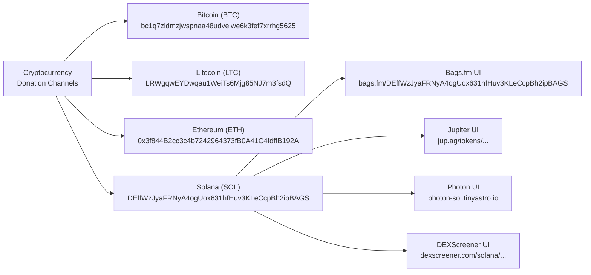
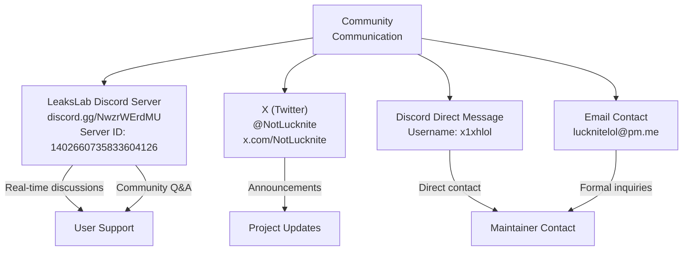
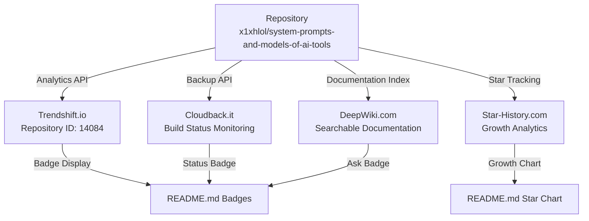
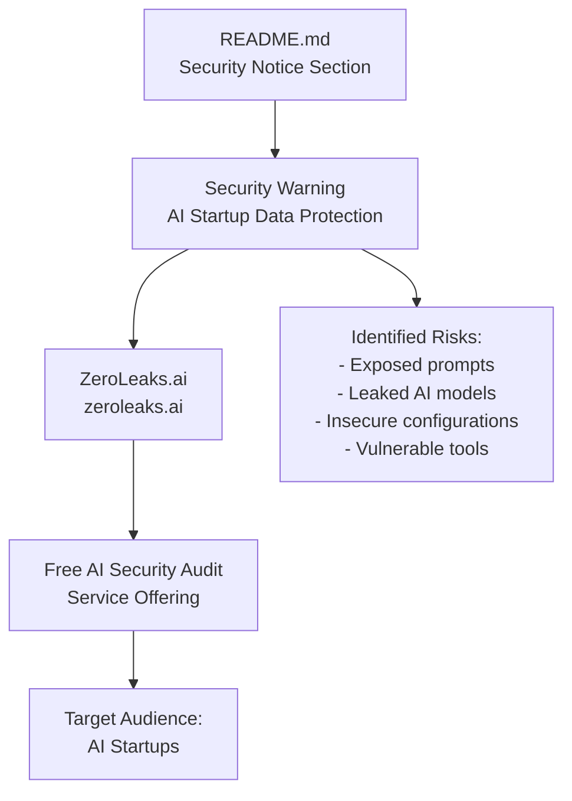
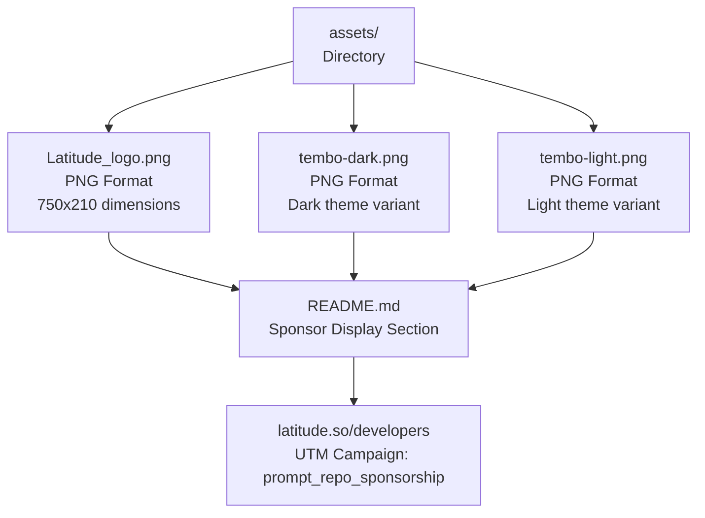
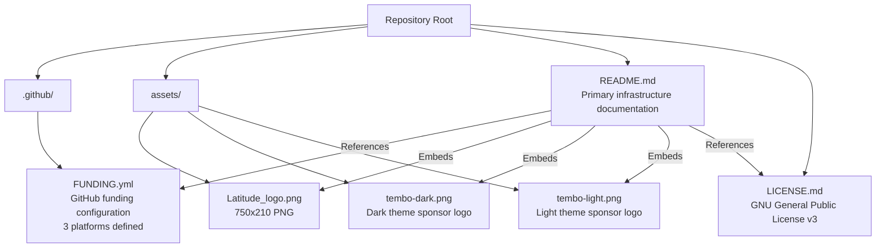
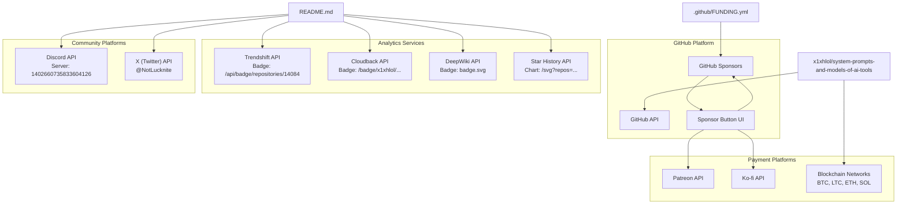

<!-- source: DeepWiki mcp.deepwiki.com · repo x1xhlol/system-prompts-and-models-of-ai-tools · page 1.2 Community Infrastructure and Brand Assets · fetched 2026-10-30 -->

# Community Infrastructure and Brand Assets

<details>
<summary>Relevant source files</summary>

The following files were used as context for generating this wiki page:

- [.github/FUNDING.yml](.github/FUNDING.yml)
- [LICENSE.md](LICENSE.md)
- [assets/tembo-dark.png](assets/tembo-dark.png)
- [assets/tembo-light.png](assets/tembo-light.png)

</details>


## Purpose and Scope

This document details the community infrastructure, funding mechanisms, monitoring services, and brand assets that support the system-prompts-and-models-of-ai-tools repository. It covers the multi-channel funding model, community platforms, integration with third-party services, and sponsor branding guidelines.

For information about the repository's content and AI systems, see [Repository Overview and Purpose](#1). For details about individual AI system architectures, see subsequent sections starting with [Qoder AI Assistant - The Flagship System](#2).

---

## Overview: Infrastructure Ecosystem

The repository operates as a community-driven open-source project with diversified funding channels, professional monitoring tools, and sponsor integration. The infrastructure supports both financial sustainability and community engagement while providing security services for AI startups.

```mermaid
graph TB
    Repo["system-prompts-and-models-of-ai-tools<br/>Repository"]
    
    subgraph "Funding Infrastructure"
        FundingYML[".github/FUNDING.yml<br/>Configuration File"]
        Crypto["Cryptocurrency Support<br/>BTC, LTC, ETH, Solana"]
        Patreon["Patreon<br/>patreon.com/lucknite"]
        KoFi["Ko-fi<br/>ko-fi.com/lucknite"]
        GitHub["GitHub Sponsors<br/>github.com/x1xhlol"]
    end
    
    subgraph "Community Platforms"
        Discord["LeaksLab Discord<br/>discord.gg/NwzrWErdMU"]
        Twitter["X (Twitter)<br/>@NotLucknite"]
        Email["Email<br/>lucknitelol@pm.me"]
    end
    
    subgraph "Monitoring Services"
        Trendshift["Trendshift<br/>Repository Analytics"]
        Cloudback["Cloudback.it<br/>Build Status"]
        DeepWiki["DeepWiki<br/>Documentation Platform"]
        StarHistory["Star History<br/>Growth Tracking"]
    end
    
    subgraph "Security Services"
        ZeroLeaks["ZeroLeaks.ai<br/>Free AI Security Audits"]
    end
    
    subgraph "Sponsor Assets"
        LatitudeLogo["assets/Latitude_logo.png"]
        TemboLogoDark["assets/tembo-dark.png"]
        TemboLogoLight["assets/tembo-light.png"]
    end
    
    Repo --> FundingYML
    FundingYML --> Crypto
    FundingYML --> Patreon
    FundingYML --> KoFi
    FundingYML --> GitHub
    
    Repo --> Discord
    Repo --> Twitter
    Repo --> Email
    
    Repo --> Trendshift
    Repo --> Cloudback
    Repo --> DeepWiki
    Repo --> StarHistory
    
    Repo --> ZeroLeaks
    
    Repo --> LatitudeLogo
    Repo --> TemboLogoDark
    Repo --> TemboLogoLight
```



**Sources:** [README.md:1-62](), [.github/FUNDING.yml:1-5]()

---

## Funding Infrastructure

### GitHub Funding Configuration

The repository uses GitHub's standardized funding configuration file to declare multiple support channels. This file enables the "Sponsor" button on the repository's GitHub page.

| Platform | Identifier | URL Pattern |
|----------|-----------|-------------|
| Patreon | `lucknite` | `https://patreon.com/lucknite` |
| Ko-fi | `lucknite` | `https://ko-fi.com/lucknite` |
| GitHub Sponsors | `x1xhlol` | `https://github.com/sponsors/x1xhlol` |

**Configuration File Structure:**

```yaml
# .github/FUNDING.yml
patreon: lucknite
github: x1xhlol
ko_fi: lucknite
```

**Sources:** [.github/FUNDING.yml:1-5](), [README.md:62]()

### Cryptocurrency Support Channels

The repository accepts cryptocurrency donations across four blockchain networks:



**Cryptocurrency Addresses:**

| Network | Address |
|---------|---------|
| Bitcoin | `bc1q7zldmzjwspnaa48udvelwe6k3fef7xrrhg5625` |
| Litecoin | `LRWgqwEYDwqau1WeiTs6Mjg85NJ7m3fsdQ` |
| Ethereum | `0x3f844B2cc3c4b7242964373fB0A41C4fdffB192A` |
| Solana (Official CA) | `DEffWzJyaFRNyA4ogUox631hfHuv3KLeCcpBh2ipBAGS` |

**Solana Trading Interfaces:**

The Solana address is integrated with four decentralized exchange (DEX) interfaces for convenient token transactions:
- **Bags.fm**: Primary token interface
- **Jupiter**: Solana token aggregator
- **Photon**: Trading platform with liquidity pool visibility
- **DEXScreener**: Real-time price and trading analytics

**Sources:** [README.md:3-10](), [README.md:62]()

### Recurring Support Platforms

Two subscription-based platforms enable recurring monthly contributions:

| Platform | Profile URL | Features |
|----------|-------------|----------|
| Patreon | `https://patreon.com/lucknite` | Tiered membership, exclusive updates |
| Ko-fi | `https://ko-fi.com/lucknite` | One-time and monthly donations |

**Sources:** [README.md:62]()

---

## Community Platforms and Contact Channels

### Communication Infrastructure



**Contact Information Table:**

| Channel | Identifier | Purpose |
|---------|-----------|---------|
| Discord Server | `discord.gg/NwzrWErdMU` (LeaksLab) | Community discussions, support |
| X (Twitter) | `@NotLucknite` | Project announcements, updates |
| Discord DM | `x1xhlol` | Direct maintainer contact |
| Email | `lucknitelol@pm.me` | Formal communications, sponsorship |

**Sources:** [README.md:48-50](), [README.md:62]()

### Discord Server Details

The **LeaksLab Discord** serves as the primary community hub:
- **Server ID**: `1402660735833604126`
- **Invite Link**: `https://discord.gg/NwzrWErdMU`
- **Badge Integration**: Custom Discord badge displayed in `README.md` showing member count

**Sources:** [README.md:48-50]()

---

## Monitoring and Analytics Services

### Repository Monitoring Integration

The repository integrates with three monitoring services to track growth, maintain backups, and provide searchable documentation:



**Service Integration Details:**

| Service | Repository ID | Badge/Integration | Purpose |
|---------|--------------|-------------------|---------|
| Trendshift | `14084` | Trend badge (`trendshift.io/api/badge/repositories/14084`) | Trending repository analytics |
| Cloudback.it | Auto-detected | Build status badge | Automated repository backups |
| DeepWiki | Auto-indexed | "Ask DeepWiki" badge (`deepwiki.com/x1xhlol/system-prompts-and-models-of-ai-tools`) | AI-powered documentation search |
| Star History | Auto-generated | Embedded chart widget | Star growth visualization |

**Sources:** [README.md:53-59](), [README.md:62]()

### Badge Implementation

All monitoring badges are displayed in the repository's README with specific embed codes:

**Trendshift Badge:**
```markdown
<a href="https://trendshift.io/repositories/14084" target="_blank">
  
</a>
```

**Cloudback Badge:**
```markdown
[]
(https://cloudback.it)
```

**DeepWiki Badge:**
```markdown
[]
(https://deepwiki.com/x1xhlol/system-prompts-and-models-of-ai-tools)
```

**Sources:** [README.md:53-59]()

---

## ZeroLeaks Security Service

### Security Audit Integration

The repository prominently features **ZeroLeaks.ai**, a security service offering free AI security audits for startups. This serves both as a warning to AI companies and a lead generation mechanism.



**Security Notice Content:**

> ⚠️ **Warning:** If you're an AI startup, make sure your data is secure. Exposed prompts or AI models can easily become a target for hackers.
>
> 🔐 **Important:** Interested in securing your AI systems?  
> Check out **[ZeroLeaks](https://zeroleaks.ai)**, a service designed to help startups **identify and secure** leaks in system instructions, internal tools, and model configurations. **Get a free AI security audit** to ensure your AI is protected from vulnerabilities.

**Service Details:**

| Aspect | Description |
|--------|-------------|
| **Service Name** | ZeroLeaks |
| **URL** | `https://zeroleaks.ai/` |
| **Offering** | Free AI security audits for startups |
| **Scope** | System instructions, internal tools, model configurations |
| **Target Vulnerabilities** | Exposed prompts, leaked models, configuration leaks |

**Sources:** [README.md:62]()

---

## Brand Assets and Sponsor Integration

### Sponsor Logo Assets

The repository maintains brand assets for sponsors in the `assets/` directory:



**Asset Inventory:**

| File Path | Sponsor | Format | Theme | Dimensions |
|-----------|---------|--------|-------|------------|
| `assets/Latitude_logo.png` | Latitude | PNG | Universal | 750×210 px |
| `assets/tembo-dark.png` | Tembo | PNG | Dark mode | 2400×192 px |
| `assets/tembo-light.png` | Tembo | PNG | Light mode | 2400×192 px |

**Sources:** [assets/Latitude_logo.png:1-1](), [assets/tembo-dark.png:1-1](), [assets/tembo-light.png:1-1]()

### Latitude Sponsor Integration

Latitude is the primary featured sponsor with comprehensive integration:

**Display Structure in README:**

```html
<table width="100%">
  <tr>
    <td align="center" valign="top">
      <a href="https://latitude.so/developers?utm_source=github&utm_medium=readme&utm_campaign=prompt_repo_sponsorship">
        
      </a>
      <br><br>
      <strong>Make your LLM predictable in production</strong>
      <br>
      Open Source AI Engineering Platform
    </td>
  </tr>
</table>
```

**UTM Parameters for Tracking:**

| Parameter | Value |
|-----------|-------|
| `utm_source` | `github` |
| `utm_medium` | `readme` |
| `utm_campaign` | `prompt_repo_sponsorship` |

**Tagline:** "Make your LLM predictable in production"  
**Description:** "Open Source AI Engineering Platform"

**Sources:** [README.md:24-44]()

### Sponsor Acquisition Process

The repository actively solicits sponsors with a dedicated section:

**Call to Action:**

> Sponsor the most comprehensive repository of AI system prompts and reach thousands of developers.
>
> [Get Started](mailto:lucknitelol@proton.me)

**Contact for Sponsorship:** `lucknitelol@proton.me`

**Sources:** [README.md:62]()

---

## Repository Metadata and Attribution

### Content Statistics

The repository advertises comprehensive coverage of AI system prompts:

**Highlighted Metric:**
```
📜 Over 30,000+ lines of insights into their structure and functionality.
```

**Sources:** [README.md:55]()

### Update Tracking

**Latest Update Timestamp:** `08/03/2026`

The repository includes an update tracker to indicate active maintenance:

**Sources:** [README.md:62]()

### Star History Visualization

The repository embeds a dynamic star growth chart with theme-aware rendering:

**Implementation:**

```html
<a href="https://www.star-history.com/#x1xhlol/system-prompts-and-models-of-ai-tools&Date">
  <picture>
    <source media="(prefers-color-scheme: dark)" 
            srcset="https://api.star-history.com/svg?repos=x1xhlol/system-prompts-and-models-of-ai-tools&type=Date&theme=dark" />
    <source media="(prefers-color-scheme: light)" 
            srcset="https://api.star-history.com/svg?repos=x1xhlol/system-prompts-and-models-of-ai-tools&type=Date" />
    
  </picture>
</a>
```

**Features:**
- Automatic theme detection (dark/light mode)
- API-generated SVG charts
- Hosted at `star-history.com`

**Sources:** [README.md:62]()

---

## Infrastructure File Mapping

### Complete File System Structure



**File Purpose Summary:**

| File Path | Primary Purpose | External Dependencies |
|-----------|----------------|----------------------|
| `.github/FUNDING.yml` | GitHub sponsor button configuration | Patreon, Ko-fi, GitHub Sponsors APIs |
| `assets/Latitude_logo.png` | Latitude sponsor branding | None |
| `assets/tembo-dark.png` | Tembo sponsor branding (dark) | None |
| `assets/tembo-light.png` | Tembo sponsor branding (light) | None |
| `LICENSE.md` | Repository licensing information | None |
| `README.md` | Infrastructure documentation hub | Trendshift API, Cloudback API, DeepWiki API, Star History API |

**Sources:** [README.md:1-62](), [.github/FUNDING.yml:1-5](), [assets/Latitude_logo.png:1-1](), [assets/tembo-dark.png:1-1](), [assets/tembo-light.png:1-1](), [LICENSE.md:1-138]()

---

## Integration Architecture

### External Service Dependencies



**API Integration Summary:**

| Service | API Endpoint Pattern | Integration Type |
|---------|---------------------|------------------|
| Trendshift | `trendshift.io/api/badge/repositories/{id}` | Badge embed |
| Cloudback | `app.cloudback.it/badge/{owner}/{repo}` | Badge embed |
| DeepWiki | `deepwiki.com/badge.svg` | Badge embed |
| Star History | `api.star-history.com/svg?repos={repo}&type=Date` | Chart embed |
| Discord | Standard Discord invite | Community link |

**Sources:** [README.md:1-62](), [.github/FUNDING.yml:1-5]()

---

## Licensing

The repository is licensed under the **GNU General Public License Version 3 (GPLv3)**. This license ensures that the software and its derivatives remain free and open-source, promoting freedom to share, modify, and distribute the work.

Key aspects of the GPLv3 include:
- **Freedom to Share and Change**: Users are explicitly granted the right to copy, distribute, and modify the software.
- **Source Code Availability**: Recipients must receive or be able to obtain the source code.
- **No Warranty**: The license explicitly states there is no warranty for the free software.
- **Attribution for Modifications**: Modified versions must be clearly marked to prevent misattribution of issues.
- **Anti-Tivoization Clause**: Designed to prevent devices from denying users access to install or run modified versions of the software.
- **Patent Protection**: Assures that patents cannot be used to render the program non-free.

**Sources:** [LICENSE.md:1-138]()

---

