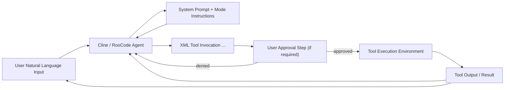
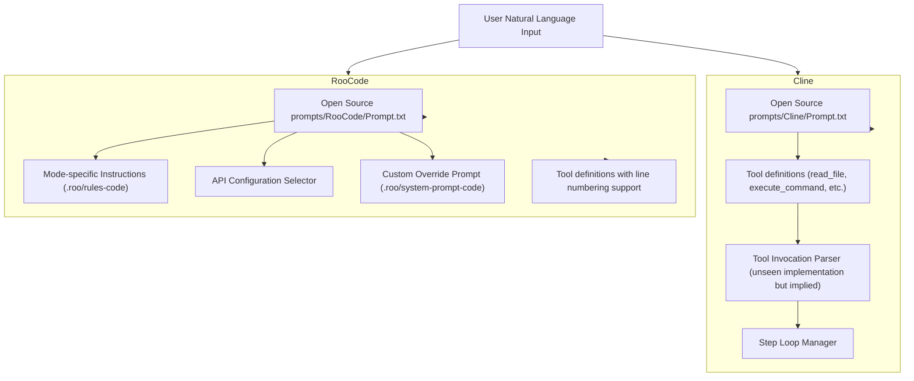

<!-- source: DeepWiki mcp.deepwiki.com · repo x1xhlol/system-prompts-and-models-of-ai-tools · page 8.2 Cline and RooCode Open-Source Agents · fetched 2026-10-30 -->

# 8.2 Cline and RooCode Open-Source Agents

<details>
<summary>Relevant source files</summary>

The following files were used as context for generating this wiki page:

- [Open Source prompts/Cline/Prompt.txt](Open Source prompts/Cline/Prompt.txt)
- [Open Source prompts/RooCode/Prompt.txt](Open Source prompts/RooCode/Prompt.txt)

</details>


This page documents the system prompts and operational paradigms of the open-source agents **Cline** and **RooCode** as hosted in the [system-prompts-and-models-of-ai-tools repository](https://github.com/x1xhlol/system-prompts-and-models-of-ai-tools). Both agents employ a structured XML-based tool-calling format, use explicit step-by-step operation with user confirmation loops, and implement mode systems for discrete task workflows.

---

## Overview and Purpose

Cline and RooCode are autonomous AI programming assistants designed to execute developer tasks incrementally with minimal code changes, focusing on maintainability and correctness. They share a fundamental design in:

- Using **XML-style tags** for tool invocation and parameter passing.
- Performing one tool action per message.
- Engaging in **step-by-step tool usage loops**, where each tool's output informs the next action.
- Requiring **explicit user approval** for tool execution when potentially impactful.
- Supporting **mode systems** to customize behaviors and instructions.

Cline emphasizes detailed CLI interaction and fine-grained file operations. RooCode prioritizes minimal changes with maintainability focus and supports extensible mode-specific custom instructions and API configurations.

---

## 1. XML Tool-Calling Format

Both agents use a consistent XML-like syntax to invoke tools, ensuring machine parsability and easy extension.

### Format Structure

- Each tool call is enclosed in opening and closing tags named after the tool, e.g., `<read_file> ... </read_file>`.
- Inside, each parameter has its own tag with parameter name and value, e.g.:

```xml
<read_file>
  <path>src/main.js</path>
</read_file>
```

- Adherence to this format is mandatory to enable correct parsing and execution.

### Supported Tools (Selected Examples)

- **read_file**

  Retrives file contents by path.

  ```xml
  <read_file>
    <path>path/to/file</path>
  </read_file>
  ```

  RooCode supports optional `start_line` and `end_line` parameters to read file segments.

- **write_to_file**

  Writes full content to file, creating directories if needed.

  ```xml
  <write_to_file>
    <path>path/to/file</path>
    <content>
    Complete file content here...
    </content>
  </write_to_file>
  ```

- **replace_in_file**

  Performs targeted changes using SEARCH/REPLACE blocks with exact content matching.

  ```xml
  <replace_in_file>
    <path>path/to/file</path>
    <diff>
    <<<<<<< SEARCH
    old code block
    =======
    new code block
    >>>>>>> REPLACE
    </diff>
  </replace_in_file>
  ```

- **execute_command** (Cline-specific emphasis)

  Executes CLI commands with parameters specifying whether explicit user approval is required before execution.

  ```xml
  <execute_command>
    <command>npm install</command>
    <requires_approval>true</requires_approval>
  </execute_command>
  ```

### Tool Flow

- Only one tool invocation per message.
- After tool execution, the user receives the output and the agent plans next steps accordingly.
- This incremental process enables fine-grained control, easy troubleshooting, and safe execution.

---

## 2. Step-by-Step Confirmation Loops

Both agents implement a **stepwise workflow** that interleaves action planning, tool invocation, execution results, and user approval.

### Key Principles

- The agent **proposes a single tool action per message**, formatted in XML tags.
- For sensitive or impactful actions (e.g., deleting files, installing software, running system commands), the agent sets `requires_approval=true`.
- The user confirms or denies tool execution.
- The agent evaluates the returned tool output/result to inform the next action.
- This cycle repeats until the user's original task is complete.

### Benefits

- Ensures user oversight over potentially dangerous operations.
- Enables safer incremental progress.
- Facilitates debugging by clearly associating tool invocations with their outputs and results.
- The conversational design mimics human stepwise work.

---

## 3. Mode Systems and Custom Instructions (RooCode)

RooCode supports **multiple "modes"** which control agent behavior, tool sets, and instructions tailored to specific workflows.

### Features

- Modes can be toggled or selected dynamically.
- Each mode has **mode-specific custom instructions**, which can be configured via files in the workspace:

  - `.roo/rules-code/` folder for code-related modes.
  - Legacy `.roorules-code` and `.clinerules-code` are deprecated.

- The system prompt can be **entirely overridden** per mode by placing a custom prompt file at `.roo/system-prompt-code`.
- API configurations can be selected per mode to vary model or service usage.
- Instructions for all modes reside separately and apply universally across modes.

### Example Mode Behavior

- **Code Mode** for minimal-impact code changes, emphasizing maintainability.
- Modes apply behavioral guidelines and tool usage policies specific to their context.

---

## Technical Implementation

### System Prompt Composition

Both Cline and RooCode system prompts begin with a role definition describing the agent as a "highly skilled software engineer" with extensive knowledge and focus on maintainability and best practices. They then provide:

- A clear **tool use** section outlining access rights and one-tool-per-message policy.
- **Tool use formatting** rules describing the XML tag syntax in detail.
- Full list of available tools with descriptions, parameters, usage examples, and specific operational constraints.
- Instructions on **stepwise tool use cycles** requiring user approval on impactful commands.

### Selected Key Functions and Classes (Conceptual)

- **Tool Invocation Parser**

  Parses XML-tagged messages capturing tool name, parameters, and values to render executable tool calls.

- **User Confirmation Controller**

  Intercepts tool calls with `requires_approval=true` to trigger explicit user confirmation before execution.

- **Step Loop Manager**

  Manages the interaction cycle of sending tool calls, receiving results, evaluating outputs, and planning next steps.

- **Mode Manager (RooCode)**

  Loads mode-specific prompts and custom instructions from workspace folders, enabling behavior overrides.

---

## Data Flow Diagram: Natural Language to Tool Calls



*This diagram maps the core flow from user input (natural language) to agent response (XML tool calls), interleaved with user approval and execution feedback, closing the loop for iterative task fulfillment.*

---

## Code Entity Association Diagram: System Prompt and Tool Usage in Codebase



*This diagram relates natural language user input to the key prompt files and configurations defining agent behavior and tool usage in the codebase.*

---

## Detailed Comparison: Cline vs RooCode

| Feature                 | Cline                                                       | RooCode                                                       |
|-------------------------|-------------------------------------------------------------|---------------------------------------------------------------|
| Agent Identity          | Skilled software engineer specializing in multi-language and CLI command usage | Skilled software engineer focused on minimal code churn and maintainability |
| Tool Invocation Format  | XML-style tags (mandatory)                                  | Same XML-style tags, with stricter conventions (e.g., line numbering on read_file) |
| Tool Usage Style        | Step-by-step usage with user approval loop                   | Same stepwise process with explicit user approvals |
| Tool Examples           | execute_command (with requires_approval), read_file, write_to_file, replace_in_file, search_files, list_files | read_file (supports start_line/end_line), fetch_instructions, search_files, list_files |
| Command Execution       | Emphasis on CLI command execution with approval requirements | Supports browser, MCP, and run commands, with mode-specific control |
| Mode Systems            | Implicit; no explicit per-mode instructions detailed          | Explicit multi-mode support; mode-specific instruction folders; custom override prompt option |
| Behavioral Focus        | Detailed operational control using shell commands           | Minimal changes; maintainability; configurable via modes and API selection |
| File Reading            | Reads entire files                                           | Supports partial reads via line segments for large files |
| User Confirmation       | Tool calls with `requires_approval` flag for impactful ops  | Same approach with additional mode-related instructions |

---

## Summary

The **Cline** and **RooCode** open-source agents use a rigorous, XML-tagged, stepwise interaction model with user gating to incrementally solve programming tasks. They enable enhanced safety, traceability, and fine partitioning of intent over a flexible but precise tool system. RooCode adds a sophisticated mode system for tailoring behaviors and API configurations. Both agents provide robust templates for integrating AI-driven developer assistants in open-source settings.

---

## Sources

- `Open Source prompts/Cline/Prompt.txt:1-114`  
- `Open Source prompts/RooCode/Prompt.txt:1-147`

---

