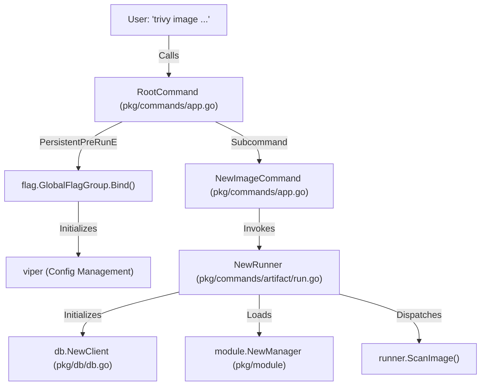
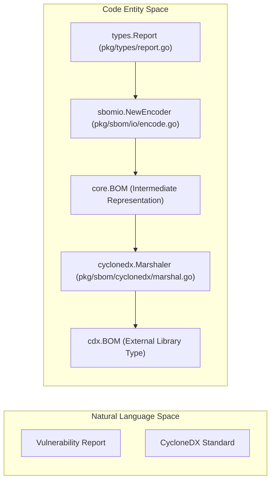

<!-- source: DeepWiki mcp.deepwiki.com · repo aquasecurity/trivy · page 10 Glossary · fetched 2026-10-30 -->

# Glossary

Relevant source files

The following files were used as context for generating this wiki page:

- [README.md](README.md)
- [cmd/trivy/main.go](cmd/trivy/main.go)
- [go.mod](go.mod)
- [go.sum](go.sum)
- [integration/testdata/conda-cyclonedx.json.golden](integration/testdata/conda-cyclonedx.json.golden)
- [integration/testdata/conda-environment-cyclonedx.json.golden](integration/testdata/conda-environment-cyclonedx.json.golden)
- [integration/testdata/fixtures/sbom/fluentd-multiple-lockfiles-cyclonedx.json](integration/testdata/fixtures/sbom/fluentd-multiple-lockfiles-cyclonedx.json)
- [integration/testdata/fixtures/sbom/minikube-kbom.json](integration/testdata/fixtures/sbom/minikube-kbom.json)
- [integration/testdata/fluentd-multiple-lockfiles-short.cdx.json.golden](integration/testdata/fluentd-multiple-lockfiles-short.cdx.json.golden)
- [integration/testdata/fluentd-multiple-lockfiles.cdx.json.golden](integration/testdata/fluentd-multiple-lockfiles.cdx.json.golden)
- [integration/testdata/npm-cyclonedx.json.golden](integration/testdata/npm-cyclonedx.json.golden)
- [integration/testdata/pom-cyclonedx.json.golden](integration/testdata/pom-cyclonedx.json.golden)
- [internal/dbtest/db.go](internal/dbtest/db.go)
- [mkdocs.yml](mkdocs.yml)
- [pkg/cache/remote.go](pkg/cache/remote.go)
- [pkg/cache/remote_test.go](pkg/cache/remote_test.go)
- [pkg/commands/app.go](pkg/commands/app.go)
- [pkg/commands/app_test.go](pkg/commands/app_test.go)
- [pkg/commands/artifact/run.go](pkg/commands/artifact/run.go)
- [pkg/commands/testdata/java-db/metadata.json](pkg/commands/testdata/java-db/metadata.json)
- [pkg/commands/testdata/policy/metadata.json](pkg/commands/testdata/policy/metadata.json)
- [pkg/compliance/report/report_test.go](pkg/compliance/report/report_test.go)
- [pkg/compliance/spec/compliance.go](pkg/compliance/spec/compliance.go)
- [pkg/compliance/spec/compliance_test.go](pkg/compliance/spec/compliance_test.go)
- [pkg/compliance/spec/custom.go](pkg/compliance/spec/custom.go)
- [pkg/compliance/spec/mapper.go](pkg/compliance/spec/mapper.go)
- [pkg/compliance/spec/mapper_test.go](pkg/compliance/spec/mapper_test.go)
- [pkg/compliance/spec/testdata/testcache/policy/content/specs/compliance/invalid.yaml](pkg/compliance/spec/testdata/testcache/policy/content/specs/compliance/invalid.yaml)
- [pkg/compliance/spec/testdata/testcache/policy/content/specs/compliance/testspec.yaml](pkg/compliance/spec/testdata/testcache/policy/content/specs/compliance/testspec.yaml)
- [pkg/compliance/spec/testdata/testcache/policy/metadata.json](pkg/compliance/spec/testdata/testcache/policy/metadata.json)
- [pkg/db/db.go](pkg/db/db.go)
- [pkg/db/db_test.go](pkg/db/db_test.go)
- [pkg/dependency/parser/java/pom/var.go](pkg/dependency/parser/java/pom/var.go)
- [pkg/detector/library/driver.go](pkg/detector/library/driver.go)
- [pkg/detector/library/driver_test.go](pkg/detector/library/driver_test.go)
- [pkg/detector/library/testdata/fixtures/data-source.yaml](pkg/detector/library/testdata/fixtures/data-source.yaml)
- [pkg/detector/library/testdata/fixtures/go.yaml](pkg/detector/library/testdata/fixtures/go.yaml)
- [pkg/fanal/analyzer/all/import.go](pkg/fanal/analyzer/all/import.go)
- [pkg/fanal/analyzer/const.go](pkg/fanal/analyzer/const.go)
- [pkg/fanal/analyzer/imgconf/apk/apk.go](pkg/fanal/analyzer/imgconf/apk/apk.go)
- [pkg/fanal/analyzer/imgconf/secret/secret.go](pkg/fanal/analyzer/imgconf/secret/secret.go)
- [pkg/fanal/analyzer/imgconf/secret/secret_test.go](pkg/fanal/analyzer/imgconf/secret/secret_test.go)
- [pkg/fanal/analyzer/language/analyze.go](pkg/fanal/analyzer/language/analyze.go)
- [pkg/fanal/analyzer/licensing/license.go](pkg/fanal/analyzer/licensing/license.go)
- [pkg/fanal/analyzer/pkg/dpkg/copyright.go](pkg/fanal/analyzer/pkg/dpkg/copyright.go)
- [pkg/fanal/analyzer/secret/secret.go](pkg/fanal/analyzer/secret/secret.go)
- [pkg/fanal/analyzer/secret/secret_test.go](pkg/fanal/analyzer/secret/secret_test.go)
- [pkg/fanal/applier/docker.go](pkg/fanal/applier/docker.go)
- [pkg/fanal/applier/docker_test.go](pkg/fanal/applier/docker_test.go)
- [pkg/fanal/artifact/sbom/sbom.go](pkg/fanal/artifact/sbom/sbom.go)
- [pkg/fanal/secret/builtin-rules.go](pkg/fanal/secret/builtin-rules.go)
- [pkg/fanal/secret/scanner.go](pkg/fanal/secret/scanner.go)
- [pkg/fanal/secret/scanner_test.go](pkg/fanal/secret/scanner_test.go)
- [pkg/fanal/secret/testdata/alibaba-access-key-id.txt](pkg/fanal/secret/testdata/alibaba-access-key-id.txt)
- [pkg/fanal/secret/testdata/asymmetric-private-key.txt](pkg/fanal/secret/testdata/asymmetric-private-key.txt)
- [pkg/fanal/secret/testdata/aws-secrets.txt](pkg/fanal/secret/testdata/aws-secrets.txt)
- [pkg/fanal/secret/testdata/crlf-line-endings.txt](pkg/fanal/secret/testdata/crlf-line-endings.txt)
- [pkg/fanal/secret/testdata/github-token.txt](pkg/fanal/secret/testdata/github-token.txt)
- [pkg/fanal/secret/testdata/grafana-env.txt](pkg/fanal/secret/testdata/grafana-env.txt)
- [pkg/fanal/secret/testdata/hugging-face-secret.txt](pkg/fanal/secret/testdata/hugging-face-secret.txt)
- [pkg/fanal/secret/testdata/invalid-utf8.txt](pkg/fanal/secret/testdata/invalid-utf8.txt)
- [pkg/fanal/secret/testdata/jwt-secret.txt](pkg/fanal/secret/testdata/jwt-secret.txt)
- [pkg/fanal/secret/testdata/private-packagist.txt](pkg/fanal/secret/testdata/private-packagist.txt)
- [pkg/fanal/secret/testdata/symfony-secret.yaml](pkg/fanal/secret/testdata/symfony-secret.yaml)
- [pkg/fanal/types/const.go](pkg/fanal/types/const.go)
- [pkg/flag/options.go](pkg/flag/options.go)
- [pkg/iac/rego/build.go](pkg/iac/rego/build.go)
- [pkg/iac/rego/custom.go](pkg/iac/rego/custom.go)
- [pkg/iac/rego/embed.go](pkg/iac/rego/embed.go)
- [pkg/iac/rego/embed_test.go](pkg/iac/rego/embed_test.go)
- [pkg/iac/rego/load.go](pkg/iac/rego/load.go)
- [pkg/iac/rego/load_test.go](pkg/iac/rego/load_test.go)
- [pkg/iac/rego/metadata.go](pkg/iac/rego/metadata.go)
- [pkg/iac/rego/metadata_test.go](pkg/iac/rego/metadata_test.go)
- [pkg/iac/rego/options.go](pkg/iac/rego/options.go)
- [pkg/iac/rego/result.go](pkg/iac/rego/result.go)
- [pkg/iac/rego/runtime.go](pkg/iac/rego/runtime.go)
- [pkg/iac/rego/scanner.go](pkg/iac/rego/scanner.go)
- [pkg/iac/rego/scanner_test.go](pkg/iac/rego/scanner_test.go)
- [pkg/iac/rego/store.go](pkg/iac/rego/store.go)
- [pkg/iac/rego/store_test.go](pkg/iac/rego/store_test.go)
- [pkg/iac/scan/rule.go](pkg/iac/scan/rule.go)
- [pkg/iac/scanners/cloudformation/scanner_test.go](pkg/iac/scanners/cloudformation/scanner_test.go)
- [pkg/iac/scanners/dockerfile/scanner_test.go](pkg/iac/scanners/dockerfile/scanner_test.go)
- [pkg/iac/scanners/generic/scanner_test.go](pkg/iac/scanners/generic/scanner_test.go)
- [pkg/iac/scanners/terraform/scanner_test.go](pkg/iac/scanners/terraform/scanner_test.go)
- [pkg/iac/scanners/terraform/setup_test.go](pkg/iac/scanners/terraform/setup_test.go)
- [pkg/iac/scanners/terraformplan/snapshot/scanner_test.go](pkg/iac/scanners/terraformplan/snapshot/scanner_test.go)
- [pkg/k8s/scanner/scanner_test.go](pkg/k8s/scanner/scanner_test.go)
- [pkg/licensing/classifier.go](pkg/licensing/classifier.go)
- [pkg/licensing/classifier_test.go](pkg/licensing/classifier_test.go)
- [pkg/licensing/expression/expression.go](pkg/licensing/expression/expression.go)
- [pkg/licensing/expression/expression_test.go](pkg/licensing/expression/expression_test.go)
- [pkg/licensing/expression/types.go](pkg/licensing/expression/types.go)
- [pkg/licensing/normalize.go](pkg/licensing/normalize.go)
- [pkg/licensing/normalize_test.go](pkg/licensing/normalize_test.go)
- [pkg/licensing/scanner.go](pkg/licensing/scanner.go)
- [pkg/licensing/scanner_test.go](pkg/licensing/scanner_test.go)
- [pkg/log/logger.go](pkg/log/logger.go)
- [pkg/misconf/scanner.go](pkg/misconf/scanner.go)
- [pkg/purl/purl.go](pkg/purl/purl.go)
- [pkg/purl/purl_test.go](pkg/purl/purl_test.go)
- [pkg/result/testdata/openvex.json](pkg/result/testdata/openvex.json)
- [pkg/rpc/client/client.go](pkg/rpc/client/client.go)
- [pkg/rpc/client/client_test.go](pkg/rpc/client/client_test.go)
- [pkg/rpc/convert.go](pkg/rpc/convert.go)
- [pkg/rpc/convert_test.go](pkg/rpc/convert_test.go)
- [pkg/rpc/server/server.go](pkg/rpc/server/server.go)
- [pkg/rpc/server/server_test.go](pkg/rpc/server/server_test.go)
- [pkg/sbom/core/bom.go](pkg/sbom/core/bom.go)
- [pkg/sbom/cyclonedx/marshal.go](pkg/sbom/cyclonedx/marshal.go)
- [pkg/sbom/cyclonedx/marshal_test.go](pkg/sbom/cyclonedx/marshal_test.go)
- [pkg/sbom/cyclonedx/testdata/happy/bom.json](pkg/sbom/cyclonedx/testdata/happy/bom.json)
- [pkg/sbom/cyclonedx/testdata/happy/infinite-loop-bom.json](pkg/sbom/cyclonedx/testdata/happy/infinite-loop-bom.json)
- [pkg/sbom/cyclonedx/testdata/happy/kbom.json](pkg/sbom/cyclonedx/testdata/happy/kbom.json)
- [pkg/sbom/cyclonedx/testdata/happy/third-party-bom-no-os.json](pkg/sbom/cyclonedx/testdata/happy/third-party-bom-no-os.json)
- [pkg/sbom/cyclonedx/testdata/happy/third-party-bom.json](pkg/sbom/cyclonedx/testdata/happy/third-party-bom.json)
- [pkg/sbom/cyclonedx/unmarshal.go](pkg/sbom/cyclonedx/unmarshal.go)
- [pkg/sbom/cyclonedx/unmarshal_test.go](pkg/sbom/cyclonedx/unmarshal_test.go)
- [pkg/sbom/io/encode.go](pkg/sbom/io/encode.go)
- [pkg/sbom/io/encode_test.go](pkg/sbom/io/encode_test.go)
- [pkg/sbom/sbom.go](pkg/sbom/sbom.go)
- [pkg/sbom/sbom_test.go](pkg/sbom/sbom_test.go)
- [pkg/vex/csaf.go](pkg/vex/csaf.go)
- [pkg/vex/cyclonedx.go](pkg/vex/cyclonedx.go)
- [pkg/vex/openvex.go](pkg/vex/openvex.go)
- [pkg/vex/testdata/openvex-multiple.json](pkg/vex/testdata/openvex-multiple.json)
- [pkg/vex/testdata/openvex-oci.json](pkg/vex/testdata/openvex-oci.json)
- [pkg/vex/testdata/openvex.json](pkg/vex/testdata/openvex.json)
- [pkg/vex/testdata/unknown.json](pkg/vex/testdata/unknown.json)
- [pkg/vex/vex.go](pkg/vex/vex.go)
- [pkg/vex/vex_test.go](pkg/vex/vex_test.go)
- [pkg/x/slices/slices.go](pkg/x/slices/slices.go)
- [rpc/cache/service.pb.go](rpc/cache/service.pb.go)
- [rpc/cache/service.proto](rpc/cache/service.proto)
- [rpc/cache/service.twirp.go](rpc/cache/service.twirp.go)
- [rpc/common/service.pb.go](rpc/common/service.pb.go)
- [rpc/common/service.proto](rpc/common/service.proto)
- [rpc/scanner/service.pb.go](rpc/scanner/service.pb.go)
- [rpc/scanner/service.proto](rpc/scanner/service.proto)
- [rpc/scanner/service.twirp.go](rpc/scanner/service.twirp.go)

This glossary defines codebase-specific terms, jargon, and domain concepts used within the Trivy project. It is intended to help onboarding engineers navigate the architectural layers and data models.

## Core System Terms

### Artifact
A target that Trivy can scan for security issues. Artifacts are abstracted to allow uniform scanning of different sources.
*   **Implementation**: Defined as `TargetKind` in [pkg/commands/artifact/run.go:47-57](). Supported types include `image`, `fs` (filesystem), `repo`, `sbom`, `vm`, and `k8s`.
*   **Data Flow**: The `Runner` interface handles the lifecycle of an artifact scan [pkg/commands/artifact/run.go:79-98]().

### Analyzer
A component responsible for extracting specific information (packages, secrets, or configurations) from an artifact's files.
*   **Types**: Analyzers are categorized into groups like `TypeLockfiles`, `TypeIndividualPkgs`, and `TypeConfig` [pkg/fanal/analyzer/const.go]().
*   **Control**: Analyzers can be disabled via CLI flags to optimize performance or narrow scope [pkg/commands/artifact/run.go:201-202]().

### Driver
A specialized component used in vulnerability detection to map extracted package information to known vulnerabilities for a specific ecosystem (e.g., Alpine, Debian, or Python).
*   **Location**: Logic resides in [pkg/detector/library/driver.go]().

### Secret Rule
A definition used by the secret scanner to identify sensitive information (like API keys) using regular expressions and keyword filtering.
*   **Implementation**: Defined as a `Rule` struct. Built-in rules cover services like AWS, GitHub, and Slack [pkg/fanal/secret/builtin-rules.go:102-160]().
*   **Categories**: Rules are grouped by `SecretRuleCategory` [pkg/fanal/secret/builtin-rules.go:12-74]().

---

## Data Structures & Identifiers

### PURL (Package URL)
A standard for identifying software packages across different ecosystems (Maven, npm, PyPI, etc.). Trivy uses PURLs to ensure interoperability with SBOM formats.
*   **Implementation**: Handled in [pkg/purl/purl.go]().
*   **Usage**: Embedded in package identifiers during scanning and reporting [pkg/sbom/cyclonedx/marshal_test.go:28-43]().

### BOM-Ref
A unique identifier used within an SBOM (Software Bill of Materials) to link components and their relationships.
*   **Implementation**: Generated during the encoding process [pkg/sbom/io/encode.go]() and used in CycloneDX marshaling [pkg/sbom/cyclonedx/marshal.go:126-138]().

### Blob
In Trivy's cache and Fanal (the analyzer library) context, a blob represents the processed result of a single layer or a filesystem partition.

---

## Infrastructure & Database

### Trivy DB
The primary vulnerability database. It is a Key-Value store (BoltDB) containing aggregated vulnerability data from various sources.
*   **Schema**: Managed via `SchemaVersion` [pkg/db/db.go:25]().
*   **Distribution**: Distributed as an OCI artifact [pkg/db/db.go:26-36]().
*   **Update Logic**: The `Client` checks if the local DB is stale based on `DownloadedAt` and `NextUpdate` metadata [pkg/db/db.go:105-161]().

### Java DB
A specialized database used for identifying Java dependencies by mapping JAR SHA-1 hashes to Maven coordinates.
*   **Pointer**: [pkg/javadb/]() (referenced in [pkg/commands/artifact/run.go:30]()).

---

## Architectural Diagrams

### From CLI Command to Code Entities
This diagram illustrates how a user command like `trivy image` traverses the internal command structure and initializes the scanning runner.

**Sources**: [pkg/commands/app.go:68-117](), [pkg/commands/artifact/run.go:121-174](), [pkg/db/db.go:84-102]()

### SBOM Generation Data Flow
This diagram shows how a raw `types.Report` is transformed into a standardized CycloneDX SBOM.

**Sources**: [pkg/sbom/cyclonedx/marshal.go:58-90](), [pkg/sbom/io/encode.go]()

---

## Technical Jargon Table

| Term | Definition | Code Pointer |
| :--- | :--- | :--- |
| **Fanal** | The core library used by Trivy for artifact analysis and metadata extraction. | `pkg/fanal/` |
| **Misconf** | Shorthand for "Misconfiguration". Refers to the subsystem scanning IaC files (Terraform, Dockerfile). | [pkg/misconf/scanner.go]() |
| **VEX** | Vulnerability Exploitability eXchange. A format to provide status updates on vulnerabilities (e.g., "not affected"). | [pkg/vex/vex.go]() |
| **Rootfs** | A directory representing the root filesystem of an OS, scanned without container-specific metadata. | [pkg/commands/artifact/run.go:52]() |
| **Twirp** | The RPC framework used for communication between Trivy Client and Trivy Server. | [rpc/cache/service.twirp.go]() |

**Sources**: [pkg/commands/artifact/run.go:47-57](), [pkg/vex/vex.go](), [rpc/cache/service.twirp.go]()