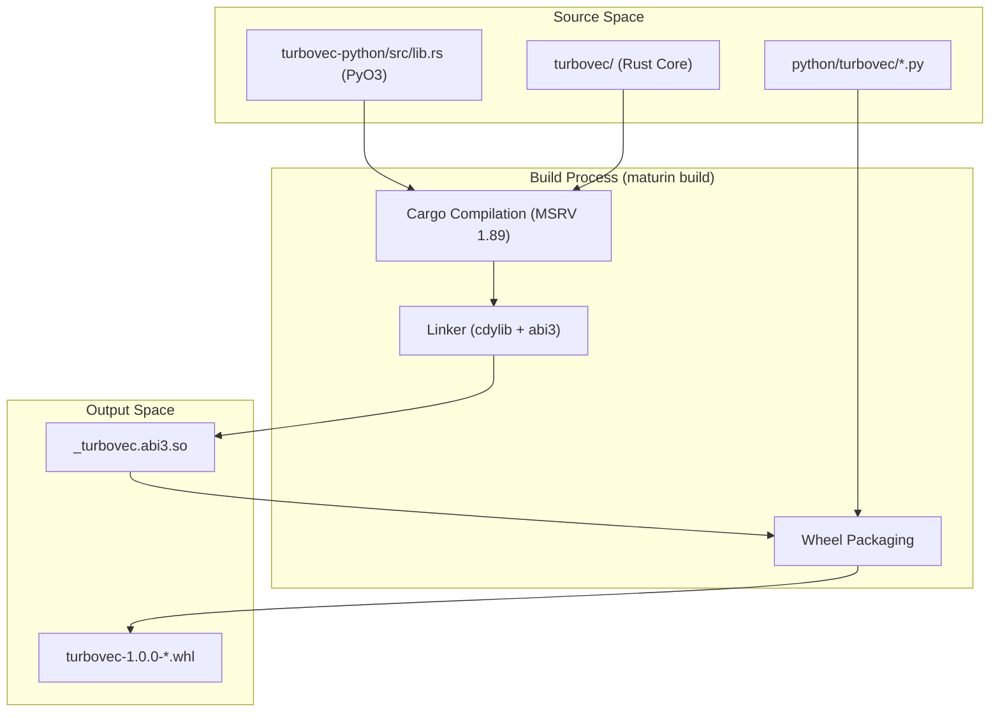
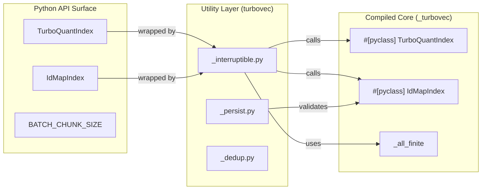

<!-- source: DeepWiki mcp.deepwiki.com · repo RyanCodrai/turbovec · page 3.2 Python Package Structure, Utilities, and Build · fetched 2026-10-30 -->

# Python Package Structure, Utilities, and Build

Relevant source files

The following files were used as context for generating this wiki page:

- [.github/CODEOWNERS](.github/CODEOWNERS)
- [.github/PULL_REQUEST_TEMPLATE.md](.github/PULL_REQUEST_TEMPLATE.md)
- [CONTRIBUTING.md](CONTRIBUTING.md)
- [Cargo.lock](Cargo.lock)
- [examples/downstream-smoke/Cargo.lock](examples/downstream-smoke/Cargo.lock)
- [turbovec-python/Cargo.toml](turbovec-python/Cargo.toml)
- [turbovec-python/pyproject.toml](turbovec-python/pyproject.toml)
- [turbovec-python/python/turbovec/__init__.py](turbovec-python/python/turbovec/__init__.py)
- [turbovec-python/python/turbovec/_dedup.py](turbovec-python/python/turbovec/_dedup.py)
- [turbovec-python/python/turbovec/_interruptible.py](turbovec-python/python/turbovec/_interruptible.py)
- [turbovec-python/python/turbovec/_persist.py](turbovec-python/python/turbovec/_persist.py)
- [turbovec-python/tests/test_dedup.py](turbovec-python/tests/test_dedup.py)
- [turbovec-python/tests/test_interruptible.py](turbovec-python/tests/test_interruptible.py)
- [turbovec-python/tests/test_persist.py](turbovec-python/tests/test_persist.py)
- [turbovec/Cargo.toml](turbovec/Cargo.toml)

This page details the organization and build pipeline of the `turbovec-python` package. It covers how the Rust core is integrated into the Python ecosystem using PyO3 and Maturin, the distribution of optional framework integrations, and the Python utility layer that provides signal-safe interruption and atomic persistence.

## Directory Layout and Metadata

The `turbovec-python/` directory is structured as a standard hybrid Rust/Python project. It uses `maturin` as the build backend to manage the compilation of Rust code into a Python-compatible shared library (`.so` or `.pyd`).

### Key Files and Directories
*   **`pyproject.toml`**: The primary entry point for Python packaging. It defines build-system requirements, project metadata, and optional dependency groups (langchain, llama-index, haystack, agno) [turbovec-python/pyproject.toml:1-57]().
*   **`python/turbovec/`**: Contains the Python source code, including the main package initialization, interruptible wrappers, and framework-specific integrations [turbovec-python/pyproject.toml:62]().
*   **`Cargo.toml`**: Defines the Rust crate metadata, linking the Python extension to the `turbovec-core` library and pinning dependencies like `rayon` for fork-safety [turbovec-python/Cargo.toml:1-49]().

### Metadata and Dependencies
The package supports Python 3.9 through 3.14 [turbovec-python/pyproject.toml:10-38](). It defines four optional dependency groups:
*   `langchain`: Requires `langchain-core>=0.3` [turbovec-python/pyproject.toml:54]().
*   `llama-index`: Requires `llama-index-core>=0.12.1` [turbovec-python/pyproject.toml:55]().
*   `haystack`: Requires `haystack-ai>=2.23.0` [turbovec-python/pyproject.toml:56]().
*   `agno`: Requires `agno>=2.5.4` [turbovec-python/pyproject.toml:57]().

Sources: [turbovec-python/pyproject.toml:1-63](), [turbovec-python/Cargo.toml:1-49]()

## Build System: Maturin

The project utilizes `maturin` to bridge the Rust and Python environments. The configuration in `pyproject.toml` specifies how the extension module is named and where the Python source is located.

### Maturin Configuration
| Key | Value | Description |
| :--- | :--- | :--- |
| `build-backend` | `"maturin"` | Uses maturin to build the wheel [turbovec-python/pyproject.toml:3](). |
| `python-source` | `"python"` | Directory containing the `turbovec` Python package [turbovec-python/pyproject.toml:62](). |
| `module-name` | `"turbovec._turbovec"` | The name of the compiled binary module [turbovec-python/pyproject.toml:63](). |
| `features` | `["pyo3/extension-module"]` | Enables PyO3 extension module linking [turbovec-python/pyproject.toml:61](). |

### Build Lifecycle Diagram
The following diagram illustrates how `maturin` transforms the source into a distributable wheel.

**Maturin Build and Distribution Flow**

Sources: [turbovec-python/pyproject.toml:1-70](), [turbovec-python/Cargo.toml:1-15](), [turbovec/Cargo.toml:5-15]()

## Python Utility Layer

`turbovec` includes a Python-side utility layer to handle high-level concerns that are difficult to manage purely in Rust, such as signal handling and atomic file replacement across different operating systems.

### Interruptible Batch Chunking (`_interruptible.py`)
To solve the issue where long-running Rust kernels block Python signal delivery (e.g., Ctrl-C), `turbovec` wraps `search` and `add` methods in a chunking layer [turbovec-python/python/turbovec/_interruptible.py:1-16]().
*   **`BATCH_CHUNK_SIZE`**: Defaulting to 4096, this determines the slice size for batch operations [turbovec-python/python/turbovec/__init__.py:18]().
*   **Signal Safety**: By returning control to Python between slices, the interpreter can service `KeyboardInterrupt` [turbovec-python/python/turbovec/_interruptible.py:10-15]().
*   **`install()`**: This function dynamically replaces the native Rust methods with the interruptible Python wrappers at import time [turbovec-python/python/turbovec/__init__.py:22]().

### Persistence Helpers (`_persist.py`)
This module provides robust persistence logic for framework integrations that need to sync the binary index with a JSON side-car docstore [turbovec-python/python/turbovec/_persist.py:1-9]().
*   **`atomic_save`**: Performs a multi-file save using temporary siblings and atomic renames (`os.replace`) [turbovec-python/python/turbovec/_persist.py:175-190]().
*   **Windows Retry Logic**: `_with_windows_retry` handles transient `PermissionError` (winerror 5 and 32) caused by antivirus or indexers holding handles during a rename/unlink [turbovec-python/python/turbovec/_persist.py:95-118]().
*   **Consistency Checks**: `check_persisted_handles` ensures the side-car and index are in sync by verifying handle counts and the `next_u64` watermark [turbovec-python/python/turbovec/_persist.py:270-305]().

### Deduplication and Similarity
*   **`_dedup.py`**: Provides helpers for content-based deduplication, used heavily in the `Agno` integration.
*   **`_similarity.py`**: Maps internal scoring to standard similarity metrics (cosine, dot product).

Sources: [turbovec-python/python/turbovec/_interruptible.py:1-80](), [turbovec-python/python/turbovec/_persist.py:1-305](), [turbovec-python/python/turbovec/__init__.py:1-48]()

## Module Structure and Imports

The package is structured so that the high-level Python interface wraps the low-level Rust extension while maintaining a clean public API.

**Natural Language to Code Entity Mapping: Utilities and Core**

Sources: [turbovec-python/python/turbovec/__init__.py:1-25](), [turbovec-python/python/turbovec/_interruptible.py:88-104](), [turbovec-python/python/turbovec/_persist.py:270-280]()

### Package Initialization
The `turbovec/__init__.py` file:
1.  Imports `IdMapIndex` and `TurboQuantIndex` from the compiled `_turbovec` module [turbovec-python/python/turbovec/__init__.py:1]().
2.  Defines the `BATCH_CHUNK_SIZE` global [turbovec-python/python/turbovec/__init__.py:18]().
3.  Calls `_interruptible.install()` to apply the batching wrappers [turbovec-python/python/turbovec/__init__.py:22]().
4.  Implements a lazy `__version__` resolver using `importlib.metadata` to keep import times low (~20ms saving) [turbovec-python/python/turbovec/__init__.py:27-42]().

Sources: [turbovec-python/python/turbovec/__init__.py:1-48](), [turbovec-python/python/turbovec/_interruptible.py:1-49]()

---

