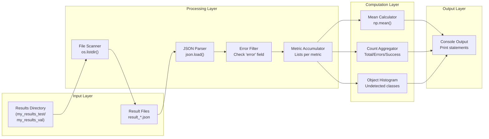
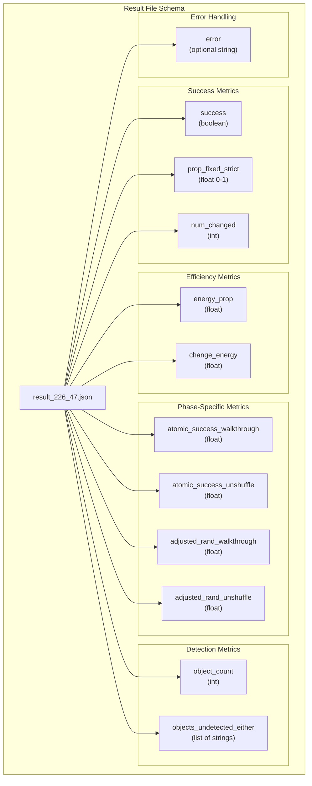
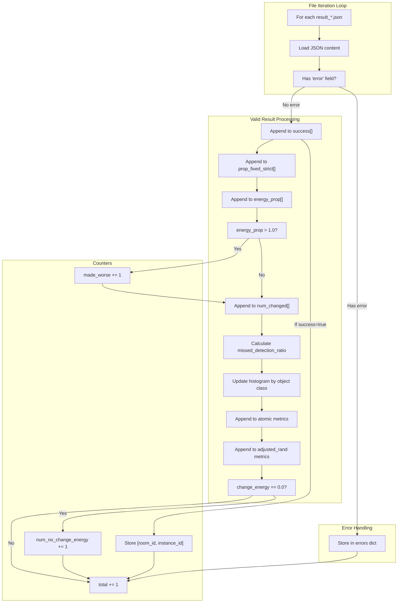
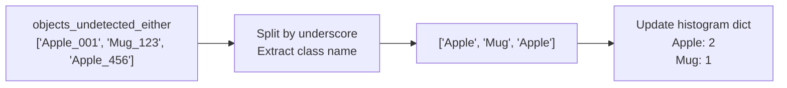
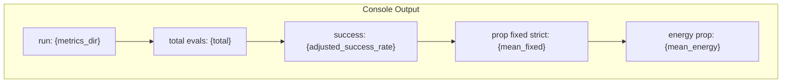
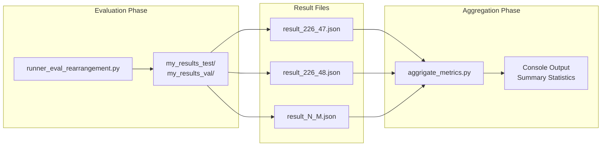

<!-- source: DeepWiki mcp.deepwiki.com · repo allenai/CSR · page 4.2 Metrics Aggregation and Analysis · fetched 2026-10-26 -->

# Metrics Aggregation and Analysis

<details>
<summary>Relevant source files</summary>

The following files were used as context for generating this wiki page:

- [aggrigate_metrics.py](aggrigate_metrics.py)

</details>


## Purpose and Scope

This document describes the metrics aggregation system implemented in `aggrigate_metrics.py`, which processes raw evaluation results from the Visual Room Rearrangement task and computes summary statistics. This script takes individual episode results (generated by `runner_eval_rearrangement.py` as described in [4.1](#4.1)) and produces aggregate performance metrics across the entire evaluation set.

For details on how individual episode results are generated, see [4](#4). For information on the evaluation configuration that produces these results, see [4.1](#4.1).

**Sources:** [aggrigate_metrics.py:1-84]()

---

## Overview of Aggregation Process

The aggregation system follows a simple map-reduce pattern: it reads all result JSON files from a directory, extracts metrics from each file, accumulates them, and computes summary statistics.

### Aggregation Pipeline



**Diagram: Metrics Aggregation Pipeline**

The system operates in sequential phases:
1. **Input Layer**: Identifies result JSON files matching the pattern `result_*.json` in the specified directory
2. **Processing Layer**: Parses each JSON file, filters out errors, and accumulates metric values
3. **Computation Layer**: Computes statistics (means, counts, histograms) across all valid episodes
4. **Output Layer**: Prints summary statistics to the console

**Sources:** [aggrigate_metrics.py:8-74]()

---

## Input Format

### Result File Structure

The aggregation script expects result files with the naming pattern `result_<room_id>_<instance_id>.json` containing per-episode metrics.



**Diagram: Result JSON Schema**

### Metric Field Definitions

| Field | Type | Description | Valid Range |
|-------|------|-------------|-------------|
| `success` | boolean | Whether the rearrangement task was successful | true/false |
| `prop_fixed_strict` | float | Proportion of objects correctly placed under strict criteria | 0.0 - 1.0 |
| `energy_prop` | float | Energy proportion; values >1.0 indicate task made scene worse | 0.0+ |
| `num_changed` | int | Number of objects that changed position | 0+ |
| `atomic_success_walkthrough` | float | Success rate for walkthrough phase object matching | 0.0 - 1.0 |
| `atomic_success_unshuffle` | float | Success rate for unshuffle phase object matching | 0.0 - 1.0 |
| `adjusted_rand_walkthrough` | float | Adjusted Rand Index for walkthrough clustering quality | -1.0 - 1.0 |
| `adjusted_rand_unshuffle` | float | Adjusted Rand Index for unshuffle clustering quality | -1.0 - 1.0 |
| `change_energy` | float | Total energy expended in changes | 0.0+ |
| `object_count` | int | Total number of objects in scene | 0+ |
| `objects_undetected_either` | list[str] | Object IDs that were not detected in either phase | - |
| `error` | string | Error message if episode failed (optional field) | - |

**Sources:** [aggrigate_metrics.py:31-64]()

---

## Metrics Computation

### Aggregation Logic



**Diagram: Per-File Processing Logic**

### Core Aggregation Variables

The script maintains the following aggregation variables:

| Variable | Purpose | Computation |
|----------|---------|-------------|
| `success` | List of success flags | Direct append from `raw_metrics['success']` |
| `prop_fixed_strict` | List of strict fix proportions | Direct append from `raw_metrics['prop_fixed_strict']` |
| `energy_prop` | List of energy proportions | Direct append from `raw_metrics['energy_prop']` |
| `num_changed` | List of changed object counts | Direct append from `raw_metrics['num_changed']` |
| `atomic_success_walkthrough` | List of walkthrough atomic success rates | Direct append from `raw_metrics['atomic_success_walkthrough']` |
| `atomic_success_unshuffle` | List of unshuffle atomic success rates | Direct append from `raw_metrics['atomic_success_unshuffle']` |
| `precision_w` | List of walkthrough adjusted Rand indices | Direct append from `raw_metrics['adjusted_rand_walkthrough']` |
| `precision_un` | List of unshuffle adjusted Rand indices | Direct append from `raw_metrics['adjusted_rand_unshuffle']` |
| `missed_detection_ratio` | List of missed detection ratios | Computed as `len(objects_undetected_either) / object_count` |
| `made_worse` | Count of episodes where energy_prop > 1.0 | Incremented when condition met |
| `num_no_change_energy` | Count of episodes with zero change energy | Incremented when `change_energy == 0.0` |
| `total` | Total number of episodes processed | Incremented for every file |
| `errors` | Dictionary of filename to error message | Populated for files with `'error'` field |
| `histogram` | Dictionary of object class to undetected count | Incremented per undetected object |
| `success_ids` | List of `[room_id, instance_id]` for successful episodes | Extracted from filename when `success=true` |

**Sources:** [aggrigate_metrics.py:12-66]()

### Histogram Construction

The histogram tracks which object classes are most frequently undetected:



**Diagram: Object Class Histogram Construction**

The implementation extracts the class name from object IDs using the pattern `<class_name>_<instance_number>` and maintains a count per class [aggrigate_metrics.py:43-48]().

**Sources:** [aggrigate_metrics.py:43-48]()

---

## Output and Interpretation

### Console Output Format

The script prints three primary aggregate metrics to the console:



**Diagram: Output Metrics Flow**

### Metric Definitions and Interpretation

#### Success Rate

Computed as `np.mean(success) * (len(success) / total)` [aggrigate_metrics.py:69]().

This calculation adjusts the raw success rate by the proportion of episodes that completed without errors:
- `np.mean(success)`: Mean success rate across episodes that didn't error
- `len(success) / total`: Proportion of episodes that ran successfully (didn't produce errors)

A lower value indicates either low task performance or high error rates during execution.

#### Proportion Fixed Strict

Computed as `np.mean(prop_fixed_strict)` [aggrigate_metrics.py:70]().

This is the average proportion of objects that were correctly rearranged under strict evaluation criteria. Values closer to 1.0 indicate better performance. According to the high-level diagrams, reported values around 0.019 (1.9%) confirm RoomR is a challenging benchmark.

#### Energy Proportion

Computed as `np.mean(energy_prop)` [aggrigate_metrics.py:71]().

This measures the efficiency of the rearrangement:
- Values close to 0.0: Minimal changes needed (efficient)
- Values around 1.0: Energy proportional to task complexity
- Values > 1.0: System made the scene worse (tracked by `made_worse` counter)

The `made_worse` counter [aggrigate_metrics.py:38-39]() tracks episodes where `energy_prop > 1.0`, indicating the rearrangement increased disorder.

### Additional Tracked Metrics

While not printed by default, the script accumulates several additional metrics that could be analyzed:

| Metric | Description | Use Case |
|--------|-------------|----------|
| `missed_detection_ratio` | Proportion of objects undetected per episode | Evaluate detector performance |
| `histogram` | Object class → undetected count | Identify which object types are hardest to detect |
| `num_no_change_energy` | Episodes with zero change energy | Detect no-op episodes |
| `success_ids` | List of successful `[room_id, instance_id]` pairs | Error analysis on successful cases |
| `errors` | Filename → error message mapping | Debug evaluation failures |
| `atomic_success_*` | Phase-specific success rates | Analyze walkthrough vs. unshuffle performance |
| `precision_*` | Adjusted Rand Index per phase | Evaluate clustering quality |

**Sources:** [aggrigate_metrics.py:12-66]()

---

## Usage

### Command-Line Interface

The script accepts a single required argument:

```bash
python aggrigate_metrics.py --metrics-dir <path_to_results_directory>
```

**Parameters:**

| Argument | Type | Required | Description |
|----------|------|----------|-------------|
| `--metrics-dir` | string | Yes | Path to directory containing `result_*.json` files |

**Sources:** [aggrigate_metrics.py:75-83]()

### Example Invocation

```bash
# Aggregate test set results
python aggrigate_metrics.py --metrics-dir my_results_test/

# Aggregate validation set results
python aggrigate_metrics.py --metrics-dir my_results_val/
```

### Expected Output

```
run: my_results_test/
total evals: 2000
success: 0.004
prop fixed strict: 0.019
energy prop: 0.856
```

This output indicates:
- 2000 episodes were evaluated
- 0.4% overall success rate (adjusted for errors)
- 1.9% of objects correctly placed on average
- Energy proportion of 0.856 (reasonably efficient)

**Sources:** [aggrigate_metrics.py:67-72]()

---

## Integration with Evaluation Pipeline



**Diagram: Integration with Evaluation System**

The aggregation script serves as the final stage in the evaluation pipeline:
1. `runner_eval_rearrangement.py` generates individual result files (see [4](#4))
2. Each episode produces a `result_<room_id>_<instance_id>.json` file
3. `aggrigate_metrics.py` processes all files and computes summary statistics
4. Results are printed to console for analysis

This separation allows for:
- Parallel evaluation across multiple processes/machines
- Incremental result collection
- Post-hoc metric recomputation without re-running evaluation
- Easy filtering or subset analysis by modifying the aggregation script

**Sources:** [aggrigate_metrics.py:1-84]()

---

