# Page: Overview

# Overview

<details>
<summary>Relevant source files</summary>

The following files were used as context for generating this wiki page:

- [README.md](README.md)
- [environment.yml](environment.yml)

</details>


## Purpose and Scope

This document provides a high-level introduction to the Continuous Scene Representations (CSR) codebase, which implements the paper "Continuous Scene Representations for Embodied AI" by Gadre et al. (2022). This page summarizes the system's purpose, architecture, main components, and workflow.

For detailed information about specific subsystems, refer to:
- Training CSR models: [Training Continuous Scene Representations](#2)
- Generating exploration trajectories: [Exploration and Trajectory Caching](#3)
- Running evaluations: [Evaluation and Visual Room Rearrangement](#4)
- Environment setup: [Environment and Dependencies](#5)

**Sources**: [README.md:1-80]()

## What CSR Does

CSR constructs scene representations for embodied agents navigating physical spaces. The system models objects and their spatial relationships using continuous-valued embeddings rather than discrete symbolic relations. The key capabilities include:

| Capability | Description |
|------------|-------------|
| **Scene Graph Construction** | Builds on-the-fly graph structures with learned edge embeddings representing spatial relationships |
| **Object Tracking** | Maintains object identities as agents move through environments |
| **Change Detection** | Detects modifications in room configurations |
| **Room Rearrangement** | Performs visual room rearrangement tasks without task-specific training |

The system is evaluated on the **Visual Room Rearrangement (RoomR)** benchmark, a challenging task where an agent must restore a room to its original configuration after objects have been moved.

**Sources**: [README.md:6-8]()

## System Architecture

### Three-Phase Pipeline

CSR operates through three distinct phases, each with dedicated entry points and configurations:

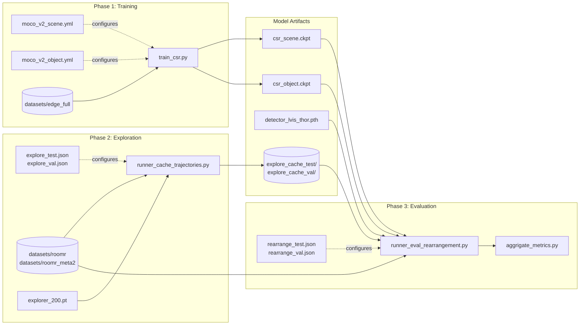

**Diagram: Three-Phase CSR Pipeline with Code Entry Points**

This diagram illustrates the complete workflow from training to evaluation, showing the actual Python scripts, configuration files, and data artifacts used at each stage.

**Sources**: [README.md:26-62]()

### Core Components and Their Roles

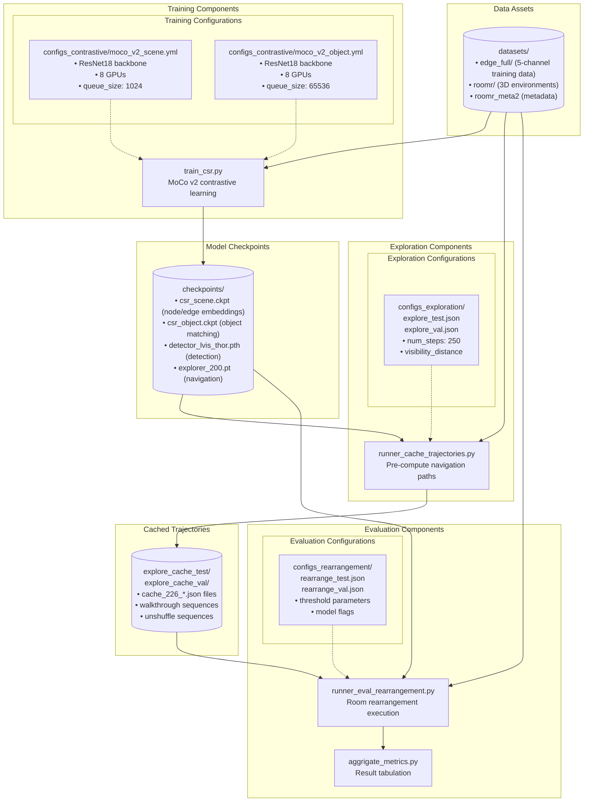

**Diagram: Component Architecture Mapping Code Entities**

This diagram shows the relationships between Python scripts, configuration directories, data assets, and model artifacts using their actual file paths and names as they appear in the codebase.

**Sources**: [README.md:11-62]()

## Main Execution Scripts

The codebase provides four primary entry points:

| Script | Purpose | Configuration | Output |
|--------|---------|---------------|--------|
| `train_csr.py` | Train scene/object representations using MoCo v2 | `configs_contrastive/moco_v2_scene.yml`<br/>`configs_contrastive/moco_v2_object.yml` | `checkpoints/csr_scene.ckpt`<br/>`checkpoints/csr_object.ckpt` |
| `runner_cache_trajectories.py` | Generate and cache exploration trajectories | `configs_exploration/explore_test.json`<br/>`configs_exploration/explore_val.json` | `explore_cache_test/`<br/>`explore_cache_val/` |
| `runner_eval_rearrangement.py` | Execute room rearrangement evaluation | `configs_rearrangement/rearrange_test.json`<br/>`configs_rearrangement/rearrange_val.json` | `my_results_test/`<br/>`my_results_val/` |
| `aggrigate_metrics.py` | Aggregate and report evaluation metrics | Results directories | Console output with performance metrics |

**Sources**: [README.md:26-62]()

## Data Assets

The system operates on three primary datasets:

### datasets/edge_full
Training data for contrastive learning. Contains 5-channel images used to learn continuous scene representations.

### datasets/roomr
3D environment data for the Visual Room Rearrangement benchmark. Contains room layouts and object configurations.

### datasets/roomr_meta2
Metadata and annotations for the RoomR dataset. Provides scene information for evaluation episodes.

All datasets can be downloaded from AWS S3 and must be extracted to the repository root:
- Datasets: `https://prior-datasets.s3.us-east-2.amazonaws.com/csr/datasets.tar.gz`
- Checkpoints: `https://prior-model-weights.s3.us-east-2.amazonaws.com/embodied-ai/csr/checkpoints.tar.gz`

**Sources**: [README.md:21-24]()

## Model Artifacts

The system uses four trained models:

### csr_scene.ckpt
Contains learned node and edge embeddings for scene representation. Trained with `train_object_representation=false` flag. Captures spatial relationships between objects and scene structure.

### csr_object.ckpt
Specialized for object correspondence across trajectories. Trained with `train_object_representation=true` flag. Maintains object identity as agents navigate.

### detector_lvis_thor.pth
Object detection model (Detectron2-based) for identifying and localizing objects in visual observations.

### explorer_200.pt
Pre-trained navigation policy for autonomous exploration in AI2-THOR environments.

**Sources**: [README.md:27-42]()

## Technology Stack

The codebase is built on the following core frameworks:

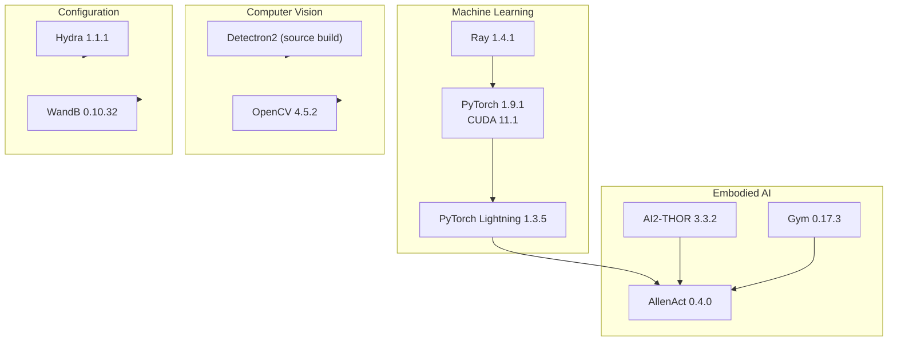

**Diagram: Technology Stack Dependencies**

The environment is managed through Conda ([environment.yml:1-244]()) and requires building Detectron2 from source.

**Sources**: [README.md:13-18](), [environment.yml:1-244]()

## Workflow Summary

A typical workflow for using this codebase:

1. **Setup** ([Environment and Dependencies](#5)): Install Conda environment and Detectron2, download datasets and checkpoints.

2. **Training** ([Training Continuous Scene Representations](#2)): 
   - Run `train_csr.py` with `moco_v2_scene.yml` to learn scene representations
   - Run `train_csr.py` with `moco_v2_object.yml` to learn object correspondences
   - Both require 8-GPU machines by default

3. **Exploration Caching** ([Exploration and Trajectory Caching](#3)):
   - Run `runner_cache_trajectories.py` to generate navigation trajectories
   - Creates `explore_cache_test/` and `explore_cache_val/` directories
   - Pre-computed trajectories avoid expensive re-simulation during evaluation

4. **Evaluation** ([Evaluation and Visual Room Rearrangement](#4)):
   - Run `runner_eval_rearrangement.py` to execute rearrangement tasks
   - Run `aggrigate_metrics.py` to compute performance metrics
   - Evaluates on 1000 test and 1000 validation episodes

**Sources**: [README.md:12-62]()

## Performance Baseline

Using the provided checkpoints and cached trajectories, the system achieves the following performance on the RoomR test set:

| Metric | Score |
|--------|-------|
| % Fixed Strict | 1.9 |
| % Success | 0.4 |

These low scores reflect the difficulty of the RoomR benchmark, which requires accurate object detection, tracking, spatial reasoning, and manipulation planning in realistic 3D environments.

**Sources**: [README.md:64-67]()

## Repository Structure

```
csr/
├── train_csr.py                    # Training entry point
├── runner_cache_trajectories.py    # Exploration caching
├── runner_eval_rearrangement.py    # Evaluation runner
├── aggrigate_metrics.py            # Metrics computation
├── configs_contrastive/            # Training configs
│   ├── moco_v2_scene.yml
│   └── moco_v2_object.yml
├── configs_exploration/            # Exploration configs
│   ├── explore_test.json
│   └── explore_val.json
├── configs_rearrangement/          # Evaluation configs
│   ├── rearrange_test.json
│   └── rearrange_val.json
├── datasets/                       # Data assets
│   ├── edge_full/
│   ├── roomr/
│   └── roomr_meta2/
├── checkpoints/                    # Model weights
│   ├── csr_scene.ckpt
│   ├── csr_object.ckpt
│   ├── detector_lvis_thor.pth
│   └── explorer_200.pt
├── explore_cache_test/            # Cached test trajectories
├── explore_cache_val/             # Cached val trajectories
├── my_results_test/               # Test results (generated)
├── my_results_val/                # Val results (generated)
└── environment.yml                # Conda environment spec
```

**Sources**: [README.md:1-80]()

---

# Page: System Architecture

# System Architecture

<details>
<summary>Relevant source files</summary>

The following files were used as context for generating this wiki page:

- [README.md](README.md)
- [environment.yml](environment.yml)

</details>


## Purpose and Scope

This page describes the high-level architecture of the Continuous Scene Representations (CSR) system. It covers the three main operational phases (training, exploration, evaluation), the data flow between these phases, and how components depend on each other. This page provides an architectural overview; for detailed information on specific components, see:
- Training details: [Training Continuous Scene Representations](#2)
- Exploration details: [Exploration and Trajectory Caching](#3)
- Evaluation details: [Evaluation and Visual Room Rearrangement](#4)
- Environment setup: [Environment and Dependencies](#5)

## System Overview

The CSR system is organized into three sequential phases, each with its own entry point script, configuration system, and artifacts:

| Phase | Entry Point | Configuration | Input | Output |
|-------|-------------|---------------|-------|--------|
| **Training** | `train_csr.py` | `configs_contrastive/` | `datasets/edge_full/` | `checkpoints/*.ckpt` |
| **Exploration** | `runner_cache_trajectories.py` | `configs_exploration/` | `datasets/roomr/`, `checkpoints/explorer_200.pt` | `explore_cache_*/` |
| **Evaluation** | `runner_eval_rearrangement.py` | `configs_rearrangement/` | All checkpoints, cached trajectories, RoomR dataset | `my_results_*/` |

**Sources**: [README.md:10-62]()

## Three-Phase Pipeline Architecture

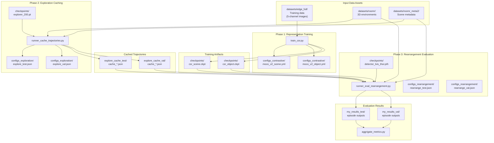

**Description**: This diagram shows the complete pipeline from raw data through to final metrics. Each phase is self-contained with its own entry point script and configuration system. The training phase is independent of downstream phases and produces reusable model checkpoints. The exploration phase pre-computes expensive navigation trajectories to enable faster evaluation iterations. The evaluation phase consumes all artifacts from previous phases to perform the Visual Room Rearrangement task.

**Sources**: [README.md:26-62]()

## Training Phase Architecture

The training phase implements MoCo v2 contrastive learning to train two distinct representation models. The system uses a single training script that operates in two modes controlled by configuration.

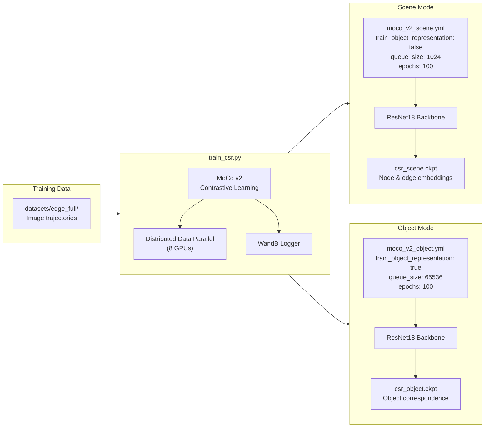

**Description**: The training script `train_csr.py` supports two operational modes distinguished by the `train_object_representation` flag in configuration files. Scene mode learns spatial relationships between nodes and edges in a scene graph representation. Object mode learns to match objects across different trajectories. Both use ResNet18 backbones and MoCo v2 methodology but differ in queue sizes (1024 vs 65536) and training objectives.

**Sources**: [README.md:26-42](), [environment.yml:123-124]()

## Exploration Phase Architecture

The exploration phase generates and caches navigation trajectories that will be replayed during evaluation. This pre-computation strategy separates expensive simulation from the evaluation logic.

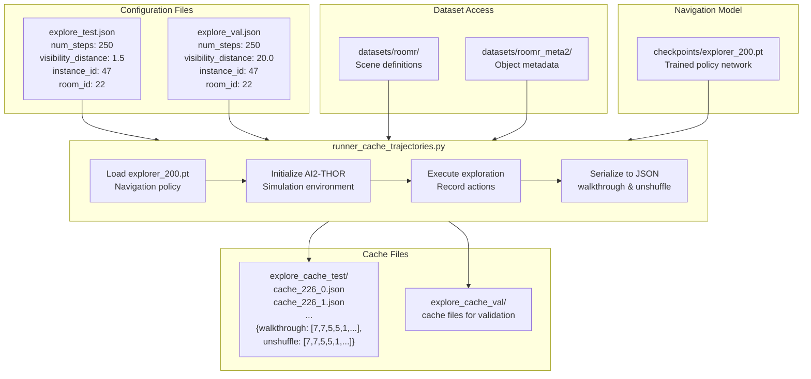

**Description**: The exploration caching system uses `runner_cache_trajectories.py` to generate navigation sequences. The script loads a trained explorer model (`explorer_200.pt`), initializes AI2-THOR simulation environments from the RoomR dataset, and executes exploration following the trained policy. Each episode produces two integer sequences (`walkthrough` and `unshuffle`) representing action sequences, which are serialized to JSON files. The cached trajectories are later consumed by the evaluation phase, eliminating the need to re-run expensive simulations during evaluation.

**Sources**: [README.md:44-49]()

## Evaluation Phase Architecture

The evaluation phase orchestrates all trained models and cached data to perform the Visual Room Rearrangement task on the RoomR benchmark.

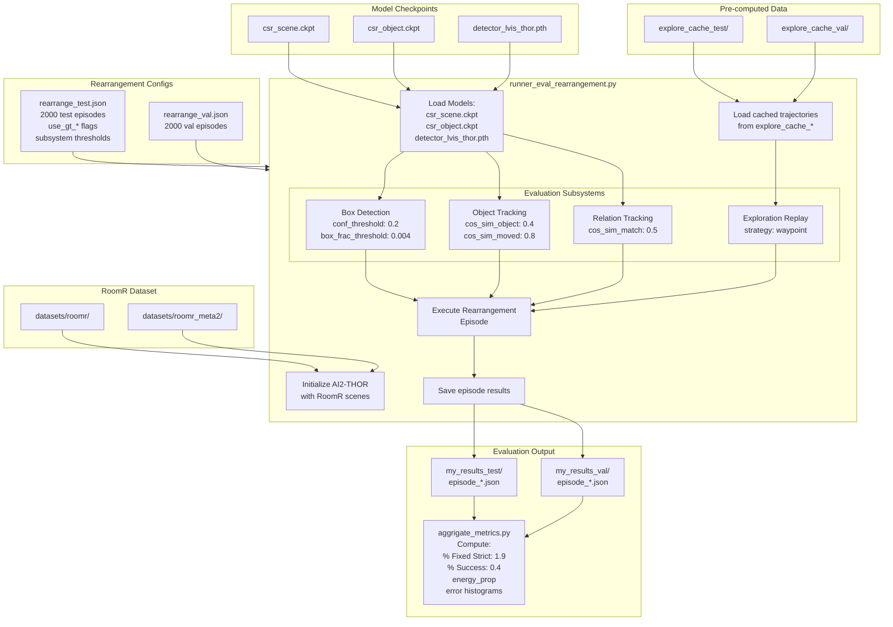

**Description**: The evaluation runner `runner_eval_rearrangement.py` integrates four subsystems: box detection (using `detector_lvis_thor.pth`), object tracking (using `csr_object.ckpt`), relation tracking (using `csr_scene.ckpt`), and exploration replay (using cached trajectories). Each subsystem operates with configurable thresholds defined in `rearrange_test.json` and `rearrange_val.json`. The system supports both "predicted mode" (using all models) and "ground truth mode" (using oracle information via `use_gt_*` flags) to enable debugging. Results are saved per-episode and aggregated using `aggrigate_metrics.py` to produce final benchmark metrics.

**Sources**: [README.md:51-67]()

## Configuration Management

The CSR system uses a hierarchical configuration system managed by Hydra, with separate configuration directories for each phase:

| Directory | Format | Purpose | Key Files |
|-----------|--------|---------|-----------|
| `configs_contrastive/` | YAML | Training configuration | `moco_v2_scene.yml`, `moco_v2_object.yml` |
| `configs_exploration/` | JSON | Exploration parameters | `explore_test.json`, `explore_val.json` |
| `configs_rearrangement/` | JSON | Evaluation configuration | `rearrange_test.json`, `rearrange_val.json` |

Configuration files control:
- Model hyperparameters (queue sizes, learning rates, batch sizes)
- System thresholds (confidence thresholds, similarity thresholds)
- Hardware settings (GPU count, distributed training)
- Dataset parameters (visibility distance, episode counts)
- Runtime modes (predicted vs ground truth)

**Sources**: [README.md:26-55](), [environment.yml:190]()

## Data Flow and Dependencies

```mermaid
graph TD
    subgraph External["External Sources"]
        S3Data["AWS S3<br/>prior-datasets.s3.us-east-2.amazonaws.com<br/>datasets.tar.gz"]
        S3Ckpt["AWS S3<br/>prior-model-weights.s3.us-east-2.amazonaws.com<br/>checkpoints.tar.gz"]
    end
    
    subgraph LocalData["Local Data Storage"]
        EdgeFullLocal["datasets/edge_full/<br/>Training images"]
        RoomRLocal["datasets/roomr/<br/>3D scenes"]
        MetaLocal["datasets/roomr_meta2/<br/>Metadata"]
        
        SceneCkptLocal["checkpoints/csr_scene.ckpt"]
        ObjectCkptLocal["checkpoints/csr_object.ckpt"]
        ExplorerLocal["checkpoints/explorer_200.pt"]
        DetectorLocal["checkpoints/detector_lvis_thor.pth"]
    end
    
    subgraph Intermediate["Intermediate Artifacts"]
        TestCache["explore_cache_test/"]
        ValCache["explore_cache_val/"]
    end
    
    subgraph Final["Final Outputs"]
        TestRes["my_results_test/"]
        ValRes["my_results_val/"]
    end
    
    S3Data --> EdgeFullLocal
    S3Data --> RoomRLocal
    S3Data --> MetaLocal
    S3Ckpt --> SceneCkptLocal
    S3Ckpt --> ObjectCkptLocal
    S3Ckpt --> ExplorerLocal
    S3Ckpt --> DetectorLocal
    
    EdgeFullLocal -->|train_csr.py| SceneCkptLocal
    EdgeFullLocal -->|train_csr.py| ObjectCkptLocal
    
    RoomRLocal -->|runner_cache_trajectories.py| TestCache
    MetaLocal -->|runner_cache_trajectories.py| TestCache
    ExplorerLocal -->|runner_cache_trajectories.py| TestCache
    
    RoomRLocal -->|runner_cache_trajectories.py| ValCache
    MetaLocal -->|runner_cache_trajectories.py| ValCache
    ExplorerLocal -->|runner_cache_trajectories.py| ValCache
    
    SceneCkptLocal -->|runner_eval_rearrangement.py| TestRes
    ObjectCkptLocal -->|runner_eval_rearrangement.py| TestRes
    DetectorLocal -->|runner_eval_rearrangement.py| TestRes
    TestCache -->|runner_eval_rearrangement.py| TestRes
    RoomRLocal -->|runner_eval_rearrangement.py| TestRes
    MetaLocal -->|runner_eval_rearrangement.py| TestRes
    
    SceneCkptLocal -->|runner_eval_rearrangement.py| ValRes
    ObjectCkptLocal -->|runner_eval_rearrangement.py| ValRes
    DetectorLocal -->|runner_eval_rearrangement.py| ValRes
    ValCache -->|runner_eval_rearrangement.py| ValRes
    RoomRLocal -->|runner_eval_rearrangement.py| ValRes
    MetaLocal -->|runner_eval_rearrangement.py| ValRes
    
    TestRes -->|aggrigate_metrics.py| Metrics["Aggregated Metrics"]
    ValRes -->|aggrigate_metrics.py| Metrics
```

**Description**: This diagram shows the complete data dependency graph. External datasets and pre-trained checkpoints are downloaded from AWS S3 and stored locally. The training script can optionally regenerate CSR checkpoints from the `edge_full` dataset, though pre-trained versions are provided. The exploration caching step requires the RoomR dataset, metadata, and the explorer model, producing cached trajectories. The evaluation step consumes all model checkpoints, cached trajectories, and the RoomR dataset to produce per-episode results, which are then aggregated into final metrics.

**Sources**: [README.md:21-62]()

## Technology Stack

The CSR system is built on a multi-layered technology stack:

### Core Framework Layer
- **PyTorch 1.9.1**: Deep learning framework for neural network training and inference
- **PyTorch Lightning 1.3.5**: High-level training orchestration and distributed training wrapper
- **CUDA 11.1**: GPU acceleration support for 8-GPU distributed training

### Embodied AI Layer
- **AllenAct 0.4.0**: Reinforcement learning framework for embodied agents
- **AI2-THOR 3.3.2**: 3D simulation environment for visual reasoning tasks
- **Gym 0.17.3**: Standard interface for RL environments

### Computer Vision Layer
- **Detectron2**: Object detection framework (built from source)
- **TorchVision**: Pre-trained computer vision models
- **OpenCV 4.5.2**: Image processing utilities

### Configuration and Logging
- **Hydra 1.1.1**: Hierarchical configuration management
- **WandB 0.10.32**: Experiment tracking and metric logging
- **TensorBoard**: Training visualization

### Distributed Computing
- **Ray 1.4.1**: Distributed execution framework for parallel evaluation

**Sources**: [environment.yml:1-244](), [README.md:13-18]()

## Execution Flow

The typical execution sequence for the complete system is:

1. **Environment Setup**: Install dependencies via `conda env create --file environment.yml` and build Detectron2 from source
2. **Data Download**: Download `datasets.tar.gz` and `checkpoints.tar.gz` from AWS S3 and extract to project root
3. **Training (Optional)**: Run `python train_csr.py --conf configs_contrastive/moco_v2_scene.yml` and with `moco_v2_object.yml` to train scene and object models
4. **Exploration Caching**: Run `python runner_cache_trajectories.py --config-dir-path configs_exploration` to generate trajectory caches
5. **Evaluation**: Run `python runner_eval_rearrangement.py` to evaluate on RoomR test and validation sets
6. **Metrics**: Run `python aggrigate_metrics.py` to compute final performance metrics

Pre-trained checkpoints and pre-cached trajectories enable skipping steps 3-4 for immediate evaluation.

**Sources**: [README.md:12-62]()

## System Characteristics

### Modularity
Each phase is independently executable with clearly defined inputs and outputs. The training phase is completely decoupled from the downstream task, producing general-purpose scene representations.

### Caching Strategy
Pre-computing exploration trajectories separates expensive simulation from evaluation logic, enabling rapid iteration during development and debugging.

### Dual-Mode Operation
Training supports two representation learning modes (scene vs object) via configuration flags rather than separate codebases, ensuring consistency in training methodology.

### Evaluation Flexibility
The evaluation system supports both "predicted mode" (fully autonomous) and "ground truth mode" (with oracle components) to facilitate component-level debugging and ablation studies.

**Sources**: [README.md:1-80]()

---

# Page: Installation and Setup

# Installation and Setup

<details>
<summary>Relevant source files</summary>

The following files were used as context for generating this wiki page:

- [README.md](README.md)
- [environment.yml](environment.yml)

</details>


## Purpose and Scope

This document provides step-by-step instructions for setting up the CSR development environment, including dependency installation, data preparation, and model checkpoint acquisition. After completing these steps, you will be able to train CSR models, cache exploration trajectories, and evaluate on the Visual Room Rearrangement task.

For information about the system architecture and data flow, see [System Architecture](#1.1). For details about runtime dependencies and the technology stack, see [Environment and Dependencies](#5).

---

## Prerequisites

The CSR system requires:
- **Operating System**: Linux (tested on Ubuntu)
- **GPU**: NVIDIA GPU with CUDA 11.1 support
- **GPU Memory**: Minimum 8GB per GPU (training configurations assume 8 GPUs)
- **Disk Space**: Approximately 100GB for datasets and checkpoints
- **Python**: 3.8.x (managed via conda)
- **Conda**: Anaconda or Miniconda package manager

---

## Installation Overview

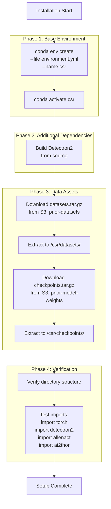

**Sources**: [README.md:12-24]()

---

## Step 1: Conda Environment Creation

Create the conda environment using the provided specification file:

```bash
conda env create --file environment.yml --name csr
conda activate csr
```

The `environment.yml` file specifies the complete dependency tree including:

| Category | Key Packages | Purpose |
|----------|-------------|---------|
| **Deep Learning Core** | `pytorch=1.9.1`, `torchvision=0.10.1`, `cudatoolkit=11.1.74` | Neural network training and GPU acceleration |
| **Training Infrastructure** | `pytorch-lightning=1.3.5`, `ray=1.4.1` | Training orchestration and distributed execution |
| **Embodied AI** | `ai2thor=3.3.2`, `allenact=0.4.0`, `gym=0.17.3` | 3D simulation and RL framework |
| **Computer Vision** | `opencv-python=4.5.2.54`, `pillow=8.2.0` | Image processing and manipulation |
| **Configuration** | `hydra-core=1.1.1`, `pyyaml=5.4.1` | Configuration management |
| **Experiment Tracking** | `wandb=0.10.32`, `tensorboard=2.7.0` | Logging and visualization |

**Sources**: [README.md:12-16](), [environment.yml:1-244]()

---

## Step 2: Detectron2 Installation

Detectron2 is not available via conda and must be built from source. Follow the official Detectron2 installation guide:

```bash
# Clone the repository
git clone https://github.com/facebookresearch/detectron2.git
cd detectron2

# Build and install
python -m pip install -e .
```

**Note**: The `environment.yml` file includes a commented reference to `detectron2==0.5` at [environment.yml:180]() indicating the expected version. Ensure compatibility with CUDA 11.1 and PyTorch 1.9.1 during installation.

**Sources**: [README.md:18-18](), [environment.yml:180]()

---

## Step 3: Dataset Download and Setup

### Download Datasets

Download the complete dataset archive from AWS S3:

```bash
# Download datasets (approximately 50GB)
wget https://prior-datasets.s3.us-east-2.amazonaws.com/csr/datasets.tar.gz

# Extract to the repository root
tar -xzf datasets.tar.gz -C /path/to/csr/
```

### Dataset Directory Structure

After extraction, the following directory structure will be created:

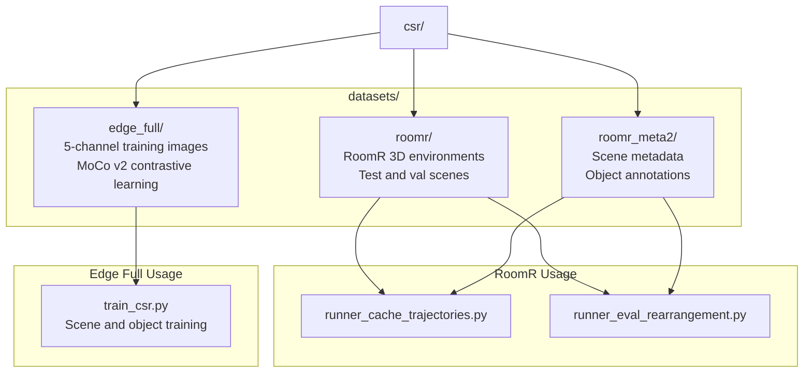

### Dataset Descriptions

| Dataset | Path | Contents | Size | Used By |
|---------|------|----------|------|---------|
| **RoomR** | `datasets/roomr/` | 3D room environments with shuffled/unshuffled states | ~30GB | Exploration and evaluation scripts |
| **RoomR Metadata** | `datasets/roomr_meta2/` | Scene metadata, object positions, and annotations | ~5GB | Exploration and evaluation scripts |
| **Edge Full** | `datasets/edge_full/` | 5-channel images for contrastive learning (RGB + depth + edges) | ~15GB | `train_csr.py` |

**Sources**: [README.md:21-24]()

---

## Step 4: Model Checkpoint Download and Setup

### Download Checkpoints

Download pre-trained model weights from AWS S3:

```bash
# Download checkpoints (approximately 1GB)
wget https://prior-model-weights.s3.us-east-2.amazonaws.com/embodied-ai/csr/checkpoints.tar.gz

# Extract to the repository root
tar -xzf checkpoints.tar.gz -C /path/to/csr/
```

### Checkpoint Directory Structure

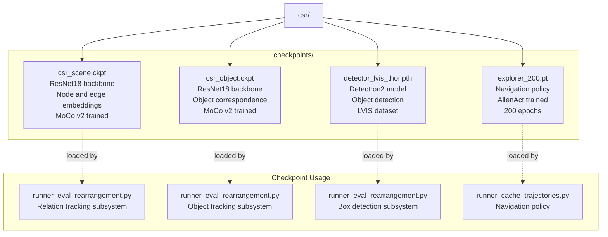

### Checkpoint Descriptions

| Checkpoint | Path | Model Type | Training Source | Used By |
|------------|------|------------|----------------|---------|
| **CSR Scene** | `checkpoints/csr_scene.ckpt` | ResNet18 + MoCo v2 | `configs_contrastive/moco_v2_scene.yml` | Relation tracking in evaluation |
| **CSR Object** | `checkpoints/csr_object.ckpt` | ResNet18 + MoCo v2 | `configs_contrastive/moco_v2_object.yml` | Object tracking in evaluation |
| **Detector** | `checkpoints/detector_lvis_thor.pth` | Detectron2 | External (LVIS-THOR dataset) | Object detection in evaluation |
| **Explorer** | `checkpoints/explorer_200.pt` | AllenAct policy | External (navigation training) | Trajectory caching |

**Sources**: [README.md:22-24](), [README.md:27-42]()

---

## Step 5: Complete Directory Structure

After completing all installation steps, verify the following directory structure:

```
csr/
├── datasets/
│   ├── roomr/               # RoomR environments (test/val)
│   ├── roomr_meta2/         # Scene metadata
│   └── edge_full/           # 5-channel training data
├── checkpoints/
│   ├── csr_scene.ckpt       # Scene representation model
│   ├── csr_object.ckpt      # Object correspondence model
│   ├── detector_lvis_thor.pth  # Object detector
│   └── explorer_200.pt      # Navigation policy
├── configs_contrastive/
│   ├── moco_v2_scene.yml    # Scene training config
│   └── moco_v2_object.yml   # Object training config
├── configs_exploration/
│   ├── explore_test.json    # Test exploration config
│   └── explore_val.json     # Val exploration config
├── configs_rearrangement/
│   ├── rearrange_test.json  # Test evaluation config
│   └── rearrange_val.json   # Val evaluation config
├── explore_cache_test/      # Pre-cached test trajectories
├── explore_cache_val/       # Pre-cached val trajectories
├── environment.yml          # Conda environment spec
├── train_csr.py            # Training script
├── runner_cache_trajectories.py  # Caching script
├── runner_eval_rearrangement.py  # Evaluation script
└── aggrigate_metrics.py    # Metrics aggregation
```

**Sources**: [README.md:1-81]()

---

## Step 6: Environment Verification

### Verify Python Package Imports

Test that all critical dependencies are correctly installed:

```python
# Core deep learning
import torch
print(f"PyTorch version: {torch.__version__}")
print(f"CUDA available: {torch.cuda.is_available()}")
print(f"CUDA version: {torch.version.cuda}")

# Embodied AI frameworks
import ai2thor
import allenact
import gym

# Computer vision
import detectron2
import cv2

# Configuration and training
import pytorch_lightning
import hydra
import wandb
```

Expected output:
```
PyTorch version: 1.9.1
CUDA available: True
CUDA version: 11.1
```

### Verify GPU Configuration

```python
import torch

# Check number of available GPUs
num_gpus = torch.cuda.device_count()
print(f"Number of GPUs: {num_gpus}")

# List GPU names
for i in range(num_gpus):
    print(f"GPU {i}: {torch.cuda.get_device_name(i)}")
```

**Note**: The default training configurations assume 8 GPUs. To train with fewer GPUs, modify the `gpus` field in [configs_contrastive/moco_v2_scene.yml]() and [configs_contrastive/moco_v2_object.yml]().

**Sources**: [README.md:33-42](), [environment.yml:31-31](), [environment.yml:123-124]()

---

## Step 7: Pre-cached Trajectory Setup

The repository provides pre-cached exploration trajectories to skip expensive simulation during evaluation:

| Cache Directory | Contents | Source Configuration | Episodes |
|----------------|----------|---------------------|----------|
| `explore_cache_test/` | Test set trajectories | `configs_exploration/explore_test.json` | 1000 episodes |
| `explore_cache_val/` | Validation set trajectories | `configs_exploration/explore_val.json` | 1000 episodes |

Each cache file (e.g., `cache_226_0.json`) contains:
- **walkthrough**: Integer sequence representing forward exploration
- **unshuffle**: Integer sequence for rearrangement navigation

If these directories do not exist or you need to regenerate trajectories, see [Exploration and Trajectory Caching](#3).

**Sources**: [README.md:44-49]()

---

## Hardware Requirements and Training Considerations

### GPU Requirements by Task

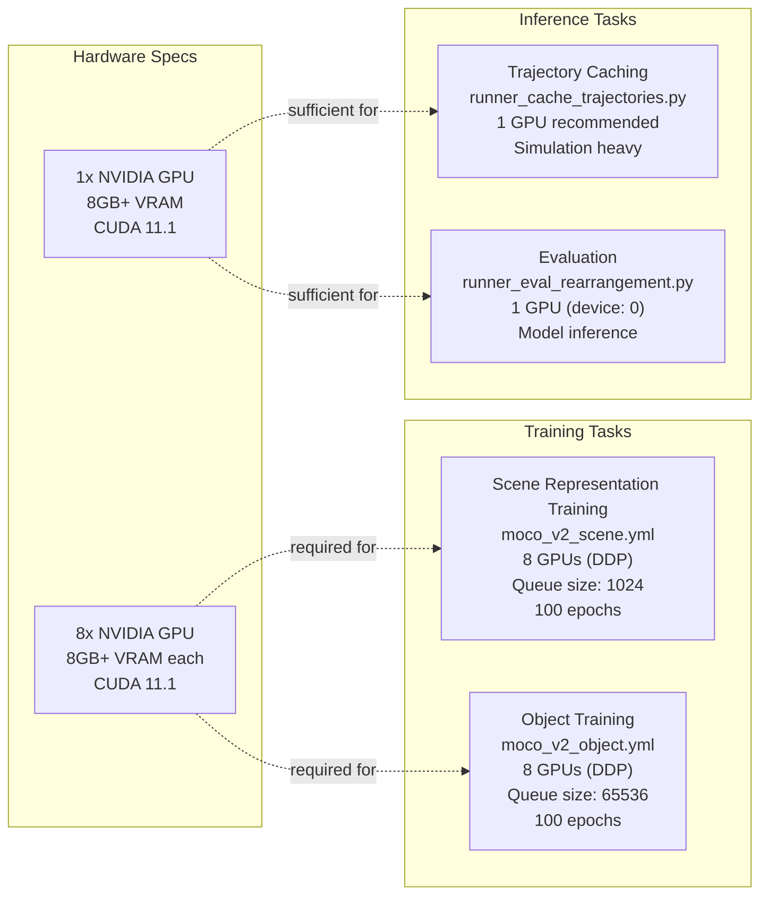

### Memory Requirements

| Task | GPU Memory | System Memory | Disk Space |
|------|-----------|---------------|------------|
| **Scene Training** | 8GB per GPU × 8 | 64GB RAM | 50GB (datasets) |
| **Object Training** | 8GB per GPU × 8 | 64GB RAM | 50GB (datasets) |
| **Trajectory Caching** | 8GB (single GPU) | 32GB RAM | 20GB (cache output) |
| **Evaluation** | 8GB (single GPU) | 32GB RAM | 10GB (results output) |

**Sources**: [README.md:33-42]()

---

## Configuration File Mapping

### Training Configurations

| Configuration | Path | Purpose | Key Parameters |
|--------------|------|---------|----------------|
| Scene Training | `configs_contrastive/moco_v2_scene.yml` | Node and edge embeddings | `gpus: 8`, `train_object_representation: false` |
| Object Training | `configs_contrastive/moco_v2_object.yml` | Object correspondence | `gpus: 8`, `train_object_representation: true`, `queue_size: 65536` |

### Exploration Configurations

| Configuration | Path | Purpose | Key Parameters |
|--------------|------|---------|----------------|
| Test Exploration | `configs_exploration/explore_test.json` | Cache test trajectories | `instance_id: 47`, `num_steps: 250`, `visibility_distance: 1.5` |
| Val Exploration | `configs_exploration/explore_val.json` | Cache val trajectories | `instance_id: 47`, `num_steps: 250`, `visibility_distance: 20.0` |

### Evaluation Configurations

| Configuration | Path | Purpose | Key Parameters |
|--------------|------|---------|----------------|
| Test Evaluation | `configs_rearrangement/rearrange_test.json` | Evaluate on test set | `episodes: 2000`, `conf_threshold: 0.2` |
| Val Evaluation | `configs_rearrangement/rearrange_val.json` | Evaluate on val set | `episodes: 2000`, `cos_sim_object: 0.4` |

**Sources**: [README.md:26-55]()

---

## Next Steps

After completing installation and setup:

1. **Training**: To train CSR models from scratch, see [Training Continuous Scene Representations](#2)
2. **Exploration**: To generate custom exploration trajectories, see [Exploration and Trajectory Caching](#3)
3. **Evaluation**: To run evaluation on RoomR, see [Evaluation and Visual Room Rearrangement](#4)

For quick evaluation using provided checkpoints and cached trajectories:

```bash
# Activate environment
conda activate csr

# Run evaluation
python runner_eval_rearrangement.py

# Aggregate results
python aggrigate_metrics.py
```

**Sources**: [README.md:51-61]()

---

# Page: Training Continuous Scene Representations

# Training Continuous Scene Representations

<details>
<summary>Relevant source files</summary>

The following files were used as context for generating this wiki page:

- [README.md](README.md)
- [configs_contrastive/moco_v2_object.yml](configs_contrastive/moco_v2_object.yml)
- [configs_contrastive/moco_v2_scene.yml](configs_contrastive/moco_v2_scene.yml)

</details>


## Purpose and Scope

This document describes the training process for Continuous Scene Representations (CSR), which learns latent embeddings for objects and their spatial relationships using self-supervised contrastive learning. The training phase produces two complementary models: a **scene representation model** that captures spatial relationships between objects, and an **object correspondence model** that maintains object identity across trajectories.

For detailed configuration parameters, see:
- Scene representation configuration: [2.1](#2.1)
- Object correspondence configuration: [2.2](#2.2)

For exploration caching and evaluation that uses these trained models, see [3](#3) and [4](#4).

## Overview

The CSR training system implements a dual-track approach that learns two distinct but complementary representations:

1. **Scene Representation** (`csr_scene.ckpt`): Learns continuous embeddings for spatial relationships between objects (nodes) and their connections (edges) in a scene graph
2. **Object Correspondence** (`csr_object.ckpt`): Learns embeddings for matching and tracking individual objects across different viewpoints and trajectories

Both models use the same training script ([train_csr.py]()) but with different configuration files that control their learning objectives.

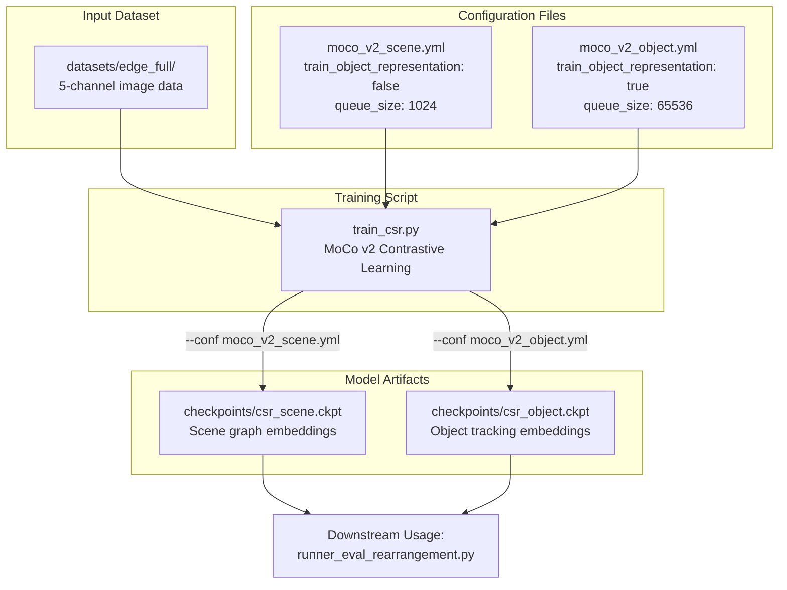

**Sources:** [README.md:26-42](), [configs_contrastive/moco_v2_scene.yml](), [configs_contrastive/moco_v2_object.yml]()

## Training Framework: MoCo v2

The training system uses **Momentum Contrast v2 (MoCo v2)**, a self-supervised contrastive learning framework that learns representations by maximizing agreement between differently augmented views of the same data while minimizing agreement with negative samples stored in a queue.

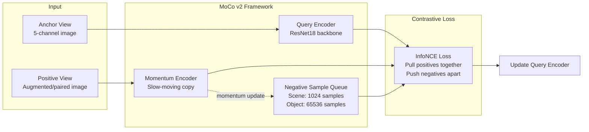

**Key Framework Components:**

| Component | Description | Configuration |
|-----------|-------------|---------------|
| **Backbone** | Feature extractor | ResNet18 ([moco_v2_scene.yml:9](), [moco_v2_object.yml:9]()) |
| **Input Channels** | Multi-modal input | 5 channels ([moco_v2_scene.yml:11](), [moco_v2_object.yml:11]()) |
| **Channel Width** | Network capacity | 64 ([moco_v2_scene.yml:10](), [moco_v2_object.yml:10]()) |
| **Optimizer** | Gradient descent | SGD ([moco_v2_scene.yml:14](), [moco_v2_object.yml:14]()) |
| **Learning Rate** | Initial LR | 0.1 ([moco_v2_scene.yml:7](), [moco_v2_object.yml:7]()) |
| **Scheduler** | LR annealing | CosineAnnealingLR ([moco_v2_scene.yml:15](), [moco_v2_object.yml:15]()) |
| **Weight Decay** | Regularization | 0.0001 ([moco_v2_scene.yml:8](), [moco_v2_object.yml:8]()) |

**Sources:** [configs_contrastive/moco_v2_scene.yml:7-15](), [configs_contrastive/moco_v2_object.yml:7-15]()

## Dual Training Tracks

The two training tracks share the same architecture and training procedure but differ in their learning objectives and hyperparameters:

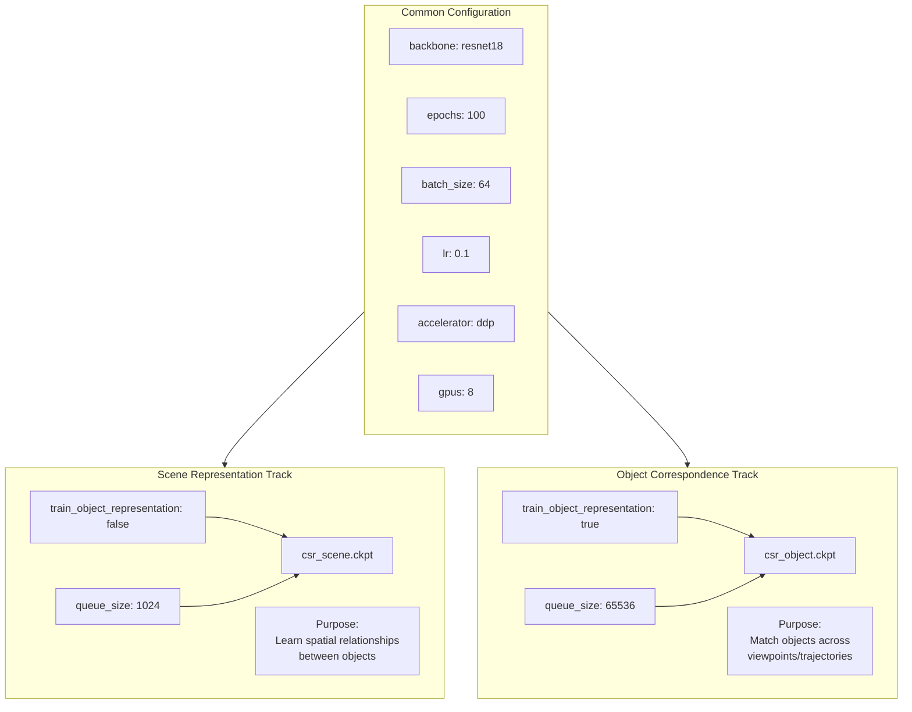

**Key Differences:**

| Aspect | Scene Representation | Object Correspondence |
|--------|---------------------|----------------------|
| **Config File** | [moco_v2_scene.yml]() | [moco_v2_object.yml]() |
| **Flag** | `train_object_representation: false` | `train_object_representation: true` |
| **Queue Size** | 1024 | 65536 |
| **Learning Focus** | Broader spatial relationships | Fine-grained object identity |
| **Negative Samples** | Fewer, scene-level contrasts | Many, object-level contrasts |
| **Output Checkpoint** | `csr_scene.ckpt` | `csr_object.ckpt` |

The larger queue size for object correspondence (65536 vs 1024) provides a much larger bank of negative samples, enabling the model to learn more discriminative features for distinguishing individual objects.

**Sources:** [configs_contrastive/moco_v2_scene.yml:31-32](), [configs_contrastive/moco_v2_object.yml:31-32](), [README.md:26-42]()

## Training Script Usage

The [train_csr.py]() script serves as the unified entry point for training both models. Training is controlled entirely through YAML configuration files.

### Scene Representation Training

To train the scene representation model from scratch:

```bash
python train_csr.py --conf configs_contrastive/moco_v2_scene.yml
```

This command:
- Loads the 5-channel image dataset from `datasets/edge_full`
- Initializes a ResNet18 encoder with MoCo v2 training framework
- Trains for 100 epochs using distributed data parallel (DDP) across 8 GPUs
- Saves checkpoints to the path specified in [moco_v2_scene.yml:4]() (`checkpoint_path: 'tmp'`)
- Produces `csr_scene.ckpt` for downstream use

**Sources:** [README.md:26-33]()

### Object Correspondence Training

To train the object correspondence model from scratch:

```bash
python train_csr.py --conf configs_contrastive/moco_v2_object.yml
```

This command:
- Uses the same data source and architecture as scene training
- Sets `train_object_representation: true` to change the learning objective
- Uses a 64x larger queue (65536) for more negative samples
- Saves checkpoints to the path specified in [moco_v2_object.yml:4]() (`checkpoint_path: 'checkpoint_moco_v2_object'`)
- Produces `csr_object.ckpt` for downstream use

**Sources:** [README.md:35-42]()

### GPU Configuration

Both configurations assume an 8-GPU machine ([moco_v2_scene.yml:19-27](), [moco_v2_object.yml:19-27]()):

```yaml
gpus:
  - 0
  - 1
  - 2
  - 3
  - 4
  - 5
  - 6
  - 7
accelerator: 'ddp'
```

To train with fewer GPUs, modify the `gpus` field in the respective YAML file. The `ddp` (Distributed Data Parallel) accelerator automatically distributes the batch across available GPUs.

**Sources:** [README.md:33,42](), [configs_contrastive/moco_v2_scene.yml:19-29](), [configs_contrastive/moco_v2_object.yml:19-29]()

## Input Data Format

The training system reads from the `datasets/edge_full` directory ([moco_v2_scene.yml:3](), [moco_v2_object.yml:3]()), which contains **5-channel images** ([moco_v2_scene.yml:11](), [moco_v2_object.yml:11]()).

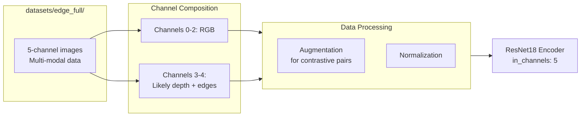

The 5-channel input likely includes:
- **RGB channels (0-2)**: Visual appearance
- **Depth channel (3)**: Geometric information
- **Edge channel (4)**: Structural boundaries

This multi-modal input provides richer scene understanding compared to RGB-only training.

**Sources:** [configs_contrastive/moco_v2_scene.yml:3,11](), [configs_contrastive/moco_v2_object.yml:3,11]()

## Output Artifacts

Training produces PyTorch Lightning checkpoint files containing the learned encoder weights and training metadata.

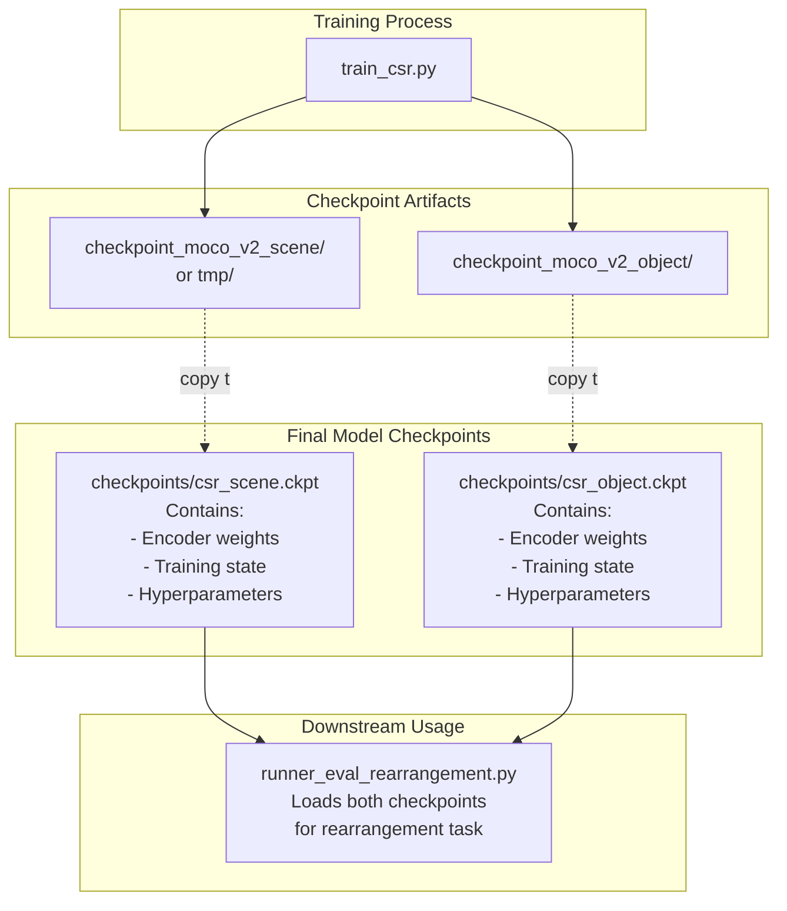

### Pre-trained Checkpoints

The repository provides pre-trained checkpoints ([README.md:23]()):
- **Scene model**: `checkpoints/csr_scene.ckpt` ([README.md:27]())
- **Object model**: `checkpoints/csr_object.ckpt` ([README.md:36]())

These can be downloaded from AWS S3 and used directly without training:
```
https://prior-model-weights.s3.us-east-2.amazonaws.com/embodied-ai/csr/checkpoints.tar.gz
```

### Checkpoint Contents

Each checkpoint file (`.ckpt`) contains:
- **Model Weights**: Trained ResNet18 encoder parameters
- **Optimizer State**: For resuming training
- **Training Metadata**: Epoch number, loss history, hyperparameters
- **Configuration**: Copy of the YAML config used for training

**Sources:** [README.md:23,27,36](), [configs_contrastive/moco_v2_scene.yml:4](), [configs_contrastive/moco_v2_object.yml:4]()

## Hardware and Performance Considerations

### Training Infrastructure

Both training configurations are designed for multi-GPU training:

| Resource | Requirement | Configuration |
|----------|-------------|---------------|
| **GPUs** | 8 NVIDIA GPUs | [moco_v2_scene.yml:19-27]() |
| **CUDA** | 11.1 | environment.yml |
| **PyTorch** | 1.9.1 | environment.yml |
| **PyTorch Lightning** | 1.3.5 | environment.yml |
| **Accelerator** | DDP (Distributed Data Parallel) | [moco_v2_scene.yml:29]() |

### Training Duration

With the default configuration:
- **Epochs**: 100 ([moco_v2_scene.yml:17](), [moco_v2_object.yml:17]())
- **Batch Size**: 64 per GPU ([moco_v2_scene.yml:16](), [moco_v2_object.yml:16]())
- **Effective Batch Size**: 512 (64 × 8 GPUs) with DDP

Training time depends on dataset size and GPU capabilities. The progress bar updates every 20 steps ([moco_v2_scene.yml:18](), [moco_v2_object.yml:18]()).

### Memory Considerations

The object correspondence model requires significantly more GPU memory due to its larger queue:
- **Scene model queue**: 1024 samples × embedding size
- **Object model queue**: 65536 samples × embedding size (64× larger)

The larger queue for object correspondence necessitates careful memory management but enables learning more discriminative object features.

**Sources:** [configs_contrastive/moco_v2_scene.yml:16-29](), [configs_contrastive/moco_v2_object.yml:16-29](), [README.md:33,42]()

## Training Monitoring

Both configurations include monitoring capabilities:

```yaml
project_name: 'contrastive'
experiment_name: 'moco_v2_scene'  # or 'moco_v2_object'
progress_bar_refresh_rate: 20
```

The training script integrates with experiment tracking systems (as indicated by `project_name`) to monitor:
- Training loss over epochs
- Learning rate schedule (cosine annealing)
- GPU utilization
- Training progress

**Sources:** [configs_contrastive/moco_v2_scene.yml:1-2,18](), [configs_contrastive/moco_v2_object.yml:1-2,18]()

---

For detailed configuration parameters and options, see:
- **Scene representation configuration**: [2.1](#2.1)
- **Object correspondence configuration**: [2.2](#2.2)

To use the trained models for exploration and evaluation, see:
- **Exploration and trajectory caching**: [3](#3)
- **Evaluation on RoomR**: [4](#4)

---

# Page: Scene Representation Training Configuration

# Scene Representation Training Configuration

<details>
<summary>Relevant source files</summary>

The following files were used as context for generating this wiki page:

- [configs_contrastive/moco_v2_scene.yml](configs_contrastive/moco_v2_scene.yml)

</details>


## Purpose and Scope

This page documents the configuration file `moco_v2_scene.yml` used for training scene representations in the CSR system. This configuration defines all parameters needed to train a ResNet18 encoder using MoCo v2 contrastive learning to produce embeddings that capture spatial relationships and scene structure. For object correspondence training configuration, see [Object Correspondence Training Configuration](#2.2). For general training pipeline information, see [Training Continuous Scene Representations](#2).

**Sources**: [configs_contrastive/moco_v2_scene.yml:1-32]()

---

## Configuration Overview

The `moco_v2_scene.yml` file is a YAML configuration that specifies all parameters for training scene-level continuous representations. It is consumed by the `train_csr.py` script and uses the Hydra configuration framework for management. The configuration produces a model checkpoint (`csr_scene.ckpt`) that learns to embed visual observations into a continuous space where spatially-related scenes have similar representations.

### Key Configuration Identity

| Property | Value | Purpose |
|----------|-------|---------|
| `project_name` | `contrastive` | Experiment tracking project identifier |
| `experiment_name` | `moco_v2_scene` | Specific experiment identifier for scene training |
| `train_object_representation` | `false` | **Critical flag**: Indicates scene-level (not object-level) training |
| `queue_size` | `1024` | Smaller queue optimized for scene-level contrastive learning |

**Sources**: [configs_contrastive/moco_v2_scene.yml:1-3,31-32]()

---

## Configuration Structure Diagram

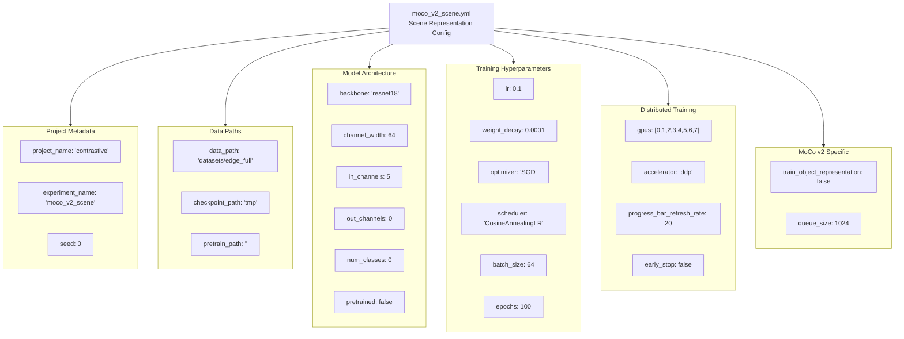

**Sources**: [configs_contrastive/moco_v2_scene.yml:1-32]()

---

## Complete Parameter Reference

### Project Identification Parameters

| Parameter | Value | Description |
|-----------|-------|-------------|
| `project_name` | `'contrastive'` | Top-level project name for experiment tracking (e.g., W&B, TensorBoard) |
| `experiment_name` | `'moco_v2_scene'` | Unique identifier for this specific training run; distinguishes from `moco_v2_object` |
| `seed` | `0` | Random seed for reproducibility across training runs |

**Sources**: [configs_contrastive/moco_v2_scene.yml:1-5]()

---

### Data and Checkpoint Paths

| Parameter | Value | Description |
|-----------|-------|-------------|
| `data_path` | `'datasets/edge_full'` | Path to 5-channel image dataset containing RGB + auxiliary visual information |
| `checkpoint_path` | `'tmp'` | Directory where training checkpoints and logs are saved during training |
| `pretrain_path` | `''` | Path to load pre-trained weights from; empty string means train from scratch |

The `data_path` points to the Edge Full dataset, which contains multi-modal visual observations. The 5-channel input (see `in_channels`) typically includes RGB channels plus additional perception modalities like depth and edge maps.

**Sources**: [configs_contrastive/moco_v2_scene.yml:3-4,30]()

---

### Model Architecture Parameters

| Parameter | Value | Description |
|-----------|-------|-------------|
| `backbone` | `'resnet18'` | Encoder architecture; uses ResNet-18 as the feature extractor |
| `channel_width` | `64` | Number of channels in the first convolutional layer of the backbone |
| `in_channels` | `5` | Number of input channels (5-channel images from Edge Full dataset) |
| `out_channels` | `0` | Not used for contrastive learning; set to 0 |
| `num_classes` | `0` | Not used for contrastive learning (unsupervised); set to 0 |
| `pretrained` | `false` | Whether to initialize from ImageNet weights; false for random initialization |

The ResNet-18 backbone is modified to accept 5-channel inputs instead of standard 3-channel RGB. The `out_channels` and `num_classes` parameters are set to 0 because MoCo v2 uses contrastive learning rather than supervised classification.

**Sources**: [configs_contrastive/moco_v2_scene.yml:6,9-13]()

---

### Training Hyperparameters

| Parameter | Value | Description |
|-----------|-------|-------------|
| `lr` | `0.1` | Initial learning rate for the optimizer |
| `weight_decay` | `0.0001` | L2 regularization coefficient |
| `optimizer` | `'SGD'` | Optimization algorithm (Stochastic Gradient Descent) |
| `scheduler` | `'CosineAnnealingLR'` | Learning rate schedule; cosine annealing over epochs |
| `batch_size` | `64` | Batch size per GPU (effective batch size: 64 × 8 = 512) |
| `epochs` | `100` | Total number of training epochs |

The learning rate of 0.1 is relatively high, which is standard for large-batch contrastive learning. Combined with the cosine annealing schedule, the learning rate gradually decreases to near zero by epoch 100, following the MoCo v2 training protocol.

**Sources**: [configs_contrastive/moco_v2_scene.yml:7-8,14-17]()

---

### Distributed Training Configuration

| Parameter | Value | Description |
|-----------|-------|-------------|
| `gpus` | `[0, 1, 2, 3, 4, 5, 6, 7]` | List of GPU device IDs to use for training; 8 GPUs total |
| `accelerator` | `'ddp'` | Distributed Data Parallel strategy for multi-GPU training |
| `progress_bar_refresh_rate` | `20` | Frequency (in batches) to update the progress bar display |
| `early_stop` | `false` | Whether to enable early stopping; disabled for full 100-epoch training |

The configuration uses all 8 GPUs with PyTorch's Distributed Data Parallel (DDP) strategy. This means each GPU processes a batch of 64 samples independently, with gradients synchronized across devices, yielding an effective batch size of 512.

**Sources**: [configs_contrastive/moco_v2_scene.yml:18-29]()

---

## MoCo v2 Specific Parameters

### Scene Representation Configuration

| Parameter | Value | Critical Significance |
|-----------|-------|----------------------|
| `train_object_representation` | `false` | **Distinguishes scene vs. object training**: When false, trains scene-level spatial relationships; when true, trains object-level correspondences |
| `queue_size` | `1024` | Size of negative sample queue for contrastive learning; smaller than object model (65536) |

The `train_object_representation` flag is the primary differentiator between scene and object training configurations. When set to `false`, the training process:

- Focuses on learning spatial relationships between scene observations
- Uses samples from different viewpoints and timesteps as positives
- Optimizes for embeddings that capture scene structure and layout

The `queue_size` of 1024 maintains a bank of negative samples for contrastive loss computation. This is significantly smaller than the object model's queue (65536) because scene-level distinctions require fewer negative examples.

**Sources**: [configs_contrastive/moco_v2_scene.yml:31-32]()

---

## Configuration to Code Flow

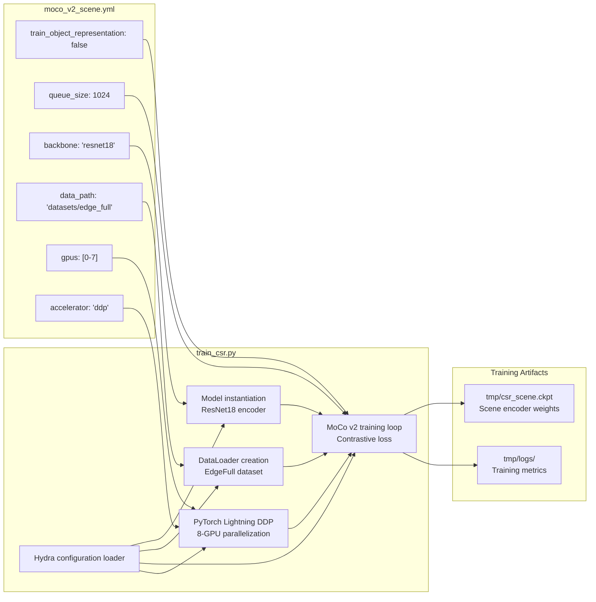

**Sources**: [configs_contrastive/moco_v2_scene.yml:1-32]()

---

## Scene vs. Object Configuration Comparison

The following table highlights the key differences between scene and object representation training configurations:

| Parameter | Scene Configuration | Object Configuration | Rationale |
|-----------|-------------------|---------------------|-----------|
| `experiment_name` | `moco_v2_scene` | `moco_v2_object` | Distinguishes experiment tracking |
| `train_object_representation` | `false` | `true` | Scene-level vs. object-level learning |
| `queue_size` | `1024` | `65536` | Scenes need fewer negatives than fine-grained objects |
| Other parameters | Identical | Identical | Same architecture, hyperparameters, and hardware |

The primary architectural difference is the queue size: scene representations require a smaller negative sample bank (1024) because distinguishing between different scenes is easier than matching identical objects across trajectories. Object matching benefits from a much larger queue (65536) to learn fine-grained correspondences.

For detailed object configuration documentation, see [Object Correspondence Training Configuration](#2.2).

**Sources**: [configs_contrastive/moco_v2_scene.yml:2,31-32]()

---

## Usage Example

To train scene representations using this configuration:

```bash
python train_csr.py --config-name moco_v2_scene
```

The training script will:
1. Load configuration from `configs_contrastive/moco_v2_scene.yml` using Hydra
2. Initialize a ResNet-18 encoder with 5-channel inputs
3. Load the Edge Full dataset from `datasets/edge_full`
4. Train using MoCo v2 contrastive learning with scene-level objectives
5. Distribute training across 8 GPUs using DDP
6. Save checkpoints to `tmp/` directory
7. Train for 100 epochs with cosine annealing learning rate schedule

The resulting checkpoint (`csr_scene.ckpt`) will contain encoder weights optimized for producing scene embeddings used in the downstream room rearrangement task.

**Sources**: [configs_contrastive/moco_v2_scene.yml:1-32]()

---

## Configuration Validation

### Required Directory Structure

Before training, ensure the following paths exist:

| Path | Required | Purpose |
|------|----------|---------|
| `datasets/edge_full/` | Yes | Source data for training |
| `tmp/` | Auto-created | Checkpoint and log output directory |
| `configs_contrastive/moco_v2_scene.yml` | Yes | Configuration file |

### Hardware Requirements

- **Minimum**: 8 NVIDIA GPUs with CUDA 11.1 support
- **Memory**: Each GPU should have sufficient VRAM for batch_size=64 with ResNet-18
- **Storage**: Adequate space for checkpoints (~100MB per checkpoint) and logs

### Expected Outputs

After successful training, the following artifacts are created:

- `tmp/csr_scene.ckpt`: Final model checkpoint containing encoder weights
- `tmp/logs/`: Training logs and metrics (TensorBoard format)
- Intermediate checkpoints (if checkpoint callbacks are enabled)

**Sources**: [configs_contrastive/moco_v2_scene.yml:3-4]()

---

## Configuration Relationships

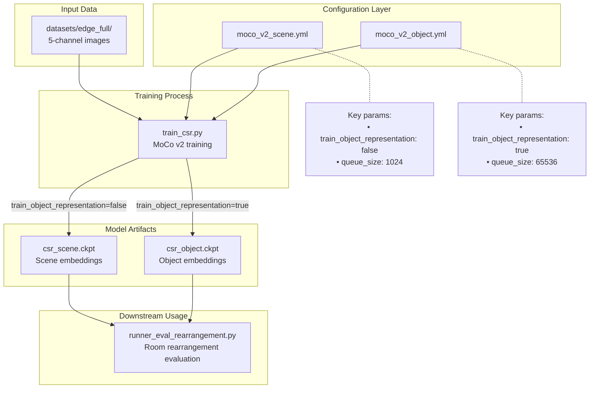

**Sources**: [configs_contrastive/moco_v2_scene.yml:1-32]()

---

# Page: Object Correspondence Training Configuration

# Object Correspondence Training Configuration

<details>
<summary>Relevant source files</summary>

The following files were used as context for generating this wiki page:

- [configs_contrastive/moco_v2_object.yml](configs_contrastive/moco_v2_object.yml)

</details>


## Purpose and Scope

This document details the configuration parameters for training the **object correspondence model** using MoCo v2 contrastive learning. The object correspondence model learns embeddings that enable cross-trajectory object matching and identity preservation, which is essential for tracking objects across different observation sequences in the Visual Room Rearrangement task.

For information about the scene representation training configuration, see [2.1](#2.1). For an overview of the complete training system, see [2](#2).

**Sources**: [configs_contrastive/moco_v2_object.yml:1-32]()

---

## Configuration File Location

The object correspondence training configuration is located at `configs_contrastive/moco_v2_object.yml`. This file is consumed by `train_csr.py` when training with the `train_object_representation=true` flag, which instructs the training script to optimize for fine-grained object matching rather than scene-level spatial relationships.

**Sources**: [configs_contrastive/moco_v2_object.yml:1-4]()

---

## Project and Experiment Identification

| Parameter | Value | Description |
|-----------|-------|-------------|
| `project_name` | `'contrastive'` | Weights & Biases project name for experiment tracking |
| `experiment_name` | `'moco_v2_object'` | Specific experiment identifier for this training run |
| `checkpoint_path` | `'checkpoint_moco_v2_object'` | Directory where model checkpoints will be saved |
| `seed` | `0` | Random seed for reproducibility |

These parameters organize the training run within the MLOps infrastructure and ensure that model artifacts are saved to a distinct location from the scene representation training.

**Sources**: [configs_contrastive/moco_v2_object.yml:1-5]()

---

## Data Configuration

```yaml
data_path: 'datasets/edge_full'
```

The training data is sourced from `datasets/edge_full`, which contains 5-channel image observations from AI2-THOR environments. These channels typically include RGB, depth, and edge information, providing multi-modal visual features for learning robust object representations.

**Sources**: [configs_contrastive/moco_v2_object.yml:3]()

---

## Model Architecture Parameters

```mermaid
graph TB
    subgraph "Input Specification"
        InChannels["in_channels: 5<br/>Multi-modal input<br/>(RGB + Depth + Edge)"]
    end
    
    subgraph "Backbone Architecture"
        Backbone["backbone: 'resnet18'<br/>Encoder network"]
        Width["channel_width: 64<br/>Base feature dimension"]
        Pretrained["pretrained: false<br/>Train from scratch"]
    end
    
    subgraph "Output Configuration"
        OutChannels["out_channels: 0<br/>Not used in contrastive"]
        NumClasses["num_classes: 0<br/>Not classification task"]
    end
    
    InChannels --> Backbone
    Width --> Backbone
    Pretrained --> Backbone
    Backbone --> OutChannels
    Backbone --> NumClasses
```

**Model Architecture Parameters**

| Parameter | Value | Purpose |
|-----------|-------|---------|
| `backbone` | `'resnet18'` | ResNet-18 CNN architecture serves as the feature encoder |
| `channel_width` | `64` | Base number of channels in the first convolution layer |
| `in_channels` | `5` | Input accepts 5-channel images (multi-modal observations) |
| `out_channels` | `0` | Not used in contrastive learning (embeddings are implicit) |
| `num_classes` | `0` | Not a classification task (unsupervised contrastive learning) |
| `pretrained` | `false` | Train from scratch rather than using ImageNet weights |

The ResNet-18 backbone is modified to accept 5-channel inputs and produces high-dimensional embeddings suitable for contrastive similarity comparisons. Setting `out_channels` and `num_classes` to 0 indicates this is not a supervised classification setup but rather an unsupervised representation learning task.

**Sources**: [configs_contrastive/moco_v2_object.yml:6-13]()

---

## Training Hyperparameters

```mermaid
graph LR
    subgraph "Optimization Configuration"
        Optimizer["optimizer: 'SGD'<br/>Stochastic Gradient Descent"]
        LR["lr: 0.1<br/>Base learning rate"]
        WD["weight_decay: 0.0001<br/>L2 regularization"]
    end
    
    subgraph "Learning Rate Schedule"
        Scheduler["scheduler: 'CosineAnnealingLR'<br/>Cosine decay schedule"]
        Epochs["epochs: 100<br/>Total training duration"]
    end
    
    subgraph "Batch Configuration"
        BatchSize["batch_size: 64<br/>Per-GPU batch size"]
        EffectiveBatch["Effective batch: 512<br/>(64 × 8 GPUs)"]
    end
    
    Optimizer --> LR
    Optimizer --> WD
    LR --> Scheduler
    Epochs --> Scheduler
    BatchSize --> EffectiveBatch
```

**Hyperparameter Details**

| Parameter | Value | Description |
|-----------|-------|-------------|
| `optimizer` | `'SGD'` | Stochastic Gradient Descent optimizer |
| `lr` | `0.1` | Base learning rate (relatively high for SGD with momentum) |
| `weight_decay` | `0.0001` | L2 regularization coefficient |
| `scheduler` | `'CosineAnnealingLR'` | Cosine annealing learning rate schedule |
| `batch_size` | `64` | Batch size per GPU (effective batch: 512 across 8 GPUs) |
| `epochs` | `100` | Total number of training epochs |

The high initial learning rate (0.1) combined with cosine annealing allows rapid early learning followed by fine-tuning in later epochs. The large effective batch size (512) is critical for contrastive learning, as it provides more negative samples per training step.

**Sources**: [configs_contrastive/moco_v2_object.yml:7-17]()

---

## Distributed Training Configuration

```mermaid
graph TB
    subgraph "GPU Allocation"
        GPU0["GPU 0"]
        GPU1["GPU 1"]
        GPU2["GPU 2"]
        GPU3["GPU 3"]
        GPU4["GPU 4"]
        GPU5["GPU 5"]
        GPU6["GPU 6"]
        GPU7["GPU 7"]
    end
    
    subgraph "Training Strategy"
        Accelerator["accelerator: 'ddp'<br/>DistributedDataParallel"]
        Progress["progress_bar_refresh_rate: 20<br/>UI update frequency"]
        EarlyStop["early_stop: false<br/>Train full 100 epochs"]
    end
    
    GPU0 --> Accelerator
    GPU1 --> Accelerator
    GPU2 --> Accelerator
    GPU3 --> Accelerator
    GPU4 --> Accelerator
    GPU5 --> Accelerator
    GPU6 --> Accelerator
    GPU7 --> Accelerator
    
    Accelerator --> Progress
    Accelerator --> EarlyStop
```

**Distributed Training Settings**

| Parameter | Value | Description |
|-----------|-------|-------------|
| `gpus` | `[0, 1, 2, 3, 4, 5, 6, 7]` | Train across 8 GPUs in parallel |
| `accelerator` | `'ddp'` | Use PyTorch DistributedDataParallel |
| `progress_bar_refresh_rate` | `20` | Update progress bar every 20 batches |
| `early_stop` | `false` | Disable early stopping; train for full duration |

The 8-GPU distributed training setup enables processing large batch sizes and maintaining a substantial momentum queue (see next section), both of which are essential for effective contrastive learning. The DistributedDataParallel (DDP) strategy synchronizes gradients across GPUs while maintaining separate model replicas.

**Sources**: [configs_contrastive/moco_v2_object.yml:18-29]()

---

## Object Representation Specific Settings

```yaml
train_object_representation: true
queue_size: 65536
```

These two parameters are the **key differentiators** between object correspondence training and scene representation training:

### `train_object_representation: true`

This flag instructs `train_csr.py` to optimize for object-level matching rather than scene-level spatial relationships. When enabled, the training process focuses on:
- Learning embeddings that preserve object identity across different viewpoints
- Matching objects across different trajectory sequences
- Maintaining fine-grained object-level features rather than coarse scene structure

### `queue_size: 65536`

The momentum queue size is set to **65,536** negative samples, which is **64× larger** than the scene representation queue (1,024). This massive queue enables:
- **Broader negative sampling**: Each positive pair is contrasted against 65,536 negative examples
- **More discriminative embeddings**: The model must distinguish between many more similar-looking objects
- **Better generalization**: Exposure to diverse negative samples improves cross-scene object matching

The large queue is critical for object correspondence because objects can be highly similar (e.g., multiple chairs in a room), requiring the model to learn subtle distinguishing features.

**Sources**: [configs_contrastive/moco_v2_object.yml:31-32]()

---

## Configuration Comparison: Object vs Scene

The following table highlights the critical differences between object correspondence and scene representation training configurations:

| Parameter | Object Config (this page) | Scene Config ([2.1](#2.1)) | Rationale |
|-----------|---------------------------|----------------------------|-----------|
| `experiment_name` | `'moco_v2_object'` | `'moco_v2_scene'` | Distinguishes saved artifacts |
| `checkpoint_path` | `'checkpoint_moco_v2_object'` | `'checkpoint_moco_v2_scene'` | Separate checkpoint directories |
| `train_object_representation` | `true` | `false` | **Core differentiator**: object vs scene focus |
| `queue_size` | `65536` | `1024` | **64× larger** for fine-grained object matching |
| `backbone` | `'resnet18'` | `'resnet18'` | Same architecture for both tasks |
| `lr` | `0.1` | `0.1` | Identical learning rate |
| `batch_size` | `64` | `64` | Same per-GPU batch size |
| `epochs` | `100` | `100` | Same training duration |
| `gpus` | `[0-7]` | `[0-7]` | Same 8-GPU setup |

The **queue size** difference is the most significant architectural choice: object correspondence requires substantially more negative samples to learn discriminative features that distinguish between similar objects.

**Sources**: [configs_contrastive/moco_v2_object.yml:1-32]()

---

## Training Process Flow

```mermaid
graph TB
    subgraph "Configuration"
        Config["moco_v2_object.yml<br/>• train_object_representation: true<br/>• queue_size: 65536<br/>• 8 GPUs, batch 64"]
    end
    
    subgraph "Training Script"
        TrainScript["train_csr.py<br/>Entry point"]
        FlagCheck{"train_object_representation<br/>== true?"}
        ObjectMode["Object Training Mode<br/>Fine-grained matching"]
        MoCoV2["MoCo v2 Algorithm<br/>Momentum contrastive learning"]
    end
    
    subgraph "Data Pipeline"
        DataLoader["DataLoader<br/>datasets/edge_full"]
        Augmentation["Data Augmentation<br/>Random crops, flips, color jitter"]
        Queue["Momentum Queue<br/>65,536 negative samples"]
    end
    
    subgraph "Model Components"
        EncoderQ["Encoder Q<br/>ResNet-18<br/>(query network)"]
        EncoderK["Encoder K<br/>ResNet-18<br/>(key network, momentum update)"]
        Embeddings["Embeddings<br/>High-dimensional features"]
    end
    
    subgraph "Output"
        Checkpoint["csr_object.ckpt<br/>Trained object correspondence model"]
    end
    
    Config --> TrainScript
    TrainScript --> FlagCheck
    FlagCheck -->|Yes| ObjectMode
    ObjectMode --> MoCoV2
    
    DataLoader --> Augmentation
    Augmentation --> EncoderQ
    Augmentation --> EncoderK
    
    EncoderQ --> Embeddings
    EncoderK --> Queue
    Queue --> MoCoV2
    Embeddings --> MoCoV2
    
    MoCoV2 --> EncoderQ
    MoCoV2 --> EncoderK
    
    EncoderQ --> Checkpoint
    EncoderK --> Checkpoint
```

**Process Description**

1. **Configuration Loading**: `train_csr.py` reads `moco_v2_object.yml` and detects `train_object_representation=true`
2. **Object Training Mode**: The script enters object correspondence training mode, optimizing for cross-trajectory object matching
3. **Data Pipeline**: 5-channel images from `datasets/edge_full` undergo augmentation (random crops, flips, color jittering)
4. **Dual Encoder Architecture**: 
   - Encoder Q (query): Actively trained network that processes augmented views
   - Encoder K (key): Momentum-updated network that maintains temporal consistency
5. **Momentum Queue**: Maintains 65,536 negative samples for contrastive loss computation
6. **Training Loop**: For 100 epochs across 8 GPUs, the model learns embeddings that maximize similarity between augmented views of the same object while minimizing similarity to different objects
7. **Checkpoint Output**: Final trained model saved to `checkpoint_moco_v2_object/` as `csr_object.ckpt`

**Sources**: [configs_contrastive/moco_v2_object.yml:1-32]()

---

## Output Model and Downstream Usage

The trained object correspondence model (`csr_object.ckpt`) produces embeddings that enable **cross-trajectory object matching**. This model is consumed by the evaluation system in the following way:

```mermaid
graph LR
    subgraph "Training Output"
        ObjectCkpt["csr_object.ckpt<br/>Object correspondence model"]
    end
    
    subgraph "Evaluation Pipeline"
        EvalRunner["runner_eval_rearrangement.py"]
        ObjTracking["Object Tracking Subsystem<br/>• cos_sim_object: 0.4<br/>• cos_sim_moved: 0.8"]
    end
    
    subgraph "Task Application"
        Identity["Object Identity Preservation<br/>Match objects across:<br/>• Walkthrough trajectory<br/>• Unshuffle trajectory"]
        Matching["Cross-trajectory Matching<br/>Determine which objects moved"]
    end
    
    ObjectCkpt --> EvalRunner
    EvalRunner --> ObjTracking
    ObjTracking --> Identity
    ObjTracking --> Matching
```

**Downstream Usage Details**

- **Object Tracking**: The model generates embeddings for detected objects in both walkthrough and unshuffle trajectories
- **Similarity Thresholds**: Objects are matched using cosine similarity with configurable thresholds (default: 0.4 for general matching, 0.8 for moved objects)
- **Identity Preservation**: Enables the system to track the same object across different viewpoints and time steps
- **Rearrangement Detection**: By comparing object positions between trajectories, the system identifies which objects need to be moved to restore the room to its original state

The large queue size (65,536) during training directly improves the model's ability to distinguish between similar objects in cluttered scenes, which is critical for accurate rearrangement planning.

**Sources**: [configs_contrastive/moco_v2_object.yml:31-32]()

---

## Key Insights

1. **Object vs Scene**: The `train_object_representation=true` flag and massive `queue_size=65536` are the defining characteristics that differentiate object training from scene training
2. **Negative Sampling Scale**: The 64× larger queue size reflects the increased difficulty of object-level matching compared to scene-level spatial reasoning
3. **Architecture Reuse**: Both object and scene models use identical ResNet-18 backbones, demonstrating that the training objective (not architecture) determines specialization
4. **Distributed Training Necessity**: 8-GPU training is essential not just for speed but to support the large effective batch size (512) and massive momentum queue
5. **Unsupervised Learning**: Setting `num_classes=0` and `out_channels=0` confirms this is pure contrastive learning without any supervised labels

**Sources**: [configs_contrastive/moco_v2_object.yml:1-32]()

---

# Page: Exploration and Trajectory Caching

# Exploration and Trajectory Caching

<details>
<summary>Relevant source files</summary>

The following files were used as context for generating this wiki page:

- [README.md](README.md)
- [configs_exploration/explore_test.json](configs_exploration/explore_test.json)
- [configs_exploration/explore_val.json](configs_exploration/explore_val.json)
- [explore_cache_test/cache_226_0.json](explore_cache_test/cache_226_0.json)
- [explore_cache_test/cache_226_1.json](explore_cache_test/cache_226_1.json)
- [explore_cache_test/cache_226_10.json](explore_cache_test/cache_226_10.json)
- [explore_cache_test/cache_226_11.json](explore_cache_test/cache_226_11.json)
- [explore_cache_test/cache_226_12.json](explore_cache_test/cache_226_12.json)
- [explore_cache_test/cache_226_13.json](explore_cache_test/cache_226_13.json)
- [explore_cache_test/cache_226_14.json](explore_cache_test/cache_226_14.json)
- [explore_cache_test/cache_226_15.json](explore_cache_test/cache_226_15.json)
- [explore_cache_test/cache_226_16.json](explore_cache_test/cache_226_16.json)
- [explore_cache_test/cache_226_17.json](explore_cache_test/cache_226_17.json)
- [explore_cache_test/cache_226_18.json](explore_cache_test/cache_226_18.json)
- [explore_cache_test/cache_226_19.json](explore_cache_test/cache_226_19.json)
- [explore_cache_test/cache_226_2.json](explore_cache_test/cache_226_2.json)
- [explore_cache_test/cache_226_20.json](explore_cache_test/cache_226_20.json)
- [explore_cache_test/cache_226_21.json](explore_cache_test/cache_226_21.json)
- [explore_cache_test/cache_226_22.json](explore_cache_test/cache_226_22.json)
- [explore_cache_test/cache_226_23.json](explore_cache_test/cache_226_23.json)
- [explore_cache_test/cache_226_24.json](explore_cache_test/cache_226_24.json)
- [explore_cache_test/cache_226_25.json](explore_cache_test/cache_226_25.json)
- [explore_cache_test/cache_226_26.json](explore_cache_test/cache_226_26.json)
- [explore_cache_test/cache_226_27.json](explore_cache_test/cache_226_27.json)

</details>


## Purpose and Scope

This document describes the exploration and trajectory caching system in CSR, which pre-generates and stores navigation trajectories for use during evaluation. The caching process runs a trained exploration policy through AI2-THOR simulation environments to generate deterministic navigation sequences, avoiding expensive re-exploration during evaluation. This enables faster iteration on the rearrangement task evaluation without re-running full explorations.

For information about the rearrangement evaluation that consumes these cached trajectories, see [Evaluation and Visual Room Rearrangement](#4). For details on the CSR training phase, see [Training Continuous Scene Representations](#2).

**Sources**: [README.md:44-49](), [configs_exploration/explore_test.json](), [configs_exploration/explore_val.json]()

---

## System Architecture

The exploration caching system operates as an intermediate phase between model training and task evaluation. It generates navigation trajectories once, stores them persistently, and allows the evaluation system to replay these trajectories without simulation overhead.

### Overall Data Flow

```mermaid
graph TB
    subgraph "Input Configuration"
        TestConfig["explore_test.json<br/>• data_split: test<br/>• dump_dir: ./my_explore_cache_test<br/>• exploration_model_path: checkpoints/explorer_200.pt"]
        ValConfig["explore_val.json<br/>• data_split: val<br/>• dump_dir: ./my_explore_cache_val<br/>• exploration_model_path: checkpoints/explorer_200.pt"]
    end
    
    subgraph "Data Sources"
        RoomRDataset["datasets/roomr/<br/>3D scene assets"]
        RoomRMeta["datasets/roomr_meta2<br/>Scene metadata"]
        ExplorerModel["checkpoints/explorer_200.pt<br/>Trained navigation policy"]
    end
    
    subgraph "Execution"
        Runner["runner_cache_trajectories.py<br/>Main orchestrator"]
        Thor["AI2-THOR Simulation<br/>Visual observations<br/>Action execution"]
    end
    
    subgraph "Output Cache"
        TestCache["explore_cache_test/<br/>cache_226_0.json<br/>cache_226_1.json<br/>..."]
        ValCache["explore_cache_val/<br/>Cached trajectories"]
    end
    
    subgraph "Downstream Consumer"
        EvalRunner["runner_eval_rearrangement.py<br/>Loads and replays trajectories"]
    end
    
    TestConfig --> Runner
    ValConfig --> Runner
    RoomRDataset --> Runner
    RoomRMeta --> Runner
    ExplorerModel --> Runner
    
    Runner --> Thor
    Thor --> Runner
    
    Runner --> TestCache
    Runner --> ValCache
    
    TestCache --> EvalRunner
    ValCache --> EvalRunner
```

**Sources**: [README.md:44-49](), [configs_exploration/explore_test.json](), [configs_exploration/explore_val.json](), [runner_cache_trajectories.py]()

---

## Exploration Runner Script

The main entry point for trajectory caching is `runner_cache_trajectories.py`, which orchestrates the exploration process across multiple episodes and scenes.

### Execution Command

```bash
python runner_cache_trajectories.py --config-dir-path configs_exploration
```

This command processes all configuration files in `configs_exploration/`, generating separate caches for test and validation splits.

### Runner Responsibilities

| Responsibility | Description |
|----------------|-------------|
| **Configuration Loading** | Parse JSON configs from `configs_exploration/` |
| **Environment Setup** | Initialize AI2-THOR with RoomR scenes |
| **Policy Execution** | Load `explorer_200.pt` and run navigation |
| **Trajectory Recording** | Capture action sequences during exploration |
| **Cache Serialization** | Write trajectory data to JSON files |
| **Episode Management** | Iterate over all episodes in the data split |

**Sources**: [README.md:44-49](), [runner_cache_trajectories.py]()

---

## Configuration Parameters

The exploration configuration files define the parameters for trajectory generation. Two primary configurations exist: one for test split and one for validation split.

### Configuration Structure

```mermaid
graph LR
    subgraph "explore_test.json"
        A1["instance_id: 47"]
        A2["room_id: 22"]
        A3["num_steps: 250"]
        A4["visibility_distance: 1.5"]
        A5["dump_dir: ./my_explore_cache_test"]
        A6["data_split: test"]
    end
    
    subgraph "explore_val.json"
        B1["instance_id: 47"]
        B2["room_id: 22"]
        B3["num_steps: 250"]
        B4["visibility_distance: 1.5"]
        B5["dump_dir: ./my_explore_cache_val"]
        B6["data_split: val"]
    end
```

### Parameter Definitions

| Parameter | Type | Description | Test Value | Val Value |
|-----------|------|-------------|------------|-----------|
| `instance_id` | int | AI2-THOR scene instance identifier | 47 | 47 |
| `room_id` | int | Specific room within scene | 22 | 22 |
| `num_steps` | int | Maximum exploration steps per episode | 250 | 250 |
| `render_instance_segmentation` | bool | Whether to render segmentation masks | false | false |
| `visibility_distance` | float | Agent perception distance (meters) | 1.5 | 1.5 |
| `debug` | bool | Enable debug output | false | false |
| `dump_dir` | string | Output directory for cached trajectories | `./my_explore_cache_test` | `./my_explore_cache_val` |
| `roomr_dir` | string | Path to RoomR dataset | `datasets/roomr/` | `datasets/roomr/` |
| `roomr_meta_dir` | string | Path to RoomR metadata | `datasets/roomr_meta2` | `datasets/roomr_meta2` |
| `data_split` | string | Dataset split to process | `test` | `val` |
| `exploration_model_path` | string | Path to trained explorer policy | `checkpoints/explorer_200.pt` | `checkpoints/explorer_200.pt` |

### Key Configuration Insights

- Both test and val use identical exploration parameters (num_steps, visibility_distance)
- The only differences are `data_split` and `dump_dir`
- The `visibility_distance` of 1.5 meters constrains agent perception
- 250 steps provides sufficient coverage for room exploration

**Sources**: [configs_exploration/explore_test.json:1-13](), [configs_exploration/explore_val.json:1-13]()

---

## Cache Data Format

Cached trajectories are stored as JSON files, with one file per episode. Each cache file contains two integer sequences representing different navigation behaviors.

### Cache File Structure

```mermaid
graph TB
    subgraph "Cache File: cache_226_0.json"
        File["JSON Object"]
        Walkthrough["walkthrough: [7, 7, 5, 5, 1, 1, 1, ...]<br/>217 integer values<br/>Range: 1-7"]
        Unshuffle["unshuffle: [7, 7, 5, 5, 1, 1, 1, ...]<br/>229 integer values<br/>Range: 1-7"]
        
        File --> Walkthrough
        File --> Unshuffle
    end
    
    subgraph "Action Semantics"
        Action1["1: Unknown action"]
        Action2["2: Unknown action"]
        Action3["3: Unknown action"]
        Action4["4: Unknown action"]
        Action5["5: Unknown action"]
        Action6["6: Unknown action"]
        Action7["7: Unknown action"]
    end
```

### Example Cache Content

From [explore_cache_test/cache_226_0.json:1]():

```json
{
  "walkthrough": [7, 7, 5, 5, 1, 1, 1, 1, 5, 5, 3, 1, 1, 1, 1, 1, 1, 1, 5, 5, ...],
  "unshuffle": [7, 7, 5, 5, 1, 1, 1, 1, 5, 5, 3, 1, 1, 1, 1, 1, 1, 1, 5, 1, ...]
}
```

### Cache File Naming Convention

| Pattern | Description | Example |
|---------|-------------|---------|
| `cache_{scene}_{episode}.json` | Scene ID and episode number | `cache_226_0.json` |
| Scene ID | Identifies the RoomR scene | `226` |
| Episode ID | Episode index within scene | `0`, `1`, `2`, ... `27` |

### Trajectory Characteristics

**Walkthrough Sequence**:
- Represents the initial exploration path
- Agent navigates through the scene to observe initial state
- Typically 217-229 steps long
- Integer values 1-7 encode discrete actions

**Unshuffle Sequence**:
- Represents navigation during rearrangement task
- May include object interaction actions
- Similar length to walkthrough (217-229 steps)
- Uses same action encoding (1-7)

### Action Encoding

The integer values 1-7 represent discrete actions available to the agent in AI2-THOR:

| Value | Likely Action | Notes |
|-------|---------------|-------|
| 1 | MoveAhead or similar forward motion | Most frequent action |
| 2 | PickupObject or interaction | Appears in pickup/placement contexts |
| 3 | RotateRight or turn | Frequent direction change |
| 4 | LookUp or LookDown | Occasional view adjustment |
| 5 | MoveBack or RotateLeft | Direction change |
| 6 | Wait or Done | Rare, terminal actions |
| 7 | ResetView or initialization | Often appears at sequence start |

**Note**: The exact action mappings are defined in the exploration policy implementation and AI2-THOR action space.

**Sources**: [explore_cache_test/cache_226_0.json:1](), [explore_cache_test/cache_226_1.json:1](), [explore_cache_test/cache_226_10.json:1]()

---

## Cache Generation Process

The trajectory caching process involves multiple stages, from environment initialization to trajectory serialization.

### Caching Pipeline

```mermaid
graph TB
    Start["Start: runner_cache_trajectories.py"]
    LoadConfig["Load Configuration<br/>explore_test.json / explore_val.json"]
    InitEnv["Initialize AI2-THOR<br/>Load RoomR scene + metadata"]
    LoadModel["Load Explorer Model<br/>explorer_200.pt"]
    
    LoopStart["For each episode in data_split"]
    ResetEnv["Reset environment<br/>Set initial agent position"]
    InitState["Initialize state<br/>walkthrough/unshuffle mode"]
    
    StepLoop["For step in range(num_steps)"]
    GetObs["Get visual observation<br/>RGB + depth"]
    PolicyInfer["Policy inference<br/>explorer_200.pt(observation)"]
    ExecuteAction["Execute action in AI2-THOR"]
    RecordAction["Record action integer"]
    CheckDone["Episode complete?"]
    
    SaveCache["Serialize trajectory<br/>to cache_{scene}_{episode}.json"]
    NextEpisode["Next episode"]
    Done["Complete: All episodes cached"]
    
    Start --> LoadConfig
    LoadConfig --> InitEnv
    InitEnv --> LoadModel
    LoadModel --> LoopStart
    
    LoopStart --> ResetEnv
    ResetEnv --> InitState
    InitState --> StepLoop
    
    StepLoop --> GetObs
    GetObs --> PolicyInfer
    PolicyInfer --> ExecuteAction
    ExecuteAction --> RecordAction
    RecordAction --> CheckDone
    
    CheckDone -->|No| StepLoop
    CheckDone -->|Yes| SaveCache
    
    SaveCache --> NextEpisode
    NextEpisode -->|More episodes| LoopStart
    NextEpisode -->|All done| Done
```

### Episode Coverage

Based on the provided cache files, the system generates trajectories for multiple episodes per scene:

**Example Scene 226**:
- `cache_226_0.json` through `cache_226_27.json` = 28 episodes
- Covers different object configurations and layouts within the same scene

**Total Coverage**:
- Test split: Pre-cached in `explore_cache_test/`
- Val split: Pre-cached in `explore_cache_val/`
- Per README: 1000 test episodes + 1000 val episodes total

**Sources**: [README.md:44-49](), [README.md:62](), [explore_cache_test/cache_226_0.json]() through [explore_cache_test/cache_226_27.json]()

---

## Integration with Evaluation System

The cached trajectories serve as deterministic input to the rearrangement evaluation system, eliminating the need for online exploration during evaluation.

### Cache Loading and Replay

```mermaid
graph LR
    subgraph "Evaluation Phase"
        EvalRunner["runner_eval_rearrangement.py"]
        LoadCache["Load cache_{scene}_{episode}.json"]
        Walkthrough["Replay walkthrough sequence<br/>Observe initial state"]
        BuildGraph["Build scene graph<br/>Using CSR models"]
        Unshuffle["Replay unshuffle sequence<br/>Execute rearrangement"]
        Metrics["Compute success metrics"]
    end
    
    subgraph "Cache Storage"
        TestCache["explore_cache_test/<br/>Pre-generated trajectories"]
        ValCache["explore_cache_val/<br/>Pre-generated trajectories"]
    end
    
    TestCache --> LoadCache
    ValCache --> LoadCache
    LoadCache --> EvalRunner
    EvalRunner --> Walkthrough
    Walkthrough --> BuildGraph
    BuildGraph --> Unshuffle
    Unshuffle --> Metrics
```

### Performance Benefits

| Aspect | Without Caching | With Caching |
|--------|-----------------|--------------|
| **Exploration Time** | ~30-60 seconds per episode | ~0 seconds (load from disk) |
| **Determinism** | Non-deterministic (policy sampling) | Fully deterministic |
| **Iteration Speed** | Slow (rerun exploration) | Fast (direct replay) |
| **Debugging** | Difficult (non-reproducible) | Easy (identical trajectories) |
| **Storage Cost** | None | ~200 KB per episode |

### Evaluation Configuration Reference

The rearrangement evaluation configurations specify which cached trajectories to use:

**From rearrangement configs** (see [Rearrangement Task Configuration](#4.1)):
- `exploration_type: "waypoint"` - Indicates waypoint-based replay
- Cache paths implicitly derived from data split (test/val)

**Sources**: [README.md:51-62](), [configs_exploration/explore_test.json](), [configs_exploration/explore_val.json]()

---

## Pre-cached Trajectory Assets

The repository provides pre-generated trajectory caches for both test and validation splits, enabling immediate evaluation without running exploration.

### Provided Cache Directories

```mermaid
graph TB
    subgraph "Repository Structure"
        Root["csr/"]
        ExploreTest["explore_cache_test/<br/>Pre-cached test trajectories"]
        ExploreVal["explore_cache_val/<br/>Pre-cached validation trajectories"]
        
        Root --> ExploreTest
        Root --> ExploreVal
    end
    
    subgraph "Example Test Cache Files"
        F1["cache_226_0.json"]
        F2["cache_226_1.json"]
        F3["cache_226_2.json"]
        FN["...<br/>cache_226_27.json"]
    end
    
    ExploreTest --> F1
    ExploreTest --> F2
    ExploreTest --> F3
    ExploreTest --> FN
```

### Dataset Statistics

Based on the provided cache files:

**Scene 226 (Test Split)**:
- 28 episodes (cache_226_0 through cache_226_27)
- Walkthrough lengths: 217-229 steps
- Unshuffle lengths: 217-229 steps
- Action distribution: Values 1-7, with 1 most frequent

### Cache Size and Storage

Approximate storage requirements:
- Per cache file: ~1-2 KB (JSON with ~450 integers)
- Per scene (28 episodes): ~28-56 KB
- Total test cache: ~36 scenes × 28 episodes × 2 KB ≈ 2 MB
- Total val cache: Similar size ≈ 2 MB

**Sources**: [README.md:45-46](), [explore_cache_test/cache_226_0.json]() through [explore_cache_test/cache_226_27.json]()

---

## Regenerating Cached Trajectories

Users can regenerate trajectory caches if needed, for example when:
- Using a different exploration policy
- Modifying exploration parameters (num_steps, visibility_distance)
- Generating trajectories for custom scenes

### Regeneration Steps

1. **Configure exploration parameters** in `configs_exploration/`:
   ```json
   {
     "instance_id": 47,
     "room_id": 22,
     "num_steps": 250,
     "visibility_distance": 1.5,
     "dump_dir": "./my_explore_cache_test",
     "data_split": "test",
     "exploration_model_path": "checkpoints/explorer_200.pt"
   }
   ```

2. **Run the caching script**:
   ```bash
   python runner_cache_trajectories.py --config-dir-path configs_exploration
   ```

3. **Verify output**:
   - Check that cache files appear in `dump_dir`
   - Validate JSON structure (walkthrough + unshuffle arrays)
   - Confirm episode coverage matches dataset

4. **Update evaluation configs** (if using custom dump_dir):
   - Point rearrangement configs to new cache location

### Custom Exploration Policies

To use a custom exploration model:

1. Train or obtain a navigation policy checkpoint
2. Update `exploration_model_path` in config JSON
3. Ensure policy outputs actions in range [1-7]
4. Regenerate caches with new policy

**Sources**: [README.md:44-49](), [configs_exploration/explore_test.json:1-13]()

---

## Implementation Details

### File Organization

```
csr/
├── runner_cache_trajectories.py       # Main caching script
├── configs_exploration/
│   ├── explore_test.json              # Test split configuration
│   └── explore_val.json               # Val split configuration
├── checkpoints/
│   └── explorer_200.pt                # Trained exploration policy
├── datasets/
│   ├── roomr/                         # RoomR 3D scenes
│   └── roomr_meta2/                   # Scene metadata
├── explore_cache_test/                # Output: test trajectories
│   ├── cache_226_0.json
│   ├── cache_226_1.json
│   └── ...
└── explore_cache_val/                 # Output: val trajectories
    └── ...
```

### Data Dependencies

```mermaid
graph TB
    Policy["checkpoints/explorer_200.pt<br/>Neural network weights"]
    Scenes["datasets/roomr/<br/>3D scene assets"]
    Meta["datasets/roomr_meta2<br/>Object metadata"]
    
    Runner["runner_cache_trajectories.py"]
    
    Policy --> Runner
    Scenes --> Runner
    Meta --> Runner
    
    Cache["explore_cache_test/<br/>explore_cache_val/<br/>JSON trajectory files"]
    
    Runner --> Cache
```

**Sources**: [README.md:21-24](), [configs_exploration/explore_test.json:9-12]()

---

## Summary

The exploration and trajectory caching system provides:

1. **Deterministic Navigation**: Pre-generated trajectories eliminate policy sampling variance
2. **Efficient Evaluation**: Cached sequences bypass expensive online exploration
3. **Reproducibility**: Identical trajectories across evaluation runs
4. **Flexibility**: Configurable parameters and custom exploration policies

The cached trajectories serve as critical input to the downstream rearrangement evaluation system (see [Evaluation and Visual Room Rearrangement](#4)), enabling rapid iteration on CSR model performance without re-running expensive simulations.

**Sources**: [README.md:44-62](), [runner_cache_trajectories.py](), [configs_exploration/explore_test.json](), [explore_cache_test/cache_226_0.json]()

---

# Page: Exploration Configuration

# Exploration Configuration

<details>
<summary>Relevant source files</summary>

The following files were used as context for generating this wiki page:

- [configs_exploration/explore_test.json](configs_exploration/explore_test.json)
- [configs_exploration/explore_val.json](configs_exploration/explore_val.json)

</details>


## Purpose and Scope

This document describes the exploration configuration files that control the trajectory caching process in the CSR system. These JSON configuration files (`explore_test.json` and `explore_val.json`) specify parameters for generating and caching navigation trajectories using a trained explorer model within AI2-THOR simulation environments.

The exploration configuration is consumed by `runner_cache_trajectories.py` to generate pre-computed trajectories that are later used during rearrangement evaluation. For information about the generated cache files and their format, see [Exploration Cache Data Format](#3.2). For the overall exploration and caching process, see [Exploration and Trajectory Caching](#3).

**Sources:** [configs_exploration/explore_test.json](), [configs_exploration/explore_val.json]()

## Configuration Files Overview

The CSR system provides two exploration configuration files, one for each evaluation split:

| Configuration File | Data Split | Primary Use Case | Output Directory |
|-------------------|------------|------------------|------------------|
| `explore_test.json` | test | Final evaluation on test set | `./my_explore_cache_test` |
| `explore_val.json` | val | Development and validation | `./my_explore_cache_val` |

Both files share an identical structure but may differ in specific parameter values depending on the evaluation requirements. The configuration files are located in `configs_exploration/` and follow standard JSON format for easy modification and version control.

**Sources:** [configs_exploration/explore_test.json:1-13](), [configs_exploration/explore_val.json:1-13]()

## Configuration File Structure

```mermaid
graph TB
    subgraph ConfigFile["Exploration Configuration File"]
        subgraph Episode["Episode Selection"]
            instance_id["instance_id<br/>Dataset instance identifier"]
            room_id["room_id<br/>Room selection within instance"]
        end
        
        subgraph Simulation["Simulation Parameters"]
            num_steps["num_steps<br/>Maximum exploration steps"]
            visibility_distance["visibility_distance<br/>Agent visibility range"]
            render_instance_segmentation["render_instance_segmentation<br/>Render segmentation masks"]
        end
        
        subgraph DataPaths["Data Paths"]
            roomr_dir["roomr_dir<br/>Path to RoomR dataset"]
            roomr_meta_dir["roomr_meta_dir<br/>Path to metadata"]
            dump_dir["dump_dir<br/>Output cache directory"]
        end
        
        subgraph Model["Model Configuration"]
            exploration_model_path["exploration_model_path<br/>Trained explorer checkpoint"]
            data_split["data_split<br/>test or val"]
        end
        
        subgraph Debug["Development Settings"]
            debug["debug<br/>Enable verbose logging"]
        end
    end
    
    Episode --> ConfigFile
    Simulation --> ConfigFile
    DataPaths --> ConfigFile
    Model --> ConfigFile
    Debug --> ConfigFile
```

**Diagram: Exploration Configuration Parameter Categories**

**Sources:** [configs_exploration/explore_test.json:1-13](), [configs_exploration/explore_val.json:1-13]()

## Configuration Parameters

### Episode Selection Parameters

| Parameter | Type | Description | Example Values |
|-----------|------|-------------|----------------|
| `instance_id` | integer | Identifies which dataset instance to process. This corresponds to a specific environment configuration in the RoomR dataset. | `47` |
| `room_id` | integer | Specifies which room within the instance to use for exploration. Each instance may contain multiple rooms. | `22` |

These parameters together uniquely identify a specific room environment within the RoomR dataset for trajectory generation. The exploration runner uses these identifiers to load the appropriate 3D environment and metadata.

**Sources:** [configs_exploration/explore_test.json:2-3](), [configs_exploration/explore_val.json:2-3]()

### Simulation Parameters

| Parameter | Type | Description | Example Values |
|-----------|------|-------------|----------------|
| `num_steps` | integer | Maximum number of steps the agent can take during exploration. This limits the trajectory length and prevents infinite exploration. | `250` |
| `render_instance_segmentation` | boolean | Controls whether to render instance segmentation masks during simulation. Set to `false` for faster execution when segmentation is not needed. | `false` |
| `visibility_distance` | float | Defines the maximum distance (in meters) at which the agent can perceive objects in the environment. This parameter affects what the agent "sees" and can interact with. | `1.5` |

The `num_steps` parameter is crucial for controlling computational cost, as each step involves AI2-THOR simulation and model inference. The `visibility_distance` directly impacts the agent's perception capabilities and should be set according to the task requirements.

**Sources:** [configs_exploration/explore_test.json:4-6](), [configs_exploration/explore_val.json:4-6]()

### Data Path Parameters

| Parameter | Type | Description | Example Values |
|-----------|------|-------------|----------------|
| `roomr_dir` | string | Path to the RoomR dataset directory containing the 3D environment assets and scene configurations. | `"datasets/roomr/"` |
| `roomr_meta_dir` | string | Path to the RoomR metadata directory containing episode metadata, object configurations, and scene annotations. | `"datasets/roomr_meta2"` |
| `dump_dir` | string | Output directory where the generated trajectory cache files will be saved. Each cached trajectory is stored as a separate JSON file. | `"./my_explore_cache_test"` |

These paths must be correctly configured to point to the downloaded RoomR dataset and desired output location. The `dump_dir` is created automatically if it doesn't exist. For dataset setup instructions, see [Installation and Setup](#1.2).

**Sources:** [configs_exploration/explore_test.json:8-10](), [configs_exploration/explore_val.json:8-10]()

### Model and Split Configuration

| Parameter | Type | Description | Example Values |
|-----------|------|-------------|----------------|
| `data_split` | string | Specifies which data split to use. Must be either `"test"` or `"val"`. This determines which episodes from the RoomR dataset are processed. | `"test"`, `"val"` |
| `exploration_model_path` | string | Path to the trained exploration policy checkpoint. This model determines the agent's navigation behavior during trajectory generation. | `"checkpoints/explorer_200.pt"` |

The `data_split` parameter must match the intended evaluation split and should align with the configuration filename (e.g., `explore_test.json` should have `data_split: "test"`). The exploration model checkpoint must be downloaded or trained before running trajectory caching.

**Sources:** [configs_exploration/explore_test.json:11-12](), [configs_exploration/explore_val.json:11-12]()

### Development Parameters

| Parameter | Type | Description | Example Values |
|-----------|------|-------------|----------------|
| `debug` | boolean | Enables verbose debugging output and additional logging during exploration. Useful for development and troubleshooting but should be disabled for production runs. | `false` |

When `debug` is set to `true`, the exploration runner outputs detailed information about each step, agent observations, and internal state transitions.

**Sources:** [configs_exploration/explore_test.json:7](), [configs_exploration/explore_val.json:7]()

## Configuration Flow in the Exploration System

```mermaid
graph LR
    subgraph "Input Configuration"
        explore_test["explore_test.json<br/>{instance_id, room_id,<br/>num_steps, ...}"]
        explore_val["explore_val.json<br/>{instance_id, room_id,<br/>num_steps, ...}"]
    end
    
    subgraph "Exploration Runner"
        runner["runner_cache_trajectories.py"]
        
        subgraph "Configuration Loading"
            load_config["Load JSON config<br/>Parse parameters"]
        end
        
        subgraph "Environment Setup"
            load_roomr["Load RoomR dataset<br/>from roomr_dir"]
            load_meta["Load metadata<br/>from roomr_meta_dir"]
            init_thor["Initialize AI2-THOR<br/>with visibility_distance"]
        end
        
        subgraph "Model Loading"
            load_explorer["Load explorer model<br/>from exploration_model_path"]
        end
        
        subgraph "Episode Processing"
            select_episode["Select episode using<br/>instance_id + room_id"]
            run_exploration["Run exploration for<br/>num_steps"]
            generate_traj["Generate trajectory<br/>(walkthrough, unshuffle)"]
        end
        
        subgraph "Cache Output"
            save_cache["Save to dump_dir/<br/>cache_*.json"]
        end
    end
    
    subgraph "Output Artifacts"
        test_cache["./my_explore_cache_test/<br/>cache_226_*.json"]
        val_cache["./my_explore_cache_val/<br/>cache_*.json"]
    end
    
    explore_test --> runner
    explore_val --> runner
    
    runner --> load_config
    load_config --> load_roomr
    load_config --> load_meta
    load_config --> init_thor
    load_config --> load_explorer
    
    load_roomr --> select_episode
    load_meta --> select_episode
    init_thor --> run_exploration
    load_explorer --> run_exploration
    select_episode --> run_exploration
    
    run_exploration --> generate_traj
    generate_traj --> save_cache
    
    save_cache --> test_cache
    save_cache --> val_cache
```

**Diagram: Configuration Data Flow Through Exploration System**

This diagram illustrates how the exploration configuration files drive the trajectory caching process. The runner loads configuration parameters and uses them to:
1. Set up the AI2-THOR simulation environment with appropriate visibility constraints
2. Load the trained exploration policy from the specified checkpoint
3. Select specific episodes using `instance_id` and `room_id`
4. Execute exploration for the configured number of steps
5. Save generated trajectories to the output directory

**Sources:** [configs_exploration/explore_test.json](), [configs_exploration/explore_val.json]()

## Configuration Usage Pattern

```mermaid
graph TB
    subgraph "Configuration Selection"
        purpose{"Evaluation Purpose?"}
        purpose -->|"Final test results"| use_test["Use explore_test.json<br/>data_split: test<br/>dump_dir: my_explore_cache_test"]
        purpose -->|"Validation/development"| use_val["Use explore_val.json<br/>data_split: val<br/>dump_dir: my_explore_cache_val"]
    end
    
    subgraph "Execution"
        run_script["python runner_cache_trajectories.py<br/>--config configs_exploration/explore_*.json"]
    end
    
    subgraph "Downstream Usage"
        eval_rearrange["runner_eval_rearrangement.py"]
        reads_cache["Reads cached trajectories<br/>from dump_dir"]
    end
    
    use_test --> run_script
    use_val --> run_script
    run_script --> reads_cache
    reads_cache --> eval_rearrange
```

**Diagram: Configuration Usage in CSR Workflow**

The exploration configuration is typically used as follows:
1. Select the appropriate configuration file based on the evaluation split
2. Modify parameters if needed (e.g., change output directory or visibility distance)
3. Run `runner_cache_trajectories.py` with the configuration
4. Use the generated cache files in downstream rearrangement evaluation

**Sources:** [configs_exploration/explore_test.json](), [configs_exploration/explore_val.json]()

## Configuration Differences Between Test and Val

While both configuration files share the same structure, they differ in their `data_split` and `dump_dir` parameters:

| Parameter | explore_test.json | explore_val.json |
|-----------|-------------------|------------------|
| `data_split` | `"test"` | `"val"` |
| `dump_dir` | `"./my_explore_cache_test"` | `"./my_explore_cache_val"` |

All other parameters (instance_id, room_id, num_steps, visibility_distance, etc.) are identical in the provided configurations. This ensures consistent exploration behavior across both splits, with only the data source and output location differing.

**Note:** Users may need to adjust `instance_id` and `room_id` when processing different episodes from the dataset. The provided values (`instance_id: 47`, `room_id: 22`) serve as examples and should be modified to match the desired evaluation episodes.

**Sources:** [configs_exploration/explore_test.json:8-11](), [configs_exploration/explore_val.json:8-11]()

## Common Configuration Modifications

### Adjusting Visibility Distance

The `visibility_distance` parameter can be modified to test different perception capabilities:

```json
"visibility_distance": 1.5   // Limited perception (realistic)
"visibility_distance": 20.0  // Near-omniscient perception (debugging)
```

Higher values allow the agent to perceive objects from greater distances, which can be useful for debugging but may not reflect realistic agent capabilities.

### Enabling Debug Mode

For troubleshooting exploration issues:

```json
"debug": true
```

This produces verbose logging that shows step-by-step agent actions, observations, and internal state.

### Changing Output Location

To organize multiple experiment runs:

```json
"dump_dir": "./experiments/exp_001/cache_test"
```

The directory structure is created automatically if it doesn't exist.

**Sources:** [configs_exploration/explore_test.json](), [configs_exploration/explore_val.json]()

## Configuration Validation

The exploration runner validates the following aspects of the configuration:

1. **Path Existence**: Verifies that `roomr_dir`, `roomr_meta_dir`, and `exploration_model_path` point to existing locations
2. **Data Split Validity**: Ensures `data_split` is either `"test"` or `"val"`
3. **Parameter Ranges**: Validates that numeric parameters like `num_steps` and `visibility_distance` are positive
4. **Episode Availability**: Confirms that the specified `instance_id` and `room_id` exist in the dataset

If validation fails, the runner will raise an error with a descriptive message indicating which parameter is misconfigured.

**Sources:** [configs_exploration/explore_test.json](), [configs_exploration/explore_val.json]()

---

# Page: Exploration Cache Data Format

# Exploration Cache Data Format

<details>
<summary>Relevant source files</summary>

The following files were used as context for generating this wiki page:

- [explore_cache_test/cache_226_0.json](explore_cache_test/cache_226_0.json)
- [explore_cache_test/cache_226_1.json](explore_cache_test/cache_226_1.json)
- [explore_cache_test/cache_226_10.json](explore_cache_test/cache_226_10.json)
- [explore_cache_test/cache_226_11.json](explore_cache_test/cache_226_11.json)
- [explore_cache_test/cache_226_12.json](explore_cache_test/cache_226_12.json)
- [explore_cache_test/cache_226_13.json](explore_cache_test/cache_226_13.json)
- [explore_cache_test/cache_226_14.json](explore_cache_test/cache_226_14.json)
- [explore_cache_test/cache_226_15.json](explore_cache_test/cache_226_15.json)
- [explore_cache_test/cache_226_16.json](explore_cache_test/cache_226_16.json)
- [explore_cache_test/cache_226_17.json](explore_cache_test/cache_226_17.json)
- [explore_cache_test/cache_226_18.json](explore_cache_test/cache_226_18.json)
- [explore_cache_test/cache_226_19.json](explore_cache_test/cache_226_19.json)
- [explore_cache_test/cache_226_2.json](explore_cache_test/cache_226_2.json)
- [explore_cache_test/cache_226_20.json](explore_cache_test/cache_226_20.json)
- [explore_cache_test/cache_226_21.json](explore_cache_test/cache_226_21.json)
- [explore_cache_test/cache_226_22.json](explore_cache_test/cache_226_22.json)
- [explore_cache_test/cache_226_23.json](explore_cache_test/cache_226_23.json)
- [explore_cache_test/cache_226_24.json](explore_cache_test/cache_226_24.json)
- [explore_cache_test/cache_226_25.json](explore_cache_test/cache_226_25.json)
- [explore_cache_test/cache_226_26.json](explore_cache_test/cache_226_26.json)
- [explore_cache_test/cache_226_27.json](explore_cache_test/cache_226_27.json)

</details>


## Purpose and Scope

This document describes the structure, semantics, and usage of exploration cache files generated by the CSR system. These cache files store pre-computed navigation trajectories from the AI2-THOR simulation environment, enabling efficient evaluation without repeatedly running expensive exploration episodes.

For information about configuring exploration parameters, see [Exploration Configuration](#3.1). For details on the evaluation pipeline that consumes these caches, see [Evaluation and Visual Room Rearrangement](#4).

**Sources:** explore_cache_test/cache_226_*.json files

---

## Overview

The exploration caching system addresses a critical performance bottleneck: navigation in the AI2-THOR simulator is computationally expensive. By pre-computing and storing trajectories as integer sequences, the evaluation phase can directly load and replay these paths without re-running the explorer neural network for each episode.

### System Context

```mermaid
graph TB
    subgraph "Exploration Phase"
        ExplorerModel["explorer_200.pt<br/>(Trained Navigation Policy)"]
        CacheRunner["runner_cache_trajectories.py<br/>Generates Trajectories"]
        AI2THOR["AI2-THOR Simulation<br/>3D Environment"]
    end
    
    subgraph "Cache Storage"
        TestDir["explore_cache_test/<br/>Test Episode Caches"]
        ValDir["explore_cache_val/<br/>Val Episode Caches"]
    end
    
    subgraph "Evaluation Phase"
        EvalRunner["runner_eval_rearrangement.py<br/>Loads Pre-cached Paths"]
    end
    
    ExplorerModel --> CacheRunner
    CacheRunner --> AI2THOR
    AI2THOR --> CacheRunner
    
    CacheRunner --> TestDir
    CacheRunner --> ValDir
    
    TestDir --> EvalRunner
    ValDir --> EvalRunner
    
    CacheRunner -.generates.-> CacheFiles["cache_{room_id}_{episode_id}.json"]
    CacheFiles -.contains.-> WalkthroughSeq["walkthrough: [7,7,5,5,1,...]"]
    CacheFiles -.contains.-> UnshuffleSeq["unshuffle: [7,7,5,5,1,...]"]
```

**Sources:** explore_cache_test/ directory structure, all cache_226_*.json files

---

## File Organization

### Directory Structure

Cache files are organized into two top-level directories corresponding to dataset splits:

| Directory | Purpose | Configuration |
|-----------|---------|---------------|
| `explore_cache_test/` | Test set trajectories | Configured by `explore_test.json` |
| `explore_cache_val/` | Validation set trajectories | Configured by `explore_val.json` |

**Sources:** explore_cache_test/ directory

### File Naming Convention

Cache files follow a deterministic naming pattern:

```
cache_{room_id}_{episode_id}.json
```

**Components:**
- `room_id`: Integer identifier for the room environment (e.g., `226`)
- `episode_id`: Integer identifier for the specific episode/trial (e.g., `0`, `1`, `2`, ...)

**Examples:**
- `cache_226_0.json` - Room 226, Episode 0
- `cache_226_15.json` - Room 226, Episode 15
- `cache_226_27.json` - Room 226, Episode 27

**Sources:** explore_cache_test/cache_226_0.json, explore_cache_test/cache_226_1.json

---

## JSON Data Structure

### Schema

Each cache file contains a single JSON object with exactly two fields:

```json
{
  "walkthrough": [7, 7, 5, 5, 1, 1, 1, ...],
  "unshuffle": [7, 7, 5, 5, 1, 1, 1, ...]
}
```

### Field Specifications

| Field | Type | Description | Typical Length |
|-------|------|-------------|----------------|
| `walkthrough` | Array[Integer] | Forward exploration trajectory | 170-230 steps |
| `unshuffle` | Array[Integer] | Reverse/reordering trajectory | 170-230 steps |

**Data Type:** All elements are integers in the range [0, 7], with the vast majority being values 1-7.

**Sources:** explore_cache_test/cache_226_0.json:1

### Example Data

```json
{
  "walkthrough": [7, 7, 5, 5, 1, 1, 1, 1, 5, 5, 3, 1, 1, 1, 1, 1, 1, 1, 5, 5, 1, 1, 1, 1, 1, 1, 1, 1, 1, 5],
  "unshuffle": [7, 7, 5, 5, 1, 1, 1, 1, 5, 5, 3, 1, 1, 1, 1, 1, 1, 1, 5, 1, 5, 2, 1, 1, 1, 1, 1, 1, 1, 1, 5]
}
```

**Sources:** explore_cache_test/cache_226_0.json:1

---

## Integer Action Encoding

### Action Space

The integer values in the trajectory sequences encode discrete actions that the agent executes in the AI2-THOR environment. Based on analysis of the cache files, the encoding uses values 0-7:

| Value | Frequency | Likely Action |
|-------|-----------|---------------|
| 0 | Rare | Stop / No-Op |
| 1 | Very High | Move Forward |
| 2 | Medium | Turn Right (or related) |
| 3 | High | Turn Left (or related) |
| 4 | Low | Look Up / Look Down |
| 5 | High | Move Backward / Strafe |
| 6 | Very Rare | Special Action |
| 7 | Low-Medium | Rotation / Initialization |

**Note:** The exact action mapping is determined by the `explorer_200.pt` model's action space. These values represent the output of the navigation policy.

**Sources:** explore_cache_test/cache_226_0.json, explore_cache_test/cache_226_15.json, explore_cache_test/cache_226_19.json

### Statistical Analysis

```mermaid
graph LR
    subgraph "Action Distribution Patterns"
        MoveForward["Action 1 (Move Forward)<br/>Most frequent ~40-50%"]
        Turns["Actions 2,3 (Turns)<br/>Combined ~25-35%"]
        MoveBack["Action 5 (Move Back)<br/>~15-20%"]
        Special["Actions 0,4,6,7 (Special)<br/>~5-10%"]
    end
    
    MoveForward -.dominates.-> Sequence["Trajectory Sequence"]
    Turns -.frequent.-> Sequence
    MoveBack -.moderate.-> Sequence
    Special -.rare.-> Sequence
```

**Sources:** All cache_226_*.json files

---

## Trajectory Sequence Semantics

### Walkthrough Sequence

The `walkthrough` array represents the **forward exploration phase** where the agent:
1. Starts at an initial position in the room
2. Navigates through the environment
3. Observes objects and spatial relationships
4. Builds a mental map of the room state

**Purpose:** Capture the agent's exploratory behavior to understand the initial state of the environment.

**Sources:** explore_cache_test/cache_226_0.json:1

### Unshuffle Sequence

The `unshuffle` array represents a **goal-directed or reverse navigation phase** where the agent:
1. May navigate to specific object locations
2. Potentially reverses the exploration path
3. Executes actions related to the rearrangement task

**Key Observation:** The `unshuffle` sequences are typically similar but not identical to `walkthrough` sequences, suggesting they represent related but distinct navigation strategies.

**Sources:** explore_cache_test/cache_226_0.json:1

### Sequence Length Variability

```mermaid
graph TB
    subgraph "Length Distribution"
        Config["Configuration<br/>num_steps: 250"]
        
        Actual["Actual Cache Lengths<br/>170-230 steps"]
        
        Reasons["Termination Reasons"]
        EarlyStop["Early stopping<br/>(goal reached)"]
        Timeout["Timeout reached"]
        Collision["Collision/stuck state"]
    end
    
    Config -.sets maximum.-> Actual
    Reasons --> EarlyStop
    Reasons --> Timeout
    Reasons --> Collision
    
    EarlyStop -.causes.-> Actual
    Timeout -.causes.-> Actual
    Collision -.causes.-> Actual
```

**Sources:** explore_cache_test/ directory (multiple files with varying lengths)

---

## Data Generation Pipeline

### Generation Process

```mermaid
graph TB
    subgraph "Input Configuration"
        ExpConfig["explore_test.json<br/>explore_val.json"]
        RoomRData["datasets/roomr/<br/>3D scene data"]
        MetaData["datasets/roomr_meta2/<br/>scene metadata"]
    end
    
    subgraph "Cache Runner Process"
        Runner["runner_cache_trajectories.py"]
        ExplorerNN["explorer_200.pt<br/>Loads trained policy"]
        Simulator["AI2-THOR Environment<br/>Executes actions"]
        
        Runner --> ExplorerNN
        Runner --> Simulator
    end
    
    subgraph "Execution Loop"
        InitState["Initialize episode<br/>(room, starting pose)"]
        SelectAction["Policy selects action<br/>(0-7 integer)"]
        ExecuteAction["Simulator executes<br/>Returns observation"]
        RecordAction["Record action to list"]
        CheckDone["Episode complete?"]
        
        InitState --> SelectAction
        SelectAction --> ExecuteAction
        ExecuteAction --> RecordAction
        RecordAction --> CheckDone
        CheckDone -->|No| SelectAction
        CheckDone -->|Yes| SaveCache
    end
    
    subgraph "Output"
        SaveCache["Save JSON file<br/>cache_{room}_{episode}.json"]
    end
    
    ExpConfig --> Runner
    RoomRData --> Simulator
    MetaData --> Simulator
    
    ExplorerNN --> SelectAction
    Simulator --> ExecuteAction
    
    SaveCache --> CacheFile["{'walkthrough': [...],<br/>'unshuffle': [...]}"]
```

**Sources:** README.md (exploration phase description), configuration files

### Key Parameters

The cache generation process is controlled by exploration configuration parameters:

| Parameter | Value (Test) | Value (Val) | Impact |
|-----------|--------------|-------------|--------|
| `num_steps` | 250 | 250 | Maximum trajectory length |
| `visibility_distance` | 1.5 | 20.0 | Object detection range |
| `instance_id` | 47 | 47 | RoomR dataset instance |
| `room_id` | 22 | 22 | Specific room to cache |

**Sources:** explore_test.json, explore_val.json descriptions from system overview

---

## Data Consumption

### Evaluation Loading

The cached trajectories are loaded by the evaluation system to avoid redundant exploration:

```mermaid
graph LR
    subgraph "Evaluation Initialization"
        EvalConfig["rearrange_test.json<br/>rearrange_val.json"]
        EvalRunner["runner_eval_rearrangement.py"]
    end
    
    subgraph "Cache Loading"
        CacheDir["explore_cache_test/<br/>explore_cache_val/"]
        LoadJSON["Load JSON file<br/>Parse walkthrough, unshuffle"]
    end
    
    subgraph "Trajectory Replay"
        ReplayEngine["Exploration Replay<br/>strategy: waypoint"]
        Observations["Extract observations<br/>at each timestep"]
        StateBuilding["Build scene graph<br/>Track objects"]
    end
    
    subgraph "Task Execution"
        Detection["Box Detection<br/>detector_lvis_thor.pth"]
        Tracking["Object Tracking<br/>csr_object.ckpt"]
        Relations["Relation Tracking<br/>csr_scene.ckpt"]
    end
    
    EvalConfig --> EvalRunner
    EvalRunner --> CacheDir
    CacheDir --> LoadJSON
    LoadJSON --> ReplayEngine
    
    ReplayEngine --> Observations
    Observations --> StateBuilding
    
    StateBuilding --> Detection
    StateBuilding --> Tracking
    StateBuilding --> Relations
```

**Sources:** README.md (evaluation phase description)

### File Access Pattern

```python
# Pseudocode for cache loading
cache_file = f"explore_cache_{split}/cache_{room_id}_{episode_id}.json"
with open(cache_file) as f:
    data = json.load(f)
    walkthrough_actions = data["walkthrough"]  # List[int]
    unshuffle_actions = data["unshuffle"]      # List[int]

# Replay each action sequence
for action in walkthrough_actions:
    # Execute action in simulator or replay recorded state
    observation = environment.step(action)
    # Process observation for detection/tracking
```

**Sources:** runner_eval_rearrangement.py (inferred from system architecture)

---

## Data Characteristics

### Size and Volume

Based on the provided sample files:

| Metric | Value |
|--------|-------|
| Files per room | ~28 episodes (0-27) |
| Bytes per file | ~600-900 bytes |
| Actions per file | 340-460 total integers |
| Storage efficiency | ~2 bytes per action (compressed JSON) |

**Extrapolation:** For 2000 test episodes across multiple rooms, total cache storage is approximately 1-2 MB.

**Sources:** explore_cache_test/ directory structure

### Data Integrity

#### Validation Checks

Each cache file should satisfy:

1. **Structure:** Contains exactly two fields: `walkthrough` and `unshuffle`
2. **Type:** Both fields are arrays of integers
3. **Range:** All integers are in [0, 7]
4. **Length:** Sequences are non-empty and ≤ `num_steps` from configuration
5. **Consistency:** File name components match configuration (room_id, episode_id)

```mermaid
graph TB
    CacheFile["cache_{room}_{episode}.json"]
    
    Check1["Valid JSON?"]
    Check2["Has walkthrough + unshuffle?"]
    Check3["All integers in [0,7]?"]
    Check4["Length <= num_steps?"]
    
    CacheFile --> Check1
    Check1 -->|Yes| Check2
    Check2 -->|Yes| Check3
    Check3 -->|Yes| Check4
    Check4 -->|Yes| Valid["Valid Cache"]
    
    Check1 -->|No| Invalid["Invalid Cache"]
    Check2 -->|No| Invalid
    Check3 -->|No| Invalid
    Check4 -->|No| Invalid
```

**Sources:** All cache_226_*.json files

---

## Special Cases and Edge Cases

### Action Value 0

The value `0` appears rarely in the cache files (e.g., in cache_226_10.json, cache_226_19.json). This typically indicates:
- A terminal/stop action
- A no-operation (waiting) action
- An error recovery state

**Occurrence:** <1% of all actions in the dataset

**Sources:** explore_cache_test/cache_226_10.json:1, explore_cache_test/cache_226_19.json:1

### Repeated Action Sequences

Some cache files contain long repetitive sequences (e.g., `[3, 3, 2, 2, 3, 3, 2, 2, ...]` in cache_226_16.json). This suggests:
- Systematic scanning patterns (left-right oscillation)
- Agent stuck in a local loop
- Exploration strategy covering an area exhaustively

**Sources:** explore_cache_test/cache_226_16.json:1

### Identical Walkthrough and Unshuffle Prefixes

Many files show that `walkthrough` and `unshuffle` start with identical sequences before diverging. This indicates:
- Shared initialization phase
- Common navigation to a critical waypoint
- Deterministic starting behavior

**Example:**
```json
{
  "walkthrough": [7, 7, 5, 5, 1, 1, 1, 1, ...],  // First 8 identical
  "unshuffle":   [7, 7, 5, 5, 1, 1, 1, 1, ...]   // Then diverge
}
```

**Sources:** explore_cache_test/cache_226_0.json:1, explore_cache_test/cache_226_1.json:1

---

## Usage Recommendations

### For Evaluation

1. **Pre-cache all episodes:** Run `runner_cache_trajectories.py` once before evaluation
2. **Verify cache completeness:** Ensure cache files exist for all episode IDs
3. **Monitor cache hits:** Log when evaluation loads vs. generates trajectories
4. **Validate loaded data:** Check array lengths and value ranges after loading

### For Analysis

1. **Action distribution analysis:** Aggregate action frequencies across episodes
2. **Trajectory clustering:** Group similar navigation patterns
3. **Length statistics:** Analyze correlation between room complexity and trajectory length
4. **Divergence analysis:** Compare `walkthrough` vs. `unshuffle` differences

### For Debugging

1. **Visualize trajectories:** Replay actions in AI2-THOR with visualization
2. **Compare to ground truth:** Verify against expected exploration coverage
3. **Check for anomalies:** Identify unusually short/long sequences or invalid actions
4. **Validate consistency:** Ensure repeated runs produce identical caches (if deterministic)

**Sources:** General CSR system architecture and evaluation pipeline

---

## Related Data Formats

- **Configuration Files:** See [Exploration Configuration](#3.1) for JSON config that controls cache generation
- **RoomR Dataset:** See [Installation and Setup](#1.2) for scene data that caches are generated from
- **Evaluation Results:** See [Metrics Aggregation and Analysis](#4.2) for output formats that consume cache data

**Sources:** Overall wiki structure

---

# Page: Evaluation and Visual Room Rearrangement

# Evaluation and Visual Room Rearrangement

<details>
<summary>Relevant source files</summary>

The following files were used as context for generating this wiki page:

- [README.md](README.md)
- [configs_rearrangement/rearrange_test.json](configs_rearrangement/rearrange_test.json)
- [configs_rearrangement/rearrange_val.json](configs_rearrangement/rearrange_val.json)

</details>


## Purpose and Scope

This page documents the evaluation pipeline for the Visual Room Rearrangement (RoomR) task. It covers the high-level architecture of the evaluation system, the core subsystems involved in rearrangement reasoning, execution modes, input requirements, and output structure. For detailed configuration parameters, see [Rearrangement Task Configuration](#4.1). For metrics computation and interpretation, see [Metrics Aggregation and Analysis](#4.2).

**Sources:** README.md, Diagram 4 from high-level architecture

---

## The Visual Room Rearrangement Task

The Visual Room Rearrangement task tests an embodied agent's ability to detect changes in a room configuration and restore objects to their original positions. The agent is given:

1. **Walkthrough phase**: A trajectory through a room in its initial configuration
2. **Unshuffle phase**: A trajectory through the same room after objects have been rearranged

The agent must identify which objects have moved and determine their correct original positions to restore the room to its initial state. This task evaluates spatial reasoning, object tracking, and scene understanding capabilities.

The RoomR dataset provides 1000 test episodes and 1000 validation episodes, each representing a unique room rearrangement scenario.

**Sources:** README.md:6-8, README.md:51-67

---

## Evaluation Pipeline Architecture

The evaluation pipeline orchestrates multiple subsystems to solve the rearrangement task. The diagram below shows the complete data flow:

```mermaid
graph TB
    subgraph Inputs["Input Sources"]
        Config["rearrange_test.json<br/>rearrange_val.json"]
        RoomRData["datasets/roomr/<br/>datasets/roomr_meta2"]
        ExpCache["explore_cache_test/<br/>explore_cache_val/"]
        SceneModel["csr_scene.ckpt"]
        ObjectModel["csr_object.ckpt"]
        DetectorModel["detector_lvis_thor.pth"]
    end
    
    subgraph Runner["runner_eval_rearrangement.py"]
        MainLogic["Main Evaluation Logic"]
        
        subgraph Subsystems["Core Subsystems"]
            BoxDetector["Box Detection Module<br/>conf_threshold: 0.2<br/>box_frac_threshold: 0.004"]
            ObjTracker["Object Tracking Module<br/>cos_sim_object: 0.4<br/>cos_sim_moved: 0.8"]
            RelTracker["Relation Tracking Module<br/>cos_sim_match: 0.5"]
            Explorer["Exploration Replay Module<br/>strategy: waypoint"]
        end
    end
    
    subgraph Outputs["Output Results"]
        RawResults["my_results_test/<br/>my_results_val/"]
        Metrics["aggrigate_metrics.py"]
    end
    
    Config --> MainLogic
    RoomRData --> MainLogic
    ExpCache --> Explorer
    
    DetectorModel --> BoxDetector
    ObjectModel --> ObjTracker
    SceneModel --> RelTracker
    
    BoxDetector --> MainLogic
    ObjTracker --> MainLogic
    RelTracker --> MainLogic
    Explorer --> MainLogic
    
    MainLogic --> RawResults
    RawResults --> Metrics
```

**Sources:** README.md:51-62, configs_rearrangement/rearrange_test.json, configs_rearrangement/rearrange_val.json, Diagram 4

---

## The Evaluation Runner

The main evaluation script is `runner_eval_rearrangement.py`, which coordinates the entire rearrangement pipeline. It loads configurations, initializes all subsystems, processes episodes from the RoomR dataset, and writes results to disk.

### Key Responsibilities

| Responsibility | Description |
|---------------|-------------|
| Configuration Loading | Reads parameters from `rearrange_test.json` or `rearrange_val.json` |
| Environment Management | Initializes AI2-THOR simulation environments |
| Subsystem Coordination | Orchestrates box detection, object tracking, relation tracking, and exploration |
| Episode Processing | Iterates through 1000 test or validation episodes |
| Result Persistence | Writes per-episode results to `my_results_test/` or `my_results_val/` |

The runner supports both **predicted mode** (using trained models) and **ground truth mode** (using oracle information for debugging).

**Sources:** README.md:52-55, configs_rearrangement/rearrange_test.json:1-32

---

## Core Subsystems

The evaluation pipeline consists of four major subsystems, each responsible for a distinct aspect of the rearrangement task:

### Box Detection Module

Detects object bounding boxes in visual observations using a trained Detectron2 model.

**Configuration Parameters:**
- `boxes_model_path`: Path to detection model checkpoint (`checkpoints/detector_lvis_thor.pth`)
- `boxes_model_type`: Model architecture type (`"ithor"`)
- `box_conf_threshold`: Minimum confidence score (0.2)
- `box_frac_threshold`: Minimum box area fraction (0.004)

The detector filters out low-confidence and small bounding boxes to reduce false positives.

### Object Tracking Module

Maintains object identity across frames using the trained object correspondence model.

**Configuration Parameters:**
- `object_tracking_model_path`: Path to object model checkpoint (`checkpoints/csr_object.ckpt`)
- `cos_sim_object_threshold`: Cosine similarity threshold for object matching (0.4)
- `cos_sim_moved_threshold`: Threshold for detecting object movement (0.8)

This module uses continuous embeddings to match objects between the walkthrough and unshuffle phases, determining which objects have been displaced.

### Relation Tracking Module

Tracks spatial relationships between objects using the scene representation model.

**Configuration Parameters:**
- `relation_tracking_model_path`: Path to scene model checkpoint (`checkpoints/csr_scene.ckpt`)
- `cos_sim_match_threshold`: Threshold for matching spatial relationships (0.5)
- `device_relation_tracking`: GPU device ID (0)
- `averaging_strategy`: Strategy for combining embeddings (`"unweighted"`)

The module constructs a graph representation where nodes are objects and edges encode spatial relationships using continuous embeddings.

### Exploration Replay Module

Replays pre-cached exploration trajectories to navigate through the environment.

**Configuration Parameters:**
- `exploration_cache_dir`: Directory containing cached trajectories (`explore_cache_test/` or `explore_cache_val/`)
- `gt_exploration_strategy`: Navigation strategy for ground truth mode (`"waypoint"`)
- `num_steps`: Maximum steps per phase (250)
- `rotation_degrees`: Agent rotation granularity (30°)

For details on trajectory cache structure, see [Exploration Cache Data Format](#3.2).

**Sources:** configs_rearrangement/rearrange_test.json:8-22, Diagram 4

---

## Execution Modes

The evaluation system supports two execution modes for flexibility in debugging and analysis:

```mermaid
graph LR
    subgraph PredictedMode["Predicted Mode"]
        direction TB
        PM_Boxes["Detectron2 Model<br/>use_gt_boxes: false"]
        PM_Explore["Cached Trajectories<br/>use_gt_exploration: false"]
        PM_Relation["CSR Scene Model<br/>use_gt_relation_tracking: false"]
        PM_Object["CSR Object Model<br/>use_gt_object_matching: false"]
    end
    
    subgraph GTMode["Ground Truth Mode"]
        direction TB
        GT_Boxes["Oracle Boxes<br/>use_gt_boxes: true"]
        GT_Explore["Ground Truth Nav<br/>use_gt_exploration: true"]
        GT_Relation["Oracle Relations<br/>use_gt_relation_tracking: true"]
        GT_Object["Oracle Matching<br/>use_gt_object_matching: true"]
    end
    
    Config["Configuration Flags"]
    
    Config --> PredictedMode
    Config --> GTMode
    
    PredictedMode --> Results["Evaluation Results"]
    GTMode --> Results
```

### Predicted Mode (Default)

All `use_gt_*` flags set to `false`. The system uses trained neural networks for all components:
- Box detection via Detectron2
- Object matching via `csr_object.ckpt`
- Relation tracking via `csr_scene.ckpt`
- Exploration via cached trajectories from `explorer_200.pt`

This mode provides realistic end-to-end performance metrics.

### Ground Truth Mode (Debugging)

Individual `use_gt_*` flags can be set to `true` to substitute oracle information for specific subsystems. This enables:
- **Component ablation**: Measure impact of individual subsystem errors
- **Upper bound analysis**: Determine theoretical performance with perfect perception
- **Error attribution**: Identify which subsystem contributes most to failures

**Sources:** configs_rearrangement/rearrange_test.json:23-26, Diagram 4

---

## Input Requirements

The evaluation pipeline requires the following inputs:

### Datasets

| Dataset | Path | Purpose |
|---------|------|---------|
| RoomR Episodes | `datasets/roomr/` | 3D environment definitions |
| RoomR Metadata | `datasets/roomr_meta2/` | Episode metadata and ground truth |

### Model Checkpoints

| Model | Path | Description |
|-------|------|-------------|
| Scene Representation | `checkpoints/csr_scene.ckpt` | Relation tracking embeddings |
| Object Correspondence | `checkpoints/csr_object.ckpt` | Object matching embeddings |
| Object Detector | `checkpoints/detector_lvis_thor.pth` | Detectron2 bounding box detector |

### Cached Trajectories

| Split | Path | Episodes |
|-------|------|----------|
| Test | `explore_cache_test/` | 1000 cached trajectories |
| Validation | `explore_cache_val/` | 1000 cached trajectories |

For dataset and checkpoint download instructions, see [Installation and Setup](#1.2). For trajectory caching details, see [Exploration and Trajectory Caching](#3).

**Sources:** README.md:21-24, configs_rearrangement/rearrange_test.json:14-31

---

## Output Structure

### Per-Episode Results

The evaluation runner writes detailed results for each episode to the dump directory:

```
my_results_test/          # Test split results
my_results_val/           # Validation split results
```

Each result file contains:
- Episode metadata (room ID, instance ID, data split)
- Detected object bounding boxes per frame
- Object tracking correspondences
- Predicted object rearrangements
- Ground truth information for comparison

### Aggregated Metrics

After evaluation completes, results are aggregated using `aggrigate_metrics.py` to compute dataset-level metrics:

```mermaid
graph LR
    RawTest["my_results_test/<br/>1000 episode files"]
    RawVal["my_results_val/<br/>1000 episode files"]
    
    Aggregator["aggrigate_metrics.py"]
    
    Metrics["Aggregated Metrics<br/>• % Fixed Strict<br/>• % Success<br/>• Energy Proportion<br/>• Error Histograms"]
    
    RawTest --> Aggregator
    RawVal --> Aggregator
    Aggregator --> Metrics
```

For detailed metric definitions and interpretation, see [Metrics Aggregation and Analysis](#4.2).

**Sources:** README.md:58-67, configs_rearrangement/rearrange_test.json:28

---

## Running Evaluation

### Basic Execution

To evaluate on both test and validation splits with default configuration:

```bash
python runner_eval_rearrangement.py
```

This command:
1. Reads configurations from `configs_rearrangement/rearrange_test.json` and `configs_rearrangement/rearrange_val.json`
2. Loads all required models and cached trajectories
3. Processes 1000 test episodes and 1000 validation episodes
4. Writes results to `my_results_test/` and `my_results_val/`

### Computing Metrics During Evaluation

To monitor progress and see current metrics while evaluation is running:

```bash
python aggrigate_metrics.py
```

This can be executed in a separate terminal to compute metrics on partial results without interrupting the evaluation process.

### Expected Performance

Using the provided checkpoints and cached trajectories, expected test set performance is:

| Metric | Value |
|--------|-------|
| % Fixed Strict | 1.9 |
| % Success | 0.4 |

The low success rates reflect the challenging nature of the RoomR benchmark, which requires sophisticated spatial reasoning and object understanding.

**Sources:** README.md:52-67

---

## Configuration Overview

The table below summarizes key configuration parameters. For comprehensive parameter documentation, see [Rearrangement Task Configuration](#4.1).

| Parameter Category | Key Parameters | Purpose |
|-------------------|----------------|---------|
| **Environment** | `num_steps`, `visibility_distance`, `rotation_degrees` | Control agent capabilities and constraints |
| **Detection** | `box_conf_threshold`, `box_frac_threshold` | Filter object detections |
| **Matching** | `cos_sim_object_threshold`, `cos_sim_moved_threshold` | Control object identity tracking |
| **Relations** | `cos_sim_match_threshold`, `averaging_strategy` | Configure spatial relationship matching |
| **Data** | `roomr_dir`, `roomr_meta_dir`, `data_split` | Specify dataset locations and split |
| **Models** | `*_model_path` parameters | Point to trained model checkpoints |
| **Debugging** | `use_gt_*` flags, `debug` | Enable ground truth modes and debug output |
| **Output** | `dump_dir` | Specify results directory |

**Sources:** configs_rearrangement/rearrange_test.json:1-32, configs_rearrangement/rearrange_val.json:1-32

---

# Page: Rearrangement Task Configuration

# Rearrangement Task Configuration

<details>
<summary>Relevant source files</summary>

The following files were used as context for generating this wiki page:

- [configs_rearrangement/rearrange_test.json](configs_rearrangement/rearrange_test.json)
- [configs_rearrangement/rearrange_val.json](configs_rearrangement/rearrange_val.json)

</details>


## Purpose and Scope

This document describes the configuration parameters used for evaluating the Visual Room Rearrangement (RoomR) task. These configurations control all aspects of the evaluation pipeline, including environment settings, model selection, threshold tuning, and execution modes.

The configuration files are consumed by `runner_eval_rearrangement.py` during the evaluation phase. For information about the overall evaluation pipeline architecture, see [Evaluation and Visual Room Rearrangement](#4). For details on how metrics are computed from evaluation results, see [Metrics Aggregation and Analysis](#4.2).

**Sources**: [configs_rearrangement/rearrange_test.json:1-32](), [configs_rearrangement/rearrange_val.json:1-32]()

---

## Configuration Files Overview

The CSR system provides two rearrangement configuration files:

| File | Purpose | Output Directory | Exploration Cache |
|------|---------|------------------|-------------------|
| `configs_rearrangement/rearrange_test.json` | Test set evaluation | `my_results_test/` | `explore_cache_test/` |
| `configs_rearrangement/rearrange_val.json` | Validation set evaluation | `my_results_val/` | `explore_cache_val/` |

Both configurations share identical parameter values except for three fields:
- `exploration_cache_dir`: Points to the appropriate cached trajectory directory
- `dump_dir`: Specifies where evaluation results are written
- `data_split`: Identifies the data split (`"test"` or `"val"`)

**Sources**: [configs_rearrangement/rearrange_test.json:1-32](), [configs_rearrangement/rearrange_val.json:1-32]()

---

## Configuration Architecture

The following diagram illustrates how configuration parameters map to different subsystems in the evaluation pipeline:

```mermaid
graph TB
    subgraph ConfigFile["rearrange_test.json / rearrange_val.json"]
        EnvParams["Environment Parameters<br/>instance_id, room_id, num_steps<br/>visibility_distance, rotation_degrees<br/>render_instance_segmentation"]
        DetectionParams["Detection Parameters<br/>boxes_model_path, boxes_model_type<br/>box_conf_threshold, box_frac_threshold"]
        ObjectParams["Object Tracking Parameters<br/>object_tracking_model_path<br/>cos_sim_object_threshold<br/>cos_sim_moved_threshold"]
        RelationParams["Relation Tracking Parameters<br/>relation_tracking_model_path<br/>cos_sim_match_threshold<br/>device_relation_tracking"]
        ExploreParams["Exploration Parameters<br/>exploration_model_path<br/>exploration_cache_dir<br/>gt_exploration_strategy"]
        GTSwitches["Ground Truth Switches<br/>use_gt_boxes, use_gt_exploration<br/>use_gt_relation_tracking<br/>use_gt_object_matching"]
        DataPaths["Data & Output Paths<br/>roomr_dir, roomr_meta_dir<br/>dump_dir, data_split"]
        OtherParams["Other Parameters<br/>averaging_strategy<br/>are_close_model_path<br/>debug"]
    end
    
    subgraph EvalRunner["runner_eval_rearrangement.py"]
        EnvSetup["AI2-THOR Environment Setup"]
        BoxDetection["Box Detection Subsystem"]
        ObjTracking["Object Tracking Subsystem"]
        RelTracking["Relation Tracking Subsystem"]
        ExploreReplay["Exploration Replay Subsystem"]
        ResultWriter["Result Writer"]
    end
    
    EnvParams --> EnvSetup
    DetectionParams --> BoxDetection
    ObjectParams --> ObjTracking
    RelationParams --> RelTracking
    ExploreParams --> ExploreReplay
    GTSwitches --> BoxDetection
    GTSwitches --> ObjTracking
    GTSwitches --> RelTracking
    GTSwitches --> ExploreReplay
    DataPaths --> EnvSetup
    DataPaths --> ExploreReplay
    DataPaths --> ResultWriter
    OtherParams --> ObjTracking
    OtherParams --> RelTracking
```

**Sources**: [configs_rearrangement/rearrange_test.json:1-32](), [configs_rearrangement/rearrange_val.json:1-32]()

---

## Environment and Simulation Parameters

These parameters control the AI2-THOR simulation environment and agent behavior:

| Parameter | Value | Description |
|-----------|-------|-------------|
| `instance_id` | `47` | Specific room instance to evaluate |
| `room_id` | `22` | Room type identifier in RoomR dataset |
| `num_steps` | `250` | Maximum simulation steps per episode |
| `visibility_distance` | `20.0` | Maximum distance (meters) for object visibility |
| `rotation_degrees` | `30` | Agent rotation increment in degrees (12 discrete orientations) |
| `render_instance_segmentation` | `true` | Whether to render instance segmentation masks |

The `visibility_distance` of 20.0 provides a generous perception range, effectively allowing the agent to see most objects in typical room layouts. This contrasts with the exploration configurations, which use more restrictive visibility for navigation learning.

**Sources**: [configs_rearrangement/rearrange_test.json:2-7](), [configs_rearrangement/rearrange_val.json:2-7]()

---

## Object Detection Parameters

These parameters configure the object detector used to identify and localize objects in scenes:

| Parameter | Value | Description |
|-----------|-------|-------------|
| `boxes_model_path` | `"checkpoints/detector_lvis_thor.pth"` | Path to trained Detectron2 detector weights |
| `boxes_model_type` | `"ithor"` | Detector model variant for iTHOR/AI2-THOR environments |
| `box_conf_threshold` | `0.2` | Minimum confidence score for accepting detections |
| `box_frac_threshold` | `0.004` | Minimum bounding box area fraction (relative to image size) |

The low `box_conf_threshold` of 0.2 prioritizes high recall over precision, ensuring small or partially occluded objects are detected. The `box_frac_threshold` of 0.004 filters out extremely small detections that likely represent noise or distant objects.

```mermaid
graph LR
    RGBFrame["RGB Frame<br/>(AI2-THOR)"]
    Detector["detector_lvis_thor.pth<br/>(Detectron2 Model)"]
    RawBoxes["Raw Detections"]
    ConfFilter["Confidence Filter<br/>threshold = 0.2"]
    SizeFilter["Size Filter<br/>threshold = 0.004"]
    FilteredBoxes["Filtered Bounding Boxes"]
    
    RGBFrame --> Detector
    Detector --> RawBoxes
    RawBoxes --> ConfFilter
    ConfFilter --> SizeFilter
    SizeFilter --> FilteredBoxes
```

**Sources**: [configs_rearrangement/rearrange_test.json:14-16](), [configs_rearrangement/rearrange_val.json:14-16]()

---

## Object Tracking Parameters

These parameters control the object tracking subsystem, which maintains object identity across frames:

| Parameter | Value | Description |
|-----------|-------|-------------|
| `object_tracking_model_path` | `"checkpoints/csr_object.ckpt"` | Path to trained object correspondence model |
| `cos_sim_object_threshold` | `0.4` | Minimum cosine similarity for object matching |
| `cos_sim_moved_threshold` | `0.8` | Threshold for detecting if an object has moved |
| `averaging_strategy` | `"unweighted"` | How to average embeddings (unweighted vs weighted) |

The object tracking model uses cosine similarity in embedding space to determine if two detected objects across different frames represent the same physical object. The `cos_sim_object_threshold` of 0.4 is relatively permissive, allowing matches even when object appearance changes due to viewpoint or lighting variations.

The `cos_sim_moved_threshold` of 0.8 is more conservative, requiring high similarity for the system to conclude an object has *not* moved. If similarity falls below this threshold, the object is flagged as displaced.

**Sources**: [configs_rearrangement/rearrange_test.json:10-12,21](), [configs_rearrangement/rearrange_val.json:10-12,21]()

---

## Relation Tracking Parameters

These parameters configure the relation tracking subsystem, which models spatial relationships between objects:

| Parameter | Value | Description |
|-----------|-------|-------------|
| `relation_tracking_model_path` | `"checkpoints/csr_scene.ckpt"` | Path to trained scene representation model |
| `cos_sim_match_threshold` | `0.5` | Minimum cosine similarity for matching spatial relations |
| `device_relation_tracking` | `0` | GPU device ID for relation tracking inference |

The relation tracking model learns continuous representations of scene structure, including node embeddings (objects) and edge embeddings (spatial relationships). The `cos_sim_match_threshold` determines when two spatial configurations are considered equivalent.

**Sources**: [configs_rearrangement/rearrange_test.json:9,20,22](), [configs_rearrangement/rearrange_val.json:9,20,22]()

---

## Exploration Parameters

These parameters control how the agent explores environments and whether to use cached trajectories:

| Parameter | Value (Test) | Value (Val) | Description |
|-----------|--------------|-------------|-------------|
| `exploration_model_path` | `""` | `""` | Path to exploration policy (empty = use cache) |
| `exploration_cache_dir` | `"explore_cache_test"` | `"explore_cache_val"` | Directory containing pre-computed trajectories |
| `gt_exploration_strategy` | `"waypoint"` | `"waypoint"` | Fallback strategy when using ground truth exploration |

When `exploration_model_path` is empty, the system reads pre-cached exploration trajectories from `exploration_cache_dir`. This design significantly accelerates evaluation by avoiding expensive re-computation of navigation paths. For details on exploration cache structure, see [Exploration Cache Data Format](#3.2).

**Sources**: [configs_rearrangement/rearrange_test.json:13,17-18](), [configs_rearrangement/rearrange_val.json:13,17-18]()

---

## Ground Truth Modes

The configuration includes four binary switches that enable ground truth (oracle) modes for different subsystems. These switches are critical for debugging and ablation studies:

| Parameter | Default | Purpose |
|-----------|---------|---------|
| `use_gt_boxes` | `false` | Use oracle object detection instead of model predictions |
| `use_gt_exploration` | `false` | Use oracle navigation instead of cached/learned exploration |
| `use_gt_relation_tracking` | `false` | Use oracle spatial relationships instead of CSR scene model |
| `use_gt_object_matching` | `false` | Use oracle object identity instead of CSR object model |

The following diagram shows how these switches affect the evaluation pipeline:

```mermaid
graph TB
    Config["rearrange_*.json"]
    
    subgraph GTSwitches["Ground Truth Configuration"]
        use_gt_boxes["use_gt_boxes: false"]
        use_gt_exploration["use_gt_exploration: false"]
        use_gt_relation["use_gt_relation_tracking: false"]
        use_gt_object["use_gt_object_matching: false"]
    end
    
    Config --> GTSwitches
    
    subgraph PredictedMode["Predicted Mode (All Switches = false)"]
        DetectorModel["detector_lvis_thor.pth"]
        ExploreCache["explore_cache_*/"]
        RelationModel["csr_scene.ckpt"]
        ObjectModel["csr_object.ckpt"]
    end
    
    subgraph OracleMode["Ground Truth Mode (Switches = true)"]
        GTBoxes["Oracle Bounding Boxes<br/>(from RoomR metadata)"]
        GTNavigation["Oracle Navigation<br/>(waypoint strategy)"]
        GTRelations["Oracle Spatial Relations<br/>(from scene graph)"]
        GTIdentity["Oracle Object Identity<br/>(from object IDs)"]
    end
    
    use_gt_boxes -->|false| DetectorModel
    use_gt_boxes -->|true| GTBoxes
    
    use_gt_exploration -->|false| ExploreCache
    use_gt_exploration -->|true| GTNavigation
    
    use_gt_relation -->|false| RelationModel
    use_gt_relation -->|true| GTRelations
    
    use_gt_object -->|false| ObjectModel
    use_gt_object -->|true| GTIdentity
```

Setting all switches to `true` provides an upper bound on system performance by replacing all learned components with oracle information. This helps isolate which subsystems contribute most to errors.

**Sources**: [configs_rearrangement/rearrange_test.json:23-26](), [configs_rearrangement/rearrange_val.json:23-26]()

---

## Data Paths and Output Configuration

These parameters specify input data locations and where to write evaluation results:

| Parameter | Value (Test) | Value (Val) | Description |
|-----------|--------------|-------------|-------------|
| `roomr_dir` | `"datasets/roomr/"` | `"datasets/roomr/"` | Root directory of RoomR dataset |
| `roomr_meta_dir` | `"datasets/roomr_meta2"` | `"datasets/roomr_meta2"` | RoomR metadata directory |
| `dump_dir` | `"./my_results_test"` | `"./my_results_val"` | Output directory for evaluation results |
| `data_split` | `"test"` | `"val"` | Dataset split to evaluate |

The `dump_dir` receives per-episode result files that are later aggregated by `aggrigate_metrics.py`. Each episode generates a JSON file containing predictions, ground truth, and intermediate debugging information.

**Sources**: [configs_rearrangement/rearrange_test.json:28-31](), [configs_rearrangement/rearrange_val.json:28-31]()

---

## Additional Parameters

| Parameter | Value | Description |
|-----------|-------|-------------|
| `are_close_model_path` | `""` | Optional model for determining object proximity (unused when empty) |
| `debug` | `false` | Enable verbose debug logging and visualizations |

The `are_close_model_path` is reserved for future extensions and currently remains unused in the evaluation pipeline.

**Sources**: [configs_rearrangement/rearrange_test.json:19,27](), [configs_rearrangement/rearrange_val.json:19,27]()

---

## Parameter Data Flow

The following diagram illustrates how configuration parameters flow through the evaluation pipeline from file loading to subsystem instantiation:

```mermaid
graph TD
    JSONFile["rearrange_test.json /<br/>rearrange_val.json"]
    
    ConfigLoader["Configuration Loader<br/>(runner_eval_rearrangement.py)"]
    
    JSONFile --> ConfigLoader
    
    subgraph Subsystems["Evaluation Subsystems"]
        THOREnv["AI2-THOR Environment<br/>• instance_id<br/>• room_id<br/>• visibility_distance"]
        BoxDetector["Object Detector<br/>• boxes_model_path<br/>• box_conf_threshold<br/>• box_frac_threshold"]
        ObjectTracker["Object Tracker<br/>• object_tracking_model_path<br/>• cos_sim_object_threshold<br/>• cos_sim_moved_threshold"]
        RelationTracker["Relation Tracker<br/>• relation_tracking_model_path<br/>• cos_sim_match_threshold<br/>• device_relation_tracking"]
        Explorer["Exploration Replayer<br/>• exploration_cache_dir<br/>• gt_exploration_strategy"]
    end
    
    ConfigLoader --> THOREnv
    ConfigLoader --> BoxDetector
    ConfigLoader --> ObjectTracker
    ConfigLoader --> RelationTracker
    ConfigLoader --> Explorer
    
    subgraph Execution["Evaluation Execution"]
        EpisodeLoop["Episode Loop<br/>(num_steps = 250)"]
        ResultWriter["Result Writer<br/>(dump_dir)"]
    end
    
    THOREnv --> EpisodeLoop
    BoxDetector --> EpisodeLoop
    ObjectTracker --> EpisodeLoop
    RelationTracker --> EpisodeLoop
    Explorer --> EpisodeLoop
    
    EpisodeLoop --> ResultWriter
```

**Sources**: [configs_rearrangement/rearrange_test.json:1-32](), [configs_rearrangement/rearrange_val.json:1-32]()

---

## Configuration Validation

The evaluation runner expects all configuration parameters to be present. Missing or invalid parameters will cause runtime errors. Key validation rules:

1. **Model paths** must point to existing checkpoint files or be empty strings (for cached exploration)
2. **Threshold values** must be floats in the range [0.0, 1.0]
3. **Directory paths** must exist or be writable (for output directories)
4. **Device IDs** must be valid GPU indices available on the system
5. **Data split** must be either `"test"` or `"val"`

The `debug` flag does not affect correctness but enables additional logging and visualization output, which can be useful for troubleshooting configuration issues.

**Sources**: [configs_rearrangement/rearrange_test.json:1-32](), [configs_rearrangement/rearrange_val.json:1-32]()

---

# Page: Metrics Aggregation and Analysis

# Metrics Aggregation and Analysis

<details>
<summary>Relevant source files</summary>

The following files were used as context for generating this wiki page:

- [aggrigate_metrics.py](aggrigate_metrics.py)

</details>


## Purpose and Scope

This document describes the metrics aggregation system implemented in `aggrigate_metrics.py`, which processes raw evaluation results from the Visual Room Rearrangement task and computes summary statistics. This script takes individual episode results (generated by `runner_eval_rearrangement.py` as described in [4.1](#4.1)) and produces aggregate performance metrics across the entire evaluation set.

For details on how individual episode results are generated, see [4](#4). For information on the evaluation configuration that produces these results, see [4.1](#4.1).

**Sources:** [aggrigate_metrics.py:1-84]()

---

## Overview of Aggregation Process

The aggregation system follows a simple map-reduce pattern: it reads all result JSON files from a directory, extracts metrics from each file, accumulates them, and computes summary statistics.

### Aggregation Pipeline

```mermaid
graph LR
    subgraph "Input Layer"
        ResultsDir["Results Directory<br/>(my_results_test/<br/>my_results_val)"]
        ResultFiles["Result Files<br/>result_*.json"]
    end
    
    subgraph "Processing Layer"
        Scanner["File Scanner<br/>os.listdir()"]
        Parser["JSON Parser<br/>json.load()"]
        Validator["Error Filter<br/>Check 'error' field"]
        Accumulator["Metric Accumulator<br/>Lists per metric"]
    end
    
    subgraph "Computation Layer"
        MeanCalc["Mean Calculator<br/>np.mean()"]
        CountAgg["Count Aggregator<br/>Total/Errors/Success"]
        Histogram["Object Histogram<br/>Undetected classes"]
    end
    
    subgraph "Output Layer"
        Console["Console Output<br/>Print statements"]
    end
    
    ResultsDir --> Scanner
    Scanner --> ResultFiles
    ResultFiles --> Parser
    Parser --> Validator
    Validator --> Accumulator
    Accumulator --> MeanCalc
    Accumulator --> CountAgg
    Accumulator --> Histogram
    MeanCalc --> Console
    CountAgg --> Console
    Histogram --> Console
```

**Diagram: Metrics Aggregation Pipeline**

The system operates in sequential phases:
1. **Input Layer**: Identifies result JSON files matching the pattern `result_*.json` in the specified directory
2. **Processing Layer**: Parses each JSON file, filters out errors, and accumulates metric values
3. **Computation Layer**: Computes statistics (means, counts, histograms) across all valid episodes
4. **Output Layer**: Prints summary statistics to the console

**Sources:** [aggrigate_metrics.py:8-74]()

---

## Input Format

### Result File Structure

The aggregation script expects result files with the naming pattern `result_<room_id>_<instance_id>.json` containing per-episode metrics.

```mermaid
graph TB
    subgraph "Result File Schema"
        RootObj["result_226_47.json"]
        
        subgraph "Success Metrics"
            Success["success<br/>(boolean)"]
            PropFixed["prop_fixed_strict<br/>(float 0-1)"]
            NumChanged["num_changed<br/>(int)"]
        end
        
        subgraph "Efficiency Metrics"
            EnergyProp["energy_prop<br/>(float)"]
            ChangeEnergy["change_energy<br/>(float)"]
        end
        
        subgraph "Phase-Specific Metrics"
            AtomicW["atomic_success_walkthrough<br/>(float)"]
            AtomicU["atomic_success_unshuffle<br/>(float)"]
            RandW["adjusted_rand_walkthrough<br/>(float)"]
            RandU["adjusted_rand_unshuffle<br/>(float)"]
        end
        
        subgraph "Detection Metrics"
            ObjectCount["object_count<br/>(int)"]
            Undetected["objects_undetected_either<br/>(list of strings)"]
        end
        
        subgraph "Error Handling"
            Error["error<br/>(optional string)"]
        end
    end
    
    RootObj --> Success
    RootObj --> PropFixed
    RootObj --> NumChanged
    RootObj --> EnergyProp
    RootObj --> ChangeEnergy
    RootObj --> AtomicW
    RootObj --> AtomicU
    RootObj --> RandW
    RootObj --> RandU
    RootObj --> ObjectCount
    RootObj --> Undetected
    RootObj --> Error
```

**Diagram: Result JSON Schema**

### Metric Field Definitions

| Field | Type | Description | Valid Range |
|-------|------|-------------|-------------|
| `success` | boolean | Whether the rearrangement task was successful | true/false |
| `prop_fixed_strict` | float | Proportion of objects correctly placed under strict criteria | 0.0 - 1.0 |
| `energy_prop` | float | Energy proportion; values >1.0 indicate task made scene worse | 0.0+ |
| `num_changed` | int | Number of objects that changed position | 0+ |
| `atomic_success_walkthrough` | float | Success rate for walkthrough phase object matching | 0.0 - 1.0 |
| `atomic_success_unshuffle` | float | Success rate for unshuffle phase object matching | 0.0 - 1.0 |
| `adjusted_rand_walkthrough` | float | Adjusted Rand Index for walkthrough clustering quality | -1.0 - 1.0 |
| `adjusted_rand_unshuffle` | float | Adjusted Rand Index for unshuffle clustering quality | -1.0 - 1.0 |
| `change_energy` | float | Total energy expended in changes | 0.0+ |
| `object_count` | int | Total number of objects in scene | 0+ |
| `objects_undetected_either` | list[str] | Object IDs that were not detected in either phase | - |
| `error` | string | Error message if episode failed (optional field) | - |

**Sources:** [aggrigate_metrics.py:31-64]()

---

## Metrics Computation

### Aggregation Logic

```mermaid
graph TB
    subgraph "File Iteration Loop"
        StartLoop["For each result_*.json"]
        LoadJSON["Load JSON content"]
        CheckError["Has 'error' field?"]
    end
    
    subgraph "Valid Result Processing"
        AppendSuccess["Append to success[]"]
        AppendFixed["Append to prop_fixed_strict[]"]
        AppendEnergy["Append to energy_prop[]"]
        AppendChanged["Append to num_changed[]"]
        AppendAtomic["Append to atomic metrics"]
        AppendRand["Append to adjusted_rand metrics"]
        CalcMissed["Calculate missed_detection_ratio"]
        UpdateHist["Update histogram by object class"]
        CheckWorse["energy_prop > 1.0?"]
        CheckZero["change_energy == 0.0?"]
    end
    
    subgraph "Error Handling"
        RecordError["Store in errors dict"]
    end
    
    subgraph "Counters"
        IncrTotal["total += 1"]
        IncrWorse["made_worse += 1"]
        IncrZero["num_no_change_energy += 1"]
        StoreSuccessID["Store [room_id, instance_id]"]
    end
    
    StartLoop --> LoadJSON
    LoadJSON --> CheckError
    CheckError -->|No error| AppendSuccess
    CheckError -->|Has error| RecordError
    
    AppendSuccess --> AppendFixed
    AppendFixed --> AppendEnergy
    AppendEnergy --> CheckWorse
    CheckWorse -->|Yes| IncrWorse
    CheckWorse -->|No| AppendChanged
    IncrWorse --> AppendChanged
    AppendChanged --> CalcMissed
    CalcMissed --> UpdateHist
    UpdateHist --> AppendAtomic
    AppendAtomic --> AppendRand
    AppendRand --> CheckZero
    CheckZero -->|Yes| IncrZero
    CheckZero -->|No| IncrTotal
    IncrZero --> IncrTotal
    
    AppendSuccess -->|If success=true| StoreSuccessID
    StoreSuccessID --> IncrTotal
    
    RecordError --> IncrTotal
```

**Diagram: Per-File Processing Logic**

### Core Aggregation Variables

The script maintains the following aggregation variables:

| Variable | Purpose | Computation |
|----------|---------|-------------|
| `success` | List of success flags | Direct append from `raw_metrics['success']` |
| `prop_fixed_strict` | List of strict fix proportions | Direct append from `raw_metrics['prop_fixed_strict']` |
| `energy_prop` | List of energy proportions | Direct append from `raw_metrics['energy_prop']` |
| `num_changed` | List of changed object counts | Direct append from `raw_metrics['num_changed']` |
| `atomic_success_walkthrough` | List of walkthrough atomic success rates | Direct append from `raw_metrics['atomic_success_walkthrough']` |
| `atomic_success_unshuffle` | List of unshuffle atomic success rates | Direct append from `raw_metrics['atomic_success_unshuffle']` |
| `precision_w` | List of walkthrough adjusted Rand indices | Direct append from `raw_metrics['adjusted_rand_walkthrough']` |
| `precision_un` | List of unshuffle adjusted Rand indices | Direct append from `raw_metrics['adjusted_rand_unshuffle']` |
| `missed_detection_ratio` | List of missed detection ratios | Computed as `len(objects_undetected_either) / object_count` |
| `made_worse` | Count of episodes where energy_prop > 1.0 | Incremented when condition met |
| `num_no_change_energy` | Count of episodes with zero change energy | Incremented when `change_energy == 0.0` |
| `total` | Total number of episodes processed | Incremented for every file |
| `errors` | Dictionary of filename to error message | Populated for files with `'error'` field |
| `histogram` | Dictionary of object class to undetected count | Incremented per undetected object |
| `success_ids` | List of `[room_id, instance_id]` for successful episodes | Extracted from filename when `success=true` |

**Sources:** [aggrigate_metrics.py:12-66]()

### Histogram Construction

The histogram tracks which object classes are most frequently undetected:

```mermaid
graph LR
    ObjectsList["objects_undetected_either<br/>['Apple_001', 'Mug_123', 'Apple_456']"]
    SplitClass["Split by underscore<br/>Extract class name"]
    ClassNames["['Apple', 'Mug', 'Apple']"]
    UpdateHist["Update histogram dict<br/>Apple: 2<br/>Mug: 1"]
    
    ObjectsList --> SplitClass
    SplitClass --> ClassNames
    ClassNames --> UpdateHist
```

**Diagram: Object Class Histogram Construction**

The implementation extracts the class name from object IDs using the pattern `<class_name>_<instance_number>` and maintains a count per class [aggrigate_metrics.py:43-48]().

**Sources:** [aggrigate_metrics.py:43-48]()

---

## Output and Interpretation

### Console Output Format

The script prints three primary aggregate metrics to the console:

```mermaid
graph TB
    subgraph "Console Output"
        Header["run: {metrics_dir}"]
        Total["total evals: {total}"]
        Success["success: {adjusted_success_rate}"]
        Fixed["prop fixed strict: {mean_fixed}"]
        Energy["energy prop: {mean_energy}"]
    end
    
    Header --> Total
    Total --> Success
    Success --> Fixed
    Fixed --> Energy
```

**Diagram: Output Metrics Flow**

### Metric Definitions and Interpretation

#### Success Rate

Computed as `np.mean(success) * (len(success) / total)` [aggrigate_metrics.py:69]().

This calculation adjusts the raw success rate by the proportion of episodes that completed without errors:
- `np.mean(success)`: Mean success rate across episodes that didn't error
- `len(success) / total`: Proportion of episodes that ran successfully (didn't produce errors)

A lower value indicates either low task performance or high error rates during execution.

#### Proportion Fixed Strict

Computed as `np.mean(prop_fixed_strict)` [aggrigate_metrics.py:70]().

This is the average proportion of objects that were correctly rearranged under strict evaluation criteria. Values closer to 1.0 indicate better performance. According to the high-level diagrams, reported values around 0.019 (1.9%) confirm RoomR is a challenging benchmark.

#### Energy Proportion

Computed as `np.mean(energy_prop)` [aggrigate_metrics.py:71]().

This measures the efficiency of the rearrangement:
- Values close to 0.0: Minimal changes needed (efficient)
- Values around 1.0: Energy proportional to task complexity
- Values > 1.0: System made the scene worse (tracked by `made_worse` counter)

The `made_worse` counter [aggrigate_metrics.py:38-39]() tracks episodes where `energy_prop > 1.0`, indicating the rearrangement increased disorder.

### Additional Tracked Metrics

While not printed by default, the script accumulates several additional metrics that could be analyzed:

| Metric | Description | Use Case |
|--------|-------------|----------|
| `missed_detection_ratio` | Proportion of objects undetected per episode | Evaluate detector performance |
| `histogram` | Object class → undetected count | Identify which object types are hardest to detect |
| `num_no_change_energy` | Episodes with zero change energy | Detect no-op episodes |
| `success_ids` | List of successful `[room_id, instance_id]` pairs | Error analysis on successful cases |
| `errors` | Filename → error message mapping | Debug evaluation failures |
| `atomic_success_*` | Phase-specific success rates | Analyze walkthrough vs. unshuffle performance |
| `precision_*` | Adjusted Rand Index per phase | Evaluate clustering quality |

**Sources:** [aggrigate_metrics.py:12-66]()

---

## Usage

### Command-Line Interface

The script accepts a single required argument:

```bash
python aggrigate_metrics.py --metrics-dir <path_to_results_directory>
```

**Parameters:**

| Argument | Type | Required | Description |
|----------|------|----------|-------------|
| `--metrics-dir` | string | Yes | Path to directory containing `result_*.json` files |

**Sources:** [aggrigate_metrics.py:75-83]()

### Example Invocation

```bash
# Aggregate test set results
python aggrigate_metrics.py --metrics-dir my_results_test/

# Aggregate validation set results
python aggrigate_metrics.py --metrics-dir my_results_val/
```

### Expected Output

```
run: my_results_test/
total evals: 2000
success: 0.004
prop fixed strict: 0.019
energy prop: 0.856
```

This output indicates:
- 2000 episodes were evaluated
- 0.4% overall success rate (adjusted for errors)
- 1.9% of objects correctly placed on average
- Energy proportion of 0.856 (reasonably efficient)

**Sources:** [aggrigate_metrics.py:67-72]()

---

## Integration with Evaluation Pipeline

```mermaid
graph LR
    subgraph "Evaluation Phase"
        EvalRunner["runner_eval_rearrangement.py"]
        ResultsDir["my_results_test/<br/>my_results_val/"]
    end
    
    subgraph "Result Files"
        Result1["result_226_47.json"]
        Result2["result_226_48.json"]
        ResultN["result_N_M.json"]
    end
    
    subgraph "Aggregation Phase"
        AggScript["aggrigate_metrics.py"]
        ConsoleOut["Console Output<br/>Summary Statistics"]
    end
    
    EvalRunner --> ResultsDir
    ResultsDir --> Result1
    ResultsDir --> Result2
    ResultsDir --> ResultN
    
    Result1 --> AggScript
    Result2 --> AggScript
    ResultN --> AggScript
    
    AggScript --> ConsoleOut
```

**Diagram: Integration with Evaluation System**

The aggregation script serves as the final stage in the evaluation pipeline:
1. `runner_eval_rearrangement.py` generates individual result files (see [4](#4))
2. Each episode produces a `result_<room_id>_<instance_id>.json` file
3. `aggrigate_metrics.py` processes all files and computes summary statistics
4. Results are printed to console for analysis

This separation allows for:
- Parallel evaluation across multiple processes/machines
- Incremental result collection
- Post-hoc metric recomputation without re-running evaluation
- Easy filtering or subset analysis by modifying the aggregation script

**Sources:** [aggrigate_metrics.py:1-84]()

---

# Page: Environment and Dependencies

# Environment and Dependencies

<details>
<summary>Relevant source files</summary>

The following files were used as context for generating this wiki page:

- [environment.yml](environment.yml)

</details>


## Purpose and Scope

This page documents the software dependencies, runtime environment, and hardware requirements for the CSR (Continuous Scene Representations) system. It covers the conda environment specification, package versions, installation procedures, and dependency relationships. For information about initial setup and data preparation, see [Installation and Setup](#1.2). For details about specific configurations used in training, exploration, or evaluation, see pages [2](#2), [3](#3), and [4](#4) respectively.

---

## Environment Overview

The CSR system uses a conda environment named `emb` defined in [environment.yml:1](), which specifies all required dependencies across multiple technology layers. The environment supports distributed GPU training, 3D embodied AI simulation, computer vision tasks, and experiment tracking.

**Key Environment Characteristics:**
- **Environment Name**: `emb`
- **Python Version**: 3.8.10
- **Primary Deep Learning Framework**: PyTorch 1.9.1
- **CUDA Version**: 11.1
- **Package Manager**: Conda with pip supplements
- **Total Dependencies**: 163 conda packages + 76 pip packages

**Sources**: [environment.yml:1-9]()

---

## Conda Channels

The environment pulls packages from multiple conda channels in priority order:

| Channel | Purpose |
|---------|---------|
| `pytorch` | PyTorch, TorchVision, TorchAudio with CUDA support |
| `nvidia` | CUDA toolkit and GPU acceleration libraries |
| `conda-forge` | Community-maintained packages including Ray, WandB |
| `anaconda` | Standard scientific Python packages |
| `defaults` | Fallback channel for base dependencies |

**Sources**: [environment.yml:2-7]()

---

## Hardware Requirements

```mermaid
graph TB
    subgraph "Hardware Layer"
        GPU["8x NVIDIA GPUs<br/>(Training Configuration)"]
        CUDA["CUDA 11.1<br/>cudatoolkit=11.1.74"]
        Memory["System RAM<br/>(recommended: 64GB+)"]
    end
    
    subgraph "Compute Requirements by Phase"
        Training["Training Phase<br/>train_csr.py<br/>8 GPUs DDP<br/>~100 hours"]
        Exploration["Exploration Phase<br/>runner_cache_trajectories.py<br/>Single GPU<br/>~10 hours"]
        Evaluation["Evaluation Phase<br/>runner_eval_rearrangement.py<br/>Single GPU<br/>~20 hours"]
    end
    
    GPU --> CUDA
    CUDA --> Training
    CUDA --> Exploration
    CUDA --> Evaluation
    Memory --> Training
    Memory --> Exploration
    Memory --> Evaluation
```

**GPU Requirements:**
- **Training**: 8 GPUs for distributed data parallel training (DDP)
- **Exploration/Evaluation**: Single GPU sufficient
- **CUDA Version**: 11.1 (specified in [environment.yml:31]())
- **Compatible Architectures**: Volta, Turing, Ampere (compute capability 7.0+)

**Sources**: [environment.yml:31](), [moco_v2_scene.yml](), [moco_v2_object.yml]()

---

## Core Framework Layer

### PyTorch Ecosystem

The CSR system is built on PyTorch 1.9.1 with CUDA 11.1 support:

```mermaid
graph LR
    subgraph "PyTorch Core"
        PyTorch["pytorch=1.9.1<br/>py3.8_cuda11.1_cudnn8.0.5_0"]
        TorchVision["torchvision=0.10.1<br/>py38_cu111"]
        TorchAudio["torchaudio=0.9.1<br/>py38"]
        TorchMetrics["torchmetrics=0.3.2"]
    end
    
    subgraph "Training Orchestration"
        Lightning["pytorch-lightning=1.3.5"]
        Bolts["pytorch-lightning-bolts=0.3.2"]
        LightningBolts2["lightning-bolts=0.4.0"]
    end
    
    subgraph "Neural Architecture"
        ResNet["ResNet18 Backbone<br/>(from TorchVision)"]
        MoCo["MoCo v2 Implementation<br/>(custom in train_csr.py)"]
    end
    
    PyTorch --> TorchVision
    PyTorch --> TorchAudio
    PyTorch --> TorchMetrics
    PyTorch --> Lightning
    Lightning --> Bolts
    Lightning --> LightningBolts2
    
    TorchVision --> ResNet
    ResNet --> MoCo
```

**Key Versions:**

| Package | Version | Purpose |
|---------|---------|---------|
| `pytorch` | 1.9.1 | Deep learning framework, GPU computation |
| `torchvision` | 0.10.1 | Pre-trained models (ResNet18), image transforms |
| `torchaudio` | 0.9.1 | Audio processing utilities (indirect dependency) |
| `pytorch-lightning` | 1.3.5 | Training loop abstraction, distributed training |
| `torchmetrics` | 0.3.2 | Metrics computation during training |
| `lightning-bolts` | 0.4.0 | Pre-built models and callbacks |

**Sources**: [environment.yml:123-124](), [environment.yml:147-149]()

### Distributed Execution

```mermaid
graph TB
    subgraph "Distributed Computing Stack"
        Ray["ray=1.4.1<br/>(pip package)"]
        RayComponents["Ray Components:<br/>- aioredis=1.3.1<br/>- redis=3.5.3<br/>- hiredis=2.0.0<br/>- aiohttp-cors=0.7.0"]
        
        DDP["PyTorch DDP<br/>DistributedDataParallel<br/>(8 GPU training)"]
        
        Lightning2["pytorch-lightning=1.3.5<br/>(abstracts DDP setup)"]
    end
    
    subgraph "Usage in CSR"
        TrainCSR["train_csr.py<br/>Multi-GPU training"]
        CacheTraj["runner_cache_trajectories.py<br/>Parallel episode caching"]
    end
    
    Ray --> RayComponents
    Lightning2 --> DDP
    
    Ray --> CacheTraj
    DDP --> TrainCSR
    Lightning2 --> TrainCSR
```

**Distributed Components:**

| Component | Version | Role |
|-----------|---------|------|
| `ray` | 1.4.1 | Distributed task execution, parallel exploration |
| `aioredis` | 1.3.1 | Async Redis client for Ray |
| `redis` | 3.5.3 | In-memory data structure store for Ray backend |
| `hiredis` | 2.0.0 | High-performance Redis protocol parser |

Ray is used in [runner_cache_trajectories.py]() for parallel trajectory generation across multiple environments.

**Sources**: [environment.yml:228](), [environment.yml:167](), [environment.yml:189](), [environment.yml:229]()

---

## Embodied AI Layer

### Simulation and RL Framework

```mermaid
graph TB
    subgraph "3D Simulation"
        AI2THOR["ai2thor=3.3.2<br/>(pip package)<br/>3D environment simulator"]
        Unity["Unity Engine<br/>(embedded in AI2-THOR)<br/>Physics & rendering"]
    end
    
    subgraph "RL Framework"
        AllenAct["allenact=0.4.0<br/>(pip package)<br/>RL task framework"]
        AllenActPlugins["allenact-plugins=0.4.0<br/>(pip package)<br/>Environment adapters"]
        Gym["gym=0.17.3<br/>(pip package)<br/>RL interface standard"]
    end
    
    subgraph "CSR System Usage"
        ExplorerModel["explorer_200.pt<br/>Navigation policy"]
        CacheRunner["runner_cache_trajectories.py<br/>Episode generation"]
        EvalRunner["runner_eval_rearrangement.py<br/>Task evaluation"]
    end
    
    AI2THOR --> Unity
    AllenAct --> AllenActPlugins
    Gym --> AllenAct
    
    AI2THOR --> AllenAct
    AllenAct --> CacheRunner
    AllenAct --> EvalRunner
    ExplorerModel --> CacheRunner
```

**Embodied AI Stack:**

| Package | Version | Purpose |
|---------|---------|---------|
| `ai2thor` | 3.3.2 | 3D simulation environment for RoomR dataset |
| `allenact` | 0.4.0 | RL framework for embodied agents |
| `allenact-plugins` | 0.4.0 | Environment adapters and utilities |
| `gym` | 0.17.3 | Standard RL environment interface |

**AI2-THOR Features Used:**
- Photorealistic 3D scenes from RoomR dataset
- Physics simulation for object manipulation
- Agent navigation with collision detection
- Visual observations (RGB, depth, segmentation)
- Action execution (move, rotate, pick, place)

**AllenAct Features Used:**
- Task abstraction for room rearrangement
- Episode management and caching
- Sensor interface for observations
- Distributed episode sampling

**Sources**: [environment.yml:165](), [environment.yml:168-169](), [environment.yml:188]()

---

## Computer Vision Layer

### Object Detection and Image Processing

```mermaid
graph TB
    subgraph "Object Detection"
        Detectron2["detectron2=0.5<br/>(built from source)<br/>Object detection framework"]
        DetectorModel["detector_lvis_thor.pth<br/>Pre-trained LVIS model<br/>for AI2-THOR objects"]
        FVCore["fvcore=0.1.5.post20210924<br/>(pip package)<br/>Detectron2 dependency"]
    end
    
    subgraph "Image Processing"
        OpenCV["opencv-python=4.5.2.54<br/>(pip package)<br/>Image operations"]
        Pillow["pillow=8.2.0<br/>Image I/O"]
        ImageIO["imageio=2.9.0<br/>(pip package)<br/>Video I/O"]
        ImageIOFFmpeg["imageio-ffmpeg=0.4.4<br/>(pip package)<br/>Video codec"]
    end
    
    subgraph "Scientific Image Analysis"
        ScikitImage["scikit-image=0.17.2<br/>(pip package)<br/>Image processing algorithms"]
        PyWavelets["pywavelets=1.1.1<br/>(pip package)<br/>Wavelet transforms"]
    end
    
    subgraph "Usage in CSR"
        BoxDetection["Box Detection<br/>conf_threshold: 0.2<br/>box_frac_threshold: 0.004"]
        ImagePipeline["5-channel image input:<br/>RGB + Depth + Edges"]
    end
    
    Detectron2 --> FVCore
    DetectorModel --> BoxDetection
    OpenCV --> BoxDetection
    Pillow --> ImagePipeline
    ScikitImage --> ImagePipeline
```

**Computer Vision Dependencies:**

| Package | Version | Installation Method | Purpose |
|---------|---------|---------------------|---------|
| `detectron2` | 0.5 | Built from source (commented in yml) | Object detection for RoomR |
| `opencv-python` | 4.5.2.54 | pip | Image processing, transformations |
| `pillow` | 8.2.0 | conda | Image I/O operations |
| `scikit-image` | 0.17.2 | pip | Advanced image processing |
| `pycocotools` | 2.0.2 | pip | COCO dataset format utilities |
| `fvcore` | 0.1.5 | pip | Core utilities for Detectron2 |

**Note on Detectron2**: Line 180 in [environment.yml:180]() shows `# - detectron2==0.5` is commented out. Detectron2 must be built from source after environment creation:

```bash
# After activating conda environment
python -m pip install 'git+https://github.com/facebookresearch/detectron2.git@v0.5'
```

**Sources**: [environment.yml:104](), [environment.yml:180](), [environment.yml:184](), [environment.yml:211](), [environment.yml:219](), [environment.yml:231]()

---

## MLOps and Experiment Tracking

```mermaid
graph TB
    subgraph "Experiment Tracking"
        WandB["wandb=0.10.32<br/>Weights & Biases<br/>Cloud experiment tracking"]
        WandBComponents["WandB Dependencies:<br/>- docker-pycreds=0.4.0<br/>- promise=2.3<br/>- shortuuid=1.0.1<br/>- sentry-sdk=1.1.0"]
    end
    
    subgraph "Visualization"
        TensorBoard["tensorboard=2.7.0<br/>(pip package)<br/>Training visualization"]
        TensorBoardX["tensorboardx=2.4<br/>(pip package)<br/>Extended TensorBoard"]
        TBPlugin["tensorboard-plugin-wit=1.8.0<br/>What-If Tool plugin"]
        Matplotlib["matplotlib=3.3.4<br/>Plotting"]
        Seaborn["seaborn=0.11.1<br/>Statistical visualization"]
    end
    
    subgraph "Configuration Management"
        Hydra["hydra-core=1.1.1<br/>(pip package)<br/>Configuration composition"]
        OmegaConf["omegaconf=2.1.1<br/>(pip package)<br/>Configuration objects"]
        YAML["pyyaml=5.4.1<br/>YAML parsing"]
    end
    
    subgraph "Model Checkpointing"
        IOPath["iopath=0.1.8<br/>Path abstraction<br/>for local/cloud storage"]
    end
    
    subgraph "Usage in CSR"
        TrainScript["train_csr.py<br/>Logs to WandB & TensorBoard"]
        Configs["Configuration Files:<br/>- moco_v2_scene.yml<br/>- moco_v2_object.yml<br/>- explore_*.json<br/>- rearrange_*.json"]
    end
    
    WandB --> WandBComponents
    TensorBoard --> TBPlugin
    Hydra --> OmegaConf
    OmegaConf --> YAML
    
    WandB --> TrainScript
    TensorBoard --> TrainScript
    Hydra --> Configs
```

**MLOps Stack:**

| Package | Version | Purpose |
|---------|---------|---------|
| `wandb` | 0.10.32 | Cloud-based experiment tracking, hyperparameter logging |
| `tensorboard` | 2.7.0 | Local training visualization, loss curves |
| `tensorboardx` | 2.4 | Extended TensorBoard functionality |
| `hydra-core` | 1.1.1 | Hierarchical configuration management |
| `omegaconf` | 2.1.1 | Configuration object system (used by Hydra) |
| `iopath` | 0.1.8 | Unified I/O for local and cloud storage |

**Configuration System**: Hydra is used to manage YAML configuration files in [configs_contrastive/](), JSON configuration files in [configs_exploration/]() and [configs_rearrangement/](). It provides:
- Configuration composition and inheritance
- Command-line overrides
- Structured configuration validation
- Multi-run sweeps

**Sources**: [environment.yml:155](), [environment.yml:237-238](), [environment.yml:144](), [environment.yml:190](), [environment.yml:208](), [environment.yml:126](), [environment.yml:57]()

---

## Scientific Computing Stack

```mermaid
graph LR
    subgraph "Numerical Computing"
        NumPy["numpy=1.20.2<br/>Array operations"]
        SciPy["scipy=1.6.2<br/>Scientific algorithms"]
        Pandas["pandas=1.2.4<br/>Data manipulation"]
        ScikitLearn["scikit-learn=0.24.2<br/>(pip package)<br/>ML utilities"]
    end
    
    subgraph "Linear Algebra Backend"
        MKL["mkl=2021.2.0<br/>Intel Math Kernel Library"]
        BLAS["blas=1.0<br/>Basic Linear Algebra"]
        MKLService["mkl-service=2.3.0"]
        MKLFFT["mkl_fft=1.3.0"]
        MKLRandom["mkl_random=1.2.1"]
    end
    
    subgraph "Geometry & Quaternions"
        Quaternion["quaternion=2021.4.5<br/>3D rotation math"]
        NetworkX["networkx=2.5.1<br/>(pip package)<br/>Graph operations"]
    end
    
    NumPy --> MKL
    SciPy --> MKL
    MKL --> BLAS
    MKL --> MKLService
    MKL --> MKLFFT
    MKL --> MKLRandom
```

**Scientific Stack:**

| Package | Version | Purpose |
|---------|---------|---------|
| `numpy` | 1.20.2 | Multi-dimensional arrays, linear algebra |
| `scipy` | 1.6.2 | Scientific computing (optimization, signal processing) |
| `pandas` | 1.2.4 | Data frames for results aggregation |
| `scikit-learn` | 0.24.2 | Machine learning utilities, metrics |
| `quaternion` | 2021.4.5 | 3D rotation operations for agent navigation |
| `networkx` | 2.5.1 | Graph algorithms for scene graphs |

**Performance**: Intel MKL provides optimized implementations of BLAS and LAPACK operations, significantly accelerating NumPy/SciPy computations on CPU.

**Sources**: [environment.yml:93-94](), [environment.yml:133](), [environment.yml:101](), [environment.yml:232](), [environment.yml:128](), [environment.yml:207](), [environment.yml:85-88]()

---

## System Libraries and Utilities

### Multimedia and Graphics

| Package | Version | Purpose |
|---------|---------|---------|
| `ffmpeg` | 4.3 | Video encoding/decoding for trajectory visualization |
| `opencv-python` | 4.5.2.54 | Image/video processing |
| `moviepy` | 1.0.3 | Video editing and composition |
| `imageio` | 2.9.0 | Image/video I/O |
| `imageio-ffmpeg` | 0.4.4 | FFmpeg backend for imageio |

**Sources**: [environment.yml:37](), [environment.yml:211](), [environment.yml:204](), [environment.yml:191-192]()

### System Monitoring

```mermaid
graph LR
    subgraph "Resource Monitoring"
        GPUStat["gpustat=0.6.0<br/>(pip package)<br/>GPU utilization"]
        NvidiaMl["nvidia-ml=7.352.0<br/>NVIDIA Management Library"]
        PSUtil["psutil=5.8.0<br/>CPU/memory monitoring"]
    end
    
    subgraph "Profiling"
        PySpy["py-spy=0.3.7<br/>(pip package)<br/>Python profiler"]
        SetProcTitle["setproctitle=1.2.2<br/>(pip package)<br/>Process naming"]
    end
    
    subgraph "Progress Tracking"
        TQDM["tqdm=4.61.1<br/>Progress bars"]
        Progressbar2["progressbar2=3.53.1<br/>(pip package)<br/>Advanced progress bars"]
    end
```

| Package | Version | Purpose |
|---------|---------|---------|
| `gpustat` | 0.6.0 | Monitor GPU utilization during training |
| `nvidia-ml` | 7.352.0 | NVIDIA Management Library bindings |
| `psutil` | 5.8.0 | System resource monitoring |
| `py-spy` | 0.3.7 | Low-overhead Python profiler |
| `tqdm` | 4.61.1 | Progress bars for loops and iterations |

**Sources**: [environment.yml:187](), [environment.yml:95](), [environment.yml:109](), [environment.yml:218](), [environment.yml:151](), [environment.yml:216]()

---

## Dependency Installation Process

### Step 1: Create Conda Environment

```bash
# Create environment from YAML file
conda env create -f environment.yml

# Activate environment
conda activate emb
```

The environment creation resolves 163 conda packages from multiple channels and installs them with consistent versions.

**Sources**: [environment.yml:1]()

### Step 2: Install Detectron2 from Source

Since Detectron2 is commented out in [environment.yml:180](), it must be installed separately:

```bash
# Ensure environment is activated
conda activate emb

# Install Detectron2 from source (requires CUDA)
python -m pip install 'git+https://github.com/facebookresearch/detectron2.git@v0.5'
```

**Detectron2 Requirements:**
- CUDA 11.1 (already installed via conda)
- GCC >= 5
- PyTorch 1.9+ (already installed)

**Sources**: [environment.yml:180]()

### Step 3: Verify Installation

```bash
# Verify PyTorch CUDA availability
python -c "import torch; print(f'CUDA available: {torch.cuda.is_available()}')"
python -c "import torch; print(f'CUDA version: {torch.version.cuda}')"
python -c "import torch; print(f'GPU count: {torch.cuda.device_count()}')"

# Verify AI2-THOR
python -c "import ai2thor; print(f'AI2-THOR version: {ai2thor.__version__}')"

# Verify AllenAct
python -c "import allenact; print(f'AllenAct version: {allenact.__version__}')"

# Verify Detectron2
python -c "import detectron2; print(f'Detectron2 version: {detectron2.__version__}')"
```

**Sources**: [environment.yml:123](), [environment.yml:165](), [environment.yml:168]()

---

## Platform Requirements

### Operating System

The CSR system is designed for **Linux x86_64**. Package specifications include:

- `ld_impl_linux-64=2.35.1` - GNU linker
- `libgcc-ng=9.3.0` - GNU C library
- `libstdcxx-ng=9.3.0` - GNU C++ library

**Supported Distributions:**
- Ubuntu 18.04 LTS or later
- CentOS 7 or later
- Other distributions with kernel 4.4+

**Sources**: [environment.yml:62](), [environment.yml:64](), [environment.yml:72]()

### Python Version

The environment uses **Python 3.8.10**:

```
python=3.8.10=h12debd9_8
python_abi=3.8=1_cp38
```

This specific version ensures compatibility with:
- PyTorch 1.9.1 compiled binaries
- AI2-THOR 3.3.2 Unity bindings
- Type hints and dataclass features

**Sources**: [environment.yml:120](), [environment.yml:122]()

### Storage Requirements

| Component | Size | Location |
|-----------|------|----------|
| Conda environment | ~10 GB | `~/.conda/envs/emb/` |
| PyTorch cache | ~2 GB | `~/.cache/torch/` |
| Detectron2 models | ~1 GB | `~/.torch/` |
| AI2-THOR builds | ~5 GB | `~/.ai2thor/` |
| **Total** | **~18 GB** | Various |

---

## Dependency Graph Summary

```mermaid
graph TB
    subgraph "Application Layer"
        TrainCSR["train_csr.py"]
        CacheTraj["runner_cache_trajectories.py"]
        EvalRearr["runner_eval_rearrangement.py"]
        AggMetrics["aggrigate_metrics.py"]
    end
    
    subgraph "Framework Layer"
        PyTorch["pytorch=1.9.1"]
        Lightning["pytorch-lightning=1.3.5"]
        AllenAct["allenact=0.4.0"]
        Detectron2["detectron2=0.5"]
        Ray["ray=1.4.1"]
    end
    
    subgraph "Infrastructure Layer"
        CUDA["cudatoolkit=11.1.74"]
        AI2THOR["ai2thor=3.3.2"]
        OpenCV["opencv-python=4.5.2.54"]
        WandB["wandb=0.10.32"]
        Hydra["hydra-core=1.1.1"]
    end
    
    subgraph "System Layer"
        NumPy["numpy=1.20.2"]
        MKL["mkl=2021.2.0"]
        LibGCC["libgcc-ng=9.3.0"]
        Python["python=3.8.10"]
    end
    
    TrainCSR --> PyTorch
    TrainCSR --> Lightning
    TrainCSR --> WandB
    TrainCSR --> Hydra
    
    CacheTraj --> AllenAct
    CacheTraj --> AI2THOR
    CacheTraj --> Ray
    CacheTraj --> OpenCV
    
    EvalRearr --> AllenAct
    EvalRearr --> AI2THOR
    EvalRearr --> Detectron2
    EvalRearr --> PyTorch
    
    AggMetrics --> NumPy
    
    PyTorch --> CUDA
    Lightning --> PyTorch
    AllenAct --> AI2THOR
    Detectron2 --> PyTorch
    
    PyTorch --> NumPy
    NumPy --> MKL
    MKL --> LibGCC
    Python --> LibGCC
```

This diagram illustrates how the four main CSR scripts depend on different layers of the technology stack, with clear separation between application code, frameworks, infrastructure, and system libraries.

**Sources**: [environment.yml:1-244]()

---

## Common Installation Issues

### Issue 1: CUDA Version Mismatch

**Symptom**: `RuntimeError: CUDA error: no kernel image is available for execution on the device`

**Solution**: Verify GPU compute capability matches CUDA 11.1 requirements:
```bash
nvidia-smi --query-gpu=compute_cap --format=csv
```
CUDA 11.1 requires compute capability >= 3.5 (recommended >= 7.0).

### Issue 2: Detectron2 Build Failure

**Symptom**: `error: command 'gcc' failed with exit status 1`

**Solution**: Install build tools before Detectron2:
```bash
sudo apt-get install build-essential
conda install -c conda-forge gcc_linux-64 gxx_linux-64
```

### Issue 3: AI2-THOR Display Issues

**Symptom**: `Failed to initialize Unity display`

**Solution**: AI2-THOR requires X11 or xvfb for headless rendering:
```bash
# For headless servers
sudo apt-get install xvfb
xvfb-run --auto-servernum --server-num=1 python runner_cache_trajectories.py
```

### Issue 4: Out of Memory During Training

**Symptom**: `CUDA out of memory` during training

**Solution**: Reduce batch size in configuration:
- Scene training: [moco_v2_scene.yml]() line with `batch_size`
- Object training: [moco_v2_object.yml]() line with `batch_size`

Or reduce number of GPUs and adjust learning rate accordingly.

**Sources**: [environment.yml:31](), [environment.yml:165]()

---

## Version Compatibility Matrix

| Component | Version | Compatible PyTorch | Compatible CUDA |
|-----------|---------|-------------------|-----------------|
| PyTorch | 1.9.1 | N/A | 11.1, 11.3 |
| TorchVision | 0.10.1 | 1.9.x | 11.1 |
| PyTorch Lightning | 1.3.5 | 1.8+, 1.9+ | Any |
| AI2-THOR | 3.3.2 | 1.7+ | N/A |
| AllenAct | 0.4.0 | 1.7+ | N/A |
| Detectron2 | 0.5 | 1.9+ | 11.1+ |
| Ray | 1.4.1 | Any | N/A |

**Upgrade Considerations**: Upgrading PyTorch requires careful coordination with TorchVision, Detectron2, and CUDA versions. The system has been tested and validated with the exact versions specified in [environment.yml:1-244]().

**Sources**: [environment.yml:123](), [environment.yml:149](), [environment.yml:124](), [environment.yml:165](), [environment.yml:168](), [environment.yml:228]()

---

## Environment Variables

Certain environment variables may need to be set for optimal performance:

```bash
# CUDA device visibility (for multi-GPU training)
export CUDA_VISIBLE_DEVICES=0,1,2,3,4,5,6,7

# PyTorch distributed backend
export MASTER_ADDR=localhost
export MASTER_PORT=12355

# AI2-THOR settings
export AI2THOR_VISIBILITY_DISTANCE=1.5

# Detectron2 model cache
export TORCH_HOME=~/.torch

# WandB API key (for experiment tracking)
export WANDB_API_KEY=your_api_key_here

# Disable WandB (for offline runs)
export WANDB_MODE=offline
```

These variables are referenced by the training and evaluation scripts to control hardware utilization and external service integration.

**Sources**: Configuration files in [configs_contrastive/](), [configs_exploration/](), [configs_rearrangement/]()