# Page: Overview

# Overview

<details>
<summary>Relevant source files</summary>

The following files were used as context for generating this wiki page:

- [LICENSE](LICENSE)
- [README.md](README.md)

</details>


## Purpose and Scope

This document provides a high-level introduction to the DecomP repository, which implements and evaluates decomposed prompting strategies for natural language processing tasks. It covers the system's purpose, capabilities, main components, and supported experimental tasks.

For step-by-step instructions on setting up and running experiments, see [Getting Started](#2). For detailed explanations of the prompting strategies, see [Core Concepts](#3). For information on extending the system, see [Development Guide](#8).

## What is DecomP?

DecomP is a research framework for evaluating decomposed prompting strategies on compositional reasoning tasks. The system breaks complex problems into simpler sub-problems, allowing language models to solve tasks through structured decomposition rather than end-to-end generation.

The repository implements three distinct prompting strategies:
- **Decomposed Prompting**: Breaks tasks into explicit sub-operations
- **Chain of Thought (CoT)**: Uses natural language reasoning steps
- **Unrolled Execution**: Applies recursive decomposition with conditional logic

These strategies are evaluated across three experimental domains: letter concatenation, list reversal, and multi-hop question answering (CommAQA).

**Sources:** [README.md:1-6]()

## Key Capabilities

| Capability | Description | Configuration |
|------------|-------------|---------------|
| Multiple Prompting Strategies | Decomposed, CoT, and Unrolled approaches | Via `configs/inference/` |
| Configurable Inference | Jsonnet-based pipeline configuration | `configurable_inference` module |
| Dataset Generation | Synthetic data creation for list tasks | `build_reverse_dataset.py` |
| Multi-hop QA | Fine and coarse decomposition for CommAQA | `commaqae_fine.jsonnet`, `commaqae_coarse.jsonnet` |
| Automatic Evaluation | Drop-format evaluation metrics | `drop_eval` module |
| GPT-3 Integration | Text generation via OpenAI API | `text-davinci-001` model |

**Sources:** [README.md:18-79]()

## System Architecture

### Main Entry Point and Execution Flow

The system's main entry point is the `configurable_inference` module, which orchestrates the entire inference pipeline. The following diagram shows how the command-line interface connects to core system components:

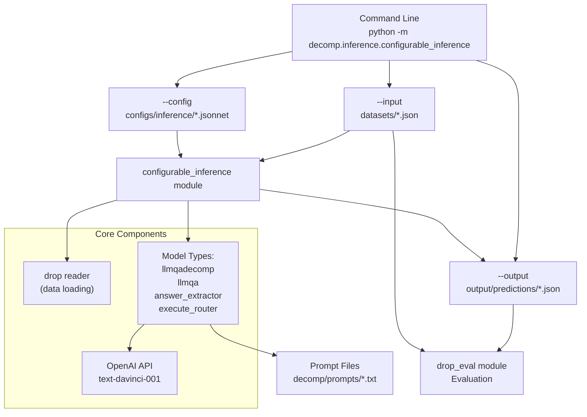

The inference pipeline loads configuration from Jsonnet files in [configs/inference/](), reads input datasets in JSON format from [datasets/](), executes model components that interface with the GPT-3 API, and writes predictions to [output/predictions/](). Results are evaluated using the `drop_eval` module.

**Sources:** [README.md:18-79]()

### Configuration and Model Architecture

The following diagram shows the relationship between configuration files, model types, and prompt templates at the code level:

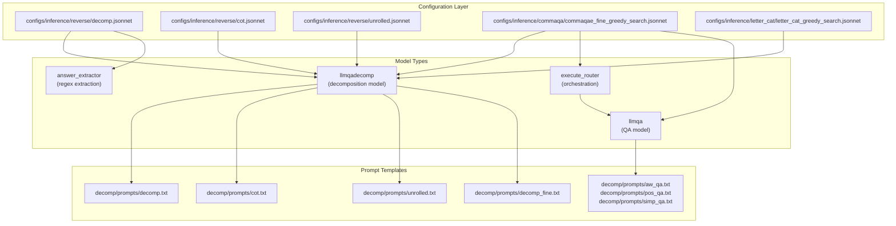

Configuration files in [configs/inference/]() define which model types to use and their transition logic. Model types reference specific prompt templates stored in [decomp/prompts/](). The `llmqadecomp` model handles decomposition, `llmqa` performs question answering, `answer_extractor` uses regex to extract final answers, and `execute_router` orchestrates multi-step execution for complex tasks like CommAQA.

**Sources:** [README.md:33-76]()

## Experimental Tasks

DecomP supports three main experimental tasks, each demonstrating different aspects of compositional reasoning:

### Letter Concatenation

Evaluates string manipulation capabilities by concatenating characters at specific positions. Configured via:
- [configs/inference/letter_cat/letter_cat_greedy_search.jsonnet]()
- [configs/inference/letter_cat/cot_letter_cat.jsonnet]()
- [configs/inference/letter_cat/cot_rollout_letter_cat.jsonnet]()

Input datasets are located in [datasets/letter_cat/](). Users can vary the `promptid` environment variable (p1, p2, p3) to test different prompt formulations.

**See [Letter Concatenation](#4.1) for detailed documentation.**

### List Reversal

Tests sequence reversal through systematic decomposition. This task requires dataset generation using [src/decomp/datasets_utils/build_reverse_dataset.py]() which creates sequences from vocabulary in [wordlist.txt](). Configurations include:
- [configs/inference/reverse/decomp.jsonnet]()
- [configs/inference/reverse/cot.jsonnet]()
- [configs/inference/reverse/unrolled.jsonnet]()

The `LEN` parameter controls sequence length (typically 4, 6, 8, or 10), and `STRAT` selects the prompting strategy.

**See [List Reversal](#4.2) for comprehensive documentation including dataset generation.**

### CommAQA Multi-hop Question Answering

Handles complex compositional questions requiring multi-hop reasoning. Supports two decomposition granularities:
- **Fine-grained**: [configs/inference/commaqa/commaqae_fine_greedy_search.jsonnet]()
- **Coarse-grained**: [configs/inference/commaqa/commaqae_coarse_greedy_search.jsonnet]()
- **Chain of Thought baseline**: [configs/inference/commaqa/cot_commaqae_greedy_search.jsonnet]()

Datasets include IID and compositional generalization splits in [datasets/commaqa_e/]():
- `iid_test_eg100.json` - In-distribution test set
- `compgen_test_eg300.json` - Compositional generalization test set

**See [CommAQA Multi-hop Question Answering](#4.3) for detailed decomposition strategies.**

**Sources:** [README.md:20-78]()

## Evaluation

All experiments use the `drop_eval` module for evaluation. The module compares predictions against gold-standard answers in the input dataset:

```shell
python -m decomp.datasets_utils.drop_eval \
  --gold_path <input_dataset.json> \
  --prediction_path <predictions.json>
```

The evaluation module is located at [src/decomp/datasets_utils/drop_eval.py]() and computes accuracy metrics appropriate for each task type.

**Sources:** [README.md:28-72]()

## Repository Structure

```
DecomP/
├── configs/inference/          # Jsonnet configuration files
│   ├── letter_cat/            # Letter concatenation configs
│   ├── reverse/               # List reversal configs
│   └── commaqa/               # CommAQA configs
├── datasets/                   # Input datasets
│   ├── letter_cat/            # Letter concatenation data
│   ├── reverse/               # List reversal data (generated)
│   └── commaqa_e/             # CommAQA datasets
├── decomp/prompts/            # Prompt template files
├── src/decomp/
│   ├── inference/             # Inference pipeline
│   │   └── configurable_inference.py
│   └── datasets_utils/        # Dataset utilities
│       ├── build_reverse_dataset.py
│       └── drop_eval.py
├── output/predictions/        # Generated predictions
└── wordlist.txt              # Vocabulary for dataset generation
```

For detailed information on directory structure and file organization, see [Repository Structure](#8.1).

**Sources:** [README.md:1-83]()

## Getting Started

To begin using DecomP:

1. **Environment Setup**: Install dependencies and configure API keys - see [Getting Started](#2)
2. **Choose an Experiment**: Select from letter concatenation, list reversal, or CommAQA - see [Experiments](#4)
3. **Select a Strategy**: Choose decomposed, CoT, or unrolled prompting - see [Core Concepts](#3)
4. **Run Inference**: Execute via `configurable_inference` module - see [Inference Pipeline](#5.1)
5. **Evaluate Results**: Use `drop_eval` to compute metrics - see individual experiment pages

## Related Systems

For multi-hop open-domain question answering experiments, refer to the separate DecomP-ODQA repository maintained by Harsh Trivedi at https://github.com/HarshTrivedi/DecomP-ODQA. That system extends DecomP's decomposition strategies to open-domain settings with retrieval components.

**Sources:** [README.md:80-82]()

## License

This repository is licensed under the Apache License 2.0. See [LICENSE]() for full terms.

**Sources:** [LICENSE:1-5]()

---

# Page: Getting Started

# Getting Started

<details>
<summary>Relevant source files</summary>

The following files were used as context for generating this wiki page:

- [LICENSE](LICENSE)
- [README.md](README.md)

</details>


This page guides you through installing DecomP, configuring your environment, and running your first inference experiment. By the end of this guide, you will have executed a decomposed prompting experiment and evaluated its predictions.

For detailed information about the prompting strategies available, see [Core Concepts](#3). For in-depth exploration of specific experiments, see [Experiments](#4). For system architecture and development guidance, see [System Architecture](#5) and [Development Guide](#8).

## Prerequisites

Before installing DecomP, ensure you have:

- **Python 3.8** or later
- **Conda** package manager
- **OpenAI API key** with access to GPT-3 models (specifically `text-davinci-001`)
- **Unix-like environment** (Linux, macOS, or WSL on Windows)

## Installation

### Step 1: Create Conda Environment

Create a new conda environment with Python 3.8:

```bash
conda create -n decomp python=3.8
conda activate decomp
```

### Step 2: Install Dependencies

Clone the repository and install required packages:

```bash
git clone https://github.com/allenai/DecomP
cd DecomP
pip install -r requirements.txt
```

The `requirements.txt` file contains all necessary Python packages for running inference experiments.

**Sources**: [README.md:1-11]()

## Environment Configuration

DecomP requires two critical environment variables to function correctly:

### PYTHONPATH Configuration

Set the `PYTHONPATH` to include the source directory:

```bash
export PYTHONPATH=src/
```

This allows Python to locate the `decomp` module and its submodules (`decomp.inference`, `decomp.datasets_utils`, etc.).

### OpenAI API Key Configuration

Set your OpenAI API key as an environment variable:

```bash
export OPENAI_API_KEY=<YOUR_API_KEY>
```

Replace `<YOUR_API_KEY>` with your actual OpenAI API key. This key is used by the inference system to make GPT-3 API calls during model execution.

**Note**: These environment variables must be set in each terminal session. Consider adding them to your shell configuration file (`~/.bashrc`, `~/.zshrc`, etc.) for persistence.

**Sources**: [README.md:12-16]()

## Installation Verification Workflow

The following diagram illustrates the complete installation and verification process:

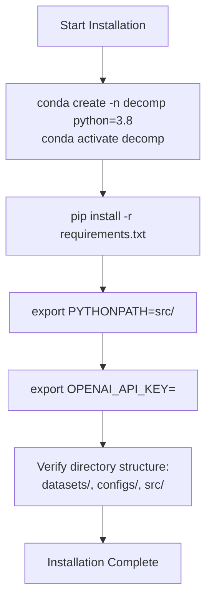

**Sources**: [README.md:5-16]()

## Directory Structure After Installation

After successful installation, your DecomP directory should contain:

| Directory/File | Description |
|----------------|-------------|
| `src/decomp/` | Core source code including inference engine and utilities |
| `configs/inference/` | Jsonnet configuration files for different experiments |
| `datasets/` | Input datasets for letter concatenation, list reversal, and CommAQA |
| `output/predictions/` | Directory for storing prediction outputs (created automatically) |
| `requirements.txt` | Python package dependencies |
| `README.md` | Quick reference documentation |

## Running Your First Experiment

We recommend starting with the **Letter Concatenation** experiment as it is the simplest to execute and does not require dataset generation.

### Letter Concatenation Example

This example runs inference on a letter concatenation task using the decomposed prompting strategy:

```bash
promptid=p1 python -m decomp.inference.configurable_inference \
  --input datasets/letter_cat/n5_eg100_pos2_space.json \
  --config configs/inference/letter_cat/letter_cat_greedy_search.jsonnet \
  --output output/predictions/letter_cat_n5_eg100_pos2_space_decomp_predictions.json
```

#### Command Breakdown

| Component | Description |
|-----------|-------------|
| `promptid=p1` | Environment variable selecting prompt variant (p1, p2, or p3 available) |
| `decomp.inference.configurable_inference` | Main inference module entry point |
| `--input` | Path to input dataset in JSON format |
| `--config` | Jsonnet configuration file defining the inference pipeline |
| `--output` | Path where predictions will be saved |

#### What Happens During Execution

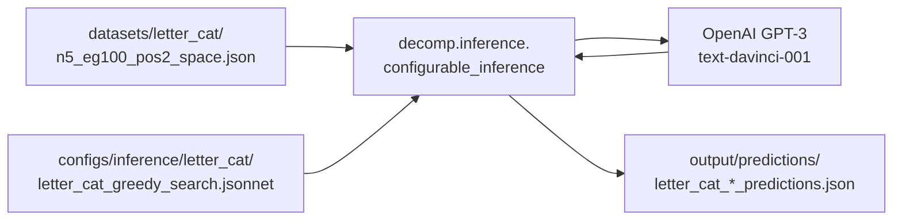

The inference module:
1. Loads the input dataset and configuration
2. Initializes the model pipeline based on the config
3. Processes each example by calling GPT-3 with formatted prompts
4. Saves predictions to the output file

**Sources**: [README.md:18-31]()

## Evaluating Predictions

After inference completes, evaluate the predictions against ground truth:

```bash
python -m decomp.datasets_utils.drop_eval \
  --gold_path datasets/letter_cat/n5_eg100_pos2_space.json \
  --prediction_path output/predictions/letter_cat_n5_eg100_pos2_space_decomp_predictions.json
```

### Evaluation Module

The `drop_eval` module compares predicted answers with ground truth answers and computes accuracy metrics. It outputs:

- **Exact Match (EM)**: Percentage of predictions that exactly match the ground truth
- **F1 Score**: Token-level F1 score between prediction and ground truth

### Expected Output Format

The evaluation will print metrics to stdout:

```
Exact Match: 85.0
F1: 87.3
```

These metrics indicate how well the decomposed prompting strategy performed on the letter concatenation task.

**Sources**: [README.md:28-31]()

## Trying Different Configurations

Once you've successfully run the basic example, experiment with different configurations:

### Different Prompt Variants

Change the `promptid` environment variable to try alternative prompts:

```bash
promptid=p2 python -m decomp.inference.configurable_inference ...
promptid=p3 python -m decomp.inference.configurable_inference ...
```

Each prompt variant implements the same strategy with different phrasing or structure. See [Prompt Templates](#7) for details.

### Different Prompting Strategies

Modify the `--config` parameter to test alternative strategies:

| Strategy | Configuration File | Description |
|----------|-------------------|-------------|
| Decomposed | `letter_cat_greedy_search.jsonnet` | Breaks task into explicit sub-operations |
| CoT | `cot_letter_cat_greedy_search.jsonnet` | Chain of Thought baseline |
| CoT w/ Rollout | `cot_rollout_letter_cat_greedy_search.jsonnet` | CoT with execution rollout |

For detailed explanations of each strategy, see [Core Concepts](#3).

**Sources**: [README.md:33-35]()

## Quick Start Workflow Summary

The following diagram shows the complete workflow from installation to evaluation:

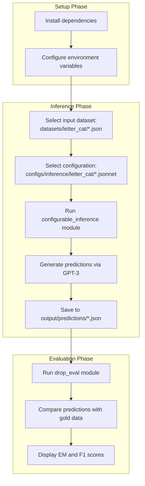

**Sources**: [README.md:1-31]()

## Common Issues and Troubleshooting

### Module Not Found Error

If you encounter `ModuleNotFoundError: No module named 'decomp'`, verify that:
- `PYTHONPATH=src/` is set in your current terminal session
- You're running commands from the DecomP repository root directory

### OpenAI API Errors

If inference fails with API-related errors:
- Verify your `OPENAI_API_KEY` is correctly set and valid
- Check that your API key has access to the `text-davinci-001` model
- Ensure you have sufficient API credits/quota

### Missing Output Directory

The system automatically creates the `output/predictions/` directory if it doesn't exist. If you encounter permission errors, manually create it:

```bash
mkdir -p output/predictions
```

## Next Steps

Now that you've successfully run your first experiment, you can:

1. **Explore Other Experiments**: Try [List Reversal](#4.2) or [CommAQA](#4.3) experiments
2. **Understand the Strategies**: Learn about [Decomposed Prompting](#3.1), [Chain of Thought](#3.2), and [Unrolled Strategies](#3.3)
3. **Examine the Architecture**: Dive into the [Inference Pipeline](#5.1) and [Configuration System](#5.2)
4. **Create Custom Experiments**: See [Adding New Experiments](#8.2) to extend the framework

### Recommended Learning Path


**Sources**: [README.md:1-83]()

---

# Page: Core Concepts

# Core Concepts

<details>
<summary>Relevant source files</summary>

The following files were used as context for generating this wiki page:

- [LICENSE](LICENSE)
- [README.md](README.md)
- [configs/inference/reverse/decomp.jsonnet](configs/inference/reverse/decomp.jsonnet)

</details>


## Purpose and Scope

This document explains the three fundamental prompting strategies implemented in DecomP and how they differ in their approach to solving complex tasks. Each strategy represents a distinct method for guiding large language models (LLMs) to break down and solve problems through different decomposition patterns.

For detailed explanations of each strategy, see:
- [Decomposed Prompting Strategy](#3.1)
- [Chain of Thought (CoT) Strategy](#3.2)
- [Unrolled Strategy](#3.3)

For practical application of these strategies in experiments, see [Experiments](#4).

## Overview of Prompting Strategies

DecomP implements three core prompting strategies that differ in how they decompose complex tasks:

| Strategy | Approach | Key Characteristic | Primary Use Case |
|----------|----------|-------------------|------------------|
| **Decomposed** | Explicit sub-operation breakdown | Structured, step-by-step execution with intermediate model calls | Multi-hop QA, complex reasoning tasks |
| **Chain of Thought (CoT)** | Natural language reasoning | Single-pass generation with explicit reasoning steps | Tasks requiring step-by-step explanation |
| **Unrolled** | Conditional recursive logic | Applies different strategies based on input characteristics | Length-dependent tasks (e.g., list reversal) |

Each strategy is implemented through:
1. A configuration file (`.jsonnet`) that defines the model execution pipeline
2. Prompt template files (`.txt`) that provide task-specific instructions
3. Model components that execute the strategy's logic

**Sources:** [README.md:1-83](), [configs/inference/reverse/decomp.jsonnet:1-43]()

## Strategy Comparison

### Conceptual Differences

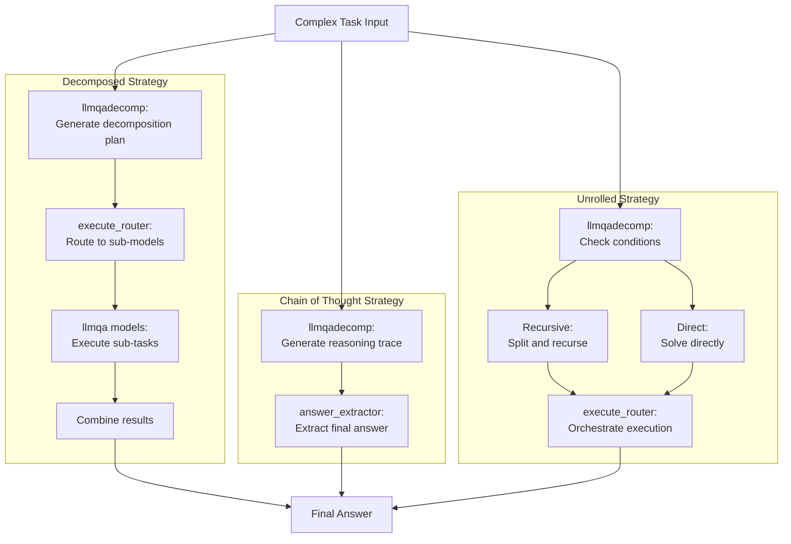

**Diagram: Strategy Execution Patterns**

**Sources:** [configs/inference/reverse/decomp.jsonnet:1-43](), Diagram 4 from high-level architecture

### Execution Characteristics

| Characteristic | Decomposed | CoT | Unrolled |
|----------------|------------|-----|----------|
| **LLM Calls** | Multiple (per sub-task) | Single (or minimal) | Conditional (based on recursion depth) |
| **Intermediate Results** | Explicitly stored and reused | Implicit in reasoning trace | Recursively combined |
| **Model Transitions** | `next_model` field routes between models | Linear flow to `answer_extractor` | Conditional routing via `execute_router` |
| **Configuration Complexity** | High (multiple model definitions) | Low (2-3 models) | Medium (conditional logic) |
| **Prompt Structure** | Task-specific sub-prompts | Single reasoning prompt | Conditional prompt selection |

**Sources:** [configs/inference/reverse/decomp.jsonnet:1-43](), [README.md:33-60]()

## Configuration to Code Mapping

### Model Component Types

DecomP uses specific model types to implement different strategy behaviors:

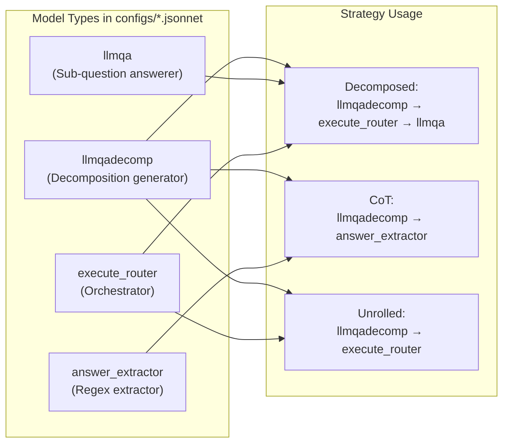

**Diagram: Model Component Usage Across Strategies**

**Sources:** [configs/inference/reverse/decomp.jsonnet:3-36]()

### Configuration Structure

Each strategy is defined by a configuration file that specifies:

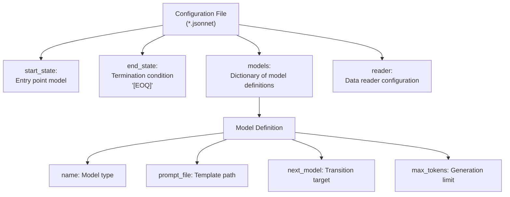

**Diagram: Configuration File Structure**

**Sources:** [configs/inference/reverse/decomp.jsonnet:1-43]()

### Example Configuration: Decomposed Strategy

The decomposed strategy for list reversal is configured as:

| Field | Value | Purpose |
|-------|-------|---------|
| `start_state` | `"reverse"` | Entry point to the `reverse` model |
| `end_state` | `"[EOQ]"` | Termination marker |
| `models.reverse.name` | `"llmqadecomp"` | Generates decomposition steps |
| `models.reverse.next_model` | `"execute"` | Routes to `execute_router` |
| `models.execute.name` | `"execute_router"` | Orchestrates sub-model execution |
| `models.join.name` | `"llmqa"` | Executes join sub-operation |
| `models.remove_numbers.name` | `"llmqa"` | Executes number removal sub-operation |

**Sources:** [configs/inference/reverse/decomp.jsonnet:3-36]()

## Strategy Selection in Practice

### Command-Line Usage

Strategies are selected by specifying different configuration files:

```bash
# Decomposed strategy
--config configs/inference/reverse/decomp.jsonnet

# Chain of Thought strategy
--config configs/inference/reverse/cot.jsonnet

# Unrolled strategy
--config configs/inference/reverse/unrolled.jsonnet
```

**Sources:** [README.md:38-60]()

### Prompt Variation

Some strategies support multiple prompt variations via the `promptid` environment variable:

```bash
# Different prompt templates (p1, p2, p3)
promptid=p1 python -m decomp.inference.configurable_inference ...
promptid=p2 python -m decomp.inference.configurable_inference ...
```

This allows experimentation with different phrasings while maintaining the same strategy structure.

**Sources:** [README.md:23-35](), [README.md:65-76]()

## Strategy-Experiment Matrix

Different experiments support different strategies:

| Experiment | Decomposed | CoT | Unrolled | Configuration Files |
|------------|------------|-----|----------|-------------------|
| **Letter Concatenation** | ✓ | ✓ | ✓ (as rollout) | `letter_cat_greedy_search.jsonnet`, `cot_letter_cat.jsonnet`, `cot_rollout_letter_cat.jsonnet` |
| **List Reversal** | ✓ | ✓ | ✓ | `decomp.jsonnet`, `cot.jsonnet`, `unrolled.jsonnet` |
| **CommAQA** | ✓ (fine/coarse) | ✓ | ✗ | `commaqae_fine.jsonnet`, `commaqae_coarse.jsonnet`, `cot_commaqae.jsonnet` |

**Sources:** [README.md:20-78]()

## State Machine Execution Model

All strategies execute as state machines where models transition between states:

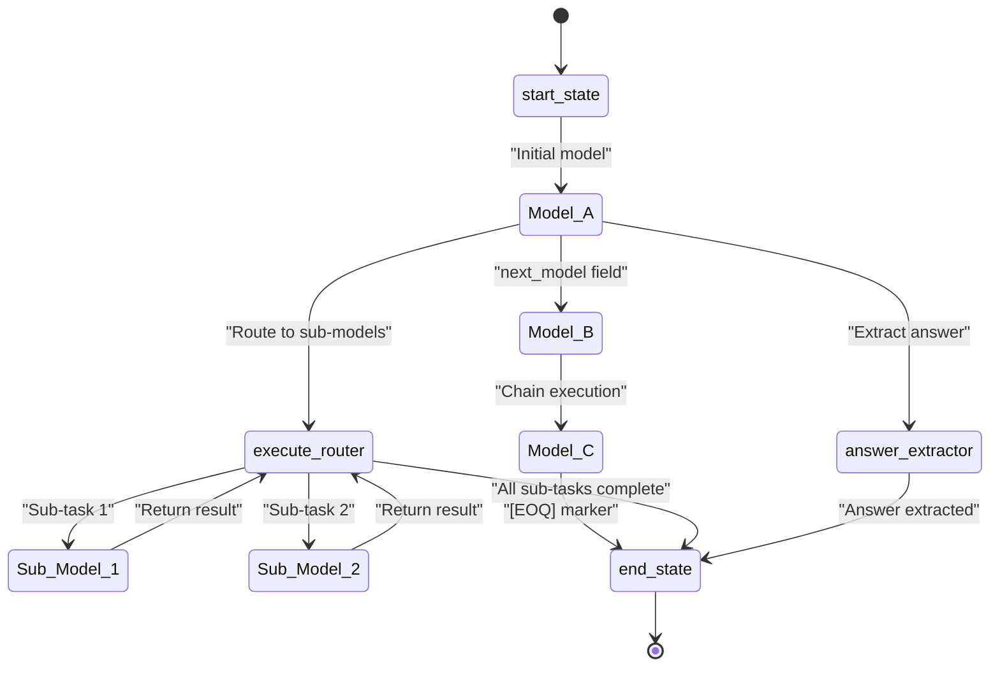

**Diagram: Generic State Machine Execution Flow**

The specific state transitions differ by strategy:
- **Decomposed**: Uses `execute_router` for multi-stage sub-task execution
- **CoT**: Linear progression from generation to extraction
- **Unrolled**: Conditional transitions based on input properties

**Sources:** [configs/inference/reverse/decomp.jsonnet:3-36](), Diagram 3 from high-level architecture

## Model Parameter Configuration

Each model in a strategy configuration supports parameters for controlling GPT-3 generation:

| Parameter | Type | Purpose | Example Value |
|-----------|------|---------|---------------|
| `gen_model` | string | Model backend identifier | `"gpt3"` |
| `engine` | string | Specific GPT-3 engine | `"text-davinci-001"` |
| `max_tokens` | integer | Maximum tokens to generate | `400` |
| `max_steps` | integer | Maximum execution iterations | `1` |
| `prompt_file` | string | Path to prompt template | `"configs/prompts/reverse/decomp.txt"` |
| `next_model` | string | Target model for transition | `"execute"` |
| `end_state` | string | Termination marker | `"[EOQ]"` |

These parameters are typically defined once as `gen_params` and reused across models:

```jsonnet
local gen_params = { "gen_model": "gpt3", "engine": "text-davinci-001"};
```

**Sources:** [configs/inference/reverse/decomp.jsonnet:1-12]()

## Key Distinctions Summary

The three strategies differ primarily in:

1. **Decomposition Approach**
   - Decomposed: Explicit sub-operations with separate model calls
   - CoT: Implicit reasoning within a single generation
   - Unrolled: Conditional decomposition based on input characteristics

2. **Model Orchestration**
   - Decomposed: Uses `execute_router` to manage sub-models
   - CoT: Simple linear flow with regex extraction
   - Unrolled: Dynamic routing with recursive logic

3. **Computational Cost**
   - Decomposed: Highest (multiple LLM calls per sub-task)
   - CoT: Lowest (typically single LLM call)
   - Unrolled: Variable (depends on recursion depth)

For implementation details of each strategy, refer to:
- [Decomposed Prompting Strategy](#3.1)
- [Chain of Thought (CoT) Strategy](#3.2)
- [Unrolled Strategy](#3.3)

**Sources:** [README.md:1-83](), [configs/inference/reverse/decomp.jsonnet:1-43](), Diagram 4 from high-level architecture

---

# Page: Decomposed Prompting Strategy

# Decomposed Prompting Strategy

<details>
<summary>Relevant source files</summary>

The following files were used as context for generating this wiki page:

- [configs/inference/reverse/decomp.jsonnet](configs/inference/reverse/decomp.jsonnet)
- [configs/prompts/reverse/decomp.txt](configs/prompts/reverse/decomp.txt)

</details>


## Purpose and Scope

This document details the **Decomposed Prompting Strategy**, the primary prompting methodology implemented in the DecomP repository. This strategy explicitly breaks down complex tasks into a sequence of simpler sub-operations, each handled by specialized models or execution steps.

For information about alternative prompting strategies, see:
- [Chain of Thought (CoT) Strategy](#3.2) - Uses natural language reasoning steps
- [Unrolled Strategy](#3.3) - Applies conditional logic with recursive decomposition

For implementation details of the model components used in this strategy, see [Model Components](#5.3).

## Core Principles

The Decomposed Prompting Strategy operates on the principle that complex tasks can be systematically reduced to sequences of simpler operations. Unlike strategies that rely on implicit reasoning (CoT) or procedural logic (Unrolled), the decomposed approach uses **explicit operation tags** to direct execution flow.

### Key Characteristics

| Characteristic | Description |
|---|---|
| **Explicit Decomposition** | Tasks are broken into labeled sub-operations like `[extract]`, `[remove_numbers]`, `[reverse]`, `[join]` |
| **Multi-Model Orchestration** | Different models handle different operation types through an `execute_router` |
| **State-Based Execution** | Pipeline progresses through defined states until reaching `[EOQ]` (End Of Question) |
| **Result Chaining** | Intermediate results (referenced as `#1`, `#2`, etc.) feed into subsequent operations |

**Sources:** [configs/prompts/reverse/decomp.txt:1-41]()

## Model Pipeline Architecture

The decomposed strategy uses a multi-stage pipeline where different model types collaborate to execute the decomposed operations.

### Pipeline State Machine

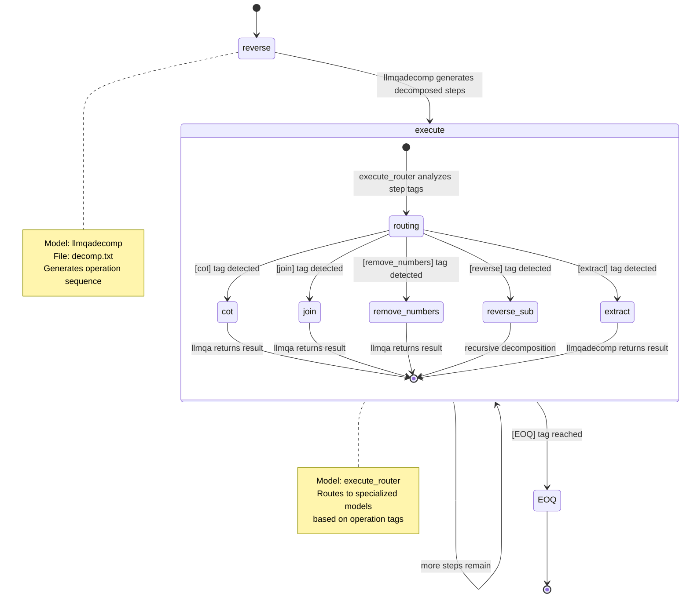

**Diagram: Decomposed Strategy State Machine**

This diagram shows the progression from the initial `reverse` state through the `execute_router` orchestration, which dispatches to specialized models based on operation tags, until the `[EOQ]` termination state is reached.

**Sources:** [configs/inference/reverse/decomp.jsonnet:3-27]()

### Configuration Structure

The decomposed strategy configuration defines the complete model pipeline:

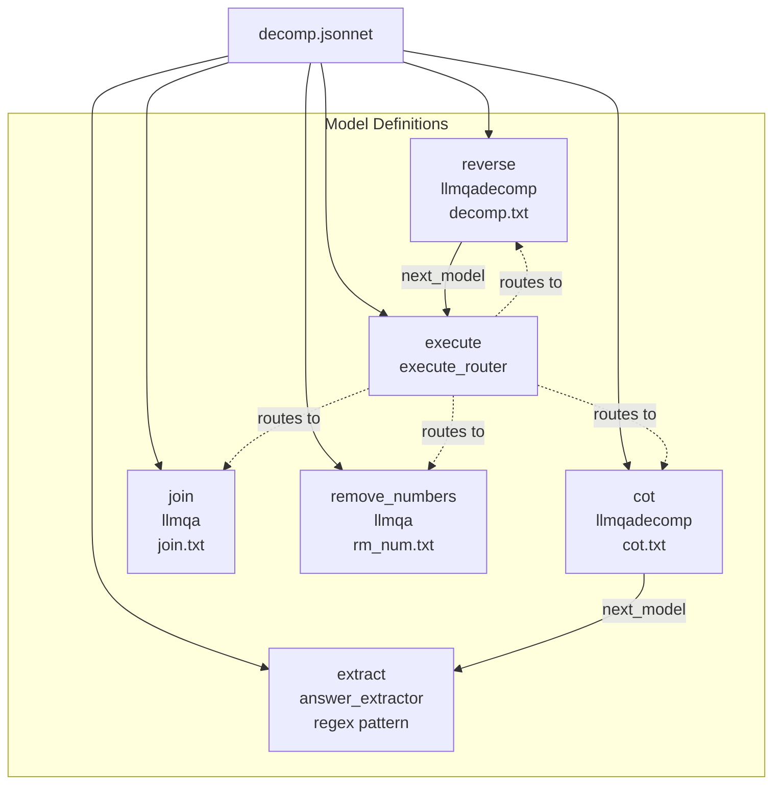

**Diagram: Model Configuration Graph**

| Configuration Field | Value | Purpose |
|---|---|---|
| `start_state` | `"reverse"` | Initial model to execute |
| `end_state` | `"[EOQ]"` | Termination marker |
| `models.reverse.name` | `"llmqadecomp"` | Primary decomposition generator |
| `models.execute.name` | `"execute_router"` | Operation dispatcher |
| `models.join.name` | `"llmqa"` | Specialized sub-operation handler |
| `models.remove_numbers.name` | `"llmqa"` | Specialized sub-operation handler |

**Sources:** [configs/inference/reverse/decomp.jsonnet:1-43]()

## Prompt Template Structure

The decomposed prompt template encodes the decomposition logic through few-shot examples. Each example demonstrates how to break a task into tagged operations.

### Operation Tag System

The prompt template uses a structured format where each step is tagged with an operation type:

| Tag | Purpose | Model Handler |
|---|---|---|
| `[extract]` | Extract and analyze input components | `llmqadecomp` |
| `[remove_numbers]` | Remove numbering from sequences | `llmqa` |
| `[reverse]` | Recursively reverse a sequence | `llmqadecomp` or `llmqa` |
| `[join]` | Concatenate two sequences | `llmqa` |
| `[cot]` | Apply chain-of-thought reasoning | `llmqadecomp` |
| `[EOQ]` | Mark end of decomposition | N/A (termination) |

### Example Decomposition Trace

The prompt template demonstrates the complete decomposition pattern through examples:

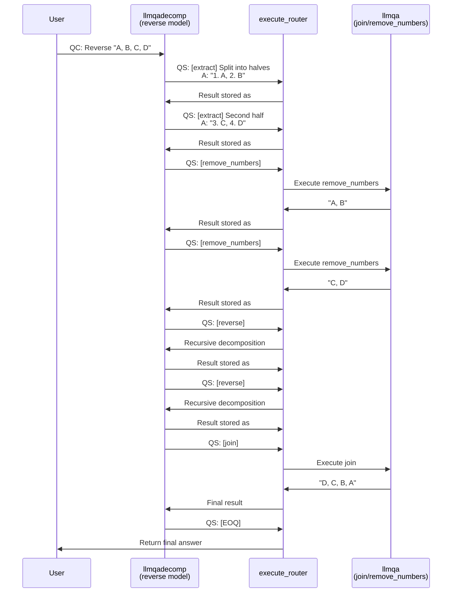

**Diagram: Execution Trace for List Reversal**

This sequence diagram illustrates how a decomposed query progresses through the model pipeline, with intermediate results chained together via numbered references.

**Sources:** [configs/prompts/reverse/decomp.txt:25-40]()

### Few-Shot Example Structure

Each example in the prompt follows this pattern:

1. **Query Context (QC)**: The original task
   ```
   QC: Reverse the sequence "newspaper, glasses, laptop, bottle".
   ```

2. **Query Steps (QS)**: Tagged decomposition operations with answers (A)
   ```
   QS: [extract] The sequence is "1. newspaper, 2. glasses, 3. laptop, 4. bottle"...
   A: "1. newspaper, 2. glasses"
   ```

3. **Result References**: Intermediate results referenced by number
   ```
   QS: [remove_numbers] Remove the numbers from #1.
   A: "newspaper, glasses"
   ```

4. **Termination**: End marker
   ```
   QS: [EOQ]
   ```

**Sources:** [configs/prompts/reverse/decomp.txt:1-16]()

## Conditional Decomposition Logic

The decomposed strategy includes decision logic for when to apply different decomposition paths:

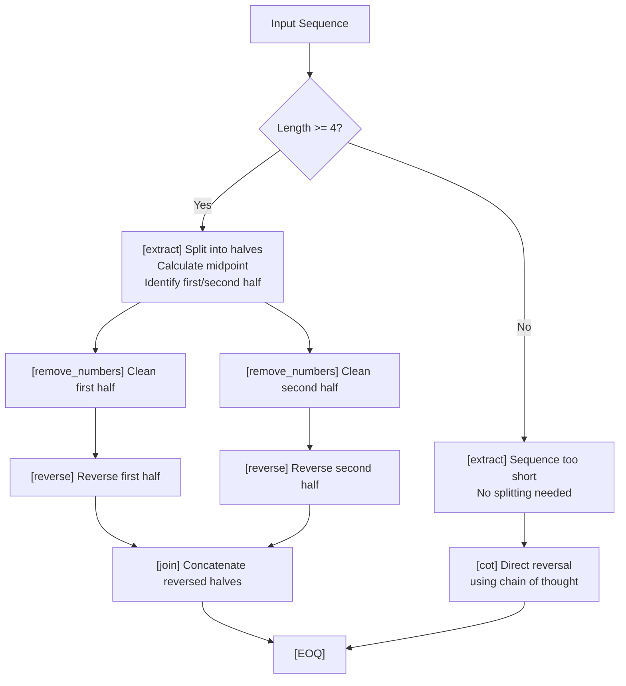

**Diagram: Conditional Decomposition Decision Tree**

The strategy adapts its decomposition based on input characteristics. Sequences of length 4 or greater are split into halves for recursive processing, while shorter sequences are handled directly using chain-of-thought reasoning.

**Sources:** [configs/prompts/reverse/decomp.txt:18-23](), [configs/prompts/reverse/decomp.txt:25-40]()

## Configuration Details

### Model Parameters

The `decomp.jsonnet` configuration specifies parameters for each model in the pipeline:

| Model | Parameter | Value | Purpose |
|---|---|---|---|
| `reverse` | `name` | `"llmqadecomp"` | Decomposition generator |
| `reverse` | `prompt_file` | `"configs/prompts/reverse/decomp.txt"` | Few-shot template |
| `reverse` | `next_model` | `"execute"` | Route to execution router |
| `reverse` | `max_tokens` | `400` | Generation limit |
| `execute` | `name` | `"execute_router"` | Operation dispatcher |
| `join` | `name` | `"llmqa"` | Join operation handler |
| `join` | `prompt_file` | `"configs/prompts/reverse/join.txt"` | Join-specific prompt |
| `remove_numbers` | `name` | `"llmqa"` | Number removal handler |
| `remove_numbers` | `prompt_file` | `"configs/prompts/reverse/rm_num.txt"` | Removal-specific prompt |

**Sources:** [configs/inference/reverse/decomp.jsonnet:6-36]()

### GPT-3 Engine Configuration

All generative models share common parameters defined in `gen_params`:

```
{
  "gen_model": "gpt3",
  "engine": "text-davinci-001"
}
```

These parameters are merged into each model definition that requires text generation capabilities (`llmqadecomp` and `llmqa` models).

**Sources:** [configs/inference/reverse/decomp.jsonnet:1]()

## Integration with Broader System

The decomposed strategy integrates with the configurable inference pipeline (see [Inference Pipeline](#5.1)) through the standard state machine interface:

- **Entry Point**: `start_state` specifies the initial model (`"reverse"`)
- **Exit Condition**: Pipeline terminates when `end_state` (`"[EOQ]"`) is reached
- **Reader Integration**: Uses `drop` reader with `add_paras: true` to provide context (see [Configuration System](#5.2))

The strategy can be applied to different experimental tasks (see [Experiments](#4)) by:
1. Adapting the prompt template to the task domain
2. Configuring appropriate sub-operation models
3. Adjusting the `execute_router` routing logic for task-specific operation tags

**Sources:** [configs/inference/reverse/decomp.jsonnet:37-41]()

---

# Page: Chain of Thought (CoT) Strategy

# Chain of Thought (CoT) Strategy

<details>
<summary>Relevant source files</summary>

The following files were used as context for generating this wiki page:

- [configs/inference/reverse/cot.jsonnet](configs/inference/reverse/cot.jsonnet)
- [configs/prompts/reverse/cot.txt](configs/prompts/reverse/cot.txt)

</details>


## Purpose and Scope

This document describes the Chain of Thought (CoT) prompting strategy implemented in DecomP. CoT is one of three core prompting approaches available in the system, using explicit natural language reasoning steps to solve tasks. For information about the decomposed sub-operation approach, see [Decomposed Prompting Strategy](#3.1). For recursive conditional logic, see [Unrolled Strategy](#3.3).

The CoT strategy is primarily demonstrated through the list reversal experiment, though the approach is generalizable to other tasks requiring step-by-step reasoning.

## Strategy Overview

The Chain of Thought strategy solves problems by explicitly enumerating intermediate reasoning steps in natural language. Rather than directly computing a result or breaking tasks into sub-operations, CoT models the problem-solving process as a human would explain it, making the reasoning transparent and interpretable.

### Key Characteristics

| Characteristic | Description |
|---------------|-------------|
| **Reasoning Style** | Explicit enumeration and transformation |
| **Verbosity** | Higher token usage due to detailed steps |
| **Interpretability** | High - every step is explained in natural language |
| **Structure** | Position enumeration → Reversal enumeration → Answer |
| **Model Type** | `llmqadecomp` with single-step execution |

Sources: [configs/inference/reverse/cot.jsonnet:1-28](), [configs/prompts/reverse/cot.txt:1-12]()

## Prompt Template Structure

The CoT prompt template uses a few-shot learning format with three key components per example:

```
QC: Reverse the sequence "..."
QS: [Reasoning steps]
A: [Final answer]
```

### Component Breakdown

- **QC (Question Context)**: States the task and input sequence
- **QS (Question Steps)**: Contains the natural language reasoning chain
- **A (Answer)**: Provides the final result in the expected format

The reasoning chain follows a consistent pattern:
1. Enumerate each element with its position (First is X, Second is Y...)
2. State the transformation (Now to reverse, change the order to...)
3. Enumerate in reversed order (Fifth is Y, Fourth is X...)
4. Conclude with the answer (So the answer is "...")

Sources: [configs/prompts/reverse/cot.txt:1-12]()

## Reasoning Pattern Example

### CoT Reasoning Flow for List Reversal

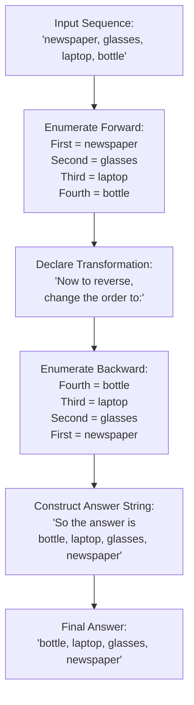

**Diagram: Natural language reasoning steps in CoT strategy**

Sources: [configs/prompts/reverse/cot.txt:1-4]()

## Concrete Examples from Template

The prompt template includes three examples demonstrating the strategy across different sequence lengths:

### Example 1: Four-element Sequence

```
QC: Reverse the sequence "newspaper, glasses, laptop, bottle".
QS: First is newspaper. Second is glasses. Third is laptop. Fourth is bottle. 
    Now to reverse, change the order to: Fourth is bottle. Third is laptop. 
    Second is glasses. First is newspaper. So the answer is 
    "bottle, laptop, glasses, newspaper".
A: "bottle, laptop, glasses, newspaper"
```

### Example 2: Three-element Sequence

```
QC: Reverse the sequence "laptop, photo, clip".
QS: First is laptop. Second is photo. Third is clip. Now to reverse, 
    change the order to: Third is clip. Second is photo. First is laptop. 
    So the answer is "clip, photo, laptop".
A: "clip, photo, laptop"
```

### Example 3: Five-element Sequence

```
QC: Reverse the sequence "driving license, button, packet, identity card, pineapple".
QS: First is driving license. Second is button. Third is packet. 
    Fourth is identity card. Fifth is pineapple. Now to reverse, 
    change the order to: Fifth is pineapple. Fourth is identity card. 
    Third is packet. Second is button. First is driving license. 
    So the answer is "pineapple, identity card, packet, button, driving license".
A: "pineapple, identity card, packet, button, driving license"
```

These examples train the model to follow the enumeration pattern regardless of sequence length.

Sources: [configs/prompts/reverse/cot.txt:1-12]()

## Configuration and Implementation

### Configuration File Structure

```mermaid
graph TB
    Config["cot.jsonnet<br/>Configuration File"]
    
    StartState["start_state: 'reverse'<br/>Entry point"]
    
    ReverseModel["reverse model:<br/>name: llmqadecomp<br/>prompt_file: cot.txt<br/>max_tokens: 300<br/>max_steps: 1<br/>next_model: ans_ext"]
    
    AnsExt["ans_ext model:<br/>name: answer_extractor<br/>regex: '.*he answer is (.*)\\\\.']
    
    ExecuteRouter["execute model:<br/>name: execute_router<br/>(unused in CoT)"]
    
    GenParams["gen_params:<br/>gen_model: gpt3<br/>engine: text-davinci-001"]
    
    Reader["reader:<br/>name: drop<br/>add_paras: true"]
    
    EndState["end_state: '[EOQ]'<br/>Termination marker"]
    
    Config --> StartState
    Config --> ReverseModel
    Config --> AnsExt
    Config --> ExecuteRouter
    Config --> GenParams
    Config --> Reader
    Config --> EndState
    
    ReverseModel --> GenParams
```

**Diagram: CoT configuration structure with code entities**

Sources: [configs/inference/reverse/cot.jsonnet:1-28]()

### Key Configuration Parameters

| Parameter | Value | Purpose |
|-----------|-------|---------|
| `start_state` | `"reverse"` | Initial model to execute |
| `end_state` | `"[EOQ]"` | Termination marker |
| `reverse.name` | `"llmqadecomp"` | Question decomposition model type |
| `reverse.prompt_file` | `"configs/prompts/reverse/cot.txt"` | CoT prompt template location |
| `reverse.max_tokens` | `300` | Maximum generation length |
| `reverse.max_steps` | `1` | Single-pass execution |
| `reverse.next_model` | `"ans_ext"` | Transition to answer extraction |
| `gen_model` | `"gpt3"` | Generation backend |
| `engine` | `"text-davinci-001"` | Specific GPT-3 model |
| `ans_ext.regex` | `".*he answer is (.*)\\."` | Answer extraction pattern |

Sources: [configs/inference/reverse/cot.jsonnet:1-28]()

## Inference Execution Flow

### State Machine Execution

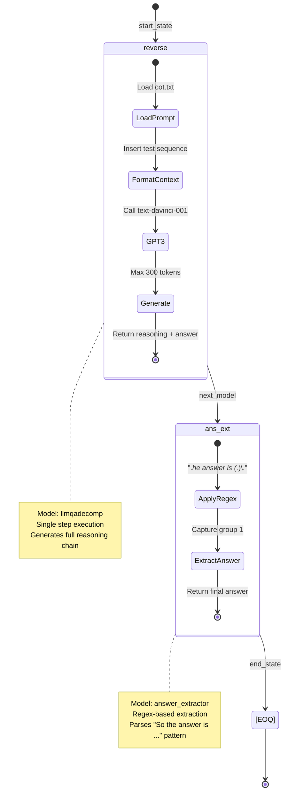

**Diagram: CoT inference state machine with model names**

Sources: [configs/inference/reverse/cot.jsonnet:1-28]()

### Execution Characteristics

The CoT strategy uses a simple two-stage pipeline:

1. **Generation Stage (`reverse` model)**:
   - Loads the prompt template from [configs/prompts/reverse/cot.txt:1-12]()
   - Appends the test sequence as a new QC line
   - Calls GPT-3 to generate the QS (reasoning) and A (answer) sections
   - Limited to `max_steps: 1` - no iterative refinement
   - Generates up to 300 tokens

2. **Extraction Stage (`ans_ext` model)**:
   - Applies regex pattern to find "the answer is ..."
   - Extracts the content within quotes after this phrase
   - Returns the final answer for evaluation

Sources: [configs/inference/reverse/cot.jsonnet:6-17]()

## Answer Extraction

### Regex Pattern Analysis

The answer extractor uses the pattern: `".*he answer is (.*)\\."`

This pattern:
- Matches any prefix text (`.*`)
- Looks for the literal string "he answer is " (note: matches both "the answer is" and "he answer is")
- Captures everything after until a period (`(.*)\\`)
- Expects a terminating period

### Extraction Process

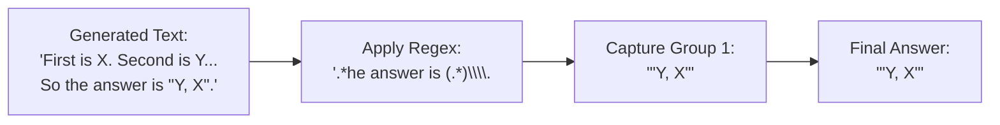

**Diagram: Answer extraction pipeline mapping code to behavior**

The captured text typically includes the surrounding quotes as part of the answer format expected by the evaluation system.

Sources: [configs/inference/reverse/cot.jsonnet:14-17]()

## Comparison with Other Strategies

### Strategy Comparison Table

| Aspect | CoT (this page) | Decomposed ([3.1](#3.1)) | Unrolled ([3.3](#3.3)) |
|--------|-----------------|--------------------------|------------------------|
| **Reasoning Style** | Natural language enumeration | Explicit sub-operations | Recursive conditional logic |
| **Token Efficiency** | Low (verbose reasoning) | Medium (structured steps) | High (algorithmic) |
| **Interpretability** | High (human-like explanation) | High (clear operations) | Medium (conditional branching) |
| **Steps Required** | Single generation | Multiple model calls | Recursive depth-dependent |
| **Model Transitions** | reverse → ans_ext | Multiple sub-models | Recursive decomposition |

### When to Use CoT

The Chain of Thought strategy is most effective when:
- Interpretability and explainability are priorities
- The task benefits from explicit position tracking
- Token usage is not a primary constraint
- Single-pass reasoning is sufficient

For tasks requiring explicit sub-task decomposition, see [Decomposed Prompting Strategy](#3.1). For tasks requiring recursive algorithmic approaches, see [Unrolled Strategy](#3.3).

Sources: [configs/inference/reverse/cot.jsonnet:1-28](), [configs/prompts/reverse/cot.txt:1-12]()

## Usage Example

To run inference using the CoT strategy for list reversal:

```bash
python -m decomp.inference.configurable_inference \
    --config configs/inference/reverse/cot.jsonnet \
    --input data/reverse/test_len_4.json \
    --output output/reverse_cot_predictions.json
```

This command:
1. Loads the CoT configuration from [configs/inference/reverse/cot.jsonnet:1-28]()
2. Applies the prompt template from [configs/prompts/reverse/cot.txt:1-12]()
3. Generates reasoning chains via GPT-3
4. Extracts answers using the regex pattern
5. Saves predictions for evaluation

For more details on running experiments, see [List Reversal](#4.2) and [Inference Configurations](#4.2.2).

Sources: [configs/inference/reverse/cot.jsonnet:1-28]()

---

# Page: Unrolled Strategy

# Unrolled Strategy

<details>
<summary>Relevant source files</summary>

The following files were used as context for generating this wiki page:

- [configs/inference/reverse/unrolled.jsonnet](configs/inference/reverse/unrolled.jsonnet)
- [configs/prompts/reverse/unrolled.txt](configs/prompts/reverse/unrolled.txt)

</details>


## Overview

The Unrolled Strategy is one of three core prompting approaches implemented in the DecomP repository for evaluating decomposed problem-solving. This strategy applies conditional logic with recursive decomposition, using a threshold-based decision to determine whether to split a problem into sub-problems or solve it directly.

For information about the other prompting strategies, see [Decomposed Prompting Strategy](#3.1) and [Chain of Thought (CoT) Strategy](#3.2). For task-specific implementations, see [List Reversal](#4.2).

**Scope**: This page documents the unrolled strategy's recursive algorithm, prompt structure, configuration setup, and execution flow as implemented for the list reversal task.

## Strategy Principles

The Unrolled Strategy uses a **divide-and-conquer** approach with explicit conditional branching based on problem size. Unlike the standard decomposed strategy which always applies the same decomposition steps, the unrolled strategy dynamically decides whether to:

1. **Split and recurse** if the problem exceeds a minimum threshold (≥ 4 items)
2. **Solve directly** if the problem is below the threshold (< 4 items)

This mimics recursive algorithm execution where each recursive call handles a smaller sub-problem until reaching a base case.

**Key characteristics**:
- Threshold-based conditional execution (minimum length = 4)
- Recursive decomposition for longer sequences
- Direct reversal for short sequences
- Mathematical calculation of split points (integer division)
- Explicit joining of sub-results

Sources: [configs/prompts/reverse/unrolled.txt:1-15]()

## Recursive Algorithm Structure

The unrolled strategy implements the following algorithm through natural language prompting:

```
function reverse_unrolled(sequence):
    if length(sequence) < 4:
        return direct_reverse(sequence)
    else:
        split_point = floor(length(sequence) / 2)
        first_half = sequence[0:split_point]
        second_half = sequence[split_point:]
        reversed_first = reverse_unrolled(first_half)
        reversed_second = reverse_unrolled(second_half)
        return join(reversed_second, reversed_first)
```

**Recursive Algorithm Flow with Code Mappings**

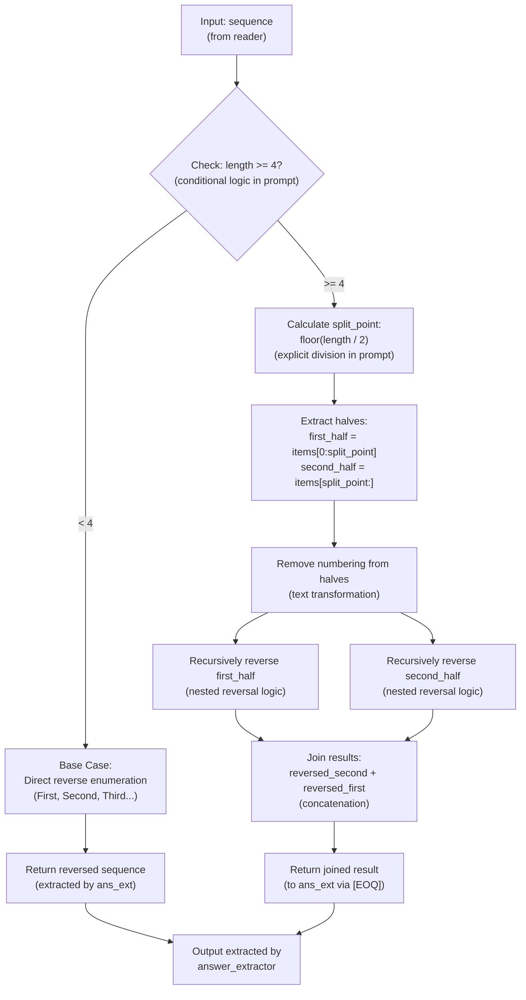

Sources: [configs/prompts/reverse/unrolled.txt:1-15]()

## Prompt Structure and Examples

The unrolled strategy prompt template contains three few-shot examples demonstrating different execution paths through the recursive algorithm.

### Example 1: Recursive Case (Length = 5)

From [configs/prompts/reverse/unrolled.txt:1-4]():

**Input**: `"driving license, button, packet, identity card, shoe"`

**Execution trace**:
1. Add numbering: `"1. driving license, 2. button, 3. packet, 4. identity card, 5. shoe"`
2. Check length: 5 items ≥ 4 → split
3. Calculate split: 5 / 2 = 2.5 → floor to 2
4. Extract first half (2 items): `"1. driving license, 2. button"`
5. Extract second half (3 items): `"3. packet, 4. identity card, 5. shoe"`
6. Remove numbering from halves
7. Reverse first half: `"button, driving license"`
8. Reverse second half: `"shoe, identity card, packet"`
9. Join: `"shoe, identity card, packet, button, driving license"`

**Output**: `"shoe, identity card, packet, button, driving license"`

### Example 2: Base Case (Length = 3)

From [configs/prompts/reverse/unrolled.txt:6-9]():

**Input**: `"laptop, photo, clip"`

**Execution trace**:
1. Add numbering: `"1. laptop, 2. photo, 3. clip"`
2. Check length: 3 items < 4 → don't split
3. Direct reversal: `"Third is clip. Second is photo. First is laptop."`
4. Output: `"clip, photo, laptop"`

**Output**: `"clip, photo, laptop"`

### Example 3: Threshold Case (Length = 4)

From [configs/prompts/reverse/unrolled.txt:11-14]():

**Input**: `"newspaper, glasses, laptop, bottle"`

**Execution trace**:
1. Add numbering: `"1. newspaper, 2. glasses, 3. laptop, 4. bottle"`
2. Check length: 4 items = 4 → split (threshold condition)
3. Calculate split: 4 / 2 = 2.0 → floor to 2
4. Extract first half (2 items): `"1. newspaper, 2. glasses"`
5. Extract second half (2 items): `"3. laptop, 4. bottle"`
6. Remove numbering from halves
7. Reverse first half: `"glasses, newspaper"`
8. Reverse second half: `"bottle, laptop"`
9. Join: `"bottle, laptop, glasses, newspaper"`

**Output**: `"bottle, laptop, glasses, newspaper"`

Sources: [configs/prompts/reverse/unrolled.txt:1-15]()

## Prompt Template Format

The prompt follows a structured dialogue format:

| Component | Description | Example |
|-----------|-------------|---------|
| `QC:` | Question Context - the input sequence to reverse | `Reverse the sequence "laptop, photo, clip".` |
| `QS:` | Question Steps - the reasoning trace showing the algorithm execution | `The sequence is "1. laptop, 2. photo, 3. clip". The sequence is 3 items long, which is less than the minimum length of 4...` |
| `A:` | Answer - the final reversed sequence | `"clip, photo, laptop"` |
| `QS: [EOQ]` | End of Question marker - signals completion | `[EOQ]` |

Each example demonstrates one complete execution path through the recursive algorithm, with all intermediate steps explicitly written out in natural language.

Sources: [configs/prompts/reverse/unrolled.txt:1-15]()

## Configuration Setup

### Model Configuration

The unrolled strategy is configured in [configs/inference/reverse/unrolled.jsonnet:1-27]():

**State Machine Configuration**

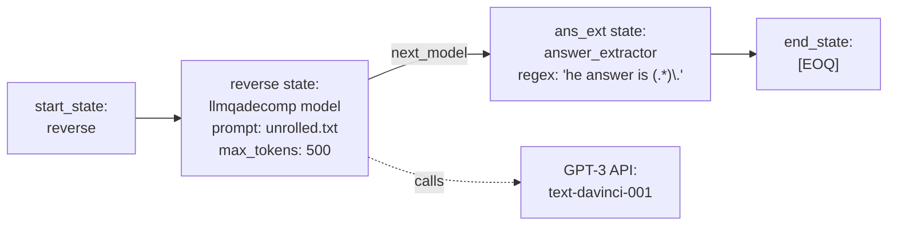

**Configuration breakdown**:

| Field | Value | Purpose |
|-------|-------|---------|
| `start_state` | `"reverse"` | Entry point into the state machine |
| `end_state` | `"[EOQ]"` | Termination signal |
| `models.reverse.name` | `"llmqadecomp"` | Model type for decomposition |
| `models.reverse.prompt_file` | `"configs/prompts/reverse/unrolled.txt"` | Path to prompt template |
| `models.reverse.next_model` | `"ans_ext"` | Transition to answer extraction |
| `models.reverse.max_tokens` | `500` | Maximum generation length |
| `models.reverse.engine` | `"text-davinci-001"` | GPT-3 engine specification |
| `models.ans_ext.name` | `"answer_extractor"` | Extract final answer via regex |
| `models.ans_ext.regex` | `".*he answer is (.*)\."` | Pattern to capture answer |
| `reader.name` | `"drop"` | Dataset reader type |
| `reader.add_paras` | `true` | Include context paragraphs |

Sources: [configs/inference/reverse/unrolled.jsonnet:1-27]()

### Execution Model Comparison

**Configuration Entity Mapping Across Strategies**

```mermaid
graph TB
    subgraph "unrolled.jsonnet"
        U_Start["start_state: reverse"]
        U_Model["llmqadecomp<br/>prompt: unrolled.txt"]
        U_Extract["answer_extractor<br/>regex pattern"]
        U_End["end_state: [EOQ]"]
        
        U_Start --> U_Model
        U_Model --> U_Extract
        U_Extract --> U_End
    end
    
    subgraph "decomp.jsonnet (comparison)"
        D_Start["start_state: gen"]
        D_Gen["llmqadecomp<br/>prompt: decomp.txt"]
        D_Exec["execute_router<br/>orchestrates sub-models"]
        D_End["end_state: [EOQ]"]
        
        D_Start --> D_Gen
        D_Gen --> D_Exec
        D_Exec --> D_End
    end
    
    subgraph "cot.jsonnet (comparison)"
        C_Start["start_state: gen"]
        C_Gen["llmqadecomp<br/>prompt: cot.txt"]
        C_Extract["answer_extractor<br/>regex pattern"]
        C_End["end_state: [EOQ]"]
        
        C_Start --> C_Gen
        C_Gen --> C_Extract
        C_Extract --> C_End
    end
    
    U_Model -.->|"Similar structure"| C_Gen
    U_Extract -.->|"Same component"| C_Extract
```

The unrolled strategy shares the same pipeline structure as the CoT strategy (single generation + extraction) but differs from the decomposed strategy which uses an `execute_router` for multi-stage execution.

Sources: [configs/inference/reverse/unrolled.jsonnet:1-27]()

## Computational Characteristics

### Token Usage

The unrolled strategy generates longer reasoning traces than direct methods due to:

1. **Explicit length checking**: `"The sequence is 5 items long, which is more than the minimum length of 4..."`
2. **Mathematical calculations**: `"Half of 5 is 5 / 2 = 2.5. Dropping the decimal, we get that the first half will be 2 items long..."`
3. **Index tracking**: `"The first half of the sequence ends with '2. button', so the second half starts after '2. button' with '3. packet'."`
4. **Recursive sub-computations**: Each half is reversed with full enumeration
5. **Joining operations**: `"Joining 'shoe, identity card, packet' and 'button, driving license'..."`

The `max_tokens: 500` parameter in [configs/inference/reverse/unrolled.jsonnet:10]() accommodates these verbose traces.

### Scalability Properties

| Sequence Length | Splits Required | Direct Reversals | Joins |
|-----------------|-----------------|------------------|-------|
| 3 (base case) | 0 | 1 | 0 |
| 4 (threshold) | 1 | 2 | 1 |
| 5 | 1 | 2 | 1 |
| 6 | 1 | 2 | 1 |
| 8 | 1 | 2 | 1 |
| 10 | 1 + recursion | multiple | multiple |

The recursive depth grows logarithmically with sequence length, but the prompt must generate all intermediate steps inline rather than through actual recursion.

Sources: [configs/prompts/reverse/unrolled.txt:1-15]()

## Answer Extraction

The `answer_extractor` model in [configs/inference/reverse/unrolled.jsonnet:13-16]() uses regex pattern matching to extract the final answer from the generated reasoning trace:

**Regex pattern**: `".*he answer is (.*)\."`

This pattern matches:
- `.*` - any characters (the reasoning steps)
- `he answer is ` - the literal text "he answer is" (note: matches "the answer is")
- `(.*)` - capture group for the actual answer
- `\.` - literal period

**Example extraction**:
```
Input: "...Joining 'bottle, laptop' and 'glasses, newspaper', the answer is 'bottle, laptop, glasses, newspaper'."
Captured: "bottle, laptop, glasses, newspaper"
```

The extractor transitions to the `end_state: "[EOQ]"` after extraction, completing the inference pipeline.

Sources: [configs/inference/reverse/unrolled.jsonnet:13-16]()

## Comparison with Other Strategies

**Decision Logic Comparison**

| Aspect | Unrolled | Decomposed | Chain of Thought |
|--------|----------|------------|------------------|
| **Conditional logic** | Explicit threshold (length ≥ 4) | No conditions (always decomposes) | No conditions (always enumerates) |
| **Recursion** | Simulated recursive calls | Flat decomposition | Flat enumeration |
| **Sub-problems** | Dynamic based on length | Fixed sub-operations | Single operation |
| **Token efficiency** | Medium (conditional paths) | Low (verbose steps) | High (direct reasoning) |
| **Prompt complexity** | High (multiple execution paths) | Medium (fixed steps) | Low (single pattern) |

The unrolled strategy is unique in demonstrating **conditional program logic** through prompting, making it suitable for problems where the solution approach varies based on input characteristics.

For detailed comparisons of prompt structures and outputs, see [Decomposed Prompting Strategy](#3.1) and [Chain of Thought (CoT) Strategy](#3.2).

Sources: [configs/prompts/reverse/unrolled.txt:1-15](), [configs/inference/reverse/unrolled.jsonnet:1-27]()

## Usage Example

To run inference using the unrolled strategy on list reversal:

```bash
python -m decomp.inference.configurable_inference \
    --config configs/inference/reverse/unrolled.jsonnet \
    --input_file data/reverse/reverse_LEN_4.json \
    --output_file output/unrolled_predictions.json
```

The inference pipeline will:
1. Load the configuration from `unrolled.jsonnet`
2. Initialize the `drop` reader with the input dataset
3. Enter the `reverse` state using the `llmqadecomp` model
4. Generate reasoning traces using the `unrolled.txt` prompt
5. Extract answers using the regex-based `answer_extractor`
6. Reach the `[EOQ]` end state
7. Write predictions to the output file

For evaluation of results, see [Evaluation and Results](#4.2.3).

Sources: [configs/inference/reverse/unrolled.jsonnet:1-27]()

---

# Page: Experiments

# Experiments

<details>
<summary>Relevant source files</summary>

The following files were used as context for generating this wiki page:

- [LICENSE](LICENSE)
- [README.md](README.md)

</details>


This page provides an overview of the three main experimental tasks supported by the DecomP repository. Each experiment evaluates how different prompting strategies (decomposed, chain-of-thought, unrolled) perform on specific types of reasoning tasks. For detailed information about the prompting strategies themselves, see [Core Concepts](#3). For implementation details of individual experiments, see [Letter Concatenation](#4.1), [List Reversal](#4.2), and [CommAQA Multi-hop Question Answering](#4.3).

## Overview

DecomP supports three distinct experimental tasks, each designed to evaluate different aspects of compositional reasoning:

| Experiment | Task Type | Dataset Source | Evaluation Focus | Strategies Available |
|------------|-----------|----------------|------------------|---------------------|
| Letter Concatenation | String Manipulation | Static JSON files | Position-based extraction and concatenation | Decomposed, CoT, CoT with Rollout |
| List Reversal | Sequence Reversal | Generated synthetically | Recursive decomposition and algorithmic reasoning | Decomposed, CoT, Unrolled |
| CommAQA | Multi-hop QA | Static JSON files (IID and CompGen splits) | Complex compositional question answering | Fine-grained Decomposed, Coarse-grained Decomposed, CoT |

All experiments follow a common workflow pattern: configuration selection → inference execution → prediction generation → evaluation. However, they differ significantly in their data requirements, configuration complexity, and the types of reasoning they evaluate.

**Sources:** [README.md:20-79]()

## Experimental Pipeline Architecture

The following diagram shows how each experiment type is structured and which components it uses:

```mermaid
graph TB
    subgraph LetterCat["Letter Concatenation"]
        LC_DATA["datasets/letter_cat/*.json<br/>Static datasets"]
        LC_CONFIG1["letter_cat_greedy_search.jsonnet"]
        LC_CONFIG2["cot_letter_cat_greedy_search.jsonnet"]
        LC_CONFIG3["cot_rollout_letter_cat_greedy_search.jsonnet"]
        LC_PROMPT["promptid variable<br/>p1, p2, or p3"]
    end
    
    subgraph ListRev["List Reversal"]
        LR_GEN["build_reverse_dataset.py<br/>Dynamic generation"]
        LR_WORD["wordlist.txt<br/>57 words"]
        LR_DATA["datasets/reverse/<br/>test_{LEN}_normal_words.json"]
        LR_CONFIG1["decomp.jsonnet"]
        LR_CONFIG2["cot.jsonnet"]
        LR_CONFIG3["unrolled.jsonnet"]
        LR_PARAM["LEN parameter<br/>4, 6, 8, 10"]
    end
    
    subgraph CommAQA["CommAQA"]
        CQ_DATA1["datasets/commaqa_e/<br/>iid_test_eg100.json"]
        CQ_DATA2["datasets/commaqa_e/<br/>compgen_test_eg300.json"]
        CQ_CONFIG1["commaqae_fine_greedy_search.jsonnet"]
        CQ_CONFIG2["commaqae_coarse_greedy_search.jsonnet"]
        CQ_CONFIG3["cot_commaqae_greedy_search.jsonnet"]
        CQ_PROMPT["promptid variable<br/>p1, p2, or p3"]
    end
    
    INFERENCE["configurable_inference module<br/>decomp.inference.configurable_inference"]
    
    EVAL["drop_eval module<br/>decomp.datasets_utils.drop_eval"]
    
    OUTPUT["output/predictions/<br/>*_predictions.json"]
    
    LC_DATA --> INFERENCE
    LC_CONFIG1 --> INFERENCE
    LC_CONFIG2 --> INFERENCE
    LC_CONFIG3 --> INFERENCE
    LC_PROMPT --> INFERENCE
    
    LR_WORD --> LR_GEN
    LR_GEN --> LR_DATA
    LR_DATA --> INFERENCE
    LR_CONFIG1 --> INFERENCE
    LR_CONFIG2 --> INFERENCE
    LR_CONFIG3 --> INFERENCE
    LR_PARAM --> LR_GEN
    
    CQ_DATA1 --> INFERENCE
    CQ_DATA2 --> INFERENCE
    CQ_CONFIG1 --> INFERENCE
    CQ_CONFIG2 --> INFERENCE
    CQ_CONFIG3 --> INFERENCE
    CQ_PROMPT --> INFERENCE
    
    INFERENCE --> OUTPUT
    OUTPUT --> EVAL
```

This diagram illustrates the key differences between experiments: Letter Concatenation and CommAQA use pre-existing datasets with variable prompt IDs, while List Reversal requires dataset generation with configurable parameters. All experiments converge at the `configurable_inference` module and use the same evaluation pipeline via `drop_eval`.

**Sources:** [README.md:20-79]()

## Common Workflow Components

All three experiments share the following execution pattern:

### 1. Configuration Selection

Each experiment uses Jsonnet configuration files located in `configs/inference/`. These configurations define:
- The model pipeline (which models execute and in what order)
- Model-specific parameters (temperature, max tokens, etc.)
- Prompt template paths
- Reader configuration (dataset format and context handling)

Configuration files follow naming patterns that indicate the strategy:
- `*_greedy_search.jsonnet` - Uses greedy decoding for generation
- `decomp*.jsonnet` - Uses decomposed prompting strategy
- `cot*.jsonnet` - Uses chain-of-thought strategy
- `unrolled*.jsonnet` - Uses unrolled recursive strategy (List Reversal only)

For more details on the configuration system, see [Configuration System](#5.2).

**Sources:** [README.md:23-26](), [README.md:33-35](), [README.md:52-55](), [README.md:65-68](), [README.md:75-76]()

### 2. Inference Execution

Inference is executed via the `configurable_inference` module with three required arguments:

| Argument | Description | Example |
|----------|-------------|---------|
| `--input` | Path to input dataset JSON file | `datasets/letter_cat/n5_eg100_pos2_space.json` |
| `--config` | Path to Jsonnet configuration file | `configs/inference/letter_cat/letter_cat_greedy_search.jsonnet` |
| `--output` | Path for output predictions JSON file | `output/predictions/letter_cat_predictions.json` |

Some experiments also use environment variables:
- `promptid` - Selects which prompt variant to use (Letter Concatenation and CommAQA)
- `LEN` - Specifies sequence length for dataset generation (List Reversal)
- `STRAT` - Specifies prompting strategy (List Reversal)

**Sources:** [README.md:23-31](), [README.md:38-60](), [README.md:64-73]()

### 3. Prediction Generation

The inference pipeline generates predictions in JSON format with the following structure:
- Each prediction corresponds to one input example
- Predictions include intermediate reasoning steps (for decomposed strategies)
- Final answers are extracted using the `answer_extractor` model component

For details on model components, see [Model Components](#5.3).

**Sources:** [README.md:26](), [README.md:55](), [README.md:68]()

### 4. Evaluation

All experiments use the same evaluation module: `decomp.datasets_utils.drop_eval`. This module compares predictions against gold standard answers and computes accuracy metrics.

The evaluation command pattern is:
```bash
python -m decomp.datasets_utils.drop_eval \
  --gold_path <path_to_dataset> \
  --prediction_path <path_to_predictions>
```

**Sources:** [README.md:28-31](), [README.md:57-59](), [README.md:70-72]()

## Experiment-Specific Characteristics

### Letter Concatenation

**Purpose:** Evaluates position-based extraction and string concatenation capabilities.

**Dataset:** Static files in `datasets/letter_cat/` with naming pattern indicating parameters (e.g., `n5_eg100_pos2_space.json` indicates 5 letters, 100 examples, position 2, with spaces).

**Unique Features:**
- Uses `promptid` environment variable to select from multiple prompt variants (p1, p2, p3)
- Supports CoT with rollout strategy via `cot_rollout_letter_cat_greedy_search.jsonnet`
- Focuses on testing extraction from specific positions in letter sequences

For detailed documentation, see [Letter Concatenation](#4.1).

**Sources:** [README.md:20-35]()

### List Reversal

**Purpose:** Evaluates recursive decomposition and algorithmic reasoning for sequence reversal.

**Dataset:** Generated dynamically using `build_reverse_dataset.py` with configurable length parameter.

**Unique Features:**
- Only experiment requiring dataset generation before inference
- Uses `wordlist.txt` vocabulary with 57 common words
- Supports three distinct strategies: decomposed, chain-of-thought, and unrolled
- Configurable sequence lengths (typically 4, 6, 8, 10)
- Tests scalability of reasoning strategies as sequence length increases

For detailed documentation, see [List Reversal](#4.2).

**Sources:** [README.md:37-60]()

### CommAQA Multi-hop Question Answering

**Purpose:** Evaluates complex compositional question answering with multi-hop reasoning.

**Dataset:** Static files in `datasets/commaqa_e/` with two evaluation splits:
- `iid_test_eg100.json` - In-distribution test set
- `compgen_test_eg300.json` - Compositional generalization test set

**Unique Features:**
- Most complex experiment with multi-stage decomposition
- Supports fine-grained and coarse-grained decomposition strategies
- Uses specialized sub-question models (`aw_qa`, `pos_qa`, `simp_qa`)
- Tests both in-distribution performance and compositional generalization
- Uses `promptid` environment variable for prompt selection (p1, p2, p3)

For detailed documentation, see [CommAQA Multi-hop Question Answering](#4.3).

**Sources:** [README.md:62-78]()

## Experiment Execution Flow

The following diagram maps the execution flow from command-line invocation to output files:

```mermaid
flowchart TD
    CMD["Command Line Invocation<br/>python -m decomp.inference.configurable_inference"]
    
    ENV["Environment Variables<br/>OPENAI_API_KEY<br/>PYTHONPATH=src/<br/>Optional: promptid, LEN, STRAT"]
    
    ARGS["Command Arguments<br/>--input: dataset path<br/>--config: jsonnet path<br/>--output: prediction path"]
    
    JSONNET["Jsonnet Configuration Parser<br/>Loads model pipeline definition"]
    
    READER["Dataset Reader<br/>drop format reader<br/>Loads input examples"]
    
    PIPELINE["Inference Pipeline Execution<br/>State machine with model transitions"]
    
    MODELS["Model Components<br/>llmqadecomp, llmqa<br/>execute_router, answer_extractor"]
    
    GPT3["OpenAI API<br/>text-davinci-001<br/>Token generation"]
    
    PRED["Prediction File<br/>output/predictions/*.json<br/>Contains answers + reasoning"]
    
    EVAL_CMD["Evaluation Command<br/>python -m decomp.datasets_utils.drop_eval"]
    
    METRICS["Evaluation Metrics<br/>Accuracy computation"]
    
    CMD --> ENV
    CMD --> ARGS
    ENV --> JSONNET
    ARGS --> JSONNET
    ARGS --> READER
    JSONNET --> PIPELINE
    READER --> PIPELINE
    PIPELINE --> MODELS
    MODELS --> GPT3
    GPT3 --> MODELS
    MODELS --> PIPELINE
    PIPELINE --> PRED
    PRED --> EVAL_CMD
    ARGS --> EVAL_CMD
    EVAL_CMD --> METRICS
```

**Sources:** [README.md:12-16](), [README.md:20-79]()

## Experimental Parameters Summary

The following table summarizes key configurable parameters for each experiment:

| Parameter | Letter Concatenation | List Reversal | CommAQA |
|-----------|---------------------|---------------|---------|
| Dataset Source | Static files | Generated | Static files |
| Input Format | JSON with letter sequences | JSON with word lists | JSON with questions + context |
| Prompt Selection | `promptid` (p1/p2/p3) | Implicit in config | `promptid` (p1/p2/p3) |
| Strategy Variants | 3 (decomp, cot, cot_rollout) | 3 (decomp, cot, unrolled) | 3 (fine, coarse, cot) |
| Configurable Parameters | Fixed dataset | `LEN` (sequence length) | Test split selection |
| Evaluation Splits | Single test set | Generated per length | IID + CompGen |
| Generation Required | No | Yes | No |

**Sources:** [README.md:20-79]()

## Next Steps

For detailed information about running specific experiments:
- [Letter Concatenation](#4.1) - String manipulation experiment
- [List Reversal](#4.2) - Sequence reversal with dataset generation
- [CommAQA Multi-hop Question Answering](#4.3) - Complex compositional QA

For information about the underlying system architecture:
- [Inference Pipeline](#5.1) - Execution state machine
- [Configuration System](#5.2) - Jsonnet configuration format
- [Model Components](#5.3) - Individual model types

For information about datasets and prompts:
- [Datasets](#6) - Dataset formats and structures
- [Prompt Templates](#7) - Prompt template documentation

---

# Page: Letter Concatenation

# Letter Concatenation

<details>
<summary>Relevant source files</summary>

The following files were used as context for generating this wiki page:

- [LICENSE](LICENSE)
- [README.md](README.md)
- [configs/inference/letter_cat/letter_cat_greedy_search.jsonnet](configs/inference/letter_cat/letter_cat_greedy_search.jsonnet)

</details>


## Purpose and Scope

This document describes the letter concatenation experiment in the DecomP repository. Letter concatenation is a string manipulation task that evaluates the ability of language models to extract specific characters from sequences and concatenate them. This experiment uses static pre-generated datasets and supports multiple prompting strategies.

For information about the other experimental tasks, see [List Reversal](#4.2) and [CommAQA Multi-hop Question Answering](#4.3). For details on the core prompting strategies themselves, see [Core Concepts](#3).

**Sources:** [README.md:20-35]()

## Task Description

The letter concatenation task requires extracting specific letters from a sequence and concatenating them in order. For example, given the sequence "A, B, C, D, E" and positions [1, 3, 5], the model should extract letters at those positions and produce "A, C, E".

The task evaluates:
- Position-based character extraction
- Sequential processing
- String concatenation
- Following explicit decomposition steps

**Sources:** [README.md:20-35]()

## Dataset Structure

Letter concatenation datasets are located in `datasets/letter_cat/` and follow the standard DecomP dataset format. The primary dataset used in experiments is:

- `n5_eg100_pos2_space.json` - Contains sequences of length 5 with 100 examples, extracting positions 2

Each dataset entry contains:
- `query_id`: Unique identifier for the query
- `question`: The input sequence and task description
- `answer`: The expected output string
- Additional metadata fields as per the DROP format

**Sources:** [README.md:24]()

## Configuration Options

Letter concatenation supports three main configuration approaches:

| Configuration | Strategy | Config File |
|--------------|----------|-------------|
| Decomposed Prompting | Multi-step decomposition with explicit sub-operations | `letter_cat_greedy_search.jsonnet` |
| Chain of Thought (CoT) | Natural language reasoning | `cot_letter_cat_greedy_search.jsonnet` |
| CoT with Rollout | Chain of thought with execution rollout | `cot_rollout_letter_cat_greedy_search.jsonnet` |

### Decomposed Prompting Configuration

The primary configuration uses decomposed prompting with variable prompt templates:

```mermaid
graph TB
    CONFIG["letter_cat_greedy_search.jsonnet"]
    PROMPTID["Environment Variable:<br/>promptid"]
    
    GEN["Model: gen<br/>Type: llmqadecomp"]
    EXECUTE["Model: execute<br/>Type: execute_router"]
    
    P1["Prompt Template p1<br/>letter_cat_n3_ex3_decomp.txt"]
    P2["Prompt Template p2<br/>letter_cat_n3_ex3_decomp.txt"]
    P3["Prompt Template p3<br/>letter_cat_n3_ex3_decomp.txt"]
    
    READER["Reader: drop"]
    
    CONFIG -->|"start_state: gen"| GEN
    CONFIG -->|uses| READER
    
    PROMPTID -->|"promptid=p1"| P1
    PROMPTID -->|"promptid=p2"| P2
    PROMPTID -->|"promptid=p3"| P3
    
    P1 -->|"prompt_file"| GEN
    P2 -->|"prompt_file"| GEN
    P3 -->|"prompt_file"| GEN
    
    GEN -->|"next_model: execute"| EXECUTE
    EXECUTE -->|"end_state: [EOQ]"| END["Terminal State"]
```

**Diagram: Letter Concatenation Configuration Structure**

The configuration uses the `promptid` environment variable to select between three prompt variants (p1, p2, p3), each providing different few-shot examples but following the same decomposition strategy.

**Sources:** [configs/inference/letter_cat/letter_cat_greedy_search.jsonnet:1-21]()

### Configuration File Details

The decomposed prompting configuration at [configs/inference/letter_cat/letter_cat_greedy_search.jsonnet]() defines:

| Field | Value | Description |
|-------|-------|-------------|
| `start_state` | `"gen"` | Initial model to execute |
| `end_state` | `"[EOQ]"` | Terminal state marker |
| `models.gen.name` | `"llmqadecomp"` | LLM-based QA decomposition model |
| `models.gen.prompt_file` | Dynamic path using `promptid` | Template path determined at runtime |
| `models.gen.next_model` | `"execute"` | Routes to execution router |
| `models.execute.name` | `"execute_router"` | Orchestrates sub-model execution |
| `reader.name` | `"drop"` | Dataset reader |

The prompt file path is constructed dynamically:
```
configs/prompts/letter_cat/letter_cat_{promptid}/letter_cat_n3_ex3_decomp.txt
```

Where `{promptid}` is replaced with the environment variable value (p1, p2, or p3).

**Sources:** [configs/inference/letter_cat/letter_cat_greedy_search.jsonnet:1-21]()

## Running Inference

### Basic Execution

To run letter concatenation inference with decomposed prompting:

```bash
promptid=p1 python -m decomp.inference.configurable_inference \
  --input datasets/letter_cat/n5_eg100_pos2_space.json \
  --config configs/inference/letter_cat/letter_cat_greedy_search.jsonnet \
  --output output/predictions/letter_cat_n5_eg100_pos2_space_decomp_predictions.json
```

### Prompt Variants

Change the `promptid` variable to experiment with different prompts:

```bash
# Try prompt variant p2
promptid=p2 python -m decomp.inference.configurable_inference \
  --input datasets/letter_cat/n5_eg100_pos2_space.json \
  --config configs/inference/letter_cat/letter_cat_greedy_search.jsonnet \
  --output output/predictions/letter_cat_n5_eg100_pos2_space_p2_predictions.json

# Try prompt variant p3
promptid=p3 python -m decomp.inference.configurable_inference \
  --input datasets/letter_cat/n5_eg100_pos2_space.json \
  --config configs/inference/letter_cat/letter_cat_greedy_search.jsonnet \
  --output output/predictions/letter_cat_n5_eg100_pos2_space_p3_predictions.json
```

### Alternative Strategies

To evaluate CoT baseline:
```bash
promptid=p1 python -m decomp.inference.configurable_inference \
  --input datasets/letter_cat/n5_eg100_pos2_space.json \
  --config configs/inference/letter_cat/cot_letter_cat_greedy_search.jsonnet \
  --output output/predictions/letter_cat_n5_eg100_pos2_space_cot_predictions.json
```

To evaluate CoT with rollout baseline:
```bash
promptid=p1 python -m decomp.inference.configurable_inference \
  --input datasets/letter_cat/n5_eg100_pos2_space.json \
  --config configs/inference/letter_cat/cot_rollout_letter_cat_greedy_search.jsonnet \
  --output output/predictions/letter_cat_n5_eg100_pos2_space_cot_rollout_predictions.json
```

**Sources:** [README.md:20-35]()

## Execution Pipeline

The letter concatenation inference follows a state machine execution model:

```mermaid
stateDiagram-v2
    [*] --> ConfigLoad
    
    ConfigLoad --> InitReader: "Load letter_cat_greedy_search.jsonnet"
    InitReader --> GenState: "Initialize drop reader"
    
    state GenState {
        [*] --> LoadPrompt
        LoadPrompt --> FormatContext: "Load letter_cat_n3_ex3_decomp.txt"
        FormatContext --> CallGPT3: "Insert question into prompt"
        CallGPT3 --> GenerateSteps: "API call to text-davinci-001"
        GenerateSteps --> [*]: "Decomposed steps output"
    }
    
    GenState --> ExecuteState: "next_model: execute"
    
    state ExecuteState {
        [*] --> RouteSubModels
        RouteSubModels --> ExecPrimitives: "Execute decomposition primitives"
        ExecPrimitives --> [*]: "Aggregated results"
    }
    
    ExecuteState --> EndState: "Completion"
    EndState --> SavePredictions: "[EOQ] reached"
    SavePredictions --> [*]
    
    note right of GenState
        Model: llmqadecomp
        Uses promptid environment variable
        Generates decomposition plan
    end note
    
    note right of ExecuteState
        Model: execute_router
        Invokes primitive operations
        From primitives.libsonnet
    end note
```

**Diagram: Letter Concatenation State Machine Execution Flow**

The pipeline executes in two main phases:
1. **Generation (`gen` state)**: The `llmqadecomp` model loads the prompt template, inserts the input question, and generates a decomposition plan via GPT-3
2. **Execution (`execute` state)**: The `execute_router` parses the decomposition and invokes the appropriate primitive operations defined in [configs/inference/primitives.libsonnet]()

**Sources:** [configs/inference/letter_cat/letter_cat_greedy_search.jsonnet:5-16](), [README.md:23-26]()

## Evaluation

After generating predictions, evaluate performance using the `drop_eval` module:

```bash
python -m decomp.datasets_utils.drop_eval \
  --gold_path datasets/letter_cat/n5_eg100_pos2_space.json \
  --prediction_path output/predictions/letter_cat_n5_eg100_pos2_space_decomp_predictions.json
```

The evaluator compares predicted answers against ground truth labels in the dataset and reports:
- Exact match accuracy
- F1 score (token-level overlap)
- Other DROP evaluation metrics

### Comparing Strategies

To compare different prompting strategies, run inference with each configuration and compare evaluation results:

| Strategy | Config | Expected Performance |
|----------|--------|---------------------|
| Decomposed (p1) | `letter_cat_greedy_search.jsonnet` | Baseline decomposed performance |
| Decomposed (p2) | `letter_cat_greedy_search.jsonnet` | Alternative prompt examples |
| Decomposed (p3) | `letter_cat_greedy_search.jsonnet` | Alternative prompt examples |
| CoT | `cot_letter_cat_greedy_search.jsonnet` | Natural reasoning baseline |
| CoT + Rollout | `cot_rollout_letter_cat_greedy_search.jsonnet` | CoT with execution trace |

**Sources:** [README.md:28-35]()

## Model Components

The letter concatenation experiment uses two primary model types:

```mermaid
graph LR
    INPUT["Input Dataset<br/>n5_eg100_pos2_space.json"]
    
    subgraph "Model Pipeline"
        LLMQADECOMP["llmqadecomp<br/>decomposition model"]
        EXECUTE_ROUTER["execute_router<br/>execution orchestrator"]
        PRIMITIVES["primitives<br/>base operations"]
    end
    
    OUTPUT["Predictions JSON"]
    
    INPUT -->|"question"| LLMQADECOMP
    LLMQADECOMP -->|"decomposition plan"| EXECUTE_ROUTER
    EXECUTE_ROUTER -->|"invokes"| PRIMITIVES
    PRIMITIVES -->|"results"| EXECUTE_ROUTER
    EXECUTE_ROUTER -->|"final answer"| OUTPUT
```

**Diagram: Model Component Interaction**

### llmqadecomp Model

The `llmqadecomp` model (referenced at [configs/inference/letter_cat/letter_cat_greedy_search.jsonnet:9]()) performs:
- Loading the prompt template from the selected `promptid` directory
- Formatting the template with the input question
- Calling GPT-3 API (`text-davinci-001`) to generate a decomposition plan
- Outputting structured steps for the execution router

### execute_router Model

The `execute_router` model (referenced at [configs/inference/letter_cat/letter_cat_greedy_search.jsonnet:14-16]()) performs:
- Parsing the decomposition plan from `llmqadecomp`
- Routing to appropriate primitive operations
- Managing execution state and intermediate results
- Returning the final aggregated answer

### Primitive Operations

Primitive operations are defined in [configs/inference/primitives.libsonnet]() and are imported into the configuration at [configs/inference/letter_cat/letter_cat_greedy_search.jsonnet:1-3](). These provide basic string manipulation operations used by the execution router.

**Sources:** [configs/inference/letter_cat/letter_cat_greedy_search.jsonnet:1-21]()

## Required Environment Setup

Before running letter concatenation experiments, ensure the following environment variables are set:

```bash
export PYTHONPATH=src/
export OPENAI_API_KEY=<YOUR_API_KEY>
```

The `OPENAI_API_KEY` is required for GPT-3 API access. The `PYTHONPATH` ensures proper module resolution for the `decomp` package.

**Sources:** [README.md:12-16]()

## Output Format

Predictions are written to the specified output file in JSON format. Each prediction entry contains:
- `query_id`: Matching the input dataset
- `predicted_answer`: The model's generated answer
- `decomposition`: The intermediate steps (if applicable)
- Additional metadata about the inference process

The output format matches the DROP prediction schema to enable evaluation with `drop_eval`.

**Sources:** [README.md:26]()

---

# Page: List Reversal

# List Reversal

<details>
<summary>Relevant source files</summary>

The following files were used as context for generating this wiki page:

- [LICENSE](LICENSE)
- [README.md](README.md)
- [src/decomp/datasets_utils/build_reverse_dataset.py](src/decomp/datasets_utils/build_reverse_dataset.py)

</details>


## Purpose and Scope

This document describes the list reversal experiment in DecomP, which evaluates the ability of decomposed prompting strategies to reverse sequences of elements. The experiment is designed to test systematic algorithmic reasoning on sequences of varying lengths.

This page provides an overview of the list reversal workflow, from dataset generation through inference and evaluation. For detailed information on specific components:
- Dataset generation specifics: see [Dataset Generation](#4.2.1)
- Inference configuration details: see [Inference Configurations](#4.2.2)
- Evaluation procedures: see [Evaluation and Results](#4.2.3)

For information about the three prompting strategies (decomposed, chain of thought, unrolled), see [Core Concepts](#3).

---

## Task Overview

The list reversal task presents a sequence of elements and requires the model to output the sequence in reversed order. For example:

| Input Sequence | Expected Output |
|----------------|-----------------|
| `card, stamp, book, water, glasses` | `glasses, water, book, stamp, card` |
| `apple, dog, house` | `house, dog, apple` |

The task tests whether language models can perform systematic algorithmic transformations, with difficulty scaling by sequence length. The DecomP system evaluates three different prompting strategies on this task to compare their effectiveness.

**Sources:** [README.md:37-60]()

---

## Complete Workflow

The list reversal experiment follows a three-stage pipeline: dataset generation, inference execution, and evaluation. Unlike other experiments in DecomP (such as letter concatenation), list reversal requires dynamic dataset generation.

```mermaid
flowchart TB
    subgraph "1. Dataset Generation"
        WORDLIST["wordlist.txt<br/>(57 words)"]
        GENERATOR["build_reverse_dataset.py"]
        CONFIG_GEN["Configuration Parameters:<br/>--length (4, 6, 8, 10)<br/>--num_examples (1000)<br/>--elts (words)"]
        DATASET["test_LEN_normal_words.json<br/>train_LEN_normal_words.json"]
    end
    
    subgraph "2. Inference Execution"
        INPUT["Input Dataset<br/>test_LEN_normal_words.json"]
        STRAT_CONFIG["Strategy Configuration<br/>decomp.jsonnet<br/>cot.jsonnet<br/>unrolled.jsonnet"]
        INFERENCE["configurable_inference module"]
        GPT3["GPT-3 API<br/>text-davinci-001"]
        OUTPUT["Predictions<br/>reverse_LEN_STRAT_predictions.json"]
    end
    
    subgraph "3. Evaluation"
        GOLD["Gold Dataset<br/>test_LEN_normal_words.json"]
        PRED["Predictions"]
        EVAL["drop_eval module"]
        METRICS["Accuracy Metrics"]
    end
    
    WORDLIST --> GENERATOR
    CONFIG_GEN --> GENERATOR
    GENERATOR --> DATASET
    
    DATASET --> INPUT
    INPUT --> INFERENCE
    STRAT_CONFIG --> INFERENCE
    INFERENCE --> GPT3
    GPT3 --> INFERENCE
    INFERENCE --> OUTPUT
    
    DATASET --> GOLD
    OUTPUT --> PRED
    GOLD --> EVAL
    PRED --> EVAL
    EVAL --> METRICS
```

**Sources:** [README.md:37-60](), [src/decomp/datasets_utils/build_reverse_dataset.py:1-180]()

---

## Dataset Generation

List reversal datasets are generated synthetically using the `build_reverse_dataset.py` script. This allows researchers to create datasets with controlled properties such as sequence length and element types.

### Key Parameters

| Parameter | Description | Example Values |
|-----------|-------------|----------------|
| `--length` | Length of sequences to generate | `4`, `6`, `8`, `10` |
| `--elts` | Type of elements in sequences | `words`, `letters`, `numbers` |
| `--listop` | List operation to perform | `reversed`, `sorted`, `sort_last` |
| `--num_examples` | Total number of examples | `1000` |
| `--word_list` | Path to vocabulary file | `configs/data/wordlist.txt` |

### Generation Process

```mermaid
flowchart LR
    VOCAB["Vocabulary Source<br/>wordlist.txt"]
    SAMPLE["Random Sampling<br/>get_sublists() or<br/>repeated_sample()"]
    LISTOP["List Operation<br/>reversed() function"]
    FORMAT["Format as QA Pairs<br/>listop() function"]
    SPLIT["Train/Test Split<br/>default: 10 train, rest test"]
    OUTPUT["JSON Output Files"]
    
    VOCAB --> SAMPLE
    SAMPLE --> LISTOP
    LISTOP --> FORMAT
    FORMAT --> SPLIT
    SPLIT --> OUTPUT
```

The script samples permutations of elements from the vocabulary, applies the specified list operation (reversal), and formats the results as question-answer pairs following the DROP dataset format.

**Command Example:**
```bash
LEN=10
python src/decomp/datasets_utils/build_reverse_dataset.py \
  --listop=reversed \
  --elts=words \
  --out_dir=datasets/reverse \
  --length=$LEN \
  --num_examples=1000
```

For detailed information about dataset generation parameters and output format, see [Dataset Generation](#4.2.1).

**Sources:** [README.md:41-50](), [src/decomp/datasets_utils/build_reverse_dataset.py:25-103]()

---

## Prompting Strategies

The list reversal experiment evaluates three distinct prompting strategies, each implementing a different approach to the reversal task:

### Strategy Comparison

| Strategy | Configuration File | Key Approach | Page Reference |
|----------|-------------------|--------------|----------------|
| **Decomposed** | `configs/inference/reverse/decomp.jsonnet` | Splits sequence into halves, reverses each, rejoins | [Decomposed Prompting](#3.1) |
| **Chain of Thought** | `configs/inference/reverse/cot.jsonnet` | Natural language reasoning through position enumeration | [Chain of Thought](#3.2) |
| **Unrolled** | `configs/inference/reverse/unrolled.jsonnet` | Recursive decomposition with conditional logic | [Unrolled Strategy](#3.3) |

### Strategy Execution Flow

```mermaid
flowchart TB
    INPUT["Input: card, stamp, book, water"]
    
    subgraph DECOMP["Decomposed Strategy"]
        D1["Extract: card, stamp, book, water"]
        D2["Split: [card, stamp] [book, water]"]
        D3["Reverse halves: [stamp, card] [water, book]"]
        D4["Join: water, book, stamp, card"]
    end
    
    subgraph COT["Chain of Thought Strategy"]
        C1["Enumerate positions:<br/>1st=card, 2nd=stamp, 3rd=book, 4th=water"]
        C2["State reversal:<br/>4th=water, 3rd=book, 2nd=stamp, 1st=card"]
        C3["Output: water, book, stamp, card"]
    end
    
    subgraph UNROLLED["Unrolled Strategy"]
        U1["Check length >= 4"]
        U2["Split recursively"]
        U3["Reverse sub-sequences"]
        U4["Join: water, book, stamp, card"]
    end
    
    INPUT --> D1
    INPUT --> C1
    INPUT --> U1
    
    D1 --> D2 --> D3 --> D4
    C1 --> C2 --> C3
    U1 --> U2 --> U3 --> U4
    
    D4 --> OUTPUT["Output: water, book, stamp, card"]
    C3 --> OUTPUT
    U4 --> OUTPUT
```

Each strategy is implemented through a combination of configuration files (`.jsonnet`) and prompt templates (`.txt` files). The inference pipeline loads the appropriate configuration and executes the strategy-specific prompting approach.

For detailed information about inference configurations and how to select strategies, see [Inference Configurations](#4.2.2).

**Sources:** [README.md:38-40](), Diagram 4 from high-level architecture

---

## Running Inference

### Basic Workflow

The inference process uses the `configurable_inference` module with strategy-specific configurations:

```bash
# Set variables
LEN=10                    # Sequence length: 4, 6, 8, or 10
STRAT=decomp             # Strategy: decomp, cot, or unrolled

# Run inference
python -m decomp.inference.configurable_inference \
  --input datasets/reverse/test_${LEN}_normal_words.json \
  --config configs/inference/reverse/${STRAT}.jsonnet \
  --output output/predictions/reverse_${LEN}_${STRAT}_predictions.json
```

### Configuration Files Mapping

```mermaid
graph TB
    subgraph "Input Configuration"
        CONFIG_DIR["configs/inference/reverse/"]
        DECOMP_CFG["decomp.jsonnet"]
        COT_CFG["cot.jsonnet"]
        UNROLLED_CFG["unrolled.jsonnet"]
    end
    
    subgraph "Prompt Templates"
        PROMPT_DIR["configs/prompts/"]
        DECOMP_TXT["decomp.txt"]
        COT_TXT["cot.txt"]
        UNROLLED_TXT["unrolled.txt"]
    end
    
    subgraph "Model Components"
        LLMQADECOMP["llmqadecomp"]
        LLMQA["llmqa"]
        EXEC_ROUTER["execute_router"]
    end
    
    CONFIG_DIR --> DECOMP_CFG
    CONFIG_DIR --> COT_CFG
    CONFIG_DIR --> UNROLLED_CFG
    
    DECOMP_CFG --> DECOMP_TXT
    COT_CFG --> COT_TXT
    UNROLLED_CFG --> UNROLLED_TXT
    
    DECOMP_CFG --> LLMQADECOMP
    COT_CFG --> LLMQA
    UNROLLED_CFG --> LLMQADECOMP
    
    DECOMP_CFG --> EXEC_ROUTER
    UNROLLED_CFG --> EXEC_ROUTER
```

The configuration files define:
- Which model components to use (e.g., `llmqadecomp`, `llmqa`)
- Which prompt templates to load
- Model parameters (temperature, max tokens, etc.)
- Execution flow (`start_state`, `next_model` transitions)

**Sources:** [README.md:52-55]()

---

## Evaluation

After inference completes, predictions are evaluated against the gold dataset using the `drop_eval` module:

```bash
python -m decomp.datasets_utils.drop_eval \
  --gold_path datasets/reverse/test_${LEN}_normal_words.json \
  --prediction_path output/predictions/reverse_${LEN}_${STRAT}_predictions.json
```

The evaluation compares predicted reversed sequences against ground truth answers and reports exact match accuracy.

### Evaluation Metrics

| Metric | Description |
|--------|-------------|
| **Exact Match** | Percentage of predictions that exactly match the gold answer |
| **F1 Score** | Token-level overlap between prediction and gold (from DROP eval) |

For detailed information about evaluation procedures, metrics interpretation, and result analysis, see [Evaluation and Results](#4.2.3).

**Sources:** [README.md:57-59]()

---

## Complete Example

Here is a complete end-to-end example for running a list reversal experiment with sequences of length 10 using the decomposed prompting strategy:

```bash
# 1. Create output directory
mkdir -p datasets/reverse

# 2. Generate dataset
LEN=10
python src/decomp/datasets_utils/build_reverse_dataset.py \
  --listop=reversed \
  --elts=words \
  --out_dir=datasets/reverse \
  --length=$LEN \
  --num_examples=1000

# 3. Run inference with decomposed strategy
STRAT=decomp
python -m decomp.inference.configurable_inference \
  --input datasets/reverse/test_${LEN}_normal_words.json \
  --config configs/inference/reverse/${STRAT}.jsonnet \
  --output output/predictions/reverse_${LEN}_${STRAT}_predictions.json

# 4. Evaluate results
python -m decomp.datasets_utils.drop_eval \
  --gold_path datasets/reverse/test_${LEN}_normal_words.json \
  --prediction_path output/predictions/reverse_${LEN}_${STRAT}_predictions.json
```

### Output Files

The workflow produces the following files:

| File | Description |
|------|-------------|
| `datasets/reverse/test_10_normal_words.json` | Test dataset with 990 examples |
| `datasets/reverse/train_10_normal_words.json` | Training dataset with 10 examples |
| `output/predictions/reverse_10_decomp_predictions.json` | Model predictions |

**Sources:** [README.md:37-60]()

---

## File References

### Primary Components

| Component | File Path | Description |
|-----------|-----------|-------------|
| Dataset Generator | [src/decomp/datasets_utils/build_reverse_dataset.py]() | Generates synthetic list reversal datasets |
| Inference Engine | `src/decomp/inference/configurable_inference.py` | Executes inference pipeline |
| Evaluation Module | `src/decomp/datasets_utils/drop_eval.py` | Computes accuracy metrics |
| Word Vocabulary | `configs/data/wordlist.txt` | 57 common words for dataset generation |

### Configuration Files

| Strategy | Configuration Path |
|----------|-------------------|
| Decomposed | `configs/inference/reverse/decomp.jsonnet` |
| Chain of Thought | `configs/inference/reverse/cot.jsonnet` |
| Unrolled | `configs/inference/reverse/unrolled.jsonnet` |

### Prompt Templates

Prompt templates are located in `configs/prompts/` and are referenced by the configuration files. The specific templates used depend on the selected prompting strategy.

**Sources:** [README.md:37-60](), [src/decomp/datasets_utils/build_reverse_dataset.py:1-180]()

---

# Page: Dataset Generation

# Dataset Generation

<details>
<summary>Relevant source files</summary>

The following files were used as context for generating this wiki page:

- [configs/data/wordlist.txt](configs/data/wordlist.txt)
- [src/decomp/datasets_utils/build_reverse_dataset.py](src/decomp/datasets_utils/build_reverse_dataset.py)

</details>


## Purpose and Scope

This page documents the dataset generation system for the List Reversal experiment. The `build_reverse_dataset.py` script creates synthetic datasets for evaluating list manipulation operations, including sequence reversal, alphabetical sorting, and last-element sorting. The script generates both test and training sets in DROP-compatible JSON format with configurable parameters for element types, list lengths, and difficulty levels.

For information about running inference on these generated datasets, see [Inference Configurations](#4.2.2). For evaluation of results, see [Evaluation and Results](#4.2.3).

**Sources:** [src/decomp/datasets_utils/build_reverse_dataset.py:1-180]()

---

## Generation Script Overview

The dataset generation system is implemented in `build_reverse_dataset.py` and produces question-answer pairs for three types of list operations on three types of elements.

### Diagram: Dataset Generation Pipeline

```mermaid
graph TB
    CLI["Command-line Arguments<br/>--elts, --listop, --length, etc."]
    SEED["Random Seed<br/>random.seed(0)"]
    
    WORDLIST["wordlist.txt<br/>57 common words"]
    LETTERS["string.ascii_letters<br/>A-Z, a-z"]
    NUMBERS["range(1_000)<br/>0-999"]
    
    ELEMENTCHOICE{"Element Type<br/>--elts"}
    
    SAMPLING{"Sampling Strategy"}
    HARD["get_hard_sublists()<br/>Items share property"]
    NORMAL["get_sublists()<br/>Permutations"]
    REPEATED["repeated_sample()<br/>With replacement"]
    
    LISTOP["listop()<br/>Apply operation"]
    FORMAT["Format as Q&A pairs<br/>DROP schema"]
    
    SPLIT["Train/Test Split<br/>--train_size"]
    
    TESTOUT["test_<length>_<difficulty>_<elts>.json"]
    TRAINOUT["train_<length>_<difficulty>_<elts>.json"]
    COTOUT["cot.txt<br/>(optional)"]
    
    CLI --> SEED
    CLI --> ELEMENTCHOICE
    CLI --> SAMPLING
    
    WORDLIST --> ELEMENTCHOICE
    LETTERS --> ELEMENTCHOICE
    NUMBERS --> ELEMENTCHOICE
    
    ELEMENTCHOICE -->|words| SAMPLING
    ELEMENTCHOICE -->|letters| SAMPLING
    ELEMENTCHOICE -->|numbers| SAMPLING
    
    SAMPLING -->|--hard| HARD
    SAMPLING -->|normal| NORMAL
    SAMPLING -->|overflow| REPEATED
    
    HARD --> LISTOP
    NORMAL --> LISTOP
    REPEATED --> LISTOP
    
    LISTOP --> FORMAT
    FORMAT --> SPLIT
    
    SPLIT --> TESTOUT
    SPLIT --> TRAINOUT
    SPLIT -->|--cot| COTOUT
```

**Sources:** [src/decomp/datasets_utils/build_reverse_dataset.py:25-103]()

---

## Command-line Parameters

The generation script accepts the following parameters:

| Parameter | Type | Choices/Default | Description |
|-----------|------|-----------------|-------------|
| `--elts` | Required | `words`, `letters`, `numbers` | Type of elements in the sequences |
| `--listop` | Required | `reversed`, `sorted`, `sort_last` | List operation to perform |
| `--num_examples` | Integer | `100` | Total number of examples to generate |
| `--train_size` | Integer | `10` | Number of examples reserved for training set |
| `--out_dir` | String | `.` | Output directory for generated files |
| `--word_list` | String | `configs/data/wordlist.txt` | Path to vocabulary file for word-based sequences |
| `--hard` | Flag | `False` | Generate harder examples where items share a property |
| `--length` | Integer(s) | `[4]` | List length(s) to generate; supports multiple values |
| `--cot` | Flag | `False` | Generate Chain-of-Thought examples from training set |
| `--delim` | String | `", "` | Delimiter for joining list elements in questions/answers |

**Sources:** [src/decomp/datasets_utils/build_reverse_dataset.py:28-39]()

---

## Element Types and Operations

The script supports three element types, each with a corresponding vocabulary:

### Diagram: Element Type Selection

```mermaid
graph LR
    INPUT["--elts parameter"]
    
    WORDS["words<br/>wordlist.txt"]
    LETTERS["letters<br/>string.ascii_letters"]
    NUMBERS["numbers<br/>range(1_000)"]
    
    WORDSLIST["57 common words<br/>diary, bottle, water, ..."]
    LETTERSLIST["52 letters<br/>A-Z, a-z"]
    NUMBERSLIST["1000 integers<br/>0-999"]
    
    INPUT -->|elts=='words'| WORDS
    INPUT -->|elts=='letters'| LETTERS
    INPUT -->|elts=='numbers'| NUMBERS
    
    WORDS --> WORDSLIST
    LETTERS --> LETTERSLIST
    NUMBERS --> NUMBERSLIST
```

**Sources:** [src/decomp/datasets_utils/build_reverse_dataset.py:42-51](), [configs/data/wordlist.txt:1-56]()

### Question Templates

The script uses predefined question templates for each operation-element combination:

| Operation | Element Type | Question Template |
|-----------|--------------|-------------------|
| `reversed` | `words` | `Reverse the sequence "{}".` |
| `reversed` | `letters` | `Reverse the sequence "{}".` |
| `reversed` | `numbers` | `Reverse the sequence "{}".` |
| `sorted` | `words` | `Sort alphabetically the sequence "{}".` |
| `sorted` | `letters` | `Sort alphabetically the sequence "{}".` |
| `sorted` | `numbers` | `Sort the sequence "{}".` |
| `sort_last` | `words` | `Sort alphabetically by last letter the sequence "{}".` |
| `sort_last` | `numbers` | `Sort by last digit the sequence "{}".` |

**Sources:** [src/decomp/datasets_utils/build_reverse_dataset.py:13-22]()

---

## Sampling Strategies

The script implements three sampling strategies for generating sublists:

### Diagram: Sampling Strategy Decision Flow

```mermaid
graph TB
    START["Start Generation"]
    HARDCHECK{"--hard flag set?"}
    PERMCHECK{"Can compute<br/>permutations?"}
    
    HARDGEN["get_hard_sublists()<br/>Lines 130-150"]
    PERMGEN["get_sublists()<br/>Lines 153-161"]
    REPGEN["repeated_sample()<br/>Lines 124-127"]
    
    HARDLOGIC{"listop type"}
    REVERSED["Use normal<br/>permutations"]
    SORTED["Find words with<br/>same first letter"]
    SORTLAST["Find words with<br/>same last letter"]
    
    OUTPUT["Return sublists"]
    
    START --> HARDCHECK
    HARDCHECK -->|Yes| HARDGEN
    HARDCHECK -->|No| PERMCHECK
    
    HARDGEN --> HARDLOGIC
    HARDLOGIC -->|reversed| REVERSED
    HARDLOGIC -->|sorted| SORTED
    HARDLOGIC -->|sort_last| SORTLAST
    
    REVERSED --> PERMGEN
    SORTED --> OUTPUT
    SORTLAST --> OUTPUT
    
    PERMCHECK -->|Yes| PERMGEN
    PERMCHECK -->|No, overflow| REPGEN
    
    PERMGEN --> OUTPUT
    REPGEN --> OUTPUT
```

**Sources:** [src/decomp/datasets_utils/build_reverse_dataset.py:54-61](), [src/decomp/datasets_utils/build_reverse_dataset.py:130-150]()

### 1. Normal Permutation Sampling (`get_sublists`)

This strategy generates unique permutations without replacement using combinatorial indexing:

```
Function: get_sublists(lst, lengths, num_examples)
Algorithm:
  1. Calculate total permutations: math.perm(len(lst), length)
  2. Sample random permutation indices
  3. Convert each index to actual permutation via get_permutation()
  4. Return list of sublists
```

The `get_permutation()` function [src/decomp/datasets_utils/build_reverse_dataset.py:164-171]() converts a permutation index to an actual sequence by iteratively extracting elements using divmod operations.

**Sources:** [src/decomp/datasets_utils/build_reverse_dataset.py:153-171]()

### 2. Repeated Sampling (`repeated_sample`)

When the number of possible permutations cannot be computed (causing `OverflowError`), the script falls back to sampling with replacement. This simply calls `random.sample(lst, length)` for each required example.

**Sources:** [src/decomp/datasets_utils/build_reverse_dataset.py:124-127]()

### 3. Hard Example Generation (`get_hard_sublists`)

For word-based sequences with `--hard` flag, the script generates more challenging examples where all words share a common property:

- **For `sorted` operation**: All words start with the same letter
- **For `sort_last` operation**: All words end with the same letter  
- **For `reversed` operation**: Falls back to normal permutation sampling

The algorithm [src/decomp/datasets_utils/build_reverse_dataset.py:130-150]() repeatedly:
1. Selects a random seed word
2. Filters words sharing the same first/last letter
3. Samples a sublist from the filtered set
4. Removes exhausted letters from the pool

**Sources:** [src/decomp/datasets_utils/build_reverse_dataset.py:130-150]()

---

## Output Format

The script generates JSON files in DROP dataset format with the following structure:

### Dataset Schema

```json
{
  "alg_qa": {
    "passage": "",
    "qa_pairs": [
      {
        "question": "Reverse the sequence \"card, stamp, book, water\".",
        "answer": {
          "number": "",
          "date": {"day": "", "month": "", "year": ""},
          "spans": ["water, book, stamp, card"]
        },
        "query_id": "0",
        "validated_answers": []
      }
    ]
  }
}
```

**Key Fields:**
- `passage`: Empty string (context not needed for algorithmic tasks)
- `qa_pairs`: Array of question-answer pairs
  - `question`: Formatted question string with sequence
  - `answer.spans`: Array containing the correct answer string
  - `query_id`: String identifier for the example
  - `validated_answers`: Empty array (no human validation)

**Sources:** [src/decomp/datasets_utils/build_reverse_dataset.py:64-89]()

### File Naming Convention

Generated files follow this naming pattern:

```
{length}_{difficulty}_{element_type}.json
```

Examples:
- `test_4_normal_words.json` - Test set with 4-word sequences, normal difficulty
- `train_6_hard_words.json` - Training set with 6-word sequences, hard difficulty  
- `test_4_6_8_normal_letters.json` - Test set with multiple lengths (4, 6, 8)

**Sources:** [src/decomp/datasets_utils/build_reverse_dataset.py:90-103]()

---

## Chain-of-Thought Generation

When the `--cot` flag is provided, the script generates a `cot.txt` file containing 5 randomly sampled examples from the training set formatted for Chain-of-Thought prompting:

### CoT Format

```
QC: Reverse the sequence "card, stamp, book, water".
QS: The answer is "water, book, stamp, card".
A: water, book, stamp, card
QS: [EOQ]
```

**Format Fields:**
- `QC`: Question Context (the original question)
- `QS`: Question Step (reasoning or final answer)
- `A`: Answer (the final result)
- `[EOQ]`: End-of-question marker

This format is used by the Chain-of-Thought prompting strategy documented in [Chain of Thought Strategy](#3.2).

**Sources:** [src/decomp/datasets_utils/build_reverse_dataset.py:96-114]()

---

## Vocabulary: wordlist.txt

The word vocabulary file contains 57 common everyday objects used for word-based sequences. The list includes items like "diary", "bottle", "water", "glasses", "mobile phone", etc.

### Word Statistics

- **Total words**: 56 (line 56 is empty)
- **Length range**: 3-16 characters
- **Common categories**: Personal items, stationery, electronics
- **Purpose**: Provides familiar, unambiguous words for list manipulation tasks

The vocabulary is designed to avoid:
- Similar-sounding words that could cause confusion
- Words with multiple meanings
- Technical jargon

**Sources:** [configs/data/wordlist.txt:1-56]()

---

## Example Usage

### Basic Reversal Dataset

Generate a basic 4-element word reversal dataset with 100 test examples and 10 training examples:

```bash
python src/decomp/datasets_utils/build_reverse_dataset.py \
  --elts words \
  --listop reversed \
  --length 4 \
  --num_examples 110 \
  --train_size 10 \
  --out_dir configs/data/
```

**Output:**
- `configs/data/test_4_normal_words.json` (100 examples)
- `configs/data/train_4_normal_words.json` (10 examples)

### Multi-length Dataset

Generate datasets with multiple sequence lengths:

```bash
python src/decomp/datasets_utils/build_reverse_dataset.py \
  --elts words \
  --listop reversed \
  --length 4 6 8 10 \
  --num_examples 400 \
  --train_size 40
```

This creates datasets with 100 examples at each length (4, 6, 8, 10), totaling 400 examples split into test and train sets.

### Hard Examples with CoT

Generate hard sorting examples with Chain-of-Thought demonstrations:

```bash
python src/decomp/datasets_utils/build_reverse_dataset.py \
  --elts words \
  --listop sorted \
  --length 6 \
  --num_examples 100 \
  --hard \
  --cot \
  --out_dir configs/data/
```

**Output:**
- `configs/data/test_6_hard_words.json` (90 examples with same-first-letter words)
- `configs/data/train_6_hard_words.json` (10 examples)
- `cot.txt` (5 CoT examples)

### Letter and Number Datasets

Generate datasets with non-word elements:

```bash
# Letter sequences
python src/decomp/datasets_utils/build_reverse_dataset.py \
  --elts letters \
  --listop reversed \
  --length 8

# Number sequences  
python src/decomp/datasets_utils/build_reverse_dataset.py \
  --elts numbers \
  --listop sort_last \
  --length 5
```

**Sources:** [src/decomp/datasets_utils/build_reverse_dataset.py:25-103]()

---

## Implementation Details

### Random Seed Determinism

The script sets a fixed random seed (`random.seed(0)`) at the start of `main()` to ensure reproducible dataset generation. This means running the script with identical parameters will always produce the same dataset.

**Sources:** [src/decomp/datasets_utils/build_reverse_dataset.py:26]()

### List Operation Functions

The actual list operations are implemented using Python built-in functions:

| Operation | Implementation |
|-----------|----------------|
| `reversed` | Python's `reversed()` built-in |
| `sorted` | Python's `sorted()` built-in |
| `sort_last` | Custom function using `sorted()` with `key=lambda x: str(list(reversed(x)))` |

The `sort_last()` function [src/decomp/datasets_utils/build_reverse_dataset.py:174-175]() reverses each element's string representation and sorts based on that, effectively sorting by the last character.

**Sources:** [src/decomp/datasets_utils/build_reverse_dataset.py:62](), [src/decomp/datasets_utils/build_reverse_dataset.py:174-175]()

### Data Shuffling

After generating all Q&A pairs, the script shuffles them randomly before splitting into train/test sets to ensure random distribution across both sets.

**Sources:** [src/decomp/datasets_utils/build_reverse_dataset.py:77]()

---

# Page: Inference Configurations

# Inference Configurations

<details>
<summary>Relevant source files</summary>

The following files were used as context for generating this wiki page:

- [configs/inference/reverse/cot.jsonnet](configs/inference/reverse/cot.jsonnet)
- [configs/inference/reverse/decomp.jsonnet](configs/inference/reverse/decomp.jsonnet)
- [configs/inference/reverse/unrolled.jsonnet](configs/inference/reverse/unrolled.jsonnet)

</details>


## Purpose and Scope

This page documents the three inference configuration files available for running the list reversal experiment. Each configuration implements a different prompting strategy (decomposed, chain of thought, or unrolled) and defines the models, prompts, and execution flow required for that strategy.

For information about generating list reversal datasets, see [Dataset Generation](#4.2.1). For information about evaluating results, see [Evaluation and Results](#4.2.3). For general information about the prompting strategies themselves, see [Core Concepts](#3).

## Configuration Overview

The list reversal experiment provides three Jsonnet configuration files located in `configs/inference/reverse/`:

| Configuration File | Strategy | Complexity | Key Characteristic |
|-------------------|----------|------------|-------------------|
| `decomp.jsonnet` | Decomposed | High | Multi-stage pipeline with specialized sub-models |
| `cot.jsonnet` | Chain of Thought | Low | Single-stage reasoning with direct answer extraction |
| `unrolled.jsonnet` | Unrolled | Low | Conditional logic with recursive decomposition |

All three configurations share common infrastructure components but differ significantly in their model orchestration and execution flow.

**Sources:** [configs/inference/reverse/decomp.jsonnet](), [configs/inference/reverse/cot.jsonnet](), [configs/inference/reverse/unrolled.jsonnet]()

## Common Configuration Parameters

All three configurations share the following base parameters:

| Parameter | Value | Description |
|-----------|-------|-------------|
| `start_state` | `"reverse"` | Initial model to execute |
| `end_state` | `"[EOQ]"` | Terminal state marker |
| `gen_model` | `"gpt3"` | Language model backend |
| `engine` | `"text-davinci-001"` | GPT-3 engine version |
| `reader.name` | `"drop"` | Dataset reader type |
| `reader.add_paras` | `true` | Include paragraph context |

The `gen_params` local variable defined at the top of each configuration file provides the GPT-3 engine settings that are merged into model definitions using the `+ gen_params` syntax.

**Sources:** [configs/inference/reverse/decomp.jsonnet:1-1](), [configs/inference/reverse/cot.jsonnet:1-1](), [configs/inference/reverse/unrolled.jsonnet:1-1]()

## Decomposed Configuration

### Model Pipeline

The decomposed configuration (`decomp.jsonnet`) implements the most complex execution pipeline with six distinct models:

```mermaid
graph TB
    START[/"start_state: reverse"/]
    
    REVERSE["reverse<br/>llmqadecomp<br/>prompt: decomp.txt<br/>max_tokens: 400"]
    
    EXECUTE["execute<br/>execute_router<br/>orchestrates sub-models"]
    
    JOIN["join<br/>llmqa<br/>prompt: join.txt"]
    
    REMOVE["remove_numbers<br/>llmqa<br/>prompt: rm_num.txt"]
    
    COT["cot<br/>llmqadecomp<br/>prompt: cot.txt<br/>max_tokens: 400<br/>max_steps: 1"]
    
    EXTRACT["extract<br/>answer_extractor<br/>regex: .* (?:is|reverse) \"(.*)\"\."]
    
    END[/"[EOQ]<br/>end_state"/]
    
    START --> REVERSE
    REVERSE -->|"next_model"| EXECUTE
    EXECUTE -.->|"routes to"| JOIN
    EXECUTE -.->|"routes to"| REMOVE
    COT -->|"next_model"| EXTRACT
    EXTRACT --> END
    JOIN --> END
    REMOVE --> END
```

### Model Definitions

**Primary Decomposition Model (`reverse`)**
- **Type:** `llmqadecomp`
- **Prompt:** [configs/prompts/reverse/decomp.txt]()
- **Max Tokens:** 400
- **Next Model:** `execute` (execute_router)
- **Function:** Generates decomposed sub-operations for the reversal task

**Execution Router (`execute`)**
- **Type:** `execute_router`
- **Function:** Orchestrates execution of sub-models based on the decomposed operations
- **Routes To:** `join`, `remove_numbers`, and potentially other models

**Sub-operation Models:**
- **`join`** - Combines reversed sub-sequences using [configs/prompts/reverse/join.txt]()
- **`remove_numbers`** - Strips numbering from sequences using [configs/prompts/reverse/rm_num.txt]()

**Alternative Path:**
- **`cot`** - Chain of thought model with `max_steps: 1` (single-shot execution)
- **`extract`** - Extracts final answer using regex pattern

**Sources:** [configs/inference/reverse/decomp.jsonnet:5-41]()

## Chain of Thought Configuration

### Model Pipeline

The chain of thought configuration (`cot.jsonnet`) uses a simple two-stage pipeline:

```mermaid
graph TB
    START[/"start_state: reverse"/]
    
    REVERSE["reverse<br/>llmqadecomp<br/>prompt: cot.txt<br/>max_tokens: 300<br/>max_steps: 1"]
    
    ANS_EXT["ans_ext<br/>answer_extractor<br/>regex: .*he answer is (.*)\."]
    
    EXECUTE["execute<br/>execute_router<br/>(defined but not used)"]
    
    END[/"[EOQ]<br/>end_state"/]
    
    START --> REVERSE
    REVERSE -->|"next_model"| ANS_EXT
    ANS_EXT --> END
```

### Model Definitions

**Primary Reasoning Model (`reverse`)**
- **Type:** `llmqadecomp`
- **Prompt:** [configs/prompts/reverse/cot.txt]()
- **Max Tokens:** 300 (lower than decomposed strategy)
- **Max Steps:** 1 (enforces single-shot generation)
- **Next Model:** `ans_ext`
- **Function:** Generates natural language reasoning steps leading to the reversed sequence

**Answer Extractor (`ans_ext`)**
- **Type:** `answer_extractor`
- **Regex:** `.*he answer is (.*)\\.`
- **Function:** Extracts the final answer from the reasoning trace

The `execute` router model is defined but not used in this configuration, as the CoT strategy does not require sub-model orchestration.

**Sources:** [configs/inference/reverse/cot.jsonnet:5-26]()

## Unrolled Configuration

### Model Pipeline

The unrolled configuration (`unrolled.jsonnet`) has the same two-stage structure as CoT but with different prompt and token settings:

```mermaid
graph TB
    START[/"start_state: reverse"/]
    
    REVERSE["reverse<br/>llmqadecomp<br/>prompt: unrolled.txt<br/>max_tokens: 500"]
    
    ANS_EXT["ans_ext<br/>answer_extractor<br/>regex: .*he answer is (.*)\."]
    
    EXECUTE["execute<br/>execute_router<br/>(defined but not used)"]
    
    END[/"[EOQ]<br/>end_state"/]
    
    START --> REVERSE
    REVERSE -->|"next_model"| ANS_EXT
    ANS_EXT --> END
```

### Model Definitions

**Primary Unrolled Model (`reverse`)**
- **Type:** `llmqadecomp`
- **Prompt:** [configs/prompts/reverse/unrolled.txt]()
- **Max Tokens:** 500 (highest of all three strategies)
- **Next Model:** `ans_ext`
- **Function:** Applies conditional logic with recursive decomposition pattern

**Answer Extractor (`ans_ext`)**
- **Type:** `answer_extractor`
- **Regex:** `.*he answer is (.*)\\.`
- **Function:** Extracts the final answer from the execution trace

The unrolled strategy requires more tokens (500) than CoT (300) because it generates explicit conditional branches and recursive calls, resulting in longer output text.

**Sources:** [configs/inference/reverse/unrolled.jsonnet:5-25]()

## Configuration Comparison

### Execution Flow Differences

```mermaid
graph TB
    subgraph "Decomposed Strategy"
        D1["1. Generate decomposition<br/>(reverse model)"]
        D2["2. Route to sub-models<br/>(execute_router)"]
        D3["3. Execute join/remove_numbers<br/>(llmqa models)"]
        D4["4. Return to router"]
        D5["5. Complete execution<br/>(reach [EOQ])"]
        D1 --> D2 --> D3 --> D4 --> D5
    end
    
    subgraph "CoT & Unrolled Strategies"
        C1["1. Generate reasoning/logic<br/>(reverse model)"]
        C2["2. Extract answer<br/>(ans_ext)"]
        C3["3. Complete execution<br/>(reach [EOQ])"]
        C1 --> C2 --> C3
    end
```

### Parameter Comparison Table

| Aspect | Decomposed | Chain of Thought | Unrolled |
|--------|-----------|------------------|----------|
| **Model Count** | 6 models | 3 models (1 unused) | 3 models (1 unused) |
| **Max Tokens** | 400 | 300 | 500 |
| **Max Steps** | Unlimited | 1 | Unlimited |
| **Answer Extraction** | Regex: `.* (?:is\|reverse) "(.*)"\\.` | Regex: `.*he answer is (.*)\\.` | Regex: `.*he answer is (.*)\\.` |
| **Pipeline Stages** | Multi-stage (decompose → execute → sub-models) | Two-stage (reason → extract) | Two-stage (unroll → extract) |
| **Prompt File** | decomp.txt | cot.txt | unrolled.txt |
| **Uses execute_router** | Yes (actively) | No (defined only) | No (defined only) |

**Sources:** [configs/inference/reverse/decomp.jsonnet](), [configs/inference/reverse/cot.jsonnet](), [configs/inference/reverse/unrolled.jsonnet]()

## Configuration to Code Entity Mapping

The following diagram maps configuration parameters to their corresponding code entities in the inference system:

```mermaid
graph LR
    subgraph "Configuration File"
        CONFIG["*.jsonnet file"]
        START_STATE["start_state: 'reverse'"]
        END_STATE["end_state: '[EOQ]'"]
        MODELS["models: {...}"]
        READER["reader: {name: 'drop'}"]
    end
    
    subgraph "Code Entities"
        INFERENCE_PY["decomp/inference/<br/>configurable_inference.py"]
        
        MODEL_LLMQADECOMP["llmqadecomp<br/>model class"]
        MODEL_ROUTER["execute_router<br/>model class"]
        MODEL_EXTRACTOR["answer_extractor<br/>model class"]
        MODEL_LLMQA["llmqa<br/>model class"]
        
        DROP_READER["drop reader<br/>implementation"]
        
        STATE_MACHINE["State machine loop<br/>in inference pipeline"]
    end
    
    CONFIG --> INFERENCE_PY
    START_STATE --> STATE_MACHINE
    END_STATE --> STATE_MACHINE
    
    MODELS -->|"name: llmqadecomp"| MODEL_LLMQADECOMP
    MODELS -->|"name: execute_router"| MODEL_ROUTER
    MODELS -->|"name: answer_extractor"| MODEL_EXTRACTOR
    MODELS -->|"name: llmqa"| MODEL_LLMQA
    
    READER --> DROP_READER
```

### Model Name to Class Mapping

| Configuration Value | Code Entity | File Location |
|---------------------|-------------|---------------|
| `"llmqadecomp"` | Model class for decomposed QA | `decomp/inference/` |
| `"llmqa"` | Model class for QA sub-operations | `decomp/inference/` |
| `"execute_router"` | Router for orchestrating sub-models | `decomp/inference/` |
| `"answer_extractor"` | Regex-based answer extraction | `decomp/inference/` |
| `"drop"` | Dataset reader implementation | `decomp/inference/` |
| `"gpt3"` | GPT-3 API interface | `decomp/inference/` |

**Sources:** [configs/inference/reverse/decomp.jsonnet](), [configs/inference/reverse/cot.jsonnet](), [configs/inference/reverse/unrolled.jsonnet]()

## Usage

### Running Inference with a Configuration

To run inference using one of these configurations, use the `configurable_inference` command with the desired configuration file:

```bash
# Decomposed strategy
python -m decomp.inference.configurable_inference \
    --inference_config configs/inference/reverse/decomp.jsonnet \
    --input_file data/reverse/reverse_len4.json \
    --output_file output/reverse_len4_decomp.json

# Chain of Thought strategy
python -m decomp.inference.configurable_inference \
    --inference_config configs/inference/reverse/cot.jsonnet \
    --input_file data/reverse/reverse_len4.json \
    --output_file output/reverse_len4_cot.json

# Unrolled strategy
python -m decomp.inference.configurable_inference \
    --inference_config configs/inference/reverse/unrolled.jsonnet \
    --input_file data/reverse/reverse_len4.json \
    --output_file output/reverse_len4_unrolled.json
```

### Configuration Selection Guidelines

**Use `decomp.jsonnet` when:**
- You want to evaluate explicit multi-step decomposition
- You need detailed sub-operation tracing
- The task benefits from modular problem-solving

**Use `cot.jsonnet` when:**
- You want natural language reasoning chains
- You prefer single-shot generation with constrained steps
- Token efficiency is important (300 tokens)

**Use `unrolled.jsonnet` when:**
- You want to evaluate recursive decomposition patterns
- Conditional logic is important for the task
- You need more token budget for complex reasoning (500 tokens)

**Sources:** [configs/inference/reverse/decomp.jsonnet](), [configs/inference/reverse/cot.jsonnet](), [configs/inference/reverse/unrolled.jsonnet]()

## Configuration Structure Reference

Each configuration file follows this Jsonnet structure:

```
{
  "start_state": "<initial_model_name>",
  "end_state": "[EOQ]",
  "models": {
    "<model_name>": {
      "name": "<model_type>",
      "prompt_file": "<path_to_prompt>",
      "next_model": "<next_model_name>",
      "max_tokens": <integer>,
      "max_steps": <integer>,  // optional
      "regex": "<pattern>",     // for answer_extractor only
      "gen_model": "gpt3",
      "engine": "text-davinci-001"
    },
    // ... more models
  },
  "reader": {
    "name": "drop",
    "add_paras": true
  }
}
```

### Required Fields by Model Type

| Model Type | Required Fields | Optional Fields |
|------------|----------------|-----------------|
| `llmqadecomp` | `name`, `prompt_file`, `next_model`, `gen_model`, `engine` | `max_tokens`, `max_steps`, `end_state` |
| `llmqa` | `name`, `prompt_file`, `gen_model`, `engine` | `max_tokens`, `next_model` |
| `execute_router` | `name` | - |
| `answer_extractor` | `name`, `regex` | - |

**Sources:** [configs/inference/reverse/decomp.jsonnet](), [configs/inference/reverse/cot.jsonnet](), [configs/inference/reverse/unrolled.jsonnet]()

---

# Page: Evaluation and Results

# Evaluation and Results

<details>
<summary>Relevant source files</summary>

The following files were used as context for generating this wiki page:

- [LICENSE](LICENSE)
- [README.md](README.md)
- [datasets/reverse/test_10_normal_words.json](datasets/reverse/test_10_normal_words.json)

</details>


This page explains how to evaluate list reversal predictions and interpret the results produced by the DecomP system. After running inference with one of the prompting strategies (decomp, cot, or unrolled), you can measure accuracy by comparing predicted outputs against ground truth datasets.

For information about generating list reversal datasets, see [Dataset Generation](#4.2.1). For details on the available inference configurations, see [Inference Configurations](#4.2.2).

---

## Overview

The evaluation process for list reversal experiments consists of three main steps:

1. Running inference with a selected strategy to generate predictions
2. Comparing predictions against ground truth using the `drop_eval` module
3. Interpreting accuracy metrics across different sequence lengths and strategies

The evaluation uses exact string matching to determine whether a predicted reversed sequence matches the ground truth answer.

**Sources:** [README.md:37-60]()

---

## Running Evaluation

### Basic Evaluation Command

After generating predictions using the inference pipeline, evaluate them using the `drop_eval` module:

```bash
python -m decomp.datasets_utils.drop_eval \
  --gold_path datasets/reverse/test_${LEN}_normal_words.json \
  --prediction_path output/predictions/reverse_${LEN}_${STRAT}_predictions.json
```

### Evaluation Parameters

| Parameter | Description | Example Value |
|-----------|-------------|---------------|
| `--gold_path` | Path to the ground truth dataset file | `datasets/reverse/test_10_normal_words.json` |
| `--prediction_path` | Path to the inference output predictions file | `output/predictions/reverse_10_decomp_predictions.json` |

The `drop_eval` module compares the predicted answers in the prediction file against the ground truth answers in the gold dataset.

**Sources:** [README.md:57-59]()

---

## Dataset and Prediction Format

### Ground Truth Format

Ground truth datasets follow the DROP dataset format structure with list reversal tasks:

```mermaid
graph TB
    ROOT["{alg_qa: {...}}"]
    PASSAGE["passage: (empty string)"]
    QA_PAIRS["qa_pairs: [...]"]
    
    PAIR["qa_pair object"]
    QUESTION["question: Reverse the sequence..."]
    ANSWER["answer: {...}"]
    SPANS["spans: [reversed_sequence]"]
    QUERY_ID["query_id: unique_id"]
    
    ROOT --> PASSAGE
    ROOT --> QA_PAIRS
    QA_PAIRS --> PAIR
    PAIR --> QUESTION
    PAIR --> ANSWER
    PAIR --> QUERY_ID
    ANSWER --> SPANS
    
    style ROOT fill:#f9f9f9
    style ANSWER fill:#f9f9f9
```

#### Example Ground Truth Entry

From [datasets/reverse/test_10_normal_words.json:1-19](), a typical entry contains:

- `question`: The reversal task (e.g., "Reverse the sequence \"banknote, sweet, phone card, identity card, credit card, case, passport, newspaper, painkiller, pen\".")
- `answer.spans`: Array containing the correct reversed sequence (e.g., ["pen, painkiller, newspaper, passport, case, credit card, identity card, phone card, sweet, banknote"])
- `query_id`: Unique identifier for the question

### Prediction Format

The prediction file generated by the inference pipeline has a parallel structure where each `query_id` is matched with its predicted answer. The `drop_eval` module performs this matching and computes accuracy by checking if the predicted span exactly matches any of the ground truth spans.

**Sources:** [datasets/reverse/test_10_normal_words.json:1-100]()

---

## Evaluation Metrics

### Exact Match Accuracy

The primary evaluation metric is **exact match accuracy**, which measures the percentage of predictions that exactly match the ground truth reversed sequence.

```mermaid
graph LR
    PRED["Predicted Answer"]
    GOLD["Ground Truth Answer"]
    COMPARE["String Comparison"]
    MATCH["Exact Match?"]
    ACCURACY["Accuracy = Matches / Total"]
    
    PRED --> COMPARE
    GOLD --> COMPARE
    COMPARE --> MATCH
    MATCH --> ACCURACY
    
    style MATCH fill:#f9f9f9
    style ACCURACY fill:#f9f9f9
```

The evaluation considers a prediction correct if and only if:
- The predicted reversed sequence string exactly matches the ground truth
- Word order is correct
- Punctuation and spacing match exactly

**Sources:** [README.md:57-59]()

---

## Evaluation Workflow

The complete evaluation workflow for list reversal experiments follows this sequence:

```mermaid
flowchart TB
    START[["Start Evaluation"]]
    
    GEN["Generate Dataset<br/>build_reverse_dataset.py"]
    INFER["Run Inference<br/>configurable_inference"]
    EVAL["Run drop_eval"]
    RESULTS["Analyze Results"]
    
    subgraph "Input Files"
        GOLD["Gold Dataset<br/>test_${LEN}_normal_words.json"]
        CONFIG["Inference Config<br/>${STRAT}.jsonnet"]
    end
    
    subgraph "Output Files"
        PRED["Predictions<br/>reverse_${LEN}_${STRAT}_predictions.json"]
        METRICS["Accuracy Metrics"]
    end
    
    START --> GEN
    GEN --> GOLD
    GOLD --> INFER
    CONFIG --> INFER
    INFER --> PRED
    PRED --> EVAL
    GOLD --> EVAL
    EVAL --> METRICS
    METRICS --> RESULTS
    
    style GEN fill:#f9f9f9
    style INFER fill:#f9f9f9
    style EVAL fill:#f9f9f9
```

### Step-by-Step Process

1. **Dataset Generation**: Use `build_reverse_dataset.py` to create test datasets at desired sequence lengths
2. **Inference Execution**: Run `configurable_inference` with selected strategy (decomp/cot/unrolled)
3. **Evaluation**: Execute `drop_eval` to compute accuracy metrics
4. **Analysis**: Compare results across strategies and sequence lengths

**Sources:** [README.md:37-60]()

---

## Comparing Strategies

### Strategy Configuration Mapping

Different prompting strategies use different configuration files and produce different prediction outputs:

| Strategy | Config File | Prediction Output |
|----------|-------------|-------------------|
| Decomposed | `configs/inference/reverse/decomp.jsonnet` | `output/predictions/reverse_${LEN}_decomp_predictions.json` |
| Chain of Thought | `configs/inference/reverse/cot.jsonnet` | `output/predictions/reverse_${LEN}_cot_predictions.json` |
| Unrolled | `configs/inference/reverse/unrolled.jsonnet` | `output/predictions/reverse_${LEN}_unrolled_predictions.json` |

### Evaluation Across Strategies

To compare strategy effectiveness, run evaluation for each strategy on the same test dataset:

```bash
# Evaluate decomposed strategy
LEN=10
python -m decomp.datasets_utils.drop_eval \
  --gold_path datasets/reverse/test_${LEN}_normal_words.json \
  --prediction_path output/predictions/reverse_${LEN}_decomp_predictions.json

# Evaluate CoT strategy
python -m decomp.datasets_utils.drop_eval \
  --gold_path datasets/reverse/test_${LEN}_normal_words.json \
  --prediction_path output/predictions/reverse_${LEN}_cot_predictions.json

# Evaluate unrolled strategy
python -m decomp.datasets_utils.drop_eval \
  --gold_path datasets/reverse/test_${LEN}_normal_words.json \
  --prediction_path output/predictions/reverse_${LEN}_unrolled_predictions.json
```

**Sources:** [README.md:37-60]()

---

## Evaluation Across Sequence Lengths

### Testing Multiple Lengths

The list reversal experiment supports evaluation across multiple sequence lengths (typically 4, 6, 8, and 10):

```mermaid
graph TB
    TEST["Test Dataset Generation"]
    
    LEN4["Length 4<br/>test_4_normal_words.json"]
    LEN6["Length 6<br/>test_6_normal_words.json"]
    LEN8["Length 8<br/>test_8_normal_words.json"]
    LEN10["Length 10<br/>test_10_normal_words.json"]
    
    EVAL4["Evaluate Length 4"]
    EVAL6["Evaluate Length 6"]
    EVAL8["Evaluate Length 8"]
    EVAL10["Evaluate Length 10"]
    
    COMPARE["Compare Accuracy<br/>Across Lengths"]
    
    TEST --> LEN4
    TEST --> LEN6
    TEST --> LEN8
    TEST --> LEN10
    
    LEN4 --> EVAL4
    LEN6 --> EVAL6
    LEN8 --> EVAL8
    LEN10 --> EVAL10
    
    EVAL4 --> COMPARE
    EVAL6 --> COMPARE
    EVAL8 --> COMPARE
    EVAL10 --> COMPARE
    
    style TEST fill:#f9f9f9
    style COMPARE fill:#f9f9f9
```

### Length Scaling Analysis

Generate and evaluate datasets of varying lengths to understand how each strategy scales:

```bash
for LEN in 4 6 8 10; do
  # Generate dataset
  python src/decomp/datasets_utils/build_reverse_dataset.py \
    --listop=reversed \
    --elts=words \
    --out_dir=datasets/reverse \
    --length=$LEN \
    --num_examples=1000
  
  # Run inference (example with decomp strategy)
  python -m decomp.inference.configurable_inference \
    --input datasets/reverse/test_${LEN}_normal_words.json \
    --config configs/inference/reverse/decomp.jsonnet \
    --output output/predictions/reverse_${LEN}_decomp_predictions.json
  
  # Evaluate
  python -m decomp.datasets_utils.drop_eval \
    --gold_path datasets/reverse/test_${LEN}_normal_words.json \
    --prediction_path output/predictions/reverse_${LEN}_decomp_predictions.json
done
```

**Sources:** [README.md:37-60]()

---

## Result Interpretation

### Key Questions to Answer

When analyzing evaluation results, consider:

1. **Overall Accuracy**: What percentage of sequences were correctly reversed?
2. **Strategy Comparison**: Which prompting strategy (decomp/cot/unrolled) performs best?
3. **Length Scaling**: How does accuracy change as sequence length increases?
4. **Error Patterns**: What types of errors occur (e.g., partial reversal, ordering mistakes)?

### Accuracy Patterns

Expected patterns based on the DecomP methodology:

| Sequence Length | Expected Behavior |
|----------------|-------------------|
| 4 | Higher accuracy across all strategies; simpler task |
| 6 | Moderate accuracy; strategies begin to diverge |
| 8 | Lower accuracy; decomposition benefits become apparent |
| 10 | Lowest accuracy; explicit decomposition may outperform other strategies |

The decomposed prompting strategy is designed to maintain better accuracy at longer sequence lengths by breaking the reversal task into explicit sub-operations.

**Sources:** [README.md:37-60]()

---

## Ground Truth Data Structure

### Sample Dataset Entry

The test dataset at [datasets/reverse/test_10_normal_words.json:1-19]() shows the structure:

```json
{
  "alg_qa": {
    "passage": "",
    "qa_pairs": [
      {
        "question": "Reverse the sequence \"banknote, sweet, phone card, identity card, credit card, case, passport, newspaper, painkiller, pen\".",
        "answer": {
          "number": "",
          "date": {"day": "", "month": "", "year": ""},
          "spans": ["pen, painkiller, newspaper, passport, case, credit card, identity card, phone card, sweet, banknote"]
        },
        "query_id": "28",
        "validated_answers": []
      }
    ]
  }
}
```

### Key Fields

- **`passage`**: Empty for list reversal (no context needed)
- **`question`**: Contains the sequence to reverse in quotes
- **`answer.spans`**: Array with the correct reversed sequence as a single comma-separated string
- **`query_id`**: Unique identifier used to match predictions to ground truth

**Sources:** [datasets/reverse/test_10_normal_words.json:1-20]()

---

## Complete Evaluation Example

### Full Command Sequence

Here is a complete example evaluating the decomposed strategy on sequences of length 10:

```bash
# Step 1: Generate test dataset
mkdir -p datasets/reverse
python src/decomp/datasets_utils/build_reverse_dataset.py \
  --listop=reversed \
  --elts=words \
  --out_dir=datasets/reverse \
  --length=10 \
  --num_examples=1000

# Step 2: Run inference with decomposed strategy
mkdir -p output/predictions
python -m decomp.inference.configurable_inference \
  --input datasets/reverse/test_10_normal_words.json \
  --config configs/inference/reverse/decomp.jsonnet \
  --output output/predictions/reverse_10_decomp_predictions.json

# Step 3: Evaluate predictions
python -m decomp.datasets_utils.drop_eval \
  --gold_path datasets/reverse/test_10_normal_words.json \
  --prediction_path output/predictions/reverse_10_decomp_predictions.json
```

The final command outputs accuracy metrics indicating the percentage of correctly reversed sequences.

**Sources:** [README.md:37-60]()

---

## Module Reference

### drop_eval Module

The evaluation module is located at `decomp.datasets_utils.drop_eval` and provides the following functionality:

```mermaid
graph LR
    INPUT_GOLD["--gold_path<br/>Ground Truth JSON"]
    INPUT_PRED["--prediction_path<br/>Predictions JSON"]
    
    MODULE["drop_eval Module"]
    
    MATCH["Match by query_id"]
    COMPARE["Compare Spans"]
    METRIC["Compute Accuracy"]
    OUTPUT["Print Metrics"]
    
    INPUT_GOLD --> MODULE
    INPUT_PRED --> MODULE
    MODULE --> MATCH
    MATCH --> COMPARE
    COMPARE --> METRIC
    METRIC --> OUTPUT
    
    style MODULE fill:#f9f9f9
    style METRIC fill:#f9f9f9
```

The module:
1. Loads both gold and prediction JSON files
2. Matches predictions to ground truth by `query_id`
3. Compares predicted spans to ground truth spans
4. Computes and reports accuracy metrics

**Sources:** [README.md:28-30](), [README.md:57-59]()

---

# Page: CommAQA Multi-hop Question Answering

# CommAQA Multi-hop Question Answering

<details>
<summary>Relevant source files</summary>

The following files were used as context for generating this wiki page:

- [LICENSE](LICENSE)
- [README.md](README.md)
- [configs/inference/commaqa_e/commaqae_fine_greedy_search.jsonnet](configs/inference/commaqa_e/commaqae_fine_greedy_search.jsonnet)

</details>


This document describes the CommAQA (Compositional Multi-hop Question Answering) experiment in the DecomP repository. CommAQA evaluates the system's ability to answer complex questions that require multiple reasoning steps by decomposing them into simpler sub-questions. This experiment demonstrates DecomP's most sophisticated decomposition strategies for handling multi-hop reasoning over knowledge bases.

For detailed information about the specific decomposition approaches, see:
- Fine-grained decomposition strategy: [4.3.1](#4.3.1)
- Coarse-grained decomposition strategy: [4.3.2](#4.3.2)

For information about the core prompting strategies and inference pipeline architecture, see Core Concepts ([3](#3)) and System Architecture ([5](#5)).

## Overview

The CommAQA experiment tests the ability to answer compositional questions that require chaining multiple reasoning steps. A typical CommAQA question might ask "Which movies won awards given to the producer of X?" which requires:
1. Identifying what X refers to
2. Determining who produced X
3. Finding which awards that producer won
4. Listing movies that won those awards

Unlike the simpler Letter Concatenation ([4.1](#4.1)) and List Reversal ([4.2](#4.2)) experiments, CommAQA requires access to a knowledge base and sophisticated orchestration of multiple specialized question-answering models.

```mermaid
graph TB
    subgraph "Input Layer"
        DS_IID["datasets/commaqa_e/<br/>iid_test_eg100.json"]
        DS_COMP["datasets/commaqa_e/<br/>compgen_test_eg300.json"]
    end
    
    subgraph "Configuration Layer"
        CFG_FINE["commaqae_fine_greedy_search.jsonnet"]
        CFG_COARSE["commaqae_coarse_greedy_search.jsonnet"]
        CFG_COT["cot_commaqae_greedy_search.jsonnet"]
    end
    
    subgraph "Inference Execution"
        INF["configurable_inference module"]
    end
    
    subgraph "Model Orchestration"
        GEN["gen: llmqadecomp"]
        EXEC["execute: execute_router"]
        AW["aw_qa: llmqa"]
        POS["pos_qa: llmqa"]
        SIMP["simp_qa: llmqa"]
    end
    
    subgraph "Output Layer"
        PRED["output/predictions/<br/>commaqa_e_*_predictions.json"]
        EVAL["drop_eval"]
    end
    
    DS_IID --> INF
    DS_COMP --> INF
    CFG_FINE --> INF
    CFG_COARSE --> INF
    CFG_COT --> INF
    
    INF --> GEN
    GEN --> EXEC
    EXEC --> AW
    EXEC --> POS
    EXEC --> SIMP
    
    AW --> PRED
    POS --> PRED
    SIMP --> PRED
    
    PRED --> EVAL
    DS_IID --> EVAL
    DS_COMP --> EVAL
```

**CommAQA Experiment Architecture**

Sources: [README.md:62-78](), [configs/inference/commaqa_e/commaqae_fine_greedy_search.jsonnet:1-38]()

## Dataset Structure

CommAQA uses two dataset splits to evaluate different aspects of multi-hop reasoning:

| Split Type | File | Purpose | Examples |
|------------|------|---------|----------|
| IID (In-distribution) | `datasets/commaqa_e/iid_test_eg100.json` | Tests performance on question types seen during training | 100 |
| CompGen (Compositional Generalization) | `datasets/commaqa_e/compgen_test_eg300.json` | Tests ability to generalize to novel question compositions | 300 |

Each dataset entry follows the standard DecomP format with fields:
- `question`: The complex multi-hop question
- `answer`: The expected answer
- `context`: Supporting knowledge base passages (used when `add_context: true`)
- Additional metadata fields specific to CommAQA

Sources: [README.md:66-78]()

## Inference Workflow

The CommAQA inference process follows a state machine pattern where a decomposition model generates sub-questions and an execution router orchestrates specialized QA models to answer them.

```mermaid
stateDiagram-v2
    [*] --> gen
    
    state "gen: llmqadecomp" as gen {
        [*] --> LoadPrompt: Load decomp_fine.txt or decomp_coarse.txt
        LoadPrompt --> Decompose: Format with question
        Decompose --> GenerateSteps: Generate sub-question sequence
    }
    
    gen --> execute
    
    state "execute: execute_router" as execute {
        [*] --> ParseSteps: Parse generated steps
        ParseSteps --> RouteStep1: Determine step type
        RouteStep1 --> aw_qa: If award-related
        RouteStep1 --> pos_qa: If position/role-related
        RouteStep1 --> simp_qa: If simple fact lookup
        
        aw_qa --> RouteStep2: Step result
        pos_qa --> RouteStep2
        simp_qa --> RouteStep2
        
        RouteStep2 --> RouteStep3: Continue if more steps
        RouteStep3 --> aw_qa
        RouteStep3 --> pos_qa
        RouteStep3 --> simp_qa
        RouteStep3 --> Complete: All steps processed
    }
    
    execute --> EOQ: [EOQ]
    EOQ --> [*]
    
    note right of gen
        Model: llmqadecomp
        add_context: false
        Generates decomposition plan
    end note
    
    note right of execute
        Model: execute_router
        Routes to specialized QA models
        Aggregates results from steps
    end note
    
    note right of aw_qa
        Model: llmqa
        add_context: true
        Handles award-based queries
    end note
```

**CommAQA State Machine Execution Flow**

The workflow is defined in the configuration file structure:
- **start_state**: `"gen"` - begins with the decomposition model [configs/inference/commaqa_e/commaqae_fine_greedy_search.jsonnet:5]()
- **end_state**: `"[EOQ]"` - terminates when end-of-question marker is reached [configs/inference/commaqa_e/commaqae_fine_greedy_search.jsonnet:6]()
- **next_model**: `"execute"` - transitions from gen to execute_router [configs/inference/commaqa_e/commaqae_fine_greedy_search.jsonnet:11]()

Sources: [configs/inference/commaqa_e/commaqae_fine_greedy_search.jsonnet:5-32]()

## Model Components

The CommAQA experiment utilizes multiple specialized model components, each configured with specific parameters:

### Decomposition Model (gen)

The `gen` model uses the `llmqadecomp` component to decompose complex questions into sub-steps.

| Parameter | Value | Purpose |
|-----------|-------|---------|
| `name` | `"llmqadecomp"` | Multi-step decomposition model |
| `prompt_file` | `configs/prompts/commaqa_e/commaqa_e_{promptid}/decomp_fine.txt` | Prompt template for decomposition |
| `next_model` | `"execute"` | Transition to execution router |
| `end_state` | `"[EOQ]"` | Termination marker |
| `add_context` | `false` | No context needed for decomposition |
| `gen_model` | `"gpt3"` | Uses GPT-3 API |

Sources: [configs/inference/commaqa_e/commaqae_fine_greedy_search.jsonnet:8-14]()

### Specialized QA Models

Three specialized QA models handle different question types:

**aw_qa (Award-based Questions)**
```jsonnet
"aw_qa": {
  "name": "llmqa",
  "prompt_file": "configs/prompts/commaqa_e/commaqa_e_{promptid}/aw_qa.txt",
  "add_context": true
}
```
Sources: [configs/inference/commaqa_e/commaqae_fine_greedy_search.jsonnet:15-19]()

**pos_qa (Position/Role Questions)**
```jsonnet
"pos_qa": {
  "name": "llmqa",
  "prompt_file": "configs/prompts/commaqa_e/commaqa_e_{promptid}/pos_qa.txt",
  "add_context": true
}
```
Sources: [configs/inference/commaqa_e/commaqae_fine_greedy_search.jsonnet:20-24]()

**simp_qa (Simple Factual Questions)**
```jsonnet
"simp_qa": {
  "name": "llmqa",
  "prompt_file": "configs/prompts/commaqa_e/commaqa_e_{promptid}/simp_qa.txt",
  "add_context": true
}
```
Sources: [configs/inference/commaqa_e/commaqae_fine_greedy_search.jsonnet:25-29]()

All specialized QA models have `add_context: true`, meaning they receive supporting passages from the knowledge base via the `drop` reader.

### Execution Router

The `execute` model uses the `execute_router` component to orchestrate the specialized QA models:

```jsonnet
"execute": {
  "name": "execute_router"
}
```

This component parses the decomposed steps from the `gen` model and routes each sub-question to the appropriate specialized QA model (`aw_qa`, `pos_qa`, or `simp_qa`).

Sources: [configs/inference/commaqa_e/commaqae_fine_greedy_search.jsonnet:30-32]()

## Reader Configuration

The CommAQA experiment uses a `drop` reader to provide knowledge base context:

```jsonnet
"reader": {
  "name": "drop",
  "add_paras": true
}
```

The `add_paras: true` setting ensures that supporting paragraphs from the knowledge base are included in the context for models where `add_context: true`.

Sources: [configs/inference/commaqa_e/commaqae_fine_greedy_search.jsonnet:34-37]()

## Configuration Options

CommAQA supports three main configuration strategies:

| Configuration | File | Decomposition Type | Use Case |
|--------------|------|-------------------|----------|
| Fine-grained | `commaqae_fine_greedy_search.jsonnet` | Detailed step-by-step breakdown | Specialized sub-question routing |
| Coarse-grained | `commaqae_coarse_greedy_search.jsonnet` | Higher-level decomposition | Broader reasoning steps |
| Chain of Thought | `cot_commaqae_greedy_search.jsonnet` | Natural language reasoning | Baseline comparison |

Each configuration can be used with different prompt variants specified by the `promptid` environment variable (`p1`, `p2`, `p3`).

Sources: [README.md:75-76]()

## Running CommAQA Inference

### Basic Execution

To run CommAQA inference with fine-grained decomposition:

```bash
promptid=p1 python -m decomp.inference.configurable_inference \
  --input datasets/commaqa_e/iid_test_eg100.json \
  --config configs/inference/commaqa/commaqae_fine_greedy_search.jsonnet \
  --output output/predictions/commaqa_e_iid_test_eg100_fine_decomp_predictions.json
```

Sources: [README.md:65-68]()

### Evaluation

Evaluate predictions against ground truth:

```bash
python -m decomp.datasets_utils.drop_eval \
  --gold_path datasets/commaqa_e/iid_test_eg100.json \
  --prediction_path output/predictions/commaqa_e_iid_test_eg100_fine_decomp_predictions.json
```

Sources: [README.md:70-72]()

### Testing Different Strategies

**Coarse-grained decomposition:**
```bash
promptid=p1 python -m decomp.inference.configurable_inference \
  --input datasets/commaqa_e/iid_test_eg100.json \
  --config configs/inference/commaqa/commaqae_coarse_greedy_search.jsonnet \
  --output output/predictions/commaqa_e_iid_test_eg100_coarse_decomp_predictions.json
```

**Chain of Thought baseline:**
```bash
promptid=p1 python -m decomp.inference.configurable_inference \
  --input datasets/commaqa_e/iid_test_eg100.json \
  --config configs/inference/commaqa/cot_commaqae_greedy_search.jsonnet \
  --output output/predictions/commaqa_e_iid_test_eg100_cot_predictions.json
```

Sources: [README.md:75-76]()

### Compositional Generalization Split

To test compositional generalization capabilities:

```bash
promptid=p1 python -m decomp.inference.configurable_inference \
  --input datasets/commaqa_e/compgen_test_eg300.json \
  --config configs/inference/commaqa/commaqae_fine_greedy_search.jsonnet \
  --output output/predictions/commaqa_e_compgen_test_eg300_fine_decomp_predictions.json
```

Sources: [README.md:77-78]()

## Command-Line Parameters

The following table summarizes the key parameters for CommAQA experiments:

| Parameter | Type | Description | Example Values |
|-----------|------|-------------|----------------|
| `promptid` | Environment Variable | Selects prompt variant | `p1`, `p2`, `p3` |
| `--input` | Command-line | Path to test dataset | `datasets/commaqa_e/iid_test_eg100.json` |
| `--config` | Command-line | Path to inference configuration | `configs/inference/commaqa/commaqae_fine_greedy_search.jsonnet` |
| `--output` | Command-line | Path for prediction output | `output/predictions/commaqa_e_*_predictions.json` |

Sources: [README.md:65-76]()

## Prompt Organization

CommAQA prompts are organized hierarchically by prompt ID:

```
configs/prompts/commaqa_e/
├── commaqa_e_p1/
│   ├── decomp_fine.txt      # Fine-grained decomposition
│   ├── decomp_coarse.txt    # Coarse-grained decomposition
│   ├── aw_qa.txt            # Award-based QA
│   ├── pos_qa.txt           # Position/role QA
│   └── simp_qa.txt          # Simple factual QA
├── commaqa_e_p2/
│   └── ...
└── commaqa_e_p3/
    └── ...
```

The `promptid` environment variable dynamically selects which prompt directory to use, as seen in the configuration template: `"configs/prompts/commaqa_e/commaqa_e_" + std.extVar("promptid") + "/decomp_fine.txt"`.

Sources: [configs/inference/commaqa_e/commaqae_fine_greedy_search.jsonnet:10,17,22,27]()

## Multi-hop Reasoning Flow

The following diagram illustrates how information flows through the multi-hop reasoning process:

```mermaid
sequenceDiagram
    participant User
    participant configurable_inference
    participant gen as gen: llmqadecomp
    participant execute as execute: execute_router
    participant simp as simp_qa: llmqa
    participant pos as pos_qa: llmqa
    participant aw as aw_qa: llmqa
    participant reader as drop reader
    
    User->>configurable_inference: Start with complex question
    configurable_inference->>gen: Generate decomposition
    gen->>gen: Load decomp_fine.txt prompt
    gen-->>execute: Return sub-question steps
    
    execute->>execute: Parse step 1 (simple fact)
    execute->>reader: Request context for step 1
    reader-->>execute: Return relevant passages
    execute->>simp: Execute step 1 with context
    simp-->>execute: Result #1
    
    execute->>execute: Parse step 2 (position/role)
    execute->>reader: Request context for step 2
    reader-->>execute: Return relevant passages
    execute->>pos: Execute step 2 with context and result #1
    pos-->>execute: Result #2
    
    execute->>execute: Parse step 3 (awards)
    execute->>reader: Request context for step 3
    reader-->>execute: Return relevant passages
    execute->>aw: Execute step 3 with context and result #2
    aw-->>execute: Final answer
    
    execute-->>configurable_inference: Return [EOQ]
    configurable_inference-->>User: Write predictions to output file
```

**Multi-hop Reasoning Sequence Diagram**

This sequence shows how:
1. The `gen` model decomposes the question into sequential steps
2. The `execute_router` routes each step to the appropriate specialized model
3. Each specialized model receives context from the `drop` reader
4. Results from earlier steps inform later steps (multi-hop chaining)
5. The final result is aggregated and returned

Sources: [configs/inference/commaqa_e/commaqae_fine_greedy_search.jsonnet:5-37]()

---

# Page: Fine-grained Decomposition

# Fine-grained Decomposition

<details>
<summary>Relevant source files</summary>

The following files were used as context for generating this wiki page:

- [configs/inference/commaqa_e/commaqae_fine_greedy_search.jsonnet](configs/inference/commaqa_e/commaqae_fine_greedy_search.jsonnet)
- [configs/prompts/commaqa_e/commaqa_e_p1/decomp_fine.txt](configs/prompts/commaqa_e/commaqa_e_p1/decomp_fine.txt)

</details>


## Purpose and Scope

This document describes the fine-grained decomposition strategy for CommAQA multi-hop question answering. Fine-grained decomposition breaks complex questions into a sequence of typed sub-questions, each routed to specialized QA models. For the alternative coarse-grained approach, see [Coarse-grained Decomposition](#4.3.2). For general CommAQA background, see [CommAQA Multi-hop Question Answering](#4.3).

## Overview

Fine-grained decomposition decomposes complex multi-hop questions into explicit sub-operations with typed routing. Unlike coarse-grained decomposition which uses general-purpose reasoning, fine-grained decomposition:

1. **Explicitly types each sub-question** (simple fact lookup, position-based query, award-based query)
2. **Routes to specialized models** based on question type
3. **Specifies operations** (select, project_values_flat_unique) for each step
4. **Maintains references** between steps using numbered placeholders (#1, #2, #3)

This approach provides maximum control over the reasoning process by explicitly encoding the query structure and data flow.

## Pipeline Architecture

### System Architecture Diagram

```mermaid
graph TB
    INPUT["Input: Complex Question<br/>(e.g., 'What awards have movies<br/>produced by people born in 1910 won?')"]
    
    GEN["gen Model<br/>Type: llmqadecomp<br/>Prompt: decomp_fine.txt<br/>add_context: false"]
    
    EXECUTE["execute Model<br/>Type: execute_router<br/>Orchestrates sub-model execution"]
    
    SIMP["simp_qa Model<br/>Type: llmqa<br/>Prompt: simp_qa.txt<br/>add_context: true"]
    
    POS["pos_qa Model<br/>Type: llmqa<br/>Prompt: pos_qa.txt<br/>add_context: true"]
    
    AW["aw_qa Model<br/>Type: llmqa<br/>Prompt: aw_qa.txt<br/>add_context: true"]
    
    READER["drop Reader<br/>add_paras: true<br/>Provides knowledge base context"]
    
    OUTPUT["Output: Final Answer<br/>with decomposition trace"]
    
    INPUT --> GEN
    GEN -->|"next_model: execute"| EXECUTE
    
    EXECUTE -->|"Route to [simp_qa]"| SIMP
    EXECUTE -->|"Route to [pos_qa]"| POS
    EXECUTE -->|"Route to [aw_qa]"| AW
    
    SIMP -->|"Result #1"| EXECUTE
    POS -->|"Result #2"| EXECUTE
    AW -->|"Result #3"| EXECUTE
    
    READER -.->|"Knowledge context"| SIMP
    READER -.->|"Knowledge context"| POS
    READER -.->|"Knowledge context"| AW
    
    EXECUTE -->|"[EOQ] reached"| OUTPUT
```

**Sources:** [configs/inference/commaqa_e/commaqae_fine_greedy_search.jsonnet:1-38]()

### State Transition Flow

```mermaid
stateDiagram-v2
    [*] --> gen: start_state
    
    gen --> execute: next_model
    
    state execute {
        [*] --> ParseQS
        ParseQS --> RouteToModel: Extract [model_name]
        
        RouteToModel --> simp_qa: [simp_qa]
        RouteToModel --> pos_qa: [pos_qa]
        RouteToModel --> aw_qa: [aw_qa]
        
        simp_qa --> StoreResult
        pos_qa --> StoreResult
        aw_qa --> StoreResult
        
        StoreResult --> CheckEOQ
        CheckEOQ --> ParseQS: More QS steps
        CheckEOQ --> [*]: [EOQ] reached
    }
    
    execute --> [EOQ]: end_state
    [EOQ] --> [*]
```

**Sources:** [configs/inference/commaqa_e/commaqae_fine_greedy_search.jsonnet:5-12]()

## Configuration Structure

The fine-grained decomposition configuration is defined in [commaqae_fine_greedy_search.jsonnet](configs/inference/commaqa_e/commaqae_fine_greedy_search.jsonnet).

### Model Definitions

| Model Key | Type | Prompt Template | Add Context | Purpose |
|-----------|------|-----------------|-------------|---------|
| `gen` | `llmqadecomp` | `decomp_fine.txt` | `false` | Decomposes complex question into typed sub-questions |
| `execute` | `execute_router` | N/A | N/A | Routes sub-questions to appropriate specialized models |
| `simp_qa` | `llmqa` | `simp_qa.txt` | `true` | Answers simple factual questions (e.g., "Who was born in 1910?") |
| `pos_qa` | `llmqa` | `pos_qa.txt` | `true` | Answers position-based questions (e.g., "Who produced movie X?") |
| `aw_qa` | `llmqa` | `aw_qa.txt` | `true` | Answers award-based questions (e.g., "What awards did X win?") |

**Sources:** [configs/inference/commaqa_e/commaqae_fine_greedy_search.jsonnet:7-33]()

### Configuration Parameters

```jsonnet
{
  "start_state": "gen",
  "end_state": "[EOQ]",
  "models": {
    "gen": {
      "name": "llmqadecomp",
      "prompt_file": "configs/prompts/commaqa_e/commaqa_e_" + std.extVar("promptid") + "/decomp_fine.txt",
      "next_model": "execute",
      "end_state": "[EOQ]",
      "add_context": false
    },
    "execute": {
      "name": "execute_router"
    }
  },
  "reader": {
    "name": "drop",
    "add_paras": true
  }
}
```

Key configuration aspects:
- **`start_state: "gen"`** - Inference begins at the `gen` model
- **`next_model: "execute"`** - After decomposition, control passes to the router
- **`add_context: false`** for `gen` - Decomposition doesn't need knowledge base
- **`add_context: true`** for QA models - Sub-questions require factual grounding
- **`reader: "drop"`** with `add_paras: true` - Provides paragraph-level context

**Sources:** [configs/inference/commaqa_e/commaqae_fine_greedy_search.jsonnet:4-37]()

## Prompt Template Format

The decomposition prompt follows a structured few-shot format defined in [decomp_fine.txt](configs/prompts/commaqa_e/commaqa_e_p1/decomp_fine.txt).

### Structure Components

```mermaid
graph TB
    QC["QC: Complex Question<br/>(Query to decompose)"]
    QS1["QS: (operation) [model] sub-question #1<br/>(First decomposition step)"]
    A1["A: ['result1', 'result2']<br/>(Answer to step 1)"]
    QS2["QS: (operation) [model] sub-question #2<br/>(References #1 if needed)"]
    A2["A: ['result3', 'result4']<br/>(Answer to step 2)"]
    QS3["QS: (operation) [model] sub-question #3<br/>(References #2 if needed)"]
    A3["A: ['result5', 'result6']<br/>(Answer to step 3)"]
    EOQ["QS: [EOQ]<br/>(End of query marker)"]
    
    QC --> QS1
    QS1 --> A1
    A1 --> QS2
    QS2 --> A2
    A2 --> QS3
    QS3 --> A3
    A3 --> EOQ
```

**Sources:** [configs/prompts/commaqa_e/commaqa_e_p1/decomp_fine.txt:1-49]()

### Format Syntax

Each decomposition example consists of:

1. **`QC:`** - Original complex question
2. **`QS:`** - Question step with three components:
   - **(operation)** - Data operation type: `select`, `project_values_flat_unique`
   - **[model]** - Target model: `[simp_qa]`, `[pos_qa]`, `[aw_qa]`
   - **sub-question text** - Simplified question, may reference previous results with `#1`, `#2`, etc.
3. **`A:`** - Answer in JSON list format
4. **`QS: [EOQ]`** - End marker

### Example Decomposition

From [decomp_fine.txt:1-8]():

```
QC: What awards have movies produced by people born in 1910 won?
QS: (select) [simp_qa] Who were born in the year 1910?
A: ["Teeplemole", "Muntaril"]
QS: (project_values_flat_unique) [pos_qa] For which movies was #1 the producer?
A: ["Featsaw", "Zalate", "Premercy"]
QS: (project_values_flat_unique) [aw_qa] Which awards were given to #2?
A: ["Zorgion", "Chowwurst", "Hallowcock"]
QS: [EOQ]
```

**Decomposition logic:**
1. **Step 1** - Use `simp_qa` to find people born in 1910 → Result stored as `#1`
2. **Step 2** - Use `pos_qa` to find movies produced by `#1` → Result stored as `#2`
3. **Step 3** - Use `aw_qa` to find awards given to `#2` → Final answer

**Sources:** [configs/prompts/commaqa_e/commaqa_e_p1/decomp_fine.txt:1-8]()

### Operation Types

| Operation | Purpose | Typical Usage |
|-----------|---------|---------------|
| `select` | Initial filtering/selection from knowledge base | First step to identify entities matching criteria |
| `project_values_flat_unique` | Extract and flatten related values | Later steps to traverse relationships and aggregate results |

**Sources:** [configs/prompts/commaqa_e/commaqa_e_p1/decomp_fine.txt:2-48]()

## Specialized Sub-models

The fine-grained strategy employs three specialized QA models, each optimized for different question types.

### Sub-model Comparison

```mermaid
graph LR
    subgraph "Question Type Classification"
        Q["Incoming Sub-question"]
    end
    
    subgraph "simp_qa"
        S1["Simple Factual Queries"]
        S2["Examples:<br/>- Who was born in year X?<br/>- Who is from country Y?"]
    end
    
    subgraph "pos_qa"
        P1["Position/Role Queries"]
        P2["Examples:<br/>- Who produced movie X?<br/>- Who acted in movie Y?<br/>- Who directed movie Z?"]
    end
    
    subgraph "aw_qa"
        A1["Award-related Queries"]
        A2["Examples:<br/>- What awards did X win?<br/>- Which movies won award Y?"]
    end
    
    Q -->|"[simp_qa]"| S1
    Q -->|"[pos_qa]"| P1
    Q -->|"[aw_qa]"| A1
    
    S1 --> S2
    P1 --> P2
    A1 --> A2
```

**Sources:** [configs/inference/commaqa_e/commaqae_fine_greedy_search.jsonnet:15-29]()

### Model Specifications

#### simp_qa

- **Type:** `llmqa`
- **Prompt:** `simp_qa.txt`
- **Context:** Knowledge base enabled (`add_context: true`)
- **Purpose:** Answers straightforward factual questions requiring simple lookup

**Configuration:** [configs/inference/commaqa_e/commaqae_fine_greedy_search.jsonnet:25-29]()

#### pos_qa

- **Type:** `llmqa`
- **Prompt:** `pos_qa.txt`
- **Context:** Knowledge base enabled (`add_context: true`)
- **Purpose:** Answers questions about roles and positions (producer, actor, director, writer)

**Configuration:** [configs/inference/commaqa_e/commaqae_fine_greedy_search.jsonnet:20-24]()

#### aw_qa

- **Type:** `llmqa`
- **Prompt:** `aw_qa.txt`
- **Context:** Knowledge base enabled (`add_context: true`)
- **Purpose:** Answers questions about awards given to entities

**Configuration:** [configs/inference/commaqa_e/commaqae_fine_greedy_search.jsonnet:15-19]()

## Execution Flow

### Step-by-Step Execution

```mermaid
sequenceDiagram
    participant User
    participant gen as gen (llmqadecomp)
    participant execute as execute (execute_router)
    participant simp as simp_qa (llmqa)
    participant pos as pos_qa (llmqa)
    participant aw as aw_qa (llmqa)
    participant reader as drop Reader
    
    User->>gen: Complex question
    gen->>execute: Decomposed steps (QS sequence)
    
    execute->>execute: Parse QS: (select) [simp_qa]
    execute->>reader: Request context
    reader->>simp: Provide paragraphs
    execute->>simp: "Who were born in 1910?"
    simp->>execute: ["Teeplemole", "Muntaril"]
    execute->>execute: Store as #1
    
    execute->>execute: Parse QS: (project) [pos_qa]
    execute->>execute: Substitute #1 in question
    execute->>reader: Request context
    reader->>pos: Provide paragraphs
    execute->>pos: "For which movies was Teeplemole, Muntaril the producer?"
    pos->>execute: ["Featsaw", "Zalate", "Premercy"]
    execute->>execute: Store as #2
    
    execute->>execute: Parse QS: (project) [aw_qa]
    execute->>execute: Substitute #2 in question
    execute->>reader: Request context
    reader->>aw: Provide paragraphs
    execute->>aw: "Which awards were given to Featsaw, Zalate, Premercy?"
    aw->>execute: ["Zorgion", "Chowwurst", "Hallowcock"]
    
    execute->>execute: Parse QS: [EOQ]
    execute->>User: Final answer with trace
```

**Sources:** [configs/inference/commaqa_e/commaqae_fine_greedy_search.jsonnet:1-38](), [configs/prompts/commaqa_e/commaqa_e_p1/decomp_fine.txt:1-8]()

### Reference Resolution

When the `execute_router` encounters references like `#1` or `#2` in sub-questions:

1. **Parse the QS line** to identify the model and question text
2. **Identify reference placeholders** (`#1`, `#2`, etc.)
3. **Substitute references** with actual results from previous steps
4. **Route to specified model** with the resolved question
5. **Store the result** for potential use in subsequent steps

Example transformation:
```
Original QS: "For which movies was #1 the producer?"
After #1 = ["Teeplemole", "Muntaril"]
Resolved:    "For which movies was Teeplemole, Muntaril the producer?"
```

**Sources:** [configs/prompts/commaqa_e/commaqa_e_p1/decomp_fine.txt:1-49]()

## Usage Example

### Running Fine-grained Decomposition

```bash
# Run fine-grained decomposition with prompt ID p1
allennlp predict \
  configs/inference/commaqa_e/commaqae_fine_greedy_search.jsonnet \
  data/commaqa_e/test.json \
  --output-file predictions/commaqae_fine_p1.json \
  --include-package decomp \
  --predictor configurable_inference \
  --use-dataset-reader \
  --cuda-device 0 \
  --overrides '{"environ": {"promptid": "p1"}}'
```

The `promptid` environment variable controls which prompt variant to use, corresponding to directories under [configs/prompts/commaqa_e/]().

**Sources:** [configs/inference/commaqa_e/commaqae_fine_greedy_search.jsonnet:10](), [configs/inference/commaqa_e/commaqae_fine_greedy_search.jsonnet:17](), [configs/inference/commaqa_e/commaqae_fine_greedy_search.jsonnet:22](), [configs/inference/commaqa_e/commaqae_fine_greedy_search.jsonnet:27]()

## Complete Example Traces

### Example 1: Multi-hop Award Query

**Input Question:**
```
What awards have movies produced by people born in 1910 won?
```

**Decomposition Trace:**
```
QS: (select) [simp_qa] Who were born in the year 1910?
A: ["Teeplemole", "Muntaril"]

QS: (project_values_flat_unique) [pos_qa] For which movies was #1 the producer?
A: ["Featsaw", "Zalate", "Premercy"]

QS: (project_values_flat_unique) [aw_qa] Which awards were given to #2?
A: ["Zorgion", "Chowwurst", "Hallowcock"]

QS: [EOQ]
```

**Final Answer:** `["Zorgion", "Chowwurst", "Hallowcock"]`

**Sources:** [configs/prompts/commaqa_e/commaqa_e_p1/decomp_fine.txt:1-8]()

### Example 2: Country-based Actor Query

**Input Question:**
```
What movies have people from the country Stridery acted in?
```

**Decomposition Trace:**
```
QS: (select) [simp_qa] Who is from the country Stridery?
A: ["Gastrat"]

QS: (project_values_flat_unique) [pos_qa] Which movies has #1 been an actor in?
A: ["Partnershipmaker", "Nilitude", "Warpstone"]

QS: [EOQ]
```

**Final Answer:** `["Partnershipmaker", "Nilitude", "Warpstone"]`

**Sources:** [configs/prompts/commaqa_e/commaqa_e_p1/decomp_fine.txt:10-15]()

### Example 3: Three-hop Award Chain

**Input Question:**
```
What awards have the actors of the Erowid winning movies received?
```

**Decomposition Trace:**
```
QS: (select) [aw_qa] Which movies were given the Erowid award?
A: ["Dewbar", "Caudacite"]

QS: (project_values_flat_unique) [pos_qa] Who are the actors in the movie #1?
A: ["Wetherality", "Lougerière", "Gigabut"]

QS: (project_values_flat_unique) [aw_qa] Which awards were given to #2?
A: ["Aniconder", "Trifogation"]

QS: [EOQ]
```

**Final Answer:** `["Aniconder", "Trifogation"]`

**Sources:** [configs/prompts/commaqa_e/commaqa_e_p1/decomp_fine.txt:17-24]()

## Key Design Principles

The fine-grained decomposition strategy embodies several important principles:

1. **Explicit Type Routing** - Each sub-question explicitly declares its target model, providing clear execution paths
2. **Operation Annotations** - Data operations (`select`, `project_values_flat_unique`) make the reasoning structure explicit
3. **Compositional References** - The `#1`, `#2` notation enables information flow between steps
4. **Specialized Knowledge Access** - Only QA models receive knowledge base context, while decomposition remains abstract
5. **Deterministic Execution** - The `execute_router` follows explicit routing instructions without additional LLM calls

These principles enable precise control over the reasoning process while maintaining interpretability of the decomposition steps.

**Sources:** [configs/inference/commaqa_e/commaqae_fine_greedy_search.jsonnet:1-38](), [configs/prompts/commaqa_e/commaqa_e_p1/decomp_fine.txt:1-49]()

---

# Page: Coarse-grained Decomposition

# Coarse-grained Decomposition

<details>
<summary>Relevant source files</summary>

The following files were used as context for generating this wiki page:

- [configs/inference/commaqa_e/commaqae_coarse_greedy_search.jsonnet](configs/inference/commaqa_e/commaqae_coarse_greedy_search.jsonnet)
- [configs/prompts/commaqa_e/commaqa_e_p1/decomp_coarse.txt](configs/prompts/commaqa_e/commaqa_e_p1/decomp_coarse.txt)

</details>


## Purpose and Scope

This page documents the coarse-grained decomposition strategy for the CommAQA multi-hop question answering experiment. This strategy breaks complex compositional questions into a sequence of high-level sub-queries that are all answered by a single general-purpose QA model.

For information about the alternative fine-grained decomposition approach that uses specialized QA models for different question types, see [Fine-grained Decomposition](#4.3.1). For general information about the CommAQA experiment, see [CommAQA Multi-hop Question Answering](#4.3).

## Overview

The coarse-grained decomposition strategy simplifies the multi-hop reasoning pipeline by using a uniform QA model to answer all sub-questions, regardless of their semantic type. This approach trades specialization for simplicity, making it easier to apply to diverse question types without requiring separate model configurations for each question category.

**Sources:** [configs/inference/commaqa_e/commaqae_coarse_greedy_search.jsonnet:1-28]()

## Configuration Structure

The coarse-grained configuration is defined in `commaqae_coarse_greedy_search.jsonnet` and consists of three primary model components:

| Model Key | Model Type | Purpose | Context Access |
|-----------|------------|---------|----------------|
| `gen` | `llmqadecomp` | Decomposes complex questions into sub-questions | No (`add_context: false`) |
| `qa` | `llmqa` | Answers individual sub-questions | Yes (`add_context: true`) |
| `execute` | `execute_router` | Orchestrates execution of decomposed steps | N/A |

The configuration uses a state machine with `start_state: "gen"` and `end_state: "[EOQ]"`, following the standard DecomP inference pipeline pattern described in [Inference Pipeline](#5.1).

### Configuration Code Structure

```mermaid
graph TB
    CONFIG["commaqae_coarse_greedy_search.jsonnet"]
    
    subgraph "Model Definitions"
        GEN["gen: llmqadecomp<br/>prompt: decomp_coarse.txt<br/>add_context: false<br/>next_model: execute"]
        QA["qa: llmqa<br/>prompt: qa.txt<br/>add_context: true"]
        EXEC["execute: execute_router"]
    end
    
    subgraph "Supporting Components"
        READER["reader: drop<br/>add_paras: true"]
        PRIMS["primitives: base models<br/>+ gen_params"]
    end
    
    CONFIG --> GEN
    CONFIG --> QA
    CONFIG --> EXEC
    CONFIG --> READER
    CONFIG --> PRIMS
    
    GEN --> EXEC
    EXEC --> QA
```

**Diagram:** Configuration structure showing model relationships and data flow

**Sources:** [configs/inference/commaqa_e/commaqae_coarse_greedy_search.jsonnet:1-28]()

## Decomposition Pipeline

The coarse-grained pipeline follows a two-stage execution pattern:

### Execution Flow

```mermaid
stateDiagram-v2
    [*] --> gen
    
    state gen {
        [*] --> LoadCoarsePrompt: decomp_coarse.txt
        LoadCoarsePrompt --> Decompose: Generate sub-questions
        Decompose --> OutputSequence: QS list with [qa] routes
    }
    
    gen --> execute: next_model
    
    state execute {
        [*] --> ParseSteps
        ParseSteps --> RouteQA: Route to [qa] model
        
        state RouteQA {
            [*] --> QAModel: Single generic model
            QAModel --> ReturnAnswer: Use context
        }
        
        RouteQA --> NextStep: Continue if more QS
        NextStep --> RouteQA: Loop
        NextStep --> Complete: If QS: [EOQ]
    }
    
    execute --> [EOQ]: All steps complete
    [EOQ] --> [*]
```

**Diagram:** State machine showing the coarse-grained decomposition execution flow

The key difference from fine-grained decomposition is that all sub-questions route to the same `qa` model, which is configured with `add_context: true` to access the knowledge base through the `drop` reader.

**Sources:** [configs/inference/commaqa_e/commaqae_coarse_greedy_search.jsonnet:5-22]()

## Prompt Template Format

The coarse-grained prompt template (`decomp_coarse.txt`) demonstrates the decomposition pattern through few-shot examples. Each example follows a consistent structure:

### Template Structure Components

| Component | Syntax | Purpose |
|-----------|--------|---------|
| Complex Query | `QC: <question>` | The original multi-hop question |
| Sub-question | `QS: (<operation>) [qa] <question>` | Individual decomposed step |
| Answer | `A: [<list of values>]` | Answer to the sub-question |
| Reference | `#1`, `#2`, etc. | Reference to previous answer |
| Terminator | `QS: [EOQ]` | End of question sequence |

### Example Decomposition Pattern

```mermaid
graph TD
    QC["QC: What awards have movies produced by<br/>people born in 1910 won?"]
    
    QS1["QS: (select) [qa]<br/>Who were born in the year 1910?"]
    A1["A: ['Teeplemole', 'Muntaril']"]
    
    QS2["QS: (project_values_flat_unique) [qa]<br/>For which movies was #1 the producer?"]
    A2["A: ['Featsaw', 'Zalate', 'Premercy']"]
    
    QS3["QS: (project_values_flat_unique) [qa]<br/>Which awards were given to #2?"]
    A3["A: ['Zorgion', 'Chowwurst', 'Hallowcock']"]
    
    EOQ["QS: [EOQ]"]
    
    QC --> QS1
    QS1 --> A1
    A1 --> QS2
    QS2 --> A2
    A2 --> QS3
    QS3 --> A3
    A3 --> EOQ
```

**Diagram:** Example decomposition showing sequential sub-question answering with intermediate results

**Sources:** [configs/prompts/commaqa_e/commaqa_e_p1/decomp_coarse.txt:1-8]()

## Query Types and Operations

The coarse-grained decomposition uses operation annotations to indicate the semantic type of each sub-question. These operations guide the reasoning process but all questions are still routed to the same `qa` model.

### Supported Operations

| Operation | Description | Example Usage |
|-----------|-------------|---------------|
| `(select)` | Filter entities based on criteria | "Who were born in the year 1910?" |
| `(project_values_flat_unique)` | Extract attribute values and flatten | "For which movies was #1 the producer?" |

### Multi-hop Reasoning Pattern

The prompt template includes six complete examples covering common multi-hop patterns:

```mermaid
graph LR
    subgraph "Example 1: Birth Year → Production → Awards"
        E1_1["(select)<br/>People born in 1910"]
        E1_2["(project)<br/>Movies produced"]
        E1_3["(project)<br/>Awards won"]
        E1_1 --> E1_2 --> E1_3
    end
    
    subgraph "Example 2: Country → Acting → Movies"
        E2_1["(select)<br/>People from Stridery"]
        E2_2["(project)<br/>Movies acted in"]
        E2_1 --> E2_2
    end
    
    subgraph "Example 3: Award → Actors → Awards"
        E3_1["(select)<br/>Erowid winning movies"]
        E3_2["(project)<br/>Actors in movie"]
        E3_3["(project)<br/>Awards to actors"]
        E3_1 --> E3_2 --> E3_3
    end
```

**Diagram:** Multi-hop reasoning patterns demonstrated in the prompt template

**Sources:** [configs/prompts/commaqa_e/commaqa_e_p1/decomp_coarse.txt:1-49]()

## Answer Reference Mechanism

The coarse-grained strategy uses numerical references (`#1`, `#2`, etc.) to chain sub-questions together. These references allow later questions to depend on earlier answers without repeating the actual values.

### Reference Flow Example

```mermaid
sequenceDiagram
    participant Gen as gen model
    participant Exec as execute_router
    participant QA as qa model
    participant KB as Knowledge Base (drop reader)
    
    Gen->>Exec: QS: (select) [qa] Who were born in 1910?
    Exec->>QA: Route to qa model
    QA->>KB: Query with context
    KB-->>QA: Context paragraphs
    QA-->>Exec: A: ["Teeplemole", "Muntaril"]
    
    Gen->>Exec: QS: (project) [qa] For which movies was #1 the producer?
    Note over Exec: Replace #1 with ["Teeplemole", "Muntaril"]
    Exec->>QA: Route to qa model
    QA->>KB: Query with context + previous answer
    KB-->>QA: Context paragraphs
    QA-->>Exec: A: ["Featsaw", "Zalate", "Premercy"]
    
    Gen->>Exec: QS: (project) [qa] Which awards were given to #2?
    Note over Exec: Replace #2 with ["Featsaw", "Zalate", "Premercy"]
    Exec->>QA: Route to qa model
    QA->>KB: Query with context + previous answer
    KB-->>QA: Context paragraphs
    QA-->>Exec: A: ["Zorgion", "Chowwurst", "Hallowcock"]
    
    Gen->>Exec: QS: [EOQ]
    Exec-->>Gen: Final answer: ["Zorgion", "Chowwurst", "Hallowcock"]
```

**Diagram:** Sequence diagram showing answer reference resolution during execution

**Sources:** [configs/prompts/commaqa_e/commaqa_e_p1/decomp_coarse.txt:1-8]()

## Code Entity Mapping

The following table maps natural language concepts to specific code entities in the DecomP codebase:

| Natural Language | Code Entity | Location |
|------------------|-------------|----------|
| Coarse-grained config | `commaqae_coarse_greedy_search.jsonnet` | [configs/inference/commaqa_e/commaqae_coarse_greedy_search.jsonnet]() |
| Decomposition prompt | `decomp_coarse.txt` | Loaded by `gen` model's `prompt_file` parameter |
| Generic QA prompt | `qa.txt` | Loaded by `qa` model's `prompt_file` parameter |
| Decomposition model | `llmqadecomp` | `gen` model's `name` parameter |
| QA model | `llmqa` | `qa` model's `name` parameter |
| Execution orchestrator | `execute_router` | `execute` model's `name` parameter |
| Knowledge base reader | `drop` | `reader.name` parameter |
| Context access | `add_context: true` | Enables knowledge base access for `qa` model |
| Prompt variable | `std.extVar("promptid")` | Allows switching between prompt versions (e.g., p1) |

**Sources:** [configs/inference/commaqa_e/commaqae_coarse_greedy_search.jsonnet:1-28](), [configs/prompts/commaqa_e/commaqa_e_p1/decomp_coarse.txt:1-49]()

## Comparison with Fine-grained Decomposition

The following table summarizes key differences between coarse-grained and fine-grained decomposition strategies:

| Aspect | Coarse-grained | Fine-grained |
|--------|----------------|--------------|
| **QA Models** | Single `qa` model for all sub-questions | Specialized models: `simp_qa`, `pos_qa`, `aw_qa` |
| **Prompt Files** | `decomp_coarse.txt`, `qa.txt` | `decomp_fine.txt`, `aw_qa.txt`, `pos_qa.txt`, `simp_qa.txt` |
| **Specialization** | Generic approach for all question types | Type-specific models for different semantic categories |
| **Configuration Complexity** | Simpler (2 main models) | More complex (4+ models) |
| **Model Routing** | All routes to `[qa]` | Routes to `[simp_qa]`, `[pos_qa]`, `[aw_qa]` based on question type |
| **Context Access** | `qa` model has `add_context: true` | All specialized models have `add_context: true` |

### Architectural Comparison

```mermaid
graph TB
    subgraph "Coarse-grained Architecture"
        CG_INPUT["Complex Question"]
        CG_GEN["gen: llmqadecomp<br/>decomp_coarse.txt"]
        CG_EXEC["execute: execute_router"]
        CG_QA["qa: llmqa<br/>qa.txt<br/>(handles all types)"]
        
        CG_INPUT --> CG_GEN
        CG_GEN --> CG_EXEC
        CG_EXEC --> CG_QA
        CG_QA --> CG_EXEC
    end
    
    subgraph "Fine-grained Architecture"
        FG_INPUT["Complex Question"]
        FG_GEN["gen: llmqadecomp<br/>decomp_fine.txt"]
        FG_EXEC["execute: execute_router"]
        FG_SIMP["simp_qa: llmqa<br/>simp_qa.txt"]
        FG_POS["pos_qa: llmqa<br/>pos_qa.txt"]
        FG_AW["aw_qa: llmqa<br/>aw_qa.txt"]
        
        FG_INPUT --> FG_GEN
        FG_GEN --> FG_EXEC
        FG_EXEC --> FG_SIMP
        FG_EXEC --> FG_POS
        FG_EXEC --> FG_AW
        FG_SIMP --> FG_EXEC
        FG_POS --> FG_EXEC
        FG_AW --> FG_EXEC
    end
```

**Diagram:** Architectural comparison showing model structure differences

For detailed information about fine-grained decomposition, see [Fine-grained Decomposition](#4.3.1).

**Sources:** [configs/inference/commaqa_e/commaqae_coarse_greedy_search.jsonnet:1-28]()

## Usage

To run inference with the coarse-grained decomposition strategy:

```bash
python decomp/inference/configurable_inference.py \
  --input_path datasets/commaqa_e/dev_iid.json \
  --config_path configs/inference/commaqa_e/commaqae_coarse_greedy_search.jsonnet \
  --promptid p1 \
  --output_path output/commaqae_coarse_predictions.json
```

The `promptid` variable selects the prompt directory (e.g., `commaqa_e_p1`) that contains both `decomp_coarse.txt` and `qa.txt` files.

**Sources:** [configs/inference/commaqa_e/commaqae_coarse_greedy_search.jsonnet:10,17]()

---

# Page: System Architecture

# System Architecture

<details>
<summary>Relevant source files</summary>

The following files were used as context for generating this wiki page:

- [LICENSE](LICENSE)
- [README.md](README.md)
- [configs/inference/reverse/decomp.jsonnet](configs/inference/reverse/decomp.jsonnet)

</details>


## Purpose and Scope

This page provides a comprehensive overview of the DecomP system's internal architecture, including its layered design, core components, and execution model. This document focuses on the structural organization and relationships between major subsystems.

For detailed information about specific subsystems, see:
- Inference pipeline execution details: [Inference Pipeline](#5.1)
- Configuration file structure and syntax: [Configuration System](#5.2)
- Individual model types and their behaviors: [Model Components](#5.3)

For information about prompting strategies and experimental setups, see [Core Concepts](#3) and [Experiments](#4).

---

## High-Level Overview

The DecomP system is a configurable inference framework that enables researchers to evaluate different prompting strategies for natural language processing tasks. The architecture is designed around three core principles:

1. **Configuration-Driven Design**: All inference behavior is defined through declarative Jsonnet configuration files
2. **Modular Model Components**: Different model types can be composed to create complex multi-stage pipelines
3. **State Machine Execution**: Inference follows a finite state machine model with transitions between model states

The system accepts input datasets in JSON format, processes them through a configurable pipeline of language model calls, and produces predictions that can be evaluated against ground truth.

**Sources**: [README.md:1-83]()

---

## Layered Architecture

The DecomP system follows a four-layer architecture:

```mermaid
graph TB
    subgraph "Layer 1: Interface Layer"
        CLI["Command Line Interface<br/>decomp.inference.configurable_inference"]
    end
    
    subgraph "Layer 2: Configuration & Orchestration"
        CONFIG["Configuration Loader<br/>*.jsonnet files"]
        PIPELINE["Inference Pipeline<br/>State Machine Orchestrator"]
        READER["Dataset Reader<br/>'drop' reader"]
    end
    
    subgraph "Layer 3: Model Execution"
        LLMQADECOMP["llmqadecomp<br/>Decomposition Generator"]
        LLMQA["llmqa<br/>Question Answering"]
        ROUTER["execute_router<br/>Sub-model Orchestrator"]
        EXTRACTOR["answer_extractor<br/>Regex-based Extraction"]
    end
    
    subgraph "Layer 4: External Services & Data"
        GPT3["OpenAI GPT-3 API<br/>text-davinci-001"]
        DATASETS["Input Datasets<br/>JSON files"]
        PROMPTS["Prompt Templates<br/>*.txt files"]
        OUTPUT["Output Files<br/>Predictions JSON"]
    end
    
    CLI --> CONFIG
    CLI --> DATASETS
    CONFIG --> PIPELINE
    DATASETS --> READER
    READER --> PIPELINE
    PIPELINE --> LLMQADECOMP
    PIPELINE --> LLMQA
    PIPELINE --> ROUTER
    PIPELINE --> EXTRACTOR
    LLMQADECOMP --> PROMPTS
    LLMQA --> PROMPTS
    LLMQADECOMP --> GPT3
    LLMQA --> GPT3
    ROUTER --> LLMQA
    PIPELINE --> OUTPUT
```

**Layer Responsibilities**:

| Layer | Purpose | Key Components |
|-------|---------|----------------|
| **Interface** | User interaction and command execution | CLI script with command-line arguments |
| **Configuration** | System behavior definition and data management | Jsonnet configs, inference pipeline, dataset reader |
| **Model Execution** | LLM interaction and result processing | llmqadecomp, llmqa, execute_router, answer_extractor |
| **External/Data** | External dependencies and I/O | GPT-3 API, datasets, prompts, output files |

**Sources**: [README.md:18-79](), [configs/inference/reverse/decomp.jsonnet:1-43]()

---

## Component Architecture

The following diagram shows the main code modules and their relationships using actual file paths and component names:

```mermaid
graph TB
    subgraph "Entry Point"
        MAIN["decomp.inference.configurable_inference<br/>(Python module)"]
    end
    
    subgraph "Configuration Layer"
        JSONNET["configs/inference/**/*.jsonnet<br/>Configuration files"]
        LETTER_CAT["configs/inference/letter_cat/<br/>letter_cat_greedy_search.jsonnet<br/>cot_letter_cat.jsonnet"]
        REVERSE["configs/inference/reverse/<br/>decomp.jsonnet<br/>cot.jsonnet<br/>unrolled.jsonnet"]
        COMMAQA["configs/inference/commaqa/<br/>commaqae_fine_greedy_search.jsonnet<br/>commaqae_coarse_greedy_search.jsonnet"]
    end
    
    subgraph "Prompt Templates"
        PROMPTS["configs/prompts/**/*.txt<br/>Prompt files"]
        REV_PROMPTS["configs/prompts/reverse/<br/>decomp.txt<br/>cot.txt<br/>join.txt<br/>rm_num.txt"]
        COMMAQA_PROMPTS["configs/prompts/commaqa/<br/>decomp_fine.txt<br/>aw_qa.txt<br/>pos_qa.txt<br/>simp_qa.txt"]
    end
    
    subgraph "Model Components (defined in config)"
        MODELS["Model definitions in 'models' dict"]
        DECOMP_MODEL["llmqadecomp<br/>Decomposition model"]
        QA_MODEL["llmqa<br/>QA model"]
        EXEC["execute_router<br/>Orchestration"]
        EXTRACT["answer_extractor<br/>Regex extraction"]
    end
    
    subgraph "Data Layer"
        READER["'drop' reader<br/>(add_paras: true/false)"]
        DATASETS["datasets/<br/>letter_cat/*.json<br/>reverse/*.json<br/>commaqa_e/*.json"]
        GEN["decomp.datasets_utils.build_reverse_dataset<br/>Dataset generator"]
        WORDLIST["datasets/wordlist.txt<br/>Vocabulary source"]
    end
    
    subgraph "Evaluation"
        EVAL["decomp.datasets_utils.drop_eval<br/>Evaluation script"]
        PRED_OUTPUT["output/predictions/*.json<br/>Prediction files"]
    end
    
    MAIN --> JSONNET
    JSONNET --> LETTER_CAT
    JSONNET --> REVERSE
    JSONNET --> COMMAQA
    JSONNET --> MODELS
    MODELS --> DECOMP_MODEL
    MODELS --> QA_MODEL
    MODELS --> EXEC
    MODELS --> EXTRACT
    JSONNET --> PROMPTS
    PROMPTS --> REV_PROMPTS
    PROMPTS --> COMMAQA_PROMPTS
    DECOMP_MODEL -.->|references| PROMPTS
    QA_MODEL -.->|references| PROMPTS
    MAIN --> DATASETS
    GEN -->|generates| DATASETS
    WORDLIST -->|vocabulary| GEN
    JSONNET --> READER
    READER -.->|loads| DATASETS
    MAIN --> PRED_OUTPUT
    EVAL --> PRED_OUTPUT
    EVAL --> DATASETS
```

**Key Components**:

- **`configurable_inference`**: Main entry point that loads config and executes inference
- **Configuration files (`.jsonnet`)**: Define the state machine, model components, and execution parameters
- **Prompt files (`.txt`)**: Template files that guide LLM generation
- **Model components**: Logic components defined in config (`llmqadecomp`, `llmqa`, `execute_router`, `answer_extractor`)
- **`drop` reader**: Dataset reader that loads examples and optionally adds context
- **`drop_eval`**: Evaluation script that compares predictions to gold answers

**Sources**: [README.md:18-79](), [configs/inference/reverse/decomp.jsonnet:1-43]()

---

## Data Flow Architecture

This diagram shows how data flows through the system from input to output:

```mermaid
flowchart LR
    subgraph "Input Stage"
        INPUT["Input Dataset<br/>(JSON file)"]
        CONFIG["Configuration<br/>(.jsonnet file)"]
        ENV["Environment<br/>OPENAI_API_KEY"]
    end
    
    subgraph "Initialization"
        LOAD_CONFIG["Load & Parse<br/>Configuration"]
        INIT_READER["Initialize<br/>drop reader"]
        LOAD_DATA["Load Dataset<br/>Examples"]
    end
    
    subgraph "Inference Loop"
        EXAMPLE["For Each Example"]
        FORMAT["Format Prompt<br/>with Context"]
        LLM_CALL["GPT-3 API Call<br/>text-davinci-001"]
        PARSE["Parse Response"]
        STATE_TRANS["State Transition<br/>to next_model"]
        CHECK["End State?<br/>[EOQ]"]
    end
    
    subgraph "Output Stage"
        COLLECT["Collect Predictions"]
        WRITE["Write to<br/>Output JSON"]
        EVALUATE["Run drop_eval<br/>(optional)"]
    end
    
    INPUT --> LOAD_DATA
    CONFIG --> LOAD_CONFIG
    ENV --> LLM_CALL
    LOAD_CONFIG --> INIT_READER
    LOAD_DATA --> EXAMPLE
    INIT_READER --> EXAMPLE
    EXAMPLE --> FORMAT
    FORMAT --> LLM_CALL
    LLM_CALL --> PARSE
    PARSE --> STATE_TRANS
    STATE_TRANS --> CHECK
    CHECK -->|No| FORMAT
    CHECK -->|Yes| COLLECT
    COLLECT --> WRITE
    WRITE --> EVALUATE
```

**Data Transformations**:

1. **Input**: Raw JSON dataset with questions/contexts
2. **Prompt Formatting**: Question + context inserted into prompt template
3. **LLM Generation**: GPT-3 generates text based on formatted prompt
4. **State Transition**: System determines next model based on configuration
5. **Answer Extraction**: Final answer extracted from generation chain
6. **Output**: Predictions written in JSON format compatible with evaluation

**Sources**: [README.md:18-79](), [configs/inference/reverse/decomp.jsonnet:1-43]()

---

## State Machine Execution Model

The inference pipeline operates as a finite state machine where each state corresponds to a model execution:

```mermaid
stateDiagram-v2
    [*] --> start_state
    
    state "Configuration Defines" as ConfigDef {
        state "start_state: string<br/>(initial model name)"
        state "end_state: string<br/>([EOQ] marker)"
        state "models: dict<br/>(model definitions)"
    }
    
    start_state --> ModelExecution
    
    state ModelExecution {
        [*] --> LoadModel
        LoadModel --> CheckType
        
        CheckType --> llmqadecomp_exec: name=llmqadecomp
        CheckType --> llmqa_exec: name=llmqa
        CheckType --> router_exec: name=execute_router
        CheckType --> extractor_exec: name=answer_extractor
        
        state "llmqadecomp" as llmqadecomp_exec {
            [*] --> LoadPrompt
            LoadPrompt --> FormatPrompt
            FormatPrompt --> CallGPT3
            CallGPT3 --> GenerateSteps
            GenerateSteps --> [*]
        }
        
        state "llmqa" as llmqa_exec {
            [*] --> LoadPrompt_qa
            LoadPrompt_qa --> FormatPrompt_qa
            FormatPrompt_qa --> CallGPT3_qa
            CallGPT3_qa --> [*]
        }
        
        state "execute_router" as router_exec {
            [*] --> ParseSteps
            ParseSteps --> RouteToSubModel
            RouteToSubModel --> ExecuteSubModel
            ExecuteSubModel --> CollectResults
            CollectResults --> [*]
        }
        
        state "answer_extractor" as extractor_exec {
            [*] --> ApplyRegex
            ApplyRegex --> ExtractAnswer
            ExtractAnswer --> [*]
        }
        
        llmqadecomp_exec --> Transition
        llmqa_exec --> Transition
        router_exec --> Transition
        extractor_exec --> Transition
        
        Transition --> [*]
    }
    
    ModelExecution --> CheckEndState
    
    CheckEndState --> ModelExecution: next_model != [EOQ]
    CheckEndState --> end_state: next_model = [EOQ]
    
    end_state --> [*]
```

**State Machine Configuration**:

The state machine is defined in the Jsonnet configuration with the following structure:

| Field | Type | Description |
|-------|------|-------------|
| `start_state` | string | Name of the initial model to execute |
| `end_state` | string | Terminal state marker (typically `[EOQ]`) |
| `models` | object | Dictionary of model definitions, keyed by model name |
| `models[name].name` | string | Model type (`llmqadecomp`, `llmqa`, `execute_router`, `answer_extractor`) |
| `models[name].next_model` | string | Name of next model to execute after this one |
| `models[name].prompt_file` | string | Path to prompt template (for generation models) |
| `models[name].max_tokens` | int | Maximum tokens to generate (for generation models) |
| `models[name].end_state` | string | Override end state condition (optional) |
| `models[name].max_steps` | int | Maximum execution steps (optional) |

**Sources**: [configs/inference/reverse/decomp.jsonnet:1-43]()

---

## Configuration-Driven Behavior

The system's behavior is entirely controlled by Jsonnet configuration files, which define:

**Example Configuration Structure** ([configs/inference/reverse/decomp.jsonnet:1-43]()):

```
{
  "start_state": "reverse",
  "end_state": "[EOQ]",
  "models": {
    "reverse": {
      "name": "llmqadecomp",
      "prompt_file": "configs/prompts/reverse/decomp.txt",
      "next_model": "execute",
      "max_tokens": 400,
      "end_state": "[EOQ]"
    },
    "execute": {
      "name": "execute_router"
    },
    "join": {
      "name": "llmqa",
      "prompt_file": "configs/prompts/reverse/join.txt"
    }
  },
  "reader": {
    "name": "drop",
    "add_paras": true
  }
}
```

**Configuration Parameters by Model Type**:

| Model Type | Required Parameters | Optional Parameters | Purpose |
|------------|-------------------|-------------------|---------|
| `llmqadecomp` | `name`, `prompt_file`, `next_model` | `max_tokens`, `end_state`, `max_steps`, `gen_model`, `engine` | Generates decomposed reasoning steps |
| `llmqa` | `name`, `prompt_file` | `max_tokens`, `gen_model`, `engine` | Generates answers to questions |
| `execute_router` | `name` | - | Routes to sub-models based on decomposed steps |
| `answer_extractor` | `name`, `regex` | - | Extracts answers using regex patterns |

**Sources**: [configs/inference/reverse/decomp.jsonnet:1-43](), [README.md:18-79]()

---

## External Dependencies

The system relies on the following external services and resources:

**GPT-3 API Integration**:
- **API Provider**: OpenAI
- **Model**: `text-davinci-001` (default, configurable via `engine` parameter)
- **Authentication**: Requires `OPENAI_API_KEY` environment variable
- **Usage**: All `llmqadecomp` and `llmqa` model types make API calls

**Dataset Format**:
- **Format**: JSON files with DROP dataset schema
- **Fields**: Typically includes `question`, `context`, `answer` fields
- **Reader**: `drop` reader component handles parsing

**Evaluation**:
- **Tool**: `decomp.datasets_utils.drop_eval` module
- **Metrics**: Compares predicted answers against gold standard
- **Output**: Accuracy and other metrics

**Sources**: [README.md:12-16](), [README.md:28-30](), [configs/inference/reverse/decomp.jsonnet:1-43]()

---

## Command-Line Interface

The system is invoked through the `configurable_inference` module:

**Basic Usage Pattern**:
```bash
python -m decomp.inference.configurable_inference \
  --input <dataset_path> \
  --config <config_path> \
  --output <output_path>
```

**Optional Environment Variables**:
```bash
export PYTHONPATH=src/
export OPENAI_API_KEY=<your_key>
promptid=p1  # Used by some configs to select prompt variants
```

**Parameters**:
- `--input`: Path to input dataset JSON file
- `--config`: Path to Jsonnet configuration file
- `--output`: Path for output predictions JSON file
- `promptid` (env): Prompt variant selector for experiments with multiple prompts

**Sources**: [README.md:18-79]()

---

## Extension Points

The architecture provides several extension points for customization:

1. **New Model Types**: Add new model components by implementing corresponding logic
2. **Custom Prompts**: Create new prompt templates in `configs/prompts/`
3. **New Configurations**: Define new experiment configs in `configs/inference/`
4. **Custom Readers**: Implement alternative dataset readers beyond `drop`
5. **New Experiments**: Combine existing model types in novel configurations

For detailed guidance on extending the system, see [Development Guide](#8).

**Sources**: [configs/inference/reverse/decomp.jsonnet:1-43]()

---

# Page: Inference Pipeline

# Inference Pipeline

<details>
<summary>Relevant source files</summary>

The following files were used as context for generating this wiki page:

- [LICENSE](LICENSE)
- [README.md](README.md)
- [configs/inference/reverse/cot.jsonnet](configs/inference/reverse/cot.jsonnet)
- [configs/inference/reverse/decomp.jsonnet](configs/inference/reverse/decomp.jsonnet)

</details>


## Purpose and Scope

The inference pipeline is the core execution engine of the DecomP system. It orchestrates the end-to-end process of loading configurations, initializing data readers, executing language model calls through a state machine, and generating predictions. This page explains the pipeline's architecture, execution model, and configuration-driven design.

For details on the Jsonnet configuration files that drive the pipeline, see [Configuration System](#5.2). For information on individual model types (llmqadecomp, llmqa, answer_extractor, execute_router), see [Model Components](#5.3).

---

## System Entry Point

The inference pipeline is invoked through the `configurable_inference` module, which serves as the command-line interface to the system.

**Command Structure:**
```bash
python -m decomp.inference.configurable_inference \
  --input <dataset_path> \
  --config <config_file.jsonnet> \
  --output <predictions_path>
```

The module accepts three required parameters:
- `--input`: Path to the input dataset (JSON format)
- `--config`: Path to a Jsonnet configuration file defining the pipeline
- `--output`: Path where predictions will be saved

**Sources:** [README.md:23-30](), [README.md:52-59](), [README.md:65-72]()

---

## Pipeline Architecture

The inference pipeline operates as a configuration-driven state machine. Each execution follows a deterministic path through a series of model states, where each state performs a specific operation (generation, extraction, routing, or QA) and transitions to the next state.

### Configuration-to-Pipeline Mapping

```mermaid
graph TB
    subgraph "Jsonnet Configuration File"
        START_STATE["start_state: 'reverse'"]
        END_STATE["end_state: '[EOQ]'"]
        MODELS_DICT["models: {...}"]
        READER_CFG["reader: {name, options}"]
    end
    
    subgraph "Pipeline Runtime Components"
        PIPELINE_INIT["Pipeline Initialization"]
        STATE_MACHINE["State Machine Executor"]
        READER_INST["Reader Instance"]
        MODEL_REGISTRY["Model Registry"]
    end
    
    subgraph "Execution Flow"
        CURRENT_STATE["Current State Variable"]
        MODEL_EXEC["Model Execution"]
        TRANSITION["State Transition"]
    end
    
    START_STATE -->|"defines initial"| CURRENT_STATE
    END_STATE -->|"defines termination"| STATE_MACHINE
    MODELS_DICT -->|"instantiates"| MODEL_REGISTRY
    READER_CFG -->|"instantiates"| READER_INST
    
    PIPELINE_INIT --> STATE_MACHINE
    STATE_MACHINE --> CURRENT_STATE
    CURRENT_STATE --> MODEL_EXEC
    MODEL_EXEC -->|"uses"| MODEL_REGISTRY
    MODEL_EXEC -->|"accesses"| READER_INST
    MODEL_EXEC --> TRANSITION
    TRANSITION -->|"updates"| CURRENT_STATE
```

**Diagram: Configuration elements map to runtime pipeline components**

**Sources:** [configs/inference/reverse/decomp.jsonnet:1-41](), [configs/inference/reverse/cot.jsonnet:1-26]()

---

## State Machine Execution Model

The pipeline executes as a state machine where each state corresponds to a model defined in the configuration. The execution follows this pattern:

### State Transition Flow

```mermaid
stateDiagram-v2
    [*] --> ConfigLoad: Command invoked
    ConfigLoad --> ReaderInit: Load jsonnet
    ReaderInit --> InitialState: Create reader instance
    
    state "Model Execution Loop" as Loop {
        InitialState --> ModelLookup: current_state = start_state
        ModelLookup --> ExecuteModel: Retrieve from models dict
        
        state ExecuteModel {
            [*] --> LoadPrompt: Load prompt_file
            LoadPrompt --> FormatContext: Add context from reader
            FormatContext --> GPT3Call: Generate tokens
            GPT3Call --> ProcessOutput: Parse generation
            ProcessOutput --> [*]
        }
        
        ExecuteModel --> DetermineNext: Get next_model value
        DetermineNext --> ModelLookup: Transition to next state
        DetermineNext --> Terminate: If end_state reached
    }
    
    Terminate --> SaveOutput: Write predictions to file
    SaveOutput --> [*]
```

**Diagram: State machine execution flow showing transitions between models**

**Sources:** [configs/inference/reverse/decomp.jsonnet:3-11](), [configs/inference/reverse/cot.jsonnet:3-12]()

---

## Configuration Structure

Each configuration file defines the complete execution graph through four main sections:

### Core Configuration Elements

| Element | Type | Description | Example Values |
|---------|------|-------------|----------------|
| `start_state` | string | Initial model to execute | `"reverse"`, `"gen"` |
| `end_state` | string | Termination condition marker | `"[EOQ]"` |
| `models` | object | Dictionary of model definitions keyed by state name | `{"reverse": {...}, "execute": {...}}` |
| `reader` | object | Data reader configuration | `{"name": "drop", "add_paras": true}` |

**Sources:** [configs/inference/reverse/decomp.jsonnet:3-40]()

### Model Definition Schema

Each model in the `models` dictionary contains:

```mermaid
graph LR
    MODEL["Model Definition"] --> NAME["name: model type"]
    MODEL --> PROMPT["prompt_file: template path"]
    MODEL --> NEXT["next_model: transition target"]
    MODEL --> PARAMS["Additional parameters"]
    
    NAME --> TYPES["llmqadecomp, llmqa,<br/>answer_extractor,<br/>execute_router"]
    PROMPT --> TEMPLATE["configs/prompts/..."]
    NEXT --> NEXTSTATES["State name or EOQ"]
    PARAMS --> TOKENS["max_tokens: int"]
    PARAMS --> STEPS["max_steps: int"]
    PARAMS --> ENGINE["engine: text-davinci-001"]
    PARAMS --> REGEX["regex: pattern string"]
```

**Diagram: Structure of a model definition in the configuration**

**Sources:** [configs/inference/reverse/decomp.jsonnet:6-36]()

---

## Execution Phases

### Phase 1: Initialization

Upon invocation, the pipeline performs these initialization steps:

1. **Load Configuration**: Parse the Jsonnet configuration file
2. **Initialize Reader**: Create reader instance based on `reader.name` (typically `"drop"`)
3. **Load Dataset**: Read input JSON file into memory
4. **Initialize Models**: Prepare model registry from `models` dictionary
5. **Set Initial State**: Set `current_state = start_state`

**Configuration Example:**
```jsonnet
"reader": {
  "name": "drop",
  "add_paras": true
}
```

The `add_paras` option controls whether context paragraphs from the dataset are included in model prompts.

**Sources:** [configs/inference/reverse/decomp.jsonnet:37-40](), [configs/inference/reverse/cot.jsonnet:22-25]()

### Phase 2: Model Execution Loop

For each example in the dataset, the pipeline executes the following loop:

```mermaid
flowchart TD
    START["current_state = start_state"] --> LOOKUP["Lookup model definition<br/>in models dict"]
    LOOKUP --> CHECK["Check model type"]
    
    CHECK -->|"llmqadecomp"| GEN["Generate decomposition<br/>via GPT-3"]
    CHECK -->|"llmqa"| QA["Generate QA answer<br/>via GPT-3"]
    CHECK -->|"answer_extractor"| EXTRACT["Apply regex pattern<br/>to extract answer"]
    CHECK -->|"execute_router"| ROUTE["Parse and route<br/>sub-questions"]
    
    GEN --> UPDATE["Update current_state<br/>to next_model value"]
    QA --> UPDATE
    EXTRACT --> UPDATE
    ROUTE --> UPDATE
    
    UPDATE --> TERMCHECK{{"current_state<br/>== end_state?"}}
    TERMCHECK -->|No| LOOKUP
    TERMCHECK -->|Yes| DONE["Record prediction<br/>for this example"]
    DONE --> NEXT{{"More examples?"}}
    NEXT -->|Yes| START
    NEXT -->|No| SAVE["Write all predictions<br/>to output file"]
```

**Diagram: Execution loop for processing dataset examples through model states**

**Sources:** [configs/inference/reverse/decomp.jsonnet:3-36](), [configs/inference/reverse/cot.jsonnet:3-20]()

### Phase 3: Termination and Output

The execution loop terminates when `current_state` equals `end_state`, which is conventionally set to `"[EOQ]"` (End of Question). At this point, the final prediction is recorded for the current example.

After processing all examples in the dataset, predictions are written to the output file in JSON format compatible with the evaluation script.

**Sources:** [configs/inference/reverse/decomp.jsonnet:4](), [configs/inference/reverse/cot.jsonnet:4]()

---

## Model Types and Transitions

The pipeline supports four model types, each with distinct behavior:

### Model Type Comparison

| Model Type | Purpose | Generates Text | Uses Prompt | Transitions To | Configuration Keys |
|-----------|---------|----------------|-------------|----------------|-------------------|
| `llmqadecomp` | Decompose complex questions | Yes (GPT-3) | Yes | Any state | `prompt_file`, `next_model`, `max_tokens`, `max_steps`, `end_state` |
| `llmqa` | Answer simple questions | Yes (GPT-3) | Yes | Implicit (return) | `prompt_file` |
| `answer_extractor` | Extract answers via regex | No | No | Implicit (return) | `regex` |
| `execute_router` | Route to sub-questions | No | No | Dynamic (parsed) | None |

**Sources:** [configs/inference/reverse/decomp.jsonnet:6-36]()

### Transition Mechanisms

```mermaid
graph TB
    subgraph "Static Transitions"
        LLMQADECOMP["llmqadecomp model<br/>generates text"]
        LLMQADECOMP --> NEXTMODEL["next_model: 'execute'"]
        NEXTMODEL --> EXPLICIT["Explicit transition<br/>to named state"]
    end
    
    subgraph "Implicit Transitions"
        LLMQA["llmqa model<br/>answers sub-question"]
        ANSEXT["answer_extractor<br/>extracts with regex"]
        LLMQA --> RETURN1["Returns to caller"]
        ANSEXT --> RETURN2["Returns to caller"]
    end
    
    subgraph "Dynamic Transitions"
        ROUTER["execute_router<br/>parses sub-questions"]
        ROUTER --> DYNAMIC["Dynamically calls<br/>models by name"]
        DYNAMIC --> AGGREGATE["Aggregates results"]
    end
    
    style LLMQADECOMP fill:#e8e8e8
    style LLMQA fill:#e8e8e8
    style ANSEXT fill:#e8e8e8
    style ROUTER fill:#e8e8e8
```

**Diagram: Three transition mechanisms used by different model types**

**Sources:** [configs/inference/reverse/decomp.jsonnet:6-27]()

---

## Concrete Example: Decomposed Reversal

This example shows the complete state machine for the decomposed list reversal strategy:

### State Diagram with Actual Configuration

```mermaid
stateDiagram-v2
    [*] --> reverse
    
    reverse: reverse (llmqadecomp)<br/>prompt: decomp.txt<br/>max_tokens: 400
    
    execute: execute (execute_router)<br/>routes to sub-models
    
    remove_numbers: remove_numbers (llmqa)<br/>prompt: rm_num.txt
    
    join: join (llmqa)<br/>prompt: join.txt
    
    reverse --> execute: next_model transition
    
    execute --> remove_numbers: dynamic call
    execute --> join: dynamic call
    
    remove_numbers --> execute: return result
    join --> execute: return result
    
    execute --> [EOQ]: all sub-questions complete
    
    note right of reverse
        Generates decomposition steps
        like "extract", "split", "reverse"
    end note
    
    note right of execute
        Parses generated steps
        Routes to appropriate models
    end note
```

**Diagram: Complete state machine for decomposed list reversal configuration**

### Configuration Mapping

The state diagram above directly corresponds to this configuration structure:

```jsonnet
{
  "start_state": "reverse",
  "end_state": "[EOQ]",
  "models": {
    "reverse": {
      "name": "llmqadecomp",
      "next_model": "execute",
      // ... generates decomposition
    },
    "execute": {
      "name": "execute_router"
      // ... routes to join/remove_numbers
    },
    "join": {
      "name": "llmqa",
      // ... called by execute_router
    },
    "remove_numbers": {
      "name": "llmqa",
      // ... called by execute_router
    }
  }
}
```

**Sources:** [configs/inference/reverse/decomp.jsonnet:1-41]()

---

## Concrete Example: Chain of Thought

A simpler configuration uses only two states:

```mermaid
stateDiagram-v2
    [*] --> reverse
    
    reverse: reverse (llmqadecomp)<br/>prompt: cot.txt<br/>max_tokens: 300<br/>max_steps: 1
    
    ans_ext: ans_ext (answer_extractor)<br/>regex: ".*he answer is (.*)\\."
    
    reverse --> ans_ext: next_model transition
    
    ans_ext --> [EOQ]: extracted answer
    
    note right of reverse
        Generates chain of thought reasoning
        Limited to 1 step (no decomposition)
    end note
    
    note right of ans_ext
        Applies regex to extract
        final answer from reasoning
    end note
```

**Diagram: Simplified state machine for chain of thought strategy**

**Sources:** [configs/inference/reverse/cot.jsonnet:1-26]()

---

## Generation Parameters

Models that generate text (llmqadecomp, llmqa) include generation parameters:

### Common Generation Parameters

| Parameter | Type | Description | Typical Value |
|-----------|------|-------------|---------------|
| `gen_model` | string | Generation backend | `"gpt3"` |
| `engine` | string | Specific GPT-3 model | `"text-davinci-001"` |
| `max_tokens` | integer | Maximum tokens to generate | `300` - `400` |
| `max_steps` | integer | Maximum decomposition steps | `1` (CoT), unlimited (decomp) |
| `end_state` | string | Early termination marker | `"[EOQ]"` |

**Configuration Pattern:**
```jsonnet
local gen_params = { 
  "gen_model": "gpt3", 
  "engine": "text-davinci-001"
};

"models": {
  "reverse": {
    "name": "llmqadecomp",
    "max_tokens": 400,
    // ... other params
  } + gen_params
}
```

The `+ gen_params` pattern merges the common generation parameters into each model definition.

**Sources:** [configs/inference/reverse/decomp.jsonnet:1-12](), [configs/inference/reverse/cot.jsonnet:1-13]()

---

## Reader Integration

The reader component provides dataset context to models during execution:

### Reader Configuration

```mermaid
graph LR
    READER_CFG["reader config"] --> DROP["DropReader instance"]
    DATASET["Input dataset JSON"] --> DROP
    
    DROP --> PARAS["Extract paragraphs<br/>if add_paras: true"]
    DROP --> QUESTION["Extract question"]
    DROP --> ANSWER["Extract answer (gold)"]
    
    PARAS --> PROMPT["Format into<br/>model prompt"]
    QUESTION --> PROMPT
    
    MODEL["Model execution"] --> PROMPT
    PROMPT -->|"context"| GPT3["GPT-3 API call"]
```

**Diagram: Reader integration provides context to model prompts**

The `"drop"` reader name refers to the DROP dataset format, which is the standard format used across all experiments. The `add_paras` option controls whether context paragraphs are included in prompts:

- `true`: Include context paragraphs (used for CommAQA)
- `false` or omitted: Question-only prompts (used for synthetic tasks)

**Sources:** [configs/inference/reverse/decomp.jsonnet:37-40](), [configs/inference/reverse/cot.jsonnet:22-25]()

---

## Error Handling and Validation

The pipeline includes implicit validation at several points:

### Validation Checks

| Phase | Validation | Failure Behavior |
|-------|-----------|------------------|
| Configuration Load | Valid Jsonnet syntax | Parsing error, exit |
| Model Lookup | State exists in `models` dict | KeyError, exit |
| Transition | `next_model` target exists | KeyError, exit |
| Regex Extraction | Pattern matches output | Returns empty/null |
| End State | Eventually reaches `end_state` | May loop indefinitely |

**Note:** The system does not include explicit loop detection. Misconfigured transitions can cause infinite loops. Ensure that all execution paths eventually reach `end_state`.

**Sources:** [configs/inference/reverse/decomp.jsonnet:3-36]()

---

## Pipeline Outputs

Upon completion, the pipeline writes a JSON file containing predictions for all examples:

### Output Format

```json
{
  "example_id_1": {
    "prediction": "extracted or generated answer",
    "em": true,
    "f1": 1.0
  },
  "example_id_2": {
    "prediction": "another answer",
    "em": false,
    "f1": 0.75
  }
}
```

This output format is compatible with the `drop_eval` evaluation script for computing exact match (EM) and F1 scores.

**Sources:** [README.md:28-30]()

---

## Summary

The inference pipeline provides a flexible, configuration-driven framework for executing multi-step language model reasoning. Key characteristics:

1. **State Machine Architecture**: Models are states, transitions are explicit
2. **Configuration-Driven**: Entire execution graph defined in Jsonnet
3. **Modular Model Types**: Four distinct model types for different operations
4. **Flexible Transitions**: Static, implicit, and dynamic transition mechanisms
5. **Reader Integration**: Standardized context provision through DROP reader
6. **Deterministic Execution**: Same configuration produces same behavior

The pipeline supports diverse prompting strategies (decomposed, CoT, unrolled) through different configuration files without requiring code changes, making it ideal for systematic comparison of prompting approaches.

**Sources:** [README.md:18-79](), [configs/inference/reverse/decomp.jsonnet:1-41](), [configs/inference/reverse/cot.jsonnet:1-26]()

---

# Page: Configuration System

# Configuration System

<details>
<summary>Relevant source files</summary>

The following files were used as context for generating this wiki page:

- [configs/inference/primitives.libsonnet](configs/inference/primitives.libsonnet)
- [configs/inference/reverse/decomp.jsonnet](configs/inference/reverse/decomp.jsonnet)

</details>


## Purpose and Scope

This document describes the Jsonnet-based configuration system that drives the DecomP inference pipeline. The configuration system defines the state machine, model parameters, prompts, and execution flow for inference experiments. For information about how these configurations are executed at runtime, see the Inference Pipeline ([5.1](#5.1)). For details on the individual model types that can be configured, see Model Components ([5.3](#5.3)).

## Configuration File Format

DecomP uses **Jsonnet** (a data templating language that extends JSON) for configuration files. Jsonnet enables:

- **Variables and composition** using `local` declarations
- **Object merging** with the `+` operator
- **External libraries** via `.libsonnet` files
- **Comments** for documentation

Configuration files are located in `configs/inference/` and are organized by experiment type (e.g., `reverse/`, `letter_cat/`, `commaqae/`).

**Sources:** [configs/inference/reverse/decomp.jsonnet:1-43]()

## Configuration Structure Overview

```mermaid
graph TB
    CONFIG["Configuration File<br/>(*.jsonnet)"]
    
    subgraph "Top-Level Fields"
        START["start_state<br/>Initial model key"]
        END["end_state<br/>Termination token"]
        MODELS["models<br/>Dictionary of model configs"]
        READER["reader<br/>Data reader configuration"]
    end
    
    subgraph "Model Configuration"
        MODEL_NAME["name<br/>Model type identifier"]
        MODEL_PROMPT["prompt_file<br/>Path to prompt template"]
        MODEL_NEXT["next_model<br/>Transition target"]
        MODEL_PARAMS["Additional Parameters<br/>max_tokens, max_steps, etc."]
    end
    
    subgraph "Code Entities"
        PIPELINE["configurable_inference.py<br/>ConfigurableInferencePipeline"]
        MODEL_TYPES["llmqadecomp<br/>llmqa<br/>answer_extractor<br/>execute_router"]
        DROP_READER["DropReader<br/>add_paras parameter"]
    end
    
    CONFIG --> START
    CONFIG --> END
    CONFIG --> MODELS
    CONFIG --> READER
    
    MODELS --> MODEL_NAME
    MODELS --> MODEL_PROMPT
    MODELS --> MODEL_NEXT
    MODELS --> MODEL_PARAMS
    
    START -.->|"maps to"| PIPELINE
    MODELS -.->|"instantiates"| MODEL_TYPES
    READER -.->|"creates"| DROP_READER
    
    style CONFIG fill:#f9f9f9
    style PIPELINE fill:#e1f5ff
    style MODEL_TYPES fill:#e1f5ff
    style DROP_READER fill:#e1f5ff
```

**Diagram: Configuration Structure to Code Entity Mapping**

**Sources:** [configs/inference/reverse/decomp.jsonnet:3-40]()

### Top-Level Configuration Fields

A configuration file defines four top-level fields:

| Field | Type | Purpose | Example |
|-------|------|---------|---------|
| `start_state` | string | Key of the initial model to execute | `"reverse"` |
| `end_state` | string | Token indicating pipeline termination | `"[EOQ]"` |
| `models` | object | Dictionary mapping model keys to model configurations | See below |
| `reader` | object | Configuration for the data reader component | `{"name": "drop", "add_paras": true}` |

**Sources:** [configs/inference/reverse/decomp.jsonnet:3-4,37-40]()

### Model Configuration Fields

Each entry in the `models` dictionary defines a model component with the following fields:

| Field | Required | Type | Description |
|-------|----------|------|-------------|
| `name` | Yes | string | Model type: `llmqadecomp`, `llmqa`, `answer_extractor`, `execute_router` |
| `prompt_file` | Conditional | string | Path to prompt template (required for `llmqadecomp`, `llmqa`) |
| `next_model` | No | string | Key of next model to execute after this one |
| `max_tokens` | No | integer | Maximum tokens for GPT-3 generation (default varies) |
| `max_steps` | No | integer | Maximum execution steps (for iterative models) |
| `end_state` | No | string | Alternative termination token for this model |
| `gen_model` | Conditional | string | Generation backend: `"gpt3"` (required for generative models) |
| `engine` | Conditional | string | GPT-3 engine: `"text-davinci-001"` (required for generative models) |
| `regex` | Conditional | string | Extraction pattern (required for `answer_extractor`) |

**Sources:** [configs/inference/reverse/decomp.jsonnet:6-35]()

## Configuration Composition Patterns

### Using Local Variables

Jsonnet allows defining reusable parameter sets with `local` variables:

```jsonnet
local gen_params = { 
  "gen_model": "gpt3", 
  "engine": "text-davinci-001"
};
```

These can be merged into model configurations using the `+` operator:

```jsonnet
"reverse": {
  "name": "llmqadecomp",
  "prompt_file": "configs/prompts/reverse/decomp.txt",
  "next_model": "execute",
  "max_tokens": 400,
  "end_state": "[EOQ]",
} + gen_params,
```

This pattern ensures consistent GPT-3 parameters across all generative models in the configuration.

**Sources:** [configs/inference/reverse/decomp.jsonnet:1,6-12]()

### External Libraries

Reusable model configurations can be defined in `.libsonnet` files and imported:

```jsonnet
// primitives.libsonnet defines common sub-models
{
  "str_position": {
    "name": "llmqadecomp",
    "prompt_file": "configs/prompts/task_primitives/str_position.txt",
  },
  "arr_position": {
    "name": "llmqa",
    "prompt_file": "configs/prompts/task_primitives/arr_position.txt",
  },
  // ...
}
```

These can be imported and merged into main configurations for composition of complex pipelines.

**Sources:** [configs/inference/primitives.libsonnet:1-18]()

## Configuration Execution Flow

```mermaid
stateDiagram-v2
    [*] --> LoadConfig: configurable_inference.py
    
    LoadConfig --> ParseJsonnet: "Read *.jsonnet file"
    ParseJsonnet --> ExtractFields: "Extract start_state,<br/>end_state, models, reader"
    
    ExtractFields --> InitReader: "Create DropReader<br/>with add_paras config"
    InitReader --> InitPipeline: "Create<br/>ConfigurableInferencePipeline"
    
    state InitPipeline {
        [*] --> BuildStateMachine
        BuildStateMachine --> RegisterModels: "For each key in models dict"
        RegisterModels --> InstantiateModel: "Create model instance<br/>based on 'name' field"
        
        state InstantiateModel {
            [*] --> CheckType
            CheckType --> CreateLLMQADecomp: "name='llmqadecomp'"
            CheckType --> CreateLLMQA: "name='llmqa'"
            CheckType --> CreateExtractor: "name='answer_extractor'"
            CheckType --> CreateRouter: "name='execute_router'"
        }
        
        InstantiateModel --> LoadPrompt: "Load prompt_file<br/>if specified"
        LoadPrompt --> SetTransition: "Configure next_model<br/>transition"
    }
    
    InitPipeline --> ExecuteStart: "Jump to start_state model"
    ExecuteStart --> [*]: "Run until end_state reached"
    
    note right of ExtractFields
        start_state: "reverse"
        end_state: "[EOQ]"
        models: {...}
        reader: {...}
    end note
    
    note right of InstantiateModel
        Passes config params:
        - max_tokens
        - max_steps
        - gen_model
        - engine
        - regex
    end note
```

**Diagram: Configuration Loading and Pipeline Initialization**

**Sources:** [configs/inference/reverse/decomp.jsonnet:1-43]()

## Reader Configuration

The `reader` field configures the data reader component that provides context to models:

```jsonnet
"reader": {
  "name": "drop",
  "add_paras": true
}
```

| Parameter | Type | Description |
|-----------|------|-------------|
| `name` | string | Reader type (currently only `"drop"` supported) |
| `add_paras` | boolean | Whether to include passage context in prompts |

The `DropReader` class uses `add_paras` to determine if paragraph context should be added to prompts when `add_context: true` is specified in prompt templates.

**Sources:** [configs/inference/reverse/decomp.jsonnet:37-40]()

## Model Type Configuration Examples

### Generative Model (llmqadecomp)

```jsonnet
"reverse": {
  "name": "llmqadecomp",
  "prompt_file": "configs/prompts/reverse/decomp.txt",
  "next_model": "execute",
  "max_tokens": 400,
  "end_state": "[EOQ]",
  "gen_model": "gpt3",
  "engine": "text-davinci-001"
}
```

Used for decomposition or generation tasks. Requires prompt file and GPT-3 parameters.

**Sources:** [configs/inference/reverse/decomp.jsonnet:6-12]()

### Question Answering Model (llmqa)

```jsonnet
"join": {
  "name": "llmqa",
  "prompt_file": "configs/prompts/reverse/join.txt",
  "gen_model": "gpt3",
  "engine": "text-davinci-001"
}
```

Used for single-step question answering without decomposition.

**Sources:** [configs/inference/reverse/decomp.jsonnet:28-31]()

### Answer Extractor

```jsonnet
"extract": {
  "name": "answer_extractor",
  "regex": ".* (?:is|reverse) \"(.*)\"\\.",
}
```

Extracts answers using regex patterns from generated text. No GPT-3 parameters needed.

**Sources:** [configs/inference/reverse/decomp.jsonnet:21-24]()

### Execution Router

```jsonnet
"execute": {
  "name": "execute_router"
}
```

Routes to sub-models based on decomposed steps. No additional parameters required.

**Sources:** [configs/inference/reverse/decomp.jsonnet:25-27]()

## State Transitions

```mermaid
graph LR
    START["start_state:<br/>reverse"]
    
    REVERSE["Model: reverse<br/>llmqadecomp"]
    EXECUTE["Model: execute<br/>execute_router"]
    JOIN["Model: join<br/>llmqa"]
    RM_NUM["Model: remove_numbers<br/>llmqa"]
    
    COT["Model: cot<br/>llmqadecomp"]
    EXTRACT["Model: extract<br/>answer_extractor"]
    
    END["end_state:<br/>[EOQ]"]
    
    START --> REVERSE
    REVERSE -->|"next_model"| EXECUTE
    EXECUTE -->|"routes to"| JOIN
    EXECUTE -->|"routes to"| RM_NUM
    JOIN --> END
    RM_NUM --> END
    
    START -.->|"alternative"| COT
    COT -->|"next_model"| EXTRACT
    EXTRACT --> END
    
    style START fill:#e1ffe1
    style END fill:#ffe1e1
```

**Diagram: State Transitions in decomp.jsonnet Configuration**

The `next_model` field defines explicit transitions between models. The `execute_router` model dynamically routes to sub-models based on decomposed steps without explicit `next_model` configuration.

**Sources:** [configs/inference/reverse/decomp.jsonnet:3-40]()

## Creating New Configurations

### Step 1: Define Generation Parameters

```jsonnet
local gen_params = { 
  "gen_model": "gpt3", 
  "engine": "text-davinci-001"
};
```

### Step 2: Set Top-Level Fields

```jsonnet
{
  "start_state": "my_initial_model",
  "end_state": "[EOQ]",
  "models": {
    // Model configurations here
  },
  "reader": {
    "name": "drop",
    "add_paras": true
  }
}
```

### Step 3: Define Model Pipeline

Each model in the pipeline needs:
- A unique key (used for `start_state` and `next_model` references)
- A `name` field specifying the model type
- Required parameters based on model type
- Optional `next_model` to specify transitions

### Step 4: Configure Prompts

Each generative model (`llmqadecomp`, `llmqa`) requires a `prompt_file` pointing to a template in `configs/prompts/`.

### Step 5: Set Transition Logic

Use `next_model` for deterministic transitions or `execute_router` for dynamic routing based on decomposed steps.

## Configuration Best Practices

| Practice | Rationale |
|----------|-----------|
| Use `local` variables for common parameters | Ensures consistency and reduces duplication |
| Set explicit `max_tokens` for generative models | Prevents excessive API costs |
| Use descriptive model keys | Makes state transitions easier to understand |
| Include `end_state` token in final models | Ensures proper pipeline termination |
| Document complex routing with comments | Jsonnet supports comments for clarity |

**Sources:** [configs/inference/reverse/decomp.jsonnet:1-43](), [configs/inference/primitives.libsonnet:1-18]()

---

# Page: Model Components

# Model Components

<details>
<summary>Relevant source files</summary>

The following files were used as context for generating this wiki page:

- [configs/inference/reverse/decomp.jsonnet](configs/inference/reverse/decomp.jsonnet)
- [configs/inference/reverse/unrolled.jsonnet](configs/inference/reverse/unrolled.jsonnet)

</details>


## Purpose and Scope

This document describes the four core model component types used in the DecomP inference pipeline: `llmqadecomp`, `llmqa`, `answer_extractor`, and `execute_router`. Each component serves a specific role in the multi-stage inference process. For information about how these models are orchestrated in the inference pipeline, see [Inference Pipeline](#5.1). For details on how to configure these models, see [Configuration System](#5.2).

---

## Model Component Architecture

The DecomP system defines models as discrete state nodes in the inference pipeline. Each model processes input, produces output, and transitions to a `next_model` state. The four model types represent different capabilities:

```mermaid
graph TB
    subgraph "Model Component Types"
        LLMQADECOMP["llmqadecomp<br/>Decomposition & Generation"]
        LLMQA["llmqa<br/>QA & Sub-task Execution"]
        EXTRACTOR["answer_extractor<br/>Regex-based Extraction"]
        ROUTER["execute_router<br/>Sub-model Orchestration"]
    end
    
    INPUT["Input Context<br/>Question + History"]
    
    INPUT --> LLMQADECOMP
    LLMQADECOMP -->|"Generates decomposed steps<br/>or reasoning trace"| OUTPUT1["Generated Text"]
    
    INPUT --> LLMQA
    LLMQA -->|"Generates answer<br/>to sub-question"| OUTPUT2["QA Response"]
    
    OUTPUT1 --> EXTRACTOR
    OUTPUT2 --> EXTRACTOR
    EXTRACTOR -->|"Applies regex pattern"| OUTPUT3["Extracted Answer"]
    
    LLMQADECOMP -->|"Produces execution plan"| ROUTER
    ROUTER -->|"Routes to sub-models"| LLMQA
    ROUTER -->|"Aggregates results"| OUTPUT4["Final Answer"]
    
    subgraph "External Services"
        GPT3["GPT-3 API<br/>text-davinci-001"]
    end
    
    LLMQADECOMP -.->|"API call"| GPT3
    LLMQA -.->|"API call"| GPT3
```

**Diagram: Model Component Type Relationships**

All model configurations are defined in the `models` dictionary within Jsonnet configuration files. Each model is identified by a unique key (e.g., "reverse", "cot", "extract") and specifies its `name` field to indicate which component type it instantiates.

**Sources:** [configs/inference/reverse/decomp.jsonnet:5-36](), [configs/inference/reverse/unrolled.jsonnet:5-20]()

---

## llmqadecomp Model

### Overview

The `llmqadecomp` model is a generative component that calls GPT-3 to produce decomposed reasoning steps, sub-questions, or execution plans. This is typically used as the primary decomposition engine in the inference pipeline.

### Configuration Parameters

| Parameter | Type | Required | Description |
|-----------|------|----------|-------------|
| `name` | string | Yes | Must be `"llmqadecomp"` |
| `prompt_file` | string | Yes | Path to prompt template file |
| `next_model` | string | Yes | State to transition to after generation |
| `max_tokens` | integer | Yes | Maximum tokens to generate |
| `end_state` | string | Yes | Termination state (typically `"[EOQ]"`) |
| `gen_model` | string | Yes | Generation backend (e.g., `"gpt3"`) |
| `engine` | string | Yes | Model engine (e.g., `"text-davinci-001"`) |
| `max_steps` | integer | No | Maximum generation iterations (optional) |

### Example Configuration

The `llmqadecomp` model appears in multiple configurations:

```mermaid
graph LR
    subgraph "decomp.jsonnet Configuration"
        REVERSE_DECOMP["reverse<br/>llmqadecomp<br/>prompt: decomp.txt<br/>next: execute"]
        COT_DECOMP["cot<br/>llmqadecomp<br/>prompt: cot.txt<br/>next: extract<br/>max_steps: 1"]
    end
    
    subgraph "unrolled.jsonnet Configuration"
        REVERSE_UNROLLED["reverse<br/>llmqadecomp<br/>prompt: unrolled.txt<br/>next: ans_ext"]
    end
    
    REVERSE_DECOMP -->|"Transitions to"| EXECUTE["execute_router"]
    COT_DECOMP -->|"Single step generation"| EXTRACT["answer_extractor"]
    REVERSE_UNROLLED -->|"Transitions to"| ANS_EXT["answer_extractor"]
```

**Diagram: llmqadecomp Instances in Configuration Files**

In [configs/inference/reverse/decomp.jsonnet:6-12](), the `"reverse"` model uses `llmqadecomp` with the decomposed prompting strategy, generating up to 400 tokens before transitioning to the `execute_router`.

In [configs/inference/reverse/decomp.jsonnet:13-20](), the `"cot"` model uses `llmqadecomp` with chain-of-thought prompting, limited to a single generation step (`max_steps: 1`) before extracting the answer.

In [configs/inference/reverse/unrolled.jsonnet:6-12](), the `"reverse"` model uses `llmqadecomp` with the unrolled strategy, generating up to 500 tokens.

### Behavior

The `llmqadecomp` model:
1. Loads the prompt template from `prompt_file`
2. Formats the template with current context (question, history, retrieved passages)
3. Calls the GPT-3 API with the specified `engine`
4. Generates up to `max_tokens` tokens
5. Appends the generated text to the execution history
6. Transitions to `next_model` state

**Sources:** [configs/inference/reverse/decomp.jsonnet:6-20](), [configs/inference/reverse/unrolled.jsonnet:6-12]()

---

## llmqa Model

### Overview

The `llmqa` model is a question-answering component that generates responses to specific sub-questions or performs targeted operations (e.g., joining lists, removing numbers). It shares the same GPT-3 generation backend as `llmqadecomp` but is used for simpler, more focused tasks.

### Configuration Parameters

| Parameter | Type | Required | Description |
|-----------|------|----------|-------------|
| `name` | string | Yes | Must be `"llmqa"` |
| `prompt_file` | string | Yes | Path to prompt template file |
| `gen_model` | string | Yes | Generation backend (e.g., `"gpt3"`) |
| `engine` | string | Yes | Model engine (e.g., `"text-davinci-001"`) |

### Example Configuration

```mermaid
graph TB
    subgraph "llmqa Instances in decomp.jsonnet"
        JOIN["join<br/>llmqa<br/>prompt: join.txt"]
        REMOVE["remove_numbers<br/>llmqa<br/>prompt: rm_num.txt"]
    end
    
    EXECUTE["execute_router"] -->|"Routes to"| JOIN
    EXECUTE -->|"Routes to"| REMOVE
    
    JOIN --> RESULT1["Joined list result"]
    REMOVE --> RESULT2["List without numbers"]
```

**Diagram: llmqa Sub-models for List Operations**

In [configs/inference/reverse/decomp.jsonnet:28-31](), the `"join"` model uses `llmqa` to concatenate reversed list halves.

In [configs/inference/reverse/decomp.jsonnet:32-35](), the `"remove_numbers"` model uses `llmqa` to strip numbering from lists.

### Behavior

The `llmqa` model:
1. Loads the prompt template from `prompt_file`
2. Formats the template with the current sub-question and context
3. Calls GPT-3 to generate an answer
4. Returns control to the calling model (typically `execute_router`)

Unlike `llmqadecomp`, `llmqa` models do not specify `next_model` or `end_state` because they are invoked by the `execute_router` and return control to it after execution.

**Sources:** [configs/inference/reverse/decomp.jsonnet:28-35]()

---

## answer_extractor Model

### Overview

The `answer_extractor` model uses regular expressions to extract structured answers from generated text. This component does not call external APIs; it performs local pattern matching on the output from generative models.

### Configuration Parameters

| Parameter | Type | Required | Description |
|-----------|------|----------|-------------|
| `name` | string | Yes | Must be `"answer_extractor"` |
| `regex` | string | Yes | Regular expression pattern to match |

### Example Configuration

The following table shows the different extraction patterns used across configurations:

| Model Key | Regex Pattern | Purpose |
|-----------|---------------|---------|
| `extract` | `.* (?:is\|reverse) \"(.*)\"\.` | Extracts answer from CoT reasoning |
| `ans_ext` | `.*he answer is (.*)\.` | Extracts answer from unrolled execution |

```mermaid
graph LR
    GENERATED["Generated Text:<br/>'... the reverse is \"E, D, C, B, A\".'"]
    
    EXTRACT["answer_extractor<br/>regex: .* (?:is|reverse) \"(.*)\"\."]
    
    ANS_EXT["answer_extractor<br/>regex: .*he answer is (.*)\."]
    
    GENERATED --> EXTRACT
    GENERATED --> ANS_EXT
    
    EXTRACT --> RESULT1["Captured Group: 'E, D, C, B, A'"]
    ANS_EXT --> RESULT2["Captured Group: extracted answer"]
```

**Diagram: answer_extractor Pattern Matching**

In [configs/inference/reverse/decomp.jsonnet:21-24](), the `"extract"` model extracts answers that match the pattern of "is" or "reverse" followed by a quoted string.

In [configs/inference/reverse/unrolled.jsonnet:13-16](), the `"ans_ext"` model extracts answers following the phrase "he answer is".

### Behavior

The `answer_extractor` model:
1. Receives the generated text from the previous model
2. Applies the regex pattern to extract the first matching group
3. Sets the extracted text as the final prediction
4. Transitions to the `end_state` (typically `"[EOQ]"`)

**Sources:** [configs/inference/reverse/decomp.jsonnet:21-24](), [configs/inference/reverse/unrolled.jsonnet:13-16]()

---

## execute_router Model

### Overview

The `execute_router` model orchestrates the execution of decomposed sub-tasks. It parses the decomposition output from `llmqadecomp`, invokes the appropriate sub-models, and aggregates results. This component implements the core routing logic for multi-stage decomposed inference.

### Configuration Parameters

| Parameter | Type | Required | Description |
|-----------|------|----------|-------------|
| `name` | string | Yes | Must be `"execute_router"` |

The `execute_router` has minimal configuration because its behavior is driven by the decomposition output format. It expects the decomposition to specify which sub-models to call.

### Example Configuration

```mermaid
graph TB
    DECOMP["llmqadecomp<br/>Generates:<br/>#1 = remove_numbers(...)<br/>#2 = join(#1, ...)"]
    
    ROUTER["execute_router"]
    
    DECOMP -->|"next_model: execute"| ROUTER
    
    subgraph "Sub-model Dispatch"
        ROUTER -->|"Parses #1"| REMOVE["remove_numbers<br/>llmqa"]
        ROUTER -->|"Parses #2"| JOIN["join<br/>llmqa"]
    end
    
    REMOVE -->|"Result #1"| ROUTER
    JOIN -->|"Result #2"| ROUTER
    
    ROUTER --> FINAL["Final aggregated answer"]
```

**Diagram: execute_router Orchestration Flow**

In [configs/inference/reverse/decomp.jsonnet:9](), the `"reverse"` model's `next_model` is `"execute"`.

In [configs/inference/reverse/decomp.jsonnet:25-27](), the `"execute"` model is defined as an `execute_router` instance.

### Behavior

The `execute_router` model:
1. Receives decomposed execution plan from the previous generative model
2. Parses the plan to identify sub-model invocations (e.g., `#1 = remove_numbers(...)`)
3. For each sub-task:
   - Looks up the corresponding model in the configuration's `models` dictionary
   - Invokes that model with appropriate context
   - Stores the result with a reference ID (e.g., `#1`)
4. Makes results from earlier steps available to later steps
5. Returns the final result from the last step

This enables multi-hop reasoning where the output of one model serves as input to subsequent models.

**Sources:** [configs/inference/reverse/decomp.jsonnet:9](), [configs/inference/reverse/decomp.jsonnet:25-27](), [configs/inference/reverse/unrolled.jsonnet:17-19]()

---

## Model Configuration Pattern

### Common Configuration Structure

All model configurations follow a common pattern in Jsonnet files:

```mermaid
graph TB
    CONFIG["Configuration File<br/>(*.jsonnet)"]
    
    subgraph "Configuration Structure"
        START["start_state: string"]
        END["end_state: string"]
        MODELS["models: object"]
        READER["reader: object"]
    end
    
    CONFIG --> START
    CONFIG --> END
    CONFIG --> MODELS
    CONFIG --> READER
    
    subgraph "Models Dictionary"
        MODELS --> MODEL1["Model Key 1<br/>name, prompt_file, etc."]
        MODELS --> MODEL2["Model Key 2<br/>name, regex, etc."]
        MODELS --> MODEL3["Model Key 3<br/>name only"]
    end
    
    MODEL1 -->|"name field"| TYPE1["llmqadecomp"]
    MODEL2 -->|"name field"| TYPE2["answer_extractor"]
    MODEL3 -->|"name field"| TYPE3["execute_router"]
```

**Diagram: Configuration File Structure**

### Shared Parameters (gen_params)

Generative models (`llmqadecomp` and `llmqa`) share common parameters defined in a local variable:

In [configs/inference/reverse/decomp.jsonnet:1]():
```
local gen_params = { "gen_model": "gpt3", "engine": "text-davinci-001"};
```

This is merged into model configurations using the `+ gen_params` syntax, as seen in:
- [configs/inference/reverse/decomp.jsonnet:12]() for the `"reverse"` model
- [configs/inference/reverse/decomp.jsonnet:20]() for the `"cot"` model
- [configs/inference/reverse/decomp.jsonnet:31]() for the `"join"` model
- [configs/inference/reverse/decomp.jsonnet:35]() for the `"remove_numbers"` model

### Model State Transitions

Models transition between states using the `next_model` field:

| From Model | Model Type | Next Model | Transition Purpose |
|------------|------------|------------|-------------------|
| `reverse` | llmqadecomp | `execute` | Route to sub-task orchestrator |
| `cot` | llmqadecomp | `extract` | Extract final answer from reasoning |
| `reverse` (unrolled) | llmqadecomp | `ans_ext` | Extract answer from unrolled execution |
| (sub-models) | llmqa | (returns to caller) | Return control to execute_router |

**Sources:** [configs/inference/reverse/decomp.jsonnet:1-42](), [configs/inference/reverse/unrolled.jsonnet:1-26]()

---

## Model Type Comparison

The following table summarizes the characteristics of each model component type:

| Model Type | Calls GPT-3 | Uses Prompts | Has next_model | Primary Purpose |
|------------|-------------|--------------|----------------|-----------------|
| `llmqadecomp` | Yes | Yes | Yes | Task decomposition and reasoning generation |
| `llmqa` | Yes | Yes | No | Answer specific sub-questions |
| `answer_extractor` | No | No | Implicit | Extract structured answers using regex |
| `execute_router` | No | No | Implicit | Orchestrate sub-model execution |

```mermaid
graph TB
    subgraph "Generative Models"
        G1["llmqadecomp"]
        G2["llmqa"]
    end
    
    subgraph "Processing Models"
        P1["answer_extractor"]
        P2["execute_router"]
    end
    
    subgraph "GPT-3 API"
        GPT3["text-davinci-001"]
    end
    
    subgraph "Configuration Resources"
        PROMPTS["Prompt Templates<br/>*.txt files"]
        REGEX["Regex Patterns<br/>inline in config"]
        MODELS_CONFIG["Models Dictionary<br/>in *.jsonnet"]
    end
    
    G1 -->|"API calls"| GPT3
    G2 -->|"API calls"| GPT3
    
    G1 -->|"loads"| PROMPTS
    G2 -->|"loads"| PROMPTS
    
    P1 -->|"uses"| REGEX
    P2 -->|"invokes"| MODELS_CONFIG
    
    MODELS_CONFIG -.->|"defines"| G1
    MODELS_CONFIG -.->|"defines"| G2
    MODELS_CONFIG -.->|"defines"| P1
    MODELS_CONFIG -.->|"defines"| P2
```

**Diagram: Model Component Dependencies and Resources**

**Sources:** [configs/inference/reverse/decomp.jsonnet:1-42](), [configs/inference/reverse/unrolled.jsonnet:1-26]()

---

# Page: Datasets

# Datasets

<details>
<summary>Relevant source files</summary>

The following files were used as context for generating this wiki page:

- [datasets/reverse/test_10_normal_words.json](datasets/reverse/test_10_normal_words.json)
- [src/decomp/datasets_utils/build_reverse_dataset.py](src/decomp/datasets_utils/build_reverse_dataset.py)

</details>


This page provides an overview of the dataset formats and available datasets in the DecomP repository. It documents the JSON schema structure, dataset locations, and the types of experimental datasets provided for evaluating decomposed prompting strategies.

For detailed information about specific dataset types, see:
- List Reversal Datasets: [6.1](#6.1)
- Wordlist Vocabulary: [6.2](#6.2)
- Dataset Format Specification: [6.3](#6.3)

For information about how to generate synthetic datasets, see Dataset Generation: [4.2.1](#4.2.1)

## Dataset Directory Structure

All datasets in the DecomP repository are stored in the `datasets/` directory and organized by experiment type. The following diagram shows the dataset organization:

```mermaid
graph TB
    ROOT["datasets/"]
    
    REVERSE["reverse/"]
    LETTER["letter_cat/"]
    COMMAQA["commaqa_e/"]
    
    ROOT --> REVERSE
    ROOT --> LETTER
    ROOT --> COMMAQA
    
    subgraph "List Reversal Datasets"
        REV_TEST_4["test_4_normal_words.json"]
        REV_TEST_6["test_6_normal_words.json"]
        REV_TEST_8["test_8_normal_words.json"]
        REV_TEST_10["test_10_normal_words.json"]
        REV_TRAIN["train_*_normal_words.json"]
        
        REVERSE --> REV_TEST_4
        REVERSE --> REV_TEST_6
        REVERSE --> REV_TEST_8
        REVERSE --> REV_TEST_10
        REVERSE --> REV_TRAIN
    end
    
    subgraph "Letter Concatenation Datasets"
        LETTER_TEST["test_*.json"]
        LETTER_TRAIN["train_*.json"]
        
        LETTER --> LETTER_TEST
        LETTER --> LETTER_TRAIN
    end
    
    subgraph "CommAQA Datasets"
        CQ_IID["*_iid.json"]
        CQ_COMP["*_compgen.json"]
        
        COMMAQA --> CQ_IID
        COMMAQA --> CQ_COMP
    end
```

**Sources:** [datasets/reverse/test_10_normal_words.json:1-1447]()

## Dataset Format: DROP-Style JSON Schema

All datasets in DecomP use a consistent JSON schema based on the DROP (Discrete Reasoning Over Paragraphs) dataset format. The following diagram illustrates the nested structure:

```mermaid
graph TB
    ROOT["Dataset Root Object"]
    ALG_QA["alg_qa"]
    
    PASSAGE["passage: string<br/>(empty for algorithmic tasks)"]
    QA_PAIRS["qa_pairs: array"]
    
    QA_PAIR["QA Pair Object"]
    QUESTION["question: string"]
    ANSWER["answer: object"]
    QUERY_ID["query_id: string"]
    VALIDATED["validated_answers: array<br/>(empty)"]
    
    ANS_NUM["number: string"]
    ANS_DATE["date: object<br/>{day, month, year}"]
    ANS_SPANS["spans: array<br/>(contains answer strings)"]
    
    ROOT --> ALG_QA
    ALG_QA --> PASSAGE
    ALG_QA --> QA_PAIRS
    
    QA_PAIRS --> QA_PAIR
    QA_PAIR --> QUESTION
    QA_PAIR --> ANSWER
    QA_PAIR --> QUERY_ID
    QA_PAIR --> VALIDATED
    
    ANSWER --> ANS_NUM
    ANSWER --> ANS_DATE
    ANSWER --> ANS_SPANS
    
    style ALG_QA fill:#f0f0f0
    style ANSWER fill:#f0f0f0
    style ANS_SPANS fill:#d0d0d0
```

**Sources:** [datasets/reverse/test_10_normal_words.json:1-20]()

### Schema Fields

| Field Path | Type | Description |
|------------|------|-------------|
| `alg_qa` | object | Root container for algorithmic QA tasks |
| `alg_qa.passage` | string | Context passage (typically empty for algorithmic tasks) |
| `alg_qa.qa_pairs` | array | List of question-answer pairs |
| `qa_pairs[].question` | string | The task instruction or question |
| `qa_pairs[].answer` | object | Structured answer container |
| `qa_pairs[].answer.number` | string | Numeric answer (empty if answer is text) |
| `qa_pairs[].answer.date` | object | Date answer with day/month/year fields |
| `qa_pairs[].answer.spans` | array | Text answers (typically contains one string) |
| `qa_pairs[].query_id` | string | Unique identifier for the question |
| `qa_pairs[].validated_answers` | array | Additional validated answers (typically empty) |

**Sources:** [datasets/reverse/test_10_normal_words.json:1-20]()

## Dataset Types and Characteristics

DecomP includes three categories of datasets for different experimental tasks:

### List Reversal Datasets

| Dataset File | Sequence Length | Number of Examples | Element Type | Generation Mode |
|--------------|----------------|-------------------|--------------|-----------------|
| `test_4_normal_words.json` | 4 | 100 | Common words | Normal sampling |
| `test_6_normal_words.json` | 6 | 100 | Common words | Normal sampling |
| `test_8_normal_words.json` | 8 | 100 | Common words | Normal sampling |
| `test_10_normal_words.json` | 10 | 100 | Common words | Normal sampling |
| `train_*_normal_words.json` | Variable | 10 | Common words | Normal sampling |

These datasets are generated synthetically using [src/decomp/datasets_utils/build_reverse_dataset.py]() and contain list reversal tasks with sequences drawn from a 57-word vocabulary in [configs/data/wordlist.txt](). See [4.2](#4.2) for more details.

**Example question format:**
```
Reverse the sequence "banknote, sweet, phone card, identity card, credit card, case, passport, newspaper, painkiller, pen".
```

**Example answer format:**
```
pen, painkiller, newspaper, passport, case, credit card, identity card, phone card, sweet, banknote
```

**Sources:** [datasets/reverse/test_10_normal_words.json:1-20](), [src/decomp/datasets_utils/build_reverse_dataset.py:1-180]()

### Letter Concatenation Datasets

These datasets test string manipulation capabilities with letter sequences. They are stored in `datasets/letter_cat/` and use varying prompt configurations (p1, p2, p3) to test different decomposition strategies.

For experiment details, see Letter Concatenation: [4.1](#4.1)

### CommAQA Datasets

CommAQA (Compositional Multi-hop Question Answering) datasets are stored in `datasets/commaqa_e/` and include:

- **IID Split**: In-distribution test examples
- **CompGen Split**: Compositional generalization test examples (harder)

These datasets contain complex multi-hop questions requiring decomposition into simpler sub-questions. For detailed information, see CommAQA Multi-hop Question Answering: [4.3](#4.3)

**Sources:** Referenced from high-level architecture diagrams

## Dataset Generation Pipeline

The following diagram shows how list reversal datasets are generated using the `build_reverse_dataset.py` script:

```mermaid
graph LR
    WORDLIST["wordlist.txt<br/>(57 words)"]
    SCRIPT["build_reverse_dataset.py"]
    PARAMS["Parameters:<br/>--elts words<br/>--listop reversed<br/>--num_examples 100<br/>--train_size 10<br/>--length 4,6,8,10"]
    
    TEST_OUT["test_*_normal_words.json<br/>(90 examples)"]
    TRAIN_OUT["train_*_normal_words.json<br/>(10 examples)"]
    
    WORDLIST --> SCRIPT
    PARAMS --> SCRIPT
    SCRIPT --> TEST_OUT
    SCRIPT --> TRAIN_OUT
    
    RANDOM["random.seed(0)<br/>(reproducibility)"]
    RANDOM -.-> SCRIPT
```

The generation script supports multiple modes:

| Parameter | Options | Description |
|-----------|---------|-------------|
| `--elts` | `words`, `letters`, `numbers` | Type of elements in sequences |
| `--listop` | `reversed`, `sorted`, `sort_last` | Operation to perform |
| `--num_examples` | integer | Total number of examples to generate |
| `--train_size` | integer | Number of examples for training split |
| `--length` | integer(s) | Length(s) of sequences to generate |
| `--hard` | flag | Generate harder examples with shared properties |
| `--delim` | string | Delimiter between elements (default: ", ") |

**Sources:** [src/decomp/datasets_utils/build_reverse_dataset.py:25-103]()

## Dataset Reader Integration

Datasets are loaded into the inference pipeline using the `drop` reader configured in the jsonnet configuration files. The reader is initialized with paths to the dataset files:

```mermaid
graph TB
    CONFIG["Configuration File<br/>(*.jsonnet)"]
    READER["Reader: drop"]
    DATASET["Dataset JSON File"]
    
    INFERENCE["Inference Pipeline<br/>configurable_inference"]
    
    CONFIG -->|"defines dataset_reader"| READER
    CONFIG -->|"specifies file_path"| DATASET
    READER -->|"loads qa_pairs"| DATASET
    READER -->|"provides context"| INFERENCE
    
    ADD_CONTEXT["add_context: true/false<br/>(controls passage inclusion)"]
    ADD_CONTEXT -.-> READER
```

The reader processes each `qa_pair` from the dataset and:
1. Extracts the `question` field as the input query
2. Optionally includes the `passage` field as context (for CommAQA)
3. Provides the `answer.spans[0]` as the ground truth for evaluation

**Sources:** Referenced from configuration system documentation [5.2](#5.2)

## File Naming Conventions

Dataset files follow consistent naming patterns to indicate their properties:

### List Reversal Pattern
```
{split}_{length}_{difficulty}_{element_type}.json
```

Examples:
- `test_10_normal_words.json`: Test split, 10-word sequences, normal difficulty
- `train_4_normal_words.json`: Training split, 4-word sequences, normal difficulty

### Letter Concatenation Pattern
```
{split}_{task_variant}.json
```

### CommAQA Pattern
```
{split}_{generalization_type}.json
```

Examples:
- `test_iid.json`: In-distribution test split
- `test_compgen.json`: Compositional generalization test split

**Sources:** [src/decomp/datasets_utils/build_reverse_dataset.py:90-103]()

## Summary

The DecomP repository provides three types of datasets:

1. **Synthetic List Reversal Datasets**: Generated programmatically with configurable sequence lengths and element types using [build_reverse_dataset.py]()
2. **Letter Concatenation Datasets**: Static datasets for string manipulation tasks
3. **CommAQA Datasets**: Complex multi-hop question answering datasets with IID and compositional generalization splits

All datasets follow the DROP JSON schema format with `alg_qa` structure, enabling consistent processing through the inference pipeline. The modular dataset generation and loading system allows researchers to easily create new experimental configurations and evaluate different prompting strategies.

---

# Page: List Reversal Datasets

# List Reversal Datasets

<details>
<summary>Relevant source files</summary>

The following files were used as context for generating this wiki page:

- [datasets/reverse/test_10_normal_words.json](datasets/reverse/test_10_normal_words.json)
- [datasets/reverse/test_4_normal_words.json](datasets/reverse/test_4_normal_words.json)
- [datasets/reverse/test_6_normal_words.json](datasets/reverse/test_6_normal_words.json)
- [datasets/reverse/test_8_normal_words.json](datasets/reverse/test_8_normal_words.json)

</details>


This document describes the structure, organization, and content of the list reversal test datasets used in the DecomP repository. These datasets contain synthetic examples for evaluating the ability of language models to reverse sequences of common objects.

For information about generating these datasets, see [Dataset Generation](#4.2.1). For the vocabulary used in these datasets, see [Wordlist Vocabulary](#6.2). For the general JSON schema specification, see [Dataset Format Specification](#6.3).

## Dataset Organization

The list reversal datasets are located in the `datasets/reverse/` directory and are organized by sequence length. Each file contains 100 test instances for a specific sequence length.

### File Naming Convention

```mermaid
graph LR
    DIR["datasets/reverse/"]
    
    F4["test_4_normal_words.json<br/>100 sequences of length 4"]
    F6["test_6_normal_words.json<br/>100 sequences of length 6"]
    F8["test_8_normal_words.json<br/>100 sequences of length 8"]
    F10["test_10_normal_words.json<br/>100 sequences of length 10"]
    
    DIR --> F4
    DIR --> F6
    DIR --> F8
    DIR --> F10
    
    style DIR fill:#f9f9f9
```

**Sources:** [datasets/reverse/test_4_normal_words.json:1](), [datasets/reverse/test_6_normal_words.json:1](), [datasets/reverse/test_8_normal_words.json:1](), [datasets/reverse/test_10_normal_words.json:1]()

| File Name | Sequence Length | Number of Examples | Total Items |
|-----------|----------------|-------------------|-------------|
| `test_4_normal_words.json` | 4 | 100 | 400 |
| `test_6_normal_words.json` | 6 | 100 | 600 |
| `test_8_normal_words.json` | 8 | 100 | 800 |
| `test_10_normal_words.json` | 10 | 100 | 1000 |

## JSON Structure

Each dataset file follows the DROP dataset format with specific adaptations for the list reversal task.

### Top-Level Structure

```mermaid
graph TB
    ROOT["Root Object"]
    ALG["alg_qa"]
    PASS["passage: empty string"]
    QA["qa_pairs: array[100]"]
    
    ROOT --> ALG
    ALG --> PASS
    ALG --> QA
    
    QA --> PAIR1["qa_pairs[0]"]
    QA --> PAIR2["qa_pairs[1]"]
    QA --> DOTS["..."]
    QA --> PAIR99["qa_pairs[99]"]
    
    style ROOT fill:#f9f9f9
    style ALG fill:#e8e8e8
```

**Sources:** [datasets/reverse/test_4_normal_words.json:1-3](), [datasets/reverse/test_6_normal_words.json:1-3](), [datasets/reverse/test_8_normal_words.json:1-3](), [datasets/reverse/test_10_normal_words.json:1-3]()

### Question-Answer Pair Structure

```mermaid
graph TB
    PAIR["QA Pair Object"]
    
    Q["question<br/>Reverse the sequence..."]
    ANS["answer object"]
    QID["query_id<br/>numeric string 0-99"]
    VAL["validated_answers<br/>empty array"]
    
    PAIR --> Q
    PAIR --> ANS
    PAIR --> QID
    PAIR --> VAL
    
    ANS --> NUM["number: empty string"]
    ANS --> DATE["date object<br/>day, month, year empty"]
    ANS --> SPANS["spans: array[1]<br/>reversed sequence"]
    
    style PAIR fill:#f9f9f9
    style ANS fill:#e8e8e8
    style SPANS fill:#d0d0d0
```

**Sources:** [datasets/reverse/test_4_normal_words.json:5-19](), [datasets/reverse/test_6_normal_words.json:5-19](), [datasets/reverse/test_8_normal_words.json:5-19](), [datasets/reverse/test_10_normal_words.json:5-19]()

### Field Descriptions

| Field Path | Type | Description |
|------------|------|-------------|
| `alg_qa` | object | Container for algorithmic QA data |
| `alg_qa.passage` | string | Always empty for list reversal tasks |
| `alg_qa.qa_pairs` | array | List of 100 question-answer pairs |
| `qa_pairs[i].question` | string | Natural language instruction to reverse a sequence |
| `qa_pairs[i].answer` | object | Contains the correct reversed sequence |
| `qa_pairs[i].answer.number` | string | Empty (not used for this task) |
| `qa_pairs[i].answer.date` | object | Empty (not used for this task) |
| `qa_pairs[i].answer.spans` | array | Single-element array with reversed sequence |
| `qa_pairs[i].query_id` | string | Unique identifier "0" through "99" |
| `qa_pairs[i].validated_answers` | array | Empty (no human validation) |

## Example Instances

### Length 4 Example

```json
{
  "question": "Reverse the sequence \"alarm clock, purse, umbrella, case\".",
  "answer": {
    "number": "",
    "date": {
      "day": "",
      "month": "",
      "year": ""
    },
    "spans": [
      "case, umbrella, purse, alarm clock"
    ]
  },
  "query_id": "57",
  "validated_answers": []
}
```

**Sources:** [datasets/reverse/test_4_normal_words.json:5-20]()

### Length 10 Example

```json
{
  "question": "Reverse the sequence \"banknote, sweet, phone card, identity card, credit card, case, passport, newspaper, painkiller, pen\".",
  "answer": {
    "number": "",
    "date": {
      "day": "",
      "month": "",
      "year": ""
    },
    "spans": [
      "pen, painkiller, newspaper, passport, case, credit card, identity card, phone card, sweet, banknote"
    ]
  },
  "query_id": "28",
  "validated_answers": []
}
```

**Sources:** [datasets/reverse/test_10_normal_words.json:5-20]()

## Sequence Characteristics

### Vocabulary

All sequences consist of common everyday objects drawn from a fixed vocabulary. The items include:

- Personal items: `wallet`, `purse`, `keys`, `phone card`, `credit card`, `identity card`, `driving licence`, `passport`
- Stationery: `pen`, `pencil`, `notebook`, `paper clip`, `stamp`, `rubber`
- Electronics: `mobile phone`, `laptop`, `camera`, `player`, `battery`, `light bulb`, `alarm clock`
- Hygiene items: `toothbrush`, `comb`, `brush`, `tissue`, `mirror`, `sunscreen`
- Miscellaneous: `glasses`, `watch`, `bottle`, `magazine`, `newspaper`, `cigarette`, `umbrella`

The complete vocabulary list is maintained in `wordlist.txt`. See [Wordlist Vocabulary](#6.2) for details.

**Sources:** [datasets/reverse/test_4_normal_words.json:6-1444](), [datasets/reverse/test_6_normal_words.json:6-1444](), [datasets/reverse/test_8_normal_words.json:6-1444](), [datasets/reverse/test_10_normal_words.json:6-1444]()

### Randomization Properties

| Property | Description |
|----------|-------------|
| **Item Selection** | Items are randomly sampled from the vocabulary without replacement within each sequence |
| **Order** | Original sequences have random orderings |
| **Duplicates** | No duplicate items within a single sequence |
| **Distribution** | All vocabulary items appear with approximately equal frequency across the dataset |

### Question Format

All questions follow the template: `"Reverse the sequence \"<item1>, <item2>, ..., <itemN>\"."`

- Items are separated by `", "` (comma-space)
- The entire sequence is enclosed in escaped quotes
- No additional context or instructions are provided

**Sources:** [datasets/reverse/test_4_normal_words.json:6](), [datasets/reverse/test_6_normal_words.json:6](), [datasets/reverse/test_8_normal_words.json:6](), [datasets/reverse/test_10_normal_words.json:6]()

### Answer Format

The correct answer is provided in the `spans` array as a single string:

- Items appear in reverse order compared to the question
- Items are separated by `", "` (comma-space)
- No punctuation at the end
- Exactly mirrors the format of the input sequence

**Sources:** [datasets/reverse/test_4_normal_words.json:14-16](), [datasets/reverse/test_6_normal_words.json:14-16](), [datasets/reverse/test_8_normal_words.json:14-16](), [datasets/reverse/test_10_normal_words.json:14-16]()

## Integration with Inference Pipeline

### Dataset Selection by Configuration

```mermaid
graph LR
    CONFIG["Inference Configuration<br/>LEN parameter"]
    
    SEL["Dataset Selector"]
    
    D4["test_4_normal_words.json"]
    D6["test_6_normal_words.json"]
    D8["test_8_normal_words.json"]
    D10["test_10_normal_words.json"]
    
    CONFIG -->|"LEN=4"| SEL
    CONFIG -->|"LEN=6"| SEL
    CONFIG -->|"LEN=8"| SEL
    CONFIG -->|"LEN=10"| SEL
    
    SEL --> D4
    SEL --> D6
    SEL --> D8
    SEL --> D10
    
    D4 --> READER["drop reader<br/>configurable_inference"]
    D6 --> READER
    D8 --> READER
    D10 --> READER
    
    READER --> INFERENCE["Inference Pipeline<br/>decomp/cot/unrolled"]
    
    style CONFIG fill:#f9f9f9
    style READER fill:#e8e8e8
```

**Sources:** [datasets/reverse/test_4_normal_words.json:1](), [datasets/reverse/test_6_normal_words.json:1](), [datasets/reverse/test_8_normal_words.json:1](), [datasets/reverse/test_10_normal_words.json:1]()

### Usage Pattern

The datasets are consumed by the inference pipeline as follows:

1. **Configuration Loading**: The inference configuration specifies which dataset file to use based on the `LEN` parameter
2. **Reading**: The `drop` reader loads the dataset and parses the `qa_pairs` array
3. **Iteration**: Each QA pair is processed sequentially through the inference pipeline
4. **Prompting**: The `question` field is used to construct the prompt for the language model
5. **Evaluation**: The model's output is compared against the `answer.spans[0]` value
6. **Output**: Predictions are written to `reverse_*_predictions.json` files

## Dataset Statistics

### Size Metrics

| Metric | Value |
|--------|-------|
| **Total Files** | 4 |
| **Total Instances** | 400 |
| **Sequence Lengths** | 4, 6, 8, 10 |
| **Instances per Length** | 100 |
| **Unique Query IDs** | 0-99 (per file) |

### Computational Properties

| Property | Value |
|----------|-------|
| **Vocabulary Size** | 57 words |
| **Average Word Length** | ~8 characters |
| **Min Sequence Items** | 4 |
| **Max Sequence Items** | 10 |
| **Question Length Range** | ~60-200 characters |
| **Answer Length Range** | ~50-190 characters |

### File Size Information

| File | Approximate Size |
|------|-----------------|
| `test_4_normal_words.json` | ~35 KB |
| `test_6_normal_words.json` | ~45 KB |
| `test_8_normal_words.json` | ~55 KB |
| `test_10_normal_words.json` | ~70 KB |

**Sources:** [datasets/reverse/test_4_normal_words.json:1-1447](), [datasets/reverse/test_6_normal_words.json:1-1447](), [datasets/reverse/test_8_normal_words.json:1-1447](), [datasets/reverse/test_10_normal_words.json:1-1450]()

## Query ID Distribution

Each dataset file contains 100 unique query IDs ranging from "0" to "99", assigned in a deterministic but non-sequential order. The query IDs are used to:

- Uniquely identify each instance within a dataset file
- Track predictions during evaluation
- Match model outputs to ground truth answers

The query IDs do not necessarily correspond to the order of instances in the file, as evidenced by the first instance in `test_4_normal_words.json` having `query_id: "57"`.

**Sources:** [datasets/reverse/test_4_normal_words.json:18](), [datasets/reverse/test_6_normal_words.json:18](), [datasets/reverse/test_8_normal_words.json:18](), [datasets/reverse/test_10_normal_words.json:18]()

---

# Page: Wordlist Vocabulary

# Wordlist Vocabulary

<details>
<summary>Relevant source files</summary>

The following files were used as context for generating this wiki page:

- [configs/data/wordlist.txt](configs/data/wordlist.txt)
- [src/decomp/datasets_utils/build_reverse_dataset.py](src/decomp/datasets_utils/build_reverse_dataset.py)

</details>


## Purpose and Scope

The wordlist vocabulary is a curated collection of 57 common English words used to generate synthetic list reversal datasets in the DecomP framework. This file provides the base vocabulary for constructing word-based list manipulation tasks that test language models' ability to perform symbolic operations on natural language sequences.

For information about how this wordlist is used to generate datasets, see [Dataset Generation](#4.2.1). For details on the generated dataset formats, see [List Reversal Datasets](#6.1).

**Sources:** [configs/data/wordlist.txt:1-56](), [src/decomp/datasets_utils/build_reverse_dataset.py:34-51]()

## File Location and Format

The wordlist is located at `configs/data/wordlist.txt` and serves as the default vocabulary source for the `build_reverse_dataset.py` script. The file contains one word or phrase per line, with a total of 57 entries including an empty line at the end.

| Property | Value |
|----------|-------|
| File Path | `configs/data/wordlist.txt` |
| Total Lines | 56 (excluding empty line) |
| Format | Plain text, one item per line |
| Encoding | UTF-8 |
| Default Usage | `--word_list` parameter in `build_reverse_dataset.py` |

The wordlist is loaded as a simple list of strings where each line is stripped of whitespace:

```python
with open(args.word_list, "r") as f:
    wordlist = list(map(str.strip, f))
```

**Sources:** [configs/data/wordlist.txt:1-56](), [src/decomp/datasets_utils/build_reverse_dataset.py:42-43]()

## Word Categories and Selection Criteria

The wordlist contains everyday objects and items that are concrete, familiar, and commonly used in daily life. The vocabulary was selected to ensure diversity across multiple categories while maintaining consistent word complexity.

### Word Categories

```mermaid
graph TB
    WORDLIST["wordlist.txt<br/>57 words"]
    
    PERSONAL["Personal Items<br/>13 words"]
    OFFICE["Office/Writing<br/>8 words"]
    TECH["Technology<br/>5 words"]
    DAILY["Daily Objects<br/>12 words"]
    HEALTH["Health/Hygiene<br/>5 words"]
    DOCUMENT["Documents/Cards<br/>7 words"]
    OTHER["Other Items<br/>7 words"]
    
    WORDLIST --> PERSONAL
    WORDLIST --> OFFICE
    WORDLIST --> TECH
    WORDLIST --> DAILY
    WORDLIST --> HEALTH
    WORDLIST --> DOCUMENT
    WORDLIST --> OTHER
    
    PERSONAL --> P1["wallet, purse, key<br/>lipstick, comb, mirror<br/>umbrella, watch, glasses<br/>mobile phone, lighter<br/>cigarette, match"]
    
    OFFICE --> O1["pen, pencil, notebook<br/>file, clip, scissors<br/>rubber, button"]
    
    TECH --> T1["laptop, camera<br/>player, headphone<br/>battery"]
    
    DAILY --> D1["bottle, water, diary<br/>photo, brush, case<br/>bin, rubbish, newspaper<br/>magazine, alarm clock<br/>light bulb"]
    
    HEALTH --> H1["painkiller, sunscreen<br/>toothbrush, tissue<br/>sweet"]
    
    DOCUMENT --> DOC1["passport, driving licence<br/>identity card, credit card<br/>phone card, postcard<br/>stamp"]
    
    OTHER --> OT1["packet, chewing gum<br/>dictionary, coin<br/>banknote"]
```

### Selection Characteristics

- **Concrete Nouns**: All items are tangible physical objects
- **Familiarity**: Common items that most language models have been trained on
- **Length Variation**: Words range from short (3 letters: "key", "pen") to multi-word phrases (15 letters: "chewing gum")
- **Alphabetic Diversity**: Words starting with different letters to support alphabetic sorting tasks
- **No Duplicates**: Each word appears exactly once in the list

**Sources:** [configs/data/wordlist.txt:1-56]()

## Usage in Dataset Generation

The wordlist is integrated into the `build_reverse_dataset.py` script and used when the `--elts` parameter is set to `"words"`. The script samples from this vocabulary to create list reversal, sorting, and other list manipulation tasks.

### Integration Flow

```mermaid
flowchart TB
    CMD["python build_reverse_dataset.py<br/>--elts words<br/>--word_list configs/data/wordlist.txt"]
    
    LOAD["Load Wordlist<br/>open(args.word_list, 'r')"]
    
    STRIP["Strip & Store<br/>list(map(str.strip, f))"]
    
    SELECT["Element Type Selection<br/>args.elts == 'words'"]
    
    LST["lst = wordlist<br/>(57 words available)"]
    
    SAMPLE["Sample Selection Logic"]
    
    NORMAL["Normal Mode<br/>get_sublists() or<br/>repeated_sample()"]
    
    HARD["Hard Mode<br/>get_hard_sublists()"]
    
    GENERATE["Generate QA Pairs<br/>listop(func, delim, question, sublist)"]
    
    OUTPUT["Output Dataset JSON<br/>test_*.json, train_*.json"]
    
    CMD --> LOAD
    LOAD --> STRIP
    STRIP --> SELECT
    SELECT --> LST
    LST --> SAMPLE
    SAMPLE --> NORMAL
    SAMPLE --> HARD
    NORMAL --> GENERATE
    HARD --> GENERATE
    GENERATE --> OUTPUT
```

### Code Integration Points

The wordlist is used in three key locations within `build_reverse_dataset.py`:

1. **Loading** [src/decomp/datasets_utils/build_reverse_dataset.py:42-43](): The file is opened and read line by line
2. **Selection** [src/decomp/datasets_utils/build_reverse_dataset.py:45-51](): The wordlist is assigned to the `lst` variable when `args.elts == "words"`
3. **Sampling** [src/decomp/datasets_utils/build_reverse_dataset.py:53-61](): Words are sampled from the list using various strategies

| Mode | Function | Sampling Strategy |
|------|----------|-------------------|
| Normal | `get_sublists()` | Permutation-based sampling without replacement |
| Normal (overflow) | `repeated_sample()` | Random sampling with replacement |
| Hard | `get_hard_sublists()` | Constrained sampling by first/last letter |

**Sources:** [src/decomp/datasets_utils/build_reverse_dataset.py:25-62]()

## Hard Mode Generation

When the `--hard` flag is used with word-based lists, the dataset generator employs special logic that leverages specific characteristics of the wordlist vocabulary. This mode creates more challenging examples by constraining word selection based on alphabetic properties.

### Hard Mode Algorithm

```mermaid
flowchart TB
    START["get_hard_sublists(lst, lengths, num_examples, listop)"]
    
    CHECK_OP{"listop type?"}
    
    REVERSED["reversed:<br/>Use normal sampling<br/>return get_sublists()"]
    
    SORTED["sorted or sort_last:<br/>Constrained sampling"]
    
    POS{"Position to<br/>constrain?"}
    
    FIRST["pos = 0<br/>First letter<br/>(sorted)"]
    
    LAST["pos = -1<br/>Last letter<br/>(sort_last)"]
    
    INIT["Initialize:<br/>output_list = []<br/>valid_list = lst.copy()"]
    
    LOOP{"len(output_list)<br/>< num_examples?"}
    
    SEED["seed_word =<br/>random.choice(valid_list)"]
    
    FILTER["Filter words:<br/>wordlist = [x for x in valid_list<br/>if x[pos] == seed_word[pos]]"]
    
    CHECK_LEN{"len(wordlist)<br/>> length?"}
    
    SAMPLE["Add sample:<br/>output_list.append(<br/>random.sample(wordlist, length))"]
    
    REMOVE["Remove all words<br/>from valid_list"]
    
    RETURN["return output_list"]
    
    START --> CHECK_OP
    CHECK_OP -->|"reversed"| REVERSED
    CHECK_OP -->|"sorted/sort_last"| SORTED
    
    SORTED --> POS
    POS -->|"sorted"| FIRST
    POS -->|"sort_last"| LAST
    
    FIRST --> INIT
    LAST --> INIT
    
    INIT --> LOOP
    LOOP -->|"Yes"| SEED
    SEED --> FILTER
    FILTER --> CHECK_LEN
    
    CHECK_LEN -->|"Yes"| SAMPLE
    CHECK_LEN -->|"No"| REMOVE
    
    SAMPLE --> LOOP
    REMOVE --> LOOP
    
    LOOP -->|"No"| RETURN
    REVERSED --> RETURN
```

### Hard Mode Constraints

In hard mode for `sorted` and `sort_last` operations, the algorithm ensures that sampled sublists share a common first or last letter, making the sorting task more challenging:

- **Sorted (alphabetically)**: All words in a sublist start with the same letter
  - Example: "pen, pencil, passport, player" (all start with 'p')
  
- **Sort_last (by last letter)**: All words in a sublist end with the same letter
  - Example: "bottle, mobile phone, cigarette, magazine" (all end with 'e')

This constraint forces the language model to examine internal letters rather than relying on obvious first/last letter differences.

**Sources:** [src/decomp/datasets_utils/build_reverse_dataset.py:130-151]()

## Wordlist Content Reference

The complete 57-word vocabulary is organized below for reference:

| Category | Words |
|----------|-------|
| **Personal Care** | diary, glasses, watch, lipstick, purse, comb, mirror, toothbrush |
| **Writing/Office** | pen, pencil, rubber, clip, scissors, file, notebook, button |
| **Technology** | camera, laptop, mobile phone, phone card, player, headphone, battery, light bulb |
| **Documents** | stamp, postcard, dictionary, credit card, identity card, passport, driving licence, banknote |
| **Daily Items** | bottle, water, packet, chewing gum, tissue, sweet, photo, brush, umbrella, lighter, cigarette, match, case, wallet, key, coin, bin, rubbish, newspaper, magazine, alarm clock |
| **Health/Hygiene** | painkiller, sunscreen |

**Note**: The wordlist includes multi-word phrases (e.g., "chewing gum", "credit card") which are treated as single elements in list operations.

**Sources:** [configs/data/wordlist.txt:1-56]()

## Customization and Extension

While the default wordlist contains 57 words, users can provide custom wordlists using the `--word_list` parameter when running `build_reverse_dataset.py`:

```bash
python src/decomp/datasets_utils/build_reverse_dataset.py \
    --elts words \
    --word_list path/to/custom_wordlist.txt \
    --num_examples 100 \
    --length 6
```

### Custom Wordlist Requirements

- **Format**: Plain text file with one word/phrase per line
- **Minimum Size**: At least as many words as the maximum `--length` parameter
- **Uniqueness**: No duplicate entries (to ensure valid permutation sampling)
- **Character Set**: UTF-8 compatible strings

### Recommended Characteristics

For optimal results when creating custom wordlists:

1. **Alphabetic Diversity**: Include words starting with different letters
2. **Length Variation**: Mix of short and longer words/phrases
3. **Concrete Terms**: Prefer tangible objects over abstract concepts
4. **Familiarity**: Use words likely to be in the language model's training data

**Sources:** [src/decomp/datasets_utils/build_reverse_dataset.py:34-43]()

---

# Page: Dataset Format Specification

# Dataset Format Specification

<details>
<summary>Relevant source files</summary>

The following files were used as context for generating this wiki page:

- [datasets/reverse/test_10_normal_words.json](datasets/reverse/test_10_normal_words.json)

</details>


This document defines the JSON schema and data structure used for all datasets in the DecomP repository. All input datasets and output predictions conform to this standardized format, which is based on the DROP (Discrete Reasoning Over Paragraphs) dataset schema.

For information about specific dataset contents, see [List Reversal Datasets](#6.1). For dataset generation procedures, see [Dataset Generation](#4.2.1).

## Overview

All DecomP datasets use a nested JSON structure with a top-level `alg_qa` key containing passage text and question-answer pairs. This format supports multiple answer types (spans, numbers, dates) and is compatible with the `drop` reader component used throughout the inference pipeline.

The same format is used for:
- Input test datasets (e.g., `test_10_normal_words.json`)
- Model prediction outputs (written by the inference pipeline)
- Evaluation ground truth files

## Root Structure

The dataset JSON file contains a single top-level object with the key `alg_qa`:

```json
{
  "alg_qa": {
    "passage": "",
    "qa_pairs": [ ... ]
  }
}
```

### Top-Level Schema

```mermaid
graph TB
    ROOT["Root Object"]
    ALG_QA["alg_qa<br/>(Object)"]
    PASSAGE["passage<br/>(String)"]
    QA_PAIRS["qa_pairs<br/>(Array)"]
    
    ROOT --> ALG_QA
    ALG_QA --> PASSAGE
    ALG_QA --> QA_PAIRS
    
    QA_PAIRS --> QA1["QA Pair 1"]
    QA_PAIRS --> QA2["QA Pair 2"]
    QA_PAIRS --> QAN["QA Pair N"]
```

**Sources:** [datasets/reverse/test_10_normal_words.json:1-3]()

| Field | Type | Description |
|-------|------|-------------|
| `alg_qa` | Object | Container for all dataset content |
| `passage` | String | Context passage (empty string for algorithmic tasks) |
| `qa_pairs` | Array | List of question-answer pair objects |

## QA Pair Structure

Each element in the `qa_pairs` array represents a single question-answer instance:

```mermaid
graph LR
    QA_PAIR["QA Pair Object"]
    QUESTION["question<br/>(String)"]
    ANSWER["answer<br/>(Object)"]
    QUERY_ID["query_id<br/>(String)"]
    VALIDATED["validated_answers<br/>(Array)"]
    
    QA_PAIR --> QUESTION
    QA_PAIR --> ANSWER
    QA_PAIR --> QUERY_ID
    QA_PAIR --> VALIDATED
    
    ANSWER --> NUMBER["number"]
    ANSWER --> DATE["date"]
    ANSWER --> SPANS["spans"]
```

**Sources:** [datasets/reverse/test_10_normal_words.json:4-20]()

### QA Pair Fields

| Field | Type | Required | Description |
|-------|------|----------|-------------|
| `question` | String | Yes | The question or task prompt |
| `answer` | Object | Yes | Answer object containing the ground truth |
| `query_id` | String | Yes | Unique identifier for this question |
| `validated_answers` | Array | Yes | Additional validated answers (typically empty) |

### Example QA Pair

```json
{
  "question": "Reverse the sequence \"banknote, sweet, phone card, identity card, credit card, case, passport, newspaper, painkiller, pen\".",
  "answer": {
    "number": "",
    "date": {
      "day": "",
      "month": "",
      "year": ""
    },
    "spans": [
      "pen, painkiller, newspaper, passport, case, credit card, identity card, phone card, sweet, banknote"
    ]
  },
  "query_id": "28",
  "validated_answers": []
}
```

**Sources:** [datasets/reverse/test_10_normal_words.json:5-20]()

## Answer Object Schema

The `answer` object supports three mutually exclusive answer types, inherited from the DROP format:

```mermaid
graph TB
    ANSWER["answer Object"]
    
    subgraph "Answer Type 1: Text Spans"
        SPANS["spans<br/>(Array of Strings)"]
        SPANS_DESC["Used for: List reversal,<br/>text extraction"]
    end
    
    subgraph "Answer Type 2: Numbers"
        NUMBER["number<br/>(String)"]
        NUMBER_DESC["Used for: Arithmetic,<br/>counting tasks"]
    end
    
    subgraph "Answer Type 3: Dates"
        DATE["date<br/>(Object)"]
        DAY["day (String)"]
        MONTH["month (String)"]
        YEAR["year (String)"]
        DATE_DESC["Used for: Temporal<br/>reasoning tasks"]
    end
    
    ANSWER --> SPANS
    ANSWER --> NUMBER
    ANSWER --> DATE
    
    DATE --> DAY
    DATE --> MONTH
    DATE --> YEAR
```

**Sources:** [datasets/reverse/test_10_normal_words.json:7-17]()

### Answer Type Fields

| Field | Type | Description | Example Usage |
|-------|------|-------------|---------------|
| `spans` | Array of Strings | Text-based answers; typically one element | List reversal results |
| `number` | String | Numeric answer as string | Empty for non-numeric tasks |
| `date` | Object | Structured date with day/month/year | Empty for non-temporal tasks |

### Answer Type Usage

For list reversal datasets, only the `spans` field is populated:
- `spans` contains a single-element array with the reversed sequence
- `number` is set to empty string `""`
- `date` fields (`day`, `month`, `year`) are all empty strings `""`

This design allows the same format to be used across different task types while maintaining compatibility with the DROP evaluation metrics.

**Sources:** [datasets/reverse/test_10_normal_words.json:14-16, 30-32]()

## Field Mapping to Code Components

The dataset format integrates with several code components in the inference pipeline:

```mermaid
graph TB
    DATASET["Dataset File<br/>*.json"]
    
    subgraph "drop Reader Component"
        READER["Reader loads alg_qa"]
        PASSAGE_FIELD["Extracts passage"]
        QA_FIELD["Extracts qa_pairs"]
    end
    
    subgraph "Inference Pipeline"
        QUESTION_EXTRACT["Question → Model Input"]
        ANSWER_EXTRACT["Answer → Ground Truth"]
        QUERY_ID_TRACK["query_id → Tracking"]
    end
    
    subgraph "Output Predictions"
        PRED_FILE["Predictions JSON"]
        SAME_FORMAT["Same alg_qa structure"]
        PRED_SPANS["Model outputs in spans"]
    end
    
    subgraph "Evaluation"
        DROP_EVAL["drop_eval metrics"]
        COMPARE["Compare predictions<br/>to ground truth"]
    end
    
    DATASET --> READER
    READER --> PASSAGE_FIELD
    READER --> QA_FIELD
    
    QA_FIELD --> QUESTION_EXTRACT
    QA_FIELD --> ANSWER_EXTRACT
    QA_FIELD --> QUERY_ID_TRACK
    
    QUESTION_EXTRACT --> PRED_FILE
    PRED_FILE --> SAME_FORMAT
    SAME_FORMAT --> PRED_SPANS
    
    PRED_FILE --> DROP_EVAL
    DATASET --> DROP_EVAL
    DROP_EVAL --> COMPARE
```

**Sources:** [datasets/reverse/test_10_normal_words.json:1-1447]()

## Complete Dataset Example

A minimal complete dataset file structure:

```json
{
  "alg_qa": {
    "passage": "",
    "qa_pairs": [
      {
        "question": "Reverse the sequence \"brush, postcard, coin, cigarette, match, lipstick, file, headphone, purse, water\".",
        "answer": {
          "number": "",
          "date": {
            "day": "",
            "month": "",
            "year": ""
          },
          "spans": [
            "water, purse, headphone, file, lipstick, match, cigarette, coin, postcard, brush"
          ]
        },
        "query_id": "1",
        "validated_answers": []
      }
    ]
  }
}
```

**Sources:** [datasets/reverse/test_10_normal_words.json:486-500]()

## Field Requirements by Task Type

Different experimental tasks use the same format but populate different fields:

| Task Type | passage | question | spans | number | date | query_id |
|-----------|---------|----------|-------|--------|------|----------|
| List Reversal | Empty | Required | Required | Empty | Empty | Required |
| Letter Concatenation | Empty | Required | Required | Empty | Empty | Required |
| CommAQA | May contain context | Required | Required | Empty | Empty | Required |

The `add_context` configuration option in some experiments determines whether the `passage` field is populated with contextual information from a knowledge base.

## Validation Rules

Valid dataset files must satisfy the following constraints:

1. **Structure Requirements:**
   - Root object must contain exactly one key: `alg_qa`
   - `alg_qa.qa_pairs` must be a non-empty array
   - Each QA pair must contain all four required fields

2. **Answer Object Requirements:**
   - At least one of `spans`, `number`, or `date` must be non-empty
   - For list reversal tasks, `spans` must contain exactly one string element
   - Empty fields should be empty strings or empty objects, not `null`

3. **Query ID Requirements:**
   - Each `query_id` should be unique within a dataset
   - Query IDs are used for tracking predictions during evaluation

**Sources:** [datasets/reverse/test_10_normal_words.json:1-1447]()

## Prediction Output Format

Model predictions are written to JSON files using the identical format. The inference pipeline:

1. Reads the input dataset structure
2. Processes each question through the model
3. Writes predictions to `answer.spans[0]`
4. Preserves the original `query_id` for evaluation
5. Outputs a file with the same `alg_qa` structure

This format consistency enables direct comparison between predictions and ground truth using the `drop_eval` metrics.

**Sources:** [datasets/reverse/test_10_normal_words.json:1-3]()

---

# Page: Prompt Templates

# Prompt Templates

<details>
<summary>Relevant source files</summary>

The following files were used as context for generating this wiki page:

- [configs/prompts/reverse/cot.txt](configs/prompts/reverse/cot.txt)
- [configs/prompts/reverse/decomp.txt](configs/prompts/reverse/decomp.txt)

</details>


## Purpose and Scope

This page provides a reference guide for all prompt templates used in the DecomP system. Prompt templates define the few-shot examples that guide the language model (GPT-3) to perform specific reasoning strategies. These templates are text files that demonstrate the desired behavior through input-output examples.

For detailed documentation of specific prompt types:
- List reversal prompts: see [List Reversal Prompts](#7.1)
- CommAQA question answering prompts: see [CommAQA Prompts](#7.2)
- Sub-question specialized prompts: see [Sub-question Prompts](#7.3)

For information about how prompts are loaded and used in the inference pipeline, see [Inference Pipeline](#5.1) and [Model Components](#5.3).

---

## Overview

Prompt templates in DecomP serve as few-shot learning examples that demonstrate reasoning patterns to the language model. Each template consists of multiple example problems with their step-by-step solutions, formatted in a consistent question-answer structure. The model uses these examples to understand how to decompose and solve new problems.

### Key Characteristics

| Characteristic | Description |
|---------------|-------------|
| **Format** | Structured text with QC (Question Context), QS (Question Steps), and A (Answer) markers |
| **Location** | Stored in `configs/prompts/` directory, organized by task type |
| **Loading** | Referenced in configuration files via `prompt_file` parameter |
| **Purpose** | Provide few-shot examples for specific reasoning strategies |
| **Customization** | Can be modified or new templates added for different tasks |

---

## Prompt File Organization

The following diagram shows how prompt files are organized and referenced by configuration files:

### Diagram: Prompt Template Structure and Usage

```mermaid
graph TB
    subgraph ConfigFiles["Configuration Layer"]
        DECOMP_CFG["decomp.jsonnet"]
        COT_CFG["cot.jsonnet"]
        UNROLLED_CFG["unrolled.jsonnet"]
        COMMAQA_FINE["commaqae_fine.jsonnet"]
        COMMAQA_COARSE["commaqae_coarse.jsonnet"]
    end
    
    subgraph PromptFiles["Prompt Template Files"]
        subgraph Reverse["configs/prompts/reverse/"]
            DECOMP_TXT["decomp.txt"]
            COT_TXT["cot.txt"]
            UNROLLED_TXT["unrolled.txt"]
        end
        
        subgraph CommAQA["configs/prompts/commaqa/"]
            FINE_TXT["decomp_fine.txt"]
            COARSE_TXT["decomp_coarse.txt"]
            AW_TXT["aw_qa.txt"]
            POS_TXT["pos_qa.txt"]
            SIMP_TXT["simp_qa.txt"]
        end
    end
    
    subgraph Models["Model Components"]
        LLMQADECOMP["llmqadecomp"]
        LLMQA["llmqa"]
    end
    
    DECOMP_CFG -->|"prompt_file"| DECOMP_TXT
    COT_CFG -->|"prompt_file"| COT_TXT
    UNROLLED_CFG -->|"prompt_file"| UNROLLED_TXT
    COMMAQA_FINE -->|"prompt_file (gen)"| FINE_TXT
    COMMAQA_FINE -->|"prompt_file (aw_qa)"| AW_TXT
    COMMAQA_FINE -->|"prompt_file (pos_qa)"| POS_TXT
    COMMAQA_FINE -->|"prompt_file (simp_qa)"| SIMP_TXT
    COMMAQA_COARSE -->|"prompt_file (gen)"| COARSE_TXT
    
    DECOMP_TXT --> LLMQADECOMP
    COT_TXT --> LLMQA
    UNROLLED_TXT --> LLMQADECOMP
    FINE_TXT --> LLMQADECOMP
    COARSE_TXT --> LLMQADECOMP
    AW_TXT --> LLMQA
    POS_TXT --> LLMQA
    SIMP_TXT --> LLMQA
```

**Sources:** [configs/prompts/reverse/cot.txt:1-12](), [configs/prompts/reverse/decomp.txt:1-41]()

---

## Prompt Template Format

All prompt templates follow a consistent structure that enables few-shot learning. The format uses specific markers to delineate different parts of the interaction:

### Standard Format Components

| Component | Marker | Description |
|-----------|--------|-------------|
| **Question Context** | `QC:` | The original problem statement or input |
| **Question Step** | `QS:` | A reasoning step or sub-question |
| **Answer** | `A:` | The response to the previous question step |
| **End of Question** | `[EOQ]` | Signals completion of the current example |

### Diagram: Prompt Template Anatomy

```mermaid
graph TB
    TEMPLATE["Prompt Template File"]
    
    subgraph Example1["Example 1"]
        QC1["QC: Problem statement"]
        QS1_1["QS: Step 1 reasoning"]
        A1_1["A: Step 1 result"]
        QS1_2["QS: Step 2 reasoning"]
        A1_2["A: Step 2 result"]
        EOQ1["QS: [EOQ]"]
    end
    
    subgraph Example2["Example 2"]
        QC2["QC: Problem statement"]
        QS2_1["QS: Step 1 reasoning"]
        A2_1["A: Step 1 result"]
        EOQ2["QS: [EOQ]"]
    end
    
    subgraph Example3["Example 3"]
        QC3["QC: Problem statement"]
        QS3_1["QS: Step 1 reasoning"]
        A3_1["A: Step 1 result"]
        QS3_2["QS: Step 2 reasoning"]
        A3_2["A: Step 2 result"]
        EOQ3["QS: [EOQ]"]
    end
    
    TEMPLATE --> Example1
    TEMPLATE --> Example2
    TEMPLATE --> Example3
    
    Example1 --> QC1 --> QS1_1 --> A1_1 --> QS1_2 --> A1_2 --> EOQ1
    Example2 --> QC2 --> QS2_1 --> A2_1 --> EOQ2
    Example3 --> QC3 --> QS3_1 --> A3_1 --> QS3_2 --> A3_2 --> EOQ3
```

**Sources:** [configs/prompts/reverse/decomp.txt:1-41]()

---

## Decomposition Operation Tags

Decomposed prompts use special operation tags within the `QS:` field to indicate the type of reasoning step being performed. These tags are placed in square brackets at the beginning of the step.

### Operation Tags Reference

| Tag | Purpose | Used In |
|-----|---------|---------|
| `[extract]` | Extract a portion of the input sequence | decomp.txt |
| `[remove_numbers]` | Strip numbering from a sequence | decomp.txt |
| `[reverse]` | Reverse the order of a sequence | decomp.txt |
| `[join]` | Concatenate two sequences | decomp.txt |
| `[cot]` | Apply chain-of-thought reasoning | decomp.txt |
| `[EOQ]` | End of question marker | All prompts |

### Example: Decomposed Prompt Structure

From [configs/prompts/reverse/decomp.txt:25-40]():

```
QC: Reverse the sequence "newspaper, glasses, laptop, bottle".
QS: [extract] The sequence is "1. newspaper, 2. glasses, 3. laptop, 4. bottle"...
A: "1. newspaper, 2. glasses"
QS: [extract] The first half of the sequence ends with "2. glasses"...
A: "3. laptop, 4. bottle"
QS: [remove_numbers] Remove the numbers from #1.
A: "newspaper, glasses"
QS: [remove_numbers] Remove the numbers from #2.
A: "laptop, bottle"
QS: [reverse] Reverse the sequence #3.
A: "glasses, newspaper"
QS: [reverse] Reverse the sequence #4.
A: "bottle, laptop"
QS: [join] #6 #5
A: "bottle, laptop, glasses, newspaper"
QS: [EOQ]
```

**Sources:** [configs/prompts/reverse/decomp.txt:25-40]()

---

## Chain of Thought Prompt Structure

Chain of Thought (CoT) prompts use natural language reasoning without explicit operation tags. The reasoning is expressed conversationally, enumerating positions and explaining the reversal process.

### Example: CoT Prompt Structure

From [configs/prompts/reverse/cot.txt:1-7]():

```
QC: Reverse the sequence "newspaper, glasses, laptop, bottle".
QS: First is newspaper. Second is glasses. Third is laptop. Fourth is bottle. 
    Now to reverse, change the order to: Fourth is bottle. Third is laptop. 
    Second is glasses. First is newspaper. 
    So the answer is "bottle, laptop, glasses, newspaper".
A: "bottle, laptop, glasses, newspaper"
```

The CoT format:
1. Enumerates positions (First, Second, Third, etc.)
2. States the reversal explicitly (Fourth, Third, Second, First)
3. Provides natural language explanation
4. Concludes with the answer

**Sources:** [configs/prompts/reverse/cot.txt:1-12]()

---

## Prompt Template Catalog

The following table catalogs all prompt templates in the repository:

| File Path | Strategy | Task | Model Type | Description |
|-----------|----------|------|------------|-------------|
| `configs/prompts/reverse/decomp.txt` | Decomposed | List Reversal | llmqadecomp | Breaks reversal into extract, remove_numbers, reverse, join operations |
| `configs/prompts/reverse/cot.txt` | Chain of Thought | List Reversal | llmqa | Uses position enumeration and natural language reasoning |
| `configs/prompts/reverse/unrolled.txt` | Unrolled | List Reversal | llmqadecomp | Applies recursive decomposition with conditional logic |
| `configs/prompts/commaqa/decomp_fine.txt` | Fine-grained | CommAQA | llmqadecomp | Decomposes multi-hop questions into specialized sub-queries |
| `configs/prompts/commaqa/decomp_coarse.txt` | Coarse-grained | CommAQA | llmqadecomp | Higher-level decomposition for multi-hop questions |
| `configs/prompts/commaqa/aw_qa.txt` | Sub-question | CommAQA | llmqa | Award-based question answering |
| `configs/prompts/commaqa/pos_qa.txt` | Sub-question | CommAQA | llmqa | Position-based question answering |
| `configs/prompts/commaqa/simp_qa.txt` | Sub-question | CommAQA | llmqa | Simple fact lookup questions |

**Sources:** [configs/prompts/reverse/cot.txt:1-12](), [configs/prompts/reverse/decomp.txt:1-41]()

---

## How Prompts Are Loaded

The following diagram shows the code flow for loading and using prompt templates:

### Diagram: Prompt Loading Pipeline

```mermaid
graph LR
    CONFIG["Configuration File<br/>(*.jsonnet)"]
    
    subgraph InferencePipeline["decomp.inference.configurable_inference"]
        LOAD_CONFIG["load_archive<br/>from_params"]
        MODEL_INIT["Model initialization<br/>(llmqadecomp/llmqa)"]
        PROMPT_LOAD["Load prompt_file<br/>parameter"]
        FILE_READ["Read .txt file<br/>from configs/prompts/"]
    end
    
    subgraph ModelExecution["Model Execution"]
        FORMAT["Format prompt<br/>with context"]
        GPT3["GPT-3 API call<br/>text-davinci-001"]
        PARSE["Parse response<br/>(QS:/A: pattern)"]
    end
    
    CONFIG -->|"prompt_file path"| LOAD_CONFIG
    LOAD_CONFIG --> MODEL_INIT
    MODEL_INIT --> PROMPT_LOAD
    PROMPT_LOAD --> FILE_READ
    FILE_READ -->|"Template text"| FORMAT
    FORMAT --> GPT3
    GPT3 --> PARSE
```

Each model component defined in the configuration specifies a `prompt_file` parameter pointing to the template file. During initialization, the model loads this file and uses it as the prefix for all API calls to GPT-3.

**Sources:** [configs/prompts/reverse/cot.txt:1-12](), [configs/prompts/reverse/decomp.txt:1-41]()

---

## Reference Mechanism

Decomposed prompts use a reference mechanism to refer to previous answers within the same example. References are denoted by `#N` where N is the step number.

### Reference Examples

| Reference | Meaning | Example Usage |
|-----------|---------|---------------|
| `#1` | Result from step 1 | `QS: [remove_numbers] Remove the numbers from #1.` |
| `#2` | Result from step 2 | `QS: [remove_numbers] Remove the numbers from #2.` |
| `#3` | Result from step 3 | `QS: [reverse] Reverse the sequence #3.` |
| `#6 #5` | Join results 6 and 5 | `QS: [join] #6 #5` |

From [configs/prompts/reverse/decomp.txt:6-15]():
- Step 1 extracts first half: `"1. driving license, 2. button"`
- Step 3 references `#1` to remove numbers: `Remove the numbers from #1.`
- Step 5 references `#3` to reverse: `Reverse the sequence #3.`
- Step 7 references `#6 #5` to join: `#6 #5`

This creates a chain of operations where later steps build on earlier results.

**Sources:** [configs/prompts/reverse/decomp.txt:6-15]()

---

## Prompt Customization

To create custom prompts for new tasks:

1. **Choose a format**: Decide between decomposed (with operation tags) or CoT (natural language)
2. **Create examples**: Provide 2-4 complete examples showing the reasoning pattern
3. **Save the file**: Place in `configs/prompts/{task_name}/` directory
4. **Reference in config**: Set `prompt_file` parameter in the model configuration
5. **Test**: Run inference to verify the prompt produces expected behavior

For guidance on creating custom prompts, see [Creating Custom Prompts](#8.3).

**Sources:** [configs/prompts/reverse/cot.txt:1-12](), [configs/prompts/reverse/decomp.txt:1-41]()

---

## Related Pages

- [List Reversal Prompts](#7.1) - Detailed documentation of all list reversal prompt templates
- [CommAQA Prompts](#7.2) - Documentation of CommAQA question decomposition prompts
- [Sub-question Prompts](#7.3) - Specialized prompts for CommAQA sub-questions
- [Model Components](#5.3) - How models load and use prompt templates
- [Configuration System](#5.2) - How to reference prompts in configuration files

---

# Page: List Reversal Prompts

# List Reversal Prompts

<details>
<summary>Relevant source files</summary>

The following files were used as context for generating this wiki page:

- [configs/prompts/reverse/cot.txt](configs/prompts/reverse/cot.txt)
- [configs/prompts/reverse/decomp.txt](configs/prompts/reverse/decomp.txt)
- [configs/prompts/reverse/join.txt](configs/prompts/reverse/join.txt)
- [configs/prompts/reverse/rm_num.txt](configs/prompts/reverse/rm_num.txt)
- [configs/prompts/reverse/unrolled.txt](configs/prompts/reverse/unrolled.txt)

</details>


## Purpose and Scope

This page documents all prompt templates used for the list reversal experiment in the DecomP repository. These prompts demonstrate three different prompting strategies—decomposed, chain of thought, and unrolled—for teaching language models to reverse sequences of items.

For information about list reversal dataset generation and inference configurations, see [Dataset Generation](#4.2.1) and [Inference Configurations](#4.2.2). For other prompt templates in the repository, see [CommAQA Prompts](#7.2).

**Sources:** [configs/prompts/reverse/decomp.txt:1-41](), [configs/prompts/reverse/cot.txt:1-12](), [configs/prompts/reverse/unrolled.txt:1-15]()

## Prompt File Organization

All list reversal prompt files are located in the `configs/prompts/reverse/` directory. The prompt structure follows a few-shot learning format, providing 2-3 examples per file to guide the language model.

```mermaid
graph TB
    Root["configs/prompts/reverse/"]
    
    Main["Main Strategy Prompts"]
    SubOp["Sub-operation Prompts"]
    
    Decomp["decomp.txt<br/>Decomposed strategy"]
    CoT["cot.txt<br/>Chain of Thought"]
    Unrolled["unrolled.txt<br/>Unrolled strategy"]
    
    Join["join.txt<br/>Join sequences"]
    RmNum["rm_num.txt<br/>Remove numbering"]
    
    Root --> Main
    Root --> SubOp
    
    Main --> Decomp
    Main --> CoT
    Main --> Unrolled
    
    SubOp --> Join
    SubOp --> RmNum
    
    style Root fill:#f9f9f9
    style Main fill:#e6f3ff
    style SubOp fill:#ffe6f0
```

**File Purpose Summary:**

| File | Strategy | Lines | Examples | Used By |
|------|----------|-------|----------|---------|
| `decomp.txt` | Decomposed | 41 | 3 | `decomp.jsonnet` |
| `cot.txt` | Chain of Thought | 12 | 3 | `cot.jsonnet` |
| `unrolled.txt` | Unrolled | 15 | 3 | `unrolled.jsonnet` |
| `join.txt` | Join operation | 15 | 5 | Used within decomposed |
| `rm_num.txt` | Remove numbers | 9 | 3 | Used within decomposed |

**Sources:** [configs/prompts/reverse/decomp.txt:1-41](), [configs/prompts/reverse/cot.txt:1-12](), [configs/prompts/reverse/unrolled.txt:1-15](), [configs/prompts/reverse/join.txt:1-15](), [configs/prompts/reverse/rm_num.txt:1-9]()

## Prompt Format Structure

All list reversal prompts follow a structured format with specific markers to guide the inference pipeline:

```mermaid
graph LR
    QC["QC:<br/>Question Context"]
    QS["QS:<br/>Question/Reasoning Step"]
    A["A:<br/>Answer"]
    EOQ["[EOQ]<br/>End of Question"]
    
    QC --> QS
    QS --> A
    A --> QS
    QS --> EOQ
    
    style QC fill:#fff4e6
    style QS fill:#e6f2ff
    style A fill:#e6ffe6
    style EOQ fill:#ffe6e6
```

**Format Elements:**

- **QC**: Question Context - The original task description
- **QS**: Question Step - A reasoning step or sub-question (may include operation tags like `[extract]`, `[reverse]`, `[join]`)
- **A**: Answer - The response to the preceding question step
- **[EOQ]**: End of Question marker - Signals completion to the inference pipeline

In the decomposed strategy, the `QS` lines include operation tags such as:
- `[extract]` - Extract a portion of the sequence
- `[remove_numbers]` - Remove numbering from a sequence
- `[reverse]` - Reverse a sequence
- `[join]` - Concatenate two sequences
- `[cot]` - Chain of thought reasoning
- `[EOQ]` - End of question

**Sources:** [configs/prompts/reverse/decomp.txt:1-41](), [configs/prompts/reverse/cot.txt:1-12]()

## Decomposed Strategy Prompt

The decomposed strategy prompt (`decomp.txt`) breaks the reversal task into explicit sub-operations. This is the most complex prompt template, demonstrating full decomposition with intermediate steps.

### Strategy Overview

```mermaid
graph TD
    Input["Input sequence"]
    
    Extract1["[extract]<br/>Extract first half"]
    Extract2["[extract]<br/>Extract second half"]
    
    RmNum1["[remove_numbers]<br/>Remove numbers from first half"]
    RmNum2["[remove_numbers]<br/>Remove numbers from second half"]
    
    Rev1["[reverse]<br/>Reverse first half"]
    Rev2["[reverse]<br/>Reverse second half"]
    
    Join["[join]<br/>Join reversed halves"]
    
    EOQ["[EOQ]"]
    
    Input --> Extract1
    Input --> Extract2
    Extract1 --> RmNum1
    Extract2 --> RmNum2
    RmNum1 --> Rev1
    RmNum2 --> Rev2
    Rev2 --> Join
    Rev1 --> Join
    Join --> EOQ
    
    style Input fill:#f9f9f9
    style EOQ fill:#f9f9f9
```

### Example Structure

The prompt contains three complete examples showing different sequence lengths:

1. **5-item sequence** (lines 1-17): "driving license, button, packet, identity card, shoe"
   - Splits into first half (2 items) and second half (3 items)
   - Demonstrates full decomposition pipeline

2. **3-item sequence** (lines 18-23): "laptop, photo, clip"
   - Below minimum length of 4, so no splitting occurs
   - Uses direct `[cot]` operation for reversal

3. **4-item sequence** (lines 25-40): "newspaper, glasses, laptop, bottle"
   - Exactly at minimum length threshold, so splitting occurs
   - Splits into two 2-item halves

**Key Prompt Features:**

- **Length threshold logic**: Sequences with length ≥ 4 are split; shorter sequences use chain-of-thought
- **Numbering system**: Items are numbered (e.g., "1. item, 2. item") for precise extraction
- **Reference system**: Uses `#N` to reference previous answers (e.g., `#1`, `#2`)
- **Explicit arithmetic**: Shows calculations like "5 / 2 = 2.5" and "5 - 2 = 3"

**Sources:** [configs/prompts/reverse/decomp.txt:1-41]()

### Decomposed Strategy Operations

The decomposed prompt references sub-operation prompts that handle specific tasks:

```mermaid
graph TB
    DecompTxt["decomp.txt<br/>Main orchestration"]
    
    ExtractOp["[extract] operation<br/>Inline in decomp.txt"]
    RemoveOp["[remove_numbers] operation<br/>References rm_num.txt"]
    ReverseOp["[reverse] operation<br/>Inline reversal logic"]
    JoinOp["[join] operation<br/>References join.txt"]
    
    RmNumTxt["rm_num.txt<br/>Remove numbering examples"]
    JoinTxt["join.txt<br/>Join sequences examples"]
    
    DecompTxt --> ExtractOp
    DecompTxt --> RemoveOp
    DecompTxt --> ReverseOp
    DecompTxt --> JoinOp
    
    RemoveOp -.->|uses| RmNumTxt
    JoinOp -.->|uses| JoinTxt
    
    style DecompTxt fill:#bbddff
    style RmNumTxt fill:#ffddbb
    style JoinTxt fill:#ffddbb
```

**Sources:** [configs/prompts/reverse/decomp.txt:6-15](), [configs/prompts/reverse/rm_num.txt:1-9](), [configs/prompts/reverse/join.txt:1-15]()

## Chain of Thought (CoT) Prompt

The CoT strategy prompt (`cot.txt`) uses natural language reasoning to enumerate positions explicitly without decomposition into sub-operations.

### Strategy Pattern

```mermaid
graph TD
    Input["Input sequence"]
    
    Enum1["Enumerate forward:<br/>First is X, Second is Y..."]
    Enum2["Enumerate backward:<br/>Fourth is X, Third is Y..."]
    Construct["Construct reversed answer"]
    
    Input --> Enum1
    Enum1 --> Enum2
    Enum2 --> Construct
    
    style Input fill:#f9f9f9
    style Construct fill:#e6ffe6
```

### Example Walkthrough

For the sequence "newspaper, glasses, laptop, bottle" (lines 9-11):

```
QS: First is newspaper. Second is glasses. Third is laptop. Fourth is bottle. 
    Now to reverse, change the order to: 
    Fourth is bottle. Third is laptop. Second is glasses. First is newspaper. 
    So the answer is "bottle, laptop, glasses, newspaper".
```

**Key Characteristics:**

- **Position enumeration**: Explicitly states ordinal positions (First, Second, Third, etc.)
- **Single-step reasoning**: No intermediate operations or sub-questions
- **Direct reversal**: States the reversed order immediately after enumeration
- **Self-contained**: Each example is complete within a single QS/A pair

**Prompt Examples:**

| Sequence Length | Example Items | Lines |
|----------------|---------------|-------|
| 4 items | newspaper, glasses, laptop, bottle | 9-11 |
| 3 items | laptop, photo, clip | 5-7 |
| 5 items | driving license, button, packet, identity card, pineapple | 9-11 |

**Sources:** [configs/prompts/reverse/cot.txt:1-12]()

## Unrolled Strategy Prompt

The unrolled strategy prompt (`unrolled.txt`) combines decomposition logic with chain-of-thought reasoning in a single continuous narrative, without explicit operation tags or step references.

### Strategy Flow

```mermaid
graph TD
    Input["Input sequence"]
    
    Check["Check length >= 4?"]
    
    Split["Split into halves<br/>Remove numbering<br/>Reverse each half<br/>Join results"]
    
    Direct["Direct reversal<br/>using CoT enumeration"]
    
    Output["Final answer"]
    
    Input --> Check
    Check -->|Yes| Split
    Check -->|No| Direct
    Split --> Output
    Direct --> Output
    
    style Check fill:#fff4e6
    style Split fill:#e6f2ff
    style Direct fill:#e6fff2
```

### Comparison with Decomposed Strategy

The unrolled prompt performs the same logical operations as the decomposed strategy but presents them in a monolithic reasoning chain:

**Decomposed (6 QS/A pairs):**
```
QS: [extract] ... first half ...
A: "1. driving license, 2. button"
QS: [extract] ... second half ...
A: "3. packet, 4. identity card, 5. shoe"
...
```

**Unrolled (1 QS/A pair):**
```
QS: The sequence is ... The first half (2 items) is "1. driving license, 2. button". 
    ... The second half (3 items) is "3. packet, 4. identity card, 5. shoe". 
    Removing the numbers ... Reversing ... Joining ... the answer is "..."
A: "shoe, identity card, packet, button, driving license"
```

**Key Differences:**

| Aspect | Decomposed | Unrolled |
|--------|-----------|----------|
| Operation tags | Explicit `[extract]`, `[reverse]`, etc. | No tags |
| Step separation | Multiple QS/A pairs per example | Single QS/A pair per example |
| Intermediate results | Each step produces a separate answer | All results in one narrative |
| Reference system | Uses `#N` to reference previous answers | Inline descriptions |
| Token efficiency | More tokens due to repeated QS/A markers | Fewer structural tokens |

**Sources:** [configs/prompts/reverse/unrolled.txt:1-15](), [configs/prompts/reverse/decomp.txt:1-41]()

## Sub-operation Prompts

The decomposed strategy uses specialized prompts for atomic operations. These are referenced by the inference pipeline when processing operation tags.

### Join Operation Prompt

The `join.txt` prompt demonstrates concatenating two sequences into one.

**File Location:** [configs/prompts/reverse/join.txt:1-15]()

**Format:**
```
Q: "sequence1" "sequence2".
A: "sequence1, sequence2"
```

**Examples:**

| First Sequence | Second Sequence | Result | Lines |
|---------------|-----------------|--------|-------|
| "bottle, laptop" | "glasses, newspaper" | "bottle, laptop, glasses, newspaper" | 1-2 |
| "identity card, packet, button" | "magazine, notebook, glasses" | "identity card, packet, button, magazine, notebook, glasses" | 4-5 |
| "passport, umbrella, radio, mobile phone, photo" | "player" | "passport, umbrella, radio, mobile phone, photo, player" | 7-8 |

**Characteristics:**
- Simple Q/A format (no QC/QS structure)
- Two quoted sequences as input
- Single concatenated sequence as output
- Preserves comma-space formatting

**Sources:** [configs/prompts/reverse/join.txt:1-15]()

### Remove Numbers Prompt

The `rm_num.txt` prompt demonstrates removing numeric prefixes from sequences.

**File Location:** [configs/prompts/reverse/rm_num.txt:1-9]()

**Format:**
```
Q: Remove the numbers from "N. item, N. item, ...".
A: "item, item, ..."
```

**Examples:**

| Input | Output | Lines |
|-------|--------|-------|
| "4. bottle, 3. laptop, 2. glasses, 1. newspaper" | "bottle, laptop, glasses, newspaper" | 1-2 |
| "1. identity card, 2. packet, 3. button" | "identity card, packet, button" | 4-5 |
| "1. player, 2. passport, 3. umbrella, 4. radio" | "player, passport, umbrella, radio" | 7-8 |

**Characteristics:**
- Simple Q/A format
- Explicit instruction "Remove the numbers from"
- Handles various numbering patterns
- Preserves item order and comma-space formatting

**Sources:** [configs/prompts/reverse/rm_num.txt:1-9]()

## Strategy Comparison

The three main strategies demonstrate different approaches to the same task. The following table summarizes their key differences:

| Aspect | Decomposed | Chain of Thought | Unrolled |
|--------|-----------|------------------|----------|
| **File** | `decomp.txt` | `cot.txt` | `unrolled.txt` |
| **Lines** | 41 | 12 | 15 |
| **Examples** | 3 | 3 | 3 |
| **Steps per example** | 6-10 QS/A pairs | 1 QS/A pair | 1 QS/A pair |
| **Operation tags** | Yes (`[extract]`, `[reverse]`, etc.) | No | No |
| **Sub-prompts** | Uses `join.txt`, `rm_num.txt` | None | None |
| **Splitting logic** | Explicit with length check | N/A (always direct) | Explicit with length check |
| **Intermediate results** | Stored and referenced with `#N` | Implicit in reasoning | Inline in narrative |
| **Token count** | Highest (detailed steps) | Lowest (concise) | Medium (narrative) |
| **Reasoning style** | Procedural/algorithmic | Positional enumeration | Narrative explanation |

### Prompt Selection in Configuration Files

The inference pipeline selects which prompt to use based on the configuration file:

```mermaid
graph LR
    DecompJsonnet["decomp.jsonnet"]
    CoTJsonnet["cot.jsonnet"]
    UnrolledJsonnet["unrolled.jsonnet"]
    
    DecompTxt["decomp.txt"]
    CoTTxt["cot.txt"]
    UnrolledTxt["unrolled.txt"]
    
    LLMModel["llmqadecomp or llmqa model"]
    
    DecompJsonnet -->|prompt_file| DecompTxt
    CoTJsonnet -->|prompt_file| CoTTxt
    UnrolledJsonnet -->|prompt_file| UnrolledTxt
    
    DecompTxt --> LLMModel
    CoTTxt --> LLMModel
    UnrolledTxt --> LLMModel
    
    style DecompJsonnet fill:#e6f2ff
    style CoTJsonnet fill:#e6f2ff
    style UnrolledJsonnet fill:#e6f2ff
```

**Configuration References:**
- Decomposed: [configs/decomp.jsonnet]() specifies `prompt_file: "configs/prompts/reverse/decomp.txt"`
- Chain of Thought: [configs/cot.jsonnet]() specifies `prompt_file: "configs/prompts/reverse/cot.txt"`
- Unrolled: [configs/unrolled.jsonnet]() specifies `prompt_file: "configs/prompts/reverse/unrolled.txt"`

**Sources:** [configs/prompts/reverse/decomp.txt:1-41](), [configs/prompts/reverse/cot.txt:1-12](), [configs/prompts/reverse/unrolled.txt:1-15]()

## Prompt Usage in Inference Pipeline

The following diagram shows how these prompts are loaded and used by the inference system:

```mermaid
graph TB
    ConfigFile["Configuration file<br/>*.jsonnet"]
    
    ModelDef["Model definition<br/>llmqadecomp or llmqa"]
    
    PromptFile["Prompt file<br/>decomp.txt / cot.txt / unrolled.txt"]
    
    SubPrompts["Sub-operation prompts<br/>join.txt, rm_num.txt"]
    
    Pipeline["Inference Pipeline<br/>configurable_inference"]
    
    GPT3["GPT-3 API<br/>text-davinci-001"]
    
    Context["Input sequence<br/>from dataset"]
    
    FormattedPrompt["Formatted prompt:<br/>Few-shot examples +<br/>Current question"]
    
    Prediction["Generated answer"]
    
    ConfigFile --> ModelDef
    ModelDef -->|prompt_file parameter| PromptFile
    ModelDef -.->|may reference| SubPrompts
    
    Pipeline --> ModelDef
    Pipeline --> Context
    
    PromptFile --> FormattedPrompt
    Context --> FormattedPrompt
    
    FormattedPrompt --> GPT3
    GPT3 --> Prediction
    
    style Pipeline fill:#bbddff
    style GPT3 fill:#ffccff
```

**Processing Flow:**

1. Configuration file (e.g., `decomp.jsonnet`) specifies which prompt file to use
2. Inference pipeline loads the prompt file from `configs/prompts/reverse/`
3. For each test instance, the prompt examples are concatenated with the current question
4. The formatted prompt is sent to GPT-3 API
5. GPT-3 generates the answer following the demonstrated pattern
6. In decomposed strategy, sub-operation prompts (`join.txt`, `rm_num.txt`) may be invoked for specific operation tags

**Sources:** [configs/prompts/reverse/decomp.txt:1-41](), [configs/prompts/reverse/cot.txt:1-12](), [configs/prompts/reverse/unrolled.txt:1-15]()

---

# Page: CommAQA Prompts

# CommAQA Prompts

<details>
<summary>Relevant source files</summary>

The following files were used as context for generating this wiki page:

- [configs/prompts/commaqa_e/commaqa_e_p1/cot.txt](configs/prompts/commaqa_e/commaqa_e_p1/cot.txt)
- [configs/prompts/commaqa_e/commaqa_e_p1/decomp_coarse.txt](configs/prompts/commaqa_e/commaqa_e_p1/decomp_coarse.txt)
- [configs/prompts/commaqa_e/commaqa_e_p1/decomp_fine.txt](configs/prompts/commaqa_e/commaqa_e_p1/decomp_fine.txt)

</details>


## Purpose and Scope

This document describes the prompt templates used for the CommAQA multi-hop question answering experiment. CommAQA (Compositional Multi-hop Question Answering) tasks require decomposing complex questions into simpler sub-questions that can be answered sequentially.

Three prompt strategies are available for CommAQA:
- **Chain of Thought (CoT)**: Full natural language reasoning without explicit decomposition
- **Coarse-grained Decomposition**: Breaks questions into sub-queries using a single general QA model
- **Fine-grained Decomposition**: Breaks questions into sub-queries with specialized model routing

For information about the CommAQA experiment setup and configuration, see [CommAQA Multi-hop Question Answering](#4.3). For detailed documentation of the specialized sub-question prompts (`aw_qa`, `pos_qa`, `simp_qa`), see [Sub-question Prompts](#7.3).

## Prompt Template Files

The CommAQA prompts are located in `configs/prompts/commaqa_e/commaqa_e_p1/`. The following table summarizes the available prompt templates:

| File | Strategy | Model Tag | Purpose |
|------|----------|-----------|---------|
| `cot.txt` | Chain of Thought | N/A | Natural language reasoning with full context explanation |
| `decomp_coarse.txt` | Coarse-grained | `[qa]` | Decomposed prompting with single general QA model |
| `decomp_fine.txt` | Fine-grained | `[simp_qa]`, `[pos_qa]`, `[aw_qa]` | Decomposed prompting with specialized sub-question routing |

**Sources:** [configs/prompts/commaqa_e/commaqa_e_p1/cot.txt](), [configs/prompts/commaqa_e/commaqa_e_p1/decomp_coarse.txt](), [configs/prompts/commaqa_e/commaqa_e_p1/decomp_fine.txt]()

## Prompt Structure and Format

### Prompt File Organization

```mermaid
graph TB
    DIR["configs/prompts/commaqa_e/commaqa_e_p1/"]
    
    COT["cot.txt"]
    COARSE["decomp_coarse.txt"]
    FINE["decomp_fine.txt"]
    
    DIR --> COT
    DIR --> COARSE
    DIR --> FINE
    
    COT --> COT_USE["Used by: cot_commaqae.jsonnet"]
    COARSE --> COARSE_USE["Used by: commaqae_coarse.jsonnet"]
    FINE --> FINE_USE["Used by: commaqae_fine.jsonnet"]
    
    subgraph "Common Format"
        CONTEXT["Knowledge Base Context"]
        QC["QC: Complex Question"]
        QS["QS: Sub-question or Answer Steps"]
        A["A: JSON Array Answer"]
        EOQ["QS: [EOQ] (End of Question)"]
    end
    
    COT_USE --> CONTEXT
    COARSE_USE --> CONTEXT
    FINE_USE --> CONTEXT
```

**Sources:** [configs/prompts/commaqa_e/commaqa_e_p1/]()

### Common Format Elements

All CommAQA prompts follow a structured format with these key markers:

| Marker | Purpose | Example |
|--------|---------|---------|
| `QC:` | Complex question to be answered | `QC: What awards have movies produced by people born in 1910 won?` |
| `QS:` | Sub-question or reasoning step | `QS: Who were born in the year 1910?` |
| `A:` | Answer in JSON array format | `A: ["Teeplemole", "Muntaril"]` |
| `[EOQ]` | End of question marker | `QS: [EOQ]` |

The prompts contain multiple example question-answer pairs separated by blank lines. Each example demonstrates the complete reasoning pattern from complex question to final answer.

**Sources:** [configs/prompts/commaqa_e/commaqa_e_p1/cot.txt:1-23](), [configs/prompts/commaqa_e/commaqa_e_p1/decomp_coarse.txt:1-49](), [configs/prompts/commaqa_e/commaqa_e_p1/decomp_fine.txt:1-49]()

## Chain of Thought Prompts

### Prompt Anatomy: cot.txt

```mermaid
graph TB
    KB["Knowledge Base (Lines 1-n)<br/>Factual statements about movies, people, awards"]
    QC["QC: Complex Question"]
    QS["QS: Natural Language Reasoning<br/>Full explanation in prose"]
    A["A: Final Answer Array"]
    EOQ["QS: [EOQ]"]
    
    KB --> QC
    QC --> QS
    QS --> A
    A --> EOQ
    
    subgraph "Example Structure"
        EX1["Context: movie/person/award facts"]
        EX2["Question about relationships"]
        EX3["Reasoning: Step-by-step explanation"]
        EX4["Answer: JSON array"]
    end
```

**Sources:** [configs/prompts/commaqa_e/commaqa_e_p1/cot.txt]()

The Chain of Thought prompt strategy provides examples where the model explains its reasoning in natural language without explicit decomposition markers. 

### Example Format

```
movie: Premercy ; directed by: Muntaril. movie: Skirtsicine ; director: Teeplemole. ...
QC: What awards have movies produced by people born in 1910 won?
QS: The people born in 1910 were Muntaril and Teeplemole. Teeplemole produced 
the movies Featsaw and Zalate. Muntaril produced the movie Premercy. Featsaw 
was awarded the Zorgion award. Premercy was awarded the Chowwurst award. Zalate 
was awarded the Hallowcock award. So the answer is ["Zorgion", "Chowwurst", 
"Hallowcock"].
A: ["Zorgion", "Chowwurst", "Hallowcock"]
QS: [EOQ]
```

The reasoning steps are written as continuous prose that chains together the logical steps needed to answer the question, without separating them into distinct sub-questions.

**Sources:** [configs/prompts/commaqa_e/commaqa_e_p1/cot.txt:1-5]()

## Coarse-grained Decomposition Prompts

### Structure and Operational Semantics

```mermaid
graph LR
    QC["QC: Complex Question"]
    Q1["QS: (select) [qa] Sub-question 1"]
    A1["A: Answer 1"]
    Q2["QS: (operation) [qa] Sub-question 2<br/>References #1"]
    A2["A: Answer 2"]
    Q3["QS: (operation) [qa] Sub-question 3<br/>References #2"]
    A3["A: Answer 3 (Final)"]
    EOQ["QS: [EOQ]"]
    
    QC --> Q1
    Q1 --> A1
    A1 --> Q2
    Q2 --> A2
    A2 --> Q3
    Q3 --> A3
    A3 --> EOQ
```

**Sources:** [configs/prompts/commaqa_e/commaqa_e_p1/decomp_coarse.txt]()

The coarse-grained decomposition strategy breaks complex questions into explicit sub-questions. Each sub-question is tagged with:

1. **Operational semantic**: `(select)` or `(project_values_flat_unique)`
2. **Model tag**: `[qa]` - routes to a general QA model
3. **Sub-question text**: Natural language question
4. **Answer references**: `#1`, `#2` refer to previous answers

### Operational Semantics Tags

| Tag | Purpose | Example |
|-----|---------|---------|
| `(select)` | Initial filtering or selection query | `(select) [qa] Who were born in the year 1910?` |
| `(project_values_flat_unique)` | Projects and flattens unique values from previous results | `(project_values_flat_unique) [qa] For which movies was #1 the producer?` |

### Answer Referencing

Sub-questions can reference previous answers using numbered placeholders:

- `#1` - refers to the first answer
- `#2` - refers to the second answer
- `#3` - refers to the third answer (if present)

Example:
```
QS: (select) [qa] Who were born in the year 1910?
A: ["Teeplemole", "Muntaril"]
QS: (project_values_flat_unique) [qa] For which movies was #1 the producer?
```

Here, `#1` expands to `["Teeplemole", "Muntaril"]` when the sub-question is processed.

**Sources:** [configs/prompts/commaqa_e/commaqa_e_p1/decomp_coarse.txt:1-8]()

### Example Flow

```
QC: What awards have movies produced by people born in 1910 won?

QS: (select) [qa] Who were born in the year 1910?
A: ["Teeplemole", "Muntaril"]

QS: (project_values_flat_unique) [qa] For which movies was #1 the producer?
A: ["Featsaw", "Zalate", "Premercy"]

QS: (project_values_flat_unique) [qa] Which awards were given to #2?
A: ["Zorgion", "Chowwurst", "Hallowcock"]

QS: [EOQ]
```

**Sources:** [configs/prompts/commaqa_e/commaqa_e_p1/decomp_coarse.txt:1-8]()

## Fine-grained Decomposition Prompts

### Specialized Sub-question Routing

```mermaid
graph TB
    QC["QC: Complex Question"]
    
    Q1["QS: (select) [simp_qa]<br/>Simple factual query"]
    Q2["QS: (project) [pos_qa]<br/>Position-based query"]
    Q3["QS: (project) [aw_qa]<br/>Award-based query"]
    
    MODEL_SIMP["simp_qa model<br/>Simple fact lookup"]
    MODEL_POS["pos_qa model<br/>Relational queries"]
    MODEL_AW["aw_qa model<br/>Award queries"]
    
    QC --> Q1
    Q1 --> MODEL_SIMP
    MODEL_SIMP --> A1["A: Answer 1"]
    
    A1 --> Q2
    Q2 --> MODEL_POS
    MODEL_POS --> A2["A: Answer 2"]
    
    A2 --> Q3
    Q3 --> MODEL_AW
    MODEL_AW --> A3["A: Answer 3 (Final)"]
    
    A3 --> EOQ["QS: [EOQ]"]
    
    subgraph "execute_router"
        MODEL_SIMP
        MODEL_POS
        MODEL_AW
    end
```

**Sources:** [configs/prompts/commaqa_e/commaqa_e_p1/decomp_fine.txt]()

Fine-grained decomposition differs from coarse-grained by routing sub-questions to specialized models based on question type:

### Sub-question Type Tags

| Tag | Model | Question Type | Example |
|-----|-------|---------------|---------|
| `[simp_qa]` | Simple QA | Factual lookups (birth year, country) | `Who were born in the year 1910?` |
| `[pos_qa]` | Position QA | Relational queries (actor, producer, director, writer) | `For which movies was #1 the producer?` |
| `[aw_qa]` | Award QA | Award-related queries | `Which awards were given to #2?` |

These tags are processed by the `execute_router` component, which dispatches each sub-question to the appropriate specialized model. See [Sub-question Prompts](#7.3) for detailed documentation of each specialized prompt.

**Sources:** [configs/prompts/commaqa_e/commaqa_e_p1/decomp_fine.txt:1-49]()

### Comparison: Coarse vs Fine-grained

```mermaid
graph TB
    subgraph "Coarse-grained: decomp_coarse.txt"
        C1["All sub-questions use [qa] tag"]
        C2["Single general QA model handles all types"]
        C3["Less specialized prompting"]
    end
    
    subgraph "Fine-grained: decomp_fine.txt"
        F1["Sub-questions use type-specific tags"]
        F2["[simp_qa], [pos_qa], [aw_qa]"]
        F3["Routed to specialized models"]
        F4["Each model has specialized prompts"]
    end
    
    SAME["Both use:<br/>(select) and (project_values_flat_unique)<br/>Answer references (#1, #2)<br/>JSON array answers<br/>[EOQ] terminator"]
    
    C1 --> C2 --> C3
    F1 --> F2 --> F3 --> F4
```

**Sources:** [configs/prompts/commaqa_e/commaqa_e_p1/decomp_coarse.txt](), [configs/prompts/commaqa_e/commaqa_e_p1/decomp_fine.txt]()

### Example: Fine-grained Flow

```
QC: What awards have movies produced by people born in 1910 won?

QS: (select) [simp_qa] Who were born in the year 1910?
A: ["Teeplemole", "Muntaril"]

QS: (project_values_flat_unique) [pos_qa] For which movies was #1 the producer?
A: ["Featsaw", "Zalate", "Premercy"]

QS: (project_values_flat_unique) [aw_qa] Which awards were given to #2?
A: ["Zorgion", "Chowwurst", "Hallowcock"]

QS: [EOQ]
```

Notice how identical questions use different model tags compared to the coarse-grained version:
- Birth year query → `[simp_qa]` (simple fact)
- Producer relationship → `[pos_qa]` (position-based)
- Award query → `[aw_qa]` (award-specific)

**Sources:** [configs/prompts/commaqa_e/commaqa_e_p1/decomp_fine.txt:1-8]()

## Complete Prompt Examples

### Multi-hop Question Pattern

All three prompt files contain multiple complete examples following similar multi-hop patterns. Here are the question types included:

| Example # | Question Pattern | Hops | Operations |
|-----------|------------------|------|------------|
| 1 | Awards won by movies produced by people born in year X | 3 | Select by birth year → Project producers → Project awards |
| 2 | Movies acted in by people from country X | 2 | Select by country → Project movies acted in |
| 3 | Awards received by actors in award-winning movies | 3 | Select movies by award → Project actors → Project awards |
| 4 | Awards won by movies directed by award winners | 3 | Select people by award → Project directed movies → Project movie awards |
| 5 | Awards won by movies written by people born in year X | 3 | Select by birth year → Project written movies → Project awards |
| 6 | Movies directed by directors from country X | 2 | Select by country → Project directed movies |

Each example demonstrates how to handle different relationship types (producer, actor, director, writer) and query patterns (birth year, country, awards).

**Sources:** [configs/prompts/commaqa_e/commaqa_e_p1/decomp_fine.txt:1-49](), [configs/prompts/commaqa_e/commaqa_e_p1/decomp_coarse.txt:1-49](), [configs/prompts/commaqa_e/commaqa_e_p1/cot.txt:1-23]()

## Integration with Model Components

### Prompt Loading and Execution Flow

```mermaid
graph TB
    CONFIG["Configuration File<br/>commaqae_fine.jsonnet<br/>commaqae_coarse.jsonnet<br/>cot_commaqae.jsonnet"]
    
    GEN["gen model: llmqadecomp<br/>Loads prompt_file"]
    
    PROMPT["Prompt File<br/>decomp_fine.txt<br/>decomp_coarse.txt<br/>cot.txt"]
    
    EXEC_ROUTER["execute_router<br/>Routes based on [tag]"]
    
    SIMP["simp_qa: llmqa<br/>Simple fact prompts"]
    POS["pos_qa: llmqa<br/>Position prompts"]
    AW["aw_qa: llmqa<br/>Award prompts"]
    QA["qa: llmqa<br/>General QA prompts"]
    
    EXTRACT["answer_extractor<br/>Regex extraction"]
    
    CONFIG --> GEN
    GEN --> PROMPT
    GEN --> EXEC_ROUTER
    
    EXEC_ROUTER --> SIMP
    EXEC_ROUTER --> POS
    EXEC_ROUTER --> AW
    EXEC_ROUTER --> QA
    
    SIMP --> EXTRACT
    POS --> EXTRACT
    AW --> EXTRACT
    QA --> EXTRACT
```

**Sources:** [configs/prompts/commaqa_e/commaqa_e_p1/]()

The `llmqadecomp` model loads the prompt file specified in the configuration and generates sub-questions. The `execute_router` component then:

1. Parses the model tag (`[simp_qa]`, `[pos_qa]`, `[aw_qa]`, or `[qa]`)
2. Routes the sub-question to the appropriate specialized model
3. Each model uses its own prompt file (see [Sub-question Prompts](#7.3))
4. The `answer_extractor` extracts the JSON array answer

For CoT prompts, no routing occurs - the `llmqadecomp` model generates the entire reasoning chain and final answer directly.

**Sources:** [configs/prompts/commaqa_e/commaqa_e_p1/cot.txt](), [configs/prompts/commaqa_e/commaqa_e_p1/decomp_fine.txt](), [configs/prompts/commaqa_e/commaqa_e_p1/decomp_coarse.txt]()

## Answer Format Specification

All CommAQA prompts produce answers in JSON array format:

```json
["Item1", "Item2", "Item3"]
```

Key characteristics:
- Always a JSON array, even for single-item answers
- String elements enclosed in double quotes
- Comma-separated
- No trailing commas
- Array can be empty: `[]`

Examples:
```
A: ["Teeplemole", "Muntaril"]
A: ["Featsaw", "Zalate", "Premercy"]
A: ["Zorgion", "Chowwurst", "Hallowcock"]
A: []
```

The `answer_extractor` component uses regex patterns to extract these JSON arrays from the model output.

**Sources:** [configs/prompts/commaqa_e/commaqa_e_p1/decomp_fine.txt:3-7](), [configs/prompts/commaqa_e/commaqa_e_p1/decomp_coarse.txt:3-7](), [configs/prompts/commaqa_e/commaqa_e_p1/cot.txt:4]()

---

# Page: Sub-question Prompts

# Sub-question Prompts

<details>
<summary>Relevant source files</summary>

The following files were used as context for generating this wiki page:

- [configs/prompts/commaqa_e/commaqa_e_p1/aw_qa.txt](configs/prompts/commaqa_e/commaqa_e_p1/aw_qa.txt)
- [configs/prompts/commaqa_e/commaqa_e_p1/pos_qa.txt](configs/prompts/commaqa_e/commaqa_e_p1/pos_qa.txt)

</details>


This document provides a reference for the specialized prompt templates used by sub-question answering models in the CommAQA experiment. These prompts are loaded by specific `llmqa` model instances (`aw_qa`, `pos_qa`, `simp_qa`) that handle different categories of decomposed questions in the CommAQA fine-grained decomposition strategy.

For information about the overall CommAQA decomposition pipeline, see [CommAQA Multi-hop Question Answering](#4.3). For the main decomposition prompts that generate sub-questions, see [CommAQA Prompts](#7.2).

## Overview

Sub-question prompts are few-shot prompt templates that provide examples of how to answer specific types of factual questions extracted from a knowledge base. In the CommAQA pipeline, the `llmqadecomp` model first decomposes a complex question into simpler sub-questions, then the `execute_router` orchestrates specialized `llmqa` models to answer each sub-question based on its type.

### Sub-question Types

| Model Name | Question Type | Example Question | Purpose |
|------------|---------------|------------------|---------|
| `aw_qa` | Award-based | "Which awards were given to X?" | Retrieves awards associated with movies or people |
| `pos_qa` | Position-based | "For which movies was X the producer?" | Retrieves movies where a person held a specific role |
| `simp_qa` | Simple fact lookup | "What is X?" | Handles basic factual queries |

**Diagram: Sub-question Model Selection in CommAQA Pipeline**

```mermaid
flowchart TB
    DECOMP["llmqadecomp model<br/>decomp_fine.txt"]
    ROUTER["execute_router"]
    
    subgraph "Sub-question Models"
        SIMP["simp_qa<br/>llmqa model<br/>simp_qa.txt"]
        POS["pos_qa<br/>llmqa model<br/>pos_qa.txt"]
        AW["aw_qa<br/>llmqa model<br/>aw_qa.txt"]
    end
    
    QUERY["Complex Query:<br/>'Which movies won awards<br/>given to the producer of X?'"]
    
    QUERY --> DECOMP
    DECOMP -->|"Generates sub-questions"| ROUTER
    
    ROUTER -->|"Step 1: 'What is X?'"| SIMP
    ROUTER -->|"Step 2: 'Who produced X?'"| POS
    ROUTER -->|"Step 3: 'Which awards...?'"| AW
    
    SIMP -->|"Result #1"| ROUTER
    POS -->|"Result #2"| ROUTER
    AW -->|"Result #3"| ROUTER
    
    ROUTER --> ANSWER["Final Answer"]
```

Sources: [configs/prompts/commaqa_e/commaqa_e_p1/aw_qa.txt:1-27](), [configs/prompts/commaqa_e/commaqa_e_p1/pos_qa.txt:1-27]()

## Prompt File Locations

The sub-question prompt templates are located in the CommAQA prompt directory structure:

```
configs/prompts/commaqa_e/commaqa_e_p1/
├── aw_qa.txt        # Award-related questions
├── pos_qa.txt       # Position-based questions  
└── simp_qa.txt      # Simple fact lookup (if available)
```

Each prompt file is referenced by the corresponding `llmqa` model configuration in the CommAQA jsonnet config files.

Sources: [configs/prompts/commaqa_e/commaqa_e_p1/aw_qa.txt:1](), [configs/prompts/commaqa_e/commaqa_e_p1/pos_qa.txt:1]()

## Award Questions (aw_qa)

The `aw_qa` prompt template handles questions about awards given to movies or people. This prompt is loaded by an `llmqa` model instance named `aw_qa` in the CommAQA fine-grained decomposition configuration.

### Prompt Structure

The prompt file [configs/prompts/commaqa_e/commaqa_e_p1/aw_qa.txt:1-27]() consists of:

1. **Context block**: A dense paragraph of factual statements about movies, people, awards, and their relationships
2. **Question-Answer pairs**: 2 example Q&A pairs using the provided context
3. **Repeating pattern**: Multiple context blocks followed by example Q&A pairs (4 blocks total)

### Example Format

```
[Context: Dense facts about movies, directors, actors, awards, years, etc.]
Q: Which awards were given to Zalate?
A: ["Hallowcock"]

Q: Which awards were given to Premercy?
A: ["Chowwurst"]
```

### Question Types Handled

The `aw_qa` model answers two main question patterns:

| Question Pattern | Example | Answer Format |
|------------------|---------|---------------|
| Awards given to a movie | "Which awards were given to Zalate?" | `["Hallowcock"]` |
| Awards won by a person | "Who has been awarded the Modiparity award?" | `["Bioperatology"]` |
| Movies with specific award | "Which movies were given the Erowid award?" | `["Dewbar", "Caudacite"]` |

**Diagram: Award Question Processing Flow**

```mermaid
flowchart LR
    CONTEXT["Knowledge Base<br/>movie-award mappings<br/>person-award mappings"]
    
    QUESTION["Question:<br/>'Which awards were<br/>given to Movie X?'"]
    
    AW_MODEL["aw_qa model<br/>llmqa type<br/>prompt: aw_qa.txt"]
    
    GPT3["GPT-3 API<br/>text-davinci-001"]
    
    ANSWER["Answer:<br/>['Award1', 'Award2']"]
    
    CONTEXT --> AW_MODEL
    QUESTION --> AW_MODEL
    AW_MODEL --> GPT3
    GPT3 --> ANSWER
```

Sources: [configs/prompts/commaqa_e/commaqa_e_p1/aw_qa.txt:1-27]()

### Context Format Details

The context blocks in `aw_qa.txt` contain structured facts formatted as:
- `movie: X ; awarded: Y` - Movie award relationships
- `person: X ; award: Y` - Person award relationships
- `award: X ; winner: Y` - Award winner relationships

The model learns to extract relevant award information based on the entity mentioned in the question.

Sources: [configs/prompts/commaqa_e/commaqa_e_p1/aw_qa.txt:1-8]()

## Position Questions (pos_qa)

The `pos_qa` prompt template handles questions about positions or roles people hold in relation to movies (e.g., producer, director, actor, writer). This prompt is loaded by an `llmqa` model instance named `pos_qa`.

### Prompt Structure

The prompt file [configs/prompts/commaqa_e/commaqa_e_p1/pos_qa.txt:1-27]() follows the same overall structure as `aw_qa.txt`:

1. Dense context paragraphs with movie and person facts
2. Question-Answer examples demonstrating position-based queries
3. Multiple context blocks (4 blocks total) for few-shot learning

### Example Format

```
[Context: Dense facts about movies, directors, actors, producers, writers, etc.]
Q: For which movies was Teeplemole the producer?
A: ["Featsaw", "Zalate"]

Q: For which movies was Muntaril the producer?
A: ["Premercy"]
```

### Question Types Handled

The `pos_qa` model handles various position-based relationship queries:

| Question Pattern | Example | Role Type |
|------------------|---------|-----------|
| Producer relationships | "For which movies was X the producer?" | Production |
| Actor appearances | "Which movies has X been an actor in?" | Acting |
| Director credits | "Which movies has X directed?" | Direction |
| Writer credits | "What movies has X written?" | Writing |

**Diagram: Position Question Entity Relationships**

```mermaid
erDiagram
    PERSON ||--o{ ACTOR_IN : acts
    PERSON ||--o{ DIRECTOR_OF : directs
    PERSON ||--o{ PRODUCER_OF : produces
    PERSON ||--o{ WRITER_OF : writes
    MOVIE }o--|| ACTOR_IN : has-actor
    MOVIE }o--|| DIRECTOR_OF : has-director
    MOVIE }o--|| PRODUCER_OF : has-producer
    MOVIE }o--|| WRITER_OF : has-writer
    
    PERSON {
        string name
        int birth_year
        string country
    }
    
    MOVIE {
        string title
        int release_year
        string director
    }
```

Sources: [configs/prompts/commaqa_e/commaqa_e_p1/pos_qa.txt:1-27]()

### Context Format Details

The context blocks in `pos_qa.txt` contain facts about positions formatted as:
- `X produced the movie Y with others` - Producer relationships
- `X was an actor in the movie Y` - Actor relationships
- `movie: X ; directed by: Y` - Director relationships
- `movie: X ; written by: Y` - Writer relationships

The prompt provides natural language variations of the same relationship type (e.g., "was an actor in", "acted in") to help the model generalize.

Sources: [configs/prompts/commaqa_e/commaqa_e_p1/pos_qa.txt:1-22]()

## Simple Questions (simp_qa)

The `simp_qa` model handles basic factual lookup questions that don't fall into the specialized categories of awards or positions. While a `simp_qa.txt` prompt file is referenced in CommAQA configurations, it is not included in the provided files for documentation.

Based on the CommAQA pipeline architecture, `simp_qa` typically handles questions like:
- "What is X?" - Entity identification
- "When was X released?" - Date queries
- "Where is X from?" - Location queries

The prompt format would follow the same few-shot pattern as `aw_qa` and `pos_qa`.

Sources: Configuration architecture inferred from system design

## Prompt Configuration in Jsonnet

Sub-question prompts are integrated into the CommAQA pipeline through jsonnet configuration files. Each specialized `llmqa` model references its corresponding prompt file.

### Example Configuration Pattern

```
{
  aw_qa: {
    type: "llmqa",
    prompt_file: "configs/prompts/commaqa_e/commaqa_e_p1/aw_qa.txt",
    max_tokens: 50,
    model_name: "text-davinci-001"
  },
  pos_qa: {
    type: "llmqa", 
    prompt_file: "configs/prompts/commaqa_e/commaqa_e_p1/pos_qa.txt",
    max_tokens: 50,
    model_name: "text-davinci-001"
  }
}
```

The `execute_router` model then references these sub-models and routes decomposed questions to the appropriate handler.

Sources: System architecture from Diagram 5, configuration patterns

**Diagram: Prompt Loading and Model Initialization**

```mermaid
sequenceDiagram
    participant CONFIG as "*.jsonnet config"
    participant INFERENCE as "configurable_inference"
    participant AW as "aw_qa llmqa model"
    participant POS as "pos_qa llmqa model"
    participant PROMPT_AW as "aw_qa.txt"
    participant PROMPT_POS as "pos_qa.txt"
    
    CONFIG->>INFERENCE: Load configuration
    INFERENCE->>AW: Initialize aw_qa model
    AW->>PROMPT_AW: Load prompt template
    INFERENCE->>POS: Initialize pos_qa model  
    POS->>PROMPT_POS: Load prompt template
    
    Note over AW,PROMPT_AW: Prompt becomes few-shot<br/>context for GPT-3 calls
    Note over POS,PROMPT_POS: Prompt becomes few-shot<br/>context for GPT-3 calls
```

Sources: [configs/prompts/commaqa_e/commaqa_e_p1/aw_qa.txt:1](), [configs/prompts/commaqa_e/commaqa_e_p1/pos_qa.txt:1]()

## Common Prompt Characteristics

All sub-question prompts share several design characteristics:

### Few-shot Learning Pattern

Each prompt provides 4 context blocks with 2 Q&A examples each, totaling 8 examples. This gives the language model sufficient context to understand:
- The knowledge base format and structure
- The expected question types
- The answer format (JSON list notation)

### Answer Format

All sub-question prompts return answers in JSON list format:
- Single answer: `["Value"]`
- Multiple answers: `["Value1", "Value2", "Value3"]`
- No answer: `[]`

This consistent format allows the `execute_router` to parse results reliably and pass them to subsequent sub-questions.

### Dense Context Encoding

Context is provided as dense paragraph text rather than structured data. This encoding includes:
- Multiple fact types intermixed
- Natural language variations of relationships
- Temporal information (years)
- Multiple entity types (movies, people, awards, countries)

This design tests the model's ability to extract relevant facts from unstructured text.

Sources: [configs/prompts/commaqa_e/commaqa_e_p1/aw_qa.txt:1-27](), [configs/prompts/commaqa_e/commaqa_e_p1/pos_qa.txt:1-27]()

## Usage in Multi-hop Reasoning

Sub-question prompts enable multi-hop reasoning by allowing each decomposed step to build on previous results. The `execute_router` orchestrates this process:

1. **Step 1**: Use `simp_qa` to resolve entity references
2. **Step 2**: Use `pos_qa` to find related entities through position relationships
3. **Step 3**: Use `aw_qa` to query awards for entities from Step 2

**Diagram: Multi-hop Query Execution with Sub-question Prompts**

```mermaid
flowchart TB
    COMPLEX["Complex Query:<br/>'Which movies won awards<br/>given to the producer<br/>of Skirtsicine?'"]
    
    DECOMP["decomp_fine.txt<br/>Generates sub-questions"]
    
    subgraph "Execution Steps"
        STEP1["Step 1: simp_qa<br/>Q: 'What is Skirtsicine?'<br/>A: ['Skirtsicine is a movie']"]
        
        STEP2["Step 2: pos_qa<br/>Q: 'Who produced Skirtsicine?'<br/>A: ['Muntaril']<br/>(Uses result from Step 1)"]
        
        STEP3["Step 3: aw_qa<br/>Q: 'Which awards were given to Muntaril?'<br/>A: ['Goatfly']<br/>(Uses result from Step 2)"]
        
        STEP4["Step 4: aw_qa<br/>Q: 'Which movies won the Goatfly award?'<br/>A: [list of movies]<br/>(Uses result from Step 3)"]
    end
    
    COMPLEX --> DECOMP
    DECOMP --> STEP1
    STEP1 --> STEP2
    STEP2 --> STEP3
    STEP3 --> STEP4
    
    STEP4 --> FINAL["Final Answer"]
```

Sources: [configs/prompts/commaqa_e/commaqa_e_p1/aw_qa.txt:1-27](), [configs/prompts/commaqa_e/commaqa_e_p1/pos_qa.txt:1-27]()

## Creating Custom Sub-question Prompts

To add new specialized sub-question types for CommAQA:

1. Create a new prompt file in `configs/prompts/commaqa_e/commaqa_e_p1/`
2. Follow the few-shot format: context blocks with Q&A examples
3. Ensure answer format uses JSON list notation
4. Add 4 diverse context blocks with 2 examples each
5. Reference the prompt in a new `llmqa` model in the jsonnet config
6. Update the `execute_router` to route appropriate questions to the new model

For more information on creating custom prompts, see [Creating Custom Prompts](#8.3).

Sources: Inferred from existing prompt structure and system architecture

---

# Page: Development Guide

# Development Guide

<details>
<summary>Relevant source files</summary>

The following files were used as context for generating this wiki page:

- [.gitignore](.gitignore)
- [LICENSE](LICENSE)
- [README.md](README.md)

</details>


This guide is for developers who want to extend or modify the DecomP system. It covers the development environment setup, key extension points, code organization principles, and development workflows. For specific tasks, see:
- Repository file and directory organization: [8.1](#8.1)
- Step-by-step tutorial for adding new experimental tasks: [8.2](#8.2)
- Instructions for creating custom prompt templates: [8.3](#8.3)

For running existing experiments as a user, see [Getting Started](#2).

---

## Development Environment Setup

### Prerequisites

**Python Environment**: The DecomP system requires Python 3.8 with conda for environment management.

**Required Environment Variables**:
- `PYTHONPATH`: Must be set to `src/` to enable module imports
- `OPENAI_API_KEY`: Required for GPT-3 API access

**Installation Steps**:
```bash
conda create -n decomp python=3.8
pip install -r requirements.txt
export PYTHONPATH=src/
export OPENAI_API_KEY=<YOUR_API_KEY>
```

**Directory Creation**: Create output directories before running inference:
```bash
mkdir -p output/predictions
mkdir -p datasets/reverse
```

Sources: [README.md:5-16]()

---

## Core System Components

### Component Architecture

The following diagram maps the high-level system components to their actual code locations:

```mermaid
graph TB
    subgraph "Entry Points"
        CLI["configurable_inference.py<br/>Main inference entry point"]
        EVAL["drop_eval.py<br/>Evaluation script"]
        GEN["build_reverse_dataset.py<br/>Dataset generator"]
    end
    
    subgraph "Configuration Layer"
        JSONNET["*.jsonnet files<br/>configs/inference/**/*.jsonnet"]
        PROMPTS["*.txt files<br/>prompts/**/*.txt"]
    end
    
    subgraph "Core Logic Modules"
        MODELS["Model Components<br/>llmqadecomp<br/>llmqa<br/>answer_extractor<br/>execute_router"]
        READER["Reader Component<br/>drop reader<br/>add_context support"]
        ROUTER["Execution Router<br/>Orchestrates sub-models"]
    end
    
    subgraph "Data Layer"
        DATASETS["JSON Datasets<br/>datasets/**/*.json"]
        WORDLIST["wordlist.txt<br/>datasets/wordlist.txt"]
    end
    
    subgraph "External Dependencies"
        OPENAI["OpenAI API<br/>text-davinci-001"]
    end
    
    CLI --> JSONNET
    CLI --> DATASETS
    CLI --> MODELS
    JSONNET --> PROMPTS
    MODELS --> READER
    MODELS --> ROUTER
    MODELS --> OPENAI
    GEN --> WORDLIST
    GEN --> DATASETS
    EVAL --> DATASETS
```

Sources: [README.md:18-83]()

---

### Module Path Structure

The following table maps functional components to their Python module paths:

| Component | Module Path | Purpose |
|-----------|-------------|---------|
| Main Inference | `decomp.inference.configurable_inference` | Orchestrates the entire inference pipeline |
| Evaluation | `decomp.datasets_utils.drop_eval` | Compares predictions against ground truth |
| Dataset Generation | `decomp.datasets_utils.build_reverse_dataset` | Generates synthetic list reversal datasets |
| Model: llmqadecomp | (defined in configs) | Decomposes complex queries into sub-steps |
| Model: llmqa | (defined in configs) | Executes QA over context |
| Model: answer_extractor | (defined in configs) | Extracts final answers using regex |
| Model: execute_router | (defined in configs) | Routes execution to specialized sub-models |

Sources: [README.md:23-76]()

---

## Configuration System Architecture

### Configuration File Structure

The system uses Jsonnet configuration files that define the inference pipeline structure. The following diagram shows how configuration elements map to runtime components:

```mermaid
graph LR
    subgraph "Jsonnet Config File"
        START["start_state: 'gen'"]
        STATES["states: {...}"]
        READER_CFG["reader: 'drop'"]
    end
    
    subgraph "State Definitions"
        GEN_STATE["gen:<br/>model: llmqadecomp<br/>prompt_file: path<br/>next_model: execute"]
        EXEC_STATE["execute:<br/>model: execute_router<br/>sub_models: [...]"]
        QA_STATE["qa_models:<br/>model: llmqa<br/>prompt_file: path"]
    end
    
    subgraph "Runtime Pipeline"
        READER_INST["Reader Instance<br/>Loads context"]
        GEN_INST["Generator Model<br/>Calls GPT-3"]
        ROUTER_INST["Execution Router<br/>Orchestrates flow"]
        QA_INST["QA Models<br/>Execute queries"]
    end
    
    START --> GEN_STATE
    STATES --> GEN_STATE
    STATES --> EXEC_STATE
    STATES --> QA_STATE
    READER_CFG --> READER_INST
    
    GEN_STATE --> GEN_INST
    EXEC_STATE --> ROUTER_INST
    QA_STATE --> QA_INST
```

**Key Configuration Locations**:
- Letter Concatenation: `configs/inference/letter_cat/*.jsonnet`
- List Reversal: `configs/inference/reverse/*.jsonnet`
- CommAQA: `configs/inference/commaqa/*.jsonnet`

**Configuration Parameters**:
- `start_state`: Entry point state name
- `states`: Dictionary mapping state names to model definitions
- `reader`: Dataset reader type (e.g., "drop")
- `add_context`: Boolean for including context in prompts
- `prompt_file`: Path to prompt template
- `next_model`: State transition specification
- `max_tokens`: Token limit for generation
- `max_steps`: Step limit for multi-step execution

Sources: [README.md:23-76]()

---

## Extension Points

### Primary Extension Points

The DecomP system provides four primary extension points for developers:

1. **New Experiments** (Task-level)
   - Add new dataset formats
   - Create corresponding Jsonnet configurations
   - Design task-specific prompt templates
   - See [Adding New Experiments](#8.2) for detailed guidance

2. **Custom Prompts** (Prompt-level)
   - Create new `.txt` files in `prompts/` directory
   - Reference from configuration `prompt_file` parameter
   - Support variable substitution patterns
   - See [Creating Custom Prompts](#8.3) for detailed guidance

3. **Model Components** (Architecture-level)
   - Extend existing model types (llmqadecomp, llmqa)
   - Implement new routing logic in execute_router
   - Add extraction patterns to answer_extractor
   - Requires modification of core inference code

4. **Dataset Generators** (Data-level)
   - Create new generator scripts similar to `build_reverse_dataset.py`
   - Follow JSON dataset format specification
   - Support parameterization for systematic evaluation

Sources: [README.md:18-83]()

---

## Development Workflow

### Experiment Development Cycle

```mermaid
stateDiagram-v2
    [*] --> DesignTask: "Identify new task"
    
    DesignTask --> CreateDataset: "Define input/output format"
    CreateDataset --> WriteGenerator: "Optional: Create generator script"
    WriteGenerator --> GenerateData: "Run generation"
    
    CreateDataset --> DesignPrompts: "Or use existing dataset"
    GenerateData --> DesignPrompts
    
    DesignPrompts --> CreatePromptFiles: "Write .txt templates"
    CreatePromptFiles --> ConfigureInference: "Create .jsonnet config"
    
    ConfigureInference --> RunInference: "Execute configurable_inference"
    RunInference --> Evaluate: "Run drop_eval"
    
    Evaluate --> AnalyzeResults: "Check metrics"
    AnalyzeResults --> IteratePrompts: "If performance unsatisfactory"
    AnalyzeResults --> Document: "If performance satisfactory"
    
    IteratePrompts --> DesignPrompts
    Document --> [*]
```

**Typical Command Sequence**:

1. **Generate Dataset** (if synthetic):
   ```bash
   python src/decomp/datasets_utils/build_reverse_dataset.py \
     --listop=reversed --elts=words --out_dir=datasets/reverse \
     --length=10 --num_examples=1000
   ```

2. **Run Inference**:
   ```bash
   promptid=p1 python -m decomp.inference.configurable_inference \
     --input datasets/reverse/test_10_normal_words.json \
     --config configs/inference/reverse/decomp.jsonnet \
     --output output/predictions/reverse_10_decomp_predictions.json
   ```

3. **Evaluate Results**:
   ```bash
   python -m decomp.datasets_utils.drop_eval \
     --gold_path datasets/reverse/test_10_normal_words.json \
     --prediction_path output/predictions/reverse_10_decomp_predictions.json
   ```

4. **Iterate**: Modify prompts or configuration based on results

Sources: [README.md:38-60]()

---

## Key Command-Line Interfaces

### configurable_inference.py

**Purpose**: Main entry point for running inference experiments.

**Required Arguments**:
- `--input`: Path to input dataset JSON file
- `--config`: Path to Jsonnet configuration file
- `--output`: Path for output predictions JSON file

**Environment Variables**:
- `promptid`: Selects which prompt variant to use (e.g., p1, p2, p3)
- `PYTHONPATH`: Must be set to `src/`
- `OPENAI_API_KEY`: Required for API access

**Example Usage**:
```bash
promptid=p1 python -m decomp.inference.configurable_inference \
  --input datasets/letter_cat/n5_eg100_pos2_space.json \
  --config configs/inference/letter_cat/letter_cat_greedy_search.jsonnet \
  --output output/predictions/letter_cat_predictions.json
```

Sources: [README.md:23-31](), [README.md:52-55](), [README.md:65-68]()

---

### drop_eval.py

**Purpose**: Evaluates predictions against ground truth datasets.

**Required Arguments**:
- `--gold_path`: Path to ground truth dataset JSON file
- `--prediction_path`: Path to predictions JSON file

**Output**: Prints evaluation metrics to stdout.

**Example Usage**:
```bash
python -m decomp.datasets_utils.drop_eval \
  --gold_path datasets/letter_cat/n5_eg100_pos2_space.json \
  --prediction_path output/predictions/letter_cat_predictions.json
```

Sources: [README.md:28-30](), [README.md:57-59](), [README.md:70-72]()

---

### build_reverse_dataset.py

**Purpose**: Generates synthetic list reversal datasets with configurable parameters.

**Required Arguments**:
- `--listop`: Operation type (use `reversed` for reversal)
- `--elts`: Element type (use `words` for word-based lists)
- `--out_dir`: Output directory for generated datasets
- `--length`: Length of sequences to generate
- `--num_examples`: Number of examples to generate

**Output**: Creates JSON file at `{out_dir}/test_{length}_normal_{elts}.json`

**Example Usage**:
```bash
python src/decomp/datasets_utils/build_reverse_dataset.py \
  --listop=reversed --elts=words --out_dir=datasets/reverse \
  --length=10 --num_examples=1000
```

**Vocabulary Source**: Uses `datasets/wordlist.txt` containing 57 common words.

Sources: [README.md:45-50]()

---

## Experiment Configuration Patterns

### Configuration File Naming Conventions

| Pattern | Example | Purpose |
|---------|---------|---------|
| `{task}_{strategy}.jsonnet` | `decomp.jsonnet` | Base decomposed prompting configuration |
| `cot_{task}.jsonnet` | `cot.jsonnet` | Chain-of-Thought baseline |
| `cot_rollout_{task}.jsonnet` | `cot_rollout_letter_cat.jsonnet` | CoT with rollout verification |
| `{task}_greedy_search.jsonnet` | `letter_cat_greedy_search.jsonnet` | Greedy decoding configuration |
| `{task}e_fine.jsonnet` | `commaqae_fine.jsonnet` | Fine-grained decomposition |
| `{task}e_coarse.jsonnet` | `commaqae_coarse.jsonnet` | Coarse-grained decomposition |

Sources: [README.md:33-35](), [README.md:75-76]()

---

### Prompt Selection via Environment Variable

The `promptid` environment variable enables A/B testing of different prompt variants:

```bash
# Test first prompt variant
promptid=p1 python -m decomp.inference.configurable_inference --input ... --config ...

# Test second prompt variant
promptid=p2 python -m decomp.inference.configurable_inference --input ... --config ...

# Test third prompt variant
promptid=p3 python -m decomp.inference.configurable_inference --input ... --config ...
```

**Prompt Variant Mapping**:
- `p1`: Default/primary prompt template
- `p2`: Alternative formulation (task-specific)
- `p3`: Another alternative formulation (task-specific)

The actual prompt file paths are defined in the Jsonnet configuration and selected based on `promptid`.

Sources: [README.md:33-35](), [README.md:75-76]()

---

## Dataset Format Requirements

### JSON Dataset Structure

All datasets follow a consistent JSON format for compatibility with the inference and evaluation pipelines:

**Required Fields**:
- Input representation (task-specific field names)
- Ground truth answer field
- Unique identifier for each example

**Example Structure** (List Reversal):
```json
{
  "query_id": "unique_id",
  "question": "A, B, C, D",
  "answer": "D, C, B, A"
}
```

**File Naming Convention**:
- Descriptive task prefix (e.g., `test_`, `iid_test_`, `compgen_test_`)
- Parameter specification (e.g., `10` for length)
- Type descriptor (e.g., `normal_words`)
- Extension: `.json`

**Example**: `test_10_normal_words.json`, `iid_test_eg100.json`

Sources: [README.md:24](), [README.md:53](), [README.md:66]()

---

## Testing Strategy

### Validation Approach

The DecomP system uses empirical validation through evaluation metrics rather than unit tests:

**Evaluation Metrics**:
- Exact match accuracy (primary metric)
- Per-example comparison with ground truth
- Computed by `drop_eval.py`

**Validation Workflow**:
1. Run inference on test dataset
2. Compare predictions to gold labels
3. Analyze accuracy metrics
4. Examine failure cases manually

**Regression Testing**:
- Maintain prediction outputs for known configurations
- Compare new runs against baseline predictions
- Track accuracy changes across code modifications

**Manual Inspection**:
- Review generated outputs in `output/predictions/*.json`
- Check intermediate steps in multi-stage decomposition
- Verify prompt template substitutions

Sources: [README.md:28-30](), [README.md:57-59](), [README.md:70-72]()

---

## Debugging and Troubleshooting

### Common Issues and Solutions

| Issue | Symptom | Solution |
|-------|---------|----------|
| Import errors | `ModuleNotFoundError: No module named 'decomp'` | Set `export PYTHONPATH=src/` |
| API errors | `openai.error.AuthenticationError` | Set valid `OPENAI_API_KEY` environment variable |
| Missing output directory | `FileNotFoundError: [Errno 2] No such file or directory` | Create directory: `mkdir -p output/predictions` |
| Missing dataset | Dataset file not found | Generate dataset first or check file path |
| Invalid promptid | Config fails to load prompt | Use valid promptid (p1, p2, p3) or check config |

**Debugging Tips**:
- Check environment variables: `echo $PYTHONPATH $OPENAI_API_KEY`
- Verify file paths before running commands
- Review Jsonnet configuration for syntax errors
- Examine intermediate outputs in prediction files
- Check OpenAI API rate limits and quota

Sources: [README.md:12-16](), [README.md:42]()

---

## Related Documentation

For detailed information on specific development tasks:

- **Repository organization**: See [Repository Structure](#8.1) for directory layout and file organization
- **Adding experiments**: See [Adding New Experiments](#8.2) for step-by-step tutorial
- **Prompt engineering**: See [Creating Custom Prompts](#8.3) for prompt template design
- **Configuration details**: See [Configuration System](#5.2) for Jsonnet configuration reference
- **Model components**: See [Model Components](#5.3) for model type specifications
- **Dataset formats**: See [Dataset Format Specification](#6.3) for JSON schema details

Sources: [README.md:1-83]()

---

# Page: Repository Structure

# Repository Structure

<details>
<summary>Relevant source files</summary>

The following files were used as context for generating this wiki page:

- [.gitignore](.gitignore)
- [LICENSE](LICENSE)
- [README.md](README.md)

</details>


## Purpose and Scope

This document describes the organization of directories and files in the DecomP repository. It provides a reference for understanding where different components are located and how they are structured within the codebase. For details on running experiments, see [Getting Started](#2). For information on the inference system architecture, see [System Architecture](#5).

## Repository Overview

The DecomP repository follows a standard Python project structure with clear separation between source code, data, configuration, and output artifacts.

```mermaid
graph TB
    ROOT["Repository Root"]
    
    SRC["src/<br/>Source code modules"]
    CONFIGS["configs/<br/>Jsonnet configuration files"]
    DATASETS["datasets/<br/>Input test datasets"]
    PROMPTS["prompts/<br/>Prompt template files"]
    OUTPUT["output/<br/>Generated predictions"]
    DOCS["README.md, LICENSE<br/>Documentation"]
    
    ROOT --> SRC
    ROOT --> CONFIGS
    ROOT --> DATASETS
    ROOT --> PROMPTS
    ROOT --> OUTPUT
    ROOT --> DOCS
    
    SRC_DECOMP["decomp/<br/>Main package"]
    SRC_INFERENCE["inference/<br/>Inference pipeline"]
    SRC_DATASETS["datasets_utils/<br/>Data utilities"]
    SRC_MODELS["models/<br/>Model components"]
    
    SRC --> SRC_DECOMP
    SRC_DECOMP --> SRC_INFERENCE
    SRC_DECOMP --> SRC_DATASETS
    SRC_DECOMP --> SRC_MODELS
    
    CONFIGS_INF["inference/<br/>Inference configs"]
    CONFIGS_LC["letter_cat/<br/>Letter concatenation"]
    CONFIGS_REV["reverse/<br/>List reversal"]
    CONFIGS_CQA["commaqa/<br/>CommAQA"]
    
    CONFIGS --> CONFIGS_INF
    CONFIGS_INF --> CONFIGS_LC
    CONFIGS_INF --> CONFIGS_REV
    CONFIGS_INF --> CONFIGS_CQA
    
    DS_LC["letter_cat/<br/>Letter concatenation data"]
    DS_REV["reverse/<br/>List reversal data"]
    DS_CQA["commaqa_e/<br/>CommAQA data"]
    DS_WORD["wordlist.txt<br/>Vocabulary file"]
    
    DATASETS --> DS_LC
    DATASETS --> DS_REV
    DATASETS --> DS_CQA
    DATASETS --> DS_WORD
```

**Sources:** [README.md:1-83](), [.gitignore:1-14]()

## Directory Structure Details

### Source Code (`src/`)

The `src/` directory contains the `decomp` Python package, which is the main codebase for the inference system. The `PYTHONPATH` environment variable must be set to `src/` for the package to be importable.

| Subdirectory | Purpose | Key Files |
|--------------|---------|-----------|
| `decomp/inference/` | Inference pipeline implementation | `configurable_inference.py` |
| `decomp/datasets_utils/` | Dataset generation and evaluation | `build_reverse_dataset.py`, `drop_eval.py` |
| `decomp/models/` | Model component implementations | `llmqadecomp.py`, `llmqa.py`, `answer_extractor.py`, `execute_router.py` |

The module structure follows this pattern for invocation:

```mermaid
graph LR
    CLI["python -m decomp.inference.configurable_inference"]
    EVAL["python -m decomp.datasets_utils.drop_eval"]
    GEN["python src/decomp/datasets_utils/build_reverse_dataset.py"]
    
    CLI -->|"--input"| INPUT["datasets/*.json"]
    CLI -->|"--config"| CONFIG["configs/**/*.jsonnet"]
    CLI -->|"--output"| OUTPUT["output/predictions/*.json"]
    
    EVAL -->|"--gold_path"| INPUT
    EVAL -->|"--prediction_path"| OUTPUT
    
    GEN -->|"--out_dir"| DATASETS["datasets/reverse/"]
```

**Sources:** [README.md:14-15](), [README.md:23-76]()

### Configuration Files (`configs/`)

The `configs/` directory contains Jsonnet configuration files that define inference pipeline behavior. These configurations specify model components, prompting strategies, and execution parameters.

```mermaid
graph TB
    CONFIGS["configs/inference/"]
    
    LC["letter_cat/"]
    REV["reverse/"]
    CQA["commaqa/"]
    
    CONFIGS --> LC
    CONFIGS --> REV
    CONFIGS --> CQA
    
    LC --> LC1["letter_cat_greedy_search.jsonnet"]
    LC --> LC2["cot_letter_cat.jsonnet"]
    LC --> LC3["cot_rollout_letter_cat.jsonnet"]
    
    REV --> REV1["decomp.jsonnet"]
    REV --> REV2["cot.jsonnet"]
    REV --> REV3["unrolled.jsonnet"]
    
    CQA --> CQA1["commaqae_fine.jsonnet"]
    CQA --> CQA2["commaqae_coarse.jsonnet"]
    CQA --> CQA3["cot_commaqae.jsonnet"]
```

Each configuration file defines:
- **Model pipeline**: Sequence of model components to execute
- **Prompt files**: References to prompt templates in `prompts/`
- **Transition logic**: How models pass data to subsequent stages
- **Generation parameters**: Token limits, sampling strategies

For detailed configuration structure, see [Configuration System](#5.2).

**Sources:** [README.md:25-26](), [README.md:33-35](), [README.md:54-55](), [README.md:67-68](), [README.md:75-76]()

### Dataset Files (`datasets/`)

The `datasets/` directory stores input test datasets in JSON format. Each experiment type has its own subdirectory.

| Directory | Content | Format |
|-----------|---------|--------|
| `datasets/letter_cat/` | Letter concatenation test cases | Static JSON files with pattern `n{N}_eg{E}_pos{P}_space.json` |
| `datasets/reverse/` | List reversal test cases | Generated JSON files with pattern `test_{LEN}_normal_words.json` |
| `datasets/commaqa_e/` | CommAQA multi-hop QA | Static JSON files: `iid_test_eg100.json`, `compgen_test_eg300.json` |
| `datasets/wordlist.txt` | Vocabulary for generation | Plain text file with 57 common words |

The list reversal datasets are generated on-demand using the generation script:

```mermaid
graph LR
    WORDLIST["wordlist.txt<br/>57 words"]
    SCRIPT["build_reverse_dataset.py"]
    OUTPUT["test_{LEN}_normal_words.json"]
    
    WORDLIST -->|"vocabulary"| SCRIPT
    SCRIPT -->|"--length=LEN<br/>--num_examples=1000<br/>--listop=reversed<br/>--elts=words"| OUTPUT
```

**Sources:** [README.md:24](), [README.md:45-50](), [README.md:53](), [README.md:66](), [README.md:77-78]()

### Prompt Templates (`prompts/`)

The `prompts/` directory contains text files with prompt templates used by different models and strategies. These templates are referenced by configuration files and filled with runtime data during inference.

```mermaid
graph TB
    PROMPTS["prompts/"]
    
    PROMPTS --> REV["List Reversal Prompts"]
    PROMPTS --> CQA["CommAQA Prompts"]
    
    REV --> REV1["decomp.txt<br/>Decomposed strategy"]
    REV --> REV2["cot.txt<br/>Chain of Thought"]
    REV --> REV3["unrolled.txt<br/>Unrolled recursion"]
    
    CQA --> CQA1["decomp_fine.txt<br/>Fine-grained decomposition"]
    CQA --> CQA2["decomp_coarse.txt<br/>Coarse-grained decomposition"]
    CQA --> CQA3["aw_qa.txt<br/>Award-based questions"]
    CQA --> CQA4["pos_qa.txt<br/>Position-based questions"]
    CQA --> CQA5["simp_qa.txt<br/>Simple fact lookup"]
```

Each prompt file contains:
- **Few-shot examples**: Demonstrations of the task
- **Format instructions**: How to structure the output
- **Placeholder markers**: Variables filled during inference (e.g., `{question}`, `{context}`)

For details on prompt structure, see [Prompt Templates](#7).

**Sources:** System architecture diagrams referencing prompt files

### Output Directory (`output/`)

The `output/` directory stores generated predictions from inference runs. This directory is typically excluded from version control via `.gitignore`.

```
output/
└── predictions/
    ├── letter_cat_n5_eg100_pos2_space_decomp_predictions.json
    ├── reverse_{LEN}_{STRAT}_predictions.json
    └── commaqa_e_iid_test_eg100_fine_decomp_predictions.json
```

Output files follow a naming convention based on:
- **Input dataset name**: Identifies the test set used
- **Strategy identifier**: Indicates the prompting approach (decomp, cot, unrolled)
- **Suffix**: Always ends with `_predictions.json`

These prediction files are consumed by `drop_eval.py` for evaluation against gold standard datasets.

**Sources:** [README.md:26](), [README.md:55](), [README.md:68](), [.gitignore:9]()

## Root Level Files

The repository root contains essential project documentation and configuration files:

| File | Purpose |
|------|---------|
| `README.md` | Installation instructions, setup guide, and experiment examples |
| `LICENSE` | Apache License 2.0 legal terms |
| `.gitignore` | Specifies files excluded from version control (output/, Python bytecode) |
| `requirements.txt` | Python package dependencies for installation |

**Sources:** [README.md:1-83](), [LICENSE:1-202](), [.gitignore:1-14]()

## Module Organization and Execution Flow

The following diagram maps command-line invocations to their corresponding Python modules and the files they interact with:

```mermaid
graph TB
    subgraph "Command Line Interface"
        CMD1["python -m decomp.inference.configurable_inference"]
        CMD2["python -m decomp.datasets_utils.drop_eval"]
        CMD3["python src/decomp/datasets_utils/build_reverse_dataset.py"]
    end
    
    subgraph "Python Modules"
        MOD1["decomp/inference/<br/>configurable_inference.py"]
        MOD2["decomp/datasets_utils/<br/>drop_eval.py"]
        MOD3["decomp/datasets_utils/<br/>build_reverse_dataset.py"]
        
        MODELS["decomp/models/<br/>llmqadecomp.py<br/>llmqa.py<br/>answer_extractor.py<br/>execute_router.py"]
    end
    
    subgraph "Configuration & Prompts"
        JSONNET["configs/inference/**/*.jsonnet"]
        PROMPTS["prompts/*.txt"]
    end
    
    subgraph "Data Files"
        INPUT["datasets/**/*.json"]
        WORDLIST["datasets/wordlist.txt"]
        OUTPUT["output/predictions/*.json"]
    end
    
    CMD1 --> MOD1
    CMD2 --> MOD2
    CMD3 --> MOD3
    
    MOD1 -->|"reads"| JSONNET
    MOD1 -->|"reads"| INPUT
    MOD1 -->|"loads"| MODELS
    MOD1 -->|"writes"| OUTPUT
    
    MODELS -->|"reads"| PROMPTS
    
    MOD2 -->|"reads gold"| INPUT
    MOD2 -->|"reads predictions"| OUTPUT
    
    MOD3 -->|"reads"| WORDLIST
    MOD3 -->|"writes"| INPUT
```

**Sources:** [README.md:23-59]()

## Configuration-to-Code Mapping

This diagram shows how configuration files map to specific code components in the inference pipeline:

```mermaid
graph LR
    subgraph "Configuration Files"
        CFG1["decomp.jsonnet"]
        CFG2["cot.jsonnet"]
        CFG3["commaqae_fine.jsonnet"]
    end
    
    subgraph "Model Components (decomp/models)"
        LLM_QA_DECOMP["llmqadecomp.py<br/>Decomposition generator"]
        LLM_QA["llmqa.py<br/>QA generator"]
        EXEC_ROUTER["execute_router.py<br/>Sub-model orchestrator"]
        ANS_EXTRACT["answer_extractor.py<br/>Regex extraction"]
    end
    
    subgraph "Prompt Files (prompts)"
        P1["decomp.txt"]
        P2["cot.txt"]
        P3["decomp_fine.txt"]
        P4["aw_qa.txt"]
        P5["pos_qa.txt"]
        P6["simp_qa.txt"]
    end
    
    CFG1 -->|"model: llmqadecomp"| LLM_QA_DECOMP
    CFG1 -->|"prompt_file"| P1
    CFG1 -->|"next_model: answer_extractor"| ANS_EXTRACT
    
    CFG2 -->|"model: llmqa"| LLM_QA
    CFG2 -->|"prompt_file"| P2
    CFG2 -->|"next_model: answer_extractor"| ANS_EXTRACT
    
    CFG3 -->|"model: llmqadecomp"| LLM_QA_DECOMP
    CFG3 -->|"prompt_file"| P3
    CFG3 -->|"next_model: execute_router"| EXEC_ROUTER
    
    EXEC_ROUTER -->|"simp_qa model"| LLM_QA
    EXEC_ROUTER -->|"pos_qa model"| LLM_QA
    EXEC_ROUTER -->|"aw_qa model"| LLM_QA
    
    LLM_QA -->|"simp_qa prompt"| P6
    LLM_QA -->|"pos_qa prompt"| P5
    LLM_QA -->|"aw_qa prompt"| P4
```

**Sources:** System architecture diagrams, [README.md:33-76]()

## File Path Patterns and Naming Conventions

The repository uses consistent naming patterns for different file types:

### Configuration Files
```
configs/inference/{experiment}/{strategy}[_greedy_search].jsonnet

Examples:
- configs/inference/reverse/decomp.jsonnet
- configs/inference/letter_cat/cot_letter_cat.jsonnet
- configs/inference/commaqa/commaqae_fine_greedy_search.jsonnet
```

### Dataset Files
```
datasets/{experiment}/{descriptor}.json
datasets/reverse/test_{length}_normal_words.json
datasets/letter_cat/n{n}_eg{examples}_pos{position}_space.json
datasets/commaqa_e/{split}_test_eg{examples}.json

Examples:
- datasets/reverse/test_10_normal_words.json
- datasets/letter_cat/n5_eg100_pos2_space.json
- datasets/commaqa_e/iid_test_eg100.json
```

### Output Prediction Files
```
output/predictions/{experiment}_{descriptor}_{strategy}_predictions.json

Examples:
- output/predictions/reverse_10_decomp_predictions.json
- output/predictions/letter_cat_n5_eg100_pos2_space_decomp_predictions.json
- output/predictions/commaqa_e_iid_test_eg100_fine_decomp_predictions.json
```

**Sources:** [README.md:26](), [README.md:53](), [README.md:24](), [README.md:66]()

## Environment Variables and Setup

The repository requires specific environment configuration:

| Variable | Purpose | Example |
|----------|---------|---------|
| `PYTHONPATH` | Points to source code root | `export PYTHONPATH=src/` |
| `OPENAI_API_KEY` | Authentication for GPT-3 API | `export OPENAI_API_KEY=<YOUR_API_KEY>` |

These must be set before running any inference commands.

**Sources:** [README.md:12-16]()

## Summary

The DecomP repository structure separates concerns clearly:
- **Source code** in `src/decomp/` with modular components
- **Configurations** in `configs/inference/` defining pipelines
- **Datasets** in `datasets/` organized by experiment
- **Prompts** in `prompts/` as reusable templates
- **Outputs** in `output/predictions/` for generated results

This organization allows researchers to:
1. Run experiments with different configurations without code changes
2. Generate or add new datasets independently
3. Modify prompt strategies without touching model code
4. Track outputs separately from source control

For information on extending this structure with new experiments, see [Adding New Experiments](#8.2).

---

# Page: Adding New Experiments

# Adding New Experiments

<details>
<summary>Relevant source files</summary>

The following files were used as context for generating this wiki page:

- [LICENSE](LICENSE)
- [README.md](README.md)
- [configs/inference/primitives.libsonnet](configs/inference/primitives.libsonnet)

</details>


## Purpose and Scope

This page provides a tutorial for developers who want to add new experimental tasks to the DecomP framework. It covers the complete process from dataset preparation to evaluation, including creating configuration files and prompt templates. For information about the underlying configuration system mechanics, see [Configuration System](#5.2). For details on prompt template design, see [Creating Custom Prompts](#8.3). For dataset format specifications, see [Dataset Format Specification](#6.3).

---

## Overview of Experiment Components

Every experiment in DecomP consists of four main components that work together through the configurable inference pipeline:

```mermaid
graph TB
    subgraph "Your New Experiment"
        DATASET["Dataset<br/>(datasets/your_task/*.json)"]
        CONFIG["Configuration<br/>(configs/inference/your_task/*.jsonnet)"]
        PROMPTS["Prompt Templates<br/>(configs/prompts/your_task/*.txt)"]
        MODELS["Model Components<br/>(llmqadecomp, llmqa, execute_router, etc.)"]
    end
    
    subgraph "Inference Pipeline"
        CLI["configurable_inference module"]
        READER["drop reader"]
    end
    
    subgraph "Output & Evaluation"
        PREDICTIONS["output/predictions/your_task_predictions.json"]
        EVAL["drop_eval module"]
    end
    
    DATASET --> CLI
    CONFIG --> CLI
    PROMPTS --> MODELS
    MODELS --> CLI
    CLI --> READER
    CLI --> PREDICTIONS
    DATASET --> EVAL
    PREDICTIONS --> EVAL
    
    CONFIG -.references.-> PROMPTS
    CONFIG -.defines.-> MODELS
```

**Sources:** [README.md:1-83](), High-Level System Architecture diagrams

| Component | Purpose | Examples |
|-----------|---------|----------|
| **Dataset** | Input data in DROP JSON format | `datasets/letter_cat/*.json`, `datasets/reverse/*.json` |
| **Configuration** | Jsonnet file defining the inference pipeline | `configs/inference/letter_cat/letter_cat_greedy_search.jsonnet` |
| **Prompt Templates** | Text files containing few-shot examples and instructions | `configs/prompts/task_primitives/*.txt` |
| **Model Components** | Reusable inference models (`llmqa`, `llmqadecomp`, etc.) | Defined in configuration files |

**Sources:** [README.md:18-78]()

---

## Step-by-Step Tutorial

### Workflow Diagram

```mermaid
flowchart TD
    START["Start: New Experiment Idea"]
    
    STEP1["Step 1: Prepare Dataset<br/>Create or generate JSON dataset<br/>following DROP format"]
    
    STEP2["Step 2: Create Configuration<br/>Write configs/inference/your_task/config.jsonnet<br/>defining model pipeline"]
    
    STEP3["Step 3: Create Prompts<br/>Write configs/prompts/your_task/*.txt<br/>with few-shot examples"]
    
    STEP4["Step 4: Run Inference<br/>python -m decomp.inference.configurable_inference<br/>--input --config --output"]
    
    STEP5["Step 5: Evaluate Results<br/>python -m decomp.datasets_utils.drop_eval<br/>--gold_path --prediction_path"]
    
    ITERATE{"Results<br/>Satisfactory?"}
    
    DONE["Complete: Experiment Ready"]
    
    START --> STEP1
    STEP1 --> STEP2
    STEP2 --> STEP3
    STEP3 --> STEP4
    STEP4 --> STEP5
    STEP5 --> ITERATE
    ITERATE -->|No: Refine prompts/config| STEP3
    ITERATE -->|Yes| DONE
```

**Sources:** [README.md:18-78]()

---

### Step 1: Prepare Dataset

Your dataset must follow the DROP JSON format. Each dataset file is a JSON object where each key is a unique example ID and each value contains the question and answer.

#### Dataset Structure

```json
{
  "example_001": {
    "question": "Your task description or question",
    "answer": "Expected answer"
  },
  "example_002": {
    "question": "Another question",
    "answer": "Another answer"
  }
}
```

#### Option A: Static Dataset

For predefined tasks like letter concatenation or CommAQA, create static JSON files:

```
datasets/
└── your_task/
    ├── train.json
    ├── test.json
    └── dev.json
```

#### Option B: Generated Dataset

For synthetic tasks like list reversal, create a dataset generator script following the pattern in [src/decomp/datasets_utils/build_reverse_dataset.py:1-end](). Your generator should:

1. Accept command-line arguments for configuration (length, number of examples, etc.)
2. Generate examples programmatically
3. Output to a specified directory in DROP JSON format

Example command pattern:
```bash
python src/decomp/datasets_utils/build_your_task_dataset.py \
  --param1=value1 \
  --param2=value2 \
  --out_dir=datasets/your_task \
  --num_examples=1000
```

**Sources:** [README.md:37-60](), [README.md:41-50]()

---

### Step 2: Create Configuration File

Configuration files in the `configs/inference/` directory define the inference pipeline using Jsonnet. Create a directory for your task and add configuration files for different strategies.

#### Configuration File Location

```
configs/
└── inference/
    └── your_task/
        ├── decomp_strategy.jsonnet
        ├── cot_strategy.jsonnet
        └── custom_strategy.jsonnet
```

#### Configuration Structure

```mermaid
graph LR
    CONFIG["your_task.jsonnet"]
    
    subgraph "Configuration Components"
        READER["reader: drop"]
        MODELS["models: {...}"]
        START["start_state: gen"]
        PARAMS["llm_config: {...}"]
    end
    
    subgraph "Model Pipeline"
        GEN["gen model"]
        NEXT["next_model transitions"]
        END["end_state: [EOQ]"]
    end
    
    CONFIG --> READER
    CONFIG --> MODELS
    CONFIG --> START
    CONFIG --> PARAMS
    
    MODELS --> GEN
    GEN --> NEXT
    NEXT --> END
```

**Sources:** [configs/inference/primitives.libsonnet:1-18]()

#### Key Configuration Fields

| Field | Purpose | Example Values |
|-------|---------|----------------|
| `reader` | Data reader type | `"drop"` |
| `models` | Dictionary of model definitions | `{"gen": {...}, "execute": {...}}` |
| `start_state` | Initial model to execute | `"gen"` |
| `llm_config` | LLM parameters | `{"temperature": 0, "max_tokens": 256}` |

#### Model Definition Structure

Each model in the `models` dictionary follows this pattern:

```jsonnet
"model_name": {
  "name": "llmqadecomp",  // or "llmqa", "answer_extractor", "execute_router"
  "prompt_file": "configs/prompts/your_task/prompt.txt",
  "add_context": false,  // true if model needs input passage
  "next_model": "next_model_name",  // or ["[EOQ]"] to end
  // Additional model-specific parameters
}
```

**Sources:** [configs/inference/primitives.libsonnet:1-18]()

#### Example: Simple Single-Model Configuration

For a straightforward task with one generation step:

```jsonnet
{
  "reader": "drop",
  "models": {
    "gen": {
      "name": "llmqadecomp",
      "prompt_file": "configs/prompts/your_task/main_prompt.txt",
      "add_context": false,
      "next_model": ["[EOQ]"]
    }
  },
  "start_state": "gen",
  "llm_config": {
    "temperature": 0,
    "max_tokens": 256,
    "top_p": 1.0,
    "stop_tokens": ["\n\n"]
  }
}
```

#### Example: Multi-Model Pipeline Configuration

For complex decomposition with sub-models (like CommAQA):

```jsonnet
{
  "reader": "drop",
  "models": {
    "gen": {
      "name": "llmqadecomp",
      "prompt_file": "configs/prompts/your_task/decompose.txt",
      "add_context": true,
      "next_model": "execute"
    },
    "execute": {
      "name": "execute_router",
      "models": {
        "submodel_a": {
          "name": "llmqa",
          "prompt_file": "configs/prompts/your_task/submodel_a.txt",
          "add_context": true
        },
        "submodel_b": {
          "name": "llmqa",
          "prompt_file": "configs/prompts/your_task/submodel_b.txt",
          "add_context": true
        }
      },
      "next_model": ["[EOQ]"]
    }
  },
  "start_state": "gen"
}
```

**Sources:** [configs/inference/primitives.libsonnet:1-18]()

---

### Step 3: Create Prompt Templates

Prompt templates are text files that contain few-shot examples demonstrating the task. They are referenced by the `prompt_file` field in your configuration.

#### Prompt File Location

```
configs/
└── prompts/
    └── your_task/
        ├── main_prompt.txt
        ├── submodel_a.txt
        └── submodel_b.txt
```

#### Prompt Template Structure

Prompts follow this general pattern:

```
[Few-shot examples demonstrating the task]

Example 1:
Q: [Question 1]
A: [Answer 1]

Example 2:
Q: [Question 2]
A: [Answer 2]

...

Q: {{passage}} {{question}}
A:
```

The placeholders `{{passage}}` and `{{question}}` are automatically populated by the inference pipeline:
- `{{question}}`: Replaced with the current question from the dataset
- `{{passage}}`: Replaced with context (if `add_context: true` in configuration)

#### Using Environment Variables for Prompt Selection

For experiments with multiple prompt variants, use environment variables:

```bash
promptid=p1 python -m decomp.inference.configurable_inference ...
```

In your prompt filename, use the pattern: `prompt_${promptid}.txt`

Configuration reference:
```jsonnet
"prompt_file": "configs/prompts/your_task/prompt_${promptid}.txt"
```

This allows you to test different prompts without changing the configuration file.

**Sources:** [README.md:21-35](), [README.md:64-76]()

---

### Step 4: Run Inference

The [decomp.inference.configurable_inference]() module orchestrates the entire inference process. It loads your configuration, initializes models, processes the dataset, and generates predictions.

#### Command Template

```bash
python -m decomp.inference.configurable_inference \
  --input datasets/your_task/test.json \
  --config configs/inference/your_task/your_config.jsonnet \
  --output output/predictions/your_task_predictions.json
```

#### Required Arguments

| Argument | Purpose | Example |
|----------|---------|---------|
| `--input` | Path to input dataset (JSON) | `datasets/your_task/test.json` |
| `--config` | Path to configuration file (jsonnet) | `configs/inference/your_task/config.jsonnet` |
| `--output` | Path for output predictions (JSON) | `output/predictions/results.json` |

#### Inference Execution Flow

```mermaid
stateDiagram-v2
    [*] --> LoadConfig
    LoadConfig --> InitializeReader
    InitializeReader --> LoadDataset
    LoadDataset --> ProcessExample
    
    state ProcessExample {
        [*] --> StartState
        StartState --> ExecuteModel
        ExecuteModel --> CheckTransition
        CheckTransition --> ExecuteModel: next_model
        CheckTransition --> SavePrediction: [EOQ]
    }
    
    ProcessExample --> NextExample: More examples
    ProcessExample --> WriteOutput: All done
    WriteOutput --> [*]
    NextExample --> ProcessExample
```

**Sources:** [README.md:18-78]()

#### Output Format

The inference module produces a JSON file where each key is an example ID and each value contains the prediction:

```json
{
  "example_001": {
    "prediction": "Generated answer"
  },
  "example_002": {
    "prediction": "Another generated answer"
  }
}
```

#### Environment Variables

Before running inference, ensure required environment variables are set:

```bash
export PYTHONPATH=src/
export OPENAI_API_KEY=<YOUR_API_KEY>
```

**Sources:** [README.md:12-16]()

---

### Step 5: Evaluate Results

The [decomp.datasets_utils.drop_eval]() module compares predictions against ground truth to compute accuracy metrics.

#### Evaluation Command

```bash
python -m decomp.datasets_utils.drop_eval \
  --gold_path datasets/your_task/test.json \
  --prediction_path output/predictions/your_task_predictions.json
```

#### Arguments

| Argument | Purpose |
|----------|---------|
| `--gold_path` | Path to dataset with ground truth answers |
| `--prediction_path` | Path to predictions file generated by inference |

#### Evaluation Metrics

The evaluation module computes exact match accuracy by comparing predicted answers to gold answers. It outputs:
- Overall accuracy percentage
- Number of correct predictions
- Total number of examples

**Sources:** [README.md:28-31](), [README.md:57-60](), [README.md:70-73]()

---

## Complete Example: Adding a Number Sorting Experiment

This section demonstrates adding a complete new experiment for sorting lists of numbers.

### Directory Structure

```
datasets/sort/
  └── test_5_numbers.json

configs/inference/sort/
  └── decomp_sort.jsonnet

configs/prompts/sort/
  └── decomp_prompt.txt

output/predictions/
  └── sort_predictions.json
```

### Component Creation Sequence

```mermaid
graph TD
    CREATE_DIRS["1. Create directories:<br/>datasets/sort/<br/>configs/inference/sort/<br/>configs/prompts/sort/"]
    
    DATASET["2. Create dataset:<br/>datasets/sort/test_5_numbers.json<br/>{example_001: {question: ..., answer: ...}}"]
    
    PROMPT["3. Create prompt:<br/>configs/prompts/sort/decomp_prompt.txt<br/>with few-shot examples"]
    
    CONFIG["4. Create config:<br/>configs/inference/sort/decomp_sort.jsonnet<br/>referencing prompt file"]
    
    RUN["5. Run inference:<br/>configurable_inference<br/>--input datasets/sort/test_5_numbers.json<br/>--config configs/inference/sort/decomp_sort.jsonnet"]
    
    EVAL["6. Evaluate:<br/>drop_eval<br/>--gold_path datasets/sort/test_5_numbers.json<br/>--prediction_path output/predictions/sort_predictions.json"]
    
    CREATE_DIRS --> DATASET
    DATASET --> PROMPT
    PROMPT --> CONFIG
    CONFIG --> RUN
    RUN --> EVAL
```

**Sources:** [README.md:18-78]()

### Dataset File Example

`datasets/sort/test_5_numbers.json`:
```json
{
  "sort_001": {
    "question": "Sort these numbers in ascending order: 3, 7, 1, 9, 2",
    "answer": "1, 2, 3, 7, 9"
  },
  "sort_002": {
    "question": "Sort these numbers in ascending order: 15, 4, 8, 12, 6",
    "answer": "4, 6, 8, 12, 15"
  }
}
```

### Configuration File Example

`configs/inference/sort/decomp_sort.jsonnet`:
```jsonnet
{
  "reader": "drop",
  "models": {
    "gen": {
      "name": "llmqadecomp",
      "prompt_file": "configs/prompts/sort/decomp_prompt.txt",
      "add_context": false,
      "next_model": ["[EOQ]"]
    }
  },
  "start_state": "gen",
  "llm_config": {
    "temperature": 0,
    "max_tokens": 128,
    "top_p": 1.0,
    "stop_tokens": ["\n\n"]
  }
}
```

### Execution Commands

```bash
# 1. Run inference
python -m decomp.inference.configurable_inference \
  --input datasets/sort/test_5_numbers.json \
  --config configs/inference/sort/decomp_sort.jsonnet \
  --output output/predictions/sort_predictions.json

# 2. Evaluate results
python -m decomp.datasets_utils.drop_eval \
  --gold_path datasets/sort/test_5_numbers.json \
  --prediction_path output/predictions/sort_predictions.json
```

**Sources:** [README.md:18-78]()

---

## Reusing Existing Model Primitives

The DecomP framework provides reusable model components in [configs/inference/primitives.libsonnet:1-18](). You can import and use these in your configurations to avoid duplication.

### Available Primitives

| Primitive | Model Type | Purpose |
|-----------|------------|---------|
| `str_position` | `llmqadecomp` | Extract character at position from string |
| `arr_position` | `llmqa` | Extract element at position from array |
| `merge` | `llmqa` | Merge two sequences |
| `split` | `llmqa` | Split sequence into parts |

### Using Primitives in Configuration

```jsonnet
local primitives = import "primitives.libsonnet";

{
  "reader": "drop",
  "models": {
    "gen": {
      "name": "llmqadecomp",
      "prompt_file": "configs/prompts/your_task/main.txt",
      "next_model": "split_step"
    },
    "split_step": primitives.split + {
      "next_model": ["[EOQ]"]
    }
  },
  "start_state": "gen"
}
```

This approach allows you to compose complex pipelines from pre-defined, tested components.

**Sources:** [configs/inference/primitives.libsonnet:1-18]()

---

## Common Patterns and Best Practices

### Single-Model vs. Multi-Model Pipelines

**Single-Model Pattern (Simpler Tasks):**
- One `gen` model generates the final answer directly
- Used in: Basic list reversal, letter concatenation with simple prompts
- Configuration: `gen` model with `next_model: ["[EOQ]"]`

**Multi-Model Pattern (Complex Tasks):**
- `gen` model decomposes the task
- `execute_router` orchestrates sub-models
- Multiple specialized models handle sub-tasks
- Used in: CommAQA fine-grained decomposition
- Configuration: `gen` → `execute_router` → sub-models → `[EOQ]`

### Configuration Naming Conventions

Follow these naming patterns for consistency:

```
configs/inference/{task_name}/
  ├── {task_name}_decomp.jsonnet          # Decomposed strategy
  ├── {task_name}_cot.jsonnet             # Chain of Thought strategy
  ├── {task_name}_unrolled.jsonnet        # Unrolled strategy (if applicable)
  └── {task_name}_custom_variant.jsonnet  # Custom strategies
```

### Prompt File Organization

```
configs/prompts/{task_name}/
  ├── main_prompt_p1.txt      # Prompt variant 1
  ├── main_prompt_p2.txt      # Prompt variant 2
  ├── main_prompt_p3.txt      # Prompt variant 3
  └── submodel_*.txt          # Sub-model prompts (if using execute_router)
```

**Sources:** [README.md:21-78]()

---

## Troubleshooting Guide

### Common Issues

| Issue | Cause | Solution |
|-------|-------|----------|
| Configuration file not found | Incorrect path in `--config` | Verify path relative to repository root |
| Prompt file not found | Wrong `prompt_file` path in config | Check path relative to repository root |
| OPENAI_API_KEY error | Environment variable not set | Run `export OPENAI_API_KEY=<key>` |
| Module not found | PYTHONPATH not set | Run `export PYTHONPATH=src/` |
| Invalid JSON output | Syntax error in dataset | Validate JSON format |
| Model transition error | Invalid `next_model` reference | Ensure referenced model exists in config |

### Debugging Tips

1. **Test with small dataset first**: Create a dataset with 2-3 examples to verify the pipeline works
2. **Check prompt formatting**: Ensure `{{passage}}` and `{{question}}` placeholders are correct
3. **Validate configuration syntax**: Use a JSON/Jsonnet linter to check for syntax errors
4. **Inspect intermediate outputs**: Add temporary models with `next_model: ["[EOQ]"]` to see intermediate results
5. **Review API responses**: Check for API rate limits or token limit issues

**Sources:** [README.md:12-16]()

---

## Summary Checklist

Use this checklist when adding a new experiment:

- [ ] **Dataset prepared** in DROP JSON format at `datasets/{task_name}/*.json`
- [ ] **Configuration file created** at `configs/inference/{task_name}/*.jsonnet`
  - [ ] `reader` field set to `"drop"`
  - [ ] `models` dictionary defined with all required models
  - [ ] `start_state` specified
  - [ ] `next_model` transitions correctly defined
  - [ ] All models reach `["[EOQ]"]` eventually
- [ ] **Prompt templates created** at `configs/prompts/{task_name}/*.txt`
  - [ ] Few-shot examples included
  - [ ] `{{question}}` placeholder present
  - [ ] `{{passage}}` placeholder present (if using `add_context: true`)
- [ ] **Environment variables set**: `PYTHONPATH` and `OPENAI_API_KEY`
- [ ] **Inference command tested** with small dataset
- [ ] **Predictions file generated** successfully
- [ ] **Evaluation command runs** without errors
- [ ] **Results documented** with accuracy metrics

**Sources:** [README.md:1-83]()

---

# Page: Creating Custom Prompts

# Creating Custom Prompts

<details>
<summary>Relevant source files</summary>

The following files were used as context for generating this wiki page:

- [configs/prompts/reverse/cot.txt](configs/prompts/reverse/cot.txt)
- [configs/prompts/reverse/decomp.txt](configs/prompts/reverse/decomp.txt)

</details>


## Purpose and Scope

This document provides technical guidance for designing and implementing custom prompt templates in the DecomP framework. It covers the prompt file format, special operation tags, few-shot example structure, and integration points with the inference pipeline.

For information about the overall prompting strategies (decomposed, CoT, unrolled), see [Core Concepts](#3). For details on how prompts are loaded and used during inference, see [Inference Pipeline](#5.1). For existing prompt templates, see [Prompt Templates](#7).

---

## Prompt File Structure

Prompt files in DecomP are plain text files that contain few-shot examples demonstrating the desired behavior. Each example follows a consistent format that the language model uses to learn the task pattern.

### Basic Structure

```
QC: [Question Context - the input task]
QS: [Question/Step - reasoning or operation]
A: [Answer - the output]

[Additional QS/A pairs for multi-step reasoning]

QC: [Next example...]
QS: ...
A: ...
```

The structure consists of:
- **QC (Question Context)**: The initial task description or input
- **QS (Question/Step)**: A reasoning step or operation tag
- **A (Answer)**: The result of the step
- Blank lines separate different examples

**Prompt File Location Pattern:**
```
configs/prompts/<task>/<strategy>.txt
```

Sources: [configs/prompts/reverse/cot.txt:1-12](), [configs/prompts/reverse/decomp.txt:1-41]()

---

## Prompt Format Components

### Chain of Thought Format

The CoT strategy uses natural language reasoning without special operation tags:

| Component | Description | Example |
|-----------|-------------|---------|
| QC | Task statement | `Reverse the sequence "laptop, photo, clip"` |
| QS | Natural language reasoning | `First is laptop. Second is photo. Third is clip...` |
| A | Final answer | `"clip, photo, laptop"` |

Each example is self-contained with a single QS→A pair demonstrating the complete reasoning process.

**Example from cot.txt:**

```mermaid
graph LR
    QC["QC: Input Task"] --> QS["QS: Enumerate positions<br/>and reverse order"]
    QS --> A["A: Final answer"]
```

Sources: [configs/prompts/reverse/cot.txt:5-7]()

### Decomposed Format

The decomposed strategy uses operation tags enclosed in square brackets `[operation]` to explicitly specify sub-tasks:

| Component | Description | Example |
|-----------|-------------|---------|
| QC | Task statement | `Reverse the sequence "driving license, button..."` |
| QS | Operation tag + reasoning | `[extract] The sequence is "1. driving license..."` |
| A | Intermediate result | `"1. driving license, 2. button"` |
| Special | End-of-question marker | `[EOQ]` |

Multiple QS→A pairs form a chain of operations, with each step potentially referencing previous results using `#N` notation.

**Multi-Step Flow:**

```mermaid
graph TB
    QC["QC: Input Task"]
    QC --> S1["QS: [extract] Split sequence"]
    S1 --> A1["A: First half"]
    A1 --> S2["QS: [extract] Get second half"]
    S2 --> A2["A: Second half"]
    A2 --> S3["QS: [remove_numbers] Clean #1"]
    S3 --> A3["A: Cleaned first half"]
    A3 --> S4["QS: [remove_numbers] Clean #2"]
    S4 --> A4["A: Cleaned second half"]
    A4 --> S5["QS: [reverse] Reverse #3"]
    S5 --> A5["A: Reversed first"]
    A5 --> S6["QS: [reverse] Reverse #4"]
    S6 --> A6["A: Reversed second"]
    A6 --> S7["QS: [join] Combine #6 #5"]
    S7 --> A7["A: Final answer"]
    A7 --> EOQ["QS: [EOQ]"]
```

Sources: [configs/prompts/reverse/decomp.txt:1-16]()

---

## Special Operation Tags

Operation tags are domain-specific markers that instruct the model to perform specific sub-operations. The system does not enforce these tags programmatically; they exist purely as prompting conventions.

### List Reversal Operation Tags

| Tag | Purpose | Example Usage |
|-----|---------|---------------|
| `[extract]` | Extract a portion of the sequence | `[extract] The first half (2 items) is "1. newspaper, 2. glasses"` |
| `[remove_numbers]` | Strip numbering prefixes | `[remove_numbers] Remove the numbers from #1` |
| `[reverse]` | Reverse a sequence | `[reverse] Reverse the sequence #3` |
| `[join]` | Concatenate sequences | `[join] #6 #5` |
| `[cot]` | Apply chain-of-thought reasoning | `[cot] Reverse the sequence #1` |
| `[EOQ]` | End-of-question marker | `[EOQ]` (terminates the example) |

### Reference Notation

Results from previous steps are referenced using `#N` where N is the step number:

```
QS: [extract] The first half is "1. newspaper, 2. glasses".
A: "1. newspaper, 2. glasses"    # This is step #1

QS: [remove_numbers] Remove the numbers from #1.
A: "newspaper, glasses"           # References previous step
```

**Tag Usage Pattern:**

```mermaid
graph LR
    Input["Input Sequence"] --> Extract["[extract]<br/>Split operation"]
    Extract --> Remove["[remove_numbers]<br/>Clean #1, #2"]
    Remove --> Reverse["[reverse]<br/>Reverse #3, #4"]
    Reverse --> Join["[join]<br/>Combine #5 #6"]
    Join --> EOQ["[EOQ]<br/>Terminate"]
```

Sources: [configs/prompts/reverse/decomp.txt:6-16](), [configs/prompts/reverse/decomp.txt:21-23]()

---

## Creating Few-Shot Examples

Few-shot examples teach the model the desired behavior through demonstration. The number and complexity of examples should match the task difficulty.

### Example Selection Guidelines

1. **Coverage**: Include examples spanning the range of input lengths and edge cases
2. **Consistency**: Maintain identical formatting across all examples
3. **Progression**: Order examples from simple to complex
4. **Diversity**: Vary the content while keeping structure consistent

### Example: List Reversal with Length Variation

The decomp.txt prompt includes three examples with different sequence lengths:

| Example | Length | Split Strategy | Line Reference |
|---------|--------|----------------|----------------|
| Example 1 | 5 items | Split into 2+3 | [1-16]() |
| Example 2 | 3 items | No split (< min length) | [18-23]() |
| Example 3 | 4 items | Split into 2+2 | [25-40]() |

**Length-based Branching Logic:**

```mermaid
graph TD
    Input["Check sequence length"]
    Input -->|"< 4 items"| Direct["[cot] Direct reversal<br/>No splitting needed"]
    Input -->|">= 4 items"| Split["[extract] Split sequence<br/>Apply divide-and-conquer"]
    Direct --> EOQ1["[EOQ]"]
    Split --> Multi["Multiple [extract],<br/>[remove_numbers],<br/>[reverse], [join] steps"]
    Multi --> EOQ2["[EOQ]"]
```

Sources: [configs/prompts/reverse/decomp.txt:18-23](), [configs/prompts/reverse/decomp.txt:25-40]()

### Short Example (No Splitting)

When the sequence is below the minimum length threshold, the decomposed strategy uses a simplified flow:

```
QC: Reverse the sequence "laptop, photo, clip".
QS: [extract] The sequence is "1. laptop, 2. photo, 3. clip". 
    The sequence is 3 items long, which is less than the minimum 
    length of 4, so we don't need to split it. 
    All we need to do is reverse "laptop, photo, clip".
A: "laptop, photo, clip"
QS: [cot] Reverse the sequence #1.
A: "clip, photo, laptop"
QS: [EOQ]
```

Sources: [configs/prompts/reverse/decomp.txt:18-23]()

---

## Strategy-Specific Prompt Guidelines

### Decomposed Strategy Prompts

**Key Characteristics:**
- Explicit operation tags for each sub-task
- Numbered step references (`#1`, `#2`, etc.)
- Conditional logic expressed in natural language
- End with `[EOQ]` marker

**Template Structure:**
```
QC: [Primary task description]
QS: [operation_tag] [Reasoning that explains what to do]
A: [Result of this operation]
QS: [next_operation] [May reference previous steps using #N]
A: [Next result]
...
QS: [EOQ]
```

**Operation Definition Pattern:**

```mermaid
graph TB
    Define["Define Operation Tag"] --> Explain["Explain conditions<br/>and decision logic"]
    Explain --> Execute["Show execution<br/>with numbered output"]
    Execute --> Reference["Allow future steps<br/>to reference via #N"]
    Reference --> Chain["Chain multiple operations"]
    Chain --> Terminate["End with [EOQ]"]
```

Sources: [configs/prompts/reverse/decomp.txt:1-41]()

### Chain of Thought Strategy Prompts

**Key Characteristics:**
- Natural language reasoning without operation tags
- Explicit enumeration of positions or states
- Single QS→A pair per example
- No step references or EOQ markers

**Template Structure:**
```
QC: [Task description]
QS: [Natural language reasoning that shows work]
A: [Final answer]
```

**Reasoning Pattern:**

```mermaid
graph LR
    State["State initial conditions"] --> Enumerate["Enumerate all elements<br/>with positions"]
    Enumerate --> Transform["Describe transformation<br/>in natural language"]
    Transform --> Conclude["State final answer"]
```

Sources: [configs/prompts/reverse/cot.txt:1-12]()

---

## Sub-Question Prompts for Multi-Stage Tasks

Complex tasks like CommAQA use specialized prompts for different question types. Each sub-question type has its own prompt file.

### Sub-Question Prompt Types

Based on the CommAQA pipeline described in the high-level architecture:

| Prompt Type | File Pattern | Purpose |
|-------------|--------------|---------|
| Decomposition | `decomp_fine.txt` | Generate sub-question sequence |
| Simple QA | `simp_qa.txt` | Answer factual lookup questions |
| Position QA | `pos_qa.txt` | Answer position-based queries |
| Award QA | `aw_qa.txt` | Answer award-related questions |

### Multi-Stage Prompt Integration

```mermaid
graph TB
    Main["Main Prompt<br/>decomp_fine.txt"] -->|"Generates sub-questions"| Router["execute_router<br/>orchestrates execution"]
    
    Router --> SubQ1["simp_qa.txt<br/>llmqa model"]
    Router --> SubQ2["pos_qa.txt<br/>llmqa model"]
    Router --> SubQ3["aw_qa.txt<br/>llmqa model"]
    
    SubQ1 -->|"Result #1"| Router
    SubQ2 -->|"Result #2"| Router
    SubQ3 -->|"Result #3"| Router
    
    Router --> Final["Final Answer"]
```

### Configuration Linkage

Prompt files are specified in configuration files through the `prompt_file` parameter:

```jsonnet
{
  "model_name": "llmqadecomp",
  "prompt_file": "configs/prompts/commaqae/decomp_fine.txt",
  // ... other parameters
}
```

Sources: Based on Diagram 5 from high-level architecture

---

## Prompt File Placement and Naming Conventions

### Directory Structure

```
configs/
└── prompts/
    ├── reverse/              # List reversal prompts
    │   ├── decomp.txt
    │   ├── cot.txt
    │   └── unrolled.txt
    ├── letter_cat/           # Letter concatenation prompts
    │   └── [strategy].txt
    └── commaqae/             # CommAQA prompts
        ├── decomp_fine.txt
        ├── decomp_coarse.txt
        ├── aw_qa.txt
        ├── pos_qa.txt
        └── simp_qa.txt
```

### Naming Convention

| Pattern | Example | Purpose |
|---------|---------|---------|
| `<strategy>.txt` | `cot.txt` | Main strategy prompt |
| `decomp_<variant>.txt` | `decomp_fine.txt` | Decomposition variant |
| `<subtype>_qa.txt` | `aw_qa.txt` | Sub-question type prompt |

**File System Mapping to Configuration:**

```mermaid
graph LR
    Config["Configuration File<br/>*.jsonnet"] -->|"prompt_file parameter"| Path["configs/prompts/task/strategy.txt"]
    Path -->|"loaded by"| Model["Model Component<br/>llmqadecomp or llmqa"]
    Model -->|"formats with"| Input["Input context"]
    Input --> GPT3["GPT-3 API call"]
```

Sources: [configs/prompts/reverse/cot.txt:1](), [configs/prompts/reverse/decomp.txt:1]()

---

## Testing Custom Prompts

### Integration Steps

1. **Create the prompt file** in the appropriate directory under `configs/prompts/`
2. **Create or modify a configuration file** to reference the new prompt
3. **Run inference** with the configuration to test behavior
4. **Evaluate results** using the evaluation scripts

### Configuration Example

To use a custom prompt `my_custom_decomp.txt`:

```jsonnet
{
  "model_name": "llmqadecomp",
  "prompt_file": "configs/prompts/reverse/my_custom_decomp.txt",
  "max_generation_tokens": 512,
  "max_steps": 20,
  // ... other parameters
}
```

### Testing Workflow

```mermaid
graph TB
    Create["Create prompt file<br/>configs/prompts/task/custom.txt"] --> ModifyConfig["Modify config<br/>set prompt_file parameter"]
    ModifyConfig --> RunInference["Run inference<br/>python -m decomp.inference.configurable_inference"]
    RunInference --> CheckOutput["Check output<br/>*.json predictions"]
    CheckOutput --> Evaluate["Run evaluation<br/>compare accuracy"]
    Evaluate --> Decision{Satisfactory?}
    Decision -->|No| Iterate["Refine prompt examples"]
    Decision -->|Yes| Done["Deploy prompt"]
    Iterate --> Create
```

Sources: Based on inference pipeline from Diagram 3

---

## Best Practices

### Format Consistency

**Rule**: Maintain identical formatting across all examples in a prompt file.

- Use the same quotation marks (double quotes)
- Consistent spacing around commas
- Identical capitalization patterns
- Uniform numbering format (e.g., "1. item" not "1) item")

### Operation Tag Design

**Rule**: Operation tags should be:
- **Short**: Single word or two-word phrases
- **Descriptive**: Clear purpose from the tag name
- **Consistent**: Used the same way across all examples
- **Documented**: Explain the tag's purpose in reasoning text

Example of good tag usage:
```
QS: [extract] The sequence is "1. newspaper, 2. glasses". 
    The sequence is 4 items long, which is equal to the 
    minimum length of 4, so we split it.
```

### Example Complexity Progression

**Rule**: Order examples from simple to complex:

1. Start with minimal edge cases (e.g., shortest valid input)
2. Progress to standard cases (e.g., typical input length)
3. End with complex cases (e.g., longest input or multiple operations)

### Reference Clarity

**Rule**: When using `#N` references:
- Clearly establish what each numbered result represents
- Reference numbers sequentially in order
- Avoid skipping numbers in the sequence
- Make it clear what operation produced each numbered result

### Answer Format Consistency

**Rule**: All answers should follow the same format:
- Quoted strings: `"item1, item2, item3"`
- Consistent delimiter (comma-space)
- No trailing punctuation outside quotes
- Exact format matching expected output

### Documentation in Prompts

**Rule**: Include reasoning that explains decisions:
```
QS: [extract] The sequence is 3 items long, which is less than 
    the minimum length of 4, so we don't need to split it.
```

This helps the model learn not just what to do, but why to do it.

### End Markers

**Rule**: For decomposed strategies:
- Always end with `[EOQ]` marker
- Do not include EOQ for single-step examples (like CoT)
- Place EOQ on its own line: `QS: [EOQ]`

Sources: [configs/prompts/reverse/decomp.txt:16](), [configs/prompts/reverse/decomp.txt:23](), [configs/prompts/reverse/decomp.txt:40]()

---

## Summary Table: Strategy Comparison

| Aspect | Decomposed | Chain of Thought | Unrolled |
|--------|-----------|------------------|----------|
| **Operation Tags** | Yes (`[extract]`, `[reverse]`, etc.) | No | Yes (conditional logic) |
| **Step References** | Yes (`#1`, `#2`) | No | Yes |
| **QS/A Pairs** | Multiple per example | Single per example | Multiple per example |
| **End Marker** | `[EOQ]` required | Not used | `[EOQ]` required |
| **Reasoning Style** | Explicit sub-operations | Natural language | Recursive decomposition |
| **Complexity** | High (many steps) | Low (direct reasoning) | Medium (conditional) |

Sources: [configs/prompts/reverse/cot.txt:1-12](), [configs/prompts/reverse/decomp.txt:1-41]()