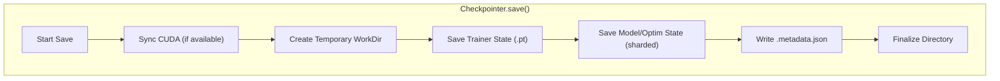
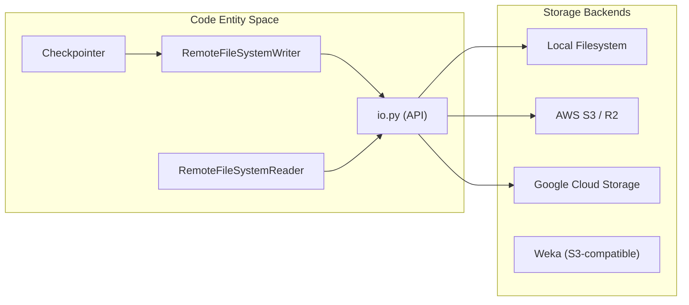

<!-- source: DeepWiki mcp.deepwiki.com · repo allenai/EMO · page 3.3 Checkpointing and IO · fetched 2026-10-26 -->

# Checkpointing and IO

Relevant source files

The following files were used as context for generating this wiki page:

- [src/olmo_core/distributed/checkpoint/__init__.py](src/olmo_core/distributed/checkpoint/__init__.py)
- [src/olmo_core/distributed/checkpoint/filesystem.py](src/olmo_core/distributed/checkpoint/filesystem.py)
- [src/olmo_core/distributed/utils.py](src/olmo_core/distributed/utils.py)
- [src/olmo_core/fs_cache.py](src/olmo_core/fs_cache.py)
- [src/olmo_core/generate/generation_module/transformer/config.py](src/olmo_core/generate/generation_module/transformer/config.py)
- [src/olmo_core/generate/generation_module/transformer/generation_module.py](src/olmo_core/generate/generation_module/transformer/generation_module.py)
- [src/olmo_core/io.py](src/olmo_core/io.py)
- [src/olmo_core/train/__init__.py](src/olmo_core/train/__init__.py)
- [src/olmo_core/train/callbacks/checkpointer.py](src/olmo_core/train/callbacks/checkpointer.py)
- [src/olmo_core/train/checkpoint.py](src/olmo_core/train/checkpoint.py)
- [src/olmo_core/train/common.py](src/olmo_core/train/common.py)
- [src/olmo_core/train/config.py](src/olmo_core/train/config.py)
- [src/olmo_core/utils.py](src/olmo_core/utils.py)
- [src/scripts/merge_core_checkpoints.py](src/scripts/merge_core_checkpoints.py)
- [src/test/distributed/checkpoint/filesystem_test.py](src/test/distributed/checkpoint/filesystem_test.py)
- [src/test/distributed/checkpoint_test.py](src/test/distributed/checkpoint_test.py)
- [src/test/generate/generation_module/transformer/generation_module_test.py](src/test/generate/generation_module/transformer/generation_module_test.py)
- [src/test/io_test.py](src/test/io_test.py)
- [src/test/scripts/merge_core_checkpoints_test.py](src/test/scripts/merge_core_checkpoints_test.py)
- [src/test/train/checkpoint_test.py](src/test/train/checkpoint_test.py)

This section documents the infrastructure for saving and loading model states, the unified I/O API for multi-cloud and local storage, and the duration system used to track training progress.

## Checkpointer and Checkpointing Lifecycle

The `Checkpointer` class is the primary interface for managing training state persistence. It supports both synchronous and asynchronous saving to local filesystems, S3, GCS, and Weka.

### Atomicity and Temporary Directories
To ensure checkpoint integrity, the `Checkpointer` uses a temporary directory pattern. Data is first written to a local `work_dir` or a temporary subdirectory within the target path before being finalized. This prevents partially written checkpoints from being recognized as valid if a crash occurs during I/O.
- **Metadata**: A checkpoint is only considered valid if it contains a `.metadata.json` file. This file is written last in the sequence [src/olmo_core/train/checkpoint.py:84-86](), [src/olmo_core/train/checkpoint.py:134-134]().
- **Coordination**: In distributed settings, `barrier()` calls and `get_fs_local_rank()` are used to coordinate directory creation and cleanup [src/olmo_core/train/checkpoint.py:25-31](), [src/olmo_core/train/checkpoint.py:97-100]().

### Save and Load Flow
The checkpointer handles three main components:
1.  **Trainer State**: RNG states, current step, and progress [src/olmo_core/train/checkpoint.py:117-117]().
2.  **Model State**: Sharded or unsharded model parameters [src/olmo_core/train/checkpoint.py:120-132]().
3.  **Optimizer State**: Sharded optimizer moments [src/olmo_core/train/checkpoint.py:121-132]().

**Checkpointing Logic Flow**

Sources: [src/olmo_core/train/checkpoint.py:102-135](), [src/olmo_core/distributed/checkpoint/__init__.py:189-201]()

## Distributed IO and Remote Filesystems

The `olmo_core.io` module provides a unified API that abstracts away the differences between local paths and cloud URLs (s3://, gs://, weka:).

### Unified IO API
Key functions like `get_file_size`, `get_bytes_range`, and `upload` automatically detect the protocol and route the request to the appropriate backend (e.g., `S3Client` or GCS-specific logic) [src/olmo_core/io.py:107-135](), [src/olmo_core/io.py:171-200]().

### RemoteFileSystemWriter and Reader
These classes extend PyTorch's distributed checkpointing to support direct cloud I/O.
- **Throttle Uploads**: To avoid overwhelming network interfaces, `throttle_uploads=True` ensures only one rank per node uploads at a time [src/olmo_core/distributed/checkpoint/filesystem.py:199-208]().
- **Async Saving**: `async_save_state_dict` de-stages the state dict to CPU memory first, then offloads the I/O to a background thread pool, allowing training to resume immediately [src/olmo_core/distributed/checkpoint/__init__.py:122-138]().

**Code Entity Mapping: I/O Space**

Sources: [src/olmo_core/io.py:42-103](), [src/olmo_core/distributed/checkpoint/filesystem.py:187-209](), [src/olmo_core/train/checkpoint.py:79-96]()

## CheckpointerCallback and Removal Strategies

The `CheckpointerCallback` manages the frequency of saves and the cleanup of old checkpoints.

### Removal Strategies
Controlled by `CheckpointRemovalStrategy` [src/olmo_core/train/callbacks/checkpointer.py:27-30]():
- `ephemeral_only`: Only removes checkpoints marked as temporary (saved at `ephemeral_save_interval`) [src/olmo_core/train/callbacks/checkpointer.py:32-35]().
- `all_non_permanent`: Removes everything except checkpoints saved at the primary `save_interval` [src/olmo_core/train/callbacks/checkpointer.py:37-41]().
- `never`: Keeps all checkpoints [src/olmo_core/train/callbacks/checkpointer.py:43-46]().

Sources: [src/olmo_core/train/callbacks/checkpointer.py:49-114]()

## Duration System

The `Duration` class provides a unified way to specify training lengths and intervals using different units.

| Unit | Description | Usage |
| :--- | :--- | :--- |
| `steps` | Number of batches processed | `Duration.steps(1000)` |
| `epochs` | Full passes through the dataset | `Duration.epochs(1)` |
| `tokens` | Total tokens processed | `Duration.tokens(1e12)` |

### Chinchilla Scaling
The system includes a `chinchilla_tokens` helper to calculate training duration based on model size. It assumes a standard of 20 tokens per active parameter for compute optimality [src/olmo_core/train/common.py:69-92]().

**Progress Calculation Logic**
The `due()` method checks if a specific target has been reached based on the current `step`, `tokens`, and `epoch` counters [src/olmo_core/train/common.py:94-105]().

Sources: [src/olmo_core/train/common.py:17-106]()

---

