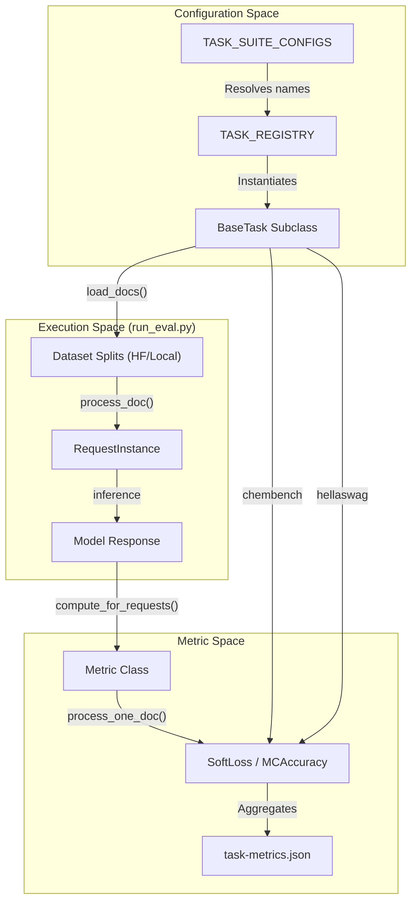
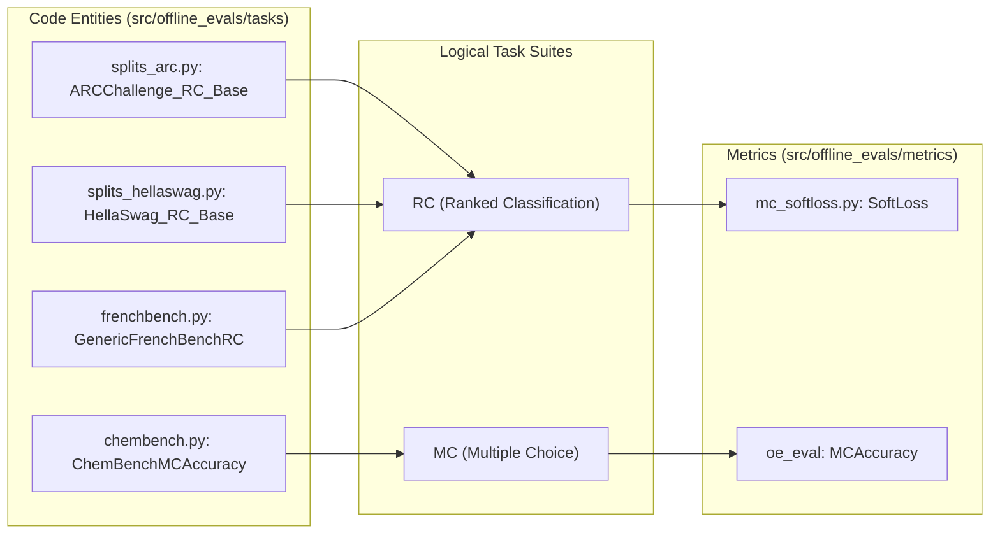

<!-- source: DeepWiki mcp.deepwiki.com · repo allenai/EMO · page 8.2 Evaluation Tasks and Benchmarks · fetched 2026-10-26 -->

# Evaluation Tasks and Benchmarks

Relevant source files

The following files were used as context for generating this wiki page:

- [.pre-commit-config.yaml](.pre-commit-config.yaml)
- [src/offline_evals/eval_utils.py](src/offline_evals/eval_utils.py)
- [src/offline_evals/metrics/custom_perplexity.py](src/offline_evals/metrics/custom_perplexity.py)
- [src/offline_evals/metrics/llm.py](src/offline_evals/metrics/llm.py)
- [src/offline_evals/metrics/mc_softloss.py](src/offline_evals/metrics/mc_softloss.py)
- [src/offline_evals/tasks/chembench.py](src/offline_evals/tasks/chembench.py)
- [src/offline_evals/tasks/frenchbench.py](src/offline_evals/tasks/frenchbench.py)
- [src/offline_evals/tasks/legalbench.py](src/offline_evals/tasks/legalbench.py)
- [src/offline_evals/tasks/splits_arc.py](src/offline_evals/tasks/splits_arc.py)
- [src/offline_evals/tasks/splits_boolq.py](src/offline_evals/tasks/splits_boolq.py)
- [src/offline_evals/tasks/splits_coqa.py](src/offline_evals/tasks/splits_coqa.py)
- [src/offline_evals/tasks/splits_csqa.py](src/offline_evals/tasks/splits_csqa.py)
- [src/offline_evals/tasks/splits_drop.py](src/offline_evals/tasks/splits_drop.py)
- [src/offline_evals/tasks/splits_hellaswag.py](src/offline_evals/tasks/splits_hellaswag.py)
- [src/offline_evals/tasks/splits_naturalqs.py](src/offline_evals/tasks/splits_naturalqs.py)
- [src/offline_evals/tasks/splits_openbookqa.py](src/offline_evals/tasks/splits_openbookqa.py)
- [src/offline_evals/tasks/splits_piqa.py](src/offline_evals/tasks/splits_piqa.py)
- [src/offline_evals/tasks/splits_siqa.py](src/offline_evals/tasks/splits_siqa.py)
- [src/offline_evals/tasks/splits_squad.py](src/offline_evals/tasks/splits_squad.py)
- [src/offline_evals/tasks/splits_synthea.py](src/offline_evals/tasks/splits_synthea.py)
- [src/offline_evals/tasks/splits_triviaqa.py](src/offline_evals/tasks/splits_triviaqa.py)
- [src/offline_evals/tasks/splits_winogrande.py](src/offline_evals/tasks/splits_winogrande.py)
- [src/olmo_core/data/mixes/mimic-pmc-5B.txt](src/olmo_core/data/mixes/mimic-pmc-5B.txt)
- [src/olmo_core/eval/task_groups.py](src/olmo_core/eval/task_groups.py)
- [src/scripts/eval/print_evals.py](src/scripts/eval/print_evals.py)
- [src/scripts/eval/task_suites.py](src/scripts/eval/task_suites.py)
- [src/scripts/eval/testbed_hellaswag.sh](src/scripts/eval/testbed_hellaswag.sh)
- [src/scripts/eval/testbed_synthea.sh](src/scripts/eval/testbed_synthea.sh)

The EMO evaluation framework supports a wide array of benchmarks ranging from standard commonsense reasoning and knowledge-based tasks to specialized domains like chemistry, law, and medicine. It employs a dual-track approach: **Offline Evaluation** (via `run_eval.py`) for comprehensive benchmarking and **In-Loop Evaluation** for monitoring training progress.

## Task Organization and Suites

Evaluation tasks are organized into suites to facilitate consistent benchmarking across experiments. The `TASK_GROUPS` registry defines common subsets used during different stages of model development.

| Group Name | Purpose | Key Tasks Included |
| :--- | :--- | :--- |
| `fast` | Rapid sanity checks (2-3x faster) | ARC-Easy/Challenge (MC Fast), HellaSwag (BPB), MMLU Test (MC Fast), Basic Skills. |
| `full__small_compute` | Standard tracking for 1B-scale models | ARC Challenge/Easy (RC), HellaSwag (RC), Winogrande, CSQA, PIQA, SIQA, MMLU (RC), GSM8K. |
| `full__large_compute` | Tracking for models with MC ability | ARC Challenge/Easy (MC Fast), MMLU (MC Fast), GSM8K, Minerva Math, Codex (HumanEval/MBPP). |

### Task Suite Resolution
The `get_task_suite_configs` function dynamically populates the registry with complex task sets like MMLU Pro, ChemBench, and LegalBench [src/scripts/eval/task_suites.py:6-106]().

Sources: [src/olmo_core/eval/task_groups.py:164-170](), [src/scripts/eval/task_suites.py:6-106]()

## Core Benchmark Categories

### MMLU and MMLU-Pro
The framework supports multiple variants of MMLU:
*   **MMLU (Massive Multitask Language Understanding):** Covers 57 subjects across STEM, Humanities, Social Sciences, and Other [src/scripts/eval/print_evals.py:43-121](). It supports RC (Ranked Classification) and MC (Multiple Choice) variants [src/scripts/eval/task_suites.py:68-83]().
*   **MMLU-Pro:** An enhanced version with more difficult questions and 10 choices per question. Supported splits include `mc_validation`, `mc_test`, and `rc_validation` [src/scripts/eval/task_suites.py:85-104]().

### Chemistry: ChemBench
ChemBench evaluates chemistry and materials science capabilities [src/offline_evals/tasks/chembench.py:2-10]().
*   **Implementation:** Supports both Multiple Choice (MC) and Generative (Gen) tasks.
*   **Custom Metric:** `ChemBenchMCAccuracy` handles questions with multiple correct answers [src/offline_evals/tasks/chembench.py:41-73]().
*   **Generative Scoring:** `ChemBenchGenMetric` implements 1% relative tolerance for numeric (MAE/MSE) questions, matching official evaluation protocols [src/offline_evals/tasks/chembench.py:119-185]().

### French: FrenchBench
Derived from CroissantLLM, this benchmark includes `french_boolq`, `french_bench_arc_challenge`, `french_bench_hellaswag`, and grammar/reading tasks [src/offline_evals/tasks/frenchbench.py:2-15]().
*   **Evaluation Mode:** Primarily uses Ranked Classification (RC) normalized by character count (`acc_per_char`) [src/offline_evals/tasks/frenchbench.py:25-54]().

### Medical and Specialized Benchmarks
*   **MedMCQA / MedQA:** Medical MCQ tasks [src/olmo_core/eval/task_groups.py:73-74]().
*   **Synthea:** A medical MCQ task based on synthetic patient records. It supports 0-shot and few-shot splits [src/offline_evals/tasks/splits_synthea.py:13-121]().
*   **LegalBench:** A benchmark for legal reasoning, specifically the classification tasks [src/scripts/eval/task_suites.py:33-39]().

### Reasoning and Commonsense (MC9/Gen5)
The "Core 9" tasks typically refer to ARC-Challenge, ARC-Easy, HellaSwag, Winogrande, CSQA, PIQA, SIQA, BoolQ, and OpenBookQA [src/olmo_core/eval/task_groups.py:4-15]().
*   **Merged Variants:** Tasks like ARC and HellaSwag have "Merged" variants (e.g., `ARCEasy_Merged_RC`) where train and validation sets are combined to provide a larger, unified set for expert pruning and fine-tuning [src/offline_evals/tasks/splits_arc.py:91-118](), [src/offline_evals/tasks/splits_hellaswag.py:125-148]().
*   **Router Clustering:** HellaSwag supports cluster-specific evaluation via `HellaSwag_Cluster_RC`, which filters the dataset to examples belonging to a specific cluster ID [src/offline_evals/tasks/splits_hellaswag.py:171-199]().

Sources: [src/offline_evals/tasks/chembench.py:1-185](), [src/offline_evals/tasks/frenchbench.py:1-233](), [src/offline_evals/tasks/splits_synthea.py:1-121](), [src/offline_evals/tasks/splits_arc.py:91-118](), [src/offline_evals/tasks/splits_hellaswag.py:125-199]()

## Custom Evaluation Metrics

The framework implements specialized metrics beyond standard accuracy to provide deeper insights into model performance.

### Ranked Classification (RC) and SoftLoss
RC tasks evaluate models by comparing the log-likelihood of different continuations.
*   **SoftLoss:** Implemented in `SoftLoss` class [src/offline_evals/metrics/mc_softloss.py:7-21](). It computes a softmax over the logits of all choices and returns the probability assigned to the correct label.
*   **Normalization:** Supports raw `softloss_corr`, `softloss_per_token_corr`, and `softloss_per_char_corr` [src/offline_evals/metrics/mc_softloss.py:84-88]().

### LLM-as-a-Judge
The framework supports using an LLM to grade generative outputs, typically implemented via the `LLM` metric class [src/offline_evals/metrics/llm.py]().

### Custom Perplexity
The `CustomPerplexity` metric allows for fine-grained perplexity measurement on specific validation subsets or domain-specific data [src/offline_evals/metrics/custom_perplexity.py]().

Sources: [src/offline_evals/metrics/mc_softloss.py:1-89]()

## Technical Data Flow

The following diagram illustrates how a task is resolved from a suite definition to the execution of its custom metrics.

### Task Resolution and Execution Flow

Sources: [src/offline_evals/tasks/chembench.py:41-73](), [src/offline_evals/metrics/mc_softloss.py:23-54](), [src/scripts/eval/task_suites.py:6-106]()

### Evaluator Component Association
This diagram bridges the logical evaluation tasks to the specific code entities responsible for their implementation.

Sources: [src/offline_evals/tasks/splits_arc.py:22-30](), [src/offline_evals/tasks/splits_hellaswag.py:29-60](), [src/offline_evals/tasks/chembench.py:41-48](), [src/offline_evals/tasks/frenchbench.py:25-34](), [src/offline_evals/metrics/mc_softloss.py:7-21]()

## Results Aggregation

The `print_evals.py` script serves as the primary tool for aggregating results across multiple experiments or checkpoints.

*   **Capabilities:** It scans directories (local or S3) for `task-*metrics.json` files [src/scripts/eval/print_evals.py:2-11]().
*   **MMLU Categorization:** It automatically groups the 57 MMLU subcategories into STEM, Humanities, Social Sciences, and Other for reporting [src/scripts/eval/print_evals.py:103-121]().
*   **Export:** Supports exporting aggregated metrics to CSV for further analysis [src/scripts/eval/print_evals.py:20]().

Sources: [src/scripts/eval/print_evals.py:2-121]()

---

