# Page: EMO / OLMo-Core Overview

# EMO / OLMo-Core Overview

<details>
<summary>Relevant source files</summary>

The following files were used as context for generating this wiki page:

- [CHANGELOG.md](CHANGELOG.md)
- [README.md](README.md)
- [docs/source/index.rst](docs/source/index.rst)
- [docs/source/overview/installation.rst](docs/source/overview/installation.rst)
- [docs/source/overview/introduction.rst](docs/source/overview/introduction.rst)
- [scripts/RUN_TEMPLATES.md](scripts/RUN_TEMPLATES.md)
- [scripts/selective_hf/hf_finetune_with_selective_easy_ep.sh](scripts/selective_hf/hf_finetune_with_selective_easy_ep.sh)
- [scripts/selective_hf/hf_finetune_with_selective_layerwise.sh](scripts/selective_hf/hf_finetune_with_selective_layerwise.sh)
- [src/olmo_core/train/trainer.py](src/olmo_core/train/trainer.py)
- [src/olmo_core/version.py](src/olmo_core/version.py)
- [src/scripts/official/README.md](src/scripts/official/README.md)
- [src/scripts/train/README.md](src/scripts/train/README.md)
- [src/test/conftest.py](src/test/conftest.py)

</details>


EMO (Emergent Modularity) is a research project and codebase developed at the Allen Institute for AI (AI2) focusing on **modular Mixture-of-Experts (MoE) pretraining**. The core innovation of EMO is enabling modular structure to emerge during pretraining without human-defined priors, allowing for **selective expert usage** (down to 12.5% of total experts) with minimal performance degradation [README.md:22-23]().

The project is built upon **OLMo-Core**, a high-performance rewrite of the original OLMo training and modeling code designed for stability, efficiency, and scale [docs/source/overview/introduction.rst:4-7]().

## Research Goals: Modular MoE

The primary research objective of EMO is to induce expert specialization at the level of high-level topics and capabilities rather than low-level lexical patterns [README.md:22-23](). By using document-level routing constraints, EMO forces experts to group into modules that can be selectively activated or pruned for specific tasks or domains [README.md:36-38]().

### Key Architectural Concepts
*   **Emergent Modularity:** Inducing structure during pretraining via specialized routing mechanisms.
*   **Two-Level Routing:** Constraining expert selection at the document or batch level to encourage module formation.
*   **Expert Pruning:** One-shot or iterative methods to identify and keep only the most relevant experts for a given task (e.g., EASY-EP) [scripts/selective_hf/hf_finetune_with_selective_easy_ep.sh:7-14]().
*   **Config-Driven Design:** Every component (model, data, trainer) is defined via a `Config` class and instantiated via a `.build()` method [docs/source/overview/introduction.rst:16-34]().

## System Relationship: EMO and OLMo-Core

EMO serves as the research implementation layer, while OLMo-Core provides the robust distributed training infrastructure.

### System Entity Mapping
The following diagram maps high-level system concepts to their specific implementations within the codebase.

**Concept to Code Entity Map**
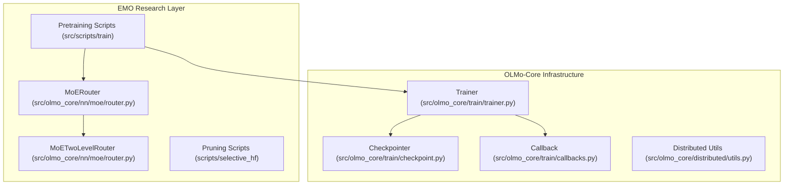
**Sources:** [src/olmo_core/train/trainer.py:99-156](), [docs/source/overview/introduction.rst:9-13](), [scripts/selective_hf/hf_finetune_with_selective_layerwise.sh:9-13]().

## Repository Organization

The repository is structured to separate core library logic from research scripts and evaluation pipelines.

| Directory | Purpose |
| :--- | :--- |
| `src/olmo_core/` | The core library: NN layers, distributed training logic, data loaders, and trainer. |
| `src/scripts/train/` | Primary entry points for pretraining (e.g., `olmoe-1B-7B_fsl.py`). |
| `src/hf_training/` | Logic for fine-tuning and interacting with HuggingFace models. |
| `src/offline_evals/` | The standalone evaluation engine for task-based benchmarking. |
| `scripts/models/` | Shell scripts containing specific hyperparameters for released EMO/MoE models. |
| `scripts/selective_hf/` | Pipelines for expert pruning and selective fine-tuning. |

**Code Entity Interaction Diagram**
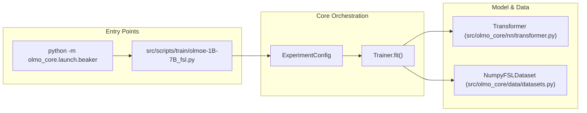
**Sources:** [src/scripts/official/README.md:7-11](), [docs/source/overview/introduction.rst:16-34](), [README.md:34-38]().

## Major Child Sections

For detailed technical documentation, refer to the following sub-pages:

*   **[Getting Started: Installation and Environment Setup](#1.1)**
    Covers `uv` and `conda` setup, and installing optional extras like `flash-attn` or `grouped_gemm`. For details, see [Getting Started: Installation and Environment Setup](#1.1).
*   **[Repository Structure and Key Concepts](#1.2)**
    A deep dive into the `src/` layout, the Config/Build pattern, and a glossary of terms like FSL/VSL and EP (Expert Parallelism). For details, see [Repository Structure and Key Concepts](#1.2).

**Sources:** [README.md:42-50](), [docs/source/overview/installation.rst:11-17](), [docs/source/overview/introduction.rst:9-13]().

---

# Page: Getting Started: Installation and Environment Setup

# Getting Started: Installation and Environment Setup

<details>
<summary>Relevant source files</summary>

The following files were used as context for generating this wiki page:

- [.github/workflows/docker.yml](.github/workflows/docker.yml)
- [.github/workflows/main.yml](.github/workflows/main.yml)
- [.github/workflows/pr_checks.yml](.github/workflows/pr_checks.yml)
- [Makefile](Makefile)
- [README.md](README.md)
- [docs/source/index.rst](docs/source/index.rst)
- [docs/source/overview/installation.rst](docs/source/overview/installation.rst)
- [docs/source/overview/introduction.rst](docs/source/overview/introduction.rst)
- [pyproject.toml](pyproject.toml)
- [scripts/RUN_TEMPLATES.md](scripts/RUN_TEMPLATES.md)
- [scripts/selective_hf/hf_finetune_with_selective_easy_ep.sh](scripts/selective_hf/hf_finetune_with_selective_easy_ep.sh)
- [scripts/selective_hf/hf_finetune_with_selective_layerwise.sh](scripts/selective_hf/hf_finetune_with_selective_layerwise.sh)
- [src/Dockerfile](src/Dockerfile)
- [src/olmo_core/launch/beaker.py](src/olmo_core/launch/beaker.py)
- [src/scripts/official/README.md](src/scripts/official/README.md)
- [src/scripts/train/README.md](src/scripts/train/README.md)

</details>


This page provides a comprehensive guide to setting up the development environment for EMO (and its underlying framework, `olmo-core`). It covers local installation, optional dependency management, Docker-based workflows, and launching your first training run.

## Purpose and Scope
The EMO repository is built upon `ai2-olmo-core`, a high-performance training library designed for large-scale distributed language modeling [docs/source/overview/introduction.rst:4-9](). This setup guide ensures you have the correct Python environment, CUDA drivers, and specialized kernels (like FlashAttention and GroupedGEMM) required for efficient MoE training and expert pruning research.

---

## Local Environment Setup

The recommended way to manage dependencies is using `conda` for the Python runtime and `uv` for fast, reproducible package installation.

### 1. Clone and Create Environment
```bash
git clone https://github.com/allenai/EMO.git
cd EMO
conda create -n emo python==3.12
conda activate emo
```
Sources: [README.md:44-47]()

### 2. Install Dependencies
EMO uses a tiered dependency system defined in `pyproject.toml`. You can install the base requirements or include optional "extras" for specific features like Beaker launching, Weights & Biases logging, or evaluation suites.

**Standard Installation (All features):**
```bash
uv pip install -e .[all]
uv pip install --upgrade 'chardet>=7'
```
Sources: [README.md:48-49](), [pyproject.toml:85-85]()

### 3. Understanding Optional Extras
The `pyproject.toml` file defines several dependency groups:

| Extra | Purpose | Key Packages |
| :--- | :--- | :--- |
| `dev` | Development and linting | `black`, `mypy`, `pytest`, `ruff` |
| `beaker` | AI2 Beaker cluster integration | `beaker-py`, `GitPython` |
| `wandb` | Experiment tracking | `wandb` |
| `eval` | In-loop and offline evaluation | `ai2-olmes`, `ai2-olmo-eval` |
| `flash-attn` | High-speed attention kernels | `flash-attn` (prebuilt wheels) |
| `transformers`| HuggingFace interoperability | `transformers==4.57.1` |

Sources: [pyproject.toml:35-85]()

---

## System Dependencies and Specialized Kernels

For high-performance training, especially with Mixture-of-Experts (MoE), several C++/CUDA extensions are required. These are often easier to manage via Docker (see below), but can be installed manually:

*   **PyTorch**: Version `2.8.0` is the primary target [pyproject.toml:17-17]().
*   **FlashAttention**: Required for optimized transformer blocks [pyproject.toml:77-80]().
*   **Grouped GEMM**: Essential for "dropless" MoE implementations, allowing experts to process varying batch sizes efficiently [docs/source/overview/installation.rst:16-16]().
*   **TransformerEngine**: Used for FP8 training and optimized Hopper-generation kernels [src/Dockerfile:85-87]().

---

## Docker and Beaker Infrastructure

For distributed training on clusters, EMO provides a multi-stage `Dockerfile` and integration with the Beaker platform.

### Docker Image Architecture
The Dockerfile builds a comprehensive environment including AWS/GCP CLIs, InfiniBand drivers (MLNX OFED), and all necessary CUDA kernels.

Title: EMO Docker Build Pipeline
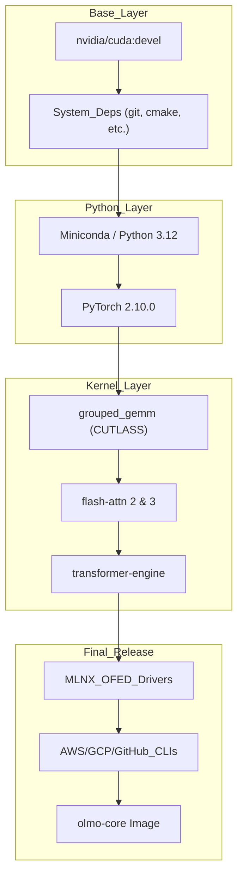
Sources: [src/Dockerfile:1-170](), [Makefile:76-94]()

### Beaker Integration
The `olmo_core.launch.beaker` module allows for seamless transition from local testing to cluster execution.

*   **Images**: Official images are tracked in `OLMoCoreBeakerImage` [src/olmo_core/launch/beaker.py:130-188]().
*   **Weka Support**: Configurable via `BeakerWekaBucket` for high-speed data access [src/olmo_core/launch/beaker.py:204-208]().

---

## Running Your First Command

The EMO repository uses a "Config/Build" pattern. You define an `ExperimentConfig`, and the framework handles the orchestration.

### 1. Local Training (Dry Run)
You can verify your installation by running a training script in local mode using `torchrun`.

```bash
# Example: Dense 1B baseline
torchrun --nproc-per-node=1 src/scripts/train/olmo2-1B.py test-run \
    --save-folder="./checkpoints/test-run" \
    --dataset.mix=OLMoE-mix-0824 \
    --trainer.max_duration='{value: 100, unit: steps}'
```
Sources: [scripts/RUN_TEMPLATES.md:32-54](), [docs/source/overview/introduction.rst:47-49]()

### 2. Launching on Beaker
Using the `launch_common.sh` utility, you can submit the same job to a cluster by setting `MODE=beaker`.

```bash
MODE=beaker bash scripts/models/dense_1b_130b.sh
```
Sources: [scripts/RUN_TEMPLATES.md:21-24]()

### Execution Data Flow
The following diagram illustrates how a training command moves from a script to a distributed environment.

Title: Training Launch Lifecycle

Sources: [src/olmo_core/launch/beaker.py:211-225](), [docs/source/overview/introduction.rst:14-50](), [scripts/RUN_TEMPLATES.md:1-20]()

---

## Development and Quality Control

To maintain code quality, use the provided `Makefile` targets:

*   **Style Checks**: `make style-check` (runs `black` and `isort`) [Makefile:4-9]().
*   **Linting**: `make lint-check` (runs `ruff`) [Makefile:11-14]().
*   **Type Checking**: `make type-check` (runs `mypy`) [Makefile:17-19]().
*   **Testing**: `pytest src/test/` (runs the test suite) [.github/workflows/main.yml:39-45]().

Sources: [Makefile:1-26](), [.github/workflows/main.yml:27-55]()

---

# Page: Repository Structure and Key Concepts

# Repository Structure and Key Concepts

<details>
<summary>Relevant source files</summary>

The following files were used as context for generating this wiki page:

- [README.md](README.md)
- [scripts/RUN_TEMPLATES.md](scripts/RUN_TEMPLATES.md)
- [scripts/selective_hf/hf_finetune_with_selective_easy_ep.sh](scripts/selective_hf/hf_finetune_with_selective_easy_ep.sh)
- [scripts/selective_hf/hf_finetune_with_selective_layerwise.sh](scripts/selective_hf/hf_finetune_with_selective_layerwise.sh)
- [src/olmo_core/config.py](src/olmo_core/config.py)
- [src/olmo_core/internal/common.py](src/olmo_core/internal/common.py)
- [src/olmo_core/internal/experiment.py](src/olmo_core/internal/experiment.py)
- [src/olmo_core/nn/layer_norm.py](src/olmo_core/nn/layer_norm.py)
- [src/olmo_core/nn/lm_head.py](src/olmo_core/nn/lm_head.py)
- [src/olmo_core/nn/rope.py](src/olmo_core/nn/rope.py)
- [src/olmo_core/train/callbacks/__init__.py](src/olmo_core/train/callbacks/__init__.py)
- [src/olmo_core/train/callbacks/callback.py](src/olmo_core/train/callbacks/callback.py)
- [src/scripts/official/README.md](src/scripts/official/README.md)
- [src/scripts/train/README.md](src/scripts/train/README.md)
- [src/test/config_test.py](src/test/config_test.py)
- [src/test/nn/layer_norm_test.py](src/test/nn/layer_norm_test.py)
- [src/test/nn/lm_head_test.py](src/test/nn/lm_head_test.py)
- [src/test/nn/rope_test.py](src/test/nn/rope_test.py)

</details>


This page provides a technical map of the EMO repository, detailing the organization of source code, the configuration-driven execution model, and a glossary of the core architectural concepts that enable modular Mixture-of-Experts (MoE) training.

## Repository Layout

The EMO repository is organized into several distinct subsystems, separating core library logic from research scripts and deployment infrastructure.

### Source Code (`src/`)

*   **`src/olmo_core/`**: The foundational library. It contains the modular building blocks for neural networks, data loading, distributed training, and the orchestration engine (Trainer).
    *   `nn/`: Implementation of Transformer layers, Attention, MoE, and LayerNorm [src/olmo_core/nn/layer_norm.py:1-21](), [src/olmo_core/nn/lm_head.py:31-38]().
    *   `train/`: The `Trainer` class and its lifecycle management, including `Callback` definitions [src/olmo_core/train/callbacks/__init__.py:1-33]().
    *   `data/`: Datasets and data loading logic for FSL (Fixed Sequence Length) and VSL (Variable Sequence Length).
    *   `launch/`: Infrastructure for executing jobs on Beaker [src/olmo_core/internal/experiment.py:28-28]().
*   **`src/scripts/`**: Primary entry points for training and research experiments.
    *   `train/`: Standardized scripts for training models like `olmo2-1B.py` (dense) and `olmoe-1B-7B_fsl.py` (MoE) [scripts/RUN_TEMPLATES.md:34-40](), [scripts/RUN_TEMPLATES.md:58-65]().
    *   `clustering/`: Utilities for extracting router embeddings and analyzing expert specialization [README.md:37-37]().
*   **`src/hf_training/`**: Logic for fine-tuning EMO models using the Hugging Face ecosystem, specifically for selective expert usage [README.md:88-91]().
*   **`src/vllm_plugin/`**: A standalone plugin to register `EmoForCausalLM` within the vLLM inference engine [README.md:115-119]().

### Shell Scripts (`scripts/`)

*   **`scripts/models/`**: Bash wrappers that define specific hyperparameters for model releases (e.g., `emo_1b14b_1t.sh`) [README.md:60-60]().
*   **`scripts/launch_common.sh`**: Shared preamble for all run scripts, handling path exports (`PREFIX`, `MODELS_DIR`) and the `launch()` function wrapper for `torchrun` or Beaker [scripts/RUN_TEMPLATES.md:5-19]().

## The Config/Build Pattern

EMO utilizes a strict "Config/Build" pattern. Almost every functional component (Layers, Optimizers, Data Loaders) has a corresponding `Config` class that inherits from `olmo_core.config.Config` [src/olmo_core/config.py:55-71]().

1.  **Serialization**: Configs are pure dataclasses that can be serialized to JSON/YAML [src/olmo_core/config.py:153-165]().
2.  **Validation**: Configs often include a `validate()` method to ensure hyperparameter consistency [src/olmo_core/config.py:191-195]().
3.  **Lazy Construction**: Functional objects are instantiated via a `.build()` method on the config. For example, `LMHeadConfig.build()` returns an `LMHead` or `NormalizedLMHead` instance [src/olmo_head.py:114-141]().

### Experiment Execution Flow

The training lifecycle is managed by `ExperimentConfig` and `SubCmd` [src/olmo_core/internal/experiment.py:96-114]().

Title: Experiment Execution Data Flow
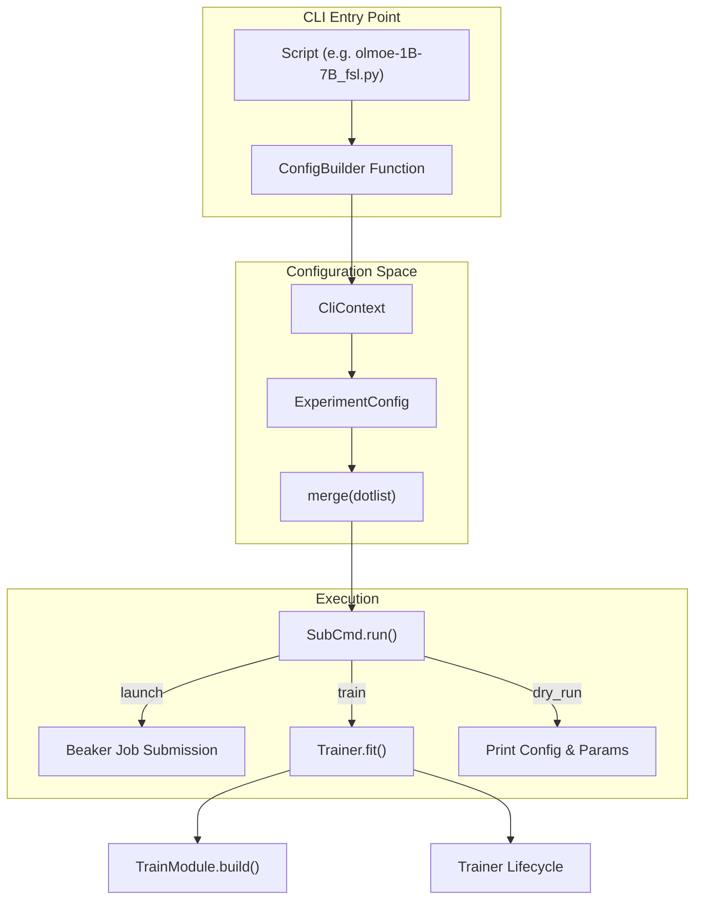
Sources: [src/olmo_core/internal/experiment.py:108-169](), [src/olmo_core/internal/experiment.py:171-174](), [src/olmo_core/config.py:197-206]()

## Beaker Execution Model

For large-scale training, EMO integrates with the AI2 Beaker platform. 

*   **`BeakerLaunchConfig`**: Defines the hardware (e.g., `NVIDIA H100 80GB`), Weka bucket mounts, and environment secrets required for a job [src/olmo_core/internal/common.py:56-163]().
*   **Weka Storage**: The root directory for checkpoints and data is dynamically determined based on the cluster tags (e.g., `/weka/oe-training-default/ai2-llm` for Weka-enabled clusters) [src/olmo_core/internal/common.py:34-45]().
*   **Automatic Resumption**: The `BeakerCallback` monitors job status and handles stepping detection to resume training from the latest checkpoint if a node fails [src/olmo_core/train/callbacks/beaker.py:1-6]().

## Glossary of Key Concepts

| Concept | Definition | Code Entity |
| :--- | :--- | :--- |
| **FSL / VSL** | Fixed Sequence Length vs. Variable Sequence Length data loading. | `NumpyFSLDataset`, `NumpyVSLDataset` |
| **MoE** | Mixture-of-Experts; conditional computation where only a subset of parameters is active per token. | `MoETransformerBlock`, `MoEBase` |
| **EMO Routing** | Document-aware routing that encourages modularity and expert specialization. | `MoETwoLevelRouter` |
| **Expert Pool** | A constrained subset of experts available to a specific document or sequence. | `document_expert_pool` parameter in scripts |
| **Shared Experts** | Experts that are always active, regardless of the router's top-k selection. | `num_shared_experts` |
| **Dot-notation Override** | The ability to modify any nested config field via the CLI (e.g., `--model.d_model=1024`). | `Config.merge()` |

### Architectural Entity Mapping

Title: Code Entity Mapping for Model Components
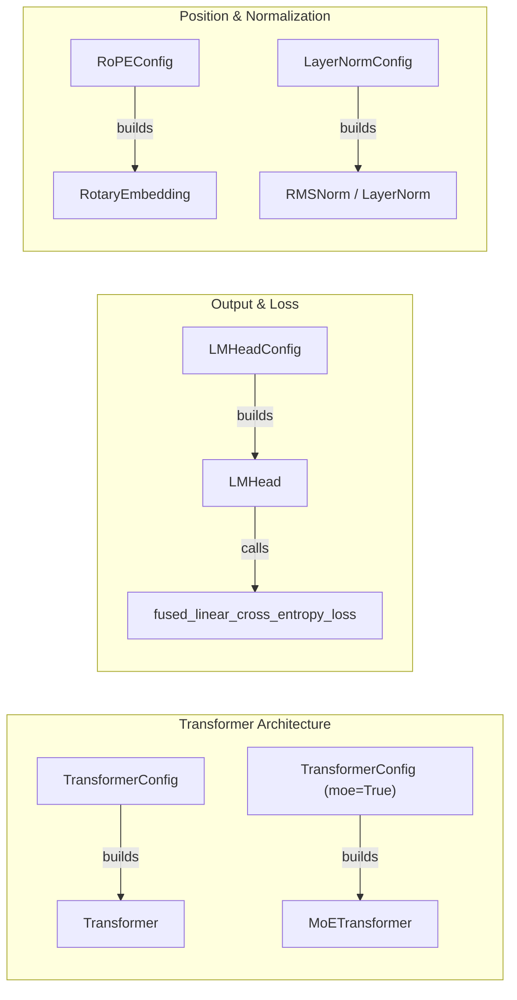
Sources: [src/olmo_core/nn/lm_head.py:114-141](), [src/olmo_core/nn/layer_norm.py:88-117](), [src/olmo_core/nn/rope.py:29-45]()

Sources: [src/olmo_core/config.py:55-106](), [src/olmo_core/internal/experiment.py:55-107](), [src/olmo_core/internal/common.py:56-163](), [scripts/RUN_TEMPLATES.md:5-30](), [README.md:22-38]()

---

# Page: Core Neural Network Architecture

# Core Neural Network Architecture

<details>
<summary>Relevant source files</summary>

The following files were used as context for generating this wiki page:

- [src/olmo_core/config.py](src/olmo_core/config.py)
- [src/olmo_core/nn/feed_forward.py](src/olmo_core/nn/feed_forward.py)
- [src/olmo_core/nn/layer_norm.py](src/olmo_core/nn/layer_norm.py)
- [src/olmo_core/nn/lm_head.py](src/olmo_core/nn/lm_head.py)
- [src/olmo_core/nn/rope.py](src/olmo_core/nn/rope.py)
- [src/olmo_core/nn/transformer/__init__.py](src/olmo_core/nn/transformer/__init__.py)
- [src/olmo_core/nn/transformer/block.py](src/olmo_core/nn/transformer/block.py)
- [src/olmo_core/nn/transformer/config.py](src/olmo_core/nn/transformer/config.py)
- [src/olmo_core/nn/transformer/init.py](src/olmo_core/nn/transformer/init.py)
- [src/olmo_core/nn/transformer/model.py](src/olmo_core/nn/transformer/model.py)
- [src/test/config_test.py](src/test/config_test.py)
- [src/test/nn/layer_norm_test.py](src/test/nn/layer_norm_test.py)
- [src/test/nn/lm_head_test.py](src/test/nn/lm_head_test.py)
- [src/test/nn/rope_test.py](src/test/nn/rope_test.py)
- [src/test/nn/transformer/model_test.py](src/test/nn/transformer/model_test.py)

</details>


The core neural network architecture in EMO is built around a modular and highly configurable Transformer implementation. Located primarily in `src/olmo_core/nn/`, the architecture supports a variety of modern techniques including Mixture-of-Experts (MoE), normalized architectures (nGPT), and diverse attention mechanisms. The system follows a "Config/Build" pattern where dataclass-based configurations define the model structure before instantiation.

## Architectural Overview

The architecture is hierarchical, moving from the top-level model container down to specialized layers and kernels.

### High-Level Hierarchy

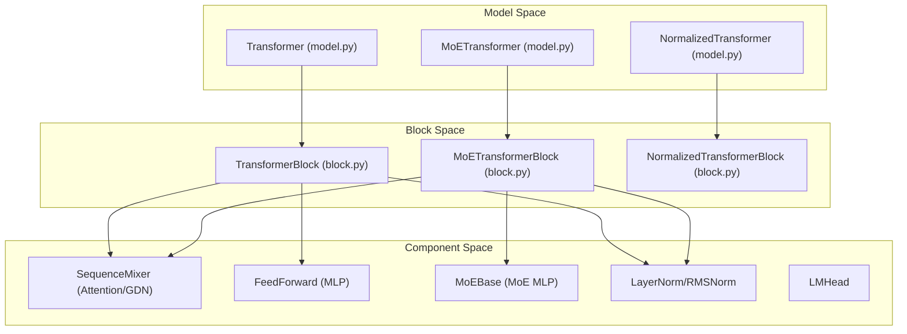
Sources: [src/olmo_core/nn/transformer/model.py:84-122](), [src/olmo_core/nn/transformer/block.py:96-143](), [src/olmo_core/nn/transformer/config.py:79-149]()

## Core Components

### Transformer Models and Blocks
The base `Transformer` class [src/olmo_core/nn/transformer/model.py:84]() provides a standard decoder-only architecture. It is extended by `MoETransformer` [src/olmo_core/nn/transformer/model.py:75]() for expert-parallel models and `NormalizedTransformer` [src/olmo_core/nn/transformer/model.py:74]() for nGPT-style experiments where weights are constrained to a hypersphere.

The `TransformerBlock` [src/olmo_core/nn/transformer/block.py:96]() manages the residual stream and coordinates the interaction between the `SequenceMixer` (typically attention) and the `FeedForward` network.

For details, see [Transformer Model and Block Architecture](#2.1).

### Sequence Mixers and Attention
The `SequenceMixer` abstraction [src/olmo_core/nn/attention/base.py]() allows the model to swap between standard `Attention`, `FusedAttention` (using FlashAttention), and recurrent layers like `GatedDeltaNet`.
*   **RoPE:** Rotary Positional Embeddings are managed via `RoPEConfig` [src/olmo_core/nn/rope.py:16](), supporting multiple scaling strategies like Linear, YaRN, and Stepwise (Llama-3.1 style) [src/olmo_core/nn/rope.py:133]().
*   **Backends:** The system supports various backends including `torch`, `flash_attn`, and `flex` [src/olmo_core/nn/attention/config.py]().

For details, see [Attention Mechanisms](#2.2).

### Mixture-of-Experts (MoE)
MoE is a first-class citizen in the architecture. `MoETransformerBlock` [src/olmo_core/nn/transformer/block.py:224]() replaces the standard MLP with a `MoEBase` layer.
*   **MLP Variants:** Supports `MoEMLP` and `DroplessMoEMLP` [src/olmo_core/nn/moe/parallel_mlp.py]().
*   **Parallelism:** Built-in support for Expert Parallelism (EP) and shared experts.

For details, see [Mixture-of-Experts (MoE) Layer Architecture](#2.3).

### Routing and EMO Variants
The router is the critical component for EMO's modularity research. Routers decide token-to-expert assignments and are defined under the `MoERouter` hierarchy.
*   **Baseline:** `MoELinearRouter` [src/olmo_core/nn/moe/router.py]().
*   **Advanced:** Document-aware routing via `MoETwoLevelRouter` [src/olmo_core/nn/moe/twolevel_router.py:19]().

For details, see [EMO Router Variants](#2.4).

## Supporting Infrastructure

### Normalization and Heads
*   **LayerNorm:** Implements standard `LayerNorm`, `RMSNorm`, and specialized versions like `CuTeRMSNorm` and `L2Norm` [src/olmo_core/nn/layer_norm.py:24-49]().
*   **LM Head:** The `LMHead` [src/olmo_core/nn/lm_head.py:154]() handles the final projection to vocabulary. It supports `LMLossImplementation.fused_linear` [src/olmo_core/nn/lm_head.py:70]() for memory-efficient training by fusing the linear projection with cross-entropy loss.

### Initialization Methods
The `InitMethod` enum [src/olmo_core/nn/transformer/init.py:46]() defines several initialization schemes:
*   `normal`: Truncated normal with $\sigma=0.02$.
*   `llama`: Depth-scaled initialization for output layers.
*   `fan_in`: Variance-preserving initialization based on layer dimensions.
*   `normalized`: Specifically for nGPT architectures.

### Data and Model Space Mapping

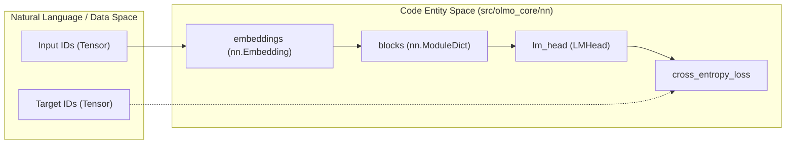
Sources: [src/olmo_core/nn/transformer/model.py:133-163](), [src/olmo_core/nn/lm_head.py:201-212]()

### Distributed Integration
The architecture is designed for `torch.distributed`. Modules implement `apply_tp()` for Tensor Parallelism, `apply_fsdp()` for Fully Sharded Data Parallelism, and `apply_cp()` for Context Parallelism [src/olmo_core/nn/transformer/block.py:63-89]().

Sources: [src/olmo_core/nn/transformer/model.py:84-182](), [src/olmo_core/nn/transformer/block.py:32-94](), [src/olmo_core/nn/lm_head.py:77-114](), [src/olmo_core/nn/rope.py:29-46](), [src/olmo_core/nn/transformer/init.py:46-77]()

---

# Page: Transformer Model and Block Architecture

# Transformer Model and Block Architecture

<details>
<summary>Relevant source files</summary>

The following files were used as context for generating this wiki page:

- [src/olmo_core/config.py](src/olmo_core/config.py)
- [src/olmo_core/nn/feed_forward.py](src/olmo_core/nn/feed_forward.py)
- [src/olmo_core/nn/layer_norm.py](src/olmo_core/nn/layer_norm.py)
- [src/olmo_core/nn/lm_head.py](src/olmo_core/nn/lm_head.py)
- [src/olmo_core/nn/rope.py](src/olmo_core/nn/rope.py)
- [src/olmo_core/nn/transformer/__init__.py](src/olmo_core/nn/transformer/__init__.py)
- [src/olmo_core/nn/transformer/block.py](src/olmo_core/nn/transformer/block.py)
- [src/olmo_core/nn/transformer/config.py](src/olmo_core/nn/transformer/config.py)
- [src/olmo_core/nn/transformer/init.py](src/olmo_core/nn/transformer/init.py)
- [src/olmo_core/nn/transformer/model.py](src/olmo_core/nn/transformer/model.py)
- [src/test/config_test.py](src/test/config_test.py)
- [src/test/nn/layer_norm_test.py](src/test/nn/layer_norm_test.py)
- [src/test/nn/lm_head_test.py](src/test/nn/lm_head_test.py)
- [src/test/nn/rope_test.py](src/test/nn/rope_test.py)
- [src/test/nn/transformer/model_test.py](src/test/nn/transformer/model_test.py)

</details>


This page details the implementation of the Transformer architecture in `olmo_core`. The system is designed for modularity, supporting multiple block variants (standard, MoE, normalized), diverse initialization schemes, and a strict forward pass lifecycle integrated with distributed training strategies.

## Architecture Overview

The core architecture follows a "Llama-style" design but is generalized to support research variants like Mixture-of-Experts (MoE) and nGPT (Normalized Transformers). The model is composed of three primary segments:
1.  **Embeddings**: Token embeddings with optional scaling and normalization [src/olmo_core/nn/transformer/model.py:133-142]().
2.  **Transformer Blocks**: A stack of $N$ blocks, which can be homogeneous or heterogeneous via configuration overrides [src/olmo_core/nn/transformer/model.py:150-160]().
3.  **LM Head**: The final projection to vocabulary space, supporting fused loss implementations for memory efficiency [src/olmo_core/nn/lm_head.py:78-114]().

### Code Entity Mapping: Model Structure
The following diagram bridges the high-level transformer concepts to the specific classes and configurations in the codebase.

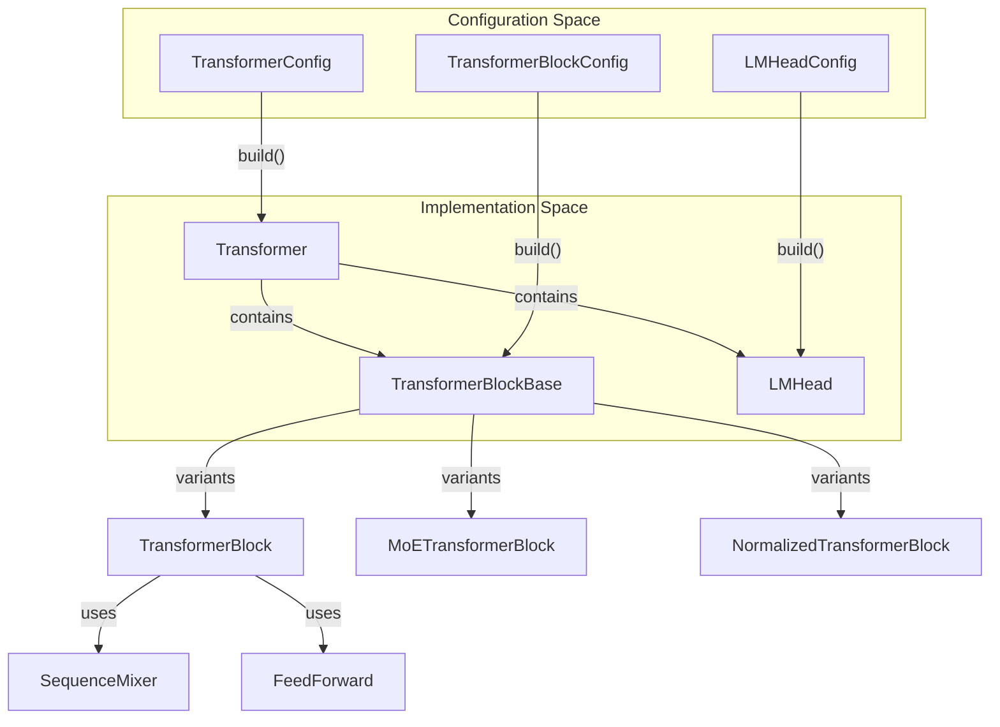
Sources: [src/olmo_core/nn/transformer/model.py:84-164](), [src/olmo_core/nn/transformer/config.py:152-240](), [src/olmo_core/nn/transformer/block.py:32-143]()

---

## Transformer Model Variants

The codebase provides three primary model implementations via `TransformerType` [src/olmo_core/nn/transformer/config.py:79-98]():

| Class | Type Enum | Description |
| :--- | :--- | :--- |
| `Transformer` | `default` | Standard decoder-only architecture (Llama-style) [src/olmo_core/nn/transformer/model.py:84](). |
| `MoETransformer` | `moe` | Extends the base transformer to support Mixture-of-Experts blocks and auxiliary loss tracking [src/olmo_core/nn/transformer/model.py:313](). |
| `NormalizedTransformer` | `normalized` | Implements the **nGPT** architecture, where weights and activations are L2-normalized [src/olmo_core/nn/transformer/model.py:270](). |

### Normalized Transformers (nGPT)
The `NormalizedTransformer` requires specific handling during the training loop. Since weights are constrained to a hypersphere, the model includes a `normalize_matrices()` method called after optimizer steps to project weights back to unit norm [src/olmo_core/nn/transformer/model.py:303-311]().

Sources: [src/olmo_core/nn/transformer/model.py:84-350](), [src/olmo_core/nn/transformer/config.py:79-98]()

---

## Block Variants and Logic

Blocks are the fundamental unit of the model. All blocks inherit from `TransformerBlockBase` [src/olmo_core/nn/transformer/block.py:32]().

### Standard Block (`TransformerBlock`)
Follows the pre-norm architecture:
1.  `Attention(LayerNorm(x)) + x`
2.  `FeedForward(LayerNorm(h)) + h`
The `SequenceMixer` (Attention) and `FeedForward` components are modular [src/olmo_core/nn/transformer/block.py:152-153]().

### MoE Block (`MoETransformerBlock`)
Replaces the standard `FeedForward` with a `MoEBase` module. It supports Expert Parallelism (EP) and tracks auxiliary routing losses [src/olmo_core/nn/transformer/block.py:537-565]().

### Specialized Variants
*   **`LayerNormScaledTransformerBlock`**: Applies scaling to LayerNorm outputs [src/olmo_core/nn/transformer/config.py:110]().
*   **`ReorderedNormTransformerBlock`**: Changes the placement of normalization relative to residuals [src/olmo_core/nn/transformer/config.py:115]().
*   **`PeriNormTransformerBlock`**: Implements Peri-norm architecture [src/olmo_core/nn/transformer/config.py:120]().

Sources: [src/olmo_core/nn/transformer/block.py:96-153](), [src/olmo_core/nn/transformer/config.py:100-150]()

---

## Initialization Methods

The `InitMethod` enum defines how weights are populated across the model [src/olmo_core/nn/transformer/init.py:46]().

| Method | Logic |
| :--- | :--- |
| `normal` | Truncated normal (std=0.02) for all linear and embedding layers [src/olmo_core/nn/transformer/init.py:47-51](). |
| `llama` | Output layers use `std = 0.02 / sqrt(2 * n_layers)` [src/olmo_core/nn/transformer/init.py:58-62](). |
| `llama_depth` | Depth-scaled init using `std = 0.02 / sqrt(2 * (block_idx + 1))` [src/olmo_core/nn/transformer/init.py:64-68](). |
| `fan_in` | Uses `1 / sqrt(d_in)` where `d_in` is the input dimension of the specific layer [src/olmo_core/nn/transformer/init.py:70-77](). |
| `normalized` | nGPT scheme; embeddings use `std = d_model**-0.5` [src/olmo_core/nn/transformer/init.py:90-91](). |

Sources: [src/olmo_core/nn/transformer/init.py:46-105](), [src/olmo_core/nn/transformer/init.py:143-181]()

---

## Forward Pass Lifecycle and Parallelism

The model's lifecycle involves several transformation stages to support distributed training. The application order is critical for compatibility.

### Application Order
1.  **Pipeline Parallelism (PP)**: The model is partitioned into stages [src/olmo_core/nn/transformer/model.py:440]().
2.  **Tensor Parallelism (TP)**: Linear layers are sharded (Columnwise/Rowwise) [src/olmo_core/nn/transformer/model.py:507]().
3.  **Context Parallelism (CP)**: Attention is sharded across the sequence dimension [src/olmo_core/nn/transformer/model.py:560]().
4.  **FSDP**: Sharding of parameters and gradients across the data-parallel mesh [src/olmo_core/nn/transformer/model.py:615]().
5.  **FP8**: Modules are wrapped for 8-bit floating point execution [src/olmo_core/nn/transformer/model.py:408]().

### Data Flow Diagram
This diagram shows the execution flow of a single `TransformerBlock` within the distributed environment.

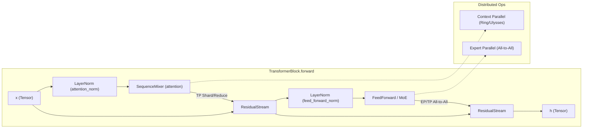
Sources: [src/olmo_core/nn/transformer/block.py:144-153](), [src/olmo_core/nn/transformer/block.py:155-200](), [src/olmo_core/nn/transformer/model.py:507-650]()

### Auxiliary Metrics
For `MoETransformer`, the forward pass also aggregates auxiliary metrics such as load-balancing loss and router z-loss, which are retrieved via `compute_auxiliary_metrics()` [src/olmo_core/nn/transformer/model.py:335-350]().

Sources: [src/olmo_core/nn/transformer/model.py:313-350](), [src/olmo_core/nn/transformer/block.py:537-565]()

---

# Page: Attention Mechanisms

# Attention Mechanisms

<details>
<summary>Relevant source files</summary>

The following files were used as context for generating this wiki page:

- [src/olmo_core/config.py](src/olmo_core/config.py)
- [src/olmo_core/nn/attention/__init__.py](src/olmo_core/nn/attention/__init__.py)
- [src/olmo_core/nn/attention/backend.py](src/olmo_core/nn/attention/backend.py)
- [src/olmo_core/nn/attention/flash_attn_api.py](src/olmo_core/nn/attention/flash_attn_api.py)
- [src/olmo_core/nn/attention/kv_cache.py](src/olmo_core/nn/attention/kv_cache.py)
- [src/olmo_core/nn/attention/recurrent.py](src/olmo_core/nn/attention/recurrent.py)
- [src/olmo_core/nn/layer_norm.py](src/olmo_core/nn/layer_norm.py)
- [src/olmo_core/nn/lm_head.py](src/olmo_core/nn/lm_head.py)
- [src/olmo_core/nn/rope.py](src/olmo_core/nn/rope.py)
- [src/olmo_core/script_utils.py](src/olmo_core/script_utils.py)
- [src/olmo_core/testing/__init__.py](src/olmo_core/testing/__init__.py)
- [src/olmo_core/testing/utils.py](src/olmo_core/testing/utils.py)
- [src/olmo_core/train/callbacks/stability_monitor.py](src/olmo_core/train/callbacks/stability_monitor.py)
- [src/test/config_test.py](src/test/config_test.py)
- [src/test/nn/attention/recurrent_test.py](src/test/nn/attention/recurrent_test.py)
- [src/test/nn/layer_norm_test.py](src/test/nn/layer_norm_test.py)
- [src/test/nn/lm_head_test.py](src/test/nn/lm_head_test.py)
- [src/test/nn/rope_test.py](src/test/nn/rope_test.py)

</details>


The EMO codebase provides a modular and high-performance suite of attention mechanisms designed for scalable Transformer pretraining. It abstracts hardware-specific optimizations through an `AttentionBackend` system, supporting standard multi-head attention (MHA), group-query attention (GQA), sliding window attention (SWA), and recurrent linear attention via Gated Delta Networks.

## Attention Architecture Overview

The primary entry point for attention is the `Attention` class and its corresponding `AttentionConfig`. The system supports multiple implementation variants including standard, fused, and normalized attention [src/olmo_core/nn/attention/__init__.py:158-175]().

### Data Flow and Code Entity Mapping

The following diagram illustrates the relationship between the configuration entities and the functional modules that implement the attention forward pass.

**Attention System Architecture**
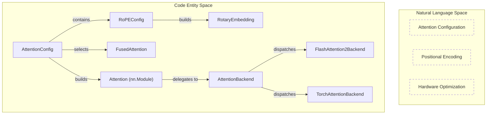
Sources: [src/olmo_core/nn/attention/__init__.py:178-204](), [src/olmo_core/nn/attention/backend.py:43-75](), [src/olmo_core/nn/rope.py:29-46]()

## Attention Backends

The `AttentionBackend` abstraction allows EMO to utilize the most efficient kernels available for the underlying hardware while maintaining a unified interface for the Transformer block.

| Backend Name | Class | Target Hardware / Features |
| :--- | :--- | :--- |
| `torch` | `TorchAttentionBackend` | PyTorch SDPA; fallback for all devices [src/olmo_core/nn/attention/backend.py:48-51](). |
| `flash_2` | `FlashAttention2Backend` | Ampere+ GPUs; supports `flash-attn` v2 and Ring CP [src/olmo_core/nn/attention/backend.py:52-58](). |
| `flash_3` | `FlashAttention3Backend` | Hopper GPUs (H100/H800); utilizes FP8 and newer kernels [src/olmo_core/nn/attention/backend.py:59-64](). |
| `flash_4` | `FlashAttention4Backend` | Blackwell GPUs; CUTE implementation [src/olmo_core/nn/attention/backend.py:65-70](). |
| `te` | `TEAttentionBackend` | NVIDIA Transformer Engine; SM 9.0+ [src/olmo_core/nn/attention/backend.py:71-75](). |

The backend is selected via `AttentionConfig.backend` and instantiated using the `AttentionBackendName.build()` method [src/olmo_core/nn/attention/backend.py:91-111]().

## Positional Embeddings (RoPE)

EMO primarily uses Rotary Positional Embeddings (RoPE). The implementation supports various scaling strategies to extend context lengths beyond training limits.

*   **Implementations**: `RotaryEmbedding` (default), `FusedRotaryEmbedding` (Triton/CUDA optimized), and `ComplexRotaryEmbedding` [src/olmo_core/nn/rope.py:29-46]().
*   **Scaling Strategies**:
    *   **PI (Position-Interpolation)**: Linearly compresses position indices [src/olmo_core/nn/rope.py:97-113]().
    *   **Stepwise (Llama-3.1)**: Interpolates between high and low frequency bands to preserve short-range ordering while extending context [src/olmo_core/nn/rope.py:133-170]().
    *   **ABF (Absolute Base Frequency)**: Modifies the `theta` base parameter [src/olmo_core/nn/rope.py:73-83]().

Sources: [src/olmo_core/nn/rope.py:48-51](), [src/olmo_core/nn/rope.py:177-194]()

## Sliding Window Attention (OLMo3)

Sliding Window Attention (SWA) is configured via `SlidingWindowAttentionConfig`. It allows specific layers to attend only to a local window of tokens, reducing the quadratic complexity of the attention operation [src/olmo_core/nn/attention/__init__.py:101-119]().

*   **Pattern-based**: A pattern like `[4096, 4096, 4096, -1]` applies a 4096 window to three layers followed by one full-attention layer [src/olmo_core/nn/attention/__init__.py:105-108]().
*   **Layer Constraints**: Typically, the first and last layers are forced to use full attention to ensure global information flow [src/olmo_core/nn/attention/__init__.py:124-127]().

Sources: [src/olmo_core/nn/attention/__init__.py:120-156]()

## Gated Delta Networks (Recurrent Attention)

For efficient $O(N)$ sequence modeling, EMO includes `GatedDeltaNet`, a linear attention variant based on the gated delta rule [src/olmo_core/nn/attention/recurrent.py:34-41]().

**GatedDeltaNet Data Flow**
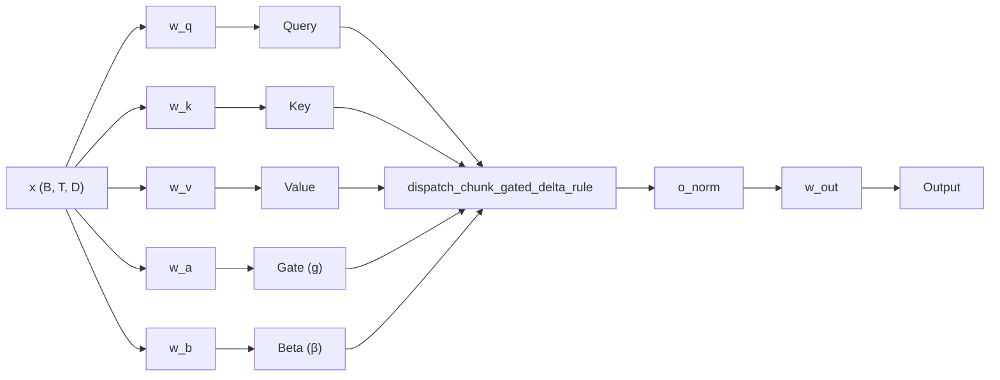
Sources: [src/olmo_core/nn/attention/recurrent.py:152-163](), [src/olmo_core/nn/attention/recurrent.py:18-21]()

## KV Cache and Generation

The `KVCacheManager` handles the state required for incremental decoding during inference.
*   **Backend Support**: Backends must explicitly support KV caching (verified via `assert_supports_kv_cache`) [src/olmo_core/nn/attention/backend.py:207-214]().
*   **Flash Attention Integration**: EMO dispatches to specific "with_kvcache" variants of Flash Attention kernels (e.g., `dispatch_flash_attn_3_with_kvcache`) when a cache is provided during the forward pass [src/olmo_core/nn/attention/backend.py:24-27]().

Sources: [src/olmo_core/nn/attention/kv_cache.py](), [src/olmo_core/nn/attention/backend.py:17-34]()

---

# Page: Mixture-of-Experts (MoE) Layer Architecture

# Mixture-of-Experts (MoE) Layer Architecture

<details>
<summary>Relevant source files</summary>

The following files were used as context for generating this wiki page:

- [src/olmo_core/kernels/__init__.py](src/olmo_core/kernels/__init__.py)
- [src/olmo_core/kernels/moe.py](src/olmo_core/kernels/moe.py)
- [src/olmo_core/nn/cross_entropy_loss.py](src/olmo_core/nn/cross_entropy_loss.py)
- [src/olmo_core/nn/functional/__init__.py](src/olmo_core/nn/functional/__init__.py)
- [src/olmo_core/nn/functional/cross_entropy_loss.py](src/olmo_core/nn/functional/cross_entropy_loss.py)
- [src/olmo_core/nn/moe/loss.py](src/olmo_core/nn/moe/loss.py)
- [src/olmo_core/nn/moe/mlp.py](src/olmo_core/nn/moe/mlp.py)
- [src/olmo_core/nn/moe/moe.py](src/olmo_core/nn/moe/moe.py)
- [src/olmo_core/nn/moe/parallel_mlp.py](src/olmo_core/nn/moe/parallel_mlp.py)
- [src/olmo_core/nn/moe/twolevel_batchlb_reducedp_sharedexp_randpool_router.py](src/olmo_core/nn/moe/twolevel_batchlb_reducedp_sharedexp_randpool_router.py)
- [src/olmo_core/ops/moe.py](src/olmo_core/ops/moe.py)
- [src/scripts/train/private-olmo.py](src/scripts/train/private-olmo.py)
- [src/test/nn/cross_entropy_loss_test.py](src/test/nn/cross_entropy_loss_test.py)
- [src/test/nn/functional/cross_entropy_loss_test.py](src/test/nn/functional/cross_entropy_loss_test.py)
- [src/test/nn/moe/mlp_test.py](src/test/nn/moe/mlp_test.py)
- [src/test/nn/moe/moe_test.py](src/test/nn/moe/moe_test.py)
- [src/test/ops/moe_test.py](src/test/ops/moe_test.py)

</details>


This page details the Mixture-of-Experts (MoE) implementation in EMO, covering the modular layer stack, expert MLP variants, load balancing loss functions, and the application of Expert Parallelism (EP).

## MoE Layer Stack Overview

The MoE architecture is built around the `MoEBase` class, which orchestrates the interaction between a **Router** (which selects experts) and a **Parallel MLP** (which contains the expert weights).

### MoE Configuration and Types
The system supports two primary MoE implementations defined by the `MoEType` enum:
1.  **`default`**: A standard MoE implementation where tokens may be dropped if they exceed expert capacity. [src/olmo_core/nn/moe/moe.py:47-50]().
2.  **`dropless`**: An implementation that ensures no tokens are dropped, typically utilizing grouped GEMMs for efficiency. [src/olmo_core/nn/moe/moe.py:52-55]().

The `MoEConfig` class manages architectural hyperparameters such as `num_experts`, `hidden_size`, `capacity_factor`, and auxiliary loss weights (`lb_loss_weight`, `z_loss_weight`). [src/olmo_core/nn/moe/moe.py:59-75]().

### Data Flow Diagram: MoE Forward Pass
The following diagram illustrates the token flow through the MoE layer, from routing to expert execution.

```mermaid
graph TD
    Input["Input Tensor (B, S, D)"] --> Jitter["Jitter/Noise (Optional)"]
    Jitter --> Router["MoERouter.forward()"]
    Router --> Weights["Expert Weights (N, K)"]
    Router --> Indices["Expert Indices (N, K)"]
    
    Weights --> ParallelMLP["ParallelMLP.forward()"]
    Indices --> ParallelMLP
    Input --> ParallelMLP
    
    subgraph ExpertExecution ["Expert Processing"]
        ParallelMLP --> Permute["Permute/Gather Tokens"]
        Permute --> AllToAll["All-to-All (if EP enabled)"]
        AllToAll --> LocalExperts["Expert MLP (w1, w2, w3)"]
        LocalExperts --> AllToAllBack["All-to-All Back"]
        AllToAllBack --> Unpermute["Unpermute/Scatter Tokens"]
    end
    
    Unpermute --> Combine["Weighted Sum (Top-K)"]
    Combine --> SharedMLP["Shared MLP (Optional)"]
    SharedMLP --> Output["Output Tensor (B, S, D)"]

    Sources: [src/olmo_core/nn/moe/moe.py:220-300](), [src/olmo_core/nn/moe/parallel_mlp.py:127-200]()
```

## Expert MLP Variants

The experts themselves are implemented as standard SwiGLU MLPs, but organized to support efficient sharding and computation.

### MoEMLP
The standard `MoEMLP` stores parameters `w1`, `w2`, and `w3` as flattened tensors of shape `(num_experts * dim1, dim2)`. [src/olmo_core/nn/moe/mlp.py:140-163](). This flattening allows the parameters to be sharded effectively by FSDP or Expert Parallelism. The forward pass uses batched matrix multiplication (`torch.bmm`) to process tokens assigned to different experts. [src/olmo_core/nn/moe/mlp.py:195]().

### DroplessMoEMLP
The `DroplessMoEMLP` variant is designed for cases where token counts per expert are uneven. It utilizes `grouped_gemm` (if available) to execute expert computations without padding or dropping tokens. [src/olmo_core/nn/moe/mlp.py:19-24](), [src/olmo_core/nn/moe/mlp.py:198]().

## Parallel MLP and Expert Parallelism (EP)

The `ParallelMLPBase` and its subclasses (`ParallelMLP`, `ParallelDroplessMLP`) act as wrappers that handle the communication logic required for Expert Parallelism. [src/olmo_core/nn/moe/parallel_mlp.py:34-44]().

### EP Execution Flow
When EP is enabled via `apply_ep(ep_mesh)`, the experts are sharded across the `ep_mesh`. [src/olmo_core/nn/moe/mlp.py:50-59]().
1.  **Gather/Permute**: Tokens are gathered into bins based on their assigned expert using custom kernels. [src/olmo_core/ops/moe.py:26-59]().
2.  **All-to-All**: If the assigned expert is on a different GPU, the token is sent via `dist.all_to_all`. [src/olmo_core/ops/moe.py:224-240]().
3.  **Local Computation**: The local rank computes the MLP for the tokens it received.
4.  **Scatter/Unpermute**: Tokens are sent back to their original ranks and re-inserted into the original tensor shape using `scatter` ops. [src/olmo_core/ops/moe.py:62-123]().

### System Entity Mapping: Parallelism
The following diagram maps parallelism concepts to their specific code implementations.

```mermaid
graph LR
    subgraph Logic ["Parallelism Logic"]
        EP["Expert Parallelism (EP)"]
        TP["Tensor Parallelism (TP)"]
    end

    subgraph Code ["Code Entities"]
        EP --> ep_mesh["DeviceMesh (ep)"]
        EP --> all_to_all["olmo_core.ops.moe.AllToAllOp"]
        EP --> apply_ep["MoEMLP.apply_ep()"]
        
        TP --> tp_mesh["DeviceMesh (tp)"]
        TP --> shard_param["torch.distributed.tensor.distribute_tensor"]
        TP --> apply_tp["MoEMLP.apply_tp()"]
    end

    Sources: [src/olmo_core/nn/moe/mlp.py:50-70](), [src/olmo_core/nn/moe/parallel_mlp.py:76-89](), [src/olmo_core/ops/moe.py:224-230]()
```

## Loss Functions

MoE training requires auxiliary losses to prevent expert collapse and ensure balanced utilization.

### Load Balancing Loss
The `load_balancing_loss` function calculates how evenly tokens are distributed across experts. [src/olmo_core/nn/moe/loss.py:29-40](). It supports two granularities:
*   **`local_batch`**: Computed over the rank-local shard. [src/olmo_core/nn/moe/loss.py:82-103]().
*   **`instance`**: Computed across the entire distributed instance, accounting for TP and CP meshes. [src/olmo_core/nn/moe/loss.py:48-81]().

### Router Z-Loss
The `router_z_loss` encourages the router's logits to be small, improving training stability by preventing large values in the softmax. [src/olmo_core/nn/moe/loss.py:114-138](). It is calculated as the mean of the squared `logsumexp` of the expert logits. [src/olmo_core/nn/moe/loss.py:134]().

### Model-Level Z-Loss
Distinct from the router z-loss, EMO also provides a `fused_linear_cross_entropy_loss` which can compute a Z-loss on the final language modeling head logits to stabilize the overall model output. [src/olmo_core/nn/functional/cross_entropy_loss.py:68-82]().

| Loss Type | Implementation | Purpose |
| :--- | :--- | :--- |
| **Load Balancing** | `load_balancing_loss` | Ensures tokens are distributed across all experts. |
| **Router Z-Loss** | `router_z_loss` | Stabilizes router logits to prevent overflow/saturation. |
| **Output Z-Loss** | `cross_entropy_loss` | Stabilizes the final LM head logits. |

Sources: [src/olmo_core/nn/moe/loss.py:11-138](), [src/olmo_core/nn/functional/cross_entropy_loss.py:12-50]()

## Hybrid MoE and Optimization

EMO supports complex routing configurations through specialized routers like the `MoETwoLevelBatchLBReduceDPSharedExpRandPoolRouter`. [src/olmo_core/nn/moe/twolevel_batchlb_reducedp_sharedexp_randpool_router.py:17-22]().

Key features in hybrid implementations include:
*   **Shared Experts**: Experts that are always active for every token, regardless of the router's top-k selection. [src/olmo_core/nn/moe/twolevel_batchlb_reducedp_sharedexp_randpool_router.py:64-71]().
*   **Expert Pooling**: Restricting tokens within a document to a specific subset (pool) of experts to encourage modularity. [src/olmo_core/nn/moe/twolevel_batchlb_reducedp_sharedexp_randpool_router.py:51-57]().
*   **Detach Masks**: Used during selective fine-tuning to cut gradients for specific experts or the router itself. [src/olmo_core/nn/moe/twolevel_batchlb_reducedp_sharedexp_randpool_router.py:80-94]().

Sources: [src/olmo_core/nn/moe/twolevel_batchlb_reducedp_sharedexp_randpool_router.py:17-128]()

---

# Page: EMO Router Variants

# EMO Router Variants

<details>
<summary>Relevant source files</summary>

The following files were used as context for generating this wiki page:

- [src/olmo_core/nn/moe/masked_finetune_router.py](src/olmo_core/nn/moe/masked_finetune_router.py)
- [src/olmo_core/nn/moe/mutualinfo_router.py](src/olmo_core/nn/moe/mutualinfo_router.py)
- [src/olmo_core/nn/moe/pruning_router.py](src/olmo_core/nn/moe/pruning_router.py)
- [src/olmo_core/nn/moe/router.py](src/olmo_core/nn/moe/router.py)
- [src/olmo_core/nn/moe/router_finetune_old.py](src/olmo_core/nn/moe/router_finetune_old.py)
- [src/olmo_core/nn/moe/router_lbreducedp.py](src/olmo_core/nn/moe/router_lbreducedp.py)
- [src/olmo_core/nn/moe/router_lbreducedp_sharedexp.py](src/olmo_core/nn/moe/router_lbreducedp_sharedexp.py)
- [src/olmo_core/nn/moe/twolevel_batchlb_fullzloss_router.py](src/olmo_core/nn/moe/twolevel_batchlb_fullzloss_router.py)
- [src/olmo_core/nn/moe/twolevel_batchlb_nomaskaux_router.py](src/olmo_core/nn/moe/twolevel_batchlb_nomaskaux_router.py)
- [src/olmo_core/nn/moe/twolevel_batchlb_reducedp_router.py](src/olmo_core/nn/moe/twolevel_batchlb_reducedp_router.py)
- [src/olmo_core/nn/moe/twolevel_batchlb_reducedp_sharedexp_router.py](src/olmo_core/nn/moe/twolevel_batchlb_reducedp_sharedexp_router.py)
- [src/olmo_core/nn/moe/twolevel_batchlb_reducedp_sharedexppool_router.py](src/olmo_core/nn/moe/twolevel_batchlb_reducedp_sharedexppool_router.py)
- [src/olmo_core/nn/moe/twolevel_batchlb_router.py](src/olmo_core/nn/moe/twolevel_batchlb_router.py)
- [src/olmo_core/nn/moe/twolevel_pbatchlb_router.py](src/olmo_core/nn/moe/twolevel_pbatchlb_router.py)
- [src/olmo_core/nn/moe/twolevel_router.py](src/olmo_core/nn/moe/twolevel_router.py)
- [src/olmo_core/nn/moe/twolevel_sampling_nolb_router.py](src/olmo_core/nn/moe/twolevel_sampling_nolb_router.py)
- [src/olmo_core/nn/moe/twolevel_topp_batchlb_router.py](src/olmo_core/nn/moe/twolevel_topp_batchlb_router.py)
- [src/scripts/train/olmo2-1B.py](src/scripts/train/olmo2-1B.py)
- [src/scripts/train/olmo2-1B_finetune.py](src/scripts/train/olmo2-1B_finetune.py)
- [src/scripts/train/olmoe-1B-7B_finetune.py](src/scripts/train/olmoe-1B-7B_finetune.py)
- [src/scripts/train/olmoe-1B-7B_fsl.py](src/scripts/train/olmoe-1B-7B_fsl.py)

</details>


This page provides a comprehensive technical reference for the Mixture-of-Experts (MoE) router implementations within the EMO framework. Routers are responsible for mapping input tokens to a subset of experts ($top\_k$) and calculating auxiliary losses to ensure balanced expert utilization.

## Router Class Hierarchy

The routing infrastructure is built on a modular hierarchy starting from the `MoERouter` base class. Most specialized routers extend `MoELinearRouter`, which implements the standard linear projection gating mechanism.

### Base Abstractions
*   **`MoERouter`**: The abstract base class defining the interface for all routers, including parameter initialization and the core routing lifecycle [src/olmo_core/nn/moe/router.py:171-213]().
*   **`MoELinearRouter`**: The standard implementation using a learnable weight matrix to project input embeddings into expert logit space [src/olmo_core/nn/moe/router.py:410-435]().
*   **`MoERouterConfig`**: A unified configuration factory for instantiating router variants [src/olmo_core/nn/moe/router.py:90-111]().

### Router Selection via CLI
Routers are typically selected in training scripts by modifying the `TransformerConfig`. In `olmoe-1B-7B_fsl.py`, the router type is determined by the configuration object passed to the model builder [src/scripts/train/olmoe-1B-7B_fsl.py:117-127]().

**Sources:**
- [src/olmo_core/nn/moe/router.py:171-435]()
- [src/scripts/train/olmoe-1B-7B_fsl.py:117-127]()

---

## Document-Aware Routing (EMO)

The `MoETwoLevelRouter` is the primary implementation of the EMO (Expert MOdular) paper's document-aware routing strategy. It enforces a two-stage selection process:
1.  **Document-Level**: A subset of experts (`document_expert_pool`) is selected for the entire document based on aggregated token probabilities [src/olmo_core/nn/moe/twolevel_router.py:82-94]().
2.  **Token-Level**: Standard $top\_k$ routing is performed, but restricted only to the experts selected in the first stage [src/olmo_core/nn/moe/twolevel_router.py:107-107]().

### Data Flow: Two-Level Routing
The following diagram illustrates how `MoETwoLevelRouter` processes a batch with `document_boundaries`.

Title: MoETwoLevelRouter Forward Pass
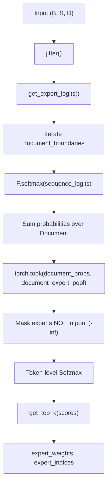
**Sources:**
- [src/olmo_core/nn/moe/twolevel_router.py:18-107]()

---

## Batch Load-Balancing and Distributed Variants

To improve stability in distributed settings, several variants modify how load-balancing losses are calculated and how experts are shared.

| Variant | Class Name | Key Feature |
| :--- | :--- | :--- |
| **BatchLB** | `MoETwoLevelBatchLBRouter` | Implements load balancing over the entire batch [src/olmo_core/nn/moe/twolevel_batchlb_router.py:14-18](). |
| **ReduceDP** | `MoETwoLevelBatchLBReduceDPRouter` | Optimizes metric reduction across Data Parallel ranks [src/olmo_core/nn/moe/twolevel_batchlb_reducedp_router.py:16-20](). |
| **SharedExp** | `MoETwoLevelBatchLBReduceDPSharedExpRouter` | Reserves a fixed set of experts that are *always* active for every token [src/olmo_core/nn/moe/twolevel_batchlb_reducedp_sharedexp_router.py:17-54](). |
| **SharedExpPool** | `MoETwoLevelBatchLBReduceDPSharedExpPoolRouter` | Selects a subset of shared experts from a dedicated pool [src/olmo_core/nn/moe/twolevel_batchlb_reducedp_sharedexppool_router.py:17-80](). |

### Shared Expert Implementation
In `MoETwoLevelBatchLBReduceDPSharedExpRouter`, the `top_k` logic is split: `num_shared_experts` are always selected, and the router dynamically chooses the remaining `top_k - num_shared_experts` [src/olmo_core/nn/moe/twolevel_batchlb_reducedp_sharedexp_router.py:54-78]().

**Sources:**
- [src/olmo_core/nn/moe/twolevel_batchlb_reducedp_router.py:16-20]()
- [src/olmo_core/nn/moe/twolevel_batchlb_reducedp_sharedexp_router.py:17-78]()
- [src/olmo_core/nn/moe/twolevel_batchlb_reducedp_sharedexppool_router.py:17-80]()

---

## Pruning and Fine-Tuning Routers

For research into modularity and efficiency, EMO supports routers that can be "pruned" after pretraining.

### `PruningMoELinearRouter`
Used to load activation statistics from a file and permanently disable the least-used experts for specific layers.
*   **Activation Loading**: Reads `avg_router_probabilities` from a JSONL file [src/olmo_core/nn/moe/pruning_router.py:41-48]().
*   **Masking**: Creates an `expert_mask` that forces the logits of pruned experts to `-inf` [src/olmo_core/nn/moe/pruning_router.py:119-119]().

### `MoEMaskedFinetuneRouter`
Used during selective fine-tuning where only specific expert paths are updated. It uses a mask to prevent gradient flow to "frozen" experts during the backward pass.

Title: Code Entity Mapping for Pruning
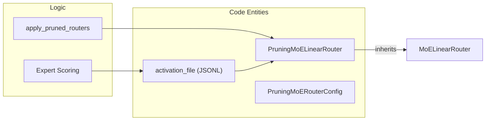

**Sources:**
- [src/olmo_core/nn/moe/pruning_router.py:18-120]()
- [src/scripts/train/olmoe-1B-7B_finetune.py:151-195]()

---

## Specialized Research Routers

*   **`MoEMutualInfoRouter`**: Implements a router that maximizes the mutual information between inputs and expert assignments to encourage specialization [src/olmo_core/nn/moe/mutualinfo_router.py]().
*   **`MoETwoLevelSamplingNoLBRouter`**: A variant of the EMO router that uses multinomial sampling instead of top-k to select the document-level expert pool [src/olmo_core/nn/moe/twolevel_sampling_nolb_router.py:15-95]().
*   **`MoETwoLevelTopPBatchLBRouter`**: Uses Nucleus (Top-P) sampling at the document level to dynamically size the expert pool based on the probability mass [src/olmo_core/nn/moe/twolevel_topp_batchlb_router.py]().

**Sources:**
- [src/olmo_core/nn/moe/twolevel_sampling_nolb_router.py:15-95]()
- [src/olmo_core/nn/moe/mutualinfo_router.py]()

---

# Page: Training Infrastructure

# Training Infrastructure

<details>
<summary>Relevant source files</summary>

The following files were used as context for generating this wiki page:

- [CHANGELOG.md](CHANGELOG.md)
- [src/olmo_core/internal/common.py](src/olmo_core/internal/common.py)
- [src/olmo_core/internal/experiment.py](src/olmo_core/internal/experiment.py)
- [src/olmo_core/train/callbacks/__init__.py](src/olmo_core/train/callbacks/__init__.py)
- [src/olmo_core/train/callbacks/callback.py](src/olmo_core/train/callbacks/callback.py)
- [src/olmo_core/train/trainer.py](src/olmo_core/train/trainer.py)
- [src/olmo_core/version.py](src/olmo_core/version.py)
- [src/test/conftest.py](src/test/conftest.py)

</details>


The EMO training infrastructure is designed for large-scale modular Mixture-of-Experts (MoE) pretraining. It provides a robust, configuration-driven system that orchestrates complex training loops, distributed checkpointing, and extensive monitoring through a flexible callback system.

## System Architecture Overview

The training system is built around three core pillars: the `Trainer`, which manages the execution loop; the `TrainModule`, which abstracts the model and optimization logic; and the `ExperimentConfig`, which provides a unified interface for defining and launching experiments.

### Training Execution Flow
The following diagram illustrates the relationship between the high-level orchestration components and the underlying code entities.

**Training System Orchestration**
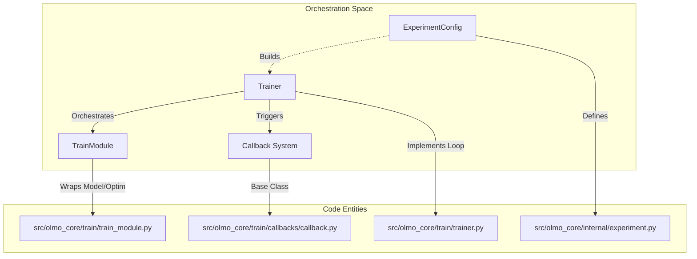
Sources: [src/olmo_core/train/trainer.py:99-158](), [src/olmo_core/internal/experiment.py:96-107](), [src/olmo_core/train/train_module.py:1-50](), [src/olmo_core/train/callbacks/callback.py:14-22]()

---

## [Trainer and Training Loop](#3.1)

The `Trainer` class is the central orchestrator of the training process. It manages the `fit()` lifecycle, handling everything from data loading to distributed synchronization and metric reduction.

*   **Lifecycle Management**: The `fit()` method executes the training loop across epochs and steps [src/olmo_core/train/trainer.py:410-450]().
*   **Step Execution**: Each step follows a strict sequence: `pre_step` → `train_batch` → `optim_step` → `post_step`.
*   **Async Bookkeeping**: Uses a `ThreadPoolExecutor` to handle non-blocking IO and metric logging, ensuring that the GPU remains saturated [src/olmo_core/train/trainer.py:9-10]().
*   **Cancellation**: Robustly handles `SIGTERM` and `SIGINT` to ensure checkpoints are saved before exiting.

For details, see [Trainer and Training Loop](#3.1).

---

## [Experiment Configuration and Launch](#3.2)

EMO uses a hierarchical configuration system built on Python dataclasses, allowing for type-safe experiment definitions that can be easily overridden via CLI.

*   **ExperimentConfig**: A top-level container for `ModelConfig`, `DatasetConfig`, and `TrainerConfig` [src/olmo_core/internal/experiment.py:96-107]().
*   **SubCmd**: The system supports various execution modes including `launch` (to Beaker/Slurm), `train` (local execution), `prep` (data preparation), and `dry_run` [src/olmo_core/internal/experiment.py:108-114]().
*   **Cluster Awareness**: Automatically detects environment settings for Weka vs GCS storage and configures GPU types (e.g., H100, B200) [src/olmo_core/internal/common.py:34-45](), [src/olmo_core/internal/common.py:166-170]().

For details, see [Experiment Configuration and Launch](#3.2).

---

## [Checkpointing and IO](#3.3)

The `Checkpointer` provides a high-level interface for saving and loading distributed model states, leveraging PyTorch's distributed checkpointing capabilities.

*   **Atomicity**: Implements a temporary-directory pattern to ensure that checkpoints are only marked as complete once all shards are successfully written.
*   **Distributed Coordination**: Uses barriers and local-rank coordination to manage IO across nodes [src/olmo_core/train/trainer.py:35-46]().
*   **Unified IO**: A single API (`olmo_core.io`) handles local files, S3, GCS, and Weka transparently [src/olmo_core/internal/common.py:10-18]().
*   **Duration System**: Checkpoints can be scheduled based on steps, epochs, or total tokens seen [src/olmo_core/train/trainer.py:158-168]().

For details, see [Checkpointing and IO](#3.3).

---

## [Callbacks System](#3.4)

The callback system allows for modular extension of the trainer without modifying the core loop. Callbacks are prioritized and can be stateful, allowing them to participate in checkpointing.

**Callback Lifecycle and Code Mapping**
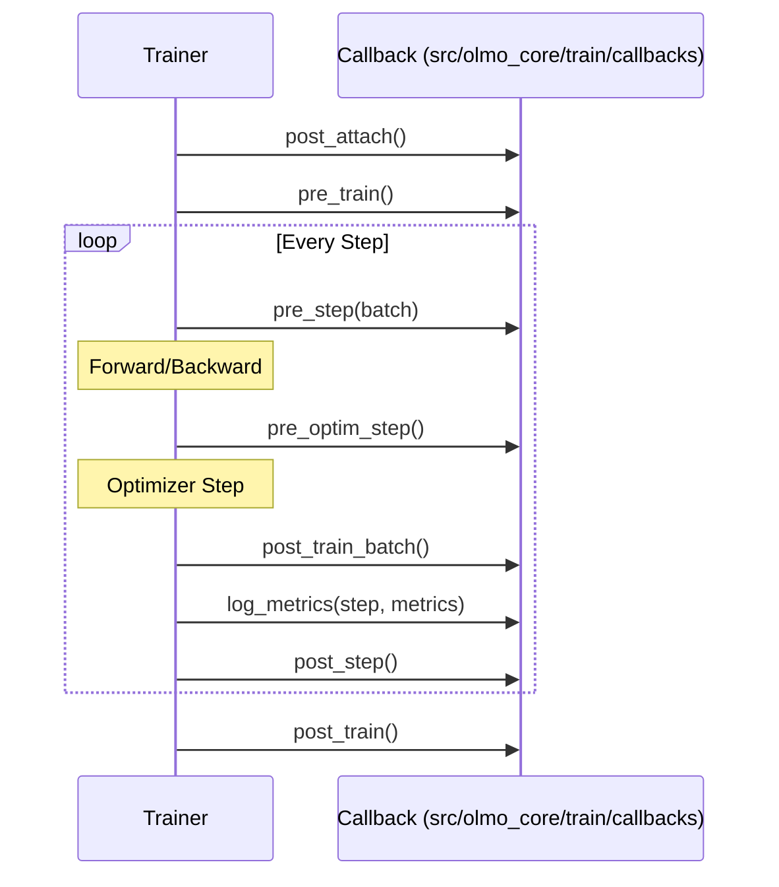
Sources: [src/olmo_core/train/callbacks/callback.py:71-160]()

Key built-in callbacks include:
*   `SpeedMonitorCallback`: Tracks MFU and TFLOPS [src/olmo_core/train/callbacks/__init__.py:31]().
*   `WandBCallback` / `CometCallback`: Handles experiment tracking [src/olmo_core/train/callbacks/__init__.py:9-33]().
*   `EvaluatorCallback`: Manages in-loop validation and downstream tasks [src/olmo_core/train/callbacks/__init__.py:12-16]().
*   `HFConverterCallback`: Automatically exports checkpoints to HuggingFace format [src/olmo_core/train/callbacks/__init__.py:22]().

For details, see [Callbacks System](#3.4).

---

## [Optimizers and Learning Rate Schedulers](#3.5)

EMO supports a wide range of modern optimizers and flexible scheduling logic required for stable MoE training.

*   **Optimizers**: Includes `AdamW`, `Lion`, and experimental optimizers like `Muon` and `Dion` [CHANGELOG.md:47]().
*   **Schedulers**: Supports `CosineWithWarmup`, `WSD` (Warmup-Stable-Decay), and `SequentialScheduler` for complex training regimes [src/olmo_core/train/trainer.py:35]().
*   **Matrix-Aware Optimization**: Specialized configurations for handling MoE expert weights differently from dense weights.

For details, see [Optimizers and Learning Rate Schedulers](#3.5).

---

# Page: Trainer and Training Loop

# Trainer and Training Loop

<details>
<summary>Relevant source files</summary>

The following files were used as context for generating this wiki page:

- [CHANGELOG.md](CHANGELOG.md)
- [src/olmo_core/train/train_module/__init__.py](src/olmo_core/train/train_module/__init__.py)
- [src/olmo_core/train/train_module/config.py](src/olmo_core/train/train_module/config.py)
- [src/olmo_core/train/train_module/train_module.py](src/olmo_core/train/train_module/train_module.py)
- [src/olmo_core/train/train_module/transformer/common.py](src/olmo_core/train/train_module/transformer/common.py)
- [src/olmo_core/train/train_module/transformer/config.py](src/olmo_core/train/train_module/transformer/config.py)
- [src/olmo_core/train/train_module/transformer/pipeline_train_module.py](src/olmo_core/train/train_module/transformer/pipeline_train_module.py)
- [src/olmo_core/train/train_module/transformer/train_module.py](src/olmo_core/train/train_module/transformer/train_module.py)
- [src/olmo_core/train/trainer.py](src/olmo_core/train/trainer.py)
- [src/olmo_core/version.py](src/olmo_core/version.py)
- [src/test/conftest.py](src/test/conftest.py)

</details>


The training infrastructure in EMO is centered around the `Trainer` class, which manages the execution of the training loop, metric collection, and distributed coordination. It interacts with a `TrainModule`, an abstraction that encapsulates the model architecture and optimization logic.

## The Trainer Class

The `Trainer` is the primary orchestrator for the training lifecycle. It handles the transition between epochs, steps, and the asynchronous processing of bookkeeping tasks.

### Lifecycle: fit()

The `fit()` method is the entry point for training. It executes the following high-level flow:
1.  **Signal Handling**: Sets up `SIGTERM` and `SIGINT` handlers for graceful cancellation [src/olmo_core/train/trainer.py:465-470]().
2.  **Checkpoint Loading**: Attempts to load the latest checkpoint from `save_folder` or a specified `load_path` based on the `load_strategy` [src/olmo_core/train/trainer.py:480-503]().
3.  **Callback Initialization**: Calls `pre_train()` on all registered callbacks [src/olmo_core/train/trainer.py:516-518]().
4.  **Epoch Loop**: Iterates through epochs until `max_duration` is reached [src/olmo_core/train/trainer.py:534-565]().
5.  **Cleanup**: Shuts down the asynchronous bookkeeping thread pool and executes `post_train()` callbacks [src/olmo_core/train/trainer.py:567-575]().

### Step Execution: _fit_epoch

Within an epoch, `_fit_epoch` iterates over the `data_loader`. Each step follows a strict sequence:
1.  **pre_step**: Callbacks are notified of the impending step [src/olmo_core/train/trainer.py:651-653]().
2.  **train_batch**: The `TrainModule` executes the forward and backward passes [src/olmo_core/train/trainer.py:656]().
3.  **optim_step**: The `TrainModule` updates model parameters [src/olmo_core/train/trainer.py:663]().
4.  **post_step**: Callbacks are notified, and metrics are recorded [src/olmo_core/train/trainer.py:673-676]().

### Trainer Execution Flow
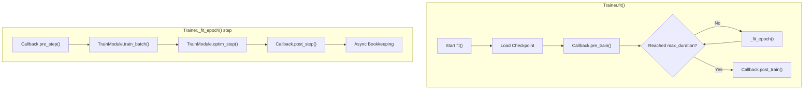
Sources: [src/olmo_core/train/trainer.py:99-168](), [src/olmo_core/train/trainer.py:441-575](), [src/olmo_core/train/trainer.py:577-704]().

---

## TrainModule Interface

`TrainModule` is an abstract base class (inheriting from `torch.distributed.checkpoint.stateful.Stateful`) that decouples the `Trainer` from specific model implementations.

### Key Methods
*   `train_batch(batch, dry_run)`: Performs the forward pass, calculates loss, and executes `loss.backward()` [src/olmo_core/train/train_module/train_module.py:169-173]().
*   `optim_step()`: Executes the optimizer update and potentially clips gradients [src/olmo_core/train/train_module/train_module.py:183-187]().
*   `zero_grads()`: Resets gradients [src/olmo_core/train/train_module/train_module.py:190-194]().
*   `record_metric(name, value, ...)`: Buffers metrics to be reduced and logged by the trainer [src/olmo_core/train/train_module/train_module.py:213-228]().

### TransformerTrainModule
The standard implementation for EMO models is `TransformerTrainModule`. It handles complex sharding and parallelism strategies:
*   **Parallelization**: Applies FSDP, TP, CP, or EP via `parallelize_model` [src/olmo_core/train/train_module/transformer/train_module.py:162-185]().
*   **Microbatching**: Manages gradient accumulation if the `rank_microbatch_size` is smaller than the global batch size [src/olmo_core/train/train_module/transformer/train_module.py:75-81]().

Sources: [src/olmo_core/train/train_module/train_module.py:73-228](), [src/olmo_core/train/train_module/transformer/train_module.py:65-124]().

---

## Metric Reduction and Bookkeeping

To maximize throughput, the `Trainer` uses an asynchronous thread pool for bookkeeping and metric processing.

### Metric Pipeline
1.  **Collection**: `TrainModule` calls `record_metric` during the step.
2.  **Buffering**: Metrics are stored in a local buffer [src/olmo_core/train/train_module/train_module.py:228]().
3.  **Reduction**: Every `metrics_collect_interval` steps, the trainer reduces metrics across the `dp_process_group` using the specified `ReduceType` (e.g., `mean`, `sum`, `max`) [src/olmo_core/train/trainer.py:200-217](), [src/olmo_core/train/trainer.py:808-835]().
4.  **Async Logging**: The reduced metrics are passed to a `ThreadPoolExecutor` to be logged by callbacks (like WandB or CSV loggers) without blocking the next training step [src/olmo_core/train/trainer.py:716-735]().

### Code Entity Association: Metric Flow
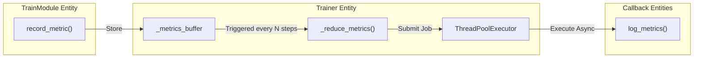
Sources: [src/olmo_core/train/trainer.py:716-750](), [src/olmo_core/train/train_module/train_module.py:213-228](), [src/olmo_core/train/trainer.py:808-835]().

---

## Cancellation and Dry-Run

### Cancellation Handling
The trainer monitors a `cancel_check_interval`. If a `SIGTERM` or `SIGINT` is received, it sets a `canceled` flag. The trainer then attempts to save an ephemeral checkpoint before exiting to allow for seamless resumption [src/olmo_core/train/trainer.py:465-478](), [src/olmo_core/train/trainer.py:706-714]().

### Dry-Run Batch
Before starting the actual training loop, the trainer can execute a "dry-run" batch. This pass initializes lazy modules (like those in `torch.compile` or specific FSDP configurations) and verifies that the model and data loader are compatible without updating weights [src/olmo_core/train/train_module/train_module.py:169-173]().

### Code Entity Association: Trainer Components
| Component | Code Entity | Responsibility |
| :--- | :--- | :--- |
| **Orchestrator** | `Trainer` | Main loop, epoch/step management [src/olmo_core/train/trainer.py:100]() |
| **Logic Wrapper** | `TrainModule` | Forward/Backward/Optimizer logic [src/olmo_core/train/train_module/train_module.py:73]() |
| **State Tracker** | `TrainingProgress` | Tracks steps, tokens, and petaflops [src/olmo_core/train/common.py:76]() |
| **Parallelism** | `DeviceMesh` | Distributed topology for sharding [src/olmo_core/train/train_module/transformer/train_module.py:136]() |
| **Scheduler** | `Scheduler` | Learning rate adjustments [src/olmo_core/train/train_module/transformer/train_module.py:118]() |

Sources: [src/olmo_core/train/trainer.py:100-246](), [src/olmo_core/train/train_module/train_module.py:73-85](), [src/olmo_core/train/train_module/transformer/train_module.py:65-124]().

---

# Page: Experiment Configuration and Launch

# Experiment Configuration and Launch

<details>
<summary>Relevant source files</summary>

The following files were used as context for generating this wiki page:

- [.github/workflows/docker.yml](.github/workflows/docker.yml)
- [.github/workflows/main.yml](.github/workflows/main.yml)
- [.github/workflows/pr_checks.yml](.github/workflows/pr_checks.yml)
- [Makefile](Makefile)
- [pyproject.toml](pyproject.toml)
- [src/Dockerfile](src/Dockerfile)
- [src/examples/llama_lns/train.py](src/examples/llama_lns/train.py)
- [src/examples/moe/train.py](src/examples/moe/train.py)
- [src/examples/ngpt/__init__.py](src/examples/ngpt/__init__.py)
- [src/examples/ngpt/train.py](src/examples/ngpt/train.py)
- [src/olmo_core/internal/common.py](src/olmo_core/internal/common.py)
- [src/olmo_core/internal/experiment.py](src/olmo_core/internal/experiment.py)
- [src/olmo_core/launch/beaker.py](src/olmo_core/launch/beaker.py)
- [src/olmo_core/train/callbacks/__init__.py](src/olmo_core/train/callbacks/__init__.py)
- [src/olmo_core/train/callbacks/callback.py](src/olmo_core/train/callbacks/callback.py)
- [src/scripts/train/Llama3-8B.py](src/scripts/train/Llama3-8B.py)
- [src/scripts/train/OLMoE-1B-7B.py](src/scripts/train/OLMoE-1B-7B.py)
- [src/scripts/train/nGPT-1B.py](src/scripts/train/nGPT-1B.py)
- [src/scripts/train/template.py](src/scripts/train/template.py)

</details>


This section covers the end-to-end process of defining an experiment in Python, configuring its execution environment (local or Beaker), and launching it. The system relies on a unified `ExperimentConfig` structure and a subcommand-based CLI to manage the transition from local development to large-scale cluster training.

## Experiment Configuration System

The configuration system is built around the `ExperimentConfig` dataclass, which serves as the root container for all components required to run a training job.

### ExperimentConfig Structure
The `ExperimentConfig` encapsulates the model architecture, data pipeline, training logic, and infrastructure requirements.

| Component | Class / Type | Responsibility |
| :--- | :--- | :--- |
| `model` | `TransformerConfig` | Defines NN architecture (layers, heads, MoE, etc.) |
| `dataset` | `NumpyDatasetConfig` | Paths to tokenized data and sequence length settings |
| `data_loader` | `DataLoaderConfig` | Batch size, worker counts, and shuffling seeds |
| `train_module` | `TrainModuleConfig` | Optimizer, scheduler, and parallelism (FSDP/TP) settings |
| `trainer` | `TrainerConfig` | Checkpointing, callbacks, and logging intervals |
| `launch` | `BeakerLaunchConfig` | Cluster-specific hardware and environment settings |

Sources: `[src/olmo_core/internal/experiment.py:96-106]()`, `[src/scripts/train/template.py:87-94]()`.

### The build_config Pattern
Most training scripts implement a `build_config` factory function. This function takes a `run_name` and a list of CLI `overrides`, constructs the base configuration, and applies the overrides using the `merge()` system.

Sources: `[src/scripts/train/template.py:97-194]()`, `[src/examples/ngpt/train.py:70-153]()`.

## CLI and Execution Lifecycle

Experiments are typically managed via a script entry point that utilizes `SubCmd` to determine the execution mode.

### Subcommands (SubCmd)
The `SubCmd` enum defines the primary entry points for an experiment script:
*   `launch`: Submits the experiment to Beaker as a batch job.
*   `train`: Starts the actual training loop (typically called by `torchrun` or inside a Beaker job).
*   `prep`: Runs data preprocessing or cache warming.
*   `dry_run`: Validates the configuration and prints parameter counts without executing training.

Sources: `[src/olmo_core/internal/experiment.py:108-114]()`.

### CliContext and Remote Command Generation
When a job is launched remotely, the `CliContext` tracks the original script and overrides to reconstruct the command for the remote node. The `remote_cmd` property ensures that if a user runs `python script.py launch ...`, the remote node executes `python script.py train ...`.

Sources: `[src/olmo_core/internal/experiment.py:56-71]()`.

### Configuration to Execution Flow

The following diagram illustrates the transition from a Python script to a running Beaker job.

**Experiment Launch Data Flow**
```mermaid
graph TD
    subgraph "Local Environment"
        A["User CLI"] -- "script.py launch [run_name] [overrides]" --> B["build_config()"]
        B --> C["CliContext"]
        C --> D["ExperimentConfig"]
        D -- "SubCmd.run()" --> E["launch()"]
    end

    subgraph "Infrastructure Layer"
        E --> F["BeakerLaunchConfig"]
        F -- "get_beaker_client()" --> G["Beaker API"]
        G --> H["Beaker Batch Job"]
    end

    subgraph "Remote Node"
        H --> I["torchrun"]
        I --> J["script.py train [run_name] [overrides]"]
        J --> K["Trainer.fit()"]
    end
```
Sources: `[src/olmo_core/internal/experiment.py:116-169]()`, `[src/olmo_core/launch/beaker.py:211-230]()`.

## Cluster-Specific Logic

The system automatically detects and configures environment-specific paths and hardware settings based on the target cluster.

### Root Directory and Storage
The `get_root_dir` function determines where checkpoints and data should reside.
*   **Weka**: If a Beaker cluster has the `storage:weka` tag, it defaults to `/weka/oe-training-default/ai2-llm`.
*   **GCS**: Otherwise, it defaults to Google Cloud Storage (`gs://ai2-llm`).

Sources: `[src/olmo_core/internal/common.py:34-45]()`.

### GPU Type Detection
Hardware constraints are mapped via `CLUSTER_TO_GPU_TYPE`. If a cluster is not explicitly mapped, the system queries the Beaker API to inspect node resources and determine the GPU type (e.g., "NVIDIA H100 80GB HBM3").

Sources: `[src/olmo_core/internal/common.py:166-188]()`.

## Beaker Launch Integration

`BeakerLaunchConfig` defines the requirements for running on AI2's Beaker platform.

### Key Configuration Parameters
*   **Images**: The `OLMoCoreBeakerImage` enum provides stable, versioned Docker images containing pre-built dependencies like `flash-attn`, `transformer-engine`, and `quack-kernels`.
*   **Secrets**: Automatically mounts environment secrets like `BEAKER_TOKEN`, `WANDB_API_KEY`, and cloud credentials (AWS/GCP).
*   **Weka Mounts**: If the `root_dir` starts with `/weka/`, the corresponding bucket is automatically added to `weka_buckets`.

Sources: `[src/olmo_core/launch/beaker.py:130-188]()`, `[src/olmo_core/internal/common.py:56-163]()`.

### Execution Environment Setup
Before execution, `prepare_cli_environment()` or `prepare_training_environment()` is called. This handles:
1.  Setting up `NCCL` environment variables.
2.  Initializing the distributed backend (typically `nccl` for CUDA).
3.  Setting global seeds for reproducibility.

Sources: `[src/olmo_core/internal/experiment.py:122-130]()`, `[src/olmo_core/train/env.py:1-40]()`.

**Infrastructure Configuration Mapping**
```mermaid
graph LR
    subgraph "Code Entity Space"
        BC["build_launch_config"]
        BLC["BeakerLaunchConfig"]
        GRD["get_root_dir"]
        GGT["get_gpu_type"]
    end

    subgraph "Natural Language / Infrastructure"
        Weka["Weka Storage Path"]
        GCS["GCS Bucket"]
        H100["NVIDIA H100"]
        B200["NVIDIA B200"]
    end

    GRD -- "storage:weka tag" --> Weka
    GRD -- "default" --> GCS
    GGT -- "ai2/jupiter" --> H100
    GGT -- "ai2/titan" --> B200
    BC --> BLC
    BLC -- "mounts" --> Weka
```
Sources: `[src/olmo_core/internal/common.py:34-45]()`, `[src/olmo_core/internal/common.py:166-188]()`, `[src/olmo_core/internal/common.py:56-163]()`.

## Config Merge and Override System

The system allows for flexible experimentation without modifying Python files by using a string-based override system.

1.  **Base Config**: Defined in the script's `build_config`.
2.  **CLI Overrides**: Passed as `key=value` strings (e.g., `model.n_layers=24`).
3.  **Merge Logic**: `ExperimentConfig.merge(overrides)` uses `omegaconf` or similar logic to traverse the dataclass hierarchy and update values.

Sources: `[src/scripts/train/template.py:194]()`, `[src/olmo_core/config.py:1-50]()`.

---

# Page: Checkpointing and IO

# Checkpointing and IO

<details>
<summary>Relevant source files</summary>

The following files were used as context for generating this wiki page:

- [src/olmo_core/distributed/checkpoint/__init__.py](src/olmo_core/distributed/checkpoint/__init__.py)
- [src/olmo_core/distributed/checkpoint/filesystem.py](src/olmo_core/distributed/checkpoint/filesystem.py)
- [src/olmo_core/distributed/utils.py](src/olmo_core/distributed/utils.py)
- [src/olmo_core/fs_cache.py](src/olmo_core/fs_cache.py)
- [src/olmo_core/generate/generation_module/transformer/config.py](src/olmo_core/generate/generation_module/transformer/config.py)
- [src/olmo_core/generate/generation_module/transformer/generation_module.py](src/olmo_core/generate/generation_module/transformer/generation_module.py)
- [src/olmo_core/io.py](src/olmo_core/io.py)
- [src/olmo_core/train/__init__.py](src/olmo_core/train/__init__.py)
- [src/olmo_core/train/callbacks/checkpointer.py](src/olmo_core/train/callbacks/checkpointer.py)
- [src/olmo_core/train/checkpoint.py](src/olmo_core/train/checkpoint.py)
- [src/olmo_core/train/common.py](src/olmo_core/train/common.py)
- [src/olmo_core/train/config.py](src/olmo_core/train/config.py)
- [src/olmo_core/utils.py](src/olmo_core/utils.py)
- [src/scripts/merge_core_checkpoints.py](src/scripts/merge_core_checkpoints.py)
- [src/test/distributed/checkpoint/filesystem_test.py](src/test/distributed/checkpoint/filesystem_test.py)
- [src/test/distributed/checkpoint_test.py](src/test/distributed/checkpoint_test.py)
- [src/test/generate/generation_module/transformer/generation_module_test.py](src/test/generate/generation_module/transformer/generation_module_test.py)
- [src/test/io_test.py](src/test/io_test.py)
- [src/test/scripts/merge_core_checkpoints_test.py](src/test/scripts/merge_core_checkpoints_test.py)
- [src/test/train/checkpoint_test.py](src/test/train/checkpoint_test.py)

</details>


This section documents the infrastructure for saving and loading model states, the unified I/O API for multi-cloud and local storage, and the duration system used to track training progress.

## Checkpointer and Checkpointing Lifecycle

The `Checkpointer` class is the primary interface for managing training state persistence. It supports both synchronous and asynchronous saving to local filesystems, S3, GCS, and Weka.

### Atomicity and Temporary Directories
To ensure checkpoint integrity, the `Checkpointer` uses a temporary directory pattern. Data is first written to a local `work_dir` or a temporary subdirectory within the target path before being finalized. This prevents partially written checkpoints from being recognized as valid if a crash occurs during I/O.
- **Metadata**: A checkpoint is only considered valid if it contains a `.metadata.json` file. This file is written last in the sequence [src/olmo_core/train/checkpoint.py:84-86](), [src/olmo_core/train/checkpoint.py:134-134]().
- **Coordination**: In distributed settings, `barrier()` calls and `get_fs_local_rank()` are used to coordinate directory creation and cleanup [src/olmo_core/train/checkpoint.py:25-31](), [src/olmo_core/train/checkpoint.py:97-100]().

### Save and Load Flow
The checkpointer handles three main components:
1.  **Trainer State**: RNG states, current step, and progress [src/olmo_core/train/checkpoint.py:117-117]().
2.  **Model State**: Sharded or unsharded model parameters [src/olmo_core/train/checkpoint.py:120-132]().
3.  **Optimizer State**: Sharded optimizer moments [src/olmo_core/train/checkpoint.py:121-132]().

**Checkpointing Logic Flow**
```mermaid
graph TD
    subgraph "Checkpointer.save()"
    A["Start Save"] --> B["Sync CUDA (if available)"]
    B --> C["Create Temporary WorkDir"]
    C --> D["Save Trainer State (.pt)"]
    D --> E["Save Model/Optim State (sharded)"]
    E --> F["Write .metadata.json"]
    F --> G["Finalize Directory"]
    end
```
Sources: [src/olmo_core/train/checkpoint.py:102-135](), [src/olmo_core/distributed/checkpoint/__init__.py:189-201]()

## Distributed IO and Remote Filesystems

The `olmo_core.io` module provides a unified API that abstracts away the differences between local paths and cloud URLs (s3://, gs://, weka:).

### Unified IO API
Key functions like `get_file_size`, `get_bytes_range`, and `upload` automatically detect the protocol and route the request to the appropriate backend (e.g., `S3Client` or GCS-specific logic) [src/olmo_core/io.py:107-135](), [src/olmo_core/io.py:171-200]().

### RemoteFileSystemWriter and Reader
These classes extend PyTorch's distributed checkpointing to support direct cloud I/O.
- **Throttle Uploads**: To avoid overwhelming network interfaces, `throttle_uploads=True` ensures only one rank per node uploads at a time [src/olmo_core/distributed/checkpoint/filesystem.py:199-208]().
- **Async Saving**: `async_save_state_dict` de-stages the state dict to CPU memory first, then offloads the I/O to a background thread pool, allowing training to resume immediately [src/olmo_core/distributed/checkpoint/__init__.py:122-138]().

**Code Entity Mapping: I/O Space**
```mermaid
graph LR
    subgraph "Code Entity Space"
    API["io.py (API)"]
    Writer["RemoteFileSystemWriter"]
    Reader["RemoteFileSystemReader"]
    Checkpointer["Checkpointer"]
    end

    subgraph "Storage Backends"
    Local["Local Filesystem"]
    S3["AWS S3 / R2"]
    GCS["Google Cloud Storage"]
    Weka["Weka (S3-compatible)"]
    end

    API --> Local
    API --> S3
    API --> GCS
    Writer --> API
    Reader --> API
    Checkpointer --> Writer
```
Sources: [src/olmo_core/io.py:42-103](), [src/olmo_core/distributed/checkpoint/filesystem.py:187-209](), [src/olmo_core/train/checkpoint.py:79-96]()

## CheckpointerCallback and Removal Strategies

The `CheckpointerCallback` manages the frequency of saves and the cleanup of old checkpoints.

### Removal Strategies
Controlled by `CheckpointRemovalStrategy` [src/olmo_core/train/callbacks/checkpointer.py:27-30]():
- `ephemeral_only`: Only removes checkpoints marked as temporary (saved at `ephemeral_save_interval`) [src/olmo_core/train/callbacks/checkpointer.py:32-35]().
- `all_non_permanent`: Removes everything except checkpoints saved at the primary `save_interval` [src/olmo_core/train/callbacks/checkpointer.py:37-41]().
- `never`: Keeps all checkpoints [src/olmo_core/train/callbacks/checkpointer.py:43-46]().

Sources: [src/olmo_core/train/callbacks/checkpointer.py:49-114]()

## Duration System

The `Duration` class provides a unified way to specify training lengths and intervals using different units.

| Unit | Description | Usage |
| :--- | :--- | :--- |
| `steps` | Number of batches processed | `Duration.steps(1000)` |
| `epochs` | Full passes through the dataset | `Duration.epochs(1)` |
| `tokens` | Total tokens processed | `Duration.tokens(1e12)` |

### Chinchilla Scaling
The system includes a `chinchilla_tokens` helper to calculate training duration based on model size. It assumes a standard of 20 tokens per active parameter for compute optimality [src/olmo_core/train/common.py:69-92]().

**Progress Calculation Logic**
The `due()` method checks if a specific target has been reached based on the current `step`, `tokens`, and `epoch` counters [src/olmo_core/train/common.py:94-105]().

Sources: [src/olmo_core/train/common.py:17-106]()

---

# Page: Callbacks System

# Callbacks System

<details>
<summary>Relevant source files</summary>

The following files were used as context for generating this wiki page:

- [CLAUDE.md](CLAUDE.md)
- [docs/source/conf.py](docs/source/conf.py)
- [docs/source/distributed/checkpoint.rst](docs/source/distributed/checkpoint.rst)
- [docs/source/exceptions.rst](docs/source/exceptions.rst)
- [docs/source/io.rst](docs/source/io.rst)
- [docs/source/utils.rst](docs/source/utils.rst)
- [src/examples/llama_lns/__init__.py](src/examples/llama_lns/__init__.py)
- [src/examples/llm/train.py](src/examples/llm/train.py)
- [src/olmo_core/eval/evaluator.py](src/olmo_core/eval/evaluator.py)
- [src/olmo_core/eval/lm_evaluator.py](src/olmo_core/eval/lm_evaluator.py)
- [src/olmo_core/exceptions.py](src/olmo_core/exceptions.py)
- [src/olmo_core/launch/select_beaker_hosts.py](src/olmo_core/launch/select_beaker_hosts.py)
- [src/olmo_core/train/callbacks/batch_size_scheduler.py](src/olmo_core/train/callbacks/batch_size_scheduler.py)
- [src/olmo_core/train/callbacks/beaker.py](src/olmo_core/train/callbacks/beaker.py)
- [src/olmo_core/train/callbacks/comet.py](src/olmo_core/train/callbacks/comet.py)
- [src/olmo_core/train/callbacks/console_logger.py](src/olmo_core/train/callbacks/console_logger.py)
- [src/olmo_core/train/callbacks/evaluator_callback.py](src/olmo_core/train/callbacks/evaluator_callback.py)
- [src/olmo_core/train/callbacks/expert_pool_scheduler.py](src/olmo_core/train/callbacks/expert_pool_scheduler.py)
- [src/olmo_core/train/callbacks/frozen_expert_gradient_mask.py](src/olmo_core/train/callbacks/frozen_expert_gradient_mask.py)
- [src/olmo_core/train/callbacks/frozen_weight_restorer.py](src/olmo_core/train/callbacks/frozen_weight_restorer.py)
- [src/olmo_core/train/callbacks/gap_monitor.py](src/olmo_core/train/callbacks/gap_monitor.py)
- [src/olmo_core/train/callbacks/gpu_memory_monitor.py](src/olmo_core/train/callbacks/gpu_memory_monitor.py)
- [src/olmo_core/train/callbacks/gradient_monitor.py](src/olmo_core/train/callbacks/gradient_monitor.py)
- [src/olmo_core/train/callbacks/metric_saver.py](src/olmo_core/train/callbacks/metric_saver.py)
- [src/olmo_core/train/callbacks/post_train_eval.py](src/olmo_core/train/callbacks/post_train_eval.py)
- [src/olmo_core/train/callbacks/slack_notifier.py](src/olmo_core/train/callbacks/slack_notifier.py)
- [src/olmo_core/train/callbacks/speed_monitor.py](src/olmo_core/train/callbacks/speed_monitor.py)
- [src/olmo_core/train/callbacks/wandb.py](src/olmo_core/train/callbacks/wandb.py)
- [src/olmo_core/train/utils.py](src/olmo_core/train/utils.py)
- [src/scripts/analysis/generate_cluster_viz.py](src/scripts/analysis/generate_cluster_viz.py)
- [src/scripts/analysis/generate_token_cluster_viz.py](src/scripts/analysis/generate_token_cluster_viz.py)
- [src/scripts/clustering/visualize.py](src/scripts/clustering/visualize.py)
- [src/scripts/inspect_tensor.py](src/scripts/inspect_tensor.py)
- [src/test/launch/beaker_test.py](src/test/launch/beaker_test.py)
- [src/test/train/utils_test.py](src/test/train/utils_test.py)

</details>


The EMO training infrastructure utilizes a flexible callback system to decouple core training logic from auxiliary tasks such as logging, checkpointing, evaluation, and hardware monitoring. Callbacks are executed at specific hooks within the `Trainer` lifecycle.

## Callback Base Class

All callbacks inherit from the `Callback` base class. This abstraction allows for stateful components that can participate in the training loop and handle distributed coordination.

### Lifecycle Hooks
Callbacks can implement several methods that the `Trainer` calls at specific points:
- `pre_train()`: Executed once before the training loop starts.
- `post_train()`: Executed once after the training loop finishes successfully.
- `pre_step()`: Executed before each training step.
- `post_step()`: Executed after each training step.
- `on_error()`: Executed if an exception occurs during training.

### Key Properties
- **Priority**: Callbacks have a `priority` attribute (integer) that determines the execution order. Lower values run first for "pre" hooks and later for "post" hooks [src/olmo_core/train/callbacks/speed_monitor.py:28-28]().
- **Statefulness**: Callbacks can implement `state_dict()` and `load_state_dict()` to persist their internal state across checkpoints [src/olmo_core/train/callbacks/comet.py:136-141]().
- **Cancellations**: Callbacks can trigger run cancellations via `self.trainer.cancel_run()` [src/olmo_core/train/callbacks/wandb.py:174-174]().

### Data Flow: Trainer to Callback
The following diagram illustrates how the `Trainer` interacts with the `Callback` system during a single training step.

**Trainer-Callback Interaction Loop**
```mermaid
graph TD
    subgraph "Trainer Loop [_fit_epoch]"
        T1["pre_step() Hook"] --> T2["train_batch()"]
        T2 --> T3["optim_step()"]
        T3 --> T4["post_step() Hook"]
    end

    subgraph "Callback Entities"
        C1["SpeedMonitorCallback"]
        C2["GPUMemoryMonitorCallback"]
        C3["WandBCallback"]
    end

    T1 -.->|"batch data"| C1
    T4 -.->|"metrics"| C1
    T4 -.->|"memory stats"| C2
    T4 -.->|"log_metrics()"| C3
```
Sources: [src/olmo_core/train/callbacks/speed_monitor.py:121-122](), [src/olmo_core/train/callbacks/gpu_memory_monitor.py:47-47](), [src/olmo_core/train/callbacks/wandb.py:144-144]().

---

## Logging and Monitoring Callbacks

### SpeedMonitorCallback
Calculates throughput metrics including Tokens Per Second (TPS), Model Flops Utilization (MFU), and data loading overhead [src/olmo_core/train/callbacks/speed_monitor.py:19-21]().
- **MFU Calculation**: Estimates peak FLOPS based on device name (e.g., H100, B200, A100) and compares against actual training throughput [src/olmo_core/train/callbacks/speed_monitor.py:92-113]().
- **Automatic Insertion**: This callback is added automatically by the trainer if not explicitly configured [src/olmo_core/train/callbacks/speed_monitor.py:23-26]().

### GPUMemoryMonitorCallback
Tracks GPU memory utilization (active vs. reserved) and monitors for CUDA OOM errors or allocation retries [src/olmo_core/train/callbacks/gpu_memory_monitor.py:13-16]().
- **Metrics**: Records `gpu_memory/GPU active mem (GiB)` and `gpu_memory/GPU active mem (%)` [src/olmo_core/train/callbacks/gpu_memory_monitor.py:53-54]().

### WandBCallback & CometCallback
Integrations for Weights & Biases and Comet.ml.
- **Rank 0 Only**: Logging and API communication are restricted to the global rank 0 process [src/olmo_core/train/callbacks/wandb.py:141-142]().
- **Remote Cancellation**: Monitors for specific tags (e.g., "cancel") on the web UI to stop the training job remotely [src/olmo_core/train/callbacks/wandb.py:162-175](), [src/olmo_core/train/callbacks/comet.py:200-208]().

Sources: [src/olmo_core/train/callbacks/speed_monitor.py:19-116](), [src/olmo_core/train/callbacks/gpu_memory_monitor.py:13-81](), [src/olmo_core/train/callbacks/wandb.py:21-178](), [src/olmo_core/train/callbacks/comet.py:48-229]().

---

## Evaluation Callbacks

### EvaluatorCallback
Runs in-loop evaluations periodically. It supports `LMEvaluator` for perplexity and cross-entropy loss tracking [src/olmo_core/train/callbacks/evaluator_callback.py:45-49]().
- **Determinism**: Logs the `first_batch_hash` and global instance indices to verify that evaluation data is consistent across different training runs [src/olmo_core/train/callbacks/evaluator_callback.py:148-165]().
- **Execution**: Can be configured to run on startup, on finish, or at fixed step intervals [src/olmo_core/train/callbacks/evaluator_callback.py:56-74]().

### PostTrainEvalCallback
Launches downstream evaluation jobs (e.g., ARC, MMLU, GSM8K) on Beaker after training completes [src/olmo_core/train/callbacks/post_train_eval.py:71-74]().
- **HF Dependency**: Expects an HF-format checkpoint to exist, typically created by `HFConverterCallback` [src/olmo_core/train/callbacks/post_train_eval.py:75-76]().
- **Priority**: Set to `-2` to ensure it runs after the converter (priority `-1`) [src/olmo_core/train/callbacks/post_train_eval.py:86-86]().

**Evaluation Data Flow**
```mermaid
graph LR
    subgraph "Training Process"
        T[Trainer] --> EC[EvaluatorCallback]
        EC --> LME[LMEvaluator]
        LME --> ND[NumpyPaddedFSLDataset]
    end

    subgraph "Post-Training"
        T --> HF[HFConverterCallback]
        HF --> PTEC[PostTrainEvalCallback]
        PTEC --> B[Beaker/Gantry Job]
    end
```
Sources: [src/olmo_core/train/callbacks/evaluator_callback.py:45-165](), [src/olmo_core/train/callbacks/post_train_eval.py:71-150](), [src/olmo_core/eval/lm_evaluator.py:14-40]().

---

## Infrastructure and Specialized Callbacks

### BeakerCallback
Synchronizes training progress and metadata with the Beaker experiment description [src/olmo_core/train/callbacks/beaker.py:25-28]().
- **Metadata Integration**: Adds Beaker experiment URLs to WandB/Comet configurations [src/olmo_core/train/callbacks/beaker.py:69-85]().
- **Requirements Logging**: Saves `requirements.txt` and `config.json` to the Beaker results dataset [src/olmo_core/train/callbacks/beaker.py:91-112]().

### ExpertPoolSchedulerCallback
Used in EMO research to dynamically adjust the number of active experts in a Mixture-of-Experts model during training.
- **Functionality**: Updates the `active_experts` count in the `MoELayer` based on a predefined schedule or training progress.

### FrozenExpertGradientMaskCallback
Supports selective fine-tuning by masking gradients for specific experts.
- **Implementation**: Applies a binary mask to the `.grad` attribute of expert parameters during the `post_step` or `pre_step` hooks to prevent updates to "frozen" experts.

### GAPMonitorCallback
Monitors the "Generalization Gap" by comparing training loss against validation loss in real-time.

Sources: [src/olmo_core/train/callbacks/beaker.py:25-165](), [src/olmo_core/launch/select_beaker_hosts.py:132-160]().

---

# Page: Optimizers and Learning Rate Schedulers

# Optimizers and Learning Rate Schedulers

<details>
<summary>Relevant source files</summary>

The following files were used as context for generating this wiki page:

- [src/olmo_core/distributed/parallel/__init__.py](src/olmo_core/distributed/parallel/__init__.py)
- [src/olmo_core/distributed/parallel/pipeline_parallel.py](src/olmo_core/distributed/parallel/pipeline_parallel.py)
- [src/olmo_core/optim/__init__.py](src/olmo_core/optim/__init__.py)
- [src/olmo_core/optim/adam.py](src/olmo_core/optim/adam.py)
- [src/olmo_core/optim/adamw.py](src/olmo_core/optim/adamw.py)
- [src/olmo_core/optim/config.py](src/olmo_core/optim/config.py)
- [src/olmo_core/optim/dion.py](src/olmo_core/optim/dion.py)
- [src/olmo_core/optim/lion.py](src/olmo_core/optim/lion.py)
- [src/olmo_core/optim/muon.py](src/olmo_core/optim/muon.py)
- [src/olmo_core/optim/noop.py](src/olmo_core/optim/noop.py)
- [src/olmo_core/optim/scheduler.py](src/olmo_core/optim/scheduler.py)
- [src/olmo_core/optim/skip_step_optimizer.py](src/olmo_core/optim/skip_step_optimizer.py)
- [src/olmo_core/train/callbacks/list_checkpointer.py](src/olmo_core/train/callbacks/list_checkpointer.py)
- [src/scripts/reshard_core_checkpoint.py](src/scripts/reshard_core_checkpoint.py)
- [src/test/optim/adamw_test.py](src/test/optim/adamw_test.py)
- [src/test/optim/lion_test.py](src/test/optim/lion_test.py)
- [src/test/optim/scheduler_test.py](src/test/optim/scheduler_test.py)
- [src/test/optim/skip_step_optimizer_test.py](src/test/optim/skip_step_optimizer_test.py)
- [src/test/scripts/reshard_core_checkpoint_test.py](src/test/scripts/reshard_core_checkpoint_test.py)

</details>


The EMO codebase provides a flexible infrastructure for parameter optimization, supporting standard optimizers, specialized "Skip Step" variants for stability, and matrix-aware optimizers like Muon. The system is built on a configuration-driven pattern where `OptimConfig` and `Scheduler` objects define the behavior of the training loop.

## Optimizer Configuration

The base class for all optimizer configurations is `OptimConfig` [src/olmo_core/optim/config.py:57-60](). It handles the mapping of model parameters to optimizer groups, support for `torch.compile`, and the persistence of "fixed fields" during checkpoint restoration.

### Parameter Grouping and Overrides
By default, all parameters with `requires_grad=True` are placed into a single optimizer group. Users can customize this using `OptimGroupOverride` [src/olmo_core/optim/config.py:43-54]().

*   **FQN Glob Matching**: Parameters are matched using fully qualified names (FQNs) or wildcards [src/olmo_core/optim/config.py:45-48]().
*   **Strictness**: By default, if a glob pattern fails to match any parameter, an `OLMoConfigurationError` is raised [src/olmo_core/optim/config.py:113-114]().
*   **Priority**: Parameters are assigned to the first override group they match. Any remaining parameters are placed in a default group [src/olmo_core/optim/config.py:144-148]().

### Matrix-Aware Optimization
For advanced optimizers like **Muon**, EMO uses `MatrixAwareOptimConfig` [src/olmo_core/optim/muon.py:45](). This class automatically categorizes parameters into:
1.  **Matrix**: 2D hidden weights (optimized via Muon) [src/olmo_core/optim/muon.py:108]().
2.  **Embed**: Input embeddings (optimized via AdamW) [src/olmo_core/optim/muon.py:111-113]().
3.  **Vector**: 1D gains/biases (optimized via AdamW) [src/olmo_core/optim/muon.py:114]().
4.  **LM Head**: The final output layer [src/olmo_core/optim/muon.py:115-117]().

Sources: [src/olmo_core/optim/config.py](), [src/olmo_core/optim/muon.py]()

## Optimizer Implementations

EMO supports a wide range of optimizers, including several custom implementations designed for large-scale training stability.

### Skip-Step Optimizers
`SkipStepOptimizer` [src/olmo_core/optim/skip_step_optimizer.py:12-31]() is a base class that monitors a rolling window of losses and gradient norms. If the current step's values exceed a threshold (defined by `sigma_factor` standard deviations), the update is effectively skipped [src/olmo_core/optim/skip_step_optimizer.py:86-109]().

| Optimizer | Config Class | Description |
| :--- | :--- | :--- |
| **AdamW** | `AdamWConfig` | Standard Adam with decoupled weight decay. Supports `foreach` kernels [src/olmo_core/optim/adamw.py:50](). |
| **SkipStepAdamW** | `SkipStepAdamWConfig` | AdamW variant that can skip updates during loss spikes [src/olmo_core/optim/adamw.py:105](). |
| **Lion** | `LionConfig` | Memory-efficient optimizer using the sign of the update [src/olmo_core/optim/lion.py:39](). |
| **SkipStepLion** | `SkipStepLionConfig` | Lion variant with skip-step logic [src/olmo_core/optim/lion.py:82](). |
| **Muon** | `MuonConfig` | Orthogonalization-based optimizer for hidden weights [src/olmo_core/optim/muon.py:45](). |
| **Dion** | `DionConfig` | Interface for the `dion` package [src/olmo_core/optim/dion.py](). |
| **Noop** | `NoOpConfig` | An optimizer that does nothing, useful for debugging or evaluation [src/olmo_core/optim/noop.py](). |

### Data Flow: Skip-Step Logic
This diagram illustrates how the `TransformerTrainModule` interacts with a `SkipStepOptimizer` to decide whether to apply an update.

Title: Skip-Step Decision Flow
```mermaid
graph TD
    subgraph "Natural Language Space"
        A["Loss Spike Detected"]
        B["Update Skipped"]
    end

    subgraph "Code Entity Space"
        T["TransformerTrainModule"] -->|set latest_loss| S["SkipStepOptimizer"]
        T -->|set latest_grad_norm| S
        S -->|"get_step_factor()"| SF["step_factor (1.0 or 0.0)"]
        SF -->|"lion_step() / adamw_step()"| P["Parameter Update"]
    end

    A --- T
    B --- SF
```
Sources: [src/olmo_core/optim/skip_step_optimizer.py](), [src/olmo_core/optim/lion.py](), [src/olmo_core/optim/adamw.py]()

## Learning Rate Schedulers

Schedulers in EMO are `Registrable` components that determine the learning rate based on training progress, which can be measured in either **steps** or **tokens** [src/olmo_core/optim/scheduler.py:21-24]().

### Progress System
The `set_lr` function [src/olmo_core/optim/scheduler.py:46]() retrieves the current progress from the `Trainer` state:
*   **Steps**: Uses `trainer.global_step` against `trainer.max_steps` [src/olmo_core/optim/scheduler.py:75-76]().
*   **Tokens**: Uses `trainer.global_train_tokens_seen` against `trainer.max_tokens` [src/olmo_core/optim/scheduler.py:85-86]().

### Key Scheduler Types

1.  **CosineWithWarmup (`CosWithWarmup`)**: Linear warmup followed by a cosine decay to a final value defined by `alpha_f` [src/olmo_core/optim/scheduler.py:58-73]().
2.  **WSD (Warmup-Stable-Decay)**: A three-phase scheduler featuring linear warmup, a stable peak LR phase, and a final decay phase [src/olmo_core/optim/scheduler.py:158-172]().
3.  **WSDS (Warmup-Stable-Decay-Simplified)**: Optimized for continual pretraining, allowing multiple periods where the LR resets to peak after a decay [src/olmo_core/optim/scheduler.py:276-310]().
4.  **SequentialScheduler**: Chains multiple schedulers together, switching based on predefined step/token milestones [src/olmo_core/optim/scheduler.py:734-750]().

### Progress Mapping Diagram
This diagram shows how the configuration parameters map to the internal scheduler logic.

Title: Scheduler Progress Mapping
```mermaid
graph LR
    subgraph "Natural Language Space"
        U["Progress Unit"]
        T["Target LR"]
    end

    subgraph "Code Entity Space"
        S["SchedulerConfig"] -->|units| SU["SchedulerUnits (steps/tokens)"]
        S -->|alpha_f| AF["Final LR Ratio"]
        SU -->|current| GL["get_lr()"]
        AF --> GL
        GL -->|"group['lr']"| O["Optimizer Param Group"]
    end

    U --- SU
    T --- AF
```

### Alpha_f and Decay Logic
Many schedulers use `alpha_f` to define the minimum learning rate as a fraction of the `initial_lr`.
*   **Linear Decay**: `new_lr = initial_lr * (1 - (1 - alpha_f) * progress)` [src/olmo_core/optim/scheduler.py:521]().
*   **Cosine Decay**: Uses `0.5 * (1 + cos(pi * progress))` to interpolate between `initial_lr` and `initial_lr * alpha_f` [src/olmo_core/optim/scheduler.py:642]().

Sources: [src/olmo_core/optim/scheduler.py](), [src/olmo_core/optim/__init__.py]()

---

# Page: Data Pipeline

# Data Pipeline

<details>
<summary>Relevant source files</summary>

The following files were used as context for generating this wiki page:

- [docs/source/guides/data_mixing.rst](docs/source/guides/data_mixing.rst)
- [src/olmo_core/data/__init__.py](src/olmo_core/data/__init__.py)
- [src/olmo_core/data/data_loader.py](src/olmo_core/data/data_loader.py)
- [src/olmo_core/data/mixes/OLMoE-mix-0824.txt](src/olmo_core/data/mixes/OLMoE-mix-0824.txt)
- [src/olmo_core/data/mixes/__init__.py](src/olmo_core/data/mixes/__init__.py)
- [src/olmo_core/data/mixes/croissant.txt](src/olmo_core/data/mixes/croissant.txt)
- [src/olmo_core/data/mixes/dolma17.txt](src/olmo_core/data/mixes/dolma17.txt)
- [src/olmo_core/data/mixes/v3-small-ppl-validation.txt](src/olmo_core/data/mixes/v3-small-ppl-validation.txt)
- [src/olmo_core/data/numpy_dataset.py](src/olmo_core/data/numpy_dataset.py)
- [src/olmo_core/data/source_mixture.py](src/olmo_core/data/source_mixture.py)
- [src/olmo_core/data/tokenizer.py](src/olmo_core/data/tokenizer.py)
- [src/olmo_core/data/types.py](src/olmo_core/data/types.py)
- [src/olmo_core/data/utils.py](src/olmo_core/data/utils.py)
- [src/test/data/data_loader_test.py](src/test/data/data_loader_test.py)
- [src/test/data/fixtures.py](src/test/data/fixtures.py)
- [src/test/data/mixes_test.py](src/test/data/mixes_test.py)
- [src/test/data/numpy_dataset_test.py](src/test/data/numpy_dataset_test.py)
- [src/test/data/source_mixture_test.py](src/test/data/source_mixture_test.py)
- [src/test/data/tokenizer_test.py](src/test/data/tokenizer_test.py)
- [src/test/data/utils_test.py](src/test/data/utils_test.py)

</details>


The EMO data pipeline is designed for high-performance, distributed training on massive tokenized datasets. It utilizes pre-tokenized NumPy arrays to minimize CPU overhead during training and provides a robust system for mixing multiple data sources with deterministic sampling.

## Overview

The system transitions from raw data to training batches through several layers of abstraction:
1.  **Data Mixes**: Registries of tokenized file paths and source labels.
2.  **Source Mixture**: Logic for apportioning tokens from various sources based on target ratios.
3.  **NumPy Datasets**: Specialized `Dataset` implementations for Fixed Sequence Length (FSL) or Variable Sequence Length (VSL) training.
4.  **Data Loaders**: Distributed, stateful loaders that manage shuffling, resumption, and multi-threaded loading.

### Data Flow Diagram

The following diagram illustrates how data moves from storage into the model, associating code entities with their roles in the pipeline.

```mermaid
graph TD
    subgraph "Storage Layer"
        [DataMix_Registry] -- "build()" --> [Numpy_Files]
        [Numpy_Files] --> [memmap]
    end

    subgraph "Dataset Layer"
        [SourceMixtureDatasetConfig] -- "build()" --> [SourceMixtureDataset]
        [SourceMixtureDataset] --> [NumpyFSLDataset]
        [NumpyFSLDataset] --> [NumpyPackedFSLDataset]
    end

    subgraph "Loading Layer"
        [NumpyFSLDataLoader] -- "iter_batches()" --> [DataCollator]
        [DataCollator] -- "split_batch()" --> [Trainer_Loop]
    end

    [DataMix_Registry]:::code
    [NumpyFSLDataset]:::code
    [NumpyFSLDataLoader]:::code
    [SourceMixtureDatasetConfig]:::code
    
    classDef code font-family:monospace, stroke-width:2px;
```
**Sources:** [src/olmo_core/data/numpy_dataset.py:106-123](), [src/olmo_core/data/data_loader.py:54-103](), [src/olmo_core/data/source_mixture.py:23-24]()

---

## NumPy Datasets and Data Loaders

The core of the data pipeline is the `NumpyDatasetBase` [src/olmo_core/data/numpy_dataset.py:106-123](), which provides an interface for datasets backed by `numpy` arrays on disk. These datasets use `np.memmap` to efficiently access large files without loading them entirely into RAM.

### Key Dataset Variants
*   **FSL (Fixed Sequence Length)**: Standard pretraining where every instance is exactly `sequence_length` tokens. Variants include `NumpyFSLDataset` (standard) and `NumpyPackedFSLDataset` (uses Best-Fit-Decreasing bin packing to minimize padding) [src/olmo_core/data/numpy_dataset.py:68-87]().
*   **VSL (Variable Sequence Length)**: Supports curriculum learning where sequence lengths grow over time, implemented in `NumpyVSLDataset` [src/olmo_core/data/numpy_dataset.py:81]().

### Data Loaders
`NumpyFSLDataLoader` and `NumpyVSLDataLoader` provide distributed, deterministic loading [src/olmo_core/data/data_loader.py:46-47](). They support:
*   **Stateful Resumption**: Capturing and restoring the `state_dict` to ensure the exact data order is maintained after a crash or restart [src/olmo_core/data/data_loader.py:167-171]().
*   **Global Determinism**: Using a `fingerprint` of the dataset to ensure all ranks are training on the same data mix [src/olmo_core/data/numpy_dataset.py:212-223]().

For details on dataset types and distributed resumption, see **[NumPy Datasets and Data Loaders](#4.1)**.

---

## Data Mixes and Source Mixture System

EMO uses a sophisticated mixing system to combine disparate datasets (e.g., Common Crawl, Code, Math) into a single training stream.

### Data Mixes Registry
The `DataMix` enum [src/olmo_core/data/mixes/__init__.py:33-103]() acts as a registry for known datasets like `OLMoE_mix_0824` or `dolma17`. Calling `DataMix.build()` resolves these into lists of absolute paths to `.npy` files [src/olmo_core/data/mixes/__init__.py:123-169]().

### Source Mixture Logic
The `SourceMixtureDatasetConfig` [src/olmo_core/data/source_mixture.py:23-24]() handles the math of data apportionment. It uses Hamilton apportionment to determine exactly how many tokens to take from each source to meet a `target_ratio` while respecting `max_repetition_ratio` constraints [src/olmo_core/data/source_mixture.py:30-60]().

### Code Entity Association: Mixing Logic

```mermaid
classDiagram
    class DataMix {
        <<enumeration>>
        OLMoE_mix_0824
        dolma17
        croissant
        build(base_dir, tokenizer)
    }
    class SourceMixtureConfig {
        source_name: str
        target_ratio: float
        paths: List[str]
    }
    class SourceMixtureDatasetConfig {
        source_list: SourceMixtureList
        requested_tokens: int
        build()
    }
    DataMix ..> SourceMixtureConfig : provides paths
    SourceMixtureDatasetConfig *-- SourceMixtureConfig : manages
```
**Sources:** [src/olmo_core/data/mixes/__init__.py:33-103](), [src/olmo_core/data/source_mixture.py:29-60](), [src/olmo_core/data/source_mixture.py:127-150]()

For details on the registry and how to configure mixtures, see **[Data Mixes and Source Mixture System](#4.2)**.

---

## Tokenizer Configuration

The `TokenizerConfig` [src/olmo_core/data/tokenizer.py:47-75]() stores critical metadata used by the datasets and model:
*   `vocab_size`: Total tokens in the vocabulary.
*   `eos_token_id`: Used as a document separator (e.g., `100257` for Dolma2) [src/olmo_core/data/tokenizer.py:91]().
*   `pad_token_id`: Used for padding instances in `NumpyPaddedFSLDataset`.

The system includes pre-defined configurations for `dolma2`, `gpt2`, and `gpt_neox_olmo_dolma_v1_5` [src/olmo_core/data/tokenizer.py:85-132]().

**Sources:** [src/olmo_core/data/tokenizer.py:47-132]()

---

## Utility Functions

The pipeline includes several low-level utilities in `olmo_core.data.utils` for manipulating batches:
*   `split_batch`: Breaks a large batch into micro-batches for gradient accumulation [src/olmo_core/data/utils.py:43-72]().
*   `melt_batch`: Increases batch size by shortening sequence length (used in VSL curriculum) [src/olmo_core/data/utils.py:74-116]().
*   `write_document_indices`: Generates metadata files containing the start/end offsets of documents within a `.npy` file [src/olmo_core/data/utils.py:153-167]().

**Sources:** [src/olmo_core/data/utils.py:43-167]()

---

# Page: NumPy Datasets and Data Loaders

# NumPy Datasets and Data Loaders

<details>
<summary>Relevant source files</summary>

The following files were used as context for generating this wiki page:

- [docs/source/fs_cache.rst](docs/source/fs_cache.rst)
- [docs/source/guides/data_loading.rst](docs/source/guides/data_loading.rst)
- [docs/source/guides/data_mixing.rst](docs/source/guides/data_mixing.rst)
- [src/olmo_core/data/__init__.py](src/olmo_core/data/__init__.py)
- [src/olmo_core/data/collator.py](src/olmo_core/data/collator.py)
- [src/olmo_core/data/composable/data_loader.py](src/olmo_core/data/composable/data_loader.py)
- [src/olmo_core/data/composable/mixing_token_source.py](src/olmo_core/data/composable/mixing_token_source.py)
- [src/olmo_core/data/composable/numpy_document_source.py](src/olmo_core/data/composable/numpy_document_source.py)
- [src/olmo_core/data/composable/sampling_document_source.py](src/olmo_core/data/composable/sampling_document_source.py)
- [src/olmo_core/data/composable/sampling_instance_source.py](src/olmo_core/data/composable/sampling_instance_source.py)
- [src/olmo_core/data/composable/sampling_token_source.py](src/olmo_core/data/composable/sampling_token_source.py)
- [src/olmo_core/data/data_loader.py](src/olmo_core/data/data_loader.py)
- [src/olmo_core/data/numpy_dataset.py](src/olmo_core/data/numpy_dataset.py)
- [src/olmo_core/data/source_mixture.py](src/olmo_core/data/source_mixture.py)
- [src/olmo_core/data/types.py](src/olmo_core/data/types.py)
- [src/olmo_core/data/utils.py](src/olmo_core/data/utils.py)
- [src/test/data/collator_test.py](src/test/data/collator_test.py)
- [src/test/data/composable/sampling_instance_source_test.py](src/test/data/composable/sampling_instance_source_test.py)
- [src/test/data/composable/sampling_token_source_test.py](src/test/data/composable/sampling_token_source_test.py)
- [src/test/data/custom_data_loader.py](src/test/data/custom_data_loader.py)
- [src/test/data/custom_data_loader_test.py](src/test/data/custom_data_loader_test.py)
- [src/test/data/data_loader_test.py](src/test/data/data_loader_test.py)
- [src/test/data/fixtures.py](src/test/data/fixtures.py)
- [src/test/data/numpy_dataset_test.py](src/test/data/numpy_dataset_test.py)
- [src/test/data/source_mixture_test.py](src/test/data/source_mixture_test.py)
- [src/test/data/utils_test.py](src/test/data/utils_test.py)

</details>


This page provides a detailed technical reference for the EMO/OLMo-Core data pipeline, focusing on datasets backed by NumPy arrays and their corresponding distributed data loaders. The system is designed for high-performance pre-training, supporting fixed sequence length (FSL), variable sequence length (VSL), document packing, and stateful resumption.

## Core Dataset Architecture

The data pipeline is built around the `NumpyDatasetBase` abstract class [src/olmo_core/data/numpy_dataset.py:106-123](). It manages access to 1D NumPy arrays of token IDs (typically generated by the Dolma toolkit) and provides a unified interface for metadata, fingerprinting, and data access.

### Lifecycle and Preparation
Before use in a distributed environment, datasets must be prepared. The `prepare()` method [src/olmo_core/data/numpy_dataset.py:284-307]() is called to handle one-time setup tasks like building indices or calculating document boundaries. This process is coordinated across processes using a barrier [src/olmo_core/data/numpy_dataset.py:303-303]().

### Determinism and Fingerprinting
To ensure reproducibility and detect configuration mismatches during resumption, every dataset generates a `fingerprint` [src/olmo_core/data/numpy_dataset.py:212-223]().
- **Fingerprint Fields**: Includes `vocab_size`, `pad_token_id`, `eos_token_id`, `dtype`, and `bos_token_id` [src/olmo_core/data/numpy_dataset.py:205-209]().
- **File Integrity**: Hashes the base names and sizes of all underlying NumPy array files [src/olmo_core/data/numpy_dataset.py:221-222]().

### Natural Language to Code Entity Space: Dataset Hierarchy
The following diagram maps the conceptual data strategies to their implementation classes.

```mermaid
graph TD
    subgraph "Natural Language Concepts"
        FSL["Fixed Sequence Length (FSL)"]
        VSL["Variable Sequence Length (VSL)"]
        Packing["Document Packing (OBFD)"]
        Padding["Intra-instance Padding"]
    end

    subgraph "Code Entity Space (src/olmo_core/data/numpy_dataset.py)"
        NumpyDatasetBase["NumpyDatasetBase"]
        NumpyFSLDataset["NumpyFSLDataset"]
        NumpyPaddedFSLDataset["NumpyPaddedFSLDataset"]
        NumpyPackedFSLDataset["NumpyPackedFSLDataset"]
        NumpyVSLDataset["NumpyVSLDataset"]
    end

    FSL --> NumpyFSLDataset
    FSL --> NumpyPaddedFSLDataset
    FSL --> NumpyPackedFSLDataset
    VSL --> NumpyVSLDataset
    Packing --> NumpyPackedFSLDataset
    Padding --> NumpyPaddedFSLDataset
    NumpyFSLDataset -- inherits --> NumpyDatasetBase
    NumpyVSLDataset -- inherits --> NumpyDatasetBase
```
Sources: [src/olmo_core/data/numpy_dataset.py:68-87](), [docs/source/guides/data_loading.rst:54-106]()

---

## FSL Dataset Variants

### 1. NumpyFSLDataset (Concatenate and Chunk)
The default strategy for FSL training. It treats all tokens from all files as a single contiguous stream and chunks them into `sequence_length` instances [docs/source/guides/data_loading.rst:60-73]().
- **Intra-document Masking**: If `generate_doc_lengths=True`, the dataset returns document boundaries to prevent cross-document attention [src/olmo_core/data/numpy_dataset.py:532-540]().
- **Label Masking**: Supports optional boolean masks to ignore specific tokens during loss calculation [src/olmo_core/data/numpy_dataset.py:463-470]().

### 2. NumpyPaddedFSLDataset
Ensures that tokens from different documents never appear in the same training instance [docs/source/guides/data_loading.rst:97-106]().
- **Mechanism**: Documents shorter than `sequence_length` are padded to the full length.
- **Efficiency**: Can be less efficient than packing if document lengths vary significantly.

### 3. NumpyPackedFSLDataset (OBFD)
Implements Optimized Best-Fit Decreasing (OBFD) bin-packing [docs/source/guides/data_loading.rst:84-96]().
- **Bin-Packing**: Packs multiple documents into a single `sequence_length` instance to minimize padding without fragmenting documents.
- **LongDocStrategy**: Defines how to handle documents exceeding `sequence_length`:
    - `truncate`: Discard excess tokens [src/olmo_core/data/types.py:15-18]().
    - `fragment`: Split into smaller segments [src/olmo_core/data/types.py:20-24]().

Sources: [src/olmo_core/data/numpy_dataset.py:447-567](), [src/olmo_core/data/types.py:10-25](), [docs/source/guides/data_loading.rst:54-106]()

---

## Variable Sequence Length (VSL) and Curriculum

`NumpyVSLDataset` supports training where sequence lengths change over time, often used for "curriculum learning" where the model starts on short sequences and gradually moves to longer ones [src/olmo_core/data/numpy_dataset.py:917-940]().

### VSL Curriculums
The dataset behavior is governed by a `VSLCurriculum` [src/olmo_core/data/numpy_dataset.py:768-782]().

| Curriculum Class | Behavior |
| :--- | :--- |
| `VSLNaturalCurriculum` | Uses documents in their natural lengths, grouped into buckets of similar sizes [src/olmo_core/data/numpy_dataset.py:791-815](). |
| `VSLGrowP2Curriculum` | Increases sequence length by powers of 2 at specific token thresholds [src/olmo_core/data/numpy_dataset.py:868-884](). |
| `VSLGrowLinearCurriculum`| Linearly increases sequence length over training [src/olmo_core/data/numpy_dataset.py:887-900](). |

Sources: [src/olmo_core/data/numpy_dataset.py:768-900]()

---

## Data Loaders and Distributed Determinism

`DataLoaderBase` and its subclasses manage the distribution of data across Data Parallel (DP) ranks while maintaining strict determinism and stateful resumption [src/olmo_core/data/data_loader.py:54-82]().

### Distributed Coordination
- **Global Indices**: The data loader calculates a global order of instances for the entire epoch.
- **DP Sharding**: Each rank `dp_rank` out of `dp_world_size` picks instances using a stride: `indices[dp_rank::dp_world_size]` [src/olmo_core/data/data_loader.py:443-444]().
- **Work Directory**: A local `work_dir` shared among local ranks is used to cache shuffled indices [src/olmo_core/data/data_loader.py:87-97]().

### Stateful Resumption
The `state_dict()` and `load_state_dict()` methods allow the trainer to resume exactly where it left off [src/olmo_core/data/data_loader.py:321-344]().
- **Bookkeeping**: Tracks `batches_processed` and the current `epoch` [src/olmo_core/data/data_loader.py:324-325]().
- **Verification**: On load, it verifies the `fingerprint` of the dataset to ensure the data files haven't changed [src/olmo_core/data/data_loader.py:355-364]().

### Data Flow Diagram
The following diagram illustrates the flow from raw NumPy files on disk to training batches in GPU memory.

```mermaid
sequenceDiagram
    participant Disk as ".npy Files (Disk/S3)"
    participant DS as "NumpyFSLDataset"
    participant DL as "NumpyFSLDataLoader"
    participant Collator as "DataCollator"
    participant Trainer as "Trainer Loop"

    Note over DS, DL: prepare() builds index/mmap
    DL->>DL: reshuffle(epoch)
    Note right of DL: Generates global_indices.npy in work_dir
    
    loop Every Training Step
        DL->>DS: __getitem__(index)
        DS->>Disk: np.memmap slice
        Disk-->>DS: Token IDs (NumPy)
        DS-->>DL: Instance Dict
        DL->>Collator: collate(instances)
        Collator-->>DL: Batched Tensors (CPU/GPU)
        DL-->>Trainer: yield batch
    end
```
Sources: [src/olmo_core/data/data_loader.py:430-463](), [src/olmo_core/data/numpy_dataset.py:284-307](), [src/olmo_core/data/collator.py:17-25]()

---

## Key Functions and Utilities

- **`get_document_lengths`**: Scans a NumPy array for `eos_token_id` to build a document index [src/olmo_core/data/utils.py:199-231]().
- **`memmap_to_write`**: Utility for creating or opening a NumPy memmap for writing [src/olmo_core/data/utils.py:521-536]().
- **`bucket_documents`**: Used by VSL datasets to group documents by length to minimize padding within a batch [src/olmo_core/data/utils.py:417-434]().
- **`melt_batch`**: Shortens sequence length and increases batch size proportionally, useful for sequence length warmup [src/olmo_core/data/utils.py:74-116]().

Sources: [src/olmo_core/data/utils.py:1-550]()

---

# Page: Data Mixes and Source Mixture System

# Data Mixes and Source Mixture System

<details>
<summary>Relevant source files</summary>

The following files were used as context for generating this wiki page:

- [docs/source/guides/data_mixing.rst](docs/source/guides/data_mixing.rst)
- [src/olmo_core/data/__init__.py](src/olmo_core/data/__init__.py)
- [src/olmo_core/data/data_loader.py](src/olmo_core/data/data_loader.py)
- [src/olmo_core/data/mixes/OLMoE-mix-0824.txt](src/olmo_core/data/mixes/OLMoE-mix-0824.txt)
- [src/olmo_core/data/mixes/__init__.py](src/olmo_core/data/mixes/__init__.py)
- [src/olmo_core/data/mixes/code_fim_cpp.txt](src/olmo_core/data/mixes/code_fim_cpp.txt)
- [src/olmo_core/data/mixes/code_fim_java.txt](src/olmo_core/data/mixes/code_fim_java.txt)
- [src/olmo_core/data/mixes/code_fim_python.txt](src/olmo_core/data/mixes/code_fim_python.txt)
- [src/olmo_core/data/mixes/croissant.txt](src/olmo_core/data/mixes/croissant.txt)
- [src/olmo_core/data/mixes/dolma17.txt](src/olmo_core/data/mixes/dolma17.txt)
- [src/olmo_core/data/mixes/v3-small-ppl-validation.txt](src/olmo_core/data/mixes/v3-small-ppl-validation.txt)
- [src/olmo_core/data/numpy_dataset.py](src/olmo_core/data/numpy_dataset.py)
- [src/olmo_core/data/source_mixture.py](src/olmo_core/data/source_mixture.py)
- [src/olmo_core/data/tokenizer.py](src/olmo_core/data/tokenizer.py)
- [src/olmo_core/data/types.py](src/olmo_core/data/types.py)
- [src/olmo_core/data/utils.py](src/olmo_core/data/utils.py)
- [src/test/data/data_loader_test.py](src/test/data/data_loader_test.py)
- [src/test/data/fixtures.py](src/test/data/fixtures.py)
- [src/test/data/mixes_test.py](src/test/data/mixes_test.py)
- [src/test/data/numpy_dataset_test.py](src/test/data/numpy_dataset_test.py)
- [src/test/data/source_mixture_test.py](src/test/data/source_mixture_test.py)
- [src/test/data/tokenizer_test.py](src/test/data/tokenizer_test.py)
- [src/test/data/utils_test.py](src/test/data/utils_test.py)

</details>


This page documents the EMO data infrastructure, focusing on the registry of predefined data mixes, the logic for combining disparate data sources into a unified stream, and the configuration of tokenizers used across the project.

## DataMix Registry

The `DataMix` system provides a centralized registry for managing large-scale pretraining and evaluation datasets. It abstracts the underlying file paths and allows for tokenizer-specific path resolution.

### Core Implementation
The system is built around the `DataMix` enum, which inherits from `DataMixBase` [src/olmo_core/data/mixes/__init__.py:14-33](). Each entry in the enum corresponds to a `.txt` file in `src/olmo_core/data/mixes/` containing a list of labels and relative paths [src/olmo_core/data/mixes/__init__.py:173-182]().

Key features include:
*   **Tokenizer Mapping**: The `build` method automatically adjusts file paths based on the `TokenizerName` provided, mapping identifiers like `dolma2` to specific directory suffixes (e.g., `dolma2-tokenizer`) [src/olmo_core/data/mixes/__init__.py:123-154]().
*   **Aliasing**: Supports legacy names (e.g., `dolma3-0625-6T-mix` maps to `OLMo-mix-0625`) via the `_missing_` class method [src/olmo_core/data/mixes/__init__.py:104-121]().

### Notable Mixes
| Mix Name | Description | Source File |
| :--- | :--- | :--- |
| `OLMoE-mix-0824` | Primary mix for EMO/OLMoE 0824 models. | `OLMoE-mix-0824.txt` |
| `dolma17` | Standard Dolma v1.7 dataset. | `dolma17.txt` |
| `croissant` | Large-scale French/multilingual data. | `croissant.txt` |
| `code_fim_python` | Python data formatted for Fill-In-the-Middle (FIM). | `code_fim_python.txt` |
| `v3_small_ppl_validation` | Standard validation set for perplexity tracking. | `v3-small-ppl-validation.txt` |

Sources: [src/olmo_core/data/mixes/__init__.py:39-103](), [src/olmo_core/data/mixes/croissant.txt:1-75]()

---

## Source Mixture System

The Source Mixture system is responsible for calculating how many tokens to sample from various sources to meet a global token budget while respecting constraints like repetition limits.

### Configuration Classes
1.  **`SourceMixtureConfig`**: Defines a single source, its `target_ratio`, `max_repetition_ratio`, and `max_source_fraction` [src/olmo_core/data/source_mixture.py:30-61]().
2.  **`SourceMixtureList`**: A collection of source configs that must have `target_ratio` values summing to 1.0 [src/olmo_core/data/source_mixture.py:127-149]().
3.  **`SourceMixtureDatasetConfig`**: The top-level config that takes a `SourceMixtureList` and a `requested_tokens` count to build a materialized dataset [src/olmo_core/data/source_mixture.py:191-220]().

### Apportionment Logic
The system uses a **Hamilton apportionment** (Largest Remainder Method) to distribute tokens across sources [src/olmo_core/data/source_mixture.py:343-350](). It performs a two-pass calculation:
1.  **Initial Pass**: Calculates raw token requirements based on `target_ratio`.
2.  **Constraint Pass**: Adjusts counts if a source exceeds its `max_repetition_ratio` (upsampling limit) or `max_source_fraction` [src/olmo_core/data/source_mixture.py:355-380]().

### Data Flow Diagram: Source to Dataset
The following diagram illustrates how raw source configurations are transformed into a `NumpyFSLDataset` via the mixture system.

```mermaid
graph TD
    subgraph "Natural Language Space (User Config)"
        A["SourceMixtureList"] --> B1["SourceMixtureConfig (Web)"]
        A --> B2["SourceMixtureConfig (Code)"]
    end

    subgraph "Code Entity Space (Implementation)"
        B1 & B2 --> C["SourceMixtureDatasetConfig.build()"]
        C --> D["Hamilton Apportionment Logic"]
        D --> E["SourceMixtureDataset"]
        E --> F["NumpyFSLDatasetConfig.from_src_mix()"]
        F --> G["NumpyFSLDataset"]
    end

    style G stroke-width:4px
```
Sources: [src/olmo_core/data/source_mixture.py:127-150](), [src/olmo_core/data/source_mixture.py:343-380](), [src/test/data/fixtures.py:39-65]()

---

## Tokenizer Configuration

`TokenizerConfig` standardizes how tokenizers are handled across the training pipeline. It is a `Config` object that stores vocabulary details and special token IDs.

### Key Attributes
*   **`vocab_size`**: The total number of tokens in the vocabulary [src/olmo_core/data/tokenizer.py:52-55]().
*   **`eos_token_id`**: Used as the document separator in many OLMo datasets [src/olmo_core/data/tokenizer.py:57-60]().
*   **`pad_token_id`**: Used for batch alignment [src/olmo_core/data/tokenizer.py:62-65]().

### Predefined Tokenizers
The `TokenizerConfig` class provides class methods for standard tokenizers:
*   **Dolma2**: `vocab_size=100278`, `eos_token_id=100257` [src/olmo_core/data/tokenizer.py:85-95]().
*   **GPT-NeoX OLMo**: `vocab_size=50280`, `eos_token_id=50279` [src/olmo_core/data/tokenizer.py:110-119]().

The system supports a `padded_vocab_size` method to round the vocabulary up to a multiple (default 128) for optimized hardware performance [src/olmo_core/data/tokenizer.py:77-82]().

Sources: [src/olmo_core/data/tokenizer.py:47-160]()

---

## Implementation Details and Data Flow

The integration of these components occurs during the experiment setup. A `SourceMixtureDatasetConfig` is typically used to create a `NumpyFSLDataset`, which is then wrapped in a `NumpyFSLDataLoader`.

### Dataset Hierarchy and Mixing
```mermaid
graph TD
    subgraph "SourceMixture System"
        SMDC["SourceMixtureDatasetConfig"]
        SML["SourceMixtureList"]
        SMC["SourceMixtureConfig"]
        SMDC --> SML
        SML --> SMC
    end

    subgraph "Dataset Construction"
        SMC -- "paths" --> NFD["NumpyFSLDataset"]
        SMDC -- "target_ratio" --> NFD
        NFD -- "token IDs" --> DLC["NumpyDataLoaderConfig"]
    end

    subgraph "Trainer Integration"
        DLC --> T["Trainer"]
    end
```
Sources: [src/olmo_core/data/numpy_dataset.py:125-142](), [src/olmo_core/data/data_loader.py:43-49](), [src/test/data/fixtures.py:17-67]()

### Fingerprinting for Resumption
Every dataset generates a `fingerprint` based on its configuration and the specific files included [src/olmo_core/data/numpy_dataset.py:212-224](). This ensures that when training is resumed from a checkpoint, the data loader is using the exact same data mix. If the mix changes (e.g., due to missing files in `OLMo-mix-0625`), the user must explicitly set `ignore_fingerprint_mismatch=True` in the `NumpyDataLoaderConfig` [src/olmo_core/data/source_mixture.py:97-104]().

### Repetition and Repetition Filtering
The `InstanceFilterConfig` provides parameters to detect and filter repetitive sequences within instances, with defaults for `repetition_max_period` (13) and `repetition_max_count` (32) [src/olmo_core/data/numpy_dataset.py:99-103]().

Sources: [src/olmo_core/data/numpy_dataset.py:99-103](), [src/olmo_core/data/numpy_dataset.py:212-224](), [src/olmo_core/data/source_mixture.py:97-104]()

---

# Page: Distributed Training Infrastructure

# Distributed Training Infrastructure

<details>
<summary>Relevant source files</summary>

The following files were used as context for generating this wiki page:

- [src/olmo_core/distributed/checkpoint/__init__.py](src/olmo_core/distributed/checkpoint/__init__.py)
- [src/olmo_core/distributed/parallel/__init__.py](src/olmo_core/distributed/parallel/__init__.py)
- [src/olmo_core/distributed/parallel/pipeline_parallel.py](src/olmo_core/distributed/parallel/pipeline_parallel.py)
- [src/olmo_core/distributed/utils.py](src/olmo_core/distributed/utils.py)
- [src/olmo_core/optim/__init__.py](src/olmo_core/optim/__init__.py)
- [src/olmo_core/optim/adamw.py](src/olmo_core/optim/adamw.py)
- [src/olmo_core/optim/config.py](src/olmo_core/optim/config.py)
- [src/olmo_core/optim/lion.py](src/olmo_core/optim/lion.py)
- [src/olmo_core/optim/scheduler.py](src/olmo_core/optim/scheduler.py)
- [src/olmo_core/train/callbacks/list_checkpointer.py](src/olmo_core/train/callbacks/list_checkpointer.py)
- [src/olmo_core/utils.py](src/olmo_core/utils.py)
- [src/test/distributed/checkpoint_test.py](src/test/distributed/checkpoint_test.py)
- [src/test/optim/adamw_test.py](src/test/optim/adamw_test.py)
- [src/test/optim/lion_test.py](src/test/optim/lion_test.py)
- [src/test/optim/scheduler_test.py](src/test/optim/scheduler_test.py)
- [src/test/optim/skip_step_optimizer_test.py](src/test/optim/skip_step_optimizer_test.py)

</details>


The distributed training infrastructure in EMO and `olmo_core` provides a flexible stack for scaling Large Language Models across massive GPU clusters. It abstracts the complexities of device topology, multi-dimensional parallelism, and efficient state management in a distributed environment.

## Overview of the Distributed Stack

The infrastructure is built on top of PyTorch Distributed, extending it with custom device mesh management and specialized sharding strategies. The system is designed to handle various forms of parallelism—Data (DP), Tensor (TP), Context (CP), Expert (EP), and Pipeline (PP)—simultaneously.

### System Architecture Diagram
This diagram illustrates the relationship between the high-level distributed utilities and the underlying PyTorch entities.

**Distributed Infrastructure Mapping**
```mermaid
graph TD
    subgraph "Natural Language Space"
        A["World Mesh Construction"]
        B["Parallelism Strategies"]
        C["Distributed Checkpointing"]
        D["Optimizer State Sharding"]
    end

    subgraph "Code Entity Space"
        A --> A1["build_world_mesh()"]
        A1 --> A2["DeviceMesh"]
        
        B --> B1["DataParallelConfig"]
        B --> B2["TensorParallelConfig"]
        B --> B3["ExpertParallelConfig"]
        B --> B4["PipelineParallelConfig"]
        
        C --> C1["save_model_and_optim_state()"]
        C --> C2["RemoteFileSystemWriter"]
        C1 --> C3["dist_cp.load()"]
        
        D --> D1["SkipStepOptimizer"]
        D1 --> D2["get_local_tensor()"]
    end
```
**Sources:** [src/olmo_core/distributed/parallel/__init__.py:51-118](), [src/olmo_core/distributed/checkpoint/__init__.py:189-202](), [src/olmo_core/distributed/utils.py:30-45]()

---

## Parallelism Strategies

The core of the distributed system is the `DeviceMesh`, which organizes available GPUs into a multi-dimensional grid. Each dimension corresponds to a specific parallelism strategy.

*   **Data Parallelism (DP):** Supports standard Distributed Data Parallel (DDP) and Fully Sharded Data Parallel (FSDP/HSDP). Hybrid Sharded Data Parallel (HSDP) is particularly used to limit sharding within nodes while replicating across nodes.
*   **Tensor Parallelism (TP):** Shards individual layers (Columnwise/Rowwise) across devices. Note that in EMO, TP is generally mutually exclusive with Expert Parallelism (EP).
*   **Expert Parallelism (EP):** Specifically for Mixture-of-Experts (MoE) models, EP shards experts across the `dp_shard` dimension when using HSDP.
*   **Pipeline Parallelism (PP):** Splits the model layers across different stages, using schedules like `1F1B` or `GPipe` to manage microbatch execution.
*   **Context Parallelism (CP):** Shards the sequence dimension to handle extremely long contexts.

The `build_world_mesh` function [src/olmo_core/distributed/parallel/__init__.py:110-148]() is the primary entry point for configuring these dimensions.

For details, see [Parallelism Strategies](#5.1).

**Sources:** [src/olmo_core/distributed/parallel/__init__.py:51-98](), [src/olmo_core/distributed/parallel/pipeline_parallel.py:25-62]()

---

## Distributed Checkpointing Utilities

The `olmo_core.distributed.checkpoint` module provides a high-level API for saving and loading sharded states. A key feature is the ability to save with one distributed topology (e.g., 64 GPUs) and load with another (e.g., 32 GPUs or a single GPU for inference).

### Checkpointing Flow
The following diagram shows how sharded model states are handled during the save/load lifecycle.

**Checkpoint Lifecycle**
```mermaid
sequenceDiagram
    participant Model as "nn.Module (Sharded)"
    participant Planner as "DefaultSavePlanner"
    participant Writer as "RemoteFileSystemWriter"
    participant Storage as "S3 / GCS / Local FS"

    Model->>Planner: Extract state_dict
    Planner->>Writer: Plan sharded writes
    Writer->>Storage: upload_data() (Multi-threaded)
    Note over Storage: Sharded Checkpoint Created
    
    Storage->>Writer: load_state_dict()
    Writer->>Model: In-place sharded load
```
**Sources:** [src/olmo_core/distributed/checkpoint/__init__.py:72-119](), [src/olmo_core/distributed/checkpoint/__init__.py:159-185]()

Key functions include:
*   `save_model_and_optim_state`: Handles the complexities of saving sharded models and their associated optimizer states [src/olmo_core/distributed/checkpoint/__init__.py:189-202]().
*   `unshard_checkpoint`: A utility to convert sharded distributed checkpoints into a single `safetensors` file for easier distribution [src/olmo_core/distributed/checkpoint/__init__.py:20-24]().
*   `RemoteFileSystemReader/Writer`: Custom backends that allow direct I/O with cloud storage (S3/GCS) without local staging [src/olmo_core/distributed/checkpoint/filesystem.py]().

For details, see [Distributed Checkpointing Utilities](#5.2).

**Sources:** [src/olmo_core/distributed/checkpoint/__init__.py:1-24](), [src/test/distributed/checkpoint_test.py:14-24]()

---

## Infrastructure Utilities

A suite of utility functions ensures the environment is correctly configured for distributed execution.

### Environment Management
The `init_distributed` function [src/olmo_core/distributed/utils.py:30-45]() manages the initialization of the process group. It includes specialized logic for different clusters (Beaker, Jupiter, Pluto) to set optimal NCCL environment variables like `NCCL_IB_HCA` or `NCCL_SOCKET_IFNAME` [src/olmo_core/distributed/utils.py:63-114]().

### Common Distributed Functions
| Function | Description |
| :--- | :--- |
| `barrier()` | Synchronizes all ranks in the process group. |
| `get_rank()` | Returns the global rank of the current process. |
| `get_local_rank()` | Returns the rank of the process on the current node. |
| `get_fs_local_rank()` | Returns the rank relative to processes sharing a filesystem [src/olmo_core/distributed/utils.py:141-146](). |
| `get_local_tensor()` | Extracts the local shard of a `DTensor` for optimizer updates [src/olmo_core/optim/adamw.py:171-183](). |

**Sources:** [src/olmo_core/distributed/utils.py:1-148](), [src/olmo_core/utils.py:128-153]()

---

## Optimizers and Schedulers

Distributed training requires optimizers that understand sharded parameters. `olmo_core` provides `SkipStepOptimizer` [src/olmo_core/optim/skip_step_optimizer.py](), which can skip updates based on gradient health (e.g., `SkipStepAdamW`).

The `OptimConfig` [src/olmo_core/optim/config.py:57-65]() class allows for `group_overrides`, enabling different hyper-parameters (like weight decay) for specific parameter groups identified by FQN globs [src/olmo_core/optim/config.py:44-54]().

**Sources:** [src/olmo_core/optim/config.py:120-154](), [src/olmo_core/optim/scheduler.py:27-35](), [src/olmo_core/optim/adamw.py:105-136]()

---

# Page: Parallelism Strategies

# Parallelism Strategies

<details>
<summary>Relevant source files</summary>

The following files were used as context for generating this wiki page:

- [src/olmo_core/distributed/parallel/__init__.py](src/olmo_core/distributed/parallel/__init__.py)
- [src/olmo_core/distributed/parallel/pipeline_parallel.py](src/olmo_core/distributed/parallel/pipeline_parallel.py)
- [src/olmo_core/float8/__init__.py](src/olmo_core/float8/__init__.py)
- [src/olmo_core/float8/ao.py](src/olmo_core/float8/ao.py)
- [src/olmo_core/internal/cookbook.py](src/olmo_core/internal/cookbook.py)
- [src/olmo_core/nn/feed_forward.py](src/olmo_core/nn/feed_forward.py)
- [src/olmo_core/nn/transformer/__init__.py](src/olmo_core/nn/transformer/__init__.py)
- [src/olmo_core/nn/transformer/block.py](src/olmo_core/nn/transformer/block.py)
- [src/olmo_core/nn/transformer/config.py](src/olmo_core/nn/transformer/config.py)
- [src/olmo_core/nn/transformer/init.py](src/olmo_core/nn/transformer/init.py)
- [src/olmo_core/nn/transformer/model.py](src/olmo_core/nn/transformer/model.py)
- [src/olmo_core/optim/__init__.py](src/olmo_core/optim/__init__.py)
- [src/olmo_core/optim/adamw.py](src/olmo_core/optim/adamw.py)
- [src/olmo_core/optim/config.py](src/olmo_core/optim/config.py)
- [src/olmo_core/optim/lion.py](src/olmo_core/optim/lion.py)
- [src/olmo_core/optim/scheduler.py](src/olmo_core/optim/scheduler.py)
- [src/olmo_core/train/callbacks/list_checkpointer.py](src/olmo_core/train/callbacks/list_checkpointer.py)
- [src/test/float8/ao_test.py](src/test/float8/ao_test.py)
- [src/test/nn/transformer/model_test.py](src/test/nn/transformer/model_test.py)
- [src/test/optim/adamw_test.py](src/test/optim/adamw_test.py)
- [src/test/optim/lion_test.py](src/test/optim/lion_test.py)
- [src/test/optim/scheduler_test.py](src/test/optim/scheduler_test.py)
- [src/test/optim/skip_step_optimizer_test.py](src/test/optim/skip_step_optimizer_test.py)

</details>


The EMO repository utilizes a sophisticated distributed training stack built on PyTorch's `DeviceMesh` and `DTensor` abstractions. It supports a multi-dimensional parallelism strategy including Data Parallelism (DP/FSDP), Tensor Parallelism (TP), Context Parallelism (CP), Expert Parallelism (EP), and Pipeline Parallelism (PP).

## Device Mesh Construction

The foundation of distributed execution is the `build_world_mesh` function, which partitions the available GPUs into a multi-dimensional logical grid.

### Mesh Dimensions
The `MeshDimName` enum defines the standard dimensions used throughout the codebase:
*   `dp`: Data parallel (replicated or sharded).
*   `tp`: Tensor parallel.
*   `cp`: Context parallel.
*   `pp`: Pipeline parallel.
*   `ep`: Expert parallel (specifically for MoE experts).

The dimensions are ordered to optimize for network topology, typically placing higher-bandwidth requirements (like TP/CP) on intra-node links.

### The `build_world_mesh` Lifecycle
1.  **Degree Validation**: The function ensures that the product of all requested degrees (e.g., `dp_degree * tp_degree * pp_degree`) matches the total world size [src/olmo_core/distributed/parallel/__init__.py:165-190]().
2.  **Dimension Ordering**: It builds the mesh by appending dimensions in a specific order: `pp` -> `dp_replicate` -> `dp_shard` -> `cp` -> `tp` [src/olmo_core/distributed/parallel/__init__.py:206-235]().
3.  **HSDP Support**: When using Hybrid Sharded Data Parallelism (HSDP), the DP dimension is split into `dp_replicate` (inter-node) and `dp_shard` (intra-node) [src/olmo_core/distributed/parallel/__init__.py:212-217]().

**Sources:** [src/olmo_core/distributed/parallel/__init__.py:51-98](), [src/olmo_core/distributed/parallel/__init__.py:110-220]()

---

## Data Parallelism (FSDP & HSDP)

EMO relies primarily on Fully Sharded Data Parallelism (FSDP).

### Wrapping Strategies
The `TransformerDataParallelWrappingStrategy` determines how modules are wrapped for sharding:
*   `full`: Wraps every transformer block and the LM head separately [src/olmo_core/nn/transformer/config.py:45-48]().
*   `blocks`: Wraps blocks but leaves the LM head as part of the outer wrapper [src/olmo_core/nn/transformer/config.py:50-53]().
*   `fine_grained`: Wraps specific sub-modules within blocks (e.g., Attention and MLP separately) [src/olmo_core/nn/transformer/config.py:55-58]().

### Implementation in Blocks
Each `TransformerBlockBase` implementation must provide an `apply_fsdp` method. This method uses `fully_shard` to distribute parameters across the `dp_mesh` [src/olmo_core/nn/transformer/block.py:82-89]().

**Sources:** [src/olmo_core/nn/transformer/config.py:40-60](), [src/olmo_core/nn/transformer/block.py:82-89]()

---

## Tensor Parallelism (TP)

Tensor Parallelism shards individual weight matrices across multiple GPUs.

### Rowwise and Columnwise Sharding
TP is implemented using `parallelize_module` from PyTorch's `torch.distributed.tensor.parallel`.
*   **Columnwise**: Typically used for the first linear layer in an MLP (expanding the dimension).
*   **Rowwise**: Used for the second linear layer (reducing back to `d_model`) [src/olmo_core/nn/transformer/model.py:22-26]().

### Sequence Parallelism
When TP is active, the model often employs `SequenceParallel` to shard the activations along the sequence dimension, reducing memory pressure during the forward pass [src/olmo_core/nn/transformer/block.py:167-174]().

**Sources:** [src/olmo_core/nn/transformer/model.py:22-26](), [src/olmo_core/nn/transformer/block.py:155-200]()

---

## Context Parallelism (CP)

Context Parallelism is used to handle extremely long sequences by sharding the sequence dimension across GPUs within the `cp_mesh`.

### CP Styles
1.  **Ring Context Parallel**: Uses a ring-style communication pattern for attention [src/olmo_core/nn/transformer/model.py:34-35]().
2.  **Ulysses Context Parallel**: Uses all-to-all communication to redistribute sequence chunks [src/olmo_core/nn/transformer/model.py:36-37]().

The `apply_cp` method in `TransformerBlock` propagates these configurations to the underlying `Attention` or `SequenceMixer` modules [src/olmo_core/nn/transformer/block.py:201-209]().

**Sources:** [src/olmo_core/nn/transformer/model.py:34-37](), [src/olmo_core/nn/transformer/block.py:70-76]()

---

## Expert Parallelism (EP)

Expert Parallelism is critical for EMO's MoE architecture. It shards the experts of an MoE layer across the `ep_mesh`.

### All-to-All Routing
In an EP configuration, tokens are routed to experts located on different ranks. This involves an `all-to-all` communication step where tokens are dispatched to the rank holding their assigned expert and then returned after computation.

### Integration with HSDP
Currently, Expert Parallelism is primarily supported in conjunction with HSDP, where the `ep` dimension is mapped to the `dp_shard` dimension to minimize communication latency [src/olmo_core/distributed/parallel/__init__.py:193-200]().

**Sources:** [src/olmo_core/distributed/parallel/__init__.py:87-95](), [src/olmo_core/distributed/parallel/__init__.py:184-200]()

---

## Pipeline Parallelism (PP)

Pipeline Parallelism splits the model layers across different GPUs (stages).

### Schedules and Styles
EMO supports several schedules via the `PipelineScheduleType` enum:
*   `1F1B`: One-Forward-One-Backward schedule (Standard and Interleaved) [src/olmo_core/distributed/parallel/pipeline_parallel.py:37-38]().
*   `GPipe`: Simple batch-splitting schedule [src/olmo_core/distributed/parallel/pipeline_parallel.py:39]().

The `PipelineSplitStyle` defines how stages are assigned to ranks:
*   `loop`: Standard sequential assignment (e.g., Rank 0 gets layers 0-2, Rank 1 gets 3-5).
*   `v`: A "V-style" schedule used for specific zero-bubble optimizations [src/olmo_core/distributed/parallel/pipeline_parallel.py:20-22]().

### Data Flow
The `PipelineSchedule` class wraps the PyTorch `PipelineStage` objects and manages the execution of microbatches [src/olmo_core/distributed/parallel/pipeline_parallel.py:137-189]().

**Sources:** [src/olmo_core/distributed/parallel/pipeline_parallel.py:25-61](), [src/olmo_core/distributed/parallel/pipeline_parallel.py:137-200]()

---

## FP8 Quantization

EMO supports FP8 training and inference via the `Float8Config`. This is integrated into the parallelism strategy to ensure that sharding and quantization are applied in the correct order.

### Integration
When `float8_enabled` is True, the `apply_tp` and `apply_fsdp` methods in transformer blocks adjust their logic to handle the scaled FP8 tensors [src/olmo_core/nn/transformer/block.py:156-182](). The model can also precompute dynamic scales for FSDP [src/olmo_core/nn/transformer/model.py:175]().

**Sources:** [src/olmo_core/nn/transformer/model.py:33](), [src/olmo_core/nn/transformer/block.py:65](), [src/olmo_core/nn/transformer/model.py:174-175]()

---

## System Architecture Diagrams

### Parallelism Dimension Mapping
The following diagram illustrates how high-level parallelism configurations are mapped to code entities and `DeviceMesh` dimensions.

```mermaid
graph TD
    subgraph "Natural Language Space"
        DP["Data Parallelism"]
        TP["Tensor Parallelism"]
        CP["Context Parallelism"]
        PP["Pipeline Parallelism"]
        EP["Expert Parallelism"]
    end

    subgraph "Code Entity Space (olmo_core.distributed.parallel)"
        WM["build_world_mesh"]
        MDN["MeshDimName Enum"]
        DPC["DataParallelConfig"]
        TPC["TensorParallelConfig"]
        CPC["ContextParallelConfig"]
        PPC["PipelineParallelConfig"]
        EPC["ExpertParallelConfig"]
    end

    DP --> DPC
    TP --> TPC
    CP --> CPC
    PP --> PPC
    EP --> EPC

    DPC --> WM
    TPC --> WM
    CPC --> WM
    PPC --> WM
    EPC --> WM

    WM --> MDN
    MDN -->|"dim: 'dp'"| DP_DIM["MeshDimName.dp"]
    MDN -->|"dim: 'tp'"| TP_DIM["MeshDimName.tp"]
    MDN -->|"dim: 'cp'"| CP_DIM["MeshDimName.cp"]
    MDN -->|"dim: 'pp'"| PP_DIM["MeshDimName.pp"]
    MDN -->|"dim: 'ep'"| EP_DIM["MeshDimName.ep"]
```
**Sources:** [src/olmo_core/distributed/parallel/__init__.py:51-118]()

### Transformer Block Parallelization Flow
This diagram shows the sequence of applying parallelism strategies to a `TransformerBlock`.

```mermaid
graph LR
    subgraph "Block Initialization"
        TB["TransformerBlock.build"]
    end

    subgraph "Parallelization Sequence"
        PP_STEP["apply_pp"]
        TP_STEP["apply_tp"]
        CP_STEP["apply_cp"]
        FSDP_STEP["apply_fsdp"]
    end

    TB --> PP_STEP
    PP_STEP --> TP_STEP
    TP_STEP --> CP_STEP
    CP_STEP --> FSDP_STEP

    subgraph "Implementation Details"
        TP_STEP -->|"uses"| PM["parallelize_module"]
        TP_STEP -->|"uses"| SP["SequenceParallel"]
        FSDP_STEP -->|"uses"| FS["fully_shard"]
    end
```
**Sources:** [src/olmo_core/nn/transformer/block.py:60-94](), [src/olmo_core/nn/transformer/block.py:155-209]()

---

## Summary of Parallelism Components

| Strategy | Config Class | Sub-Mesh Function | Key Module Methods |
| :--- | :--- | :--- | :--- |
| **Data (FSDP)** | `DataParallelConfig` | `get_dp_model_mesh` | `apply_fsdp` |
| **Tensor** | `TensorParallelConfig` | `get_tp_mesh` | `apply_tp` |
| **Context** | `ContextParallelConfig` | `get_cp_mesh` | `apply_cp` |
| **Pipeline** | `PipelineParallelConfig` | `get_pp_mesh` | `apply_pp` |
| **Expert** | `ExpertParallelConfig` | `get_ep_mesh` | `MoEBase.apply_ep` |

**Sources:** [src/olmo_core/distributed/parallel/__init__.py:22-46](), [src/olmo_core/nn/transformer/block.py:60-94]()

---

# Page: Distributed Checkpointing Utilities

# Distributed Checkpointing Utilities

<details>
<summary>Relevant source files</summary>

The following files were used as context for generating this wiki page:

- [src/olmo_core/distributed/checkpoint/__init__.py](src/olmo_core/distributed/checkpoint/__init__.py)
- [src/olmo_core/distributed/checkpoint/filesystem.py](src/olmo_core/distributed/checkpoint/filesystem.py)
- [src/olmo_core/distributed/utils.py](src/olmo_core/distributed/utils.py)
- [src/olmo_core/fs_cache.py](src/olmo_core/fs_cache.py)
- [src/olmo_core/generate/generation_module/transformer/config.py](src/olmo_core/generate/generation_module/transformer/config.py)
- [src/olmo_core/generate/generation_module/transformer/generation_module.py](src/olmo_core/generate/generation_module/transformer/generation_module.py)
- [src/olmo_core/utils.py](src/olmo_core/utils.py)
- [src/scripts/merge_core_checkpoints.py](src/scripts/merge_core_checkpoints.py)
- [src/test/distributed/checkpoint/filesystem_test.py](src/test/distributed/checkpoint/filesystem_test.py)
- [src/test/distributed/checkpoint_test.py](src/test/distributed/checkpoint_test.py)
- [src/test/generate/generation_module/transformer/generation_module_test.py](src/test/generate/generation_module/transformer/generation_module_test.py)
- [src/test/scripts/merge_core_checkpoints_test.py](src/test/scripts/merge_core_checkpoints_test.py)

</details>


The `olmo_core.distributed.checkpoint` module provides a high-level, unified API for saving and loading distributed checkpoints across local and remote filesystems. It is designed to handle complex distributed topologies (e.g., FSDP, Tensor Parallelism) seamlessly, allowing a checkpoint saved with one configuration (e.g., 64 GPUs) to be loaded into another (e.g., 8 GPUs or a single CPU) [src/olmo_core/distributed/checkpoint/__init__.py:1-24]().

## Core API Functions

The module provides several key functions for managing model and optimizer states.

| Function | Description |
| :--- | :--- |
| `save_model_and_optim_state` | Saves model and optimizer state dicts, handling sharding and flattening [src/olmo_core/distributed/checkpoint/__init__.py:189-201](). |
| `load_model_and_optim_state` | Loads model/optimizer state in-place, supporting different distributed topologies [src/olmo_core/distributed/checkpoint/__init__.py:246-254](). |
| `unshard_checkpoint` | Converts a sharded distributed checkpoint into a single monolithic file (e.g., `.pt` or `.safetensors`) [src/olmo_core/distributed/checkpoint/__init__.py:504-517](). |
| `save_state_dict` | Low-level utility to save an arbitrary dictionary to a distributed format [src/olmo_core/distributed/checkpoint/__init__.py:72-83](). |
| `get_checkpoint_metadata` | Retrieves metadata about the tensors stored in a checkpoint without loading them [src/olmo_core/distributed/checkpoint/__init__.py:587-593](). |

**Sources:** [src/olmo_core/distributed/checkpoint/__init__.py:51-66](), [src/olmo_core/distributed/checkpoint/__init__.py:189-254]()

## Implementation and Data Flow

The checkpointing system utilizes a custom filesystem backend to interface with `torch.distributed.checkpoint`. This allows for efficient I/O directly to cloud storage (S3/GCS) where each rank only downloads or uploads the specific shards it owns [src/olmo_core/distributed/checkpoint/__init__.py:8-12]().

### Checkpoint Storage Logic
When saving, the system uses `RemoteFileSystemWriter` to coordinate uploads. If `throttle_uploads` is enabled, the system restricts the number of concurrent uploads per node to prevent saturating network bandwidth [src/olmo_core/distributed/checkpoint/filesystem.py:193-209]().

### Data Flow: Distributed Save
The following diagram illustrates the flow from code entities to the physical storage layer during a distributed save operation.

**System Entity Mapping: Distributed Save**
```mermaid
graph TD
    subgraph "Code Space"
        A["save_model_and_optim_state()"] --> B["dist_cp.state_dict_saver.save()"]
        B --> C["RemoteFileSystemWriter"]
        C --> D["_write_buckets()"]
    end

    subgraph "System/Storage Space"
        D --> E["Local Temp File"]
        E --> F{"is_url()?"}
        F -- "Yes" --> G["Cloud Storage (S3/GCS)"]
        F -- "No" --> H["Local/Weka Filesystem"]
    end

    style A stroke-width:2px
    style C stroke-width:2px
    style G stroke-dasharray: 5 5
    style H stroke-dasharray: 5 5
```
**Sources:** [src/olmo_core/distributed/checkpoint/__init__.py:189-244](), [src/olmo_core/distributed/checkpoint/filesystem.py:105-168](), [src/olmo_core/distributed/checkpoint/filesystem.py:187-209]()

## Unsharding and Conversion

`unshard_checkpoint` is a critical utility for interoperability. It reads a sharded checkpoint and merges the fragments into a single file. This is often used before converting models to HuggingFace format or for offline analysis [src/olmo_core/distributed/checkpoint/__init__.py:504-517]().

*   **Strategies**: Supports `UnshardStrategy.cpu` (merging on CPU) or `UnshardStrategy.gpu` (faster, requires sufficient VRAM) [src/olmo_core/distributed/checkpoint/__init__.py:476-483]().
*   **Formats**: Can output standard Torch `.pt` files or `safetensors` [src/olmo_core/distributed/checkpoint/__init__.py:515-517]().

**Sources:** [src/olmo_core/distributed/checkpoint/__init__.py:504-585]()

## Custom Filesystem Backend

The `RemoteFileSystemReader` and `RemoteFileSystemWriter` classes extend PyTorch's storage abstractions to support EMO's I/O requirements.

### Key Features:
1.  **Threaded/Process I/O**: Uses `ThreadPoolExecutor` or `ProcessPoolExecutor` to parallelize tensor R/W operations [src/olmo_core/distributed/checkpoint/filesystem.py:205-206]().
2.  **Plan Caching**: Supports `enable_plan_caching` to speed up repeated checkpointing during training [src/olmo_core/distributed/checkpoint/__init__.py:105-106]().
3.  **Atomic Writes**: Writes to a temporary `.distcp` file before renaming/uploading to ensure atomicity [src/olmo_core/distributed/checkpoint/filesystem.py:110-147]().

**Sources:** [src/olmo_core/distributed/checkpoint/filesystem.py:187-210](), [src/olmo_core/distributed/checkpoint/filesystem.py:321-340]()

## Distributed Utilities

The module relies on several low-level distributed helpers found in `olmo_core.distributed.utils`.

*   **`barrier()`**: A wrapper around `dist.barrier()` that works even in non-distributed environments [src/olmo_core/distributed/utils.py:186-193]().
*   **`get_fs_local_rank()`**: Returns the rank of the process relative to the local filesystem. This is crucial for operations where only one process per node should perform I/O (e.g., extracting a dataset) [src/olmo_core/distributed/utils.py:244-257]().
*   **`broadcast_object()`**: Simplifies broadcasting Python objects from rank 0 to all other ranks [src/olmo_core/distributed/utils.py:290-305]().

**Sources:** [src/olmo_core/distributed/utils.py:1-305]()

## Checkpoint Metadata and Merging

The `get_checkpoint_metadata` function allows inspection of a checkpoint's structure (keys, tensor shapes, dtypes) without loading the actual data [src/olmo_core/distributed/checkpoint/__init__.py:587-603](). This is used by the `merge_core_checkpoints.py` script to perform weight averaging across multiple training runs.

**Logic for Weight Averaging:**
1.  Load metadata for all source checkpoints.
2.  Validate that all checkpoints share the same keys [src/scripts/merge_core_checkpoints.py:39-58]().
3.  Load tensors in batches (default 128) to manage memory [src/scripts/merge_core_checkpoints.py:98-114]().
4.  Perform in-place addition with scaling: `merged.add_(current, alpha=1/N)` [src/scripts/merge_core_checkpoints.py:113-114]().

**Sources:** [src/scripts/merge_core_checkpoints.py:24-128]()

## System Integration Diagram

The following diagram shows how the checkpointing utilities integrate with the broader training infrastructure.

**System Entity Mapping: Training Integration**
```mermaid
graph LR
    subgraph "Trainer Lifecycle"
        T["Trainer"] -- "calls" --> C["Checkpointer"]
        C -- "uses" --> S["save_model_and_optim_state"]
    end

    subgraph "Distributed Utils"
        S -- "syncs via" --> B["barrier()"]
        S -- "identifies via" --> R["get_fs_local_rank()"]
    end

    subgraph "Checkpoint Module"
        S -- "initializes" --> W["RemoteFileSystemWriter"]
        W -- "metadata" --> M["Metadata Index"]
    end

    style T stroke-width:2px
    style S stroke-width:2px
    style M stroke-dasharray: 5 5
```
**Sources:** [src/olmo_core/distributed/checkpoint/__init__.py:189-201](), [src/olmo_core/distributed/utils.py:186-257](), [src/olmo_core/distributed/checkpoint/filesystem.py:187-200]()

---

# Page: Training Scripts and Model Configurations

# Training Scripts and Model Configurations

<details>
<summary>Relevant source files</summary>

The following files were used as context for generating this wiki page:

- [.gitignore](.gitignore)
- [README.md](README.md)
- [scripts/RUN_TEMPLATES.md](scripts/RUN_TEMPLATES.md)
- [scripts/models/dense_1b_130b.sh](scripts/models/dense_1b_130b.sh)
- [scripts/models/emo_1b14b_130b.sh](scripts/models/emo_1b14b_130b.sh)
- [scripts/models/emo_1b14b_1t.sh](scripts/models/emo_1b14b_1t.sh)
- [scripts/models/emo_1b14b_1t_emoanneal.sh](scripts/models/emo_1b14b_1t_emoanneal.sh)
- [scripts/models/stdmoe_1b14b_130b.sh](scripts/models/stdmoe_1b14b_130b.sh)
- [scripts/models/stdmoe_1b14b_1t.sh](scripts/models/stdmoe_1b14b_1t.sh)
- [scripts/models/stdmoe_1b14b_1t_emoanneal.sh](scripts/models/stdmoe_1b14b_1t_emoanneal.sh)
- [scripts/models/stdmoe_1b14b_1t_stdanneal.sh](scripts/models/stdmoe_1b14b_1t_stdanneal.sh)
- [scripts/models/stdmoe_1b4b_130b.sh](scripts/models/stdmoe_1b4b_130b.sh)
- [scripts/selective_hf/hf_finetune_with_selective_easy_ep.sh](scripts/selective_hf/hf_finetune_with_selective_easy_ep.sh)
- [scripts/selective_hf/hf_finetune_with_selective_layerwise.sh](scripts/selective_hf/hf_finetune_with_selective_layerwise.sh)
- [src/olmo_core/nn/moe/mutualinfo_router.py](src/olmo_core/nn/moe/mutualinfo_router.py)
- [src/olmo_core/nn/moe/pruning_router.py](src/olmo_core/nn/moe/pruning_router.py)
- [src/olmo_core/nn/moe/router.py](src/olmo_core/nn/moe/router.py)
- [src/olmo_core/nn/moe/twolevel_batchlb_reducedp_sharedexp_router.py](src/olmo_core/nn/moe/twolevel_batchlb_reducedp_sharedexp_router.py)
- [src/olmo_core/nn/moe/twolevel_batchlb_reducedp_sharedexppool_router.py](src/olmo_core/nn/moe/twolevel_batchlb_reducedp_sharedexppool_router.py)
- [src/olmo_core/nn/moe/twolevel_router.py](src/olmo_core/nn/moe/twolevel_router.py)
- [src/olmo_core/nn/moe/twolevel_topp_batchlb_router.py](src/olmo_core/nn/moe/twolevel_topp_batchlb_router.py)
- [src/scripts/official/README.md](src/scripts/official/README.md)
- [src/scripts/train/README.md](src/scripts/train/README.md)
- [src/scripts/train/olmoe-1B-7B_finetune.py](src/scripts/train/olmoe-1B-7B_finetune.py)
- [src/scripts/train/olmoe-1B-7B_fsl.py](src/scripts/train/olmoe-1B-7B_fsl.py)

</details>


The EMO repository provides a comprehensive suite of training scripts for modular Mixture-of-Experts (MoE) pretraining, dense baseline construction, fine-tuning, and systematic scaling experiments. These scripts bridge the high-level `ExperimentConfig` definitions with the underlying `olmo_core` training infrastructure.

## EMO and MoE Pretraining Scripts

The primary entry point for MoE pretraining is `src/scripts/train/olmoe-1B-7B_fsl.py`. This script handles the configuration of EMO's modular routing mechanisms and standard MoE baselines.

- **Primary Entrypoint**: `olmoe-1B-7B_fsl.py` uses an `ExperimentConfig` dataclass to orchestrate the model, dataset, and trainer components [src/scripts/train/olmoe-1B-7B_fsl.py:116-137]().
- **Model Type Selection**: The `--model-type` CLI flag determines which router is injected into the `TransformerBlockConfig`. Options include standard `moe`, `two-level_lb-batch_reduce-dp` (document-aware), and variants with shared expert pools [scripts/RUN_TEMPLATES.md:121-126]().
- **Dynamic Pool Sizing**: The `ExpertPoolSchedulerCallback` allows for scheduling the size of the expert pool over the course of training [src/scripts/train/olmoe-1B-7B_fsl.py:81-81]().
- **Shell Script Entrypoints**: Pre-configured shell scripts in `scripts/models/` provide the exact hyperparameters used for major releases, such as `emo_1b14b_1t.sh` and `stdmoe_1b14b_1t.sh` [README.md:58-62]().

For details, see [EMO and MoE Pretraining Scripts](#6.1).

### Sources:
- [src/scripts/train/olmoe-1B-7B_fsl.py:116-137]()
- [scripts/RUN_TEMPLATES.md:121-126]()
- [README.md:58-62]()

## Dense Baseline and Fine-tuning Scripts

To validate the efficiency of EMO, the repository includes scripts for training dense models and performing modular-aware fine-tuning.

- **Dense Baselines**: `src/scripts/train/olmo2-1B.py` is used to train architecture-matched dense models [scripts/RUN_TEMPLATES.md:34-54]().
- **Modular Fine-tuning**: `src/scripts/train/olmoe-1B-7B_finetune.py` implements `apply_pruned_routers`, which replaces standard routers with `PruningMoELinearRouter` based on an activation file [src/scripts/train/olmoe-1B-7B_finetune.py:151-196]().
- **SFT and Midtraining**: Scripts like `Olmo-3-7B-SFT.py` and various midtraining templates support instruction tuning and domain-specific extensions [scripts/RUN_TEMPLATES.md:127-163]().
- **Workflow**: The `launch_common.sh` script provides a unified launcher for local and Beaker-based execution [scripts/RUN_TEMPLATES.md:5-20]().

For details, see [Dense Baseline and Fine-tuning Scripts](#6.2).

### Sources:
- [src/scripts/train/olmoe-1B-7B_finetune.py:151-196]()
- [scripts/RUN_TEMPLATES.md:34-54]()
- [scripts/RUN_TEMPLATES.md:127-163]()

## Model Ladder Framework

The `model_ladder` subsystem is designed for Chinchilla-optimal scaling experiments, allowing researchers to sweep model sizes and token counts systematically.

- **Configurators**: Uses `TransformerModelConfigurator` and `WSDSChinchillaRunConfigurator` to generate consistent configurations across different scales.
- **Ladder Scripts**: Specialized scripts like `olmo3_ladder.py` and `muon_ladder.py` utilize the `ModelLadderBase` to launch multiple related experiments.
- **Parallelism**: Integrated with `DeviceMeshSpec` to automatically handle FSDP and TP settings based on the model size.

For details, see [Model Ladder Framework](#6.3).

## System Mapping: Config to Execution

The following diagram illustrates how Python-based configurations in `src/scripts/train/` are transformed into running training modules.

### Configuration Lifecycle
```mermaid
graph TD
    subgraph "Natural Language Space"
        CLI["CLI Overrides (--lr, --model-type)"]
        SH["Shell Script (emo_1b14b_1t.sh)"]
    end

    subgraph "Code Entity Space: Configuration"
        EC["ExperimentConfig (dataclass)"]
        MC["TransformerConfig"]
        TC["TrainerConfig"]
    end

    subgraph "Code Entity Space: Execution"
        TM["TransformerTrainModule"]
        TR["Trainer.fit()"]
        RM["MoERouter (MoETwoLevelRouter)"]
    end

    SH --> CLI
    CLI --> EC
    EC --> MC
    EC --> TC
    MC --> TM
    TC --> TR
    TM --> RM
    TR --> TM
```
Sources: [src/scripts/train/olmoe-1B-7B_fsl.py:116-155](), [src/olmo_core/nn/moe/twolevel_router.py:18-40]()

## Router Configuration Hierarchy

EMO uses a specialized hierarchy of routers that are selected during the configuration build phase.

### Router Implementation Mapping
```mermaid
graph TD
    subgraph "Configuration Classes"
        RC["MoERouterConfig"]
        TRC["MoETwoLevelRouterConfig"]
        PRC["PruningMoERouterConfig"]
    end

    subgraph "Runtime Modules"
        MLR["MoELinearRouter"]
        MTL["MoETwoLevelRouter"]
        PML["PruningMoELinearRouter"]
        MS["MoETwoLevelBatchLBReduceDPSharedExpRouter"]
    end

    RC -- "build()" --> MLR
    TRC -- "build()" --> MTL
    PRC -- "build()" --> PML
    MTL -- "inherits" --> MLR
    PML -- "inherits" --> MLR
    MS -- "inherits" --> MTL
```
Sources: [src/olmo_core/nn/moe/router.py:90-137](), [src/olmo_core/nn/moe/twolevel_router.py:18-21](), [src/olmo_core/nn/moe/pruning_router.py:18-33]()

## Summary of Key Training Scripts

| Script Path | Primary Purpose | Key Components |
|:---|:---|:---|
| `olmoe-1B-7B_fsl.py` | EMO/MoE Pretraining | `ExperimentConfig`, `MoETwoLevelRouter` |
| `olmoe-1B-7B_finetune.py` | Selective Fine-tuning | `apply_pruned_routers`, `PruningMoERouter` |
| `olmo2-1B.py` | Dense Baseline | `TransformerConfig` (default blocks) |
| `olmo3_ladder.py` | Scaling Sweeps | `ModelLadderBase`, `WSDSChinchillaRunConfigurator` |

### Sources:
- [src/scripts/train/olmoe-1B-7B_fsl.py:1-20]()
- [src/scripts/train/olmoe-1B-7B_finetune.py:1-20]()
- [scripts/RUN_TEMPLATES.md:32-54]()

---

# Page: EMO and MoE Pretraining Scripts

# EMO and MoE Pretraining Scripts

<details>
<summary>Relevant source files</summary>

The following files were used as context for generating this wiki page:

- [.gitignore](.gitignore)
- [scripts/models/dense_1b_130b.sh](scripts/models/dense_1b_130b.sh)
- [scripts/models/emo_1b14b_130b.sh](scripts/models/emo_1b14b_130b.sh)
- [scripts/models/emo_1b14b_1t.sh](scripts/models/emo_1b14b_1t.sh)
- [scripts/models/emo_1b14b_1t_emoanneal.sh](scripts/models/emo_1b14b_1t_emoanneal.sh)
- [scripts/models/stdmoe_1b14b_130b.sh](scripts/models/stdmoe_1b14b_130b.sh)
- [scripts/models/stdmoe_1b14b_1t.sh](scripts/models/stdmoe_1b14b_1t.sh)
- [scripts/models/stdmoe_1b14b_1t_emoanneal.sh](scripts/models/stdmoe_1b14b_1t_emoanneal.sh)
- [scripts/models/stdmoe_1b14b_1t_stdanneal.sh](scripts/models/stdmoe_1b14b_1t_stdanneal.sh)
- [scripts/models/stdmoe_1b4b_130b.sh](scripts/models/stdmoe_1b4b_130b.sh)
- [src/olmo_core/nn/moe/mutualinfo_router.py](src/olmo_core/nn/moe/mutualinfo_router.py)
- [src/olmo_core/nn/moe/pruning_router.py](src/olmo_core/nn/moe/pruning_router.py)
- [src/olmo_core/nn/moe/router.py](src/olmo_core/nn/moe/router.py)
- [src/olmo_core/nn/moe/twolevel_batchlb_reducedp_sharedexp_router.py](src/olmo_core/nn/moe/twolevel_batchlb_reducedp_sharedexp_router.py)
- [src/olmo_core/nn/moe/twolevel_batchlb_reducedp_sharedexppool_router.py](src/olmo_core/nn/moe/twolevel_batchlb_reducedp_sharedexppool_router.py)
- [src/olmo_core/nn/moe/twolevel_router.py](src/olmo_core/nn/moe/twolevel_router.py)
- [src/olmo_core/nn/moe/twolevel_topp_batchlb_router.py](src/olmo_core/nn/moe/twolevel_topp_batchlb_router.py)
- [src/scripts/beaker/launch_test.py](src/scripts/beaker/launch_test.py)
- [src/scripts/train/OLMoE2-large.py](src/scripts/train/OLMoE2-large.py)
- [src/scripts/train/OLMoE2-medium.py](src/scripts/train/OLMoE2-medium.py)
- [src/scripts/train/all_reduce_bench.py](src/scripts/train/all_reduce_bench.py)
- [src/scripts/train/olmoe-1B-7B_finetune.py](src/scripts/train/olmoe-1B-7B_finetune.py)
- [src/scripts/train/olmoe-1B-7B_fsl.py](src/scripts/train/olmoe-1B-7B_fsl.py)
- [src/scripts/train/olmoe-1B-7B_fsl_anneal.py](src/scripts/train/olmoe-1B-7B_fsl_anneal.py)
- [src/scripts/train/olmoe-1B-7B_fsl_extension.py](src/scripts/train/olmoe-1B-7B_fsl_extension.py)

</details>


This page documents the primary entrypoints and configurations for training Mixture-of-Experts (MoE) models within the EMO framework. It covers the core pretraining script, the configuration system for experiments, specialized router selection, and dynamic expert pool scheduling.

## Core Pretraining Script: `olmoe-1B-7B_fsl.py`

The script `src/scripts/train/olmoe-1B-7B_fsl.py` serves as the primary entrypoint for Fixed Sequence Length (FSL) pretraining of MoE models [src/scripts/train/olmoe-1B-7B_fsl.py:1-7](). It orchestrates the construction of the model, data loaders, and the trainer using a centralized `ExperimentConfig` [src/scripts/train/olmoe-1B-7B_fsl.py:140-155]().

### ExperimentConfig Dataclass
The `ExperimentConfig` inherits from `olmo_core.config.Config` and encapsulates all necessary components for a training run [src/scripts/train/olmoe-1B-7B_fsl.py:116-137]().

| Field | Type | Description |
| :--- | :--- | :--- |
| `model` | `TransformerConfig` | Defines architecture (layers, heads, experts, top-k) [src/scripts/train/olmoe-1B-7B_fsl.py:118](). |
| `dataset` | `NumpyDatasetConfig` | Configuration for the pre-tokenized training data [src/scripts/train/olmoe-1B-7B_fsl.py:120](). |
| `data_loader` | `NumpyDataLoaderConfig` | Settings for batching and distributed data fetching [src/scripts/train/olmoe-1B-7B_fsl.py:122](). |
| `trainer` | `TrainerConfig` | General training loop settings (checkpoints, callbacks) [src/scripts/train/olmoe-1B-7B_fsl.py:124](). |
| `train_module` | `TransformerTrainModuleConfig` | Optimizer, scheduler, and parallelism (DP/EP) settings [src/scripts/train/olmoe-1B-7B_fsl.py:126](). |

**Sources:** [src/scripts/train/olmoe-1B-7B_fsl.py:116-137](), [src/scripts/train/olmoe-1B-7B_fsl.py:140-173]()

## Router Selection and `model_type`

The repository supports various router implementations that can be toggled via CLI flags or configuration overrides. The selection of `model_type` determines which router configuration is built into the `TransformerConfig`.

### Router Variant Implementations
The EMO framework provides several specialized routers beyond the standard linear router:

*   **MoELinearRouter**: The baseline implementation [src/olmo_core/nn/moe/router.py:45]().
*   **MoETwoLevelRouter**: Implements document-aware routing by restricting expert selection to a subset (pool) for each document [src/olmo_core/nn/moe/twolevel_router.py:18-21]().
*   **MoETwoLevelBatchLBReduceDPSharedExpRouter**: A complex variant combining two-level routing, batch-level load balancing, and shared experts [src/olmo_core/nn/moe/twolevel_batchlb_reducedp_sharedexp_router.py:17-30]().
*   **MoETwoLevelTopPBatchLBRouter**: Dynamically adjusts the document expert pool size based on a `top_p` probability threshold [src/olmo_core/nn/moe/twolevel_topp_batchlb_router.py:19-34]().
*   **MoEMutualInfoRouter**: Introduces entropy-based losses (conditional and unconditional) to encourage expert specialization via mutual information [src/olmo_core/nn/moe/mutualinfo_router.py:18-35]().

### Router Gating and Expert Selection Logic
The routing process typically follows this flow:
1.  **Jitter**: Adding noise to inputs [src/olmo_core/nn/moe/router.py:236]().
2.  **Logit Computation**: `get_expert_logits` produces scores for each expert [src/olmo_core/nn/moe/router.py:240]().
3.  **Masking**: (Optional) Masking experts based on document boundaries or pruning [src/olmo_core/nn/moe/twolevel_router.py:93-96]().
4.  **Gating**: Applying `softmax` or `sigmoid` [src/olmo_core/nn/moe/router.py:243-248]().
5.  **Top-K**: Selecting the `top_k` experts [src/olmo_core/nn/moe/router.py:251]().

**Sources:** [src/olmo_core/nn/moe/router.py:73-112](), [src/olmo_core/nn/moe/twolevel_router.py:18-49](), [src/olmo_core/nn/moe/mutualinfo_router.py:18-44]()

## ExpertPoolSchedulerCallback

The `ExpertPoolSchedulerCallback` allows for dynamic adjustment of the expert pool size during training [src/scripts/train/olmoe-1B-7B_fsl.py:81](). This is critical for EMO experiments where the model might start with a large pool and gradually restrict it to force specialization.

The pool schedule is often parsed from a string specification (e.g., `"{0: 64, 1000: 32}"`) where keys are steps and values are the `document_expert_pool` size [src/scripts/train/olmoe-1B-7B_fsl.py:101-112]().

**Sources:** [src/scripts/train/olmoe-1B-7B_fsl.py:81](), [src/scripts/train/olmoe-1B-7B_fsl.py:101-112]()

## Selective Expert Usage and Pruning Scripts

For fine-tuning or specialized pretraining (annealing), the `olmoe-1B-7B_finetune.py` script introduces the `apply_pruned_routers` function [src/scripts/train/olmoe-1B-7B_finetune.py:151-155]().

### Activation-Based Pruning
The `PruningMoELinearRouter` uses an external `activation_file` (generated during profiling) to determine which experts are the most active per layer [src/olmo_core/nn/moe/pruning_router.py:40-48](). It then masks out all but the `prune_keep_k` most active experts [src/olmo_core/nn/moe/pruning_router.py:118-119]().

### Data Flow: Activation to Pruned Model
The following diagram illustrates how expert activation data is used to configure a pruned model for fine-tuning.

**Title: Activation-Based Router Pruning Flow**
```mermaid
graph TD
    subgraph "Natural Language Space"
        InputDocs["Training Documents"]
    end

    subgraph "Code Entity Space"
        ActFile["activation_file (JSON)"]
        ExpConfig["ExperimentConfig"]
        PruneRouter["PruningMoELinearRouter"]
        ApplyPrune["apply_pruned_routers()"]
        Model["Transformer Model"]
    end

    InputDocs --> ActFile
    ActFile --> ApplyPrune
    ExpConfig --> ApplyPrune
    ApplyPrune --> PruneRouter
    PruneRouter -- "Masks Experts" --> Model
```
**Sources:** [src/scripts/train/olmoe-1B-7B_finetune.py:96-106](), [src/olmo_core/nn/moe/pruning_router.py:18-51](), [src/olmo_core/nn/moe/pruning_router.py:118-120]()

## Shell Scripts for Model Configurations

The directory `scripts/models/` contains shell scripts that define hyperparameters for specific model scales and training regimes. These scripts typically invoke the Python training entrypoints with specific overrides.

| Script | Purpose |
| :--- | :--- |
| `emo_1b14b_1t.sh` | Standard EMO pretraining for 1B/14B model on 1T tokens. |
| `stdmoe_1b14b_1t.sh` | Baseline standard MoE pretraining. |
| `emo_1b14b_1t_emoanneal.sh` | Annealing phase for an EMO model. |
| `dense_1b_130b.sh` | Dense baseline training script. |

These scripts handle the translation of research parameters (like total tokens) into the `Duration` and `Scheduler` configurations used by `olmo_core` [src/scripts/train/olmoe-1B-7B_fsl_anneal.py:71-73]().

## Training Lifecycle and Integration

The pretraining scripts integrate with the `Trainer` via `DownstreamEvaluatorCallback` to perform zero-shot or few-shot evaluation during the training run [src/scripts/train/olmoe-1B-7B_fsl.py:76]().

**Title: Pretraining Script Execution and Component Assembly**
```mermaid
graph LR
    subgraph "Configuration"
        EC["ExperimentConfig"]
        TC["TransformerConfig"]
        TMC["TransformerTrainModuleConfig"]
    end

    subgraph "Execution: train()"
        BuildModel["model.build()"]
        BuildTrainMod["train_module.build()"]
        BuildTrainer["trainer.build()"]
        Fit["trainer.fit()"]
    end

    EC --> TC
    EC --> TMC
    TC --> BuildModel
    TMC --> BuildTrainMod
    BuildModel --> BuildTrainMod
    BuildTrainMod --> BuildTrainer
    BuildTrainer --> Fit
    Fit -- "Step Loop" --> MoERouter["MoERouter.forward()"]
```
**Sources:** [src/scripts/train/olmoe-1B-7B_fsl.py:140-173](), [src/olmo_core/nn/moe/router.py:228-251]()

### Key Functions
*   `build_config`: Merges CLI overrides with default `ExperimentConfig` [src/scripts/train/olmoe-1B-7B_finetune.py:197]().
*   `apply_pruned_routers`: Iterates through model blocks and swaps standard routers for `PruningMoELinearRouter` [src/scripts/train/olmoe-1B-7B_finetune.py:151-194]().
*   `parse_poolsched`: Utility for converting string-based schedules into step-to-pool-size dictionaries [src/scripts/train/olmoe-1B-7B_fsl.py:101-112]().

**Sources:** [src/scripts/train/olmoe-1B-7B_fsl.py](), [src/olmo_core/nn/moe/router.py](), [src/scripts/train/olmoe-1B-7B_finetune.py]()

---

# Page: Dense Baseline and Fine-tuning Scripts

# Dense Baseline and Fine-tuning Scripts

<details>
<summary>Relevant source files</summary>

The following files were used as context for generating this wiki page:

- [src/olmo_core/data/mixes/OLMo-midtraining-mix-0625-100B.txt](src/olmo_core/data/mixes/OLMo-midtraining-mix-0625-100B.txt)
- [src/olmo_core/data/mixes/OLMo-midtraining-mix-0925-ingredient1-100B.txt](src/olmo_core/data/mixes/OLMo-midtraining-mix-0925-ingredient1-100B.txt)
- [src/olmo_core/data/mixes/OLMo-midtraining-mix-0925-ingredient2-100B.txt](src/olmo_core/data/mixes/OLMo-midtraining-mix-0925-ingredient2-100B.txt)
- [src/olmo_core/nn/moe/twolevel_batchlb_fullzloss_router.py](src/olmo_core/nn/moe/twolevel_batchlb_fullzloss_router.py)
- [src/olmo_core/nn/moe/twolevel_batchlb_nomaskaux_router.py](src/olmo_core/nn/moe/twolevel_batchlb_nomaskaux_router.py)
- [src/olmo_core/nn/moe/twolevel_batchlb_router.py](src/olmo_core/nn/moe/twolevel_batchlb_router.py)
- [src/olmo_core/nn/moe/twolevel_pbatchlb_router.py](src/olmo_core/nn/moe/twolevel_pbatchlb_router.py)
- [src/olmo_core/nn/moe/twolevel_sampling_nolb_router.py](src/olmo_core/nn/moe/twolevel_sampling_nolb_router.py)
- [src/scripts/official/OLMo2/README.md](src/scripts/official/OLMo2/README.md)
- [src/scripts/official/OLMo3/OLMo-3-1025-32B-midtrain-ingredient-1.py](src/scripts/official/OLMo3/OLMo-3-1025-32B-midtrain-ingredient-1.py)
- [src/scripts/official/OLMo3/OLMo-3-1025-32B-midtrain-ingredient-2.py](src/scripts/official/OLMo3/OLMo-3-1025-32B-midtrain-ingredient-2.py)
- [src/scripts/official/OLMo3/OLMo-3-1025-32B.csv](src/scripts/official/OLMo3/OLMo-3-1025-32B.csv)
- [src/scripts/official/OLMo3/OLMo-3-1025-7B-midtrain.py](src/scripts/official/OLMo3/OLMo-3-1025-7B-midtrain.py)
- [src/scripts/train/OLMo2/anneal/OLMo2-32B-anneal.py](src/scripts/train/OLMo2/anneal/OLMo2-32B-anneal.py)
- [src/scripts/train/olmo2-1B.py](src/scripts/train/olmo2-1B.py)
- [src/scripts/train/olmo2-1B_finetune.py](src/scripts/train/olmo2-1B_finetune.py)
- [src/scripts/train/sft/Olmo-2-7B-SFT.py](src/scripts/train/sft/Olmo-2-7B-SFT.py)
- [src/scripts/train/sft/Olmo-3-32B-SFT.py](src/scripts/train/sft/Olmo-3-32B-SFT.py)
- [src/scripts/train/sft/Olmo-3-7B-SFT.py](src/scripts/train/sft/Olmo-3-7B-SFT.py)
- [src/scripts/train/sft/README.md](src/scripts/train/sft/README.md)

</details>


This section covers the scripts and configurations used for training dense baseline models (OLMo2), performing Supervised Fine-tuning (SFT), and executing mid-training or annealing stages. These scripts utilize the `olmo_core` infrastructure to manage complex training lifecycles, including multi-node distribution and automated Beaker launches.

## Dense Pretraining: OLMo2-1B

The `olmo2-1B.py` script serves as a reference implementation for training a dense Transformer model. It defines an `ExperimentConfig` that encapsulates the model, dataset, and trainer specifications [src/scripts/train/olmo2-1B.py:65-86]().

### Configuration and Execution Flow
The script follows a standard pattern:
1.  **Config Definition**: Uses `TransformerConfig.olmo2_1B_v2` for the architecture [src/scripts/train/olmo2-1B.py:134-136]().
2.  **Environment Setup**: Calls `prepare_training_environment()` to initialize distributed groups and logging [src/scripts/train/olmo2-1B.py:31]().
3.  **Component Building**: Models are built on the `"meta"` device first to avoid OOM during initialization [src/scripts/train/olmo2-1B.py:98]().
4.  **Resumption**: The script checks for existing checkpoints in the `save_folder` before falling back to a provided `load_path` [src/scripts/train/olmo2-1B.py:112-117]().

### Model Training Workflow
The following diagram illustrates the data flow from configuration to the training loop.

**Dense Training Lifecycle**
```mermaid
graph TD
    subgraph "Configuration Space"
        A["ExperimentConfig"] --> B["TransformerConfig"]
        A --> C["NumpyFSLDatasetConfig"]
        A --> D["TrainerConfig"]
    end

    subgraph "Execution Space (train function)"
        B -- "build(init_device='meta')" --> E["Transformer Model"]
        C -- "build()" --> F["NumpyFSLDataset"]
        E --> G["TransformerTrainModule"]
        F --> H["NumpyDataLoader"]
        G & H & D -- "trainer.build()" --> I["Trainer"]
        I -- "fit()" --> J["Training Loop"]
    end
    
    J -- "CheckpointerCallback" --> K["Weka/S3 Checkpoint"]
```
Sources: [src/scripts/train/olmo2-1B.py:89-120](), [src/scripts/train/olmo2-1B.py:123-181]()

---

## Supervised Fine-tuning (SFT)

SFT scripts in the EMO repository are optimized for high-throughput and long-context training (up to 32k or 64k tokens). These scripts support `Olmo-2-7B`, `Olmo-3-7B`, and `Olmo-3-32B` architectures.

### Key SFT Components
-   **Bin-Packing**: SFT datasets are pre-tokenized and packed using `NumpyPackedFSLDatasetConfig` to maximize compute efficiency [src/scripts/train/sft/Olmo-3-7B-SFT.py:20]().
-   **Dynamic Batching**: The `BatchSizeConfig` class automatically calculates `grad_accum_steps` and `cp_degree` (Context Parallelism) based on the GPU type and target sequence length [src/scripts/train/sft/Olmo-3-7B-SFT.py:74-151]().
-   **Efficiency**: SFT using `olmo_core` is reported to be ~8x more compute-efficient than standard implementations due to the data pipeline and optimized training loop [src/scripts/train/sft/README.md:3-5]().

### SFT Implementation Details
| Feature | Implementation |
| :--- | :--- |
| **Optimizer** | `SkipStepAdamWConfig` with linear decay [src/scripts/train/sft/Olmo-3-7B-SFT.py:38](). |
| **Parallelism** | FSDP (`DataParallelType.fsdp`) with optional Context Parallelism [src/scripts/train/sft/Olmo-3-7B-SFT.py:57-62](). |
| **Checkpointing** | `CheckpointerCallback` with ephemeral saves for preemptible instances [src/scripts/train/sft/Olmo-3-7B-SFT.py:47](). |
| **Data Strategy** | `LongDocStrategy.truncate` for sequences exceeding max length [src/scripts/train/sft/Olmo-3-7B-SFT.py:23](). |

Sources: [src/scripts/train/sft/README.md:1-112](), [src/scripts/train/sft/Olmo-3-7B-SFT.py:74-151]()

---

## Mid-training and Annealing

Mid-training scripts are used for continued pretraining on specialized data mixes or for the final "annealing" phase of a model's lifecycle.

### OLMo-3 Mid-training
The `OLMo-3-1025-7B-midtrain.py` script demonstrates mid-training on 100B tokens using the `OLMo_midtraining_mix_0625_100B` data mix [src/scripts/official/OLMo3/OLMo-3-1025-7B-midtrain.py:56-57]().

**Technical Specifications:**
-   **Activation Checkpointing**: Uses `TransformerActivationCheckpointingConfig` with `selected_modules` mode, specifically targeting `feed_forward` blocks to save memory [src/scripts/official/OLMo3/OLMo-3-1025-7B-midtrain.py:88-91]().
-   **HSDP**: Uses Hybrid Sharded Data Parallelism (`DataParallelType.hsdp`) for multi-node efficiency [src/scripts/official/OLMo3/OLMo-3-1025-7B-midtrain.py:83]().
-   **Load Strategy**: Employs `LoadStrategy.always` to ensure training starts from a specific pretrained checkpoint [src/scripts/official/OLMo3/OLMo-3-1025-7B-midtrain.py:102]().

### Dense Fine-tuning with Router Pruning
For MoE models, `olmoe-1B-7B_finetune.py` (referenced as dense fine-tuning in context of pruning) is used to apply pruned router configurations. It typically utilizes a `LinearWithWarmup` scheduler [src/scripts/train/olmo2-1B_finetune.py:198-200]() and requires `NumpyPaddedFSLDatasetConfig` for instruction-style data where padding is necessary [src/scripts/train/olmo2-1B_finetune.py:150-157]().

Sources: [src/scripts/official/OLMo3/OLMo-3-1025-7B-midtrain.py:1-147](), [src/scripts/train/olmo2-1B_finetune.py:1-201]()

---

## Launch Workflow: Beaker and Templates

The repository uses a "Launch-Train" pattern. A script is executed with the `launch` subcommand, which creates a Beaker experiment and submits itself with the `train` subcommand [src/scripts/train/sft/README.md:106]().

### RUN_TEMPLATES.md and launch_common.sh
The workflow relies on standardized environment variables and shell templates:
1.  **Beaker Secrets**: Requires `BEAKER_TOKEN`, `AWS_CREDENTIALS`, and `WANDB_API_KEY` to be configured in the workspace [src/scripts/train/sft/README.md:72-78]().
2.  **Storage Mounts**: Weka buckets (e.g., `oe-training-default`) are mounted to provide access to datasets and checkpoint save locations [src/scripts/train/sft/README.md:79-82]().

**Beaker Execution Flow**
```mermaid
graph LR
    subgraph "Local Environment"
        A["Python Script (launch)"] -- "build_launch_config()" --> B["Beaker Spec"]
    end

    subgraph "Beaker Cluster"
        B -- "Submit Job" --> C["Gantry/Beaker Task"]
        C --> D["Python Script (train)"]
        D -- "Trainer.fit()" --> E["Model Checkpoints"]
        E -- "Sync" --> F["Weka/S3 Storage"]
    end
```
Sources: [src/scripts/train/sft/README.md:86-112](), [src/scripts/train/sft/Olmo-3-7B-SFT.py:29-35]()

---

# Page: Model Ladder Framework

# Model Ladder Framework

<details>
<summary>Relevant source files</summary>

The following files were used as context for generating this wiki page:

- [src/olmo_core/data/misc/__init__.py](src/olmo_core/data/misc/__init__.py)
- [src/olmo_core/data/misc/code_fresh_export.py](src/olmo_core/data/misc/code_fresh_export.py)
- [src/olmo_core/data/mixes/code-fresh-ppl-validation.txt](src/olmo_core/data/mixes/code-fresh-ppl-validation.txt)
- [src/olmo_core/internal/ladder.py](src/olmo_core/internal/ladder.py)
- [src/olmo_core/model_ladder/__init__.py](src/olmo_core/model_ladder/__init__.py)
- [src/olmo_core/model_ladder/base.py](src/olmo_core/model_ladder/base.py)
- [src/olmo_core/model_ladder/transformer_model_configurator.py](src/olmo_core/model_ladder/transformer_model_configurator.py)
- [src/olmo_core/model_ladder/wsds_chinchilla_run_configurator.py](src/olmo_core/model_ladder/wsds_chinchilla_run_configurator.py)
- [src/scripts/train/ladder/2026Q1/gated_attn_gnope_ladder.py](src/scripts/train/ladder/2026Q1/gated_attn_gnope_ladder.py)
- [src/scripts/train/ladder/2026Q1/gated_attn_ladder.py](src/scripts/train/ladder/2026Q1/gated_attn_ladder.py)
- [src/scripts/train/ladder/2026Q1/gnope_ladder.py](src/scripts/train/ladder/2026Q1/gnope_ladder.py)
- [src/scripts/train/ladder/2026Q1/init_style_ladder.py](src/scripts/train/ladder/2026Q1/init_style_ladder.py)
- [src/scripts/train/ladder/2026Q1/instance_packing_ladder.py](src/scripts/train/ladder/2026Q1/instance_packing_ladder.py)
- [src/scripts/train/ladder/2026Q1/more_norms_ladder.py](src/scripts/train/ladder/2026Q1/more_norms_ladder.py)
- [src/scripts/train/ladder/2026Q1/muon_ladder.py](src/scripts/train/ladder/2026Q1/muon_ladder.py)
- [src/scripts/train/ladder/gemma_like_ladder.py](src/scripts/train/ladder/gemma_like_ladder.py)
- [src/scripts/train/ladder/olmo3_ladder.py](src/scripts/train/ladder/olmo3_ladder.py)
- [src/scripts/train/smoketests/code-fresh-ppl-eval-test.py](src/scripts/train/smoketests/code-fresh-ppl-eval-test.py)
- [src/test/data/misc/code_fresh_export_test.py](src/test/data/misc/code_fresh_export_test.py)

</details>


The `model_ladder` subsystem provides a structured framework for conducting Chinchilla-optimal scaling experiments. It automates the generation of model configurations, learning rate schedules, and distributed execution parameters across a range of model sizes (e.g., 60M to 13B parameters). This framework is primarily used to evaluate architectural interventions (like new normalization layers or optimizers) across scales to ensure research findings generalize.

## Core Architecture

The framework is built on a hierarchy of abstract base classes that decouple model architecture definition from the training run dynamics and hardware allocation.

### System Overview Diagram

```mermaid
graph TD
    subgraph "Ladder Definition (scripts/train/ladder)"
        A["Ladder Script (e.g. olmo3_ladder.py)"] --> B["ModelLadder"]
    end

    subgraph "Logic Layer (olmo_core/model_ladder)"
        B --> C["ModelConfigurator"]
        B --> D["RunConfigurator"]
        C --> C1["TransformerModelConfigurator"]
        C1 --> C2["Olmo3ModelConfigurator"]
        D --> D1["WSDSChinchillaRunConfigurator"]
    end

    subgraph "Execution Layer (olmo_core/internal)"
        E["internal.ladder.main()"] --> F["BeakerLaunchConfig"]
        E --> G["Trainer"]
    end

    B -- "generates" --> H["ExperimentConfig per Size"]
```
**Sources:** [src/olmo_core/model_ladder/base.py:205-220](), [src/olmo_core/internal/ladder.py:33-70]()

### Key Classes

| Class | Role |
| :--- | :--- |
| `ModelLadder` | The top-level container that orchestrates a suite of runs across different `sizes`. [src/olmo_core/model_ladder/base.py:205-220]() |
| `ModelConfigurator` | Abstract class for building the `ModelConfig` and `TrainModule` for a specific size spec. [src/olmo_core/model_ladder/base.py:95-149]() |
| `RunConfigurator` | Abstract class for calculating Chinchilla-optimal batch sizes, durations, and LR schedules. [src/olmo_core/model_ladder/base.py:151-203]() |
| `DeviceMeshSpec` | Describes minimum hardware requirements (`world_size`, `dp_world_size`) for a given model size. [src/olmo_core/model_ladder/base.py:48-61]() |

## Chinchilla Scaling Logic

The `WSDSChinchillaRunConfigurator` implements the logic for Chinchilla-optimal training using the **WSD-S** (Warmup-Stable-Decay Stepped) schedule.

### Configuration Formulas
The configurator uses empirical scaling laws to derive parameters:
*   **Target Batch Size**: $2048 \times 160 \times (\frac{N}{108M})^{2/3}$, assuming sequence length 2048. [src/olmo_core/model_ladder/wsds_chinchilla_run_configurator.py:60-63]()
*   **Base Learning Rate**: $0.0047 \times (\frac{N}{108M})^{-1/3}$, typically divided by 2.0 for stability in WSD schedules. [src/olmo_core/model_ladder/wsds_chinchilla_run_configurator.py:73-81]()
*   **Stepped Schedule**: If enabled, peak LR is scaled by $1/\sqrt{D}$ where $D$ is the Chinchilla multiple (e.g., 1xC, 2xC). [src/olmo_core/model_ladder/wsds_chinchilla_run_configurator.py:42-48](), [src/olmo_core/model_ladder/wsds_chinchilla_run_configurator.py:113-115]()

### WSD-S Schedule Implementation
The `configure_lr_scheduler` function generates a `WSDS` scheduler that includes multiple decay periods. For a given `chinchilla_multiple` (e.g., 4.0), it generates checkpoints and decay stages for 0.5xC, 1xC, 2xC, and 4xC. [src/olmo_core/model_ladder/wsds_chinchilla_run_configurator.py:107-132]()

**Sources:** [src/olmo_core/model_ladder/wsds_chinchilla_run_configurator.py:22-158]()

## Model Configuration and Sizing

The `TransformerModelConfigurator` maps size strings (e.g., "1B", "7B") to concrete architecture parameters and hardware constraints.

### Size Enumeration
The `TransformerSize` enum defines standard sizes and provides helper properties to calculate the approximate parameter count (`approx_num_params`). [src/olmo_core/model_ladder/transformer_model_configurator.py:26-46]()

### Hardware Mapping
The framework automatically determines the appropriate `rank_microbatch_size` and `DeviceMeshSpec` based on the model size and the target GPU type (e.g., H100, B200).
*   **Micro-batch size**: Varies from $16 \times 4096$ for 190M models to $2 \times 4096$ for 7B+ models. [src/olmo_core/model_ladder/transformer_model_configurator.py:115-128]()
*   **Device Mesh**: Models < 13B default to a single node (8 GPUs); larger models require at least 32 GPUs. [src/olmo_core/model_ladder/transformer_model_configurator.py:148-152]()

**Sources:** [src/olmo_core/model_ladder/transformer_model_configurator.py:78-153]()

## Data Flow and Launch Lifecycle

The ladder execution is managed via `olmo_core.internal.ladder.main()`, which parses CLI arguments and dispatches commands.

### Code Entity Relationship Diagram

```mermaid
graph LR
    subgraph "CLI Entrypoint"
        MAIN["internal.ladder.main()"]
        ARGS["parse_args()"]
    end

    subgraph "Config Assembly"
        LAD["ModelLadder"]
        MCONF["Olmo3ModelConfigurator"]
        RCONF["WSDSChinchillaRunConfigurator"]
    end

    subgraph "Launch Logic"
        BLC["BeakerLaunchConfig"]
        EXP["ExperimentConfig"]
    end

    MAIN --> ARGS
    MAIN --> LAD
    LAD --> MCONF
    LAD --> RCONF
    MAIN --> BLC
    BLC --> EXP
```
**Sources:** [src/olmo_core/internal/ladder.py:33-222](), [src/olmo_core/model_ladder/base.py:205-250]()

### Execution Commands
Ladder scripts support several sub-commands:
1.  `dry-run`: Simulates the configuration and renders an LR schedule plot using `matplotlib`. [src/olmo_core/internal/ladder.py:191-195](), [src/olmo_core/model_ladder/wsds_chinchilla_run_configurator.py:160-167]()
2.  `launch`: Submits a batch of jobs to Beaker, one for each model size requested. [src/olmo_core/internal/ladder.py:220-223]()
3.  `run`: The local entrypoint executed inside the container, which builds the `Trainer` and starts training. [src/olmo_core/internal/ladder.py:212-218]()

**Sources:** [src/olmo_core/internal/ladder.py:179-223]()

## Standard Ladder Scripts

The repository includes several specialized ladder implementations in `src/scripts/train/ladder/`:

*   **`olmo3_ladder.py`**: The baseline ladder for OLMo3 experiments. [src/scripts/train/ladder/olmo3_ladder.py:1-23]()
*   **`muon_ladder.py`**: Tests the Muon optimizer across scales, implementing a custom `MuonWSDSChinchillaRunConfigurator`. [src/scripts/train/ladder/2026Q1/muon_ladder.py:36-54]()
*   **`more_norms_ladder.py`**: Investigates architectural changes like Peri-LN (from Gemma 3) and embedding normalization. [src/scripts/train/ladder/2026Q1/more_norms_ladder.py:16-57]()
*   **`gated_attn_ladder.py`**: Evaluates headwise gating in attention mechanisms. [src/scripts/train/ladder/2026Q1/gated_attn_ladder.py:15-24]()

### Example: Customizing a Ladder
To create a new ladder, developers typically define a `configure_model` function that modifies the `TransformerModelConfigurator` with specific `model_construction_kwargs`.

```python
def configure_model(args: argparse.Namespace) -> TransformerModelConfigurator:
    return Olmo3ModelConfigurator(
        model_construction_kwargs=dict(
            block_name=TransformerBlockType.peri_norm,
            embedding_norm=LayerNormConfig(name=LayerNormType.rms, eps=1e-6)
        ),
    )
```
**Sources:** [src/scripts/train/ladder/2026Q1/more_norms_ladder.py:37-57]()

---

# Page: Expert Pruning and Selective Expert Usage

# Expert Pruning and Selective Expert Usage

<details>
<summary>Relevant source files</summary>

The following files were used as context for generating this wiki page:

- [README.md](README.md)
- [scripts/RUN_TEMPLATES.md](scripts/RUN_TEMPLATES.md)
- [scripts/selective_hf/hf_finetune_with_selective_easy_ep.sh](scripts/selective_hf/hf_finetune_with_selective_easy_ep.sh)
- [scripts/selective_hf/hf_finetune_with_selective_layerwise.sh](scripts/selective_hf/hf_finetune_with_selective_layerwise.sh)
- [src/hf_training/compute_router_activations.py](src/hf_training/compute_router_activations.py)
- [src/hf_training/easy_ep_prune.py](src/hf_training/easy_ep_prune.py)
- [src/hf_training/finetune.py](src/hf_training/finetune.py)
- [src/hf_training/greedy_prune_layerwise.py](src/hf_training/greedy_prune_layerwise.py)
- [src/hf_training/greedy_prune_layerwise_variable.py](src/hf_training/greedy_prune_layerwise_variable.py)
- [src/scripts/official/README.md](src/scripts/official/README.md)
- [src/scripts/train/README.md](src/scripts/train/README.md)

</details>


EMO (Expert-Modular OLMoE) is designed to enable **selective expert usage**, allowing a model to utilize as little as 12.5% of its total experts (e.g., 16 out of 128) for specific tasks or documents with minimal performance degradation [README.md:22-22](). This modularity is achieved through a pipeline of activation profiling, expert selection (pruning), and selective fine-tuning.

### High-Level Pruning Pipeline

The pruning workflow typically follows these stages:
1.  **Activation Collection**: Running a small set of "calibration" data through the model to record which experts are most active or important.
2.  **Expert Selection**: Applying a scoring algorithm (e.g., Average Softmax or EASY-EP) to identify a subset of experts to retain.
3.  **Model Modification**: Creating a new HuggingFace model where the MoE layers are physically pruned to the selected subset.
4.  **Selective Fine-tuning**: Optionally fine-tuning the pruned model to recover performance on the target task.

### Code-to-System Mapping: Pruning Infrastructure

The following diagram illustrates how the research concepts of pruning map to specific Python entities in the `src/hf_training` directory.

**Expert Selection Architecture**
```mermaid
graph TD
    subgraph "Calibration Data"
        D["get_formatted_prompts()"]
    end

    subgraph "Scoring Engines"
        GPL["greedy_prune_layerwise.py"]
        EEP["easy_ep_prune.py"]
        CRA["compute_router_activations.py"]
    end

    subgraph "Code Entities"
        GPL_F["compute_layerwise_keep_sets()"]
        EEP_C["_EasyEPCollector"]
        CRA_F["compute_router_activations()"]
    end

    D --> GPL_F
    D --> EEP_C
    D --> CRA_F

    GPL_F -- "Greedy Conditioning" --> GPL
    EEP_C -- "Output-Aware Scoring" --> EEP
    CRA_F -- "Global Softmax Avg" --> CRA

    GPL --> PM["prune_moe_layer_inplace()"]
    EEP --> PM
```
Sources: [src/hf_training/compute_router_activations.py:33-44](), [src/hf_training/greedy_prune_layerwise.py:183-195](), [src/hf_training/easy_ep_prune.py:114-132](), [src/hf_training/greedy_prune_layerwise.py:51-65]()

---

## 7.1 Activation Collection and Expert Scoring
Before pruning, the system must determine expert importance. This is done by calculating scores across a calibration set (e.g., MMLU or GSM8K). 

*   **Global Profiling**: `compute_router_activations.py` performs a standard forward pass and computes average softmax probabilities for every expert across all layers [src/hf_training/compute_router_activations.py:4-13]().
*   **Logit Extraction**: Scripts like `launch_logits.py` are used for large-scale extraction of router probabilities across pretraining data to analyze modularity.

For details, see [Activation Collection and Expert Scoring](#7.1).

## 7.2 Pruning Methods: Greedy Layerwise and EASY-EP
EMO supports several advanced pruning strategies that go beyond simple global averaging:

*   **Greedy Layerwise**: Implemented in `greedy_prune_layerwise.py`, this method prunes the model one layer at a time. It uses an `EarlyExit` hook to stop the forward pass after the target layer, ensuring that the activation statistics for layer $L+1$ are conditioned on the already-pruned representation of layer $L$ [src/hf_training/greedy_prune_layerwise.py:8-17]().
*   **EASY-EP**: Implemented in `easy_ep_prune.py`, this is an output-aware scoring method. It weights expert importance by the norm of the expert's output and the token's overall contribution to the hidden state ($1 - \text{cos\_sim}$) [src/hf_training/easy_ep_prune.py:2-10]().
*   **Variable Pruning**: `greedy_prune_layerwise_variable.py` allows for heterogeneous pruning, where different layers retain different numbers of experts [src/hf_training/greedy_prune_layerwise_variable.py:2-8]().

For details, see [Pruning Methods: Greedy Layerwise and EASY-EP](#7.2).

## 7.3 Selective Fine-tuning Pipeline
Once a model is pruned, it can be fine-tuned using the `finetune.py` script. A key feature of EMO is **Selective Fine-tuning**, where only specific parts of the modular architecture are updated.

**Fine-tuning Control Flow**
```mermaid
graph LR
    subgraph "FinetuneConfig"
        FM["freeze_mode"]
    end

    subgraph "apply_freeze_mode()"
        RE["_EXPERT_RE"]
        RR["_ROUTER_RE"]
    end

    subgraph "Trainable Params"
        RE_P["Routable Experts"]
        SE_P["Shared Experts"]
        R_P["Routers"]
    end

    FM --> apply_freeze_mode
    apply_freeze_mode --> RE
    apply_freeze_mode --> RR
    
    RE --> RE_P
    RE --> SE_P
    RR --> R_P
```
Sources: [src/hf_training/finetune.py:49-80](), [src/hf_training/finetune.py:130-151]()

The pipeline supports several `freeze_mode` settings:
*   `routed`: Only the selected expert MLPs are trainable [src/hf_training/finetune.py:76-77]().
*   `routed_shared`: Both selected and shared experts are trainable [src/hf_training/finetune.py:78-78]().
*   `routed_shared_router`: Experts and the router are trainable, while attention and norms remain frozen [src/hf_training/finetune.py:79-79]().

For details, see [Selective Fine-tuning Pipeline](#7.3).

---
**Sources:**
- [README.md:22-22]()
- [src/hf_training/finetune.py:49-80]()
- [src/hf_training/finetune.py:130-190]()
- [src/hf_training/compute_router_activations.py:33-100]()
- [src/hf_training/greedy_prune_layerwise.py:1-25]()
- [src/hf_training/greedy_prune_layerwise.py:51-182]()
- [src/hf_training/easy_ep_prune.py:1-23]()
- [src/hf_training/greedy_prune_layerwise_variable.py:1-16]()

---

# Page: Activation Collection and Expert Scoring

# Activation Collection and Expert Scoring

<details>
<summary>Relevant source files</summary>

The following files were used as context for generating this wiki page:

- [src/hf_training/LogMoECallback.py](src/hf_training/LogMoECallback.py)
- [src/hf_training/TrainerDebug.py](src/hf_training/TrainerDebug.py)
- [src/hf_training/prune_hf_model.py](src/hf_training/prune_hf_model.py)
- [src/olmo_core/nn/hf/__init__.py](src/olmo_core/nn/hf/__init__.py)
- [src/olmo_core/nn/hf/convert_checkpoint.py](src/olmo_core/nn/hf/convert_checkpoint.py)
- [src/olmo_core/train/callbacks/hf_converter.py](src/olmo_core/train/callbacks/hf_converter.py)
- [src/scripts/eval/extract_finetuning_examples.py](src/scripts/eval/extract_finetuning_examples.py)
- [src/scripts/eval/launch_logits.py](src/scripts/eval/launch_logits.py)
- [src/scripts/eval/launch_logits_random.py](src/scripts/eval/launch_logits_random.py)
- [src/scripts/eval/launch_logits_training.py](src/scripts/eval/launch_logits_training.py)
- [src/scripts/eval/prepare_finetuning_masks.py](src/scripts/eval/prepare_finetuning_masks.py)
- [src/test/examples/huggingface/convert_checkpoint_to_hf_hybrid_test.py](src/test/examples/huggingface/convert_checkpoint_to_hf_hybrid_test.py)
- [src/test/train/callbacks/hf_converter_test.py](src/test/train/callbacks/hf_converter_test.py)

</details>


This page documents the infrastructure for profiling MoE router activations across various data sources. These profiling scripts are a prerequisite for expert pruning and selective fine-tuning, as they provide the empirical usage statistics required to determine which experts are specialized for specific tasks or domains.

## Overview of Activation Collection

The EMO pipeline relies on "one-shot" activation profiling. Instead of tracking activations during training, these scripts load a pretrained model and perform a forward pass over a target dataset (evaluation tasks or pretraining mixes) to extract router logits. These logits are aggregated into an `activation_file` (JSONL format) which contains the `avg_router_probabilities` for every expert in every layer.

### Core Components

| Script | Purpose | Data Source |
| :--- | :--- | :--- |
| `launch_logits.py` | Task-specific router logit extraction. | Evaluation tasks (MMLU, GSM8K, etc.) |
| `launch_logits_training.py` | Pretraining data activation profiling. | `DataMix` pre-tokenized `.npy` files. |
| `compute_router_activations.py` | Global one-shot profiling. | General text/datasets. |
| `launch_logits_random.py` | Baseline generation. | Randomized probabilities for ablation. |

## Task-Specific Profiling (`launch_logits.py`)

The `launch_logits.py` script extracts router activations from specific evaluation tasks. It matches evaluation requests (from `oe-eval`) with model predictions to optionally filter for only "correct" sequences, allowing researchers to study the expert utilization of the model when it is performing successfully.

### Key Implementation Details
- **Sequence Retrieval**: It uses `get_prompt_sequences_for_evaluation` to load context and continuations from `.jsonl` files [src/scripts/eval/launch_logits.py:43-104]().
- **Correctness Filtering**: If `--use_correct_only` is set, it filters sequences based on the `acc_raw` metric from the evaluation results [src/scripts/eval/launch_logits.py:173-174]().
- **Aggregation**: It accumulates router probabilities across all tokens in the batch using a running sum `tot_router_probabilities` of shape `(num_layers, num_experts)` [src/scripts/eval/launch_logits.py:165-169]().

### Data Flow: Evaluation Logits Extraction
The following diagram illustrates how evaluation data and a pretrained model are combined to produce router activation profiles.

```mermaid
graph TD
    subgraph "Input Space"
        REQ["Task Requests (.jsonl)"]
        PRED["Task Predictions (.jsonl)"]
        MODEL["Pretrained HF Model"]
    end

    subgraph "Code Entity Space: launch_logits.py"
        GP["get_prompt_sequences_for_evaluation()"]
        LL["launch_logits()"]
        PROB["tot_router_probabilities (Tensor)"]
    end

    REQ --> GP
    PRED --> GP
    GP -- "prompts & correct_mask" --> LL
    MODEL --> LL
    LL -- "model(input_ids).router_logits" --> PROB
    PROB -- "Mean across tokens" --> OUT["activation_file (.jsonl)"]
```
Sources: [src/scripts/eval/launch_logits.py:43-174]()

## Pretraining Data Profiling (`launch_logits_training.py`)

To understand expert specialization on the pretraining distribution, `launch_logits_training.py` profiles activations across `DataMix` sources (e.g., `code_mix`). It processes raw tokenized data in fixed-length chunks.

### Implementation Details
- **Deterministic Loading**: `load_token_ids_from_paths` sorts and shuffles paths with a fixed seed to ensure reproducibility [src/scripts/eval/launch_logits_training.py:64-113]().
- **Chunking**: Data is loaded from `.npy` files and concatenated into a stream, then chunked into sequences of `seq_length` [src/scripts/eval/launch_logits_training.py:101-106]().
- **Layer-wise probabilities**: For each batch, it extracts `router_logits` (if available in the model output) or applies a softmax to the gate outputs to get probabilities [src/scripts/eval/launch_logits_training.py:195-200]().

### Data Flow: Pretraining Mix Profiling
This diagram maps the pretraining data entities to the extraction logic.

```mermaid
graph TD
    subgraph "Natural Language Space (Tokenized)"
        MIX["DataMix (e.g. code_mix)"]
        NPY["Source .npy files"]
    end

    subgraph "Code Entity Space: launch_logits_training.py"
        DM["olmo_core.data.mixes.DataMix"]
        LTP["load_token_ids_from_paths()"]
        LLT["launch_logits_training()"]
    end

    MIX --> DM
    DM -- "paths & labels" --> LTP
    NPY -- "np.fromfile" --> LTP
    LTP -- "chunked sequences" --> LLT
    LLT -- "torch.zeros((layers, experts))" --> OUT["mix-label-router.jsonl"]
```
Sources: [src/scripts/eval/launch_logits_training.py:15-113](), [src/scripts/eval/launch_logits_training.py:116-183]()

## Activation File Format

All profiling scripts output a JSONL format compatible with the pruning scripts (e.g., `prune_hf_model.py`).

**Example `activation_file` entry:**
```json
{
  "avg_router_probabilities": [
    [0.12, 0.05, 0.01, "... (num_experts values)"], 
    "... (num_layers entries)"
  ]
}
```

This file serves as the "scorecard" for experts. Pruning scripts like `get_experts_to_keep` in `prune_hf_model.py` use `torch.topk` on these probabilities to select the most relevant experts per layer [src/hf_training/prune_hf_model.py:32-52]().

## Integration with Fine-tuning

While activation collection is usually a one-shot offline process, the repository also includes a `LogMoeCallback` for the HuggingFace `Trainer`. This callback is used during subsequent fine-tuning to monitor the Load Balancing (LB) and Cross-Entropy (CE) losses of the MoE router [src/hf_training/LogMoECallback.py:6-13]().

### LogMoeCallback Lifecycle
1. **`on_train_begin`**: Registers a forward hook on the model [src/hf_training/LogMoECallback.py:55-59]().
2. **`_forward_hook`**: Extracts `lb_loss` and `ce_loss` from the model outputs and scales them by the `router_aux_loss_coef` [src/hf_training/LogMoECallback.py:39-53]().
3. **`on_substep_end` / `on_step_end`**: Accumulates the latest stashed losses [src/hf_training/LogMoECallback.py:81-87]().
4. **`on_log`**: Reduces losses across processes (if using DDP/FSDP) and resets the window [src/hf_training/LogMoECallback.py:89-136]().

Sources: [src/hf_training/LogMoECallback.py:6-136]()

---

# Page: Pruning Methods: Greedy Layerwise and EASY-EP

# Pruning Methods: Greedy Layerwise and EASY-EP

<details>
<summary>Relevant source files</summary>

The following files were used as context for generating this wiki page:

- [src/hf_training/LogMoECallback.py](src/hf_training/LogMoECallback.py)
- [src/hf_training/TrainerDebug.py](src/hf_training/TrainerDebug.py)
- [src/hf_training/compute_router_activations.py](src/hf_training/compute_router_activations.py)
- [src/hf_training/easy_ep_prune.py](src/hf_training/easy_ep_prune.py)
- [src/hf_training/finetune.py](src/hf_training/finetune.py)
- [src/hf_training/greedy_prune_layerwise.py](src/hf_training/greedy_prune_layerwise.py)
- [src/hf_training/greedy_prune_layerwise_variable.py](src/hf_training/greedy_prune_layerwise_variable.py)
- [src/hf_training/merge_pruned_experts_back.py](src/hf_training/merge_pruned_experts_back.py)
- [src/hf_training/prune_hf_model.py](src/hf_training/prune_hf_model.py)
- [src/hf_training/random_prune.py](src/hf_training/random_prune.py)
- [src/scripts/eval/launch_logits_training.py](src/scripts/eval/launch_logits_training.py)
- [src/scripts/eval/prune_moe_checkpoint.py](src/scripts/eval/prune_moe_checkpoint.py)

</details>


This page documents the implementation and usage of expert pruning methods for Mixture-of-Experts (MoE) models. These methods allow for the creation of smaller, specialized models by selecting a subset of experts from a large pretrained MoE based on activation patterns or output-aware importance scores.

## Overview of Pruning Pipeline

The pruning pipeline typically involves three stages:
1.  **Activation Collection**: Running a calibration set through the full model to record how often each expert is used or how much it contributes to the output.
2.  **Expert Selection**: Applying a scoring algorithm (e.g., Greedy Layerwise or EASY-EP) to identify the top-k experts to retain.
3.  **Model Modification**: Creating a new HuggingFace model with modified weights and configurations where the unselected experts are removed.

### Pruning Logic Flow

Title: Pruning Data Flow and Entity Mapping
```mermaid
graph TD
    subgraph "Calibration Space"
        A["get_formatted_prompts()"] --> B["Calibration Batches"]
    end

    subgraph "Scoring & Selection Space"
        B --> C["greedy_prune_layerwise.py"]
        B --> D["easy_ep_prune.py"]
        B --> E["random_prune.py"]
        
        C --> F["compute_layerwise_keep_sets()"]
        D --> G["_EasyEPCollector"]
    end

    subgraph "Modification Space"
        F --> H["prune_moe_layer_inplace()"]
        G --> H
        E --> H
        H --> I["prune_hf_model.py"]
        I --> J["Pruned HF Model"]
    end

    style C stroke-width:2px
    style D stroke-width:2px
    style I stroke-width:2px
```
Sources: [src/hf_training/greedy_prune_layerwise.py:8-25](), [src/hf_training/easy_ep_prune.py:5-15](), [src/hf_training/prune_hf_model.py:1-17]()

---

## Greedy Layerwise Pruning

The greedy layerwise approach, implemented in `greedy_prune_layerwise.py`, prunes experts one layer at a time. Unlike global one-shot pruning, it accounts for the fact that pruning layer $l$ changes the input distribution for layer $l+1$.

### Implementation Details
- **Iterative Refinement**: For each layer $l$, the script runs validation batches through the model where layers $0 \dots l-1$ are already pruned.
- **Forward Hooks**: It captures raw gate logits at the current layer using `register_forward_hook` [src/hf_training/greedy_prune_layerwise.py:155-162]().
- **Early Exit**: To optimize performance, it uses an `EarlyExit` exception in a pre-forward hook on layer $l+1$ to abort the forward pass immediately after capturing the necessary logits for layer $l$ [src/hf_training/greedy_prune_layerwise.py:158-177]().
- **In-place Modification**: The function `prune_moe_layer_inplace` modifies the `nn.ModuleList` of experts and the router's `gate.weight` directly [src/hf_training/greedy_prune_layerwise.py:51-81]().

### Variable Keep-K
The script `greedy_prune_layerwise_variable.py` extends this logic to support heterogeneous pruning. It accepts a `keep-k-per-layer` list, allowing different layers to retain different numbers of experts (e.g., keeping more experts in early layers and fewer in deep layers) [src/hf_training/greedy_prune_layerwise_variable.py:40-67]().

Sources: [src/hf_training/greedy_prune_layerwise.py:8-25](), [src/hf_training/greedy_prune_layerwise.py:45-49](), [src/hf_training/greedy_prune_layerwise_variable.py:1-15]()

---

## EASY-EP: Output-Aware Scoring

EASY-EP (Expert Assessment with Simple Yet-effective scoring) is implemented in `easy_ep_prune.py`. It moves beyond simple activation frequency by considering the norm of the expert's output and its contribution to the token representation.

### Scoring Formula
The score for expert $i$ is calculated as:
$$\sum_{t} (g_{i,t} \cdot \|E_i(h_t)\|) \cdot (1 - \text{cos\_sim}(h_t, h_t + \bar{h}_t))$$
Where:
- $g_{i,t}$: Router gate value for expert $i$ at token $t$.
- $\|E_i(h_t)\|$: The L2 norm of the expert's output.
- $1 - \text{cos\_sim}(\dots)$: A weight representing the token's contribution to the residual stream.

### Key Components
- **`_EasyEPCollector`**: A class that manages hooks to capture $h_{in}$ (input to MLP) and $h_{out}$ (output of MLP) across all layers in a single pass [src/hf_training/easy_ep_prune.py:114-132]().
- **`compute_easy_ep_score_for_batch`**: Replicates the routing logic (including EMO's two-level softmax for shared experts) to accurately assign scores [src/hf_training/easy_ep_prune.py:43-76]().

Sources: [src/hf_training/easy_ep_prune.py:1-15](), [src/hf_training/easy_ep_prune.py:78-111]()

---

## Model Modification and Architecture Support

The script `prune_hf_model.py` performs the actual weight surgery on HuggingFace models. It supports multiple MoE architectures by detecting the specific attribute names used for experts and gates.

### Supported Architectures
| Architecture | Expert Path | Gate Path |
| :--- | :--- | :--- |
| **OLMoE** | `model.layers[i].mlp.experts` | `model.layers[i].mlp.gate` |
| **Mixtral** | `model.layers[i].block_sparse_moe.experts` | `model.layers[i].block_sparse_moe.gate` |

### Parameter Copying Logic
When pruning, the weights must be carefully sliced. For a router weight of shape `(num_experts, hidden_size)`, the script selects the rows corresponding to `experts_to_keep` [src/hf_training/prune_hf_model.py:98-102]().

For internal `olmo-core` checkpoints (non-HF), `prune_moe_checkpoint.py` provides `copy_param_with_prune` which handles:
- **Case 1 (Experts)**: Tensors of shape `(num_experts * expert_dim, hidden_dim)` [src/scripts/eval/prune_moe_checkpoint.py:130-172]().
- **Case 2 (Router)**: Flat tensors viewed as `(num_experts, hidden_dim)` [src/scripts/eval/prune_moe_checkpoint.py:93-128]().

Sources: [src/hf_training/prune_hf_model.py:55-76](), [src/hf_training/prune_hf_model.py:122-143](), [src/scripts/eval/prune_moe_checkpoint.py:68-90]()

---

## Baselines and Utilities

### Random Pruning
`random_prune.py` serves as a baseline. It randomly selects experts to keep using a fixed seed. It respects the shared-expert configuration by ensuring that if a model has $N$ shared experts, it retains $N$ experts from the shared pool and selects the remainder from the standard pool [src/hf_training/random_prune.py:1-17]().

### Activation Collection
- **`compute_router_activations.py`**: Standard utility to compute average router probabilities on HF datasets like GSM8K or MMLU [src/hf_training/compute_router_activations.py:33-59]().
- **`launch_logits_training.py`**: Specialized for pretraining data. It loads `olmo-core` `DataMix` objects and processes pre-tokenized `.npy` files [src/scripts/eval/launch_logits_training.py:17-20]().

### Expert Re-injection
`merge_pruned_experts_back.py` allows taking a finetuned pruned model and copying its trained experts back into the original full-sized "parent" model. This is used to evaluate if specialized finetuning on a subset of experts can improve the base model's performance on specific domains [src/hf_training/merge_pruned_experts_back.py:1-21]().

Sources: [src/hf_training/random_prune.py:74-81](), [src/hf_training/merge_pruned_experts_back.py:105-156](), [src/scripts/eval/launch_logits_training.py:116-144]()

---

# Page: Selective Fine-tuning Pipeline

# Selective Fine-tuning Pipeline

<details>
<summary>Relevant source files</summary>

The following files were used as context for generating this wiki page:

- [scripts/selective_hf/launch_selective_hf.sh](scripts/selective_hf/launch_selective_hf.sh)
- [scripts/selective_hf/launch_selective_method_hf.sh](scripts/selective_hf/launch_selective_method_hf.sh)
- [scripts/selective_hf/launch_selective_validation_hf.sh](scripts/selective_hf/launch_selective_validation_hf.sh)
- [src/hf_training/compute_router_activations.py](src/hf_training/compute_router_activations.py)
- [src/hf_training/easy_ep_prune.py](src/hf_training/easy_ep_prune.py)
- [src/hf_training/finetune.py](src/hf_training/finetune.py)
- [src/hf_training/greedy_prune_layerwise.py](src/hf_training/greedy_prune_layerwise.py)
- [src/hf_training/greedy_prune_layerwise_variable.py](src/hf_training/greedy_prune_layerwise_variable.py)
- [src/scripts/eval/prepare_pruning_per_task.sh](src/scripts/eval/prepare_pruning_per_task.sh)

</details>


The selective fine-tuning pipeline is the final stage of the EMO research workflow. It integrates expert pruning with domain-specific adaptation using a specialized HuggingFace-based training loop. This pipeline allows for training only the parameters relevant to selected experts while maintaining the integrity of shared components.

## Pipeline Architecture and Data Flow

The pipeline operates by taking a base MoE model, applying a selection method (Layerwise or EASY-EP) to prune experts based on task-specific activations, and then fine-tuning the resulting sub-network.

### High-Level Training Flow

Title: Selective Fine-tuning Data Flow
```mermaid
graph TD
    subgraph "Input Space"
        A["Pre-trained MoE Model"] --> B["Pruning Stage"]
        C["Task Dataset (Validation)"] --> B
    end

    subgraph "Pruning Methods (Code Entities)"
        B --> D["greedy_prune_layerwise.py"]
        B --> E["easy_ep_prune.py"]
    end

    subgraph "Fine-tuning Stage (finetune.py)"
        D --> F["Pruned HF Model"]
        E --> F
        F --> G["apply_freeze_mode()"]
        H["Task Dataset (Train)"] --> I["MaskedLossDataCollator"]
        G --> J["FSDP-aware HF Trainer"]
        I --> J
    end

    subgraph "Output"
        J --> K["Task-Specific Selective Model"]
    end
```
**Sources:** [src/hf_training/finetune.py:1-20](), [src/hf_training/greedy_prune_layerwise.py:1-26](), [src/hf_training/easy_ep_prune.py:1-23]()

## Core Components of finetune.py

The primary entry point for training is `src/hf_training/finetune.py`. It utilizes the HuggingFace `Trainer` but extends it with custom logic for MoE architectures and selective parameter freezing.

### FinetuneConfig
The `FinetuneConfig` dataclass defines the hyperparameters and architectural settings for the run [src/hf_training/finetune.py:48-80](). Key parameters include:
*   `model_path`: Path to the pruned model.
*   `freeze_mode`: Determines which parts of the MoE are trainable.
*   `num_checkpoints`: Controls the frequency of checkpointing to ensure `N` saves across the total steps [src/hf_training/finetune.py:119-123]().

### MaskedLossDataCollator
To support fine-tuning on completion-only data (e.g., GSM8K or MMLU), the `MaskedLossDataCollator` preserves pre-computed labels. It ensures that positions marked with `-100` are ignored during loss calculation, preventing the model from learning to predict the prompt [src/hf_training/finetune.py:83-116]().

### Freeze Modes
The `apply_freeze_mode` function implements the "Selective" aspect of the fine-tuning. It uses regular expressions to identify expert MLPs and routers within the model's named parameters [src/hf_training/finetune.py:126-127]().

| Mode | Trainable Parameters | Frozen Parameters |
| :--- | :--- | :--- |
| `none` | Everything | None |
| `routed` | Routable experts only | Shared experts, Router, Attention, Norms, Embeddings |
| `routed_shared` | Routable + Shared experts | Router, Attention, Norms, Embeddings |
| `routed_shared_router` | Routable + Shared experts + Router | Attention, Norms, Embeddings |

The shared expert is identified by index range (the last `num_shared_experts` in the `ModuleList`) [src/hf_training/finetune.py:130-147]().

**Sources:** [src/hf_training/finetune.py:48-190]()

## Expert Selection Methods

The pipeline supports two primary selection methods that generate the "keep sets" used for pruning before fine-tuning.

### Greedy Layerwise Pruning
Implemented in `greedy_prune_layerwise.py`, this method prunes one layer at a time. It uses an `EarlyExit` hook [src/hf_training/greedy_prune_layerwise.py:45-48]() to abort forward passes early, significantly speeding up activation collection for later layers. Each layer's selection is conditioned on the pruned representation of all previous layers [src/hf_training/greedy_prune_layerwise.py:8-14]().

### EASY-EP (Expert Assessment with Simple Yet-effective scoring)
Implemented in `easy_ep_prune.py`, this is a one-shot method. It scores experts using the formula $c_{i,t} \times s_t$, where $c$ is the output-aware expert importance and $s$ is the token contribution weight based on cosine similarity [src/hf_training/easy_ep_prune.py:2-10](). Unlike the greedy approach, it performs a single forward pass through the unpruned model [src/hf_training/easy_ep_prune.py:12-14]().

Title: Pruning Logic Code Entity Mapping
```mermaid
graph LR
    subgraph "Pruning Logic"
        GPL["greedy_prune_layerwise.py"]
        EEP["easy_ep_prune.py"]
    end

    subgraph "Core Functions"
        GPL --> PM["prune_moe_layer_inplace"]
        EEP --> PM
        GPL --> CLO["_capture_layer_output"]
        EEP --> EEC["_EasyEPCollector"]
    end

    subgraph "Data Structures"
        PM --> ML["torch.nn.ModuleList (moe.experts)"]
        PM --> GW["moe.gate.weight"]
    end
```
**Sources:** [src/hf_training/greedy_prune_layerwise.py:51-81](), [src/hf_training/easy_ep_prune.py:114-168]()

## Orchestration and Shell Scripts

The pipeline is typically executed via shell scripts that manage the transition from activation collection to pruning and finally fine-tuning.

### Main Execution Scripts
*   **`launch_selective_hf.sh`**: The primary entry point for running the full sweep. It iterates over models, keep-k values, and task groups [scripts/selective_hf/launch_selective_hf.sh:12-34]().
*   **`launch_selective_method_hf.sh`**: A variant used to sweep across different selection methods (layerwise vs. easy_ep vs. random) [scripts/selective_hf/launch_selective_method_hf.sh:22-26]().
*   **`launch_selective_validation_hf.sh`**: Used for ablation studies on calibration set size, sweeping `NUM_SELECTIVE_EXAMPLES_VALUES` from 1 to 100 or the full pool [scripts/selective_hf/launch_selective_validation_hf.sh:34]().

### Data Preparation
The script `src/scripts/eval/prepare_pruning_per_task.sh` automates the data logistics [src/scripts/eval/prepare_pruning_per_task.sh:1-9]():
1.  Generates requests for validation and training sets.
2.  Invokes `launch_logits.py` to extract expert activations [src/scripts/eval/prepare_pruning_per_task.sh:128-135]().
3.  Extracts fine-tuning examples into JSONL format [src/scripts/eval/prepare_pruning_per_task.sh:139-141]().

**Sources:** [scripts/selective_hf/launch_selective_hf.sh:1-127](), [src/scripts/eval/prepare_pruning_per_task.sh:1-144]()

---

# Page: Evaluation Framework

# Evaluation Framework

<details>
<summary>Relevant source files</summary>

The following files were used as context for generating this wiki page:

- [src/hf_training/data_utils.py](src/hf_training/data_utils.py)
- [src/offline_evals/__init__.py](src/offline_evals/__init__.py)
- [src/offline_evals/run_eval.py](src/offline_evals/run_eval.py)
- [src/offline_evals/tasks/splits_gsm8k.py](src/offline_evals/tasks/splits_gsm8k.py)
- [src/offline_evals/tasks/splits_mmlu.py](src/offline_evals/tasks/splits_mmlu.py)
- [src/offline_evals/tasks/splits_mmlu_pro.py](src/offline_evals/tasks/splits_mmlu_pro.py)
- [src/olmo_core/eval/evaluator.py](src/olmo_core/eval/evaluator.py)
- [src/olmo_core/eval/lm_evaluator.py](src/olmo_core/eval/lm_evaluator.py)
- [src/olmo_core/train/callbacks/evaluator_callback.py](src/olmo_core/train/callbacks/evaluator_callback.py)
- [src/scripts/eval/get_mmlu_subjects.py](src/scripts/eval/get_mmlu_subjects.py)
- [src/scripts/eval/launch_eval.py](src/scripts/eval/launch_eval.py)
- [src/scripts/eval/tasks.py](src/scripts/eval/tasks.py)
- [src/scripts/eval/testbed_arc_easy.sh](src/scripts/eval/testbed_arc_easy.sh)

</details>


The EMO repository features a dual-track evaluation system designed to handle both high-frequency performance monitoring during training and rigorous, task-based benchmarking for research analysis.

1.  **Offline Evaluation Engine (`run_eval.py`)**: A standalone framework for executing comprehensive benchmarks (MMLU, GSM8K, etc.) using various backends like HuggingFace, vLLM, or LiteLLM. It supports complex pruning-aware evaluations and generates detailed metrics for research papers.
2.  **In-Loop Evaluators (`olmo_core`)**: A lightweight evaluation subsystem integrated into the training loop via `EvaluatorCallback`. It computes real-time metrics (Perplexity, Cross-Entropy) on validation mixes to monitor model convergence.

---

## System Architecture: Evaluation Tracks

The following diagram illustrates the relationship between the training loop evaluators and the offline benchmarking suite.

### Evaluation Data Flow
```mermaid
graph TD
    subgraph "In-Loop Evaluation (olmo_core)"
        A["Trainer.fit()"] -- "post_step" --> B["EvaluatorCallback"]
        B --> C["LMEvaluator"]
        C --> D["NumpyPaddedFSLDataset (Val Mix)"]
        D --> E["WandB / Console Metrics"]
    end

    subgraph "Offline Evaluation (run_eval.py)"
        F["launch_eval.py"] -- "CLI Command" --> G["run_eval.py"]
        G --> H["TASK_REGISTRY"]
        H --> I["Model Backends (HF/vLLM)"]
        I --> J["Metric Calculation (MC/Gen/Judge)"]
        J --> K["GSheet / HF Hub / JSONL Results"]
    end

    G -.-> L["Activation Extraction"]
    L -.-> M["Expert Pruning Pipeline"]
```
**Sources:** [src/olmo_core/train/callbacks/evaluator_callback.py:45-115](), [src/offline_evals/run_eval.py:110-212](), [src/scripts/eval/launch_eval.py:69-160]()

---

## 8.1 Offline Evaluation Engine (run_eval.py)

The offline engine is the primary tool for generating benchmark results. It is orchestrated by `run_eval.py` and supports a wide range of request types, including `LOGLIKELIHOOD` for multiple-choice and `GENERATE_UNTIL` for open-ended tasks.

*   **Execution**: Managed via `launch_eval.py`, which resolves task suites (e.g., `MC9`, `Gen5`) and maps them to `MODEL_CONFIGS`.
*   **Backends**: Integrates with `HFLM_Verbose` for HuggingFace models and `VLLM_Verbose` for high-throughput inference.
*   **Pruning Support**: A unique feature of this engine is the ability to prune MoE experts on-the-fly during evaluation using `--do_prune` and an `--activation_file`.
*   **Feedback Loop**: Utilities in `data_utils.py` facilitate an evaluation-to-finetuning loop by extracting examples and preparing masked datasets for supervised fine-tuning (SFT).

For details, see [Offline Evaluation Engine (run_eval.py)](#8.1).

**Sources:** [src/offline_evals/run_eval.py:112-225](), [src/scripts/eval/launch_eval.py:216-220](), [src/hf_training/data_utils.py:1-9]()

---

## 8.2 Evaluation Tasks and Benchmarks

The framework supports an extensive registry of tasks, many of which are customized for the EMO research goals (e.g., studying expert specialization via task clustering).

| Task Category | Examples | Custom Logic |
| :--- | :--- | :--- |
| **Reasoning** | GSM8K, ARC, MMLU-Pro | `CustomPerplexityMetric`, `SoftLoss` |
| **Knowledge** | MMLU (57 subjects) | Router-based clustering variants |
| **Linguistic** | HellaSwag, Winogrande | Multiple-choice log-likelihood |
| **Specialized** | ChemBench, LegalBench | Domain-specific formatting |

*   **MMLU Variants**: Includes "merged" variants where pruning and fine-tuning share the same data splits to prevent leakage, and "cluster" variants that group subjects based on router activation patterns.
*   **Metrics**: Beyond standard accuracy, the framework implements `mc_softloss` and `bits_per_byte` for more granular performance analysis.

For details, see [Evaluation Tasks and Benchmarks](#8.2).

**Sources:** [src/offline_evals/__init__.py:9-65](), [src/offline_evals/tasks/splits_mmlu.py:8-100](), [src/offline_evals/tasks/splits_gsm8k.py:44-63]()

---

## 8.3 In-Loop Evaluators (olmo_core)

In-loop evaluation is handled by the `olmo_core.eval` subsystem. Unlike the offline engine, these evaluators run on the same hardware as the training process and typically measure loss on pre-tokenized NumPy datasets.

*   **EvaluatorCallback**: Triggered at specified `eval_interval` steps. It switches the `TrainModule` to eval mode and iterates through registered `Evaluator` instances.
*   **LMEvaluator**: Specifically designed for language modeling. It computes Cross-Entropy (CE) loss and Perplexity (PPL) across multiple data labels within a single validation mix.
*   **Determinism**: Uses `NumpyFSLDataLoader` to ensure that truncated evaluation runs (limited by `eval_duration`) always start from the same data offset for consistent tracking.

For details, see [In-Loop Evaluators (olmo_core)](#8.3).

### In-Loop Class Hierarchy
```mermaid
classDiagram
    class Callback {
        <<interface>>
        +post_step()
    }
    class EvaluatorCallback {
        +List~Evaluator~ evaluators
        +perform_eval()
    }
    class Evaluator {
        <<abstract>>
        +name: str
        +update_metrics()
        +compute_metrics()
    }
    class LMEvaluator {
        +metrics: Dict~MeanMetric~
        +update_metrics()
    }

    Callback <|-- EvaluatorCallback
    EvaluatorCallback o-- Evaluator
    Evaluator <|-- LMEvaluator
```
**Sources:** [src/olmo_core/train/callbacks/evaluator_callback.py:45-115](), [src/olmo_core/eval/evaluator.py:9-32](), [src/olmo_core/eval/lm_evaluator.py:14-39]()

---

# Page: Offline Evaluation Engine (run_eval.py)

# Offline Evaluation Engine (run_eval.py)

<details>
<summary>Relevant source files</summary>

The following files were used as context for generating this wiki page:

- [.pre-commit-config.yaml](.pre-commit-config.yaml)
- [src/hf_training/data_utils.py](src/hf_training/data_utils.py)
- [src/offline_evals/__init__.py](src/offline_evals/__init__.py)
- [src/offline_evals/run_eval.py](src/offline_evals/run_eval.py)
- [src/offline_evals/tasks/chembench.py](src/offline_evals/tasks/chembench.py)
- [src/offline_evals/tasks/frenchbench.py](src/offline_evals/tasks/frenchbench.py)
- [src/offline_evals/tasks/legalbench.py](src/offline_evals/tasks/legalbench.py)
- [src/offline_evals/tasks/splits_gsm8k.py](src/offline_evals/tasks/splits_gsm8k.py)
- [src/offline_evals/tasks/splits_mmlu.py](src/offline_evals/tasks/splits_mmlu.py)
- [src/offline_evals/tasks/splits_mmlu_pro.py](src/offline_evals/tasks/splits_mmlu_pro.py)
- [src/olmo_core/data/mixes/mimic-pmc-5B.txt](src/olmo_core/data/mixes/mimic-pmc-5B.txt)
- [src/olmo_core/nn/hf/__init__.py](src/olmo_core/nn/hf/__init__.py)
- [src/olmo_core/nn/hf/convert_checkpoint.py](src/olmo_core/nn/hf/convert_checkpoint.py)
- [src/olmo_core/train/callbacks/hf_converter.py](src/olmo_core/train/callbacks/hf_converter.py)
- [src/scripts/eval/extract_finetuning_examples.py](src/scripts/eval/extract_finetuning_examples.py)
- [src/scripts/eval/get_mmlu_subjects.py](src/scripts/eval/get_mmlu_subjects.py)
- [src/scripts/eval/launch_eval.py](src/scripts/eval/launch_eval.py)
- [src/scripts/eval/launch_logits.py](src/scripts/eval/launch_logits.py)
- [src/scripts/eval/prepare_finetuning_masks.py](src/scripts/eval/prepare_finetuning_masks.py)
- [src/scripts/eval/print_evals.py](src/scripts/eval/print_evals.py)
- [src/scripts/eval/task_suites.py](src/scripts/eval/task_suites.py)
- [src/scripts/eval/tasks.py](src/scripts/eval/tasks.py)
- [src/scripts/eval/testbed_arc_easy.sh](src/scripts/eval/testbed_arc_easy.sh)
- [src/test/examples/huggingface/convert_checkpoint_to_hf_hybrid_test.py](src/test/examples/huggingface/convert_checkpoint_to_hf_hybrid_test.py)
- [src/test/train/callbacks/hf_converter_test.py](src/test/train/callbacks/hf_converter_test.py)

</details>


The Offline Evaluation Engine is a comprehensive framework for benchmarking models on a wide variety of tasks, supporting multiple model backends and specialized evaluation-to-finetuning workflows. It serves as the primary tool for validating EMO research, specifically for profiling expert activations and generating data for selective fine-tuning.

## Core Evaluation Engine (`run_eval.py`)

`run_eval.py` is the main entry point for executing evaluation tasks. It leverages `oe-eval` (Open Evaluation) components to manage model backends, task registries, and metric calculation.

### Implementation and Data Flow
The engine operates by loading a model via a specified backend, resolving a list of tasks from the `TASK_REGISTRY`, and iterating through task instances to generate predictions.

**Key Components:**
- **TASK_REGISTRY**: A centralized registry in `src/offline_evals/__init__.py` [src/offline_evals/__init__.py:5-66]() that aggregates tasks from various submodules including MMLU splits, GSM8K, and specialized benchmarks like `chembench` or `legalbench`.
- **Model Backends**: Supports HuggingFace (`HFLM_Verbose`), vLLM (`VLLM_Verbose`), and LiteLLM [src/offline_evals/run_eval.py:20-22]().
- **Request Types**: Handles multiple evaluation paradigms including `loglikelihood` (for multiple choice/perplexity) and `generate_until` (for free-form generation) [src/offline_evals/run_eval.py:18-28]().

### Process Lifecycle
1. **Argument Parsing**: Processes model paths, task lists, and execution parameters like `--batch-size` or `--gpus` [src/offline_evals/run_eval.py:111-212]().
2. **Task Resolution**: Converts high-level task names or "suites" into concrete `Task` objects.
3. **Inference**: Uses the selected backend (e.g., `vllm` for speed) to process batches of requests.
4. **Metric Calculation**: Aggregates results and computes primary metrics (e.g., accuracy, F1, bits-per-byte).
5. **Logging/Export**: Writes results to local JSONL files, Google Sheets, or WandB [src/offline_evals/run_eval.py:32-36]().

**Sources:** [src/offline_evals/run_eval.py:1-212](), [src/offline_evals/__init__.py:1-66]()

---

## Task Orchestration and Configuration

The evaluation system uses a hierarchical resolution strategy where high-level "suites" (e.g., `mmlu:rc_test`) are expanded into individual sub-tasks.

### Task Suite Resolution
The `launch_eval.py` script acts as a wrapper that resolves these suites before invoking the underlying evaluation engine.

| Entity | Description | Code Pointer |
| :--- | :--- | :--- |
| `TASK_CONFIGS` | Dict of individual task settings (split, metric, shots) | [src/scripts/eval/tasks.py:16-17]() |
| `TASK_SUITE_CONFIGS` | Groupings of tasks for easier launching (e.g., `frenchbench:rc`) | [src/scripts/eval/task_suites.py:9-65]() |
| `MODEL_CONFIGS` | Predefined model paths and initialization arguments | [src/scripts/eval/launch_eval.py:17-21]() |

### Natural Language Space to Code Entity Space: Task Resolution
This diagram illustrates how a user-provided task string is resolved into executable code entities.

```mermaid
graph TD
    User["User CLI: --task mmlu_pro:rc_test"] --> LE["launch_eval.py"]
    LE --> RTS["resolve_task_suite()"]
    RTS -- "Look up in" --> TSC["TASK_SUITE_CONFIGS"]
    TSC -- "Returns list of" --> TC["TASK_CONFIGS"]
    TC -- "Instantiates" --> TClass["GenericMMLU_withsplits"]
    TClass -- "Uses" --> DR["TASK_REGISTRY"]
    DR --> RE["run_eval.py"]
    
    subgraph "src/scripts/eval/task_suites.py"
        TSC
    end
    subgraph "src/scripts/eval/tasks.py"
        TC
    end
    subgraph "src/offline_evals/tasks/splits_mmlu.py"
        TClass
    end
```
**Sources:** [src/scripts/eval/launch_eval.py:216-218](), [src/scripts/eval/task_suites.py:6-65](), [src/scripts/eval/tasks.py:16-17](), [src/offline_evals/tasks/splits_mmlu.py:103-133]()

---

## Evaluation-to-Finetuning Feedback Loop

A core feature of the EMO project is using evaluation data to perform "Selective Fine-tuning." This involves extracting examples where the model performed correctly and preparing them for further training.

### 1. Example Extraction (`extract_finetuning_examples.py`)
This script parses the `requests.jsonl` files produced during a `run_eval.py` execution. It filters for "correct" examples based on the request type:
- **Loglikelihood**: Selects examples where the predicted index matches the label [src/scripts/eval/extract_finetuning_examples.py:45-54]().
- **Generate Until**: Extracts the context and the gold choice [src/scripts/eval/extract_finetuning_examples.py:55-61]().

### 2. Tokenization and Masking
Data must be formatted so the model only learns from the answer portion, not the prompt.
- **`tokenize_and_mask_example`**: In `src/hf_training/data_utils.py`, this function finds the `delimiter` (e.g., "Answer:") and sets labels for all preceding tokens to `-100` [src/hf_training/data_utils.py:195-207]().
- **`prepare_finetuning_masks.py`**: A standalone script for large-scale processing. it creates `.npy` mask files that correspond to tokenized binary files [src/scripts/eval/prepare_finetuning_masks.py:45-65](). It handles specific logic for document separators (`100257`) [src/scripts/eval/prepare_finetuning_masks.py:86-112]().

### 3. Logit Extraction (`launch_logits.py`)
Used for EMO pruning, this script runs a model over evaluation prompts to extract router probabilities. It calculates `tot_router_probabilities` (summed across tokens) for every layer and expert [src/scripts/eval/launch_logits.py:165-170]().

### Feedback Loop Architecture
```mermaid
graph LR
    Model["Model"] --> RE["run_eval.py"]
    RE -- "requests.jsonl" --> EFE["extract_finetuning_examples.py"]
    EFE -- "processed.jsonl" --> PFM["prepare_finetuning_masks.py"]
    PFM -- "tokens_mask.npy" --> SFT["Selective Fine-Tuning"]
    
    RE -- "predictions.jsonl" --> LL["launch_logits.py"]
    LL -- "router.jsonl" --> Prune["Expert Pruning Logic"]
    Prune --> SFT
```
**Sources:** [src/scripts/eval/extract_finetuning_examples.py:70-98](), [src/scripts/eval/prepare_finetuning_masks.py:45-160](), [src/scripts/eval/launch_logits.py:121-170](), [src/hf_training/data_utils.py:195-207]()

---

## Advanced Task Implementations

### MMLU with Custom Splits
`GenericMMLU_withsplits` [src/offline_evals/tasks/splits_mmlu.py:103]() extends the standard MMLU task to support a 60/40 split of the HF `test` set into a new `train` and `test` set [src/offline_evals/tasks/splits_mmlu.py:104-125](). This allows researchers to prune or finetune on a subset of MMLU while evaluating on a strictly held-out portion.

### GSM8K Perplexity
`GSM8K_Perplexity_Base` [src/offline_evals/tasks/splits_gsm8k.py:44]() modifies the standard math task to evaluate via `CustomPerplexityMetric` [src/offline_evals/tasks/splits_gsm8k.py:65]() rather than exact match. It includes a `normalize_answer_str` function that strips Chain-of-Thought (CoT) markers to create natural-appearing strings for bits-per-byte calculation [src/offline_evals/tasks/splits_gsm8k.py:145-163]().

**Sources:** [src/offline_evals/tasks/splits_mmlu.py:103-125](), [src/offline_evals/tasks/splits_gsm8k.py:44-163]()

---

# Page: Evaluation Tasks and Benchmarks

# Evaluation Tasks and Benchmarks

<details>
<summary>Relevant source files</summary>

The following files were used as context for generating this wiki page:

- [.pre-commit-config.yaml](.pre-commit-config.yaml)
- [src/offline_evals/eval_utils.py](src/offline_evals/eval_utils.py)
- [src/offline_evals/metrics/custom_perplexity.py](src/offline_evals/metrics/custom_perplexity.py)
- [src/offline_evals/metrics/llm.py](src/offline_evals/metrics/llm.py)
- [src/offline_evals/metrics/mc_softloss.py](src/offline_evals/metrics/mc_softloss.py)
- [src/offline_evals/tasks/chembench.py](src/offline_evals/tasks/chembench.py)
- [src/offline_evals/tasks/frenchbench.py](src/offline_evals/tasks/frenchbench.py)
- [src/offline_evals/tasks/legalbench.py](src/offline_evals/tasks/legalbench.py)
- [src/offline_evals/tasks/splits_arc.py](src/offline_evals/tasks/splits_arc.py)
- [src/offline_evals/tasks/splits_boolq.py](src/offline_evals/tasks/splits_boolq.py)
- [src/offline_evals/tasks/splits_coqa.py](src/offline_evals/tasks/splits_coqa.py)
- [src/offline_evals/tasks/splits_csqa.py](src/offline_evals/tasks/splits_csqa.py)
- [src/offline_evals/tasks/splits_drop.py](src/offline_evals/tasks/splits_drop.py)
- [src/offline_evals/tasks/splits_hellaswag.py](src/offline_evals/tasks/splits_hellaswag.py)
- [src/offline_evals/tasks/splits_naturalqs.py](src/offline_evals/tasks/splits_naturalqs.py)
- [src/offline_evals/tasks/splits_openbookqa.py](src/offline_evals/tasks/splits_openbookqa.py)
- [src/offline_evals/tasks/splits_piqa.py](src/offline_evals/tasks/splits_piqa.py)
- [src/offline_evals/tasks/splits_siqa.py](src/offline_evals/tasks/splits_siqa.py)
- [src/offline_evals/tasks/splits_squad.py](src/offline_evals/tasks/splits_squad.py)
- [src/offline_evals/tasks/splits_synthea.py](src/offline_evals/tasks/splits_synthea.py)
- [src/offline_evals/tasks/splits_triviaqa.py](src/offline_evals/tasks/splits_triviaqa.py)
- [src/offline_evals/tasks/splits_winogrande.py](src/offline_evals/tasks/splits_winogrande.py)
- [src/olmo_core/data/mixes/mimic-pmc-5B.txt](src/olmo_core/data/mixes/mimic-pmc-5B.txt)
- [src/olmo_core/eval/task_groups.py](src/olmo_core/eval/task_groups.py)
- [src/scripts/eval/print_evals.py](src/scripts/eval/print_evals.py)
- [src/scripts/eval/task_suites.py](src/scripts/eval/task_suites.py)
- [src/scripts/eval/testbed_hellaswag.sh](src/scripts/eval/testbed_hellaswag.sh)
- [src/scripts/eval/testbed_synthea.sh](src/scripts/eval/testbed_synthea.sh)

</details>


The EMO evaluation framework supports a wide array of benchmarks ranging from standard commonsense reasoning and knowledge-based tasks to specialized domains like chemistry, law, and medicine. It employs a dual-track approach: **Offline Evaluation** (via `run_eval.py`) for comprehensive benchmarking and **In-Loop Evaluation** for monitoring training progress.

## Task Organization and Suites

Evaluation tasks are organized into suites to facilitate consistent benchmarking across experiments. The `TASK_GROUPS` registry defines common subsets used during different stages of model development.

| Group Name | Purpose | Key Tasks Included |
| :--- | :--- | :--- |
| `fast` | Rapid sanity checks (2-3x faster) | ARC-Easy/Challenge (MC Fast), HellaSwag (BPB), MMLU Test (MC Fast), Basic Skills. |
| `full__small_compute` | Standard tracking for 1B-scale models | ARC Challenge/Easy (RC), HellaSwag (RC), Winogrande, CSQA, PIQA, SIQA, MMLU (RC), GSM8K. |
| `full__large_compute` | Tracking for models with MC ability | ARC Challenge/Easy (MC Fast), MMLU (MC Fast), GSM8K, Minerva Math, Codex (HumanEval/MBPP). |

### Task Suite Resolution
The `get_task_suite_configs` function dynamically populates the registry with complex task sets like MMLU Pro, ChemBench, and LegalBench [src/scripts/eval/task_suites.py:6-106]().

Sources: [src/olmo_core/eval/task_groups.py:164-170](), [src/scripts/eval/task_suites.py:6-106]()

## Core Benchmark Categories

### MMLU and MMLU-Pro
The framework supports multiple variants of MMLU:
*   **MMLU (Massive Multitask Language Understanding):** Covers 57 subjects across STEM, Humanities, Social Sciences, and Other [src/scripts/eval/print_evals.py:43-121](). It supports RC (Ranked Classification) and MC (Multiple Choice) variants [src/scripts/eval/task_suites.py:68-83]().
*   **MMLU-Pro:** An enhanced version with more difficult questions and 10 choices per question. Supported splits include `mc_validation`, `mc_test`, and `rc_validation` [src/scripts/eval/task_suites.py:85-104]().

### Chemistry: ChemBench
ChemBench evaluates chemistry and materials science capabilities [src/offline_evals/tasks/chembench.py:2-10]().
*   **Implementation:** Supports both Multiple Choice (MC) and Generative (Gen) tasks.
*   **Custom Metric:** `ChemBenchMCAccuracy` handles questions with multiple correct answers [src/offline_evals/tasks/chembench.py:41-73]().
*   **Generative Scoring:** `ChemBenchGenMetric` implements 1% relative tolerance for numeric (MAE/MSE) questions, matching official evaluation protocols [src/offline_evals/tasks/chembench.py:119-185]().

### French: FrenchBench
Derived from CroissantLLM, this benchmark includes `french_boolq`, `french_bench_arc_challenge`, `french_bench_hellaswag`, and grammar/reading tasks [src/offline_evals/tasks/frenchbench.py:2-15]().
*   **Evaluation Mode:** Primarily uses Ranked Classification (RC) normalized by character count (`acc_per_char`) [src/offline_evals/tasks/frenchbench.py:25-54]().

### Medical and Specialized Benchmarks
*   **MedMCQA / MedQA:** Medical MCQ tasks [src/olmo_core/eval/task_groups.py:73-74]().
*   **Synthea:** A medical MCQ task based on synthetic patient records. It supports 0-shot and few-shot splits [src/offline_evals/tasks/splits_synthea.py:13-121]().
*   **LegalBench:** A benchmark for legal reasoning, specifically the classification tasks [src/scripts/eval/task_suites.py:33-39]().

### Reasoning and Commonsense (MC9/Gen5)
The "Core 9" tasks typically refer to ARC-Challenge, ARC-Easy, HellaSwag, Winogrande, CSQA, PIQA, SIQA, BoolQ, and OpenBookQA [src/olmo_core/eval/task_groups.py:4-15]().
*   **Merged Variants:** Tasks like ARC and HellaSwag have "Merged" variants (e.g., `ARCEasy_Merged_RC`) where train and validation sets are combined to provide a larger, unified set for expert pruning and fine-tuning [src/offline_evals/tasks/splits_arc.py:91-118](), [src/offline_evals/tasks/splits_hellaswag.py:125-148]().
*   **Router Clustering:** HellaSwag supports cluster-specific evaluation via `HellaSwag_Cluster_RC`, which filters the dataset to examples belonging to a specific cluster ID [src/offline_evals/tasks/splits_hellaswag.py:171-199]().

Sources: [src/offline_evals/tasks/chembench.py:1-185](), [src/offline_evals/tasks/frenchbench.py:1-233](), [src/offline_evals/tasks/splits_synthea.py:1-121](), [src/offline_evals/tasks/splits_arc.py:91-118](), [src/offline_evals/tasks/splits_hellaswag.py:125-199]()

## Custom Evaluation Metrics

The framework implements specialized metrics beyond standard accuracy to provide deeper insights into model performance.

### Ranked Classification (RC) and SoftLoss
RC tasks evaluate models by comparing the log-likelihood of different continuations.
*   **SoftLoss:** Implemented in `SoftLoss` class [src/offline_evals/metrics/mc_softloss.py:7-21](). It computes a softmax over the logits of all choices and returns the probability assigned to the correct label.
*   **Normalization:** Supports raw `softloss_corr`, `softloss_per_token_corr`, and `softloss_per_char_corr` [src/offline_evals/metrics/mc_softloss.py:84-88]().

### LLM-as-a-Judge
The framework supports using an LLM to grade generative outputs, typically implemented via the `LLM` metric class [src/offline_evals/metrics/llm.py]().

### Custom Perplexity
The `CustomPerplexity` metric allows for fine-grained perplexity measurement on specific validation subsets or domain-specific data [src/offline_evals/metrics/custom_perplexity.py]().

Sources: [src/offline_evals/metrics/mc_softloss.py:1-89]()

## Technical Data Flow

The following diagram illustrates how a task is resolved from a suite definition to the execution of its custom metrics.

### Task Resolution and Execution Flow
```mermaid
graph TD
    subgraph "Configuration Space"
        TS["TASK_SUITE_CONFIGS"] --> |"Resolves names"| TR["TASK_REGISTRY"]
        TR --> |"Instantiates"| BT["BaseTask Subclass"]
    end

    subgraph "Execution Space (run_eval.py)"
        BT --> |"load_docs()"| DS["Dataset Splits (HF/Local)"]
        DS --> |"process_doc()"| REQ["RequestInstance"]
        REQ --> |"inference"| RESP["Model Response"]
    end

    subgraph "Metric Space"
        RESP --> |"compute_for_requests()"| M["Metric Class"]
        M --> |"process_one_doc()"| SL["SoftLoss / MCAccuracy"]
        SL --> |"Aggregates"| JSON["task-metrics.json"]
    end

    BT -- "chembench" --> SL
    BT -- "hellaswag" --> SL
```
Sources: [src/offline_evals/tasks/chembench.py:41-73](), [src/offline_evals/metrics/mc_softloss.py:23-54](), [src/scripts/eval/task_suites.py:6-106]()

### Evaluator Component Association
This diagram bridges the logical evaluation tasks to the specific code entities responsible for their implementation.

```mermaid
graph LR
    subgraph "Code Entities (src/offline_evals/tasks)"
        ARC["splits_arc.py: ARCChallenge_RC_Base"]
        HS["splits_hellaswag.py: HellaSwag_RC_Base"]
        CB["chembench.py: ChemBenchMCAccuracy"]
        FB["frenchbench.py: GenericFrenchBenchRC"]
    end

    subgraph "Logical Task Suites"
        RC_SUITE["RC (Ranked Classification)"]
        MC_SUITE["MC (Multiple Choice)"]
    end

    ARC --> RC_SUITE
    HS --> RC_SUITE
    CB --> MC_SUITE
    FB --> RC_SUITE

    subgraph "Metrics (src/offline_evals/metrics)"
        S_LOSS["mc_softloss.py: SoftLoss"]
        ACC["oe_eval: MCAccuracy"]
    end

    RC_SUITE --> S_LOSS
    MC_SUITE --> ACC
```
Sources: [src/offline_evals/tasks/splits_arc.py:22-30](), [src/offline_evals/tasks/splits_hellaswag.py:29-60](), [src/offline_evals/tasks/chembench.py:41-48](), [src/offline_evals/tasks/frenchbench.py:25-34](), [src/offline_evals/metrics/mc_softloss.py:7-21]()

## Results Aggregation

The `print_evals.py` script serves as the primary tool for aggregating results across multiple experiments or checkpoints.

*   **Capabilities:** It scans directories (local or S3) for `task-*metrics.json` files [src/scripts/eval/print_evals.py:2-11]().
*   **MMLU Categorization:** It automatically groups the 57 MMLU subcategories into STEM, Humanities, Social Sciences, and Other for reporting [src/scripts/eval/print_evals.py:103-121]().
*   **Export:** Supports exporting aggregated metrics to CSV for further analysis [src/scripts/eval/print_evals.py:20]().

Sources: [src/scripts/eval/print_evals.py:2-121]()

---

# Page: In-Loop Evaluators (olmo_core)

# 8.3 In-Loop Evaluators (olmo_core)

<details>
<summary>Relevant source files</summary>

The following files were used as context for generating this wiki page:

- [CLAUDE.md](CLAUDE.md)
- [src/olmo_core/eval/evaluator.py](src/olmo_core/eval/evaluator.py)
- [src/olmo_core/eval/lm_evaluator.py](src/olmo_core/eval/lm_evaluator.py)
- [src/olmo_core/eval/task_groups.py](src/olmo_core/eval/task_groups.py)
- [src/olmo_core/train/callbacks/evaluator_callback.py](src/olmo_core/train/callbacks/evaluator_callback.py)
- [src/olmo_core/train/callbacks/post_train_eval.py](src/olmo_core/train/callbacks/post_train_eval.py)
- [src/scripts/analysis/generate_cluster_viz.py](src/scripts/analysis/generate_cluster_viz.py)
- [src/scripts/analysis/generate_token_cluster_viz.py](src/scripts/analysis/generate_token_cluster_viz.py)
- [src/scripts/clustering/visualize.py](src/scripts/clustering/visualize.py)

</details>


The `olmo_core.eval` subsystem provides infrastructure for performing evaluations directly within the training loop. Unlike offline evaluation frameworks that run as separate jobs, in-loop evaluators allow for real-time monitoring of model performance on validation mixes and downstream tasks (zero/few-shot) during pretraining.

## System Architecture

The evaluation system is built around the `Evaluator` base class and integrated into the `Trainer` via the `EvaluatorCallback`.

### Core Components

| Component | Class/Entity | Purpose |
| :--- | :--- | :--- |
| **Orchestrator** | `EvaluatorCallback` | Manages timing, data loading, and metric recording during training steps. |
| **Base Evaluator** | `Evaluator` | Abstract base for all in-loop evaluation tasks. |
| **LM Evaluator** | `LMEvaluator` | Computes Cross-Entropy (CE) loss and Perplexity (PPL) on validation datasets. |
| **Task Registry** | `task_groups.py` | Pre-defined sets of downstream tasks (e.g., `FULL_TASKS`, `FAST_TASKS`). |
| **Post-Train Trigger** | `PostTrainEvalCallback` | Automatically launches external Beaker evaluation jobs upon training completion. |

### Natural Language to Code Entity Space

The following diagram maps high-level evaluation concepts to their specific implementations in the `olmo_core` codebase.

**Evaluation Mapping: Concepts to Code**
```mermaid
graph TD
    subgraph "Natural Language Concepts"
        A["Validation Perplexity"]
        B["Zero-shot Accuracy"]
        C["Evaluation Schedule"]
        D["Task Suites"]
    end

    subgraph "Code Entity Space (olmo_core)"
        A1["LMEvaluator"]
        B1["DownstreamEvaluatorCallbackConfig"]
        C1["EvaluatorCallback"]
        D1["task_groups.py"]
    end

    A --- A1
    B --- B1
    C --- C1
    D --- D1

    A1 -->|"Uses"| M["MeanMetric"]
    C1 -->|"Calls"| E["eval_batch()"]
    E -->|"Defined in"| T["TransformerTrainModule"]
```
Sources: [src/olmo_core/train/callbacks/evaluator_callback.py:44-49](), [src/olmo_core/eval/lm_evaluator.py:14-27](), [src/olmo_core/eval/task_groups.py:164-169]()

## EvaluatorCallback Lifecycle

The `EvaluatorCallback` is responsible for pausing the training loop at specified intervals to run evaluation passes. It supports running multiple evaluators in sequence.

### Execution Flow

1.  **Trigger**: Evaluation is triggered by `post_step()` based on `eval_interval` or `fixed_steps` [src/olmo_core/train/callbacks/evaluator_callback.py:107-114]().
2.  **Setup**: The trainer puts the model into evaluation mode and resets metrics [src/olmo_core/train/callbacks/evaluator_callback.py:133-136]().
3.  **Batch Loop**:
    *   Batches are moved to the device [src/olmo_core/train/callbacks/evaluator_callback.py:145]().
    *   `TransformerTrainModule.eval_batch()` is called to get logits and un-reduced CE loss [src/olmo_core/train/callbacks/evaluator_callback.py:170-172]().
    *   `evaluator.update_metrics()` processes the outputs [src/olmo_core/train/callbacks/evaluator_callback.py:176]().
4.  **Reduction**: Once the duration (e.g., 1 epoch) is reached, `evaluator.compute_metrics()` aggregates results across ranks [src/olmo_core/train/callbacks/evaluator_callback.py:228]().
5.  **Logging**: Metrics are logged to the console and external trackers (WandB/Comet) [src/olmo_core/train/callbacks/evaluator_callback.py:231-240]().

**Data Flow: Trainer to Evaluator**
```mermaid
sequenceDiagram
    participant T as Trainer
    participant CB as EvaluatorCallback
    participant TM as TransformerTrainModule
    participant E as LMEvaluator

    T->>CB: post_step()
    Note over CB: Check eval_interval
    CB->>E: __iter__()
    loop For each batch
        E->>CB: yield batch
        CB->>TM: eval_batch(batch)
        TM-->>CB: LMOutputWithLoss (ce_loss, logits)
        CB->>E: update_metrics(batch, ce_loss, logits)
    end
    CB->>E: compute_metrics()
    E-->>CB: Dict[metric_name, tensor]
    CB->>T: record_metrics(metrics)
```
Sources: [src/olmo_core/train/callbacks/evaluator_callback.py:116-245](), [src/olmo_core/eval/evaluator.py:57-77]()

## LMEvaluator Implementation

The `LMEvaluator` is the primary tool for measuring language modeling performance on specific validation mixes.

### Key Features
*   **Dataset Mapping**: Uses a "label" field in the dataset metadata to track metrics for different data sources within the same evaluator [src/olmo_core/eval/lm_evaluator.py:19-23]().
*   **Metric Computation**: Calculates both `CE loss` and `PPL` (Perplexity) per label [src/olmo_core/eval/lm_evaluator.py:120-121]().
*   **Deterministic Loading**: If `deterministic=True`, it pins the data loader to `epoch=1` to ensure that truncated evaluations (using `Duration`) see the same data samples every time [src/olmo_core/eval/evaluator.py:23-31]().

### Configuration via Factory
The `from_numpy_dataset` class method allows easy instantiation from pre-tokenized `NumpyPaddedFSLDataset` objects [src/olmo_core/eval/lm_evaluator.py:42-56]().

Sources: [src/olmo_core/eval/lm_evaluator.py:14-127](), [src/olmo_core/eval/evaluator.py:9-32]()

## Task Groups Registry

The `src/olmo_core/eval/task_groups.py` file defines standardized suites of downstream tasks used for in-loop or post-train evaluation.

| Group Name | Contents | Use Case |
| :--- | :--- | :--- |
| `full__small_compute` | ARC, HellaSwag, MMLU (RC variants), GSM8K (BPB) | Small models (e.g., 1B) or short runs. |
| `full__large_compute` | ARC, HellaSwag, MMLU (MC variants), Codex | Large-scale pretraining (e.g., 7B+). |
| `fast` | Subset of OLMES and Basic Skills | Rapid feedback during development. |

*   **RC (Rank Classification)**: Scoring completion options based on likelihood.
*   **MC (Multiple Choice)**: Standard multiple-choice evaluation.
*   **BPB (Bits Per Byte)**: Normalized loss-based evaluation for generative tasks.

Sources: [src/olmo_core/eval/task_groups.py:4-169]()

## Post-Training Evaluation

The `PostTrainEvalCallback` automates the transition from pretraining to comprehensive downstream benchmarking.

### Workflow
1.  **Priority**: It runs with `priority = -2`, ensuring it executes after the `HFConverterCallback` (priority -1) has finished converting the final checkpoint to HuggingFace format [src/olmo_core/train/callbacks/post_train_eval.py:86]().
2.  **Checkpoint Discovery**: It searches the save folder for a directory with the `-hf` suffix [src/olmo_core/train/callbacks/post_train_eval.py:170-188]().
3.  **Job Launch**: It uses `subprocess` to trigger `gantry` (Beaker) jobs for the tasks defined in `DEFAULT_EVAL_TASKS` [src/olmo_core/train/callbacks/post_train_eval.py:22-67]().

Sources: [src/olmo_core/train/callbacks/post_train_eval.py:71-150]()

---

# Page: HuggingFace and vLLM Interoperability

# HuggingFace and vLLM Interoperability

<details>
<summary>Relevant source files</summary>

The following files were used as context for generating this wiki page:

- [src/examples/huggingface/convert_checkpoint_to_hf.py](src/examples/huggingface/convert_checkpoint_to_hf.py)
- [src/hf_training/EmoForCausalLMDebug.py](src/hf_training/EmoForCausalLMDebug.py)
- [src/hf_trust_remote_code/README.md](src/hf_trust_remote_code/README.md)
- [src/hf_trust_remote_code/emo/configuration_emo.py](src/hf_trust_remote_code/emo/configuration_emo.py)
- [src/hf_trust_remote_code/emo/modeling_emo.py](src/hf_trust_remote_code/emo/modeling_emo.py)
- [src/hf_trust_remote_code/migrate_to_emo.py](src/hf_trust_remote_code/migrate_to_emo.py)
- [src/hf_trust_remote_code/upload_to_hf.py](src/hf_trust_remote_code/upload_to_hf.py)
- [src/olmo_core/nn/hf/checkpoint.py](src/olmo_core/nn/hf/checkpoint.py)
- [src/olmo_core/nn/hf/config.py](src/olmo_core/nn/hf/config.py)
- [src/olmo_core/nn/hf/convert.py](src/olmo_core/nn/hf/convert.py)
- [src/vllm_plugin/emo_plugin.py](src/vllm_plugin/emo_plugin.py)
- [src/vllm_plugin/pyproject.toml](src/vllm_plugin/pyproject.toml)

</details>


The EMO ecosystem provides a comprehensive pipeline for exporting models from the native `olmo_core` training format to the HuggingFace (HF) Transformers ecosystem and high-performance serving engines like vLLM. This interoperability is achieved through a robust checkpoint conversion system, custom modeling implementations for the `trust_remote_code` protocol, and a specialized vLLM plugin.

### Model Export and Conversion Flow

The conversion process bridges the gap between `olmo_core`'s modular architecture and the standardized formats required by downstream tools. The primary entry point for this flow is the `convert_checkpoint_to_hf.py` script [src/examples/huggingface/convert_checkpoint_to_hf.py:1-18]().

#### Conversion Architecture
The system uses a template-based mapping to translate weights between the two frameworks. The `StateConverter` utilizes `StateMappingTemplate` and placeholders like `LAYER` and `EXPERT` to handle the repeating structures of Transformer blocks and MoE experts [src/olmo_core/nn/hf/convert.py:9-20]().

| Component | Responsibility | Key Code Entities |
| :--- | :--- | :--- |
| **CLI Wrapper** | Handles user arguments and environment setup | `convert_checkpoint_to_hf.py` |
| **State Mapping** | Defines the key-to-key translation map | `HF_TO_OLMO_CORE_WEIGHT_MAPPINGS` |
| **Config Generation** | Maps `olmo_core` configs to HF `PretrainedConfig` | `get_hf_config`, `_get_emo_config` |
| **Validation** | Verifies numerical parity between converted and original models | `convert_checkpoint_to_hf(..., validate=True)` |

**System Flow: Checkpoint Conversion**

```mermaid
graph TD
    subgraph "Native Space (olmo_core)"
        A["ExperimentConfig"] --> B["TransformerConfig"]
        C["Checkpoint (.pt/.safetensors)"]
    end

    subgraph "Conversion Logic"
        D["StateConverter"]
        E["StateMappingTemplate"]
        F["_get_emo_config"]
    end

    subgraph "HuggingFace Space"
        G["config.json (EmoConfig)"]
        H["model.safetensors"]
        I["modeling_emo.py"]
    end

    B --> F
    C --> D
    E --> D
    F --> G
    D --> H
    I -.->|"trust_remote_code"| G
```
Sources: [src/examples/huggingface/convert_checkpoint_to_hf.py:101-125](), [src/olmo_core/nn/hf/convert.py:30-54](), [src/olmo_core/nn/hf/config.py:49-114]().

For details on the template system and hybrid model handling, see **[Checkpoint Conversion (olmo_core ↔ HuggingFace)](#9.1)**.

---

### Inference and Serving Implementation

To support EMO's unique architectural features (such as modular MoE routing and shared experts) without requiring a custom fork of the `transformers` library, the repository provides standalone modeling files.

#### EmoForCausalLM and Remote Code
The `EmoForCausalLM` implementation allows users to load EMO models using `AutoModelForCausalLM.from_pretrained(..., trust_remote_code=True)` [src/hf_trust_remote_code/README.md:1-5](). This implementation includes:
*   **`modeling_emo.py`**: A complete implementation of the EMO architecture using standard PyTorch and Transformers primitives [src/hf_trust_remote_code/emo/modeling_emo.py:1-42]().
*   **`configuration_emo.py`**: Defines `EmoConfig`, which captures MoE-specific hyperparameters like `num_experts_per_tok` and `num_shared_experts` [src/hf_trust_remote_code/emo/configuration_emo.py:28-101]().

#### vLLM Integration
For high-throughput serving, a dedicated vLLM plugin is provided in `src/vllm_plugin/`. This plugin registers `EmoForCausalLM` within the vLLM `ModelRegistry` and utilizes optimized kernels like `FusedMoE` for the routing layers [src/vllm_plugin/emo_plugin.py:1-17](), [src/vllm_plugin/emo_plugin.py:187-199]().

**Entity Mapping: Serving Infrastructure**

```mermaid
graph LR
    subgraph "Code Entities"
        M_EMO["modeling_emo.py"]
        C_EMO["configuration_emo.py"]
        V_PLUG["emo_plugin.py"]
    end

    subgraph "System Roles"
        HF_TRC["HF trust_remote_code"]
        VLLM_SERV["vLLM serve"]
    end

    M_EMO --> HF_TRC
    C_EMO --> HF_TRC
    V_PLUG --> VLLM_SERV
    HF_TRC -->|"AutoModel.from_pretrained"| APP["Downstream Applications"]
```
Sources: [src/hf_trust_remote_code/upload_to_hf.py:32-41](), [src/vllm_plugin/emo_plugin.py:12-17](), [src/hf_trust_remote_code/README.md:36-43]().

For details on serving EMO models and the vLLM plugin architecture, see **[EmoForCausalLM and vLLM Plugin](#9.2)**.

---

### Text Generation Subsystem

The `olmo_core.generate` module provides a native inference path within the training environment, primarily used for validation and interactive debugging via `chat.py`.

*   **`TransformerGenerationModule`**: Wraps the native `Transformer` model for efficient autoregressive generation, managing the KV cache lifecycle [src/olmo_core/generate/model.py]().
*   **`GenerationConfig`**: Controls sampling behavior, including temperature, top-p, and top-k parameters.
*   **Interactive Chat**: The `chat.py` utility provides a Rich-based UI for interacting with models directly from `olmo_core` checkpoints.

For details on the internal generation engine, see **[Text Generation Module](#9.3)**.

---

### Sub-pages

*   **[Checkpoint Conversion (olmo_core ↔ HuggingFace)](#9.1)**: Detailed documentation of the conversion API, state mapping templates, and automated conversion callbacks.
*   **[EmoForCausalLM and vLLM Plugin](#9.2)**: Implementation details for the `trust_remote_code` modeling files and the vLLM integration for production serving.
*   **[Text Generation Module](#9.3)**: Overview of the native sampling and generation utilities used for interactive testing and in-loop evaluation.

---

# Page: Checkpoint Conversion (olmo_core ↔ HuggingFace)

# Checkpoint Conversion (olmo_core ↔ HuggingFace)

<details>
<summary>Relevant source files</summary>

The following files were used as context for generating this wiki page:

- [src/examples/huggingface/convert_checkpoint_from_hf.py](src/examples/huggingface/convert_checkpoint_from_hf.py)
- [src/examples/huggingface/convert_checkpoint_to_hf.py](src/examples/huggingface/convert_checkpoint_to_hf.py)
- [src/hf_training/EmoForCausalLMDebug.py](src/hf_training/EmoForCausalLMDebug.py)
- [src/hf_trust_remote_code/emo/modeling_emo.py](src/hf_trust_remote_code/emo/modeling_emo.py)
- [src/olmo_core/nn/hf/__init__.py](src/olmo_core/nn/hf/__init__.py)
- [src/olmo_core/nn/hf/checkpoint.py](src/olmo_core/nn/hf/checkpoint.py)
- [src/olmo_core/nn/hf/config.py](src/olmo_core/nn/hf/config.py)
- [src/olmo_core/nn/hf/convert.py](src/olmo_core/nn/hf/convert.py)
- [src/olmo_core/nn/hf/convert_checkpoint.py](src/olmo_core/nn/hf/convert_checkpoint.py)
- [src/olmo_core/train/callbacks/hf_converter.py](src/olmo_core/train/callbacks/hf_converter.py)
- [src/scripts/eval/extract_finetuning_examples.py](src/scripts/eval/extract_finetuning_examples.py)
- [src/scripts/eval/launch_logits.py](src/scripts/eval/launch_logits.py)
- [src/scripts/eval/prepare_finetuning_masks.py](src/scripts/eval/prepare_finetuning_masks.py)
- [src/test/examples/huggingface/convert_checkpoint_from_hf_test.py](src/test/examples/huggingface/convert_checkpoint_from_hf_test.py)
- [src/test/examples/huggingface/convert_checkpoint_to_hf_hybrid_test.py](src/test/examples/huggingface/convert_checkpoint_to_hf_hybrid_test.py)
- [src/test/examples/huggingface/convert_checkpoint_to_hf_test.py](src/test/examples/huggingface/convert_checkpoint_to_hf_test.py)
- [src/test/nn/hf/checkpoint_test.py](src/test/nn/hf/checkpoint_test.py)
- [src/test/nn/hf/config_test.py](src/test/nn/hf/config_test.py)
- [src/test/nn/hf/convert_test.py](src/test/nn/hf/convert_test.py)
- [src/test/train/callbacks/hf_converter_test.py](src/test/train/callbacks/hf_converter_test.py)
- [src/vllm_plugin/emo_plugin.py](src/vllm_plugin/emo_plugin.py)

</details>


This section documents the infrastructure for bi-directional checkpoint conversion between the `olmo_core` native format and the HuggingFace (HF) `transformers` ecosystem. This system enables interoperability for inference, fine-tuning, and research analysis.

## Overview

The conversion system is built on a template-driven mapping architecture that translates between `olmo_core`'s modular `nn.Module` hierarchy and the flattened or differently structured hierarchies typical of HuggingFace models (e.g., `Llama`, `Olmo2`, `Olmo3`, and `Emo`).

Key capabilities include:
- **CLI and API Support**: Scripts for manual conversion and a Python API for programmatic use.
- **Architecture Mapping**: Support for dense models (OLMo2/3), MoE models (OLMoE), and hybrid architectures (GDN + Attention).
- **Auto-conversion**: A training callback to automatically generate a HF-compatible checkpoint upon training completion.
- **Validation**: Bit-wise or logit-level validation to ensure parity between source and target models.

---

## The StateConverter System

The conversion logic relies on the `StateConverter` class and a template-based mapping system defined in `olmo_core.nn.conversion`.

### Mapping Templates
Instead of hardcoding every layer name, the system uses `StateMappingTemplate` with `TemplatePlaceholder` variables. This allows a single mapping definition to cover all layers and experts in a model [src/olmo_core/nn/hf/convert.py:18-20]().

| Placeholder | Description |
| :--- | :--- |
| `LAYER` | Represents the transformer block index (e.g., `0`, `1`, `2`). |
| `EXPERT` | Represents the expert index in MoE layers. |

### Weight and Module Mappings
Mappings are defined in `HF_TO_OLMO_CORE_WEIGHT_MAPPINGS` for individual parameter tensors and `HF_TO_OLMO_CORE_MODULE_MAPPINGS` for entire sub-modules [src/olmo_core/nn/hf/convert.py:30-94]().

**Example Mapping Flow:**
```mermaid
graph LR
    subgraph "HuggingFace Key"
        HF["model.layers.{LAYER}.mlp.experts.{EXPERT}.gate_proj.weight"]
    end
    subgraph "StateConverter"
        SC["Regex Resolution"]
    end
    subgraph "olmo_core Key"
        OC["blocks.{LAYER}.feed_forward_moe.experts.mlp.w1"]
    end
    HF --> SC --> OC
```
*Sources: [src/olmo_core/nn/hf/convert.py:50-53](), [src/olmo_core/nn/conversion/state_mapping.py:10-14]()*

---

## Converting to HuggingFace

### CLI Wrapper
The script `convert_checkpoint_to_hf.py` serves as the primary entry point for users [src/examples/huggingface/convert_checkpoint_to_hf.py:1-18](). It loads the `experiment_config` from the checkpoint directory to automatically determine the model architecture and tokenizer settings [src/examples/huggingface/convert_checkpoint_to_hf.py:101-110]().

### Configuration Mapping
The function `get_hf_config` (and internal helper `_get_emo_config`) maps `olmo_core` configurations to HF `PretrainedConfig` objects [src/olmo_core/nn/hf/config.py:49-149]().

- **Dense Models**: Maps to `Olmo2Config` or `Olmo3Config`.
- **EMO Models**: Maps to `EmoConfig` or `EmoSharedConfig`. It handles complex EMO features like `num_shared_experts`, `top_k` routing, and hybrid dense/MoE layer stacks [src/olmo_core/nn/hf/config.py:115-149]().

### Implementation Detail: Hybrid Models
Hybrid models (e.g., Gated Delta Net + Attention) require special handling. These are often saved as raw `config.json` and `model.safetensors` rather than via `save_pretrained()` because they may use custom `trust_remote_code` implementations like `EmoForCausalLM` [src/examples/huggingface/convert_checkpoint_to_hf.py:4-6]().

**Conversion Data Flow:**
```mermaid
sequenceDiagram
    participant CLI as convert_checkpoint_to_hf.py
    participant API as convert_checkpoint_to_hf (API)
    participant CFG as get_hf_config
    participant CONV as convert_state_to_hf
    participant FS as File System

    CLI->>API: original_checkpoint_path, output_path
    API->>CFG: model (Transformer)
    CFG-->>API: HF Config Object
    API->>CONV: model_state_dict
    CONV-->>API: HF State Dict
    API->>FS: Save config.json, model.safetensors, tokenizer
```
*Sources: [src/olmo_core/nn/hf/checkpoint.py:134-180](), [src/olmo_core/nn/hf/config.py:49-55]()*

---

## Converting from HuggingFace

The `convert_checkpoint_from_hf.py` script allows users to take a model from the HuggingFace Hub and convert it into an `olmo_core` checkpoint for fine-tuning [src/examples/huggingface/convert_checkpoint_from_hf.py:1-13]().

### Process
1. **Config Reconstruction**: The script maps HF architecture names (e.g., `olmo2_7b`) to `olmo_core` `TransformerConfig` factory methods [src/examples/huggingface/convert_checkpoint_from_hf.py:50-82]().
2. **State Loading**: `load_hf_model` downloads the weights, resizes embeddings if necessary, and applies the inverse mapping via `convert_state_from_hf` [src/olmo_core/nn/hf/checkpoint.py:44-115]().
3. **Saving**: The resulting state is saved using `save_model_and_optim_state` in the native `olmo_core` sharded format [src/examples/huggingface/convert_checkpoint_from_hf.py:35]().

---

## HFConverterCallback

For seamless research workflows, the `HFConverterCallback` can be added to the `Trainer`. It triggers at the end of training (`post_train`) to produce a HF-ready model automatically [src/olmo_core/train/callbacks/hf_converter.py:22-37]().

### Distributed Considerations
In distributed environments (FSDP), all ranks must participate in the callback because gathering the full model state dict is a collective operation [src/olmo_core/train/callbacks/hf_converter.py:112-123](). 
- **Rank 0**: Performs the conversion and I/O.
- **Other Ranks**: Participate in the `dist_cp_sd.get_model_state_dict` call and then wait at a barrier [src/olmo_core/train/callbacks/hf_converter.py:125-133]().

| Parameter | Default | Description |
| :--- | :--- | :--- |
| `output_folder` | `None` | Defaults to `{checkpoint_path}-hf` [src/olmo_core/train/callbacks/hf_converter.py:195](). |
| `dtype` | `bfloat16` | Precision for saved weights [src/olmo_core/train/callbacks/hf_converter.py:52](). |
| `validate` | `False` | If true, runs a forward pass on both models to check logit parity [src/olmo_core/train/callbacks/hf_converter.py:57](). |

*Sources: [src/olmo_core/train/callbacks/hf_converter.py:22-123]()*

---

## Summary of Key Functions

| Entity | Location | Role |
| :--- | :--- | :--- |
| `convert_checkpoint_to_hf` | `olmo_core.nn.hf` | Main API for OLMo → HF [src/olmo_core/nn/hf/checkpoint.py:134](). |
| `load_hf_model` | `olmo_core.nn.hf.checkpoint` | Main API for HF → OLMo [src/olmo_core/nn/hf/checkpoint.py:44](). |
| `get_hf_config` | `olmo_core.nn.hf.config` | Maps `Transformer` to HF `PretrainedConfig` [src/olmo_core/nn/hf/config.py:18](). |
| `StateConverter` | `olmo_core.nn.conversion` | Engine for applying key-to-key templates [src/olmo_core/nn/hf/convert.py:9](). |
| `HF_TO_OLMO_CORE_WEIGHT_MAPPINGS` | `olmo_core.nn.hf.convert` | The source of truth for key translations [src/olmo_core/nn/hf/convert.py:30](). |

*Sources: [src/olmo_core/nn/hf/checkpoint.py](), [src/olmo_core/nn/hf/config.py](), [src/olmo_core/nn/hf/convert.py]()*

---

# Page: EmoForCausalLM and vLLM Plugin

# EmoForCausalLM and vLLM Plugin

<details>
<summary>Relevant source files</summary>

The following files were used as context for generating this wiki page:

- [src/examples/huggingface/convert_checkpoint_to_hf.py](src/examples/huggingface/convert_checkpoint_to_hf.py)
- [src/hf_training/EmoForCausalLMDebug.py](src/hf_training/EmoForCausalLMDebug.py)
- [src/hf_trust_remote_code/README.md](src/hf_trust_remote_code/README.md)
- [src/hf_trust_remote_code/emo/configuration_emo.py](src/hf_trust_remote_code/emo/configuration_emo.py)
- [src/hf_trust_remote_code/emo/modeling_emo.py](src/hf_trust_remote_code/emo/modeling_emo.py)
- [src/hf_trust_remote_code/migrate_to_emo.py](src/hf_trust_remote_code/migrate_to_emo.py)
- [src/hf_trust_remote_code/olmo2_noqknorm_prenorm/configuration_olmo2_noqknorm_prenorm.py](src/hf_trust_remote_code/olmo2_noqknorm_prenorm/configuration_olmo2_noqknorm_prenorm.py)
- [src/hf_trust_remote_code/olmo2_noqknorm_prenorm/modeling_olmo2_noqknorm_prenorm.py](src/hf_trust_remote_code/olmo2_noqknorm_prenorm/modeling_olmo2_noqknorm_prenorm.py)
- [src/hf_trust_remote_code/test_load.py](src/hf_trust_remote_code/test_load.py)
- [src/hf_trust_remote_code/upload_to_hf.py](src/hf_trust_remote_code/upload_to_hf.py)
- [src/hf_trust_remote_code/upload_to_hf.sh](src/hf_trust_remote_code/upload_to_hf.sh)
- [src/olmo_core/nn/hf/checkpoint.py](src/olmo_core/nn/hf/checkpoint.py)
- [src/olmo_core/nn/hf/config.py](src/olmo_core/nn/hf/config.py)
- [src/olmo_core/nn/hf/convert.py](src/olmo_core/nn/hf/convert.py)
- [src/vllm_plugin/emo_plugin.py](src/vllm_plugin/emo_plugin.py)
- [src/vllm_plugin/pyproject.toml](src/vllm_plugin/pyproject.toml)

</details>


This page documents the integration of EMO models into the HuggingFace and vLLM ecosystems. It covers the `trust_remote_code` implementation for seamless loading via the `transformers` library, the specialized `Olmo2NoQKNormPrenorm` variant, and the standalone vLLM plugin for high-performance serving.

## EmoForCausalLM and trust_remote_code

To support EMO models without requiring a custom fork of the HuggingFace `transformers` library, the repository provides standalone modeling and configuration files designed for use with `trust_remote_code=True` [src/hf_trust_remote_code/README.md:1-6]().

### Implementation Details
The `EmoForCausalLM` architecture supports modular Mixture-of-Experts (MoE) with features like shared experts and flexible routing.

*   **Modeling**: `modeling_emo.py` implements the core transformer logic, including `EmoRMSNorm` [src/hf_trust_remote_code/emo/modeling_emo.py:46-64](), `EmoMLP` [src/hf_trust_remote_code/emo/modeling_emo.py:66-91](), and the MoE routing logic.
*   **Configuration**: `configuration_emo.py` defines `EmoConfig`, which tracks hyperparameters such as `num_experts`, `num_experts_per_tok`, and `num_shared_experts` [src/vllm_plugin/emo_plugin.py:61-138]().
*   **Auto-Map**: To enable `AutoModelForCausalLM` to find these classes, the `config.json` is patched with an `auto_map` dictionary [src/hf_trust_remote_code/upload_to_hf.py:32-41]().

### Olmo2NoQKNormPrenorm
A variant called `Olmo2NoQKNormPrenormForCausalLM` is provided for dense baselines (e.g., 1B models) that do not use QK-normalization and follow a specific pre-normalization pattern [src/hf_trust_remote_code/README.md:12](). This variant uses its own configuration [src/hf_trust_remote_code/olmo2_noqknorm_prenorm/modeling_olmo2_noqknorm_prenorm.py:28]() and attention implementation [src/hf_trust_remote_code/olmo2_noqknorm_prenorm/modeling_olmo2_noqknorm_prenorm.py:127-161]().

### Deployment Workflow
The script `upload_to_hf.py` automates the process of preparing a checkpoint for the HuggingFace Hub:
1.  Detects the architecture from the local `config.json` [src/hf_trust_remote_code/upload_to_hf.py:44-54]().
2.  Stages the necessary `.py` files into the model directory [src/hf_trust_remote_code/upload_to_hf.py:57-80]().
3.  Patches the `auto_map` in `config.json` [src/hf_trust_remote_code/upload_to_hf.py:75-78]().
4.  Uploads the folder to the Hub [src/hf_trust_remote_code/upload_to_hf.py:83-105]().

**Sources:** [src/hf_trust_remote_code/README.md:1-85](), [src/hf_trust_remote_code/upload_to_hf.py:1-173](), [src/hf_trust_remote_code/emo/modeling_emo.py:1-153]().

---

## vLLM Plugin

The `emo_plugin.py` provides a standalone vLLM model implementation that registers `EmoForCausalLM` for high-throughput inference [src/vllm_plugin/emo_plugin.py:1-17]().

### Architecture Integration
The plugin bridges the EMO architecture to vLLM's optimized kernels:
*   **FusedMoE**: Uses vLLM's `FusedMoE` layer to handle routed experts efficiently [src/vllm_plugin/emo_plugin.py:187-198]().
*   **Parallelism**: Supports Tensor Parallelism (TP) via `QKVParallelLinear` and `RowParallelLinear` [src/vllm_plugin/emo_plugin.py:33-37](), and Pipeline Parallelism (PP) via the `SupportsPP` interface [src/vllm_plugin/emo_plugin.py:46]().
*   **Custom Routing**: Implements `_shared_expert_routing` to handle checkpoints where a subset of experts are always active [src/vllm_plugin/emo_plugin.py:200-210]().

### Serving EMO Models
To serve an EMO model with vLLM, use the `--model-impl` flag to point to the plugin:
```bash
vllm serve /path/to/checkpoint --model-impl emo_plugin --trust-remote-code
```
[src/vllm_plugin/emo_plugin.py:5-7]()

### Model Registration
The plugin can also be registered programmatically using the vLLM `ModelRegistry` [src/vllm_plugin/emo_plugin.py:13-16](). It includes a custom `EmoConfig` that maps the architecture's specific keys (like `num_experts_per_tok`) to vLLM's expected formats [src/vllm_plugin/emo_plugin.py:61-138]().

**Sources:** [src/vllm_plugin/emo_plugin.py:1-210](), [src/vllm_plugin/pyproject.toml:1-17]().

---

## Data Flow: Checkpoint to Serving

The following diagram illustrates the lifecycle of an EMO model from an `olmo_core` checkpoint to a served vLLM endpoint.

### Model Conversion and Registration
```mermaid
graph TD
    subgraph "Local Training Space"
        A["olmo_core Checkpoint"] --> B["convert_checkpoint_to_hf.py"]
    end

    subgraph "HuggingFace Space"
        B --> C["HF SafeTensors + config.json"]
        D["modeling_emo.py"] -.-> E["auto_map"]
        F["configuration_emo.py"] -.-> E
        E --> C
    end

    subgraph "vLLM Serving Space"
        C --> G["vllm serve"]
        H["emo_plugin.py"] --> I["ModelRegistry.register_model"]
        I --> G
        G --> J["FusedMoE Kernels"]
    end

    style A stroke-dasharray: 5 5
```
**Sources:** [src/examples/huggingface/convert_checkpoint_to_hf.py:111-125](), [src/hf_trust_remote_code/upload_to_hf.py:32-41](), [src/vllm_plugin/emo_plugin.py:1-17]().

---

## Component Mapping: EMO Architecture to vLLM

This diagram maps specific EMO architectural components to their vLLM counterparts within the plugin.

### Class and Function Mapping
```mermaid
graph LR
    subgraph "EMO Architecture (modeling_emo.py)"
        E1["EmoForCausalLM"]
        E2["EmoSparseMoeBlock"]
        E3["EmoRMSNorm"]
        E4["EmoAttention"]
    end

    subgraph "vLLM Plugin (emo_plugin.py)"
        V1["EmoForCausalLM (vLLM Class)"]
        V2["EmoMoE"]
        V3["RMSNorm (vLLM)"]
        V4["Attention (vLLM)"]
        V5["FusedMoE"]
    end

    E1 --> V1
    E2 --> V2
    E3 --> V3
    E4 --> V4
    V2 --> V5["vllm.FusedMoE"]
    
    V1 -- "Uses" --> V2
    V1 -- "Uses" --> V3
    V1 -- "Uses" --> V4
```
**Sources:** [src/hf_trust_remote_code/emo/modeling_emo.py:46-150](), [src/vllm_plugin/emo_plugin.py:31-44](), [src/vllm_plugin/emo_plugin.py:145-198]().

---

## Configuration Mapping

The following table describes how `olmo_core` parameters are mapped to the HF/vLLM `EmoConfig`.

| olmo_core Parameter | EmoConfig Key | Description |
| :--- | :--- | :--- |
| `d_model` | `hidden_size` | The size of the embedding and hidden layers [src/olmo_core/nn/hf/config.py:156](). |
| `n_layers` | `num_hidden_layers` | Total number of transformer blocks [src/olmo_core/nn/hf/config.py:159](). |
| `router.num_experts` | `num_experts` | Total number of experts in the MoE layer [src/olmo_core/nn/hf/config.py:135](). |
| `router.top_k` | `num_experts_per_tok` | Number of experts selected per token [src/olmo_core/nn/hf/config.py:170](). |
| `router.num_shared_experts` | `num_shared_experts` | Number of non-routed, always-active experts [src/olmo_core/nn/hf/config.py:148](). |

**Sources:** [src/olmo_core/nn/hf/config.py:49-173](), [src/vllm_plugin/emo_plugin.py:61-138]().

---

# Page: Text Generation Module

# Text Generation Module

<details>
<summary>Relevant source files</summary>

The following files were used as context for generating this wiki page:

- [src/olmo_core/distributed/checkpoint/filesystem.py](src/olmo_core/distributed/checkpoint/filesystem.py)
- [src/olmo_core/fs_cache.py](src/olmo_core/fs_cache.py)
- [src/olmo_core/generate/chat.py](src/olmo_core/generate/chat.py)
- [src/olmo_core/generate/generation_module/transformer/config.py](src/olmo_core/generate/generation_module/transformer/config.py)
- [src/olmo_core/generate/generation_module/transformer/generation_module.py](src/olmo_core/generate/generation_module/transformer/generation_module.py)
- [src/scripts/merge_core_checkpoints.py](src/scripts/merge_core_checkpoints.py)
- [src/test/distributed/checkpoint/filesystem_test.py](src/test/distributed/checkpoint/filesystem_test.py)
- [src/test/generate/generation_module/transformer/generation_module_test.py](src/test/generate/generation_module/transformer/generation_module_test.py)
- [src/test/scripts/merge_core_checkpoints_test.py](src/test/scripts/merge_core_checkpoints_test.py)

</details>


The text generation module in OLMo-core provides a high-performance subsystem for autoregressive decoding from Transformer models. It encapsulates model parallelization, KV cache management, and sampling strategies into a unified interface designed for both programmatic use and interactive CLI applications.

### Overview and Core Components

The generation subsystem is primarily centered around the `TransformerGenerationModule`, which wraps a standard `Transformer` model and handles the complexities of distributed inference and state management [src/olmo_core/generate/generation_module/transformer/generation_module.py:46-60]().

| Component | Class / Module | Responsibility |
| :--- | :--- | :--- |
| **Generation Engine** | `TransformerGenerationModule` | Orchestrates the forward pass, cache management, and token selection loop [src/olmo_core/generate/generation_module/transformer/generation_module.py:46](). |
| **Configuration** | `GenerationConfig` | Defines sampling parameters like temperature, top-p, top-k, and stopping criteria [src/olmo_core/generate/generation_module/transformer/config.py:13](). |
| **Sampling Logic** | `select_next_token` | Implements the mathematical logic for greedy and stochastic token selection [src/olmo_core/generate/generation_module/transformer/generation_module.py:32](). |
| **Cache Management** | `KVCacheManager` | Handles the allocation and resetting of key-value caches within attention layers [src/olmo_core/generate/generation_module/transformer/generation_module.py:108-119](). |

**Sources:** [src/olmo_core/generate/generation_module/transformer/generation_module.py:31-124](), [src/olmo_core/generate/generation_module/transformer/config.py:28-46]()

---

### TransformerGenerationModule Implementation

The `TransformerGenerationModule` is responsible for preparing a model for inference, which includes applying parallelism (DP/TP) and optionally compiling the model via `torch.compile` [src/olmo_core/generate/generation_module/transformer/generation_module.py:74-81]().

#### Data Flow: Generation Loop
The following diagram illustrates the transition from Natural Language inputs to the execution of code entities during the generation process.

**Natural Language to Code Entity Space: Generation Lifecycle**
```mermaid
graph TD
    subgraph "Natural Language Space"
        UserPrompt["User Prompt (String)"]
        SystemPrompt["System Prompt (String)"]
        OutputText["Generated Response (String)"]
    end

    subgraph "Code Entity Space"
        Tokenizer["AutoTokenizer (HuggingFace)"]
        GenModule["TransformerGenerationModule"]
        Model["Transformer (nn.Transformer)"]
        Sampling["select_next_token()"]
        KVCache["KVCacheManager"]
    end

    UserPrompt --> Tokenizer
    SystemPrompt --> Tokenizer
    Tokenizer -- "input_ids" --> GenModule
    GenModule -- "prepare_inference_cache()" --> KVCache
    
    subgraph "Autoregressive Loop"
        GenModule -- "model_forward()" --> Model
        Model -- "logits" --> Sampling
        Sampling -- "next_token" --> GenModule
    end
    
    GenModule -- "decode" --> Tokenizer
    Tokenizer --> OutputText
```
**Sources:** [src/olmo_core/generate/generation_module/transformer/generation_module.py:108-152](), [src/olmo_core/generate/chat.py:158-162]()

#### Key Methods
- `prepare_inference_cache(batch_size, max_seq_len)`: Iterates through model blocks to initialize or reset `KVCacheManager` for each `Attention` layer [src/olmo_core/generate/generation_module/transformer/generation_module.py:108-119]().
- `generate_batch(...)`: The primary entry point for decoding. It supports `return_logits`, `return_logprobs`, and `completions_only` flags [src/olmo_core/generate/generation_module/transformer/generation_module.py:142-152]().
- `model_forward(input_ids, ...)`: Executes the model in `eval` mode using `torch.inference_mode()` [src/olmo_core/generate/generation_module/transformer/generation_module.py:135-139]().

**Sources:** [src/olmo_core/generate/generation_module/transformer/generation_module.py:108-152]()

---

### Generation Configuration and Sampling

The `GenerationConfig` object controls the behavior of the `select_next_token` utility. It supports standard LLM sampling parameters.

| Parameter | Type | Description |
| :--- | :--- | :--- |
| `do_sample` | `bool` | Whether to use multinomial sampling or greedy decoding [src/olmo_core/generate/chat.py:139](). |
| `temperature` | `float` | Softmax temperature for scaling logits [src/olmo_core/generate/chat.py:141](). |
| `top_p` | `float` | Nucleus sampling threshold [src/olmo_core/generate/chat.py:144](). |
| `top_k` | `int` | Filters the top-K highest probability tokens [src/olmo_core/generate/chat.py:142](). |
| `use_cache` | `bool` | Enables KV caching for faster inference [src/olmo_core/generate/chat.py:148](). |

**Sources:** [src/olmo_core/generate/chat.py:131-155](), [src/olmo_core/generate/generation_module/transformer/config.py:34]()

---

### Interactive Chat CLI (`chat.py`)

The `chat.py` script provides a rich terminal interface for interacting with OLMo models. It uses the `rich` library to render chat bubbles and configuration panels [src/olmo_core/generate/chat.py:25-29]().

#### CLI Components and Logic
The CLI bridges the gap between raw model checkpoints and a user-facing chatbot interface.

**System Architecture: Chat CLI to Model Internals**
```mermaid
graph LR
    subgraph "CLI Interface (chat.py)"
        Prompt["rich.Prompt"]
        Panel["rich.Panel (UI)"]
    end

    subgraph "Model Loading"
        LoadTok["load_tokenizer()"]
        LoadMod["TransformerGenerationModule.from_checkpoints()"]
    end

    subgraph "Inference Subsystem"
        GenConfig["GenerationConfig"]
        GenBatch["generate_batch()"]
    end

    Prompt --> LoadTok
    LoadTok --> LoadMod
    LoadMod --> GenConfig
    GenConfig --> GenBatch
    GenBatch --> Panel
```
**Sources:** [src/olmo_core/generate/chat.py:47-155](), [src/olmo_core/generate/generation_module/transformer/config.py:86-96]()

#### Features
- **Tokenizer Info**: Renders detailed statistics about the vocabulary, special tokens (EOS, BOS, PAD), and the chat template being used [src/olmo_core/generate/chat.py:73-128]().
- **Dynamic Templates**: Supports custom Jinja2 chat templates via the `--chat-template` flag [src/olmo_core/generate/chat.py:8-9]().
- **Remote Checkpoints**: Can load models directly from URLs (e.g., S3 or GCS) using `cached_path` [src/olmo_core/generate/chat.py:14-15]().

**Sources:** [src/olmo_core/generate/chat.py:7-128]()

---

### Checkpoint Merging and Utilities

The module includes a specialized script `merge_core_checkpoints.py` for weight averaging across multiple checkpoints (e.g., for model soups or ensemble initialization).

- **Implementation**: It uses `get_checkpoint_metadata` to validate that all checkpoints have identical keys before merging [src/scripts/merge_core_checkpoints.py:37-41]().
- **Memory Efficiency**: Tensors are processed in batches (default size 128) to avoid OOM when merging large models [src/scripts/merge_core_checkpoints.py:98-128]().
- **Averaging Logic**: It performs an in-place addition with a scaling factor of `1/N` where `N` is the number of source checkpoints [src/scripts/merge_core_checkpoints.py:114]().

**Sources:** [src/scripts/merge_core_checkpoints.py:24-129]()

---

### Distributed Infrastructure Support

The generation module integrates with the `olmo_core.distributed` package to support sharded models.

- **Remote Filesystem**: The `RemoteFileSystemWriter` and `RemoteFileSystemReader` classes enable direct I/O with cloud storage (S3/GCS) during model loading or saving [src/olmo_core/distributed/checkpoint/filesystem.py:187-210]().
- **Atomic Operations**: Writing results are managed via temporary files and `fdatasync` to ensure data integrity before final renaming or upload [src/olmo_core/distributed/checkpoint/filesystem.py:139-147]().

**Sources:** [src/olmo_core/distributed/checkpoint/filesystem.py:105-210]()

---

# Page: Modularity Analysis and Clustering

# Modularity Analysis and Clustering

<details>
<summary>Relevant source files</summary>

The following files were used as context for generating this wiki page:

- [README.md](README.md)
- [scripts/RUN_TEMPLATES.md](scripts/RUN_TEMPLATES.md)
- [scripts/selective_hf/hf_finetune_with_selective_easy_ep.sh](scripts/selective_hf/hf_finetune_with_selective_easy_ep.sh)
- [scripts/selective_hf/hf_finetune_with_selective_layerwise.sh](scripts/selective_hf/hf_finetune_with_selective_layerwise.sh)
- [src/scripts/analysis/analyze_expert_coverage.py](src/scripts/analysis/analyze_expert_coverage.py)
- [src/scripts/analysis/analyze_weborganizer.py](src/scripts/analysis/analyze_weborganizer.py)
- [src/scripts/analysis/extract_router_embeddings.py](src/scripts/analysis/extract_router_embeddings.py)
- [src/scripts/analysis/plot_expert_coverage.py](src/scripts/analysis/plot_expert_coverage.py)
- [src/scripts/analysis/transform_and_cluster.py](src/scripts/analysis/transform_and_cluster.py)
- [src/scripts/analysis/utils.py](src/scripts/analysis/utils.py)
- [src/scripts/official/README.md](src/scripts/official/README.md)
- [src/scripts/train/README.md](src/scripts/train/README.md)

</details>


The EMO repository provides a comprehensive suite of tools for analyzing the emergence of modularity in Mixture-of-Experts (MoE) models. These tools enable researchers to extract router activations, cluster them to identify specialized expert groups, and visualize how these groups align with semantic domains or task-specific capabilities.

A key finding supported by this pipeline is that EMO expert groups specialize in higher-level topics and capabilities rather than low-level lexical patterns [README.md:22-22]().

## Pipeline Overview

The analysis pipeline typically follows a three-stage process:
1.  **Extraction**: Collecting router logits or probabilities from the model as it processes a diverse corpus (e.g., pretraining data or WebOrganizer topics).
2.  **Clustering**: Transforming these high-dimensional activations into embeddings and grouping them using algorithms like Spherical K-Means.
3.  **Visualization**: Generating interactive HTML reports or heatmaps to interpret the semantic meaning of each cluster.

### System Flow: Activation to Analysis

The following diagram illustrates how raw model outputs are transformed into interpretable modularity metrics.

```mermaid
graph TD
    subgraph "Natural Language Space"
        A["Pretraining Data (S3)"]
        B["WebOrganizer Topics"]
        C["MMLU / HellaSwag"]
    end

    subgraph "Code Entity Space"
        D["extract_router_embeddings.py"]
        E["transform_and_cluster.py"]
        F["analyze_expert_coverage.py"]
        G["plot_expert_coverage.py"]
    end

    A & B & C --> D
    D -- "embeddings_logits.npy" --> E
    D -- "metadata.jsonl.gz" --> E
    B --> F
    F -- "expert_freq.npy" --> G
    E -- "Interactive HTML" --> H["Cluster Explorer"]
    G -- "Heatmaps" --> I["Domain Specialization"]
```
Sources: [src/scripts/analysis/extract_router_embeddings.py:1-38](), [src/scripts/analysis/transform_and_cluster.py:1-13](), [src/scripts/analysis/analyze_expert_coverage.py:1-27]()

## Core Components

### Router Embedding Extraction
The extraction phase captures how the model's router selects experts for different inputs. The primary tool, `extract_router_embeddings.py`, supports both **document-level** aggregation (averaging activations across a text) and **token-level** storage [src/scripts/analysis/extract_router_embeddings.py:4-8]().

Commonly extracted metrics include:
*   `logits`: Average pre-softmax router logits [src/scripts/analysis/extract_router_embeddings.py:15-15]().
*   `probs`: Per-token softmax probabilities averaged per document [src/scripts/analysis/extract_router_embeddings.py:16-16]().
*   `topk_freq`: Frequency of expert selection within a document [src/scripts/analysis/extract_router_embeddings.py:17-17]().

For details, see [Router Embedding Extraction](#10.1).

### Clustering and Domain Analysis
Once embeddings are extracted, `transform_and_cluster.py` is used to reduce dimensionality (via PCA) and group documents into semantic clusters [src/scripts/analysis/transform_and_cluster.py:131-148](). This reveals whether specific experts are consistently co-activated for specific topics.

For domain-specific analysis, the pipeline integrates with **WebOrganizer** (cc_all_dressed). The `analyze_weborganizer.py` script prepares uniform data mixes across topics, while `analyze_expert_coverage.py` measures how experts cover these domains [src/scripts/analysis/analyze_weborganizer.py:1-21](), [src/scripts/analysis/analyze_expert_coverage.py:1-18]().

For details, see [Clustering, Visualization, and Analysis](#10.2).

### Paper Figures and Result Summarization
The repository includes utilities for reproducing the quantitative results and figures presented in the EMO paper. This includes plotting expert selection entropy, topic-topic similarity matrices, and performance bars across different expert pruning methods [src/scripts/analysis/plot_expert_coverage.py:1-13]().

For details, see [Paper Figures and Result Tables](#10.3).

## Data and Code Relationships

The modularity analysis bridges the gap between raw model weights and high-level behavioral patterns.

```mermaid
graph LR
    subgraph "Model Entities"
        M["EmoForCausalLM"]
        R["MoERouter"]
        E["Expert MLP"]
    end

    subgraph "Analysis Scripts"
        EX["extract_router_embeddings.py"]
        TR["transform_and_cluster.py"]
        PL["plot_expert_coverage.py"]
    end

    subgraph "Output Artifacts"
        L["embeddings_logits.npy"]
        C["cluster_assignments.json"]
        H["expert_coverage_heatmap.png"]
    end

    R -- "Router Logits" --> EX
    EX -- "Compute" --> L
    L --> TR
    TR -- "K-Means" --> C
    C --> PL
    PL --> H
```
Sources: [src/scripts/analysis/extract_router_embeddings.py:85-106](), [src/scripts/analysis/transform_and_cluster.py:35-45](), [src/scripts/analysis/plot_expert_coverage.py:79-101]()

## Child Pages
- [Router Embedding Extraction](#10.1) — Technical details on `extract_router_embeddings.py`, granularity levels, and data streaming from S3.
- [Clustering, Visualization, and Analysis](#10.2) — Deep dive into PCA/K-Means transforms, WebOrganizer domain heatmaps, and interactive visualization tools.
- [Paper Figures and Result Tables](#10.3) — Guide to the plotting scripts used for main result bars and expert selection method comparisons.

---

# Page: Router Embedding Extraction

# Router Embedding Extraction

<details>
<summary>Relevant source files</summary>

The following files were used as context for generating this wiki page:

- [src/hf_training/analyze_nprune_keep_sets.py](src/hf_training/analyze_nprune_keep_sets.py)
- [src/hf_training/analyze_nprune_keep_sets_0shot.py](src/hf_training/analyze_nprune_keep_sets_0shot.py)
- [src/hf_training/summarize_nprune_keep_sets.py](src/hf_training/summarize_nprune_keep_sets.py)
- [src/scripts/analysis/analyze_expert_coverage.py](src/scripts/analysis/analyze_expert_coverage.py)
- [src/scripts/analysis/analyze_weborganizer.py](src/scripts/analysis/analyze_weborganizer.py)
- [src/scripts/analysis/extract_router_embeddings.py](src/scripts/analysis/extract_router_embeddings.py)
- [src/scripts/analysis/plot_expert_coverage.py](src/scripts/analysis/plot_expert_coverage.py)
- [src/scripts/analysis/transform_and_cluster.py](src/scripts/analysis/transform_and_cluster.py)
- [src/scripts/analysis/utils.py](src/scripts/analysis/utils.py)
- [src/scripts/clustering/cluster.py](src/scripts/clustering/cluster.py)
- [src/scripts/clustering/extract.py](src/scripts/clustering/extract.py)
- [src/scripts/clustering/extract_document.py](src/scripts/clustering/extract_document.py)
- [src/scripts/clustering/plot_doc_expert_coverage.py](src/scripts/clustering/plot_doc_expert_coverage.py)
- [src/scripts/clustering/transform.py](src/scripts/clustering/transform.py)

</details>


Router embedding extraction is the process of capturing the internal decision-making state of Mixture-of-Experts (MoE) models. By recording the logits produced by router modules across different data sources (pretraining, MMLU, HellaSwag), researchers can analyze expert specialization, perform document-level clustering, and inform pruning strategies.

## Extraction Pipeline Overview

The extraction infrastructure supports multiple levels of granularity and diverse data sources. It is designed to bridge the gap between raw model activations and structured analysis files used for clustering and visualization.

### System Architecture: Logit Extraction to Analysis

The following diagram illustrates the flow from a trained model to the various output formats used in modularity analysis.

```mermaid
graph TD
    subgraph "Model Space"
        M["MoE Model (HF/olmo_core)"]
        R["Router Logits (per layer)"]
    end

    subgraph "Extraction Scripts"
        E1["extract_router_embeddings.py"]
        E2["clustering/extract.py"]
        E3["extract_document.py"]
    end

    subgraph "Output Files"
        L["embeddings_logits.npy"]
        P["embeddings_probs.npy"]
        B["doc_boundaries.npy"]
        MD["metadata_docs.jsonl.gz"]
        INFO["info.json"]
    end

    M -->|forward pass| R
    R --> E1
    R --> E2
    R --> E3

    E1 --> L
    E2 --> L
    E2 --> B
    E3 -->|Direct Aggregation| P
    E2 --> MD
    E1 --> INFO
```
Sources: `src/scripts/analysis/extract_router_embeddings.py:4-38`(), `src/scripts/clustering/extract.py:1-44`(), `src/scripts/clustering/extract_document.py:1-34`()

## Key Extraction Modules

### 1. `extract_router_embeddings.py`
This script focuses on extracting activations from a trained MoE model with two primary granularity levels:
*   **Document Level**: Aggregates per-token activations into a single vector per document. Shape: `(num_docs, num_layers * num_standard_experts)` [src/scripts/analysis/extract_router_embeddings.py:5-6]().
*   **Token Level**: Stores raw activations for every token. Shape: `(num_tokens, num_layers * num_standard_experts)` [src/scripts/analysis/extract_router_embeddings.py:7-8]().

It defines an `EmbeddingType` dataclass to register various compute functions like `compute_logits_embedding`, `compute_probs_embedding`, and `compute_topk_freq_embedding` [src/scripts/analysis/extract_router_embeddings.py:74-132]().

### 2. `src/scripts/clustering/extract.py`
The primary extraction utility for clustering workflows. It is optimized for multi-source extraction, supporting:
*   **Pretraining**: Shuffled sampling from S3-based datasets [src/scripts/clustering/extract.py:9]().
*   **MMLU**: Processes 57 subjects with 5-shot demonstrations [src/scripts/clustering/extract.py:10-14]().
*   **HellaSwag**: Subsampled validation split [src/scripts/clustering/extract.py:15-16]().

The core function `extract_logits` runs a batch through the model and returns a concatenated `float16` array of router logits for all valid (non-padding) tokens [src/scripts/clustering/extract.py:75-122]().

### 3. `extract_document.py`
A standalone pipeline specifically for the WebOrganizer (`cc_all_dressed`) topic mix. Unlike the other scripts, it does not persist per-token data; it performs a single pass and aggregates results into document-level expert vectors (`doc_topk_freq` and `doc_probs`) [src/scripts/clustering/extract_document.py:5-23]().

## Data Formats and Structures

The extraction process generates a standardized set of files in the `--output-dir`.

| File Name | Format | Description |
| :--- | :--- | :--- |
| `embeddings_logits.npy` | `float16` | Raw router logits. Shape: `(T, L * E)` [src/scripts/clustering/extract.py:19](). |
| `doc_boundaries.npy` | `int64` | Cumulative offsets for tokens in `embeddings_logits.npy` to reconstruct documents [src/scripts/clustering/extract.py:21](). |
| `metadata_docs.jsonl.gz`| `jsonl.gz` | Per-document metadata (source, tokens, index) [src/scripts/clustering/extract.py:23](). |
| `info.json` | `json` | Metadata about the extraction (model path, `num_layers`, `num_experts`, `routed_top_k`) [src/scripts/clustering/extract.py:24](). |

### Router Logit Processing Logic
The extraction logic involves slicing the router output to exclude shared experts and handling padding masks.

```mermaid
graph LR
    subgraph "process_batch (extract_document.py)"
        O["Model Output"] --> RL["Router Logits"]
        RL --> SL["Slice [:num_standard_experts]"]
        SL --> TK["topk(routed_top_k)"]
        SL --> SM["softmax()"]
        TK -->|scatter_add_| C["counts (B, L, E)"]
        SM -->|sum| PS["prob_sums (B, L, E)"]
        C -->|divide by doc_len| TF["topk_freq"]
        PS -->|divide by doc_len| MP["mean_probs"]
    end
```
Sources: `src/scripts/clustering/extract_document.py:128-191`(), `src/scripts/analysis/analyze_expert_coverage.py:123-187`()

## Post-Extraction Derivation

Once raw logits are extracted, `src/scripts/clustering/transform.py` is used to derive secondary representations without re-running model inference.

*   **`probs`**: Applies softmax per layer to the raw logits [src/scripts/clustering/transform.py:61-79]().
*   **`topk_binary`**: Creates a binary mask where 1 indicates an expert was in the top-k selection for that token [src/scripts/clustering/transform.py:82-102]().
*   **`doc_topk_freq`**: Aggregates the `topk_binary` mask across document boundaries to find the frequency of expert usage per document [src/scripts/clustering/transform.py:213-221]().

Sources: `src/scripts/clustering/transform.py:44-221`()

## Calibration-Size Sensitivity Analysis

For expert pruning (EMO), it is critical to know how many calibration examples ($N$) are required to stabilize the "kept-expert set". `src/hf_training/analyze_nprune_keep_sets.py` performs a sweep over $N$ (e.g., 128, 512, 2048, "all") and records the Jaccard overlap of experts selected for pruning compared to a reference set [src/hf_training/analyze_nprune_keep_sets.py:2-16]().

The results are summarized into a `summary.md` table by `src/hf_training/summarize_nprune_keep_sets.py`, which calculates the mean per-layer Jaccard overlap [src/hf_training/summarize_nprune_keep_sets.py:2-9]().

Sources: `src/hf_training/analyze_nprune_keep_sets.py:2-16`(), `src/hf_training/summarize_nprune_keep_sets.py:48-91`()

---

# Page: Clustering, Visualization, and Analysis

# Clustering, Visualization, and Analysis

<details>
<summary>Relevant source files</summary>

The following files were used as context for generating this wiki page:

- [CLAUDE.md](CLAUDE.md)
- [scripts/clustering/README.md](scripts/clustering/README.md)
- [scripts/clustering/pretraining/extract.sh](scripts/clustering/pretraining/extract.sh)
- [scripts/clustering/pretraining/generate_mix.sh](scripts/clustering/pretraining/generate_mix.sh)
- [scripts/clustering/run_pretraining_compare.sh](scripts/clustering/run_pretraining_compare.sh)
- [scripts/clustering/run_weborganizer_compare.sh](scripts/clustering/run_weborganizer_compare.sh)
- [scripts/clustering/weborganizer/extract.sh](scripts/clustering/weborganizer/extract.sh)
- [src/olmo_core/train/callbacks/post_train_eval.py](src/olmo_core/train/callbacks/post_train_eval.py)
- [src/scripts/analysis/analyze_expert_coverage.py](src/scripts/analysis/analyze_expert_coverage.py)
- [src/scripts/analysis/analyze_weborganizer.py](src/scripts/analysis/analyze_weborganizer.py)
- [src/scripts/analysis/extract_router_embeddings.py](src/scripts/analysis/extract_router_embeddings.py)
- [src/scripts/analysis/generate_cluster_viz.py](src/scripts/analysis/generate_cluster_viz.py)
- [src/scripts/analysis/generate_token_cluster_viz.py](src/scripts/analysis/generate_token_cluster_viz.py)
- [src/scripts/analysis/plot_expert_coverage.py](src/scripts/analysis/plot_expert_coverage.py)
- [src/scripts/analysis/transform_and_cluster.py](src/scripts/analysis/transform_and_cluster.py)
- [src/scripts/analysis/utils.py](src/scripts/analysis/utils.py)
- [src/scripts/clustering/sample_clusters.py](src/scripts/clustering/sample_clusters.py)
- [src/scripts/clustering/utils.py](src/scripts/clustering/utils.py)
- [src/scripts/clustering/visualize.py](src/scripts/clustering/visualize.py)
- [src/scripts/clustering/visualize_compare.py](src/scripts/clustering/visualize_compare.py)

</details>


This page documents the modularity analysis pipeline used to study expert specialization in EMO models. The pipeline spans from raw router activation extraction to unsupervised clustering, interactive visualization, and domain-specific coverage analysis.

## Overview of the Analysis Pipeline

The modularity analysis pipeline is designed to map the "Internal Routing Space" (how the model chooses experts) to the "Semantic/Syntactic Space" (what the content actually is). 

### Data Flow: Activation to Visualization

The following diagram illustrates how token-level activations are transformed into interactive insights.

**Modularity Analysis Data Flow**
```mermaid
graph TD
    subgraph "Extraction Stage"
        A["extract_router_embeddings.py"] -->|"embeddings_*.npy"| B["Raw Embeddings"]
        A -->|"metadata_*.jsonl.gz"| C["Token/Doc Metadata"]
    end

    subgraph "Transformation & Clustering"
        B --> D["transform_and_cluster.py"]
        D -->|"PCA + L2 Norm"| E["Spherical K-Means"]
        E -->|"assignments.npy"| F["Cluster Assignments"]
    end

    subgraph "Visualization & Labeling"
        F --> G["visualize.py"]
        C --> G
        G --> H["Interactive HTML Explorer"]
        F --> I["sample_clusters.py"]
        I --> J["Cluster Sample Text Files"]
    end

    subgraph "Comparative Analysis"
        F1["Assignments Model A"] --> K["visualize_compare.py"]
        F2["Assignments Model B"] --> K
        K --> L["Side-by-Side HTML Comparison"]
    end
```
**Sources:** [src/scripts/analysis/extract_router_embeddings.py:1-38](), [src/scripts/analysis/transform_and_cluster.py:1-13](), [src/scripts/clustering/visualize.py:1-16]()

---

## 1. Embedding Extraction and Transformation

The analysis begins by running a trained model over a dataset and capturing the router's internal state.

### Router Embedding Extraction
The script `extract_router_embeddings.py` supports two granularities:
*   **Document Level:** Aggregates per-token activations into a single vector per document. Useful for high-level semantic clustering.
*   **Token Level:** Stores raw activations for every token. Essential for studying fine-grained syntactic patterns (e.g., punctuation, code keywords).

**Supported Embedding Types:**
| Type | Granularity | Description |
| :--- | :--- | :--- |
| `logits` | Doc/Token | Average or raw pre-softmax router logits. |
| `probs` | Doc/Token | Softmax probabilities (sums to 1 per layer). |
| `topk_freq` | Doc | Frequency of expert selection within a document. |
| `topk_binary`| Token | Binary mask of which experts were selected for a token. |

**Key Functions:**
*   `compute_logits_embedding`: Averages raw logits across non-padding tokens [src/scripts/analysis/extract_router_embeddings.py:85-106]().
*   `compute_probs_embedding`: Computes per-token softmax then averages [src/scripts/analysis/extract_router_embeddings.py:109-132]().

### Transformation and Clustering
The `transform_and_cluster.py` script processes these raw embeddings to prepare them for K-Means. Because router activations often exist in high-dimensional, non-Euclidean spaces, specific transforms are applied via a `TRANSFORM_REGISTRY`.

**Common Pipeline:** `mean_pca_l2`
1.  **Mean-centering**: Centers the distribution.
2.  **PCA**: Reduces dimensionality to 95% variance (often ~50-200 components) [src/scripts/analysis/transform_and_cluster.py:131-149]().
3.  **L2 Normalization**: Projects vectors onto a hypersphere.

**Clustering Algorithm:**
The pipeline primarily uses **Spherical K-Means** (K-Means on L2-normalized vectors) to group documents or tokens based on their routing patterns rather than their activation magnitude [src/scripts/analysis/transform_and_cluster.py:228-243]().

**Sources:** [src/scripts/analysis/extract_router_embeddings.py:74-132](), [src/scripts/analysis/transform_and_cluster.py:105-171]()

---

## 2. Interactive Visualization and Comparison

To interpret the clusters, the repository provides HTML-based explorers that combine UMAP projections with raw text inspection.

### Cluster Explorer (`visualize.py`)
This tool generates a standalone HTML page with:
*   **UMAP Plot**: A 2D scatter plot of documents/tokens, colored by cluster or source.
*   **Cluster Summary**: Statistics on source distribution (e.g., % code vs % web) and representative samples.
*   **Token Context**: For token-level data, it decodes the surrounding ±N tokens to show the target token in context [src/scripts/clustering/visualize.py:122-144]().

### Comparative Visualization (`visualize_compare.py`)
This script is used to compare how two different models (e.g., EMO vs. Standard MoE) cluster the same set of documents.
*   **Documents Tab**: Shows a document side-by-side where tokens are colored by their cluster assignment in Model A vs. Model B [src/scripts/clustering/visualize_compare.py:178-195]().
*   **Clusters Tab**: Lists clusters from both models to identify which model exhibits higher specialization [src/scripts/clustering/visualize_compare.py:87-100]().

**Sources:** [src/scripts/clustering/visualize.py:89-144](), [src/scripts/clustering/visualize_compare.py:1-20]()

---

## 3. Domain and Expert Coverage Analysis

Beyond unsupervised clustering, the pipeline includes tools for analyzing how experts cover known domains.

### WebOrganizer Analysis
`analyze_weborganizer.py` and `analyze_expert_coverage.py` use the **WebOrganizer** dataset (categorized web crawls) to measure expert specialization.

**Implementation Details:**
*   **Uniform Sampling**: Samples tokens uniformly across topics like `code`, `science`, `news`, and `health` [src/scripts/analysis/analyze_expert_coverage.py:59-116]().
*   **Expert Frequency**: `process_batch` runs documents through the model and counts how many tokens in a specific topic selected each expert [src/scripts/analysis/analyze_expert_coverage.py:122-187]().
*   **Coverage Heatmaps**: The output is typically visualized as a heatmap showing which experts are "owned" by specific topics.

### Implementation Mapping: Code to Logic
The following diagram maps the high-level analysis concepts to the specific code entities responsible for them.

**Modularity Analysis System Mapping**
```mermaid
graph LR
    subgraph "Data Loading"
        S3["s3_ls / stream_bytes_from_s3"] -->|"raw bytes"| T["tokens_from_bytes"]
        T -->|"uint32"| D["iter_documents"]
    end

    subgraph "Expert Logic"
        M["EmoForCausalLM"] -->|"router_logits"| P["process_batch"]
        P -->|"scatter_add_"| C["Expert Counts"]
    end

    subgraph "Output Formats"
        C -->|"float32"| O1["Expert Coverage Matrix"]
        K["SphericalKMeans"] -->|"assignments.npy"| O2["Cluster Labels"]
    end

    style S3 stroke-dasharray: 5 5
    style M stroke-width:4px
```
**Sources:** [src/scripts/analysis/utils.py:34-108](), [src/scripts/analysis/analyze_expert_coverage.py:163-187](), [src/scripts/analysis/transform_and_cluster.py:228-243]()

---

## 4. Summary of Analysis Utilities

| Script | Purpose |
| :--- | :--- |
| `sample_clusters.py` | Generates `.txt` files with sampled contexts and "enriched" tokens (tokens that appear more frequently in a cluster than in the background) to aid manual labeling [src/scripts/clustering/sample_clusters.py:1-13](). |
| `analyze_weborganizer.py` | Specifically handles the cc_all_dressed / WebOrganizer topic hierarchy for domain-aware analysis. |
| `plot_expert_coverage.py` | Generates the heatmap figures used in research papers to show expert specialization across domains. |
| `utils.py` | Contains shared logic for S3 range-GETs and parsing raw token binaries [src/scripts/analysis/utils.py:1-29](). |

**Sources:** [src/scripts/clustering/sample_clusters.py:138-169](), [src/scripts/analysis/utils.py:22-28]()

---

# Page: Paper Figures and Result Tables

# Paper Figures and Result Tables

<details>
<summary>Relevant source files</summary>

The following files were used as context for generating this wiki page:

- [scripts/convert_olmo_to_hf.sh](scripts/convert_olmo_to_hf.sh)
- [scripts/other_figures/crop_html_to_pdf.py](scripts/other_figures/crop_html_to_pdf.py)
- [scripts/other_figures/figure_token_cluster_comparison.py](scripts/other_figures/figure_token_cluster_comparison.py)
- [scripts/other_figures/plot_doc_probs_similarity_compare.py](scripts/other_figures/plot_doc_probs_similarity_compare.py)
- [scripts/other_figures/plot_modmoe_global_vs_local_lb.py](scripts/other_figures/plot_modmoe_global_vs_local_lb.py)
- [scripts/other_figures/plot_modmoe_vs_stdmoe_doc_clusters.py](scripts/other_figures/plot_modmoe_vs_stdmoe_doc_clusters.py)
- [scripts/other_figures/plot_moe_hyperparameter_ablations.py](scripts/other_figures/plot_moe_hyperparameter_ablations.py)
- [scripts/other_figures/plot_prenorm_noqknorm_ablations.py](scripts/other_figures/plot_prenorm_noqknorm_ablations.py)
- [scripts/other_figures/plot_twolevel_hyperparameter_ablations.py](scripts/other_figures/plot_twolevel_hyperparameter_ablations.py)
- [scripts/plotting/get_table_scores_nselective_ablation.py](scripts/plotting/get_table_scores_nselective_ablation.py)
- [scripts/plotting/get_table_scores_selective_evals_final.py](scripts/plotting/get_table_scores_selective_evals_final.py)
- [scripts/plotting/paper_figure_codes/plot_expert_selection_method_combined.py](scripts/plotting/paper_figure_codes/plot_expert_selection_method_combined.py)
- [scripts/plotting/paper_figure_codes/plot_general_tasks_orig.py](scripts/plotting/paper_figure_codes/plot_general_tasks_orig.py)
- [scripts/plotting/paper_figure_codes/plot_main_results_abs_bars.py](scripts/plotting/paper_figure_codes/plot_main_results_abs_bars.py)
- [scripts/plotting/paper_figure_codes/plot_mmlu_other_abs_bars.py](scripts/plotting/paper_figure_codes/plot_mmlu_other_abs_bars.py)
- [scripts/plotting/paper_figure_codes/plot_validation_fewshot_importance_clustered.py](scripts/plotting/paper_figure_codes/plot_validation_fewshot_importance_clustered.py)
- [scripts/plotting/paper_table_numbers/get_table_expert_selection_method.py](scripts/plotting/paper_table_numbers/get_table_expert_selection_method.py)
- [scripts/plotting/paper_table_numbers/get_table_general_tasks_orig.py](scripts/plotting/paper_table_numbers/get_table_general_tasks_orig.py)
- [scripts/plotting/paper_table_numbers/get_table_main_results.py](scripts/plotting/paper_table_numbers/get_table_main_results.py)
- [scripts/plotting/paper_table_numbers/get_table_modmoe_anneal_vs_modmoe.py](scripts/plotting/paper_table_numbers/get_table_modmoe_anneal_vs_modmoe.py)
- [scripts/plotting/paper_table_numbers/get_table_validation_sample_ablation.py](scripts/plotting/paper_table_numbers/get_table_validation_sample_ablation.py)
- [src/hf_training/analyze_nprune_keep_sets.py](src/hf_training/analyze_nprune_keep_sets.py)
- [src/hf_training/analyze_nprune_keep_sets_0shot.py](src/hf_training/analyze_nprune_keep_sets_0shot.py)
- [src/hf_training/summarize_nprune_keep_sets.py](src/hf_training/summarize_nprune_keep_sets.py)
- [src/scripts/clustering/cluster.py](src/scripts/clustering/cluster.py)
- [src/scripts/clustering/extract.py](src/scripts/clustering/extract.py)
- [src/scripts/clustering/transform.py](src/scripts/clustering/transform.py)

</details>


This page documents the utilities and scripts used to reproduce the figures and tables presented in the EMO paper. These tools bridge the gap between raw evaluation metrics (stored in JSON/CSV formats) and the final visualizations, including main result bar charts, expert selection method comparisons, and modularity analysis plots.

## Overview of Plotting Infrastructure

The plotting infrastructure is divided into two main directories:
1.  `scripts/plotting/`: Contains logic for aggregating raw evaluation scores into intermediate tables and generating primary paper figures (e.g., bar charts, few-shot importance).
2.  `scripts/other_figures/`: Contains specialized analysis scripts for document clustering, hyperparameter ablations (Batch-LB variants), and architectural comparisons (e.g., Norm variants).

### Data Flow for Figure Generation

The typical data flow involves three stages:
1.  **Summarization**: Raw JSON results from `run_eval.py` are aggregated into CSVs using scripts like `get_table_scores_selective_evals_final.py`.
2.  **Table Formatting**: These CSVs are transformed into final paper-ready CSVs or LaTeX tables (e.g., `get_table_main_results.py`).
3.  **Visualization**: The final CSVs are consumed by plotting scripts (e.g., `plot_main_results_abs_bars.py`) to generate PDFs.

```mermaid
graph TD
    subgraph "Evaluation Output"
        A["run_eval.py Results (JSON)"]
    end

    subgraph "Aggregation Scripts"
        B["get_table_scores_selective_evals_final.py"]
        C["get_table_scores_nprune_ablation.py"]
    end

    subgraph "Paper Table Generators"
        D["get_table_main_results.py"]
        E["get_table_expert_selection_method.py"]
        F["get_table_validation_sample_ablation.py"]
    end

    subgraph "Final Visualization"
        G["plot_main_results_abs_bars.py"]
        H["plot_expert_selection_method_combined.py"]
        I["plot_validation_fewshot_importance_clustered.py"]
    end

    A --> B & C
    B --> D & E
    C --> F
    D --> G
    E --> H
    F --> I
```
**Sources:** [scripts/plotting/paper_table_numbers/get_table_main_results.py:1-36](), [scripts/plotting/paper_table_numbers/get_table_expert_selection_method.py:1-27](), [scripts/plotting/paper_table_numbers/get_table_validation_sample_ablation.py:1-22]()

---

## Main Results and Expert Selection

### Main Results Table
The script `get_table_main_results.py` generates the primary comparison table between Dense, Regular MoE, and EMO (FlexMoE) across 130B and 1T scales [scripts/plotting/paper_table_numbers/get_table_main_results.py:1-19](). It includes a "Win-rate" calculation, which counts how many MMLU/MMLU-Pro sub-tasks EMO wins against all relevant baselines at a matching expert count [scripts/plotting/paper_table_numbers/get_table_main_results.py:20-36]().

### Expert Selection Methods
The paper compares three methods for selecting experts during pruning: **Random**, **Router** (activations), and **Easy-EP**.
*   **Data Collection**: `get_table_expert_selection_method.py` reads metrics for both fine-tuned and pre-finetune (ckpt0) models [scripts/plotting/paper_table_numbers/get_table_expert_selection_method.py:2-13]().
*   **Visualization**: `plot_expert_selection_method_combined.py` generates a 1x3 grid (MMLU, MMLU Pro, GSM8K) showing performance curves for each method [scripts/plotting/paper_figure_codes/plot_expert_selection_method_combined.py:2-11](). It uses a consistent color palette (Green for Reg. MoE, Magenta/Pink for EMO) [scripts/plotting/paper_figure_codes/plot_expert_selection_method_combined.py:34-37]().

**Sources:** [scripts/plotting/paper_table_numbers/get_table_main_results.py:40-106](), [scripts/plotting/paper_figure_codes/plot_expert_selection_method_combined.py:40-44]()

---

## Pruning Sensitivity Analysis

The repository includes tools to analyze how the choice of calibration data affects pruning performance.

### Calibration Sample Ablation
The script `analyze_nprune_keep_sets.py` sweeps over calibration sizes ($N$) and records the set of experts kept at each layer [src/hf_training/analyze_nprune_keep_sets.py:1-6](). 
*   **Nested Subsampling**: To ensure consistency, it uses a fixed seed (`torch.manual_seed(0)`) to generate subsets of validation prompts [src/hf_training/analyze_nprune_keep_sets.py:8-12]().
*   **Zero-Shot Variant**: `analyze_nprune_keep_sets_0shot.py` replicates this sweep but forces `num_shots=0` for the calibration prompts to test sensitivity to few-shot demonstrations [src/hf_training/analyze_nprune_keep_sets_0shot.py:1-9]().

### Visualizing Few-Shot Importance
`plot_validation_fewshot_importance_clustered.py` visualizes these ablations as a clustered scatter plot [scripts/plotting/paper_figure_codes/plot_validation_fewshot_importance_clustered.py:2-11](). It maps:
*   **X-axis**: Binned by `keep_k` experts [scripts/plotting/paper_figure_codes/plot_validation_fewshot_importance_clustered.py:47]().
*   **Color**: Few-shot configuration (e.g., 0-shot vs few-shot selection) [scripts/plotting/paper_figure_codes/plot_validation_fewshot_importance_clustered.py:53-57]().
*   **Marker Shape**: Number of calibration samples ($N$) [scripts/plotting/paper_figure_codes/plot_validation_fewshot_importance_clustered.py:61-67]().

**Sources:** [src/hf_training/analyze_nprune_keep_sets.py:28-33](), [scripts/plotting/paper_table_numbers/get_table_validation_sample_ablation.py:53-58](), [scripts/plotting/paper_figure_codes/plot_validation_fewshot_importance_clustered.py:76-78]()

---

## Modularity and Clustering Analysis

These scripts support the modularity analysis by visualizing how experts specialize in different domains or document clusters.

### Document Cluster Comparisons
`plot_modmoe_vs_stdmoe_doc_clusters.py` generates plots comparing document-level clustering in EMO versus standard MoE models. It relies on embeddings derived via `transform.py` [src/scripts/clustering/transform.py:1-11]().

### Implementation of Clustering Utilities
The `src/scripts/clustering/` module provides the backend for these figures:
*   **`extract.py`**: Extracts raw router logits from models across different sources (pretraining, MMLU, HellaSwag) [src/scripts/clustering/extract.py:1-24]().
*   **`transform.py`**: Derives token-level or document-level representations (e.g., `probs`, `topk_binary`, `doc_probs`) [src/scripts/clustering/transform.py:44-138]().
*   **`cluster.py`**: Implements clustering algorithms like **Spherical K-Means** (which normalizes centroids at each iteration) to handle the high-dimensional router embedding space [src/scripts/clustering/cluster.py:132-164]().

```mermaid
graph LR
    subgraph "Natural Language Space"
        Doc["Input Documents"]
        MMLU["MMLU Prompts"]
    end

    subgraph "Code Entity Space: Clustering Pipeline"
        E["extract.py: extract_logits()"]
        T["transform.py: DERIVE_REGISTRY"]
        C["cluster.py: cluster_spherical_kmeans()"]
    end

    Doc & MMLU --> E
    E --> T
    T -- "embeddings_logits.npy" --> C
    C -- "labels" --> Vis["visualize.py"]
```
**Sources:** [src/scripts/clustering/extract.py:76-89](), [src/scripts/clustering/transform.py:61-82](), [src/scripts/clustering/cluster.py:105-113]()

---

## Miscellaneous Analysis Figures

Specialized scripts in `scripts/other_figures/` document specific ablations mentioned in the paper:
*   **Batch-LB Ablations**: `plot_modmoe_global_vs_local_lb.py` compares global versus local load balancing [scripts/other_figures/plot_modmoe_global_vs_local_lb.py]().
*   **Normalization Ablations**: `plot_prenorm_noqknorm_ablations.py` compares different Transformer normalization strategies (e.g., QK-Norm) [scripts/other_figures/plot_prenorm_noqknorm_ablations.py]().
*   **Hyperparameter Sweeps**: `plot_twolevel_hyperparameter_ablations.py` visualizes the impact of two-level routing parameters [scripts/other_figures/plot_twolevel_hyperparameter_ablations.py]().

**Sources:** [scripts/other_figures/figure_token_cluster_comparison.py](), [scripts/other_figures/plot_moe_hyperparameter_ablations.py]()

---

# Page: Infrastructure, CI/CD, and Deployment

# Infrastructure, CI/CD, and Deployment

<details>
<summary>Relevant source files</summary>

The following files were used as context for generating this wiki page:

- [.github/RELEASE_PROCESS.md](.github/RELEASE_PROCESS.md)
- [.github/workflows/docker.yml](.github/workflows/docker.yml)
- [.github/workflows/main.yml](.github/workflows/main.yml)
- [.github/workflows/pr_checks.yml](.github/workflows/pr_checks.yml)
- [Makefile](Makefile)
- [pyproject.toml](pyproject.toml)
- [src/Dockerfile](src/Dockerfile)
- [src/olmo_core/launch/beaker.py](src/olmo_core/launch/beaker.py)
- [src/scripts/release/add_pr_comments_on_release.sh](src/scripts/release/add_pr_comments_on_release.sh)
- [src/scripts/release/prepare_changelog.py](src/scripts/release/prepare_changelog.py)
- [src/scripts/release/release.sh](src/scripts/release/release.sh)
- [src/scripts/release/release_notes.py](src/scripts/release/release_notes.py)

</details>


This page provides a high-level overview of the infrastructure powering the EMO and OLMo-Core projects. It covers the containerization strategy, automated testing pipelines, and the systems used to launch large-scale experiments on Beaker and Lambda Labs clusters.

## Infrastructure Overview

The project relies on a multi-stage Docker environment to provide consistent builds across different hardware targets (H100, A100). Orchestration is handled via GitHub Actions for CI, while execution is distributed across Beaker (for research experiments and GPU testing) and Lambda/Slurm clusters (for large-scale pretraining).

### System Relationship Diagram

The following diagram illustrates how code changes flow through the CI/CD pipeline into deployment on various compute targets.

**CI/CD and Deployment Flow**
```mermaid
graph TD
    subgraph "Development"
        A["Local Code"] --> B["Makefile"]
        B -- "docker-image" --> C["src/Dockerfile"]
    end

    subgraph "GitHub Actions (CI)"
        D["main.yml"] --> E["Lint/Type Check"]
        D --> F["GPU Tests (Gantry)"]
        G["docker.yml"] --> H["Multi-CUDA Matrix"]
    end

    subgraph "Deployment Targets"
        I["Beaker Launch System"]
        J["Lambda/Slurm Scripts"]
        K["GHCR / Beaker Images"]
    end

    C --> K
    K --> I
    K --> J
    F --> I
    H --> K
```
**Sources:** [.github/workflows/main.yml:1-103](), [Makefile:76-94](), [src/Dockerfile:1-112]()

---

## Docker and Build System

The project uses a sophisticated multi-stage `src/Dockerfile` designed to support high-performance ML kernels.

*   **Build Stage:** Compiles heavy dependencies including `flash-attn` (v2 and v3), `transformer-engine`, `grouped_gemm`, and optionally `quack-kernels` [src/Dockerfile:13-101]().
*   **Release Stage:** A leaner image based on Ubuntu 22.04 that includes production utilities like `aws-cli`, `google-cloud-sdk`, and `MLNX OFED` drivers for InfiniBand support [src/Dockerfile:114-159]().
*   **Automation:** The `Makefile` provides targets for building (`docker-image`), pushing to GitHub Container Registry (`ghcr-image`), and creating Beaker-ready images (`beaker-image`) [Makefile:76-118]().

For details on build arguments and kernel versions, see [Docker, CI/CD, and Build System](#11.1).

**Sources:** [src/Dockerfile:1-171](), [Makefile:38-126]()

---

## CI/CD Workflows

Continuous Integration is managed through GitHub Actions to ensure code quality and functional correctness on both CPU and GPU environments.

*   **Static Analysis:** `main.yml` runs `lint-check`, `type-check` (via `mypy`), and style checks on every PR [ .github/workflows/main.yml:27-55]().
*   **GPU Integration:** The `gpu_checks` job uses `beaker-gantry` to spin up remote GPU nodes (H100/A100) to run specialized test suites for `attention`, `moe`, and `distributed` checkpointing [ .github/workflows/main.yml:103-165]().
*   **Release Automation:** The `release.sh` script automates version bumping in `src/olmo_core/version.py`, updates the `CHANGELOG.md`, and tags the repository to trigger deployment workflows [src/scripts/release/release.sh:1-34]().

For details on workflow triggers and environment variables, see [Docker, CI/CD, and Build System](#11.1).

**Sources:** [.github/workflows/main.yml:1-219](), [src/scripts/release/release.sh:1-34](), [pyproject.toml:35-85]()

---

## Beaker Launch System

Beaker is the primary platform for AI2 research experiments. The `olmo_core.launch.beaker` module provides a programmatic interface to define and submit jobs.

**Code Entity to Infrastructure Mapping**
```mermaid
graph LR
    subgraph "Python Entity Space"
        LC["BeakerLaunchConfig"]
        BI["OLMoCoreBeakerImage"]
        GMC["GantryMonitorCallback"]
    end

    subgraph "Beaker Infrastructure"
        W["Weka Buckets"]
        E["Execution Units"]
        S["Secrets"]
    end

    LC -->|defines| E
    LC -->|mounts| W
    LC -->|uses| S
    BI -->|tags| LC
    GMC -->|monitors| E
```
**Sources:** [src/olmo_core/launch/beaker.py:211-230](), [src/olmo_core/launch/beaker.py:130-151]()

*   **Configuration:** `BeakerLaunchConfig` handles hardware requirements (GPUs, priority), environment secrets, and Weka bucket mounts [src/olmo_core/launch/beaker.py:211-280]().
*   **Image Management:** The `OLMoCoreBeakerImage` enum maintains stable pointers to validated images with specific PyTorch/CUDA combinations [src/olmo_core/launch/beaker.py:130-189]().
*   **Monitoring:** Integration with `Gantry` allows for Slack notifications and automatic cleanup of stalled jobs.

For details on launching experiments, see [Beaker Launch System](#11.2).

**Sources:** [src/olmo_core/launch/beaker.py:1-280]()

---

## Lambda Cluster and Slurm Support

For non-Beaker environments, specifically Lambda Labs GPU clusters, the repository provides a suite of shell scripts to manage distributed training.

*   **Orchestration:** `launch.sh` and `launch_with_retries.sh` manage the lifecycle of multi-node jobs [11.3]().
*   **Health Checks:** `healthchecks.sh` and `distributed_test.py` verify interconnectivity and GPU health before starting heavy training runs [11.3]().
*   **Slurm:** Sample `.sbatch` files are provided for running 1B+ parameter model tests on standard Slurm-managed clusters [11.3]().

For details on cluster-specific setup, see [Lambda Cluster and Slurm Support](#11.3).

**Sources:** [pyproject.toml:15-28](), [Makefile:1-36]()

---

## Child Pages
- [Docker, CI/CD, and Build System](#11.1)
- [Beaker Launch System](#11.2)
- [Lambda Cluster and Slurm Support](#11.3)

---

# Page: Docker, CI/CD, and Build System

# Docker, CI/CD, and Build System

<details>
<summary>Relevant source files</summary>

The following files were used as context for generating this wiki page:

- [.github/RELEASE_PROCESS.md](.github/RELEASE_PROCESS.md)
- [.github/workflows/docker.yml](.github/workflows/docker.yml)
- [.github/workflows/main.yml](.github/workflows/main.yml)
- [.github/workflows/pr_checks.yml](.github/workflows/pr_checks.yml)
- [Makefile](Makefile)
- [pyproject.toml](pyproject.toml)
- [src/Dockerfile](src/Dockerfile)
- [src/olmo_core/launch/beaker.py](src/olmo_core/launch/beaker.py)
- [src/scripts/release/add_pr_comments_on_release.sh](src/scripts/release/add_pr_comments_on_release.sh)
- [src/scripts/release/prepare_changelog.py](src/scripts/release/prepare_changelog.py)
- [src/scripts/release/release.sh](src/scripts/release/release.sh)
- [src/scripts/release/release_notes.py](src/scripts/release/release_notes.py)

</details>


This section documents the infrastructure supporting the EMO and OLMo-Core projects, including the multi-stage Docker build process, the GitHub Actions automation for quality assurance and image distribution, and the standardized release workflow.

## Build System Overview

The project uses a standard Python `setuptools` build backend defined in `pyproject.toml` [pyproject.toml:1-3](). Dependencies are managed through optional extras, allowing for modular installations of developer tools, Beaker integration, evaluation suites, and hardware-specific kernels like `flash-attn` [pyproject.toml:35-85]().

The `Makefile` serves as the primary entry point for local development tasks and CI automation, providing targets for style checking, linting, type checking, and image generation [Makefile:1-37]().

### Build Tools and Logic
- **Linting/Formatting**: Uses `ruff`, `black`, and `isort` [Makefile:4-15]().
- **Type Checking**: Uses `mypy` on the `src/` directory [Makefile:16-20]().
- **Packaging**: Uses the `build` module to generate distribution files [Makefile:33-37]().

Sources: [pyproject.toml:1-85](), [Makefile:1-37]()

---

## Multi-Stage Docker Architecture

The Dockerfile is designed as a multi-stage build to produce a lean "release" image while handling complex CUDA-accelerated dependency compilation in a "build" stage [src/Dockerfile:13-114]().

### 1. Build Stage
The build stage [src/Dockerfile:13-109]() utilizes the `nvidia/cuda:devel` image to compile several high-performance kernels:
- **PyTorch Core**: Installed via the official wheel index for specific CUDA versions [src/Dockerfile:45-49]().
- **Flash Attention**: Installs both `flash-attn` (v2) [src/Dockerfile:58-59]() and `flash-attn-3` (Hopper-optimized) [src/Dockerfile:61-72]().
- **Transformer Engine**: Installed to support FP8 and optimized Transformer primitives [src/Dockerfile:86-87]().
- **Specialized Kernels**: Includes `grouped_gemm` (built with CUTLASS for MoE) [src/Dockerfile:51-55](), `ring-flash-attn` [src/Dockerfile:89-91](), `liger-kernel` [src/Dockerfile:93-95](), and optionally `quack-kernels` [src/Dockerfile:97-100]().

### 2. Release Stage
The release stage [src/Dockerfile:114-171]() starts from a clean Ubuntu base and copies the prepared Conda environment from the build stage [src/Dockerfile:162](). It adds essential cloud and networking tools:
- **Cloud SDKs**: `aws-cli` and `google-cloud-sdk` [src/Dockerfile:132-144]().
- **Networking**: MLNX OFED user-space drivers for RDMA/Infiniband support [src/Dockerfile:150-159]().
- **Package Managers**: `uv` and `gh` (GitHub CLI) [src/Dockerfile:145-148]().

### Docker Build Flow

| Step | Code Entity | Description |
| :--- | :--- | :--- |
| Define Args | `ARG CUDA_VERSION` | Sets the base CUDA toolkit version (e.g., 12.8.1) [src/Dockerfile:3](). |
| Compile | `build` stage | Compiles C++/CUDA extensions into the Conda environment [src/Dockerfile:13](). |
| Structure | `flash_attn_3` fix | Moves FA3 interface to match TransformerEngine expectations [src/Dockerfile:78-83](). |
| Finalize | `release` stage | Strips build-time dependencies, adds cloud CLI tools [src/Dockerfile:114](). |

Sources: [src/Dockerfile:1-171](), [Makefile:38-102]()

---

## CI/CD Workflows

The repository uses GitHub Actions for continuous integration, split into quality checks and automated image building.

### Main Workflow (`main.yml`)
Triggered on every PR and push to `main` [main.yml:7-15](). It consists of two primary job types:
1.  **Standard Checks**: Runs `lint-check`, `type-check`, and `style-check` on standard Ubuntu runners [main.yml:27-55]().
2.  **GPU Tests**: Uses `beaker-gantry` to launch tests on Beaker H100/A100 nodes [main.yml:103-219](). These tests cover:
    - Distributed checkpointing [main.yml:125-130]().
    - Transformer and MoE layer logic [main.yml:132-152]().
    - Integration tests [main.yml:160-165]().

### Docker Workflow (`docker.yml`)
This workflow builds a matrix of images for different CUDA (12.8.1, 12.9.1) and PyTorch (2.7.1, 2.9.0) versions [docker.yml:37-50]().
- **Beaker Push**: If a version tag is pushed, images are automatically uploaded to the Beaker image registry [docker.yml:94-101]().
- **GHCR Push**: Images are also mirrored to GitHub Container Registry [docker.yml:84-92]().

### CI System Logic and Entity Mapping

Title: CI/CD Execution and Environment Mapping
```mermaid
graph TD
    subgraph "Natural Language Space"
        PR["Pull Request"]
        TAG["Version Tag (v*.*.*)"]
    end

    subgraph "Code Entity Space (GHA/Scripts)"
        MAIN["main.yml"]
        DOCKER_WF["docker.yml"]
        GANTRY["gantry run"]
        MAKE_D["make docker-image"]
        
        PR --> MAIN
        TAG --> DOCKER_WF
        
        subgraph "Job: gpu_checks"
            MAIN --> GANTRY
            GANTRY -- "beaker-image" --> IMG["OLMoCoreBeakerImage"]
        end
        
        subgraph "Job: docker"
            DOCKER_WF --> MAKE_D
            MAKE_D -- "build-arg" --> CUDA["CUDA_VERSION"]
        end
    end

    classDef default stroke:#333,stroke-width:2px;
```
Sources: [.github/workflows/main.yml:1-219](), [.github/workflows/docker.yml:1-102](), [src/olmo_core/launch/beaker.py:130-188]()

---

## Release Process

The project follows a structured release cycle involving version bumping, changelog preparation, and automated PR commenting.

### Release Script (`release.sh`)
The `src/scripts/release/release.sh` script automates the release steps:
1.  Pulls the latest code and tags [release.sh:5-8]().
2.  Invokes `prepare_changelog.py` to move "Unreleased" changes into a new versioned section [release.sh:19](), [prepare_changelog.py:7-35]().
3.  Commits changes and creates a git tag [release.sh:24-28]().
4.  Pushing the tag triggers the `docker.yml` workflow and the PyPI publishing process.

### Post-Release Automation
After a release, `add_pr_comments_on_release.sh` identifies all PRs merged since the last tag [add_pr_comments_on_release.sh:19-22](). It uses the GitHub CLI (`gh`) to comment on each PR, notifying contributors that their changes are now available in the specific release [add_pr_comments_on_release.sh:23-30]().

Title: Release Pipeline and Code Interaction
```mermaid
graph LR
    subgraph "Natural Language Space"
        DEV["Developer"]
        CONTRIB["Contributor"]
    end

    subgraph "Code Entity Space"
        VER["version.py"]
        REL_SH["release.sh"]
        PREP_CL["prepare_changelog.py"]
        COMMENT_SH["add_pr_comments_on_release.sh"]
        GH_PR["gh pr comment"]

        DEV -- "Update VERSION" --> VER
        DEV -- "Execute" --> REL_SH
        REL_SH --> PREP_CL
        REL_SH -- "Git Tag" --> TAG_OBJ["git tag vX.Y.Z"]
        TAG_OBJ -- "Triggers" --> COMMENT_SH
        COMMENT_SH --> GH_PR
        GH_PR -- "Notify" --> CONTRIB
    end
```
Sources: [src/scripts/release/release.sh:1-34](), [src/scripts/release/prepare_changelog.py:1-40](), [src/scripts/release/add_pr_comments_on_release.sh:1-31](), [.github/RELEASE_PROCESS.md:1-18]()

---

## Beaker Image Management

The `olmo_core.launch.beaker` module defines a set of stable and versioned images used for large-scale training.

### `OLMoCoreBeakerImage` Enum
This enum maintains pointers to "battle-tested" images [olmo_core/launch/beaker.py:130-137]():
- **`stable`**: The current recommended image for general use [olmo_core/launch/beaker.py:140-143]().
- **`tch270_cu128`**: A version specifically noted as "battle tested" for Olmo3 7B and 32B training [olmo_core/launch/beaker.py:180-184]().
- **`tch291_cu129`**: A newer image containing Flash Attention 4 and Quack kernels [olmo_core/launch/beaker.py:156-161]().

### Image Creation
Images are created and registered in Beaker using `make beaker-image`, which calls the `create_beaker_image.sh` script [Makefile:114-118](). The image name is derived from the Torch version, CUDA version, and a date-based suffix [Makefile:71-74]().

Sources: [src/olmo_core/launch/beaker.py:130-188](), [Makefile:71-126]()

---

# Page: Beaker Launch System

# Beaker Launch System

<details>
<summary>Relevant source files</summary>

The following files were used as context for generating this wiki page:

- [.github/workflows/docker.yml](.github/workflows/docker.yml)
- [.github/workflows/main.yml](.github/workflows/main.yml)
- [.github/workflows/pr_checks.yml](.github/workflows/pr_checks.yml)
- [Makefile](Makefile)
- [pyproject.toml](pyproject.toml)
- [src/Dockerfile](src/Dockerfile)
- [src/olmo_core/exceptions.py](src/olmo_core/exceptions.py)
- [src/olmo_core/internal/common.py](src/olmo_core/internal/common.py)
- [src/olmo_core/internal/experiment.py](src/olmo_core/internal/experiment.py)
- [src/olmo_core/launch/beaker.py](src/olmo_core/launch/beaker.py)
- [src/olmo_core/launch/select_beaker_hosts.py](src/olmo_core/launch/select_beaker_hosts.py)
- [src/olmo_core/launch/utils.py](src/olmo_core/launch/utils.py)
- [src/olmo_core/train/callbacks/__init__.py](src/olmo_core/train/callbacks/__init__.py)
- [src/olmo_core/train/callbacks/beaker.py](src/olmo_core/train/callbacks/beaker.py)
- [src/olmo_core/train/callbacks/callback.py](src/olmo_core/train/callbacks/callback.py)
- [src/olmo_core/train/callbacks/comet.py](src/olmo_core/train/callbacks/comet.py)
- [src/olmo_core/train/callbacks/metric_saver.py](src/olmo_core/train/callbacks/metric_saver.py)
- [src/olmo_core/train/callbacks/wandb.py](src/olmo_core/train/callbacks/wandb.py)
- [src/test/launch/beaker_test.py](src/test/launch/beaker_test.py)
- [src/test/launch/utils_test.py](src/test/launch/utils_test.py)

</details>


The Beaker Launch System provides the infrastructure to transition from local experiment configuration to large-scale distributed training on AI2's Beaker platform. It handles hardware provisioning, environment synchronization (secrets, variables), Weka storage orchestration, and real-time job monitoring.

## System Architecture

The launch system bridges the gap between the `ExperimentConfig` (defined in Python) and the Beaker API. It uses `gantry` as the underlying engine to manage job lifecycles and container orchestration.

### Launch Workflow
The following diagram illustrates the data flow from a CLI command to a running Beaker experiment.

**Beaker Launch Data Flow**
```mermaid
graph TD
    subgraph "Local Environment"
        CLI["SubCmd.launch"] -- "build_config()" --> EC["ExperimentConfig"]
        EC -- "contains" --> BLC["BeakerLaunchConfig"]
        EC -- "contains" --> CMD["Remote Command (cli_context.remote_cmd)"]
    end

    subgraph "olmo_core.launch.beaker"
        BLC -- "launch()" --> BC["Beaker Client"]
        BC -- "Recipe Generation" --> GR["Gantry Recipe"]
        GR -- "submit" --> BAPI["Beaker API"]
    end

    subgraph "Beaker Cluster"
        BAPI -- "Provision" --> Nodes["Compute Nodes (8 GPUs/node)"]
        Nodes -- "Mount" --> Weka["Weka Buckets"]
        Nodes -- "Inject" --> Secrets["Beaker Secrets (WANDB, GOOGLE_CREDS)"]
        Nodes -- "Execute" --> Train["SubCmd.train"]
    end

    CLI -.->|defines| CMD
    CMD -.->|executed by| Train
```
Sources: [src/olmo_core/internal/experiment.py:108-142](), [src/olmo_core/launch/beaker.py:211-230](), [src/olmo_core/internal/common.py:56-72]()

## Core Components

### BeakerLaunchConfig
The `BeakerLaunchConfig` class is the primary configuration object for defining job requirements. It includes fields for hardware (GPUs, nodes), timeouts, and environment setup.

| Feature | Field | Description |
| :--- | :--- | :--- |
| **Hardware** | `num_nodes`, `num_gpus` | Defines the scale of the job. Usually 8 GPUs per node [src/olmo_core/internal/common.py:150](). |
| **Image** | `beaker_image` | The tag from `OLMoCoreBeakerImage` to use [src/olmo_core/launch/beaker.py:130-152](). |
| **Storage** | `weka_buckets` | List of `BeakerWekaBucket` objects for high-performance data access [src/olmo_core/launch/beaker.py:205-208](). |
| **Timeouts** | `step_timeout` | Maximum time allowed for a single training step before the job is considered hung [src/olmo_core/launch/beaker.py:313-316](). |
| **Secrets** | `env_secrets` | List of `BeakerEnvSecret` for credentials like `WANDB_API_KEY` [src/olmo_core/launch/beaker.py:198-202](). |

Sources: [src/olmo_core/launch/beaker.py:211-318](), [src/olmo_core/internal/common.py:140-161]()

### OLMoCoreBeakerImage
The `OLMoCoreBeakerImage` enum maintains a list of stable, pre-built Docker images optimized for EMO. These images include complex dependencies like `flash-attn`, `transformer-engine`, and `Quack` kernels.

*   `stable`: The current recommended image with latest stable PyTorch/CUDA [src/olmo_core/launch/beaker.py:140-143]().
*   `tch291_cu129`: Advanced image including `flash-attn 4` and `Quack` kernels [src/olmo_core/launch/beaker.py:156-161]().
*   `tch270_cu128`: Battle-tested image used for OLMo3 7B/32B training [src/olmo_core/launch/beaker.py:180-184]().

Sources: [src/olmo_core/launch/beaker.py:130-189]()

## Execution Logic

### launch() and dry_run()
The `launch()` method converts the `BeakerLaunchConfig` into a Gantry experiment.
1.  **Validation**: Checks if the workspace and clusters exist [src/olmo_core/launch/beaker.py:382-395]().
2.  **Secret Injection**: Automatically pulls user-specific secrets (e.g., `USER_WANDB_API_KEY`) based on the current Beaker username [src/olmo_core/internal/common.py:93-124]().
3.  **Submission**: Uses `gantry.api.create_experiment` to submit the job [src/olmo_core/launch/beaker.py:488-510]().

The `dry_run()` method simulates this process without submitting to Beaker, allowing users to inspect the generated command and environment variables [src/olmo_core/internal/experiment.py:143-144]().

### Weka Bucket Mounts
High-performance training requires Weka. The system automatically detects if a cluster supports Weka (via the `storage:weka` tag) and mounts the default training bucket `/weka/oe-training-default` if the `root_dir` points to a Weka path [src/olmo_core/internal/common.py:34-42](), [src/olmo_core/internal/common.py:83-84]().

## Monitoring and Callbacks

### GantryMonitorCallback
When launching, `gantry` attaches monitors to the job to handle failures and notifications.
*   **Stepping Detection**: Uses `step_timeout` and `step_soft_timeout` to detect if training has stalled [src/olmo_core/internal/common.py:70-72]().
*   **Slack Notifications**: If `SLACK_WEBHOOK_URL` is provided, Gantry sends updates on job start, success, or failure [src/olmo_core/internal/common.py:120-123]().

### BeakerCallback
The `BeakerCallback` runs *inside* the training process (rank 0) to update the Beaker UI with live training progress.
*   **Description Updates**: Periodically updates the Beaker experiment description with the current step, loss, and W&B/Comet URL [src/olmo_core/train/callbacks/beaker.py:152-164]().
*   **Metadata Storage**: Saves `config.json` and `requirements.txt` (via `pip freeze`) into the Beaker results dataset at `/results/olmo-core/` [src/olmo_core/train/callbacks/beaker.py:88-109]().

Sources: [src/olmo_core/train/callbacks/beaker.py:25-165]()

## Utility: select_beaker_hosts
The `select_beaker_hosts` utility (found in `src/olmo_core/launch/select_beaker_hosts.py`) is used to filter and select specific compute nodes within a cluster based on health or availability. It is often used to avoid "bad" nodes that have historically caused NCCL timeouts or hardware failures.

## Implementation Detail: Entity Mapping

The following diagram maps high-level launch concepts to their specific class implementations and file locations.

**Entity Mapping: Launch Infrastructure**
```mermaid
classDiagram
    class BeakerLaunchConfig {
        +list[str] cmd
        +int num_nodes
        +list[BeakerWekaBucket] weka_buckets
        +launch()
    }
    class BeakerCallback {
        +pre_train()
        +post_step()
        +_set_description()
    }
    class SubCmd {
        <<enumeration>>
        launch
        train
        dry_run
    }
    class OLMoCoreBeakerImage {
        <<enumeration>>
        stable
        tch291_cu129
    }

    BeakerLaunchConfig --> OLMoCoreBeakerImage : uses
    SubCmd --> BeakerLaunchConfig : builds
    BeakerCallback --> BeakerLaunchConfig : monitors
    
    style BeakerLaunchConfig fill:#f9f,stroke:#333,stroke-width:2px
```
Sources: [src/olmo_core/launch/beaker.py:211](), [src/olmo_core/train/callbacks/beaker.py:25](), [src/olmo_core/internal/experiment.py:108](), [src/olmo_core/launch/beaker.py:130]()

---

# Page: Lambda Cluster and Slurm Support

# Lambda Cluster and Slurm Support

<details>
<summary>Relevant source files</summary>

The following files were used as context for generating this wiki page:

- [src/scripts/lambda/README.md](src/scripts/lambda/README.md)
- [src/scripts/lambda/distributed_test.py](src/scripts/lambda/distributed_test.py)
- [src/scripts/lambda/entrypoint.sh](src/scripts/lambda/entrypoint.sh)
- [src/scripts/lambda/healthchecks.sh](src/scripts/lambda/healthchecks.sh)
- [src/scripts/lambda/launch.sh](src/scripts/lambda/launch.sh)
- [src/scripts/lambda/launch_with_retries.sh](src/scripts/lambda/launch_with_retries.sh)
- [src/scripts/lambda/slurm-1B-test.sbatch](src/scripts/lambda/slurm-1B-test.sbatch)
- [src/scripts/lambda/slurm-test-job.sbatch](src/scripts/lambda/slurm-test-job.sbatch)
- [src/scripts/lambda/utils.sh](src/scripts/lambda/utils.sh)
- [src/scripts/lambda/watch.sh](src/scripts/lambda/watch.sh)

</details>


This page documents the infrastructure and scripts located in `src/scripts/lambda/` designed for executing EMO and OLMo-core training workloads on Lambda Labs GPU clusters managed by Slurm. These utilities provide a robust wrapper around Slurm commands, implementing features like real-time log streaming, automated retries, Slack notifications, and comprehensive hardware health checks.

### System Overview and Workflow

The Lambda support system bridges the gap between the high-level Python experiment configurations and the low-level Slurm resource manager. It mimics the execution environment of the Beaker launch system to ensure consistency across different compute providers.

#### Lambda Cluster Execution Flow

The following diagram illustrates the lifecycle of a job from submission to execution across multiple nodes.

**Job Execution Lifecycle**

```mermaid
graph TD
    subgraph "Login Node"
        A["launch.sh / launch_with_retries.sh"] --> B["launch_job (utils.sh)"]
        B --> C["sbatch command"]
    end

    subgraph "Slurm Controller"
        C --> D["Job Queue"]
        D --> E["Resource Allocation"]
    end

    subgraph "Compute Nodes (Multi-node)"
        E --> F["srun entrypoint.sh"]
        F --> G["healthchecks.sh (Per Node)"]
        G --> H["torchrun (Distributed)"]
        H --> I["Python Script (e.g., OLMo2-1B.py)"]
    end

    subgraph "Monitoring"
        A --> J["tail -f log_file"]
        K["watch.sh"] --> L["post_to_slack (utils.sh)"]
    end
```

**Sources:** [src/scripts/lambda/launch.sh:1-81](), [src/scripts/lambda/entrypoint.sh:1-75](), [src/scripts/lambda/utils.sh:126-194]()

---

### Core Launch Scripts

The repository provides several entry points for submitting jobs to the Slurm cluster.

#### 1. `launch.sh`
This is the primary script for interactive job submission. It submits a job using `sbatch`, waits for the job to transition from `PENDING` to `RUNNING`, and then automatically streams the log file from the first task to the user's terminal [src/scripts/lambda/launch.sh:62-80](). It also handles `SIGINT` (Ctrl+C) gracefully by informing the user whether the job is still running or has been canceled [src/scripts/lambda/launch.sh:36-58]().

#### 2. `launch_with_retries.sh`
Designed for long-running pretraining jobs, this script wraps `launch_job` in a loop [src/scripts/lambda/launch_with_retries.sh:28-80](). If a job fails, it automatically resubmits it after a 5-second delay and sends a notification via `post_to_slack` if the `SLACK_WEBHOOK_URL` is configured [src/scripts/lambda/launch_with_retries.sh:74-79]().

#### 3. `watch.sh`
A utility to monitor an existing `JOB_ID`. It polls the job status using `sacct` and `squeue` via helper functions in `utils.sh` and sends a Slack notification upon completion or failure [src/scripts/lambda/watch.sh:27-42]().

**Sources:** [src/scripts/lambda/launch.sh:1-81](), [src/scripts/lambda/launch_with_retries.sh:1-81](), [src/scripts/lambda/watch.sh:1-43]()

---

### Execution Environment: `entrypoint.sh`

The `entrypoint.sh` script is the bridge between the Slurm environment and the Python training process. It is invoked via `srun` inside the `.sbatch` files [src/scripts/lambda/slurm-test-job.sbatch:6]().

**Key Responsibilities:**
*   **Environment Setup**: Sets `OLMO_SHARED_FS=1` and `OLMO_RICH_LOGGING=1` to match the project's standard execution environment [src/scripts/lambda/entrypoint.sh:25-26]().
*   **Distributed Coordination**: Automatically resolves the `MASTER_ADDR` from the Slurm node list and calculates a `MASTER_PORT` based on the `SLURM_JOB_ID` to avoid collisions [src/scripts/lambda/entrypoint.sh:32-37]().
*   **Process Launch**: Executes the target script using `torchrun`, passing through node counts (`--nnodes`) and rank information (`--node_rank`) derived from Slurm environment variables [src/scripts/lambda/entrypoint.sh:68-74]().

**Sources:** [src/scripts/lambda/entrypoint.sh:1-75](), [src/scripts/lambda/slurm-test-job.sbatch:6]()

---

### Node Health and Cordoning

To prevent "black hole" nodes from sinking large distributed jobs, the system includes proactive health checks and a manual cordoning mechanism.

#### Health Checks (`healthchecks.sh`)
Before training starts, `entrypoint.sh` runs `healthchecks.sh` on every allocated node [src/scripts/lambda/entrypoint.sh:56-63]().
*   **GPU Temperature**: Queries `nvidia-smi` for GPU temperatures. It warns if a GPU is $\ge 50^\circ\text{C}$ and fails the node if it is $\ge 55^\circ\text{C}$ while idle, as high idle temperatures often indicate cooling failure or throttled performance [src/scripts/lambda/healthchecks.sh:40-71]().
*   **GPU Idle Check**: Ensures no unexpected compute processes are running and that memory usage is below thresholds (default fail at 500MiB) [src/scripts/lambda/healthchecks.sh:87-136]().

#### Cordoning Mechanism
The `launch_job` function in `utils.sh` reads a list of node hostnames from `/data/ai2/cordoned-nodes.txt` [src/scripts/lambda/utils.sh:3](). Any nodes listed in this file are automatically added to the `--exclude` flag of the `sbatch` command, ensuring Slurm does not schedule jobs on known-bad hardware [src/scripts/lambda/utils.sh:166-175]().

**Sources:** [src/scripts/lambda/healthchecks.sh:1-145](), [src/scripts/lambda/utils.sh:166-175]()

---

### Job Configuration and Testing

#### Slurm Batch Scripts
The repository includes template `.sbatch` files:
*   `slurm-test-job.sbatch`: Runs `distributed_test.py` to verify environment connectivity [src/scripts/lambda/slurm-test-job.sbatch:1-7]().
*   `slurm-1B-test.sbatch`: A full integration test that launches `OLMo2-1B.py` with 100-step hard stop and checkpoints disabled [src/scripts/lambda/slurm-1B-test.sbatch:1-19]().

#### Distributed Connectivity Check
`distributed_test.py` is a minimal script used to validate the Slurm/Lambda setup. It calls `prepare_training_environment()` to initialize the process group and performs a `dist_utils.barrier()` to ensure all nodes can communicate before reporting success [src/scripts/lambda/distributed_test.py:11-18]().

**Entity Mapping: Slurm to Code**

| Slurm Concept | Code Entity / Script | Implementation Detail |
| :--- | :--- | :--- |
| **Submission** | `launch_job` function | Uses `sbatch --parsable` in `utils.sh` [src/scripts/lambda/utils.sh:182]() |
| **Node Setup** | `entrypoint.sh` | Configures `MASTER_ADDR` and `VENV_DIR` [src/scripts/lambda/entrypoint.sh:33-51]() |
| **Health Check** | `healthchecks.sh` | Validates `nvidia-smi` outputs [src/scripts/lambda/healthchecks.sh:50-118]() |
| **Distributed Init** | `prepare_training_environment` | Called in `distributed_test.py` [src/scripts/lambda/distributed_test.py:12]() |
| **Logging** | `LOGS_DIR` | Defaults to `/data/ai2/logs` [src/scripts/lambda/utils.sh:4]() |

**Sources:** [src/scripts/lambda/slurm-test-job.sbatch:1-7](), [src/scripts/lambda/slurm-1B-test.sbatch:1-19](), [src/scripts/lambda/distributed_test.py:1-23](), [src/scripts/lambda/utils.sh:1-194]()

---

# Page: Glossary

# Glossary

<details>
<summary>Relevant source files</summary>

The following files were used as context for generating this wiki page:

- [CHANGELOG.md](CHANGELOG.md)
- [README.md](README.md)
- [docs/source/guides/data_mixing.rst](docs/source/guides/data_mixing.rst)
- [scripts/RUN_TEMPLATES.md](scripts/RUN_TEMPLATES.md)
- [scripts/selective_hf/hf_finetune_with_selective_easy_ep.sh](scripts/selective_hf/hf_finetune_with_selective_easy_ep.sh)
- [scripts/selective_hf/hf_finetune_with_selective_layerwise.sh](scripts/selective_hf/hf_finetune_with_selective_layerwise.sh)
- [src/hf_training/compute_router_activations.py](src/hf_training/compute_router_activations.py)
- [src/hf_training/data_utils.py](src/hf_training/data_utils.py)
- [src/hf_training/easy_ep_prune.py](src/hf_training/easy_ep_prune.py)
- [src/hf_training/finetune.py](src/hf_training/finetune.py)
- [src/hf_training/greedy_prune_layerwise.py](src/hf_training/greedy_prune_layerwise.py)
- [src/hf_training/greedy_prune_layerwise_variable.py](src/hf_training/greedy_prune_layerwise_variable.py)
- [src/offline_evals/__init__.py](src/offline_evals/__init__.py)
- [src/offline_evals/run_eval.py](src/offline_evals/run_eval.py)
- [src/offline_evals/tasks/splits_gsm8k.py](src/offline_evals/tasks/splits_gsm8k.py)
- [src/offline_evals/tasks/splits_mmlu.py](src/offline_evals/tasks/splits_mmlu.py)
- [src/offline_evals/tasks/splits_mmlu_pro.py](src/offline_evals/tasks/splits_mmlu_pro.py)
- [src/olmo_core/data/__init__.py](src/olmo_core/data/__init__.py)
- [src/olmo_core/data/data_loader.py](src/olmo_core/data/data_loader.py)
- [src/olmo_core/data/numpy_dataset.py](src/olmo_core/data/numpy_dataset.py)
- [src/olmo_core/data/source_mixture.py](src/olmo_core/data/source_mixture.py)
- [src/olmo_core/data/types.py](src/olmo_core/data/types.py)
- [src/olmo_core/data/utils.py](src/olmo_core/data/utils.py)
- [src/olmo_core/distributed/parallel/__init__.py](src/olmo_core/distributed/parallel/__init__.py)
- [src/olmo_core/distributed/parallel/pipeline_parallel.py](src/olmo_core/distributed/parallel/pipeline_parallel.py)
- [src/olmo_core/nn/feed_forward.py](src/olmo_core/nn/feed_forward.py)
- [src/olmo_core/nn/moe/mutualinfo_router.py](src/olmo_core/nn/moe/mutualinfo_router.py)
- [src/olmo_core/nn/moe/pruning_router.py](src/olmo_core/nn/moe/pruning_router.py)
- [src/olmo_core/nn/moe/router.py](src/olmo_core/nn/moe/router.py)
- [src/olmo_core/nn/moe/twolevel_batchlb_reducedp_sharedexp_router.py](src/olmo_core/nn/moe/twolevel_batchlb_reducedp_sharedexp_router.py)
- [src/olmo_core/nn/moe/twolevel_batchlb_reducedp_sharedexppool_router.py](src/olmo_core/nn/moe/twolevel_batchlb_reducedp_sharedexppool_router.py)
- [src/olmo_core/nn/moe/twolevel_router.py](src/olmo_core/nn/moe/twolevel_router.py)
- [src/olmo_core/nn/moe/twolevel_topp_batchlb_router.py](src/olmo_core/nn/moe/twolevel_topp_batchlb_router.py)
- [src/olmo_core/nn/transformer/__init__.py](src/olmo_core/nn/transformer/__init__.py)
- [src/olmo_core/nn/transformer/block.py](src/olmo_core/nn/transformer/block.py)
- [src/olmo_core/nn/transformer/config.py](src/olmo_core/nn/transformer/config.py)
- [src/olmo_core/nn/transformer/init.py](src/olmo_core/nn/transformer/init.py)
- [src/olmo_core/nn/transformer/model.py](src/olmo_core/nn/transformer/model.py)
- [src/olmo_core/optim/__init__.py](src/olmo_core/optim/__init__.py)
- [src/olmo_core/optim/adamw.py](src/olmo_core/optim/adamw.py)
- [src/olmo_core/optim/config.py](src/olmo_core/optim/config.py)
- [src/olmo_core/optim/lion.py](src/olmo_core/optim/lion.py)
- [src/olmo_core/optim/scheduler.py](src/olmo_core/optim/scheduler.py)
- [src/olmo_core/train/callbacks/list_checkpointer.py](src/olmo_core/train/callbacks/list_checkpointer.py)
- [src/olmo_core/train/trainer.py](src/olmo_core/train/trainer.py)
- [src/olmo_core/version.py](src/olmo_core/version.py)
- [src/scripts/eval/get_mmlu_subjects.py](src/scripts/eval/get_mmlu_subjects.py)
- [src/scripts/eval/launch_eval.py](src/scripts/eval/launch_eval.py)
- [src/scripts/eval/tasks.py](src/scripts/eval/tasks.py)
- [src/scripts/eval/testbed_arc_easy.sh](src/scripts/eval/testbed_arc_easy.sh)
- [src/scripts/official/README.md](src/scripts/official/README.md)
- [src/scripts/train/README.md](src/scripts/train/README.md)
- [src/scripts/train/olmoe-1B-7B_finetune.py](src/scripts/train/olmoe-1B-7B_finetune.py)
- [src/scripts/train/olmoe-1B-7B_fsl.py](src/scripts/train/olmoe-1B-7B_fsl.py)
- [src/test/conftest.py](src/test/conftest.py)
- [src/test/data/data_loader_test.py](src/test/data/data_loader_test.py)
- [src/test/data/fixtures.py](src/test/data/fixtures.py)
- [src/test/data/numpy_dataset_test.py](src/test/data/numpy_dataset_test.py)
- [src/test/data/source_mixture_test.py](src/test/data/source_mixture_test.py)
- [src/test/data/utils_test.py](src/test/data/utils_test.py)
- [src/test/nn/transformer/model_test.py](src/test/nn/transformer/model_test.py)
- [src/test/optim/adamw_test.py](src/test/optim/adamw_test.py)
- [src/test/optim/lion_test.py](src/test/optim/lion_test.py)
- [src/test/optim/scheduler_test.py](src/test/optim/scheduler_test.py)
- [src/test/optim/skip_step_optimizer_test.py](src/test/optim/skip_step_optimizer_test.py)

</details>


This glossary defines technical terms, architectural concepts, and abbreviations specific to the **EMO** and **OLMo-Core** codebase. It provides definitions alongside code pointers to the primary implementations and data structures.

---

## 1. Core Architecture Concepts

### Transformer
The base "Llama-style" autoregressive decoder model. In this codebase, it is implemented with modularity in mind, allowing for different block types and attention backends.
*   **Implementation:** `Transformer` class in [src/olmo_core/nn/transformer/model.py:84-187]()
*   **Configuration:** `TransformerConfig` in [src/olmo_core/nn/transformer/config.py]()

### MoE (Mixture-of-Experts)
A sparse architecture where only a subset of parameters (experts) are activated for each token.
*   **Base Class:** `MoEBase` in [src/olmo_core/nn/moe/base.py]()
*   **Transformer Variant:** `MoETransformer` in [src/olmo_core/nn/transformer/model.py:270-320]() (implied by block selection).

### EMO (Emergent Modular MoE)
The research project's primary contribution: a method to induce modularity during pretraining (typically via document-level routing constraints) to enable efficient expert pruning and specialization.
*   **Paper Reference:** Indicated in [README.md:22-22]()
*   **Key Logic:** Often involves the `MoETwoLevelRouter`.

### nGPT (Normalized Transformer)
A variant of the Transformer where all embeddings, weights, and activations are L2-normalized to improve training stability and scaling.
*   **Implementation:** `NormalizedTransformer` in [src/olmo_core/nn/transformer/model.py:221-268]()
*   **Block:** `NormalizedTransformerBlock` in [src/olmo_core/nn/transformer/block.py:315-350]()

---

## 2. Routing & Modularity Terms

### Router
The module responsible for selecting which experts process a given input token.
*   **Base Class:** `MoERouter` in [src/olmo_core/nn/moe/router.py:171-213]()

### Two-Level Router
A specific router implementation that enforces document-level constraints. It restricts the experts available to tokens within a single document to a "document expert pool."
*   **Implementation:** `MoETwoLevelRouter` in [src/olmo_core/nn/moe/twolevel_router.py]()
*   **Configuration:** `MoETwoLevelRouterConfig` in [src/scripts/train/olmoe-1B-7B_fsl.py:53-53]()

### Expert Pruning
The process of removing experts from a pretrained MoE model to reduce memory or compute, while maintaining performance.
*   **Greedy Layerwise Pruning:** `greedy_prune_layerwise.py` in [src/hf_training/greedy_prune_layerwise.py]()
*   **EASY-EP:** An output-aware scoring method for pruning found in [src/hf_training/easy_ep_prune.py]()

### Shared Expert
An expert MLP that is always active for every token, regardless of the router's top-k selection. Used to capture general knowledge.
*   **Logic:** `MoELinearLBReduceDPSharedExpRouterConfig` in [src/scripts/train/olmoe-1B-7B_fsl.py:30-32]()

---

## 3. Training & Infrastructure

### Trainer
The central orchestration class that manages the training loop, metrics collection, and callback execution.
*   **Implementation:** `Trainer` in [src/olmo_core/train/trainer.py:100-242]()

### TrainModule
An abstraction that wraps a model and an optimizer, defining how a training step is performed (e.g., FSDP wrapping, loss calculation).
*   **Implementation:** `TrainModule` in [src/olmo_core/train/train_module.py]()
*   **Transformer Variant:** `TransformerTrainModule` in [src/olmo_core/train/train_module.py]()

### FSL vs. VSL
*   **FSL (Fixed Sequence Length):** Training where every example is padded or truncated to a specific length.
*   **VSL (Variable Sequence Length):** Training where sequences can have different lengths, often used with document packing or curriculum learning.
*   **Datasets:** `NumpyFSLDataset` vs `NumpyVSLDataset` in [src/olmo_core/data/numpy_dataset.py]()

### Checkpointer
Handles saving and loading model/optimizer states, supporting asynchronous I/O to minimize training stalls.
*   **Implementation:** `Checkpointer` in [src/olmo_core/train/checkpoint.py]()
*   **Call Site:** Used within `Trainer` at [src/olmo_core/train/trainer.py:145-151]()

---

## 4. Code Entity Space Mapping

The following diagrams bridge high-level concepts to their specific code identifiers.

### Diagram: Model Hierarchy and Data Flow
This diagram shows how `TransformerConfig` builds the actual `Transformer` module and how it interacts with the `Trainer`.

```mermaid
graph TD
    subgraph "Configuration Space"
        A["TransformerConfig"] -->|builds| B["Transformer"]
        C["MoERouterConfig"] -->|builds| D["MoERouter"]
        E["TrainerConfig"] -->|builds| F["Trainer"]
    end

    subgraph "Execution Space (Code Entities)"
        F -->|orchestrates| G["TrainModule.train_step()"]
        G -->|calls| B
        B -->|contains| H["nn.ModuleDict: blocks"]
        H -->|index i| I["MoETransformerBlock"]
        I -->|contains| D
        D -->|returns| J["top_k indices & weights"]
    end

    subgraph "Data Space"
        K["NumpyDataLoader"] -->|yields| L["Batch (torch.Tensor)"]
        L -->|input to| G
    end
```
**Sources:** [src/olmo_core/train/trainer.py:119-127](), [src/olmo_core/nn/transformer/model.py:143-160](), [src/olmo_core/nn/moe/router.py:127-137]()

### Diagram: Pruning and Fine-tuning Pipeline
This diagram maps the "Selective Expert Usage" research workflow to the specific scripts and classes.

```mermaid
graph LR
    subgraph "Stage 1: Activation Profiling"
        P1["compute_router_activations.py"] -->|outputs| O1["activation_file (.jsonl)"]
    end

    subgraph "Stage 2: Expert Selection"
        O1 --> P2["greedy_prune_layerwise.py"]
        O1 --> P3["easy_ep_prune.py"]
        P2 -->|outputs| O2["Pruned HF Model"]
        P3 -->|outputs| O2
    end

    subgraph "Stage 3: Fine-tuning"
        O2 --> P4["finetune.py"]
        P4 -->|uses| C1["FinetuneConfig"]
        P4 -->|uses| C2["MaskedLossDataCollator"]
    end
```
**Sources:** [src/hf_training/finetune.py:49-80](), [src/hf_training/greedy_prune_layerwise.py](), [src/hf_training/easy_ep_prune.py](), [src/hf_training/data_utils.py:195-205]()

---

## 5. Abbreviations Table

| Abbreviation | Full Term | Context / Code Pointer |
| :--- | :--- | :--- |
| **LB** | Load Balancing | `load_balancing_loss` in [src/olmo_core/nn/moe/loss.py]() |
| **EP** | Expert Parallelism | `DataParallelType.expert` in [src/olmo_core/distributed/parallel/__init__.py]() |
| **TP** | Tensor Parallelism | `tp_enabled` in [src/olmo_core/nn/transformer/model.py:209-211]() |
| **CP** | Context Parallelism | `RingContextParallelStyle` in [src/olmo_core/nn/transformer/model.py:34-37]() |
| **PP** | Pipeline Parallelism | `pp_enabled` in [src/olmo_core/nn/transformer/model.py:201-203]() |
| **GQA** | Grouped Query Attention | `AttentionConfig` in [src/olmo_core/nn/attention/config.py]() |
| **RoPE** | Rotary Positional Embeddings | `RoPEBuffers` in [src/olmo_core/nn/rope.py]() |
| **MFU** | Model Flops Utilization | Logged by `SpeedMonitorCallback` in [src/olmo_core/train/callbacks/speed_monitor.py]() |
| **WSDS** | Warmup-Stable-Decay-Squeeze | A learning rate scheduler in [src/olmo_core/optim/scheduler.py]() |

---

## 6. Evaluation Concepts

### Offline Evals
Benchmarking performed outside the training loop using the `run_eval.py` engine. It supports multiple backends like HuggingFace and vLLM.
*   **Entrypoint:** [src/offline_evals/run_eval.py]()
*   **Task Registry:** `TASK_REGISTRY` in [src/offline_evals/__init__.py:5-42]()

### In-Loop Evaluators
Evaluations (usually perplexity or small zero-shot tasks) that run during the training process via callbacks.
*   **Implementation:** `EvaluatorCallback` in [src/olmo_core/train/callbacks/evaluator.py]()
*   **Configuration:** `DownstreamEvaluatorCallbackConfig` in [src/scripts/train/olmoe-1B-7B_fsl.py:76-76]()

### Masked Loss
In fine-tuning, the practice of setting labels to `-100` for the prompt tokens so the model is only penalized for its generated answer.
*   **Implementation:** `MaskedLossDataCollator` in [src/hf_training/finetune.py:83-116]()
*   **Logic:** `create_masked_labels` in [src/hf_training/data_utils.py:195-205]()

**Sources:** [src/olmo_core/train/trainer.py](), [src/olmo_core/nn/transformer/model.py](), [src/hf_training/finetune.py](), [src/offline_evals/run_eval.py](), [src/olmo_core/nn/moe/router.py]()