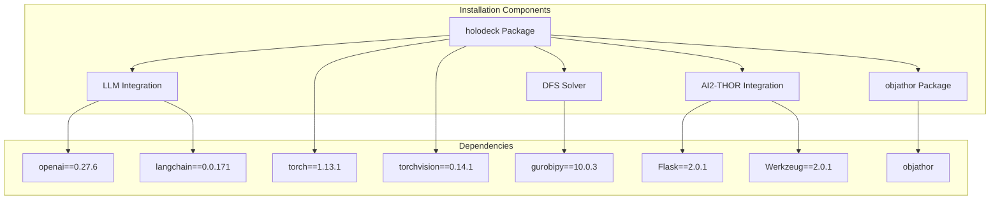
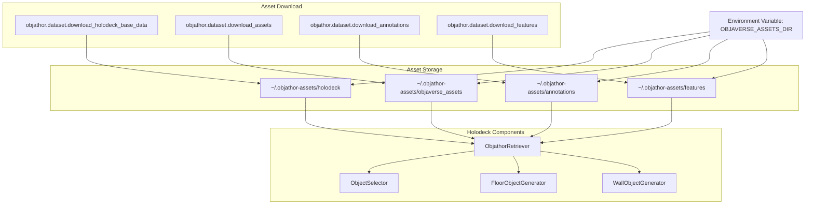
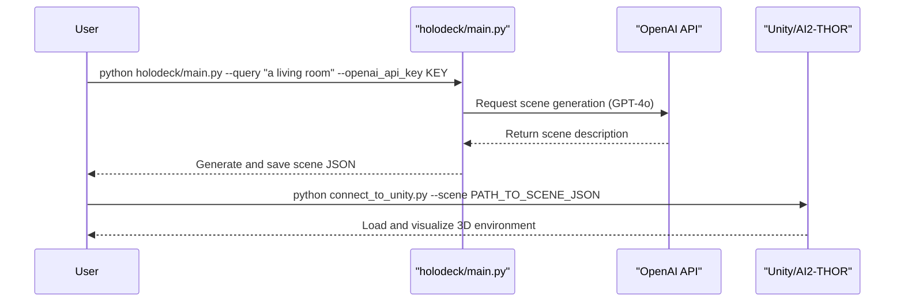

<!-- source: DeepWiki mcp.deepwiki.com · repo allenai/Holodeck · page 2 Installation and Setup · fetched 2026-10-26 -->

# Installation and Setup

<details>
<summary>Relevant source files</summary>

The following files were used as context for generating this wiki page:

- [README.md](README.md)
- [requirements.txt](requirements.txt)
- [setup.py](setup.py)

</details>


This page provides comprehensive instructions for installing and configuring Holodeck, a framework for generating 3D embodied AI environments from natural language descriptions. For information about using Holodeck after installation, see [Usage Guide](#5).

## System Requirements

Holodeck has the following system requirements based on its dependency on AI2-THOR:

* **Operating System**: macOS 10.9+ or Ubuntu 14.04+
* **Python**: Version 3.10
* **OpenAI API**: Access to `gpt-4o-2024-05-13` model
* **Unity** (optional, for visualization): Editor version 2020.3.25f1

## Installation Steps

### 1. Python Environment Setup

Create a dedicated Conda environment for Holodeck:

```bash
conda create --name holodeck python=3.10
conda activate holodeck
```

Sources: [README.md:23-26]()

### 2. Clone and Install Dependencies

Clone the Holodeck repository and install the required dependencies:

```bash
git clone https://github.com/allenai/Holodeck.git
cd Holodeck
pip install -r requirements.txt
pip install --extra-index-url https://ai2thor-pypi.allenai.org ai2thor==0+8524eadda94df0ab2dbb2ef5a577e4d37c712897
```

The main dependencies include:
* OpenAI API and LangChain for LLM integration
* PyTorch for machine learning operations
* Objathor for asset management
* Shapely and CVXPY for geometric operations
* Gurobi for optimization in the MILP solver

Sources: [README.md:22-28](), [requirements.txt:1-27]()

### 3. Installation Architecture

The following diagram shows the key components installed and their relationships:



Sources: [requirements.txt:1-27](), [README.md:22-28]()

## Data Setup

### 1. Download Required Assets

Run the following commands to download the necessary data assets:

```bash
python -m objathor.dataset.download_holodeck_base_data --version 2023_09_23
python -m objathor.dataset.download_assets --version 2023_09_23
python -m objathor.dataset.download_annotations --version 2023_09_23
python -m objathor.dataset.download_features --version 2023_09_23
```

These commands download:
* **Holodeck base data**: Core environment templates and configurations
* **Assets**: 3D model files for objects 
* **Annotations**: Metadata about objects (dimensions, categories, etc.)
* **Features**: Pre-computed feature vectors for object retrieval and similarity

Sources: [README.md:32-37]()

### 2. Asset Directory Configuration

By default, assets are saved to `~/.objathor-assets/`. To use a custom location:

1. Add the `--path` argument to the download commands:
   ```bash
   python -m objathor.dataset.download_holodeck_base_data --version 2023_09_23 --path /your/custom/path
   ```

2. Set the environment variable for Holodeck to locate the assets:
   ```bash
   export OBJAVERSE_ASSETS_DIR=/your/custom/path
   ```

Sources: [README.md:38]()

## Data and Asset Flow

The following diagram illustrates how Holodeck accesses and uses the downloaded assets:



Sources: [README.md:32-38]()

## OpenAI API Configuration

Holodeck uses the OpenAI API for natural language processing and scene generation:

1. Create an account on [OpenAI](https://openai.com)
2. Generate an API key from the OpenAI dashboard
3. Ensure you have access to the `gpt-4o-2024-05-13` model (required)
4. Provide your API key when running Holodeck:

```bash
python holodeck/main.py --query "a living room" --openai_api_key YOUR_API_KEY
```

Sources: [README.md:43-45]()

## Unity Setup for Visualization (Optional)

To visualize generated environments in 3D using Unity:

### 1. Install Unity

Install Unity Hub and the specific Unity editor version:
* Download Unity Hub from: [https://unity.com/download](https://unity.com/download)
* Install editor version `2020.3.25f1`

Sources: [README.md:50-51]()

### 2. Set Up AI2-THOR

Clone the AI2-THOR repository and checkout the specific commit:

```bash
git clone https://github.com/allenai/ai2thor.git
cd ai2thor
git checkout 07445be8e91ddeb5de2915c90935c4aef27a241d
```

Sources: [README.md:52-55]()

### 3. Install Compatible Package Versions

```bash
pip uninstall Werkzeug
pip uninstall Flask
pip install Werkzeug==2.0.1
pip install Flask==2.0.1
```

Sources: [README.md:56-61]()

### 4. Configure Unity Project

1. Open Unity Hub
2. Add the `ai2thor/unity` directory as a project
3. Open the project and navigate to `ai2thor/unity/Assets/Scenes/Procedural/Procedural.unity`

Sources: [README.md:62-63]()

## Visualization Process

The following diagram illustrates the process of generating and visualizing environments with Holodeck:



Sources: [README.md:43-45](), [README.md:64-68]()

## Verification

To verify your installation is working properly:

1. Generate a simple environment:
```bash
python holodeck/main.py --query "a living room" --openai_api_key YOUR_API_KEY
```

2. If you've set up Unity, visualize the generated environment:
```bash
python connect_to_unity.py --scene path/to/generated/scene.json
```
Then press the play button in Unity to view the scene.

Sources: [README.md:43-45](), [README.md:64-68]()

## Troubleshooting

### Solver Selection

For better layout generation, ensure the DFS solver is used instead of MILP:

```bash
python holodeck/main.py --query "a living room" --openai_api_key YOUR_API_KEY --use_milp False
```

If you pulled the repository before December 28, 2023, you must explicitly set `--use_milp` to `False` to use the DFS solver.

Sources: [README.md:19](), [README.md:47]()

### Asset Path Issues

If Holodeck can't find your assets, verify:
1. The assets were downloaded correctly
2. The `OBJAVERSE_ASSETS_DIR` environment variable is set correctly if using a custom path
3. You have sufficient disk space (several GB required for all assets)

Sources: [README.md:38]()

---

