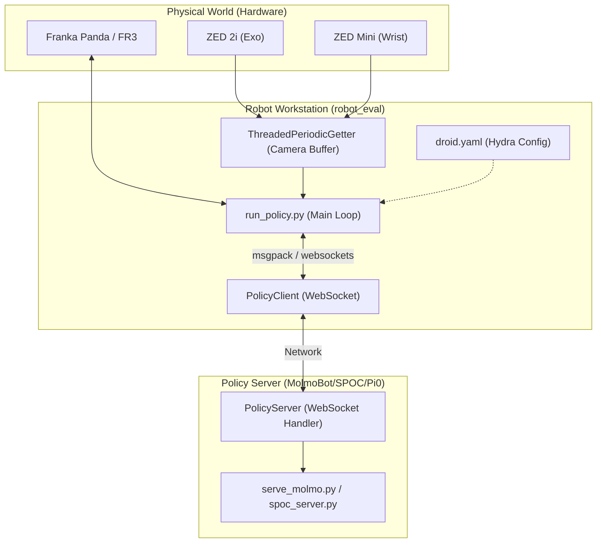
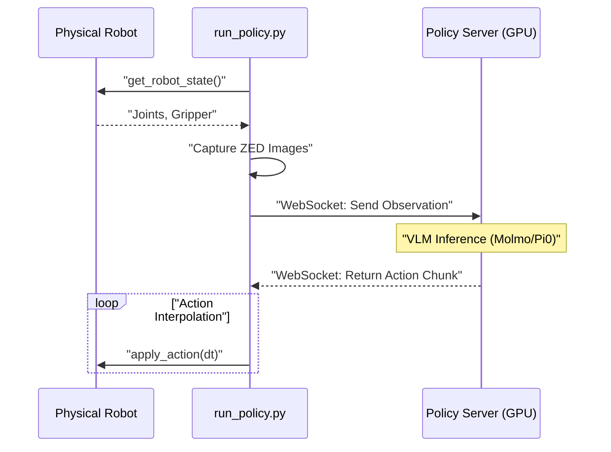

<!-- source: DeepWiki mcp.deepwiki.com · repo allenai/MolmoBot · page 5 Robot Evaluation Harness (robot_eval) · fetched 2026-10-26 -->

# Robot Evaluation Harness (robot_eval)

Relevant source files

The following files were used as context for generating this wiki page:

- [MolmoBot-Pi0/config/eval/policy/cameras/real.yaml](MolmoBot-Pi0/config/eval/policy/cameras/real.yaml)
- [MolmoBot-Pi0/config/eval/policy/cameras/sim_exo_random.yaml](MolmoBot-Pi0/config/eval/policy/cameras/sim_exo_random.yaml)
- [MolmoBot/README.md](MolmoBot/README.md)

The `robot_eval` directory contains a shared, Hydra-based evaluation harness designed for physical Franka Emika Panda robots. It serves as the bridge between the high-level neural network policies (MolmoBot, Pi0, or SPOC) and the physical hardware. The harness implements a standardized observation-action loop, hardware abstraction via Polymetis, and a network protocol for communicating with remote policy servers.

### System Architecture

The evaluation harness operates as a client in a client-server architecture. The robot workstation runs the `run_policy.py` script, which captures sensor data and sends it to a `PolicyServer` (running on a GPU machine) via WebSockets.

#### Policy-Code Mapping
The following diagram illustrates how the physical evaluation components map to specific code entities within the harness.

**Diagram: Robot Evaluation Entity Mapping**

**Sources:** [robot_eval/run_policy.py:1-100](), [robot_eval/hydra_config/droid.yaml:1-50](), [MolmoBot/launch_scripts/serve_molmo.py:1-40]().

---

### Hardware Configuration & Camera Setup

The harness is configured using **Hydra**, primarily through the `droid.yaml` file. This configuration defines the physical environment, including robot network addresses and camera identities.

*   **Robot Interface:** Uses `robot_host` to connect to the Polymetis server controlling the Franka arm.
*   **Camera System:** Supports a multi-camera setup typically consisting of one or more ZED 2/2i exterior cameras and a ZED Mini mounted on the wrist.
*   **Image Pipeline:** Cameras are managed by a `ThreadedPeriodicGetter` to ensure the control loop is not blocked by image acquisition latency. Images are resized and normalized according to the policy's requirements before being transmitted.

For detailed instructions on configuring camera serial numbers, joint limits, and autohome positions, see **[Hardware Configuration & Camera Setup (#5.1)]()**.

**Sources:** [MolmoBot-Pi0/config/eval/policy/cameras/real.yaml:1-2](), [MolmoBot-Pi0/config/eval/policy/cameras/sim_exo_random.yaml:1-2]().

---

### Policy Execution Loop (`run_policy.py`)

The core execution logic resides in `run_policy.py`. This script manages the lifecycle of a robot evaluation episode, from hardware initialization to success logging.

#### Execution Flow
1.  **Initialization:** Connects to the robot via Polymetis and initializes the gripper.
2.  **Autohome:** Moves the robot to a predefined starting configuration specified in the Hydra config.
3.  **Observation-Action Loop:**
    *   Captures synchronized images from the `ThreadedPeriodicGetter`.
    *   Retrieves robot state (joint positions, gripper state).
    *   Sends observations to the `PolicyClient`.
    *   Receives predicted actions (joint velocities or absolute positions).
    *   Executes actions on the hardware within a strict timing budget (`policy_dt`).
4.  **Logging:** Records trajectory data and uploads videos to Weights & Biases (W&B) for remote monitoring.

For a deep dive into the threading model, WebSocket protocol, and the `PolicyClient` implementation, see **[Policy Execution Script (run_policy.py) (#5.2)]()**.

**Sources:** [MolmoBot/README.md:36-43](), [robot_eval/run_policy.py:1-200]().

---

### Policy Client/Server Protocol

The harness utilizes a lightweight protocol to decouple the robot control from the heavy VLM inference.

| Component | Responsibility | Code Entity |
| :--- | :--- | :--- |
| **Client** | Captures RGB images and robot state; sends to server. | `robot_eval.PolicyClient` |
| **Server** | Runs VLM/Diffusion inference; returns next action. | `websocket_server.py` |
| **Transport** | High-speed serialization for image data. | `msgpack` over `websockets` |

**Diagram: Control Loop Sequence**

**Sources:** [MolmoBot/README.md:42-43](), [robot_eval/run_policy.py:50-150]().

---

