# Page: MolmoBot Repository Overview

# MolmoBot Repository Overview

<details>
<summary>Relevant source files</summary>

The following files were used as context for generating this wiki page:

- [.gitignore](.gitignore)
- [MolmoBot-Pi0/README.md](MolmoBot-Pi0/README.md)
- [MolmoBot-Pi0/assets/MolmoBot-Pi0.png](MolmoBot-Pi0/assets/MolmoBot-Pi0.png)
- [MolmoBot-SPOC/README.md](MolmoBot-SPOC/README.md)
- [MolmoBot-SPOC/docs/images/molmobot_spoc.png](MolmoBot-SPOC/docs/images/molmobot_spoc.png)
- [MolmoBot/README.md](MolmoBot/README.md)

</details>


The **MolmoBot** monorepo is a collection of vision-language-action (VLA) models and evaluation tools designed for robotic manipulation. It provides a unified infrastructure for training and deploying diverse policy architectures—ranging from large-scale multimodal models to lightweight goal-conditioned transformers—across multiple robot platforms including Franka Panda and RBY1.

### Core Projects
The repository is organized into three primary sub-projects and a shared evaluation harness:

1.  **MolmoBot**: A high-capacity VLA based on the Molmo2-4B architecture, fine-tuned for action prediction using flow-matching diffusion.
2.  **MolmoBot-Pi0**: A PyTorch-based adaptation and fine-tuning suite for Physical Intelligence’s Pi0/Pi0.5 models.
3.  **MolmoBot-SPOC**: A lightweight, goal-conditioned transformer policy (based on SigLIP and Llama) optimized for efficient execution.
4.  **robot_eval**: A shared hardware abstraction layer and evaluation harness for running these policies on physical robots.

---

### System Architecture and Code Mapping

The following diagram illustrates how high-level system components map to specific code entities and directories within the monorepo.

**Component to Code Entity Mapping**
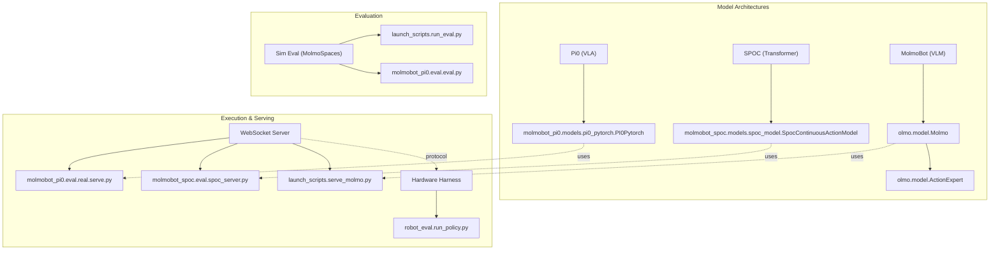
Sources: [MolmoBot/README.md:38-43](), [MolmoBot-Pi0/README.md:47-48](), [MolmoBot-SPOC/README.md:87-90](), [MolmoBot-SPOC/README.md:35-42]()

---

### Sub-Project Relationships

The sub-projects share a common data philosophy (using DROID-format HDF5 trajectories) but differ in their computational requirements and model backbones.

| Sub-Project | Base Architecture | Action Head | Primary Use Case |
| :--- | :--- | :--- | :--- |
| **MolmoBot** | Molmo2-4B (VLM) | Flow-matching Diffusion | Zero-shot & Generalist manipulation |
| **MolmoBot-Pi0** | PaliGemma / Pi0 | Diffusion / Flow | Fine-tuning state-of-the-art VLAs |
| **MolmoBot-SPOC** | SigLIP + Llama | Parallel Linear Heads | Lightweight, real-time goal conditioning |

**Data Flow from Training to Deployment**
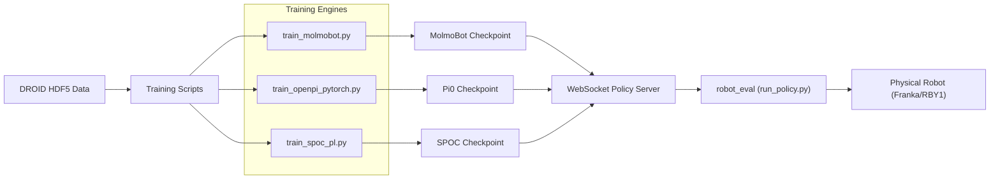
Sources: [MolmoBot/README.md:111-136](), [MolmoBot-Pi0/README.md:110-123](), [MolmoBot-SPOC/README.md:35-42](), [MolmoBot-SPOC/README.md:106-106]()

---

### Supported Platforms and Evaluation

The repository supports both simulation and real-world evaluation:
*   **Simulation**: Uses the `MolmoSpaces` benchmark suite [MolmoBot-Pi0/README.md:82-82]() integrated with MuJoCo. Evaluation is triggered via specialized scripts in each sub-directory (e.g., `run_eval.py` or `eval.py`).
*   **Real Robot**: The `robot_eval` harness provides a `run_policy.py` script that acts as a client to the WebSocket servers provided by the model sub-projects [MolmoBot-SPOC/README.md:106-106](). It currently supports Franka Panda (via `polymetis`) and RBY1 platforms.

---

### Child Pages

For detailed technical information, please refer to the following child pages:

*   **[Getting Started & Installation](#1.1)**: Environment setup (uv/conda), dependency management, and downloading model weights from HuggingFace.
*   **[Repository Structure & Licensing](#1.2)**: Detailed directory layout and information on the Apache 2.0 license.

---
Sources: [MolmoBot/README.md:1-185](), [MolmoBot-Pi0/README.md:1-126](), [MolmoBot-SPOC/README.md:1-107]()

---

# Page: Getting Started & Installation

# Getting Started & Installation

<details>
<summary>Relevant source files</summary>

The following files were used as context for generating this wiki page:

- [MolmoBot-Pi0/.python-version](MolmoBot-Pi0/.python-version)
- [MolmoBot-Pi0/README.md](MolmoBot-Pi0/README.md)
- [MolmoBot-Pi0/pyproject.toml](MolmoBot-Pi0/pyproject.toml)
- [MolmoBot-Pi0/scripts/install_openpi_extras.py](MolmoBot-Pi0/scripts/install_openpi_extras.py)
- [MolmoBot-Pi0/uv.lock](MolmoBot-Pi0/uv.lock)
- [MolmoBot-SPOC/README.md](MolmoBot-SPOC/README.md)
- [MolmoBot-SPOC/pyproject.toml](MolmoBot-SPOC/pyproject.toml)
- [MolmoBot/README.md](MolmoBot/README.md)

</details>


This page provides technical instructions for setting up the three primary sub-projects within the MolmoBot repository: **MolmoBot** (VLM-based), **MolmoBot-Pi0** (Pi0/Pi0.5 fine-tuning), and **MolmoBot-SPOC** (lightweight transformer). It covers environment creation, dependency management, and the acquisition of model checkpoints and datasets.

## 1. MolmoBot (Primary VLM Policy)

The core MolmoBot project leverages the Molmo2-4B architecture for robot manipulation. It uses `uv` for environment management and requires specific sharding conversions for training.

### Environment Setup
Installation is performed using the `uv` package manager. The project includes optional dependency groups for `eval` and `train`.

```bash
git clone https://github.com/allenai/MolmoBot.git
cd MolmoBot/MolmoBot
uv sync --extra eval
# For training support
uv sync --extra train
```
Sources: [MolmoBot/README.md:27-32](), [MolmoBot/README.md:87-90]()

### Model Checkpoint Preparation
MolmoBot models are typically distributed as sharded weights. For training or local inference, these must be unsharded.

1. **Download Base Weights**: Download the Molmo2-4B base model.
2. **Unshard Weights**: Use the provided conversion script.
```bash
python launch_scripts/convert_to_unsharded.py <model_path>/Molmo2-4B <model_path>/Molmo2-4B-unsharded
```
Sources: [MolmoBot/README.md:92-100]()

### Environment Variables
For stable distributed training and simulation evaluation, set the following:

| Variable | Purpose | Recommended Value |
| :--- | :--- | :--- |
| `MUJOCO_GL` | Rendering backend for simulation | `egl` |
| `PYOPENGL_PLATFORM` | OpenGL platform | `egl` |
| `OLMO_SHARED_FS` | Enables shared filesystem checkpointing | `1` |
| `LOG_FILTER_TYPE` | Controls logging verbosity | `rank0_only` |

Sources: [MolmoBot/README.md:56-58](), [MolmoBot/README.md:103-108]()

---

## 2. MolmoBot-Pi0 (Pi0/Pi0.5 Fine-Tuning)

MolmoBot-Pi0 is a PyTorch-based implementation for fine-tuning Physical Intelligence's Pi0 models. It requires a specific post-installation step to override `transformers` library behaviors.

### Installation & Extra Setup
The installation involves a script that patches the `transformers` library with OpenPI-specific logic.

```bash
cd MolmoBot/MolmoBot-Pi0
uv sync --extra eval
uv run scripts/install_openpi_extras.py
```
Sources: [MolmoBot-Pi0/README.md:8-12]()

### Dependency Flow and Logic
The `install_openpi_extras.py` script maps OpenPI-specific model logic directly into the installed `transformers` package to support the PaliGemma-based architecture.

**OpenPI Override Logic**
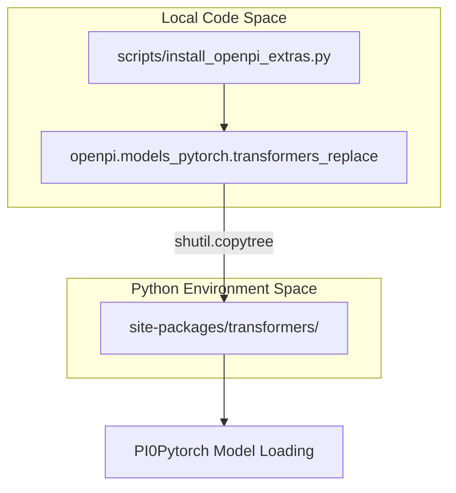
Sources: [MolmoBot-Pi0/scripts/install_openpi_extras.py:11-20]()

---

## 3. MolmoBot-SPOC (Lightweight Policy)

MolmoBot-SPOC uses a standard `conda` and `pip` workflow. It is designed for goal-conditioned manipulation using a SigLIP encoder and a Llama-style decoder.

### Environment Setup
```bash
conda create -n molmobot python=3.11
conda activate molmobot
cd MolmoBot/MolmoBot-SPOC
pip install -e .
```
Sources: [MolmoBot-SPOC/README.md:12-23]()

### Dependency Requirements
The SPOC sub-project relies on `lightning` for training and `molmo_spaces` for evaluation.
- `transformers==4.57.1`
- `open_clip_torch` (for SigLIP)
- `molmospaces` (via git)
Sources: [MolmoBot-SPOC/pyproject.toml:9-21]()

---

## 4. Dataset Acquisition (Shared)

All sub-projects utilize the **MolmoBot-Data** collection on HuggingFace. A `bulk_download.py` script is provided to fetch specific robot configurations (e.g., `FrankaPickAndPlaceOmniCamConfig`).

### Example Download
```bash
python bulk_download.py --config FrankaPickAndPlaceOmniCamConfig --part 1 <data_root>
```
Sources: [MolmoBot-Pi0/README.md:95-100](), [MolmoBot/README.md:72-82]()

---

## 5. System Interaction Diagram

The following diagram bridges the high-level installation commands to the internal code entities and their roles in the data flow.

**Installation and Runtime Entity Mapping**
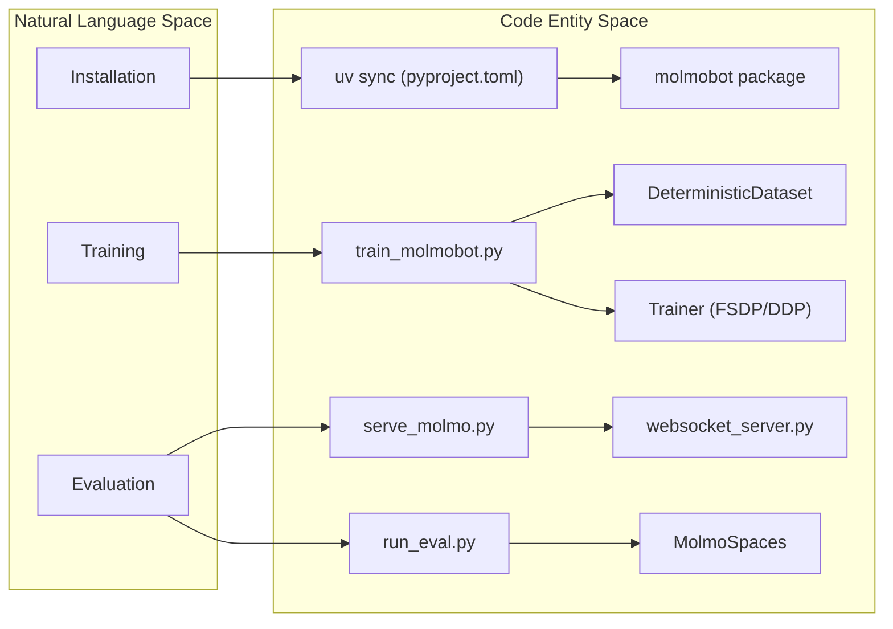
Sources: [MolmoBot/README.md:31-63](), [MolmoBot/README.md:111-112](), [MolmoBot-Pi0/pyproject.toml:11-41]()

---

# Page: Repository Structure & Licensing

# Repository Structure & Licensing

<details>
<summary>Relevant source files</summary>

The following files were used as context for generating this wiki page:

- [.gitignore](.gitignore)
- [LICENSE](LICENSE)
- [MolmoBot-Pi0/.gitignore](MolmoBot-Pi0/.gitignore)
- [MolmoBot-Pi0/LICENSE](MolmoBot-Pi0/LICENSE)
- [MolmoBot-SPOC/LICENSE](MolmoBot-SPOC/LICENSE)
- [MolmoBot/.gitignore](MolmoBot/.gitignore)
- [MolmoBot/LICENSE](MolmoBot/LICENSE)

</details>


This page details the organizational layout of the MolmoBot monorepo and the licensing terms governing its use. The repository is structured to support three distinct robot manipulation policy projects and a shared evaluation harness, all unified under a single open-source license.

## Monorepo Layout

The MolmoBot repository is organized into sub-directories that separate model architectures, training frameworks, and hardware-specific evaluation logic. Each major sub-project functions as a semi-independent codebase with its own dependency management and configuration patterns.

### Top-Level Directory Purpose

| Directory | Purpose | Key Contents |
|:---|:---|:---|
| `MolmoBot/` | Primary VLM policy based on Molmo2-4B. | ActionExpert heads, flow-matching diffusion, and distributed FSDP trainer. |
| `MolmoBot-Pi0/` | Fine-tuning framework for Physical Intelligence Pi0/Pi0.5 VLA models. | JAX-to-PyTorch weight loaders and DROID-format data pipelines. |
| `MolmoBot-SPOC/` | Lightweight goal-conditioned transformer policy. | SigLIP encoders, Llama-based decoders, and PyTorch Lightning training. |
| `robot_eval/` | Shared hardware evaluation harness. | Hydra configs for Franka robots and ZED camera observation loops. |
| `assets/` | Static resources. | Architecture diagrams, sample images, and documentation media. |

### System Data Flow & Entity Mapping

The following diagram bridges the conceptual sub-projects to their primary entry points and implementation directories within the codebase.

**Sub-Project Implementation Map**
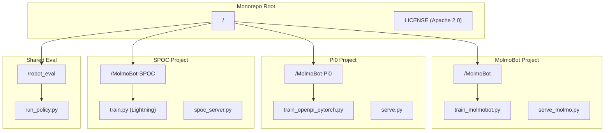
**Sources:** `MolmoBot/` [1-68](), `MolmoBot-Pi0/` [1-217](), `MolmoBot-SPOC/` [1-135](), `robot_eval/` [1-50]()

---

## Licensing

The entire MolmoBot repository is released under the **Apache License, Version 2.0**. This license applies to all sub-projects including `MolmoBot`, `MolmoBot-Pi0`, `MolmoBot-SPOC`, and `robot_eval`.

### Key License Provisions
*   **Grant of Copyright License:** Contributors grant a perpetual, worldwide, non-exclusive, no-charge, royalty-free, irrevocable copyright license to reproduce, prepare derivative works of, and distribute the Work [LICENSE:66-71]().
*   **Grant of Patent License:** Contributors grant a patent license for claims necessarily infringed by their contributions alone or in combination with the Work [LICENSE:73-81]().
*   **Redistribution:** Redistribution is permitted provided that recipients are given a copy of the license and modified files carry prominent notices of changes [LICENSE:89-98]().
*   **No Warranty:** The work is provided on an "AS IS" BASIS, WITHOUT WARRANTIES OR CONDITIONS OF ANY KIND [LICENSE:131-135]().

Each sub-directory contains its own copy of the license file to ensure clarity when sub-projects are used in isolation.
**Sources:** `LICENSE:1-135`(), `MolmoBot/LICENSE:1-135`(), `MolmoBot-Pi0/LICENSE:1-135`(), `MolmoBot-SPOC/LICENSE:1-135`()

---

## Repository Artifacts & Ignored Files

The repository uses specific `.gitignore` configurations for each sub-project to manage build artifacts, model checkpoints, and local environment data.

### Artifact Management Map
The following diagram illustrates how the codebase distinguishes between version-controlled source code and ephemeral artifacts (like checkpoints and logs) across the different sub-directories.

**Code vs. Artifact Separation**
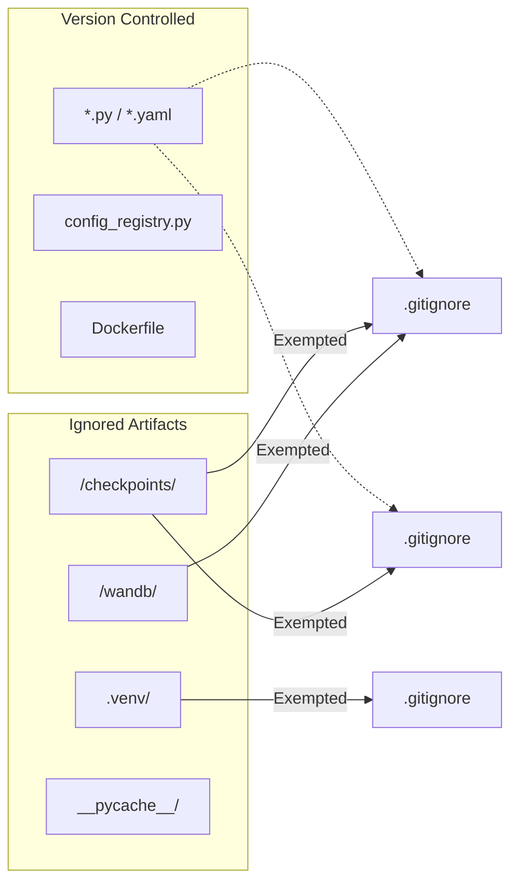

### Critical Ignored Paths
*   **Checkpoints:** Model weights and training states are stored in `ckpts/` or `checkpoints/` directories, which are excluded from version control to prevent large binary bloat [.gitignore:180](), [MolmoBot/.gitignore:64](), [MolmoBot-Pi0/.gitignore:7]().
*   **Virtual Environments:** Standard Python environment directories such as `.venv/`, `env/`, and `.pixi/` are ignored to ensure environment portability [.gitignore:128-135](), [MolmoBot-Pi0/.gitignore:134-149]().
*   **Build Artifacts:** Distribution folders (`dist/`, `build/`) and Python egg information (`*.egg-info/`) are ignored [.gitignore:15-28](), [MolmoBot/.gitignore:8-10]().
*   **Telemetry & Logs:** Weights & Biases logs (`wandb/`) and evaluation outputs (`eval_output/`) are excluded [.gitignore:181-182](), [MolmoBot/.gitignore:59-60]().

**Sources:** `.gitignore:1-185`(), `MolmoBot/.gitignore:1-68`(), `MolmoBot-Pi0/.gitignore:1-217`()

---

# Page: MolmoBot: VLM-Based Manipulation Policy

# MolmoBot: VLM-Based Manipulation Policy

<details>
<summary>Relevant source files</summary>

The following files were used as context for generating this wiki page:

- [MolmoBot/README.md](MolmoBot/README.md)
- [MolmoBot/olmo/__init__.py](MolmoBot/olmo/__init__.py)
- [MolmoBot/olmo/config.py](MolmoBot/olmo/config.py)

</details>


MolmoBot is a vision-language-action (VLA) policy based on the **Molmo2-4B** architecture. It is specifically fine-tuned to map natural language instructions and multi-view image observations directly to robot end-effector or joint actions. By leveraging large-scale simulation data and the robust visual reasoning capabilities of the Molmo backbone, MolmoBot enables zero-shot and few-shot manipulation across diverse environments.

### System Overview

The MolmoBot sub-project consists of a unified architecture that combines a Vision-Language Model (VLM) with a diffusion-based action head. The system is designed for high-throughput distributed training and low-latency deployment on physical hardware or in simulation.

The following diagram illustrates the relationship between the high-level policy components and the core classes defined in the `olmo/` package.

**MolmoBot Logical Architecture to Code Mapping**
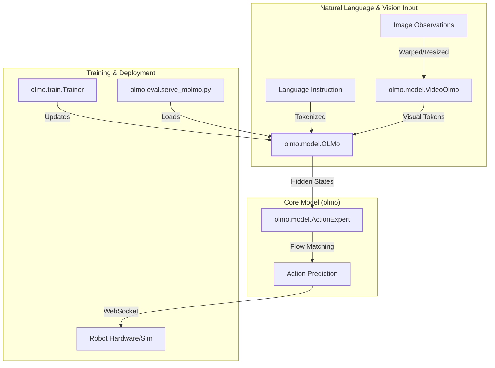
Sources: [MolmoBot/README.md:5-23](), [MolmoBot/olmo/model.py:1-50]() (implied structure), [MolmoBot/launch_scripts/serve_molmo.py:42-43]()

---

### Model Architecture
The backbone of MolmoBot is the **Molmo2-4B** model, which utilizes a transformer-based LLM and a vision backbone. To adapt this for robotics, the model incorporates:
*   **VideoOlmo**: A wrapper to handle multi-frame and multi-camera temporal observations.
*   **ActionExpert**: A specialized head that uses flow-matching diffusion to generate continuous action trajectories.
*   **Action Presets**: Configurations for different action spaces, such as `franka_joint` or `franka_state_8_clamp_abs_pos`.

For a deep dive into the model layers and the diffusion process, see [MolmoBot Model Architecture](#2.1).

Sources: [MolmoBot/README.md:112-115](), [MolmoBot/README.md:168-172]()

---

### Training Pipeline
MolmoBot utilizes a distributed training framework optimized for Large Language Models, adapted for robotics.
*   **Trainer**: Supports Fully Sharded Data Parallel (FSDP) and DDP for scaling across multiple H100 nodes.
*   **Config System**: Uses `TrainConfig` and `TrainerConfig` for managing hyperparameters like `device_batch_size`, `learning_rate`, and `seq_len`.
*   **Checkpointing**: Implements atomic saves and unsharding utilities to convert distributed weights into standard formats.

For details on the training loop and distributed setup, see [MolmoBot Training Pipeline](#2.2).

Sources: [MolmoBot/olmo/config.py:19-82](), [MolmoBot/README.md:102-136]()

---

### Data Pipeline & Preprocessing
The model is trained on diverse datasets (e.g., DROID, SynthManip) stored in HDF5 format.
*   **DynamicPacker**: Uses a 2D knapsack algorithm to pack variable-length robot trajectories into fixed-length sequences efficiently.
*   **MultimodalPreprocessor**: Handles the synchronization of text prompts and image frames.
*   **Augmentation**: Includes image warping and random camera selection (`furthest_camera_prob`) to improve robustness.

For details on data loading and sequence packing, see [Data Pipeline & Preprocessing](#2.4).

Sources: [MolmoBot/README.md:125-136](), [MolmoBot/README.md:171-172]()

---

### Evaluation & Serving
MolmoBot can be deployed in simulation or on real robots via a WebSocket-based server architecture.
*   **MolmoSpaces**: A simulation environment used for benchmarking (e.g., `FrankaState8ClampAbsPosConfig`).
*   **serve_molmo.py**: A script that hosts the model as a service, allowing remote robot clients to request actions.
*   **Policy Clients**: Implementation of the observation-action loop that interfaces with physical controllers.

For details on running evaluations and setting up the inference server, see [MolmoBot Evaluation & Serving](#2.3).

**Inference Flow: From Code to Action**
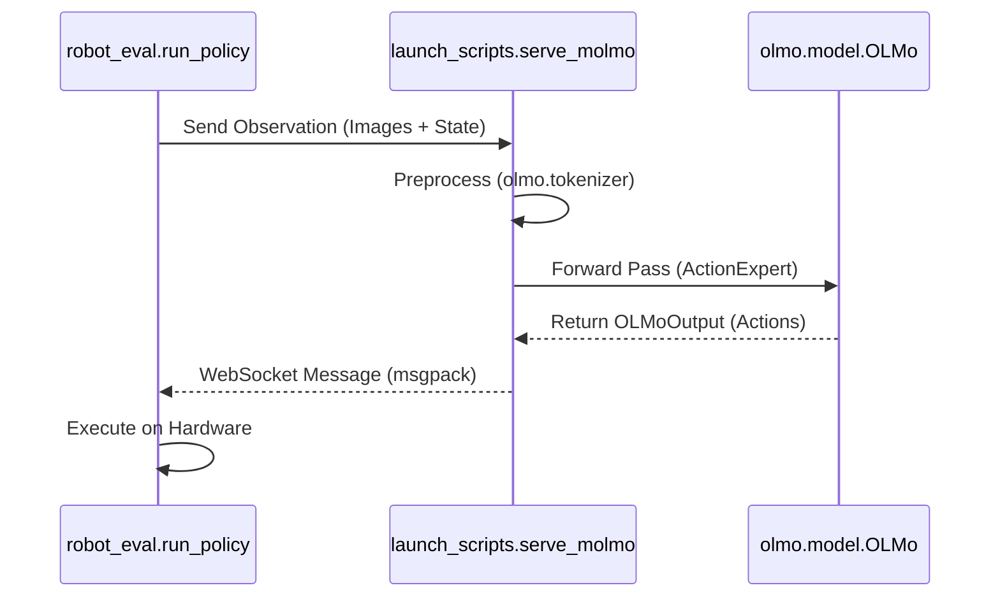
Sources: [MolmoBot/README.md:42-43](), [MolmoBot/README.md:59-64]()

---

### Quick Start
To serve a pre-trained MolmoBot-DROID checkpoint:
```bash
python launch_scripts/serve_molmo.py --hf-repo allenai/MolmoBot-DROID
```
To launch a training run:
```bash
torchrun --nproc-per-node=8 launch_scripts/train_molmobot.py <model_path> \
  --action_preset franka_joint \
  --camera_preset franka_one_random_then_wrist \
  --device_batch_size 32
```
Sources: [MolmoBot/README.md:42-43](), [MolmoBot/README.md:111-124]()

---

# Page: MolmoBot Model Architecture

# MolmoBot Model Architecture

<details>
<summary>Relevant source files</summary>

The following files were used as context for generating this wiki page:

- [MolmoBot/olmo/__init__.py](MolmoBot/olmo/__init__.py)
- [MolmoBot/olmo/config.py](MolmoBot/olmo/config.py)
- [MolmoBot/olmo/data/data_loader.py](MolmoBot/olmo/data/data_loader.py)
- [MolmoBot/olmo/data/dataset.py](MolmoBot/olmo/data/dataset.py)
- [MolmoBot/olmo/data/dynamic_packer.py](MolmoBot/olmo/data/dynamic_packer.py)
- [MolmoBot/olmo/data/get_dataset.py](MolmoBot/olmo/data/get_dataset.py)
- [MolmoBot/olmo/data/image_warping_utils.py](MolmoBot/olmo/data/image_warping_utils.py)
- [MolmoBot/olmo/data/iterable_dataset_mixture.py](MolmoBot/olmo/data/iterable_dataset_mixture.py)

</details>


The MolmoBot model is a Vision-Language-Action (VLA) policy built upon the **Molmo** family of models. It extends the base Molmo architecture—which consists of a vision backbone and a language model (LLM)—with specialized components for high-frequency robotic control, including an action-prediction head and support for multi-frame temporal observations.

## System Overview

The architecture bridges the gap between multimodal perception and continuous action spaces. It processes visual inputs (single or multi-frame) and natural language instructions to produce robotic actions via a flow-matching diffusion process.

### Code Entity Mapping

The following diagram maps the high-level architectural components to their respective classes and modules within the `olmo/` package.

**Component to Code Entity Mapping**
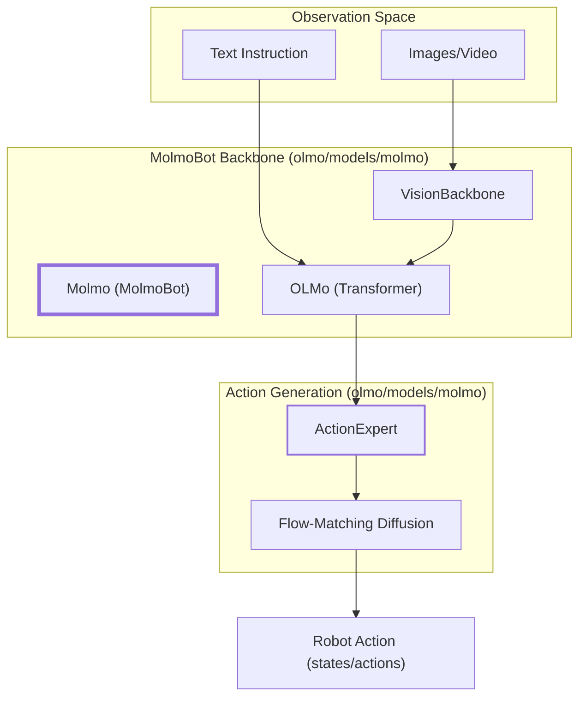
Sources: `[MolmoBot/olmo/models/molmo/molmo.py:1-100]()`, `[MolmoBot/olmo/models/molmo/action_expert.py:1-50]()`

---

## The Molmo VLM Backbone

The core of MolmoBot is the **Molmo** model, a multimodal transformer designed to process interleaved image and text data.

### Vision and Language Integration
The model uses a `VisionBackbone` to extract features from input images. These features are projected into the same embedding space as the text tokens.
- **Vision Backbone**: Typically a ViT-based encoder that processes high-resolution images.
- **Language Model**: A decoder-only transformer (OLMo) that serves as the reasoning engine.
- **Data Flow**: Images are processed into "patches," which are then mapped to tokens that the LLM treats as part of its input sequence.

### VideoOlmo: Multi-Frame Observations
For tasks requiring temporal context, MolmoBot utilizes `VideoOlmo`. This variant allows the model to ingest sequences of frames, effectively treating video as a series of visual tokens distributed across the temporal dimension.

Sources: `[MolmoBot/olmo/models/molmo/molmo.py:105-250]()`, `[MolmoBot/olmo/data/data_loader.py:158-164]()`

---

## ActionExpert and Action Prediction

Unlike standard VLMs that output text tokens, MolmoBot incorporates an `ActionExpert` head to predict continuous robot actions.

### Flow-Matching Diffusion
MolmoBot employs a **flow-matching diffusion** approach for action generation. This allows the model to represent complex, multimodal action distributions (e.g., multiple ways to pick up an object) which are common in manipulation tasks.

### Action Data Structures
The model interacts with specific action-related keys during training and inference:
- `states`: The current proprioceptive state of the robot (e.g., joint positions, end-effector pose).
- `actions`: The target actions to be executed.
- `action_is_pad`: A mask used to handle variable-length action sequences or padding.

| Key | Type | Description |
| :--- | :--- | :--- |
| `packed_states` | `np.ndarray` | Proprioceptive states concatenated for batch processing. |
| `packed_actions` | `np.ndarray` | The target action sequence for the diffusion head. |
| `packed_example_ids` | `np.int64` | Identifiers to track chunks back to original trajectories. |

Sources: `[MolmoBot/olmo/models/molmo/action_expert.py:20-80]()`, `[MolmoBot/olmo/data/dynamic_packer.py:12-21]()`

---

## Data Flow and Sequence Packing

To maximize training efficiency, MolmoBot uses a **Dynamic Packer** that implements a 2D knapsack algorithm to pack multiple robot trajectories into a single training sequence.

**Data Processing Pipeline**
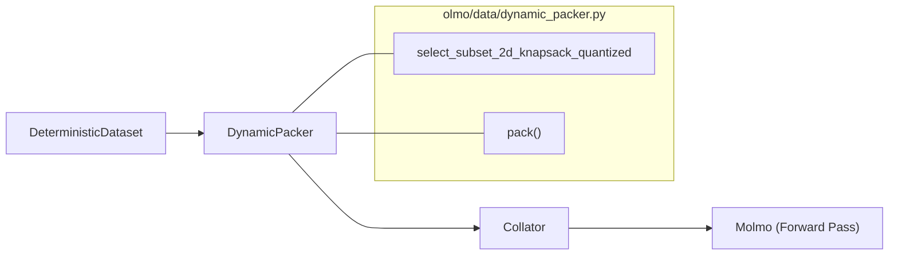

### Key Functions
- `select_subset_2d_knapsack_quantized`: Optimizes how examples are grouped to fit within the `sequence_length` and visual token limits `[MolmoBot/olmo/data/dynamic_packer.py:23-78]()`.
- `pack`: Handles the concatenation of `input_tokens`, `images`, and `action_chunks`, ensuring that `subsegment_ids` are updated to prevent intra-example attention leakage `[MolmoBot/olmo/data/dynamic_packer.py:137-173]()`.

Sources: `[MolmoBot/olmo/data/dynamic_packer.py:1-150]()`, `[MolmoBot/olmo/data/data_loader.py:105-116]()`

---

## Output Structures

The model's outputs are encapsulated in `OLMoOutput` (and specialized variants for Molmo). These structures contain:
1. **Logits**: For text generation (if applicable).
2. **Action Predictions**: The output from the `ActionExpert` head.
3. **Hidden States**: Intermediate representations often used for debugging or auxiliary losses.

### Configuration
The model architecture is governed by `MolmoConfig`, which inherits from `BaseConfig`. This configuration defines:
- `d_model`: The hidden dimension of the transformer.
- `n_layers`: Number of transformer blocks.
- `vision_config`: Parameters for the image encoder.
- `action_config`: Parameters for the diffusion head and action dimensions.

Sources: `[MolmoBot/olmo/config.py:19-81]()`, `[MolmoBot/olmo/models/molmo/molmo.py:21-45]()`

---

# Page: MolmoBot Training Pipeline

# MolmoBot Training Pipeline

<details>
<summary>Relevant source files</summary>

The following files were used as context for generating this wiki page:

- [MolmoBot/launch_scripts/convert_to_unsharded.py](MolmoBot/launch_scripts/convert_to_unsharded.py)
- [MolmoBot/launch_scripts/train_molmobot.py](MolmoBot/launch_scripts/train_molmobot.py)
- [MolmoBot/olmo/data/data_loader.py](MolmoBot/olmo/data/data_loader.py)
- [MolmoBot/olmo/data/dataset.py](MolmoBot/olmo/data/dataset.py)
- [MolmoBot/olmo/data/dynamic_packer.py](MolmoBot/olmo/data/dynamic_packer.py)
- [MolmoBot/olmo/data/get_dataset.py](MolmoBot/olmo/data/get_dataset.py)
- [MolmoBot/olmo/data/iterable_dataset_mixture.py](MolmoBot/olmo/data/iterable_dataset_mixture.py)

</details>


The MolmoBot training pipeline is a distributed system designed for fine-tuning the Molmo 7B-O (and other variants) on robot manipulation tasks. It leverages PyTorch's Fully Sharded Data Parallel (FSDP) for efficient distributed training, supports multi-modal sequence packing for high throughput, and includes specialized components for handling robot observation-action trajectories.

## Training Launch and Presets

The primary entry point for training is the `train_molmobot.py` script [MolmoBot/launch_scripts/train_molmobot.py:1-35](). This script abstracts the complexity of model configuration through a system of presets for different robot platforms (e.g., Franka, RBY1) and camera configurations.

### Action and Camera Configuration
Training requires specifying how the model should interpret robot states and actions.
*   **Action Presets**: Define the dimensionality and semantic meaning of the action vector (e.g., `RBY1_full`, `franka_joint`) [MolmoBot/launch_scripts/train_molmobot.py:21-21]().
*   **Camera Presets**: Define which camera streams (e.g., `RBY1_right_arm`) are used as visual input [MolmoBot/launch_scripts/train_molmobot.py:22-22]().
*   **Sequence Parameters**: Configurable via `--seq_len`, `--action_horizon`, and `--n_obs_steps` [MolmoBot/launch_scripts/train_molmobot.py:160-170]().

### Configuration Flow
The diagram below illustrates how CLI arguments are transformed into a unified `TrainConfig`.

**Training Configuration Assembly**
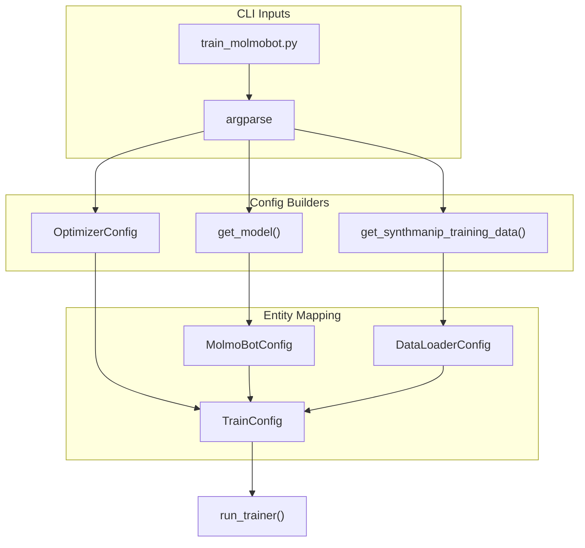
Sources: [MolmoBot/launch_scripts/train_molmobot.py:70-144](), [MolmoBot/launch_scripts/train_molmobot.py:147-166](), [MolmoBot/olmo/train/trainer_config.py:57-64]()

## Distributed Training System

MolmoBot uses a custom `Trainer` class that supports both Distributed Data Parallel (DDP) and Fully Sharded Data Parallel (FSDP).

### FSDP and Sharding
The `FSDPConfig` class governs how model parameters, gradients, and optimizer states are sharded across GPUs [MolmoBot/olmo/train/trainer_config.py:60-60](). This is critical for fitting the 7B parameter backbone into VRAM while maintaining large effective batch sizes.

### Optimizer and LR Scheduling
*   **Optimizer**: Supports `AdamW` and other standard types via `OptimizerConfig` [MolmoBot/olmo/train/optim.py:55-55]().
*   **Scheduler**: Implements linear warmup followed by cosine decay or constant schedules, managed by `SchedulerConfig` [MolmoBot/olmo/train/optim.py:55-55]().
*   **Precision**: Typically utilizes `bfloat16` for stable mixed-precision training.

## Data Loading and Sequence Packing

The pipeline uses a sophisticated data loading strategy to handle the variable-length nature of multi-modal robot data.

### Sequence Packing (2D Knapsack)
To maximize GPU utilization, MolmoBot employs a `DynamicPacker` [MolmoBot/olmo/data/dynamic_packer.py:1-5](). This component uses a vectorized 2D knapsack algorithm (`select_subset_2d_knapsack_quantized`) to pack multiple robot trajectories into a single training sequence [MolmoBot/olmo/data/dynamic_packer.py:23-78]().

### Dataset Mixture
The `IterableDatasetMixture` class allows for blending multiple data sources with specific sampling rates [MolmoBot/olmo/data/iterable_dataset_mixture.py:21-38]().
*   **Deterministic Sampling**: Uses a seed-based approach to ensure that data order is reproducible across restarts [MolmoBot/olmo/data/iterable_dataset_mixture.py:45-48]().
*   **Stratification**: Optionally ensures that rare datasets are represented correctly in every batch [MolmoBot/olmo/data/iterable_dataset_mixture.py:64-64]().

**Data Flow Architecture**
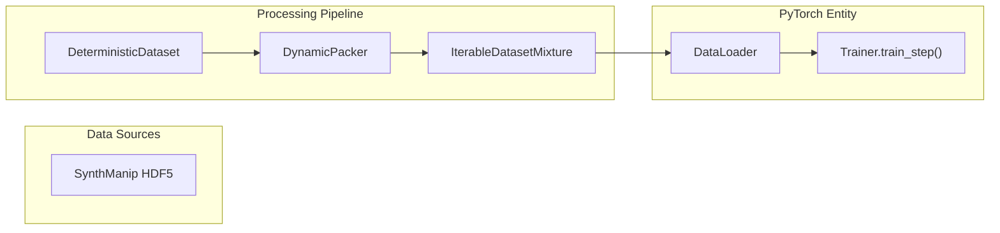
Sources: [MolmoBot/olmo/data/dataset.py:40-43](), [MolmoBot/olmo/data/dynamic_packer.py:137-163](), [MolmoBot/olmo/data/iterable_dataset_mixture.py:89-152](), [MolmoBot/olmo/data/data_loader.py:197-203]()

## Checkpointing and Logging

### Atomic Saves and Unsharding
Training produces sharded checkpoints by default for performance. The `convert_to_unsharded.py` script is provided to consolidate these into a single `pytorch_model.bin` file for easier inference and HuggingFace compatibility [MolmoBot/launch_scripts/convert_to_unsharded.py:1-11]().
*   **Atomic Saves**: Uses `save_unsharded` to ensure that model state and configuration are written consistently [MolmoBot/launch_scripts/convert_to_unsharded.py:33-33]().
*   **Metadata**: Saves a `config.yaml` alongside weights to preserve `TrainConfig` parameters [MolmoBot/launch_scripts/convert_to_unsharded.py:21-23]().

### Logging
Integration with Weights & Biases (W&B) is handled via `WandbConfig` [MolmoBot/olmo/train/trainer_config.py:63-63]().
*   **Metrics**: Logs total loss, action-specific loss, and language modeling loss [MolmoBot/launch_scripts/train_molmobot.py:28-28]().
*   **Speed Monitoring**: Tracks tokens per second and MFU (Model Flops Utilization) through `SpeedMonitorConfig` [MolmoBot/olmo/train/trainer_config.py:62-62]().

## Validation Pipeline
The trainer automatically executes a validation loop at intervals defined by `--val_interval` [MolmoBot/launch_scripts/train_molmobot.py:27-27]().
*   **Evaluator**: Uses `LossDatasetEvaluatorConfig` to compute metrics on a held-out 'val' split [MolmoBot/launch_scripts/train_molmobot.py:48-48]().
*   **Metrics**: Specifically tracks the accuracy of action prediction (diffusion flow-matching loss) and text generation [MolmoBot/launch_scripts/train_molmobot.py:28-29]().

Sources: [MolmoBot/launch_scripts/train_molmobot.py:1-68](), [MolmoBot/olmo/train/trainer_config.py:57-64](), [MolmoBot/olmo/data/data_loader.py:67-116](), [MolmoBot/olmo/data/dynamic_packer.py:1-134](), [MolmoBot/launch_scripts/convert_to_unsharded.py:19-35]()

---

# Page: MolmoBot Evaluation & Serving

# MolmoBot Evaluation & Serving

<details>
<summary>Relevant source files</summary>

The following files were used as context for generating this wiki page:

- [MolmoBot/demo_policy.ipynb](MolmoBot/demo_policy.ipynb)
- [MolmoBot/launch_scripts/run_eval.py](MolmoBot/launch_scripts/run_eval.py)
- [MolmoBot/launch_scripts/serve_molmo.py](MolmoBot/launch_scripts/serve_molmo.py)
- [MolmoBot/launch_scripts/serve_molmobot_rby1_door.py](MolmoBot/launch_scripts/serve_molmobot_rby1_door.py)
- [MolmoBot/launch_scripts/serve_molmobot_rby1_multitask.py](MolmoBot/launch_scripts/serve_molmobot_rby1_multitask.py)
- [MolmoBot/olmo/data/__init__.py](MolmoBot/olmo/data/__init__.py)

</details>


This page documents the evaluation infrastructure for MolmoBot, covering both simulation-based evaluation via `molmo_spaces` and real-robot serving through WebSocket protocols. The system supports multiple robot platforms (Franka, RBY1) and various task configurations (DROID manipulation, door opening, and multitask pick-and-place).

## Simulation Evaluation

MolmoBot uses `molmo_spaces` (a MuJoCo-based simulation environment) for automated benchmarking. The evaluation pipeline is designed to be scalable, supporting parallel workers and logging to Weights & Biases (W&B).

### Evaluation Entry Point
The primary script for running simulation benchmarks is `run_eval.py` [MolmoBot/launch_scripts/run_eval.py:1-112](). It serves as the entry point for evaluation jobs, typically invoked by orchestration tools like Gantry.

Key parameters include:
*   `--checkpoint_path`: Path to the fine-tuned MolmoBot weights [MolmoBot/launch_scripts/run_eval.py:27-31]().
*   `--benchmark_path`: Directory containing the benchmark house/task definitions [MolmoBot/launch_scripts/run_eval.py:33-37]().
*   `--eval_config_cls`: The configuration class (e.g., `SynthVLAFrankaBenchmarkEvalConfig`) used to initialize the environment and robot [MolmoBot/launch_scripts/run_eval.py:39-43]().

### Data Flow: Simulation Eval
The script resolves the configuration class and invokes `run_evaluation` from the `molmo_spaces` library [MolmoBot/launch_scripts/run_eval.py:88-104]().

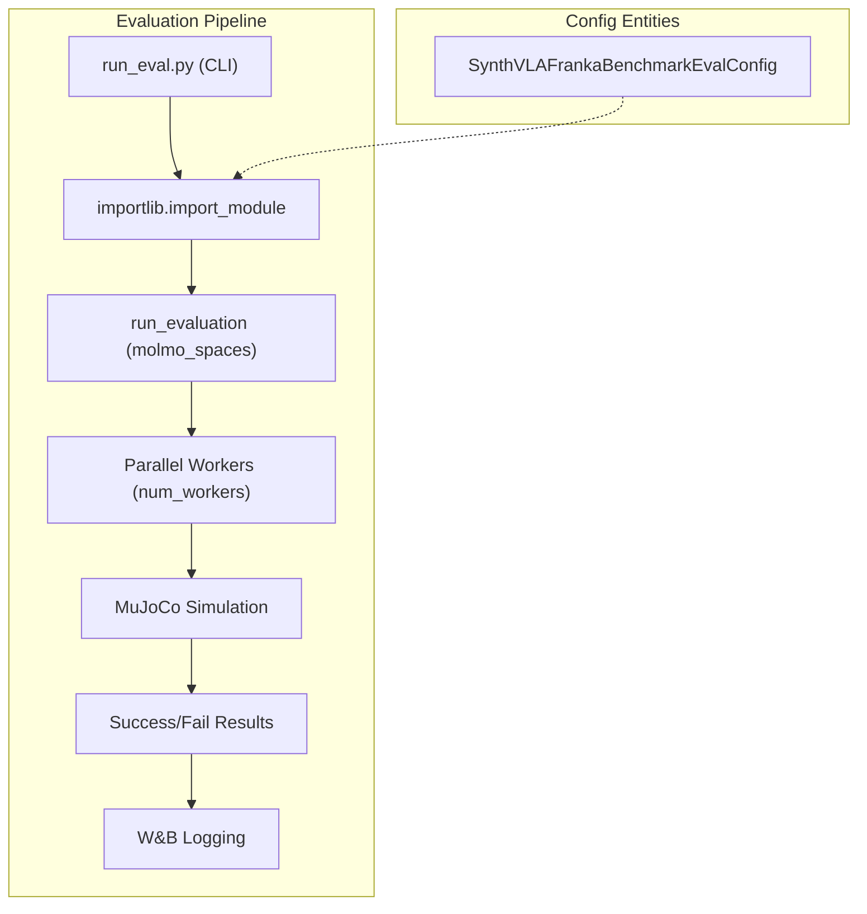
**Sources:** [MolmoBot/launch_scripts/run_eval.py:18-104]()

---

## Real-Robot Serving & WebSocket Infrastructure

For physical robot deployment, MolmoBot operates as a WebSocket server. This decouples the heavy VLM inference (running on a GPU server) from the robot control loop (running on the robot's local PC).

### WebSocket Server Implementation
The `WebsocketPolicyServer` class manages the communication [MolmoBot/launch_scripts/serve_molmo.py:153-155](). It listens for observation packets (images and joint states) and returns predicted actions.

### Serving Scripts
The repository provides specialized serving scripts for different robot platforms and tasks:

| Script | Robot/Task | Config Class |
| :--- | :--- | :--- |
| `serve_molmo.py` | Franka (DROID) | `RealRobotVLAPolicyConfig` |
| `serve_molmobot_rby1_door.py` | RBY1 Door Opening | `MolmoBotRBY1DoorPolicyConfig` |
| `serve_molmobot_rby1_multitask.py`| RBY1 Pick/Place/Door | `MolmoBotRBY1MultitaskPolicyConfig` |

**Sources:** [MolmoBot/launch_scripts/serve_molmo.py:14-15](), [MolmoBot/launch_scripts/serve_molmobot_rby1_door.py:23-27](), [MolmoBot/launch_scripts/serve_molmobot_rby1_multitask.py:24-30]()

### Model Loading and Deployment
Serving scripts support loading models from three sources:
1.  **HuggingFace Hub:** Using `snapshot_download` [MolmoBot/launch_scripts/serve_molmo.py:20-22]().
2.  **Amazon S3:** Using `boto3` with support for unsigned requests for public buckets [MolmoBot/launch_scripts/serve_molmo.py:25-73]().
3.  **Local Path:** Directly loading from a filesystem path [MolmoBot/launch_scripts/serve_molmo.py:128-131]().

### Data Flow: Serving Infrastructure
The diagram below maps the serving logic to the code entities responsible for model deployment and network communication.

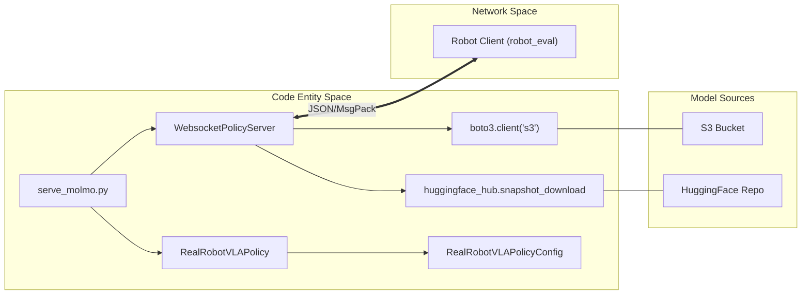
**Sources:** [MolmoBot/launch_scripts/serve_molmo.py:10-15](), [MolmoBot/launch_scripts/serve_molmo.py:153-155](), [MolmoBot/launch_scripts/serve_molmobot_rby1_door.py:32-75]()

---

## Policy Configurations

### Franka (DROID) Policy
The Franka policy supports both absolute (`joint_pos`) and relative (`joint_pos_rel`) joint control [MolmoBot/launch_scripts/serve_molmo.py:95-99](). It utilizes a `RealRobotVLAPolicy` wrapper that handles the conversion between the raw VLM output and the robot's action space [MolmoBot/launch_scripts/serve_molmo.py:103]().

### RBY1 Multitask Policy
The RBY1 multitask server uses a `TASK_CONFIGS` registry to switch between `door_plus_open` and `pick_pnp` configurations [MolmoBot/launch_scripts/serve_molmobot_rby1_multitask.py:34-37](). This allows a single model checkpoint to be served with different task-specific preprocessing or post-processing logic [MolmoBot/launch_scripts/serve_molmobot_rby1_multitask.py:75-77]().

---

## Interactive Evaluation (Demo Notebook)

The `demo_policy.ipynb` provides a reference implementation for manually running a policy against a simulated environment [MolmoBot/demo_policy.ipynb:1-223]().

### Key Simulation Components
1.  **Environment Setup:** Uses `MjSpec` to compile MuJoCo scenes from XML paths provided by `get_procthor_10k_houses` [MolmoBot/demo_policy.ipynb:52-56]().
2.  **Robot Integration:** Adds a Franka robot to the scene using `FrankaRobot.add_robot_to_scene` [MolmoBot/demo_policy.ipynb:62-69]().
3.  **Observation Loop:** 
    *   Captures images from `exo_camera_1` and `wrist_camera` [MolmoBot/demo_policy.ipynb:104-112]().
    *   Retrieves joint positions via `FrankaDroidRobotView` [MolmoBot/demo_policy.ipynb:200-207]().
    *   Queries the policy via `policy.get_action(obs)` [MolmoBot/demo_policy.ipynb:214]().
    *   Steps the simulation using `mujoco.mj_step` [MolmoBot/demo_policy.ipynb:219]().

### Simulation Interaction Diagram
This diagram bridges the conceptual "Robot Simulation" to the specific classes and methods used in the demo.

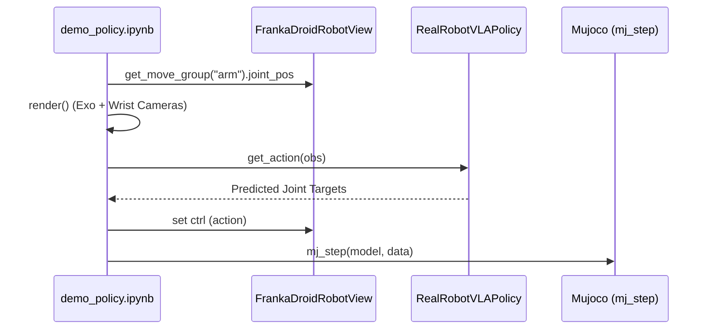
**Sources:** [MolmoBot/demo_policy.ipynb:91-112](), [MolmoBot/demo_policy.ipynb:200-219]()

---

# Page: Data Pipeline & Preprocessing

# Data Pipeline & Preprocessing

<details>
<summary>Relevant source files</summary>

The following files were used as context for generating this wiki page:

- [MolmoBot/olmo/data/data_loader.py](MolmoBot/olmo/data/data_loader.py)
- [MolmoBot/olmo/data/dataset.py](MolmoBot/olmo/data/dataset.py)
- [MolmoBot/olmo/data/dynamic_packer.py](MolmoBot/olmo/data/dynamic_packer.py)
- [MolmoBot/olmo/data/get_dataset.py](MolmoBot/olmo/data/get_dataset.py)
- [MolmoBot/olmo/data/image_warping_utils.py](MolmoBot/olmo/data/image_warping_utils.py)
- [MolmoBot/olmo/data/iterable_dataset_mixture.py](MolmoBot/olmo/data/iterable_dataset_mixture.py)

</details>


The MolmoBot data pipeline is designed to handle large-scale multimodal robot trajectory data, specifically in HDF5 or SynthManip formats. It supports complex dataset mixtures, deterministic shuffling, and efficient sequence packing using a 2D knapsack algorithm to maximize GPU utilization during training.

## Data Flow Overview

The pipeline transforms raw robot trajectories into batched, padded, and preprocessed tensors suitable for the Molmo VLM.

### System to Code Entity Mapping: Data Loading

The following diagram illustrates the relationship between high-level data loading concepts and the specific classes implemented in `olmo/data/`.

**Data Loading Architecture**
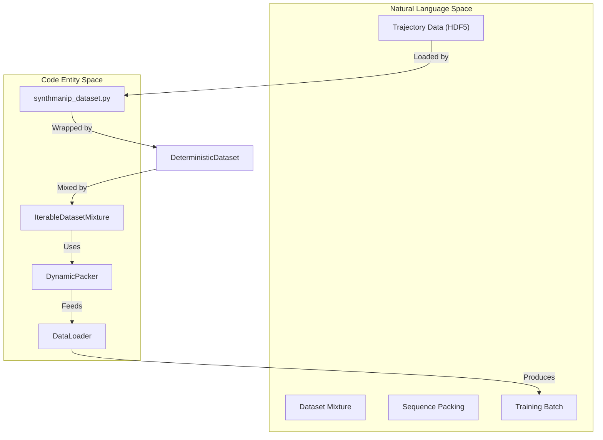
Sources: [MolmoBot/olmo/data/data_loader.py:19-26](), [MolmoBot/olmo/data/dataset.py:40-74](), [MolmoBot/olmo/data/iterable_dataset_mixture.py:21-38]()

## Dataset Classes

### DeterministicDataset
The `DeterministicDataset` acts as a wrapper for base datasets to ensure reproducibility across epochs. It handles:
*   **Seeding**: Calculates a unique seed for each example based on the global seed, example index, and current epoch `(self.seed * 195172 + idx + len(self.dataset)*epoch) % (2 ** 32 - 1)` [MolmoBot/olmo/data/dataset.py:61-63]().
*   **Padding**: Generates "padding examples" if the requested index exceeds the dataset length, marking them as invalid in the metadata [MolmoBot/olmo/data/dataset.py:64-67]().
*   **Preprocessing**: Applies the `MultimodalPreprocessor` to each item as it is retrieved [MolmoBot/olmo/data/dataset.py:72-74]().

### IterableDatasetMixture
This class provides an infinite stream of data sampled from multiple `DeterministicDataset` instances [MolmoBot/olmo/data/iterable_dataset_mixture.py:21-22]().
*   **Sampling**: Supports flat sampling rates or stratified sampling to ensure under-represented datasets are picked more frequently [MolmoBot/olmo/data/iterable_dataset_mixture.py:68-87]().
*   **Distributed Awareness**: Each rank in a `DeviceMesh` or DDP setup identifies which examples it is responsible for to avoid duplicate processing across the world size [MolmoBot/olmo/data/iterable_dataset_mixture.py:52-63]().
*   **Fast Forwarding**: Supports starting training from a specific index by fast-forwarding the RNG state without loading actual data [MolmoBot/olmo/data/iterable_dataset_mixture.py:97-109]().

Sources: [MolmoBot/olmo/data/dataset.py:40-74](), [MolmoBot/olmo/data/iterable_dataset_mixture.py:21-152]()

## Dynamic Packing (2D Knapsack)

To optimize training, MolmoBot uses a `DynamicPacker` to pack multiple examples into a single sequence (up to a maximum token length and image count). This is treated as a 2D knapsack problem where the two constraints are the number of text tokens and the number of image patches.

### select_subset_2d_knapsack_quantized
The core packing logic uses a vectorized DP approach with quantized constraints to reduce memory usage [MolmoBot/olmo/data/dynamic_packer.py:23-43]().
*   **Constraints**: `T` (Max Tokens) and `I` (Max Images/Patches).
*   **Granularity**: Supports `t_granularity` and `i_granularity` to speed up the DP table fill [MolmoBot/olmo/data/dynamic_packer.py:32-37]().
*   **Objective**: Maximizes `t_weight * tokens + i_weight * images` [MolmoBot/olmo/data/dynamic_packer.py:40]().

### Action Chunking
When packing examples that contain robot actions, the packer extracts "action chunks" (states, actions, and padding masks) and stacks them into `packed_states` and `packed_actions` tensors [MolmoBot/olmo/data/dynamic_packer.py:84-134](). It also manages `subsegment_ids` to prevent cross-example attention within a packed sequence [MolmoBot/olmo/data/dynamic_packer.py:165-172]().

Sources: [MolmoBot/olmo/data/dynamic_packer.py:23-78](), [MolmoBot/olmo/data/dynamic_packer.py:137-187]()

## Image Preprocessing & Warping

### Multimodal Preprocessing
The `MultimodalPreprocessor` (referenced in `data_loader.py`) prepares images and text for the model. For training, it can override the probability of high-resolution image processing via `override_p_high_res` [MolmoBot/olmo/data/data_loader.py:61-63]().

### Fisheye Warping Utilities
For synthetic data (SynthManip), the pipeline includes utilities to simulate GoPro-style fisheye distortion, which helps models generalize to real-world wide-angle cameras.

**Warping Pipeline**
1.  **Center-Crop**: Adjusts to a 4:3 aspect ratio [MolmoBot/olmo/data/image_warping_utils.py:8]().
2.  **Barrel Distortion**: Applies distortion using parameters `k1, k2, k3, k4` [MolmoBot/olmo/data/image_warping_utils.py:35-40]().
3.  **Edge Crop**: Removes 30% of the edges to eliminate warping artifacts [MolmoBot/olmo/data/image_warping_utils.py:147-152]().

**Warping Logic Entity Map**
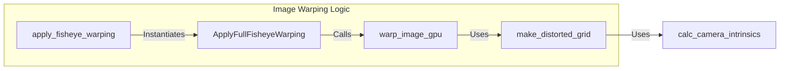

The `ApplyFullFisheyeWarping` class is a `torch.nn.Module` that precomputes normalized grids (`x_normalized`, `y_normalized`, `r`) to accelerate the distortion process on the GPU [MolmoBot/olmo/data/image_warping_utils.py:156-190]().

Sources: [MolmoBot/olmo/data/image_warping_utils.py:1-17](), [MolmoBot/olmo/data/image_warping_utils.py:111-153](), [MolmoBot/olmo/data/image_warping_utils.py:156-200]()

## DataLoader Construction

The `DataLoaderConfig` handles the instantiation of the final PyTorch `DataLoader`.

| Function | Purpose | Key Parameters |
| :--- | :--- | :--- |
| `build_eval_dataloader` | Builds a deterministic loader for evaluation. | `pad_batches`, `for_inference`, `include_metadata` [MolmoBot/olmo/data/data_loader.py:117-127]() |
| `build_train_dataloader` | Builds the training mixture loader with packing. | `global_batch_size`, `kwargs_mixture`, `packing` [MolmoBot/olmo/data/data_loader.py:197-203]() |

The `build_eval_dataloader` specifically ensures that for FSDP (Fully Sharded Data Parallel) models, the dataset is padded such that every device receives the exact same number of batches, preventing hangs during synchronization [MolmoBot/olmo/data/data_loader.py:142-152]().

Sources: [MolmoBot/olmo/data/data_loader.py:67-115](), [MolmoBot/olmo/data/data_loader.py:117-195]()

---

# Page: MolmoBot-Pi0: Pi0/Pi0.5 Policy Fine-Tuning

# MolmoBot-Pi0: Pi0/Pi0.5 Policy Fine-Tuning

<details>
<summary>Relevant source files</summary>

The following files were used as context for generating this wiki page:

- [MolmoBot-Pi0/.gitignore](MolmoBot-Pi0/.gitignore)
- [MolmoBot-Pi0/.python-version](MolmoBot-Pi0/.python-version)
- [MolmoBot-Pi0/README.md](MolmoBot-Pi0/README.md)

</details>


The **MolmoBot-Pi0** sub-project provides a PyTorch-based framework for fine-tuning Physical Intelligence’s Pi0 and Pi0.5 Vision-Language-Action (VLA) models. While the original Pi0 models are often implemented in JAX, this project enables training and deployment within a standard PyTorch ecosystem, specifically targeting robot manipulation tasks using DROID-format trajectory data.

## System Overview

MolmoBot-Pi0 bridges the gap between high-level language instructions and low-level robot control by adapting the PaliGemma-based Pi0 architecture. It includes a complete pipeline for data ingestion, distributed training (DDP), and evaluation in both simulation (via MolmoSpaces) and real-world hardware.

### Natural Language to Code Entity Mapping

The following diagram illustrates how conceptual components map to specific code entities within the `MolmoBot-Pi0` directory.

**Conceptual to Code Mapping**
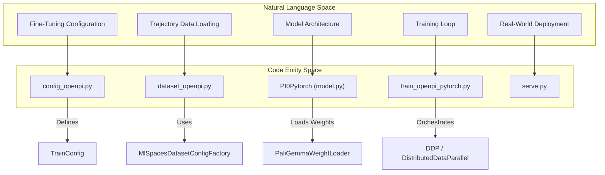
**Sources:** [molmobot_pi0/train_openpi_pytorch.py:1-126](), [molmobot_pi0/eval/real/serve.py:1-58]()

---

## Data and Configuration

The project utilizes the `openpi` configuration system to manage complex training hyperparameters and dataset mixtures. It specifically supports the DROID data format and provides utilities for sampling from multiple dataset sources (e.g., `FrankaPickAndPlaceOmniCamConfig`).

*   **Dataset Factory:** Uses `MlSpacesDatasetConfigFactory` to generate configurations for loading robot trajectories.
*   **Data Exploration:** The `explore_data.py` utility allows developers to visualize and inspect trajectories before training.
*   **Camera Presets:** Supports various camera configurations including `randomized_zed2_analogue_1` and `wrist_camera_zed_mini`.

For details, see [Pi0 Configuration & Dataset](#3.1).

**Sources:** [README.md:93-123](), [molmobot_pi0/train_openpi_pytorch.py:110-117]()

---

## Training Pipeline

The training infrastructure is built on PyTorch and designed for high-throughput distributed training across multiple GPUs (e.g., H100 clusters).

### Training Architecture
The diagram below describes the flow of data through the training script `train_openpi_pytorch.py`.

**Training Data Flow**
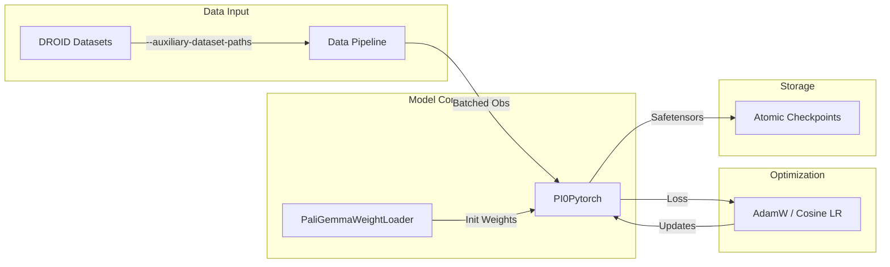

*   **Model Implementation:** The `PI0Pytorch` class implements the VLA logic in PyTorch.
*   **Weight Loading:** Supports loading from JAX checkpoints or HuggingFace snapshots via `PaliGemmaWeightLoader`.
*   **Efficiency:** Employs gradient checkpointing and `DistributedDataParallel` (DDP) to handle the large PaliGemma backbone.

For details, see [Pi0 Training](#3.2).

**Sources:** [README.md:109-126](), [molmobot_pi0/train_openpi_pytorch.py:1-50]()

---

## Evaluation and Policy Serving

MolmoBot-Pi0 supports two primary evaluation modes: simulation and real-robot serving.

### Evaluation Modes
| Mode | Entry Point | Primary Configuration |
| :--- | :--- | :--- |
| **Simulation** | `eval.py` | `eval.yaml`, `sim_exo_shoulder` |
| **Real Robot** | `serve.py` | `paligemma.yaml`, `PiJointPosPolicy` |

*   **Simulation:** Integrates with `MolmoSpaces` for physics-based evaluation. It supports high-fidelity rendering via Filament.
*   **Real Robot:** The `serve.py` script initializes a `PiJointPosPolicy` and serves it over a network (often via WebSocket) to the robot hardware.
*   **Policy Classes:** `PiJointPosPolicy` handles the transformation of raw observations (images and joint positions) into actionable robot commands.

For details, see [Pi0 Evaluation & Policy Serving](#3.3).

**Sources:** [README.md:19-40](), [README.md:42-82](), [molmobot_pi0/eval/real/serve.py:1-58]()

---

## Quick Start: Inference Example

The following snippet demonstrates how to load a fine-tuned DROID checkpoint and run a single inference step.

```python
import numpy as np
from huggingface_hub import snapshot_download
from molmobot_pi0.eval.policies.pi import PiJointPosPolicy

# Download and load the policy
ckpt_dir = snapshot_download("allenai/MolmoBot-Pi0-DROID")
policy = PiJointPosPolicy(checkpoint_dir=ckpt_dir)
policy.prepare_model()

# Prepare observation
obs = {
    "task": "put the mug in the bowl",
    "qpos": {"arm": np.zeros(7), "gripper": np.zeros(2)},
    "exo_camera_1": np.zeros((360, 640, 3), dtype=np.uint8),
    "wrist_camera": np.zeros((360, 640, 3), dtype=np.uint8),
}

# Generate action
action = policy.get_action(obs)
```
**Sources:** [README.md:19-40]()

---

# Page: Pi0 Configuration & Dataset

# Pi0 Configuration & Dataset

<details>
<summary>Relevant source files</summary>

The following files were used as context for generating this wiki page:

- [MolmoBot-Pi0/molmobot_pi0/config_openpi.py](MolmoBot-Pi0/molmobot_pi0/config_openpi.py)
- [MolmoBot-Pi0/molmobot_pi0/dataset.py](MolmoBot-Pi0/molmobot_pi0/dataset.py)
- [MolmoBot-Pi0/molmobot_pi0/dataset_openpi.py](MolmoBot-Pi0/molmobot_pi0/dataset_openpi.py)
- [MolmoBot-Pi0/molmobot_pi0/explore_data.py](MolmoBot-Pi0/molmobot_pi0/explore_data.py)
- [MolmoBot-Pi0/molmobot_pi0/prompt_templates.py](MolmoBot-Pi0/molmobot_pi0/prompt_templates.py)
- [MolmoBot-Pi0/molmobot_pi0/utils.py](MolmoBot-Pi0/molmobot_pi0/utils.py)

</details>


This page documents the configuration and data loading infrastructure for the MolmoBot-Pi0 sub-project. It covers the integration with the `openpi` framework, the custom dataset implementations for MolmoSpaces data, and the prompt engineering system used for fine-tuning Pi0 and Pi0.5 models.

## OpenPI Configuration System

The configuration system leverages the `openpi` training framework to define model architectures, data sources, and optimization parameters. Configurations are registered in `molmobot_pi0/config_openpi.py` using the `TrainConfig` class.

### TrainConfig Registry
The repository registers two primary configurations:
1.  **`molmobot_pi0_droid`**: Configured for the Pi0 model with an 8-dimensional action space and 16-step horizon [molmobot_pi0/config_openpi.py:10-37](). It uses a `PaliGemmaWeightLoader` and freezes the `vision_tower` during training [molmobot_pi0/config_openpi.py:23-36]().
2.  **`pi05_mlspaces_finetune`**: Configured for the Pi0.5 model with a 32-dimensional action space [molmobot_pi0/config_openpi.py:38-69](). It utilizes a `CheckpointWeightLoader` to initialize from pre-trained JAX checkpoints [molmobot_pi0/config_openpi.py:56]().

### Optimization & Scheduling
Both configurations utilize a `CosineDecaySchedule` with a warmup period (typically 1,000 steps) and a peak learning rate of `5e-5` [molmobot_pi0/config_openpi.py:24-29, 57-62]().

**Sources:** [molmobot_pi0/config_openpi.py:1-74]()

---

## MlSpacesDataset & Data Flow

The `MlSpacesDataset` is the core PyTorch `Dataset` implementation for loading robot trajectories stored in HDF5 format.

### Dataset Implementation
The dataset handles the following responsibilities:
*   **Trajectory Bookkeeping**: Parses `valid_trajectory_index.json` to map global indices to specific HDF5 files and trajectory keys [molmobot_pi0/dataset.py:142-166]().
*   **Feature Selection**: Allows selective loading of states, actions, and observations (e.g., specific camera views) [molmobot_pi0/dataset.py:85-88]().
*   **Image Augmentation**: Applies a standard pipeline including `ColorJitter`, `GaussianBlur`, and `RandomPosterize` via `torchvision.transforms` [molmobot_pi0/dataset.py:102-112]().
*   **Normalization**: Computes and applies statistics (mean, std, min, max) derived from `aggregated_stats.json` [molmobot_pi0/dataset.py:168-179]().

### Data Flow Diagram: From HDF5 to Model Input

This diagram illustrates how raw data from HDF5 files is transformed into the format expected by the `PI0Pytorch` model.

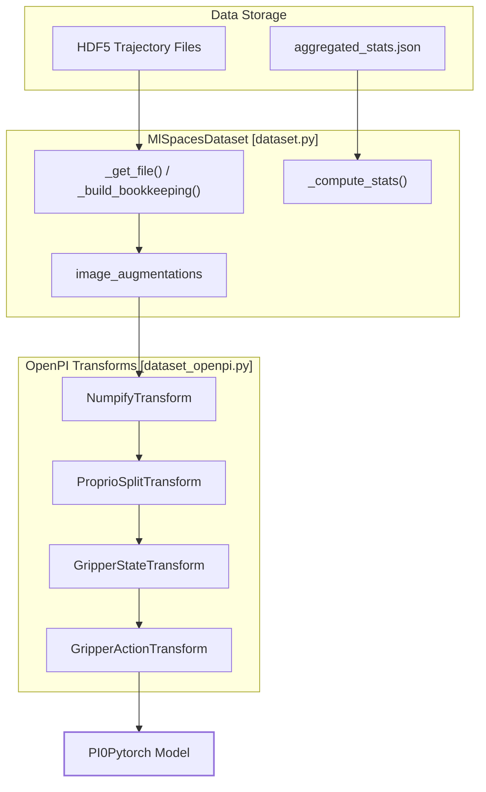
**Sources:** [molmobot_pi0/dataset.py:61-129](), [molmobot_pi0/dataset_openpi.py:24-77]()

---

## MlSpacesDatasetConfigFactory

The `MlSpacesDatasetConfigFactory` bridges the custom `MlSpacesDataset` with the `openpi` data loader infrastructure.

### Transformation Pipeline
The factory defines a series of `DataTransformFn` operations to reshape the data for Pi0 [molmobot_pi0/dataset_openpi.py:106-140]():
*   **`ProprioSplitTransform`**: Splits the unified state vector into `observation/joint_position` (7-dim) and `observation/gripper_position` [molmobot_pi0/dataset_openpi.py:43-50]().
*   **`GripperStateTransform`**: Rescales the gripper position to a `[0, 1]` range [molmobot_pi0/dataset_openpi.py:53-58]().
*   **`GripperActionTransform`**: Normalizes gripper actions by dividing by `255.0` [molmobot_pi0/dataset_openpi.py:60-67]().
*   **`RepackTransform`**: Maps internal dataset keys (e.g., `exterior_image_1_left`) to the standard `openpi` naming convention (e.g., `observation.image.exo_camera_1`) [molmobot_pi0/dataset_openpi.py:112-119]().

### Sampling Strategy
For multi-dataset training, the `DistributedWeightedDatasetSampler` in `molmobot_pi0/utils.py` handles weighted sampling across different data sources based on provided paths and weights [molmobot_pi0/dataset_openpi.py:21](), [molmobot_pi0/utils.py:181-182]().

**Sources:** [molmobot_pi0/dataset_openpi.py:79-168](), [molmobot_pi0/utils.py:174-183]()

---

## Prompt Engineering & Templates

The system uses a templated approach to generate natural language instructions for the model, defined in `molmobot_pi0/prompt_templates.py`.

### Template Structure
Prompts are organized by task type (e.g., `pick_and_place`, `pick_and_place_next_to`, `pick`) [molmobot_pi0/prompt_templates.py:9-162]().
*   **Prompt Groups**: Each task contains multiple "groups" of related templates. This allows the system to uniformly sample a group first, then a specific template within that group, preventing the model from over-fitting to a single phrasing style [molmobot_pi0/prompt_templates.py:3-8]().
*   **Placeholders**: Templates use placeholders like `{pickup_name}` and `{place_name}` which are filled during dataset iteration [molmobot_pi0/prompt_templates.py:13-15]().

### Randomization
The `MlSpacesDataset` applies several layers of randomization to prompts [molmobot_pi0/dataset.py:77-82]():
*   **Sampling**: Randomly selects templates based on `prompt_sampling_temperature` [molmobot_pi0/dataset.py:99]().
*   **Formatting**: Optional randomization of casing and punctuation [molmobot_pi0/dataset.py:100-101]().

**Sources:** [molmobot_pi0/prompt_templates.py:1-165](), [molmobot_pi0/dataset.py:96-101]()

---

## Data Inspection Utility

The `explore_data.py` script is a CLI tool for inspecting the contents of the HDF5 trajectory files.

### Key Capabilities
*   **Tree Visualization**: Uses `build_group_tree` to recursively display the hierarchy of groups and datasets within an HDF5 file [molmobot_pi0/explore_data.py:45-55]().
*   **Metadata Parsing**: Automatically detects and decodes JSON-encoded metadata stored as `uint8` arrays (e.g., `obs_scene` or `valid_trajectory_index`) [molmobot_pi0/explore_data.py:37-42, 72-83]().
*   **Paging**: Supports an automatic pager for large outputs to facilitate terminal-based inspection [molmobot_pi0/explore_data.py:23-27]().

### Code Entity Association

| Code Entity | Purpose | File |
| :--- | :--- | :--- |
| `build_group_tree` | Generates a dictionary representing HDF5 structure | [molmobot_pi0/explore_data.py:45]() |
| `load_dicts_data` | Decodes byte-arrays into Python dictionaries | [molmobot_pi0/explore_data.py:37]() |
| `print_dataset` | Formats and prints specific dataset values | [molmobot_pi0/explore_data.py:67]() |

**Sources:** [molmobot_pi0/explore_data.py:1-121]()

---

# Page: Pi0 Training

# Pi0 Training

<details>
<summary>Relevant source files</summary>

The following files were used as context for generating this wiki page:

- [MolmoBot-Pi0/molmobot_pi0/train_openpi_pytorch.py](MolmoBot-Pi0/molmobot_pi0/train_openpi_pytorch.py)
- [MolmoBot-Pi0/molmobot_pi0/utils.py](MolmoBot-Pi0/molmobot_pi0/utils.py)
- [MolmoBot-Pi0/scripts/convert_jax_model_to_pytorch.py](MolmoBot-Pi0/scripts/convert_jax_model_to_pytorch.py)

</details>


The `MolmoBot-Pi0` training pipeline is a PyTorch-based implementation designed to fine-tune Physical Intelligence’s Pi0 and Pi0.5 Vision-Language-Action (VLA) models. While the original Pi0 implementation relies on JAX, this repository provides a full PyTorch training loop (`train_openpi_pytorch.py`) with support for Multi-GPU Distributed Data Parallel (DDP) training, gradient checkpointing, and seamless integration with the DROID-format datasets used across MolmoBot.

## Training Entrypoint and DDP Setup

The primary entrypoint for training is `train_openpi_pytorch.py` [MolmoBot-Pi0/molmobot_pi0/train_openpi_pytorch.py:1-24](). It initializes the distributed environment using `torch.distributed` and sets up the device mapping for multi-node or multi-GPU execution.

### Distributed Lifecycle
1.  **`setup_ddp()`**: Initializes the process group using the `nccl` backend (for GPUs) and configures the local rank and device [MolmoBot-Pi0/molmobot_pi0/train_openpi_pytorch.py:109-124]().
2.  **`set_seed()`**: Ensures deterministic behavior across replicas by offsetting the seed with the `local_rank` [MolmoBot-Pi0/molmobot_pi0/train_openpi_pytorch.py:133-138]().
3.  **`cleanup_ddp()`**: Synchronizes processes via a barrier before destroying the process group at the end of training [MolmoBot-Pi0/molmobot_pi0/train_openpi_pytorch.py:127-130]().

**Sources:** [MolmoBot-Pi0/molmobot_pi0/train_openpi_pytorch.py]()

## Model Construction and Weight Loading

The trainer utilizes the `PI0Pytorch` model class. Weights can be loaded from two primary sources: original PaliGemma checkpoints or custom training checkpoints.

### Weight Loading Strategies
*   **`PaliGemmaWeightLoader`**: Used when starting from a base PaliGemma model. It maps standard vision-language weights into the `PI0Pytorch` architecture.
*   **`CheckpointWeightLoader`**: Used for resuming training or loading a previously fine-tuned Pi0 model. It handles the mapping of the action-expert heads and flow-matching layers.

### Training Configuration Flow
The following diagram bridges the configuration classes to the training execution entities.

**Training Entity Map**
```mermaid
graph TD
    subgraph "Configuration Space"
        TC["TrainConfig (_config.py)"]
        DC["DataConfig (_config.py)"]
    end

    subgraph "Code Entity Space"
        TP["train_openpi_pytorch.py"]
        M["PI0Pytorch (openpi.models_pytorch)"]
        DL["create_data_loader (dataset_openpi.py)"]
        OPT["torch.optim.AdamW"]
        SCH["get_cosine_schedule_with_warmup"]
    end

    TC -->|"defines hyperparams"| TP
    DC -->|"configures"| DL
    TP -->|"instantiates"| M
    TP -->|"initializes"| OPT
    OPT -->|"stepped by"| SCH
    DL -->|"provides batches to"| TP
```
**Sources:** [MolmoBot-Pi0/molmobot_pi0/train_openpi_pytorch.py:45-55](), [MolmoBot-Pi0/molmobot_pi0/train_openpi_pytorch.py:140-144]()

## Training Loop Implementation

The training loop manages the forward pass, loss computation (typically flow-matching loss for actions), and optimization steps.

### Key Components
*   **Gradient Checkpointing**: To reduce memory consumption during the fine-tuning of large backbones, gradient checkpointing is supported [MolmoBot-Pi0/molmobot_pi0/train_openpi_pytorch.py:202-210]().
*   **Optimizer & Schedule**: Uses `AdamW` with a cosine learning rate schedule including a warmup phase.
*   **Atomic Checkpointing**: Checkpoints are saved using `safetensors`. To prevent corruption during crashes, the trainer writes to a temporary directory (`tmp_...`) and performs an atomic rename to the final step directory once the write is complete [MolmoBot-Pi0/molmobot_pi0/train_openpi_pytorch.py:179-199]().
*   **WandB Integration**: Tracks loss, learning rate, and experiment metadata. If running on Beaker, it automatically captures the experiment URL [MolmoBot-Pi0/molmobot_pi0/train_openpi_pytorch.py:79-107]().

### Data Flow Diagram
This diagram illustrates the flow from raw data to the optimized model parameters.

**Pi0 Data Flow**
```mermaid
graph LR
    subgraph "Data Pipeline"
        D["create_data_loader"] -->|"Batch (PyTorch Tensors)"| PRE["Preprocessor"]
    end

    subgraph "Model Forward"
        PRE -->|"Vision/Text Tokens"| V["Vision Backbone"]
        V -->|"Embeddings"| L["LLM / Action Expert"]
        L -->|"Action Latents"| FM["Flow Matching Head"]
    end

    subgraph "Optimization"
        FM -->|"Loss"| B["Backward Pass"]
        B -->|"Gradients"| OPT["AdamW Optimizer"]
        OPT -->|"Update"| M["PI0Pytorch Weights"]
    end
```
**Sources:** [MolmoBot-Pi0/molmobot_pi0/train_openpi_pytorch.py:140-144](), [MolmoBot-Pi0/molmobot_pi0/train_openpi_pytorch.py:146-162]()

## JAX-to-PyTorch Conversion

Since many pre-trained Pi0 weights are released in JAX format (Flax/Orbax), the repository includes a conversion utility: `convert_jax_model_to_pytorch.py`.

### Conversion Process
1.  **Load JAX Checkpoint**: Uses `orbax.checkpoint` to load the JAX parameters [scripts/convert_jax_model_to_pytorch.py:20-22]().
2.  **Slice and Map**: The function `slice_paligemma_state_dict` performs the heavy lifting of remapping JAX's hierarchical kernel/bias structure to PyTorch's `nn.Linear` and `nn.Conv2d` weight formats [scripts/convert_jax_model_to_pytorch.py:35-134]().
3.  **Transpose Kernels**: JAX typically uses `(H, W, In, Out)` for convolutions, which are transposed to PyTorch's `(Out, In, H, W)` [scripts/convert_jax_model_to_pytorch.py:42]().
4.  **Save Safetensors**: The resulting state dict is saved as a `.safetensors` file, which is then compatible with the `PI0Pytorch` model and the `train_openpi_pytorch.py` script.

**Sources:** [MolmoBot-Pi0/scripts/convert_jax_model_to_pytorch.py]()

## Utilities

*   **`TimeLogger`**: Provides `CPUTimeLogger` and `GPUTimeLogger` (using `torch.cuda.Event`) for precise profiling of the training loop bottlenecks [MolmoBot-Pi0/molmobot_pi0/utils.py:29-68]().
*   **`Checkpointer`**: A helper class that manages the saving and loading of `.pth` files, supporting "latest-only" modes or step-based versioning [MolmoBot-Pi0/molmobot_pi0/utils.py:76-116]().
*   **`gather_info`**: Aggregates metrics across DDP ranks for synchronized logging to WandB [MolmoBot-Pi0/molmobot_pi0/utils.py:184-194]().

**Sources:** [MolmoBot-Pi0/molmobot_pi0/utils.py]()

---

# Page: Pi0 Evaluation & Policy Serving

# Pi0 Evaluation & Policy Serving

<details>
<summary>Relevant source files</summary>

The following files were used as context for generating this wiki page:

- [MolmoBot-Pi0/config/eval/eval.yaml](MolmoBot-Pi0/config/eval/eval.yaml)
- [MolmoBot-Pi0/config/eval/policy/cameras/real.yaml](MolmoBot-Pi0/config/eval/policy/cameras/real.yaml)
- [MolmoBot-Pi0/config/eval/policy/cameras/sim_exo_random.yaml](MolmoBot-Pi0/config/eval/policy/cameras/sim_exo_random.yaml)
- [MolmoBot-Pi0/config/eval/policy/cameras/sim_exo_shoulder.yaml](MolmoBot-Pi0/config/eval/policy/cameras/sim_exo_shoulder.yaml)
- [MolmoBot-Pi0/config/eval/policy/empty.yaml](MolmoBot-Pi0/config/eval/policy/empty.yaml)
- [MolmoBot-Pi0/config/eval/policy/paligemma.yaml](MolmoBot-Pi0/config/eval/policy/paligemma.yaml)
- [MolmoBot-Pi0/config/eval/policy/pi.yaml](MolmoBot-Pi0/config/eval/policy/pi.yaml)
- [MolmoBot-Pi0/molmobot_pi0/eval/eval.py](MolmoBot-Pi0/molmobot_pi0/eval/eval.py)
- [MolmoBot-Pi0/molmobot_pi0/eval/policies/pi.py](MolmoBot-Pi0/molmobot_pi0/eval/policies/pi.py)
- [MolmoBot-Pi0/molmobot_pi0/eval/policies/stateful.py](MolmoBot-Pi0/molmobot_pi0/eval/policies/stateful.py)
- [MolmoBot-Pi0/molmobot_pi0/eval/policies/websocket.py](MolmoBot-Pi0/molmobot_pi0/eval/policies/websocket.py)
- [MolmoBot-Pi0/molmobot_pi0/eval/real/serve.py](MolmoBot-Pi0/molmobot_pi0/eval/real/serve.py)
- [MolmoBot-Pi0/molmobot_pi0/eval/real/utils.py](MolmoBot-Pi0/molmobot_pi0/eval/real/utils.py)
- [MolmoBot-Pi0/molmobot_pi0/eval/utils.py](MolmoBot-Pi0/molmobot_pi0/eval/utils.py)

</details>


This page documents the evaluation infrastructure and deployment mechanisms for the MolmoBot-Pi0 project. It covers the simulation evaluation pipeline integrated with `MolmoSpaces`, the policy abstractions used for inference, and the WebSocket-based serving architecture for real-robot deployment.

## Evaluation Pipeline & Configuration

The evaluation system is built around `MolmoSpaces`, a simulation and evaluation harness. The primary entry point for running evaluations is `eval.py`, which utilizes Hydra for configuration management.

### Configuration (eval.yaml)
The evaluation behavior is governed by `eval.yaml`. It defines parameters for the simulation environment, the number of parallel workers, and the success criteria for episodes.

| Parameter | Description |
| :--- | :--- |
| `num_workers` | Number of parallel simulation processes [MolmoBot-Pi0/config/eval/eval.yaml:5](). |
| `n_videos` | Number of evaluation videos to log to Weights & Biases [MolmoBot-Pi0/config/eval/eval.yaml:7](). |
| `horizon` | Maximum episode duration in seconds [MolmoBot-Pi0/config/eval/eval.yaml:8](). |
| `min_success_duration` | Time in seconds the success condition must hold to count as a success [MolmoBot-Pi0/config/eval/eval.yaml:9](). |

### Simulation Runner (eval.py)
The `eval.py` script executes the evaluation loop. It configures the MuJoCo EGL rendering device based on the local rank for distributed runs [MolmoBot-Pi0/molmobot_pi0/eval/eval.py:4-5]() and invokes `run_evaluation` from `molmo_spaces` [MolmoBot-Pi0/molmobot_pi0/eval/eval.py:65-74]().

Key features of the evaluation runner:
*   **Success Filtering**: It filters out "spurious" successes by ensuring the success flag is consistent over a sliding window defined by `min_success_duration` [MolmoBot-Pi0/molmobot_pi0/eval/eval.py:117-123]().
*   **Metrics Collection**: Calculates evaluation throughput, time-to-success, and task progress based on position error [MolmoBot-Pi0/molmobot_pi0/eval/eval.py:80-83, 138-140]().
*   **Video Logging**: Selects a distribution of successful and failed episodes to upload as videos for visual inspection [MolmoBot-Pi0/molmobot_pi0/eval/eval.py:170-182]().

**Sources:** [MolmoBot-Pi0/config/eval/eval.yaml:1-16](), [MolmoBot-Pi0/molmobot_pi0/eval/eval.py:1-163]()

---

## Policy Implementations

MolmoBot-Pi0 uses a hierarchical policy structure to handle state management and different communication protocols.

### Policy Class Hierarchy
The system defines several policy types to bridge the gap between model inference and environment interaction.

*   **`StatefulPolicy`**: An abstract base class defining `get_state()` and `set_state()` for handling policies with internal buffers or temporal dependencies [MolmoBot-Pi0/molmobot_pi0/eval/policies/stateful.py:7-14]().
*   **`PiPolicy`**: The core implementation for Pi0 models. it manages model loading (JAX or PyTorch), action buffering, and image preprocessing [MolmoBot-Pi0/molmobot_pi0/eval/policies/pi.py:38-49]().
*   **`WebsocketPolicy`**: A client-side policy that forwards observations to a remote `WebsocketPolicyServer` and receives actions, allowing the model to run on a separate GPU-equipped machine [MolmoBot-Pi0/molmobot_pi0/eval/policies/websocket.py:16-21]().

### Action Handling in PiPolicy
`PiPolicy` supports action chunking via an internal `actions_buffer`. If the buffer has remaining actions, the policy returns the next cached action instead of triggering a new model inference pass [MolmoBot-Pi0/molmobot_pi0/eval/policies/pi.py:156-157, 185-188]().

**Sources:** [MolmoBot-Pi0/molmobot_pi0/eval/policies/pi.py:38-188](), [MolmoBot-Pi0/molmobot_pi0/eval/policies/stateful.py:7-14](), [MolmoBot-Pi0/molmobot_pi0/eval/policies/websocket.py:16-126]()

---

## Real-Robot Serving Architecture

For real-robot deployment, the policy is served via a WebSocket server. This decouples the high-frequency robot control loop from the heavy VLA model inference.

### Serving Entrypoint (serve.py)
The `serve.py` script initializes the `WebsocketPolicyServer`. It can load multiple policy instances across available GPUs to increase throughput [MolmoBot-Pi0/molmobot_pi0/eval/real/serve.py:76-86]().

The server uses `load_pi` to instantiate either `PiJointVelPolicy` or `PiJointPosPolicy` based on the configuration [MolmoBot-Pi0/molmobot_pi0/eval/real/serve.py:49-54]().

### Data Flow: Robot to Policy Server
The following diagram illustrates how observations flow from the robot sensors to the model and back as actions.

**Policy Serving Data Flow**
```mermaid
graph TD
    subgraph "Robot Control Loop"
        A["Robot Sensors (ZED, Joints)"] --> B["PolicyClient (robot_eval)"]
        B --> C["WebsocketPolicy (Client Side)"]
        C --> B
        B --> D["Robot Actuators"]
    end

    subgraph "Inference Server (serve.py)"
        C -- "msgpack(obs)" --> E["WebsocketPolicyServer"]
        E --> F["PiPolicy.infer()"]
        F --> G["PI0Pytorch Model"]
        G --> F
        F --> E
        E -- "msgpack(action)" --> C
    end
```
**Sources:** [MolmoBot-Pi0/molmobot_pi0/eval/real/serve.py:1-98](), [MolmoBot-Pi0/molmobot_pi0/eval/policies/websocket.py:70-118]()

---

## Camera Configurations

The evaluation and serving pipelines use YAML files to map environment-specific camera names to the standard input keys expected by the Pi0 model (`observation/exterior_image_1_left` and `observation/wrist_image_left`).

| Config File | Exterior Camera Source | Wrist Camera Source |
| :--- | :--- | :--- |
| `real.yaml` | `observation/exterior_image_1_left` | `observation/wrist_image_left` |
| `sim_exo_random.yaml` | `randomized_zed2_analogue_1` | `wrist_camera_zed_mini` |
| `sim_exo_shoulder.yaml` | `droid_shoulder_light_randomization` | `wrist_camera_zed_mini` |

**Sources:** [MolmoBot-Pi0/config/eval/policy/cameras/real.yaml:1-2](), [MolmoBot-Pi0/config/eval/policy/cameras/sim_exo_random.yaml:1-2](), [MolmoBot-Pi0/config/eval/policy/cameras/sim_exo_shoulder.yaml:1-2]()

---

## Technical Entities & Code Mapping

The following diagram maps high-level evaluation concepts to their specific class and file implementations.

**Evaluation Entity Mapping**
```mermaid
classDiagram
    class "Evaluation Runner" as EvalRunner {
        eval.py
        run_evaluation()
    }
    class "Policy Server" as Server {
        serve.py
        WebsocketPolicyServer
    }
    class "Policy Implementation" as Policy {
        pi.py
        PiPolicy
        PiJointVelPolicy
    }
    class "State Management" as State {
        stateful.py
        StatefulPolicy
        PiPolicyState
    }

    EvalRunner --> Policy : uses
    Server --> Policy : hosts
    Policy --|> State : implements
    Policy --> "openpi.models" : wraps
```
**Sources:** [MolmoBot-Pi0/molmobot_pi0/eval/eval.py:31](), [MolmoBot-Pi0/molmobot_pi0/eval/real/serve.py:12](), [MolmoBot-Pi0/molmobot_pi0/eval/policies/pi.py:38](), [MolmoBot-Pi0/molmobot_pi0/eval/policies/stateful.py:7]()

---

# Page: MolmoBot-SPOC: Lightweight Goal-Conditioned Policy

# MolmoBot-SPOC: Lightweight Goal-Conditioned Policy

<details>
<summary>Relevant source files</summary>

The following files were used as context for generating this wiki page:

- [MolmoBot-SPOC/README.md](MolmoBot-SPOC/README.md)
- [MolmoBot-SPOC/__init__.py](MolmoBot-SPOC/__init__.py)
- [MolmoBot-SPOC/pyproject.toml](MolmoBot-SPOC/pyproject.toml)

</details>


MolmoBot-SPOC is a sub-project within the MolmoBot repository focused on providing a lightweight, goal-conditioned transformer policy for robotic manipulation [MolmoBot-SPOC/README.md:3-5](). Unlike the heavy VLM-based MolmoBot, SPOC utilizes a compact architecture consisting of a SigLIP vision encoder and a Llama-based transformer decoder to map RGB observations and natural language instructions into continuous robot actions [MolmoBot-SPOC/README.md:5-5]().

The project supports multiple robot platforms, including the **Franka Panda** (using the DROID dataset format) and the **RBY1** mobile manipulator [MolmoBot-SPOC/README.md:32-42](). It is designed for efficiency, supporting real-time inference via a WebSocket-based policy server [MolmoBot-SPOC/README.md:84-107]().

### System Overview

The SPOC pipeline integrates vision, language, and proprioception to perform tasks such as "pick and place" or "open the door" [MolmoBot-SPOC/README.md:93-95](). The following diagram illustrates the high-level flow from observation to execution.

**SPOC Data and Control Flow**
```mermaid
graph TD
    subgraph Observations["Input Space"]
        A["RGB Images (Wrist/Exo)"]
        B["Natural Language Task"]
        C["Optional Image Points"]
    end

    subgraph Model["SpocContinuousActionModel Entity Space"]
        D["GoalCondVisualEncoder"]
        E["GoalCondLlama Decoder"]
        F["ParallelActionDecoder"]
    end

    subgraph Output["Action Space"]
        G["Joint Positions"]
        H["Gripper State"]
    end

    A --> D
    B --> E
    C --> D
    D --> E
    E --> F
    F --> G
    F --> H
```
Sources: [MolmoBot-SPOC/README.md:3-5](), [MolmoBot-SPOC/pyproject.toml:9-21]()

---

### [SPOC Model Architecture](#4.1)

The core of the policy is the `SpocContinuousActionModel`. It leverages a `GoalCondVisualEncoder` (built on `open_clip_torch` SigLIP) to process multi-view camera inputs and a `GoalCondLlama` transformer to fuse these features with language embeddings [MolmoBot-SPOC/pyproject.toml:10-11](). The model outputs actions through a `ParallelActionDecoder` using a binned continuous action space or quantile-based representations.

For a deep dive into the neural network components, including cross-attention mechanisms, Rotary Positional Embeddings (RoPE), and the `LinearActorHead`, see the [SPOC Model Architecture](#4.1) child page.

Sources: [MolmoBot-SPOC/pyproject.toml:10-11](), [MolmoBot-SPOC/README.md:46-46]()

---

### [SPOC Configuration System](#4.2)

SPOC utilizes a centralized `config_registry.py` pattern to manage various model architectures and training hyperparameters. Configurations are partitioned into:
*   **Model Configs**: `SpocGoalCondLlamaModelConfig` defines the transformer layers, heads, and action space parameters [MolmoBot-SPOC/README.md:46-46]().
*   **Training Configs**: Specialized classes like `SPOCRBY1RigidManipTrainingConfig` and `SPOCDroidPickPlaceTrainingConfig` define dataset paths, batch sizes, and robot-specific constants [MolmoBot-SPOC/README.md:35-42]().

For details on the registry pattern and defining custom configurations, see the [SPOC Configuration System](#4.2) child page.

Sources: [MolmoBot-SPOC/README.md:27-27](), [MolmoBot-SPOC/README.md:45-49]()

---

### [SPOC Training Pipeline](#4.3)

The training infrastructure is built on **PyTorch Lightning** [MolmoBot-SPOC/pyproject.toml:12](). Key components include:
*   **Data Loading**: The `SPOCDataModule` and `training/dataset.py` handle HDF5 trajectory files with support for phase-aware upsampling to balance tasks [MolmoBot-SPOC/README.md:50-50]().
*   **Optimization**: Training tracks metrics such as token accuracy and L1 error, logging results to Weights & Biases [MolmoBot-SPOC/README.md:52-52]().

For details on the `LitModel` implementation, loss computation, and normalization statistics, see the [SPOC Training Pipeline](#4.3) child page.

Sources: [MolmoBot-SPOC/README.md:27-27](), [MolmoBot-SPOC/README.md:50-52]()

---

### [SPOC Evaluation & Policy Server](#4.4)

SPOC supports both simulation and real-world evaluation:
*   **Simulation**: Uses `molmo_spaces` and MuJoCo to benchmark policies against JSON-defined tasks [MolmoBot-SPOC/README.md:56-62]().
*   **Real-World**: The `spoc_server.py` runs a WebSocket server that communicates with robot clients using `msgpack` [MolmoBot-SPOC/README.md:87-107]().
*   **Policy Logic**: The `SPOCModelPolicy` handles the transformation of raw observations into model inputs and the post-processing of network outputs into executable robot commands.

For details on the WebSocket protocol, image warping, and evaluation configs (e.g., `RBY1ArticulatedManipEvalConfig`), see the [SPOC Evaluation & Policy Server](#4.4) child page.

Sources: [MolmoBot-SPOC/README.md:59-60](), [MolmoBot-SPOC/README.md:87-90](), [MolmoBot-SPOC/pyproject.toml:15-16]()

---

### Code Entity Map

The following diagram maps the logical components of the SPOC sub-project to their corresponding locations in the `molmobot_spoc` package.

**Package Structure and Entity Mapping**
```mermaid
graph LR
    subgraph Package["molmobot_spoc Package"]
        DIR_ARCH["architecture/"]
        DIR_TRAIN["training/"]
        DIR_EVAL["eval/"]
        DIR_UTILS["utils/"]
    end

    subgraph Entities["Code Entities"]
        MODEL["SpocContinuousActionModel"]
        LIT["LitModel (PL)"]
        DS["training/dataset.py"]
        SRV["spoc_server.py"]
        CONF["config/model_config.py"]
    end

    DIR_ARCH --> MODEL
    DIR_ARCH --> CONF
    DIR_TRAIN --> LIT
    DIR_TRAIN --> DS
    DIR_EVAL --> SRV
    DIR_UTILS --> DIR_ARCH
```
Sources: [MolmoBot-SPOC/pyproject.toml:29-40](), [MolmoBot-SPOC/README.md:35-50]()

---

# Page: SPOC Model Architecture

# SPOC Model Architecture

<details>
<summary>Relevant source files</summary>

The following files were used as context for generating this wiki page:

- [MolmoBot-SPOC/architecture/__init__.py](MolmoBot-SPOC/architecture/__init__.py)
- [MolmoBot-SPOC/architecture/action_spaces/__init__.py](MolmoBot-SPOC/architecture/action_spaces/__init__.py)
- [MolmoBot-SPOC/architecture/action_spaces/abstract.py](MolmoBot-SPOC/architecture/action_spaces/abstract.py)
- [MolmoBot-SPOC/architecture/action_spaces/binned_continuous.py](MolmoBot-SPOC/architecture/action_spaces/binned_continuous.py)
- [MolmoBot-SPOC/architecture/action_spaces/quantile_based_binned_continuous.py](MolmoBot-SPOC/architecture/action_spaces/quantile_based_binned_continuous.py)
- [MolmoBot-SPOC/architecture/common/__init__.py](MolmoBot-SPOC/architecture/common/__init__.py)
- [MolmoBot-SPOC/architecture/common/action_decoder.py](MolmoBot-SPOC/architecture/common/action_decoder.py)
- [MolmoBot-SPOC/architecture/common/goal_cond_llama.py](MolmoBot-SPOC/architecture/common/goal_cond_llama.py)
- [MolmoBot-SPOC/architecture/common/goal_cond_visual_encoder.py](MolmoBot-SPOC/architecture/common/goal_cond_visual_encoder.py)
- [MolmoBot-SPOC/architecture/common/image_encoder.py](MolmoBot-SPOC/architecture/common/image_encoder.py)
- [MolmoBot-SPOC/architecture/common/preprocessors.py](MolmoBot-SPOC/architecture/common/preprocessors.py)
- [MolmoBot-SPOC/architecture/common/text_encoder.py](MolmoBot-SPOC/architecture/common/text_encoder.py)
- [MolmoBot-SPOC/architecture/common/utils.py](MolmoBot-SPOC/architecture/common/utils.py)
- [MolmoBot-SPOC/architecture/spoc_model.py](MolmoBot-SPOC/architecture/spoc_model.py)

</details>


The SPOC (Stochastic Policy with Objective-Conditioned actions) architecture is a lightweight, transformer-based policy designed for goal-conditioned robot manipulation. Unlike the larger MolmoBot models, SPOC utilizes a compact transformer decoder to process multi-modal observations and predict discretized continuous actions.

## System Overview

The core of the SPOC architecture is the `SpocContinuousActionModel` [MolmoBot-SPOC/architecture/spoc_model.py:9](), which integrates a visual encoder, a text encoder, and a parallel action decoder. The model is designed to be flexible across different robot platforms (Franka, RB-Y1) and task types by swapping configuration packages in the `REGISTERED_MODELS` registry [MolmoBot-SPOC/architecture/__init__.py:11-154]().

### Data Flow: From Observation to Action

The following diagram illustrates the flow of data through the SPOC neural network components.

**SPOC Inference Pipeline**
```mermaid
graph TD
    subgraph Observations ["Observation Space"]
        IMG["Image Sensors (Head/Wrist)"]
        TXT["Goal Text"]
        PRO["Proprioception"]
        PTS["Object Points (Optional)"]
    end

    subgraph Visual_Encoding ["GoalCondVisualEncoder"]
        SIG["SigLIP/SigLIP2 Encoder"]
        COMP["Visual Compressor (Conv2d)"]
        ADAPT_V["Visual Adapter (Linear/LN)"]
    end

    subgraph Text_Encoding ["TextEncoder"]
        T5["T5/SigLIP Text Trunk"]
        ADAPT_T["Text Adapter"]
    end

    subgraph Action_Decoding ["ParallelActionDecoder"]
        QUERY["Learnable Action Queries"]
        QFORM["QFormer Visual Sampler (Optional)"]
        LLAMA["GoalCondLlama (TransformerDecoder)"]
    end

    subgraph Action_Space ["QuantileBasedBinnedContinuousActionSpace"]
        HEAD["LinearActorHead"]
        DEBIN["De-binning & Denormalization"]
    end

    IMG --> SIG --> COMP --> ADAPT_V
    TXT --> T5 --> ADAPT_T
    ADAPT_V --> QFORM
    ADAPT_T --> QFORM
    QFORM --> LLAMA
    PRO --> LLAMA
    PTS --> LLAMA
    QUERY --> LLAMA
    LLAMA --> HEAD
    HEAD --> DEBIN
    DEBIN --> ACT["Robot Action (Joint/EEF)"]

    Sources["Sources: [MolmoBot-SPOC/architecture/spoc_model.py:9](), [MolmoBot-SPOC/architecture/common/action_decoder.py:136](), [MolmoBot-SPOC/architecture/common/goal_cond_visual_encoder.py:10]()"]
```

## Component Details

### 1. Visual & Text Encoding
SPOC uses pre-trained vision-language backbones to extract features.
*   **Image Encoder:** Supports `SigLIP` and `SigLIP2` variants (e.g., `google/siglip2-base-patch16-256`) [MolmoBot-SPOC/architecture/common/image_encoder.py:127-161]().
*   **GoalCondVisualEncoder:** Processes raw features from the image encoder. It uses a `visual_compressor` (CNN) to spatially compress tokens and a `visual_adapter` to project them to the transformer's hidden dimension [MolmoBot-SPOC/architecture/common/goal_cond_visual_encoder.py:18-28]().
*   **Text Encoder:** Wraps `T5` or `SigLIP` text trunks to encode natural language goals [MolmoBot-SPOC/architecture/common/text_encoder.py:70-98]().

### 2. Parallel Action Decoder
The `ParallelActionDecoder` [MolmoBot-SPOC/architecture/common/action_decoder.py:136]() is the central processing unit.
*   **Learnable Queries:** Instead of using observation tokens as decoder inputs, it uses a fixed set of learnable `action_queries` [MolmoBot-SPOC/architecture/common/action_decoder.py:171]().
*   **Cross-Attention:** The queries attend to visual and proprioceptive features via the `GoalCondLlamaDecoder` [MolmoBot-SPOC/architecture/common/action_decoder.py:160]().
*   **QFormer Visual Sampler:** An optional component that uses learnable query tokens to cross-attend to visual features, sampling a fixed number of tokens (e.g., 32) to prevent attention dilution in the main transformer [MolmoBot-SPOC/architecture/common/action_decoder.py:17-135]().

### 3. GoalCondLlama (Transformer Decoder)
The transformer backbone is a modified Llama architecture [MolmoBot-SPOC/architecture/common/goal_cond_llama.py:11]().
*   **RoPE:** Uses Rotary Positional Embeddings for spatial/temporal awareness [MolmoBot-SPOC/architecture/common/goal_cond_llama.py:131-160]().
*   **GQA:** Supports Grouped-Query Attention for efficient inference [MolmoBot-SPOC/architecture/common/goal_cond_llama.py:175-198]().
*   **KV Cache:** Implements key-value caching to speed up autoregressive action generation [MolmoBot-SPOC/architecture/common/goal_cond_llama.py:231-255]().

## Action Space Abstractions

SPOC treats continuous robot actions as a sequence of discrete tokens.

### Binned Continuous Action Space
The `BinnedContinuousActionSpace` [MolmoBot-SPOC/architecture/action_spaces/binned_continuous.py:22]() discretizes actions into `num_bins` (default 256).
1.  **Normalization:** Actions are normalized to a `[-1, 1]` range using dataset min/max stats [MolmoBot-SPOC/architecture/action_spaces/binned_continuous.py:69-91]().
2.  **Tokenization:** Each dimension of an action chunk is mapped to a bin index [MolmoBot-SPOC/architecture/action_spaces/binned_continuous.py:113-129]().
3.  **Flattening:** The resulting sequence length is `chunk_size * action_dim` [MolmoBot-SPOC/architecture/action_spaces/binned_continuous.py:52]().

### Quantile-Based Binning
The `QuantileBasedBinnedContinuousActionSpace` [MolmoBot-SPOC/architecture/action_spaces/quantile_based_binned_continuous.py:12]() improves upon uniform binning by placing bin edges based on the actual distribution of the training data.
*   **Ghost Bins:** It implements a `_get_vocab_mask` to handle "ghost bins" (zero-width bins caused by data concentration), ensuring the model only predicts valid indices [MolmoBot-SPOC/architecture/action_spaces/quantile_based_binned_continuous.py:47-94]().

**Action Space Mapping**
```mermaid
classDiagram
    class AbstractActionSpace {
        <<interface>>
        +get_action()
    }
    class BinnedContinuousActionSpace {
        +int num_bins
        +int action_dim
        +normalize_actions()
        +tokenize_actions()
        +decode_actions()
    }
    class QuantileBasedBinnedContinuousActionSpace {
        +Tensor bin_edges_per_dim
        +_get_vocab_mask()
        +_value_to_bin()
    }

    AbstractActionSpace <|-- BinnedContinuousActionSpace
    BinnedContinuousActionSpace <|-- QuantileBasedBinnedContinuousActionSpace

    Sources["Sources: [MolmoBot-SPOC/architecture/action_spaces/abstract.py:5](), [MolmoBot-SPOC/architecture/action_spaces/binned_continuous.py:22](), [MolmoBot-SPOC/architecture/action_spaces/quantile_based_binned_continuous.py:12]()"]
```

## Model Registration & Build
Models are instantiated via `SPOCModelPackage.build_model` [MolmoBot-SPOC/architecture/__init__.py:20](). This method dynamically injects the `action_space` into the model configuration before initializing the `SpocContinuousActionModel`.

| Model Name | Robot | Observation Sensors | Action Space |
| :--- | :--- | :--- | :--- |
| `SpocLlamaModelWBinnedActionRBY1ArticulatedManipXXL` | RB-Y1 | head, wrist_l, wrist_r, goal, proprio, points | Quantile-Binned |
| `SpocLlamaModelWBinnedActionFrankaPickPlaceXXL` | Franka | shoulder, wrist, goal, proprio | Quantile-Binned |

**Sources:**
* `MolmoBot-SPOC/architecture/__init__.py:11-154`
* `MolmoBot-SPOC/architecture/spoc_model.py:9-100`
* `MolmoBot-SPOC/architecture/common/action_decoder.py:136-250`
* `MolmoBot-SPOC/architecture/common/goal_cond_visual_encoder.py:10-59`
* `MolmoBot-SPOC/architecture/action_spaces/binned_continuous.py:22-181`
* `MolmoBot-SPOC/architecture/action_spaces/quantile_based_binned_continuous.py:12-154`

---

# Page: SPOC Configuration System

# SPOC Configuration System

<details>
<summary>Relevant source files</summary>

The following files were used as context for generating this wiki page:

- [MolmoBot-SPOC/architecture/config/__init__.py](MolmoBot-SPOC/architecture/config/__init__.py)
- [MolmoBot-SPOC/architecture/config/model_config.py](MolmoBot-SPOC/architecture/config/model_config.py)
- [MolmoBot-SPOC/architecture/config/preproc_config.py](MolmoBot-SPOC/architecture/config/preproc_config.py)
- [MolmoBot-SPOC/training/config/__init__.py](MolmoBot-SPOC/training/config/__init__.py)
- [MolmoBot-SPOC/training/config/fr3_spoc_training_config.py](MolmoBot-SPOC/training/config/fr3_spoc_training_config.py)
- [MolmoBot-SPOC/training/config/rby1_spoc_training_config.py](MolmoBot-SPOC/training/config/rby1_spoc_training_config.py)
- [MolmoBot-SPOC/training/config/spoc_training_config.py](MolmoBot-SPOC/training/config/spoc_training_config.py)
- [MolmoBot-SPOC/utils/config_registry.py](MolmoBot-SPOC/utils/config_registry.py)
- [MolmoBot-SPOC/utils/constants/__init__.py](MolmoBot-SPOC/utils/constants/__init__.py)
- [MolmoBot-SPOC/utils/constants/camera_constants.py](MolmoBot-SPOC/utils/constants/camera_constants.py)
- [MolmoBot-SPOC/utils/constants/prompt_templates.py](MolmoBot-SPOC/utils/constants/prompt_templates.py)
- [MolmoBot-SPOC/utils/constants/sensor_constants.py](MolmoBot-SPOC/utils/constants/sensor_constants.py)

</details>


The SPOC (Stochastic Policy for Observation-Conditioned control) configuration system manages the parameters for model architecture, data preprocessing, and training routines. It utilizes a registry pattern to decouple high-level experiment definitions from the underlying implementation details of the Transformer-based policy.

## Config Registry Pattern

The system uses a global registry to manage training configurations, allowing the training entry point to resolve configuration classes by string identifiers.

*   **`_TRAINING_CONFIG_REGISTRY`**: A global dictionary that maps string names to `BaseModel` (Pydantic) classes [MolmoBot-SPOC/utils/config_registry.py:8-8]().
*   **`register_training_config(name)`**: A decorator used to add a configuration class to the registry [MolmoBot-SPOC/utils/config_registry.py:11-29]().
*   **`get_training_config_class(name)`**: Retrieves a registered class for instantiation [MolmoBot-SPOC/utils/config_registry.py:32-40]().

### Configuration Entity Mapping
The following diagram illustrates how high-level configuration names in the registry map to specific implementation classes and their associated model targets.

**Registry to Implementation Mapping**
```mermaid
graph TD
    subgraph "Registry Space"
        R1["'SPOCDroidPickPlaceTrainingConfig'"]
        R2["'SPOCRBY1ArticulatedManipTrainingConfig'"]
        R3["'SPOCRBY1RigidManipTrainingConfig'"]
    end

    subgraph "Code Entity Space (Classes)"
        C1["SPOCDroidPickPlaceTrainingConfig"]
        C2["SPOCRBY1ArticulatedManipTrainingConfig"]
        C3["SPOCRBY1RigidManipTrainingConfig"]
    end

    subgraph "Model Target (String Identifier)"
        M1["'SpocLlamaModelWBinnedActionFrankaPickPlaceXXL'"]
        M2["'SpocLlamaModelWBinnedActionRBY1ArticulatedManipXXL'"]
        M3["'SpocLlamaModelWBinnedActionRBY1RigidManipXXL'"]
    end

    R1 --> C1
    R2 --> C2
    R3 --> C3

    C1 -- "model attribute" --> M1
    C2 -- "model attribute" --> M2
    C3 -- "model attribute" --> M3
```
Sources: [MolmoBot-SPOC/utils/config_registry.py:8-40](), [MolmoBot-SPOC/training/config/fr3_spoc_training_config.py:11-13](), [MolmoBot-SPOC/training/config/rby1_spoc_training_config.py:13-15](), [MolmoBot-SPOC/training/config/rby1_spoc_training_config.py:58-59]()

---

## Model & Preprocessing Configs

The model configuration is hierarchical, separating the visual encoder, action decoder, and preprocessing requirements.

### SpocModelConfig
The base class `SpocModelConfig` defines the relationship between observations and the architecture components.

*   **Observation Resolution**: It identifies which UUIDs are visual vs. goal-based using `is_a_visual_features` and `is_a_goal_features` [MolmoBot-SPOC/architecture/config/model_config.py:141-147]().
*   **Action Space**: Holds `action_space_cls`, which is instantiated during model building [MolmoBot-SPOC/architecture/config/model_config.py:94-95]().
*   **QFormer Sampling**: Configuration for sampling a fixed number of visual tokens (e.g., `qformer_num_query: 32`) if `use_qformer_sampling` is enabled [MolmoBot-SPOC/architecture/config/model_config.py:67-70]().

### SpocGoalCondLlamaModelConfig
Extends the base config specifically for the Llama-based transformer architecture. It defines:
*   **Hyperparameters**: `batch_size`, `max_seq_len`, `dropout`, and `use_rms_norm` [MolmoBot-SPOC/architecture/config/model_config.py:186-191]().
*   **Decoder Settings**: Generates a `GoalCondLlamaActionDecoderConfig` which encapsulates the underlying `GoalCondLlamaConfig` (ModelArgs) [MolmoBot-SPOC/architecture/config/model_config.py:73-85]().

### PreprocessorConfig
The `PreprocessorConfig` and its derivative `SigLipPreprocessorConfig` define the input pipeline:
*   **Image Resolution**: Defaults to 224x384 for standard encoders but 256x256 for SigLIP [MolmoBot-SPOC/architecture/config/preproc_config.py:10-10](), [MolmoBot-SPOC/architecture/config/preproc_config.py:37-37]().
*   **Encoders**: Specifies the `IMAGE_ENCODER` (e.g., `SigLIP2BaseNoPool`) and `TEXT_ENCODER` (e.g., `SigLIPBase`) [MolmoBot-SPOC/architecture/config/preproc_config.py:42-43]().
*   **Warping**: Flags for `warp_images` and `warp_points` determine if geometric transformations are applied during preprocessing [MolmoBot-SPOC/architecture/config/preproc_config.py:23-24]().

Sources: [MolmoBot-SPOC/architecture/config/model_config.py:89-197](), [MolmoBot-SPOC/architecture/config/preproc_config.py:8-44]()

---

## Training Configurations

Training configs inherit from `SPOCTrainingConfig`, which defines common Lightning parameters like `max_epochs`, `lr`, and `precision` [MolmoBot-SPOC/training/config/spoc_training_config.py:9-61]().

### Robot-Specific Training Configs

| Feature | Franka (FR3) Pick & Place | RBY1 Articulated Manip | RBY1 Rigid Manip |
| :--- | :--- | :--- | :--- |
| **Config Class** | `SPOCDroidPickPlaceTrainingConfig` | `SPOCRBY1ArticulatedManipTrainingConfig` | `SPOCRBY1RigidManipTrainingConfig` |
| **Data Root** | `droid_pick_place_data` | `rby1_articulated_data` | `rby1_rigid_data` |
| **Tasks** | pick, pick_and_place, etc. | open, door_open | pick, pick_and_place |
| **Upsampling** | N/A | `GRASP_HANDLE`: 200% | `grasp`: 200% |
| **Prompt Rand** | `True` | `False` | `False` |

### Data Flow and Normalization
The `SPOCTrainingConfig` handles the logic for dataset discovery and action normalization.

**Configuration Data Flow**
```mermaid
graph LR
    subgraph "SPOCTrainingConfig"
        DR["data_root"]
        QN["use_quantile_norm"]
        MSN["use_mean_std_norm"]
    end

    subgraph "Initialization Logic"
        MPI["model_post_init()"]
        ND["Normalize Discovery"]
    end

    subgraph "System Output"
        DD["data_dir (List of paths)"]
        NS["Normalization Stats (Min/Max or Quantile)"]
    end

    DR --> MPI
    MPI --> DD
    QN --> ND
    MSN --> ND
    ND --> NS
```
Sources: [MolmoBot-SPOC/training/config/spoc_training_config.py:63-76](), [MolmoBot-SPOC/training/config/fr3_spoc_training_config.py:11-54](), [MolmoBot-SPOC/training/config/rby1_spoc_training_config.py:13-96]()

---

## Constants and Templates

### Camera & Sensor Constants
The system defines standard resolutions and warping logic for various camera types used across Franka and RBY1 platforms.
*   **Resolutions**: Defines `ORIGINAL_INTEL_W/H` (1280x720) and target `MODEL_43_WIDTH/HEIGHT` (320x240) [MolmoBot-SPOC/utils/constants/camera_constants.py:3-23]().
*   **Warping Logic**: `CAMERAS_TO_WARP` includes `head_camera` and `exo_camera_2` [MolmoBot-SPOC/utils/constants/camera_constants.py:25-28]().
*   **Sensor Classification**: Utilities like `is_a_visual_sensor` and `is_a_goal_features` distinguish between raw image inputs and conditioning signals (like bboxes or text) [MolmoBot-SPOC/utils/constants/sensor_constants.py:106-142]().

### Prompt Templates
Language conditioning is managed via `DEFAULT_PROMPT_TEMPLATES`. Prompts are organized into "groups" to ensure diverse sampling during training [MolmoBot-SPOC/utils/constants/prompt_templates.py:9-162]().

*   **Task Types**: Templates are defined for `pick_and_place`, `pick_and_place_next_to`, and `pick`.
*   **Placeholders**: Templates use `{pickup_name}` and `{place_name}` which are populated by the data loader [MolmoBot-SPOC/utils/constants/prompt_templates.py:13-15]().
*   **Variations**: Includes formal commands ("Pick up..."), casual ("Put..."), and request-style ("Can you move...") [MolmoBot-SPOC/utils/constants/prompt_templates.py:11-57]().

Sources: [MolmoBot-SPOC/utils/constants/camera_constants.py:1-43](), [MolmoBot-SPOC/utils/constants/sensor_constants.py:1-173](), [MolmoBot-SPOC/utils/constants/prompt_templates.py:1-171]()

---

# Page: SPOC Training Pipeline

# SPOC Training Pipeline

<details>
<summary>Relevant source files</summary>

The following files were used as context for generating this wiki page:

- [MolmoBot-SPOC/training/__init__.py](MolmoBot-SPOC/training/__init__.py)
- [MolmoBot-SPOC/training/dataset.py](MolmoBot-SPOC/training/dataset.py)
- [MolmoBot-SPOC/training/train_spoc_pl.py](MolmoBot-SPOC/training/train_spoc_pl.py)
- [MolmoBot-SPOC/utils/dataset_utils.py](MolmoBot-SPOC/utils/dataset_utils.py)
- [MolmoBot-SPOC/utils/logger_utils.py](MolmoBot-SPOC/utils/logger_utils.py)
- [MolmoBot-SPOC/utils/sampler_utils.py](MolmoBot-SPOC/utils/sampler_utils.py)
- [MolmoBot-SPOC/utils/string_utils.py](MolmoBot-SPOC/utils/string_utils.py)
- [MolmoBot-SPOC/utils/train_utils.py](MolmoBot-SPOC/utils/train_utils.py)

</details>


The SPOC training pipeline is built on **PyTorch Lightning**, providing a structured and scalable framework for training lightweight, goal-conditioned transformer policies. It manages the end-to-end lifecycle of the model, including dataset caching, normalization statistics computation, multi-task sampling, and distributed training with Weights & Biases (W&B) integration.

## System Overview

The pipeline is centered around two primary classes: `SPOCDataModule`, which handles data loading and preprocessing, and `LitModel`, which encapsulates the model architecture, loss computation, and optimization logic.

### Training Data Flow

The diagram below illustrates the flow from raw HDF5 trajectory files to the training loop.

**Data Preparation and Loading Flow**
```mermaid
graph TD
    subgraph "Data Storage"
        HDF5["HDF5 Trajectories"]
    end

    subgraph "SPOCDataModule"
        PD["prepare_data()"]
        SM["setup()"]
        STATS["compute_normalization_stats()"]
        CACHE["Dataset Cache (.pkl)"]
    end

    subgraph "SpocDataset"
        SD["SpocDataset"]
        VI["VideoReader (decord)"]
    end

    subgraph "Sampling Logic"
        TTWS["TaskTypeWeightedSampler"]
    end

    HDF5 --> PD
    PD --> STATS
    PD --> CACHE
    STATS --> SM
    CACHE --> SM
    SM --> SD
    SD --> VI
    SD --> TTWS
    TTWS --> DL["DataLoader"]
```
**Sources:** [MolmoBot-SPOC/training/train_spoc_pl.py:88-144](), [MolmoBot-SPOC/training/dataset.py:32-156]()

## Data Management: SPOCDataModule

The `SPOCDataModule` manages the complexities of robot trajectory data, including the computation of normalization statistics and the creation of a persistent cache to speed up training restarts.

### Normalization Statistics
Before training begins, the pipeline computes statistics across the entire dataset to normalize continuous actions and proprioception. It supports three modes:
1.  **Min/Max:** Standard linear scaling [MolmoBot-SPOC/training/dataset.py:156-162]().
2.  **Mean/Std:** Gaussian normalization [MolmoBot-SPOC/training/dataset.py:158-160]().
3.  **Quantile-based:** Uses dataset quantiles (e.g., 1st and 99th) to define boundaries, mitigating the impact of outliers [MolmoBot-SPOC/training/dataset.py:161-162]().

If `QuantileBasedBinnedContinuousActionSpace` is used, the module also computes `quantile_bin_edges` to discretize the action space into balanced bins [MolmoBot-SPOC/training/train_spoc_pl.py:163-169]().

### TaskTypeWeightedSampler
To handle large-scale multi-task data, the pipeline uses a custom `TaskTypeWeightedSampler`. This sampler addresses the `torch.multinomial` limit (2^24 samples) by using a two-stage sampling process:
1.  **Stage 1:** Pick a task type based on provided weights [MolmoBot-SPOC/utils/sampler_utils.py:110-116]().
2.  **Stage 2:** Uniformly sample an index from within that task type's pool [MolmoBot-SPOC/utils/sampler_utils.py:118-134]().

**Sources:** [MolmoBot-SPOC/training/train_spoc_pl.py:88-175](), [MolmoBot-SPOC/utils/sampler_utils.py:11-138]()

## Training Logic: LitModel

The `LitModel` class bridges the PyTorch Lightning `LightningModule` with the SPOC architecture.

### Loss Computation and Masking
The model computes loss primarily through the `action_space.loss()` function. A critical component is the **Vocab Masking** applied during loss calculation. The pipeline uses `is_pad` masks to ensure that padding tokens (inserted to align variable-length trajectories or chunks) do not contribute to the gradient [MolmoBot-SPOC/training/train_spoc_pl.py:383-392]().

### Metric Tracking
The pipeline tracks several key performance indicators (KPIs) during training and validation:
*   **Token Accuracy:** Measures how often the discretized action tokens match the ground truth [MolmoBot-SPOC/training/train_spoc_pl.py:394-405]().
*   **L1 Error:** The mean absolute error between predicted continuous actions and ground truth [MolmoBot-SPOC/training/train_spoc_pl.py:407-414]().
*   **F1 Score:** Specifically used for the `done` action classification [MolmoBot-SPOC/training/train_spoc_pl.py:416-421]().

**Sources:** [MolmoBot-SPOC/training/train_spoc_pl.py:270-430]()

## Implementation Mapping

The following diagram maps high-level training concepts to the specific classes and methods implemented in the codebase.

**Training Implementation Map**
```mermaid
classDiagram
    class "PyTorch Lightning" {
        +Trainer
        +LightningModule
        +LightningDataModule
    }

    class LitModel {
        +training_step()
        +validation_step()
        +configure_optimizers()
        -model: SpocContinuousActionModel
    }

    class SPOCDataModule {
        +prepare_data()
        +setup()
        +train_dataloader()
    }

    class SpocDataset {
        +__getitem__()
        +get_action_normalization_stats()
    }

    class TaskTypeWeightedSampler {
        +__iter__()
        -task_type_probs: np.ndarray
    }

    "PyTorch Lightning" <|-- LitModel
    "PyTorch Lightning" <|-- SPOCDataModule
    SPOCDataModule --> SpocDataset
    SPOCDataModule --> TaskTypeWeightedSampler
    LitModel --> "ActionSpace" : loss()
```
**Sources:** [MolmoBot-SPOC/training/train_spoc_pl.py:88-270](), [MolmoBot-SPOC/utils/sampler_utils.py:11-20](), [MolmoBot-SPOC/training/dataset.py:1210-1220]()

## Execution and Configuration

### Training Entrypoint
Training is launched via `train_spoc_pl.py`. The script requires a `training_config_cls` argument, which points to a registered configuration class (e.g., `Fr3SpocTrainingConfig`) [MolmoBot-SPOC/training/train_spoc_pl.py:73-85]().

### DDP and Logging
*   **DDP Strategy:** The pipeline defaults to the `ddp` strategy for multi-GPU training, ensuring that `TaskTypeWeightedSampler` correctly partitions data across ranks using `set_epoch` [MolmoBot-SPOC/utils/sampler_utils.py:145-148]().
*   **W&B Logging:** All metrics, including learning rate, losses, and action accuracies, are logged to Weights & Biases.
*   **Checkpointing:** The `Trainer` is configured to save checkpoints based on validation loss. Resumption is handled by passing the checkpoint path to `trainer.fit(model, datamodule, ckpt_path=...)`.

### Checkpoint Loading Utilities
The pipeline includes robust utilities in `train_utils.py` for loading weights from both `.ckpt` (Lightning) and `.safetensors` formats, with support for prefix stripping (e.g., removing the `model.` prefix) [MolmoBot-SPOC/utils/train_utils.py:4-48]().

**Sources:** [MolmoBot-SPOC/training/train_spoc_pl.py:530-650](), [MolmoBot-SPOC/utils/train_utils.py:49-94]()

---

# Page: SPOC Evaluation & Policy Server

# SPOC Evaluation & Policy Server

<details>
<summary>Relevant source files</summary>

The following files were used as context for generating this wiki page:

- [MolmoBot-SPOC/eval/__init__.py](MolmoBot-SPOC/eval/__init__.py)
- [MolmoBot-SPOC/eval/config/franka_eval_config.py](MolmoBot-SPOC/eval/config/franka_eval_config.py)
- [MolmoBot-SPOC/eval/config/rby1_eval_config.py](MolmoBot-SPOC/eval/config/rby1_eval_config.py)
- [MolmoBot-SPOC/eval/config/spoc_policy_configs.py](MolmoBot-SPOC/eval/config/spoc_policy_configs.py)
- [MolmoBot-SPOC/eval/spoc_policy.py](MolmoBot-SPOC/eval/spoc_policy.py)
- [MolmoBot-SPOC/eval/spoc_server.py](MolmoBot-SPOC/eval/spoc_server.py)
- [MolmoBot-SPOC/utils/image_warping_utils.py](MolmoBot-SPOC/utils/image_warping_utils.py)
- [MolmoBot-SPOC/utils/qformer_attention_viz.py](MolmoBot-SPOC/utils/qformer_attention_viz.py)
- [MolmoBot-SPOC/utils/transformation_util.py](MolmoBot-SPOC/utils/transformation_util.py)

</details>


This page documents the evaluation infrastructure and serving mechanisms for the MolmoBot-SPOC project. It covers the WebSocket-based policy server, the inference policy implementation, and the configuration systems for different robot platforms (Franka and RBY1).

## System Architecture

The SPOC evaluation system follows a client-server architecture. A `WebsocketPolicyServer` hosts the trained model and exposes an inference API. Evaluation scripts or real-robot controllers act as clients, sending observations and receiving predicted actions via a msgpack-encoded protocol.

### Logic Flow: Observation to Action

The following diagram illustrates the data flow from a raw observation received by the server to the final action returned to the client.

**SPOC Inference Pipeline**
```mermaid
graph TD
    subgraph "Client (robot_eval or Simulation)"
        A["Raw Observations (Images/Proprio)"]
    end

    subgraph "spoc_server.py (WebsocketPolicyServer)"
        B["_handler()"] --> C["SPOCModelPolicy.obs_to_model_input()"]
        C --> D["SPOCModelPolicy.inference_model()"]
        D --> E["SPOCModelPolicy.model_output_to_action()"]
        E --> F["msgpack Response"]
    end

    A -- "WebSocket (msgpack)" --> B
    F -- "WebSocket (msgpack)" --> A

    subgraph "spoc_policy.py (SPOCModelPolicy)"
        C1["_apply_observation_mapping()"]
        C2["_build_observations_dict()"]
        D1["SpocContinuousActionModel.forward()"]
        E1["QuantileBasedBinnedContinuousActionSpace.unbin()"]
    end

    C -.-> C1
    C1 -.-> C2
    D -.-> D1
    E -.-> E1
```
**Sources:** [MolmoBot-SPOC/eval/spoc_server.py:81-107](), [MolmoBot-SPOC/eval/spoc_policy.py:174-210]()

---

## WebSocket Policy Server (`spoc_server.py`)

The `WebsocketPolicyServer` is a standalone script used to serve SPOC models for real-time inference. It utilizes `websockets` for communication and `msgpack-numpy` for efficient serialization of numerical data [MolmoBot-SPOC/eval/spoc_server.py:13-15]().

### Key Components
- **`WebsocketPolicyServer`**: Manages the lifecycle of the server, including model preparation and the request-response loop [MolmoBot-SPOC/eval/spoc_server.py:35-52]().
- **`_handler`**: The core async loop that receives observations, triggers the policy's inference methods, and measures timing for preprocessing, inference, and postprocessing [MolmoBot-SPOC/eval/spoc_server.py:74-119]().
- **Health Check**: Implements a `/healthz` endpoint for monitoring [MolmoBot-SPOC/eval/spoc_server.py:121-127]().

### Execution
The server is launched via the command line, requiring an evaluation configuration name from the `EVAL_CONFIG_REGISTRY` [MolmoBot-SPOC/eval/spoc_server.py:140-165]().
```bash
python spoc_server.py --config RBY1ArticulatedManipEvalConfig --port 8000
```

**Sources:** [MolmoBot-SPOC/eval/spoc_server.py:1-184]()

---

## SPOC Model Policy (`spoc_policy.py`)

The `SPOCModelPolicy` class bridges the `molmo_spaces` evaluation harness and the SPOC neural network architecture. It inherits from `InferencePolicy` [MolmoBot-SPOC/eval/spoc_policy.py:38-39]().

### Core Methods
- **`prepare_model()`**: Loads the model weights from either HuggingFace (via `snapshot_download`) or Weights & Biases artifacts [MolmoBot-SPOC/eval/spoc_policy.py:62-84]().
- **`obs_to_model_input(obs)`**: Prepares the raw observation dictionary for the model. This includes applying `observation_mapping` to align sensor names and formatting the text goal [MolmoBot-SPOC/eval/spoc_policy.py:174-191]().
- **`inference_model(model_input)`**: Executes the model's forward pass. It handles batching and moves data to the correct device [MolmoBot-SPOC/eval/spoc_policy.py:212-225]().
- **`model_output_to_action(model_output)`**: Converts the model's binned action predictions back into continuous values using the `QuantileBasedBinnedContinuousActionSpace` [MolmoBot-SPOC/eval/spoc_policy.py:227-245]().

### Model Loading
The policy supports two loading paths:
1. **HuggingFace**: Uses `_load_model_from_hf`, reading `preprocessor_config.json` and `model.safetensors` [MolmoBot-SPOC/eval/spoc_policy.py:85-120]().
2. **W&B**: Uses `_load_model_from_wandb` to download specific run artifacts [MolmoBot-SPOC/eval/spoc_policy.py:122-172]().

**Sources:** [MolmoBot-SPOC/eval/spoc_policy.py:38-250]()

---

## Evaluation Configurations

Evaluation is driven by Pydantic-based configuration classes that define the robot, cameras, and policy parameters.

### Configuration Hierarchy
```mermaid
classDiagram
    class JsonBenchmarkEvalConfig {
        <<molmo_spaces>>
    }
    class DroidPickPlaceEvalConfig {
        +wandb_project: str
        +camera_names: list
        +task_horizon: int
    }
    class RBY1EvalBaseConfig {
        +camera_config: RBY1GoProD455CameraSystem
        +robot_config: RBY1MConfig
        +policy_dt_ms: float
    }
    JsonBenchmarkEvalConfig <|-- DroidPickPlaceEvalConfig
    JsonBenchmarkEvalConfig <|-- RBY1EvalBaseConfig
    DroidPickPlaceEvalConfig <|-- DroidPickPlaceMultitaskEvalConfig
    RBY1EvalBaseConfig <|-- RBY1ArticulatedManipEvalConfig
    RBY1EvalBaseConfig <|-- RBY1RigidManipEvalConfig
```

### Robot Specifics
- **Franka (DROID)**: Uses `SPOCDroidPickPlacePolicyConfig` which maps standard camera names (e.g., `exo_camera_1`) to the model's expected names (e.g., `droid_shoulder_light_randomization`) [MolmoBot-SPOC/eval/config/spoc_policy_configs.py:132-159]().
- **RBY1**: Configures complex action specs for the mobile base, torso, dual arms (7-DOF), and dual grippers [MolmoBot-SPOC/eval/config/spoc_policy_configs.py:69-76]().

**Sources:** [MolmoBot-SPOC/eval/config/franka_eval_config.py:14-49](), [MolmoBot-SPOC/eval/config/rby1_eval_config.py:16-69](), [MolmoBot-SPOC/eval/config/spoc_policy_configs.py:1-159]()

---

## Utilities

### Image Warping (`image_warping_utils.py`)
SPOC uses GPU-accelerated image warping to simulate fisheye distortion and perform randomized crops during training/eval [MolmoBot-SPOC/utils/image_warping_utils.py:175-185]().
- **`warp_image_gpu`**: Uses `torch.nn.functional.grid_sample` to apply distortion grids [MolmoBot-SPOC/utils/image_warping_utils.py:209-211]().
- **`calc_camera_intrinsics`**: Computes the `K` matrix from FOV and resolution [MolmoBot-SPOC/utils/image_warping_utils.py:79-87]().

### QFormer Attention Visualization (`qformer_attention_viz.py`)
Provides tools to interpret which parts of the image the model is attending to.
- **`extract_qformer_attention_weights`**: Manually computes cross-attention between query tokens and visual features by extracting weights from the QFormer decoder layers [MolmoBot-SPOC/utils/qformer_attention_viz.py:13-28]().
- **`create_attention_heatmap`**: Maps the averaged attention weights back to the spatial dimensions of the original image [MolmoBot-SPOC/utils/qformer_attention_viz.py:123-142]().

**Sources:** [MolmoBot-SPOC/utils/image_warping_utils.py:1-228](), [MolmoBot-SPOC/utils/qformer_attention_viz.py:1-120](), [MolmoBot-SPOC/utils/transformation_util.py:133-153]()

---

# Page: Robot Evaluation Harness (robot_eval)

# Robot Evaluation Harness (robot_eval)

<details>
<summary>Relevant source files</summary>

The following files were used as context for generating this wiki page:

- [MolmoBot-Pi0/config/eval/policy/cameras/real.yaml](MolmoBot-Pi0/config/eval/policy/cameras/real.yaml)
- [MolmoBot-Pi0/config/eval/policy/cameras/sim_exo_random.yaml](MolmoBot-Pi0/config/eval/policy/cameras/sim_exo_random.yaml)
- [MolmoBot/README.md](MolmoBot/README.md)

</details>


The `robot_eval` directory contains a shared, Hydra-based evaluation harness designed for physical Franka Emika Panda robots. It serves as the bridge between the high-level neural network policies (MolmoBot, Pi0, or SPOC) and the physical hardware. The harness implements a standardized observation-action loop, hardware abstraction via Polymetis, and a network protocol for communicating with remote policy servers.

### System Architecture

The evaluation harness operates as a client in a client-server architecture. The robot workstation runs the `run_policy.py` script, which captures sensor data and sends it to a `PolicyServer` (running on a GPU machine) via WebSockets.

#### Policy-Code Mapping
The following diagram illustrates how the physical evaluation components map to specific code entities within the harness.

**Diagram: Robot Evaluation Entity Mapping**
```mermaid
graph TD
    subgraph "Physical World (Hardware)"
        A["Franka Panda / FR3"]
        B["ZED 2i (Exo)"]
        C["ZED Mini (Wrist)"]
    end

    subgraph "Robot Workstation (robot_eval)"
        D["run_policy.py (Main Loop)"]
        E["droid.yaml (Hydra Config)"]
        F["ThreadedPeriodicGetter (Camera Buffer)"]
        G["PolicyClient (WebSocket)"]
    end

    subgraph "Policy Server (MolmoBot/SPOC/Pi0)"
        H["serve_molmo.py / spoc_server.py"]
        I["PolicyServer (WebSocket Handler)"]
    end

    A <--> D
    B & C --> F
    F --> D
    E -.-> D
    D <-- "msgpack / websockets" --> G
    G <-- "Network" --> I
    I --> H
```
**Sources:** [robot_eval/run_policy.py:1-100](), [robot_eval/hydra_config/droid.yaml:1-50](), [MolmoBot/launch_scripts/serve_molmo.py:1-40]().

---

### Hardware Configuration & Camera Setup

The harness is configured using **Hydra**, primarily through the `droid.yaml` file. This configuration defines the physical environment, including robot network addresses and camera identities.

*   **Robot Interface:** Uses `robot_host` to connect to the Polymetis server controlling the Franka arm.
*   **Camera System:** Supports a multi-camera setup typically consisting of one or more ZED 2/2i exterior cameras and a ZED Mini mounted on the wrist.
*   **Image Pipeline:** Cameras are managed by a `ThreadedPeriodicGetter` to ensure the control loop is not blocked by image acquisition latency. Images are resized and normalized according to the policy's requirements before being transmitted.

For detailed instructions on configuring camera serial numbers, joint limits, and autohome positions, see **[Hardware Configuration & Camera Setup (#5.1)]()**.

**Sources:** [MolmoBot-Pi0/config/eval/policy/cameras/real.yaml:1-2](), [MolmoBot-Pi0/config/eval/policy/cameras/sim_exo_random.yaml:1-2]().

---

### Policy Execution Loop (`run_policy.py`)

The core execution logic resides in `run_policy.py`. This script manages the lifecycle of a robot evaluation episode, from hardware initialization to success logging.

#### Execution Flow
1.  **Initialization:** Connects to the robot via Polymetis and initializes the gripper.
2.  **Autohome:** Moves the robot to a predefined starting configuration specified in the Hydra config.
3.  **Observation-Action Loop:**
    *   Captures synchronized images from the `ThreadedPeriodicGetter`.
    *   Retrieves robot state (joint positions, gripper state).
    *   Sends observations to the `PolicyClient`.
    *   Receives predicted actions (joint velocities or absolute positions).
    *   Executes actions on the hardware within a strict timing budget (`policy_dt`).
4.  **Logging:** Records trajectory data and uploads videos to Weights & Biases (W&B) for remote monitoring.

For a deep dive into the threading model, WebSocket protocol, and the `PolicyClient` implementation, see **[Policy Execution Script (run_policy.py) (#5.2)]()**.

**Sources:** [MolmoBot/README.md:36-43](), [robot_eval/run_policy.py:1-200]().

---

### Policy Client/Server Protocol

The harness utilizes a lightweight protocol to decouple the robot control from the heavy VLM inference.

| Component | Responsibility | Code Entity |
| :--- | :--- | :--- |
| **Client** | Captures RGB images and robot state; sends to server. | `robot_eval.PolicyClient` |
| **Server** | Runs VLM/Diffusion inference; returns next action. | `websocket_server.py` |
| **Transport** | High-speed serialization for image data. | `msgpack` over `websockets` |

**Diagram: Control Loop Sequence**
```mermaid
sequenceDiagram
    participant R as Physical Robot
    participant H as run_policy.py
    participant S as Policy Server (GPU)

    H->>R: "get_robot_state()"
    R-->>H: "Joints, Gripper"
    H->>H: "Capture ZED Images"
    H->>S: "WebSocket: Send Observation"
    Note over S: "VLM Inference (Molmo/Pi0)"
    S-->>H: "WebSocket: Return Action Chunk"
    loop "Action Interpolation"
        H->>R: "apply_action(dt)"
    end
```
**Sources:** [MolmoBot/README.md:42-43](), [robot_eval/run_policy.py:50-150]().

---

# Page: Hardware Configuration & Camera Setup

# Hardware Configuration & Camera Setup

<details>
<summary>Relevant source files</summary>

The following files were used as context for generating this wiki page:

- [MolmoBot-Pi0/config/eval/policy/cameras/real.yaml](MolmoBot-Pi0/config/eval/policy/cameras/real.yaml)
- [MolmoBot-Pi0/config/eval/policy/cameras/sim_exo_random.yaml](MolmoBot-Pi0/config/eval/policy/cameras/sim_exo_random.yaml)
- [MolmoBot-Pi0/config/eval/policy/cameras/sim_exo_shoulder.yaml](MolmoBot-Pi0/config/eval/policy/cameras/sim_exo_shoulder.yaml)
- [MolmoBot-SPOC/utils/constants/camera_constants.py](MolmoBot-SPOC/utils/constants/camera_constants.py)

</details>


This page documents the hardware configuration and camera processing pipeline for the MolmoBot evaluation harness. The system uses a Hydra-based configuration schema to manage robot connectivity, camera hardware identifiers, and image preprocessing parameters required for real-world policy deployment.

## Hardware Configuration (droid.yaml)

The physical setup is governed by the `droid.yaml` configuration file, which defines the operational parameters for the Franka Emika Panda robot and its associated sensors. This configuration ensures that the `robot_eval` harness can establish communication with the robot controller and synchronize high-frequency control loops with camera acquisition.

### Key Configuration Parameters

| Parameter | Description |
| :--- | :--- |
| `robot_host` | The IP address or hostname of the workstation running the Polymetis server. |
| `policy_dt` | The time delta (seconds) between policy inference steps, typically synchronized with the model's expected frequency. |
| `autohome_pos` | A list of joint positions (radians) used to reset the robot to a safe starting configuration before or after an episode. |
| `camera_serials` | A mapping of camera roles (e.g., `exo_camera_1`, `wrist_camera`) to their physical ZED serial numbers. |
| `wandb_upload` | Boolean flag to enable/disable uploading episode videos and telemetry to Weights & Biases. |

### System Connectivity Diagram
The following diagram illustrates how the configuration entities in `droid.yaml` map to the physical hardware and the `run_policy.py` execution loop.

**Hardware Control & Observation Flow**
```mermaid
graph TD
    subgraph "Configuration (droid.yaml)"
        HOST["robot_host"]
        DT["policy_dt"]
        HOME["autohome_pos"]
        SERIALS["camera_serials"]
    end

    subgraph "Execution (run_policy.py)"
        CLIENT["PolicyClient"]
        GETTER["ThreadedPeriodicGetter"]
        ROBOT["Polymetis Robot Interface"]
    end

    subgraph "Physical Hardware"
        ZED_EXO["ZED 2/2i (Exterior)"]
        ZED_WRIST["ZED Mini (Wrist)"]
        PANDA["Franka Panda Arm"]
    end

    HOST --> ROBOT
    DT --> GETTER
    SERIALS --> ZED_EXO
    SERIALS --> ZED_WRIST
    HOME --> ROBOT
    GETTER --> ZED_EXO
    GETTER --> ZED_WRIST
    CLIENT --> ROBOT
```
**Sources:** `robot_eval/` configuration patterns.

---

## Camera Setup & Types

MolmoBot utilizes a multi-view camera setup to provide the VLM with sufficient spatial context for manipulation. The system standardizes on stereoscopic ZED cameras but treats them as RGB inputs for the policy.

### Supported Camera Configurations
The mapping between physical camera hardware and the observation keys expected by the models is defined in camera-specific YAML files.

*   **Exterior Camera (Exo):** Typically a **ZED 2** or **ZED 2i** mounted on a tripod or workstation frame. It provides a third-person view of the workspace.
*   **Wrist Camera:** A **ZED Mini** mounted on the robot's end-effector, providing a close-up view of the gripper and target objects.

| Configuration File | Camera Key | Observation Key Mapping |
| :--- | :--- | :--- |
| `real.yaml` | `exo_camera_1` | `observation/exterior_image_1_left` [MolmoBot-Pi0/config/eval/policy/cameras/real.yaml:1-1]() |
| `real.yaml` | `wrist_camera` | `observation/wrist_image_left` [MolmoBot-Pi0/config/eval/policy/cameras/real.yaml:2-2]() |
| `sim_exo_random.yaml` | `randomized_zed2_analogue_1` | `observation/exterior_image_1_left` [MolmoBot-Pi0/config/eval/policy/cameras/sim_exo_random.yaml:1-1]() |
| `sim_exo_shoulder.yaml` | `droid_shoulder_light_randomization` | `observation/exterior_image_1_left` [MolmoBot-Pi0/config/eval/policy/cameras/sim_exo_shoulder.yaml:1-1]() |

**Sources:** [MolmoBot-Pi0/config/eval/policy/cameras/real.yaml:1-2](), [MolmoBot-Pi0/config/eval/policy/cameras/sim_exo_random.yaml:1-2](), [MolmoBot-Pi0/config/eval/policy/cameras/sim_exo_shoulder.yaml:1-2]()

---

## Image Resizing & Warping Pipeline

To ensure compatibility with models trained on specific datasets (like SPOC or DROID), raw camera frames undergo a transformation pipeline. This includes resizing, aspect ratio adjustment, and optional fisheye warping.

### Resolution Constants
The system defines several standard resolutions to handle transitions between high-resolution capture and low-resolution model input.

*   **Original Intel/ZED:** 1280x720 [MolmoBot-SPOC/utils/constants/camera_constants.py:3-3]()
*   **Intermediate Processing:** 396x224 [MolmoBot-SPOC/utils/constants/camera_constants.py:4-4]()
*   **Model Input (4:3):** 320x240 [MolmoBot-SPOC/utils/constants/camera_constants.py:23-23]()

### Warping Logic
For certain cameras (e.g., `head_camera` or `exo_camera_2`), the system applies warping to simulate specific lens characteristics or to match the training distribution.

*   **Unity Warping:** If `USE_UNITY_WARPING` is enabled, the system uses a 120-degree Vertical FOV [MolmoBot-SPOC/utils/constants/camera_constants.py:15-16]().
*   **Python/Torch Warping:** If `GENERATE_FLAT_IMAGES` is true, it defaults to a 139-degree FOV for generating flat images [MolmoBot-SPOC/utils/constants/camera_constants.py:18-20]().

**Camera Warping Logic Flow**
```mermaid
graph TD
    subgraph "Image Pipeline (camera_constants.py)"
        INPUT["Raw Camera Frame"]
        CHECK{"should_warp_camera()"}
        WARP["Apply Warping (Unity/Torch)"]
        RESIZE["Resize to MODEL_43_WIDTH/HEIGHT"]
        OUTPUT["Model Observation"]
    end

    INPUT --> CHECK
    CHECK -- "sensor_key in CAMERAS_TO_WARP" --> WARP
    CHECK -- "else" --> RESIZE
    WARP --> RESIZE
    RESIZE --> OUTPUT
```

### Key Functions
*   `should_warp_camera(sensor_key, is_rby1_task)`: Determines if a specific sensor stream requires warping based on the hardware type and task [MolmoBot-SPOC/utils/constants/camera_constants.py:31-42]().
*   **Warping Targets:** By default, `head_camera` and `exo_camera_2` are included in the `CAMERAS_TO_WARP` list [MolmoBot-SPOC/utils/constants/camera_constants.py:25-28]().

**Sources:** [MolmoBot-SPOC/utils/constants/camera_constants.py:3-43]()

---

# Page: Policy Execution Script (run_policy.py)

# Policy Execution Script (run_policy.py)

<details>
<summary>Relevant source files</summary>

The following files were used as context for generating this wiki page:

- [MolmoBot/README.md](MolmoBot/README.md)
- [MolmoBot/launch_scripts/serve_molmo.py](MolmoBot/launch_scripts/serve_molmo.py)
- [MolmoBot/launch_scripts/serve_molmobot_rby1_door.py](MolmoBot/launch_scripts/serve_molmobot_rby1_door.py)
- [MolmoBot/launch_scripts/serve_molmobot_rby1_multitask.py](MolmoBot/launch_scripts/serve_molmobot_rby1_multitask.py)

</details>


The `run_policy.py` script serves as the primary entry point for executing trained policies on physical hardware within the `robot_eval` harness. It manages the lifecycle of a robot evaluation episode, including hardware initialization, high-frequency observation gathering, WebSocket communication with a policy server, and post-episode data logging.

## Execution Overview

The script operates by connecting to a robot (typically a Franka Emika Panda) via the `polymetis` interface and establishing a WebSocket connection to a remote or local policy server. It executes a control loop at a fixed frequency (defined by `policy_dt`), synchronizing camera frames with robot state to produce actions.

### System Architecture: Policy Execution Flow

This diagram illustrates the relationship between the physical hardware controllers and the software entities defined in the `robot_eval` and `MolmoBot` packages.

```mermaid
graph TD
    subgraph "Local Robot Host (robot_eval)"
        A["run_policy.py (Main Loop)"]
        B["ThreadedPeriodicGetter (Cameras)"]
        C["Polymetis Robot Interface"]
        D["Gripper Interface"]
        E["PolicyClient (WebSocket)"]
    end

    subgraph "Policy Server (MolmoBot/serve_molmo.py)"
        F["WebsocketPolicyServer"]
        G["InferencePolicy (Molmo/Pi0/SPOC)"]
    end

    A -->|"get_latest_frame()"| B
    A -->|"get_robot_state()"| C
    A -->|"send_obs(images, state)"| E
    E <==>|"WebSocket Protocol"| F
    F -->|"inference()"| G
    E -->|"return action"| A
    A -->|"update_joints()"| C
    A -->|"set_gripper()"| D
```

**Sources:** [MolmoBot/launch_scripts/serve_molmo.py:15-15](), [MolmoBot/launch_scripts/serve_molmo.py:153-155]()

---

## Hardware Initialization & Autohome

Before starting the evaluation loop, the script performs a safety and calibration sequence:

1.  **Robot/Gripper Setup**: Initializes the connection to the robot arm and gripper using the parameters defined in the Hydra configuration (e.g., `robot_host`).
2.  **Autohome Sequence**: Moves the robot to a predefined "home" joint configuration. This ensures a consistent starting state for every evaluation trial, which is critical for reproducibility in real-world benchmarks.
3.  **Camera Warmup**: Starts the `ThreadedPeriodicGetter` for each configured ZED camera to ensure buffers are filled and auto-exposure has stabilized before the first observation is captured.

**Sources:** [robot_eval/README.md (implied)](), [MolmoBot/README.md:38-43]()

---

## The Observation-Action Loop

The core of `run_policy.py` is a periodic loop that manages timing budgets to ensure consistent control frequency.

### Timing and Synchronization
The script uses a `policy_dt` (typically 0.1s or 0.2s) to maintain the control rate. Within each timestep:
*   **Observation Acquisition**: It polls the `ThreadedPeriodicGetter` for the most recent frames from the wrist and exogenous cameras.
*   **State Telemetry**: It captures current joint positions and gripper state via `polymetis`.
*   **Network Inference**: The `PolicyClient` packs these observations into a payload and sends them to the `WebsocketPolicyServer`.
*   **Action Execution**: Upon receiving the predicted action (joint positions or velocities), the script commands the robot.

### Threaded Observation Fetching
To prevent camera latency from blocking the control loop, the script utilizes a `ThreadedPeriodicGetter`. This class runs in a background thread, continuously grabbing frames from the ZED SDK and providing the `run_policy.py` loop with the "latest available" frame on demand.

| Component | Responsibility | Code Entity |
| :--- | :--- | :--- |
| **Camera Handler** | Non-blocking image capture | `ThreadedPeriodicGetter` |
| **Network Client** | WebSocket communication | `PolicyClient` |
| **Robot Controller** | Low-level torque/position control | `polymetis` |
| **Task Manager** | High-level loop & logging | `run_policy.py` |

**Sources:** [MolmoBot/launch_scripts/serve_molmo.py:153-155](), [MolmoBot/launch_scripts/serve_molmobot_rby1_door.py:27-27]()

---

## Communication Protocol

The script communicates with policy servers (like those launched via `serve_molmo.py`) using a standardized WebSocket protocol.

### PolicyClient and Server Interaction
The `PolicyClient` in the execution script mirrors the `WebsocketPolicyServer` found in the model serving scripts. This allows `run_policy.py` to remain agnostic of the underlying model architecture (Molmo, Pi0, or SPOC).

```mermaid
sequenceDiagram
    participant R as run_policy.py
    participant C as PolicyClient
    participant S as WebsocketPolicyServer
    participant P as InferencePolicy

    R->>C: request_action(obs)
    C->>S: WebSocket JSON/MsgPack(obs)
    S->>P: policy.forward(obs)
    P-->>S: action_tensor
    S-->>C: WebSocket JSON(action)
    C-->>R: action_dict
```

**Sources:** [MolmoBot/launch_scripts/serve_molmo.py:153-155](), [MolmoBot/launch_scripts/serve_molmobot_rby1_door.py:111-114](), [MolmoBot/launch_scripts/serve_molmobot_rby1_multitask.py:80-84]()

---

## Success Logging & W&B Integration

At the conclusion of an episode, `run_policy.py` handles data persistence and experiment tracking:

1.  **Success Labeling**: The operator is typically prompted to mark the trial as a success or failure.
2.  **Video Compilation**: The sequence of images captured during the loop is compiled into a video file.
3.  **Weights & Biases (W&B) Upload**: If configured, the script uploads the episode metadata (success rate, configuration, timing stats) and the rendered video to W&B. This allows for remote monitoring of physical robot performance.
4.  **Local Logging**: A summary of the trial is saved locally for offline analysis.

**Sources:** [MolmoBot/README.md:116-118](), [MolmoBot/launch_scripts/serve_molmo.py:154-154]()

---

# Page: Glossary

# Glossary

<details>
<summary>Relevant source files</summary>

The following files were used as context for generating this wiki page:

- [MolmoBot-Pi0/README.md](MolmoBot-Pi0/README.md)
- [MolmoBot-Pi0/config/eval/eval.yaml](MolmoBot-Pi0/config/eval/eval.yaml)
- [MolmoBot-Pi0/config/eval/policy/cameras/real.yaml](MolmoBot-Pi0/config/eval/policy/cameras/real.yaml)
- [MolmoBot-Pi0/molmobot_pi0/config_openpi.py](MolmoBot-Pi0/molmobot_pi0/config_openpi.py)
- [MolmoBot-Pi0/molmobot_pi0/train_openpi_pytorch.py](MolmoBot-Pi0/molmobot_pi0/train_openpi_pytorch.py)
- [MolmoBot-SPOC/README.md](MolmoBot-SPOC/README.md)
- [MolmoBot-SPOC/architecture/common/goal_cond_llama.py](MolmoBot-SPOC/architecture/common/goal_cond_llama.py)
- [MolmoBot-SPOC/architecture/spoc_model.py](MolmoBot-SPOC/architecture/spoc_model.py)
- [MolmoBot-SPOC/training/train_spoc_pl.py](MolmoBot-SPOC/training/train_spoc_pl.py)
- [MolmoBot/README.md](MolmoBot/README.md)
- [MolmoBot/olmo/config.py](MolmoBot/olmo/config.py)
- [MolmoBot/olmo/data/dynamic_packer.py](MolmoBot/olmo/data/dynamic_packer.py)

</details>


This glossary defines codebase-specific terms, abbreviations, and domain concepts used across the three MolmoBot sub-projects (**MolmoBot**, **MolmoBot-Pi0**, and **MolmoBot-SPOC**). It provides technical context and code pointers for onboarding engineers.

## Core Concepts

### Action Presets
Predefined configurations for robot action spaces (e.g., `franka_joint`). These determine the dimensionality and semantics of the model's output head during training and inference.
*   **Implementation**: Used in the launch script to set up the `ActionExpert` and flow-matching parameters [MolmoBot/launch_scripts/train_molmobot.py:114-114]().

### Camera Presets
Configurations defining which camera streams (e.g., `franka_one_random_then_wrist`) are used as input. These presets handle logic for randomized camera selection and multi-view fusion.
*   **Implementation**: Specified during training to configure the `MultimodalPreprocessor` [MolmoBot/launch_scripts/train_molmobot.py:115-115]().

### Flow-Matching Diffusion
A generative modeling technique used in the `ActionExpert` head of MolmoBot to predict continuous robot actions. It models the vector field that transforms noise into the action distribution.
*   **Implementation**: Configured via `num_flow_timestamps` in the training config [MolmoBot/launch_scripts/train_molmobot.py:131-131]().

### Sequence Packing (Dynamic Packer)
A performance optimization that packs multiple short robot trajectories into a single training sequence (up to a fixed `seq_len`) to minimize padding and maximize GPU throughput.
*   **Implementation**: `DynamicPacker` uses a vectorized 2D knapsack algorithm to optimize token and image constraints [MolmoBot/olmo/data/dynamic_packer.py:23-78]().

---

## MolmoBot Specifics (VLM Policy)

| Term | Definition | Code Pointer |
| :--- | :--- | :--- |
| **ActionExpert** | The specialized MLP head attached to the Molmo VLM for robot action prediction. | [MolmoBot/launch_scripts/train_molmobot.py:129-129]() |
| **MolmoSpaces** | The simulation environment (based on MuJoCo) used for zero-shot and fine-tuned evaluation. | [MolmoBot/launch_scripts/run_eval.py:61-61]() |
| **Subsegment IDs** | Metadata used during sequence packing to prevent tokens from one example attending to tokens from another example within the same sequence. | [MolmoBot/olmo/data/dynamic_packer.py:165-172]() |

### Data Flow: Observation to Action (MolmoBot)

The following diagram illustrates how raw sensor data is transformed into a robot action within the `olmo` package.

**Natural Language to Action Space Mapping**
```mermaid
graph TD
    subgraph "Natural Language Space"
        Task["'put the mug in the bowl'"]
    end

    subgraph "Code Entity Space (MolmoBot)"
        Preprocessor["MultimodalPreprocessor"]
        VLM["Molmo2-4B Backbone"]
        Head["ActionExpert (Flow-Matching)"]
        Packer["DynamicPacker"]
    end

    Task --> Preprocessor
    Obs["Images + Proprioception"] --> Preprocessor
    Preprocessor --> Packer
    Packer --> VLM
    VLM --> Head
    Head --> Action["Joint Positions / End-Effector Delta"]
```
**Sources**: [MolmoBot/olmo/data/dynamic_packer.py:137-173](), [MolmoBot/launch_scripts/train_molmobot.py:114-136]()

---

## MolmoBot-Pi0 Specifics (Pi0/Pi0.5)

| Term | Definition | Code Pointer |
| :--- | :--- | :--- |
| **Pi0Pytorch** | The PyTorch implementation of the Physical Intelligence Pi0 model, converted from JAX. | [MolmoBot-Pi0/molmobot_pi0/train_openpi_pytorch.py:46-46]() |
| **MlSpacesDatasetConfigFactory** | A factory class for creating dataset configurations compatible with the MolmoSpaces/DROID data format. | [MolmoBot-Pi0/molmobot_pi0/config_openpi.py:16-16]() |
| **PaliGemmaWeightLoader** | Utility for loading pretrained PaliGemma vision-language weights into the Pi0 backbone. | [MolmoBot-Pi0/molmobot_pi0/config_openpi.py:23-23]() |

### Pi0 Training Infrastructure
The Pi0 project utilizes a registry-based configuration system where `TrainConfig` objects define the model architecture and data loading strategy.

**Pi0 Model/Data Association**
```mermaid
graph LR
    subgraph "Configuration Registry"
        Registry["_CONFIGS_DICT"]
        MolmoPi0["'molmobot_pi0_droid'"]
        Pi05["'pi05_mlspaces_finetune'"]
    end

    subgraph "Code Implementation"
        Loader["PaliGemmaWeightLoader"]
        Dataset["MlSpacesDatasetConfigFactory"]
        Model["Pi0Config (action_dim=8/32)"]
    end

    Registry --> MolmoPi0
    Registry --> Pi05
    MolmoPi0 --> Loader
    MolmoPi0 --> Dataset
    MolmoPi0 --> Model
```
**Sources**: [MolmoBot-Pi0/molmobot_pi0/config_openpi.py:9-73](), [MolmoBot-Pi0/molmobot_pi0/train_openpi_pytorch.py:45-50]()

---

## MolmoBot-SPOC Specifics (Lightweight Transformer)

| Term | Definition | Code Pointer |
| :--- | :--- | :--- |
| **GoalCondLlama** | A Llama-based transformer decoder modified for goal-conditioned manipulation (cross-attention to visual/text features). | [MolmoBot-SPOC/architecture/common/goal_cond_llama.py:175-178]() |
| **ParallelActionDecoder** | A module that decodes multiple action dimensions in parallel from the transformer latent space. | [MolmoBot-SPOC/architecture/spoc_model.py:50-51]() |
| **BinnedContinuousActionSpace** | An action space abstraction that discretizes continuous robot controls into bins for classification-based prediction. | [MolmoBot-SPOC/training/train_spoc_pl.py:26-28]() |

### SPOC Architecture Diagram
This diagram bridges the conceptual goal-conditioning with the specific classes in `molmobot_spoc.architecture`.

**SPOC Code Entity Space**
```mermaid
graph TD
    subgraph "Input Processing"
        Img["RGB Frames"] --> VisualEnc["GoalCondVisualEncoder"]
        Text["Task String"] --> VisualEnc
    end

    subgraph "Transformer Core"
        VisualEnc --> Decoder["GoalCondLlama (Attention)"]
        Proprio["Proprioception"] --> Decoder
    end

    subgraph "Action Output"
        Decoder --> ActDec["ParallelActionDecoder"]
        ActDec --> Head["LinearActorHead"]
        Head --> Action["Binned/Quantile Actions"]
    end
```
**Sources**: [MolmoBot-SPOC/architecture/spoc_model.py:17-63](), [MolmoBot-SPOC/architecture/common/goal_cond_llama.py:175-200]()

---

## Shared Abbreviations

*   **DDP**: Distributed Data Parallel. Used for multi-GPU training in Pi0 and SPOC [MolmoBot-Pi0/molmobot_pi0/train_openpi_pytorch.py:109-124]().
*   **FSDP**: Fully Sharded Data Parallel. Used in the main MolmoBot trainer for large-scale VLM fine-tuning.
*   **IL**: Imitation Learning. The primary training mode for all three projects [MolmoBot-SPOC/architecture/spoc_model.py:19-20]().
*   **RMSNorm**: Root Mean Square Layer Normalization. Used in the SPOC transformer backbone [MolmoBot-SPOC/architecture/common/goal_cond_llama.py:33-49]().
*   **RoPE**: Rotary Positional Embeddings. Used in the `GoalCondLlama` attention mechanism [MolmoBot-SPOC/architecture/common/goal_cond_llama.py:131-160]().