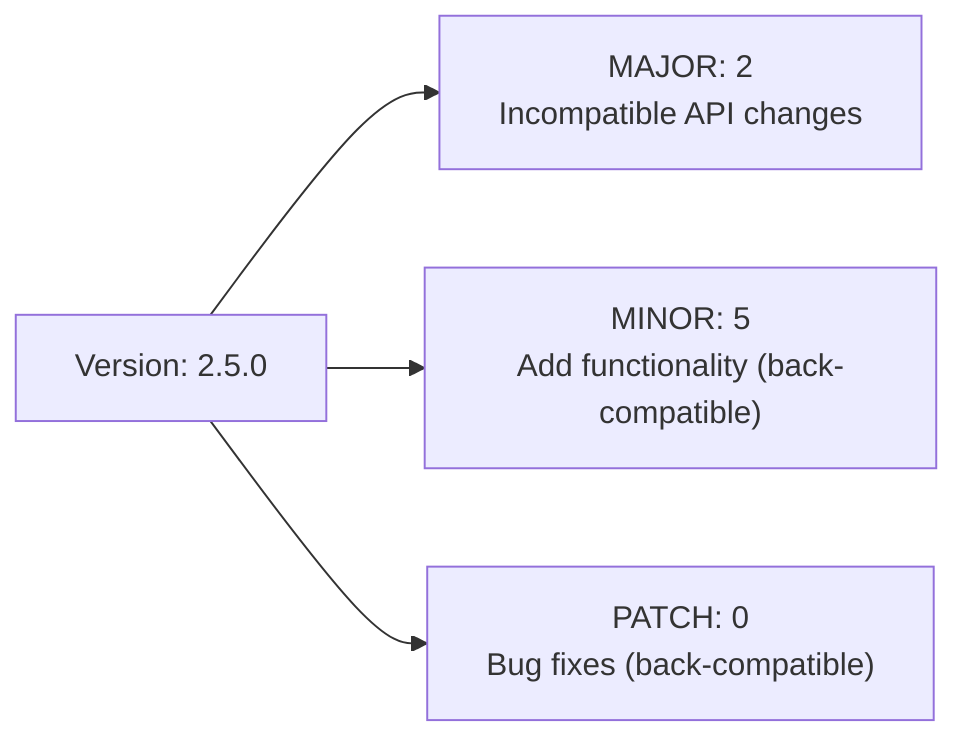
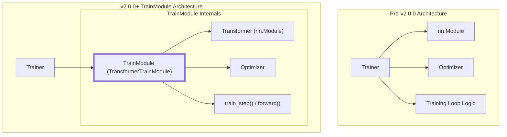
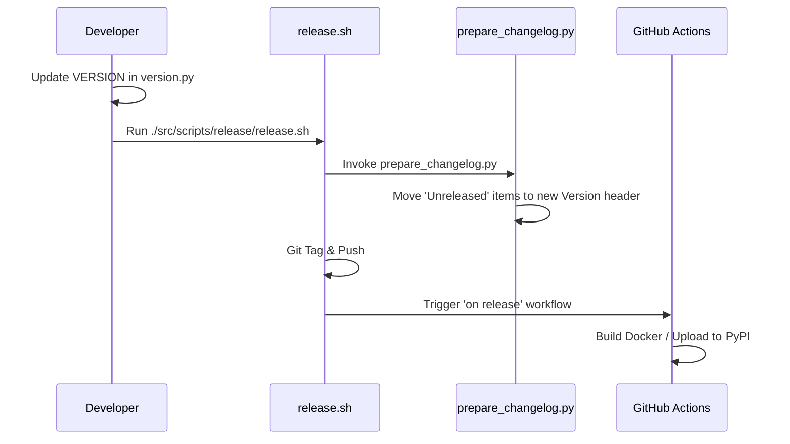

<!-- source: DeepWiki mcp.deepwiki.com · repo allenai/OLMo-core · page 1.3 Versioning and Changelog · fetched 2026-10-26 -->

# Versioning and Changelog

Relevant source files

The following files were used as context for generating this wiki page:

- [.github/RELEASE_PROCESS.md](.github/RELEASE_PROCESS.md)
- [CHANGELOG.md](CHANGELOG.md)
- [src/olmo_core/train/trainer.py](src/olmo_core/train/trainer.py)
- [src/olmo_core/version.py](src/olmo_core/version.py)
- [src/scripts/release/add_pr_comments_on_release.sh](src/scripts/release/add_pr_comments_on_release.sh)
- [src/scripts/release/prepare_changelog.py](src/scripts/release/prepare_changelog.py)
- [src/scripts/release/release.sh](src/scripts/release/release.sh)
- [src/scripts/release/release_notes.py](src/scripts/release/release_notes.py)
- [src/test/conftest.py](src/test/conftest.py)

## Purpose and Scope

This page documents OLMo-core's versioning scheme and changelog organization. It explains how versions are numbered, how changes are tracked across releases, and provides technical detail on major architectural shifts, specifically the v2.0.0 `TrainModule` refactor and the v2.5.0 additions.

For information about installing specific versions, see [1.1 Installation and Dependencies](). For information about the configuration system that may change between versions, see [1.2 Configuration System]().

## Versioning Scheme

OLMo-core follows [Semantic Versioning 2.0.0](https://semver.org/spec/v2.0.0.html), using a `MAJOR.MINOR.PATCH` version number format.

### Version Number Components

**Sources:** [src/olmo_core/version.py:1-8](), [CHANGELOG.md:5-7]()

### Version Definition in Code

The version is defined programmatically in `src/olmo_core/version.py`. The build system and release scripts dynamically pull this value for package distribution and tagging.

| Variable | Role | Value (Current) |
|-----------|-------------|---------|
| `_MAJOR` | Breaking change counter | `"2"` |
| `_MINOR` | Feature release counter | `"5"` |
| `_PATCH` | Bug fix counter | `"0"` |
| `VERSION` | Full semver string | `"2.5.0"` |

**Sources:** [src/olmo_core/version.py:1-7](), [src/scripts/release/release.sh:10-10]()

## Changelog Structure

The changelog is maintained in `CHANGELOG.md` following the [Keep a Changelog](https://keepachangelog.com/en/1.0.0) format.

### Change Categories

Each release is organized into sub-headers to distinguish the impact of changes:

*   **Added**: New features (e.g., `olmo_core.data.composable` [CHANGELOG.md:31]()).
*   **Fixed**: Bug fixes (e.g., `GPUMonitorCallback` keyword fix [CHANGELOG.md:83]()).
*   **Changed**: Modifications to existing APIs (e.g., renaming `scatter_object` to `broadcast_object` [CHANGELOG.md:101]()).
*   **Removed**: Deprecated code removal.

**Sources:** [CHANGELOG.md:12-105](), [src/scripts/release/release_notes.py:14-17]()

## Major Release: v2.0.0 TrainModule Refactor

Version 2.0.0 represented a fundamental shift in the library's architecture, moving from a decoupled Model/Optimizer/Trainer approach to a consolidated `TrainModule` abstraction.

### Architectural Evolution

Prior to v2.0.0, the `Trainer` managed the interaction between the `nn.Module` and the `Optimizer`. In v2.0.0+, the `TrainModule` encapsulates the model, optimizer, and the logic for a single training step.

### Key v2.0.0 Changes
*   **Consolidation**: `Trainer` now accepts a single `TrainModule` instead of separate model and optimizer instances [src/olmo_core/train/trainer.py:119-122]().
*   **Config Migration**: Configuration options like `activation_checkpointing` and `flash_attention` moved from `TransformerConfig` to `TransformerTrainModuleConfig`.
*   **Callback Simplification**: Functionality previously handled by complex callbacks (like MoE load balancing or LR scheduling) was moved directly into the `TrainModule` logic.

**Sources:** [CHANGELOG.md:98-105](), [src/olmo_core/train/trainer.py:119-122]()

## Major Release: v2.5.0 Additions

Version 2.5.0 introduced significant enhancements to data handling, modeling, and monitoring.

### v2.5.0: Composable Data and Hybrid Models
*   **Data Pipeline**: Introduction of `olmo_core.data.composable` module for streaming data [CHANGELOG.md:31](). Added `max_document_length` and `long_doc_strategy` to `NumpyDocumentSource` [CHANGELOG.md:66]().
*   **Architectures**: Added `GatedDeltaNet` [CHANGELOG.md:53](), `PeriNormTransformerBlock` [CHANGELOG.md:32](), and `SequenceMixer` base class [CHANGELOG.md:52]().
*   **Optimization**: Support for `Muon` and `Dion` optimizers [CHANGELOG.md:45]().
*   **Parallelism**: Support for Ulysses-style context parallelism [CHANGELOG.md:46]() and in-loop perplexity evals with CP/TP [CHANGELOG.md:29]().
*   **Monitoring**: Added `StabilityMonitorCallback` for spike detection [CHANGELOG.md:55]() and gradient dumping in `GAPMonitorCallback` [CHANGELOG.md:27]().

**Sources:** [CHANGELOG.md:23-75]()

## Release Process Automation

OLMo-core uses a set of scripts to ensure version consistency across the codebase and GitHub releases.

### Release Workflow

### Critical Release Files
*   `src/scripts/release/release.sh`: The entry point for creating a new release. It validates the version, updates the changelog, and pushes tags [src/scripts/release/release.sh:1-33]().
*   `src/scripts/release/prepare_changelog.py`: Automatically migrates entries from the `## Unreleased` section to a new versioned header with the current date [src/scripts/release/prepare_changelog.py:7-36]().
*   `src/scripts/release/release_notes.py`: Extracts the relevant section of `CHANGELOG.md` to populate the GitHub Release description [src/scripts/release/release_notes.py:20-43]().
*   `src/scripts/release/add_pr_comments_on_release.sh`: Automatically comments on merged PRs when they are included in a new release [src/scripts/release/add_pr_comments_on_release.sh:1-31]().

**Sources:** [.github/RELEASE_PROCESS.md:1-13](), [src/scripts/release/release.sh:1-33](), [src/scripts/release/prepare_changelog.py:1-39](), [src/scripts/release/add_pr_comments_on_release.sh:1-31]()

---

