# Page: Overview

# Overview

<details>
<summary>Relevant source files</summary>

The following files were used as context for generating this wiki page:

- [CHANGELOG.md](CHANGELOG.md)
- [README.md](README.md)
- [docs/source/overview/installation.rst](docs/source/overview/installation.rst)
- [docs/source/overview/introduction.rst](docs/source/overview/introduction.rst)
- [src/olmo_core/config.py](src/olmo_core/config.py)
- [src/olmo_core/data/mixes/OLMo-longmino-mix-0625.txt](src/olmo_core/data/mixes/OLMo-longmino-mix-0625.txt)
- [src/olmo_core/data/mixes/OLMo-longmino-mix-0925.txt](src/olmo_core/data/mixes/OLMo-longmino-mix-0925.txt)
- [src/olmo_core/internal/cookbook.py](src/olmo_core/internal/cookbook.py)
- [src/olmo_core/train/trainer.py](src/olmo_core/train/trainer.py)
- [src/olmo_core/version.py](src/olmo_core/version.py)
- [src/scripts/official/OLMo3/OLMo-3-1025-32B-long-context.py](src/scripts/official/OLMo3/OLMo-3-1025-32B-long-context.py)
- [src/scripts/official/OLMo3/OLMo-3-1025-7B-long-context.py](src/scripts/official/OLMo3/OLMo-3-1025-7B-long-context.py)
- [src/scripts/official/README.md](src/scripts/official/README.md)
- [src/scripts/train/README.md](src/scripts/train/README.md)
- [src/test/config_test.py](src/test/config_test.py)
- [src/test/conftest.py](src/test/conftest.py)

</details>


This document provides a high-level introduction to OLMo-core, explaining its purpose, architecture, and core components. It serves as an entry point for understanding the codebase organization and how the major systems interact.

For detailed installation instructions, see [Installation and Dependencies](#1.1). For information about the configuration system that underpins all components, see [Configuration System](#1.2).

## What is OLMo-core

OLMo-core is a Python framework designed for training large language models at scale. It provides the building blocks used to train the OLMo family of models, with a focus on distributed training efficiency, modularity, and reproducibility. The framework is built on PyTorch and includes support for multi-node training on GPU clusters with various parallelization strategies.

The current version is `2.5.0` as defined in [src/olmo_core/version.py:1-7]().

**Sources:** [README.md:1-61](), [src/olmo_core/version.py:1-7]()

## Design Philosophy

OLMo-core is structured around several key principles:

- **Configuration-driven**: All components use dataclass-based configurations that can be composed, validated, and serialized via the `Config` base class [src/olmo_core/config.py:55-71](). See [Configuration System](#1.2) for details.
- **Distributed-first**: Every major component considers multi-node, multi-GPU training from the ground up, with support for FSDP, tensor parallelism (TP), pipeline parallelism (PP), context parallelism (CP), and expert parallelism (EP).
- **Callback-based extensibility**: Training functionality like monitoring, evaluation, and checkpointing is implemented through a pluggable `Callback` system [src/olmo_core/train/trainer.py:58-65]().
- **Storage-agnostic I/O**: A unified API abstracts over local filesystems, S3, GCS, and WEKA storage backends [src/olmo_core/train/trainer.py:48-56]().
- **Modular data pipeline**: Dataset types (FSL, VSL, Packed), data mixing strategies, and data loaders can be mixed and matched based on training requirements [src/olmo_core/train/trainer.py:34]().

**Sources:** [CHANGELOG.md:25-75](), [docs/source/overview/introduction.rst:1-53](), [src/olmo_core/train/trainer.py:30-80]()

## System Architecture

The following diagram shows the major systems in OLMo-core and their relationships. This bridges high-level concepts to actual code entities:

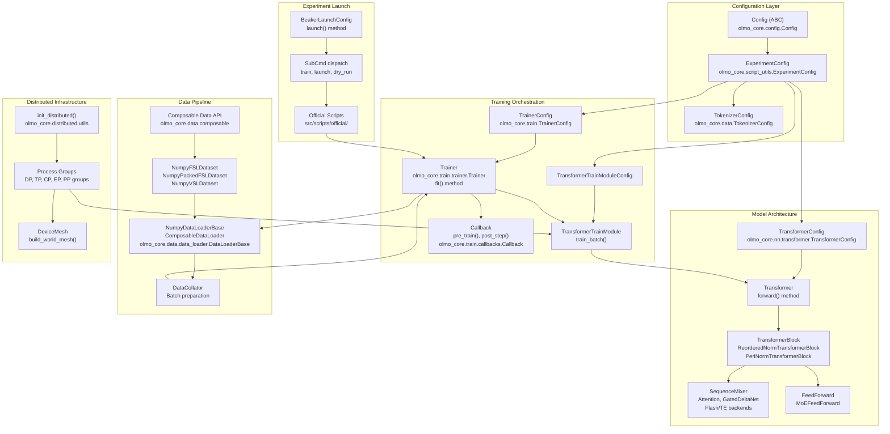

**Sources:** [CHANGELOG.md:1-100](), [docs/source/overview/introduction.rst:9-53](), [src/olmo_core/train/trainer.py:99-156]()

## Core Components

The following table summarizes the major subsystems in OLMo-core and their purposes:

| Component | Purpose | Key Classes/Modules | Wiki Page |
|-----------|---------|---------------------|-----------|
| **Configuration** | Dataclass-based configuration system with validation | `Config`, `Registrable` | [Configuration System](#1.2) |
| **Model Architecture** | Transformer implementations with variants | `Transformer`, `TransformerBlock`, `MoETransformer` | [Model Architecture](#2) |
| **Training System** | Training loop orchestration and callbacks | `Trainer`, `TrainModule`, `Callback` | [Training System](#3) |
| **Distributed Training** | Multi-node/GPU coordination and parallelism | `init_distributed()`, `DeviceMesh` | [Distributed Training](#4) |
| **Data Pipeline** | Dataset loading and composable pipelines | `NumpyFSLDataset`, `ComposableDataLoader` | [Data Pipeline](#5) |
| **Optimization** | Optimizers and learning rate schedulers | `AdamW`, `Muon`, `Dion`, `CosWithWarmup` | [Optimization](#6) |
| **Experiment Management** | Job launching and configuration building | `BeakerLaunchConfig`, official scripts | [Experiment Management](#7) |
| **Inference** | Autoregressive text generation | `TransformerGenerationModule`, `chat` | [Inference and Generation](#8) |
| **Development** | Testing, CI/CD, and Docker images | `pytest`, `uv`, GitHub Actions | [Development and CI/CD](#9) |

**Sources:** [CHANGELOG.md:12-75](), [README.md:101-159](), [src/olmo_core/train/trainer.py:99-168]()

## Training Pipeline Flow

This diagram illustrates how the major components interact during a training run, showing the complete flow from script launch to training loop execution:

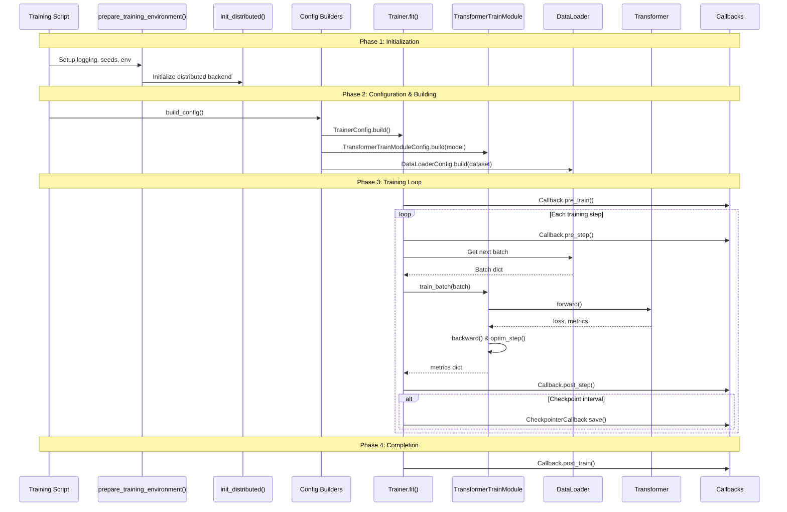

**Sources:** [docs/source/overview/introduction.rst:28-50](), [src/olmo_core/train/trainer.py:226-250](), [CHANGELOG.md:37-46]()

## Code Organization

The source code is organized under `src/olmo_core/` with the following structure:

```
src/olmo_core/
├── config.py                    # Base Config and Registrable classes
├── version.py                   # Version constants (currently v2.5.0)
├── io.py                        # Unified cloud-aware I/O API
├── nn/                          # Neural network modules
│   ├── transformer.py           # Transformer and Block implementations
│   ├── attention/               # Attention backends (Flash, TE, etc.)
│   ├── moe/                     # Mixture-of-experts components
│   └── hf/                      # HuggingFace integration
├── train/                       # Training system
│   ├── trainer.py               # Main Trainer class
│   ├── train_module.py          # TrainModule interface (v2.0.0 refactor)
│   └── callbacks/               # Monitoring, Eval, and Checkpointing
├── data/                        # Data pipeline
│   ├── numpy_dataset.py         # NPY-based dataset variants
│   ├── data_loader.py           # Distributed data loading
│   └── composable.py            # Composable data API (v2.5.0)
├── distributed/                 # Distributed infrastructure
│   ├── utils.py                 # Dist primitives (broadcast_object, etc.)
│   └── parallel/                # DP, TP, PP, CP, EP strategies
├── optim/                       # AdamW, Lion, Muon, Dion, and Schedulers
├── launch/                      # Experiment launch systems (Beaker, etc.)
└── generate/                    # Autoregressive generation and chat
```

**Sources:** [CHANGELOG.md:12-55](), [src/olmo_core/version.py:1-7](), [src/olmo_core/train/trainer.py:58-65]()

## Model Configurations

OLMo-core includes pre-configured model definitions. Key model configurations include:

| Model Family | Configuration Method | Notes |
|--------------|----------------------|-------|
| **OLMo-2** | `TransformerConfig.olmo2_32B()` | Standard architecture for 32B models [README.md:98]() |
| **OLMo-3** | `TransformerConfig.olmo3_7B()` | Updated architecture for 7B and 32B [README.md:99]() |
| **Gemma 3** | `TransformerConfig.gemma3_like()` | Support for Gemma 3 architecture [CHANGELOG.md:43]() |
| **Hybrid** | `TransformerConfig.block` | Supports per-layer block selection patterns [CHANGELOG.md:69]() |

**Sources:** [CHANGELOG.md:23-75](), [src/scripts/official/README.md:1-11](), [src/scripts/official/OLMo3/OLMo-3-1025-7B-long-context.py:46-51]()

## Versioning and Changes

OLMo-core follows semantic versioning. The current version is `2.5.0` [src/olmo_core/version.py:7]().

### Recent Major Changes (v2.0.0+)
- **v2.5.0**: Added `olmo_core.data.composable`, `PeriNormTransformerBlock`, support for Muon/Dion optimizers, and Ulysses context parallelism [CHANGELOG.md:23-75]().
- **v2.0.0**: Introduced the `TrainModule` abstraction to consolidate model and optimizer logic for complex parallelism [CHANGELOG.md:35]().

For detailed history, see [Versioning and Changelog](#1.3).

**Sources:** [CHANGELOG.md:1-104](), [src/olmo_core/version.py:1-7]()

---

# Page: Installation and Dependencies

# Installation and Dependencies

<details>
<summary>Relevant source files</summary>

The following files were used as context for generating this wiki page:

- [.github/workflows/docker.yml](.github/workflows/docker.yml)
- [.github/workflows/main.yml](.github/workflows/main.yml)
- [Makefile](Makefile)
- [README.md](README.md)
- [docs/source/overview/installation.rst](docs/source/overview/installation.rst)
- [docs/source/overview/introduction.rst](docs/source/overview/introduction.rst)
- [pyproject.toml](pyproject.toml)
- [src/Dockerfile](src/Dockerfile)
- [src/scripts/official/README.md](src/scripts/official/README.md)
- [src/scripts/train/README.md](src/scripts/train/README.md)

</details>


This page covers the installation process and dependency requirements for OLMo-core. It provides detailed instructions on how to set up your environment to use the OLMo-core library for large language model training and inference.

## Prerequisites

Before installing OLMo-core, you must install PyTorch according to the instructions specific to your operating system and hardware. OLMo-core is built on top of PyTorch and requires a compatible version (>= 2.6.0).

**Installation Prerequisites Flow**

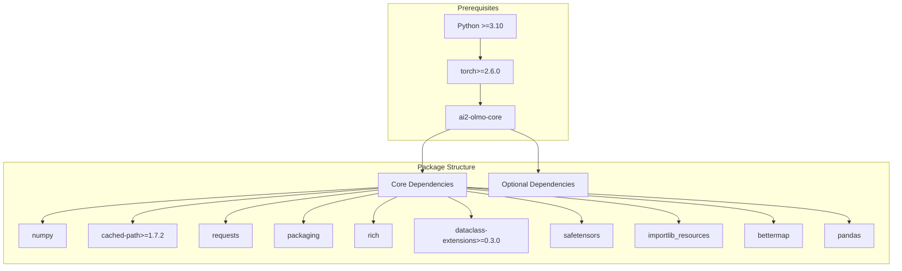

Sources: [pyproject.toml:13-29]()

## Installation Methods

OLMo-core can be installed using different methods depending on your requirements.

### Installing from PyPI

For most users, installing from PyPI is the simplest approach:

```bash
pip install ai2-olmo-core
```

Sources: [docs/source/overview/installation.rst:7-9](), [README.md:43-47]()

### Installing from Source

For development or to access the latest features, it's recommended to install from source:

```bash
git clone https://github.com/allenai/OLMo-core.git
cd OLMo-core
pip install -e .[all]
```

The `[all]` suffix includes all optional dependencies. You can also specify specific dependency groups (see Optional Dependencies section).

**Installation Methods and Commands**

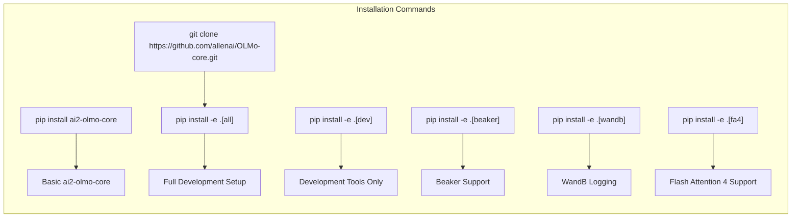

Sources: [pyproject.toml:36-70](), [README.md:36-41]()

## Core Dependencies

OLMo-core requires the following core dependencies:

| Dependency | Version Constraint | Purpose |
|------------|-------------------|---------|
| Python | >=3.10 | Base programming language |
| torch | >=2.6.0 | Deep learning framework |
| numpy | (none) | Numerical computations |
| cached-path | >=1.7.2 | Resource caching and file downloads |
| filelock | >=3.4,<4.0 | Process-safe file locking |
| dataclass-extensions | >=0.3.0 | Enhanced configuration classes |
| rich | (none) | Rich text formatting for CLI |
| safetensors | (none) | Safe tensor serialization |
| bettermap | (none) | Enhanced mapping utilities |
| pandas | (none) | Data manipulation and analysis |

Sources: [pyproject.toml:13-29]()

## Optional Dependencies

OLMo-core offers several optional dependency groups that enable additional functionality. These can be installed using the syntax `pip install ai2-olmo-core[group_name]`.

### Integration Dependencies

**`[beaker]`** - For launching experiments on Beaker clusters:
- Includes: `beaker-py>=2.5.4,<3.0`, `beaker-gantry>=3.4.3,<4.0`, `GitPython>=3.0,<4.0`, `google-cloud-compute`. [pyproject.toml:61]()
- Used by: `BeakerLaunchConfig` and the `olmo_core.launch.beaker` module. [docs/source/overview/introduction.rst:41-45]()

**`[eval]`** - For running evaluations:
- Includes: `ai2-olmo-eval==0.9.0`. [pyproject.toml:64]()
- Used by: Integration with the `olmo-eval` library for task evaluation.

**`[torchao]`** - For advanced optimization (Float8/MXFP8):
- Includes: `torchao==0.15.0`. [pyproject.toml:67]()
- Used for: Float8 training and quantization features. [docs/source/overview/installation.rst:15]()

**`[fa4]`** - Flash Attention 4 for Blackwell GPUs:
- Includes: `flash-attn-4>=4.0.0b4`. [pyproject.toml:65]()

**`[fla]`** - Flash Linear Attention:
- Includes: `flash-linear-attention==0.4.1`. [pyproject.toml:66]()

**`[dion]`** - Dion Optimizer support:
- Includes: `dion` from GitHub. [pyproject.toml:63]()

Sources: [pyproject.toml:61-70](), [docs/source/overview/installation.rst:11-17]()

### High-Performance Runtime Dependencies

These dependencies enable specific model features and performance optimizations. Many are pre-installed in the official Docker images.

**Hardware and Implementation Matrix**

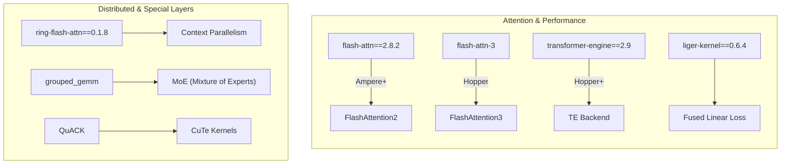

Sources: [src/Dockerfile:51-95](), [README.md:49-56]()

## Docker Images

OLMo-core provides official Docker images containing a fully configured environment, including complex CUDA-compiled dependencies.

**Build Configuration** (from `Makefile` and `Dockerfile`):
- **CUDA Version**: `12.8.1` [Makefile:50]() (Builds for `12.8.1` and `12.9.1` in CI [.github/workflows/docker.yml:40]())
- **Python Version**: `3.12` [Makefile:52]()
- **PyTorch Version**: `2.10.0` [Makefile:53]()
- **Flash Attention**: `2.8.2` [Makefile:57]()
- **Transformer Engine**: `2.9` [Makefile:60]()
- **Liger Kernel**: `0.6.4` [Makefile:62]()

**Image Naming**:
- Image tag format: `tch{torch_version_short}cu{cuda_version_path}-{date}` [Makefile:74]()
- Example: `olmo-core:tch2100cu128-2025-01-01`

**Build Commands**:
```bash
# Build the release image locally
make docker-image

# Push to GitHub Container Registry
make ghcr-image

# Create a Beaker-compatible image
make beaker-image
```

Sources: [Makefile:71-118](), [src/Dockerfile:1-171](), [.github/workflows/docker.yml:29-50]()

## Platform and Hardware Requirements

OLMo-core is optimized for high-performance GPU clusters.

| Requirement | Implementation/Context | Purpose |
|-------------|----------------------|---------|
| **OS** | Linux (Primary), Darwin (ARM64 support in `uv`) | Training and Development [pyproject.toml:73-76]() |
| **Python** | >=3.10 | Runtime Environment [pyproject.toml:13]() |
| **CUDA** | 12.x (e.g., 12.8, 12.9) | GPU Acceleration [Makefile:50](), [.github/workflows/docker.yml:40]() |
| **GPU Arch** | SM 9.0 (Hopper), SM 10.0 (Blackwell) | Optimized Attention (FA3, FA4) [src/Dockerfile:55-59]() |
| **Drivers** | MLNX OFED 24.01+ | RDMA/InfiniBand for Distributed Training [src/Dockerfile:154-159]() |

Sources: [pyproject.toml:13-76](), [src/Dockerfile:150-160](), [Makefile:50-60]()

## Development Setup

For contributors, the repository includes a `Makefile` to standardize checks and environment management.

| Task | Command | Tools Used |
|------|---------|------------|
| **Formatting** | `make style` | `isort`, `black` [Makefile:21-26]() |
| **Linting** | `make lint-check` | `ruff` [Makefile:11-14]() |
| **Type Check** | `make type-check` | `mypy` [Makefile:16-19]() |
| **Tests** | `pytest src/test/` | `pytest` [.github/workflows/main.yml:39-48]() |
| **Build Docs** | `make docs` | `sphinx-autobuild` [Makefile:28-31]() |

Sources: [Makefile:1-31](), [pyproject.toml:92-179](), [.github/workflows/main.yml:27-102]()

---

# Page: Configuration System

# Configuration System

<details>
<summary>Relevant source files</summary>

The following files were used as context for generating this wiki page:

- [CHANGELOG.md](CHANGELOG.md)
- [src/olmo_core/config.py](src/olmo_core/config.py)
- [src/olmo_core/data/mixes/OLMo-longmino-mix-0625.txt](src/olmo_core/data/mixes/OLMo-longmino-mix-0625.txt)
- [src/olmo_core/data/mixes/OLMo-longmino-mix-0925.txt](src/olmo_core/data/mixes/OLMo-longmino-mix-0925.txt)
- [src/olmo_core/internal/cookbook.py](src/olmo_core/internal/cookbook.py)
- [src/olmo_core/train/trainer.py](src/olmo_core/train/trainer.py)
- [src/olmo_core/version.py](src/olmo_core/version.py)
- [src/scripts/official/OLMo3/OLMo-3-1025-32B-long-context.py](src/scripts/official/OLMo3/OLMo-3-1025-32B-long-context.py)
- [src/scripts/official/OLMo3/OLMo-3-1025-7B-long-context.py](src/scripts/official/OLMo3/OLMo-3-1025-7B-long-context.py)
- [src/test/config_test.py](src/test/config_test.py)
- [src/test/conftest.py](src/test/conftest.py)

</details>


The configuration system in OLMo-core provides a structured, composable approach to defining experiments. It enables reproducible training runs by capturing all hyperparameters and settings in serializable dataclass configurations that can be version-controlled, modified via CLI overrides, and transformed into runtime PyTorch modules through a builder pattern.

---

## Overview and Design Philosophy

The configuration system is built on three core principles:

1.  **Configuration-as-code**: Experiments are defined as typed Python dataclasses rather than static YAML files, allowing for programmatic generation of complex scaling laws.
2.  **Separation of concerns**: Configuration (what to build) is strictly separated from instantiation (how to build).
3.  **Composability**: Complex configurations are assembled from smaller, reusable component configs (e.g., `AttentionConfig` nested within `TransformerBlockConfig`).

Every major component in OLMo-core (models, trainers, data loaders, callbacks) follows this pattern:
*   A `*Config` dataclass captures all settings.
*   A `.build()` method (or equivalent factory function) constructs the runtime object.

**Sources:** [src/olmo_core/config.py:56-71](), [src/olmo_core/train/trainer.py:99-106]()

---

## The Config and Registrable Base Classes

The system relies on two primary base classes to manage data and polymorphism.

### Config Base Class
All configuration classes inherit from `olmo_core.config.Config` [src/olmo_core/config.py:56-71](). This class leverages `dataclass-extensions` to provide deep serialization and merging capabilities.

| Method | Purpose |
| :--- | :--- |
| `as_dict()` | Converts the config into a regular Python dictionary, with options to exclude private fields or include class names [src/olmo_core/config.py:84-151](). |
| `as_config_dict()` | A convenience wrapper for creating JSON-safe dictionaries suitable for checkpointing [src/olmo_core/config.py:153-165](). |
| `merge(dotlist)` | Merges the config with a "dotlist" of overrides (e.g., `model.d_model=1024`), creating a new object [src/olmo_core/config.py:197-230](). |
| `apply(func)` | Recursively applies a function to every nested config instance field [src/olmo_core/config.py:167-190](). |
| `validate()` | A hook for implementing custom validation logic after initialization [src/olmo_core/config.py:191-195](). |

### Registrable Base Class
OLMo-core re-exports `Registrable` from `dataclass-extensions` [src/olmo_core/config.py:35](). This enables the factory pattern:
1.  A base class (e.g., `OptimConfig`) inherits from `Registrable`.
2.  Subclasses (e.g., `SkipStepAdamWConfig`) register themselves with a name.
3.  The configuration can then use a "type" field in a dictionary to determine which subclass to instantiate during decoding.

**Sources:** [src/olmo_core/config.py:24-36](), [src/olmo_core/config.py:130-135]()

---

## Data Flow: From Config to Code

The following diagram illustrates how a high-level `ExperimentConfig` bridges the gap between natural language requirements (e.g., "Train a 7B model") and the underlying code entities.

**Diagram: Configuration to Entity Mapping**

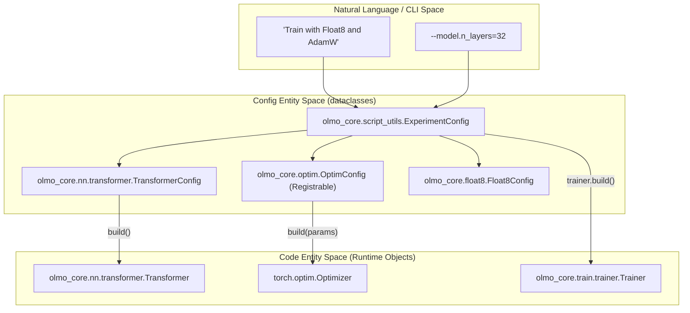

**Sources:** [src/olmo_core/config.py:197-230](), [src/scripts/official/OLMo3/OLMo-3-1025-7B-long-context.py:139-146](), [src/olmo_core/train/trainer.py:99-106]()

---

## Dataclass-Extensions Usage

OLMo-core heavily utilizes the `dataclass-extensions` library for advanced serialization and type safety.

### Decoding and Type Coercion
The `decode` function [src/olmo_core/config.py:24]() is used to transform raw dictionaries (often from YAML or JSON) back into strongly-typed `Config` objects. This process handles:
*   **Recursive instantiation**: Nested dictionaries are converted into nested dataclasses.
*   **Type coercion**: String values like `"1e-4"` are coerced to `float`, and `"true"` to `bool`.
*   **Registrable lookup**: If a field expects a `Registrable` type, the `type` key in the dictionary is used to find the correct subclass.

### Custom Enums
The system provides `StrEnum` [src/olmo_core/config.py:39-50]() for string-based enumerations that are easily serializable and compatible across Python versions.

**Sources:** [src/olmo_core/config.py:24-50](), [src/olmo_core/config.py:122-151]()

---

## The Factory and Builder Pattern

Instantiation in OLMo-core follows a hierarchy. Official scripts often use a `build_config` orchestration pattern to assemble the final experiment.

### Build Orchestration
The `build_config` function (typically found in official training scripts) orchestrates the assembly of an experiment. It uses specialized builders for different sub-systems:

1.  **TransformerTrainModuleConfig**: Configures the model-optimizer interaction, including `float8_config` and `dp_config` [src/olmo_core/internal/cookbook.py:44-90]().
2.  **TrainerConfig**: Configures the training loop, including checkpoint paths and callback registration via `.with_callback()` [src/scripts/official/OLMo3/OLMo-3-1025-7B-long-context.py:96-137]().

**Diagram: Build Process Data Flow**

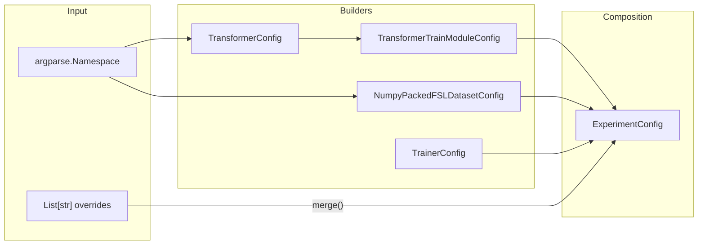

**Sources:** [src/olmo_core/internal/cookbook.py:44-90](), [src/scripts/official/OLMo3/OLMo-3-1025-7B-long-context.py:42-146]()

---

## Configuration Hierarchy and Serialization

The hierarchy is designed to be fully serializable to a single JSON/YAML file for every checkpoint.

| Component | Class Name | Role |
| :--- | :--- | :--- |
| **Experiment** | `ExperimentConfig` | Top-level container [src/scripts/official/OLMo3/OLMo-3-1025-7B-long-context.py:139](). |
| **Model** | `TransformerConfig` | Defines architecture (layers, d_model, etc.) [src/scripts/official/OLMo3/OLMo-3-1025-7B-long-context.py:46](). |
| **Training** | `TransformerTrainModuleConfig` | Pairs model with optimizer and scheduler [src/olmo_core/internal/cookbook.py:53](). |
| **Trainer** | `TrainerConfig` | Configures the training loop, duration, and callbacks [src/olmo_core/train/trainer.py:99](). |

### Serialization Logic
The `as_dict` method recursively traverses the dataclass [src/olmo_core/config.py:122-136](). It handles:
*   **Dataclasses**: Recurses into nested fields.
*   **Registrables**: Injects a `"type"` key based on the registered name [src/olmo_core/config.py:130-135]().
*   **Class Names**: Injects a `_CLASS_` key to ensure the exact Python class can be recovered [src/olmo_core/config.py:128-129]().

**Sources:** [src/olmo_core/config.py:73-77](), [src/olmo_core/config.py:122-151](), [src/olmo_core/train/trainer.py:99-106]()

---

# Page: Versioning and Changelog

# Versioning and Changelog

<details>
<summary>Relevant source files</summary>

The following files were used as context for generating this wiki page:

- [.github/RELEASE_PROCESS.md](.github/RELEASE_PROCESS.md)
- [CHANGELOG.md](CHANGELOG.md)
- [src/olmo_core/train/trainer.py](src/olmo_core/train/trainer.py)
- [src/olmo_core/version.py](src/olmo_core/version.py)
- [src/scripts/release/add_pr_comments_on_release.sh](src/scripts/release/add_pr_comments_on_release.sh)
- [src/scripts/release/prepare_changelog.py](src/scripts/release/prepare_changelog.py)
- [src/scripts/release/release.sh](src/scripts/release/release.sh)
- [src/scripts/release/release_notes.py](src/scripts/release/release_notes.py)
- [src/test/conftest.py](src/test/conftest.py)

</details>


## Purpose and Scope

This page documents OLMo-core's versioning scheme and changelog organization. It explains how versions are numbered, how changes are tracked across releases, and provides technical detail on major architectural shifts, specifically the v2.0.0 `TrainModule` refactor and the v2.5.0 additions.

For information about installing specific versions, see [1.1 Installation and Dependencies](). For information about the configuration system that may change between versions, see [1.2 Configuration System]().

## Versioning Scheme

OLMo-core follows [Semantic Versioning 2.0.0](https://semver.org/spec/v2.0.0.html), using a `MAJOR.MINOR.PATCH` version number format.

### Version Number Components

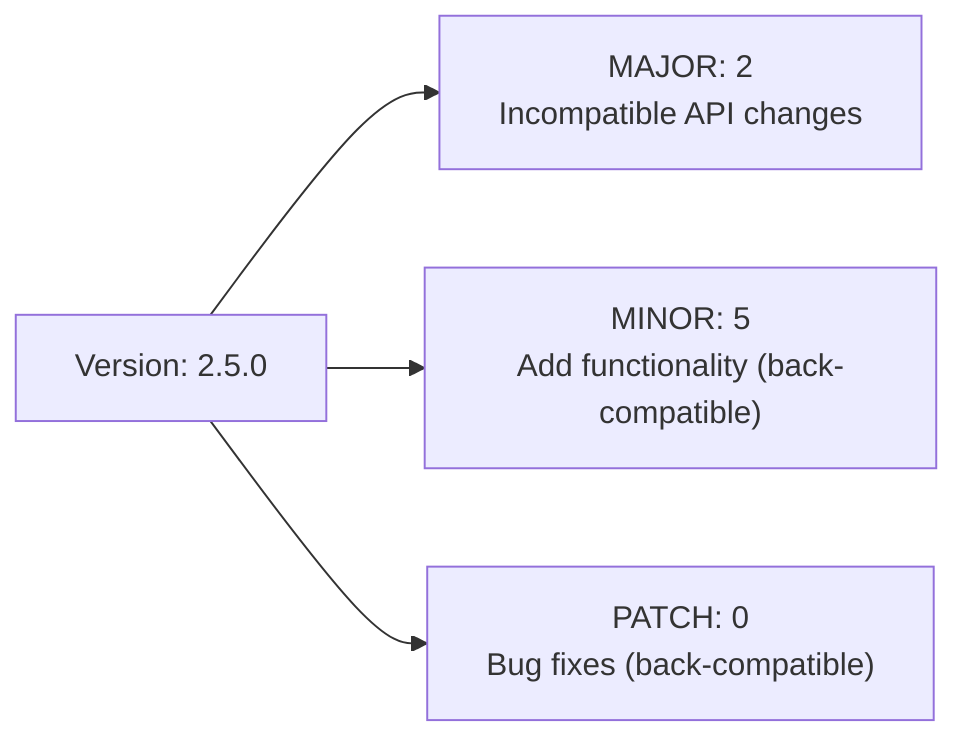

**Sources:** [src/olmo_core/version.py:1-8](), [CHANGELOG.md:5-7]()

### Version Definition in Code

The version is defined programmatically in `src/olmo_core/version.py`. The build system and release scripts dynamically pull this value for package distribution and tagging.

| Variable | Role | Value (Current) |
|-----------|-------------|---------|
| `_MAJOR` | Breaking change counter | `"2"` |
| `_MINOR` | Feature release counter | `"5"` |
| `_PATCH` | Bug fix counter | `"0"` |
| `VERSION` | Full semver string | `"2.5.0"` |

**Sources:** [src/olmo_core/version.py:1-7](), [src/scripts/release/release.sh:10-10]()

## Changelog Structure

The changelog is maintained in `CHANGELOG.md` following the [Keep a Changelog](https://keepachangelog.com/en/1.0.0) format.

### Change Categories

Each release is organized into sub-headers to distinguish the impact of changes:

*   **Added**: New features (e.g., `olmo_core.data.composable` [CHANGELOG.md:31]()).
*   **Fixed**: Bug fixes (e.g., `GPUMonitorCallback` keyword fix [CHANGELOG.md:83]()).
*   **Changed**: Modifications to existing APIs (e.g., renaming `scatter_object` to `broadcast_object` [CHANGELOG.md:101]()).
*   **Removed**: Deprecated code removal.

**Sources:** [CHANGELOG.md:12-105](), [src/scripts/release/release_notes.py:14-17]()

## Major Release: v2.0.0 TrainModule Refactor

Version 2.0.0 represented a fundamental shift in the library's architecture, moving from a decoupled Model/Optimizer/Trainer approach to a consolidated `TrainModule` abstraction.

### Architectural Evolution

Prior to v2.0.0, the `Trainer` managed the interaction between the `nn.Module` and the `Optimizer`. In v2.0.0+, the `TrainModule` encapsulates the model, optimizer, and the logic for a single training step.

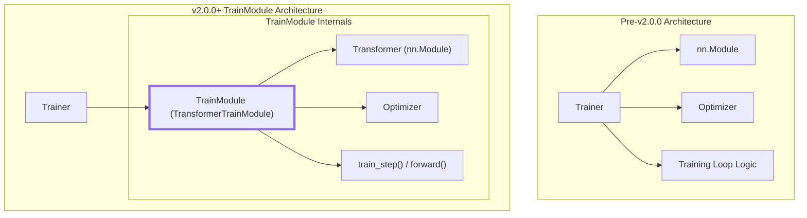

### Key v2.0.0 Changes
*   **Consolidation**: `Trainer` now accepts a single `TrainModule` instead of separate model and optimizer instances [src/olmo_core/train/trainer.py:119-122]().
*   **Config Migration**: Configuration options like `activation_checkpointing` and `flash_attention` moved from `TransformerConfig` to `TransformerTrainModuleConfig`.
*   **Callback Simplification**: Functionality previously handled by complex callbacks (like MoE load balancing or LR scheduling) was moved directly into the `TrainModule` logic.

**Sources:** [CHANGELOG.md:98-105](), [src/olmo_core/train/trainer.py:119-122]()

## Major Release: v2.5.0 Additions

Version 2.5.0 introduced significant enhancements to data handling, modeling, and monitoring.

### v2.5.0: Composable Data and Hybrid Models
*   **Data Pipeline**: Introduction of `olmo_core.data.composable` module for streaming data [CHANGELOG.md:31](). Added `max_document_length` and `long_doc_strategy` to `NumpyDocumentSource` [CHANGELOG.md:66]().
*   **Architectures**: Added `GatedDeltaNet` [CHANGELOG.md:53](), `PeriNormTransformerBlock` [CHANGELOG.md:32](), and `SequenceMixer` base class [CHANGELOG.md:52]().
*   **Optimization**: Support for `Muon` and `Dion` optimizers [CHANGELOG.md:45]().
*   **Parallelism**: Support for Ulysses-style context parallelism [CHANGELOG.md:46]() and in-loop perplexity evals with CP/TP [CHANGELOG.md:29]().
*   **Monitoring**: Added `StabilityMonitorCallback` for spike detection [CHANGELOG.md:55]() and gradient dumping in `GAPMonitorCallback` [CHANGELOG.md:27]().

**Sources:** [CHANGELOG.md:23-75]()

## Release Process Automation

OLMo-core uses a set of scripts to ensure version consistency across the codebase and GitHub releases.

### Release Workflow

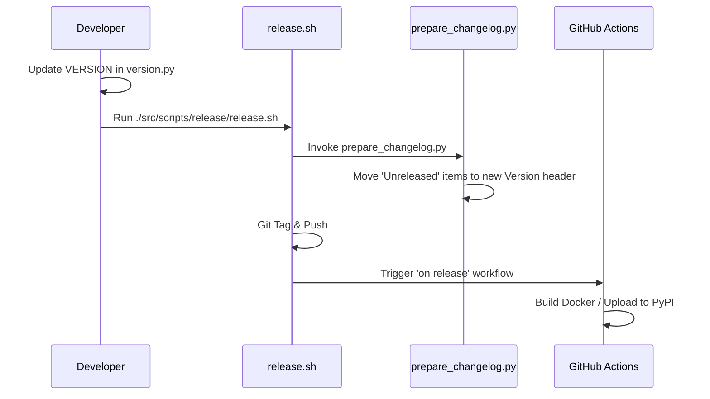

### Critical Release Files
*   `src/scripts/release/release.sh`: The entry point for creating a new release. It validates the version, updates the changelog, and pushes tags [src/scripts/release/release.sh:1-33]().
*   `src/scripts/release/prepare_changelog.py`: Automatically migrates entries from the `## Unreleased` section to a new versioned header with the current date [src/scripts/release/prepare_changelog.py:7-36]().
*   `src/scripts/release/release_notes.py`: Extracts the relevant section of `CHANGELOG.md` to populate the GitHub Release description [src/scripts/release/release_notes.py:20-43]().
*   `src/scripts/release/add_pr_comments_on_release.sh`: Automatically comments on merged PRs when they are included in a new release [src/scripts/release/add_pr_comments_on_release.sh:1-31]().

**Sources:** [.github/RELEASE_PROCESS.md:1-13](), [src/scripts/release/release.sh:1-33](), [src/scripts/release/prepare_changelog.py:1-39](), [src/scripts/release/add_pr_comments_on_release.sh:1-31]()

---

# Page: Model Architecture

# Model Architecture

<details>
<summary>Relevant source files</summary>

The following files were used as context for generating this wiki page:

- [src/olmo_core/nn/attention/__init__.py](src/olmo_core/nn/attention/__init__.py)
- [src/olmo_core/nn/attention/backend.py](src/olmo_core/nn/attention/backend.py)
- [src/olmo_core/nn/attention/flash_attn_api.py](src/olmo_core/nn/attention/flash_attn_api.py)
- [src/olmo_core/nn/attention/kv_cache.py](src/olmo_core/nn/attention/kv_cache.py)
- [src/olmo_core/nn/feed_forward.py](src/olmo_core/nn/feed_forward.py)
- [src/olmo_core/nn/transformer/__init__.py](src/olmo_core/nn/transformer/__init__.py)
- [src/olmo_core/nn/transformer/block.py](src/olmo_core/nn/transformer/block.py)
- [src/olmo_core/nn/transformer/config.py](src/olmo_core/nn/transformer/config.py)
- [src/olmo_core/nn/transformer/model.py](src/olmo_core/nn/transformer/model.py)
- [src/olmo_core/testing/__init__.py](src/olmo_core/testing/__init__.py)
- [src/olmo_core/testing/utils.py](src/olmo_core/testing/utils.py)
- [src/scripts/train/OLMo3/OLMo-3-190M.py](src/scripts/train/OLMo3/OLMo-3-190M.py)
- [src/scripts/train/OLMoE2-large.py](src/scripts/train/OLMoE2-large.py)
- [src/test/nn/attention/attention_test.py](src/test/nn/attention/attention_test.py)
- [src/test/nn/transformer/model_test.py](src/test/nn/transformer/model_test.py)

</details>


This page provides an overview of the Transformer model architecture in OLMo-core, explaining its modular design and core components. The architecture is designed to be flexible, supporting multiple parallelism strategies, various attention mechanisms, Mixture-of-Experts (MoE), and hybrid recurrent architectures.

For details on specific components, see:
- [Transformer Models](#2.1) — Pre-configured architectures and model variants
- [Transformer Blocks](#2.2) — Block implementations and normalization strategies
- [Attention Mechanisms](#2.3) — Attention types, backends, and KV cache
- [Rotary Position Embeddings](#2.4) — RoPE implementations and scaling
- [Mixture of Experts](#2.5) — MoE architecture and routing
- [Model Initialization](#2.6) — Weight initialization strategies
- [Feed-Forward Networks](#2.7) — MLP and gated activation variants
- [Recurrent and Hybrid Architectures](#2.8) — GatedDeltaNet and non-attention mixers
- [HuggingFace Integration](#2.9) — Checkpoint conversion and interoperability

## Architecture Overview

The OLMo-core transformer architecture follows a "Llama-style" design with a modular, composable structure. The top-level model consists of token embeddings, an optional embedding normalization layer, a stack of transformer blocks, and a language model head.

### High-Level Structure

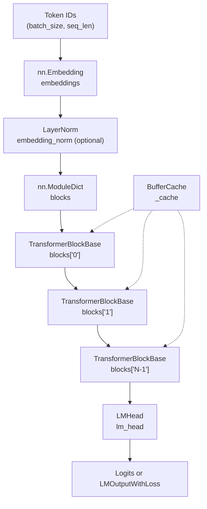

**Sources:** [src/olmo_core/nn/transformer/model.py:82-161]()

The `Transformer` class is the main model implementation, organized as:

| Component | Type | Description |
|-----------|------|-------------|
| `embeddings` | `nn.Embedding` | Token embeddings (vocab_size → d_model) |
| `embedding_norm`| `LayerNorm` | Optional normalization applied immediately after embeddings |
| `blocks` | `nn.ModuleDict` | Dictionary of transformer blocks indexed by string keys "0", "1", ..., "N-1" |
| `lm_head` | `LMHead` | Output projection and loss computation |
| `_cache` | `BufferCache` | Shared buffer cache for RoPE and other computed tensors |

**Sources:** [src/olmo_core/nn/transformer/model.py:121-169]()

### Model Variants

OLMo-core supports several transformer implementations through the `TransformerType` enum:

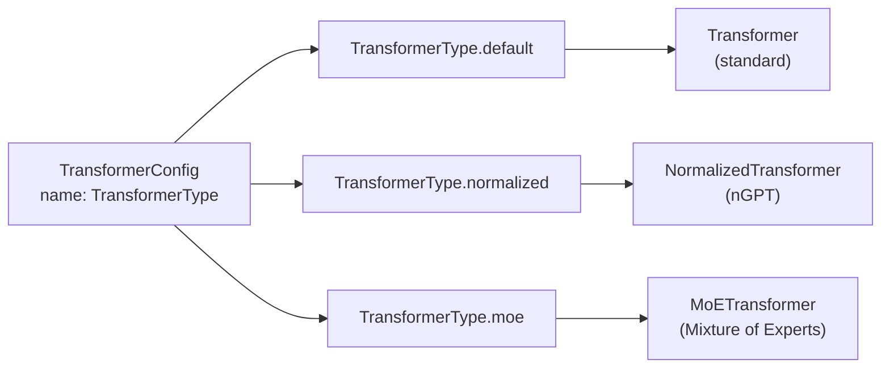

**Sources:** [src/olmo_core/nn/transformer/config.py:77-95](), [src/olmo_core/nn/transformer/model.py:82-120]()

Each variant extends the base `Transformer` class with specialized behavior:

- **`Transformer`** (default): Standard pre-normalization or post-normalization architecture [src/olmo_core/nn/transformer/model.py:82-84]().
- **`NormalizedTransformer`** (nGPT): Implements normalized gradient pretraining with L2-normalized weights and activations [src/olmo_core/nn/transformer/model.py:843-845]().
- **`MoETransformer`**: Extends the base with auxiliary metric tracking and load balancing loss support for Mixture of Experts [src/olmo_core/nn/transformer/model.py:922-924]().

## Configuration System

Models are built from configurations using a builder pattern. The `TransformerConfig` acts as the primary entry point, orchestrating the construction of blocks and the LM head.

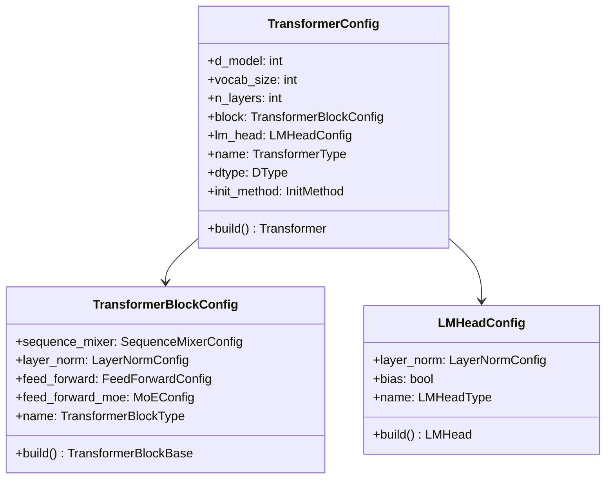

**Sources:** [src/olmo_core/nn/transformer/config.py:149-216](), [src/olmo_core/nn/transformer/config.py:282-385]()

## Block Architecture

Transformer blocks are modular, allowing for different sequence mixers (e.g., Attention or GatedDeltaNet) and normalization strategies.

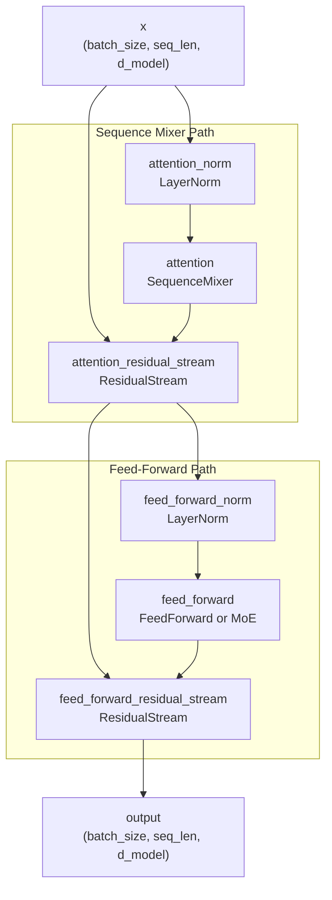

**Sources:** [src/olmo_core/nn/transformer/block.py:96-153]()

### Block Variants

OLMo-core provides multiple block implementations through `TransformerBlockType`:

| Block Type | Class | Description |
|------------|-------|-------------|
| `default` | `TransformerBlock` | Standard pre-norm Llama-style block [src/olmo_core/nn/transformer/block.py:96-107](). |
| `reordered_norm` | `ReorderedNormTransformerBlock` | Post-norm architecture used in OLMo2/3 [src/olmo_core/nn/transformer/block.py:246-248](). |
| `normalized` | `NormalizedTransformerBlock` | nGPT implementation with L2 normalization [src/olmo_core/nn/transformer/block.py:307-309](). |
| `moe` | `MoETransformerBlock` | Standard MoE block replacing dense MLP [src/olmo_core/nn/transformer/block.py:388-390](). |
| `moe_hybrid` | `MoEHybridTransformerBlock` | Parallel dense MLP and MoE block [src/olmo_core/nn/transformer/block.py:530-532](). |

**Sources:** [src/olmo_core/nn/transformer/config.py:98-147]()

## Pre-configured Models

`TransformerConfig` provides factory methods for well-known architectures. For details, see [Transformer Models](#2.1).

*   **OLMo2/3**: Uses `reordered_norm` blocks and QK normalization [src/olmo_core/nn/transformer/config.py:454-793]().
*   **Llama**: Compatible with Llama 2, Llama 3, and 3.1 architectures [src/olmo_core/nn/transformer/config.py:795-1125]().
*   **nGPT**: Normalized Gradient Pretraining variants [src/olmo_core/nn/transformer/config.py:1127-1167]().
*   **OLMoE**: Large-scale Mixture of Experts configurations [src/scripts/train/OLMoE2-large.py:30-48]().

## Model Initialization

Weight initialization is handled by the `InitMethod` enum, supporting strategies like `normal`, `llama`, `llama_depth`, and `fan_in`.

| Method | Behavior |
|--------|----------|
| `normal` | Truncated normal distribution with std 0.02 [src/olmo_core/nn/transformer/init.py:47-51](). |
| `llama` | Depth-scaled initialization for output layers [src/olmo_core/nn/transformer/init.py:58-62](). |
| `fan_in` | Variance-preserving initialization adapted to layer dimensions [src/olmo_core/nn/transformer/init.py:70-77](). |

For details, see [Model Initialization](#2.6).

## Distributed Training Support

The model architecture natively supports various parallelism strategies applied through the `Transformer` class:

*   **Tensor Parallelism (TP)**: Shards weights and activations across a `DeviceMesh` [src/olmo_core/nn/transformer/model.py:586-630]().
*   **Pipeline Parallelism (PP)**: Partitions blocks across different stages [src/olmo_core/nn/transformer/model.py:530-584]().
*   **Context Parallelism (CP)**: Shards the sequence dimension using Ring or Ulysses styles [src/olmo_core/nn/transformer/model.py:632-658]().
*   **Expert Parallelism (EP)**: Shards MoE experts across GPUs [src/olmo_core/nn/transformer/model.py:792-832]().
*   **FSDP**: Fully Sharded Data Parallelism for scaling to massive parameter counts [src/olmo_core/nn/transformer/model.py:717-790]().

For details, see [Distributed Training](#4).

---

# Page: Transformer Models

# Transformer Models

<details>
<summary>Relevant source files</summary>

The following files were used as context for generating this wiki page:

- [src/olmo_core/nn/attention/recurrent.py](src/olmo_core/nn/attention/recurrent.py)
- [src/olmo_core/nn/feed_forward.py](src/olmo_core/nn/feed_forward.py)
- [src/olmo_core/nn/transformer/__init__.py](src/olmo_core/nn/transformer/__init__.py)
- [src/olmo_core/nn/transformer/block.py](src/olmo_core/nn/transformer/block.py)
- [src/olmo_core/nn/transformer/config.py](src/olmo_core/nn/transformer/config.py)
- [src/olmo_core/nn/transformer/init.py](src/olmo_core/nn/transformer/init.py)
- [src/olmo_core/nn/transformer/model.py](src/olmo_core/nn/transformer/model.py)
- [src/olmo_core/script_utils.py](src/olmo_core/script_utils.py)
- [src/olmo_core/train/callbacks/stability_monitor.py](src/olmo_core/train/callbacks/stability_monitor.py)
- [src/scripts/train/OLMoE2-large.py](src/scripts/train/OLMoE2-large.py)
- [src/test/nn/attention/recurrent_test.py](src/test/nn/attention/recurrent_test.py)
- [src/test/nn/transformer/model_test.py](src/test/nn/transformer/model_test.py)

</details>


This document describes the transformer model implementations in OLMo-core, including the core `Transformer` class, configuration system, and model variants. For information about individual transformer blocks (attention, feed-forward layers), see **2.2 Transformer Blocks**. For attention mechanisms specifically, see **2.3 Attention Mechanisms**. For MoE-specific details, see **2.5 Mixture of Experts**.

## Purpose and Scope

The transformer models form the core neural network architecture for language modeling in OLMo-core. This page covers:

- The three main model types: `Transformer` (standard), `NormalizedTransformer` (nGPT), and `MoETransformer` (Mixture-of-Experts).
- Model configuration using `TransformerConfig` and pre-built configurations.
- Model architecture and component composition.
- Weight initialization strategies via `InitMethod`.
- Parallelization methods (TP, PP, CP, EP, FSDP).

## Model Architecture Overview

All transformer models in OLMo-core follow a three-part structure: **embeddings → transformer blocks → LM head**. The models differ primarily in their block implementations and normalization strategies.

### Natural Language to Code Entity Space: Architecture
The following diagram maps high-level architectural concepts to the specific classes and attributes found in `src/olmo_core/nn/transformer/model.py`.

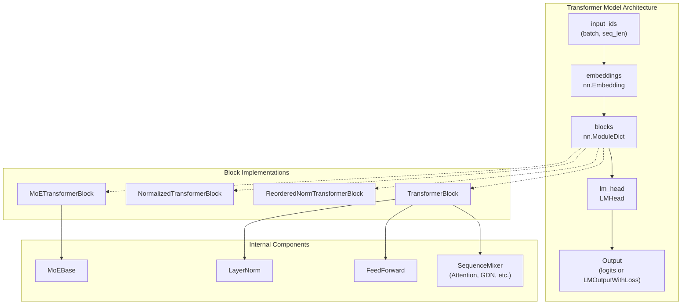
**Sources:** [src/olmo_core/nn/transformer/model.py:82-161](), [src/olmo_core/nn/transformer/config.py:149-238](), [src/olmo_core/nn/attention/base.py:20-61]()

## Transformer Model Types

OLMo-core provides three main transformer implementations, selected via the `TransformerType` enum in `src/olmo_core/nn/transformer/config.py`:

| Type | Class | Description | Use Case |
|------|-------|-------------|----------|
| `default` | `Transformer` | Standard Llama-style architecture | General pre-training and fine-tuning |
| `normalized` | `NormalizedTransformer` | nGPT with L2-normalized weights and activations | Research into normalized architectures |
| `moe` | `MoETransformer` | Sparse mixture-of-experts | Efficient scaling with conditional computation |

**Sources:** [src/olmo_core/nn/transformer/config.py:77-97](), [src/olmo_core/nn/transformer/model.py:82-1054]()

### Transformer (Standard)

The `Transformer` class implements a standard decoder-only transformer architecture. It consists of token embeddings, a stack of transformer blocks, and a language model head [src/olmo_core/nn/transformer/model.py:82-161]().

**Key features:**
- Pre-LayerNorm or post-LayerNorm ordering (via block type) [src/olmo_core/nn/transformer/config.py:98-148]().
- Flexible `SequenceMixer` support, allowing for Attention or recurrent variants like `GatedDeltaNet` [src/olmo_core/nn/transformer/block.py:128-133]().
- Optional SwiGLU or GeGLU feed-forward activation [src/olmo_core/nn/feed_forward.py:29-51]().

**Sources:** [src/olmo_core/nn/transformer/model.py:82-536](), [src/olmo_core/nn/transformer/block.py:128-133]()

### NormalizedTransformer (nGPT)

The `NormalizedTransformer` implements the nGPT architecture, which normalizes weight matrices and activations to unit L2 norm [src/olmo_core/nn/transformer/model.py:858-860]().

**Key differences:**
- Weight matrices are L2-normalized via `normalize_matrices()` [src/olmo_core/nn/transformer/model.py:910-936]().
- Uses `NormalizedTransformerBlock` which applies L2 normalization to inputs of the sequence mixer and feed-forward layers [src/olmo_core/nn/transformer/config.py:123-126]().
- Initialization follows `InitMethod.normalized` [src/olmo_core/nn/transformer/init.py:53-56]().

**Sources:** [src/olmo_core/nn/transformer/model.py:858-936](), [src/test/nn/transformer/model_test.py:97-117]()

### MoETransformer (Mixture-of-Experts)

The `MoETransformer` replaces dense feed-forward layers with sparse mixture-of-experts layers [src/olmo_core/nn/transformer/model.py:939-941]().

**Key features:**
- Sparse expert selection via router (top-k experts) [src/olmo_core/nn/transformer/init.py:202-210]().
- Auxiliary metrics for load balancing and Z-loss tracking [src/olmo_core/nn/transformer/model.py:1015-1028]().
- Support for hybrid architectures (dense + sparse blocks) [src/olmo_core/nn/transformer/config.py:138-147]().

**Sources:** [src/olmo_core/nn/transformer/model.py:939-1054](), [src/scripts/train/OLMoE2-large.py:32-48]()

## Model Configuration System

The `TransformerConfig` class provides a declarative way to define transformer models.

### Natural Language to Code Entity Space: Configuration
The following diagram maps configuration fields to the `TransformerConfig` and `TransformerBlockConfig` classes.

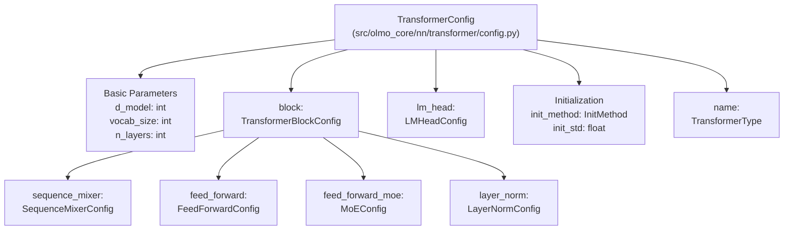
**Sources:** [src/olmo_core/nn/transformer/config.py:149-238](), [src/olmo_core/nn/transformer/config.py:259-450]()

### Building and Initializing
The configuration system follows a builder pattern:
1. Call `config.build(init_device="cpu")` to instantiate the model [src/olmo_core/nn/transformer/config.py:282-363]().
2. Call `model.init_weights(device=device)` to materialize and initialize parameters [src/olmo_core/nn/transformer/model.py:213-309]().

**Sources:** [src/olmo_core/nn/transformer/config.py:282-363](), [src/test/nn/transformer/model_test.py:71-81]()

## Pre-built Model Configurations

OLMo-core provides pre-built configurations for standard model families via static methods on `TransformerConfig`:

| Family | Method | Features |
|--------|--------|----------|
| **OLMo2** | `olmo2_7B()` | Reordered norm, QK norm, RoPE θ=500k [src/olmo_core/nn/transformer/config.py:476-499]() |
| **Llama 3** | `llama3_8B()` | GQA, RoPE θ=500k [src/olmo_core/nn/transformer/config.py:648-675]() |
| **OLMoE2** | `llama_like_moe()` | 64 experts, shared expert hidden size [src/scripts/train/OLMoE2-large.py:32-48]() |
| **nGPT** | `ngpt_271M()` | L2-normalized weights [src/olmo_core/nn/transformer/config.py:713-734]() |

**Sources:** [src/olmo_core/nn/transformer/config.py:451-820](), [src/scripts/train/OLMoE2-large.py:32-48]()

## Weight Initialization

Initialization is handled by the `InitMethod` enum in `src/olmo_core/nn/transformer/init.py`.

| Method | Description |
|--------|-------------|
| `normal` | Truncated normal (std=0.02) for all layers [src/olmo_core/nn/transformer/init.py:47-51](). |
| `llama` | Output layers scaled by $1/\sqrt{2 \times \text{n\_layers}}$ [src/olmo_core/nn/transformer/init.py:58-62](). |
| `fan_in` | Per-layer fan-in initialization ($std = 1/\sqrt{d_{in}}$) [src/olmo_core/nn/transformer/init.py:70-77](). |
| `normalized` | Follows nGPT scheme with $std = d_{model}^{-0.5}$ [src/olmo_core/nn/transformer/init.py:53-56](). |

**Sources:** [src/olmo_core/nn/transformer/init.py:46-216]()

## Parallelization Support

Transformer models support multiple composed parallelization strategies applied via `apply_*()` methods.

### Parallelization Order
Parallelism must be applied in a specific sequence to ensure correct module wrapping and parameter sharding:

1. `apply_fp8()`: Float8 training via torchao [src/olmo_core/nn/transformer/model.py:527-543]().
2. `apply_pp()`: Pipeline Parallelism [src/olmo_core/nn/transformer/model.py:545-553]().
3. `apply_tp()`: Tensor Parallelism [src/olmo_core/nn/transformer/model.py:555-589]().
4. `apply_cp()`: Context Parallelism [src/olmo_core/nn/transformer/model.py:591-609]().
5. `apply_activation_checkpointing()`: Memory optimization [src/olmo_core/nn/transformer/model.py:611-707]().
6. `apply_compile()`: Torch compilation [src/olmo_core/nn/transformer/model.py:709-725]().
7. `apply_fsdp()`: Fully Sharded Data Parallel [src/olmo_core/nn/transformer/model.py:727-801]().

**Sources:** [src/olmo_core/nn/transformer/model.py:527-801]()

## Forward Pass and Model Inputs

The `forward()` method supports training (with labels) and inference.

| Input | Type | Description |
|-------|------|-------------|
| `input_ids` | `torch.Tensor` | Token IDs (batch, seq_len) [src/olmo_core/nn/transformer/model.py:455](). |
| `labels` | `Optional[torch.Tensor]` | Targets for loss computation [src/olmo_core/nn/transformer/model.py:456](). |
| `doc_lens` | `Optional[torch.Tensor]` | Cumulative document lengths for masking [src/olmo_core/nn/transformer/model.py:461](). |

**Return:** Returns `torch.Tensor` (logits) if `labels` is None, otherwise `LMOutputWithLoss` which includes the computed cross-entropy loss [src/olmo_core/nn/transformer/model.py:516-526]().

**Sources:** [src/olmo_core/nn/transformer/model.py:454-526]()

---

# Page: Transformer Blocks

# Transformer Blocks

<details>
<summary>Relevant source files</summary>

The following files were used as context for generating this wiki page:

- [src/olmo_core/nn/feed_forward.py](src/olmo_core/nn/feed_forward.py)
- [src/olmo_core/nn/residual_stream.py](src/olmo_core/nn/residual_stream.py)
- [src/olmo_core/nn/transformer/__init__.py](src/olmo_core/nn/transformer/__init__.py)
- [src/olmo_core/nn/transformer/block.py](src/olmo_core/nn/transformer/block.py)
- [src/olmo_core/nn/transformer/config.py](src/olmo_core/nn/transformer/config.py)
- [src/olmo_core/nn/transformer/model.py](src/olmo_core/nn/transformer/model.py)
- [src/scripts/train/OLMoE2-large.py](src/scripts/train/OLMoE2-large.py)
- [src/test/nn/transformer/block_test.py](src/test/nn/transformer/block_test.py)
- [src/test/nn/transformer/model_test.py](src/test/nn/transformer/model_test.py)

</details>


This page documents the transformer block implementations in OLMo-core. Transformer blocks are the fundamental repeating units that compose transformer models, each containing sequence mixing (attention or recurrent) and feed-forward sub-layers with normalization and residual connections.

## Overview

OLMo-core provides a modular system for defining transformer blocks through the `TransformerBlockBase` class [src/olmo_core/nn/transformer/block.py:32-35](). Blocks are responsible for managing the data flow between normalization layers, sequence mixers, and feed-forward networks, while providing hooks for distributed training strategies like Tensor Parallelism (TP), Fully Sharded Data Parallelism (FSDP), and Context Parallelism (CP).

## Block Hierarchy

The following diagram illustrates the relationship between the base class and the various specialized block implementations.

### Class Relationship Diagram
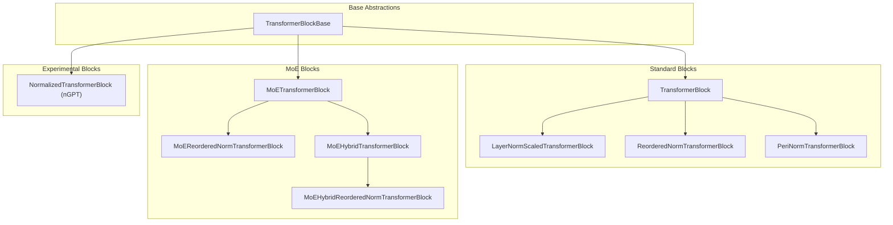
**Sources:** [src/olmo_core/nn/transformer/block.py:32-912](), [src/olmo_core/nn/transformer/__init__.py:1-13]()

## Block Types and Configuration

The `TransformerBlockType` enum defines the available implementations [src/olmo_core/nn/transformer/config.py:98-148](). Blocks are constructed using `TransformerBlockConfig`, which abstracts the sub-module creation via the `build` method [src/olmo_core/nn/transformer/config.py:208-250]().

| Enum Value | Implementation Class | Normalization Strategy |
| :--- | :--- | :--- |
| `default` | `TransformerBlock` | Pre-norm (Llama-style) |
| `reordered_norm` | `ReorderedNormTransformerBlock` | Post-norm (OLMo2 style) |
| `peri_norm` | `PeriNormTransformerBlock` | Peri-norm (OLMo3 style) |
| `default_scaled` | `LayerNormScaledTransformerBlock` | Pre-norm with depth scaling |
| `normalized` | `NormalizedTransformerBlock` | nGPT (No LayerNorm, L2 weights) |
| `moe` | `MoETransformerBlock` | Sparse MoE Pre-norm |
| `moe_hybrid` | `MoEHybridTransformerBlock` | Mixed Dense/Sparse Pre-norm |

**Sources:** [src/olmo_core/nn/transformer/config.py:98-148](), [src/olmo_core/nn/transformer/config.py:150-250]()

## Normalization Strategies

OLMo-core supports several architectural variants that differ primarily in how `LayerNorm` (or `RMSNorm`) is positioned relative to the residual stream.

### 1. Pre-Norm (Standard)
In `TransformerBlock`, normalization is applied before the sub-layers.
*   **Data Flow:** `h = x + attention(norm(x))` then `out = h + mlp(norm(h))` [src/olmo_core/nn/transformer/block.py:152-153]().

### 2. Post-Norm (Reordered)
In `ReorderedNormTransformerBlock`, normalization is applied to the output of the sub-layer before the residual addition.
*   **Data Flow:** `x = x + norm(attention(x))` then `x = x + norm(mlp(x))` [src/olmo_core/nn/transformer/block.py:269-271]().

### 3. Peri-Norm
In `PeriNormTransformerBlock`, normalization occurs after the sequence mixer but before the residual addition, often paired with specific initialization schemes.
*   **Implementation:** [src/olmo_core/nn/transformer/block.py:273-305]().

### 4. nGPT (Normalized Transformer)
`NormalizedTransformerBlock` removes `LayerNorm` entirely. It uses `l2_normalize` on both weights and activations, employing a learnable interpolation (`lerp`) for residual connections via `attn_alpha` and `ff_alpha` [src/olmo_core/nn/transformer/block.py:387-398]().

### Normalization Logic Diagram
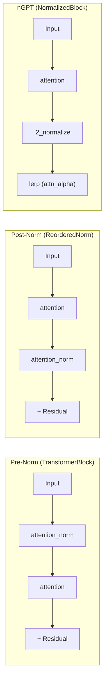
**Sources:** [src/olmo_core/nn/transformer/block.py:152-153](), [src/olmo_core/nn/transformer/block.py:269-271](), [src/olmo_core/nn/transformer/block.py:387-398]()

## Mixture of Experts (MoE) Blocks

MoE blocks replace or augment the standard `FeedForward` with a `MoEBase` module [src/olmo_core/nn/transformer/block.py:400-418]().

### MoETransformerBlock
A standard block where the MLP is replaced by a sparse expert layer. It routes tokens to a subset of experts defined in `feed_forward_moe` [src/olmo_core/nn/transformer/block.py:400-418]().

### Hybrid MoE Blocks
`MoEHybridTransformerBlock` contains both a dense `FeedForward` and a sparse `MoE` layer [src/olmo_core/nn/transformer/block.py:603-625]().
*   **Sequential Forward:** Sparse and dense paths are calculated and summed [src/olmo_core/nn/transformer/block.py:734-735]().
*   **Combined Forward:** Optimizes execution by overlapping the MoE communication (all-to-all) with the dense MLP computation [src/olmo_core/nn/transformer/block.py:698-726]().

**Sources:** [src/olmo_core/nn/transformer/block.py:400-418](), [src/olmo_core/nn/transformer/block.py:603-735]()

## Distributed Training Integration

Every block implementation must provide logic for distributed sharding by implementing the abstract methods in `TransformerBlockBase` [src/olmo_core/nn/transformer/block.py:60-93]().

### Key Methods
*   `apply_tp`: Configures Tensor Parallelism. It typically shards the sequence mixer and feed-forward modules while setting `SequenceParallel` plans for normalization layers [src/olmo_core/nn/transformer/block.py:155-200]().
*   `apply_fsdp`: Configures Fully Sharded Data Parallelism. It supports different `wrapping_strategy` options like `full` (wrapping the whole block) or `fine_grained` (wrapping sub-modules individually) [src/olmo_core/nn/transformer/block.py:221-255]().
*   `apply_cp`: Configures Context Parallelism (Ring Attention) by passing the `DeviceMesh` and parallel styles to the sequence mixer [src/olmo_core/nn/transformer/block.py:201-220]().

### Code Entity Space: Parallelism Implementation
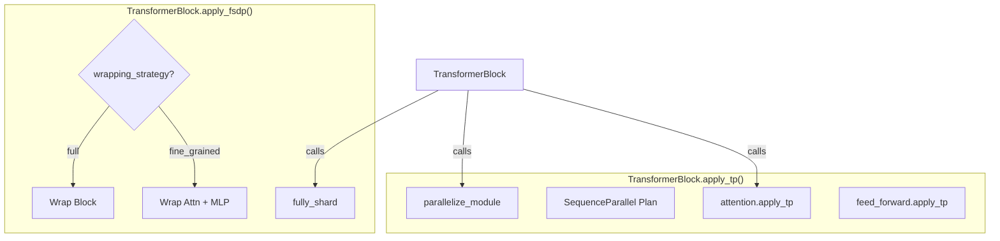
**Sources:** [src/olmo_core/nn/transformer/block.py:155-255](), [src/olmo_core/nn/transformer/config.py:38-58]()

## Weight Initialization

Blocks are initialized via the `InitMethod` enum [src/olmo_core/nn/transformer/init.py:22]().
*   **Llama/Llama-depth:** Scales the output weights of the attention and feed-forward layers based on the total number of layers or the current block index to maintain variance [src/olmo_core/nn/transformer/model.py:240-270]().
*   **Fan-in:** Adapts initialization to specific layer dimensions [src/olmo_core/nn/transformer/config.py:29]().

**Sources:** [src/olmo_core/nn/transformer/init.py:1-22](), [src/olmo_core/nn/transformer/model.py:240-270]()

---

# Page: Attention Mechanisms

# Attention Mechanisms

<details>
<summary>Relevant source files</summary>

The following files were used as context for generating this wiki page:

- [src/olmo_core/distributed/nn.py](src/olmo_core/distributed/nn.py)
- [src/olmo_core/distributed/parallel/context_parallel.py](src/olmo_core/distributed/parallel/context_parallel.py)
- [src/olmo_core/nn/attention/__init__.py](src/olmo_core/nn/attention/__init__.py)
- [src/olmo_core/nn/attention/backend.py](src/olmo_core/nn/attention/backend.py)
- [src/olmo_core/nn/attention/flash_attn_api.py](src/olmo_core/nn/attention/flash_attn_api.py)
- [src/olmo_core/nn/attention/flash_linear_attn_api.py](src/olmo_core/nn/attention/flash_linear_attn_api.py)
- [src/olmo_core/nn/attention/kv_cache.py](src/olmo_core/nn/attention/kv_cache.py)
- [src/olmo_core/nn/convolution.py](src/olmo_core/nn/convolution.py)
- [src/olmo_core/testing/__init__.py](src/olmo_core/testing/__init__.py)
- [src/olmo_core/testing/utils.py](src/olmo_core/testing/utils.py)
- [src/scripts/train/OLMo3/OLMo-3-190M.py](src/scripts/train/OLMo3/OLMo-3-190M.py)
- [src/test/distributed/parallel/context_parallel_test.py](src/test/distributed/parallel/context_parallel_test.py)
- [src/test/nn/attention/attention_test.py](src/test/nn/attention/attention_test.py)

</details>


## Overview

This document describes the attention mechanism implementations in OLMo-core. Attention is a core component of transformer models that computes scaled dot-product attention (SDPA) between queries, keys, and values. The system provides multiple attention implementations, configurable backends (including Flash Attention 2, 3, and 4), positional encoding strategies, and distributed execution modes.

**Key Components:**
- **Attention classes**: `Attention`, `FusedAttention`, `NormalizedAttention` [src/olmo_core/nn/attention/__init__.py:336-1062]()
- **Attention backends**: `TorchAttentionBackend`, `FlashAttention2Backend`, `FlashAttention3Backend`, `FlashAttention4Backend`, `TEAttentionBackend` [src/olmo_core/nn/attention/backend.py:43-130]()
- **RoPE implementations**: `RotaryEmbedding`, `FusedRotaryEmbedding`, `ComplexRotaryEmbedding` [src/olmo_core/nn/rope.py:398-795]()
- **Configuration**: `AttentionConfig`, `RoPEConfig`, `SlidingWindowAttentionConfig`, `GateConfig` [src/olmo_core/nn/attention/__init__.py:92-304]()
- **Recurrent Attention**: `GatedDeltaNet` implementation for linear attention [src/olmo_core/nn/attention/recurrent.py:12-117]()

See **Transformer Blocks (2.2)** for how attention is integrated into transformer blocks and **Parallelism Strategies (4.2)** for distributed execution.

**Sources:** [src/olmo_core/nn/attention/__init__.py:1-1062](), [src/olmo_core/nn/attention/backend.py:1-130](), [src/olmo_core/nn/rope.py:1-795](), [src/olmo_core/nn/attention/recurrent.py:12-117]()

## Attention Configuration

The `AttentionConfig` class provides a declarative interface for configuring attention mechanisms. It is embedded within transformer block configurations and controls attention computation, backend selection, and optional features.

**Configuration Parameters:**

| Parameter | Type | Default | Purpose |
|-----------|------|---------|---------|
| `name` | `AttentionType` | `"default"` | Attention implementation (`default`, `fused`, `normalized`) [src/olmo_core/nn/attention/__init__.py:158-174]() |
| `n_heads` | `int` | `16` | Number of attention heads |
| `n_kv_heads` | `Optional[int]` | `None` | Number of key/value heads for GQA/MQA |
| `bias` | `Optional[bool]` | `None` | Include bias in linear layers |
| `gate` | `Optional[GateConfig]` | `None` | Attention gating configuration (headwise or elementwise) [src/olmo_core/nn/attention/__init__.py:85-98]() |
| `rope` | `Optional[RoPEConfig]` | `None` | Rotary position embedding configuration |
| `clip_qkv` | `Optional[float]` | `None` | Clipping value for QKV projections |
| `qk_norm` | `Optional[LayerNormConfig]` | `None` | Layer norm applied to queries and keys |
| `use_head_qk_norm` | `Optional[bool]` | `None` | Apply QK norm per-head instead of globally [src/olmo_core/nn/attention/__init__.py:203-203]() |
| `dropout` | `Optional[float]` | `None` | Attention dropout probability |
| `backend` | `Optional[AttentionBackendName]` | `None` | Backend implementation (auto-selected if None) |
| `sliding_window` | `Optional[SlidingWindowAttentionConfig]` | `None` | Sliding window attention configuration [src/olmo_core/nn/attention/__init__.py:101-155]() |

**Sources:** [src/olmo_core/nn/attention/__init__.py:177-304]()

### Attention Backend Selection

**Diagram: Backend Selection and Features**
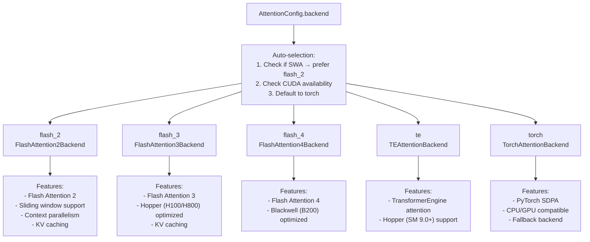

The backend is auto-selected at attention construction time [src/olmo_core/nn/attention/__init__.py:433-471](). `FlashAttention4Backend` is specifically targeted at Blackwell architectures [src/olmo_core/nn/attention/backend.py:65-69](). Backends are validated using `assert_supported()` before initialization [src/olmo_core/nn/attention/backend.py:162-169](). Hardware support for specific backends is verified via `flash_attn_api.py` [src/olmo_core/nn/attention/flash_attn_api.py:37-60]().

**Sources:** [src/olmo_core/nn/attention/__init__.py:433-481](), [src/olmo_core/nn/attention/backend.py:43-130](), [src/olmo_core/nn/attention/flash_attn_api.py:37-60]()

## Attention Implementations

### Multi-Head Attention Variants

OLMo-core supports three attention patterns based on the `n_kv_heads` configuration:

- **MHA**: `n_kv_heads` is `None` or equals `n_heads` (all heads independent).
- **GQA**: `1 < n_kv_heads < n_heads` (groups of heads share KV).
- **MQA**: `n_kv_heads = 1` (all heads share single KV).

**Sources:** [src/olmo_core/nn/attention/__init__.py:386-396]()

### Attention Class Hierarchy

**Diagram: Attention Classes and Code Entities**
```mermaid
graph TB
    AttentionBase["AttentionBase<br/>(abstract base class)"]
    
    Attention["Attention<br/>(src/olmo_core/nn/attention/__init__.py)"]
    
    FusedAttention["FusedAttention<br/>(src/olmo_core/nn/attention/__init__.py)"]
    
    NormalizedAttention["NormalizedAttention<br/>(src/olmo_core/nn/attention/__init__.py)"]
    
    GatedDeltaNet["GatedDeltaNet<br/>(src/olmo_core/nn/attention/recurrent.py)"]
    
    AttentionBase --> Attention
    AttentionBase --> FusedAttention
    AttentionBase --> NormalizedAttention
    
    Backend["AttentionBackend<br/>(src/olmo_core/nn/attention/backend.py)"]
    Attention --> Backend
    FusedAttention --> Backend
    NormalizedAttention --> Backend
    
    Backend --> Flash2["FlashAttention2Backend"]
    Backend --> Flash3["FlashAttention3Backend"]
    Backend --> Flash4["FlashAttention4Backend"]
    Backend --> TE["TEAttentionBackend"]
    Backend --> Torch["TorchAttentionBackend"]
```

| Class | Key Features | RoPE Support | Notes |
|-------|--------------|--------------|-------|
| `Attention` | Standard implementation | All RoPE types | Default choice [src/olmo_core/nn/attention/__init__.py:336-740]() |
| `FusedAttention` | Optimized for packed QKV | `FusedRotaryEmbedding` | Requires `flash_2` backend [src/olmo_core/nn/attention/__init__.py:742-906]() |
| `NormalizedAttention` | nGPT architecture | All RoPE types | Special scaling, learnable `sq`, `sk` [src/olmo_core/nn/attention/__init__.py:908-1062]() |
| `GatedDeltaNet` | Linear Attention | N/A | Hybrid recurrent architecture support [src/olmo_core/nn/attention/recurrent.py:12-117]() |

**Sources:** [src/olmo_core/nn/attention/__init__.py:336-1062](), [src/olmo_core/nn/attention/recurrent.py:12-117]()

## Rotary Position Embeddings (RoPE)

RoPE applies rotary position embeddings to queries and keys.

### RoPE Scaling Strategies

OLMo-core supports multiple scaling strategies for extending context length [src/olmo_core/nn/rope.py:54-291]():

| Scaling Config | Method | Description |
|----------------|--------|-------------|
| `ABFRoPEScalingConfig` | Absolute Base Frequency | Uses a new base frequency parameter `new_theta` [src/olmo_core/nn/rope.py:73-90]() |
| `PIRoPEScalingConfig` | Position Interpolation | Linearly compresses position indices by `factor` [src/olmo_core/nn/rope.py:97-126]() |
| `StepwiseRoPEScalingConfig` | Llama-3.1 scaling | Interpolates between high- and low-frequency bands [src/olmo_core/nn/rope.py:133-210]() |
| `YaRNRoPEScalingConfig` | YaRN | Smoothly blends interpolation and extrapolation [src/olmo_core/nn/rope.py:213-291]() |

**Sources:** [src/olmo_core/nn/rope.py:54-291]()

## KV Caching for Inference

The `KVCacheManager` manages key and value tensors across autoregressive decoding steps.

**Diagram: KV Cache Data Flow**
```mermaid
graph LR
    Manager["KVCacheManager<br/>(src/olmo_core/nn/attention/kv_cache.py)"]
    
    KCache["k_cache<br/>(B, T_max, H_kv, D_head)"]
    VCache["v_cache<br/>(B, T_max, H_kv, D_head)"]
    
    Manager --> KCache
    Manager --> VCache
    
    Update["update_seqlen()"] --> CachePos["cache_seqlens"]
    Leftpad["record_leftpad()"] --> CachePad["cache_leftpad"]
```

The `KVCacheManager` is initialized with a `max_seq_len` and `batch_size` [src/olmo_core/nn/attention/kv_cache.py:12-52](). Optimized backends like `FlashAttention2Backend` and `FlashAttention3Backend` update these buffers in-place during the forward pass using specialized dispatch functions [src/olmo_core/nn/attention/backend.py:470-483](), [src/olmo_core/nn/attention/backend.py:606-620]().

**Sources:** [src/olmo_core/nn/attention/kv_cache.py:11-119](), [src/olmo_core/nn/attention/backend.py:470-620]()

## Sliding Window Attention (SWA)

SWA restricts the attention context to a fixed window size. The `SlidingWindowAttentionConfig` allows defining a `pattern` of window sizes (where `-1` is full attention) that repeats across layers [src/olmo_core/nn/attention/__init__.py:101-140](). The logic for calculating the effective window size for a given layer index is handled by `_get_window_size` [src/olmo_core/nn/attention/__init__.py:120-140]().

**Sources:** [src/olmo_core/nn/attention/__init__.py:101-155]()

## Distributed Attention

### Tensor Parallelism (TP)
`Attention.apply_tp()` configures the linear layers for tensor parallelism [src/olmo_core/nn/attention/__init__.py:634-685]():
- `w_q`, `w_k`, `w_v` are sharded column-wise.
- `w_out` is sharded row-wise.
- `q_norm` and `k_norm` use `SequenceParallel` wrappers [src/olmo_core/nn/attention/__init__.py:657-664]().

### Context Parallelism (CP)
`Attention.apply_cp()` enables ring attention or Ulysses styles [src/olmo_core/nn/attention/__init__.py:687-702](). This relies on the backend's ability to handle distributed sequence sharding, typically via `ring-flash-attn` [src/olmo_core/nn/attention/backend.py:118-122](). The communication primitives for CP, such as `all_to_all_single_cp2hp`, facilitate the transformation between context-parallel and head-parallel partitioning [src/olmo_core/distributed/parallel/context_parallel.py:22-64]().

**Sources:** [src/olmo_core/nn/attention/__init__.py:634-702](), [src/olmo_core/nn/attention/backend.py:118-122](), [src/olmo_core/distributed/parallel/context_parallel.py:22-64]()

---

# Page: Rotary Position Embeddings

# Rotary Position Embeddings

<details>
<summary>Relevant source files</summary>

The following files were used as context for generating this wiki page:

- [src/olmo_core/nn/layer_norm.py](src/olmo_core/nn/layer_norm.py)
- [src/olmo_core/nn/lm_head.py](src/olmo_core/nn/lm_head.py)
- [src/olmo_core/nn/rope.py](src/olmo_core/nn/rope.py)
- [src/test/nn/layer_norm_test.py](src/test/nn/layer_norm_test.py)
- [src/test/nn/lm_head_test.py](src/test/nn/lm_head_test.py)
- [src/test/nn/rope_test.py](src/test/nn/rope_test.py)

</details>


This page documents the Rotary Position Embeddings (RoPE) system in OLMo-core, including the three implementation variants, scaling strategies for context extension, GNoPE (Global-No-Position-Embedding), and integration with attention mechanisms.

For information about attention mechanisms that use RoPE, see [Attention Mechanisms](2.3). For transformer model architecture, see [Transformer Models](2.1).

## Overview

Rotary Position Embeddings (RoPE) encode positional information by rotating query and key vectors in complex space. Unlike absolute position embeddings, RoPE maintains relative positional relationships and supports extrapolation to longer sequences during inference.

The RoPE system in OLMo-core provides:
- Three implementation variants with different performance characteristics.
- Four scaling strategies for extending context windows beyond training length.
- Automatic buffer caching to avoid recomputation via `BufferCache`.
- Support for **GNoPE** (Global-No-Position-Embedding) to selectively disable RoPE on specific layers.

**Sources:** [src/olmo_core/nn/rope.py:1-26](), [src/olmo_core/nn/rope.py:293-346]()

## RoPE Implementation Variants

OLMo-core provides three RoPE implementations, selectable via the `RoPEConfig.name` field [src/olmo_core/nn/rope.py:302-313]().

### RoPE Implementation Architecture
```mermaid
graph TB
    subgraph "Configuration Entity Space"
        Config["RoPEConfig<br/>(src/olmo_core/nn/rope.py)"]
        Type["RoPEType<br/>(Enum)"]
    end
    
    subgraph "Implementation Entity Space"
        Config -->|"name='default'"| Default["RotaryEmbedding<br/>(src/olmo_core/nn/rope.py:398)"]
        Config -->|"name='fused'"| Fused["FusedRotaryEmbedding<br/>(src/olmo_core/nn/rope.py:546)"]
        Config -->|"name='complex'"| Complex["ComplexRotaryEmbedding<br/>(src/olmo_core/nn/rope.py:667)"]
    end
    
    subgraph "Operational Logic"
        Default --> DefaultOp["_apply_rotary_pos_emb()<br/>Manual rotation logic"]
        Fused --> FusedOp["apply_rotary_emb_qkv_()<br/>Flash-attn triton kernel"]
        Complex --> ComplexOp["torch.polar() + multiplication<br/>Native complex ops"]
    end
    
    DefaultOp --> Output["Rotated Q, K tensors"]
    FusedOp --> Output
    ComplexOp --> Output
```
**Sources:** [src/olmo_core/nn/rope.py:29-46](), [src/olmo_core/nn/rope.py:398-795]()

### RotaryEmbedding (Default)

The default implementation applies RoPE by manually rotating query and key tensors using precomputed sine and cosine buffers.

| Feature | Details |
|---------|---------|
| **Class** | `RotaryEmbedding` [src/olmo_core/nn/rope.py:398]() |
| **Compatibility** | Works with `Attention` and `NormalizedAttention` |
| **Buffer Format** | `pos_sin`, `pos_cos` of shape `(seq_len, head_dim)` |
| **Performance** | Standard PyTorch ops, best for cross-platform compatibility |

The rotation is performed using the formula: `(t * cos) + (rotate_half(t) * sin)`, where `rotate_half()` swaps and negates adjacent pairs of dimensions [src/olmo_core/nn/rope.py:461-470]().

**Sources:** [src/olmo_core/nn/rope.py:398-544]()

### FusedRotaryEmbedding

A Triton-based fused implementation that operates directly on packed QKV tensors for maximum performance on GPU.

| Feature | Details |
|---------|---------|
| **Class** | `FusedRotaryEmbedding` [src/olmo_core/nn/rope.py:546]() |
| **Compatibility** | Works with `FusedAttention` only |
| **Buffer Format** | `pos_sin`, `pos_cos` of shape `(seq_len, head_dim // 2)` |
| **Requirements** | Requires `flash-attn` package [src/olmo_core/nn/rope.py:643]() |
| **Performance** | ~2-3x faster than default on GPU |

This implementation uses `flash_attn.layers.rotary.apply_rotary_emb_qkv_()` to apply RoPE in-place on the packed QKV tensor [src/olmo_core/nn/rope.py:641-665]().

**Sources:** [src/olmo_core/nn/rope.py:546-665]()

### ComplexRotaryEmbedding

Implements RoPE as a rotation in complex space using native PyTorch complex number operations.

| Feature | Details |
|---------|---------|
| **Class** | `ComplexRotaryEmbedding` [src/olmo_core/nn/rope.py:667]() |
| **Compatibility** | Works with `Attention` and `NormalizedAttention` |
| **Buffer Format** | `freqs_cis` of shape `(seq_len, head_dim // 2)` as `complex64` |
| **Operation** | `torch.view_as_complex(x) * freqs_cis` [src/olmo_core/nn/rope.py:778]() |
| **Limitations** | Scaling strategies not currently supported in this variant |

**Sources:** [src/olmo_core/nn/rope.py:667-795]()

## RoPE Scaling Strategies

Scaling strategies extend the effective context window beyond the maximum sequence length used during training by modifying the inverse frequencies (`inv_freq`).

### Scaling Strategy Hierarchy
```mermaid
graph TD
    subgraph "Base Class"
        Base["RoPEScalingConfig<br/>(src/olmo_core/nn/rope.py:54)"]
    end
    
    subgraph "Scaling Implementation Entity Space"
        Base --> ABF["ABFRoPEScalingConfig<br/>(Absolute Base Frequency)"]
        Base --> PI["PIRoPEScalingConfig<br/>(Position Interpolation)"]
        Base --> Stepwise["StepwiseRoPEScalingConfig<br/>(Llama-3.1 style)"]
        Base --> YaRN["YaRNRoPEScalingConfig<br/>(YaRN)"]
    end
    
    ABF --> CompInv["compute_scaled_inv_freq()"]
    PI --> CompInv
    Stepwise --> CompInv
    YaRN --> CompInv
    
    CompInv --> Outputs["Returns:<br/>(inv_freq, attention_rescale_factor)"]
```
**Sources:** [src/olmo_core/nn/rope.py:54-291]()

### Available Strategies

| Strategy | Class | Logic |
|----------|-------|-------|
| **ABF** | `ABFRoPEScalingConfig` | Simply uses a new base frequency `new_theta` (default: 8M) [src/olmo_core/nn/rope.py:73-90](). |
| **PI** | `PIRoPEScalingConfig` | Linearly compresses position indices by a constant `factor` [src/olmo_core/nn/rope.py:97-126](). |
| **Stepwise** | `StepwiseRoPEScalingConfig` | Llama-3.1 style: interpolates between high- and low-frequency components [src/olmo_core/nn/rope.py:133-210](). |
| **YaRN** | `YaRNRoPEScalingConfig` | Blends interpolation/extrapolation with a linear ramp and m-scale rescaling [src/olmo_core/nn/rope.py:212-291](). |

## GNoPE (Global-No-Position-Embedding)

OLMo-core supports **GNoPE**, which stands for "global-no-rope". This is configured via the `no_global_rope` flag in `RoPEConfig` [src/olmo_core/nn/rope.py:311]().

In hybrid architectures (like those combining Attention with Recurrent layers), certain layers might be designated as "global". If `no_global_rope` is set to `True`, the RoPE implementation will return query and key tensors unchanged for layers identified as global, effectively disabling positional encoding for those specific blocks.

**Sources:** [src/olmo_core/nn/rope.py:302-313](), [src/olmo_core/nn/rope.py:488-490]()

## Integration with Attention

RoPE is integrated into the attention mechanism's forward pass. It is applied after Q/K projections and any optional normalization (like QK-Norm), but before the actual attention score calculation.

### Attention Data Flow with RoPE
```mermaid
sequenceDiagram
    participant X as "Input: (B, T, d_model)"
    participant Proj as "Q/K/V Projections"
    participant RoPE as "RotaryEmbeddingBase"
    participant Attn as "Scaled Dot-Product Attention"
    
    X->>Proj: Linear Transformation
    Proj->>RoPE: q, k tensors
    
    Note over RoPE: check no_global_rope flag
    Note over RoPE: get_buffers(seq_len) from BufferCache
    
    RoPE->>RoPE: Apply rotation to q and k
    RoPE->>Attn: rotated_q, rotated_k, v
```
**Sources:** [src/olmo_core/nn/rope.py:481-500](), [src/olmo_core/nn/rope.py:641-665]()

### Buffer Caching and Performance

To avoid recomputing trigonometric functions every forward pass, OLMo-core uses a `BufferCache`.

1. **Namespace Partitioning**: The cache is partitioned by `theta`, `head_size`, and `scaling` parameters to ensure buffers are never shared incorrectly [src/olmo_core/nn/rope.py:419-432]().
2. **Dynamic Expansion**: If the current `seq_len` exceeds the cached buffer size, the buffers are recomputed and updated in the cache [src/olmo_core/nn/rope.py:441-450]().
3. **Precision**: Buffers are typically computed in FP32 for numerical stability before being cast to the model's operating precision [src/olmo_core/nn/rope.py:456]().

**Sources:** [src/olmo_core/nn/rope.py:374-381](), [src/olmo_core/nn/rope.py:419-459]()

---

# Page: Mixture of Experts

# Mixture of Experts

<details>
<summary>Relevant source files</summary>

The following files were used as context for generating this wiki page:

- [src/olmo_core/nn/moe/__init__.py](src/olmo_core/nn/moe/__init__.py)
- [src/olmo_core/nn/moe/loss.py](src/olmo_core/nn/moe/loss.py)
- [src/olmo_core/nn/moe/mlp.py](src/olmo_core/nn/moe/mlp.py)
- [src/olmo_core/nn/moe/moe.py](src/olmo_core/nn/moe/moe.py)
- [src/olmo_core/nn/moe/parallel_mlp.py](src/olmo_core/nn/moe/parallel_mlp.py)
- [src/olmo_core/nn/moe/router.py](src/olmo_core/nn/moe/router.py)
- [src/olmo_core/ops/moe.py](src/olmo_core/ops/moe.py)
- [src/scripts/train/private-olmo.py](src/scripts/train/private-olmo.py)
- [src/test/nn/cross_entropy_loss_test.py](src/test/nn/cross_entropy_loss_test.py)
- [src/test/nn/functional/cross_entropy_loss_test.py](src/test/nn/functional/cross_entropy_loss_test.py)
- [src/test/nn/moe/mlp_test.py](src/test/nn/moe/mlp_test.py)
- [src/test/nn/moe/moe_test.py](src/test/nn/moe/moe_test.py)
- [src/test/ops/moe_test.py](src/test/ops/moe_test.py)

</details>


This page documents the Mixture of Experts (MoE) architecture implementation in OLMo-core, including MoE transformer blocks, routing mechanisms, expert parallelism, and hybrid dense-sparse configurations.

For information about standard (dense) feed-forward layers, see [Feed-Forward Networks](#2.7). For general transformer architecture, see [Transformer Models](#2.1). For expert parallelism configuration, see [Parallelism Strategies](#4.2).

## Overview

The MoE implementation in OLMo-core replaces dense feed-forward layers with sparse expert networks, where each token is routed to a subset of expert networks. This enables scaling model capacity without proportionally scaling computation. The system supports:

- **Pure MoE blocks**: Sparse feed-forward only [src/olmo_core/nn/transformer/block.py:512-677]().
- **Hybrid blocks**: Combined dense and sparse feed-forward [src/olmo_core/nn/transformer/block.py:720-1077]().
- **Dropless routing**: Load-balanced expert assignment without token dropping via `DroplessMoE` [src/olmo_core/nn/moe/moe.py:52-55]().
- **Shared experts**: Common experts processed by all tokens [src/olmo_core/nn/moe/moe.py:68]().
- **Expert parallelism (EP)**: Distributed expert computation across devices using All-to-All primitives [src/olmo_core/nn/moe/parallel_mlp.py:34-101]().
- **Combined forward optimization**: Overlapping dense computation with EP communication in hybrid blocks [src/olmo_core/nn/transformer/block.py:899-989]().

**Sources**: [src/olmo_core/nn/moe/moe.py:1-122](), [src/olmo_core/nn/moe/router.py:79-153](), [src/olmo_core/nn/transformer/block.py:512-1077]()

## Architecture Overview

The following diagram illustrates the relationship between the high-level transformer blocks and the specialized MoE modules.

### MoE System Components
```mermaid
graph TB
    subgraph "Transformer Layer Space"
        MoEBlock["MoETransformerBlock"]
        MoEHybridBlock["MoEHybridTransformerBlock"]
    end
    
    subgraph "Code Entity: MoEBase (moe.py)"
        MoERouter["MoERouter<br/>(router.py)"]
        Experts["ParallelMLPBase<br/>(parallel_mlp.py)"]
        SharedMLP["FeedForward (optional)"]
    end
    
    subgraph "Code Entity: Expert MLP (mlp.py)"
        MoEMLP["MoEMLP"]
        DroplessMoEMLP["DroplessMoEMLP<br/>(via grouped_gemm)"]
    end

    subgraph "Low-level Ops (ops/moe.py)"
        GatherOp["GatherOp"]
        ScatterOp["ScatterOp"]
        AllToAll["AllToAllOp"]
    end
    
    MoEBlock --> MoERouter
    MoEBlock --> Experts
    
    MoERouter -- "expert_indices" --> Experts
    MoERouter -- "expert_weights" --> Experts
    
    Experts --> AllToAll
    Experts --> MoEMLP
    Experts --> DroplessMoEMLP
    
    MoEMLP --> GatherOp
    MoEMLP --> ScatterOp
```

**Sources**: [src/olmo_core/nn/moe/moe.py:123-176](), [src/olmo_core/nn/moe/parallel_mlp.py:34-183](), [src/olmo_core/nn/moe/router.py:155-202]()

## Routing Mechanisms

The router is responsible for assigning tokens to experts and computing auxiliary losses to ensure balanced expert utilization.

### Router Implementations
- **MoELinearRouter**: The default implementation using a linear projection from `d_model` to `num_experts` [src/olmo_core/nn/moe/router.py:270-343]().
- **Gating Functions**: Supports `softmax` or `sigmoid` gating via `MoERouterGatingFunction` [src/olmo_core/nn/moe/router.py:74-77]().
- **Top-K Selection**: Selects the best `top_k` experts for each token [src/olmo_core/nn/moe/router.py:315-321]().
- **Auxiliary-Loss-Free Balancing**: Supports `bias_gamma` for adjusting expert scores following DeepSeek-v3 strategies [src/olmo_core/nn/moe/router.py:166-168]().

### Auxiliary Losses
Routing stability is maintained via specialized loss functions:
1. **Load Balancing Loss**: Encourages uniform token distribution across experts. It can be computed at `local_batch` or `instance` granularity [src/olmo_core/nn/moe/loss.py:29-112]().
2. **Router Z-Loss**: Penalizes large logit magnitudes to improve training stability [src/olmo_core/nn/moe/loss.py:114-139]().

**Sources**: [src/olmo_core/nn/moe/router.py:155-268](), [src/olmo_core/nn/moe/loss.py:1-139]()

## Expert Implementation

OLMo-core provides multiple expert MLP implementations tailored for different efficiency requirements and parallelism configurations.

| Implementation | Class | Key Feature |
| :--- | :--- | :--- |
| **Standard MoE** | `MoEMLP` | Uses standard PyTorch `bmm` (batch matrix multiplication) [src/olmo_core/nn/moe/mlp.py:123-195](). |
| **Dropless MoE** | `DroplessMoEMLP` | Uses `grouped_gemm` kernels to handle variable tokens per expert without padding [src/olmo_core/nn/moe/mlp.py:198-250](). |
| **Parallel Wrapper** | `ParallelMLP` | Orchestrates the data permutation and All-to-All communication [src/olmo_core/nn/moe/parallel_mlp.py:186-250](). |

### Data Flow: Permutation and Communication
Before expert computation, tokens must be rearranged so that tokens for the same expert are contiguous.

```mermaid
sequenceDiagram
    participant X as Input Tensor (N, d_model)
    participant R as MoERouter
    participant P as ParallelMLP
    participant G as GatherOp (Kernels)
    participant A as AllToAllOp
    participant E as MoEMLP / DroplessMoEMLP
    
    X->>R: forward(x)
    R-->>P: expert_indices, expert_weights
    P->>G: gather(x, indices, bins)
    G-->>P: Permuted X
    P->>A: all_to_all (if EP enabled)
    A-->>P: Rank-local tokens
    P->>E: forward_once()
    E-->>P: Expert Outputs
    P->>A: reverse all_to_all
    P->>G: scatter (Reverse Permutation)
    G-->>X: Final MoE Output
```

**Sources**: [src/olmo_core/nn/moe/parallel_mlp.py:102-183](), [src/olmo_core/ops/moe.py:26-123](), [src/olmo_core/nn/moe/router.py:302-343]()

## Parallelism Strategies

### Expert Parallelism (EP)
EP shards the expert parameters across a `DeviceMesh`. When a token is routed to an expert on a different rank, an All-to-All communication step is triggered.
- **Application**: Enabled via `moe.apply_ep(ep_mesh)` [src/olmo_core/nn/moe/moe.py:249-253]().
- **Sharding**: Experts are sharded along the expert dimension (dim 0) using `distribute_tensor` [src/olmo_core/nn/moe/mlp.py:71-85]().

### Tensor Parallelism (TP)
TP can be combined with MoE to shard the internal dimensions of the experts.
- **Application**: Enabled via `moe.apply_tp(tp_mesh)` [src/olmo_core/nn/moe/moe.py:255-259]().
- **Implementation**: Shards the MLP weights (`w1`, `w2`, `w3`) across the TP mesh [src/olmo_core/nn/moe/mlp.py:60-70]().

**Sources**: [src/olmo_core/nn/moe/parallel_mlp.py:76-89](), [src/olmo_core/nn/moe/mlp.py:50-86]()

## Hybrid Dense-Sparse Blocks

OLMo-core supports hybrid blocks where a standard dense MLP and a sparse MoE module coexist in the same transformer layer, as seen in architectures like DeepSeek or private OLMo variants.

- **MoEHybridTransformerBlock**: Tokens pass through both an attention layer and a dual FFN path (one dense `FeedForward`, one sparse `MoEBase`) [src/olmo_core/nn/transformer/block.py:720-896]().
- **Optimization**: The `optimized_forward` method overlaps the dense FFN computation with the EP All-to-All communication of the sparse MoE path to hide communication latency [src/olmo_core/nn/transformer/block.py:899-989]().

**Sources**: [src/olmo_core/nn/transformer/block.py:899-1077]()

## Configuration and Usage

### MoEConfig
The `MoEConfig` class defines the structure of the MoE layer [src/olmo_core/nn/moe/moe.py:58-76]():
- `num_experts`: Total number of experts.
- `hidden_size`: Intermediate size of the expert MLPs.
- `router`: A `MoERouterConfig` instance.
- `shared_mlp`: Configuration for an optional dense expert.
- `lb_loss_weight`: Weight for the load balancing loss (default 0.01).

### Example: Llama-like MoE
```python
# src/scripts/train/private-olmo.py:31-42
return TransformerConfig.llama_like_moe(
    vocab_size=common.tokenizer.padded_vocab_size(),
    d_model=d_model,
    n_layers=32,
    num_experts=8,
    top_k=1,
    expert_hidden_size=11008,
    lb_loss_weight=0.01,
    z_loss_weight=0.001,
)
```

**Sources**: [src/olmo_core/nn/moe/moe.py:58-121](), [src/scripts/train/private-olmo.py:28-53]()

## Technical Considerations

1. **Activation Checkpointing**: Standard MoE blocks cannot use full activation checkpointing easily because the routing decisions and communication buffers must be preserved [src/olmo_core/nn/transformer/model.py:726-757]().
2. **Grouped GEMM**: The `DroplessMoEMLP` implementation requires the `grouped_gemm` library for performance; otherwise, it falls back to padded operations [src/olmo_core/nn/moe/mlp.py:19-24]().
3. **FSDP Sharding**: When using Expert Parallelism, experts must be sharded over the correct DP dimension to avoid replication [src/olmo_core/nn/moe/mlp.py:87-113]().

**Sources**: [src/olmo_core/nn/moe/mlp.py:19-24](), [src/olmo_core/nn/transformer/model.py:726-757]()

---

# Page: Model Initialization

# Model Initialization

<details>
<summary>Relevant source files</summary>

The following files were used as context for generating this wiki page:

- [src/olmo_core/nn/attention/recurrent.py](src/olmo_core/nn/attention/recurrent.py)
- [src/olmo_core/nn/transformer/init.py](src/olmo_core/nn/transformer/init.py)
- [src/olmo_core/script_utils.py](src/olmo_core/script_utils.py)
- [src/olmo_core/train/callbacks/stability_monitor.py](src/olmo_core/train/callbacks/stability_monitor.py)
- [src/test/nn/attention/recurrent_test.py](src/test/nn/attention/recurrent_test.py)
- [src/test/nn/transformer/init_test.py](src/test/nn/transformer/init_test.py)

</details>


This page documents the weight initialization system in OLMo-core models. It covers the initialization methods, configuration parameters, and the step-by-step process of initializing model weights. For information about building model architectures, see [Transformer Models](2.1). For information about training modules that orchestrate the initialization process, see [TrainModule Abstraction](3.2).

## Overview

Model initialization in OLMo-core is a configurable process that sets the initial values of all trainable parameters in a transformer model. The system supports multiple initialization strategies and handles special requirements for distributed training, including proper seeding across pipeline parallel ranks and cache warmup for efficient training startup.

The initialization process is primarily executed through the `Transformer.init_weights()` method, which systematically initializes embeddings, transformer blocks (attention and feed-forward layers), and the language model head according to the specified `InitMethod`.

**Sources:** [src/olmo_core/nn/transformer/model.py:213-309]()

## Initialization Configuration

Model initialization is controlled by several configuration parameters defined in `TransformerConfig`:

| Parameter | Type | Default | Description |
|-----------|------|---------|-------------|
| `init_method` | `InitMethod` | `InitMethod.normal` | The initialization strategy to use (normal, llama, fan_in, etc.) |
| `init_seed` | `int` | `0` | Base random seed for initialization |
| `init_std` | `float` | `0.02` | Standard deviation for random initialization |
| `embedding_init_std` | `Optional[float]` | `None` | Specific std for embeddings (defaults to `init_std` if not set) |
| `init_device` | `str` | `"cpu"` | Device on which parameters are initially allocated |

These parameters are set during model construction and stored as instance attributes on the `Transformer` model.

**Sources:** [src/olmo_core/nn/transformer/model.py:112-116](), [src/olmo_core/nn/transformer/model.py:163-167]()

## The InitMethod Abstraction

The `InitMethod` enum in `olmo_core.nn.transformer.init` defines the logic for different initialization schemes. It provides methods that target specific architectural components, ensuring that initialization logic (like depth-scaling) is encapsulated.

### Supported Strategies

| Strategy | Description |
|----------|-------------|
| `normal` | Every linear and embedding layer is initialized from a truncated normal distribution with `std=0.02`. [src/olmo_core/nn/transformer/init.py:47-51]() |
| `llama` | "Output" layers (like `w3` in MLP) are scaled by `1/sqrt(2 * n_layers)`. [src/olmo_core/nn/transformer/init.py:58-62]() |
| `llama_depth` | Similar to `llama`, but scales "output" layers by the specific layer index: `1/sqrt(2 * (block_idx + 1))`. [src/olmo_core/nn/transformer/init.py:64-68]() |
| `fan_in` | Each weight matrix uses `std = 1/sqrt(d_in)`. Embeddings use `std=1.0`. [src/olmo_core/nn/transformer/init.py:70-77]() |
| `normalized` | Follows the nGPT initialization scheme, where embeddings use `std = d_model**-0.5`. [src/olmo_core/nn/transformer/init.py:53-56]() |

### Code Entity Mapping

The following diagram bridges the abstract initialization methods to the specific model components they modify.

```mermaid
graph TB
    subgraph "InitMethod Class [src/olmo_core/nn/transformer/init.py]"
        IM["InitMethod (StrEnum)"]
        IM_IE["init_embeddings()"]
        IM_IA["init_attention()"]
        IM_IFF["init_feed_forward()"]
        IM_IMOE["init_feed_forward_moe()"]
        IM_IW["init_final_w_out()"]
    end
    
    subgraph "Transformer Components [src/olmo_core/nn/transformer/model.py]"
        Emb["nn.Embedding<br/>(self.embeddings)"]
        Att["SequenceMixer<br/>(block.attention)"]
        FF["FeedForward<br/>(block.feed_forward)"]
        MoE["MoEBase<br/>(block.feed_forward_moe)"]
        Head["LMHead<br/>(self.lm_head.w_out)"]
    end
    
    IM_IE --> Emb
    IM_IA --> Att
    IM_IFF --> FF
    IM_IMOE --> MoE
    IM_IW --> Head
```

**Sources:** [src/olmo_core/nn/transformer/init.py:79-224](), [src/olmo_core/nn/transformer/model.py:244-307]()

## The init_weights() Process

The `init_weights()` method orchestrates the complete model initialization. It is typically called after model construction and after applying tensor parallelism (TP) or pipeline parallelism (PP), but before final FSDP wrapping if initializing from meta device.

```mermaid
sequenceDiagram
    participant User
    participant Model as Transformer [model.py]
    participant Init as InitMethod [init.py]
    participant Dist as Distributed Utils
    
    User->>Model: init_weights(device, world_mesh, ...)
    Model->>Model: to_empty(device)
    Note over Model: Materializes params if on meta device
    
    Model->>Dist: get_pp_mesh(world_mesh)
    Dist-->>Model: pp_rank
    Model->>Model: seed = init_seed + pp_rank
    
    Note over Model: Start Component Init
    Model->>Init: init_embeddings(self.embeddings, ...)
    
    loop for block in self.blocks
        Model->>Init: init_attention(block.attention, ...)
        opt if dense
            Model->>Init: init_feed_forward(block.feed_forward, ...)
        end
        opt if MoE
            Model->>Init: init_feed_forward_moe(block.feed_forward_moe, ...)
        end
    end
    
    Model->>Init: init_final_w_out(self.lm_head.w_out, ...)
    
    Note over Model: Cache Warmup
    Model->>Model: Warmup RoPE/Attention/MoE Caches
    Model-->>User: return generator
```

### Distributed Initialization Logic

OLMo-core uses a helper `_apply_init` to handle initialization of `DTensor` (Distributed Tensors) used in Tensor Parallelism. It ensures that the initialization is performed on the full logical shape before being partitioned to the local shards.

```python
# [src/olmo_core/nn/transformer/init.py:16-28]
def _apply_init(init_fun, x: torch.Tensor, *args, **kwargs):
    if not isinstance(x, DTensor):
        init_fun(x, *args, **kwargs)
        return

    # Initialize full version of x locally, then apply init to that.
    full_x = torch.zeros(x.shape, dtype=x.dtype, device=x.device)
    init_fun(full_x, *args, **kwargs)
    full_x = distribute_like(x, full_x)

    # Now copy over the corresponding shard of `full_x` into `x`.
    get_local_tensor(x).copy_(get_local_tensor(full_x))
```

**Sources:** [src/olmo_core/nn/transformer/init.py:16-28](), [src/olmo_core/nn/transformer/model.py:213-242]()

## Component-Specific Initialization

### Embeddings
Embeddings are initialized using `InitMethod.init_embeddings`. If `fan_in` is used, the standard deviation is `1.0 / embed_scale` (or `1.0`). For `normalized` (nGPT), it uses `d_model**-0.5`.

**Sources:** [src/olmo_core/nn/transformer/init.py:79-105]()

### Feed-Forward (MLP)
The MLP initialization handles three weights: `w1`, `w2`, and `w3`.
- `w1` and `w3` are the "up-projections".
- `w2` is the "down-projection".
- In `llama` mode, `w3` is scaled by `1/sqrt(2 * n_layers)`.
- In `fan_in` mode, each weight uses its own input dimension: `w1` uses `d_model`, `w2` uses `hidden_size`.

**Sources:** [src/olmo_core/nn/transformer/init.py:143-180]()

### Mixture of Experts (MoE)
MoE initialization involves initializing the `router` and the expert `MLP` weights.
- The `router` is initialized with `std = d_model**-0.5` in `fan_in` mode.
- Experts follow the same logic as standard Feed-Forward layers.

**Sources:** [src/olmo_core/nn/transformer/init.py:182-224]()

### Recurrent Layers (Gated Delta Net)
Special care is taken for recurrent layers like `GatedDeltaNet`. Currently, `InitMethod.fan_in` is not supported for `GatedDeltaNet` and will raise a `NotImplementedError`.

**Sources:** [src/test/nn/transformer/init_test.py:181-198]()

## Cache Warmup

A unique feature of the OLMo-core initialization process is the optional cache warmup. By providing `max_seq_len` or `max_local_microbatch_size` to `init_weights()`, the model pre-allocates memory for:
1. **RoPE Buffers**: Pre-computes sin/cos tables. [src/olmo_core/nn/transformer/model.py:282-283]()
2. **Attention Backends**: Pre-allocates backend-specific workspace. [src/olmo_core/nn/transformer/model.py:255-257]()
3. **MoE Routing Caches**: Pre-allocates tensors for expert routing to avoid fragmentation during the first step. [src/olmo_core/nn/transformer/model.py:295-299]()

## Testing Initialization

The initialization strategies are verified in `src/test/nn/transformer/init_test.py`. For example, `test_fan_in_init_dense` checks that the standard deviation of weights matches the expected `1/sqrt(fan_in)` for different layers.

**Sources:** [src/test/nn/transformer/init_test.py:34-83]()

---

# Page: Feed-Forward Networks

# Feed-Forward Networks

<details>
<summary>Relevant source files</summary>

The following files were used as context for generating this wiki page:

- [src/olmo_core/nn/feed_forward.py](src/olmo_core/nn/feed_forward.py)
- [src/olmo_core/nn/functional/cross_entropy_loss.py](src/olmo_core/nn/functional/cross_entropy_loss.py)
- [src/olmo_core/nn/layer_norm.py](src/olmo_core/nn/layer_norm.py)
- [src/olmo_core/nn/lm_head.py](src/olmo_core/nn/lm_head.py)
- [src/olmo_core/nn/rope.py](src/olmo_core/nn/rope.py)
- [src/olmo_core/nn/transformer/__init__.py](src/olmo_core/nn/transformer/__init__.py)
- [src/olmo_core/nn/transformer/block.py](src/olmo_core/nn/transformer/block.py)
- [src/olmo_core/nn/transformer/config.py](src/olmo_core/nn/transformer/config.py)
- [src/olmo_core/nn/transformer/model.py](src/olmo_core/nn/transformer/model.py)
- [src/olmo_core/ops/__init__.py](src/olmo_core/ops/__init__.py)
- [src/scripts/train/OLMoE2-large.py](src/scripts/train/OLMoE2-large.py)
- [src/test/nn/feed_forward_test.py](src/test/nn/feed_forward_test.py)
- [src/test/nn/layer_norm_test.py](src/test/nn/layer_norm_test.py)
- [src/test/nn/lm_head_test.py](src/test/nn/lm_head_test.py)
- [src/test/nn/transformer/model_test.py](src/test/nn/transformer/model_test.py)

</details>


Feed-forward networks (FFNs) are the multi-layer perceptron (MLP) components within transformer blocks. Each transformer block contains an FFN that processes the output of the sequence mixer (attention or recurrent mechanism), providing non-linear transformations and expanding the model's capacity.

For information about how FFNs integrate into transformer blocks, see [2.2](). For FFN initialization strategies, see [2.6]().

---

## Overview

Feed-forward networks in OLMo-core primarily implement gated activation functions, specifically:
- **SwiGLU**: Gated linear unit with SiLU (Swish) activation. [src/olmo_core/nn/feed_forward.py:34-37]()
- **GeGLU**: Gated linear unit with GELU activation (tanh approximation). [src/olmo_core/nn/feed_forward.py:39-42]()

The FFN transforms inputs from `d_model` dimensions to `hidden_size` (typically larger), applies gated activation, and projects back to `d_model`. This expansion-and-contraction pattern increases model expressiveness.

Sources: [src/olmo_core/nn/feed_forward.py:1-27](), [src/olmo_core/nn/transformer/block.py:96-143]()

---

## Architecture

The standard feed-forward module uses a three-layer gated architecture:

```mermaid
graph TB
    Input["Input<br/>(*, d_model)"]
    W1["w1: Linear<br/>(d_model → hidden_size)"]
    W3["w3: Linear<br/>(d_model → hidden_size)"]
    Act["activation_fn<br/>(SiLU or GELU-tanh)"]
    Mult["Element-wise Multiply<br/>(*)"]
    W2["w2: Linear<br/>(hidden_size → d_model)"]
    Output["Output<br/>(*, d_model)"]
    
    Input --> W1
    Input --> W3
    W1 --> Act
    Act --> Mult
    W3 --> Mult
    Mult --> W2
    W2 --> Output
```

**Diagram: Gated Feed-Forward Architecture (SwiGLU/GeGLU)**

The forward computation is: `w2(activation(w1(x)) * w3(x))`. [src/olmo_core/nn/feed_forward.py:171-171]()

| Component | Shape | Purpose |
|-----------|-------|---------|
| `w1` | `(d_model, hidden_size)` | Gate projection (activation branch) |
| `w3` | `(d_model, hidden_size)` | Value projection (linear branch) |
| `w2` | `(hidden_size, d_model)` | Output projection back to model dimension |

Sources: [src/olmo_core/nn/feed_forward.py:142-171]()

---

## Configuration

Feed-forward networks are configured via `FeedForwardConfig`:

```mermaid
classDiagram
    class FeedForwardConfig {
        +int hidden_size
        +FeedForwardType name
        +Optional~bool~ bias
        +Optional~DType~ dtype
        +ActivationFunction activation
        +build() FeedForward
        +num_params() int
    }
    
    class FeedForwardType {
        <<enumeration>>
        default
        normalized
    }
    
    class ActivationFunction {
        <<enumeration>>
        silu
        gelu_tanh
        +build() Callable
    }
    
    class TransformerBlockConfig {
        +FeedForwardConfig feed_forward
    }
    
    FeedForwardConfig --> FeedForwardType
    FeedForwardConfig --> ActivationFunction
    TransformerBlockConfig --> FeedForwardConfig
```

**Diagram: Feed-Forward Configuration Classes**

### Configuration Options

| Field | Type | Default | Description |
|-------|------|---------|-------------|
| `hidden_size` | `int` | Required | Intermediate dimension (typically 4×d_model or 8/3×d_model) |
| `name` | `FeedForwardType` | `default` | Implementation variant (`default` or `normalized`) |
| `bias` | `Optional[bool]` | `None` | Whether to use bias terms (default: True for standard, False for normalized) |
| `dtype` | `Optional[DType]` | `None` | Parameter data type |
| `activation` | `ActivationFunction` | `silu` | Activation function (SwiGLU or GeGLU) |

Sources: [src/olmo_core/nn/feed_forward.py:69-106](), [src/olmo_core/nn/transformer/config.py:149-192]()

---

## Activation Functions

The `ActivationFunction` enum defines available activation functions for gated MLPs:

```mermaid
graph LR
    ActivationFunction["ActivationFunction"]
    SiLU["silu<br/>F.silu(x)"]
    GeluTanh["gelu_tanh<br/>F.gelu(x, approximate='tanh')"]
    
    ActivationFunction --> SiLU
    ActivationFunction --> GeluTanh
    
    SiLU --> SwiGLU["Used in SwiGLU"]
    GeluTanh --> GeGLU["Used in GeGLU"]
```

**Diagram: Activation Functions**

### SiLU (Swish)
- Formula: `x * sigmoid(x)`
- Used in SwiGLU gating. [src/olmo_core/nn/feed_forward.py:34-37]()
- Default activation for most OLMo models. [src/olmo_core/nn/feed_forward.py:82-82]()

### GELU (Tanh Approximation)
- Formula: `0.5 * x * (1 + tanh(sqrt(2/π) * (x + 0.044715 * x^3)))`
- Used in GeGLU gating. [src/olmo_core/nn/feed_forward.py:39-42]()

Sources: [src/olmo_core/nn/feed_forward.py:29-51]()

---

## Standard Feed-Forward

The `FeedForward` class implements the gated MLP:

```mermaid
graph TB
    subgraph "FeedForward Module"
        Params["Parameters"]
        W1Param["w1.weight<br/>(hidden_size, d_model)"]
        W1Bias["w1.bias<br/>(hidden_size)"]
        W2Param["w2.weight<br/>(d_model, hidden_size)"]
        W2Bias["w2.bias<br/>(d_model)"]
        W3Param["w3.weight<br/>(hidden_size, d_model)"]
        W3Bias["w3.bias<br/>(hidden_size)"]
        
        Params --> W1Param
        Params --> W1Bias
        Params --> W2Param
        Params --> W2Bias
        Params --> W3Param
        Params --> W3Bias
    end
    
    subgraph "Forward Pass"
        X["x: (*, d_model)"]
        Gate["w1(x)"]
        Val["w3(x)"]
        Act["activation_fn()"]
        Prod["* (multiply)"]
        Out["w2()"]
        Y["output: (*, d_model)"]
        
        X --> Gate
        X --> Val
        Gate --> Act
        Act --> Prod
        Val --> Prod
        Prod --> Out
        Out --> Y
    end
```

**Diagram: FeedForward Class Structure**

### Key Methods

| Method | Description |
|--------|-------------|
| `__init__()` | Initializes `w1`, `w2`, `w3` linear layers and activation function. [src/olmo_core/nn/feed_forward.py:147-163]() |
| `forward(x)` | Executes gated activation projection. [src/olmo_core/nn/feed_forward.py:165-171]() |
| `apply_tp()` | Applies tensor parallelism (column-parallel for `w1`/`w3`, row-parallel for `w2`). [src/olmo_core/nn/feed_forward.py:173-204]() |
| `num_flops_per_token()` | Computes FLOPS: `6 * sum(p.numel())`. [src/olmo_core/nn/feed_forward.py:206-209]() |

Sources: [src/olmo_core/nn/feed_forward.py:142-210]()

---

## Normalized Feed-Forward

The `NormalizedFeedForward` class is a specialized variant for nGPT-style models with normalized embeddings:

```mermaid
graph TB
    subgraph "NormalizedFeedForward"
        NormParams["Normalized Weights"]
        W1N["w1.weight (L2-normalized)"]
        W2N["w2.weight (L2-normalized)"]
        W3N["w3.weight (L2-normalized)"]
        ScaleParams["Learnable Scales"]
        SW1["sw1: (hidden_size,)"]
        SW3["sw3: (hidden_size,)"]
        
        NormParams --> W1N
        NormParams --> W2N
        NormParams --> W3N
        ScaleParams --> SW1
        ScaleParams --> SW3
    end
    
    subgraph "Forward with Scaling"
        X["x (L2-normalized)"]
        Scale1["sw1 * sqrt(d_model) * w1(x)"]
        Scale3["sw3 * w3(x)"]
        SiLU["F.silu()"]
        Mult["*"]
        W2Out["w2()"]
        Y["output"]
        
        X --> Scale1
        X --> Scale3
        Scale1 --> SiLU
        SiLU --> Mult
        Scale3 --> Mult
        Mult --> W2Out
        W2Out --> Y
    end
```

**Diagram: Normalized Feed-Forward Architecture**

### Differences from Standard FFN

| Aspect | Standard FFN | Normalized FFN |
|--------|-------------|----------------|
| Bias terms | Optional (default: True) | Always False. [src/olmo_core/nn/feed_forward.py:227-229]() |
| Weight normalization | None | L2-normalized after each optimizer step. [src/olmo_core/nn/feed_forward.py:269-284]() |
| Learnable scales | None | `sw1`, `sw3` parameters. [src/olmo_core/nn/feed_forward.py:237-242]() |
| Activation | SiLU or GELU | SiLU only. [src/olmo_core/nn/feed_forward.py:227-231]() |

### Weight Normalization

The `normalize_matrices()` method is called to re-normalize weights:

```mermaid
graph LR
    OptimStep["Optimizer Step"]
    NormCall["normalize_matrices()"]
    W1Norm["w1.weight = L2_normalize(w1.weight, dim=-1)"]
    W2Norm["w2.weight = L2_normalize(w2.weight, dim=0)"]
    W3Norm["w3.weight = L2_normalize(w3.weight, dim=-1)"]
    
    OptimStep --> NormCall
    NormCall --> W1Norm
    NormCall --> W2Norm
    NormCall --> W3Norm
```

**Diagram: Weight Re-Normalization Flow**

Sources: [src/olmo_core/nn/feed_forward.py:212-284]()

---

## Language Modeling Head and Loss

The `LMHead` processes transformer outputs to produce logits and compute loss.

### LM Head Architecture

```mermaid
graph TB
    Input["Hidden States<br/>(*, d_model)"]
    Norm["Optional LayerNorm"]
    WOut["w_out: Linear<br/>(d_model → vocab_size)"]
    Logits["Logits<br/>(*, vocab_size)"]
    
    Input --> Norm
    Norm --> WOut
    WOut --> Logits
```

Sources: [src/olmo_core/nn/lm_head.py:154-180]()

### Loss Implementation

OLMo-core provides two main loss paths:
1. **Default**: Standard `torch.nn.functional.cross_entropy`. [src/olmo_core/nn/functional/cross_entropy_loss.py:36-36]()
2. **Fused Linear**: A low-memory Triton implementation from `liger-kernel` that fuses the linear projection with the loss computation to avoid materializing large logits tensors. [src/olmo_core/nn/lm_head.py:70-74](), [src/olmo_core/nn/functional/cross_entropy_loss.py:68-125]()

### Z-Loss Regularization

An optional auxiliary loss (z-loss) can be computed to stabilize training by penalizing the log-sum-exp of the logits:
`z_loss = z_loss_multiplier * (logsumexp(logits)^2)`. [src/olmo_core/nn/functional/cross_entropy_loss.py:41-50]()

Sources: [src/olmo_core/nn/lm_head.py:60-74](), [src/olmo_core/nn/functional/cross_entropy_loss.py:12-50]()

---

## Integration in Transformer Blocks

Feed-forward networks are integrated into transformer blocks using residual connections and normalization:

```python
# From TransformerBlock.forward
h = self.attention_residual_stream(x, self.attention(self.attention_norm(x), **kwargs))
return self.feed_forward_residual_stream(h, self.feed_forward(self.feed_forward_norm(h)))
```
[src/olmo_core/nn/transformer/block.py:152-153]()

| Block Type | FFN Placement | Normalization Strategy |
|------------|---------------|------------------------|
| `TransformerBlock` | Sequential | Pre-norm (norm before FFN). [src/olmo_core/nn/transformer/block.py:153-153]() |
| `MoETransformerBlock` | Sequential | Replaces FFN with MoE. [src/olmo_core/nn/transformer/block.py:42-43]() |
| `MoEHybridTransformerBlock` | Parallel | Dense FFN + MoE in parallel. [src/olmo_core/nn/transformer/block.py:4-5]() |

Sources: [src/olmo_core/nn/transformer/block.py:96-154]()

---

## Tensor Parallelism

Feed-forward networks support tensor parallelism by sharding weight matrices across TP ranks:

| Layer | Parallelization Type | Sharding Dimension |
|-------|---------------------|-------------------|
| `w1` | Column-parallel | Hidden dimension (output). [src/olmo_core/nn/feed_forward.py:198-198]() |
| `w3` | Column-parallel | Hidden dimension (output). [src/olmo_core/nn/feed_forward.py:202-202]() |
| `w2` | Row-parallel | Hidden dimension (input). [src/olmo_core/nn/feed_forward.py:199-201]() |

The `apply_tp()` method configures the module for `torch.distributed.tensor.parallel`:
1. Replicates input across the TP mesh. [src/olmo_core/nn/feed_forward.py:185-192]()
2. Shards `w1` and `w3` colwise. [src/olmo_core/nn/feed_forward.py:198-202]()
3. Shards `w2` rowwise, performing a partial reduction. [src/olmo_core/nn/feed_forward.py:199-201]()

Sources: [src/olmo_core/nn/feed_forward.py:173-204]()

---

# Page: Recurrent and Hybrid Architectures

# Recurrent and Hybrid Architectures

<details>
<summary>Relevant source files</summary>

The following files were used as context for generating this wiki page:

- [src/olmo_core/distributed/nn.py](src/olmo_core/distributed/nn.py)
- [src/olmo_core/distributed/parallel/context_parallel.py](src/olmo_core/distributed/parallel/context_parallel.py)
- [src/olmo_core/nn/attention/flash_linear_attn_api.py](src/olmo_core/nn/attention/flash_linear_attn_api.py)
- [src/olmo_core/nn/attention/recurrent.py](src/olmo_core/nn/attention/recurrent.py)
- [src/olmo_core/nn/convolution.py](src/olmo_core/nn/convolution.py)
- [src/olmo_core/nn/transformer/init.py](src/olmo_core/nn/transformer/init.py)
- [src/olmo_core/script_utils.py](src/olmo_core/script_utils.py)
- [src/olmo_core/train/callbacks/stability_monitor.py](src/olmo_core/train/callbacks/stability_monitor.py)
- [src/test/distributed/parallel/context_parallel_test.py](src/test/distributed/parallel/context_parallel_test.py)
- [src/test/nn/attention/recurrent_test.py](src/test/nn/attention/recurrent_test.py)

</details>


This section documents the support in `olmo_core` for non-attention sequence mixing mechanisms and hybrid models. While standard transformers rely on Softmax attention, `olmo_core` provides abstractions and implementations for recurrent layers (like Gated Delta Networks) and convolutions, allowing for models with $O(n)$ complexity or hybrid structures that mix different layer types.

## SequenceMixer Abstraction

The `SequenceMixer` class serves as the base interface for any module that performs mixing across the sequence dimension [src/olmo_core/nn/attention/base.py:17-17](). This abstraction allows the `TransformerBlock` to be agnostic to whether it is using standard multi-head attention, a linear recurrent rule, or a convolutional layer.

Key characteristics:
*   **Unified Interface**: All mixers implement a `forward` method accepting input `x` of shape `(batch_size, seq_len, d_model)` [src/olmo_core/nn/attention/recurrent.py:135-140]().
*   **Configuration**: Mixers are built via `SequenceMixerConfig` subclasses, which are passed to `TransformerBlockConfig` [src/olmo_core/nn/transformer/config.py:150-158]().
*   **Backwards Compatibility**: The `TransformerBlock` internal attribute is still named `self.attention` for checkpoint compatibility, even when a recurrent mixer is used [src/olmo_core/nn/transformer/block.py:128-133]().

### Sequence Mixer Data Flow

The following diagram illustrates how a `SequenceMixer` (specifically `GatedDeltaNet`) fits into the standard `TransformerBlock` pipeline.

**Sequence Mixer Integration Diagram**
```mermaid
graph TD
    subgraph Block["TransformerBlock [src/olmo_core/nn/transformer/block.py]"]
        Input["Input (x)"] --> LN1["attention_norm (LayerNorm)"]
        LN1 --> Mixer["attention (SequenceMixer)"]
        Input --> Res1["attention_residual_stream (ResidualStream)"]
        Mixer --> Res1
        Res1 --> LN2["feed_forward_norm (LayerNorm)"]
        LN2 --> FFN["feed_forward (FeedForward)"]
        Res1 --> Res2["feed_forward_residual_stream (ResidualStream)"]
        FFN --> Res2
        Res2 --> Output["Output"]
    end

    subgraph GDN["GatedDeltaNet [src/olmo_core/nn/attention/recurrent.py]"]
        Mixer -.-> Proj["w_q, w_k, w_v, w_a, w_b"]
        Proj --> Conv["q_conv1d, k_conv1d, v_conv1d"]
        Conv --> DeltaRule["dispatch_chunk_gated_delta_rule"]
        DeltaRule --> ONorm["o_norm (FusedRMSNormGated)"]
        ONorm --> WOut["w_out (Linear)"]
    end
```
Sources: [src/olmo_core/nn/transformer/block.py:96-153](), [src/olmo_core/nn/attention/recurrent.py:34-134]()

## Gated Delta Networks (GatedDeltaNet)

The `GatedDeltaNet` is a linear attention variant that implements the Gated Delta Rule for recurrent state updates [src/olmo_core/nn/attention/recurrent.py:34-41](). It provides efficient sequence modeling by replacing the $O(n^2)$ attention matrix with a recurrent state.

### Implementation Details
*   **Gated Projections**: It uses specialized linear layers `w_a` and `w_b` to compute gating signals and the `beta` parameter [src/olmo_core/nn/attention/recurrent.py:99-100]().
*   **Negative Eigenvalues**: Supports the "Unlocking State-Tracking" mechanism where `allow_neg_eigval=True` allows the model to track state more effectively by multiplying the `beta` gate [src/olmo_core/nn/attention/recurrent.py:49-51]().
*   **Short Convolutions**: Integrates `CausalConv1d` modules for `q`, `k`, and `v` to provide local context before the global recurrent update [src/olmo_core/nn/attention/recurrent.py:105-128]().
*   **Kernel Dispatch**: Utilizes `flash-linear-attention` (FLA) via `dispatch_chunk_gated_delta_rule` for high-performance execution [src/olmo_core/nn/attention/recurrent.py:18-21](), [src/olmo_core/nn/attention/flash_linear_attn_api.py:16-42]().
*   **Context Parallelism**: Supports Ulysses-style context parallelism by transforming tensors between context-parallel (sequence sharded) and head-parallel partitioning using `all_to_all_cp2hp` and `all_to_all_hp2cp` [src/olmo_core/nn/attention/recurrent.py:164-173](), [src/olmo_core/distributed/parallel/context_parallel.py:67-128]().

Sources: [src/olmo_core/nn/attention/recurrent.py:34-134](), [src/olmo_core/distributed/parallel/context_parallel.py:10-178]()

## Causal Convolutions (CausalConv1d)

`CausalConv1d` is a depthwise separable 1D convolution layer with causal padding [src/olmo_core/nn/convolution.py:12-16](). It is used within recurrent mixers to provide local shift-invariance.

*   **Implementation**: Inherits from `nn.Conv1d` but uses `dispatch_causal_conv1d` for execution, supporting both Triton and CUDA backends [src/olmo_core/nn/convolution.py:12-28](), [src/olmo_core/nn/attention/flash_linear_attn_api.py:45-63]().
*   **Context Parallelism**: Implements `apply_cp` for Ulysses-style parallelism. Instead of sharding weights, it slices full parameters to local `C/CP` channels during the forward pass to minimize communication [src/olmo_core/nn/convolution.py:85-103]().
*   **Activation**: Supports `silu` or `swish` activations integrated directly into the convolution kernel [src/olmo_core/nn/convolution.py:27-28]().

Sources: [src/olmo_core/nn/convolution.py:12-83](), [src/olmo_core/nn/attention/flash_linear_attn_api.py:45-63]()

## Hybrid Architectures (GNoPE)

Hybrid architectures combine different mixer types across layers. A common pattern is **GNoPE** (Gated Network with occasional Position Embeddings/Attention), where most layers are recurrent (like `GatedDeltaNet`) but some are standard `Attention`.

### Block Patterns
The `Transformer` class supports complex block patterns through the `block_pattern` and `block` (as a dict) arguments [src/olmo_core/nn/transformer/model.py:97-108]().

| Feature | Description |
| :--- | :--- |
| **Named Blocks** | Define a dictionary of named `TransformerBlockConfig` objects (e.g., `{"recurrent": gdn_config, "attention": attn_config}`) [src/olmo_core/nn/transformer/model.py:108-108](). |
| **Pattern Strings** | Use a list of keys to define the interleaving (e.g., `["recurrent", "recurrent", "attention"]`) [src/olmo_core/nn/transformer/model.py:118-118](). |
| **Resolving Logic** | The `resolve_block_configs` utility cycles through the pattern to populate all `n_layers` [src/olmo_core/nn/transformer/model.py:141-146](). |

### Configuration Example
In a hybrid model, the `TransformerBlockType.reordered_norm` is often used to ensure stability when mixing disparate layer types [src/olmo_core/nn/transformer/config.py:113-116]().

**Hybrid Entity Mapping**
```mermaid
graph LR
    subgraph ConfigSpace["Configuration [src/olmo_core/nn/transformer/config.py]"]
        TBC["TransformerBlockConfig"]
        SMC["SequenceMixerConfig"]
        GDC["GatedDeltaNetConfig"]
        ATC["AttentionConfig"]
    end

    subgraph EntitySpace["Code Entities"]
        TBC -- "builds" --> TB["TransformerBlock [src/olmo_core/nn/transformer/block.py]"]
        GDC -- "builds" --> GDN["GatedDeltaNet [src/olmo_core/nn/attention/recurrent.py]"]
        ATC -- "builds" --> FA["FusedAttention [src/olmo_core/nn/attention/fused.py]"]
    end

    TB -- "holds" --> GDN
    TB -- "OR" --> FA
```
Sources: [src/olmo_core/nn/transformer/config.py:150-238](), [src/olmo_core/nn/transformer/block.py:128-142]()

## Initialization and Weight Handling

Recurrent layers require specific initialization to maintain signal variance across long sequences.

*   **Linear Layers**: `init_linear` is used for the $W_q, W_k, W_v$ projections, applying truncated normal initialization [src/olmo_core/nn/transformer/init.py:30-44]().
*   **Recurrent Gates**: The `init_attention` method in `InitMethod` delegates to the mixer's own `init_weights` implementation [src/olmo_core/nn/transformer/init.py:124-141]().
*   **A_log and dt_bias**: Specialized parameters in `GatedDeltaNet` that control the decay and time-step of the recurrence [src/olmo_core/nn/attention/recurrent.py:102-103]().
*   **Distributed Initialization**: The `_apply_init` helper ensures that `DTensor` parameters are initialized correctly by initializing a full version locally and then distributing the shards [src/olmo_core/nn/transformer/init.py:16-28]().

Sources: [src/olmo_core/nn/transformer/init.py:16-141](), [src/olmo_core/nn/attention/recurrent.py:96-103]()

---

# Page: HuggingFace Integration

# HuggingFace Integration

<details>
<summary>Relevant source files</summary>

The following files were used as context for generating this wiki page:

- [docs/source/nn/hf.rst](docs/source/nn/hf.rst)
- [src/examples/huggingface/convert_checkpoint_from_hf.py](src/examples/huggingface/convert_checkpoint_from_hf.py)
- [src/examples/huggingface/convert_checkpoint_to_hf.py](src/examples/huggingface/convert_checkpoint_to_hf.py)
- [src/examples/llama_lns/train.py](src/examples/llama_lns/train.py)
- [src/olmo_core/nn/conversion/state_converter.py](src/olmo_core/nn/conversion/state_converter.py)
- [src/olmo_core/nn/conversion/state_mapping.py](src/olmo_core/nn/conversion/state_mapping.py)
- [src/olmo_core/nn/hf/__init__.py](src/olmo_core/nn/hf/__init__.py)
- [src/olmo_core/nn/hf/checkpoint.py](src/olmo_core/nn/hf/checkpoint.py)
- [src/olmo_core/nn/hf/config.py](src/olmo_core/nn/hf/config.py)
- [src/olmo_core/nn/hf/convert.py](src/olmo_core/nn/hf/convert.py)
- [src/olmo_core/nn/hf/convert_checkpoint.py](src/olmo_core/nn/hf/convert_checkpoint.py)
- [src/olmo_core/train/callbacks/hf_converter.py](src/olmo_core/train/callbacks/hf_converter.py)
- [src/scripts/beaker/launch_test.py](src/scripts/beaker/launch_test.py)
- [src/scripts/train/OLMoE2-medium.py](src/scripts/train/OLMoE2-medium.py)
- [src/scripts/train/sft/README.md](src/scripts/train/sft/README.md)
- [src/test/examples/huggingface/convert_checkpoint_from_hf_test.py](src/test/examples/huggingface/convert_checkpoint_from_hf_test.py)
- [src/test/examples/huggingface/convert_checkpoint_to_hf_hybrid_test.py](src/test/examples/huggingface/convert_checkpoint_to_hf_hybrid_test.py)
- [src/test/examples/huggingface/convert_checkpoint_to_hf_test.py](src/test/examples/huggingface/convert_checkpoint_to_hf_test.py)
- [src/test/generate/generation_module/transformer/generation_module_test.py](src/test/generate/generation_module/transformer/generation_module_test.py)
- [src/test/nn/hf/config_test.py](src/test/nn/hf/config_test.py)
- [src/test/nn/transformer/config_test.py](src/test/nn/transformer/config_test.py)
- [src/test/train/callbacks/hf_converter_test.py](src/test/train/callbacks/hf_converter_test.py)

</details>


The `olmo_core.nn.hf` module provides the necessary utilities to bridge the gap between OLMo-core's high-performance training format and the HuggingFace (HF) Transformers ecosystem. This integration supports bidirectional conversion of model configurations and weights, enabling users to fine-tune HF models in OLMo-core or export trained models for deployment via the `transformers` library.

## Overview

The integration handles three primary tasks:
1.  **Configuration Mapping**: Translating `TransformerConfig` objects to `PretrainedConfig` subclasses (e.g., `Olmo2Config`, `Olmo3Config`, `FlexOlmoConfig`).
2.  **State Dict Conversion**: Mapping internal OLMo-core parameter names (e.g., `blocks.0.attention.w_q.weight`) to HF-standard names (e.g., `model.layers.0.self_attn.q_proj.weight`).
3.  **Checkpoint Loading/Saving**: Handling distributed `DTensor` sharding and un-sharding during the conversion process.

### Supported Model Types
*   **OLMo2**: Standard dense transformer models [src/olmo_core/nn/hf/config.py:35-57]().
*   **OLMo3**: Models utilizing sliding window attention (SWA) patterns [src/olmo_core/nn/hf/config.py:59-83]().
*   **FlexOlmo**: Mixture-of-Experts (MoE) architectures [src/olmo_core/nn/hf/config.py:126-155]().
*   **Hybrid Models**: Architectures combining Attention with recurrent layers like GatedDeltaNet (GDN) [src/olmo_core/nn/hf/config.py:157-180]().

Sources: `src/olmo_core/nn/hf/config.py:35-180`(), `src/olmo_core/nn/hf/convert.py:30-94`(), `src/examples/huggingface/convert_checkpoint_to_hf.py:1-15`()

---

## Configuration Mapping

OLMo-core uses a factory-based configuration system, while HuggingFace uses static `Config` classes. The `get_hf_config` function inspects the `Transformer` instance to determine the appropriate HF architecture.

### Logic Flow: OLMo-core to HF Config
The system automatically detects the model family based on the block types and attention mechanisms present in the model.

Title: Model Architecture to HF Config Mapping
```mermaid
graph TD
    subgraph "Code Entity Space"
        T["Transformer Instance"]
        GHFC["get_hf_config()"]
        FOC["FlexOlmoConfig"]
        O2C["Olmo2Config"]
        O3C["Olmo3Config"]
        GHYB["get_hybrid_hf_config()"]
    end

    subgraph "Natural Language Space"
        MOE["Mixture of Experts"]
        SWA["Sliding Window Attention"]
        DENSE["Dense Transformer"]
        HYB["Hybrid (Attention + GDN)"]
    end

    T --> GHFC
    GHFC -- "is_moe" --> FOC
    GHFC -- "has sliding_window" --> O3C
    GHFC -- "standard blocks" --> O2C
    GHFC -- "is_olmo_hybrid_model" --> GHYB

    MOE -.-> FOC
    SWA -.-> O3C
    DENSE -.-> O2C
    HYB -.-> GHYB
```
Sources: `src/olmo_core/nn/hf/config.py:87-180`(), `src/olmo_core/nn/hf/config.py:35-83`(), `src/olmo_core/nn/hf/config.py:182-205`()

---

## State Dict Conversion

Weight conversion is managed by the `StateConverter` and defined via mapping templates. These templates use placeholders like `{LAYER}` and `{EXPERT}` to handle variable model depths and MoE routing.

### Mapping Constants
The core mappings are defined in `olmo_core.nn.hf.convert`:
*   `HF_TO_OLMO_CORE_WEIGHT_MAPPINGS`: One-to-one parameter name mappings [src/olmo_core/nn/hf/convert.py:30-54]().
*   `HF_TO_OLMO_CORE_MODULE_MAPPINGS`: One-to-one module name mappings [src/olmo_core/nn/hf/convert.py:65-94]().
*   `MODEL_TYPE_SPECIFIC_HF_TO_OLMO_CORE_WEIGHT_MAPPINGS`: Architecture-specific overrides (e.g., for Llama's specific layer norm naming) [src/olmo_core/nn/hf/convert.py:101-113]().

### Data Flow: Checkpoint Conversion
Title: State Dict Transformation Pipeline
```mermaid
flowchart LR
    subgraph "HuggingFace Space"
        HFC["HF Checkpoint (.safetensors)"]
        HFSD["HF State Dict"]
    end

    subgraph "Conversion Logic"
        GC["get_converter_from_hf()"]
        SC["StateConverter"]
        MAP["Mapping Templates"]
        THP["TemplatePlaceholder"]
    end

    subgraph "OLMo-core Space"
        OCSD["OLMo-core State Dict"]
        DCP["Distributed Checkpoint"]
    end

    HFC --> HFSD
    HFSD --> SC
    GC --> SC
    MAP --> SC
    THP --> MAP
    SC --> OCSD
    OCSD --> DCP
```
Sources: `src/olmo_core/nn/hf/checkpoint.py:111-128`(), `src/olmo_core/nn/hf/convert.py:22-54`(), `src/examples/huggingface/convert_checkpoint_from_hf.py:110-122`(), `src/olmo_core/nn/conversion/state_mapping.py:10-25`()

---

## Key Functions and Implementation

### Checkpoint Loading
The `load_hf_model` function allows initializing an OLMo-core model from an HF Hub ID or local HF directory. It handles the download (using `AutoModelForCausalLM`), weight resizing for vocab mismatches, and the translation into the internal state dict format.

*   **File Handling**: Supports remote URLs and local paths [src/olmo_core/nn/hf/checkpoint.py:73-99]().
*   **Distributed Support**: Uses `barrier` and `get_fs_local_rank` to ensure only one process per node downloads weights [src/olmo_core/nn/hf/checkpoint.py:101-105]().
*   **DTensor Integration**: If the target state dict contains `DTensor`s, the converted weights are automatically distributed across the `device_mesh` using `distribute_tensor` [src/olmo_core/nn/hf/checkpoint.py:120-127]().

### Checkpoint Saving
The `save_hf_model` function performs the inverse operation. It gathers sharded parameters using `get_full_tensor` before converting them to the HF format.

*   **Hybrid Models**: For models with non-standard layers (like GDN), `save_hf_hybrid_model` is used to save raw `config.json` and `model.safetensors` when `save_pretrained()` is not applicable [src/olmo_core/nn/hf/checkpoint.py:186-218]().
*   **Contiguity**: HF's `save_pretrained` requires contiguous tensors; the converter ensures this before hand-off [src/olmo_core/nn/hf/checkpoint.py:171-172]().

### HFConverterCallback
During training, the `HFConverterCallback` can be used to automatically export checkpoints to HuggingFace format at specified intervals. This callback wraps `convert_checkpoint_to_hf` and is triggered during the `post_checkpoint_save` lifecycle hook.

Sources: `src/olmo_core/nn/hf/checkpoint.py:44-132`(), `src/olmo_core/nn/hf/checkpoint.py:134-184`(), `src/olmo_core/train/callbacks/hf_converter.py:21-45`()

---

## Practical Usage

OLMo-core provides example scripts for bulk conversion, which are often used at the end of a training run or before starting Supervised Fine-Tuning (SFT).

### Conversion Examples
| Script | Purpose | Key Arguments |
| :--- | :--- | :--- |
| `convert_checkpoint_to_hf.py` | Export for deployment | `-i` (input), `-o` (output), `--max-sequence-length` [src/examples/huggingface/convert_checkpoint_to_hf.py:31-46]() |
| `convert_checkpoint_from_hf.py` | Import for fine-tuning | `hf_checkpoint_path`, `output_path`, `transformer_config_dict` [src/examples/huggingface/convert_checkpoint_from_hf.py:110-122]() |

### SFT Workflow
As documented in the SFT README, the typical workflow involves:
1. Training a model in OLMo-core.
2. Converting the final `model_and_optim` checkpoint to HF format using `convert_checkpoint_to_hf.py` [src/scripts/train/sft/README.md:125-128]().
3. Running downstream evaluations using standard HF-compatible tools.

Sources: `src/examples/huggingface/convert_checkpoint_to_hf.py:51-66`(), `src/scripts/train/sft/README.md:116-129`()

---

# Page: Training System

# Training System

<details>
<summary>Relevant source files</summary>

The following files were used as context for generating this wiki page:

- [.github/workflows/pr_checks.yml](.github/workflows/pr_checks.yml)
- [CHANGELOG.md](CHANGELOG.md)
- [src/olmo_core/train/callbacks/__init__.py](src/olmo_core/train/callbacks/__init__.py)
- [src/olmo_core/train/callbacks/checkpointer.py](src/olmo_core/train/callbacks/checkpointer.py)
- [src/olmo_core/train/config.py](src/olmo_core/train/config.py)
- [src/olmo_core/train/trainer.py](src/olmo_core/train/trainer.py)
- [src/olmo_core/version.py](src/olmo_core/version.py)
- [src/test/conftest.py](src/test/conftest.py)

</details>


This document covers the core training orchestration system in OLMo-core v2.0.0+, including the `Trainer`-`TrainModule` pattern, the extensible callback architecture, and training lifecycle management. The training system coordinates model training, optimization, checkpointing, and monitoring across distributed environments.

## Architecture Overview

The OLMo-core training system follows a modular architecture centered around the `TrainModule` abstraction. This design separates training orchestration (`Trainer`) from model-specific training logic (`TrainModule`), enabling flexible experimentation and reusable components.

### Core Training Architecture

```mermaid
graph TD
    subgraph "Training Orchestration [olmo_core/train/]"
        Trainer["Trainer class"]
        TrainerConfig["TrainerConfig class"]
    end
    
    subgraph "Model Training Logic [olmo_core/train/train_module/]"
        TrainModule["TrainModule (Stateful)"]
        TransformerTrainModule["TransformerTrainModule"]
        TransformerPipelineTrainModule["TransformerPipelineTrainModule"]
    end
    
    subgraph "Callback System [olmo_core/train/callbacks/]"
        Callback["Callback (Base)"]
        CheckpointerCallback["CheckpointerCallback"]
        EvaluatorCallback["EvaluatorCallback"]
        SpeedMonitorCallback["SpeedMonitorCallback"]
    end
    
    subgraph "Data Pipeline [olmo_core/data/]"
        DataLoaderBase["DataLoaderBase"]
    end
    
    TrainerConfig -- "build()" --> Trainer
    Trainer -- "manages" --> TrainModule
    TrainModule -- "implements" --> TransformerTrainModule
    TrainModule -- "implements" --> TransformerPipelineTrainModule
    Trainer -- "triggers" --> Callback
    Callback -- "subclassed by" --> CheckpointerCallback
    Callback -- "subclassed by" --> EvaluatorCallback
    Callback -- "subclassed by" --> SpeedMonitorCallback
    Trainer -- "iterates" --> DataLoaderBase
    
    TransformerTrainModule -- "contains" --> Model["nn.Module"]
    TransformerTrainModule -- "contains" --> Optimizer["Optimizer"]
```

Sources: [src/olmo_core/train/trainer.py:100-157](), [src/olmo_core/train/config.py:26-54](), [src/olmo_core/train/callbacks/__init__.py:1-61]()

### Training System Components

| Component | Purpose | Key Entities |
|-----------|---------|-------------|
| **Trainer** | Orchestrates the training loop, manages callbacks, and handles metric reduction. | `Trainer` [src/olmo_core/train/trainer.py:100-168](), `TrainerConfig` [src/olmo_core/train/config.py:26-54]() |
| **TrainModule** | Encapsulates the model, optimizer, and the logic for `train_batch` and `optim_step`. | `TrainModule` [src/olmo_core/train/trainer.py:119-122](), `TransformerTrainModule` |
| **Callbacks** | Extensible hooks for monitoring, evaluation, and checkpointing. | `Callback` [src/olmo_core/train/callbacks/__init__.py:7-7](), `CheckpointerCallback` [src/olmo_core/train/callbacks/checkpointer.py:50-59]() |
| **Checkpointer** | Handles the low-level saving/loading of distributed state dicts. | `Checkpointer` [src/olmo_core/train/trainer.py:145-151]() |

## Trainer

The `Trainer` class is the central orchestrator. It is typically constructed using `TrainerConfig.build()` [src/olmo_core/train/config.py:142-157](). It maintains the `global_step`, `epoch`, and `global_train_tokens_seen` [src/olmo_core/train/trainer.py:226-245]().

### Trainer Responsibilities
- **Lifecycle Management**: The `fit()` method executes the main training loop, triggering callback hooks like `pre_train`, `pre_step`, and `post_step`.
- **Metric Collection**: Metrics are collected and reduced across ranks at intervals defined by `metrics_collect_interval` [src/olmo_core/train/trainer.py:200-217]().
- **Checkpointing Coordination**: Uses a `Checkpointer` to persist `TrainModule` and `Trainer` state [src/olmo_core/train/trainer.py:145-151]().

For details, see [Trainer](#3.1).

## TrainModule Abstraction

The `TrainModule` interface consolidates model and optimizer logic. This allows the `Trainer` to remain agnostic to specific training paradigms, such as standard FSDP or Pipeline Parallelism [src/olmo_core/train/trainer.py:119-122]().

### Key Features
- **Consolidated State**: Returns the combined state of the model and optimizer for checkpointing.
- **Unified Training Logic**: Provides standardized hooks for batch processing and optimization steps.
- **v2.5.0 Additions**: Support for `TrainModuleConfig` and specific implementations for hybrid architectures [CHANGELOG.md:35-35]().

For details, see [TrainModule Abstraction](#3.2).

## Callback System

The callback system provides a way to inject logic into the training loop without modifying the `Trainer` itself. Callbacks are ordered by `priority` [src/olmo_core/train/callbacks/checkpointer.py:61-61]().

### Common Callbacks
- **Monitoring**: `SpeedMonitorCallback` tracks throughput (TPS/BPS) and MFU [src/olmo_core/train/callbacks/__init__.py:28-28](). `StabilityMonitorCallback` detects training spikes [CHANGELOG.md:55-55]().
- **Evaluation**: `EvaluatorCallback` runs in-loop evaluations [src/olmo_core/train/callbacks/evaluator_callback.py:12-16](). v2.5.0 added `eval_on_finish` and `fixed_steps` options [CHANGELOG.md:64-64]().
- **Checkpointing**: `CheckpointerCallback` manages permanent and ephemeral checkpoints [src/olmo_core/train/callbacks/checkpointer.py:50-68]().

For details, see [Callback System](#3.3), [Monitoring Callbacks](#3.4), and [Evaluation Callbacks](#3.5).

## Checkpointing and Scheduling

The training system provides robust support for long-running experiments:
- **Checkpointing**: Supports asynchronous saving and automatic removal of ephemeral checkpoints. v2.5.0 introduced an `ephemeral` flag in metadata [CHANGELOG.md:67-68]().
- **Schedules**: Callbacks like `BatchSizeSchedulerCallback` and `SequenceLengthSchedulerCallback` allow for dynamic adjustments [src/olmo_core/train/callbacks/__init__.py:5-26]().
- **Weight Averaging**: `ModelMergeCallback` allows for merging model weights during or after training [src/olmo_core/train/callbacks/__init__.py:23-23]().

For details, see [Checkpointing System](#3.6) and [Training Schedule Callbacks](#3.7).

## Training Lifecycle Flow

```mermaid
sequenceDiagram
    participant T as Trainer [olmo_core/train/trainer.py]
    participant CB as Callbacks [olmo_core/train/callbacks/]
    participant TM as TrainModule [olmo_core/train/train_module/]
    participant DL as DataLoader [olmo_core/data/]

    T->>CB: pre_train()
    T->>TM: pre_train()
    loop max_duration
        T->>CB: pre_step()
        T->>DL: next(batch)
        T->>TM: train_batch(batch)
        T->>TM: optim_step()
        T->>T: record_metrics()
        T->>CB: pre_log_metrics()
        T->>CB: log_metrics()
        T->>CB: post_step()
        Note over T,CB: Checkpointing & Eval happen here
    end
    T->>CB: post_train()
```

Sources: [src/olmo_core/train/trainer.py:540-620](), [CHANGELOG.md:51-51](), [src/olmo_core/train/callbacks/checkpointer.py:199-201]()

---

# Page: Trainer

# Trainer

<details>
<summary>Relevant source files</summary>

The following files were used as context for generating this wiki page:

- [.github/workflows/pr_checks.yml](.github/workflows/pr_checks.yml)
- [CHANGELOG.md](CHANGELOG.md)
- [src/olmo_core/train/callbacks/__init__.py](src/olmo_core/train/callbacks/__init__.py)
- [src/olmo_core/train/callbacks/checkpointer.py](src/olmo_core/train/callbacks/checkpointer.py)
- [src/olmo_core/train/config.py](src/olmo_core/train/config.py)
- [src/olmo_core/train/trainer.py](src/olmo_core/train/trainer.py)
- [src/olmo_core/version.py](src/olmo_core/version.py)
- [src/test/conftest.py](src/test/conftest.py)

</details>


The `Trainer` class ([src/olmo_core/train/trainer.py:100-1476]()) is the central orchestrator for training language models in OLMo-core. It manages the main training loop, coordinates callbacks, handles checkpointing, tracks metrics, and manages distributed training state.

**Purpose**: This page documents the `Trainer` class architecture, its configuration via `TrainerConfig`, the training loop lifecycle, state management, and metric recording. For information about the model and optimizer encapsulation, see [TrainModule Abstraction](#3.2). For extensibility through callbacks, see [Callback System](#3.3).

---

## Configuration and Construction

The recommended way to construct a `Trainer` is through `TrainerConfig` ([src/olmo_core/train/config.py:26-202]()), which provides a declarative interface for specifying training parameters.

### TrainerConfig Fields

| Field Category | Key Fields | Description |
|----------------|-----------|-------------|
| **Checkpointing** | `save_folder`, `load_path`, `checkpointer` | Where to save/load checkpoints |
| **Training Duration** | `max_duration`, `hard_stop` | How long to train (steps/epochs/tokens) |
| **Loading Strategy** | `load_strategy`, `load_optim_state`, `load_trainer_state` | Checkpoint loading behavior |
| **Monitoring** | `metrics_collect_interval`, `cancel_check_interval` | Frequency of metric collection and cancellation checks |
| **Callbacks** | `callbacks` | Dictionary of named callbacks to extend behavior |
| **Performance** | `async_bookkeeping`, `bookkeeping_soft_timeout` | Async operations configuration |
| **Debugging** | `no_checkpoints`, `no_evals`, `steps_to_skip` | Benchmarking and debugging flags |

### Building a Trainer

```python
# Example construction pattern
trainer = TrainerConfig(
    save_folder="/path/to/checkpoints",
    max_duration=Duration.steps(100_000),
    callbacks={
        "wandb": WandBCallback(...),
        "checkpointer": CheckpointerCallback(...)
    }
).build(
    train_module=train_module,  # TrainModule instance
    data_loader=data_loader      # DataLoaderBase instance
)
```

The `build()` method ([src/olmo_core/train/config.py:142-201]()) performs the following:
1. Extracts configuration fields [src/olmo_core/train/config.py:158]().
2. Resolves `work_dir` (defaults to `save_folder` if local, otherwise a temp directory) [src/olmo_core/train/config.py:166-175]().
3. Builds the `Checkpointer` from `CheckpointerConfig` [src/olmo_core/train/config.py:176-183]().
4. Separates callback instances from `CallbackConfig` objects [src/olmo_core/train/config.py:185-189]().
5. Constructs the `Trainer` instance [src/olmo_core/train/config.py:191-201]().

**Sources**: [src/olmo_core/train/config.py:26-202](), [src/olmo_core/train/trainer.py:100-380]()

---

## Trainer Architecture and Components

Title: Trainer System Components
```mermaid
graph TB
    subgraph "Trainer Core [olmo_core.train.trainer]"
        Trainer["Trainer"]
        WorkDir["work_dir: Path<br/>Local temp files"]
        SaveFolder["save_folder: str<br/>Checkpoint location"]
        Device["device: torch.device<br/>Main training device"]
    end
    
    subgraph "Training Components"
        TrainModule["train_module: TrainModule<br/>(train_module.py)"]
        DataLoader["data_loader: DataLoaderBase<br/>(data/data_loader.py)"]
        Checkpointer["checkpointer: Checkpointer<br/>(checkpoint.py)"]
    end
    
    subgraph "Callback System [olmo_core.train.callbacks]"
        Callbacks["callbacks: Dict[str, Callback]<br/>Sorted by priority"]
        ConsoleLogger["ConsoleLoggerCallback"]
        CheckpointerCB["CheckpointerCallback"]
        SpeedMon["SpeedMonitorCallback"]
        GarbageCol["GarbageCollectorCallback"]
    end
    
    subgraph "State Tracking"
        GlobalStep["global_step: int<br/>Current step (1-based)"]
        GlobalTokens["global_train_tokens_seen: int<br/>Total tokens processed"]
        Epoch["epoch: int<br/>Current epoch (1-based)"]
        Metrics["_metrics: Dict[int, Dict]<br/>Per-step metrics buffer"]
    end
    
    subgraph "Process Groups [olmo_core.distributed]"
        DPGroup["dp_process_group<br/>Data parallel ranks"]
        BookkeepingPG["_bookkeeping_pg<br/>Async operations"]
    end
    
    Trainer --> WorkDir
    Trainer --> SaveFolder
    Trainer --> Device
    Trainer --> TrainModule
    Trainer --> DataLoader
    Trainer --> Checkpointer
    Trainer --> Callbacks
    Trainer --> GlobalStep
    Trainer --> GlobalTokens
    Trainer --> Epoch
    Trainer --> Metrics
    Trainer --> DPGroup
    Trainer --> BookkeepingPG
    
    Callbacks --> ConsoleLogger
    Callbacks --> CheckpointerCB
    Callbacks --> SpeedMon
    Callbacks --> GarbageCol
```

### Core Components

**TrainModule** ([src/olmo_core/train/trainer.py:119-122]()): Encapsulates the model and optimizer. The trainer delegates training batch execution to this component via `train_module.train_batch()`.

**DataLoader** ([src/olmo_core/train/trainer.py:124-127]()): Provides training batches. The trainer validates that the data loader's distributed configuration matches the training environment ([src/olmo_core/train/trainer.py:359-374]()).

**Checkpointer** ([src/olmo_core/train/trainer.py:145-151]()): Handles distributed checkpoint save/load operations. Wraps functionality from `olmo_core.distributed.checkpoint`.

**Callbacks** ([src/olmo_core/train/trainer.py:153-156]()): Extensible hooks into the training loop. The trainer ensures default callbacks are present ([src/olmo_core/train/trainer.py:321-332]()) and sorts them by priority ([src/olmo_core/train/trainer.py:338-342]()).

**Sources**: [src/olmo_core/train/trainer.py:100-380](), [src/olmo_core/train/config.py:142-201]()

---

## Training Loop Lifecycle

The `fit()` method ([src/olmo_core/train/trainer.py:628-726]()) orchestrates the entire training process.

Title: Training Lifecycle and fit() Data Flow
```mermaid
graph TB
    Start["fit() called"]
    
    subgraph "Initialization Phase"
        LoadCheck["Load checkpoint?<br/>(load_strategy check)"]
        TryLoad["Try save_folder first<br/>then load_path"]
        CheckComplete["Check if training<br/>already complete"]
    end
    
    subgraph "Signal Handlers"
        InstallSig["Install SIGTERM/SIGINT<br/>handlers"]
    end
    
    subgraph "Pre-Training Phase"
        PreTrain["callback.pre_train()"]
        ModulePreTrain["train_module.pre_train()"]
        CheckCancel1["Check is_canceled"]
        DryRun["_dry_run_batch()"]
    end
    
    subgraph "Training Loop [_fit_epoch]"
        WhileNotDone["while not training_complete"]
        FitEpoch["_fit_epoch()"]
        IterBatches["Iterate batches<br/>from data_loader"]
        PreBatch["callback.pre_batch()"]
        TrainBatch["train_module.train_batch()"]
        PostBatch["callback.post_batch()"]
        RecordMetrics["record_metric() calls"]
        CheckComplete2["Check training_complete<br/>or is_canceled"]
        PostEpoch["callback.post_epoch()"]
        IncrEpoch["epoch += 1"]
    end
    
    subgraph "Post-Training Phase"
        PostTrain["callback.post_train()"]
        Shutdown["_shutdown()"]
    end
    
    subgraph "Error Handling"
        CatchError["catch BaseException"]
        OnError["callback.on_error()"]
        CloseAll["callback.close()"]
    end
    
    Start --> LoadCheck
    LoadCheck --> TryLoad
    TryLoad --> CheckComplete
    CheckComplete --> InstallSig
    
    InstallSig --> PreTrain
    PreTrain --> ModulePreTrain
    ModulePreTrain --> CheckCancel1
    CheckCancel1 --> DryRun
    
    DryRun --> WhileNotDone
    WhileNotDone --> FitEpoch
    FitEpoch --> IterBatches
    IterBatches --> PreBatch
    PreBatch --> TrainBatch
    TrainBatch --> PostBatch
    PostBatch --> RecordMetrics
    RecordMetrics --> CheckComplete2
    CheckComplete2 -->|Not done| IterBatches
    CheckComplete2 -->|Epoch done| PostEpoch
    PostEpoch --> IncrEpoch
    IncrEpoch --> WhileNotDone
    
    WhileNotDone -->|Done| PostTrain
    PostTrain --> Shutdown
    
    PreTrain -.->|Error| CatchError
    FitEpoch -.->|Error| CatchError
    CatchError --> OnError
    OnError --> CloseAll
    CloseAll --> Raise["Raise exception"]
```

### Fit Method Flow

1. **Checkpoint Loading** ([src/olmo_core/train/trainer.py:637-669]()): 
   - Attempts to load from `save_folder` first (for resuming) [src/olmo_core/train/trainer.py:643]().
   - Falls back to `load_path` if provided [src/olmo_core/train/trainer.py:647]().
   - Respects `load_strategy` (never/if_available/always) [src/olmo_core/train/trainer.py:637]().

2. **Signal Installation** ([src/olmo_core/train/trainer.py:686-687]()): Installs handlers for SIGTERM and SIGINT to mark the run as canceled gracefully.

3. **Pre-Training Phase** ([src/olmo_core/train/trainer.py:690-702]()): 
   - Calls `callback.pre_train()` for each callback.
   - Calls `train_module.pre_train()`.
   - Runs a dry-run batch for compilation and OOM detection.

4. **Epoch Loop** ([src/olmo_core/train/trainer.py:705-706]()): Repeatedly calls `_fit_epoch()` until `training_complete` returns `True`.

5. **Post-Training Phase** ([src/olmo_core/train/trainer.py:720-725]()): 
   - Calls `callback.post_train()` for each callback.
   - Waits for bookkeeping operations via `_shutdown()`.

**Sources**: [src/olmo_core/train/trainer.py:628-739]()

---

## Training Epoch Implementation

The `_fit_epoch()` method ([src/olmo_core/train/trainer.py:1201-1343]()) implements a single epoch of training.

### Key Steps in _fit_epoch()

**Pre-epoch Hook** ([src/olmo_core/train/trainer.py:1204]()): Notifies all callbacks that a new epoch is starting.

**Batch Iteration** ([src/olmo_core/train/trainer.py:1206-1336]()): Iterates over batches from the data loader with these operations per batch:
- **Skip Check** ([src/olmo_core/train/trainer.py:1207-1210]()): Checks if the current step is in `steps_to_skip` ranges.
- **Pre-batch Hook** ([src/olmo_core/train/trainer.py:1213]()): Callbacks can inspect/modify the batch.
- **Train Batch** ([src/olmo_core/train/trainer.py:1215-1226]()): Delegates to `train_module.train_batch()` which performs forward pass, backward pass, and optimizer step.
- **Metric Recording** ([src/olmo_core/train/trainer.py:1229-1246]()): Records CE loss, perplexity, Z-loss (if present), and any custom metrics returned by the train module.
- **Post-batch Hook** ([src/olmo_core/train/trainer.py:1248]()): Callbacks can perform post-batch operations.
- **Evaluation** ([src/olmo_core/train/trainer.py:1251-1255]()): Calls `_eval_batch()` unless `no_evals=True`.
- **Completion Check** ([src/olmo_core/train/trainer.py:1257-1258]()): Exits if training is complete.

**Post-epoch Hook** ([src/olmo_core/train/trainer.py:1339]()): Notifies callbacks that the epoch is complete.

**Sources**: [src/olmo_core/train/trainer.py:1201-1343]()

---

## State Management and Checkpointing

The trainer manages three types of state: trainer state, model state (via TrainModule), and optimizer state (via TrainModule).

### State Dictionary Structure

The `state_dict()` method ([src/olmo_core/train/trainer.py:740-753]()) returns a `TrainerStateDict` ([src/olmo_core/train/trainer.py:87-96]()):

```python
class TrainerStateDict(TypedDict):
    global_step: int                      # Current step (1-based)
    global_train_tokens_seen: int         # Total tokens processed
    global_train_petaflops: float         # Total petaflops computed
    max_steps: Optional[int]              # Maximum steps for this run
    data_loader: Dict[str, Any]           # Data loader state
    epoch: int                            # Current epoch (1-based)
    world_size: int                       # Global world size
    rng: Dict[str, Any]                   # RNG states (Python, NumPy, PyTorch)
    callbacks: Dict[str, Dict[str, Any]]  # Per-callback state
```

### Checkpoint Loading

The `load_checkpoint()` method ([src/olmo_core/train/trainer.py:801-857]()) performs the following:

1. **Path Resolution** ([src/olmo_core/train/trainer.py:834-841]()): If the path is a directory (not a checkpoint), finds the latest checkpoint in it. This operation is done on rank 0 and scattered to avoid excessive client requests.
2. **Checkpointer.load()** ([src/olmo_core/train/trainer.py:843-849]()): Calls the checkpointer to load model, optimizer, and trainer state from the distributed checkpoint.
3. **State Restoration** ([src/olmo_core/train/trainer.py:850-851]()): Restores trainer state if present in the checkpoint.
4. **Callback Notification** ([src/olmo_core/train/trainer.py:853-854]()): Notifies all callbacks that a checkpoint was loaded.

**Sources**: [src/olmo_core/train/trainer.py:740-883](), [src/olmo_core/train/trainer.py:87-96]()

---

## Metric Recording and Logging

The trainer maintains a buffered metric recording system with async reduction and logging.

### record_metric() Method

The `record_metric()` method ([src/olmo_core/train/trainer.py:1019-1077]()) is the primary way to log metrics during training:

```python
def record_metric(
    self,
    name: str,
    value: Union[int, float, torch.Tensor],
    reduce_type: Optional[ReduceType] = None,
    namespace: Optional[str] = None,
)
```

**Behavior** ([src/olmo_core/train/trainer.py:1044-1077]()):
1. Converts value to a tensor.
2. Moves to `bookkeeping_device` (CPU if async bookkeeping is enabled) [src/olmo_core/train/trainer.py:1059]().
3. Stores in `_metrics[global_step][metric_name]` [src/olmo_core/train/trainer.py:1072]().
4. Triggers `_log_metrics()` every `metrics_collect_interval` steps [src/olmo_core/train/trainer.py:1076]().

### Built-in Metrics

The trainer automatically records these metrics during training:
- **TRAIN_CE_LOSS_METRIC** ([src/olmo_core/train/common.py:68]()): Cross-entropy loss.
- **TRAIN_PPL_METRIC** ([src/olmo_core/train/common.py:69]()): Perplexity (exp of CE loss).

**Sources**: [src/olmo_core/train/trainer.py:1019-1077](), [src/olmo_core/train/trainer.py:1382-1476](), [src/olmo_core/train/common.py:68-69]()

---

## Training Completion and Cancellation

### training_complete Property

The `training_complete` property ([src/olmo_core/train/trainer.py:398-417]()) determines when training should stop:

```python
@property
def training_complete(self) -> bool:
    # 1. Periodically check if canceled
    if (not self._canceled and 
        self.global_step > 0 and 
        self.global_step % self.cancel_check_interval == 0):
        self.check_if_canceled()
    
    # 2. Check cancellation or duration reached
    return self.is_canceled or self._duration_due(self.max_duration)
```

### Duration Tracking

The trainer supports tracking via the `Duration` class ([src/olmo_core/train/common.py:37-106]()):

| Unit | Description | Check Method |
|------|-------------|--------------|
| `DurationUnit.steps` | Number of training steps | Compare `global_step` to `duration.value` |
| `DurationUnit.tokens` | Number of tokens processed | Compare `global_train_tokens_seen` to `duration.value` |
| `DurationUnit.epochs` | Number of epochs | Compare `epoch` to `duration.value` |

**Sources**: [src/olmo_core/train/trainer.py:398-417](), [src/olmo_core/train/common.py:37-106]()

---

## Asynchronous Bookkeeping

The trainer supports running non-training operations asynchronously on a CPU-only backend to avoid blocking GPU training operations.

### Bookkeeping Operations

**run_bookkeeping_op()** ([src/olmo_core/train/trainer.py:971-1012]()): Submits a bookkeeping operation to run asynchronously.

**Key bookkeeping operations**:
- **Metric reduction** ([src/olmo_core/train/trainer.py:1433-1475]()): Reduces metrics across ranks and notifies callbacks.
- **Cancellation checks** ([src/olmo_core/train/trainer.py:1152-1191]()): Checks if any rank canceled the run.

### Requirements for Async Bookkeeping

Async bookkeeping requires ([src/olmo_core/train/trainer.py:348-357]()):
1. A separate CPU-only distributed backend (e.g., GLOO).
2. `async_bookkeeping=True` (defaults to `True` if CPU backend available).

**Sources**: [src/olmo_core/train/trainer.py:542-562](), [src/olmo_core/train/trainer.py:971-1012](), [src/olmo_core/train/trainer.py:348-357]()

---

# Page: TrainModule Abstraction

# TrainModule Abstraction

<details>
<summary>Relevant source files</summary>

The following files were used as context for generating this wiki page:

- [CHANGELOG.md](CHANGELOG.md)
- [src/olmo_core/train/train_module/__init__.py](src/olmo_core/train/train_module/__init__.py)
- [src/olmo_core/train/train_module/config.py](src/olmo_core/train/train_module/config.py)
- [src/olmo_core/train/train_module/train_module.py](src/olmo_core/train/train_module/train_module.py)
- [src/olmo_core/train/train_module/transformer/common.py](src/olmo_core/train/train_module/transformer/common.py)
- [src/olmo_core/train/train_module/transformer/config.py](src/olmo_core/train/train_module/transformer/config.py)
- [src/olmo_core/train/train_module/transformer/pipeline_train_module.py](src/olmo_core/train/train_module/transformer/pipeline_train_module.py)
- [src/olmo_core/train/train_module/transformer/train_module.py](src/olmo_core/train/train_module/transformer/train_module.py)
- [src/olmo_core/train/trainer.py](src/olmo_core/train/trainer.py)
- [src/olmo_core/version.py](src/olmo_core/version.py)
- [src/test/conftest.py](src/test/conftest.py)

</details>


## Purpose and Scope

This page documents the `TrainModule` abstraction introduced in OLMo-core v2.0.0, which encapsulates both model and optimizer logic into a single cohesive component. The `TrainModule` interface defines how models are trained, optimized, and managed throughout the training lifecycle. This consolidation simplifies the training API and enables better control over model-specific training logic, such as gradient clipping, loss computation, and distributed parallelism application.

**Sources:** [src/olmo_core/train/train_module/train_module.py:73-85](), [src/olmo_core/train/train_module/__init__.py:1-42]()

## Overview and Motivation

The `TrainModule` abstraction serves as a bridge between the high-level `Trainer` and the low-level `nn.Module` and `Optimizer` entities. It centralizes training-specific logic that was previously scattered across multiple callbacks.

**Key Responsibilities:**
- **Encapsulation**: Combines the model and optimizer into a single unit [src/olmo_core/train/train_module/train_module.py:75-77]().
- **Standardized Execution**: Provides a unified API for `train_batch()`, `eval_batch()`, and `optim_step()` [src/olmo_core/train/train_module/train_module.py:169-187]().
- **State Management**: Implements the `Stateful` protocol for distributed checkpointing of both model weights and optimizer states [src/olmo_core/train/train_module/train_module.py:73-73]().
- **Parallelism Orchestration**: Handles the complex ordering of applying FSDP, Tensor Parallelism (TP), Context Parallelism (CP), and Activation Checkpointing (AC) [src/olmo_core/train/train_module/transformer/common.py:34-49]().

**Sources:** [src/olmo_core/train/train_module/train_module.py:73-195](), [src/olmo_core/train/train_module/transformer/common.py:34-156]()

## Architecture Overview

The following diagram maps the Natural Language concepts of the training system to the specific Code Entities in OLMo-core.

```mermaid
graph TB
    subgraph "Natural Language Space"
        ConceptConfig["Configuration"]
        ConceptInterface["Training Interface"]
        ConceptStandard["Standard Training"]
        ConceptPipeline["Pipeline Parallel Training"]
    end

    subgraph "Code Entity Space"
        TMConfig["TrainModuleConfig<br/>(Abstract Base)"]
        TM["TrainModule<br/>(Stateful Interface)"]
        
        TransTM["TransformerTrainModule"]
        TransConfig["TransformerTrainModuleConfig"]
        
        PipeTM["TransformerPipelineTrainModule"]
        PipeConfig["TransformerPipelineTrainModuleConfig"]
        
        TMConfig -.->|"builds"| TM
        TransConfig -->|"builds"| TransTM
        PipeConfig -->|"builds"| PipeTM
        
        TransTM --|> TM
        PipeTM --|> TM
    end
    
    ConceptConfig --- TMConfig
    ConceptInterface --- TM
    ConceptStandard --- TransTM
    ConceptPipeline --- PipeTM
```

**Diagram: Mapping Concepts to Code Entities**

**Sources:** [src/olmo_core/train/train_module/train_module.py:73-73](), [src/olmo_core/train/train_module/transformer/train_module.py:65-65](), [src/olmo_core/train/train_module/transformer/pipeline_train_module.py:68-68](), [src/olmo_core/train/train_module/config.py:11-16]()

## TrainModule Interface

The `TrainModule` abstract base class defines the contract for training components. It inherits from `torch.distributed.checkpoint.stateful.Stateful` to facilitate distributed saving and loading [src/olmo_core/train/train_module/train_module.py:73-73]().

### Core Abstract Methods

| Method | Purpose | Implementation Detail |
|--------|---------|-----------------------|
| `train_batch()` | Forward + backward pass | Responsible for recording metrics via `record_metric()` [src/olmo_core/train/train_module/train_module.py:169-173](). |
| `eval_batch()` | Forward pass only | Used by `EvaluatorCallback` for in-loop metrics [src/olmo_core/train/train_module/train_module.py:176-180](). |
| `optim_step()` | Step optimizer/scheduler | Executes the actual parameter updates [src/olmo_core/train/train_module/train_module.py:183-187](). |
| `zero_grads()` | Clear gradients | Prepares model for next microbatch/step [src/olmo_core/train/train_module/train_module.py:190-194](). |
| `state_dict()` | Export state | Consolidates model and optimizer into one dict [src/olmo_core/train/train_module/train_module.py:131-138](). |

### Evaluation Specification
Each `TrainModule` must provide an `EvalBatchSpec` which tells the data loaders how to size batches for evaluation (e.g., by token count or instance count) [src/olmo_core/train/train_module/train_module.py:43-64]().

**Sources:** [src/olmo_core/train/train_module/train_module.py:27-71](), [src/olmo_core/train/train_module/train_module.py:131-211]()

## TransformerTrainModule

`TransformerTrainModule` is the standard implementation for training `Transformer` models. It manages the lifecycle of the model from initialization to optimization.

### Parallelism and Initialization Flow
The module uses `parallelize_model` to apply distributed strategies in a strict order to ensure compatibility [src/olmo_core/train/train_module/transformer/common.py:34-49]().

```mermaid
graph TD
    Init["parallelize_model()"]
    FP8["apply_fp8()"]
    CP["apply_cp()<br/>(Context Parallel)"]
    TP["apply_tp()<br/>(Tensor Parallel)"]
    EP["apply_ep()<br/>(Expert Parallel)"]
    AC["apply_activation_checkpointing()"]
    Compile["apply_compile()"]
    FSDP["apply_fsdp() / apply_ddp()"]
    WeightInit["init_weights()"]

    Init --> FP8
    FP8 --> CP
    CP --> TP
    TP --> EP
    EP --> AC
    AC --> Compile
    Compile --> FSDP
    FSDP --> WeightInit
```

**Diagram: Internal Initialization Sequence in parallelize_model**

**Sources:** [src/olmo_core/train/train_module/transformer/common.py:59-156](), [src/olmo_core/train/train_module/transformer/train_module.py:162-175]()

### Key Features
- **Microbatching**: Handles `rank_microbatch_size` and ensures it is divisible by `max_sequence_length` [src/olmo_core/train/train_module/transformer/train_module.py:128-132]().
- **Loss Computation**: Integrates `z_loss_multiplier` and `label_ignore_index` for standard LM training [src/olmo_core/train/train_module/transformer/train_module.py:115-124]().
- **State Dict Overrides**: Allows mapping keys via `load_key_mapping` to support loading checkpoints with different parameter names [src/olmo_core/train/train_module/transformer/train_module.py:98-100]().

**Sources:** [src/olmo_core/train/train_module/transformer/train_module.py:102-124]()

## TransformerPipelineTrainModule

The `TransformerPipelineTrainModule` provides a specialized implementation for Pipeline Parallelism (PP). It splits the model into stages and manages a `PipelineSchedule` [src/olmo_core/train/train_module/transformer/pipeline_train_module.py:68-104]().

### Model Splitting
The module uses `TransformerPipelineParallelConfig` to determine `split_points`. If not provided, it automatically calculates splits based on the number of layers and the PP degree [src/olmo_core/train/train_module/transformer/config.py:61-90]().

1. **Stage Construction**: `split_model` creates deep copies of the base model but removes layers not belonging to the specific rank's assigned stage [src/olmo_core/train/train_module/transformer/config.py:92-129]().
2. **Rank Assignment**: Each rank builds the stages it is responsible for based on its position in the `pp_mesh` [src/olmo_core/train/train_module/transformer/config.py:136-151]().

### Pipeline Execution
Unlike the standard module, `train_batch` in the pipeline module delegates execution to a `PipelineSchedule` (e.g., 1F1B or GPipe), which handles the interleaved forward and backward passes across microbatches [src/olmo_core/train/train_module/transformer/pipeline_train_module.py:150-158]().

**Sources:** [src/olmo_core/train/train_module/transformer/pipeline_train_module.py:141-165](), [src/olmo_core/train/train_module/transformer/config.py:45-153]()

## State Dictionary Management

The `TrainModule` provides advanced state dict handling to support topology-agnostic loading and pruning.

- **Pruning**: `prune_state_dict` is used to remove optimizer state when only model weights are needed [src/olmo_core/train/train_module/transformer/train_module.py:22-22]().
- **Merging**: `merge_state_dicts` combines model and optimizer states into a single structure for the `Stateful` checkpointing API [src/olmo_core/train/train_module/transformer/train_module.py:21-21]().
- **Metadata Awareness**: `state_dict_to_load` uses `Metadata` to prepare the correct sharded tensor structures before the actual data is streamed from storage [src/olmo_core/train/train_module/train_module.py:149-159]().

**Sources:** [src/olmo_core/train/train_module/train_module.py:131-166](), [src/olmo_core/train/train_module/transformer/train_module.py:20-24]()

---

# Page: Callback System

# Callback System

<details>
<summary>Relevant source files</summary>

The following files were used as context for generating this wiki page:

- [.github/workflows/pr_checks.yml](.github/workflows/pr_checks.yml)
- [src/integration_tests/__init__.py](src/integration_tests/__init__.py)
- [src/integration_tests/test_train_small_model.py](src/integration_tests/test_train_small_model.py)
- [src/olmo_core/train/callbacks/__init__.py](src/olmo_core/train/callbacks/__init__.py)
- [src/olmo_core/train/callbacks/callback.py](src/olmo_core/train/callbacks/callback.py)
- [src/olmo_core/train/callbacks/checkpointer.py](src/olmo_core/train/callbacks/checkpointer.py)
- [src/olmo_core/train/callbacks/config_saver.py](src/olmo_core/train/callbacks/config_saver.py)
- [src/olmo_core/train/callbacks/garbage_collector.py](src/olmo_core/train/callbacks/garbage_collector.py)
- [src/olmo_core/train/callbacks/model_merger.py](src/olmo_core/train/callbacks/model_merger.py)
- [src/olmo_core/train/config.py](src/olmo_core/train/config.py)
- [src/scripts/train/ladder/olmo3_model_merging_ladder.py](src/scripts/train/ladder/olmo3_model_merging_ladder.py)
- [src/test/train/callbacks/model_merger_test.py](src/test/train/callbacks/model_merger_test.py)

</details>


## Purpose and Scope

The callback system in OLMo-core provides extensibility hooks throughout the training lifecycle, allowing custom behavior to be injected at specific points without modifying the core training loop. Callbacks enable features such as logging, checkpointing, evaluation, and monitoring to be implemented as modular, composable components.

This system was significantly refactored in v2.0.0 to support the `TrainModule` abstraction and more robust state management.

**Sources:** [src/olmo_core/train/trainer.py:50-57](), [src/olmo_core/train/trainer.py:145-148]()

---

## Callback Base Class

All callbacks inherit from the `Callback` base class [src/olmo_core/train/callbacks/callback.py:14-22](), which implements the `Stateful` interface from PyTorch Distributed Checkpoint [src/olmo_core/train/callbacks/callback.py:15-15]().

### Registration and Attachment

Callbacks are typically defined via `TrainerConfig` [src/olmo_core/train/config.py:49-49](). When the `Trainer` is built, it receives a dictionary of callbacks [src/olmo_core/train/trainer.py:145-148]().

The trainer assigns itself to each callback via the `trainer` setter [src/olmo_core/train/callbacks/callback.py:39-41](). After attachment, the `post_attach()` hook is triggered [src/olmo_core/train/callbacks/callback.py:71-75]().

### Priority and Execution Order

Execution order is determined by the `priority` class variable [src/olmo_core/train/callbacks/callback.py:24-28](). Higher values execute earlier.

| Callback Type | Default Priority | Purpose |
| :--- | :--- | :--- |
| `ModelMergeCallback` | 2 | Must run before checkpointer to block ephemeral saves during merge windows [src/olmo_core/train/callbacks/model_merger.py:37-37]() |
| `CheckpointerCallback` | 1 | Ensures checkpoints are saved before other post-step logic [src/olmo_core/train/callbacks/checkpointer.py:61-61]() |
| Base `Callback` | 0 | Default for monitors and loggers [src/olmo_core/train/callbacks/callback.py:24-24]() |

The trainer sorts callbacks using `(priority, -registration_index)` to ensure deterministic behavior across ranks [src/olmo_core/train/trainer.py:348-352]().

**Sources:** [src/olmo_core/train/trainer.py:348-352](), [src/olmo_core/train/callbacks/callback.py:24-28]()

---

## Lifecycle Hooks

The following diagram maps the training phases to the specific hooks triggered in `Trainer.fit()`.

### Training Lifecycle Flow

```mermaid
graph TD
    subgraph "Natural Language Space"
    Init["Initialization"]
    Loop["Training Loop"]
    Cleanup["Shutdown"]
    end

    subgraph "Code Entity Space (Hooks)"
    post_attach["Callback.post_attach()"]
    pre_train["Callback.pre_train()"]
    pre_epoch["Callback.pre_epoch()"]
    pre_load_batch["Callback.pre_load_batch()"]
    pre_step["Callback.pre_step(batch)"]
    pre_optim_step["Callback.pre_optim_step()"]
    post_train_batch["Callback.post_train_batch()"]
    post_step["Callback.post_step()"]
    pre_log_metrics["Callback.pre_log_metrics(step, metrics)"]
    log_metrics["Callback.log_metrics(step, metrics)"]
    post_epoch["Callback.post_epoch()"]
    post_train["Callback.post_train()"]
    close["Callback.close()"]
    end

    Init --> post_attach
    post_attach --> pre_train
    pre_train --> Loop
    
    Loop --> pre_epoch
    pre_epoch --> pre_load_batch
    pre_load_batch --> pre_step
    pre_step --> pre_optim_step
    pre_optim_step --> post_train_batch
    post_train_batch --> post_step
    post_step --> pre_log_metrics
    pre_log_metrics --> log_metrics
    log_metrics --> post_epoch
    
    post_epoch --> Cleanup
    Cleanup --> post_train
    post_train --> close
```

**Sources:** [src/olmo_core/train/callbacks/callback.py:71-171]()

### Hook Reference Table

| Hook | Description |
| :--- | :--- |
| `pre_train` | Runs before the loop starts, after checkpoint loading [src/olmo_core/train/callbacks/callback.py:85-89](). |
| `pre_step` | Receives the raw `batch` dictionary before the forward pass [src/olmo_core/train/callbacks/callback.py:103-108](). |
| `pre_optim_step` | Called after backward pass but before `optimizer.step()` [src/olmo_core/train/callbacks/callback.py:109-113](). |
| `post_step` | Primary hook for checkpointing and evaluation triggers [src/olmo_core/train/callbacks/callback.py:121-125](). |
| `pre_log_metrics` | Allows in-place modification of metrics before they are logged [src/olmo_core/train/callbacks/callback.py:135-141](). |
| `log_metrics` | Receives reduced metrics for a specific step [src/olmo_core/train/callbacks/callback.py:143-147](). |
| `on_error` | Triggered if an exception occurs during `Trainer.fit()` [src/olmo_core/train/callbacks/callback.py:161-165](). |

---

## State Management and Persistence

Callbacks are `Stateful` objects. Their state is captured in the trainer's checkpoint via `state_dict()` and restored via `load_state_dict()`.

### Callback State Flow

```mermaid
graph LR
    subgraph "Trainer.save_checkpoint()"
    CB_SD["Callback.state_dict()"] --> T_SD["TrainerStateDict"]
    T_SD --> DCP["Distributed Checkpoint (Disk/Cloud)"]
    end

    subgraph "Trainer.load_checkpoint()"
    DCP --> T_SD_LOAD["TrainerStateDict"]
    T_SD_LOAD --> CB_LOAD["Callback.load_state_dict()"]
    end
```

**Sources:** [src/olmo_core/train/trainer.py:779-793](), [src/olmo_core/train/callbacks/callback.py:47-58]()

---

## Available Callbacks Catalog

OLMo-core includes a comprehensive set of built-in callbacks:

### Monitoring & Logging
- `ConsoleLoggerCallback`: Standard output logging of metrics.
- `SpeedMonitorCallback`: Calculates TPS, MFU, and throughput [src/olmo_core/train/callbacks/__init__.py:28-28]().
- `GPUMemoryMonitorCallback`: Tracks allocated and reserved CUDA memory [src/olmo_core/train/callbacks/__init__.py:19-19]().
- `WandBCallback` / `CometCallback`: Integration with experiment tracking platforms [src/olmo_core/train/callbacks/__init__.py:9-30]().
- `GAPMonitorCallback`: Tracks Gradients, Activations, and Parameters statistics [src/olmo_core/train/callbacks/__init__.py:17-17]().
- `StabilityMonitorCallback`: Monitors training stability and detects spikes [src/olmo_core/train/callbacks/__init__.py:29-29]().

### Checkpointing & Maintenance
- `CheckpointerCallback`: Manages periodic permanent and ephemeral checkpoints [src/olmo_core/train/callbacks/checkpointer.py:50-59]().
- `GarbageCollectorCallback`: Disables automatic GC and runs it on a schedule to prevent synchronization pauses [src/olmo_core/train/callbacks/garbage_collector.py:13-22]().
- `ModelMergeCallback`: Implements weight averaging over a window of steps (e.g., for pre-decay checkpoints) [src/olmo_core/train/callbacks/model_merger.py:21-34]().
- `ConfigSaverCallback`: Saves the experiment configuration to every checkpoint directory [src/olmo_core/train/callbacks/config_saver.py:21-29]().

### Evaluation & Conversion
- `EvaluatorCallback`: Base for in-loop evaluation [src/olmo_core/train/callbacks/evaluator_callback.py:14-14]().
- `LMEvaluatorCallbackConfig`: Configures perplexity calculation on validation sets [src/olmo_core/train/config.py:128-139]().
- `DownstreamEvaluatorCallbackConfig`: Configures `olmo-eval` integration for zero-shot tasks [src/olmo_core/train/config.py:119-126]().
- `HFConverterCallback`: Handles conversion of checkpoints to HuggingFace format during training [src/olmo_core/train/callbacks/__init__.py:20-20]().

### Utilities
- `MonkeyPatcherCallback`: Allows runtime patching of model or trainer components [src/olmo_core/train/callbacks/__init__.py:24-24]().
- `BeakerCallback`: Integration for running on the AI2 Beaker platform [src/olmo_core/train/callbacks/__init__.py:6-6]().

**Sources:** [src/olmo_core/train/callbacks/__init__.py:5-61](), [src/olmo_core/train/config.py:92-140]()

---

## Advanced Feature: Ephemeral Checkpoint Blocking

Callbacks can block the removal of ephemeral checkpoints. This is critical for operations that span multiple steps and require a consistent starting point if the job is preempted.

- `block_ephemeral_checkpoints()`: Registers the callback as blocking ephemeral saves [src/olmo_core/train/callbacks/callback.py:59-63]().
- `unblock_ephemeral_checkpoints()`: Unregisters the block [src/olmo_core/train/callbacks/callback.py:65-69]().

This is notably used by `ModelMergeCallback` to ensure the full weight accumulation window is re-accumulated on resume [src/olmo_core/train/callbacks/model_merger.py:26-28]().

**Sources:** [src/olmo_core/train/callbacks/callback.py:59-70](), [src/olmo_core/train/callbacks/model_merger.py:21-37]()

---

# Page: Monitoring Callbacks

# Monitoring Callbacks

<details>
<summary>Relevant source files</summary>

The following files were used as context for generating this wiki page:

- [src/examples/llama_lns/__init__.py](src/examples/llama_lns/__init__.py)
- [src/examples/llm/train.py](src/examples/llm/train.py)
- [src/olmo_core/distributed/utils.py](src/olmo_core/distributed/utils.py)
- [src/olmo_core/model_ladder/utils.py](src/olmo_core/model_ladder/utils.py)
- [src/olmo_core/nn/attention/recurrent.py](src/olmo_core/nn/attention/recurrent.py)
- [src/olmo_core/nn/transformer/init.py](src/olmo_core/nn/transformer/init.py)
- [src/olmo_core/script_utils.py](src/olmo_core/script_utils.py)
- [src/olmo_core/train/__init__.py](src/olmo_core/train/__init__.py)
- [src/olmo_core/train/callbacks/gap_monitor.py](src/olmo_core/train/callbacks/gap_monitor.py)
- [src/olmo_core/train/callbacks/gpu_memory_monitor.py](src/olmo_core/train/callbacks/gpu_memory_monitor.py)
- [src/olmo_core/train/callbacks/speed_monitor.py](src/olmo_core/train/callbacks/speed_monitor.py)
- [src/olmo_core/train/callbacks/stability_monitor.py](src/olmo_core/train/callbacks/stability_monitor.py)
- [src/olmo_core/train/common.py](src/olmo_core/train/common.py)
- [src/olmo_core/train/utils.py](src/olmo_core/train/utils.py)
- [src/scripts/inspect_tensor.py](src/scripts/inspect_tensor.py)
- [src/test/nn/attention/recurrent_test.py](src/test/nn/attention/recurrent_test.py)
- [src/test/train/utils_test.py](src/test/train/utils_test.py)

</details>


This page documents the monitoring callbacks in OLMo-core that track training performance, resource utilization, and system metrics. These callbacks automatically collect and log metrics such as throughput (TPS, BPS), model FLOPS utilization (MFU), GPU memory usage, gradient/activation statistics, and stability indicators.

## Overview

Monitoring callbacks observe the training process and record metrics without modifying training behavior. They implement callback lifecycle hooks to measure timing, compute statistics, and report metrics to the trainer. The trainer then aggregates these metrics across distributed processes and logs them to configured outputs (W&B, Comet, console, etc.).

```mermaid
graph TB
    Trainer["Trainer<br/>fit() loop"]
    SpeedMon["SpeedMonitorCallback<br/>TPS, BPS, MFU"]
    GPUMon["GPUMemoryMonitorCallback<br/>Memory stats"]
    GAPMon["GAPMonitorCallback<br/>Grad/Act/Param stats"]
    StabMon["StabilityMonitorCallback<br/>Spike detection"]
    
    Trainer -->|"pre_load_batch()"| SpeedMon
    Trainer -->|"post_step()"| SpeedMon
    Trainer -->|"post_step()"| GPUMon
    Trainer -->|"pre_optim_step()"| GAPMon
    Trainer -->|"post_step()"| StabMon
    
    SpeedMon -->|"record_metric()"| Trainer
    GPUMon -->|"record_metric()"| Trainer
    GAPMon -->|"record_metric()"| Trainer
    StabMon -->|"record_metric()"| Trainer
    
    Trainer -->|"reduce + log"| Outputs["W&B/Comet/Console"]
```

**Sources:** [src/olmo_core/train/callbacks/speed_monitor.py:19-171](), [src/olmo_core/train/callbacks/gpu_memory_monitor.py:13-71](), [src/olmo_core/train/callbacks/gap_monitor.py:25-151]()

## SpeedMonitorCallback

The `SpeedMonitorCallback` measures training throughput and efficiency. It is automatically added to the trainer if not explicitly configured [src/olmo_core/train/callbacks/speed_monitor.py:23-26]().

### Key Metrics

| Metric | Description | Units |
|--------|-------------|-------|
| `throughput/device/TPS` | Tokens processed per second (instantaneous) | tokens/sec |
| `throughput/device/TPS (actual avg)` | Average tokens per second since training start | tokens/sec |
| `throughput/device/BPS` | Batches processed per second (instantaneous) | batches/sec |
| `throughput/device/flopsPS` | Floating point operations per second | FLOPS |
| `throughput/device/MFU` | Model FLOPS utilization (instantaneous) | percentage |
| `throughput/device/data loading (s)` | Time spent loading the current batch | seconds |
| `throughput/chinchilla multiple` | Tokens seen divided by (20 * params) | multiple |

**Sources:** [src/olmo_core/train/callbacks/speed_monitor.py:144-194]()

### MFU and FLOPs Calculation

Model FLOPS Utilization (MFU) measures hardware efficiency. The callback automatically detects peak FLOPS for H100 (SXM/NVL/PCIe), B200, and A100 GPUs [src/olmo_core/train/callbacks/speed_monitor.py:92-113](). For `TransformerTrainModule`, it queries `num_flops_per_token()` to compute architecture-specific FLOPs [src/olmo_core/train/callbacks/speed_monitor.py:69-72]().

It accounts for parallelism by calculating a `_parallel_degree` [src/olmo_core/train/callbacks/speed_monitor.py:77-80](), ensuring per-device metrics are accurate when using Tensor or Pipeline parallelism.

**Sources:** [src/olmo_core/train/callbacks/speed_monitor.py:77-113]()

## GAPMonitorCallback

The `GAPMonitorCallback` monitors **G**radients, **A**ctivations, and **P**arameters. It provides fine-grained statistics (max, mean, variance) for every layer in the model [src/olmo_core/train/callbacks/gap_monitor.py:25-34](). It only works with `TransformerTrainModule` [src/olmo_core/train/callbacks/gap_monitor.py:109-110]().

### Implementation via Hooks

The callback uses PyTorch hooks to capture data during the forward and backward passes:
- **Forward Hooks**: Capture activations via `forward_hook()` [src/olmo_core/train/callbacks/gap_monitor.py:124-125]().
- **Backward Pre-Hooks**: Capture gradients with respect to activations via `backward_hook()` [src/olmo_core/train/callbacks/gap_monitor.py:127-128]().
- **Optimizer Step Hook**: `pre_optim_step()` captures parameter values and parameter gradients [src/olmo_core/train/callbacks/gap_monitor.py:144-147]().

### Gradient Dumping
Setting `dump_gradients=True` allows raw gradient tensors to be dumped to disk for offline analysis [src/olmo_core/train/callbacks/gap_monitor.py:46-48](). It supports saving full distributed gradients or gathering a subset (`dump_gradients_save_first_n`) to rank 0 [src/olmo_core/train/callbacks/gap_monitor.py:59-62]().

### Data Flow

```mermaid
graph LR
    subgraph "Forward Pass"
        FHook["forward_hook()"] -->|"record_tensor_stats"| Act["activation stats"]
    end
    subgraph "Backward Pass"
        BHook["backward_hook()"] -->|"record_tensor_stats"| ActGrad["activation_grad stats"]
    end
    subgraph "Optimization"
        PreOptim["pre_optim_step()"] -->|"record_tensor_stats"| Param["param stats"]
        PreOptim -->|"record_tensor_stats"| Grad["grad stats"]
        PreOptim -->|"_dump_gradients()"| Disk["Safetensors/Checkpoint"]
    end
    
    Act & ActGrad & Param & Grad -->|"record_metric()"| Trainer["Trainer"]
```

**Sources:** [src/olmo_core/train/callbacks/gap_monitor.py:112-176]()

## GPUMemoryMonitorCallback

The `GPUMemoryMonitorCallback` tracks peak GPU memory usage per step [src/olmo_core/train/callbacks/gpu_memory_monitor.py:13-16]().

### Memory Statistics
It records metrics for both **Active** (currently used by tensors) and **Reserved** (cached by the allocator) memory [src/olmo_core/train/callbacks/gpu_memory_monitor.py:50-60](). It also monitors and logs warnings for:
- `num_alloc_retries`: Indicates memory pressure where the allocator had to search/defragment [src/olmo_core/train/callbacks/gpu_memory_monitor.py:62-65]().
- `num_ooms`: Total count of out-of-memory exceptions thrown [src/olmo_core/train/callbacks/gpu_memory_monitor.py:67-69]().

**Sources:** [src/olmo_core/train/callbacks/gpu_memory_monitor.py:47-71]()

## StabilityMonitorCallback

The `StabilityMonitorCallback` is designed to detect training instabilities, specifically "spikes" in the loss or gradient norms. It maintains a moving average of metrics and triggers alerts or logs when a value deviates significantly from the historical trend.

**Sources:** [src/olmo_core/train/callbacks/stability_monitor.py]()

## GarbageCollectorCallback

The `GarbageCollectorCallback` manages Python's cyclic garbage collector (GC). In distributed training, frequent automatic GC can cause synchronization timeouts if ranks trigger GC at different times.

### GC Strategy
1. **`pre_train`**: Disables automatic GC (`gc.disable()`).
2. **`post_step`**: Manually triggers a generation 1 collection (`gc.collect(1)`) every `gc_interval` steps.
3. **`post_checkpoint_saved`**: Triggers a full collection after saving a checkpoint to clean up temporary state.

**Sources:** [src/olmo_core/train/callbacks/garbage_collector.py]()

## Callback Priorities

Monitoring callbacks use specific priorities to ensure they measure the state of the system at the correct time:

| Callback | Priority | Logic |
|----------|----------|-------|
| `SpeedMonitorCallback` | -2 | Runs late to include the time taken by other callbacks in throughput calcs [src/olmo_core/train/callbacks/speed_monitor.py:28](). |
| `GPUMemoryMonitorCallback` | -1 | Runs late to capture the peak memory used by the entire step [src/olmo_core/train/callbacks/gpu_memory_monitor.py:18](). |

**Sources:** [src/olmo_core/train/callbacks/speed_monitor.py:28](), [src/olmo_core/train/callbacks/gpu_memory_monitor.py:18]()

---

# Page: Evaluation Callbacks

# Evaluation Callbacks

<details>
<summary>Relevant source files</summary>

The following files were used as context for generating this wiki page:

- [src/olmo_core/eval/evaluator.py](src/olmo_core/eval/evaluator.py)
- [src/olmo_core/eval/lm_evaluator.py](src/olmo_core/eval/lm_evaluator.py)
- [src/olmo_core/eval/task_groups.py](src/olmo_core/eval/task_groups.py)
- [src/olmo_core/train/callbacks/evaluator_callback.py](src/olmo_core/train/callbacks/evaluator_callback.py)
- [src/test/eval/__init__.py](src/test/eval/__init__.py)
- [src/test/eval/lm_evaluator_test.py](src/test/eval/lm_evaluator_test.py)

</details>


This document covers the evaluation callback system in OLMo-core, which enables periodic in-loop evaluation during training. Evaluation callbacks run language modeling evaluations (perplexity) and downstream task evaluations (zero-shot/few-shot benchmarks) at configured intervals without interrupting the training loop.

For information about the general callback system and lifecycle hooks, see [Callback System](#3.3). For monitoring callbacks that track training metrics like throughput, see [Monitoring Callbacks](#3.4).

---

## Overview

The evaluation callback system is built around the `EvaluatorCallback` class, which orchestrates one or more `Evaluator` instances during training. Evaluators compute metrics on validation or test data by running the model in evaluation mode, recording results to the trainer's metric system.

The system supports two primary evaluation types:

- **Language Model Evaluation**: Measures perplexity and cross-entropy loss on held-out text data using the `LMEvaluator` [src/olmo_core/eval/lm_evaluator.py:14-123]().
- **Downstream Task Evaluation**: Runs zero-shot or few-shot evaluations on standardized benchmarks using the `olmo-eval` library via `DownstreamEvaluator` [src/olmo_core/train/callbacks/evaluator_callback.py:298-465]().

**Key Features:**

| Feature | Description |
|---------|-------------|
| Periodic Evaluation | Run evaluations at regular step intervals or at fixed steps [src/olmo_core/train/callbacks/evaluator_callback.py:56-64]() |
| Startup/Finish Evaluation | Optionally evaluate before training starts or after completion [src/olmo_core/train/callbacks/evaluator_callback.py:66-74]() |
| Duration Control | Limit evaluation to a specific number of steps, tokens, or epochs [src/olmo_core/train/callbacks/evaluator_callback.py:83-86]() |
| Deterministic Option | Resets and reshuffles data loaders with a pinned epoch for reproducible truncated evals [src/olmo_core/eval/evaluator.py:23-31]() |
| Distributed Support | Automatically shard evaluation data across data-parallel ranks [src/olmo_core/train/callbacks/evaluator_callback.py:127-141]() |

**Sources:** [src/olmo_core/train/callbacks/evaluator_callback.py:44-523](), [src/olmo_core/eval/evaluator.py:9-102]()

---

## Evaluator Architecture

The system uses an abstract `Evaluator` base class to define the interface for metric updates and computation.

### System Components

```mermaid
graph TB
    subgraph "Callback System"
        Callback["Callback (Base Class)"]
        EvaluatorCallback["EvaluatorCallback"]
    end
    
    subgraph "Evaluator Interface"
        Evaluator["Evaluator (Abstract base)"]
        LMEvaluator["LMEvaluator (LM Metrics)"]
        DownstreamEvaluator["DownstreamEvaluator (olmo-eval)"]
    end
    
    subgraph "Data Loading"
        NumpyPaddedFSLDataset["NumpyPaddedFSLDataset"]
        NumpyFSLDataLoader["NumpyFSLDataLoader"]
    end
    
    Callback --> EvaluatorCallback
    EvaluatorCallback --> Evaluator
    Evaluator --> LMEvaluator
    Evaluator --> DownstreamEvaluator
    
    LMEvaluator -. uses .-> NumpyFSLDataLoader
    NumpyFSLDataLoader -. uses .-> NumpyPaddedFSLDataset
```

**Sources:** [src/olmo_core/train/callbacks/evaluator_callback.py:44-54](), [src/olmo_core/eval/evaluator.py:9-42](), [src/olmo_core/eval/lm_evaluator.py:14-17]()

### EvaluatorCallback Lifecycle

The `EvaluatorCallback` hooks into the `Trainer` lifecycle to trigger evaluation loops.

```mermaid
sequenceDiagram
    participant Trainer
    participant EvaluatorCallback
    participant Evaluator
    participant TrainModule
    
    Trainer->>EvaluatorCallback: post_step()
    Note over EvaluatorCallback: Check eval_interval or fixed_steps
    
    EvaluatorCallback->>EvaluatorCallback: perform_eval()
    
    loop For each Evaluator
        EvaluatorCallback->>Evaluator: reset_metrics()
        loop Batch Iteration
            Evaluator->>Evaluator: __iter__() (Resets/Reshuffles)
            EvaluatorCallback->>TrainModule: eval_batch(batch)
            TrainModule-->>EvaluatorCallback: ce_loss, logits
            EvaluatorCallback->>Evaluator: update_metrics(batch, ce_loss, logits)
            Note over EvaluatorCallback: Check eval_duration.due()
        end
        EvaluatorCallback->>Evaluator: compute_metrics()
        Evaluator-->>EvaluatorCallback: metrics_dict
        EvaluatorCallback->>Trainer: record_metric()
    end
```

**Sources:** [src/olmo_core/train/callbacks/evaluator_callback.py:107-171](), [src/olmo_core/eval/evaluator.py:57-75](), [src/olmo_core/train/train_module/transformer/train_module.py:408-418]()

---

## Language Model Evaluation

### LMEvaluator

The `LMEvaluator` computes cross-entropy loss and perplexity. It supports multiple datasets within a single evaluator by routing losses based on a `label` field in the batch metadata [src/olmo_core/eval/lm_evaluator.py:14-26]().

- **Deterministic Evaluation**: When `deterministic=True` (default), the underlying data loader is reset and reshuffled with `epoch=1` before every pass, ensuring that truncated evaluations (via `eval_duration`) see the same samples in the same order [src/olmo_core/eval/evaluator.py:23-31](), [src/olmo_core/eval/evaluator.py:68-69]().
- **Metric Routing**: The `update_metrics` method uses the `label` from `batch["metadata"]` to update the corresponding `MeanMetric` [src/olmo_core/eval/lm_evaluator.py:103-104]().
- **Context Parallelism (CP) Support**: `update_metrics` can function with `logits=None`, as only `ce_loss` is strictly required for perplexity calculations [src/olmo_core/eval/lm_evaluator.py:97-101]().

**Sources:** [src/olmo_core/eval/lm_evaluator.py:14-123](), [src/olmo_core/eval/evaluator.py:57-75]()

---

## Downstream Task Evaluation

### DownstreamEvaluator and olmo-eval

The `DownstreamEvaluator` provides a bridge to the `olmo-eval` library for benchmark tasks like MMLU or ARC.

- **Lazy Initialization**: It supports lazy loading of tasks and datasets to prevent memory overhead at startup [src/olmo_core/train/callbacks/evaluator_callback.py:343-345]().
- **Memory Management**: It uses `EvalBatchSpec` to calculate the appropriate `rank_batch_size_instances` to avoid OOM during evaluation [src/olmo_core/train/callbacks/evaluator_callback.py:404-428]().
- **Integration**: It builds tasks via `olmo_eval.build_task()` and tracks results using `olmo_eval.ICLMetric` [src/olmo_core/train/callbacks/evaluator_callback.py:388-396]().

**Sources:** [src/olmo_core/train/callbacks/evaluator_callback.py:298-465]()

---

## Task Groups

OLMo-core organizes benchmark tasks into groups within `olmo_core.eval.task_groups` to simplify configuration for different model scales and compute budgets.

| Group Name | Description | Key Tasks |
|:---|:---|:---|
| `full__small_compute` | For models where multiple-choice (MC) acquisition isn't expected (e.g., 1B scale) [src/olmo_core/eval/task_groups.py:4-77]() | ARC (RC), HellaSwag, MMLU (RC), Coding (BPB) |
| `full__large_compute` | For larger models expected to acquire MC ability [src/olmo_core/eval/task_groups.py:80-125]() | ARC (MC), CSQA (MC), MMLU (MC), GSM8K |
| `fast` | A subset of tasks that is 2-3x faster than the full suite [src/olmo_core/eval/task_groups.py:131-162]() | ARC BPB/MC, HellaSwag BPB, Basic Skills |
| `full` | The union of small and large compute tasks [src/olmo_core/eval/task_groups.py:168]() | All supported tasks |

**Sources:** [src/olmo_core/eval/task_groups.py:1-171]()

---

## Implementation Details: Code Entity Mapping

The following diagram maps the logical data flow from the training loop to the specific code entities involved in the evaluation process.

```mermaid
graph LR
    subgraph "Training Logic"
        Trainer_fit["Trainer.fit()"]
        EC_post_step["EvaluatorCallback.post_step()"]
    end

    subgraph "Model Interface"
        TM_eval_batch["TransformerTrainModule.eval_batch()"]
    end

    subgraph "Metric Aggregation"
        LME_update["LMEvaluator.update_metrics()"]
        MeanMetric_update["MeanMetric.update()"]
        LME_compute["LMEvaluator.compute_metrics()"]
    end

    subgraph "Storage"
        Trainer_record["Trainer.record_metric()"]
    end

    Trainer_fit --> EC_post_step
    EC_post_step -- "Calls" --> TM_eval_batch
    TM_eval_batch -- "Returns CE/Logits" --> LME_update
    LME_update -- "Uses label" --> MeanMetric_update
    MeanMetric_update -- "Finalize" --> LME_compute
    LME_compute -- "Log to W&B/Console" --> Trainer_record
```

**Sources:** [src/olmo_core/train/callbacks/evaluator_callback.py:107-171](), [src/olmo_core/eval/lm_evaluator.py:94-122](), [src/olmo_core/train/train_module/transformer/train_module.py:408-418]()

---

# Page: Checkpointing System

# Checkpointing System

<details>
<summary>Relevant source files</summary>

The following files were used as context for generating this wiki page:

- [.github/workflows/pr_checks.yml](.github/workflows/pr_checks.yml)
- [src/olmo_core/distributed/checkpoint/__init__.py](src/olmo_core/distributed/checkpoint/__init__.py)
- [src/olmo_core/distributed/checkpoint/filesystem.py](src/olmo_core/distributed/checkpoint/filesystem.py)
- [src/olmo_core/fs_cache.py](src/olmo_core/fs_cache.py)
- [src/olmo_core/optim/__init__.py](src/olmo_core/optim/__init__.py)
- [src/olmo_core/optim/scheduler.py](src/olmo_core/optim/scheduler.py)
- [src/olmo_core/train/callbacks/__init__.py](src/olmo_core/train/callbacks/__init__.py)
- [src/olmo_core/train/callbacks/checkpointer.py](src/olmo_core/train/callbacks/checkpointer.py)
- [src/olmo_core/train/callbacks/list_checkpointer.py](src/olmo_core/train/callbacks/list_checkpointer.py)
- [src/olmo_core/train/checkpoint.py](src/olmo_core/train/checkpoint.py)
- [src/olmo_core/train/config.py](src/olmo_core/train/config.py)
- [src/test/distributed/checkpoint/filesystem_test.py](src/test/distributed/checkpoint/filesystem_test.py)
- [src/test/optim/scheduler_test.py](src/test/optim/scheduler_test.py)

</details>


This document describes the checkpointing system in OLMo-core, which handles saving and loading model, optimizer, and training state during distributed training. The system supports both synchronous and asynchronous checkpointing, can write to local filesystems or remote object stores (S3, GCS), and enables topology-agnostic loading where checkpoints saved with one distributed configuration can be loaded with a different configuration.

For information about the callback that triggers checkpointing during training, see [3.3 Callback System](). For distributed parallelism strategies that affect checkpoint sharding, see [4. Distributed Training]().

---

## Architecture Overview

The checkpointing system consists of three layers: the trainer-facing `Checkpointer` class, the distributed checkpoint module that handles state dict operations, and the storage layer that abstracts local and remote I/O.

**Natural Language to Code Entity Space: Checkpointing Components**

```mermaid
graph TB
    subgraph "Trainer Layer"
        Checkpointer["Checkpointer<br/>olmo_core.train.checkpoint.Checkpointer"]
        CheckpointerConfig["CheckpointerConfig<br/>olmo_core.train.checkpoint.CheckpointerConfig"]
        CheckpointMetadata["CheckpointMetadata<br/>olmo_core.train.checkpoint.CheckpointMetadata"]
    end
    
    subgraph "Distributed Checkpoint Layer"
        SaveStateDictFunc["save_state_dict()<br/>olmo_core.distributed.checkpoint.save_state_dict"]
        LoadStateDictFunc["load_state_dict()<br/>olmo_core.distributed.checkpoint.load_state_dict"]
        SaveModelOptimFunc["save_model_and_optim_state()<br/>olmo_core.distributed.checkpoint.save_model_and_optim_state"]
        UnshardFunc["unshard_checkpoint()<br/>olmo_core.distributed.checkpoint.unshard_checkpoint"]
    end
    
    subgraph "Storage Layer"
        Writer["RemoteFileSystemWriter<br/>olmo_core.distributed.checkpoint.filesystem.RemoteFileSystemWriter"]
        Reader["RemoteFileSystemReader<br/>olmo_core.distributed.checkpoint.filesystem.RemoteFileSystemReader"]
        S3["S3 Storage"]
        GCS["GCS Storage"]
        Local["Local Filesystem"]
    end
    
    subgraph "Training Components"
        TrainModule["TrainModule<br/>olmo_core.train.train_module.TrainModule"]
    end
    
    CheckpointerConfig -->|builds| Checkpointer
    
    Checkpointer -->|delegates to| SaveStateDictFunc
    Checkpointer -->|delegates to| LoadStateDictFunc
    Checkpointer -->|reads/writes| CheckpointMetadata
    
    Checkpointer -->|receives state from| TrainModule
    
    SaveStateDictFunc --> Writer
    LoadStateDictFunc --> Reader
    SaveModelOptimFunc --> Writer
    UnshardFunc --> Reader
    
    Writer --> S3
    Writer --> GCS
    Writer --> Local
    
    Reader --> S3
    Reader --> GCS
    Reader --> Local
```

**Sources**: [src/olmo_core/train/checkpoint.py:50-181](), [src/olmo_core/distributed/checkpoint/__init__.py:72-201](), [src/olmo_core/distributed/checkpoint/filesystem.py:187-473]()

---

## Checkpoint Structure

A complete checkpoint directory contains three main components: trainer state files (per-rank), distributed model/optimizer state, and metadata.

```mermaid
graph LR
    subgraph "Checkpoint Directory: step{step}"
        Train["train/<br/>rank0.pt, rank1.pt, ..."]
        ModelOptim["model_and_optim/<br/>.metadata<br/>__0_0.distcp<br/>__1_0.distcp<br/>..."]
        Metadata[".metadata.json"]
    end
    
    Train -->|contains| TrainerStateDict["global_step<br/>epoch<br/>rng<br/>callbacks<br/>etc."]
    
    ModelOptim -->|contains| DistributedState["Sharded tensors<br/>Optimizer state<br/>Storage metadata"]
    
    Metadata -->|contains| MetadataFields["ephemeral: bool<br/>version: str"]
```

| Component | Location | Content | Per-Rank? |
|-----------|----------|---------|-----------|
| **Trainer State** | `train/rank{N}.pt` | Training progress, epoch, step counts, RNG states [src/olmo_core/train/checkpoint.py:202-207]() | Yes |
| **Model/Optim State** | `model_and_optim/*.distcp` | Sharded model parameters and optimizer state [src/olmo_core/distributed/checkpoint/__init__.py:189-201]() | No (distributed) |
| **Checkpoint Metadata** | `.metadata.json` | Ephemeral flag, version info [src/olmo_core/train/checkpoint.py:73-76]() | No |

**Sources**: [src/olmo_core/train/checkpoint.py:73-86](), [src/olmo_core/distributed/checkpoint/__init__.py:189-201]()

---

## Save Operation Flow

The synchronous save operation coordinates per-rank state and distributed model state.

**Natural Language to Code Entity Space: Save Sequence**

```mermaid
sequenceDiagram
    participant Trainer as Trainer [olmo_core.train.trainer.Trainer]
    participant Checkpointer as Checkpointer [olmo_core.train.checkpoint.Checkpointer]
    participant TrainModule as TrainModule [olmo_core.train.train_module.TrainModule]
    participant DistCP as save_state_dict() [olmo_core.distributed.checkpoint.save_state_dict]
    participant Writer as RemoteFileSystemWriter [olmo_core.distributed.checkpoint.filesystem.RemoteFileSystemWriter]
    
    Trainer->>Checkpointer: save(dir, train_module, train_state)
    
    Checkpointer->>Checkpointer: _save_train_state(dir, wd, train_state)
    Note over Checkpointer: Each rank saves to train/rank{N}.pt
    
    Checkpointer->>TrainModule: state_dict_to_save()
    TrainModule-->>Checkpointer: State dict
    
    Checkpointer->>DistCP: save_state_dict(train_module_dir, state_dict, ...)
    DistCP->>Writer: save(state_dict, storage_writer, ...)
    
    Writer->>Writer: _split_by_size_and_type(bins, items)
    
    loop For each bucket
        Writer->>Writer: _write_items(path, storage_key, items, planner)
    end
    
    Checkpointer->>Checkpointer: _save_metadata(dir, metadata)
    Note over Checkpointer: Rank 0 writes .metadata.json
```

### Synchronous Save

The `Checkpointer.save()` method coordinates the save operation:

**Key Steps:**
1. **Prepare environment**: Uses a temporary working directory via `_temporary_wd` context manager [src/olmo_core/train/checkpoint.py:115-132]().
2. **Save trainer state**: Each rank writes its own trainer state to `train/rank{N}.pt` [src/olmo_core/train/checkpoint.py:117]().
3. **Save distributed state**: Call `save_state_dict()` with the model and optimizer state returned by `train_module.state_dict_to_save()` [src/olmo_core/train/checkpoint.py:121-132]().
4. **Finalize**: Write `.metadata.json` containing the `ephemeral` flag and version [src/olmo_core/train/checkpoint.py:134]().

**Sources**: [src/olmo_core/train/checkpoint.py:102-135](), [src/olmo_core/distributed/checkpoint/__init__.py:72-118]()

---

## Async Checkpointing

Asynchronous checkpointing moves the I/O-intensive save operation to a background thread, allowing training to continue immediately.

**Implementation Details:**

The `save_async()` method [src/olmo_core/train/checkpoint.py:136-181]() follows this pattern:

1. **Synchronously save trainer state**: Per-rank files are written immediately to ensure RNG and step states are captured [src/olmo_core/train/checkpoint.py:157]().
2. **De-stage model/optimizer state**: Call `async_save_state_dict()` which copies tensors to CPU memory [src/olmo_core/distributed/checkpoint/__init__.py:122-155]().
3. **Return immediately**: Training continues while a background thread writes the de-staged data to storage.
4. **Callback on completion**: Metadata is saved once the `Future` returned by the distributed saver completes [src/olmo_core/train/checkpoint.py:174-179]().

**Process Group Requirement**: Async checkpointing requires a process group in distributed settings [src/olmo_core/train/checkpoint.py:146-149]() to coordinate the background write across ranks.

**Sources**: [src/olmo_core/train/checkpoint.py:136-181](), [src/olmo_core/distributed/checkpoint/__init__.py:122-155]()

---

## Load Operation Flow

Loading is topology-agnostic: checkpoints saved with one distributed configuration (e.g., 8-way FSDP) can be loaded with a different configuration.

### Topology-Agnostic Loading

The `Checkpointer.load()` method manages the restoration process:

1. **Load trainer state**: Ranks try to load their specific `train/rank{N}.pt`. If missing (e.g., world size changed), they fall back to `train/rank0.pt` [src/olmo_core/train/checkpoint.py:202-207]().
2. **Prepare state dict**: The `TrainModule` provides the target state dict structure [src/olmo_core/train/checkpoint.py:223]().
3. **Distributed load**: `load_state_dict()` uses the `RemoteFileSystemReader` to fetch only the necessary byte ranges for the current rank's sharded tensors [src/olmo_core/distributed/checkpoint/__init__.py:159-186]().

**Sources**: [src/olmo_core/train/checkpoint.py:183-242](), [src/olmo_core/distributed/checkpoint/__init__.py:159-186]()

---

## Storage Layer

The storage layer abstracts local and remote I/O through `RemoteFileSystemWriter` and `RemoteFileSystemReader`.

### RemoteFileSystemWriter

Partitions checkpoint data into buckets for parallel writing:

**Bucket Partitioning** [src/olmo_core/distributed/checkpoint/filesystem.py:81-102]():
- ByteIO items are distributed round-robin.
- Tensors are sorted by size (largest first) and assigned to the least-full bucket (greedy bin packing).

**Write Options**:
- `thread_count`: Number of parallel write threads [src/olmo_core/distributed/checkpoint/filesystem.py:205]().
- `process_count`: Use process pool instead of thread pool for CPU-intensive serialization [src/olmo_core/distributed/checkpoint/filesystem.py:206]().
- `throttle_uploads`: If `True`, only one rank per node uploads at a time to prevent bandwidth saturation [src/olmo_core/distributed/checkpoint/filesystem.py:208]().

**Sources**: [src/olmo_core/distributed/checkpoint/filesystem.py:187-336]()

### RemoteFileSystemReader

Reads checkpoint data efficiently:
- **Byte-range reads**: Fetches only the specific bytes needed for each tensor via `get_bytes_range()` [src/olmo_core/distributed/checkpoint/filesystem.py:363-368]().
- **Narrowing**: Uses `_narrow_tensor_by_index()` to extract the correct shard from a saved tensor if the loading topology differs from the saving topology [src/olmo_core/distributed/checkpoint/filesystem.py:171-184]().

**Sources**: [src/olmo_core/distributed/checkpoint/filesystem.py:338-473]()

---

## Checkpointer Callbacks

Training loops typically use `CheckpointerCallback` to automate checkpointing.

### CheckpointerCallback

This callback manages the `save_interval` and `ephemeral_save_interval` [src/olmo_core/train/callbacks/checkpointer.py:50-59]().

- **Permanent Checkpoints**: Saved every `save_interval` steps [src/olmo_core/train/callbacks/checkpointer.py:63-66]().
- **Ephemeral Checkpoints**: Saved every `ephemeral_save_interval` steps. These are intended for recovery from preemption and are removed as newer checkpoints are created [src/olmo_core/train/callbacks/checkpointer.py:68-74]().
- **Removal Strategy**: The `remove` field (type `CheckpointRemovalStrategy`) determines how old checkpoints are cleaned up [src/olmo_core/train/callbacks/checkpointer.py:87-90]().
- **Cooldown**: `ephemeral_cooldown` can be used to prevent saving ephemeral checkpoints too frequently [src/olmo_core/train/callbacks/checkpointer.py:92-95]().

### ListCheckpointerCallback

A specialized callback that saves checkpoints at specific steps defined in a list [src/olmo_core/train/callbacks/list_checkpointer.py:21]().

**Sources**: [src/olmo_core/train/callbacks/checkpointer.py:50-114](), [src/olmo_core/train/callbacks/list_checkpointer.py:21]()

---

## Checkpoint Metadata

The `CheckpointMetadata` class stores properties of a saved checkpoint [src/olmo_core/train/checkpoint.py:73-76]().

| Field | Type | Description |
|-------|------|-------------|
| `ephemeral` | `Optional[bool]` | Whether the checkpoint is temporary and subject to cleanup [src/olmo_core/train/checkpoint.py:74](). |
| `version` | `str` | The version of OLMo-core used to create the checkpoint [src/olmo_core/train/checkpoint.py:75](). |

The `Checkpointer` uses this metadata to filter checkpoints when searching for the latest valid state [src/olmo_core/train/checkpoint.py:329-339]().

**Sources**: [src/olmo_core/train/checkpoint.py:73-76](), [src/olmo_core/train/checkpoint.py:329-339]()

---

# Page: Training Schedule Callbacks

# Training Schedule Callbacks

<details>
<summary>Relevant source files</summary>

The following files were used as context for generating this wiki page:

- [docs/source/conf.py](docs/source/conf.py)
- [docs/source/distributed/checkpoint.rst](docs/source/distributed/checkpoint.rst)
- [docs/source/exceptions.rst](docs/source/exceptions.rst)
- [docs/source/io.rst](docs/source/io.rst)
- [docs/source/utils.rst](docs/source/utils.rst)
- [src/integration_tests/__init__.py](src/integration_tests/__init__.py)
- [src/integration_tests/test_train_small_model.py](src/integration_tests/test_train_small_model.py)
- [src/olmo_core/train/callbacks/batch_size_scheduler.py](src/olmo_core/train/callbacks/batch_size_scheduler.py)
- [src/olmo_core/train/callbacks/callback.py](src/olmo_core/train/callbacks/callback.py)
- [src/olmo_core/train/callbacks/model_merger.py](src/olmo_core/train/callbacks/model_merger.py)
- [src/olmo_core/train/callbacks/sequence_length_scheduler.py](src/olmo_core/train/callbacks/sequence_length_scheduler.py)
- [src/scripts/train/ladder/olmo3_model_merging_ladder.py](src/scripts/train/ladder/olmo3_model_merging_ladder.py)
- [src/test/train/callbacks/model_merger_test.py](src/test/train/callbacks/model_merger_test.py)

</details>


Training schedule callbacks manage dynamic changes to the training environment and model state over time. These include adjusting hyper-parameters like batch size and sequence length, as well as performing weight averaging (model merging) to improve stability and final performance.

## Batch Size Scheduling

The `BatchSizeSchedulerCallback` dynamically adjusts the global batch size during training based on a predefined schedule. This is often used in a "curriculum" fashion where training starts with smaller batches to stabilize early optimization and scales up to larger batches for throughput and convergence.

### Implementation Details
The callback monitors the trainer's progress (steps, tokens, or epochs) and updates the `DataLoader`'s `global_batch_size`.

*   **LR Adjustment**: When the batch size changes, the callback automatically adjusts the learning rate of `TransformerTrainModule` or `TransformerPipelineTrainModule` by a factor of $\sqrt{new\_batch\_size / current\_batch\_size}$ `[src/olmo_core/train/callbacks/batch_size_scheduler.py:156-157]()`.
*   **Validation**: It ensures that batch size changes are always by an integer factor (multiples or divisors) to maintain data loader consistency `[src/olmo_core/train/callbacks/batch_size_scheduler.py:65-74]()`.
*   **Safety**: If an LR scheduler is used, the callback requires the scheduler to use `tokens` as units or have a fixed `t_max` to prevent discontinuous scheduling behavior when the total number of steps changes due to batch size scaling `[src/olmo_core/train/callbacks/batch_size_scheduler.py:103-113]()`.

### Data Flow for Batch Size Updates

| Trigger Hook | Action | File Reference |
| :--- | :--- | :--- |
| `post_attach` | Initial check and potential update before training starts. | `[src/olmo_core/train/callbacks/batch_size_scheduler.py:87-115]()` |
| `pre_load_batch` | Checks the schedule before every batch fetch to see if a resize is due. | `[src/olmo_core/train/callbacks/batch_size_scheduler.py:124-125]()` |
| `post_step` | Records the current global batch size to metrics. | `[src/olmo_core/train/callbacks/batch_size_scheduler.py:127-128]()` |

**Sources:** `[src/olmo_core/train/callbacks/batch_size_scheduler.py:22-158]()`

---

## Model Merging (Weight Averaging)

The `ModelMergeCallback` implements weight averaging by maintaining a running average of model parameters over a "merge window" and saving the result as a merged checkpoint `[src/olmo_core/train/callbacks/model_merger.py:21-24]()`.

### Merge Mechanics
Instead of averaging at the very end of training, this callback performs merges at specific steps or intervals.

1.  **Merge Windows**: A merge window is defined by `merge_last_n_steps`. If `merge_step=1000` and `merge_last_n_steps=100`, the callback accumulates weights from step 901 to 1000 `[src/olmo_core/train/callbacks/model_merger.py:98-99]()`.
2.  **Accumulation**: During the window, the callback captures local tensors of model parameters and adds them to an accumulator `[src/olmo_core/train/callbacks/model_merger.py:225-236]()`.
3.  **Completion**: At the `merge_step`, the accumulated weights are divided by the step count to produce an average, which is then saved using `save_state_dict` `[src/olmo_core/train/callbacks/model_merger.py:241-267]()`.
4.  **Checkpoint Blocking**: To ensure consistency, the callback blocks "ephemeral" checkpoints (temporary saves) during an active merge window `[src/olmo_core/train/callbacks/model_merger.py:207-210]()`.

### Configuration Options
*   `merge_step`: A specific step or list of steps where a merge should be finalized `[src/olmo_core/train/callbacks/model_merger.py:39-40]()`.
*   `merge_interval`: A recurring interval (e.g., every 5000 steps) to perform merges `[src/olmo_core/train/callbacks/model_merger.py:42-43]()`.
*   `merge_last_n_steps`: The duration of the averaging window leading up to the merge point `[src/olmo_core/train/callbacks/model_merger.py:45-46]()`.

**Sources:** `[src/olmo_core/train/callbacks/model_merger.py:21-100]()`, `[src/test/train/callbacks/model_merger_test.py:1-188]()`

---

## Sequence Length Scheduling

The `SequenceLengthSchedulerCallback` introduces a linear sequence-length warm-up schedule. It starts from `min_sequence_length` and ramps up to the configured dataset sequence length over `warmup_steps` `[src/olmo_core/train/callbacks/sequence_length_scheduler.py:18-23]()`.

### Scheduling Strategies
The callback supports two methods for adjusting length:
1.  **Splitting (`truncate=False`)**: Splits existing instances into multiple shorter instances. This maintains the total number of tokens per batch by increasing the `rank_microbatch_size` proportionally `[src/olmo_core/train/callbacks/sequence_length_scheduler.py:127-133]()`.
2.  **Truncation (`truncate=True`)**: Simply cuts instances to the current scheduled length, throwing away extra tokens `[src/olmo_core/train/callbacks/sequence_length_scheduler.py:108-112]()`.

### Compatibility and Efficiency
*   **Requirements**: Only compatible with `NumpyFSLDataLoader` and `TransformerTrainModule` `[src/olmo_core/train/callbacks/sequence_length_scheduler.py:57-66]()`.
*   **Memory Management**: Calls `gc_cuda()` (emptying the CUDA cache) whenever the sequence length changes, as tensor shapes in the model will change `[src/olmo_core/train/callbacks/sequence_length_scheduler.py:135-139]()`.

**Sources:** `[src/olmo_core/train/callbacks/sequence_length_scheduler.py:18-148]()`

---

## Architecture Overview

The following diagrams illustrate how schedule callbacks interact with the `Trainer` and the `TrainModule` (which encapsulates the model and optimizer).

### Schedule Callback Interaction
Title: Schedule Callback Data Flow
```mermaid
graph TD
    Trainer["Trainer"] -- "calls hooks" --> CB["Schedule Callbacks"]
    CB -- "updates" --> DL["DataLoader (Batch Size/Seq Len)"]
    CB -- "adjusts" --> Opt["Optimizer (Learning Rate)"]
    CB -- "modifies" --> Model["Model (Weight Averaging)"]

    subgraph "Schedule Logic"
        BSCB["BatchSizeSchedulerCallback"]
        MMCB["ModelMergeCallback"]
        SLSCB["SequenceLengthSchedulerCallback"]
    end

    BSCB -- "sqrt scaling" --> Opt
    MMCB -- "param swap/save" --> Model
    SLSCB -- "truncate/melt batch" --> DL
    SLSCB -- "microbatch size" --> Trainer
```
**Sources:** `[src/olmo_core/train/callbacks/batch_size_scheduler.py:153-170]()`, `[src/olmo_core/train/callbacks/sequence_length_scheduler.py:130-133]()`, `[src/olmo_core/train/callbacks/model_merger.py:255-265]()`

### Entity Relationship Diagram
Title: Schedule Entity Mapping
```mermaid
classDiagram
    class Trainer {
        +global_step: int
        +global_train_tokens_seen: int
        +data_loader: DataLoader
    }
    class Callback {
        <<interface>>
        +pre_step()
        +post_step()
        +pre_load_batch()
    }
    class BatchSizeSchedulerCallback {
        +batch_sizes: List[int]
        +schedule: List[Duration]
        +post_attach()
    }
    class ModelMergeCallback {
        +merge_step: Union[int, List[int]]
        +merge_last_n_steps: int
        +post_train_batch()
    }
    class SequenceLengthSchedulerCallback {
        +min_sequence_length: int
        +warmup_steps: int
        +pre_step()
    }

    Callback <|-- BatchSizeSchedulerCallback
    Callback <|-- ModelMergeCallback
    Callback <|-- SequenceLengthSchedulerCallback
    
    BatchSizeSchedulerCallback ..> Trainer : modifies data_loader
    ModelMergeCallback ..> Trainer : blocks ephemeral checkpoints
    SequenceLengthSchedulerCallback ..> Trainer : modifies train_module.rank_microbatch_size
```
**Sources:** `[src/olmo_core/train/callbacks/callback.py:15-28]()`, `[src/olmo_core/train/callbacks/batch_size_scheduler.py:22-37]()`, `[src/olmo_core/train/callbacks/model_merger.py:21-57]()`, `[src/olmo_core/train/callbacks/sequence_length_scheduler.py:18-51]()`

---

## Metric and Checkpoint Management

Training schedules often involve saving specific snapshots or tracking dynamic metadata.

### Metric Preservation
The `MetricSaverCallback` (referenced in training scripts) is used to ensure that important metrics generated during these transitions are persisted. This is particularly useful for tracking the "global batch size" or "sequence length" alongside standard loss metrics `[src/olmo_core/train/callbacks/batch_size_scheduler.py:127-128]()`.

### Checkpointing Merged Models
When `ModelMergeCallback` completes a merge, it does not overwrite the standard training checkpoint. Instead, it creates a new directory with the suffix `-merged` (e.g., `step1000-merged`) containing only the averaged model weights `[src/olmo_core/train/callbacks/model_merger.py:110-111]()`. This allows training to continue from the original "sharp" weights while providing a "smooth" averaged model for evaluation.

**Sources:** `[src/olmo_core/train/callbacks/model_merger.py:110-111]()`, `[src/olmo_core/train/callbacks/batch_size_scheduler.py:127-128]()`

---

# Page: Distributed Training

# Distributed Training

<details>
<summary>Relevant source files</summary>

The following files were used as context for generating this wiki page:

- [src/olmo_core/distributed/parallel/__init__.py](src/olmo_core/distributed/parallel/__init__.py)
- [src/olmo_core/distributed/parallel/pipeline_parallel.py](src/olmo_core/distributed/parallel/pipeline_parallel.py)
- [src/olmo_core/distributed/utils.py](src/olmo_core/distributed/utils.py)
- [src/olmo_core/model_ladder/utils.py](src/olmo_core/model_ladder/utils.py)
- [src/olmo_core/optim/adamw.py](src/olmo_core/optim/adamw.py)
- [src/olmo_core/optim/config.py](src/olmo_core/optim/config.py)
- [src/olmo_core/train/__init__.py](src/olmo_core/train/__init__.py)
- [src/olmo_core/train/callbacks/speed_monitor.py](src/olmo_core/train/callbacks/speed_monitor.py)
- [src/olmo_core/train/common.py](src/olmo_core/train/common.py)
- [src/olmo_core/train/utils.py](src/olmo_core/train/utils.py)
- [src/test/optim/adamw_test.py](src/test/optim/adamw_test.py)
- [src/test/optim/lion_test.py](src/test/optim/lion_test.py)
- [src/test/optim/skip_step_optimizer_test.py](src/test/optim/skip_step_optimizer_test.py)
- [src/test/train/utils_test.py](src/test/train/utils_test.py)

</details>


## Purpose and Scope

This document describes OLMo-core's distributed training architecture, which enables training large language models across multiple GPUs and nodes through coordinated parallelism strategies. The system is built around PyTorch's `DeviceMesh` abstraction and provides a unified interface for composing Data Parallel (DP), Tensor Parallel (TP), Pipeline Parallel (PP), Context Parallel (CP), and Expert Parallel (EP) strategies.

For details on how distributed training is initialized and configured in the process environment, see [Distributed Initialization](#4.1). For specific parallelism strategy configurations and their application to models, see [Parallelism Strategies](#4.2). For distributed checkpoint save/load mechanics, see [Distributed Checkpointing](#4.3). For low-level communication utilities, see [Communication Primitives](#4.4).

**Sources:** [src/olmo_core/distributed/utils.py:1-45](), [src/olmo_core/train/__init__.py:1-41]()

## DeviceMesh Architecture

The foundation of the distributed training system is the `DeviceMesh`, which represents the topology of all distributed processes and their assignments to parallelism dimensions. The mesh is constructed once per training run via `build_world_mesh()` [src/olmo_core/distributed/parallel/__init__.py:110-118]() and stored in a global variable `_WORLD_MESH` [src/olmo_core/distributed/parallel/__init__.py:99-107]().

### Mesh Construction

```mermaid
graph TB
    subgraph "Input Configurations"
        DPConfig["DataParallelConfig<br/>(FSDP, DDP, HSDP)"]
        TPConfig["TensorParallelConfig<br/>(degree)"]
        PPConfig["PipelineParallelConfig<br/>(degree, schedule)"]
        CPConfig["ContextParallelConfig<br/>(degree)"]
        EPConfig["ExpertParallelConfig<br/>(degree)"]
    end
    
    subgraph "build_world_mesh()"
        ValidateDegrees["Validate degrees<br/>divide world_size"]
        ComputeDPSize["Adjust dp_world_size<br/>=world_size/pp/cp/tp/ep"]
        BuildDimensions["Build mesh dimensions<br/>and names list"]
        InitMesh["init_device_mesh()"]
    end
    
    subgraph "World DeviceMesh"
        MeshShape["Shape: (pp?, dp_replicate?, dp_shard?, cp?, tp?, ep?)"]
        MeshDimNames["Dimension names:<br/>MeshDimName enum values"]
        GlobalMesh["Stored in _WORLD_MESH"]
    end
    
    DPConfig --> ValidateDegrees
    TPConfig --> ValidateDegrees
    PPConfig --> ValidateDegrees
    CPConfig --> ValidateDegrees
    EPConfig --> ValidateDegrees
    
    ValidateDegrees --> ComputeDPSize
    ComputeDPSize --> BuildDimensions
    BuildDimensions --> InitMesh
    InitMesh --> MeshShape
    MeshShape --> MeshDimNames
    MeshDimNames --> GlobalMesh
```

**Sources:** [src/olmo_core/distributed/parallel/__init__.py:110-218](), [src/olmo_core/distributed/parallel/__init__.py:51-98]()

The `build_world_mesh()` function takes individual parallelism configurations and constructs a multi-dimensional `DeviceMesh` where each dimension represents one parallelism strategy. The dimensions are ordered based on communication patterns (e.g., PP first, then DP, CP, TP/EP) [src/olmo_core/distributed/parallel/__init__.py:203-218]().

| Mesh Dimension | Enum Value | Purpose |
|----------------|------------|---------|
| Pipeline Parallel | `MeshDimName.pp` | Splits model layers across stages [src/olmo_core/distributed/parallel/__init__.py:82-85]() |
| DP Replicate | `MeshDimName.dp_replicate` | HSDP inter-node replication [src/olmo_core/distributed/parallel/__init__.py:61-65]() |
| DP Shard | `MeshDimName.dp_shard` | HSDP intra-node sharding [src/olmo_core/distributed/parallel/__init__.py:67-70]() |
| Data Parallel | `MeshDimName.dp` | Simple FSDP or DDP [src/olmo_core/distributed/parallel/__init__.py:57-60]() |
| Context Parallel | `MeshDimName.cp` | Splits sequence dimension [src/olmo_core/distributed/parallel/__init__.py:77-80]() |
| Tensor Parallel | `MeshDimName.tp` | Shards weight matrices [src/olmo_core/distributed/parallel/__init__.py:72-75]() |
| Expert Parallel | `MeshDimName.ep` | Distributes MoE experts [src/olmo_core/distributed/parallel/__init__.py:87-90]() |

### Sub-Mesh Extraction

Specialized sub-meshes are extracted for different purposes using getter functions. These functions handle dimension flattening to create the appropriate topology for each use case [src/olmo_core/distributed/parallel/__init__.py:123-132]().

```mermaid
graph LR
    WorldMesh["World DeviceMesh<br/>(all dimensions)"]
    
    GetDPModel["get_dp_model_mesh()"]
    GetDP["get_dp_mesh()"]
    GetTP["get_tp_mesh()"]
    GetCP["get_cp_mesh()"]
    GetPP["get_pp_mesh()"]
    GetEP["get_ep_mesh()"]
    
    DPModelMesh["DP Model Mesh<br/>(for FSDP/DDP)<br/>Flattens EP+CP into DP"]
    DPMesh["DP Mesh<br/>(for data loading)<br/>Flattens EP, not CP"]
    TPMesh["TP Mesh<br/>(1D)"]
    CPMesh["CP Mesh<br/>(1D)"]
    PPMesh["PP Mesh<br/>(1D)"]
    EPMesh["EP Mesh<br/>(1D)"]
    
    WorldMesh --> GetDPModel
    WorldMesh --> GetDP
    WorldMesh --> GetTP
    WorldMesh --> GetCP
    WorldMesh --> GetPP
    WorldMesh --> GetEP
```

Key distinction: `get_dp_model_mesh()` returns the mesh for model wrappers (e.g., FSDP), where EP and CP are flattened into DP for gradient synchronization. `get_dp_mesh()` returns the mesh for data loaders where CP ranks must receive identical data segments [src/olmo_core/distributed/parallel/__init__.py:123-132]().

## Parallelism Strategy Composition

### Strategy Overview

OLMo-core supports five primary parallelism strategies that can be composed together:

| Strategy | Abbreviation | What It Shards | Compatibility Notes |
|----------|--------------|----------------|---------------------|
| Data Parallel | DP | Parameters/optimizer state | Always required if other strategies are set [src/olmo_core/distributed/parallel/__init__.py:160-163]() |
| Tensor Parallel | TP | Weight matrices | Mutually exclusive with EP [src/olmo_core/distributed/parallel/__init__.py:189-192]() |
| Pipeline Parallel | PP | Layers across stages | Configures `PipelineSchedule` [src/olmo_core/distributed/parallel/pipeline_parallel.py:137-155]() |
| Context Parallel | CP | Sequence dimension | Requires `ContextParallelConfig` [src/olmo_core/distributed/parallel/context_parallel.py:11-13]() |
| Expert Parallel | EP | MoE experts | Currently requires HSDP [src/olmo_core/distributed/parallel/__init__.py:193-200]() |

## Integration with Training

### Application Order

Parallelism strategies are applied in a specific sequence to the model (typically within a `TrainModule`).

```mermaid
graph TD
    ModelInit["Initialize model"]
    ApplyPP["Apply pipeline parallel<br/>(PipelineSchedule)"]
    ApplyTP["Apply tensor parallel"]
    ApplyCP["Apply context parallel"]
    ApplyDP["Apply data parallel<br/>(FSDP/DDP)"]
    
    ModelInit --> ApplyPP
    ApplyPP --> ApplyTP
    ApplyTP --> ApplyCP
    ApplyCP --> ApplyDP
```

### Monitoring Throughput

The `SpeedMonitorCallback` calculates performance metrics including Tokens Per Second (TPS) and Model FLOPs Utilization (MFU) [src/olmo_core/train/callbacks/speed_monitor.py:19-26](). It calculates `_parallel_degree` to adjust token counts per device based on the DP process group [src/olmo_core/train/callbacks/speed_monitor.py:77-80]().

```python
# TPS Calculation logic in SpeedMonitorCallback
if self._step_tokens and self._total_tokens:
    tps = self._step_tokens / step_time
    tps_avg = self._total_tokens / total_time
    self.trainer.record_metric("throughput/device/TPS", tps)
```
**Sources:** [src/olmo_core/train/callbacks/speed_monitor.py:163-168]()

### Distributed Initialization

The environment is prepared using `prepare_training_environment()`, which invokes `init_distributed()` [src/olmo_core/train/__init__.py:85-133](). This handles hardware-specific NCCL environment variables for AI2 clusters:
- **Jupiter**: Bonded interface configuration (`mlx5_bond_0`) [src/olmo_core/distributed/utils.py:63-67]().
- **Pluto**: Specific HCA mapping (`mlx5_1,mlx5_2`) [src/olmo_core/distributed/utils.py:68-69]().
- **Augusta (GCP)**: Comprehensive TCPXo and Fastrak configuration [src/olmo_core/distributed/utils.py:70-117]().

### Metric Reduction

Metrics recorded by the `Trainer` are reduced across ranks using `reduce_metrics()` [src/olmo_core/train/utils.py:203-205](). Supported types include `mean`, `sum`, `max`, and `l2_norm` [src/olmo_core/train/common.py:131-157]().

**Sources:** [src/olmo_core/distributed/utils.py:30-118](), [src/olmo_core/train/__init__.py:85-150](), [src/olmo_core/train/utils.py:203-240]()

---

# Page: Distributed Initialization

# Distributed Initialization

<details>
<summary>Relevant source files</summary>

The following files were used as context for generating this wiki page:

- [src/olmo_core/distributed/utils.py](src/olmo_core/distributed/utils.py)
- [src/olmo_core/model_ladder/utils.py](src/olmo_core/model_ladder/utils.py)
- [src/olmo_core/train/__init__.py](src/olmo_core/train/__init__.py)
- [src/olmo_core/train/callbacks/speed_monitor.py](src/olmo_core/train/callbacks/speed_monitor.py)
- [src/olmo_core/train/common.py](src/olmo_core/train/common.py)
- [src/olmo_core/train/utils.py](src/olmo_core/train/utils.py)
- [src/test/distributed/utils_test.py](src/test/distributed/utils_test.py)
- [src/test/train/utils_test.py](src/test/train/utils_test.py)

</details>


## Purpose and Scope

This document covers the distributed initialization system in OLMo-core, which sets up PyTorch's distributed process groups and configures NCCL communication backends for multi-GPU training. The initialization process handles environment variable validation, hardware-specific optimizations, and device assignment.

For information about building device meshes and applying parallelism strategies after initialization, see [Parallelism Strategies](#4.2). For distributed communication primitives, see [Communication Primitives](#4.4).

**Sources:** [src/olmo_core/distributed/utils.py:1-45]()

## Overview

Distributed initialization occurs early in the training lifecycle, typically through `prepare_training_environment()`, which orchestrates environment setup before the trainer is constructed. The process initializes PyTorch's distributed backend, validates required environment variables, sets CUDA devices, and applies hardware-specific NCCL optimizations.

### System Initialization Flow

```mermaid
graph TB
    PrepareEnv["prepare_training_environment()"]
    InitDist["init_distributed()"]
    SetEnvVars["Set Environment Variables"]
    ValidateEnv["validate_env_vars()"]
    SetDevice["torch.cuda.set_device()"]
    InitPG["dist.init_process_group()"]
    
    PrepareEnv --> InitDist
    InitDist --> SetEnvVars
    SetEnvVars --> SetDevice
    SetDevice --> InitPG
    InitPG --> ValidateEnv
    
    SetEnvVars --> DetectHardware{"Detect Hardware"}
    DetectHardware -->|"Jupiter"| JupiterConfig["Configure NCCL for Jupiter"]
    DetectHardware -->|"Pluto"| PlutoConfig["Configure NCCL for Pluto"]
    DetectHardware -->|"Augusta"| AugustaConfig["Configure NCCL for Augusta<br/>(A3+ GPUs)"]
    DetectHardware -->|"Other"| DefaultConfig["Use Default NCCL Settings"]
    
    JupiterConfig --> SetDevice
    PlutoConfig --> SetDevice
    AugustaConfig --> SetDevice
    DefaultConfig --> SetDevice
```

**Sources:** [src/olmo_core/distributed/utils.py:30-147](), [src/olmo_core/train/__init__.py:85-149]()

## Environment Variables

The initialization process relies on several environment variables to determine distributed configuration. These variables are typically set by the job launcher (e.g., `torchrun`, Beaker) or must be provided manually.

### Required Environment Variables

| Variable | Purpose | Set By | Notes |
|----------|---------|--------|-------|
| `LOCAL_RANK` | Rank within the current node | Launcher | Used to assign CUDA devices [src/olmo_core/distributed/utils.py:21]() |
| `NUM_NODES` or `LOCAL_WORLD_SIZE` | Total nodes or processes per node | Launcher | At least one must be set [src/olmo_core/distributed/utils.py:22-23]() |

### Optional Environment Variables

| Variable | Purpose | Default | Notes |
|----------|---------|---------|-------|
| `OLMO_SHARED_FS` | Indicates shared filesystem across nodes | Unset | Set to "1" if using NFS or similar [src/olmo_core/distributed/utils.py:19]() |
| `FS_LOCAL_RANK` | Filesystem-local rank | `LOCAL_RANK` or `RANK` | Used for I/O operations to avoid conflicts [src/olmo_core/distributed/utils.py:20]() |
| `BEAKER_NODE_HOSTNAME` | Hostname in Beaker environment | Unset | Enables hardware-specific NCCL config [src/olmo_core/distributed/utils.py:24]() |

### Automatically Set Variables

The `init_distributed()` function automatically sets several PyTorch and NCCL environment variables to optimize performance:

| Variable | Value | Purpose |
|----------|-------|---------|
| `TORCH_NCCL_AVOID_RECORD_STREAMS` | "1" | Mitigates memory issues with async collectives [src/olmo_core/distributed/utils.py:48]() |
| `TORCH_DIST_INIT_BARRIER` | "1" | Forces process synchronization during initialization [src/olmo_core/distributed/utils.py:51]() |

**Sources:** [src/olmo_core/distributed/utils.py:19-24, 46-54, 149-171]()

## Initialization Function

The core initialization is performed by `init_distributed()`, which accepts the following parameters:

```python
def init_distributed(
    backend: str = "nccl",
    timeout: timedelta = timedelta(minutes=30),
    shared_filesytem: Optional[bool] = True,
    **kwargs,
)
```

### Parameters

- **`backend`**: Distributed backend to use. Common values:
  - `"nccl"` - NVIDIA Collective Communications Library (GPU-only)
  - `"cpu:gloo,cuda:nccl"` - Composite backend (Gloo for CPU, NCCL for CUDA)
  - `"gloo"` - General-purpose backend (CPU and GPU)

- **`timeout`**: Maximum time to wait for process group initialization. Defaults to 30 minutes for robustness in large-scale deployments [src/olmo_core/distributed/utils.py:32]().

- **`shared_filesytem`**: Whether ranks share a filesystem. Affects how `get_fs_local_rank()` behaves for I/O operations [src/olmo_core/distributed/utils.py:33]().

- **`**kwargs`**: Additional arguments passed to `torch.distributed.init_process_group()`.

### Initialization Sequence

```mermaid
sequenceDiagram
    participant Caller
    participant InitDist as init_distributed()
    participant EnvVars as Environment
    participant CUDA as CUDA Runtime
    participant DistPG as ProcessGroup
    
    Caller->>InitDist: backend, timeout
    InitDist->>EnvVars: Set TORCH_NCCL_AVOID_RECORD_STREAMS=1
    InitDist->>EnvVars: Set TORCH_DIST_INIT_BARRIER=1
    InitDist->>EnvVars: Set OLMO_SHARED_FS (if shared_filesystem=True)
    
    alt Running in Beaker
        InitDist->>EnvVars: Detect node hostname via _running_in_beaker()
        InitDist->>EnvVars: Apply hardware-specific NCCL config
    end
    
    alt Backend supports CUDA
        InitDist->>EnvVars: Read LOCAL_RANK
        InitDist->>CUDA: torch.cuda.set_device(device)
    end
    
    alt Process group not initialized
        InitDist->>DistPG: dist.init_process_group(backend, timeout)
    else Already initialized
        InitDist->>InitDist: Log skip message
    end
    
    InitDist->>EnvVars: validate_env_vars()
    InitDist->>Caller: Log rank information
```

**Sources:** [src/olmo_core/distributed/utils.py:30-147]()

## Hardware-Specific NCCL Configuration

OLMo-core automatically detects and configures NCCL settings for different hardware platforms used at AI2. Configuration is triggered when the `BEAKER_NODE_HOSTNAME` environment variable is set.

### Detection Logic

```mermaid
graph TD
    CheckBeaker{"_running_in_beaker()?"}
    GetHostname["node_name = get_node_hostname()"]
    CheckJupiter{"'jupiter' in<br/>node_name?"}
    CheckPluto{"'pluto' in<br/>node_name?"}
    CheckAugusta{"'augusta' in<br/>node_name?"}
    
    ApplyJupiter["Apply Jupiter Config"]
    ApplyPluto["Apply Pluto Config"]
    ApplyAugusta["Apply Augusta Config<br/>(A3+ GPUs with TCPXo)"]
    NoConfig["No special config"]
    
    CheckBeaker -->|Yes| GetHostname
    CheckBeaker -->|No| NoConfig
    GetHostname --> CheckJupiter
    CheckJupiter -->|Yes| ApplyJupiter
    CheckJupiter -->|No| CheckPluto
    CheckPluto -->|Yes| ApplyPluto
    CheckPluto -->|No| CheckAugusta
    CheckAugusta -->|Yes| ApplyAugusta
    CheckAugusta -->|No| NoConfig
```

### Jupiter Cluster Configuration

Jupiter nodes use InfiniBand networking with specific HCA (Host Channel Adapter) requirements [src/olmo_core/distributed/utils.py:63-67]().

| Setting | Value | Purpose |
|---------|-------|---------|
| `NCCL_IB_HCA` | `^=mlx5_bond_0` | Exclude bonded interface |
| `NCCL_SOCKET_IFNAME` | `ib` | Use InfiniBand interface (multi-node only) |

### Pluto Cluster Configuration

Pluto nodes exclude specific InfiniBand adapters from NCCL communication [src/olmo_core/distributed/utils.py:68-69]().

| Setting | Value | Purpose |
|---------|-------|---------|
| `NCCL_IB_HCA` | `^=mlx5_1,mlx5_2` | Exclude specific adapters |

### Augusta Cluster Configuration (GCP / A3+ GPUs)

Augusta nodes feature NVIDIA A3+ GPUs requiring TCPXo backend and specific NCCL tuning for optimal performance. This configuration includes the use of Snap and LLCM modes [src/olmo_core/distributed/utils.py:70-117]().

**Key Settings:**

| Category | Setting | Value | Purpose |
|----------|---------|-------|---------|
| **Network** | `NCCL_PROTO` | `Simple,LL128` | Enable specific protocols |
| | `NCCL_MIN_NCHANNELS` | `4` | Minimum communication channels |
| **FastRAK / TCPXo**| `NCCL_FASTRAK_NUM_FLOWS` | `2` | Number of FastRAK flows |
| | `NCCL_FASTRAK_USE_SNAP` | `1` | Enable SNAP acceleration |
| | `NCCL_FASTRAK_USE_LLCM` | `1` | Enable low-latency mode |
| | `NCCL_FASTRAK_IFNAME` | `enp6s0,enp7s0,...` | Network interfaces |
| **Tuning** | `NCCL_TUNER_PLUGIN` | `libnccl-tuner.so` | NCCL tuner plugin |
| | `NCCL_TUNER_CONFIG_PATH` | `/var/lib/tcpxo/lib64/...` | Tuner configuration |

**Sources:** [src/olmo_core/distributed/utils.py:70-117]()

## Device Assignment

For backends that support CUDA (e.g., NCCL), `init_distributed()` automatically sets the appropriate CUDA device for each process based on its local rank.

```python
# From init_distributed()
if backend_supports_cuda(backend):
    device = torch.device(f"cuda:{int(os.environ[OLMO_LOCAL_RANK_ENV_VAR])}")
    torch.cuda.set_device(device)
```

This ensures each process uses a distinct GPU within the node and that CUDA operations default to the correct device. The device is set **before** calling `dist.init_process_group()` to prevent NCCL hangs [src/olmo_core/distributed/utils.py:119-124]().

**Sources:** [src/olmo_core/distributed/utils.py:119-125]()

## Integration with Training Environment

The `prepare_training_environment()` function in the training module orchestrates the complete environment setup, including distributed initialization [src/olmo_core/train/__init__.py:85-149]().

### Call Sequence

```mermaid
sequenceDiagram
    participant Main as Main Script
    participant PrepEnv as prepare_training_environment()
    participant MP as Multiprocessing
    participant InitDist as init_distributed()
    participant CLI as prepare_cli_environment()
    participant IO as add_cached_path_clients()
    participant Seed as seed_all()
    
    Main->>PrepEnv: seed, backend, timeout
    
    PrepEnv->>MP: mp.set_start_method("spawn")
    Note over MP: Avoids segfaults on LUMI
    
    alt backend is not None
        PrepEnv->>InitDist: backend, timeout, shared_filesystem
    else backend is None
        PrepEnv->>PrepEnv: torch.set_default_device()
    end
    
    PrepEnv->>CLI: log_filter_type
    Note over CLI: Setup logging, warnings, hooks
    
    PrepEnv->>IO: Register S3/GCS clients
    
    alt seed is not None
        PrepEnv->>Seed: seed
    end
    
    PrepEnv->>Main: Environment Ready
```

**Sources:** [src/olmo_core/train/__init__.py:85-149, 151-156]()

## Rank Information Functions

Utility functions provide information about the distributed context:

| Function | Returns | Purpose |
|----------|---------|---------|
| `is_distributed()` | `bool` | Whether distributed training is active [src/olmo_core/distributed/utils.py:173]() |
| `get_rank(group)` | `int` | Global rank in process group [src/olmo_core/distributed/utils.py:190]() |
| `get_local_rank()` | `int` | Rank within the current node [src/olmo_core/distributed/utils.py:226]() |
| `get_fs_local_rank(group)` | `int` | Rank for filesystem operations [src/olmo_core/distributed/utils.py:238]() |
| `get_world_size(group)` | `int` | Total number of ranks [src/olmo_core/distributed/utils.py:204]() |

### Filesystem Local Rank

The `get_fs_local_rank()` function determines which rank should perform I/O operations:
- **Shared filesystem (`OLMO_SHARED_FS=1`)**: Returns global rank (only rank 0 does I/O) [src/olmo_core/distributed/utils.py:238-245]().
- **Non-shared filesystem**: Returns local rank (rank 0 on each node does I/O) [src/olmo_core/distributed/utils.py:246-248]().

**Sources:** [src/olmo_core/distributed/utils.py:190-310]()

## Backend Support Detection

The system provides functions to check backend capabilities:

- `backend_supports_cuda(backend)`: Checks if the backend supports CUDA tensors (e.g., NCCL) [src/olmo_core/distributed/utils.py:421-432]().
- `backend_supports_cpu(backend)`: Checks if the backend supports CPU tensors (e.g., Gloo) [src/olmo_core/distributed/utils.py:435-446]().

**Sources:** [src/olmo_core/distributed/utils.py:421-446]()

---

# Page: Parallelism Strategies

# Parallelism Strategies

<details>
<summary>Relevant source files</summary>

The following files were used as context for generating this wiki page:

- [src/olmo_core/distributed/nn.py](src/olmo_core/distributed/nn.py)
- [src/olmo_core/distributed/parallel/__init__.py](src/olmo_core/distributed/parallel/__init__.py)
- [src/olmo_core/distributed/parallel/context_parallel.py](src/olmo_core/distributed/parallel/context_parallel.py)
- [src/olmo_core/distributed/parallel/pipeline_parallel.py](src/olmo_core/distributed/parallel/pipeline_parallel.py)
- [src/olmo_core/nn/attention/flash_linear_attn_api.py](src/olmo_core/nn/attention/flash_linear_attn_api.py)
- [src/olmo_core/nn/convolution.py](src/olmo_core/nn/convolution.py)
- [src/olmo_core/nn/feed_forward.py](src/olmo_core/nn/feed_forward.py)
- [src/olmo_core/nn/transformer/__init__.py](src/olmo_core/nn/transformer/__init__.py)
- [src/olmo_core/nn/transformer/block.py](src/olmo_core/nn/transformer/block.py)
- [src/olmo_core/nn/transformer/config.py](src/olmo_core/nn/transformer/config.py)
- [src/olmo_core/nn/transformer/model.py](src/olmo_core/nn/transformer/model.py)
- [src/olmo_core/optim/adamw.py](src/olmo_core/optim/adamw.py)
- [src/olmo_core/optim/config.py](src/olmo_core/optim/config.py)
- [src/scripts/train/OLMoE2-large.py](src/scripts/train/OLMoE2-large.py)
- [src/test/distributed/parallel/context_parallel_test.py](src/test/distributed/parallel/context_parallel_test.py)
- [src/test/nn/transformer/model_test.py](src/test/nn/transformer/model_test.py)
- [src/test/optim/adamw_test.py](src/test/optim/adamw_test.py)
- [src/test/optim/lion_test.py](src/test/optim/lion_test.py)
- [src/test/optim/skip_step_optimizer_test.py](src/test/optim/skip_step_optimizer_test.py)

</details>


This page documents the parallelism strategies available in OLMo-core for scaling transformer model training across multiple GPUs and nodes. These strategies partition the model, data, or computation in different ways to enable efficient large-scale training. The strategies are applied to the `Transformer` model through a series of `apply_*()` methods that must be called in a specific order.

## Application Order and Methods

Parallelism strategies must be applied in the correct order to ensure compatibility. The typical application sequence is:

Title: Parallelism Application Order
```mermaid
graph LR
    FP8["apply_fp8()"] --> PP["apply_pp()"]
    PP["apply_pp()"] --> TP["apply_tp()"]
    TP["apply_tp()"] --> CP["apply_cp()"]
    CP["apply_cp()"] --> AC["apply_activation_checkpointing()"]
    AC["apply_activation_checkpointing()"] --> COMPILE["apply_compile()"]
    COMPILE["apply_compile()"] --> FSDP["apply_fsdp()"]
```

Each method configures the `Transformer` [src/olmo_core/nn/transformer/model.py:82]() for a specific parallelism strategy:

| Method | Purpose | Key Parameters |
|--------|---------|----------------|
| `apply_fp8()` | Enable float8 quantization | `float8_config: Float8Config` |
| `apply_pp()` | Configure pipeline parallelism | `pp_mesh: DeviceMesh` |
| `apply_tp()` | Configure tensor parallelism | `tp_mesh: DeviceMesh` |
| `apply_cp()` | Configure context parallelism | `cp_mesh: DeviceMesh`, `load_balancer` |
| `apply_activation_checkpointing()` | Enable activation checkpointing | `mode`, `block_interval`, `modules` |
| `apply_compile()` | Apply `torch.compile()` | None |
| `apply_fsdp()` | Configure FSDP data parallelism | `dp_mesh: DeviceMesh`, `param_dtype`, etc. |
| `apply_ddp()` | Configure DDP data parallelism | `dp_mesh: DeviceMesh`, `param_dtype` |

**Sources:** [src/olmo_core/nn/transformer/model.py:527-820]()

## Device Mesh Construction

The foundation of OLMo-core's parallelism is the `DeviceMesh`. The `build_world_mesh()` function [src/olmo_core/distributed/parallel/__init__.py:110]() constructs a multi-dimensional mesh based on the desired degrees of parallelism. It validates that the product of all degrees divides evenly into the total world size [src/olmo_core/distributed/parallel/__init__.py:167-183]().

Title: World Mesh Dimension Hierarchy
```mermaid
graph TD
    WORLD["build_world_mesh()"] --> PP_DIM["pp (Pipeline)"]
    WORLD --> DP_REP["dp_replicate (HSDP Replica)"]
    WORLD --> DP_SHARD["dp_shard (FSDP/HSDP Shard)"]
    WORLD --> TP_DIM["tp (Tensor)"]
    WORLD --> CP_DIM["cp (Context)"]
    WORLD --> EP_DIM["ep (Expert)"]
```

The mesh is flattened or sliced using helper functions like `get_tp_mesh()`, `get_dp_mesh()`, and `get_pp_mesh()` to provide the correct process groups to the various `apply_*` methods. For instance, `get_pp_mesh()` extracts the 1D mesh for pipeline stages [src/olmo_core/distributed/parallel/__init__.py:31]().

**Sources:** [src/olmo_core/distributed/parallel/__init__.py:51-220]()

## Tensor Parallelism (TP)

Tensor parallelism partitions individual weight tensors and activations across multiple devices within a layer.

### Application
The `apply_tp()` method [src/olmo_core/nn/transformer/model.py:555]() is called on the model. It:
1. Shards embeddings using `RowwiseParallel` [src/olmo_core/nn/transformer/model.py:561]().
2. Iterates through all blocks and calls `block.apply_tp()` [src/olmo_core/nn/transformer/model.py:576]().
3. Parallelizes the `LMHead` [src/olmo_core/nn/transformer/model.py:581]().

In `TransformerBlock.apply_tp`, the module is parallelized with a plan that shards input along the sequence dimension (`Shard(1)`) [src/olmo_core/nn/transformer/block.py:162-164]().

**Sources:** [src/olmo_core/nn/transformer/model.py:555-590](), [src/olmo_core/nn/transformer/block.py:155-199]()

## Pipeline Parallelism (PP)

Pipeline parallelism splits the model layers across different devices, creating a pipeline where different devices process different stages sequentially.

### Configuration and Schedules
The `PipelineParallelConfig` [src/olmo_core/distributed/parallel/pipeline_parallel.py:64]() defines the degree, schedule type (e.g., `interleaved_1F1B`, `GPipe`), and split style (`loop` or `v`). The `PipelineSchedule` class wraps PyTorch's native pipeline schedules [src/olmo_core/distributed/parallel/pipeline_parallel.py:137]().

Title: Pipeline Schedule Logic
```mermaid
graph TD
    PSC["PipelineSchedule"] --> BASE["base_schedule: _PipelineSchedule"]
    PSC --> STAGES["stages: List[PipelineStage]"]
    PSC --> PARTS["model_parts: List[nn.Module]"]
    
    BASE -- "get_schedule_class" --> SCHED_TYPE["PipelineScheduleType"]
```

**Sources:** [src/olmo_core/distributed/parallel/pipeline_parallel.py:25-187](), [src/olmo_core/nn/transformer/model.py:545-554]()

## Context Parallelism (CP)

Context parallelism distributes long sequences across multiple devices while maintaining correct attention computation.

### Ring and Ulysses Styles
OLMo-core supports both **Ring Attention** and **DeepSpeed Ulysses** styles via `RingContextParallelStyle` and `UlyssesContextParallelStyle` [src/olmo_core/nn/transformer/model.py:34-37]().
- **Ring Style**: Communication happens within the attention layer via a ring of KV-shards.
- **Ulysses Style**: Uses `AlltoAll` collectives to transform between sequence-parallel and head-parallel layouts.

Title: Context Parallel Layout Transformation
```mermaid
graph LR
    CP_LAYOUT["CP Layout [B, T/CP, H, D]"] -- "all_to_all_single_cp2hp" --> HP_LAYOUT["HP Layout [B, T, H/CP, D]"]
    HP_LAYOUT -- "all_to_all_single_hp2cp" --> CP_LAYOUT
```

**Sources:** [src/olmo_core/nn/transformer/model.py:591-610](), [src/olmo_core/nn/transformer/block.py:201-210]()

## Expert Parallelism (EP)

Expert parallelism is designed specifically for Mixture of Experts (MoE) models, distributing expert modules across different devices.

### Application
EP is typically applied within MoE blocks. In `MoETransformerBlock`, `apply_ep()` [src/olmo_core/nn/transformer/block.py:82]() ensures that the `MoEBase` module is sharded across the `ep` dimension of the device mesh. For HSDP, OLMo-core can reuse the `dp_shard` dimension for expert sharding [src/olmo_core/distributed/parallel/__init__.py:193-195]().

**Sources:** [src/olmo_core/nn/transformer/block.py:82-89](), [src/scripts/train/OLMoE2-large.py:73](), [src/olmo_core/distributed/parallel/__init__.py:184-200]()

## Data Parallelism (FSDP)

OLMo-core utilizes PyTorch's FSDP for sharding parameters, gradients, and optimizer states.

### Wrapping Strategies
The `TransformerDataParallelWrappingStrategy` [src/olmo_core/nn/transformer/config.py:38]() defines the granularity:
- `full`: Wrap each block and the LM head [src/olmo_core/nn/transformer/config.py:43]().
- `blocks`: Wrap only the blocks [src/olmo_core/nn/transformer/config.py:48]().
- `fine_grained`: Wrap specific modules within each block (e.g., attention or feed-forward separately) [src/olmo_core/nn/transformer/config.py:53]().

**Sources:** [src/olmo_core/nn/transformer/model.py:727-802](), [src/olmo_core/nn/transformer/config.py:38-57]()

## Summary of Configuration

The `TransformerTrainModuleConfig` [src/scripts/train/OLMoE2-large.py:51]() consolidates these strategies into a single configuration object for the training loop.

Title: Parallelism Strategy Composition
```mermaid
graph TD
    TTMC["TransformerTrainModuleConfig"] --> DPC["dp_config: TransformerDataParallelConfig"]
    TTMC --> TPC["tp_config: TransformerTensorParallelConfig"]
    TTMC --> PPC["pp_config: TransformerPipelineParallelConfig"]
    TTMC --> CPC["cp_config: TransformerContextParallelConfig"]
    TTMC --> EPC["ep_config: TransformerExpertParallelConfig"]
```

**Sources:** [src/scripts/train/OLMoE2-large.py:51-78](), [src/olmo_core/distributed/parallel/__init__.py:51-98]()

---

# Page: Distributed Checkpointing

# Distributed Checkpointing

<details>
<summary>Relevant source files</summary>

The following files were used as context for generating this wiki page:

- [src/olmo_core/distributed/checkpoint/__init__.py](src/olmo_core/distributed/checkpoint/__init__.py)
- [src/olmo_core/distributed/checkpoint/filesystem.py](src/olmo_core/distributed/checkpoint/filesystem.py)
- [src/olmo_core/fs_cache.py](src/olmo_core/fs_cache.py)
- [src/olmo_core/train/checkpoint.py](src/olmo_core/train/checkpoint.py)
- [src/olmo_core/utils.py](src/olmo_core/utils.py)
- [src/test/distributed/checkpoint/filesystem_test.py](src/test/distributed/checkpoint/filesystem_test.py)
- [src/test/distributed/checkpoint_test.py](src/test/distributed/checkpoint_test.py)
- [src/test/fs_cache_test.py](src/test/fs_cache_test.py)

</details>


This page documents OLMo-core's distributed checkpointing system, which provides low-level primitives for saving and loading model and optimizer state across distributed training configurations. For the higher-level trainer checkpointing system, see [Checkpointing System](#3.6).

The distributed checkpointing module enables:
- **Topology-agnostic loading**: Save with one distributed configuration (e.g., 8-way FSDP) and load with a different configuration (e.g., 4-way FSDP + 2-way TP) [src/olmo_core/distributed/checkpoint/__init__.py:8-12]().
- **Remote storage**: Direct save/load to/from S3, GCS, or local filesystem [src/olmo_core/distributed/checkpoint/__init__.py:10-12]().
- **Efficient remote loading**: Each rank downloads only the fraction of data it needs for its local sharded tensors [src/olmo_core/distributed/checkpoint/__init__.py:10-12]().
- **Async checkpointing**: Non-blocking checkpoint saves with CPU offloading [src/olmo_core/distributed/checkpoint/__init__.py:137-138]().
- **Unsharding utilities**: Convert distributed checkpoints to standard PyTorch format [src/olmo_core/distributed/checkpoint/__init__.py:20-21]().

**Sources**: [src/olmo_core/distributed/checkpoint/__init__.py:1-24]()

---

## Architecture Overview

The distributed checkpointing system is built on three layers:

### System Component Diagram
```mermaid
graph TB
    subgraph "API Layer"
        SaveModel["save_model_and_optim_state"]
        LoadModel["load_model_and_optim_state"]
        SaveDict["save_state_dict"]
        LoadDict["load_state_dict"]
        Unshard["unshard_checkpoint"]
        LoadKeys["load_keys"]
    end
    
    subgraph "Storage Abstraction"
        Writer["RemoteFileSystemWriter"]
        Reader["RemoteFileSystemReader"]
        Metadata["Metadata + StorageInfo"]
    end
    
    subgraph "PyTorch DCP Layer"
        SaverAPI["torch.distributed.checkpoint.state_dict_saver"]
        LoaderAPI["torch.distributed.checkpoint.state_dict_loader"]
        Planner["DefaultSavePlanner"]
    end
    
    subgraph "Storage Backends"
        Local["Local Filesystem"]
        S3["S3 Object Storage"]
        GCS["GCS Object Storage"]
    end
    
    SaveModel --> SaveDict
    SaveDict --> Writer
    Writer --> SaverAPI
    SaverAPI --> Planner
    
    LoadModel --> LoadDict
    LoadDict --> Reader
    Reader --> LoaderAPI
    
    Unshard --> Reader
    LoadKeys --> Reader
    
    Writer --> Metadata
    Reader --> Metadata
    
    Writer --> Local
    Writer --> S3
    Writer --> GCS
    
    Reader --> Local
    Reader --> S3
    Reader --> GCS
```

**Sources**: [src/olmo_core/distributed/checkpoint/__init__.py:51-66](), [src/olmo_core/distributed/checkpoint/filesystem.py:187-210](), [src/olmo_core/distributed/checkpoint/filesystem.py:338-360]()

---

## Checkpoint File Structure

Distributed checkpoints are stored in a directory with the following structure:

```
checkpoint_dir/
├── .metadata              # Pickled Metadata object
├── __0_0.distcp          # Rank 0 data bucket 0
├── __0_1.distcp          # Rank 0 data bucket 1
├── __1_0.distcp          # Rank 1 data bucket 0
├── __1_1.distcp          # Rank 1 data bucket 1
└── ...
```

Each `.distcp` file contains multiple tensors or byte streams, with offsets stored in the metadata. The `RemoteFileSystemWriter` partitions checkpoint items into buckets by size and type to enable parallel writing [src/olmo_core/distributed/checkpoint/filesystem.py:81-102]().

**Sources**: [src/olmo_core/distributed/checkpoint/filesystem.py:105-152](), [src/olmo_core/distributed/checkpoint/filesystem.py:286-291]()

---

## Saving Checkpoints

### Basic Save Operation

The primary API for saving model and optimizer state:

### Save Flow Sequence
```mermaid
sequenceDiagram
    participant User
    participant API as save_model_and_optim_state
    participant Prepare as _prepare_state_dict
    participant DCPSD as torch.distributed.checkpoint.state_dict
    participant Writer as RemoteFileSystemWriter
    participant Storage
    
    User->>API: model, optim
    API->>Prepare: get_model_state_dict(model)<br/>get_optimizer_state_dict(optim)
    Prepare-->>API: {"model": {...}, "optim": {...}}
    
    API->>Writer: Create writer for target dir
    API->>Writer: write_data(state_dict, planner)
    
    Writer->>Writer: Split items into buckets<br/>by size and type
    
    par Parallel Write
        Writer->>Storage: Write bucket 0
        Writer->>Storage: Write bucket 1
        Writer->>Storage: Write bucket N
    end
    
    Writer->>Storage: Write .metadata file
```

The save process uses `torch.distributed.checkpoint.state_dict.get_model_state_dict()` and `get_optimizer_state_dict()` to extract state with FSDP/DDP awareness, then writes it using `RemoteFileSystemWriter` [src/olmo_core/distributed/checkpoint/__init__.py:189-256]().

**Key functions**:
- `save_model_and_optim_state()` [src/olmo_core/distributed/checkpoint/__init__.py:189-256]()
- `async_save_model_and_optim_state()` [src/olmo_core/distributed/checkpoint/__init__.py:259-298]()
- `_prepare_state_dict()` [src/olmo_core/distributed/checkpoint/__init__.py:702-721]()

**Sources**: [src/olmo_core/distributed/checkpoint/__init__.py:189-298](), [src/olmo_core/distributed/checkpoint/__init__.py:702-721]()

### Bucketing Strategy

The `RemoteFileSystemWriter` partitions checkpoint items into buckets for parallel writing [src/olmo_core/distributed/checkpoint/filesystem.py:260-280]():

| Bucket Strategy | Description |
|----------------|-------------|
| **By Size** | Large tensors distributed across buckets using a greedy bin-packing algorithm [src/olmo_core/distributed/checkpoint/filesystem.py:91-100](). |
| **By Type** | Byte I/O items and tensor items separated, then round-robin distributed [src/olmo_core/distributed/checkpoint/filesystem.py:85-86](). |
| **Count** | Number of buckets equals `thread_count` or `process_count` parameter [src/olmo_core/distributed/checkpoint/filesystem.py:263-264](). |

**Sources**: [src/olmo_core/distributed/checkpoint/filesystem.py:81-102](), [src/olmo_core/distributed/checkpoint/filesystem.py:260-280]()

### Async Checkpointing

Async checkpoint saving enables training to continue while checkpoint data is written:

```mermaid
graph LR
    Start["Training Step Complete"]
    Start --> CPU["CPU Offload<br/>(get_model_state_dict)"]
    CPU --> Async["async_save returns Future"]
    Async --> Continue["Training Continues"]
    Async --> Write["Background Write<br/>(RemoteFileSystemWriter)"]
    Write --> Done["Future.set_result()"]
```

The `async_save_model_and_optim_state()` function [src/olmo_core/distributed/checkpoint/__init__.py:259-298]() uses PyTorch's `async_save()` API to de-stage state to CPU, then write in a background thread [src/olmo_core/distributed/checkpoint/__init__.py:137-138]().

**Sources**: [src/olmo_core/distributed/checkpoint/__init__.py:122-155](), [src/olmo_core/distributed/checkpoint/__init__.py:259-298]()

---

## Loading Checkpoints

### Basic Load Operation

### Load Flow Sequence
```mermaid
sequenceDiagram
    participant User
    participant API as load_model_and_optim_state
    participant Prepare as _prepare_state_dict
    participant Reader as RemoteFileSystemReader
    participant DCPSD as torch.distributed.checkpoint.state_dict
    participant Model
    
    User->>API: model, optim, checkpoint_dir
    API->>Prepare: get_model_state_dict(model)<br/>get_optimizer_state_dict(optim)
    Note over Prepare: Creates empty "shell" state dict<br/>with correct structure
    Prepare-->>API: state_dict shells
    
    API->>Reader: Create reader for checkpoint_dir
    API->>Reader: read_metadata()
    Reader-->>API: Metadata
    
    API->>Reader: read_data(state_dict)
    
    par Parallel Read
        Reader->>Reader: Fetch byte ranges for rank's tensors
        Reader->>Reader: Narrow/reshape tensors
        Reader->>Reader: Copy into state_dict shells
    end
    
    API->>DCPSD: set_model_state_dict(model, state_dict)
    DCPSD->>Model: Load parameters in-place
    
    API->>DCPSD: set_optimizer_state_dict(optim, state_dict)
```

The load process creates empty "shell" tensors with the correct shapes for the current distributed topology, then fills them by reading only the necessary byte ranges from storage [src/olmo_core/distributed/checkpoint/__init__.py:302-394]().

**Key functions**:
- `load_model_and_optim_state()` [src/olmo_core/distributed/checkpoint/__init__.py:302-394]()
- `RemoteFileSystemReader.read_data()` [src/olmo_core/distributed/checkpoint/filesystem.py:387-430]()

**Sources**: [src/olmo_core/distributed/checkpoint/__init__.py:302-394](), [src/olmo_core/distributed/checkpoint/filesystem.py:387-430]()

### Byte-Range Reading and fs_cache

For remote checkpoints, the `RemoteFileSystemReader` fetches only the byte ranges needed for each rank's local tensors using `get_bytes_range()` [src/olmo_core/distributed/checkpoint/filesystem.py:404]().

OLMo-core includes a filesystem cache system (`fs_cache`) to avoid redundant remote requests for metadata like file sizes:
- `get_file_size()` is wrapped with `@maybe_cache(condition=is_url)` [src/olmo_core/io.py:106-107]().
- If `OLMO_CORE_FS_CACHE_DIR` is set, results are persisted as pickle files [src/olmo_core/fs_cache.py:17-44]().

**Sources**: [src/olmo_core/distributed/checkpoint/filesystem.py:363-379](), [src/olmo_core/io.py:106-134](), [src/olmo_core/fs_cache.py:23-85]()

---

## Topology-Agnostic Loading

A key feature of the distributed checkpointing system is the ability to load checkpoints saved with one distributed configuration into a model with a different configuration [src/olmo_core/distributed/checkpoint/__init__.py:8-9]().

### Supported Topology Changes

| Save Configuration | Load Configuration | Status |
|-------------------|-------------------|--------|
| 8-way FSDP | 4-way FSDP | ✓ Supported |
| Unsharded | 2-way TP | ✓ Supported |
| 4-way FSDP + 2-way TP | 8-way FSDP | ✓ Supported |
| 2-way TP | Unsharded | ✓ Supported |

### How It Works

The PyTorch DCP layer handles the resharding logic by:
1. Reading metadata to determine where each parameter is stored.
2. Computing which byte ranges the current rank needs.
3. Fetching and narrowing tensors to the correct shape using `_narrow_tensor_by_index()` [src/olmo_core/distributed/checkpoint/filesystem.py:171-184]().
4. Copying into the local state dict in-place [src/olmo_core/distributed/checkpoint/filesystem.py:417-419]().

**Sources**: [src/olmo_core/distributed/checkpoint/filesystem.py:171-184](), [src/olmo_core/distributed/checkpoint/filesystem.py:409-419]()

---

## Unsharding Checkpoints

The `unshard_checkpoint()` function converts distributed checkpoints to standard PyTorch format [src/olmo_core/distributed/checkpoint/__init__.py:465-619]().

### Unsharding Strategies

The `UnshardStrategy` class [src/olmo_core/distributed/checkpoint/__init__.py:421-463]() defines three strategies:

| Strategy | Use Case | Output |
|----------|----------|--------|
| **one_file** | Small-medium models | Single `model.pt` and `optim.pt` [src/olmo_core/distributed/checkpoint/__init__.py:429-432](). |
| **one_file_per_tensor** | Large models, need granular access | One file per parameter [src/olmo_core/distributed/checkpoint/__init__.py:434-437](). |
| **chunks** | Very large models, memory-efficient | Multiple chunk files, bounded size [src/olmo_core/distributed/checkpoint/__init__.py:439-442](). |

**Sources**: [src/olmo_core/distributed/checkpoint/__init__.py:396-463](), [src/olmo_core/distributed/checkpoint/__init__.py:465-619]()

---

## Integration with Trainer

The trainer-level `Checkpointer` class uses these distributed checkpointing primitives:

### Trainer Checkpoint Logic
```mermaid
graph LR
    Trainer["Trainer.fit"]
    Checkpointer["Checkpointer.save"]
    TrainModule["TrainModule.state_dict_to_save"]
    DCP["save_state_dict"]
    
    Trainer --> Checkpointer
    Checkpointer --> TrainModule
    TrainModule --> DCP
```

**Implementation Details**:
- `Checkpointer.save()` [src/olmo_core/train/checkpoint.py:102-134]() calls `save_state_dict()`.
- `Checkpointer.save_async()` [src/olmo_core/train/checkpoint.py:136-181]() calls `async_save_state_dict()`.
- `Checkpointer.load()` [src/olmo_core/train/checkpoint.py:183-242]() calls `load_state_dict()`.

**Sources**: [src/olmo_core/train/checkpoint.py:102-242]()

---

# Page: Communication Primitives

# Communication Primitives

<details>
<summary>Relevant source files</summary>

The following files were used as context for generating this wiki page:

- [src/olmo_core/distributed/__init__.py](src/olmo_core/distributed/__init__.py)
- [src/olmo_core/distributed/utils.py](src/olmo_core/distributed/utils.py)
- [src/olmo_core/model_ladder/utils.py](src/olmo_core/model_ladder/utils.py)
- [src/olmo_core/train/__init__.py](src/olmo_core/train/__init__.py)
- [src/olmo_core/train/callbacks/speed_monitor.py](src/olmo_core/train/callbacks/speed_monitor.py)
- [src/olmo_core/train/common.py](src/olmo_core/train/common.py)
- [src/olmo_core/train/utils.py](src/olmo_core/train/utils.py)
- [src/test/train/utils_test.py](src/test/train/utils_test.py)

</details>


This page documents the collective communication operations and utilities used in distributed training. These primitives enable coordination and data exchange across ranks in a process group, including operations like `all_reduce`, `all_gather`, `broadcast`, and specialized utilities for DTensor manipulation and concurrency control.

For information about process group initialization and configuration, see [Distributed Initialization (4.1)](). For how these primitives are used in different parallelism strategies, see [Parallelism Strategies (4.2)]().

## Overview

OLMo-core provides a comprehensive set of communication primitives in [src/olmo_core/distributed/utils.py]() that wrap PyTorch's distributed operations with additional convenience features:

- Automatic handling of non-distributed contexts (graceful no-ops when not distributed).
- Type-safe wrappers for common value synchronization patterns.
- DTensor utilities for working with distributed tensors.
- Concurrency control patterns for rate-limiting operations across ranks.

These primitives are used throughout the training system for gradient synchronization, metric aggregation, checkpoint coordination, and bookkeeping operations.

**Communication Primitives Taxonomy**

```mermaid
graph TB
    subgraph "Core Collectives"
        [barrier] --> ["dist.barrier()"]
        [broadcast_object] --> ["dist.broadcast_object_list()"]
        [all_gather] --> ["dist.all_gather()"]
        [all_gather_object] --> ["dist.all_gather_object()"]
    end
    
    subgraph "Value Synchronization"
        [synchronize_value] --> [broadcast_object]
        [synchronize_flag] --> [synchronize_value]
        [all_reduce_value] --> ["dist.all_reduce()"]
    end
    
    subgraph "DTensor Utilities"
        [get_local_tensor] --> ["DTensor.to_local()"]
        [get_full_tensor] --> ["DTensor.full_tensor()"]
        [distribute_like] --> ["distribute_tensor()"]
    end
    
    subgraph "Concurrency Control"
        [do_n_at_a_time] --> [barrier]
        [hide_from_torch] --> [_HiddenTensor]
        [unhide_from_torch] --> [torch.Tensor]
    end
    
    subgraph "High-Level Operations"
        [reduce_metrics] --> [all_gather_object]
        [reduce_metrics] --> ["dist.all_reduce()"]
        [move_metrics] --> [get_local_tensor]
    end
    
    style [reduce_metrics] stroke-dasharray: 5 5
    style [do_n_at_a_time] stroke-dasharray: 5 5
```

Sources: [src/olmo_core/distributed/utils.py:1-529](), [src/olmo_core/train/utils.py:120-348]()

## Basic Collective Operations

These operations coordinate and exchange data across all ranks in a process group.

### Barrier

The `barrier()` function synchronizes all ranks in a process group. All ranks must reach the barrier before any can proceed.

```python
def barrier(group: Optional[dist.ProcessGroup] = None) -> None
```

Key features:
- No-op in non-distributed contexts [src/olmo_core/distributed/utils.py:183-184]().
- Blocks until all ranks reach the barrier using `dist.barrier()` [src/olmo_core/distributed/utils.py:187]().
- Useful for ensuring checkpoints are written before proceeding.

Sources: [src/olmo_core/distributed/utils.py:182-187]()

### Broadcast

The `broadcast_object()` function broadcasts a Python object from a source rank to all other ranks using pickle serialization.

```python
def broadcast_object(obj: T, src: int = 0, group: Optional[dist.ProcessGroup] = None) -> T
```

Implementation uses `dist.broadcast_object_list()` to handle the transfer [src/olmo_core/distributed/utils.py:358](). It is a no-op if not in a distributed environment [src/olmo_core/distributed/utils.py:352-353]().

Sources: [src/olmo_core/distributed/utils.py:350-359]()

### All-Gather

Two variants are provided: one for tensors and one for arbitrary objects.

**Tensor All-Gather**
The `all_gather()` function handles variable-sized tensors across ranks by first gathering shapes, then allocating buffers accordingly [src/olmo_core/distributed/utils.py:362-388]().

**Object All-Gather**
The `all_gather_object()` function uses pickle serialization for arbitrary Python objects and returns a list with one object per rank [src/olmo_core/distributed/utils.py:391-403](). It is used extensively in metric reduction to gather metadata [src/olmo_core/train/utils.py:161-169]().

Sources: [src/olmo_core/distributed/utils.py:362-403](), [src/olmo_core/train/utils.py:161-169]()

## Value Synchronization

These utilities provide type-safe wrappers for synchronizing scalar values and flags across ranks.

### Synchronize Value

The `synchronize_value()` function broadcasts a value from a source rank to all other ranks with automatic device handling.

```python
def synchronize_value(
    value: V,  # bool, int, float, or torch.Tensor
    device: torch.device,
    src: int = 0,
    group: Optional[dist.ProcessGroup] = None
) -> V
```

Implementation details:
- Automatically converts scalar values to tensors [src/olmo_core/distributed/utils.py:312-316]().
- Moves tensors to the specified device [src/olmo_core/distributed/utils.py:317]().
- Preserves the original type in the return value [src/olmo_core/distributed/utils.py:322-326]().

The `synchronize_flag()` function is a specialized version for boolean values [src/olmo_core/distributed/utils.py:288-298]().

Sources: [src/olmo_core/distributed/utils.py:288-326]()

### All-Reduce Value

The `all_reduce_value()` function performs an all-reduce operation on a scalar or tensor value using `dist.all_reduce()` [src/olmo_core/distributed/utils.py:341]().

```python
def all_reduce_value(
    value: V,
    device: torch.device,
    op=dist.ReduceOp.SUM,
    group: Optional[dist.ProcessGroup] = None
) -> V
```

Common reduction operations supported include `SUM`, `MAX`, and `MIN` [src/olmo_core/distributed/utils.py:335]().

Sources: [src/olmo_core/distributed/utils.py:328-344]()

## DTensor Utilities

These utilities facilitate working with distributed tensors (`DTensor`), which are tensors sharded across multiple devices.

### Get Local Tensor

The `get_local_tensor()` function extracts the local shard from a `DTensor`. If the tensor is not a `DTensor`, it returns the tensor unchanged [src/olmo_core/distributed/utils.py:441-452]().

**DTensor Access Pattern**

```mermaid
sequenceDiagram
    participant Code as "User Code"
    participant GLT as "get_local_tensor()"
    participant DT as "DTensor"
    participant ATC as "AsyncCollectiveTensor"
    
    Code->>GLT: get_local_tensor(x)
    GLT->>GLT: Check isinstance(x, DTensor)
    
    alt x is DTensor
        GLT->>DT: x.to_local()
        DT-->>GLT: Returns local_tensor
        
        alt local_tensor is AsyncCollectiveTensor
            GLT->>ATC: local_tensor.wait()
            Note over ATC: Wait for communication<br/>to complete
            ATC-->>GLT: Ready tensor
        end
        
        GLT-->>Code: Local tensor (ready)
    else x is regular Tensor
        GLT-->>Code: x (unchanged)
    end
```

Sources: [src/olmo_core/distributed/utils.py:441-452]()

### Get Full Tensor

The `get_full_tensor()` function reconstructs the full tensor from a `DTensor` by gathering all shards via `x.full_tensor()` [src/olmo_core/distributed/utils.py:458](). For regular tensors, it returns them unchanged [src/olmo_core/distributed/utils.py:456]().

Sources: [src/olmo_core/distributed/utils.py:455-459]()

### Distribute Like

The `distribute_like()` function redistributes the `target` tensor to match the sharding strategy of the `source` tensor using `distribute_tensor()` [src/olmo_core/distributed/utils.py:470]().

Sources: [src/olmo_core/distributed/utils.py:462-472]()

## Concurrency Control

### The `do_n_at_a_time` Pattern

This function implements a concurrency control pattern where at most `n` ranks execute a function at once, with all ranks eventually calling the function exactly once [src/olmo_core/distributed/utils.py:475-505]().

**Execution Flow**

```mermaid
sequenceDiagram
    participant R0 as "Rank 0"
    participant R1 as "Rank 1"
    participant R2 as "Rank 2"
    participant R3 as "Rank 3"
    
    Note over R0,R3: n=2, world_size=4<br/>Groups: [0,2] and [1,3]
    
    Note over R0,R3: Round 0: Group 0 (ranks 0,2)
    R0->>R0: Execute f()
    R2->>R2: Execute f()
    Note over R1,R3: Wait at barrier()
    
    R0->>R3: dist.barrier()
    
    Note over R0,R3: Round 1: Group 1 (ranks 1,3)
    Note over R0,R2: Wait at barrier()
    R1->>R1: Execute f()
    R3->>R3: Execute f()
    
    R0->>R3: dist.barrier()
    
    Note over R0,R3: All ranks done
```

Sources: [src/olmo_core/distributed/utils.py:475-505]()

### Hidden Tensors

The `hide_from_torch()` and `unhide_from_torch()` utilities wrap tensors in a `_HiddenTensor` class to hide them from PyTorch's automatic device movement operations (like `nn.Module.to()`) [src/olmo_core/distributed/utils.py:508-528]().

Sources: [src/olmo_core/distributed/utils.py:508-528]()

## Metric Reduction

The `reduce_metrics()` function in [src/olmo_core/train/utils.py]() implements a sophisticated metric aggregation system that combines multiple communication primitives for efficient distributed metric collection.

### Reduction Types

The `ReduceType` enum defines how metrics are aggregated [src/olmo_core/train/common.py:131-155]():

| Reduction Type | Operation | Use Case |
|----------------|-----------|----------|
| `mean` | Average across ranks | Loss values, accuracies |
| `sum` | Sum across ranks | Token counts, batch sizes |
| `max` | Maximum across ranks | Peak memory, worst-case timings |
| `l2_norm` | L2 norm (sqrt of sum of squares) | Gradient norms |
| `None` | No reduction (rank-local) | Rank-specific debugging info |

### Metric Reduction Pipeline

```mermaid
graph TB
    subgraph "Input"
        [metrics] --> [move_metrics]
        [reduce_types] --> [move_metrics]
    end
    
    subgraph "Phase 1: Move to Device"
        [move_metrics] --> [get_local_tensor]
    end
    
    subgraph "Phase 2: Metadata"
        [all_gather_object] --> [Check Consistency]
    end
    
    subgraph "Phase 3: Reduction"
        [all_reduce_SUM] --> [Sum/Mean/L2 Metrics]
        [all_reduce_MAX] --> [Max Metrics]
    end
    
    subgraph "Phase 4: Post-processing"
        [Post-process] --> [Mean Divisor]
        [Post-process] --> [L2 Sqrt]
    end
```

### Key Optimizations

1. **Batching**: Metrics are batched into single `all_reduce` operations to minimize overhead [src/olmo_core/train/utils.py:284-293]().
2. **Reduce Factor**: Uses `get_reduce_divide_factor()` to divide values before reduction to prevent overflow [src/olmo_core/train/utils.py:277-278]().
3. **Consistency Handling**: When metrics are inconsistent across ranks, `all_gather_object` is used to determine which ranks have which metrics [src/olmo_core/train/utils.py:161-169]().

Sources: [src/olmo_core/train/utils.py:120-348](), [src/olmo_core/train/common.py:131-155](), [src/olmo_core/distributed/utils.py:406-413]()

---

# Page: Data Pipeline

# Data Pipeline

<details>
<summary>Relevant source files</summary>

The following files were used as context for generating this wiki page:

- [docs/source/index.rst](docs/source/index.rst)
- [src/olmo_core/data/__init__.py](src/olmo_core/data/__init__.py)
- [src/olmo_core/data/composable/mixing_token_source.py](src/olmo_core/data/composable/mixing_token_source.py)
- [src/olmo_core/data/composable/numpy_document_source.py](src/olmo_core/data/composable/numpy_document_source.py)
- [src/olmo_core/data/composable/sampling_document_source.py](src/olmo_core/data/composable/sampling_document_source.py)
- [src/olmo_core/data/composable/sampling_instance_source.py](src/olmo_core/data/composable/sampling_instance_source.py)
- [src/olmo_core/data/composable/sampling_token_source.py](src/olmo_core/data/composable/sampling_token_source.py)
- [src/olmo_core/data/data_loader.py](src/olmo_core/data/data_loader.py)
- [src/olmo_core/data/numpy_dataset.py](src/olmo_core/data/numpy_dataset.py)
- [src/test/data/composable/sampling_instance_source_test.py](src/test/data/composable/sampling_instance_source_test.py)
- [src/test/data/composable/sampling_token_source_test.py](src/test/data/composable/sampling_token_source_test.py)
- [src/test/data/data_loader_test.py](src/test/data/data_loader_test.py)

</details>


## Overview

The OLMo-core data pipeline loads pre-tokenized training data from memory-mapped NumPy arrays on disk and transforms them into batches for the training loop. The system is designed for large-scale distributed training and supports:

- **Multiple dataset types**: Fixed-sequence-length (FSL) and variable-sequence-length (VSL) datasets with various packing strategies [src/olmo_core/data/numpy_dataset.py:68-90]().
- **Data mixing**: Ratio-based mixing of multiple data sources with precise token allocation using Hamilton's Method [src/olmo_core/data/mixes.py:1-50]().
- **Distributed loading**: Multi-worker data loading with deterministic shuffling across distributed ranks [src/olmo_core/data/data_loader.py:1-49]().
- **Curriculum learning**: VSL datasets with configurable length curricula [src/olmo_core/data/numpy_dataset.py:1472-1550]().
- **Stateful checkpointing**: Exact resumption from any training step by tracking processed batches and tokens [src/olmo_core/data/data_loader.py:104-140]().

The pipeline expects tokenized data in NumPy `.npy` format, typically prepared using external tools like the [Dolma toolkit](https://allenai.github.io/dolma) [src/olmo_core/data/__init__.py:7-14]().

**Sources:** [src/olmo_core/data/__init__.py:1-14](), [src/olmo_core/data/numpy_dataset.py:106-123](), [src/olmo_core/data/data_loader.py:54-82]()

## System Architecture

The data pipeline consists of layers working together to transform raw token arrays into training batches. It bridges the gap between raw data on disk and the training loop.

**Diagram: Data Pipeline Architecture**

```mermaid
graph LR
    subgraph Raw["Raw Data Space"]
        Tokens1["tokens_00.npy<br/>(Numpy arrays)"]
        Tokens2["tokens_01.npy<br/>(Numpy arrays)"]
        Metadata["metadata files<br/>(.csv.gz)"]
    end
    
    subgraph Code["Code Entity Space"]
        Dataset["NumpyDatasetBase<br/>(Subclasses)"]
        Prepare["prepare() method<br/>(Preprocessing)"]
        DataLoader["DataLoaderBase<br/>(Implementations)"]
        Collator["DataCollator<br/>(Batching)"]
    end
    
    subgraph Distribution["Distributed Execution"]
        GlobalIdx["global_indices_{epoch}.npy"]
        Rank0["DP Rank 0"]
        RankN["DP Rank N"]
    end
    
    Tokens1 --> Dataset
    Tokens2 --> Dataset
    Metadata --> Dataset
    
    Dataset --> Prepare
    Prepare --> DataLoader
    
    DataLoader -- "reshuffle()" --> GlobalIdx
    GlobalIdx --> Rank0
    GlobalIdx --> RankN
    
    Rank0 --> Collator
    RankN --> Collator
    Collator --> Batch["Training Batch"]
```

**Sources:** [src/olmo_core/data/numpy_dataset.py:106-351](), [src/olmo_core/data/data_loader.py:54-258](), [src/olmo_core/data/collator.py:17-40]()

## Dataset Layer

The dataset layer implements the `NumpyDatasetBase` abstract class, which provides the interface for reading token arrays from disk. All datasets return dictionaries with at minimum an `input_ids` tensor [src/olmo_core/data/numpy_dataset.py:106-154]().

### Dataset Types

The choice of dataset type determines how raw token arrays are organized into training instances:

| Dataset Class | Description | Use Case | Details |
|---------------|-------------|----------|---------|
| `NumpyFSLDataset` | Concatenates all tokens and chunks into fixed-length sequences | Simple training, ignores boundaries | [Dataset Types](#5.1) |
| `NumpyPaddedFSLDataset` | One document per instance, padded to sequence length | Preserving document boundaries | [Dataset Types](#5.1) |
| `NumpyPackedFSLDataset` | OBFD packing of multiple documents per instance | Minimizing padding waste | [Dataset Types](#5.1), [Document Packing Strategies](#5.5) |
| `NumpyInterleavedFSLDataset` | Interleaves chunks from multiple documents | Multi-context training | [Dataset Types](#5.1) |
| `NumpyVSLDataset` | Variable-length instances with curriculum learning | Sequence length warm-up | [Dataset Types](#5.1), [Data Mixing and Curricula](#5.2) |

**Sources:** [src/olmo_core/data/numpy_dataset.py:366-449](), [src/olmo_core/data/numpy_dataset.py:643-700](), [src/olmo_core/data/numpy_dataset.py:982-1050](), [src/olmo_core/data/numpy_dataset.py:1652-1720]()

## Data Mixing and Curricula

OLMo-core supports combining multiple data sources with precise ratio control and implementing curriculum learning.

### Source Mixtures

The `SourceMixtureDatasetConfig` system enables ratio-based mixing of multiple data sources [src/olmo_core/data/source_mixture.py:29-61]().

**Diagram: Mixing Code Entities**

```mermaid
graph TD
    SML["SourceMixtureList<br/>(Collection of sources)"]
    SMC["SourceMixtureConfig<br/>(Single source + ratio)"]
    SMDC["SourceMixtureDatasetConfig<br/>(requested_tokens, global_batch_size)"]
    Apportion["Hamilton Apportionment<br/>(Allocation logic)"]
    Result["NumpyFSLDatasetMixture<br/>(Final dataset)"]

    SMC --> SML
    SML --> SMDC
    SMDC -- "build()" --> Apportion
    Apportion --> Result
```

### VSL Curricula

For variable-sequence-length training, `NumpyVSLDataset` uses curriculum schedulers like `VSLNaturalCurriculum` or `VSLGrowP2Curriculum` to control bucket sampling [src/olmo_core/data/numpy_dataset.py:1472-1639]().

For complete details, see [Data Mixing and Curricula](#5.2).

**Sources:** [src/olmo_core/data/source_mixture.py:29-150](), [src/olmo_core/data/numpy_dataset.py:1472-1639]()

## Data Loader Layer

Data loaders wrap datasets to provide iterator-based batch generation with distributed sampling and stateful checkpointing [src/olmo_core/data/data_loader.py:54-92]().

### Core Functionality

- **Global index generation**: `reshuffle(epoch)` generates a global ordering of all instances, saved to `work_dir/global_indices_{epoch}.npy` [src/olmo_core/data/data_loader.py:325-360]().
- **Distributed sampling**: Each rank processes a disjoint subset of batches based on its `dp_rank` and `dp_world_size` [src/olmo_core/data/data_loader.py:99-102]().
- **Multi-worker loading**: Spawns worker processes to load instances in parallel when `num_workers > 0` [src/olmo_core/data/data_loader.py:325-335]().
- **Batch collation**: `DataCollator` assembles instances into tensors, handling padding and attention masks [src/olmo_core/data/collator.py:17-100]().

For complete details, see [Data Loaders](#5.3) and [Batch Processing and State Management](#5.4).

**Sources:** [src/olmo_core/data/data_loader.py:54-258](), [src/olmo_core/data/collator.py:17-100]()

## Composable Data Pipeline

The `olmo_core.data.composable` module provides a modern, functional approach to building pipelines by composing sources [src/olmo_core/data/__init__.py:16](). It allows for sophisticated data manipulation before instances are created.

### Composable Entities

**Diagram: Composable Pipeline Entities**

```mermaid
graph TD
    NDS["NumpyDocumentSource<br/>(Raw .npy files)"]
    SDS["SamplingDocumentSource<br/>(Down/Up sampling)"]
    MTS["MixingTokenSource<br/>(Ratio-based mixing)"]
    PIS["PackingInstanceSource<br/>(Document packing)"]
    SIS["SlicedInstanceSource<br/>(Data subsetting)"]

    NDS --> SDS
    SDS --> MTS
    MTS --> PIS
    PIS --> SIS
```

Key features include:
- **NumpyDocumentSource**: The primary entry point for raw tokenized data [src/olmo_core/data/composable/numpy_document_source.py:80-81]().
- **Sampling Sources**: `SamplingDocumentSource` and `SamplingTokenSource` allow for adjusting the effective size of a dataset via `max_tokens` or `factor` [src/olmo_core/data/composable/sampling_document_source.py:62-73]().
- **Mixing Sources**: `MixingTokenSource` enables mixing multiple streams with target ratios [src/olmo_core/data/composable/mixing_token_source.py:116-146]().
- **Handling Long Documents**: Configurable `LongDocStrategy` (truncate or fragment) for documents exceeding `max_document_length` [src/olmo_core/data/composable/numpy_document_source.py:46-55]().

For details, see [Composable Data Pipeline](#5.6).

**Sources:** [src/olmo_core/data/composable/numpy_document_source.py:32-81](), [src/olmo_core/data/composable/sampling_document_source.py:30-73](), [src/olmo_core/data/composable/mixing_token_source.py:61-146]()

## Document Packing Strategies

The `NumpyPackedFSLDataset` implements the Optimized Best-Fit Decreasing (OBFD) algorithm to pack multiple documents into fixed-length instances while minimizing padding waste [src/olmo_core/data/utils.py:689-855](). This involves the `SegmentTree` data structure for efficient bin selection [src/olmo_core/data/utils.py:1005-1080]().

For details, see [Document Packing Strategies](#5.5).

**Sources:** [src/olmo_core/data/numpy_dataset.py:982-1050](), [src/olmo_core/data/utils.py:689-855](), [src/olmo_core/data/utils.py:1005-1080]()

---

# Page: Dataset Types

# Dataset Types

<details>
<summary>Relevant source files</summary>

The following files were used as context for generating this wiki page:

- [docs/source/guides/data_mixing.rst](docs/source/guides/data_mixing.rst)
- [docs/source/index.rst](docs/source/index.rst)
- [src/olmo_core/data/__init__.py](src/olmo_core/data/__init__.py)
- [src/olmo_core/data/data_loader.py](src/olmo_core/data/data_loader.py)
- [src/olmo_core/data/numpy_dataset.py](src/olmo_core/data/numpy_dataset.py)
- [src/olmo_core/data/source_mixture.py](src/olmo_core/data/source_mixture.py)
- [src/olmo_core/data/types.py](src/olmo_core/data/types.py)
- [src/test/data/data_loader_test.py](src/test/data/data_loader_test.py)
- [src/test/data/fixtures.py](src/test/data/fixtures.py)
- [src/test/data/numpy_dataset_test.py](src/test/data/numpy_dataset_test.py)
- [src/test/data/source_mixture_test.py](src/test/data/source_mixture_test.py)

</details>


This page documents the various dataset implementations in OLMo-core that load token IDs from numpy arrays on disk. These dataset classes form the foundation of the data pipeline and implement different strategies for organizing tokens into training instances.

For information about mixing multiple datasets together, see [Data Mixing and Curricula](#5.2). For information about data loaders that wrap these datasets, see [Data Loaders](#5.3). For detailed information about the document packing algorithm, see [Document Packing Strategies](#5.5).

## Overview

OLMo-core provides multiple dataset types optimized for different training scenarios. All dataset implementations extend from `NumpyDatasetBase` [src/olmo_core/data/numpy_dataset.py:106-123]() and read tokenized data from numpy `.npy` files produced by tools like the Dolma toolkit.

**Dataset Type Hierarchy**

```mermaid
graph TB
    NumpyDatasetBase["NumpyDatasetBase<br/>(Abstract Base)"]
    
    FSLBase["NumpyFSLDatasetBase<br/>(Fixed Sequence Length Base)"]
    
    FSL["NumpyFSLDataset<br/>(Concatenated chunks)"]
    Padded["NumpyPaddedFSLDataset<br/>(One doc per instance)"]
    Packed["NumpyPackedFSLDataset<br/>(OBFD packing)"]
    Interleaved["NumpyInterleavedFSLDataset<br/>(Interleaved docs)"]
    Mixture["NumpyFSLDatasetMixture<br/>(Ratio-based mixing)"]
    
    VSL["NumpyVSLDataset<br/>(Variable sequence length)"]
    
    NumpyDatasetBase --> FSLBase
    NumpyDatasetBase --> VSL
    
    FSLBase --> FSL
    FSLBase --> Padded
    FSLBase --> Packed
    FSLBase --> Interleaved
    
    FSL --> Mixture
```

Sources: [src/olmo_core/data/numpy_dataset.py:68-90](), [src/olmo_core/data/numpy_dataset.py:106-123]()

## Key Concepts

| Concept | Description |
|---------|-------------|
| **Instance** | A single training example containing `input_ids` (token IDs) and optional metadata. |
| **Sequence Length** | Number of tokens in each instance. |
| **FSL** | Fixed Sequence Length - all instances have the same length. |
| **VSL** | Variable Sequence Length - instances can have different lengths. |
| **Document** | A contiguous sequence of tokens from a single source, typically bounded by EOS tokens. |
| **Packing** | Combining multiple documents into a single instance to minimize padding. |

## Base Classes

### NumpyDatasetBase

`NumpyDatasetBase` is the abstract base class for all numpy-backed datasets [src/olmo_core/data/numpy_dataset.py:106-123](). It defines the common interface and provides utilities for working with multiple numpy array files.

**Core Responsibilities:**
- Managing paths to `.npy` token ID arrays [src/olmo_core/data/numpy_dataset.py:137]().
- Tracking vocabulary metadata (`vocab_size`, `pad_token_id`, `eos_token_id`, `bos_token_id`) [src/olmo_core/data/numpy_dataset.py:138-142]().
- Computing dataset fingerprints for reproducibility [src/olmo_core/data/numpy_dataset.py:212-223]().
- Providing parallel processing utilities via `map()` [src/olmo_core/data/numpy_dataset.py:302-315]().

**Key Properties and Methods:**

```mermaid
classDiagram
    class NumpyDatasetBase {
        +paths: Tuple[PathOrStr]
        +pad_token_id: int
        +eos_token_id: int
        +vocab_size: int
        +dtype: NumpyUIntTypes
        +work_dir: Path
        +fs_local_rank: int
        +fingerprint: str
        +max_sequence_length: int*
        +num_tokens: int*
        +map(func) List
        +prepare()
        +__len__() int*
        +__getitem__(index) Dict*
    }
    note for NumpyDatasetBase "* = abstract method"
```

**Fingerprinting:**

The `fingerprint` property computes a SHA-256 hash of the dataset configuration and source files, used to verify dataset consistency when resuming training:

[src/olmo_core/data/numpy_dataset.py:212-223]()

Sources: [src/olmo_core/data/numpy_dataset.py:106-358]()

### NumpyFSLDatasetBase

`NumpyFSLDatasetBase` extends `NumpyDatasetBase` for fixed sequence length datasets [src/olmo_core/data/numpy_dataset.py:360-376](). All FSL datasets produce instances with exactly `sequence_length` tokens.

**Additional Fields:**

| Field | Type | Purpose |
|-------|------|---------|
| `sequence_length` | `int` | Number of tokens per instance [src/olmo_core/data/numpy_dataset.py:382](). |
| `metadata` | `Tuple[Dict[str, Any]]` | Per-source metadata attached to instances [src/olmo_core/data/numpy_dataset.py:383](). |
| `include_instance_metadata` | `bool` | Whether to include metadata in `__getitem__` output [src/olmo_core/data/numpy_dataset.py:384](). |
| `generate_doc_lengths` | `bool` | Whether to compute document length tensors [src/olmo_core/data/numpy_dataset.py:385](). |
| `instance_filter_config` | `Optional[InstanceFilterConfig]` | Config for filtering repetitive instances [src/olmo_core/data/numpy_dataset.py:386](). |
| `label_mask_paths` | `Optional[List[PathOrStr]]` | Paths to label mask arrays [src/olmo_core/data/numpy_dataset.py:387](). |

Sources: [src/olmo_core/data/numpy_dataset.py:360-443]()

## Fixed Sequence Length Datasets

### NumpyFSLDataset

The standard FSL dataset concatenates all tokens from source arrays and chunks them into contiguous blocks of `sequence_length` tokens [src/olmo_core/data/numpy_dataset.py:445-460](). Documents may be split across multiple instances.

**Data Flow Space to Code Entity Space:**

```mermaid
graph LR
    subgraph "Natural Language Space (Documents)"
        D1["Doc A"]
        D2["Doc B"]
    end
    
    subgraph "Code Entity Space (Data Structures)"
        NP["numpy.memmap (Source Arrays)"]
        FSL["NumpyFSLDataset"]
        ITEM["__getitem__ Result (Dict)"]
    end
    
    D1 -- "tokenized" --> NP
    D2 -- "tokenized" --> NP
    NP -- "load_array_slice_into_tensor" --> FSL
    FSL -- "yields" --> ITEM
```

**Key Features:**
- **Simple and efficient**: No preprocessing overhead for basic usage.
- **Document boundaries ignored**: Documents can span multiple instances [src/olmo_core/data/numpy_dataset.py:445-455]().
- **No padding**: Uses all available tokens (except remainder) [src/olmo_core/data/numpy_dataset.py:535-540]().

Sources: [src/olmo_core/data/numpy_dataset.py:445-683](), [src/olmo_core/data/utils.py:60-66]()

### NumpyPaddedFSLDataset

Creates one instance per document, padding shorter documents to `sequence_length` [src/olmo_core/data/numpy_dataset.py:837-853](). Documents longer than `sequence_length` are either truncated or fragmented based on `long_doc_strategy`.

**Key Features:**
- **Document boundaries preserved**: Each instance contains tokens from a single document (or fragment) [src/olmo_core/data/numpy_dataset.py:837-845]().
- **Padding applied**: Shorter documents padded with `pad_token_id` [src/olmo_core/data/numpy_dataset.py:837-845]().
- **Configurable long document handling**: Truncate or fragment long documents via `LongDocStrategy` [src/olmo_core/data/types.py:10-24]().

Sources: [src/olmo_core/data/numpy_dataset.py:837-1027](), [src/olmo_core/data/types.py:10-24]()

### NumpyPackedFSLDataset

Uses the Optimized Best-Fit Decreasing (OBFD) bin packing algorithm to combine multiple documents into instances, minimizing padding waste [src/olmo_core/data/numpy_dataset.py:1029-1050]().

**Packing Logic Mapping:**

```mermaid
graph TD
    subgraph "Natural Language Space"
        DOCS["Raw Text Documents"]
    end

    subgraph "Code Entity Space"
        UTIL["get_document_lengths"]
        PACKER["pack_documents_into_instances"]
        DS["NumpyPackedFSLDataset"]
    end

    DOCS -- "tokenized" --> UTIL
    UTIL -- "lengths" --> PACKER
    PACKER -- "indices" --> DS
```

**Key Features:**
- **Maximum efficiency**: Minimizes total padding tokens [src/olmo_core/data/numpy_dataset.py:1029-1040]().
- **Multi-document instances**: Each instance contains 1+ complete documents.
- **OBFD algorithm**: Implemented via `pack_documents_into_instances` [src/olmo_core/data/utils.py:796-873]().

Sources: [src/olmo_core/data/numpy_dataset.py:1029-1538](), [src/olmo_core/data/utils.py:796-873]()

### NumpyInterleavedFSLDataset

Interleaves multiple documents within each instance [src/olmo_core/data/numpy_dataset.py:1540-1557](). Useful for long-context training where exposing the model to multiple documents per instance improves performance.

**Configuration:**

| Parameter | Purpose |
|-----------|---------|
| `num_documents_per_instance` | Target number of documents to interleave [src/olmo_core/data/numpy_dataset.py:1568](). |
| `num_interleaving_exempt_instances` | Number of instances that contain only one document [src/olmo_core/data/numpy_dataset.py:1569](). |

Sources: [src/olmo_core/data/numpy_dataset.py:1540-2032]()

### NumpyVSLDataset

Implements Variable Sequence Length (VSL) training [src/olmo_core/data/numpy_dataset.py:2034-2055](). Documents are bucketed by length and sampled according to a curriculum schedule.

**Curriculum Types:**

| Curriculum | Behavior |
|------------|----------|
| `VSLNaturalCurriculum` | Samples buckets according to their natural distribution [src/olmo_core/data/numpy_dataset.py:1865-1870](). |
| `VSLGrowthCurriculum` | Exponentially increases max bucket size over time [src/olmo_core/data/numpy_dataset.py:1882-1887](). |
| `VSLGrowP2Curriculum` | Grows in discrete power-of-2 stages [src/olmo_core/data/numpy_dataset.py:1924-1929](). |
| `VSLGrowLinearCurriculum` | Linearly increases max bucket size [src/olmo_core/data/numpy_dataset.py:1976-1981](). |

Sources: [src/olmo_core/data/numpy_dataset.py:1831-2032](), [src/olmo_core/data/numpy_dataset.py:2034-2401]()

## Configuration and Building

Each dataset type has a corresponding `Config` class that provides a builder pattern.

**Dataset Configuration Classes:**

| Config Class | Target Dataset |
|--------------|----------------|
| `NumpyFSLDatasetConfig` | `NumpyFSLDataset` [src/olmo_core/data/numpy_dataset.py:2616-2618]() |
| `NumpyPaddedFSLDatasetConfig` | `NumpyPaddedFSLDataset` [src/olmo_core/data/numpy_dataset.py:2796-2798]() |
| `NumpyPackedFSLDatasetConfig` | `NumpyPackedFSLDataset` [src/olmo_core/data/numpy_dataset.py:2898-2900]() |
| `NumpyInterleavedFSLDatasetConfig` | `NumpyInterleavedFSLDataset` [src/olmo_core/data/numpy_dataset.py:3134-3136]() |
| `NumpyVSLDatasetConfig` | `NumpyVSLDataset` [src/olmo_core/data/numpy_dataset.py:3266-3268]() |

**Building from Source Mixtures:**
`NumpyFSLDatasetConfig` and others provide a `from_src_mix` method to build a dataset configuration directly from a `SourceMixtureDatasetConfig` [src/olmo_core/data/numpy_dataset.py:2688-2701](). This integrates with the fine-grained ratio-based sampling system [src/olmo_core/data/source_mixture.py:30-61]().

Sources: [src/olmo_core/data/numpy_dataset.py:2403-3947](), [src/olmo_core/data/source_mixture.py:211-228]()

## Instance Filtering and Masking

### Repetition Filtering
The `InstanceFilterConfig` [src/olmo_core/data/numpy_dataset.py:99-104]() enables filtering out instances with excessive repetition. It uses `find_periodic_sequences` [src/olmo_core/data/utils.py:532-555]() to detect patterns based on `repetition_max_period` and `repetition_max_count`.

### Label Masking
All FSL datasets support optional label masking [src/olmo_core/data/numpy_dataset.py:378-380](). If `label_mask_paths` are provided, the dataset loads corresponding boolean masks to indicate which tokens should be included in loss calculations [src/olmo_core/data/numpy_dataset.py:599-603](). This is useful for supervised fine-tuning (SFT) or masking specific data types.

Sources: [src/olmo_core/data/numpy_dataset.py:99-104](), [src/olmo_core/data/numpy_dataset.py:378-413](), [src/olmo_core/data/utils.py:532-555]()

---

# Page: Data Mixing and Curricula

# Data Mixing and Curricula

<details>
<summary>Relevant source files</summary>

The following files were used as context for generating this wiki page:

- [docs/source/guides/data_mixing.rst](docs/source/guides/data_mixing.rst)
- [src/olmo_core/data/misc/__init__.py](src/olmo_core/data/misc/__init__.py)
- [src/olmo_core/data/misc/code_fresh_export.py](src/olmo_core/data/misc/code_fresh_export.py)
- [src/olmo_core/data/mixes/__init__.py](src/olmo_core/data/mixes/__init__.py)
- [src/olmo_core/data/mixes/code-fresh-ppl-validation.txt](src/olmo_core/data/mixes/code-fresh-ppl-validation.txt)
- [src/olmo_core/data/source_mixture.py](src/olmo_core/data/source_mixture.py)
- [src/olmo_core/data/tokenizer.py](src/olmo_core/data/tokenizer.py)
- [src/olmo_core/data/types.py](src/olmo_core/data/types.py)
- [src/scripts/data/export_code_fresh_native_ppl.py](src/scripts/data/export_code_fresh_native_ppl.py)
- [src/scripts/train/ladder/gemma_like_ladder.py](src/scripts/train/ladder/gemma_like_ladder.py)
- [src/scripts/train/smoketests/code-fresh-ppl-eval-test.py](src/scripts/train/smoketests/code-fresh-ppl-eval-test.py)
- [src/test/data/fixtures.py](src/test/data/fixtures.py)
- [src/test/data/misc/code_fresh_export_test.py](src/test/data/misc/code_fresh_export_test.py)
- [src/test/data/mixes_test.py](src/test/data/mixes_test.py)
- [src/test/data/numpy_dataset_test.py](src/test/data/numpy_dataset_test.py)
- [src/test/data/source_mixture_test.py](src/test/data/source_mixture_test.py)

</details>


Data mixing provides fine-grained control over combining multiple tokenized data sources into a training dataset with precise ratio-based sampling. This system enables deterministic token budgets, upsampling via repetition, and transparent auditing of source proportions through Hamilton's Method apportionment. Additionally, the framework supports Variable Sequence Length (VSL) curricula to progressively increase sequence complexity during training.

---

## Overview

The data mixing system addresses the challenge of constructing training datasets from heterogeneous sources while maintaining specific target ratios. Unlike simple concatenation or uniform sampling, this approach:

- Guarantees exact token counts that align with training step boundaries.
- Enforces ratio constraints through Hamilton's Method apportionment scheme.
- Allows controlled repetition when sources lack sufficient unique tokens.
- Validates feasibility before materializing datasets.
- Supports curriculum learning via `VSLCurriculum` to manage sequence length growth.

Sources: [src/olmo_core/data/source_mixture.py:1-592](), [src/olmo_core/data/numpy_dataset.py:106-123]()

---

## Core Mixing Components

```mermaid
graph TB
    subgraph "Natural Language Space"
        Mix["DataMix Catalog"]
        Labels["Source Labels"]
    end

    subgraph "Code Entity Space (Configuration)"
        SMC["SourceMixtureConfig"]
        SML["SourceMixtureList"]
        SMDC["SourceMixtureDatasetConfig"]
    end
    
    subgraph "Processing & Logic"
        TokenCounter["_count_tokens_for_paths"]
        Hamilton["Hamilton Apportionment Logic"]
        Distributor["get_paths_and_tokens_for_source"]
    end
    
    subgraph "Output Datasets"
        SMD["SourceMixtureDataset"]
        NFSLM["NumpyFSLDataset (Mixture)"]
        NVSL["NumpyVSLDataset"]
    end
    
    Mix -- "build()" --> SMC
    SMC --> SML
    SML --> SMDC
    
    SMDC -- "calls" --> TokenCounter
    SMDC -- "implements" --> Hamilton
    SMDC -- "calls" --> Distributor
    
    TokenCounter --> SMD
    Hamilton --> SMD
    
    SMD -- "to_index()" --> NFSLM
    SMD -- "to_index()" --> NVSL
```

**Component Hierarchy and Data Flow**

Sources: [src/olmo_core/data/source_mixture.py:29-236](), [src/olmo_core/data/mixes/__init__.py:33-80]()

---

### SourceMixtureConfig

Defines a single data source within a mixture. Each instance specifies where token files reside and how aggressively that source should be sampled.

**Key Fields** [src/olmo_core/data/source_mixture.py:30-60]()

| Field | Type | Purpose |
|-------|------|---------|
| `source_name` | `str` | Identifier for the source. |
| `target_ratio` | `float` | Desired proportion of total tokens (must sum to 1.0 across all sources). |
| `paths` | `List[str]` | File paths or glob patterns to `.npy` token files. |
| `max_repetition_ratio` | `float` | Maximum upsampling factor (default 1.0, values >1.0 allow repetition). |
| `max_source_fraction` | `float` | Cap on source population usage (default 1.0). |

**Path Resolution**
The `resolved_paths` property [src/olmo_core/data/source_mixture.py:81-123]() expands glob patterns and validates file existence. For patterns matching `OLMo-mix-0625`, special error messages guide users to newer mixes if files are unavailable [src/olmo_core/data/source_mixture.py:95-106]().

Sources: [src/olmo_core/data/source_mixture.py:29-124]()

---

### DataMix Catalog

The `DataMix` enum provides a centralized catalog of predefined training mixtures used in official OLMo releases (e.g., `OLMo-mix-0925`, `dolma17`).

**Mixing Logic**
The `build()` method [src/olmo_core/data/mixes/__init__.py:80-126]() resolves these abstract names into lists of concrete paths and labels based on a `base_dir` and `tokenizer` identifier. It handles tokenizer-specific path mapping (e.g., mapping `dolma2` to `allenai/dolma3-tokenizer` for specific mid-training mixes [src/olmo_core/data/mixes/__init__.py:107-108]()).

Sources: [src/olmo_core/data/mixes/__init__.py:14-126]()

---

## Apportionment and Allocation

### Hamilton's Method Apportionment

To ensure the total instance count matches training requirements exactly without rounding errors causing mismatches, the framework implements Hamilton's Method [src/olmo_core/data/source_mixture.py:354-407]().

1. **Target Calculation**: Calculate `requested_instances = ceil(requested_tokens / global_batch_size) * (global_batch_size / sequence_length)` [src/olmo_core/data/source_mixture.py:354-356]().
2. **Base Allocation**: For each path, compute floor instances: `floor(target_tokens / sequence_length)`.
3. **Remainder Sorting**: Calculate the fractional remainder for each path.
4. **Distribution**: Sort paths by remainder (descending) and distribute additional single instances to the top candidates until the total `requested_instances` is met [src/olmo_core/data/source_mixture.py:393-407]().

Sources: [src/olmo_core/data/source_mixture.py:354-407]()

---

### Per-Path Token Distribution

The `get_paths_and_tokens_for_source()` method [src/olmo_core/data/source_mixture.py:457-509]() distributes tokens across paths within each source.

- **Repetition**: If `take_ratio > 1.0`, paths are duplicated in the output list to simulate upsampling [src/olmo_core/data/source_mixture.py:475-495]().
- **Sub-sampling**: If `take_ratio < 1.0`, each path's available tokens are scaled down, using `math.ceil` to ensure no data is lost to integer division prematurely [src/olmo_core/data/source_mixture.py:498-508]().

Sources: [src/olmo_core/data/source_mixture.py:457-509]()

---

## VSL Curriculum Learning

Variable Sequence Length (VSL) datasets allow the model to train on shorter sequences early in training and progressively increase to the maximum length.

```mermaid
graph LR
    subgraph "Curriculum Logic"
        Base["VSLCurriculum"]
        Growth["VSLGrowthCurriculum"]
        Linear["VSLGrowLinearCurriculum"]
        P2["VSLGrowP2Curriculum"]
    end

    subgraph "Dataset Implementation"
        NVSL["NumpyVSLDataset"]
        Loader["NumpyDataLoader"]
    end

    Base -- "get_sequence_length(step)" --> NVSL
    Growth -- "Exponential Growth" --> Base
    Linear -- "Linear Growth" --> Base
    NVSL -- "Yields Instances" --> Loader
```

### Curriculum Types

The framework provides several growth strategies:
- **VSLNaturalCurriculum**: Uses the sequence lengths as they naturally appear in the data [src/olmo_core/data/numpy_dataset.py:1019-1025]().
- **VSLGrowLinearCurriculum**: Increases sequence length linearly from a `start_size` to `max_sequence_length` over a fixed number of `steps` [src/olmo_core/data/numpy_dataset.py:1083-1110]().
- **VSLGrowP2Curriculum**: Increases sequence length by powers of 2 (e.g., 128 -> 256 -> 512) [src/olmo_core/data/numpy_dataset.py:1062-1081]().

### NumpyVSLDataset
The `NumpyVSLDataset` [src/olmo_core/data/numpy_dataset.py:1113-1149]() uses a `VSLCurriculum` to determine the window of tokens to return for a given global training step. This is often paired with `NumpyPackedFSLDataset` logic for efficient packing of multiple documents into those variable-length windows.

Sources: [src/olmo_core/data/numpy_dataset.py:1010-1149]()

---

## Integration with official Training Scripts

Data mixing and curricula are typically configured in "ladder" scripts like `gemma_like_ladder.py`.

**Example Mixture Configuration** [src/scripts/train/ladder/gemma_like_ladder.py:13-21]()
Training scripts use `DataMix` identifiers and `NumpyFSLDatasetConfig.from_src_mix()` to materialize the dataset:

```python
# From gemma_like_ladder.py
dataset_config = NumpyFSLDatasetConfig.from_src_mix(
    src_mix=SourceMixtureDatasetConfig(
        source_list=SourceMixtureList(...),
        requested_tokens=total_tokens,
    ),
    sequence_length=8192,
    tokenizer=tokenizer_config,
)
```

Sources: [src/scripts/train/ladder/gemma_like_ladder.py:1-120](), [src/test/data/fixtures.py:39-65]()

---

## Validation and Error Handling

### Fingerprint Mismatch
The `fingerprint` property [src/olmo_core/data/numpy_dataset.py:212-223]() uniquely identifies a dataset based on its source paths, sizes, and configuration (vocab size, dtype, etc.). If a user attempts to resume training with a modified mixture, the `NumpyDataLoader` will raise a fingerprint mismatch error unless `ignore_fingerprint_mismatch` is set [src/olmo_core/data/source_mixture.py:101-104]().

### Feasibility Checks
During `build()`, `SourceMixtureDatasetConfig` validates that the available tokens in a source (adjusted by `max_source_fraction` and `max_repetition_ratio`) are sufficient to meet the `target_ratio` [src/olmo_core/data/source_mixture.py:318-321]().

Sources: [src/olmo_core/data/source_mixture.py:318-321](), [src/olmo_core/data/numpy_dataset.py:212-223]()

---

# Page: Data Loaders

# Data Loaders

<details>
<summary>Relevant source files</summary>

The following files were used as context for generating this wiki page:

- [docs/source/fs_cache.rst](docs/source/fs_cache.rst)
- [docs/source/guides/data_loading.rst](docs/source/guides/data_loading.rst)
- [docs/source/index.rst](docs/source/index.rst)
- [src/olmo_core/data/__init__.py](src/olmo_core/data/__init__.py)
- [src/olmo_core/data/collator.py](src/olmo_core/data/collator.py)
- [src/olmo_core/data/composable/data_loader.py](src/olmo_core/data/composable/data_loader.py)
- [src/olmo_core/data/data_loader.py](src/olmo_core/data/data_loader.py)
- [src/olmo_core/data/numpy_dataset.py](src/olmo_core/data/numpy_dataset.py)
- [src/test/data/collator_test.py](src/test/data/collator_test.py)
- [src/test/data/custom_data_loader.py](src/test/data/custom_data_loader.py)
- [src/test/data/custom_data_loader_test.py](src/test/data/custom_data_loader_test.py)
- [src/test/data/data_loader_test.py](src/test/data/data_loader_test.py)

</details>


This document covers the data loading system in OLMo-core, which provides distributed, deterministic, and stateful data loaders for training large language models. Data loaders bridge the gap between prepared datasets and the training loop, handling batch construction, distributed sampling, and checkpoint resumption.

## System Overview

The data loading system is built around a hierarchy of abstract base classes that provide specialized functionality for different data types and training strategies. The core design emphasizes reproducibility and the ability to resume training exactly where it left off, even across different hardware topologies.

### Data Loader Architecture

```mermaid
graph TB
    subgraph "Abstract Base Classes"
        DLB["DataLoaderBase<br/>(abstract)"]
        TDLB["TextDataLoaderBase<br/>(abstract)"]
        NDLB["NumpyDataLoaderBase<br/>(abstract)"]
    end
    
    subgraph "Concrete Implementations"
        NFSL["NumpyFSLDataLoader<br/>(Fixed Sequence Length)"]
        NVSL["NumpyVSLDataLoader<br/>(Variable Sequence Length)"]
        CDL["ComposableDataLoader<br/>(Multi-source mixing)"]
    end
    
    subgraph "Integration & Support"
        T["Trainer"]
        DC["DataCollator"]
        DS["NumpyDatasetBase"]
        IS["InstanceSource"]
    end
    
    DLB --> TDLB
    TDLB --> NDLB
    TDLB --> CDL
    NDLB --> NFSL
    NDLB --> NVSL
    
    T --> DLB
    NDLB --> DC
    NDLB --> DS
    CDL --> IS
    CDL --> DC
```

**Data Loader Class Hierarchy**

Sources: [src/olmo_core/data/data_loader.py:54-249](), [src/olmo_core/data/data_loader.py:250-305](), [src/olmo_core/data/data_loader.py:307-590](), [src/olmo_core/data/composable/data_loader.py:166-200]()

## Base Classes

### DataLoaderBase

The `DataLoaderBase` class defines the core interface used by the `Trainer`. It manages the global batch size, distributed rank information, and epoch-level bookkeeping.

| Method | Purpose |
| --- | --- |
| `__iter__()` | Iterates over batches for the current epoch and increments `batches_processed`. |
| `state_dict()` | Returns checkpoint state (processed batches, seed, epoch). |
| `load_state_dict()` | Restores state from a dictionary. |
| `reshuffle()` | Prepares data ordering for a new epoch (must be called before `__iter__`). |
| `reset()` | Resets internal bookkeeping after an epoch is exhausted. |

Key properties:
- `global_batch_size`: The total number of tokens/instances across all ranks. [src/olmo_core/data/data_loader.py:112-114]()
- `rank_batch_size`: The local batch size for the current rank. [src/olmo_core/data/data_loader.py:201-203]()
- `batches_processed`: The number of batches completed in the current epoch. [src/olmo_core/data/data_loader.py:104-107]()

Sources: [src/olmo_core/data/data_loader.py:54-248]()

### TextDataLoaderBase

Extends `DataLoaderBase` to track `tokens_processed` and validate that every batch produced matches the expected `rank_batch_size`. It uses a `DataCollator` to aggregate individual instances into tensors.

Sources: [src/olmo_core/data/data_loader.py:250-305]()

### NumpyDataLoaderBase

The foundation for loading data from pre-tokenized NumPy arrays. It manages the generation and caching of global indices to ensure deterministic shuffling across the entire distributed world. It uses `fs_local_rank` (typically rank 0 on each node) to coordinate file-system operations like writing index files. [src/olmo_core/data/data_loader.py:307-590]()

## Concrete Implementations

### NumpyFSLDataLoader

Used for **Fixed Sequence Length (FSL)** training. It draws from a `NumpyFSLDatasetBase` where every instance is chunked to a specific length.

- **Chunking**: Supports `chunk_size` to group consecutive instances, useful for sequence length warmup. [src/olmo_core/data/data_loader.py:603-605]()
- **Deterministic Shuffling**: Shuffles the global set of instances based on the current `epoch` and base `seed`. [src/olmo_core/data/data_loader.py:660-665]()

Sources: [src/olmo_core/data/data_loader.py:592-744]()

### NumpyVSLDataLoader

Used for **Variable Sequence Length (VSL)** training. It organizes data into "buckets" of different sequence lengths and uses a `VSLCurriculum` to determine which bucket to sample from for each global batch. [src/olmo_core/data/data_loader.py:746-990]()

### ComposableDataLoader

A highly flexible loader that consumes one or more `InstanceSource` objects. It supports complex mixing strategies defined by `ShuffleStrategy`:
- `inter_source`: Global shuffle across all sources. [src/olmo_core/data/composable/data_loader.py:55-56]()
- `intra_source`: Shuffle within sources, then concatenate (useful for curricula). [src/olmo_core/data/composable/data_loader.py:57-61]()
- `interleaved_source`: Shuffle within sources and interleave. [src/olmo_core/data/composable/data_loader.py:62-65]()

Sources: [src/olmo_core/data/composable/data_loader.py:52-66](), [src/olmo_core/data/composable/data_loader.py:166-200]()

## Distributed Loading & Worker Processes

OLMo-core supports both multi-threaded and multi-process loading to saturate high-throughput training loops.

### Worker Coordination

```mermaid
graph LR
    subgraph "Main Process (Rank N)"
        DL["DataLoader"]
        GI["Global Indices"]
    end
    
    subgraph "Worker Processes"
        W1["Worker 1"]
        W2["Worker 2"]
    end
    
    DL -- "Slices Indices" --> W1
    DL -- "Slices Indices" --> W2
    W1 -- "Loads Instances" --> DL
    W2 -- "Loads Instances" --> DL
    DL -- "DataCollator" --> Batch["Final Batch"]
```

**Distributed Batch Slicing**

1. **Global Indices**: A master list of instance indices is generated/loaded. [src/olmo_core/data/data_loader.py:461-464]()
2. **Rank Slicing**: Each DP rank selects its subset using `indices[dp_rank::dp_world_size]`. [src/olmo_core/data/data_loader.py:677-680]()
3. **Worker Slicing**: If `num_workers > 0`, indices are further sliced among workers to avoid redundant loading. [src/olmo_core/data/data_loader.py:710-711]()

Sources: [src/olmo_core/data/data_loader.py:670-714]()

## Data Collator

The `DataCollator` is responsible for taking a list of instances (dictionaries or tensors) and stacking them into a batch dictionary.

- **Padding**: Supports `left` or `right` padding using `pad_token_id`. [src/olmo_core/data/collator.py:14-22](), [src/olmo_core/data/collator.py:38]()
- **Masking**: Automatically pads `attention_mask`, `label_mask`, and `attention_bias`. [src/olmo_core/data/collator.py:83-124]()
- **Validation**: If `vocab_size` is provided, it validates that all token IDs are within range, preventing opaque CUDA errors during `torch.compile`. [src/olmo_core/data/collator.py:150-160]()
- **Document Metadata**: Collates `doc_lens` and `max_doc_lens` if available, supporting intra-document masking. [src/olmo_core/data/collator.py:137-142]()

Sources: [src/olmo_core/data/collator.py:24-178]()

## State Management and Dynamic Batching

### Checkpointing
The `state_dict` captures the exact progress within an epoch, including `batches_processed`, `seed`, and `epoch`. This allows training to resume and yield the same sequence of data as if it hadn't been interrupted.
Sources: [src/olmo_core/data/data_loader.py:425-456]()

### Dynamic Batch Size
The `global_batch_size` property includes logic to adjust `batches_processed` when the batch size is changed (e.g., doubled). This ensures that the underlying token pointers remain correct. It requires that the change occurs at a boundary divisible by the scaling factor to avoid data duplication or loss.
Sources: [src/olmo_core/data/data_loader.py:116-140]()

### Mock Batches
For dry-runs and memory profiling, loaders provide `get_mock_batch()`, which generates random data of the correct shape and type without performing disk I/O.
Sources: [src/olmo_core/data/data_loader.py:521-546]()

---

# Page: Batch Processing and State Management

# Batch Processing and State Management

<details>
<summary>Relevant source files</summary>

The following files were used as context for generating this wiki page:

- [docs/source/index.rst](docs/source/index.rst)
- [src/olmo_core/data/__init__.py](src/olmo_core/data/__init__.py)
- [src/olmo_core/data/data_loader.py](src/olmo_core/data/data_loader.py)
- [src/olmo_core/data/numpy_dataset.py](src/olmo_core/data/numpy_dataset.py)
- [src/olmo_core/data/utils.py](src/olmo_core/data/utils.py)
- [src/test/data/data_loader_test.py](src/test/data/data_loader_test.py)
- [src/test/data/utils_test.py](src/test/data/utils_test.py)

</details>


This document explains how OLMo-core data loaders process instances into batches, manage data ordering through global indices, track training progress, and support deterministic checkpoint/resume functionality. This covers the mechanics of batch collation, the reshuffle system, state dictionaries, and distributed data distribution.

For information about dataset types and instance formation, see [Dataset Types](#5.1). For data loader configuration and initialization, see [Data Loaders](#5.3).

---

## Overview

The batch processing system in OLMo-core provides:
- **Deterministic data ordering**: Global indices define the exact order of instances/batches per epoch.
- **Stateful iteration**: Data loaders track progress (`batches_processed`, `tokens_processed`) for checkpoint/resume.
- **Distributed handling**: Automatic slicing of batches across data parallel ranks and worker processes.
- **Batch collation**: Conversion of variable-length instances into padded, uniform batches via `DataCollator`.

The key abstraction is `DataLoaderBase` [src/olmo_core/data/data_loader.py:54-266](), which defines the interface for stateful, distributed data loading used by the `Trainer`.

**Sources**: [src/olmo_core/data/data_loader.py:1-50]()

---

## Batch Collation Process

### DataCollator

The `DataCollator` [src/olmo_core/data/collator.py:24-41]() is responsible for converting a list of dataset instances (each with potentially different lengths) into a single batch tensor. The collation process:

1. **Receives instances**: List of dictionaries containing `input_ids` tensors.
2. **Determines max length**: Finds the longest sequence in the batch [src/olmo_core/data/collator.py:49-49]().
3. **Pads sequences**: Pads shorter sequences to match the max length using `pad_token_id` [src/olmo_core/data/collator.py:74-81]().
4. **Creates attention masks**: Generates boolean masks indicating real vs. padded tokens [src/olmo_core/data/collator.py:84-94]().
5. **Stacks tensors**: Creates batch-shaped tensors for all fields (e.g., `label_mask`, `doc_lens`) [src/olmo_core/data/collator.py:148-177]().

```mermaid
graph LR
    Instances["List of Instances<br/>[{input_ids: [1,2,3]}, {input_ids: [4,5]}, ...]"]
    FindMax["Find Max Length<br/>max_len = 3"]
    Pad["Pad Each Sequence<br/>[1,2,3], [4,5,pad], ..."]
    Stack["Stack into Batch<br/>shape: (batch_size, max_len)"]
    Masks["Create Attention Masks<br/>True for real tokens"]
    Batch["Collated Batch<br/>{input_ids, attention_mask, ...}"]
    
    Instances --> FindMax
    FindMax --> Pad
    Pad --> Stack
    Pad --> Masks
    Stack --> Batch
    Masks --> Batch
```

**Diagram: Batch Collation Flow**

The collator is invoked during batch iteration in `_iter_batches()` [src/olmo_core/data/data_loader.py:571-601]() through the PyTorch `DataLoader`. For FSL datasets, instances already have uniform length, but collation is still used to stack them into batch tensors. For VSL datasets, collation performs actual padding to the longest instance in each batch.

**Sources**: [src/olmo_core/data/data_loader.py:571-601](), [src/olmo_core/data/collator.py:1-178]()

---

## Global Indices and Reshuffle Mechanism

### Global Indices Concept

The data ordering for each epoch is determined by a **global indices array** that maps batch/instance positions to actual dataset indices. This array is:
- **Deterministic**: Generated from `seed + epoch`, ensuring reproducibility.
- **Shared**: All ranks use the same global ordering (stored on shared filesystem).
- **Pre-computed**: Built once per epoch and cached to disk as memory-mapped NumPy arrays.

```mermaid
graph TB
    subgraph "Reshuffle Process"
        Reshuffle["reshuffle(epoch=N)"]
        CheckFile{"Global indices<br/>file exists?"}
        Build["_build_global_indices()<br/>Deterministic from seed+epoch"]
        Save["Save to disk<br/>as .npy memmap"]
        Load["Load existing<br/>memmap"]
        Ready["Global indices ready"]
    end
    
    subgraph "Global Indices Types"
        FSL["FSL: Instance Indices<br/>Shuffled array of dataset indices<br/>[idx_0, idx_1, ..., idx_N]"]
        VSL["VSL: Batch Indices<br/>Curriculum-ordered batch IDs<br/>[batch_0, batch_1, ...]"]
    end
    
    Reshuffle --> CheckFile
    CheckFile -->|No| Build
    CheckFile -->|Yes| Load
    Build --> Save
    Save --> Ready
    Load --> Ready
    
    Build -.-> FSL
    Build -.-> VSL
```

**Diagram: Global Indices Generation and Storage**

### Fixed Sequence Length (FSL) Indices

For `NumpyFSLDataLoader` [src/olmo_core/data/data_loader.py:619-778](), global indices are **instance-level**:

1. **Sequence Generation**: Creates an array of indices `[0, 1, ..., len(dataset)-1]` [src/olmo_core/data/data_loader.py:667-667]().
2. **Deterministic Shuffling**: Shuffles indices using a generator seeded with `seed + epoch` [src/olmo_core/data/data_loader.py:672-673]().
3. **Chunking**: If `chunk_size > 1` (used for sequence length warmup), instances are shuffled in chunks to maintain cache locality [src/olmo_core/data/data_loader.py:681-688]().

### Variable Sequence Length (VSL) Indices

For `NumpyVSLDataLoader` [src/olmo_core/data/data_loader.py:780-999](), global indices are **batch-level** since different batches may contain different numbers of instances:

```python
# From _build_global_indices() [src/olmo_core/data/data_loader.py:908-915]
if shuffle:
    # Curriculum determines batch ordering
    batch_indices = curriculum.get_batch_indices(batches_per_bucket, seed + epoch)
else:
    batch_indices = np.arange(total_batches)
```

The curriculum determines the order in which buckets (sequence lengths) are visited and how batches within buckets are sampled.

### Reshuffle Method

The `reshuffle()` [src/olmo_core/data/data_loader.py:535-542]() method must be called before each epoch. The `build_and_save_global_indices()` [src/olmo_core/data/data_loader.py:510-533]() implementation:
1. **Rank 0 check**: Only `fs_local_rank == 0` builds indices to avoid race conditions [src/olmo_core/data/data_loader.py:514-514]().
2. **File check**: Reuses existing indices file if present (deterministic from epoch + seed).
3. **Build**: Calls `_build_global_indices()` to create the array.
4. **Save**: Writes to disk as memory-mapped NumPy array (`.npy` file) [src/olmo_core/data/data_loader.py:519-523]().
5. **Barrier**: All ranks wait for the file to be written [src/olmo_core/data/data_loader.py:530-530]().
6. **Access**: Other ranks memory-map the file in read-only mode.

**Sources**: [src/olmo_core/data/data_loader.py:510-542](), [src/olmo_core/data/data_loader.py:667-690](), [src/olmo_core/data/data_loader.py:908-915]()

---

## State Management and Checkpointing

### State Dictionary Contents

Data loaders implement `state_dict()` [src/olmo_core/data/data_loader.py:441-449]() and `load_state_dict()` [src/olmo_core/data/data_loader.py:451-478]() for checkpoint/resume.

| Field | Purpose |
|-------|---------|
| `dataset_fingerprint` | SHA256 hash of dataset contents and configuration [src/olmo_core/data/data_loader.py:444-444]() |
| `batches_processed` | Number of batches consumed in the current epoch [src/olmo_core/data/data_loader.py:445-445]() |
| `tokens_processed` | Total tokens consumed, enabling batch size changes [src/olmo_core/data/data_loader.py:446-446]() |
| `seed` | Random seed used for reproducibility [src/olmo_core/data/data_loader.py:447-447]() |
| `epoch` | Current epoch number [src/olmo_core/data/data_loader.py:448-448]() |

### Dataset Fingerprinting

The `fingerprint` property [src/olmo_core/data/numpy_dataset.py:212-223]() computes a deterministic hash of the dataset to detect data changes. It includes the class name, specific fields (e.g., `vocab_size`, `dtype`), and the basename and size of all data files [src/olmo_core/data/numpy_dataset.py:217-222]().

On `load_state_dict()`, fingerprints are compared. A mismatch raises a `RuntimeError` unless `ignore_fingerprint_mismatch=True` is set in the configuration [src/olmo_core/data/data_loader.py:461-468]().

### Progress Tracking

Two counters track progress through the epoch:
1. **`batches_processed`**: Incremented after each batch in `__iter__()` [src/olmo_core/data/data_loader.py:104]().
2. **`tokens_processed`**: Incremented by `global_batch_size` after each batch (for text data loaders) [src/olmo_core/data/data_loader.py:301]().

These enable resuming from a checkpoint by skipping already-processed batches in `_get_local_instance_indices()`.

**Sources**: [src/olmo_core/data/data_loader.py:441-478](), [src/olmo_core/data/numpy_dataset.py:212-223]()

---

## Distributed Batch Distribution

### Index Slicing Strategy

The `_get_local_instance_indices()` [src/olmo_core/data/data_loader.py:493-497]() method filters global indices down to the instances that the current worker/rank should process.

```mermaid
graph TD
    Global["Global Indices<br/>[0, 1, 2, ..., N-1]"]
    Reshape["Reshape by Batch<br/>shape: (num_batches, instances_per_batch)"]
    Offset["Offset by batches_processed<br/>Skip already-processed batches"]
    Worker{"Worker?"}
    WorkerSlice["Slice by Worker<br/>worker_id :: num_workers"]
    RankSlice["Slice by DP Rank<br/>dp_rank :: dp_world_size"]
    Local["Local Instance Indices<br/>for this worker/rank"]
    
    Global --> Reshape
    Reshape --> Offset
    Offset --> Worker
    Worker -->|Yes| WorkerSlice
    Worker -->|No| RankSlice
    WorkerSlice --> RankSlice
    RankSlice --> Local
```

**Diagram: Distributed Index Slicing Pipeline**

### FSL Index Slicing

For `NumpyFSLDataLoader._get_local_instance_indices()` [src/olmo_core/data/data_loader.py:720-747]():
1. **Reshape**: The indices are reshaped into `(num_batches, instances_per_batch)` [src/olmo_core/data/data_loader.py:734-734]().
2. **Skip**: Already processed batches are removed via `indices[self.batches_processed:]` [src/olmo_core/data/data_loader.py:738-738]().
3. **Worker Slicing**: If multi-process loading is used, batches are sliced by `worker_id` [src/olmo_core/data/data_loader.py:741-742]().
4. **Rank Slicing**: Each batch is sliced across data parallel ranks using `self.dp_rank::self.dp_world_size` [src/olmo_core/data/data_loader.py:745-745]().

### Micro-batching and Batch Size Changes

When `global_batch_size` is modified, `batches_processed` is adjusted to maintain the correct token position [src/olmo_core/data/data_loader.py:117-140](). For example, if the batch size doubles, the number of processed batches is halved [src/olmo_core/data/data_loader.py:126-126]().

**Sources**: [src/olmo_core/data/data_loader.py:117-140](), [src/olmo_core/data/data_loader.py:720-747](), [src/olmo_core/data/data_loader.py:931-974]()

---

## Checkpoint Resume Mechanics

### Resume Workflow

```mermaid
sequenceDiagram
    participant Trainer
    participant DataLoader
    participant Checkpoint
    participant Filesystem
    
    Note over Trainer,Filesystem: Training Run Interrupted
    
    Trainer->>Checkpoint: Save state_dict()
    Checkpoint->>Checkpoint: Store batches_processed=10
    
    Note over Trainer,Filesystem: Training Restarted
    
    Trainer->>DataLoader: Create new data loader
    Trainer->>DataLoader: load_state_dict()
    DataLoader->>DataLoader: Validate fingerprint
    DataLoader->>DataLoader: Set batches_processed=10
    
    Trainer->>DataLoader: reshuffle(epoch=2)
    DataLoader->>Filesystem: Load/build global indices
    
    Trainer->>DataLoader: __iter__()
    DataLoader->>DataLoader: _get_local_instance_indices()
    DataLoader->>DataLoader: Skip first 10 batches
    DataLoader-->>Trainer: Yield batch 11, 12, ...
```

**Diagram: Checkpoint Resume Sequence**

### Progress Resumption

When training resumes:
1. `load_state_dict()` restores `batches_processed` and `tokens_processed` [src/olmo_core/data/data_loader.py:474-475]().
2. `reshuffle()` ensures the correct global indices for the current epoch are loaded [src/olmo_core/data/data_loader.py:535-542]().
3. During iteration, `_get_local_instance_indices()` skips the indices corresponding to `batches_processed` [src/olmo_core/data/data_loader.py:738-738]().

**Sources**: [src/olmo_core/data/data_loader.py:441-478](), [src/olmo_core/data/data_loader.py:535-542](), [src/olmo_core/data/data_loader.py:720-747]()

---

## Batch Reshaping Utilities

The `olmo_core.data.utils` module provides functional primitives for manipulating batch shapes during processing:

- **`split_batch`**: Splits a collated batch into micro-batches for gradient accumulation [src/olmo_core/data/utils.py:43-71]().
- **`melt_batch`**: Increases the batch size by shortening sequence length (e.g., for curriculum learning) [src/olmo_core/data/utils.py:74-116]().
- **`truncate_batch`**: Reduces sequence length by cropping [src/olmo_core/data/utils.py:119-150]().

**Sources**: [src/olmo_core/data/utils.py:43-150]()

---

# Page: Document Packing Strategies

# Document Packing Strategies

<details>
<summary>Relevant source files</summary>

The following files were used as context for generating this wiki page:

- [docs/source/guides/data_mixing.rst](docs/source/guides/data_mixing.rst)
- [docs/source/index.rst](docs/source/index.rst)
- [src/olmo_core/data/__init__.py](src/olmo_core/data/__init__.py)
- [src/olmo_core/data/data_loader.py](src/olmo_core/data/data_loader.py)
- [src/olmo_core/data/numpy_dataset.py](src/olmo_core/data/numpy_dataset.py)
- [src/olmo_core/data/source_mixture.py](src/olmo_core/data/source_mixture.py)
- [src/olmo_core/data/types.py](src/olmo_core/data/types.py)
- [src/test/data/data_loader_test.py](src/test/data/data_loader_test.py)
- [src/test/data/fixtures.py](src/test/data/fixtures.py)
- [src/test/data/numpy_dataset_test.py](src/test/data/numpy_dataset_test.py)
- [src/test/data/source_mixture_test.py](src/test/data/source_mixture_test.py)

</details>


## Purpose and Scope

This page documents the document packing strategies implemented in `olmo-core` for creating fixed-length training instances while minimizing padding tokens. Packing algorithms combine multiple documents into single training instances to improve token efficiency and training throughput.

The page covers the OBFD packing algorithm, the `SegmentTree` data structure used for efficient bin selection, interleaved packing, and strategies for handling documents that exceed the maximum sequence length.

---

## Overview

Document packing addresses the inefficiency of training on documents shorter than the model's sequence length. Without packing, these documents must be padded to the full sequence length, wasting compute. Packing algorithms concatenate multiple documents into single instances to maximize token utilization.

### Key Benefits

| Benefit | Description |
|---------|-------------|
| **Reduced Padding** | Minimize wasted computation on padding tokens. |
| **Increased Throughput** | More actual tokens per training step. |
| **Better Data Efficiency** | Train on more unique tokens per epoch. |

### Available Strategies

The codebase provides several packing implementations and strategies:

- **OBFD Packing** ([`NumpyPackedFSLDataset`](src/olmo_core/data/numpy_dataset.py:1016-1021) / [`pack_documents_into_instances`](src/olmo_core/data/utils.py:656-664)) - Uses the Optimized Best-Fit Decreasing algorithm for near-optimal packing.
- **Interleaved Packing** ([`NumpyInterleavedFSLDataset`](src/olmo_core/data/numpy_dataset.py:1269-1273)) - Deterministically interleaves documents in document order.
- **Long Document Strategies** ([`LongDocStrategy`](src/olmo_core/data/types.py:10-25)) - Defines how to handle documents exceeding `max_sequence_length` (truncate vs. fragment).

**Sources:** [src/olmo_core/data/numpy_dataset.py:1016-1021](), [src/olmo_core/data/utils.py:656-664](), [src/olmo_core/data/types.py:10-25]()

---

## OBFD Packing Algorithm

The Optimized Best-Fit Decreasing (OBFD) algorithm provides near-optimal document packing by sorting documents by length and using a best-fit heuristic to combine them into instances.

### Algorithm Flow

```mermaid
flowchart TD
    Start["NumpyPackedFSLDataset [numpy_dataset.py]"] --> Prepare["prepare() [numpy_dataset.py]"]
    Prepare --> Segment["segment_documents_into_instances() [utils.py]"]
    Segment --> Pack["pack_documents_into_instances() [utils.py]"]
    
    subgraph "OBFD Logic"
        Sort["Sort docs by length DESC"] --> Bucket["divide_into_buckets() [utils.py]"]
        Bucket --> Fit["InstancePacker.add() [utils.py]"]
        Fit --> Tree["SegmentTree.find_best_fit() [utils.py]"]
    end
    
    Pack --> Sort
    Tree --> Result["Packed Instance Indices"]
```

**Sources:** [src/olmo_core/data/numpy_dataset.py:1065-1133](), [src/olmo_core/data/utils.py:656-743](), [src/olmo_core/data/utils.py:581-584]()

### Implementation: SegmentTree and InstancePacker

The core of the OBFD implementation relies on the `SegmentTree` and `InstancePacker` classes.

- **`SegmentTree`**: A data structure that allows finding the "best fit" bin in $O(\log N)$ time [src/olmo_core/data/utils.py:746-817](). It tracks the maximum available space in subtrees to quickly prune the search for a bin that can accommodate a document of a specific size.
- **`InstancePacker`**: Manages a collection of bins (instances) [src/olmo_core/data/utils.py:820-889](). It uses the `SegmentTree` to find the bin with the smallest remaining space that is still large enough to fit the incoming document via `find_best_fit` [src/olmo_core/data/utils.py:863-875]().

### Document Segmentation

Before packing, documents are processed by `segment_documents_into_instances()` [src/olmo_core/data/utils.py:581-653](). This function:
1. Identifies document boundaries using the `eos_token_id`.
2. Splits documents that are longer than the `max_sequence_length` according to the `LongDocStrategy`.
3. Returns a list of segments that can be fit into instances.

**Sources:** [src/olmo_core/data/utils.py:581-889]()

---

## Interleaved Packing

The `NumpyInterleavedFSLDataset` [src/olmo_core/data/numpy_dataset.py:1269-1488]() provides a strategy that maintains document order by interleaving documents sequentially into instances rather than sorting them by length.

### Implementation Details

1. **Segmentation**: Similar to OBFD, it first segments documents at EOS boundaries via `_write_segment_indices()` [src/olmo_core/data/numpy_dataset.py:1395-1437]().
2. **Bucketing**: It divides segments into buckets to manage parallel processing and approximate length grouping [src/olmo_core/data/numpy_dataset.py:1443-1444]().
3. **Sequential Packing**: Within buckets, it packs segments sequentially until the `max_sequence_length` is reached, then starts a new instance.

**Sources:** [src/olmo_core/data/numpy_dataset.py:1269-1488]()

---

## Long Document Handling

When documents exceed the configured `max_sequence_length`, the system applies a `LongDocStrategy` [src/olmo_core/data/types.py:10-25]().

### Strategy Variants

| Strategy | Enum Value | Description |
|----------|------------|-------------|
| **Truncate** | `truncate` | Discards tokens beyond the `max_sequence_length` [src/olmo_core/data/types.py:15-18](). |
| **Fragment** | `fragment` | Splits the long document into multiple smaller documents (fragments) so no tokens are lost [src/olmo_core/data/types.py:20-24](). |

These strategies are utilized in the composable data pipeline, specifically when defining a `NumpyDocumentSource` [src/olmo_core/data/composable/numpy_document_source.py:32-78]() or during sampling.

**Sources:** [src/olmo_core/data/types.py:10-25](), [src/olmo_core/data/composable/numpy_document_source.py:52-55]()

---

## Composable Data Pipeline Integration

The `olmo_core.data.composable` module allows for complex document sources that incorporate packing and sampling.

### Sampling and Mixing

- **`SamplingDocumentSource`**: Samples whole documents from underlying sources to reach a target `num_tokens` [src/olmo_core/data/composable/sampling_document_source.py:62-76](). It preserves document integrity by only sampling at document boundaries.
- **`MixingTokenSource`**: Mixes different token sources according to specified ratios [src/olmo_core/data/composable/mixing_token_source.py:116-146](). It determines how many tokens to take from each source while respecting `max_repetition_factor`.

### Data Flow Diagram

```mermaid
graph TD
    subgraph "Source Layer"
        NDS["NumpyDocumentSource [numpy_document_source.py]"]
    end
    
    subgraph "Composition Layer"
        SDS["SamplingDocumentSource [sampling_document_source.py]"]
        MTS["MixingTokenSource [mixing_token_source.py]"]
    end
    
    subgraph "Packing Logic"
        LD["LongDocStrategy [types.py]"]
        UT["pack_documents_into_instances() [utils.py]"]
    end
    
    NDS --> SDS
    SDS --> MTS
    MTS --> LD
    LD --> UT
```

**Sources:** [src/olmo_core/data/composable/sampling_document_source.py:62-205](), [src/olmo_core/data/composable/mixing_token_source.py:116-196]()

---

## Performance and Implementation Details

### Caching and Fingerprinting
Packed datasets rely on a caching mechanism to avoid re-calculating indices. The `fingerprint` property [src/olmo_core/data/numpy_dataset.py:212-223]() ensures that if the source data or packing parameters change, the cache is invalidated.

### Distributed Preparation
The `prepare()` method [src/olmo_core/data/numpy_dataset.py:1065-1133]() uses a `barrier()` [src/olmo_core/distributed/utils.py:39]() to synchronize processes. Only the `fs_local_rank == 0` process performs the actual packing and writes the cache, while other processes wait.

### Memory Efficiency
The packing algorithm is designed to be memory-efficient by using `np.memmap` for large token arrays and only loading document indices/lengths into memory during the packing phase via `get_document_lengths` [src/olmo_core/data/utils.py:539-578]().

**Sources:** [src/olmo_core/data/numpy_dataset.py:1065-1133](), [src/olmo_core/data/utils.py:656-743](), [src/olmo_core/data/utils.py:539-578]()

---

# Page: Composable Data Pipeline

# Composable Data Pipeline

<details>
<summary>Relevant source files</summary>

The following files were used as context for generating this wiki page:

- [docs/source/fs_cache.rst](docs/source/fs_cache.rst)
- [src/olmo_core/data/collator.py](src/olmo_core/data/collator.py)
- [src/olmo_core/data/composable/data_loader.py](src/olmo_core/data/composable/data_loader.py)
- [src/olmo_core/data/composable/mixing_token_source.py](src/olmo_core/data/composable/mixing_token_source.py)
- [src/olmo_core/data/composable/numpy_document_source.py](src/olmo_core/data/composable/numpy_document_source.py)
- [src/olmo_core/data/composable/sampling_document_source.py](src/olmo_core/data/composable/sampling_document_source.py)
- [src/olmo_core/data/composable/sampling_instance_source.py](src/olmo_core/data/composable/sampling_instance_source.py)
- [src/olmo_core/data/composable/sampling_token_source.py](src/olmo_core/data/composable/sampling_token_source.py)
- [src/test/data/collator_test.py](src/test/data/collator_test.py)
- [src/test/data/composable/sampling_instance_source_test.py](src/test/data/composable/sampling_instance_source_test.py)
- [src/test/data/composable/sampling_token_source_test.py](src/test/data/composable/sampling_token_source_test.py)

</details>


The composable data pipeline in OLMo-core provides a modular framework for building complex data streams by nesting and mixing different data sources. Unlike static datasets, the composable pipeline allows for dynamic sampling, mixing with arbitrary ratios, and sophisticated document handling strategies (truncation vs. fragmentation) at multiple levels of the data hierarchy.

### Data Hierarchy and Flow

The pipeline operates on three primary levels of abstraction, each with its own "Source" and "Config" classes:
1.  **TokenSource**: Operates on raw token IDs.
2.  **DocumentSource**: Operates on documents (sequences of tokens with boundaries).
3.  **InstanceSource**: Operates on fixed-length training instances (sequences ready for the model).

The following diagram illustrates the relationship between these entities and the classes that manage them:

**Data Entity Space to Code Entity Space**
```mermaid
graph TD
    subgraph "Natural Language Space"
        A["Raw Text Files"]
        B["Document Boundaries"]
    end

    subgraph "Code Entity Space (Data Sources)"
        C["NumpyDocumentSource"]
        D["MixingTokenSource"]
        E["SamplingDocumentSource"]
        F["SamplingInstanceSource"]
    end

    subgraph "Code Entity Space (Loaders & Collators)"
        G["ComposableDataLoader"]
        H["DataCollator"]
    end

    A -->|"Tokenized to .npy"| C
    B -->|"Metadata"| C
    C --> D
    C --> E
    D --> F
    E --> F
    F --> G
    G --> H
    H -->|"PyTorch Batch"| I["Model Training Loop"]
```
Sources: [src/olmo_core/data/composable/numpy_document_source.py:80-88](), [src/olmo_core/data/composable/data_loader.py:166-175](), [src/olmo_core/data/collator.py:24-35]()

---

### Core Data Sources

#### NumpyDocumentSource
The `NumpyDocumentSource` is the entry point for tokenized data stored as NumPy arrays. It supports loading token IDs and optional label masks from local or cloud storage.

*   **Configuration**: Managed via `NumpyDocumentSourceConfig` [src/olmo_core/data/composable/numpy_document_source.py:80-88]().
*   **Glob Expansion**: The `from_source_groups` method allows for efficient, multi-threaded expansion of glob patterns across multiple source groups [src/olmo_core/data/composable/numpy_document_source.py:91-110]().
*   **DType Inference**: If not explicitly provided, the source automatically infers the required NumPy `dtype` (e.g., `uint16`, `uint32`) based on the tokenizer's vocabulary size [src/olmo_core/data/composable/numpy_document_source.py:62-76]().

#### Mixing and Sampling
OLMo-core provides specialized sources for creating data mixes and adjusting dataset sizes. These sources often "unwind" nested children to maintain accurate sampling ratios [src/olmo_core/data/composable/sampling_token_source.py:109-114]().

| Class | Purpose | Key Parameters |
| :--- | :--- | :--- |
| `MixingTokenSource` | Mixes multiple token sources with specific ratios. | `source_specs`, `num_tokens`, `seed` |
| `SamplingTokenSource` | Samples contiguous chunks of tokens without respecting boundaries. | `max_tokens`, `factor`, `seed` |
| `SamplingDocumentSource` | Samples whole documents to reach a target token count. | `max_tokens`, `factor`, `seed` |
| `SamplingInstanceSource` | Samples training instances from other instance sources. | `max_instances`, `max_tokens`, `factor` |

`MixingTokenSource` uses `calculate_sample_sizes` to determine how many tokens to draw from each child source to match target ratios while respecting a `max_repetition_factor` [src/olmo_core/data/composable/mixing_token_source.py:172-180](). `SamplingDocumentSource` ensures document integrity by sampling whole documents and caching the resulting indices in `.npy` files within the `work_dir` [src/olmo_core/data/composable/sampling_document_source.py:119-124]().

Sources: [src/olmo_core/data/composable/mixing_token_source.py:116-146](), [src/olmo_core/data/composable/sampling_token_source.py:55-73](), [src/olmo_core/data/composable/sampling_document_source.py:62-80](), [src/olmo_core/data/composable/sampling_instance_source.py:62-82]()

---

### Document Handling Strategies

When iterating over documents that exceed the model's maximum sequence length, the pipeline employs specific strategies defined in `NumpyDocumentSourceConfigBase` [src/olmo_core/data/composable/numpy_document_source.py:33-55]().

*   **`max_document_length`**: Constraints the length of documents processed from the source [src/olmo_core/data/composable/numpy_document_source.py:46-51]().
*   **`LongDocStrategy`**:
    *   `truncate`: Excess tokens beyond `max_document_length` are discarded [src/olmo_core/data/composable/numpy_document_source.py:52]().
    *   `fragment`: The document is split into multiple segments, each up to `max_document_length`.

Sources: [src/olmo_core/data/composable/numpy_document_source.py:46-55]()

---

### Composable Data Loader

The `ComposableDataLoader` orchestrates the flow from `InstanceSource` objects to training batches. It handles distributed data sharding, shuffling, and multi-threaded prefetching.

**Data Flow Architecture**
```mermaid
sequenceDiagram
    participant S as InstanceSource
    participant DL as ComposableDataLoader
    participant C as DataCollator
    participant T as Training Loop

    DL->>S: Request Indices (Sharded by DP Rank)
    S-->>DL: Return Token IDs & Metadata
    DL->>DL: Filter Instances (Optional)
    DL->>C: Collate Items into Batch
    C->>C: Pad to Max Length
    C->>C: Generate Attention Masks/Bias
    C-->>DL: Return Tensor Batch
    DL-->>T: Yield Batch to GPU
```
Sources: [src/olmo_core/data/composable/data_loader.py:140-163](), [src/olmo_core/data/collator.py:42-61]()

#### Key Features:
*   **Shuffle Strategies**: Supports `inter_source` (global shuffle), `intra_source` (shuffle within sources then concatenate), and `interleaved_source` (shuffle within then interleave) [src/olmo_core/data/composable/data_loader.py:52-65]().
*   **Instance Filtering**: Configurable via `InstanceFilterConfig` to remove sequences with excessive repetitions [src/olmo_core/data/composable/data_loader.py:44-50]().
*   **Global Batch Management**: Automatically calculates per-rank batch sizes based on `global_batch_size` and `dp_world_size` [src/olmo_core/data/composable/data_loader.py:134-150]().

Sources: [src/olmo_core/data/composable/data_loader.py:44-65](), [src/olmo_core/data/composable/data_loader.py:134-163]()

---

### Data Collation and Padding

The `DataCollator` class is responsible for transforming a list of individual instances into a dictionary of tensors ready for the model [src/olmo_core/data/collator.py:24-41]().

*   **Padding**: Supports `left` or `right` padding using `pad_token_id` [src/olmo_core/data/collator.py:37-38]().
*   **Attention Bias**: Automatically pads and reshapes attention biases to `(batch, 1, seq_len, seq_len)` [src/olmo_core/data/collator.py:97-111]().
*   **Validation**: If `vocab_size` is provided, the collator validates that all token IDs are within the valid range `[0, vocab_size)`, preventing opaque CUDA errors during `torch.compile` [src/olmo_core/data/collator.py:150-159]().
*   **Metadata**: Propagates `doc_lens`, `max_doc_lens`, and custom `metadata` through the batch [src/olmo_core/data/collator.py:171-176]().

Sources: [src/olmo_core/data/collator.py:24-41](), [src/olmo_core/data/collator.py:97-111](), [src/olmo_core/data/collator.py:150-176]()

---

# Page: Optimization

# Optimization

<details>
<summary>Relevant source files</summary>

The following files were used as context for generating this wiki page:

- [src/olmo_core/distributed/parallel/__init__.py](src/olmo_core/distributed/parallel/__init__.py)
- [src/olmo_core/distributed/parallel/pipeline_parallel.py](src/olmo_core/distributed/parallel/pipeline_parallel.py)
- [src/olmo_core/optim/__init__.py](src/olmo_core/optim/__init__.py)
- [src/olmo_core/optim/adamw.py](src/olmo_core/optim/adamw.py)
- [src/olmo_core/optim/config.py](src/olmo_core/optim/config.py)
- [src/olmo_core/optim/scheduler.py](src/olmo_core/optim/scheduler.py)
- [src/olmo_core/train/callbacks/list_checkpointer.py](src/olmo_core/train/callbacks/list_checkpointer.py)
- [src/test/optim/adamw_test.py](src/test/optim/adamw_test.py)
- [src/test/optim/lion_test.py](src/test/optim/lion_test.py)
- [src/test/optim/scheduler_test.py](src/test/optim/scheduler_test.py)
- [src/test/optim/skip_step_optimizer_test.py](src/test/optim/skip_step_optimizer_test.py)

</details>


The optimization system in OLMo-core provides a high-level configuration framework for training large language models. It includes a variety of optimizer implementations (from standard AdamW to advanced matrix-aware optimizers like Muon), a flexible learning rate scheduling system, and specialized stability features like skip-step logic and optimizer compilation.

For information about the core training orchestration that uses these optimization components, see [Training System](#3). For details about distributed training coordination, see [Distributed Training](#4).

## System Overview

The optimization system bridges the gap between high-level configuration and low-level PyTorch optimizer logic. It manages parameter grouping (e.g., applying different settings to embeddings vs. weights), learning rate schedules based on steps or tokens, and hardware-specific optimizations like `foreach` kernels or `torch.compile`.

**Natural Language to Code Entity Space: Configuration Mapping**
```mermaid
graph LR
    subgraph "Natural Language Space"
        UserConfig["User Optimizer Configuration"]
        ParamGroups["Parameter Grouping Logic"]
        ScheduleDef["LR Schedule Definition"]
    end

    subgraph "Code Entity Space"
        UserConfig --> OC["OptimConfig (config.py)"]
        ParamGroups --> OGO["OptimGroupOverride (config.py)"]
        ScheduleDef --> SU["SchedulerUnits (scheduler.py)"]
        
        OC -->|"build()"| TO["torch.optim.Optimizer"]
        OGO -->|"build_groups()"| PG["ParamGroups (Dict)"]
    end
```
Sources: [src/olmo_core/optim/config.py:43-62](), [src/olmo_core/optim/config.py:120-154](), [src/olmo_core/optim/scheduler.py:21-24]()

**Optimization System Architecture**
```mermaid
graph TB
    subgraph "Configuration Layer"
        OC["OptimConfig"]
        MAOC["MatrixAwareOptimConfig"]
        OGO["OptimGroupOverride"]
    end
    
    subgraph "Optimizer Implementations"
        AW["AdamW / SkipStepAdamW"]
        LN["Lion / SkipStepLion"]
        MN["Muon / NorMuon"]
        DN["Dion"]
    end
    
    subgraph "Scheduler System"
        S["Scheduler (Base)"]
        WSD["WSD / WSDS"]
        CS["Cos / Linear / InvSqrt"]
        SS["SequentialScheduler"]
    end
    
    OC --> AW
    OC --> LN
    MAOC --> MN
    MAOC --> DN
    OGO --> OC
    
    S --> WSD
    S --> CS
    S --> SS
```
Sources: [src/olmo_core/optim/config.py:57-82](), [src/olmo_core/optim/__init__.py:1-28](), [src/olmo_core/optim/scheduler.py:26-35]()

## Optimizer Configuration System

The configuration system uses the `OptimConfig` base class to handle the mapping of model parameters to optimizer groups.

### Core Configuration Classes
*   **`OptimConfig`**: The base class for all optimizer configurations. It provides the `build()` method which instantiates the actual `torch.optim.Optimizer` [src/olmo_core/optim/config.py:57-60]().
*   **`OptimGroupOverride`**: Allows users to specify different hyperparameters (like `weight_decay`) for specific sets of parameters using glob patterns (e.g., `"*.wte.*"`) [src/olmo_core/optim/config.py:43-53]().
*   **`MatrixAwareOptimConfig`**: A specialized base class for optimizers like Muon and Dion that need to categorize parameters into "matrix", "vector", and "embedding" groups to apply different optimization algorithms to each [src/olmo_core/optim/config.py:221-228]().

For details, see [Optimizer Configuration](#6.1).

Sources: [src/olmo_core/optim/config.py:43-154](), [src/olmo_core/optim/config.py:221-228]()

## Optimizer Implementations

OLMo-core provides a suite of optimizers tailored for LLM training:

| Optimizer | Class | Key Features |
|-----------|-------|--------------|
| **AdamW** | `AdamWConfig` | Standard AdamW with `foreach` and `fused` support [src/olmo_core/optim/adamw.py:12-63](). |
| **Lion** | `LionConfig` | Sign-based momentum optimizer for memory efficiency [src/olmo_core/optim/lion.py:11-11](). |
| **Muon** | `MuonConfig` | Orthogonalization-based optimizer for hidden layers [src/olmo_core/optim/muon.py:12-12](). |
| **Dion** | `DionConfig` | Scalable Muon variant designed for DP/TP sharding [src/olmo_core/optim/dion.py:10-10](). |
| **SkipStep** | `SkipStepOptimizer` | Base class for optimizers that can skip updates if gradients are unstable [src/olmo_core/optim/skip_step_optimizer.py:29-29](). |

For details, see [Optimizer Implementations](#6.2).

Sources: [src/olmo_core/optim/adamw.py:105-136](), [src/olmo_core/optim/lion.py:11-11](), [src/olmo_core/optim/muon.py:12-12](), [src/olmo_core/optim/dion.py:10-10]()

## Learning Rate Schedulers

The scheduler system supports both step-based and token-based units via `SchedulerUnits` [src/olmo_core/optim/scheduler.py:21-24]().

**Common Schedulers:**
*   **`CosWithWarmup`**: Standard cosine decay with a linear warmup phase [src/olmo_core/optim/scheduler.py:277-285]().
*   **`WSD` / `WSDS`**: Warmup-Stable-Decay schedulers often used in continuous pre-training or multi-stage training [src/olmo_core/optim/scheduler.py:160-173](), [src/olmo_core/optim/scheduler.py:461-470]().
*   **`SequentialScheduler`**: Allows chaining multiple schedulers together [src/olmo_core/optim/scheduler.py:429-435]().

For details, see [Learning Rate Schedulers](#6.3).

Sources: [src/olmo_core/optim/scheduler.py:21-24](), [src/olmo_core/optim/scheduler.py:277-285](), [src/olmo_core/optim/scheduler.py:429-435]()

## Advanced Optimization Features

OLMo-core includes several advanced features to improve training throughput and stability:

*   **Optimizer Compilation**: The `compile=True` flag in `OptimConfig` wraps the optimizer step in `torch.compile` [src/olmo_core/optim/config.py:67-76]().
*   **Skip-Step Logic**: Detects gradient spikes and skips the weight update to prevent model divergence, maintaining a rolling average of gradient norms [src/olmo_core/optim/adamw.py:158-183](), [src/test/optim/skip_step_optimizer_test.py:24-43]().
*   **Mixed Precision State**: Support for `bfloat16` optimizer states to save memory [src/olmo_core/optim/adamw.py:119-134]().
*   **Milestone Checkpointing**: Integration with `ListCheckpointerCallback` to save checkpoints at scheduler boundaries (e.g., at the end of WSDS periods) [src/olmo_core/train/callbacks/list_checkpointer.py:11-25]().

**Natural Language to Code Entity Space: Advanced Logic**
```mermaid
graph LR
    subgraph "Natural Language Space"
        Comp["Optimizer Compilation"]
        Skip["Skip-Step Stability"]
        Group["Matrix Categorization"]
    end

    subgraph "Code Entity Space"
        Comp -->|"compile: bool"| OC["OptimConfig (config.py)"]
        Skip --> SSO["SkipStepOptimizer (skip_step_optimizer.py)"]
        Group --> MAOC["MatrixAwareOptimConfig (config.py)"]
        
        SSO -->|"get_step_factor()"| AF["AdamW/Lion Step Logic"]
    end
```
Sources: [src/olmo_core/optim/config.py:67-76](), [src/olmo_core/optim/skip_step_optimizer.py:29-29](), [src/olmo_core/optim/adamw.py:158-160]()

For details, see [Advanced Optimization Features](#6.4).

Sources: [src/olmo_core/optim/config.py:67-76](), [src/olmo_core/optim/adamw.py:158-183](), [src/olmo_core/train/callbacks/list_checkpointer.py:11-25]()

---

# Page: Optimizer Configuration

# Optimizer Configuration

<details>
<summary>Relevant source files</summary>

The following files were used as context for generating this wiki page:

- [src/olmo_core/distributed/parallel/__init__.py](src/olmo_core/distributed/parallel/__init__.py)
- [src/olmo_core/distributed/parallel/pipeline_parallel.py](src/olmo_core/distributed/parallel/pipeline_parallel.py)
- [src/olmo_core/optim/adamw.py](src/olmo_core/optim/adamw.py)
- [src/olmo_core/optim/config.py](src/olmo_core/optim/config.py)
- [src/test/optim/adamw_test.py](src/test/optim/adamw_test.py)
- [src/test/optim/lion_test.py](src/test/optim/lion_test.py)
- [src/test/optim/skip_step_optimizer_test.py](src/test/optim/skip_step_optimizer_test.py)

</details>


This section covers the optimizer configuration system in OLMo-core, which provides a flexible framework for configuring PyTorch optimizers with advanced features like parameter grouping, compilation, and checkpoint-aware state management.

## Architecture Overview

The optimizer system is built around the `OptimConfig` abstract base class defined in [src/olmo_core/optim/config.py:57-224](), which provides a unified interface for configuring different optimizer types. This design separates optimizer configuration from instantiation and integrates with the `Registrable` system for easy configuration via YAML or CLI.

**OptimConfig Class Hierarchy**

Title: Optimizer Configuration Hierarchy
```mermaid
graph TD
    ["olmo_core.config.Config"] --> ["OptimConfig[Opt]"]
    ["OptimConfig[Opt]"] --> ["AdamWConfig"]
    ["OptimConfig[Opt]"] --> ["LionConfig"]
    ["OptimConfig[Opt]"] --> ["SkipStepAdamWConfig"]
    ["OptimConfig[Opt]"] --> ["MuonConfig"]
    ["OptimConfig[Opt]"] --> ["MatrixAwareOptimConfig"]
    
    ["AdamWConfig"] -.->|"optimizer()"| ["torch.optim.AdamW"]
    ["LionConfig"] -.->|"optimizer()"| ["olmo_core.optim.Lion"]
    ["SkipStepAdamWConfig"] -.->|"optimizer()"| ["olmo_core.optim.SkipStepAdamW"]
    ["MatrixAwareOptimConfig"] -.->|"optimizer()"| ["olmo_core.optim.Muon"]
```

**Optimizer Building Data Flow**

Title: build() Method Data Flow
```mermaid
graph LR
    ["OptimConfig.build(model)"] -->|"calls"| ["build_groups(model)"]
    ["build_groups(model)"] -->|"uses"| ["model.named_parameters()"]
    ["build_groups(model)"] -->|"filters"| ["p.requires_grad"]
    ["build_groups(model)"] -->|"applies"| ["group_overrides"]
    ["build_groups(model)"] -->|"returns"| ["List[Dict[str, Any]]"]
    ["List[Dict[str, Any]]"] -->|"passed to"| ["self.optimizer()(...)"]
    ["self.optimizer()(...)"] -->|"returns"| ["torch.optim.Optimizer"]
```

Sources: [src/olmo_core/optim/config.py:57-164](), [src/olmo_core/optim/__init__.py:1-29]()

## Parameter Grouping System

The parameter grouping system allows fine-grained control over optimizer settings for different model parameters. This is essential for techniques like applying different learning rates to different layers or excluding certain parameters from weight decay.

### OptimGroupOverride

Parameter groups are defined using `OptimGroupOverride` objects [src/olmo_core/optim/config.py:44-54](). These specify parameter patterns and their corresponding optimizer options:

| Field | Type | Description |
|-------|------|-------------|
| `params` | `List[str]` | Fully qualified parameter names (FQNs) or wildcards (globs) to match FQNs [src/olmo_core/optim/config.py:45-48]() |
| `opts` | `Dict[str, Any]` | Options to set in the corresponding param group (e.g., `weight_decay`, `lr`) [src/olmo_core/optim/config.py:50-53]() |

### Group Building Process

The `build_groups()` method [src/olmo_core/optim/config.py:120-154]() processes these overrides:

1.  **Parameter Collection**: It iterates through `model.named_parameters()`, separating parameters that require gradients from frozen ones [src/olmo_core/optim/config.py:132-136]().
2.  **Glob Expansion**: It uses `fnmatch` to expand wildcard patterns in `OptimGroupOverride.params` into specific FQNs via `_expand_param_globs` [src/olmo_core/optim/config.py:88-119]().
3.  **Validation**: If `strict=True`, it raises an `OLMoConfigurationError` if a pattern matches no active parameters [src/olmo_core/optim/config.py:112-114]().
4.  **Default Group**: Any parameters not matched by an override are placed into a final default group [src/olmo_core/optim/config.py:144-148]().

Sources: [src/olmo_core/optim/config.py:44-54](), [src/olmo_core/optim/config.py:88-154]()

## Matrix-Aware Optimization

The `MatrixAwareOptimConfig` class [src/olmo_core/optim/config.py:227-316]() is a specialized base class for optimizers that treat 2D parameters (matrices) differently from 1D parameters (vectors/biases). This is commonly used for optimizers like **Muon** or **Dion**.

### Categorization Logic

`MatrixAwareOptimConfig` automatically categorizes parameters based on their shape:

*   **Matrix Parameters**: Parameters with exactly 2 dimensions [src/olmo_core/optim/config.py:284]().
*   **Vector Parameters**: Parameters with 1 dimension or more than 2 dimensions (e.g., embeddings or specialized tensors) [src/olmo_core/optim/config.py:286]().

Users can specify `matrix_opts` and `vector_opts` in the config, which are applied to the respective groups automatically during `build_groups()` [src/olmo_core/optim/config.py:233-241]().

Sources: [src/olmo_core/optim/config.py:227-316]()

## Core Configuration Features

### Optimizer Compilation
The `compile` flag [src/olmo_core/optim/config.py:67-76]() enables `torch.compile` on the optimizer's `step()` method. 
*   **Data Flow Change**: When `compile=True`, the learning rate (`lr`) is converted from a Python float to a `torch.Tensor` on the appropriate device [src/olmo_core/optim/config.py:191-193]().
*   **Performance**: This can significantly speed up the optimizer step by fusing kernels, but is currently marked as beta [src/olmo_core/optim/config.py:71]().

### Checkpoint State Management
To ensure training stability across restarts, `OptimConfig` manages "fixed fields" [src/olmo_core/optim/config.py:78-82]().
*   **`fixed_fields`**: A tuple of field names (defaulting to `initial_lr`) that should not be overwritten by values stored in a checkpoint [src/olmo_core/optim/config.py:78]().
*   **Restoration Hook**: During `build()`, a `post_load_state_dict_hook` is registered to the optimizer [src/olmo_core/optim/config.py:217-223](). After `load_state_dict()` is called, this hook restores the configured values for these fields in every parameter group.

### Implementation Summary

| Method | Role | Source |
|--------|------|--------|
| `optimizer()` | Abstract method returning the `torch.optim.Optimizer` class | [src/olmo_core/optim/config.py:157-162]() |
| `build()` | Main entry point to instantiate the optimizer and setup hooks | [src/olmo_core/optim/config.py:164-224]() |
| `build_groups()` | Logic for FQN matching and group creation | [src/olmo_core/optim/config.py:120-154]() |
| `_expand_param_globs()` | Helper for wildcard expansion using `fnmatch` | [src/olmo_core/optim/config.py:88-119]() |

Sources: [src/olmo_core/optim/config.py:57-224]()

## Skip-Step Optimization

OLMo-core provides `SkipStepOptimizer` [src/olmo_core/optim/skip_step_optimizer.py:17-104]() and its implementation `SkipStepAdamW` [src/olmo_core/adamw.py:105-230]() to handle training stability. This system monitors the loss and can skip updates if an outlier loss is detected.

Title: SkipStepAdamW Update Logic
```mermaid
graph TD
    ["SkipStepAdamW.step()"] --> ["get_step_factor()"]
    ["get_step_factor()"] -->|"Normal Loss"| ["step_factor = 1.0"]
    ["get_step_factor()"] -->|"Outlier Loss"| ["step_factor = 0.0"]
    ["step_factor"] --> ["adamw_step()"]
    ["adamw_step()"] -->|"Update Applied"| ["p.add_(update * step_factor)"]
    ["adamw_step()"] -->|"Weight Decay"| ["p.mul_(1 - step_factor * ...)"]
```

Sources: [src/olmo_core/optim/adamw.py:12-49](), [src/olmo_core/optim/adamw.py:147-184](), [src/olmo_core/optim/skip_step_optimizer.py:17-104]()

## Integration with Learning Rate Schedulers

While `OptimConfig` handles the initial setup, `Scheduler` classes manage the evolution of the `lr` field during training.

1.  **Field Identification**: Schedulers look for `LR_FIELD` (`"lr"`) and `INITIAL_LR_FIELD` (`"initial_lr"`) within the optimizer's `param_groups` [src/olmo_core/optim/config.py:39-40]().
2.  **Initial LR Setup**: During `build()`, `initial_lr` is set in each group based on the configuration or the group's specific `lr` [src/olmo_core/optim/config.py:181-197]().
3.  **Fixed Fields Protection**: The `fixed_fields` mechanism ensures that even if a checkpoint contains a different `initial_lr`, the value from the current configuration is restored after loading [src/olmo_core/optim/config.py:217-223]().

Sources: [src/olmo_core/optim/config.py:39-40](), [src/olmo_core/optim/config.py:181-224]()

---

# Page: Optimizer Implementations

# Optimizer Implementations

<details>
<summary>Relevant source files</summary>

The following files were used as context for generating this wiki page:

- [src/olmo_core/distributed/parallel/__init__.py](src/olmo_core/distributed/parallel/__init__.py)
- [src/olmo_core/distributed/parallel/pipeline_parallel.py](src/olmo_core/distributed/parallel/pipeline_parallel.py)
- [src/olmo_core/optim/adam.py](src/olmo_core/optim/adam.py)
- [src/olmo_core/optim/adamw.py](src/olmo_core/optim/adamw.py)
- [src/olmo_core/optim/config.py](src/olmo_core/optim/config.py)
- [src/olmo_core/optim/dion.py](src/olmo_core/optim/dion.py)
- [src/olmo_core/optim/lion.py](src/olmo_core/optim/lion.py)
- [src/olmo_core/optim/muon.py](src/olmo_core/optim/muon.py)
- [src/olmo_core/optim/noop.py](src/olmo_core/optim/noop.py)
- [src/olmo_core/optim/skip_step_optimizer.py](src/olmo_core/optim/skip_step_optimizer.py)
- [src/scripts/reshard_core_checkpoint.py](src/scripts/reshard_core_checkpoint.py)
- [src/test/optim/adamw_test.py](src/test/optim/adamw_test.py)
- [src/test/optim/lion_test.py](src/test/optim/lion_test.py)
- [src/test/optim/skip_step_optimizer_test.py](src/test/optim/skip_step_optimizer_test.py)
- [src/test/scripts/reshard_core_checkpoint_test.py](src/test/scripts/reshard_core_checkpoint_test.py)

</details>


## Purpose and Scope

This page documents the optimizer implementations available in `olmo-core`, including standard wrappers, memory-efficient algorithms like Lion, and specialized matrix-aware optimizers like Muon and Dion. It also covers the "Skip-Step" logic used to handle training instability without host-device synchronization.

For information about configuring parameter groups and overrides, see [Optimizer Configuration](6.1). For learning rate scheduling, see [Learning Rate Schedulers](6.3).

## Optimizer Class Hierarchy

OLMo-core provides a structured hierarchy for optimizers, separating standard point-wise optimizers from matrix-aware ones that require specialized distributed handling.

### Natural Language to Code Entity Mapping: Optimizers
The diagram below maps conceptual optimizer categories to their specific implementation classes in the codebase.

Title: Optimizer Class Architecture
```mermaid
graph TB
    subgraph "Base Abstractions"
        OptimConfig["OptimConfig [src/olmo_core/optim/config.py]"]
        MatrixAware["MatrixAwareOptimConfig [src/olmo_core/optim/config.py]"]
        SkipStepBase["SkipStepOptimizer [src/olmo_core/optim/skip_step_optimizer.py]"]
    end
    
    subgraph "Standard Implementations"
        AdamW["AdamWConfig [src/olmo_core/optim/adamw.py]"]
        Lion["LionConfig [src/olmo_core/optim/lion.py]"]
        NoOp["NoOpConfig [src/olmo_core/optim/noop.py]"]
    end
    
    subgraph "Advanced & Matrix-Aware"
        Muon["MuonConfig [src/olmo_core/optim/muon.py]"]
        Dion["DionConfig [src/olmo_core/optim/dion.py]"]
        SkipStepAdamW["SkipStepAdamW [src/olmo_core/optim/adamw.py]"]
    end
    
    OptimConfig --> AdamW
    OptimConfig --> Lion
    OptimConfig --> NoOp
    OptimConfig --> MatrixAware
    
    MatrixAware --> Muon
    MatrixAware --> Dion
    
    SkipStepBase --> SkipStepAdamW
    SkipStepBase --> SkipStepLion["SkipStepLion [src/olmo_core/optim/lion.py]"]
```
**Sources:** [src/olmo_core/optim/config.py:57-60](), [src/olmo_core/optim/skip_step_optimizer.py:12-31](), [src/olmo_core/optim/muon.py:44-47](), [src/olmo_core/optim/dion.py:37-40]()

---

## AdamW and Skip-Step Logic

The `AdamW` implementation in OLMo-core is primarily delivered through `SkipStepAdamW`, which provides enhanced stability for large-scale training.

### Skip-Step Mechanism
A `SkipStepOptimizer` can skip updates when the loss or gradient norm exceeds a threshold of standard deviations calculated over a rolling interval [src/olmo_core/optim/skip_step_optimizer.py:13-16](). To avoid expensive host-device synchronizations, the optimizer calculates a `step_factor` (1.0 or 0.0) on the device and multiplies updates by this factor [src/olmo_core/optim/skip_step_optimizer.py:86-93]().

### AdamW Implementation Details
- **`adamw_step`**: A functional implementation of the AdamW update, including a `step_increment_bugfix` to ensure the internal step counter tracks the `step_factor` correctly [src/olmo_core/optim/adamw.py:12-48]().
- **Foreach Support**: `foreach_adamw_step` uses multi-tensor kernels (`torch._foreach_*`) to apply updates to all parameters in a group simultaneously, significantly reducing kernel launch overhead [src/olmo_core/optim/adamw.py:50-103]().
- **State Precision**: Supports storing `exp_avg` and `exp_avg_sq` in specific dtypes (e.g., `bfloat16`) via the `dtype` argument in `SkipStepAdamWConfig` [src/olmo_core/optim/adamw.py:119-122]().

**Sources:** [src/olmo_core/optim/adamw.py:12-103](), [src/olmo_core/optim/skip_step_optimizer.py:86-110]()

---

## Lion Optimizer

`Lion` (EvoLved Sign Momentum) is a memory-efficient alternative to AdamW. It tracks only the first moment (momentum) and uses the `sign` operation for updates [src/olmo_core/optim/lion.py:12-37]().

- **Memory Efficiency**: Since it lacks a second-moment buffer, it uses ~50% less optimizer state memory than AdamW [src/olmo_core/optim/lion.py:68-70]().
- **`SkipStepLion`**: Inherits from `SkipStepOptimizer` to provide the same stability benefits as `SkipStepAdamW` [src/olmo_core/optim/lion.py:82-104]().

**Sources:** [src/olmo_core/optim/lion.py:12-104]()

---

## Muon and Dion (Matrix-Aware Optimizers)

These optimizers are designed for "Matrix-Aware" optimization, where different layers (embeddings, heads, hidden weights) are treated with different algorithms.

### Muon
`Muon` performs standard SGD-momentum followed by an orthogonalization post-processing step (Newton-Schulz iteration) for 2D parameters [src/olmo_core/optim/muon.py:49-52]().
- **Grouping**: Hidden weights use Muon, while embeddings and biases typically use AdamW [src/olmo_core/optim/muon.py:53-54]().
- **Parallelism**: Requires a 1D `DeviceMesh`. It supports FSDP (using the DP mesh) and HSDP (using the DP shard mesh) [src/olmo_core/optim/muon.py:162-174]().

### Dion
`Dion` is a scalable version of Muon designed for complex parallelism strategies including TP (Tensor Parallelism) [src/olmo_core/optim/dion.py:42-43]().
- **Mesh Support**: Explicitly handles `replicate_mesh`, `outer_shard_mesh`, and `inner_shard_mesh` to support HSDP + TP combinations [src/olmo_core/optim/dion.py:115-120]().
- **LR Scaling**: Automatically scales the learning rate for the `lm_head` by `1/sqrt(model_dim)` as suggested in the Dion paper [src/olmo_core/optim/dion.py:95-99]().

### Data Flow: Matrix-Aware Optimization
Title: Muon/Dion Parameter Categorization and Data Flow
```mermaid
graph LR
    Model["Transformer [src/olmo_core/nn/transformer.py]"]
    Categorize["categorize_parameters() [src/olmo_core/optim/config.py]"]
    
    subgraph "Groups"
        Matrix["'matrix' group"]
        Embed["'embed' group"]
        Vector["'vector' group"]
    end
    
    Model --> Categorize
    Categorize --> Matrix
    Categorize --> Embed
    Categorize --> Vector
    
    Matrix -->|"Muon/Dion algorithm"| UpdateM["Orthogonal Update"]
    Embed -->|"AdamW algorithm"| UpdateE["Point-wise Update"]
    Vector -->|"AdamW algorithm"| UpdateV["Point-wise Update"]
```
**Sources:** [src/olmo_core/optim/muon.py:99-119](), [src/olmo_core/optim/dion.py:77-101](), [src/olmo_core/optim/config.py:120-154]()

---

## Utility Optimizers

### NoOpOptimizer
The `NoOpOptimizer` is a placeholder that performs no updates. It is used for debugging data pipelines or benchmarking forward/backward passes without the overhead of parameter updates [src/olmo_core/optim/noop.py:11-13]().

### Feature Matrix

| Feature | AdamW | Lion | Muon | Dion |
| :--- | :--- | :--- | :--- | :--- |
| **Foreach Support** | Yes [src/olmo_core/optim/adamw.py:50]() | No | No | No |
| **Skip-Step Logic** | Yes [src/olmo_core/optim/adamw.py:105]() | Yes [src/olmo_core/optim/lion.py:82]() | No | No |
| **Matrix-Aware** | No | No | Yes [src/olmo_core/optim/muon.py:45]() | Yes [src/olmo_core/optim/dion.py:38]() |
| **TP Support** | Yes | Yes | No [src/olmo_core/optim/muon.py:189]() | Yes [src/olmo_core/optim/dion.py:140]() |

**Sources:** [src/olmo_core/optim/adamw.py:105-136](), [src/olmo_core/optim/muon.py:188-189](), [src/olmo_core/optim/dion.py:140-142]()

---

# Page: Learning Rate Schedulers

# Learning Rate Schedulers

<details>
<summary>Relevant source files</summary>

The following files were used as context for generating this wiki page:

- [src/olmo_core/optim/__init__.py](src/olmo_core/optim/__init__.py)
- [src/olmo_core/optim/scheduler.py](src/olmo_core/optim/scheduler.py)
- [src/olmo_core/train/callbacks/list_checkpointer.py](src/olmo_core/train/callbacks/list_checkpointer.py)
- [src/test/optim/scheduler_test.py](src/test/optim/scheduler_test.py)

</details>


## Overview

This page documents the learning rate scheduling system in OLMo-core. Schedulers compute and update the learning rate dynamically during training based on either the number of training steps or tokens processed. The system supports various scheduling strategies including warmup phases, stable training periods, and decay schedules, as well as specialized schedulers for multi-period training and learning rate range tests.

For information about optimizer configuration and construction, see [6.1 Optimizer Configuration](). For specific optimizer implementations, see [6.2 Optimizer Implementations]().

**Sources:** [src/olmo_core/optim/scheduler.py:1-745]()

## Scheduler Architecture

### Base Components

The scheduling system is built around the abstract `Scheduler` class, which defines the interface for all learning rate schedulers. All schedulers inherit from both `Config` and `Registrable`, enabling them to be configured via dataclasses and registered for factory-based instantiation [src/olmo_core/optim/scheduler.py:27-35]().

#### Code Entity Space Mapping
The following diagram maps the conceptual scheduler components to their specific class and field definitions in the codebase.

```mermaid
graph TB
    subgraph "Base Classes [src/olmo_core/optim/scheduler.py]"
        Config["Config<br/>(dataclass base)"]
        Registrable["Registrable<br/>(factory pattern)"]
        Scheduler["class Scheduler(Config, Registrable)"]
    end
    
    subgraph "Core Methods"
        GetLR["get_lr()<br/>Compute LR given current/t_max"]
        SetLR["set_lr()<br/>Update optimizer param group"]
    end
    
    subgraph "Configuration Fields"
        Units["units: SchedulerUnits<br/>'steps' or 'tokens'"]
        LRField["lr_field: str<br/>LR_FIELD ('lr')"]
        InitLRField["initial_lr_field: str<br/>INITIAL_LR_FIELD ('initial_lr')"]
    end
    
    Config --> Scheduler
    Registrable --> Scheduler
    Scheduler --> GetLR
    Scheduler --> SetLR
    Scheduler --> Units
    Scheduler --> LRField
    Scheduler --> InitLRField
```

**Sources:** [src/olmo_core/optim/scheduler.py:21-97](), [src/olmo_core/optim/config.py:13-13]()

### Step-Based vs Token-Based Scheduling

Schedulers can operate in two modes, defined by the `SchedulerUnits` enum [src/olmo_core/optim/scheduler.py:21-24]():

| Unit Type | Description | Internal State Used |
|-----------|-------------|---------------------|
| `steps` | Schedule based on training step count | `trainer.global_step` and `trainer.max_steps` [src/olmo_core/optim/scheduler.py:68-77]() |
| `tokens` | Schedule based on total tokens seen | `trainer.global_train_tokens_seen` and `trainer.max_tokens` [src/olmo_core/optim/scheduler.py:78-87]() |

**Sources:** [src/olmo_core/optim/scheduler.py:21-24](), [src/olmo_core/optim/scheduler.py:68-89]()

### Scheduler-Optimizer Integration Flow

The `set_lr` method handles the logic of reading the initial learning rate from the optimizer's parameter group and applying the newly calculated rate.

```mermaid
sequenceDiagram
    participant Trainer as "Trainer [src/olmo_core/train/trainer.py]"
    participant OptimGroup as "Optimizer Param Group"
    participant Scheduler as "Scheduler [src/olmo_core/optim/scheduler.py]"
    participant ComputeLR as "get_lr()"
    
    Note over Trainer: Training loop step
    
    Trainer->>Scheduler: set_lr(group, trainer)
    
    Scheduler->>OptimGroup: Get group[initial_lr_field]
    
    alt units == SchedulerUnits.steps
        Scheduler->>Trainer: Get global_step, max_steps
    else units == SchedulerUnits.tokens
        Scheduler->>Trainer: Get global_train_tokens_seen, max_tokens
    end
    
    Scheduler->>ComputeLR: get_lr(initial_lr, current, t_max)
    ComputeLR-->>Scheduler: new_lr
    
    alt group[lr_field] is torch.Tensor (Compiled)
        Scheduler->>OptimGroup: current_lr.fill_(new_lr)
    else group[lr_field] is float
        Scheduler->>OptimGroup: group[lr_field] = new_lr
    end
    
    Scheduler-->>Trainer: return new_lr
```

**Sources:** [src/olmo_core/optim/scheduler.py:46-96]()

## Scheduler Implementations

### Constant Schedulers

#### ConstantScheduler
A basic scheduler that returns the `initial_lr` regardless of the current step [src/olmo_core/optim/scheduler.py:99-111]().

#### ConstantWithWarmup
Maintains a constant learning rate after a linear warmup phase. It requires either `warmup` (absolute) or `warmup_fraction` (relative to `t_max`) [src/olmo_core/optim/scheduler.py:113-156]().

### WSD: Warmup-Stable-Decay
The `WSD` scheduler implements the three-phase schedule popularized for LLM pretraining:
1.  **Warmup**: Linear increase from `warmup_min_lr` to peak.
2.  **Stable**: Constant peak LR.
3.  **Decay**: Linear decrease to `decay_min_lr` [src/olmo_core/optim/scheduler.py:158-230]().

**Sources:** [src/olmo_core/optim/scheduler.py:158-230]()

### Decay Schedulers

#### LinearWithWarmup
Linear decay from peak LR to `alpha_f * initial_lr` after warmup [src/olmo_core/optim/scheduler.py:232-284]().

#### InvSqrtWithWarmup
Inverse square root decay after warmup, commonly used for Transformer models where the LR decays as $1/\sqrt{t}$ [src/olmo_core/optim/scheduler.py:286-331]().

#### CosWithWarmup
Cosine annealing schedule that smoothly decays the learning rate to a minimum value defined by `alpha_f` [src/olmo_core/optim/scheduler.py:333-385]().

#### HalfCosWithWarmup
Uses only the second half of a cosine curve (from peak to trough) after the warmup phase [src/olmo_core/optim/scheduler.py:387-443]().

#### CosWithWarmupAndLinearDecay
Combines a cosine decay with a final linear decay phase at the very end of training [src/olmo_core/optim/scheduler.py:445-489]().

### Advanced and Composite Schedulers

#### SequentialScheduler
Chains multiple `Scheduler` instances. It uses a `schedulers_max` list to determine when to switch to the next scheduler in the sequence [src/olmo_core/optim/scheduler.py:511-573]().

#### WSDS: Warmup-Stable-Decay-Simplified
A specialized scheduler for multi-period training (e.g., curriculum or continual pretraining). It resets the LR to peak at the start of each period defined in `period_lengths`, but only performs warmup in the very first period [src/olmo_core/optim/scheduler.py:575-710]().

```mermaid
graph LR
    subgraph "WSDS Period Logic [src/olmo_core/optim/scheduler.py]"
        Start["Start Training"] --> P0["Period 0: Warmup -> Stable -> Decay"]
        P0 --> Reset["Reset to Peak LR"]
        Reset --> P1["Period 1: Stable -> Decay"]
        P1 --> Reset2["Reset to Peak LR"]
        Reset2 --> P2["Period 2: Stable -> Decay"]
    end
```

**Sources:** [src/olmo_core/optim/scheduler.py:575-710](), [src/test/optim/scheduler_test.py:102-151]()

#### ExponentialScheduler
Primarily used for learning rate range tests (LR Finders). It exponentially increases the learning rate from `lr_min` to `initial_lr` [src/olmo_core/optim/scheduler.py:712-745]().

## Implementation Details

### Warmup and Decay Helpers
Internal functions provide the mathematical logic for linear transitions:
*   `_linear_warmup`: [src/olmo_core/optim/scheduler.py:491-499]()
*   `_linear_decay`: [src/olmo_core/optim/scheduler.py:501-509]()

### Checkpointing Integration
When using `WSDS` or other periodic schedules, it is common to save checkpoints at phase boundaries. The `ListCheckpointerCallback` can be configured with specific steps (e.g., period ends) to ensure model states are captured when the LR reaches its minimum [src/olmo_core/train/callbacks/list_checkpointer.py:11-59]().

### Optimizer Compilation Support
If the optimizer is compiled, the learning rate in the parameter group may be a `torch.Tensor`. Schedulers detect this in `set_lr` and use `fill_` to update the value in-place, which is required for PyTorch's graph capture [src/olmo_core/optim/scheduler.py:91-95]().

**Sources:** [src/olmo_core/optim/scheduler.py:1-745](), [src/olmo_core/train/callbacks/list_checkpointer.py:11-59]()

---

# Page: Advanced Optimization Features

# Advanced Optimization Features

<details>
<summary>Relevant source files</summary>

The following files were used as context for generating this wiki page:

- [src/olmo_core/distributed/parallel/__init__.py](src/olmo_core/distributed/parallel/__init__.py)
- [src/olmo_core/distributed/parallel/pipeline_parallel.py](src/olmo_core/distributed/parallel/pipeline_parallel.py)
- [src/olmo_core/float8/__init__.py](src/olmo_core/float8/__init__.py)
- [src/olmo_core/float8/ao.py](src/olmo_core/float8/ao.py)
- [src/olmo_core/optim/adamw.py](src/olmo_core/optim/adamw.py)
- [src/olmo_core/optim/config.py](src/olmo_core/optim/config.py)
- [src/scripts/train/ladder/2026Q1/mxfp8_ladder.py](src/scripts/train/ladder/2026Q1/mxfp8_ladder.py)
- [src/test/float8/ao_test.py](src/test/float8/ao_test.py)
- [src/test/optim/adamw_test.py](src/test/optim/adamw_test.py)
- [src/test/optim/lion_test.py](src/test/optim/lion_test.py)
- [src/test/optim/skip_step_optimizer_test.py](src/test/optim/skip_step_optimizer_test.py)

</details>


This page documents advanced optimization capabilities in OLMo-core that enhance training efficiency, reduce memory usage, and support modern hardware features. These features extend the base optimizer configurations and implementations.

The advanced features include:
- **Gradient Clipping**: Preventing exploding gradients through global norm constraints.
- **Optimizer Compilation**: Using `torch.compile()` to accelerate the optimizer update step.
- **Matrix-Aware Optimization**: Specialized parameter categorization for optimizers like Muon.
- **Float8/MXFP8 Training**: Leveraging `torchao` for high-performance low-precision training on modern GPUs.
- **Skip-Step Logic**: Dynamically skipping updates based on loss stability.

## Gradient Clipping

Gradient clipping is a standard technique to ensure training stability by scaling gradients when their global norm exceeds a threshold. In OLMo-core, this is typically managed within the `TrainModule` logic before the optimizer step.

### Implementation Flow

The `TransformerTrainModule` handles the gradient clipping logic, ensuring that `max_grad_norm` is applied to the parameters after gradient reduction (in distributed settings) but before the optimizer's `step()` is invoked.

```mermaid
graph TD
    subgraph "Optimization_Step_Flow"
        ["Loss.backward()"] --> ["Reduce Gradients (FSDP/DDP)"]
        ["Reduce Gradients (FSDP/DDP)"] --> ["Check max_grad_norm > 0"]
        ["Check max_grad_norm > 0"] -- "Yes" --> ["torch.nn.utils.clip_grad_norm_()"]
        ["Check max_grad_norm > 0"] -- "No" --> ["Optimizer.step()"]
        ["torch.nn.utils.clip_grad_norm_()"] --> ["Optimizer.step()"]
    end
```

**Sources:** [src/olmo_core/train/train_module.py:53-60](), [src/olmo_core/train/train_module.py:16-20]()

## Optimizer Compilation

Optimizer step compilation uses `torch.compile()` to fuse optimizer kernels and accelerate the update step. This is particularly effective for models with a high number of parameter tensors.

### Enabling Compilation

Compilation is controlled by the `compile` field in `OptimConfig` [src/olmo_core/optim/config.py:67-76](). When enabled, the `build()` method performs critical actions to ensure compatibility:

1.  **Learning Rate Tensorization**: The learning rate (and `initial_lr`) is converted from a float to a `torch.Tensor` on the appropriate device [src/olmo_core/optim/config.py:191-196](). This is required because `torch.compile` needs the LR to be a tensor to avoid graph recompilations when the LR changes (e.g., during scheduling).
2.  **Fixed Fields Management**: Fields like `initial_lr` are protected during checkpoint loading to ensure they are not overwritten by stale values [src/olmo_core/optim/config.py:78-83]().

### Configuration Field
[src/olmo_core/optim/config.py:67-76]()
```python
@dataclass
class OptimConfig(Config, Registrable, Generic[Opt], metaclass=ABCMeta):
    compile: bool = False
    """
    Compile the optimizer step.
    .. warning::
        Optimizer step compilation is still in beta. Turning this on 
        mid-run can cause poor performance due to LR type mismatches.
    """
```

**Sources:** [src/olmo_core/optim/config.py:67-76](), [src/olmo_core/optim/config.py:191-196]()

## Matrix-Aware Optimization

Modern optimizers like **Muon** or **Dion** treat 2D parameter matrices (which represent linear transformations) differently than 1D vectors (like biases or embedding weights). OLMo-core supports this through `MatrixAwareOptimConfig`.

### Parameter Categorization

The system automatically splits parameters into "matrix" and "non-matrix" groups based on their shape and name using `build_groups()` [src/olmo_core/optim/config.py:120-154]().

| Group Type | Criteria | Typical Parameters |
| :--- | :--- | :--- |
| **Matrix** | 2D tensors, name not matching "embeddings" | Attention projections, MLP dense layers |
| **Non-Matrix** | 1D tensors or specific name matches | Biases, LayerNorm scales, Embeddings |

### Entity Mapping: Configuration to Code

```mermaid
graph LR
    subgraph "Natural_Language_Space"
        ["Matrix-Aware Optimizer"]
        ["Param Categorizer"]
    end

    subgraph "Code_Entity_Space"
        ["MatrixAwareOptimConfig"]
        ["build_groups()"]
        ["OptimGroupOverride"]
    end

    ["Matrix-Aware Optimizer"] --> ["MatrixAwareOptimConfig"]
    ["Param Categorizer"] --> ["build_groups()"]
    ["MatrixAwareOptimConfig"] --> ["OptimGroupOverride"]
```

**Sources:** [src/olmo_core/optim/config.py:44-54](), [src/olmo_core/optim/config.py:120-154]()

## Float8 and MXFP8 Training via torchao

OLMo-core integrates with `torchao` to provide experimental support for FP8 training (on H100+ GPUs) and MXFP8 training (on Blackwell/SM100+ GPUs).

### Float8 Configuration

The `Float8Config` class allows specifying `torchao` recipes or custom linear configurations [src/olmo_core/float8/__init__.py:23-40]().

-   **AO Recipe**: Uses standard `torchao` recipes like `rowwise` or `tensorwise` [src/olmo_core/float8/ao.py:100-110]().
-   **AO MX**: Configures Microscaling (MX) formats for next-gen hardware [src/olmo_core/float8/ao.py:190-210]().
-   **FSDP Integration**: Supports `enable_fsdp_float8_all_gather` to reduce communication bandwidth by keeping weights in FP8 during All-Gather [src/olmo_core/float8/ao.py:167-167]().

### Application Logic

The `apply_float8_linear` method mutates the model in-place, replacing `nn.Linear` layers with `Float8Linear` or `MXLinear` while respecting a `modules_to_ignore` list [src/olmo_core/float8/__init__.py:64-108](). It also handles SM100-specific checks for MX formats [src/olmo_core/float8/__init__.py:118-121]().

**Sources:** [src/olmo_core/float8/__init__.py:23-40](), [src/olmo_core/float8/__init__.py:64-108](), [src/olmo_core/float8/ao.py:153-187](), [src/olmo_core/float8/ao.py:190-210]()

## Skip-Step Logic

Skip-step optimization allows the optimizer to skip an update if the loss is detected as an outlier, preventing training instability from gradient spikes.

### SkipStepOptimizer Base Class

The `SkipStepOptimizer` tracks a rolling interval of gradient/loss metrics and determines a `step_factor` [src/olmo_core/optim/adamw.py:158-159]().

-   **`SkipStepAdamW`**: Implements the AdamW update logic with a `step_factor`. If a step is "skipped", the `step_factor` is 0.0, making the update a no-op while maintaining state [src/olmo_core/optim/adamw.py:105-136]().
-   **Foreach Support**: Optimized multi-tensor kernels (`foreach_adamw_step`) are available to speed up the update when many parameters are involved [src/olmo_core/optim/adamw.py:50-63]().

### Skip-Step Implementation Detail

```mermaid
graph TB
    subgraph "SkipStepAdamW_step"
        ["Get step_factor (0.0 or 1.0)"] --> ["For each param group"]
        ["For each param group"] --> ["Check p.grad is None"]
        ["Check p.grad is None"] -- "No" --> ["adamw_step(..., step_factor)"]
    end

    subgraph "adamw_step_Kernel"
        ["p.mul_(1 - step_factor * lr * wd)"] --> ["exp_avg.lerp_(grad, step_factor * (1-beta1))"]
        ["exp_avg.lerp_(grad, step_factor * (1-beta1))"] --> ["p.add_(update * step_factor)"]
    end
```

**Sources:** [src/olmo_core/optim/adamw.py:25-48](), [src/olmo_core/optim/adamw.py:148-183](), [src/olmo_core/optim/skip_step_optimizer.py:1-5]()

## Summary of Advanced Features

| Feature | Primary Class/Config | Benefit |
| :--- | :--- | :--- |
| **Compilation** | `OptimConfig.compile` | Faster optimizer steps via kernel fusion. |
| **Skip-Step** | `SkipStepAdamW` | Improved stability by ignoring loss spikes. |
| **Float8** | `Float8Config` | Reduced memory and faster GEMMs on H100+. |
| **Matrix-Aware** | `MatrixAwareOptimConfig` | Improved convergence for specialized layers. |
| **Foreach Kernels** | `foreach_adamw_step` | Faster updates by reducing kernel launch overhead. |

**Sources:** [src/olmo_core/optim/config.py:67-76](), [src/olmo_core/optim/adamw.py:105-108](), [src/olmo_core/float8/__init__.py:23-26](), [src/olmo_core/optim/adamw.py:50-63]()

---

# Page: Experiment Management

# Experiment Management

<details>
<summary>Relevant source files</summary>

The following files were used as context for generating this wiki page:

- [src/olmo_core/internal/common.py](src/olmo_core/internal/common.py)
- [src/olmo_core/internal/experiment.py](src/olmo_core/internal/experiment.py)
- [src/olmo_core/internal/ladder.py](src/olmo_core/internal/ladder.py)
- [src/olmo_core/launch/beaker.py](src/olmo_core/launch/beaker.py)
- [src/olmo_core/model_ladder/__init__.py](src/olmo_core/model_ladder/__init__.py)
- [src/olmo_core/model_ladder/base.py](src/olmo_core/model_ladder/base.py)
- [src/olmo_core/model_ladder/transformer_model_configurator.py](src/olmo_core/model_ladder/transformer_model_configurator.py)
- [src/olmo_core/model_ladder/wsds_chinchilla_run_configurator.py](src/olmo_core/model_ladder/wsds_chinchilla_run_configurator.py)
- [src/scripts/train/ladder/2026Q1/init_style_ladder.py](src/scripts/train/ladder/2026Q1/init_style_ladder.py)
- [src/scripts/train/ladder/2026Q1/more_norms_ladder.py](src/scripts/train/ladder/2026Q1/more_norms_ladder.py)
- [src/scripts/train/ladder/olmo3_ladder.py](src/scripts/train/ladder/olmo3_ladder.py)

</details>


This page provides an overview of the experiment management system in OLMo-core, which handles the configuration, launching, and orchestration of training runs. Experiment management sits at the top of the system architecture, bridging user-defined training scripts with the underlying training infrastructure, supporting both the Beaker platform and Lambda/SLURM clusters.

For details on the Beaker platform integration, see [Beaker Launch System](#7.1). For information on experiment configuration structures, see [Experiment Configuration](#7.2). For official training script examples, see [Official Training Scripts](#7.3). For execution workflows and command dispatch, see [Launch Workflows and Environment Setup](#7.4). For monitoring and logging, see [Metric Logging and Notifications](#7.5).

## Overview

The experiment management system provides a unified interface for:
- Defining complete experiment configurations with reproducible parameters.
- Launching jobs on the Beaker compute platform or SLURM-based clusters (e.g., Lambda).
- Managing different execution modes (launch, train, prep, dry-run) via a standardized CLI.
- Composing configurations from modular components using a factory pattern.

The system uses a configuration-driven approach where all experiment parameters are captured in structured dataclasses that can be serialized, versioned, and overridden via command-line arguments.

**Sources:** [src/olmo_core/internal/experiment.py:1-52](), [src/olmo_core/launch/beaker.py:1-58]()

## Core Components

### ExperimentConfig

`ExperimentConfig` is the top-level configuration dataclass that encapsulates all parameters needed to run a training experiment:

```mermaid
classDiagram
    class ExperimentConfig {
        +str run_name
        +BeakerLaunchConfig launch
        +TransformerConfig model
        +NumpyDatasetConfig dataset
        +DataLoaderConfig data_loader
        +TrainModuleConfig train_module
        +TrainerConfig trainer
        +int init_seed
        +str backend
    }
    
    class BeakerLaunchConfig {
        +str name
        +List~str~ cmd
        +str budget
        +int num_nodes
        +int num_gpus
        +List~str~ clusters
        +launch()
    }
    
    class CommonComponents {
        +str run_name
        +str root_dir
        +str work_dir
        +str save_folder
        +TokenizerConfig tokenizer
        +int max_sequence_length
        +int global_batch_size
    }
    
    class DataComponents {
        +NumpyDatasetConfig dataset
        +DataLoaderConfig data_loader
    }
    
    ExperimentConfig --> BeakerLaunchConfig : [src/olmo_core/internal/experiment.py:98]()
    ExperimentConfig --> TransformerConfig : [src/olmo_core/internal/experiment.py:99]()
    ExperimentConfig --> TrainModuleConfig : [src/olmo_core/internal/experiment.py:102]()
    ExperimentConfig --> TrainerConfig : [src/olmo_core/internal/experiment.py:103]()
    
    CommonComponents ..> BeakerLaunchConfig : builds via build_launch_config()
    CommonComponents ..> DataComponents : used to derive
```

**Sources:** [src/olmo_core/internal/experiment.py:96-106](), [src/olmo_core/launch/beaker.py:211-310](), [src/olmo_core/internal/experiment.py:75-88]()

### BeakerLaunchConfig

`BeakerLaunchConfig` handles job submission to the Beaker platform. It specifies resources, environment variables, clusters, and setup steps:

| Field | Type | Description |
|-------|------|-------------|
| `name` | `str` | Name for the Beaker experiment [src/olmo_core/launch/beaker.py:216]() |
| `cmd` | `List[str]` | Command to execute in the container [src/olmo_core/launch/beaker.py:221]() |
| `budget` | `str` | Budget group for resource allocation [src/olmo_core/launch/beaker.py:231]() |
| `num_nodes` | `int` | Number of nodes to allocate [src/olmo_core/launch/beaker.py:246]() |
| `num_gpus` | `int` | Number of GPUs per node [src/olmo_core/launch/beaker.py:251]() |
| `clusters` | `List[str]` | Allowed clusters (e.g., `["ai2/jupiter"]`) [src/olmo_core/launch/beaker.py:241]() |
| `beaker_image` | `str` | Docker image to use (see `OLMoCoreBeakerImage`) [src/olmo_core/launch/beaker.py:236]() |
| `shared_filesystem` | `bool` | Whether using shared storage (weka/NFS) [src/olmo_core/launch/beaker.py:261]() |

**Sources:** [src/olmo_core/launch/beaker.py:211-310]()

### OLMoCoreBeakerImage Enumeration

The `OLMoCoreBeakerImage` enum provides official Docker images with pre-compiled GPU libraries and specialized kernels (e.g., Quack):

```python
# Available images
OLMoCoreBeakerImage.stable          # Latest stable PyTorch (2.9.1) [src/olmo_core/launch/beaker.py:141]()
OLMoCoreBeakerImage.tch291_cu129    # Torch 2.9.1 + CUDA 12.9 + FA4 + Quack [src/olmo_core/launch/beaker.py:157]()
OLMoCoreBeakerImage.tch270_cu128    # Battle tested for OLMo3 7B/32B [src/olmo_core/launch/beaker.py:181]()
```

**Sources:** [src/olmo_core/launch/beaker.py:131-189]()

### SubCmd Dispatch System

The `SubCmd` enum defines execution modes for experiment scripts, handling environment setup and logic dispatch:

| Mode | Purpose |
|------|---------|
| `launch` | Submit experiment to Beaker with `train` subcommand [src/olmo_core/internal/experiment.py:109]() |
| `train` | Execute distributed training (multi-GPU/multi-node) [src/olmo_core/internal/experiment.py:110]() |
| `train_single` | Execute training on single device, disabling DP/TP [src/olmo_core/internal/experiment.py:111]() |
| `prep` | Prepare dataset cache ahead of training [src/olmo_core/internal/experiment.py:112]() |
| `launch_prep` | Submit dataset preparation job to Beaker [src/olmo_core/internal/experiment.py:113]() |
| `dry_run` | Print configuration and param counts without execution [src/olmo_core/internal/experiment.py:114]() |

**Sources:** [src/olmo_core/internal/experiment.py:108-168]()

## Model Ladders and Scaling Laws

For systematic scaling studies, OLMo-core provides a "Model Ladder" system. This automates the calculation of hyperparameters across model sizes (from 60M to 13B+) using Chinchilla scaling laws and WSD-S learning rate schedules.

### Ladder Components

```mermaid
flowchart LR
    subgraph "Natural Language Space"
        L["Model Ladder"]
        CL["Chinchilla Scaling"]
        WSD["WSD Schedule"]
    end

    subgraph "Code Entity Space"
        ML["ModelLadder class"]
        MC["ModelConfigurator class"]
        RC["RunConfigurator class"]
        WRC["WSDSChinchillaRunConfigurator class"]
    end

    L -- implemented by --> ML
    CL -- calculated by --> WRC
    WSD -- configured by --> WRC
    MC -- defines --> MC
    ML -- uses --> MC
    ML -- uses --> RC
```

- **`ModelConfigurator`**: Defines how to build a model architecture (e.g., `Olmo3ModelConfigurator`) and determine micro-batch sizes for a given size spec [src/olmo_core/model_ladder/base.py:96-149]().
- **`RunConfigurator`**: Calculates training duration, batch sizes, and optimizer settings based on parameter counts [src/olmo_core/model_ladder/base.py:152-202]().
- **`WSDSChinchillaRunConfigurator`**: A concrete implementation that uses `tokens_per_param` (default 20) and `chinchilla_multiple` to derive schedules [src/olmo_core/model_ladder/wsds_chinchilla_run_configurator.py:23-41]().

**Sources:** [src/olmo_core/model_ladder/base.py:1-205](), [src/olmo_core/model_ladder/wsds_chinchilla_run_configurator.py:23-132](), [src/olmo_core/model_ladder/transformer_model_configurator.py:26-75]()

## Configuration Building Pattern

The system uses a modular builder pattern to compose `ExperimentConfig` from sub-components.

```mermaid
flowchart TD
    CliContext["CliContext<br/>(script, cmd, run_name, cluster, overrides)"]
    
    CommonBuilder["build_common_components()"]
    DataBuilder["DataComponents builder"]
    ModelBuilder["TransformerConfig builder"]
    TMBuilder["TrainModuleConfig builder"]
    TrainerBuilder["TrainerConfig builder"]
    
    CommonComp["CommonComponents"]
    DataComp["DataComponents"]
    ModelConfig["TransformerConfig"]
    TMConfig["TrainModuleConfig"]
    TrainerConfig["TrainerConfig"]
    
    ExpConfig["ExperimentConfig"]
    
    CliContext --> CommonBuilder
    CommonBuilder --> CommonComp
    
    CommonComp --> DataBuilder
    DataBuilder --> DataComp
    
    CommonComp --> ModelBuilder
    ModelBuilder --> ModelConfig
    
    CommonComp --> TMBuilder
    TMBuilder --> TMConfig
    
    CommonComp --> TrainerBuilder
    TrainerBuilder --> TrainerConfig
    
    CommonComp --> ExpConfig
    DataComp --> ExpConfig
    ModelConfig --> ExpConfig
    TMConfig --> ExpConfig
    TrainerConfig --> ExpConfig
```

The `build_common_components()` function establishes the `root_dir` (e.g., `/weka/...` or `gs://...`) and `save_folder` based on the target cluster and user [src/olmo_core/internal/experiment.py:177-219]().

**Sources:** [src/olmo_core/internal/experiment.py:177-251](), [src/olmo_core/internal/common.py:34-53]()

## Execution Workflows

### Launch Workflow

The `launch()` function in `experiment.py` triggers the Beaker submission process. It validates that the local git state is clean (unless `allow_dirty` is set) and uses `Gantry` to create the experiment spec [src/olmo_core/internal/experiment.py:420-438]().

### Training Workflow

The `train()` function handles the actual model instantiation and loop:
1. Seeds all RNGs via `seed_all()` [src/olmo_core/internal/experiment.py:457]().
2. Builds the `TrainModule` and `Trainer` [src/olmo_core/internal/experiment.py:460-464]().
3. Injects the serialized config into the `ConfigSaverCallback` [src/olmo_core/internal/experiment.py:467-468]().
4. Starts the training loop via `trainer.fit()` [src/olmo_core/internal/experiment.py:470]().

**Sources:** [src/olmo_core/internal/experiment.py:455-471]()

## Environment and Credentials

The `build_launch_config()` helper in `internal/common.py` automatically injects necessary secrets into the job environment:
- **Beaker/W&B**: `BEAKER_TOKEN`, `WANDB_API_KEY` [src/olmo_core/internal/common.py:94-103]().
- **Storage**: `GOOGLE_CREDENTIALS`, `AWS_CONFIG`, `AWS_CREDENTIALS` [src/olmo_core/internal/common.py:156-158]().
- **Networking**: `NCCL_DEBUG` and flight recorder settings for debugging hangs [src/olmo_core/internal/common.py:127-138]().

**Sources:** [src/olmo_core/internal/common.py:56-163]()

---

# Page: Beaker Launch System

# Beaker Launch System

<details>
<summary>Relevant source files</summary>

The following files were used as context for generating this wiki page:

- [src/olmo_core/exceptions.py](src/olmo_core/exceptions.py)
- [src/olmo_core/internal/common.py](src/olmo_core/internal/common.py)
- [src/olmo_core/internal/experiment.py](src/olmo_core/internal/experiment.py)
- [src/olmo_core/launch/beaker.py](src/olmo_core/launch/beaker.py)
- [src/olmo_core/launch/select_beaker_hosts.py](src/olmo_core/launch/select_beaker_hosts.py)
- [src/olmo_core/launch/utils.py](src/olmo_core/launch/utils.py)
- [src/test/launch/utils_test.py](src/test/launch/utils_test.py)

</details>


This document describes the Beaker launch system in OLMo-core, which enables submission and execution of training jobs on the [Beaker](https://beaker.org) platform. The system provides programmatic job submission, resource allocation, environment configuration, and job monitoring capabilities.

For information about the broader experiment management framework that uses this system, see [Experiment Management](#7). For details on the experiment configuration structure, see [Experiment Configuration](#7.2). For information about official training scripts that use this system, see [Official Training Scripts](#7.3).

## Purpose and Scope

The Beaker launch system provides:

- **Job Submission**: Programmatic creation and submission of Beaker experiments via the Beaker Python API.
- **Resource Specification**: Declaration of compute resources including GPUs, nodes, memory, and specific clusters (e.g., `ai2/jupiter`, `ai2/titan`).
- **Environment Setup**: Configuration of Docker images, environment variables, secrets, and filesystem mounts (Weka, S3, GCS).
- **Distributed Training Support**: Multi-node job orchestration with `torchrun` integration and topology-aware host selection.
- **Monitoring**: Log streaming, experiment status tracking, and Slack notifications.
- **Error Handling**: Timeout detection (soft and hard), failure notifications, and automated job cancellation.

Sources: [src/olmo_core/launch/beaker.py:1-68](), [src/olmo_core/internal/common.py:56-163]()

## Architecture Overview

The Beaker launch system consists of configuration classes, a launch orchestrator, and monitoring utilities. The system translates high-level training configurations into Beaker-specific experiment specifications.

```mermaid
graph TB
    subgraph "Configuration Layer"
        BLC["BeakerLaunchConfig"]
        OBI["OLMoCoreBeakerImage"]
        BEV["BeakerEnvVar"]
        BES["BeakerEnvSecret"]
        BWB["BeakerWekaBucket"]
    end
    
    subgraph "Launch Orchestration"
        BSE["build_experiment_spec()"]
        LAUNCH["launch()"]
        FOLLOW["follow_experiment()"]
    end
    
    subgraph "Beaker API"
        BAPI["Beaker Client"]
        EXPCREATE["experiment.create()"]
        JOBFOLLOW["job.follow()"]
        EXPSTOP["experiment.stop()"]
    end
    
    subgraph "Execution Environment"
        BIMAGE["Docker Image"]
        ENTRYPOINT["entrypoint.sh"]
        TORCHRUN["torchrun"]
        TRAINCMD["Training Command"]
    end
    
    BLC --> BSE
    OBI --> BLC
    BEV --> BLC
    BES --> BLC
    BWB --> BLC
    
    BSE --> BAPI
    LAUNCH --> EXPCREATE
    LAUNCH --> FOLLOW
    
    EXPCREATE --> BIMAGE
    BIMAGE --> ENTRYPOINT
    ENTRYPOINT --> TORCHRUN
    TORCHRUN --> TRAINCMD
    
    FOLLOW --> JOBFOLLOW
    FOLLOW --> EXPSTOP
```

**Diagram: Beaker Launch System Architecture**

The launch process flows from configuration definition through experiment spec building to Beaker API submission and monitoring.

Sources: [src/olmo_core/launch/beaker.py:120-673](), [src/olmo_core/internal/experiment.py:177-208]()

## Core Configuration Classes

### BeakerLaunchConfig

`BeakerLaunchConfig` is the primary configuration class for defining Beaker experiments. It specifies all parameters needed to submit and execute a job.

| Field | Type | Description |
|-------|------|-------------|
| `name` | `str` | Experiment name in Beaker. |
| `cmd` | `list[str]` | Command to execute in the container. |
| `budget` | `str \| None` | Budget group for resource accounting. |
| `task_name` | `str` | Name for the Beaker task (default: "train"). |
| `workspace` | `str \| None` | Beaker workspace to use. |
| `beaker_image` | `str` | Docker image reference. |
| `num_nodes` | `int` | Number of nodes/replicas. |
| `num_gpus` | `int` | GPUs per node. |
| `clusters` | `list[str]` | Allowed clusters (e.g., ["ai2/jupiter"]). |
| `shared_filesystem` | `bool` | Whether nodes share a filesystem. |
| `priority` | `Priority` | Job priority level. |
| `preemptible` | `bool` | Allow preemption. |
| `retries` | `int \| None` | Retry count on failure. |
| `env_vars` | `list[BeakerEnvVar]` | Environment variables. |
| `env_secrets` | `list[BeakerEnvSecret]` | Secrets as environment variables. |
| `weka_buckets` | `list[BeakerWekaBucket]` | Weka filesystem mounts. |
| `setup_steps` | `list[str]` | Shell commands for setup. |

Sources: [src/olmo_core/launch/beaker.py:211-329]()

### OLMoCoreBeakerImage

`OLMoCoreBeakerImage` is a `StrEnum` providing pre-built Docker images with PyTorch, CUDA, and GPU libraries (flash-attn 4, transformer-engine) pre-compiled.

```python
class OLMoCoreBeakerImage(StrEnum):
    stable = f"tylerr/olmo-core-tch{_DEFAULT_TORCH}cu{_DEFAULT_CUDA}-2025-11-25"
    tch291_cu129 = "petew/olmo-core-tch291cu129-2026-01-24"
    tch291_cu128 = "petew/olmo-core-tch291cu128-FA4"
    tch2100_cu128 = "petew/olmo-core-tch2100cu128-2026-01-23"
```

Images are versioned by PyTorch (`tch`) and CUDA (`cu`) versions. Newer images include the AWS CLI, Google Cloud SDK, and advanced kernels like Quack.

Sources: [src/olmo_core/launch/beaker.py:131-189]()

### Supporting Configuration Classes

**BeakerEnvVar** - Defines an environment variable to inject into the job. [src/olmo_core/launch/beaker.py:192-195]()

**BeakerEnvSecret** - Defines an environment variable sourced from a Beaker secret. [src/olmo_core/launch/beaker.py:198-202]()

**BeakerWekaBucket** - Defines a Weka filesystem mount. [src/olmo_core/launch/beaker.py:205-208]()

## Experiment Spec Building

The `build_experiment_spec()` method translates `BeakerLaunchConfig` into a Beaker `ExperimentSpec`.

```mermaid
graph LR
    subgraph "Input Configuration"
        BLC["BeakerLaunchConfig"]
        GIT["GitConfig"]
        CMD["cmd: List[str]"]
    end
    
    subgraph "Script Generation"
        ENTRY["entrypoint.sh"]
        SETUP["setup_steps"]
        TORCHRUN["torchrun command"]
    end
    
    subgraph "Experiment Spec"
        EXPSPEC["ExperimentSpec"]
        TASKSPEC["TaskSpec"]
        TASKRES["TaskResources"]
        CONSTRAINTS["Constraints"]
    end
    
    BLC --> ENTRY
    GIT --> SETUP
    CMD --> TORCHRUN
    
    ENTRY --> EXPSPEC
    SETUP --> ENTRY
    TORCHRUN --> ENTRY
    
    EXPSPEC --> TASKSPEC
    TASKSPEC --> TASKRES
    TASKSPEC --> CONSTRAINTS
```

**Diagram: Experiment Spec Building Process**

### Entrypoint Script Generation

The system generates an `entrypoint.sh` script that:
1. Configures environment variables (e.g., `PYTHONPATH`, `TORCH_HOME`). [src/olmo_core/launch/beaker.py:441-450]()
2. Executes custom `setup_steps` (e.g., `pip install`). [src/olmo_core/launch/beaker.py:461-464]()
3. Handles multi-node rank reordering for specific clusters like `augusta`. [src/olmo_core/launch/beaker.py:466-484]()
4. Wraps the command in `torchrun` if multiple GPUs or nodes are requested. [src/olmo_core/launch/beaker.py:486-500]()

Sources: [src/olmo_core/launch/beaker.py:441-500]()

### Host Selection (Augusta)

For clusters like `ai2/augusta`, host selection is critical for performance. The `get_hostname_constraints` function in `olmo_core.launch.select_beaker_hosts` selects nodes based on physical topology (blocks and subblocks) to minimize network latency.

| Concept | Description |
|---------|-------------|
| **Block** | Instances within the same block have low latency. |
| **Sub-block** | Instances within the same sub-block have even lower latency. |
| **Machine** | Instances on the same physical host have the lowest possible latency. |

The system queries GCP metadata via `get_hosts_metadata_from_gcp` to determine the physical topology of running nodes. [src/olmo_core/launch/select_beaker_hosts.py:40-64]()

Sources: [src/olmo_core/launch/select_beaker_hosts.py:20-64](), [src/olmo_core/launch/select_beaker_hosts.py:132-205]()

## Launch Workflow

The `launch()` method submits the experiment to Beaker and optionally follows the job until completion.

```mermaid
sequenceDiagram
    participant User
    participant BeakerLaunchConfig
    participant BeakerAPI as Beaker API
    participant Job as Beaker Job
    
    User->>BeakerLaunchConfig: launch(follow=True)
    BeakerLaunchConfig->>BeakerLaunchConfig: build_experiment_spec()
    BeakerLaunchConfig->>BeakerAPI: experiment.create(spec)
    BeakerAPI-->>BeakerLaunchConfig: Experiment
    
    alt follow=True
        BeakerLaunchConfig->>Job: job.follow()
        Job-->>User: Stream logs
    end
```

**Diagram: Launch and Follow Workflow**

### Timeout Management

The launch system manages three types of timeouts:

1. **Launch Timeout** (`launch_timeout`): Maximum time to wait for the job to transition from "created" to "running". [src/olmo_core/launch/beaker.py:585-610]()
2. **Step Timeout** (`step_timeout`): Hard timeout. If no training progress (step logs) is detected for this duration, the job is killed. [src/olmo_core/launch/beaker.py:734-848]()
3. **Step Soft Timeout** (`step_soft_timeout`): If no progress is detected for this duration, a warning is sent (e.g., via Slack) but the job continues. [src/olmo_core/launch/beaker.py:734-848]()

Sources: [src/olmo_core/launch/beaker.py:585-673](), [src/olmo_core/launch/beaker.py:734-848]()

## Callbacks and Notifications

### GantryMonitorCallback (BeakerCallback)

The `BeakerCallback` (often referred to as the Gantry monitor) adds metadata to the Beaker experiment description while the job is running.

- **Pre-train**: Saves the `config.json` and `requirements.txt` to the Beaker results directory (`/results/olmo-core`). [src/olmo_core/train/callbacks/beaker.py:91-96]()
- **Post-step**: Periodically updates the Beaker experiment description with current training progress (e.g., `[step=1000/10000]`). [src/olmo_core/train/callbacks/beaker.py:116-127]()
- **Integration**: Links the Beaker experiment URL to W&B and Comet.ml logs. [src/olmo_core/train/callbacks/beaker.py:133-143]()

Sources: [src/olmo_core/train/callbacks/beaker.py:25-143]()

### Slack Notifications

The launch system can send Slack notifications when jobs start, succeed, fail, or become inactive (hit a soft timeout). This requires the `SLACK_WEBHOOK_URL` secret to be configured. [src/olmo_core/launch/beaker.py:850-873]()

Sources: [src/olmo_core/launch/beaker.py:850-873](), [src/olmo_core/internal/common.py:120-123]()

### Metric and Config Saving

- **MetricSaverCallback**: Captures metrics on rank 0 and saves them to JSON files in the trainer's save folder. [src/olmo_core/train/callbacks/metric_saver.py:17-40]()
- **ConfigSaverCallback**: Saves the full `ExperimentConfig` to the results directory to ensure reproducibility. [src/olmo_core/train/callbacks/beaker.py:91-96]()

Sources: [src/olmo_core/train/callbacks/metric_saver.py:17-40](), [src/olmo_core/train/callbacks/beaker.py:91-96]()

## Default Environment Variables

The `BeakerLaunchConfig.default_env_vars` property provides standard environment variables injected into all jobs:

- `NCCL_DEBUG`: Set to `INFO` for communication debugging. [src/olmo_core/launch/beaker.py:331-332]()
- `OMP_NUM_THREADS`: Defaults to `8`. [src/olmo_core/launch/beaker.py:333]()
- `OLMO_SHARED_FS_ENV_VAR`: Set to `1` if a shared filesystem (like Weka) is used. [src/olmo_core/launch/beaker.py:335-336]()
- `TORCH_LOGS`: Configured for `recompiles,graph_breaks` to assist in debugging `torch.compile`. [src/olmo_core/launch/beaker.py:338-341]()

Sources: [src/olmo_core/launch/beaker.py:331-350]()

---

# Page: Experiment Configuration

# Experiment Configuration

<details>
<summary>Relevant source files</summary>

The following files were used as context for generating this wiki page:

- [src/olmo_core/config.py](src/olmo_core/config.py)
- [src/olmo_core/data/mixes/OLMo-longmino-mix-0625.txt](src/olmo_core/data/mixes/OLMo-longmino-mix-0625.txt)
- [src/olmo_core/data/mixes/OLMo-longmino-mix-0925.txt](src/olmo_core/data/mixes/OLMo-longmino-mix-0925.txt)
- [src/olmo_core/internal/common.py](src/olmo_core/internal/common.py)
- [src/olmo_core/internal/cookbook.py](src/olmo_core/internal/cookbook.py)
- [src/olmo_core/internal/experiment.py](src/olmo_core/internal/experiment.py)
- [src/olmo_core/launch/beaker.py](src/olmo_core/launch/beaker.py)
- [src/scripts/official/OLMo3/OLMo-3-1025-32B-long-context.py](src/scripts/official/OLMo3/OLMo-3-1025-32B-long-context.py)
- [src/scripts/official/OLMo3/OLMo-3-1025-7B-long-context.py](src/scripts/official/OLMo3/OLMo-3-1025-7B-long-context.py)
- [src/test/config_test.py](src/test/config_test.py)

</details>


## Purpose and Scope

This page documents the experiment configuration system used to define, build, and orchestrate training runs in OLMo-core. The configuration system provides a unified interface for specifying all aspects of a training experiment, from model architecture to data loading to distributed training settings.

The core abstraction is `ExperimentConfig`, which aggregates individual component configurations into a complete experiment specification. This page covers the configuration structure, builder patterns, and execution workflows. For details about launching experiments on Beaker clusters, see [Beaker Launch System (7.1)](). For information about the training execution itself, see [Training System (3)]().

**Sources**: [src/olmo_core/internal/experiment.py:1-52]()

## ExperimentConfig Structure

The `ExperimentConfig` dataclass serves as the top-level configuration container that brings together all components needed for a training run. It is defined in [src/olmo_core/internal/experiment.py:96-106]().

### Core Components

```mermaid
graph TB
    ExpConfig["ExperimentConfig [src/olmo_core/internal/experiment.py:96]"]
    
    ExpConfig --> RunName["run_name: str"]
    ExpConfig --> Launch["launch: BeakerLaunchConfig | None"]
    ExpConfig --> Model["model: TransformerConfig"]
    ExpConfig --> Dataset["dataset: NumpyDatasetConfig | List[InstanceSourceConfig]"]
    ExpConfig --> DataLoader["data_loader: DataLoaderConfig"]
    ExpConfig --> TrainModule["train_module: TrainModuleConfig"]
    ExpConfig --> Trainer["trainer: TrainerConfig"]
    ExpConfig --> InitSeed["init_seed: int"]
    ExpConfig --> Backend["backend: str | None"]
    
    Model --> ModelArch["Defines model architecture<br/>layers, attention, normalization"]
    Dataset --> DataConfig["Specifies data sources<br/>and preprocessing"]
    DataLoader --> LoadConfig["Controls batching<br/>and shuffling"]
    TrainModule --> OptimConfig["Combines model + optimizer<br/>+ parallelism strategy"]
    Trainer --> TrainLoop["Configures training loop<br/>callbacks, checkpointing"]
    Launch --> BeakerSpec["Optional: Beaker cluster<br/>execution parameters"]
```

**Figure 1**: Structure of `ExperimentConfig` showing the main configuration components and their roles.

The configuration fields are:

| Field | Type | Purpose |
|-------|------|---------|
| `run_name` | `str` | Unique identifier for the experiment |
| `launch` | `BeakerLaunchConfig \| None` | Beaker cluster execution settings (optional for local runs) |
| `model` | `TransformerConfig` | Model architecture specification [src/olmo_core/nn/transformer.py:29]() |
| `dataset` | `NumpyDatasetConfig \| List[InstanceSourceConfig]` | Training data configuration [src/olmo_core/data/numpy_dataset.py:26]() |
| `data_loader` | `DataLoaderConfig` | Data loading and batching settings [src/olmo_core/data/composable.py:22]() |
| `train_module` | `TrainModuleConfig` | Combined model, optimizer, and parallelism configuration [src/olmo_core/train/train_module.py:47]() |
| `trainer` | `TrainerConfig` | Training loop configuration including callbacks [src/olmo_core/train/trainer.py:31]() |
| `init_seed` | `int` | Random seed for initialization (default: 12536) |
| `backend` | `str \| None` | PyTorch distributed backend string (default: "cpu:gloo,cuda:nccl") |

**Sources**: [src/olmo_core/internal/experiment.py:96-106]()

## Configuration Component Builders

The experiment configuration system uses helper dataclasses to organize related configuration parameters into logical groups. These components are built separately and then combined into the final `ExperimentConfig`.

### CommonComponents

The `CommonComponents` dataclass [src/olmo_core/internal/experiment.py:75-87]() groups parameters that are shared across multiple configuration builders:

```mermaid
graph LR
    CliContext["CliContext [src/olmo_core/internal/experiment.py:56]"]
    
    CliContext --> Common["CommonComponents [src/olmo_core/internal/experiment.py:75]"]
    
    Common --> RunInfo["run_name<br/>root_dir<br/>work_dir<br/>save_folder"]
    Common --> Launch["launch: BeakerLaunchConfig"]
    Common --> DataParams["tokenizer<br/>max_sequence_length<br/>global_batch_size"]
    
    RunInfo --> Paths["Determines checkpoint<br/>and cache locations"]
    Launch --> Beaker["Built via build_launch_config()"]
    DataParams --> Shared["Used by data, model,<br/>and training builders"]
```

**Figure 2**: The `CommonComponents` dataclass aggregates shared parameters derived from the CLI context.

The `build_common_components()` function [src/olmo_core/internal/experiment.py:177-223]() constructs this component:

- Determines `root_dir` based on cluster via `get_root_dir()` [src/olmo_core/internal/common.py:34-44]().
- Constructs `work_dir` for dataset caches via `get_work_dir()` [src/olmo_core/internal/common.py:47-53]().  
- Builds `save_folder` path with username when running on Beaker [src/olmo_core/internal/experiment.py:209-212]().
- Optionally creates `BeakerLaunchConfig` if Beaker credentials are available via `build_launch_config()` [src/olmo_core/internal/common.py:56-163]().

**Sources**: [src/olmo_core/internal/experiment.py:75-223](), [src/olmo_core/internal/common.py:34-54]()

### DataComponents

The `DataComponents` dataclass [src/olmo_core/internal/experiment.py:90-92]() encapsulates data-related configuration:

| Field | Type | Description |
|-------|------|-------------|
| `dataset` | `NumpyDatasetConfig \| List[InstanceSourceConfig]` | Dataset configuration (FSL, VSL, packed, or composable) |
| `data_loader` | `DataLoaderConfig` | Data loader configuration (batching, workers, shuffling) |

The default builder `build_default_data_components()` [src/olmo_core/internal/experiment.py:226-255]() creates a standard FSL (Fixed Sequence Length) dataset configuration from a data mix, with configurable options for sequence length and caching.

**Sources**: [src/olmo_core/internal/experiment.py:90-255]()

## Subcommand Workflow

The `SubCmd` enum [src/olmo_core/internal/experiment.py:108-169]() defines different execution modes for experiment scripts.

```mermaid
stateDiagram-v2
    [*] --> CLI
    CLI --> SubCmdParse
    
    SubCmdParse --> launch: launch
    SubCmdParse --> train: train
    SubCmdParse --> train_single: train_single
    SubCmdParse --> prep: prep
    SubCmdParse --> launch_prep: launch_prep
    SubCmdParse --> dry_run: dry_run
    
    launch --> PrepareCliEnv: "prepare_cli_environment()"
    launch --> BeakerLaunch: "launch(config)"
    BeakerLaunch --> RemoteTrain: "Spawns 'train' on cluster"
    
    train --> PrepareDistributed: "prepare_training_environment(backend)"
    train --> TrainFunc: "train(config)"
    TrainFunc --> Teardown: "teardown_training_environment()"
    
    train_single --> PrepareLocal: "prepare_training_environment(backend=None)"
    train_single --> DisableParallelism: "Disable DP/TP configs"
    train_single --> TrainFunc
    
    prep --> PrepareCliEnv
    prep --> PrepFunc: "prep(config)"
    
    launch_prep --> PrepareCliEnv
    launch_prep --> LaunchPrep: "launch_prep(config)"
    
    dry_run --> PrepareCliEnv
    dry_run --> PrintConfig: "Print config and exit"
```

**Figure 3**: Subcommand routing for different execution paths in `SubCmd.run()` [src/olmo_core/internal/experiment.py:132-169]().

### Subcommand Descriptions

| Subcommand | Purpose | Environment Setup | Execution |
|------------|---------|-------------------|-----------|
| `launch` | Submit experiment to Beaker | `prepare_cli_environment()` | Calls `launch(config)` which submits job to Beaker [src/olmo_core/internal/experiment.py:141-142]() |
| `train` | Run training (on cluster) | `prepare_training_environment(backend)` | Executes `train(config)` function [src/olmo_core/internal/experiment.py:145-147]() |
| `train_single` | Run training on single device | `prepare_training_environment(None)` | Disables DP/TP, executes `train(config)` [src/olmo_core/internal/experiment.py:148-162]() |
| `prep` | Prepare dataset locally | `prepare_cli_environment()` | Calls `prep(config)` to pre-cache indices [src/olmo_core/internal/experiment.py:163-164]() |
| `launch_prep` | Prepare dataset on cluster | `prepare_cli_environment()` | Launches `prep` subcommand on cluster [src/olmo_core/internal/experiment.py:165-166]() |
| `dry_run` | Validate configuration | `prepare_cli_environment()` | Prints configuration, exits without execution [src/olmo_core/internal/experiment.py:143-144]() |

The `post_launch_subcmd()` method [src/olmo_core/internal/experiment.py:116-120]() determines which subcommand to run after launching on Beaker.

**Sources**: [src/olmo_core/internal/experiment.py:108-169]()

## Configuration Build Orchestration

The `build_config()` function [src/scripts/official/OLMo3/OLMo-3-1025-7B-long-context.py:42-146]() orchestrates the construction of a complete `ExperimentConfig`. In official scripts, this typically involves defining model, dataset, data loader, train module, and trainer configs in sequence.

### Required Callbacks

The orchestration often adds standard callbacks to the trainer configuration:

| Callback | Purpose | File Reference |
|----------|---------|----------------|
| `ConfigSaverCallback` | Records experiment config to W&B/Comet and checkpoint dirs | [src/olmo_core/train/callbacks/config_saver.py]() |
| `BeakerCallback` | Adds metadata to Beaker experiment and saves `config.json` | [src/olmo_core/train/callbacks/beaker.py:25]() |
| `WandBCallback` | Logs metrics to Weights & Biases | [src/olmo_core/train/callbacks/wandb.py:21]() |
| `CometCallback` | Logs metrics to Comet.ml | [src/olmo_core/train/callbacks/comet.py:48]() |

**Sources**: [src/scripts/official/OLMo3/OLMo-3-1025-7B-long-context.py:111-137](), [src/olmo_core/internal/cookbook.py:119-156]()

## Cookbook Helpers

The `olmo_core.internal.cookbook` module provides high-level helpers for users migrating from `olmo-cookbook`.

- `configure_train_module()`: Simplifies creation of a `TransformerTrainModuleConfig` with defaults for AdamW, HSDP, and activation checkpointing [src/olmo_core/internal/cookbook.py:44-90]().
- `configure_trainer()`: Handles logic for checkpoint directories and load strategies [src/olmo_core/internal/cookbook.py:93-116]().
- `configure_default_callbacks()`: Sets up a standard suite of callbacks including `WandBCallback` and `CheckpointerCallback` [src/olmo_core/internal/cookbook.py:135-156]().

**Sources**: [src/olmo_core/internal/cookbook.py:44-156]()

## Configuration Merging and Overrides

The configuration system supports runtime overrides through the CLI. Overrides are applied via the `merge()` method inherited from the `Config` base class.

```mermaid
sequenceDiagram
    participant CLI as "Command Line"
    participant Script as "main() [src/olmo_core/script_utils.py]"
    participant Builder as "build_config() [official scripts]"
    participant Merge as "config.merge() [src/olmo_core/config.py:197]"
    participant Final as "Final ExperimentConfig"
    
    CLI->>Script: "python script.py train run01 --model.n_layers=32"
    Script->>Builder: "Passes overrides: ['--model.n_layers=32']"
    Builder->>Builder: "Build base configuration"
    Builder->>Merge: "config.merge(overrides)"
    Merge->>Final: "Modified configuration with n_layers=32"
```

**Figure 4**: Configuration override flow from command-line arguments to final merged configuration.

The `Config.merge()` method allows overriding nested attributes using dot notation (e.g., `model.n_layers=32`) [src/olmo_core/config.py:197-221](). It can also filter overrides by a specific prefix [src/olmo_core/config.py:207-212]().

**Sources**: [src/olmo_core/config.py:197-221](), [src/scripts/official/OLMo3/OLMo-3-1025-7B-long-context.py:145-149]()

## Integration with Training

After configuration is built, the script's entry point instantiates the runtime components.

```mermaid
graph TD
    Config["ExperimentConfig [src/olmo_core/internal/experiment.py:96]"]
    
    Config --> ModelBuild["config.model.build()"]
    ModelBuild --> Model["Transformer"]
    
    Model --> TMBuild["config.train_module.build(model)"]
    TMBuild --> TrainModule["TrainModule"]
    
    Config --> DLBuild["config.data_loader.build()"]
    DLBuild --> DataLoader["DataLoader"]
    
    TrainModule --> TrainerBuild["config.trainer.build(train_module, data_loader)"]
    DataLoader --> TrainerBuild
    TrainerBuild --> Trainer["Trainer"]
    
    Trainer --> Fit["trainer.fit()"]
```

**Figure 5**: Component instantiation flow from configuration to runtime.

**Sources**: [src/olmo_core/internal/experiment.py:141-168](), [src/scripts/official/OLMo3/OLMo-3-1025-7B-long-context.py:149-150]()

---

# Page: Official Training Scripts

# Official Training Scripts

<details>
<summary>Relevant source files</summary>

The following files were used as context for generating this wiki page:

- [src/examples/moe/train.py](src/examples/moe/train.py)
- [src/examples/ngpt/__init__.py](src/examples/ngpt/__init__.py)
- [src/examples/ngpt/train.py](src/examples/ngpt/train.py)
- [src/olmo_core/internal/ladder.py](src/olmo_core/internal/ladder.py)
- [src/olmo_core/model_ladder/__init__.py](src/olmo_core/model_ladder/__init__.py)
- [src/olmo_core/model_ladder/base.py](src/olmo_core/model_ladder/base.py)
- [src/olmo_core/model_ladder/transformer_model_configurator.py](src/olmo_core/model_ladder/transformer_model_configurator.py)
- [src/olmo_core/model_ladder/wsds_chinchilla_run_configurator.py](src/olmo_core/model_ladder/wsds_chinchilla_run_configurator.py)
- [src/scripts/train/Llama3-8B.py](src/scripts/train/Llama3-8B.py)
- [src/scripts/train/OLMo2/anneal/OLMo2-32B-anneal.py](src/scripts/train/OLMo2/anneal/OLMo2-32B-anneal.py)
- [src/scripts/train/OLMoE-1B-7B.py](src/scripts/train/OLMoE-1B-7B.py)
- [src/scripts/train/all_reduce_bench.py](src/scripts/train/all_reduce_bench.py)
- [src/scripts/train/ladder/2026Q1/init_style_ladder.py](src/scripts/train/ladder/2026Q1/init_style_ladder.py)
- [src/scripts/train/ladder/2026Q1/more_norms_ladder.py](src/scripts/train/ladder/2026Q1/more_norms_ladder.py)
- [src/scripts/train/ladder/olmo3_ladder.py](src/scripts/train/ladder/olmo3_ladder.py)
- [src/scripts/train/nGPT-1B.py](src/scripts/train/nGPT-1B.py)
- [src/scripts/train/sft/Olmo-2-7B-SFT.py](src/scripts/train/sft/Olmo-2-7B-SFT.py)
- [src/scripts/train/sft/Olmo-3-32B-SFT.py](src/scripts/train/sft/Olmo-3-32B-SFT.py)
- [src/scripts/train/sft/Olmo-3-7B-SFT.py](src/scripts/train/sft/Olmo-3-7B-SFT.py)
- [src/scripts/train/template.py](src/scripts/train/template.py)

</details>


This document describes the official ladder training scripts and model configurators in OLMo-core. These scripts implement automatic hyperparameter calculation based on scaling laws, Chinchilla optimality, and provide standardized training configurations for model families like OLMo2 and OLMo3.

For information about the underlying training system, see [Training System](). For details about the configuration pattern, see [Configuration System]().

## Overview

Ladder scripts are specialized training scripts that automatically compute optimal hyperparameters (Learning Rate, Batch Size, Duration) based on model size and scaling laws. They are primarily located in `src/scripts/train/ladder/` and utilize the `ModelLadder` and `RunConfigurator` abstractions.

Key features:
- **Automatic hyperparameter calculation**: Learning rate and batch size computed from scaling laws based on parameter counts [olmo_core/model_ladder/wsds_chinchilla_run_configurator.py:60-91]().
- **Model size variants**: Pre-defined configurations for multiple model sizes from 60M to 13B [olmo_core/model_ladder/transformer_model_configurator.py:26-37]().
- **WSDS Scheduling**: Support for Warmup-Stable-Decay-Short (WSDS) schedules with Chinchilla-optimal decay points [olmo_core/model_ladder/wsds_chinchilla_run_configurator.py:107-132]().
- **Beaker Integration**: Specialized CLI for launching multi-node jobs on AI2 infrastructure [olmo_core/internal/ladder.py:130-177]().

Sources: [src/olmo_core/model_ladder/base.py:205-219](), [src/olmo_core/model_ladder/wsds_chinchilla_run_configurator.py:22-49]()

## Architecture and Components

The ladder system bridges the gap between high-level scaling research and executable training code. It uses a `ModelLadder` object to manage a collection of runs across different sizes.

```mermaid
graph TB
    subgraph "CLI & Orchestration"
        InternalLadder["olmo_core.internal.ladder.py"]
        MainFunc["main()"]
        ParseArgs["parse_args()"]
    end
    
    subgraph "Model Ladder Core"
        ModelLadder["ModelLadder class"]
        Configurator["ModelConfigurator"]
        RunConfig["RunConfigurator"]
    end
    
    subgraph "Implementations"
        Olmo3Config["Olmo3ModelConfigurator"]
        WSDSChinchilla["WSDSChinchillaRunConfigurator"]
    end
    
    subgraph "Outputs"
        TrainMod["TrainModule"]
        Trainer["Trainer"]
        BeakerJob["Beaker Job"]
    end

    InternalLadder --> MainFunc
    MainFunc --> ParseArgs
    ParseArgs --> ModelLadder
    ModelLadder --> Configurator
    ModelLadder --> RunConfig
    Configurator -.-> Olmo3Config
    RunConfig -.-> WSDSChinchilla
    
    Olmo3Config --> TrainMod
    WSDSChinchilla --> Trainer
    MainFunc --> BeakerJob
```
**Diagram: Ladder Script Component Hierarchy**

Sources: [src/olmo_core/model_ladder/base.py:205-225](), [src/olmo_core/internal/ladder.py:33-130]()

### RunConfigurator
The `RunConfigurator` defines how to calculate training dynamics for a specific parameter count. The primary implementation is `WSDSChinchillaRunConfigurator`.

- **Batch Size**: Calculated as `round(2048 * 160 * (num_params / 108,000,000) ** (2 / 3))` [olmo_core/model_ladder/wsds_chinchilla_run_configurator.py:60-63]().
- **Learning Rate**: Derived from `0.0047 * (num_params / 108,000,000) ** (-1 / 3)`, often divided by 2 for stability in OLMo models [olmo_core/model_ladder/wsds_chinchilla_run_configurator.py:73-81]().
- **WSDS Schedule**: Configures decay periods at power-of-2 multiples of Chinchilla (e.g., 0.5xC, 1xC, 2xC, 4xC) [olmo_core/model_ladder/wsds_chinchilla_run_configurator.py:97-105]().

Sources: [src/olmo_core/model_ladder/wsds_chinchilla_run_configurator.py:22-132]()

### ModelConfigurator
The `ModelConfigurator` handles the structural setup of the transformer and the distributed strategy.
- **Micro-batch Size**: Automatically scaled based on GPU memory (H100 vs B200) and model size to maximize throughput [olmo_core/model_ladder/transformer_model_configurator.py:89-133]().
- **Device Mesh**: Determines the minimum world size (e.g., 8 GPUs for <13B, 32 GPUs for >=13B) [olmo_core/model_ladder/transformer_model_configurator.py:135-152]().
- **Train Module**: Builds the `TransformerTrainModule` with FSDP wrapping and mixed-precision settings [olmo_core/model_ladder/transformer_model_configurator.py:154-196]().

Sources: [src/olmo_core/model_ladder/transformer_model_configurator.py:78-196]()

## Model Size Variants

The `TransformerSize` enum provides standard descriptors for the OLMo family.

| Descriptor | Approx Params | Use Case |
| :--- | :--- | :--- |
| `60M` | 60,000,000 | Debugging / Unit Tests |
| `1B` | 1,000,000,000 | Small scale experiments |
| `7B` | 7,000,000,000 | Standard foundation model |
| `13B` | 13,000,000,000 | Large scale training |

Sources: [src/olmo_core/model_ladder/transformer_model_configurator.py:26-46]()

## Command-Line Interface

The internal ladder CLI (`olmo_core.internal.ladder`) provides several subcommands to manage the lifecycle of a ladder experiment.

### Primary Subcommands
- `dry-run`: Simulates the run for a given size, showing the calculated hyperparameters and plotting the LR schedule [olmo_core/internal/ladder.py:191-195]().
- `launch`: Submits a multi-node training job to Beaker [olmo_core/internal/ladder.py:220-224]().
- `run`: Executes the training loop locally (usually via `torchrun`) [olmo_core/internal/ladder.py:212-218]().
- `benchmark`: Runs a short throughput benchmark for a specific model size [olmo_core/internal/ladder.py:197-203]().

### Common Arguments
| Argument | Default | Description |
| :--- | :--- | :--- |
| `--chinchilla-multiple` | `4.0` | Total training duration as a multiple of Chinchilla-optimal [olmo_core/internal/ladder.py:93-97](). |
| `--sequence-length` | `8192` | Context length for the model [olmo_core/internal/ladder.py:87-91](). |
| `--stepped-schedule` | `False` | Scales peak LR by `1/sqrt(D)` for each stage `D` [olmo_core/model_ladder/wsds_chinchilla_run_configurator.py:42-48](). |
| `--lr-multiplier` | `1.0` | Global multiplier for the calculated LR [olmo_core/internal/ladder.py:99-103](). |

Sources: [src/olmo_core/internal/ladder.py:72-128]()

## Official Scripts Gallery

### OLMo3 Ladder
The `olmo3_ladder.py` script is the standard entry point for training the OLMo3 family. It uses the `Olmo3ModelConfigurator` which defaults to the latest architectural improvements (e.g., specific normalization and initialization) [scripts/train/ladder/olmo3_ladder.py:14-23]().

### Supervised Fine-Tuning (SFT)
SFT scripts provide specialized logic for training on instruction data, including sequence length scaling and context parallelism (CP) configuration.
- **Batch Size Logic**: The `BatchSizeConfig` class in SFT scripts automatically calculates `grad_accum_steps` and `cp_degree` based on the GPU type (H100/B200) and target `global_batch_size_tokens` [scripts/train/sft/Olmo-3-7B-SFT.py:74-151]().
- **Context Parallelism**: If the sequence length exceeds the rank micro-batch limit (e.g., 16k on H100), the script automatically enables CP [scripts/train/sft/Olmo-3-7B-SFT.py:98-109]().
- **Checkpoints**: SFT scripts support loading from base model checkpoints using `LoadStrategy` [scripts/train/sft/Olmo-3-7B-SFT.py:39-44]().

### Specialized Variants
- **More Norms**: `more_norms_ladder.py` allows experimenting with `Peri-LN` (equivalent to Gemma 3) and embedding normalization [scripts/train/ladder/2026Q1/more_norms_ladder.py:16-57]().
- **Benchmarking**: `all_reduce_bench.py` is used to measure NCCL bus bandwidth (`busbw`) and algorithmic bandwidth (`algbw`) on a cluster [scripts/train/all_reduce_bench.py:58-85]().
- **nGPT**: Example script for training normalized GPT models using `TransformerConfig.ngpt_271M()` [examples/ngpt/train.py:73-75]().

Sources: [src/scripts/train/ladder/olmo3_ladder.py:1-23](), [src/scripts/train/sft/Olmo-3-7B-SFT.py:74-151](), [src/scripts/train/all_reduce_bench.py:1-171](), [src/scripts/train/ladder/2026Q1/more_norms_ladder.py:1-62]()

## Data Flow: CLI to Model

The following diagram maps CLI inputs to the internal code entities that process them.

```mermaid
graph LR
    subgraph "Natural Language / CLI Space"
        SizeArg["--size 1B"]
        ChinArg["--chinchilla-multiple 4.0"]
        ClusterArg["--cluster ai2/jupiter"]
    end

    subgraph "Code Entity Space"
        SizeEnum["TransformerSize.size_1B"]
        RunConf["WSDSChinchillaRunConfigurator"]
        LaunchConf["BeakerLaunchConfig"]
        ModelConf["Olmo3ModelConfigurator"]
    end

    SizeArg --> SizeEnum
    SizeEnum --> ModelConf
    ChinArg --> RunConf
    ClusterArg --> LaunchConf
    
    ModelConf --> ModelConfig["TransformerConfig"]
    RunConf --> Optim["OptimConfig / Scheduler"]
```
**Diagram: Mapping CLI to Code Entities**

Sources: [src/olmo_core/internal/ladder.py:33-130](), [src/olmo_core/model_ladder/transformer_model_configurator.py:26-76]()

---

# Page: Launch Workflows and Environment Setup

# Launch Workflows and Environment Setup

<details>
<summary>Relevant source files</summary>

The following files were used as context for generating this wiki page:

- [src/olmo_core/internal/common.py](src/olmo_core/internal/common.py)
- [src/olmo_core/internal/experiment.py](src/olmo_core/internal/experiment.py)
- [src/olmo_core/launch/beaker.py](src/olmo_core/launch/beaker.py)
- [src/scripts/lambda/README.md](src/scripts/lambda/README.md)
- [src/scripts/lambda/distributed_test.py](src/scripts/lambda/distributed_test.py)
- [src/scripts/lambda/entrypoint.sh](src/scripts/lambda/entrypoint.sh)
- [src/scripts/lambda/healthchecks.sh](src/scripts/lambda/healthchecks.sh)
- [src/scripts/lambda/launch.sh](src/scripts/lambda/launch.sh)
- [src/scripts/lambda/launch_with_retries.sh](src/scripts/lambda/launch_with_retries.sh)
- [src/scripts/lambda/slurm-1B-test.sbatch](src/scripts/lambda/slurm-1B-test.sbatch)
- [src/scripts/lambda/slurm-test-job.sbatch](src/scripts/lambda/slurm-test-job.sbatch)
- [src/scripts/lambda/utils.sh](src/scripts/lambda/utils.sh)
- [src/scripts/lambda/watch.sh](src/scripts/lambda/watch.sh)

</details>


This page provides a technical deep dive into the environment initialization, directory resolution, and launch orchestration systems in OLMo-core. It covers the `prepare_environment()` dispatch, storage resolution for Weka and GCS, and the alternative Lambda/SLURM launch workflow.

## Environment Initialization

OLMo-core uses a tiered approach to environment setup, distinguishing between CLI-only tasks (like launching or dataset preparation) and full training tasks.

### SubCmd Dispatch Logic

The `SubCmd` enum in `src/olmo_core/internal/experiment.py` serves as the primary dispatcher for environment setup.

| SubCmd | Environment Function | Purpose |
| :--- | :--- | :--- |
| `launch`, `prep`, `dry_run` | `prepare_cli_environment()` | Basic logging, rich formatting, and CLI utilities. |
| `train` | `prepare_training_environment(backend)` | Full distributed init, NCCL setup, and device allocation. |
| `train_single` | `prepare_training_environment(backend=None)` | Local single-device setup without distributed backends. |

Sources: [src/olmo_core/internal/experiment.py:108-130]()

### prepare_environment() Flow

The initialization sequence follows a specific data flow to ensure rank-aware logging and proper resource allocation.

```mermaid
graph TD
    subgraph "SubCmd.prepare_environment()"
        Entry["Entry Point"]
        CheckCmd{"SubCmd Type?"}
        
        subgraph "CLI Path"
            CLI["prepare_cli_environment()"]
            Rich["setup_logging(rich=True)"]
        end
        
        subgraph "Training Path"
            Train["prepare_training_environment()"]
            Dist["init_distributed()"]
            NCCL["Set NCCL_DEBUG / NCCL_IB_HCA"]
            Device["torch.cuda.set_device(local_rank)"]
        end
        
        Entry --> CheckCmd
        CheckCmd -->|"SubCmd.launch / SubCmd.prep"| CLI
        CheckCmd -->|"SubCmd.train"| Train
        CLI --> Rich
        Train --> Dist
        Dist --> NCCL
        NCCL --> Device
    end
```

**Environment Setup Flow**

Sources: [src/olmo_core/internal/experiment.py:122-130](), [src/olmo_core/train/__init__.py:11-25]()

## Storage and Directory Resolution

OLMo-core automatically resolves root and working directories based on the execution cluster and user identity.

### Root Directory Resolution

The `get_root_dir(cluster)` function determines the primary storage bucket or mount point. It prioritizes high-performance Weka storage on supported AI2 clusters by checking cluster tags.

| Cluster Condition | Resolved Path | Storage Type |
| :--- | :--- | :--- |
| Beaker Cluster with `storage:weka` tag | `/weka/oe-training-default/ai2-llm` | Weka (Parallel FS) |
| Other AI2 Beaker Clusters | `gs://ai2-llm` | Google Cloud Storage |
| Non-AI2 / External | `gs://ai2-llm` (Default) | Google Cloud Storage |

Sources: [src/olmo_core/internal/common.py:34-44]()

### Working Directory Resolution

The `get_work_dir(root_dir)` function calculates the local or shared cache directory for datasets.

1. If `root_dir` is a URL (determined via `is_url()`), it defaults to a local `./dataset-cache`.
2. If `root_dir` is a filesystem path, it appends a user-specific path: `{root_dir}/checkpoints/{beaker_username}/dataset-cache`.

Sources: [src/olmo_core/internal/common.py:47-53](), [src/olmo_core/io.py:10-10]()

## Beaker Launch and Credential Injection

When launching via Beaker, the system injects necessary credentials and environment secrets into the job specification.

### Credential Injection Logic

The `build_launch_config` function in `src/olmo_core/internal/common.py` populates `BeakerEnvSecret` objects. It dynamically identifies the current user via `get_beaker_username()` to pull user-specific secrets from the Beaker workspace.

| Secret Name | Source Secret (Pattern) | Required |
| :--- | :--- | :--- |
| `BEAKER_TOKEN` | `{USER}_BEAKER_TOKEN` | Yes |
| `WANDB_API_KEY` | `{USER}_WANDB_API_KEY` | Yes |
| `COMET_API_KEY` | `{USER}_COMET_API_KEY` | No |
| `AWS_CONFIG` | `{USER}_AWS_CONFIG` | Yes (Internal) |
| `GOOGLE_CREDENTIALS` | `GOOGLE_CREDENTIALS` | Yes (Internal) |
| `SLACK_WEBHOOK_URL` | `SLACK_WEBHOOK_URL` | No |

Sources: [src/olmo_core/internal/common.py:86-124](), [src/olmo_core/internal/common.py:156-158]()

## Lambda and SLURM Workflows

As an alternative to the Beaker-centric launch system, OLMo-core provides a set of scripts for running on Lambda Labs or other SLURM-managed clusters.

### Launch Orchestration

The Lambda workflow utilizes a set of bash scripts to manage job submission, retries, and log streaming.

```mermaid
graph LR
    User["User"]
    LaunchScript["launch.sh / launch_with_retries.sh"]
    Sbatch["sbatch (SLURM)"]
    Entrypoint["entrypoint.sh (on Nodes)"]
    Health["healthchecks.sh"]
    Torchrun["torchrun"]

    User --> LaunchScript
    LaunchScript --> Sbatch
    Sbatch --> Entrypoint
    Entrypoint --> Health
    Health -->|Pass| Torchrun
    LaunchScript -.->|Follows| Logs["Real-time Log Stream (tail -f)"]
```

**SLURM/Lambda Launch Architecture**

Sources: [src/scripts/lambda/launch.sh:28-80](), [src/scripts/lambda/entrypoint.sh:54-74](), [src/scripts/lambda/launch_with_retries.sh:28-80]()

### Node Healthchecks

The `healthchecks.sh` script is executed on every node before `torchrun` begins. This prevents "zombie" or degraded nodes from slowing down the entire distributed job.

**Key Checks:**
- **GPU Temperature:** Fails if any GPU is $\ge 55^\circ C$ (idle) to avoid throttled hardware. Sources: [src/scripts/lambda/healthchecks.sh:41-66]()
- **GPU Memory/Process:** Ensures no unexpected compute processes are running and memory is idle ($< 500MiB$ used). Sources: [src/scripts/lambda/healthchecks.sh:91-136]()

### Environment Variables for SLURM

The `entrypoint.sh` script bridges the SLURM environment to PyTorch Distributed:

- **`MASTER_ADDR`**: Resolved via `scontrol show hostname "$SLURM_JOB_NODELIST" | head -n 1`.
- **`MASTER_PORT`**: Calculated as `60000 + SLURM_JOB_ID % 5000` to avoid collisions between concurrent jobs.
- **`OLMO_SHARED_FS`**: Explicitly set to `1` for shared filesystems (like NFS/Weka).
- **`GOOGLE_APPLICATION_CREDENTIALS`**: Set to a standard path on the Lambda cluster.

Sources: [src/scripts/lambda/entrypoint.sh:24-37](), [src/scripts/lambda/entrypoint.sh:71-74]()

---

# Page: Metric Logging and Notifications

# Metric Logging and Notifications

<details>
<summary>Relevant source files</summary>

The following files were used as context for generating this wiki page:

- [src/olmo_core/train/callbacks/beaker.py](src/olmo_core/train/callbacks/beaker.py)
- [src/olmo_core/train/callbacks/comet.py](src/olmo_core/train/callbacks/comet.py)
- [src/olmo_core/train/callbacks/console_logger.py](src/olmo_core/train/callbacks/console_logger.py)
- [src/olmo_core/train/callbacks/metric_saver.py](src/olmo_core/train/callbacks/metric_saver.py)
- [src/olmo_core/train/callbacks/slack_notifier.py](src/olmo_core/train/callbacks/slack_notifier.py)
- [src/olmo_core/train/callbacks/wandb.py](src/olmo_core/train/callbacks/wandb.py)
- [src/test/launch/beaker_test.py](src/test/launch/beaker_test.py)

</details>


OLMo-core provides a robust suite of callbacks for monitoring training progress, logging metrics to external platforms, and sending notifications. These components integrate with the `Trainer` lifecycle to ensure that performance data is captured from rank 0 and distributed across relevant dashboards or messaging services.

## Metric Logging Architecture

The metric logging system follows a "Collect and Reduce" pattern. While training metrics (like loss or throughput) are generated across all ranks, the `Trainer` performs reduction operations and passes the aggregated results to the `log_metrics` hook of registered callbacks.

### Data Flow and Code Entity Mapping

The following diagram illustrates how training metrics flow from the `Trainer` to various logging backends.

**Metric Distribution Pipeline**

```mermaid
graph TD
    subgraph "Rank N (Distributed)"
        T_N["Trainer (Rank N)"] -- "compute_metrics()" --> M_N["Local Metrics"]
    end

    subgraph "Rank 0 (Coordinator)"
        T_0["Trainer (Rank 0)"] -- "reduce_metrics()" --> RM["Reduced Metrics (Dict[str, float])"]
        RM --> CB_M["Callback.log_metrics(step, metrics)"]
        
        subgraph "Logging Callbacks"
            CB_M --> WNB["WandBCallback"]
            CB_M --> CMT["CometCallback"]
            CB_M --> CON["ConsoleLoggerCallback"]
            CB_M --> SAV["MetricSaverCallback"]
        end
    end

    WNB -- "wandb.log()" --> WNB_S["W&B Servers"]
    CMT -- "exp.log_metrics()" --> CMT_S["Comet.ml Servers"]
    CON -- "logging.info()" --> STDOUT["Console/Logs"]
    SAV -- "trainer.write_file()" --> JSON["metrics.json"]

    style T_0 stroke-width:4px
```

**Sources:** [src/olmo_core/train/callbacks/wandb.py:140-142](), [src/olmo_core/train/callbacks/comet.py:196-198](), [src/olmo_core/train/callbacks/console_logger.py:62-76](), [src/olmo_core/train/callbacks/metric_saver.py:48-71]()

---

## Core Logging Callbacks

### Weights & Biases (`WandBCallback`)
The `WandBCallback` is the primary tool for experiment tracking. It initializes a W&B run on rank 0 and logs metrics at every step, bypassing the standard `metrics_collect_interval` if necessary to ensure high-fidelity tracking [src/olmo_core/train/callbacks/wandb.py:21-31]().

*   **Key Features**:
    *   **Remote Cancellation**: Checks for specific tags (e.g., "cancel") on the W&B web UI to gracefully terminate the run. It re-initializes the API client during checks to avoid cached data [src/olmo_core/train/callbacks/wandb.py:73-85](), [src/olmo_core/train/callbacks/wandb.py:162-178]().
    *   **Configuration Logging**: Automatically uploads the experiment configuration to the W&B dashboard [src/olmo_core/train/callbacks/wandb.py:128-137]().
    *   **Error Handling**: Finalizes the run with a failure status (`exit_code=1`) if an exception occurs during training [src/olmo_core/train/callbacks/wandb.py:153-156]().

### Comet.ml (`CometCallback`)
Similar to W&B, the `CometCallback` provides integration with Comet.ml. It supports experiment resumption via `auto_resume`, which uses the `experiment_key` stored in the callback's state dict to continue logging to the same experiment after a restart [src/olmo_core/train/callbacks/comet.py:114-118](), [src/olmo_core/train/callbacks/comet.py:136-142](). It also includes a `CometNotificationSetting` enum to control when Comet sends automated notifications (e.g., `failure_only`, `end_only`) [src/olmo_core/train/callbacks/comet.py:21-46]().

### Console Logger (`ConsoleLoggerCallback`)
This callback is added automatically by the `Trainer` if no other console logger is present. It provides human-readable progress markers and filters metrics using glob patterns (e.g., `train/CE loss`, `optim/LR*`) to avoid flooding the stdout [src/olmo_core/train/callbacks/console_logger.py:13-21](), [src/olmo_core/train/callbacks/console_logger.py:33-50](). It also calculates and displays ETA and hard-stop information if available [src/olmo_core/train/callbacks/console_logger.py:78-85]().

### Metric Saver (`MetricSaverCallback`)
For programmatic analysis, the `MetricSaverCallback` captures the latest metrics and writes them to a JSON file in the trainer's `save_folder`. It can be configured to save at specific intervals or fixed steps, and supports glob patterns to filter which metrics are persisted [src/olmo_core/train/callbacks/metric_saver.py:17-35](), [src/olmo_core/train/callbacks/metric_saver.py:56-61]().

---

## Notifications and External Metadata

OLMo-core includes specialized callbacks for notifying users of training status and synchronizing metadata with infrastructure providers like Beaker.

### Slack Notifier (`SlackNotifierCallback`)
The `SlackNotifierCallback` sends messages to a Slack channel via webhooks. It supports different notification levels defined by `SlackNotificationSetting` [src/olmo_core/train/callbacks/slack_notifier.py:22-46]().

| Event | Trigger |
| :--- | :--- |
| `pre_train` | Sent when training starts if setting is `all` [src/olmo_core/train/callbacks/slack_notifier.py:77-82]() |
| `post_checkpoint_saved` | Sent after every checkpoint if setting is `all` [src/olmo_core/train/callbacks/slack_notifier.py:84-90]() |
| `post_train` | Sent on successful completion or manual cancellation [src/olmo_core/train/callbacks/slack_notifier.py:98-109]() |
| `on_error` | Sent on failure with a truncated stack trace (limited to 30 lines) [src/olmo_core/train/callbacks/slack_notifier.py:111-126]() |

### Beaker Integration (`BeakerCallback`)
When running on AI2's Beaker platform, this callback synchronizes the training progress with the Beaker experiment description.

**Beaker Metadata Synchronization**

```mermaid
graph LR
    subgraph "Code Entity Space"
        BC["BeakerCallback"]
        TC["Trainer.training_progress"]
        WBC["WandBCallback"]
        CMTC["CometCallback"]
    end

    subgraph "External API Space"
        B_API["Beaker API"]
        W_API["W&B API"]
        C_API["Comet API"]
    end

    BC -- "reads" --> TC
    BC -- "get_url()" --> WBC
    BC -- "url" --> CMTC
    BC -- "update_workload_description()" --> B_API
    BC -- "update(beaker_experiment_url)" --> W_API
    BC -- "log_parameter(beaker_experiment_url)" --> C_API
```

**Sources:** [src/olmo_core/train/callbacks/beaker.py:68-86](), [src/olmo_core/train/callbacks/beaker.py:146-162]()

The `BeakerCallback` performs several critical tasks:
1.  **URL Cross-Linking**: It retrieves the W&B or Comet URL and adds it to the Beaker experiment description, while simultaneously adding the Beaker experiment URL to the W&B/Comet configs [src/olmo_core/train/callbacks/beaker.py:68-86]().
2.  **Environment Capture**: It saves `config.json` and a `requirements.txt` (via `pip freeze`) to the Beaker results directory (default `/results/olmo-core`) for reproducibility [src/olmo_core/train/callbacks/beaker.py:88-112]().
3.  **Live Progress**: It periodically updates the Beaker workload description with the current step, epoch, and experiment URL [src/olmo_core/train/callbacks/beaker.py:152-162]().

---

## Summary of Configuration Options

| Callback | Primary Config | Env Var Required |
| :--- | :--- | :--- |
| `WandBCallback` | `project`, `entity`, `group` | `WANDB_API_KEY` [src/olmo_core/train/callbacks/wandb.py:17]() |
| `CometCallback` | `project`, `workspace`, `notifications` | `COMET_API_KEY` [src/olmo_core/train/callbacks/comet.py:18]() |
| `SlackNotifierCallback` | `webhook_url`, `notifications` | `SLACK_WEBHOOK_URL` [src/olmo_core/train/callbacks/slack_notifier.py:17]() |
| `BeakerCallback` | `update_interval`, `result_dir` | `BEAKER_EXPERIMENT_ID` [src/olmo_core/train/callbacks/beaker.py:20]() |

**Sources:** [src/olmo_core/train/callbacks/wandb.py:17-56](), [src/olmo_core/train/callbacks/comet.py:18-104](), [src/olmo_core/train/callbacks/slack_notifier.py:17-58](), [src/olmo_core/train/callbacks/beaker.py:20-42]()

---

# Page: Inference and Generation

# Inference and Generation

<details>
<summary>Relevant source files</summary>

The following files were used as context for generating this wiki page:

- [docs/source/generate/generation_module.rst](docs/source/generate/generation_module.rst)
- [docs/source/generate/index.rst](docs/source/generate/index.rst)
- [docs/source/generate/sampling.rst](docs/source/generate/sampling.rst)
- [docs/source/generate/utils.rst](docs/source/generate/utils.rst)
- [docs/source/guides/generation.rst](docs/source/guides/generation.rst)
- [src/olmo_core/generate/chat.py](src/olmo_core/generate/chat.py)
- [src/olmo_core/generate/generation_module/transformer/config.py](src/olmo_core/generate/generation_module/transformer/config.py)
- [src/olmo_core/generate/generation_module/transformer/generation_module.py](src/olmo_core/generate/generation_module/transformer/generation_module.py)
- [src/scripts/merge_core_checkpoints.py](src/scripts/merge_core_checkpoints.py)
- [src/scripts/merge_hf_checkpoints.py](src/scripts/merge_hf_checkpoints.py)
- [src/test/scripts/merge_core_checkpoints_test.py](src/test/scripts/merge_core_checkpoints_test.py)
- [src/test/scripts/merge_hf_checkpoints_test.py](src/test/scripts/merge_hf_checkpoints_test.py)

</details>


The `olmo_core.generate` module provides a high-level system for autoregressive text generation using transformer models. It is designed to bridge the gap between trained model checkpoints and interactive or programmatic inference, supporting features like KV caching, distributed generation, and various sampling strategies.

### System Architecture

The generation system is centered around the `GenerationModule` abstraction, which manages the model state, inference-specific optimizations (like KV caches), and the decoding loop.

**Natural Language to Code Entity Mapping**

| Concept | Code Entity | Role |
| :--- | :--- | :--- |
| **Generation Engine** | `TransformerGenerationModule` | Orchestrates the forward pass and autoregressive loop [src/olmo_core/generate/generation_module/transformer/generation_module.py:46-47]() |
| **Inference Config** | `GenerationConfig` | Defines parameters like `max_new_tokens`, `temperature`, and `top_p` [src/olmo_core/generate/generation_module/config.py:13-13]() |
| **KV Cache Logic** | `KVCacheManager` | Manages memory for attention keys and values during decoding [src/olmo_core/generate/generation_module/transformer/generation_module.py:115-118]() |
| **Sampling Logic** | `select_next_token` | Implements Top-P, Top-K, and Temperature-based selection [src/olmo_core/generate/sampling.py:1-6]() |
| **Chat Loop** | `olmo_core.generate.chat` | CLI interface for interactive multi-turn conversation [src/olmo_core/generate/chat.py:1-16]() |

**Inference Flow Diagram**

```mermaid
graph TD
    subgraph "Natural Language Space"
        UserPrompt["User Prompt (Text)"]
        ModelResponse["Model Response (Text)"]
    end

    subgraph "Code Entity Space"
        HFTokenizer["AutoTokenizer (HuggingFace)"]
        TGM["TransformerGenerationModule"]
        GenConfig["GenerationConfig"]
        Sampling["select_next_token"]
        KVCache["KVCacheManager"]
    end

    UserPrompt --> HFTokenizer
    HFTokenizer -- "input_ids" --> TGM
    GenConfig --> TGM
    TGM -- "loop" --> Sampling
    TGM -- "state" --> KVCache
    Sampling -- "next_token" --> TGM
    TGM -- "generated_ids" --> HFTokenizer
    HFTokenizer --> ModelResponse
```
**Sources:** [src/olmo_core/generate/generation_module/transformer/generation_module.py:142-162](), [src/olmo_core/generate/chat.py:158-163](), [docs/source/guides/generation.rst:62-83]()

---

## Submodules

### [TransformerGenerationModule](#8.1)
The primary entry point for inference is the `TransformerGenerationModule`. It wraps a `Transformer` model and provides a `generate_batch` method that handles the complexities of autoregressive decoding.

Key features include:
*   **Checkpoint Loading**: Support for loading from single or multiple averaged checkpoints via `from_checkpoint` and `from_checkpoints` [src/olmo_core/generate/generation_module/transformer/generation_module.py:228-245]().
*   **KV Cache Management**: Automatic initialization and resetting of inference caches to speed up generation [src/olmo_core/generate/generation_module/transformer/generation_module.py:108-119]().
*   **Distributed Support**: Ability to run inference across multiple GPUs using the same parallelism configurations used during training [src/olmo_core/generate/generation_module/transformer/generation_module.py:66-81]().
*   **Factory Config**: The `TransformerGenerationModuleConfig` class allows for structured building of generation modules, including compilation and Float8 support [src/olmo_core/generate/generation_module/transformer/config.py:28-46]().

For details, see [TransformerGenerationModule](#8.1).

### [Sampling and Chat](#8.2)
This module covers how the next token is selected from the model's output distribution and how the generation system is exposed to users.

*   **Sampling Strategies**: Implementation of `selective_log_softmax` and `select_next_token` to support greedy decoding, temperature scaling, Top-K, and Nucleus (Top-P) sampling [src/olmo_core/generate/sampling.py:1-6](), [src/olmo_core/generate/utils.py:1-6]().
*   **Chat Interface**: A CLI-based chatbot that uses `AutoTokenizer` and `GenerationConfig` to provide a rich interactive experience, including support for chat templates [src/olmo_core/generate/chat.py:18-30]().
*   **Checkpoint Utilities**: Tools for merging OLMo-core checkpoints (`merge_core_checkpoints.py`) or HuggingFace checkpoints (`merge_hf_checkpoints.py`) to create ensemble or averaged models for better inference performance [src/scripts/merge_core_checkpoints.py:24-28](), [src/scripts/merge_hf_checkpoints.py:30-35]().

For details, see [Sampling and Chat](#8.2).

**Sources:** [src/olmo_core/generate/generation_module/transformer/generation_module.py:46-60](), [src/olmo_core/generate/chat.py:1-16](), [docs/source/guides/generation.rst:1-7](), [src/olmo_core/generate/generation_module/transformer/config.py:28-46]()

---

# Page: TransformerGenerationModule

# TransformerGenerationModule

<details>
<summary>Relevant source files</summary>

The following files were used as context for generating this wiki page:

- [docs/source/generate/generation_module.rst](docs/source/generate/generation_module.rst)
- [docs/source/generate/index.rst](docs/source/generate/index.rst)
- [docs/source/generate/sampling.rst](docs/source/generate/sampling.rst)
- [docs/source/generate/utils.rst](docs/source/generate/utils.rst)
- [docs/source/guides/generation.rst](docs/source/guides/generation.rst)
- [src/olmo_core/generate/chat.py](src/olmo_core/generate/chat.py)
- [src/olmo_core/generate/generation_module/transformer/config.py](src/olmo_core/generate/generation_module/transformer/config.py)
- [src/olmo_core/generate/generation_module/transformer/generation_module.py](src/olmo_core/generate/generation_module/transformer/generation_module.py)
- [src/scripts/merge_core_checkpoints.py](src/scripts/merge_core_checkpoints.py)
- [src/scripts/merge_hf_checkpoints.py](src/scripts/merge_hf_checkpoints.py)
- [src/test/scripts/merge_core_checkpoints_test.py](src/test/scripts/merge_core_checkpoints_test.py)
- [src/test/scripts/merge_hf_checkpoints_test.py](src/test/scripts/merge_hf_checkpoints_test.py)

</details>


The `TransformerGenerationModule` is the primary interface for performing autoregressive text generation with transformer models in OLMo-core. It extends the base `GenerationModule` to provide a high-level API for distributed inference, KV cache management, and sampling.

## Overview

The generation system is designed to be decoupled from the training logic while sharing the underlying model architecture. It handles the complexities of:
*   **Distributed Inference**: Supporting models partitioned across multiple GPUs using Tensor Parallelism (TP) or Fully Sharded Data Parallelism (FSDP) [src/olmo_core/generate/generation_module/transformer/generation_module.py:66-81]().
*   **KV Cache Management**: Efficiently storing and updating key-value states to avoid redundant computations during decoding [src/olmo_core/generate/generation_module/transformer/generation_module.py:108-119]().
*   **Sampling Strategies**: Implementing various decoding methods like top-k, top-p, and temperature scaling [src/olmo_core/generate/sampling.py:1-6]().
*   **Checkpoint Merging**: Support for loading and averaging multiple checkpoints for model soups or ensemble-like generation [src/olmo_core/generate/generation_module/transformer/generation_module.py:228-236]().

### Core Classes

| Class | Responsibility |
| :--- | :--- |
| `TransformerGenerationModule` | Orchestrates the model forward pass, cache updates, and token selection loop [src/olmo_core/generate/generation_module/transformer/generation_module.py:46-47](). |
| `GenerationConfig` | Dataclass containing parameters for decoding (e.g., `max_new_tokens`, `temperature`, `do_sample`) [src/olmo_core/generate/generation_module/transformer/generation_module.py:31-31](). |
| `TransformerGenerationModuleConfig` | Configuration factory for building generation modules from checkpoints [src/olmo_core/generate/generation_module/transformer/config.py:27-31](). |

**Sources:** [src/olmo_core/generate/generation_module/transformer/generation_module.py](), [src/olmo_core/generate/generation_module/transformer/config.py]()

## Architecture and Data Flow

The following diagram illustrates the relationship between the generation module, the underlying transformer model, and the KV cache integration.

### System Entity Map: Generation Components
```mermaid
graph TD
    subgraph "Natural Language Space"
        A["User Prompt (Text)"]
        B["Generated Completion (Text)"]
    end

    subgraph "Code Entity Space"
        T["AutoTokenizer (HF)"]
        GM["TransformerGenerationModule"]
        MDL["Transformer (nn.transformer)"]
        KVC["KVCacheManager"]
        GC["GenerationConfig"]
        SEL["select_next_token"]
    end

    A --> T
    T -- "input_ids" --> GM
    GM -- "model_forward()" --> MDL
    MDL <--> KVC
    GC -- "params" --> GM
    GM -- "sampling.py" --> SEL
    SEL -- "token_id" --> B
```
**Sources:** [src/olmo_core/generate/generation_module/transformer/generation_module.py:136-164](), [src/olmo_core/generate/chat.py:158-162](), [src/olmo_core/generate/sampling.py:1-6]()

## KV Cache Integration

Efficient inference requires caching the Key and Value activations of previous tokens. In OLMo-core, this is handled by the `KVCacheManager` which is initialized within each `Attention` block [src/olmo_core/generate/generation_module/transformer/generation_module.py:112-119]().

### Cache Lifecycle
1.  **Preparation**: `prepare_inference_cache` is called with the expected `batch_size` and `max_seq_len`. This allocates (or reuses) buffers on the device [src/olmo_core/generate/generation_module/transformer/generation_module.py:108-119]().
2.  **Left-Padding Support**: For batched generation with varying prompt lengths, the module uses `attention_mask_to_cache_leftpad` to correctly align the KV cache with the attention mask [src/olmo_core/generate/generation_module/transformer/generation_module.py:19-19](), [src/olmo_core/generate/generation_module/transformer/generation_module.py:177-183]().
3.  **Freeing**: Once generation is complete, `free_inference_cache` is called to deallocate the manager [src/olmo_core/generate/generation_module/transformer/generation_module.py:120-123]().

### Paged KV Cache
The system supports advanced attention backends. While standard caching is the default, the architecture allows for integration with paged attention mechanisms through the `Attention` block's `kv_cache_manager` abstraction [src/olmo_core/generate/generation_module/transformer/generation_module.py:115-119]().

**Sources:** [src/olmo_core/generate/generation_module/transformer/generation_module.py](), [src/olmo_core/nn/attention/attention.py]()

## Distributed Generation

`TransformerGenerationModule` supports distributed inference by wrapping the model with parallelism strategies defined in `TransformerDataParallelConfig` [src/olmo_core/generate/generation_module/transformer/generation_module.py:55-81]().

### Initialization Flow
```mermaid
sequenceDiagram
    participant App as Application/Chat
    participant TGM as TransformerGenerationModule
    participant PM as parallelize_model
    participant BWM as build_world_mesh

    App->>TGM: __init__(model, dp_config)
    TGM->>BWM: build_world_mesh(dp_config)
    BWM-->>TGM: world_mesh
    TGM->>PM: parallelize_model(model, world_mesh)
    PM-->>TGM: Distributed Model
```
**Sources:** [src/olmo_core/generate/generation_module/transformer/generation_module.py:65-81]()

### Key Distributed Features
*   **Mesh Construction**: Uses `build_world_mesh` to set up device meshes for TP or DP during inference [src/olmo_core/generate/generation_module/transformer/generation_module.py:67-67]().
*   **State Dict Handling**: Uses `dist_cp_sd` (Distributed Checkpoint State Dict) to load and save sharded checkpoints correctly [src/olmo_core/generate/generation_module/transformer/generation_module.py:98-107]().
*   **Distributed Loading**: The `from_checkpoints` method supports loading from remote storage (S3/GCS) and distributed checkpoint formats [src/olmo_core/generate/generation_module/transformer/generation_module.py:228-250]().

**Sources:** [src/olmo_core/generate/generation_module/transformer/generation_module.py](), [src/olmo_core/distributed/parallel/utils.py]()

## Checkpoint Merging and Averaging

OLMo-core provides utilities to average weights from multiple checkpoints, which can improve performance (Model Soups).

*   **Core Checkpoints**: `merge_core_checkpoints.py` averages OLMo-core formatted checkpoints, handling both model and optimizer states [src/scripts/merge_core_checkpoints.py:24-28](). It processes tensor keys in batches for memory efficiency [src/scripts/merge_core_checkpoints.py:98-128]().
*   **HuggingFace Checkpoints**: `merge_hf_checkpoints.py` provides similar functionality for models in the HuggingFace format, performing accumulation in `float32` for numerical stability [src/scripts/merge_hf_checkpoints.py:30-44]().

**Sources:** [src/scripts/merge_core_checkpoints.py](), [src/scripts/merge_hf_checkpoints.py]()

## Usage and Configuration

### GenerationConfig
The behavior of `generate_batch` is controlled by the `GenerationConfig`. Key parameters include:
*   `max_new_tokens`: Limit on the number of tokens to generate [src/olmo_core/generate/chat.py:136-136]().
*   `do_sample`: Whether to use stochastic sampling or greedy decoding [src/olmo_core/generate/chat.py:139-141]().
*   `temperature`: Scales the logits before softmax to control randomness [src/olmo_core/generate/chat.py:141-141]().
*   `top_k` / `top_p`: Nucleus and top-k filtering for sampling [src/olmo_core/generate/chat.py:142-144]().

### Chat Interface
The module is commonly utilized via the `olmo_core.generate.chat` script, which provides a CLI for interacting with checkpoints. It handles tokenizer loading from HuggingFace identifiers and manages the chat loop with `rich`-based UI components [src/olmo_core/generate/chat.py:1-16](), [src/olmo_core/generate/chat.py:41-70]().

**Sources:** [src/olmo_core/generate/chat.py](), [src/olmo_core/generate/generation_module/transformer/generation_module.py]()

---

# Page: Sampling and Chat

# Sampling and Chat

<details>
<summary>Relevant source files</summary>

The following files were used as context for generating this wiki page:

- [docs/source/generate/generation_module.rst](docs/source/generate/generation_module.rst)
- [docs/source/generate/index.rst](docs/source/generate/index.rst)
- [docs/source/generate/sampling.rst](docs/source/generate/sampling.rst)
- [docs/source/generate/utils.rst](docs/source/generate/utils.rst)
- [docs/source/guides/generation.rst](docs/source/guides/generation.rst)
- [src/olmo_core/generate/chat.py](src/olmo_core/generate/chat.py)
- [src/olmo_core/generate/generation_module/transformer/config.py](src/olmo_core/generate/generation_module/transformer/config.py)
- [src/olmo_core/generate/generation_module/transformer/generation_module.py](src/olmo_core/generate/generation_module/transformer/generation_module.py)
- [src/scripts/merge_core_checkpoints.py](src/scripts/merge_core_checkpoints.py)
- [src/scripts/merge_hf_checkpoints.py](src/scripts/merge_hf_checkpoints.py)
- [src/test/scripts/merge_core_checkpoints_test.py](src/test/scripts/merge_core_checkpoints_test.py)
- [src/test/scripts/merge_hf_checkpoints_test.py](src/test/scripts/merge_hf_checkpoints_test.py)

</details>


This section covers the mechanisms for autoregressive text generation, including token sampling strategies, the interactive chat interface, and utilities for merging model checkpoints. OLMo-core provides a native generation pipeline that integrates directly with the transformer architecture and distributed checkpointing system.

## Token Sampling and Probabilities

OLMo-core implements standard autoregressive sampling strategies to convert model logits into the next token selection. The primary entry point for these operations is `select_next_token` [src/olmo_core/generate/sampling.py:32-61]().

### Sampling Strategies

The generation process is governed by `GenerationConfig` [src/olmo_core/generate/generation_module/transformer/config.py:13-13](), which supports the following parameters:

*   **Temperature**: Scales the logits before softmax. A temperature of `0.0` results in greedy decoding [docs/source/guides/generation.rst:123-123]().
*   **Top-k**: Restricts sampling to the $k$ most likely tokens. Setting this to `-1` disables the filter [docs/source/guides/generation.rst:124-124]().
*   **Top-p (Nucleus Sampling)**: Filters tokens such that the cumulative probability mass exceeds threshold $p$ [docs/source/guides/generation.rst:125-125]().
*   **Stop Tokens**: A list of token IDs (in addition to EOS) that terminate generation [docs/source/guides/generation.rst:127-127]().

### Selective Log Softmax

For memory efficiency during generation, OLMo-core provides `selective_log_softmax` [src/olmo_core/generate/utils.py:33-33](). This utility allows calculating log probabilities only for specific tokens (e.g., the tokens actually sampled) rather than the entire vocabulary, which significantly reduces GPU memory overhead when `return_logprobs=True` is set in `generate_batch` [src/olmo_core/generate/generation_module/transformer/generation_module.py:161-162]().

**Sources:**
- [src/olmo_core/generate/sampling.py:32-61]()
- [src/olmo_core/generate/generation_module/transformer/generation_module.py:161-162]()
- [docs/source/guides/generation.rst:119-128]()

---

## Chat Interface

The `olmo_core.generate.chat` module provides a CLI-based interactive environment for testing models. It wraps the `TransformerGenerationModule` and manages conversation history using chat templates.

### Implementation Architecture

The chat interface bridges the gap between raw model inference and human-readable interaction by utilizing HuggingFace tokenizers and Jinja2-based chat templates.

**Chat System Data Flow:**

```mermaid
graph TD
    subgraph "Natural Language Space"
        UserPrompt["User Input (Text)"]
        AssistantResponse["Assistant Output (Text)"]
    end

    subgraph "Code Entity Space"
        ChatModule["olmo_core.generate.chat"]
        HFTokenizer["transformers.AutoTokenizer"]
        GenModule["TransformerGenerationModule"]
        GenConfig["GenerationConfig"]
    end

    UserPrompt --> ChatModule
    ChatModule -->|"apply_chat_template()"| HFTokenizer
    HFTokenizer -->|"input_ids"| GenModule
    GenConfig -->|"sampling params"| GenModule
    GenModule -->|"generated_ids"| HFTokenizer
    HFTokenizer -->|"decode()"| ChatModule
    ChatModule --> AssistantResponse
```

### Key Features
- **Template Support**: Uses a default template that concatenates messages [src/olmo_core/generate/chat.py:44-44]() but supports custom templates via `--chat-template` [src/olmo_core/generate/chat.py:8-9]().
- **Rich Visualization**: Uses the `rich` library to render "Assistant", "System", and "Tokenizer Info" panels [src/olmo_core/generate/chat.py:47-155]().
- **Hardware Compatibility**: Allows disabling Flash Attention and KV-cache for local execution on non-CUDA hardware (e.g., Apple Silicon) using `--attention-backend torch --no-use-cache` [src/olmo_core/generate/chat.py:14-15]().

**Sources:**
- [src/olmo_core/generate/chat.py:1-155]()
- [docs/source/guides/generation.rst:180-217]()

---

## Checkpoint Merging Utilities

OLMo-core includes scripts for merging multiple checkpoints, which is often used for weight averaging (SWA) or combining models from different training stages.

### Core Checkpoint Merging
The `merge_core_checkpoints.py` script averages weights from native OLMo-core distributed checkpoints.

| Feature | Implementation Detail |
| :--- | :--- |
| **Averaging Logic** | Tensors are loaded in batches (default 128) and averaged in-place using `.add_(..., alpha=1/N)` [src/scripts/merge_core_checkpoints.py:98-114]() |
| **Optimizer State** | Can be included or skipped using `--skip-optimizer-state` [src/scripts/merge_core_checkpoints.py:27-27]() |
| **Metadata Handling** | Validates that all checkpoints have identical keys before merging [src/scripts/merge_core_checkpoints.py:40-58]() |
| **Format Correction** | Fixes state dict keys (mapping `model.prefix` to nested dicts) so the result is compatible with the unsharder [src/scripts/merge_core_checkpoints.py:151-162]() |

### HuggingFace Checkpoint Merging
The `merge_hf_checkpoints.py` script performs similar averaging for models already converted to the HuggingFace format. It performs accumulation in `float32` for numerical stability before casting back to the original `dtype` [src/scripts/merge_hf_checkpoints.py:91-111]().

**Checkpoint Merging Process:**

```mermaid
graph TD
    subgraph "Input Checkpoints"
        CP1["Checkpoint 1 (PathOrStr)"]
        CP2["Checkpoint 2 (PathOrStr)"]
        CPN["Checkpoint N (PathOrStr)"]
    end

    subgraph "Merge Logic (merge_checkpoints)"
        LoadMeta["get_checkpoint_metadata()"]
        BatchLoad["load_state_dict() (Chunked)"]
        Accumulate["tensor.add_(alpha=1/N)"]
    end

    subgraph "Output"
        MergedSD["Merged State Dict"]
        Save["save_state_dict()"]
    end

    CP1 & CP2 & CPN --> LoadMeta
    LoadMeta --> BatchLoad
    BatchLoad --> Accumulate
    Accumulate --> MergedSD
    MergedSD --> Save
```

### Programmatic Averaging
The `TransformerGenerationModule` supports loading and averaging multiple checkpoints directly via the `from_checkpoints` class method [src/olmo_core/generate/generation_module/transformer/generation_module.py:246-278](). This internally utilizes the same averaging logic during the model initialization phase. The `TransformerGenerationModuleConfig` also provides a `build()` method that can handle multiple checkpoint directories for automated averaging [src/olmo_core/generate/generation_module/transformer/config.py:48-96]().

**Sources:**
- [src/scripts/merge_core_checkpoints.py:24-176]()
- [src/scripts/merge_hf_checkpoints.py:30-154]()
- [src/olmo_core/generate/generation_module/transformer/generation_module.py:246-278]()
- [src/olmo_core/generate/generation_module/transformer/config.py:48-96]()
- [src/test/scripts/merge_core_checkpoints_test.py:172-209]()

---

# Page: Development and CI/CD

# Development and CI/CD

<details>
<summary>Relevant source files</summary>

The following files were used as context for generating this wiki page:

- [.github/workflows/docker.yml](.github/workflows/docker.yml)
- [.github/workflows/main.yml](.github/workflows/main.yml)
- [CLAUDE.md](CLAUDE.md)
- [Makefile](Makefile)
- [pyproject.toml](pyproject.toml)
- [src/Dockerfile](src/Dockerfile)

</details>


This document covers the development workflow, testing infrastructure, and continuous integration/deployment pipelines for OLMo-core. It explains how to set up a local development environment, run tests, build Docker images, and how the automated CI/CD system validates and releases code.

For information about experiment configuration and launching training runs on Beaker clusters, see [Experiment Management](#7).

---

## Development Workflow Overview

The OLMo-core development workflow integrates local development tools with automated GitHub Actions pipelines. The system supports both CPU-based development and GPU-accelerated testing through Beaker/Gantry integration.

```mermaid
graph TB
    subgraph "Local Development"
        Dev["Developer"]
        Makefile["Makefile targets"]
        LocalTests["Local test execution"]
        Linting["Code quality checks"]
    end
    
    subgraph "CI Pipeline - CPU Tests"
        PRTrigger["Pull Request / Push"]
        CPUMatrix["Test matrix (Python 3.10, 3.11)"]
        Checks["Parallel check jobs"]
        
        Lint["Lint check"]
        TypeCheck["Type check (mypy)"]
        StyleCheck["Style check"]
        UnitTests["Unit tests (CPU)"]
        TransformerTests["Transformer tests"]
        AttentionTests["Attention tests"]
        CheckpointTests["Checkpoint tests"]
        IntegrationTests["Integration tests"]
        ExampleTests["Example tests"]
        LadderTests["Ladder script validation"]
        Docs["Documentation build"]
        Build["Package build"]
    end
    
    subgraph "CI Pipeline - GPU Tests"
        GPUTrigger["Pull Request / Push"]
        Gantry["Beaker Gantry launcher"]
        GPUMatrix["GPU test matrix (2x GPUs)"]
        GPUImage["Docker image:<br/>tylerr/olmo-core-tch291cu128"]
        
        GPUUnit["Unit tests (GPU)"]
        GPUTransformer["Transformer tests (GPU)"]
        GPUAttention["Attention tests (GPU)"]
        GPUCheckpoint["GPU checkpoint tests"]
        GPUMoE["GPU MoE tests"]
        GPUOptim["GPU optimizer tests"]
        GPUIntegration["Integration tests (GPU)"]
    end
    
    subgraph "Release Pipeline"
        Tag["Version tag (v*.*.*)"]
        DownloadArtifacts["Download built package"]
        ReleaseNotes["Generate release notes"]
        PyPI["Publish to PyPI"]
        GitHubRelease["Create GitHub release"]
        PRComments["Add PR comments"]
        SlackNotify["Slack notifications"]
    end
    
    Dev --> Makefile
    Makefile --> LocalTests
    Makefile --> Linting
    
    Dev --> PRTrigger
    PRTrigger --> CPUMatrix
    CPUMatrix --> Checks
    Checks --> Lint
    Checks --> TypeCheck
    Checks --> StyleCheck
    Checks --> UnitTests
    Checks --> TransformerTests
    Checks --> AttentionTests
    Checks --> CheckpointTests
    Checks --> IntegrationTests
    Checks --> ExampleTests
    Checks --> LadderTests
    Checks --> Docs
    Checks --> Build
    
    Build --> DownloadArtifacts
    
    Dev --> GPUTrigger
    GPUTrigger --> Gantry
    Gantry --> GPUImage
    GPUImage --> GPUMatrix
    GPUMatrix --> GPUUnit
    GPUMatrix --> GPUTransformer
    GPUMatrix --> GPUAttention
    GPUMatrix --> GPUCheckpoint
    GPUMatrix --> GPUMoE
    GPUMatrix --> GPUOptim
    GPUMatrix --> GPUIntegration
    
    Dev --> Tag
    Tag --> DownloadArtifacts
    DownloadArtifacts --> ReleaseNotes
    ReleaseNotes --> PyPI
    PyPI --> GitHubRelease
    GitHubRelease --> PRComments
    PRComments --> SlackNotify
```

**Sources:** [.github/workflows/main.yml:1-323](), [Makefile:1-126](), [CLAUDE.md:1-153]()

---

## Local Development Setup

For details, see [Development Setup](#9.1).

### Installing Dependencies

The project uses `uv` for fast dependency management and environment isolation [pyproject.toml:72-76](). Install the package with all optional dependencies for a full development environment:

```bash
# Install with all extras (recommended for development)
pip install -e '.[all]'
```

The `[all]` extra includes development tools (`dev`), Beaker integration (`beaker`), high-performance kernels (`fa4`, `fla`), and various monitoring integrations [pyproject.toml:37-70]().

**Sources:** [pyproject.toml:37-70](), [CLAUDE.md:11-13]()

### Makefile Targets

The `Makefile` provides standardized targets for code quality and local builds:

| Target | Description | Code Command |
|--------|-------------|--------------|
| `make style` | Format code | `isort .` + `black .` |
| `make style-check` | Verify formatting | `isort --check .` + `black --check .` |
| `make lint-check` | Static analysis | `ruff check .` |
| `make type-check` | Type verification | `mypy src/` |
| `make checks` | Run all checks | `style-check` + `lint-check` + `type-check` |
| `make build` | Build package | `python -m build` |

**Sources:** [Makefile:1-37](), [CLAUDE.md:24-32]()

---

## CI/CD Pipeline

For details, see [CI/CD Pipeline](#9.2).

### Automated Workflows

The main workflow is defined in `.github/workflows/main.yml` and triggers on pull requests and pushes to `main` [.github/workflows/main.yml:7-15]().

- **CPU Checks**: Executes across Python 3.10 and 3.11 matrices [.github/workflows/main.yml:33-34](). It includes dry-runs for `olmo3_ladder.py` to ensure architectural configurations remain valid [.github/workflows/main.yml:84-89]().
- **GPU Checks**: Leverages `beaker-gantry` to run tests on nodes with 2 GPUs [.github/workflows/main.yml:155-207](). This covers `MoE` modules, `optim` (GPU-specific), and distributed `checkpoint` logic.
- **Docker Workflow**: Managed separately in `docker.yml`, this workflow builds images for multiple CUDA (12.8.1, 12.9.1) and Torch (2.7.1, 2.9.0) versions [.github/workflows/docker.yml:39-50]().

**Sources:** [.github/workflows/main.yml:1-207](), [.github/workflows/docker.yml:1-102]()

### Testing Infrastructure

Tests are organized under `src/test/` and utilize `pytest` markers to differentiate hardware requirements [.github/workflows/main.yml:179]().

```mermaid
graph LR
    subgraph "Pytest Infrastructure"
        PT["pytest"]
        M_GPU["@pytest.mark.gpu"]
        M_DIST["distributed/checkpoint"]
    end

    subgraph "Hardware Mapping"
        CPU_RUN["GHA ubuntu-latest"]
        GPU_RUN["Beaker Gantry (2x GPU)"]
    end

    PT --> M_GPU
    PT --> M_DIST
    M_GPU -.-> GPU_RUN
    M_DIST -.-> GPU_RUN
```

**Sources:** [pyproject.toml:172-188](), [.github/workflows/main.yml:145-207]()

---

## Docker Images and Testing

For details, see [Docker Images and Testing](#9.3).

### Build System

The `src/Dockerfile` uses a multi-stage approach to balance build-time dependencies with a clean runtime environment.

- **Build Stage**: Uses `nvidia/cuda:devel` to compile performance-critical kernels including `grouped_gemm`, `flash-attn` (v2 and v3), `transformer-engine`, and `liger-kernel` [src/Dockerfile:13-95]().
- **Release Stage**: Copies the pre-compiled `/opt/conda` environment into a fresh Ubuntu base, adding system utilities like `awscli`, `google-cloud-sdk`, and `gh` [src/Dockerfile:114-162]().
- **Networking**: Installs `MLNX OFED` user-space drivers to support high-speed RDMA networking on InfiniBand-equipped clusters [src/Dockerfile:150-159]().

**Sources:** [src/Dockerfile:1-171](), [Makefile:42-66]()

### Flash Attention Integration

The Dockerfile contains specific logic to install `flash-attn` and restructure the package so that `TransformerEngine` can find the Flash Attention 3 interface at the expected path.

```mermaid
graph TD
    "flash-attention/hopper" -- "setup.py install" --> "site-packages/flash_attn_3-*.egg"
    "site-packages/flash_attn_3-*.egg" -- "mv" --> "site-packages/flash_attn_3/"
    "site-packages/flash_attn_3/" -- "import" --> "transformer_engine.pytorch"
```

**Sources:** [src/Dockerfile:61-83](), [Makefile:57-59]()

---

# Page: Development Setup

# Development Setup

<details>
<summary>Relevant source files</summary>

The following files were used as context for generating this wiki page:

- [.github/workflows/docker.yml](.github/workflows/docker.yml)
- [.github/workflows/main.yml](.github/workflows/main.yml)
- [CONTRIBUTING.md](CONTRIBUTING.md)
- [Makefile](Makefile)
- [pyproject.toml](pyproject.toml)
- [src/Dockerfile](src/Dockerfile)

</details>


This document describes how to set up a local development environment for OLMo-core, install dependencies, configure development tools, and run tests. For information about the CI/CD pipeline and automated testing infrastructure, see [CI/CD Pipeline](#9.2). For details about Docker images used in production and CI, see [Docker Images and Testing](#9.3).

---

## Prerequisites

OLMo-core requires Python 3.10 or higher [pyproject.toml:13](). The CI pipeline tests against Python 3.10 (minimum) and 3.11 (primary) [.github/workflows/main.yml:34-107](). Python 3.12 is used for GPU tests and Docker builds [Makefile:52](), [.github/workflows/main.yml:215]().

### System Requirements

| Requirement | Purpose | Notes |
|------------|---------|-------|
| Python 3.10+ | Runtime environment | 3.11 or 3.12 recommended for development |
| CUDA 12.x | GPU acceleration | Required for GPU-dependent tests (Flash Attention, MoE) |
| Git | Version control | For cloning the repository |
| [uv](https://docs.astral.sh/uv) | Package management | Recommended for high-performance dependency resolution |

For GPU-accelerated features, CUDA 12.8+ is recommended. The Docker builds target CUDA 12.8.1 or 12.9.1 [Makefile:50](), [.github/workflows/docker.yml:40]().

**Sources:** [pyproject.toml:13](), [.github/workflows/main.yml:34-107](), [.github/workflows/docker.yml:40](), [Makefile:50-52]()

---

## Installation

### Basic Installation

OLMo-core uses `uv` for high-performance package management. It is recommended to fork the repository for rapid experimentation [CONTRIBUTING.md:7]().

```bash
# Clone the repository
git clone https://github.com/allenai/OLMo-core
cd OLMo-core

# Create a virtual environment (recommended)
uv venv --python 3.11
source .venv/bin/activate

# Install in editable mode
uv pip install -e .
```

The `-e` flag installs in editable mode, allowing you to modify source code in `src/olmo_core/` and see changes immediately without reinstalling [CONTRIBUTING.md:9-13]().

### Installation with Extras

The project defines several dependency groups in `pyproject.toml`. The standard development and CI environments use the `[all]` extra, which includes development tools, cloud providers, and specialized model kernels [pyproject.toml:70]().

```bash
# Install all optional dependencies (recommended for full feature set)
uv sync --all-extras

# Or with pip
pip install -e '.[all]'
```

Key extras defined in `pyproject.toml` [pyproject.toml:36-70]():
*   `dev`: Linting, formatting, and testing tools (`black`, `ruff`, `mypy`, `pytest`).
*   `beaker`: Integration with AI2's Beaker platform.
*   `fa4`: Flash Attention 4 support.
*   `torchao`: Support for Float8 and quantization features.
*   `eval`: Integration with `ai2-olmo-eval`.

**Sources:** [pyproject.toml:36-70](), [CONTRIBUTING.md:5-21]()

---

## Development Tools

The `Makefile` provides convenient commands for common development tasks and quality enforcement.

### Code Quality Checks

```bash
# Run all checks (style, lint, type)
make checks

# Individual checks
make style-check    # Verifies isort and black formatting
make lint-check     # Runs ruff for static analysis
make type-check     # Runs mypy for type validation
```

### Code Formatting

```bash
# Format code automatically to match project standards
make style
```

### Building Distribution and Docs

```bash
# Build package distribution files (.whl and .tar.gz)
make build

# Build and serve documentation with auto-reload
make docs
```

### Development Workflow Diagram

This diagram maps the natural language development workflow to the specific `Makefile` targets and code entities.

```mermaid
graph TB
    Start["Fork & Clone"]
    Install["uv sync --all-extras"]
    
    subgraph "Inner Loop"
        Code["Modify src/olmo_core/"]
        Format["make style"]
        Lint["make lint-check"]
        Type["make type-check"]
    end
    
    Test["pytest src/test/"]
    PR["Submit Pull Request"]
    
    Start --> Install
    Install --> Code
    Code --> Format
    Format --> Lint
    Lint --> Type
    Type --> Test
    Test -->|Fail| Code
    Test -->|Pass| PR
```

**Sources:** [Makefile:1-37](), [CONTRIBUTING.md:68-74]()

---

## Running Tests

OLMo-core uses `pytest` for its test suite. Tests are organized to mirror the `src/olmo_core` directory structure [CONTRIBUTING.md:59]().

### Basic Test Execution

```bash
# Run all tests locally
pytest -v src/test/

# Run a specific subset (e.g., Rotary Embeddings)
pytest src/test/nn/rope_test.py
```

### Test Categories and Markers

The CI pipeline splits tests into logical segments to optimize runtime [.github/workflows/main.yml:39-83]().

| Category | Target Path | Marker / Ignore |
|----------|-------------|-----------------|
| **Core Logic** | `src/test/` | Ignores heavy modules (transformer, attention) |
| **Checkpoints** | `src/test/distributed/checkpoint*` | Tests sharded and remote I/O |
| **Transformer** | `src/test/nn/transformer/` | Architecture and forward pass validation |
| **GPU Tests** | `src/test/` | Filtered via `-m gpu` |
| **Integration** | `src/integration_tests/` | End-to-end training (excludes GPU in standard CI) |

### GPU and Multi-GPU Testing

GPU tests use the `@requires_gpu` or `@requires_multi_gpu` markers [CONTRIBUTING.md:63-67]().

```bash
# Run only GPU-specific tests
pytest -m gpu

# Run multi-GPU tests (requires at least 2 GPUs)
CUDA_VISIBLE_DEVICES=0,1 pytest -m gpu src/test/nn/transformer/model_test.py
```

### Testing Architecture Diagram

This diagram bridges the conceptual test categories to the actual directory structure and CI execution logic.

```mermaid
graph LR
    subgraph "CI Environments"
        GHA["GitHub Actions (CPU)"]
        Beaker["Beaker (GPU)"]
    end
    
    subgraph "Test Suites (src/test)"
        Unit["nn/, data/, optim/"]
        Dist["distributed/checkpoint*"]
        Integ["integration_tests/"]
        Ladder["scripts/train/ladder/"]
    end
    
    GHA -->|"pytest -m 'not gpu'"| Unit
    GHA -->|"pytest -m 'not gpu'"| Integ
    GHA -->|"python ... dry-run"| Ladder
    
    Beaker -->|"pytest -m gpu"| Unit
    Beaker -->|"pytest -m gpu"| Dist
```

**Sources:** [.github/workflows/main.yml:39-207](), [CONTRIBUTING.md:46-67]()

---

## UV Workflow and Dependency Management

The project relies on `uv` for environment isolation and caching.

### Key `uv` Commands

*   **Environment Sync**: `uv sync --all-extras` ensures the local `.venv` matches `pyproject.toml` exactly.
*   **Ad-hoc Execution**: `uv run python src/scripts/train/ladder/olmo3_ladder.py` runs scripts without needing to manually activate the environment.
*   **Tooling**: `uv tool install 'beaker-gantry>=3.4.5,<4.0'` is used in CI to manage external CLI dependencies [.github/workflows/main.yml:220]().

### Dependency Configuration

Dependencies are strictly versioned in `pyproject.toml` to ensure reproducibility.
*   **Core**: `torch>=2.6.0`, `numpy`, `dataclass-extensions>=0.3.0` [pyproject.toml:15-29]().
*   **Build System**: Uses `setuptools.build_meta` [pyproject.toml:1-3]().
*   **Versioning**: Dynamic versioning is pulled from `olmo_core.version.VERSION` [pyproject.toml:85]().

**Sources:** [pyproject.toml:1-85](), [.github/workflows/main.yml:213-220]()

---

# Page: CI/CD Pipeline

# CI/CD Pipeline

<details>
<summary>Relevant source files</summary>

The following files were used as context for generating this wiki page:

- [.github/RELEASE_PROCESS.md](.github/RELEASE_PROCESS.md)
- [.github/workflows/docker.yml](.github/workflows/docker.yml)
- [.github/workflows/main.yml](.github/workflows/main.yml)
- [.github/workflows/pr_checks.yml](.github/workflows/pr_checks.yml)
- [Makefile](Makefile)
- [pyproject.toml](pyproject.toml)
- [src/Dockerfile](src/Dockerfile)
- [src/olmo_core/train/callbacks/__init__.py](src/olmo_core/train/callbacks/__init__.py)
- [src/olmo_core/train/callbacks/checkpointer.py](src/olmo_core/train/callbacks/checkpointer.py)
- [src/olmo_core/train/config.py](src/olmo_core/train/config.py)
- [src/scripts/release/add_pr_comments_on_release.sh](src/scripts/release/add_pr_comments_on_release.sh)
- [src/scripts/release/prepare_changelog.py](src/scripts/release/prepare_changelog.py)
- [src/scripts/release/release.sh](src/scripts/release/release.sh)
- [src/scripts/release/release_notes.py](src/scripts/release/release_notes.py)

</details>


## Purpose and Scope

This document describes the continuous integration and continuous deployment (CI/CD) infrastructure for OLMo-core. The CI/CD system automates code quality checks, testing (both CPU and GPU), ladder dry-runs, Docker image building, and package releases through GitHub Actions. It ensures that changes to the core training framework do not break existing model architectures, distributed checkpointing, or optimization logic.

---

## Overview

The CI/CD system consists of three primary GitHub Actions workflows that coordinate automated testing, building, and deployment:

**Sources:** [.github/workflows/main.yml:1-278](), [.github/workflows/docker.yml:1-102](), [.github/workflows/pr_checks.yml:1-36]()

### Workflow Trigger Matrix

| Workflow | Triggers | Purpose |
|----------|----------|---------|
| **Main** | PR to `main`, push to `main`, version tags (`v*.*.*`) | Primary CI: Lint, Type check, CPU/GPU tests, OLMo3 ladder dry-runs, and PyPI/GitHub releases. |
| **Docker** | Manual dispatch (`workflow_dispatch`) | Build and publish multi-variant Docker images (CUDA/Torch matrix). |
| **PR Checks** | PR to `main` (path-filtered) | Enforce `CHANGELOG.md` updates for source changes. |

**Sources:** [.github/workflows/main.yml:7-15](), [.github/workflows/docker.yml:7-27](), [.github/workflows/pr_checks.yml:7-14]()

---

## Workflow Architecture

The following diagram maps the relationship between GitHub Action triggers and the internal scripts or Makefile targets they execute.

### CI/CD Workflow Orchestration
```mermaid
graph TB
    subgraph "Trigger Events"
        PR["Pull Request<br/>to main"]
        Push["Push to main"]
        Tag["Tag v*.*.*"]
        Manual["workflow_dispatch"]
    end
    
    subgraph "Main Workflow (.github/workflows/main.yml)"
        Checks["checks job<br/>Matrix: Lint, Test, Type, Build, Docs"]
        Ladder["Ladder Dry-runs<br/>olmo3_ladder.py"]
        GPUChecks["gpu_checks job<br/>Matrix: GPU tests via Gantry"]
        Release["release job<br/>PyPI + GitHub Release"]
    end
    
    subgraph "Docker Workflow (.github/workflows/docker.yml)"
        DockerBuild["docker job<br/>Matrix: CUDA 12.8/12.9<br/>Torch 2.7/2.9"]
    end
    
    subgraph "PR Checks Workflow (.github/workflows/pr_checks.yml)"
        Changelog["changelog job<br/>Verify CHANGELOG.md"]
    end
    
    PR --> Checks
    PR --> GPUChecks
    PR --> Changelog
    
    Push --> Checks
    Push --> GPUChecks
    
    Tag --> Checks
    Tag --> GPUChecks
    Tag --> Release
    Tag --> DockerBuild
    
    Manual --> DockerBuild
    
    Checks --> Release
    
    style Checks fill:none
    style GPUChecks fill:none
    style Release fill:none
    style DockerBuild fill:none
```

**Sources:** [.github/workflows/main.yml:26-278](), [.github/workflows/docker.yml:28-102](), [.github/workflows/pr_checks.yml:15-36]()

---

## CPU Testing and Static Analysis

### Checks Job Matrix

The `checks` job runs on `ubuntu-latest` and uses a matrix to parallelize different types of validation. It utilizes the `setup-python-env` local action for environment preparation.

| Task Name | Command / Script | Purpose |
|-----------|------------------|---------|
| **Lint** | `make lint-check` | Runs `ruff` to ensure code quality via `lint-check` target. |
| **Test** | `pytest` (filtered) | Runs core tests, ignoring resource-intensive modules like `distributed/checkpoint`. |
| **Test checkpoint** | `pytest src/test/distributed/checkpoint*` | Validates distributed checkpointing logic. |
| **Test transformer**| `pytest src/test/nn/transformer/` | Validates model architecture implementations. |
| **Test attention** | `pytest -k 'not tensor_parallel'` | Validates attention mechanisms on CPU. |
| **Test olmo3 ladder**| `olmo3_ladder.py dry-run` | Verifies config generation for all OLMo3 sizes (190M to 13B). |
| **Type check** | `make type-check` | Runs `mypy` with caching enabled. |
| **Build** | `make build` | Verifies the package can be built via `setuptools` and `python -m build`. |

**Sources:** [.github/workflows/main.yml:35-102](), [.github/workflows/main.yml:113-117](), [Makefile:11-19](), [Makefile:33-36]()

### OLMo3 Ladder Dry-runs
A critical part of the CI is ensuring that the scaling scripts remain functional. The CI iterates through model sizes (190M, 370M, 600M, 760M, 1B, 3B, 7B, 13B) and executes `olmo3_ladder.py dry-run` to validate the `ExperimentConfig` construction for each size.

**Sources:** [.github/workflows/main.yml:84-88]()

---

## GPU Testing Pipeline

GPU tests are executed on remote Beaker clusters using **Gantry**. This allows the CI to run tests requiring CUDA and multiple GPUs (typically 2) which are not available on standard GitHub runners.

### Gantry Integration Flow

```mermaid
sequenceDiagram
    participant GHA as GHA Runner (CPU)
    participant Gantry as Beaker Gantry
    participant Cluster as Beaker Cluster (GPU)

    GHA->>GHA: Checkout PR Head SHA
    GHA->>GHA: Install Gantry via uv
    GHA->>Gantry: gantry run --beaker-image {image} --gpus 2
    Gantry->>Cluster: Provision H100/A100 Nodes
    Cluster->>Cluster: Run pytest -m gpu
    Cluster-->>GHA: Stream Logs & Exit Code
```

**Sources:** [.github/workflows/main.yml:145-217]()

### GPU Test Matrix
The GPU pipeline is partitioned to prevent timeouts and provide granular failure reporting. Each task runs with `gpus: 2` and a specific `image` (e.g., `tylerr/olmo-core-tch291cu128-2025-11-25`).
*   **General GPU:** `src/test/` (excluding specific modules like `nn/transformer`).
*   **Checkpoint GPU:** `src/test/distributed/checkpoint*`.
*   **Transformer GPU:** `src/test/nn/transformer*`.
*   **MoE GPU:** `src/test/nn/moe*`.
*   **Optim GPU:** `src/test/optim*`.

**Sources:** [.github/workflows/main.yml:153-207]()

---

## Docker Infrastructure

The Docker workflow builds images for a matrix of CUDA and PyTorch versions to support various hardware environments. The `Dockerfile` uses a multi-stage build (`build` and `release` targets).

### Build Matrix
*   **CUDA Versions:** `12.8.1`, `12.9.1`.
*   **PyTorch Versions:** `2.7.1`, `2.9.0`.
*   **Channels:** `whl/test`.

### Docker Image Composition
The `Dockerfile` handles complex dependencies including `grouped-gemm`, `flash-attn` (v2 and v3), `transformer-engine`, and `ring-flash-attn`.

```mermaid
graph TD
    Base["nvidia/cuda:devel-ubuntu"]
    Conda["Miniforge / Python 3.12"]
    Torch["PyTorch 2.10.0 / CUDA 12.8"]
    Deps["grouped-gemm<br/>flash-attn 2/3<br/>transformer-engine<br/>liger-kernel"]
    Final["olmo-core release image"]

    Base --> Conda
    Conda --> Torch
    Torch --> Deps
    Deps --> Final
```

**Sources:** [src/Dockerfile:1-171](), [Makefile:76-94](), [.github/workflows/docker.yml:37-102]()

---

## Release Process and Automation

Releases are semi-automated. A developer initiates the process locally, and GitHub Actions completes the distribution.

### Manual Initiation
1.  Update `VERSION` in `src/olmo_core/version.py`.
2.  Execute `./src/scripts/release/release.sh`.
    *   This script runs `prepare_changelog.py` to move "Unreleased" items to a versioned section.
    *   It commits changes and creates a git tag (e.g., `v2.1.0`).

**Sources:** [src/olmo_core/version.py:1-2](), [.github/RELEASE_PROCESS.md:1-18]()

### Automated Release Job
When a tag is pushed, the `release` job in `main.yml` triggers:
1.  **Generate Notes:** Uses `release_notes.py` to extract the relevant section from `CHANGELOG.md` and collect commit history since the last tag.
2.  **PyPI:** Uploads the built distribution using `twine`.
3.  **GitHub Release:** Creates a release entry with the generated notes and attached `.whl`/`.tar.gz` files.
4.  **PR Notifications:** Runs `add_pr_comments_on_release.sh` which uses the GitHub CLI (`gh`) to find merged PRs since the last release and comment on each one with the new release link.
5.  **Slack:** Sends a notification to the internal Slack channel.

**Sources:** [.github/workflows/main.yml:219-278](), [src/scripts/release/release_notes.py:20-72](), [src/scripts/release/add_pr_comments_on_release.sh:21-30]()

---

## PR Checks and Notifications

The `pr_checks.yml` workflow enforces repository standards.

*   **Changelog Verification:** Checks that `CHANGELOG.md` has been modified if any source code under `src/olmo_core/` (excluding `internal/`) has changed. This is implemented via a `git diff` against the merge base of `origin/main`.
*   **Slack Notifications:** The `main.yml` workflow includes a `SlackNotifierCallback` integration (via `SlackNotifierCallback` in code) and a direct `slack-notify` step in the release job to keep the team informed of build failures or successful releases.

**Sources:** [.github/workflows/pr_checks.yml:15-36](), [.github/workflows/main.yml:273-277](), [src/olmo_core/train/callbacks/slack_notifier.py:27-28]()

---

# Page: Docker Images and Testing

# Docker Images and Testing

<details>
<summary>Relevant source files</summary>

The following files were used as context for generating this wiki page:

- [.github/workflows/docker.yml](.github/workflows/docker.yml)
- [.github/workflows/main.yml](.github/workflows/main.yml)
- [Makefile](Makefile)
- [pyproject.toml](pyproject.toml)
- [src/Dockerfile](src/Dockerfile)
- [src/scripts/beaker/create_beaker_image.sh](src/scripts/beaker/create_beaker_image.sh)

</details>


## Purpose and Scope

This document describes the Docker image build system and the testing infrastructure for OLMo-core. The system creates GPU-enabled training environments with pre-compiled high-performance dependencies like Flash Attention 2/3 and Transformer Engine. These images support multi-GPU distributed training and are validated through a comprehensive CI/CD pipeline that includes both CPU-based unit tests and remote GPU integration tests executed via Gantry on Beaker clusters.

For information about the CI/CD workflows, see [CI/CD Pipeline](). For details on launching training jobs, see [Beaker Launch System]().

**Sources:** [src/Dockerfile:1-171](), [Makefile:39-126](), [.github/workflows/main.yml:1-208]()

## Multi-Stage Build Architecture

The Docker build uses a two-stage approach to minimize final image size while maintaining the complex build environment required for CUDA extensions.

```mermaid
graph TB
    subgraph "Build Stage (FROM nvidia/cuda:devel)"
        [build_base] --> [sys_deps]
        [sys_deps] --> [conda_setup]
        [conda_setup] --> [torch_install]
        [torch_install] --> [compiled_exts]
        
        subgraph "Compiled Extensions"
            [grouped_gemm]
            [flash_attn_2]
            [flash_attn_3]
            [transformer_engine]
            [liger_kernel]
        end
    end
    
    subgraph "Release Stage (FROM ubuntu:22.04)"
        [release_base] --> [runtime_deps]
        [runtime_deps] --> [mofed_drivers]
        [build_stage] -.->| "COPY /opt/conda" | [conda_copy]
        [mofed_drivers] --> [conda_copy]
        [conda_copy] --> [final_image]
    end

    [compiled_exts] -.-> [build_stage]
```

### Build Stage
The build stage ([src/Dockerfile:13-109]()) utilizes the `nvidia/cuda:devel` image to provide the full CUDA toolkit required for compiling C++/CUDA extensions.
- **Miniconda**: Installs Python and core build tools ([src/Dockerfile:35-42]()).
- **PyTorch**: Installs the core ecosystem from specific CUDA-enabled wheels ([src/Dockerfile:45-49]()).
- **Custom Extensions**: Compiles performance-critical libraries like `grouped-gemm` with CUTLASS support and `flash-attn` versions 2 and 3 ([src/Dockerfile:54-72]()).

### Release Stage
The release stage ([src/Dockerfile:114-171]()) starts from a clean Ubuntu base to exclude build-time compilers and headers.
- **MLNX OFED**: Installs user-space drivers for InfiniBand RDMA support ([src/Dockerfile:150-159]()).
- **Conda Environment**: The entire pre-compiled `/opt/conda` directory is copied from the build stage ([src/Dockerfile:162]()).
- **Cloud Tools**: Installs AWS CLI, Google Cloud SDK, and GitHub CLI for remote data access and experiment management ([src/Dockerfile:132-148]()).

**Sources:** [src/Dockerfile:13-171]()

## Build Configuration and Matrix

The build system is parameterized via the `Makefile` and `docker.yml` workflow to support various CUDA and PyTorch versions.

### Build Variables
| Variable | Default | Description |
|----------|---------|-------------|
| `CUDA_VERSION` | 12.8.1 | Base NVIDIA CUDA version ([Makefile:50]()) |
| `TORCH_VERSION` | 2.10.0 | PyTorch version to install ([Makefile:53]()) |
| `FLASH_ATTN_VERSION`| 2.8.2 | Flash Attention 2 version ([Makefile:57]()) |
| `TE_VERSION` | 2.9 | NVIDIA Transformer Engine version ([Makefile:60]()) |

### Image Naming Convention
Images are tagged using a combination of dependency versions and build date:
`olmo-core:tch$(TORCH_VERSION_SHORT)$(CUDA_VERSION_PATH)-$(IMAGE_SUFFIX)`
Example: `olmo-core:tch2100cu128-2025-01-01` ([Makefile:71-74]()).

**Sources:** [Makefile:46-74](), [.github/workflows/docker.yml:37-50]()

## Flash Attention Integration

OLMo-core supports multiple generations of Flash Attention, which are integrated during the Docker build process:

1.  **Flash Attention 2**: Installed via pip with specific GPU architecture targeting (SM 90, 100) ([src/Dockerfile:58-59]()).
2.  **Flash Attention 3**: Cloned from source and built specifically for Hopper (SM 90) architectures. The build script manually restructures the package so it can be imported as `flash_attn_3.flash_attn_interface` to satisfy `transformer-engine` requirements ([src/Dockerfile:61-83]()).

The Dockerfile also installs other sequence-mixing and optimization kernels like `ring-flash-attn` ([src/Dockerfile:91]()), `liger-kernel` ([src/Dockerfile:95]()), and optionally `quack-kernels` ([src/Dockerfile:99-100]()).

**Sources:** [src/Dockerfile:58-100](), [Makefile:57-65]()

## Testing Infrastructure

OLMo-core employs a tiered testing strategy combining local CPU checks and remote GPU tests.

### CPU Test Matrix
Executed on GitHub Actions runners for every PR:
- **Linting & Style**: `ruff`, `black`, `isort` ([Makefile:4-14]()).
- **Type Checking**: `mypy` ([Makefile:16-19]()).
- **Unit Tests**: `pytest` excluding GPU-marked tests. Specific groups include `checkpoint`, `transformer`, `attention`, and `scripts` ([.github/workflows/main.yml:39-78]()).
- **Dry Runs**: Validates that official training ladders (e.g., `olmo3_ladder.py`) can generate configurations for all model sizes without error ([.github/workflows/main.yml:84-88]()).

### GPU Test Execution (Gantry)
Tests requiring hardware acceleration (marked with `gpu` in `pytest.ini_options` ([pyproject.toml:179]())) are executed on Beaker clusters using `gantry` ([.github/workflows/main.yml:145-208]()).

```mermaid
graph LR
    subgraph "GitHub Actions"
        [main_yml] --> [gantry_cli]
    end
    
    subgraph "Beaker Cluster"
        [gantry_cli] --> [beaker_job]
        [beaker_job] --> [gpu_image]
        [gpu_image] --> [pytest_gpu]
    end
    
    subgraph "Test Modules"
        [pytest_gpu] --> [test_transformer]
        [pytest_gpu] --> [test_moe]
        [pytest_gpu] --> [test_optim]
    end
```

The GPU test suite uses a pre-built image (e.g., `tylerr/olmo-core-tch291cu128-2025-11-25`) and requests specific hardware resources (e.g., 2 GPUs) ([.github/workflows/main.yml:155-157]()).

**Sources:** [.github/workflows/main.yml:27-208](), [pyproject.toml:172-180]()

## Conditional Test Execution

The CI environment uses `gantry` to bridge the gap between GitHub Actions and GPU hardware. The `gpu_checks` job in `main.yml` installs `beaker-gantry` ([.github/workflows/main.yml:218-220]()) and triggers remote execution of specific test groups like `Test MoE (GPU)` ([.github/workflows/main.yml:188-194]()) and `Test optim (GPU)` ([.github/workflows/main.yml:195-201]()).

This infrastructure ensures that performance-critical components—which often rely on the compiled extensions in the Docker image—are verified on actual NVIDIA hardware before merging.

**Sources:** [.github/workflows/main.yml:145-208](), [pyproject.toml:61]()

---

# Page: Utilities and Helpers

# Utilities and Helpers

<details>
<summary>Relevant source files</summary>

The following files were used as context for generating this wiki page:

- [src/olmo_core/io.py](src/olmo_core/io.py)
- [src/olmo_core/utils.py](src/olmo_core/utils.py)
- [src/test/distributed/checkpoint_test.py](src/test/distributed/checkpoint_test.py)
- [src/test/io_test.py](src/test/io_test.py)
- [src/test/train/checkpoint_test.py](src/test/train/checkpoint_test.py)

</details>


This document covers the core utility functions and helpers used throughout OLMo-core. These are foundational functions that support higher-level systems but are not specific to any particular subsystem. The utilities are primarily located in `src/olmo_core/utils.py` [src/olmo_core/utils.py:1-37]().

For distributed-specific utilities like `init_distributed()` and `build_world_mesh()`, see [Distributed Training](#4) and its subsections. For I/O utilities like file operations and remote storage, see the `olmo_core.io` module [src/olmo_core/io.py:1-40]().

## Utility Categories

The utilities in OLMo-core fall into several categories:

| Category | Key Functions | Purpose |
|----------|--------------|---------|
| Environment Setup | `prepare_cli_environment()`, `set_env_var()` | Initialize runtime environment for scripts and training |
| Logging | `setup_logging()`, `LogFilterType`, `log_or_print()` | Configure distributed-aware logging with rank filtering |
| PyTorch Operations | `get_default_device()`, `move_to_device()`, `seed_all()`, `mark_dynamic()` | Device management and tensor operations |
| CUDA Utilities | `gc_cuda()`, `has_compute_capability()`, `cuda_sync_debug_mode()` | CUDA-specific functionality and memory management |
| I/O Operations | `normalize_path()`, `get_file_size()`, `upload()`, `copy_file()` | Unified API for local and remote (S3/GCS) files |
| Formatting | `format_float()`, `format_int()`, `format_timedelta()` | Human-readable formatting for metrics and logs |
| Threading | `threaded_generator()`, `wait_for()` | Thread management and synchronization |
| Tensor Inspection | `apply_to_tensors()`, `same_storage()`, `record_flops()` | Tensor introspection and analysis |

**Sources**: [src/olmo_core/utils.py:1-37](), [src/olmo_core/io.py:1-40]()

## Environment and Logging Setup

### CLI Environment Preparation

The `prepare_cli_environment()` function serves as the single entry point for initializing the runtime environment for OLMo-core scripts [src/olmo_core/utils.py:469-503]().

**Diagram: Environment Preparation Flow**

```mermaid
graph TB
    Entry["prepare_cli_environment()"]
    RichConfig["rich.reconfigure()<br/>Set console width >= 180"]
    SetupLog["setup_logging()<br/>Configure distributed logging"]
    InstallHook["install_excepthook()<br/>Custom exception formatting"]
    FilterWarn["filter_warnings()<br/>Suppress torch/flash_attn warnings"]
    SetEnv["set_env_variables()<br/>OMP_NUM_THREADS, TOKENIZERS_PARALLELISM"]
    AddClients["add_cached_path_clients()<br/>Register S3/GCS clients"]
    
    Entry --> RichConfig
    RichConfig --> SetupLog
    SetupLog --> InstallHook
    InstallHook --> FilterWarn
    FilterWarn --> SetEnv
    SetEnv --> AddClients
    
    SetupLog -.-> LogFilter["LogFilterType:<br/>rank0_only, local_rank0_only, all_ranks"]
```

**Sources**: [src/olmo_core/utils.py:469-503]()

The function orchestrates several setup operations:

1. **Rich Console Configuration** - Sets console width to at least 180 characters for better table rendering [src/olmo_core/utils.py:498]().
2. **Logging Setup** - Configures distributed-aware logging with rank filtering [src/olmo_core/utils.py:499]().
3. **Exception Hook Installation** - Installs custom `sys.excepthook` for user-friendly error formatting [src/olmo_core/utils.py:500]().
4. **Warning Filters** - Suppresses common warnings from PyTorch, flash-attn, and torchvision [src/olmo_core/utils.py:501]().
5. **Environment Variables** - Sets `OMP_NUM_THREADS=8` and `TOKENIZERS_PARALLELISM=false` [src/olmo_core/utils.py:502]().
6. **I/O Clients** - Registers `cached_path` clients for S3, GCS, etc. [src/olmo_core/utils.py:503]().

For more details on environment configuration, see [Environment and Logging](#10.1).

### Distributed-Aware Logging

The logging system is designed for distributed training environments. The `LogFilterType` enum controls which ranks are allowed to emit INFO-level messages [src/olmo_core/utils.py:240-244]().

**Diagram: Logging Configuration System**

```mermaid
graph TB
    subgraph "LogFilterType Enum"
        Rank0Only["rank0_only<br/>Only global rank 0 logs INFO"]
        LocalRank0["local_rank0_only<br/>Only local rank 0 per node logs INFO"]
        AllRanks["all_ranks<br/>All ranks log INFO"]
    end
    
    subgraph "setup_logging() Implementation"
        LogFactory["Log Record Factory<br/>Adds hostname, local_rank, global_rank fields"]
        Handler{Handler Selection}
        RichH["_RichHandler<br/>Rich formatting with colors"]
        StreamH["StreamHandler<br/>Plain text formatting"]
        Filter["Apply Rank Filter<br/>WARNING+ always passes"]
        BasicConfig["logging.basicConfig()"]
    end
    
    LogFactory --> Handler
    Handler -->|"Interactive TTY OR<br/>BEAKER_EXPERIMENT_ID set"| RichH
    Handler -->|Non-interactive| StreamH
    RichH --> Filter
    StreamH --> Filter
    Filter --> BasicConfig
```

**Sources**: [src/olmo_core/utils.py:240-364](), [src/olmo_core/utils.py:506-571]()

## PyTorch and Device Utilities

### Device Management

The `get_default_device()` function determines the appropriate default device based on whether the environment is distributed (using `is_distributed()`) and what hardware is available (CUDA, MPS, or CPU) [src/olmo_core/utils.py:128-153]().

**Sources**: [src/olmo_core/utils.py:128-153](), [src/test/distributed/checkpoint_test.py:26]()

### Tensor Operations

*   **`move_to_device(o: T, device: torch.device, non_blocking: Optional[bool] = None) -> T`**: Recursively moves tensors or containers of tensors to the specified device. Handles dicts, lists, and tuples [src/olmo_core/utils.py:97-116]().
*   **`apply_to_tensors(fn, container: Any) -> None`**: Recursively applies a function to all tensors in a container, including dataclasses [src/olmo_core/utils.py:72-92]().
*   **`mark_dynamic(x: torch.Tensor, dim: Union[int, Sequence[int]], strict: bool = True)`**: Marks tensor dimensions as dynamic for `torch.compile()` [src/olmo_core/utils.py:118-126]().
*   **`seed_all(seed: int)`**: Seeds all RNG states including Python `random`, `numpy`, and `torch` (CPU and CUDA) [src/olmo_core/utils.py:162-178]().

**Sources**: [src/olmo_core/utils.py:72-126](), [src/olmo_core/utils.py:162-178]()

### CUDA Utilities

*   **`gc_cuda()`**: Runs Python garbage collection and empties the CUDA cache via `torch.cuda.empty_cache()` [src/olmo_core/utils.py:189-196]().
*   **`has_flash_attn() -> bool`**: Checks if the `flash_attn` package is available in the environment [src/olmo_core/utils.py:198-209]().
*   **`record_flops(...)`**: Counts FLOPs for a model using PyTorch's `FlopCounterMode` [src/olmo_core/utils.py:808-835]().

For more details, see [PyTorch and CUDA Utilities](#10.2).

## I/O and File System

The `olmo_core.io` module provides a unified API for interacting with local files and cloud storage (S3, GCS, Weka, R2) [src/olmo_core/io.py:38-40]().

**Diagram: Unified I/O Architecture**

```mermaid
graph TD
    User["User Code"]
    IO["io.py API"]
    LocalFS["Local Filesystem"]
    CloudFS["Cloud Storage (S3/GCS/Weka)"]
    FSCache["fs_cache.py<br/>maybe_cache()"]

    User --> IO
    IO --> FSCache
    IO --> LocalFS
    IO --> CloudFS
    CloudFS -.->|"cached_path"| LocalFS
```

**Sources**: [src/olmo_core/io.py:38-135](), [src/olmo_core/fs_cache.py:1-10]()

Key functions include:
*   **`normalize_path()`**: Strips trailing slashes and handles `file://` prefixes [src/olmo_core/io.py:42-48]().
*   **`get_file_size()`**: Returns size in bytes for local or remote files, with optional caching [src/olmo_core/io.py:107-135]().
*   **`upload()`**: Transfers local files to S3 or GCS [src/olmo_core/io.py:171-203]().
*   **`copy_file()`**: High-level copy between local/remote paths using `cached_path` [src/olmo_core/io.py:205-227]().
*   **`glob_directory()`**: Supports recursive globbing for both local and remote filesystems [src/olmo_core/io.py:277-319]().

For more details, see [I/O and File System](#10.3).

## Formatting and Math Utilities

OLMo-core provides several utilities for formatting numbers and time values for human-readable display:

*   **`format_float()`**: Formats floats with appropriate precision and suffixes (B, T, P, E) [src/olmo_core/utils.py:641-677]().
*   **`format_int()`**: Formats large integers with K, M, B suffixes [src/olmo_core/utils.py:679-691]().
*   **`format_timedelta()`**: Formats durations as "1d, 1h, 1m, 5s" [src/olmo_core/utils.py:693-714]().
*   **`capped_powers_of_2()`**: Decomposes an integer into powers of 2, capped at a maximum value [src/olmo_core/utils.py:629-639]().

**Sources**: [src/olmo_core/utils.py:619-714]()

## Integration with Training

The utilities integrate with the training system at multiple levels, from initial script setup to metric reporting and checkpointing.

**Diagram: Utility Integration in Training Pipeline**

```mermaid
graph TB
    subgraph "Script Entry"
        Main["Main Script"]
        PrepEnv["prepare_cli_environment()"]
    end
    
    subgraph "Distributed Setup"
        InitDist["init_distributed()"]
        GetDevice["get_default_device()"]
        SeedAll["seed_all(seed)"]
    end
    
    subgraph "Training Loop"
        MoveDevice["move_to_device(batch)"]
        GC["gc_cuda()"]
        Format["format_float()"]
    end
    
    Main --> PrepEnv
    PrepEnv --> InitDist
    InitDist --> GetDevice
    GetDevice --> SeedAll
    SeedAll --> MoveDevice
    MoveDevice --> GC
    GC --> Format
```

**Sources**: [src/olmo_core/utils.py:469-503](), [src/test/train/checkpoint_test.py:15-41]()

---

# Page: Environment and Logging

# Environment and Logging

<details>
<summary>Relevant source files</summary>

The following files were used as context for generating this wiki page:

- [src/olmo_core/distributed/utils.py](src/olmo_core/distributed/utils.py)
- [src/olmo_core/model_ladder/utils.py](src/olmo_core/model_ladder/utils.py)
- [src/olmo_core/train/__init__.py](src/olmo_core/train/__init__.py)
- [src/olmo_core/train/callbacks/speed_monitor.py](src/olmo_core/train/callbacks/speed_monitor.py)
- [src/olmo_core/train/common.py](src/olmo_core/train/common.py)
- [src/olmo_core/train/utils.py](src/olmo_core/train/utils.py)
- [src/olmo_core/utils.py](src/olmo_core/utils.py)
- [src/test/distributed/checkpoint_test.py](src/test/distributed/checkpoint_test.py)
- [src/test/train/utils_test.py](src/test/train/utils_test.py)

</details>


This document describes the environment setup and logging infrastructure used throughout OLMo-core. This system provides a standardized way to configure the runtime environment for training scripts and CLIs, with special consideration for distributed training scenarios where multiple processes (ranks) are running simultaneously.

The environment and logging system handles:
- Rank-aware log filtering to prevent log spam from multiple processes.
- Rich terminal formatting with fallback to plain text for non-interactive environments.
- Custom exception handling with enhanced error reporting.
- Common environment variable configuration.
- Warning suppression for known third-party issues.

For distributed initialization and rank management, see [4.1 Distributed Initialization](). For I/O client setup, see [10.3 I/O and File System]().

## CLI Environment Preparation

The primary entry point for environment setup is `prepare_cli_environment()`, which should be called at the beginning of every script or CLI command, typically in the `if __name__ == "__main__":` block.

```mermaid
graph TB
    Entry["prepare_cli_environment()"]
    
    Entry --> SetupLog["setup_logging()<br/>Configure logging system"]
    Entry --> InstallHook["install_excepthook()<br/>Custom exception handler"]
    Entry --> FilterWarn["filter_warnings()<br/>Suppress known warnings"]
    Entry --> SetEnv["set_env_variables()<br/>Set default env vars"]
    Entry --> AddClients["add_cached_path_clients()<br/>Register I/O clients"]
    
    SetupLog --> LogFactory["Log record factory"]
    SetupLog --> Handler["_RichHandler or StreamHandler"]
    SetupLog --> Filter["rank0_filter or local_rank0_filter"]
    
    LogFactory --> ExtraFields["log_extra_field()<br/>hostname, local_rank, global_rank"]
    
    Handler --> RichCheck{"BEAKER_EXPERIMENT_ID<br/>or isatty()?"}
    RichCheck -->|Yes| RichHandler["_RichHandler<br/>Rich terminal formatting"]
    RichCheck -->|No| StreamHandler["StreamHandler<br/>Plain text format"]
    
    Filter --> FilterType["LogFilterType enum"]
    FilterType --> Rank0["rank0_only"]
    FilterType --> LocalRank0["local_rank0_only"]
    FilterType --> AllRanks["all_ranks"]
```

**Sources:** [src/olmo_core/utils.py:459-494]()

### Function Overview

The `prepare_cli_environment()` function accepts a single optional parameter:

| Parameter | Type | Default | Description |
|-----------|------|---------|-------------|
| `log_filter_type` | `LogFilterType` or `None` | `None` | Controls which ranks emit INFO-level logs. If `None`, reads from `LOG_FILTER_TYPE` env var, defaulting to `"rank0_only"`. |

**Sources:** [src/olmo_core/utils.py:459-494]()

## Logging System

### Log Filter Types

The `LogFilterType` enum controls which distributed training ranks are allowed to emit INFO and DEBUG level log messages. All ranks always emit WARNING and ERROR level messages.

```mermaid
graph LR
    subgraph "LogFilterType Enum"
        Rank0["rank0_only<br/>Only global rank 0 logs"]
        LocalRank0["local_rank0_only<br/>One log per node"]
        AllRanks["all_ranks<br/>All ranks log"]
    end
    
    subgraph "Filtering Behavior"
        Record["Log Record"]
        Record --> CheckLevel{"levelno > INFO?"}
        CheckLevel -->|Yes| Allow["Always Allow"]
        CheckLevel -->|No| CheckRank["Check Rank"]
        
        CheckRank --> Rank0Filter["rank0_filter()<br/>global_rank == 0?"]
        CheckRank --> LocalRank0Filter["local_rank0_filter()<br/>local_rank == 0?"]
        CheckRank --> NoFilter["No filter applied"]
    end
```

**Sources:** [src/olmo_core/utils.py:232-251](), [src/olmo_core/utils.py:320-346]()

| Filter Type | Environment Variable | Behavior |
|-------------|---------------------|----------|
| `rank0_only` | `LOG_FILTER_TYPE=rank0_only` | Only global rank 0 emits INFO/DEBUG logs. |
| `local_rank0_only` | `LOG_FILTER_TYPE=local_rank0_only` | First rank on each node (local rank 0) emits INFO/DEBUG logs. |
| `all_ranks` | `LOG_FILTER_TYPE=all_ranks` | All ranks emit INFO/DEBUG logs (not recommended for large-scale training). |

**Sources:** [src/olmo_core/utils.py:232-251]()

### Logging Configuration

The `setup_logging()` function configures the Python logging system with rank-aware filtering and appropriate formatting. It ensures that even in distributed environments, log output is structured and readable.

```mermaid
graph TB
    SetupLog["setup_logging(log_filter_type)"]
    
    SetupLog --> CheckConfigured{"_LOGGING_CONFIGURED<br/>and not force?"}
    CheckConfigured -->|Yes| Return["Return early"]
    CheckConfigured -->|No| Continue["Continue setup"]
    
    Continue --> AddFields["Add log_extra_field():<br/>hostname, local_rank, global_rank"]
    
    AddFields --> Factory["Set log_record_factory"]
    Factory --> FactoryImpl["Attach _log_extra_fields<br/>to each LogRecord"]
    
    FactoryImpl --> HandlerChoice{"Environment check"}
    HandlerChoice -->|"BEAKER_EXPERIMENT_ID or isatty()"| Rich["_RichHandler"]
    HandlerChoice -->|"Non-interactive"| Stream["StreamHandler"]
    
    Stream --> Formatter["Formatter with:<br/>timestamp, hostname, rank,<br/>name, lineno, level, message"]
    
    Rich --> RichFormat["Custom rich formatting"]
    
    Formatter --> ApplyFilter["Apply rank filter"]
    RichFormat --> ApplyFilter
    
    ApplyFilter --> Configure["logging.basicConfig()"]
    Configure --> Suppress["Suppress urllib3, google logs"]
    Suppress --> SetFlag["_LOGGING_CONFIGURED = True"]
```

**Sources:** [src/olmo_core/utils.py:272-354]()

### Log Record Extra Fields

The logging system supports adding extra fields to log records via `log_extra_field()`. These fields are stored in the global `_log_extra_fields` dictionary and are automatically attached to every `LogRecord` created by the custom record factory.

```python
# Example: Adding a custom field
log_extra_field("experiment_id", "exp-123")
log_extra_field("step", 1000)

# Removing a field
log_extra_field("experiment_id", None)
```

Default fields automatically added during `setup_logging()`:
- `hostname`: Socket hostname of the current machine.
- `local_rank`: Local rank within the node (from `get_local_rank()`).
- `global_rank`: Global rank across all nodes (from `get_rank()`).

**Sources:** [src/olmo_core/utils.py:35-37](), [src/olmo_core/utils.py:253-270](), [src/olmo_core/utils.py:291-303]()

### Rich Handler

The `_RichHandler` class provides rich terminal formatting for log messages when running in interactive environments or on Beaker. It uses the `rich` library to render structured output, including rank information and highlighted syntax.

```mermaid
graph TB
    Handler["_RichHandler"]
    
    Handler --> Emit["emit(record)"]
    
    Emit --> CheckMsg{"Has __rich__ or<br/>__rich_console__?"}
    CheckMsg -->|Yes| PrintDirect["console.print(record.msg)"]
    CheckMsg -->|No| Format["Format message"]
    
    Format --> GetTime["get_time_text()<br/>'[YYYY-MM-DD HH:MM:SS]'"]
    Format --> GetLevel["get_level_text()<br/>'INFO    '"]
    Format --> GetLoc["get_location_text()<br/>'[name:lineno, rank=N]'"]
    Format --> RenderMsg["render_message()<br/>Apply highlighter"]
    
    GetTime --> Combine["Combine renderables"]
    GetLevel --> Combine
    GetLoc --> Combine
    RenderMsg --> Combine
    
    Combine --> CheckExc{"record.exc_info?"}
    CheckExc -->|Yes| AddTrace["Add Traceback"]
    CheckExc -->|No| Print["console.print()"]
    AddTrace --> Print
```

**Sources:** [src/olmo_core/utils.py:496-561]()

## Exception Handling

The `install_excepthook()` function replaces Python's default exception handler with a custom handler that provides better formatting and special handling for OLMo-specific exceptions.

```mermaid
graph TB
    Install["install_excepthook()"]
    Install --> Replace["sys.excepthook = excepthook"]
    
    Exception["Exception raised"]
    Exception --> Hook["excepthook(exctype, value, traceback)"]
    
    Hook --> CheckType{"Exception type?"}
    
    CheckType -->|KeyboardInterrupt| DefaultHook["sys.__excepthook__()<br/>Default behavior"]
    CheckType -->|OLMoCLIError| YellowPrint["rich.console.print()<br/>Yellow text, no traceback"]
    CheckType -->|OLMoError| RedPrint["rich.console.print()<br/>Red exctype name + message"]
    CheckType -->|Other| LogCritical["log.critical()<br/>Full traceback"]
```

**Sources:** [src/olmo_core/utils.py:368-392]()

| Exception Type | Handling |
|---------------|----------|
| `KeyboardInterrupt` | Default Python behavior (exit gracefully). [src/olmo_core/utils.py:372-373]() |
| `OLMoCLIError` | Print yellow message without traceback. [src/olmo_core/utils.py:374-376]() |
| `OLMoError` | Print red error name and message without full traceback. [src/olmo_core/utils.py:377-380]() |
| Other exceptions | Log as critical with full traceback. [src/olmo_core/utils.py:381-383]() |

**Sources:** [src/olmo_core/utils.py:368-383]()

## Warning Filters

The `filter_warnings()` function suppresses common warnings from third-party libraries that would otherwise clutter the logs during training. This includes deprecation warnings from PyTorch and specific noise from distributed backends.

**Key Filters:**
- `torch.distributed`: Suppresses warnings about private function access in `_base`. [src/olmo_core/utils.py:401-405]()
- `torch.cuda`: Suppresses synchronization debug mode warnings. [src/olmo_core/utils.py:412-416]()
- `flash_attn`: Suppresses future warnings in layer normalization. [src/olmo_core/utils.py:431-435]()
- `urllib3`: Suppresses insecure request warnings. [src/olmo_core/utils.py:442-446]()

**Sources:** [src/olmo_core/utils.py:395-446]()

## Environment Variables

The `set_env_variables()` function sets default values for common environment variables if they are not already set.

| Environment Variable | Default Value | Purpose |
|---------------------|---------------|---------|
| `OMP_NUM_THREADS` | `"8"` | Control OpenMP thread count for CPU operations. [src/olmo_core/utils.py:452]() |
| `TOKENIZERS_PARALLELISM` | `"false"` | Disable parallelism in HuggingFace tokenizers to avoid deadlocks. [src/olmo_core/utils.py:456]() |

The `set_env_var()` helper function provides logging for environment variable changes and supports overriding existing values while optionally masking "secret" values. [src/olmo_core/utils.py:211-230]()

**Sources:** [src/olmo_core/utils.py:211-230](), [src/olmo_core/utils.py:448-457]()

### Thread Count Management

The `get_default_thread_count()` function determines the maximum number of threads allowed for CPU-bound operations. It checks the `OLMO_NUM_THREADS` environment variable before falling back to a CPU-count-based heuristic.

**Sources:** [src/olmo_core/utils.py:47-61]()

## Integration with Distributed Training

The logging system is tightly coupled with `olmo_core.distributed.utils` to ensure that logs from multi-node training are correctly attributed and filtered.

```mermaid
graph LR
    subgraph "Distributed Utils"
        GetRank["get_rank()"]
        GetLocalRank["get_local_rank()"]
        InitDist["init_distributed()"]
    end
    
    subgraph "Logging System"
        SetupLog["setup_logging()"]
        LogFactory["log_record_factory()"]
        ExtraFields["_log_extra_fields"]
    end
    
    subgraph "Filtering"
        Filter["Log filter functions"]
        Rank0Filter["rank0_filter()"]
        LocalRank0Filter["local_rank0_filter()"]
    end
    
    InitDist --> SetupLog
    GetRank --> SetupLog
    GetLocalRank --> SetupLog
    SetupLog --> LogFactory
    LogFactory --> ExtraFields
    ExtraFields --> Filter
    Filter --> Rank0Filter
    Filter --> LocalRank0Filter
```

**Sources:** [src/olmo_core/utils.py:289-346](), [src/olmo_core/distributed/utils.py:30-147]()

The `global_rank` and `local_rank` fields attached to log records are used by filter functions to determine whether a particular rank should emit INFO-level logs, preventing log spam in multi-process training runs. [src/olmo_core/utils.py:320-334]()

**Sources:** [src/olmo_core/utils.py:320-334]()

---

# Page: PyTorch and CUDA Utilities

# PyTorch and CUDA Utilities

<details>
<summary>Relevant source files</summary>

The following files were used as context for generating this wiki page:

- [src/olmo_core/utils.py](src/olmo_core/utils.py)
- [src/test/distributed/checkpoint_test.py](src/test/distributed/checkpoint_test.py)
- [src/test/utils_test.py](src/test/utils_test.py)

</details>


This document covers low-level PyTorch and CUDA utility functions provided in [src/olmo_core/utils.py](). These utilities handle device management, tensor operations, random seeding, CUDA memory management, and model diagnostics.

## Overview

The utility functions in this module provide essential support for:

- **Device Management**: Automatic device selection and CUDA capability checking [src/olmo_core/utils.py:128-159]().
- **Tensor Operations**: Moving tensors between devices and applying functions recursively [src/olmo_core/utils.py:72-116]().
- **Random Number Generation**: Seeding all RNG states for reproducibility [src/olmo_core/utils.py:162-178]().
- **CUDA Resources**: Memory management, stream handling, and debug modes [src/olmo_core/utils.py:189-196](), [src/olmo_core/utils.py:738-753]().
- **Model Diagnostics**: FLOP counting for performance analysis [src/olmo_core/utils.py:808-835]().
- **Threaded Generators**: Efficient data fetching using background threads [src/olmo_core/utils.py:246-277]().

## Device Management

### Device Selection

The `get_default_device()` function automatically selects the appropriate compute device based on availability and distributed training configuration.

**Logic Flow for Device Selection**
```mermaid
graph TB
    GetDefaultDevice["get_default_device()"]
    CheckDist{"is_distributed()?"}
    CheckBackend{"Backend supports<br/>CUDA/CPU?"}
    CheckCUDA{"torch.cuda<br/>available?"}
    CheckMPS{"torch.mps<br/>available?"}
    
    DeviceCUDA["torch.device('cuda')"]
    DeviceCPU["torch.device('cpu')"]
    DeviceMPS["torch.device('mps')"]
    
    GetDefaultDevice --> CheckDist
    CheckDist -->|Yes| CheckBackend
    CheckBackend -->|CUDA| DeviceCUDA
    CheckBackend -->|CPU| DeviceCPU
    
    CheckDist -->|No| CheckCUDA
    CheckCUDA -->|Yes| DeviceCUDA
    CheckCUDA -->|No| CheckMPS
    CheckMPS -->|Yes| DeviceMPS
    CheckMPS -->|No| DeviceCPU
```

The function checks distributed backend capabilities first, then falls back to local device availability [src/olmo_core/utils.py:128-153]().

| Priority | Condition | Device |
|----------|-----------|--------|
| 1 | Distributed + CUDA backend | `cuda` |
| 2 | Distributed + CPU backend | `cpu` |
| 3 | Local CUDA available | `cuda` |
| 4 | Local MPS available | `mps` |
| 5 | Fallback | `cpu` |

**Sources**: [src/olmo_core/utils.py:128-153]()

### Compute Capability and Flash Attention

The `has_compute_capability(major: int, minor: int)` function checks if the available CUDA device meets minimum requirements [src/olmo_core/utils.py:155-159](). This is often paired with `has_flash_attn()`, which verifies the presence of the `flash-attn` package [src/olmo_core/utils.py:198-209]().

## Tensor Manipulation

### Moving Tensors to Devices

The `move_to_device()` function recursively moves tensors or containers (lists, dicts, tuples) to a target device [src/olmo_core/utils.py:97-116]().

**Entity Mapping: move_to_device**
```mermaid
graph TD
    MoveToDevice["move_to_device(o, device)"]
    CheckType{"Type of o?"}
    
    TensorMove["o.to(device, non_blocking=...)"]
    DictMove["Dict comprehension<br/>{k: move_to_device(v, device)}"]
    ListMove["List comprehension<br/>[move_to_device(x, device)]"]
    TupleMove["Tuple comprehension<br/>tuple(move_to_device(x, device))"]
    NoOp["Return o unchanged"]
    
    MoveToDevice --> CheckType
    CheckType -->|"torch.Tensor"| TensorMove
    CheckType -->|"dict"| DictMove
    CheckType -->|"list"| ListMove
    CheckType -->|"tuple"| TupleMove
    CheckType -->|"Other"| NoOp
    
    DictMove -.->|"Recursive"| MoveToDevice
    ListMove -.->|"Recursive"| MoveToDevice
    TupleMove -.->|"Recursive"| MoveToDevice
```

The function automatically determines whether to use non-blocking transfers: `non_blocking` defaults to `True` for CUDA devices and `False` for CPU/MPS [src/olmo_core/utils.py:104-105]().

**Sources**: [src/olmo_core/utils.py:97-116]()

### Applying Functions and Dynamic Shapes

- **`apply_to_tensors(fn, container)`**: Recursively applies `fn` to all tensors within a nested structure, including dataclasses and iterators [src/olmo_core/utils.py:72-92]().
- **`mark_dynamic(x, dim, strict)`**: Marks tensor dimensions as dynamic for `torch.compile()`, preventing over-specialization during graph capture [src/olmo_core/utils.py:118-126]().
- **`same_storage(x, y)`**: Checks if two tensors share the same underlying data pointer [src/olmo_core/utils.py:180-187]().

## Random Seeding and RNG State

### Comprehensive Seeding

The `seed_all()` function initializes the seed for Python's `random`, `numpy`, `torch` (CPU), and all CUDA devices to ensure training reproducibility [src/olmo_core/utils.py:162-178]().

## CUDA Memory and Debugging

### Garbage Collection

The `gc_cuda()` function triggers a standard Python `gc.collect()` followed by `torch.cuda.empty_cache()` to reclaim fragmented memory [src/olmo_core/utils.py:189-196](). This is frequently used to prevent OOMs during long training runs.

### Debugging Synchronizations

The `cuda_sync_debug_mode(level)` context manager allows developers to detect implicit CUDA synchronizations that hurt performance [src/olmo_core/utils.py:738-753]().
- **Level 1**: Warn on synchronization.
- **Level 2**: Error on synchronization.

**Sources**: [src/olmo_core/utils.py:738-753]()

## Model Diagnostics and Performance

### FLOP Counting

The `record_flops()` function measures the floating-point operations of a model forward (and optionally backward) pass using `FlopCounterMode` [src/olmo_core/utils.py:808-835]().

**Entity Mapping: record_flops**
```mermaid
graph TB
    RecordFlops["record_flops(model, inp)"]
    SaveMode["Save training state"]
    SetEval["model.eval()"]
    
    CreateCounter["FlopCounterMode(display, depth=999999)"]
    
    CheckBackward{"with_backward?"}
    Forward["model(inp)"]
    ForwardBackward["model(inp).sum().backward()"]
    
    GetFlops["flop_counter.get_total_flops()"]
    RestoreMode["Restore training state"]
    
    RecordFlops --> SaveMode
    SaveMode --> SetEval
    SetEval --> CreateCounter
    CreateCounter --> CheckBackward
    CheckBackward -->|"No"| Forward
    CheckBackward -->|"Yes"| ForwardBackward
    Forward --> GetFlops
    ForwardBackward --> GetFlops
    GetFlops --> RestoreMode
```

**Sources**: [src/olmo_core/utils.py:808-835]()

## Data and Threading Helpers

### Threaded Generator

The `threaded_generator()` utility wraps an iterable to fetch items in a background thread, using a `Queue` to buffer results [src/olmo_core/utils.py:246-277](). This is essential for overlapping I/O-bound data loading with compute-bound training steps.

```python
for batch in threaded_generator(dataloader, max_prefetch=4):
    # Process batch while the next 4 are being loaded in the background
    train_step(batch)
```

**Sources**: [src/olmo_core/utils.py:246-277]()

### Data Type Helpers

- **`get_element_size(dtype)`**: Returns the size in bytes of a PyTorch data type [src/olmo_core/utils.py:755-760]().
- **`info_value_of_dtype(dtype)`**: Returns `finfo` or `iinfo` for the given type [src/olmo_core/utils.py:776-784]().
- **`min_value_of_dtype(dtype)`**: Returns the minimum representable value for a type [src/olmo_core/utils.py:786-793]().

**Sources**: [src/olmo_core/utils.py:755-793]()

---

# Page: I/O and File System

# I/O and File System

<details>
<summary>Relevant source files</summary>

The following files were used as context for generating this wiki page:

- [src/olmo_core/io.py](src/olmo_core/io.py)
- [src/test/fs_cache_test.py](src/test/fs_cache_test.py)
- [src/test/io_test.py](src/test/io_test.py)
- [src/test/train/checkpoint_test.py](src/test/train/checkpoint_test.py)

</details>


The `olmo_core.io` module provides a unified, cloud-aware interface for file operations across local filesystems and remote object stores (S3, GCS, R2, Weka). It abstracts the complexities of URI parsing, authentication, and range requests, allowing the rest of the OLMo-core library to treat remote paths similarly to local paths.

### Unified Path API

The module uses `PathOrStr` (a union of `str` and `pathlib.Path`) to handle file locations [src/olmo_core/io.py:26](). It provides utilities to normalize and manipulate these paths regardless of whether they are local or use a URL scheme.

| Function | Description |
| :--- | :--- |
| `normalize_path` | Standardizes paths by stripping trailing slashes and removing `file://` prefixes [src/olmo_core/io.py:42-48](). |
| `is_url` | Uses regex to determine if a path string is a URL (e.g., `s3://`, `gs://`) [src/olmo_core/io.py:96-103](). |
| `join_path` | Joins path components, correctly handling slashes for both local paths and URLs [src/olmo_core/io.py:51-64](). |
| `get_parent` | Retrieves the parent directory for both local files and remote objects [src/olmo_core/io.py:67-80](). |

**Sources:** [src/olmo_core/io.py:26-103]()

### Cloud-Aware Operations

`olmo_core.io` implements standard filesystem operations for remote backends. This is achieved by parsing the URI scheme and dispatching to internal helper functions like `_s3_file_size` or `_gcs_upload`.

#### Data Flow for Remote Operations
The following diagram illustrates how a generic call to `get_file_size` is routed to the appropriate cloud provider client.

**File Operation Dispatch Flow**
```mermaid
graph TD
    User["User Code"] -- "get_file_size(path)" --> Entry["io.get_file_size"]
    Entry -- "is_url?" --> CheckURL{URL?}
    CheckURL -- "No" --> Local["os.stat(path)"]
    CheckURL -- "Yes" --> Parse["urlparse(path).scheme"]
    Parse -- "gs" --> GCS["_gcs_file_size"]
    Parse -- "s3/r2/weka" --> S3["_s3_file_size"]
    Parse -- "http/https" --> HTTP["_http_file_size"]
    GCS --> ClientG["Google Cloud Storage Client"]
    S3 --> ClientS["Boto3 S3 Client"]
```
**Sources:** [src/olmo_core/io.py:107-134]()

#### Key Cloud Functions
*   **`get_bytes_range`**: Essential for distributed loading and partial downloads. It allows a process to fetch only a specific slice of a file (e.g., a specific shard of a model) using HTTP Range requests or cloud-native SDKs [src/olmo_core/io.py:137-169]().
*   **`upload`**: Handles uploading local files to S3/GCS, including support for `save_overwrite` flags [src/olmo_core/io.py:171-203]().
*   **`copy_file` / `copy_dir`**: Facilitates moving data between local and remote storage by utilizing `cached_path` for downloads and `upload` for remote writes [src/olmo_core/io.py:205-246]().
*   **`file_exists`**: Checks for the existence of a file or object. It is decorated with `maybe_cache` to speed up repeated checks on remote storage [src/olmo_core/io.py:277-285]().

**Sources:** [src/olmo_core/io.py:137-285]()

### Filesystem Caching (`fs_cache`)

To avoid redundant network calls and expensive metadata lookups (like file sizes or directory listings), OLMo-core implements a persistent filesystem cache.

The `maybe_cache` decorator is used to wrap functions. If the environment variable `OLMO_CORE_FS_CACHE_DIR` is set, the result of the function is pickled and stored on disk. Subsequent calls with the same arguments will load the result from the cache [src/olmo_core/fs_cache.py:23-44]().

**Caching Logic**
1.  **Key Generation**: Arguments are serialized to JSON and hashed using SHA256 to create a unique key [src/olmo_core/fs_cache.py:41-41](), [src/olmo_core/fs_cache.py:88-96]().
2.  **Concurrency**: Uses `FileLock` to ensure that multiple processes (common in distributed training) do not corrupt the cache during simultaneous writes [src/olmo_core/fs_cache.py:45-46]().
3.  **Persistence**: Results are stored as `.pkl` files in the directory specified by `OLMO_CORE_FS_CACHE_DIR` [src/olmo_core/fs_cache.py:44]().

**Sources:** [src/olmo_core/fs_cache.py:17-96](), [src/olmo_core/io.py:106-107](), [src/test/fs_cache_test.py:6-29]()

### Distributed Checkpointing Integration

The I/O module is the foundation for the distributed checkpointing system. It provides the low-level primitives used by higher-level checkpointing components.

**I/O to Distributed Checkpoint Mapping**
```mermaid
graph LR
    subgraph "io.py Utilities"
        UPL["upload()"]
        GBR["get_bytes_range()"]
        NP["normalize_path()"]
        FE["file_exists()"]
    end

    subgraph "Checkpoint Entities"
        CP["Checkpointer"]
        RFSW["RemoteFileSystemWriter"]
        RFSR["RemoteFileSystemReader"]
    end

    RFSW -- "Writes shards via" --> UPL
    RFSR -- "Reads shards via" --> GBR
    CP -- "Validates path via" --> NP
    CP -- "Checks status via" --> FE
```
**Sources:** [src/olmo_core/io.py:42-285](), [src/olmo_core/train/checkpoint.py:11-12](), [src/test/train/checkpoint_test.py:9-11]()

### Cached Path Integration

OLMo-core leverages the `cached_path` library to handle the heavy lifting of downloading and localizing remote resources.

*   **`resource_path`**: This function is a high-level helper that checks a `local_cache` first. If the file is missing, it calls `cached_path` to download the file from the remote `folder` and return a local `Path` object [src/olmo_core/io.py:83-93]().
*   **S3Client Registration**: The module adds custom scheme clients to `cached_path` to support specific requirements for S3, R2, and Weka [src/olmo_core/io.py:22]().

**Sources:** [src/olmo_core/io.py:21-22](), [src/olmo_core/io.py:83-93]()

### Directory and Glob Utilities

The module provides deterministic directory listing and globbing, which is critical for ensuring all ranks in a distributed job see the same file order.

| Function | Purpose |
| :--- | :--- |
| `list_directory` | Lists files in a directory, supporting recursion and cloud URLs [src/olmo_core/io.py:302-315](). |
| `glob_directory` | Performs glob-based file matching across local and remote paths [src/olmo_core/io.py:339-354](). |
| `deterministic_glob_directory` | Wraps `glob_directory` and sorts the output to ensure consistency across distributed ranks [src/olmo_core/io.py:357-363](). |
| `dir_is_empty` | Checks if a local or remote directory contains any files [src/olmo_core/io.py:366-372](). |

**Sources:** [src/olmo_core/io.py:302-372](), [src/test/io_test.py:52-71]()

### Serialization Utilities

To facilitate the exchange of Python objects over distributed backends (like `torch.distributed`), `olmo_core.io` provides tensor-based serialization.

*   **`serialize_to_tensor`**: Pickles an object and converts the resulting bytes into a `torch.ByteTensor` [src/olmo_core/io.py:532-540]().
*   **`deserialize_from_tensor`**: Converts a `torch.ByteTensor` back into the original Python object [src/olmo_core/io.py:543-547]().

**Sources:** [src/olmo_core/io.py:532-547](), [src/test/io_test.py:18-20]()

---

# Page: Glossary

# Glossary

<details>
<summary>Relevant source files</summary>

The following files were used as context for generating this wiki page:

- [CHANGELOG.md](CHANGELOG.md)
- [docs/source/index.rst](docs/source/index.rst)
- [src/olmo_core/data/__init__.py](src/olmo_core/data/__init__.py)
- [src/olmo_core/data/data_loader.py](src/olmo_core/data/data_loader.py)
- [src/olmo_core/data/numpy_dataset.py](src/olmo_core/data/numpy_dataset.py)
- [src/olmo_core/distributed/parallel/__init__.py](src/olmo_core/distributed/parallel/__init__.py)
- [src/olmo_core/distributed/parallel/pipeline_parallel.py](src/olmo_core/distributed/parallel/pipeline_parallel.py)
- [src/olmo_core/distributed/utils.py](src/olmo_core/distributed/utils.py)
- [src/olmo_core/model_ladder/utils.py](src/olmo_core/model_ladder/utils.py)
- [src/olmo_core/nn/feed_forward.py](src/olmo_core/nn/feed_forward.py)
- [src/olmo_core/nn/transformer/__init__.py](src/olmo_core/nn/transformer/__init__.py)
- [src/olmo_core/nn/transformer/block.py](src/olmo_core/nn/transformer/block.py)
- [src/olmo_core/nn/transformer/config.py](src/olmo_core/nn/transformer/config.py)
- [src/olmo_core/nn/transformer/model.py](src/olmo_core/nn/transformer/model.py)
- [src/olmo_core/optim/adamw.py](src/olmo_core/optim/adamw.py)
- [src/olmo_core/optim/config.py](src/olmo_core/optim/config.py)
- [src/olmo_core/train/__init__.py](src/olmo_core/train/__init__.py)
- [src/olmo_core/train/callbacks/speed_monitor.py](src/olmo_core/train/callbacks/speed_monitor.py)
- [src/olmo_core/train/common.py](src/olmo_core/train/common.py)
- [src/olmo_core/train/trainer.py](src/olmo_core/train/trainer.py)
- [src/olmo_core/train/utils.py](src/olmo_core/train/utils.py)
- [src/olmo_core/version.py](src/olmo_core/version.py)
- [src/scripts/train/OLMoE2-large.py](src/scripts/train/OLMoE2-large.py)
- [src/test/conftest.py](src/test/conftest.py)
- [src/test/data/data_loader_test.py](src/test/data/data_loader_test.py)
- [src/test/nn/transformer/model_test.py](src/test/nn/transformer/model_test.py)
- [src/test/optim/adamw_test.py](src/test/optim/adamw_test.py)
- [src/test/optim/lion_test.py](src/test/optim/lion_test.py)
- [src/test/optim/skip_step_optimizer_test.py](src/test/optim/skip_step_optimizer_test.py)
- [src/test/train/utils_test.py](src/test/train/utils_test.py)

</details>


This page provides definitions and technical details for codebase-specific terms, jargon, and domain concepts used throughout OLMo-core.

## Core Training Concepts

### TrainModule
A `TrainModule` is a high-level abstraction introduced in v2.0.0 that encapsulates the model, the optimizer, and the logic for a single training step. It consolidates what were previously disparate components into a unified interface that the `Trainer` interacts with.
*   **Implementation**: Defined in [src/olmo_core/train/train_module.py]().
*   **Key Subclasses**: `TransformerTrainModule` for standard training [src/olmo_core/train/callbacks/speed_monitor.py:12-12]() and `TransformerPipelineTrainModule` for pipeline-parallel training.
*   **Data Flow**: The `Trainer` calls `TrainModule.train_step(batch)`, which handles the forward pass, backward pass, and optimizer updates [src/olmo_core/train/trainer.py:534-550]().

### Callback System
A lifecycle management system that allows injecting logic at specific points in the training loop (e.g., `pre_step`, `post_step`, `on_checkpoint_saved`).
*   **Implementation**: Base class `Callback` in [src/olmo_core/train/callbacks/callback.py]().
*   **Priority**: Callbacks have a `priority` attribute that determines execution order. For example, `SpeedMonitorCallback` has a priority of -2 [src/olmo_core/train/callbacks/speed_monitor.py:28-28]().
*   **Sources**: [src/olmo_core/train/trainer.py:153-156](), [src/olmo_core/train/callbacks/speed_monitor.py:18-28]().

### MFU (Model Flops Utilization)
A metric representing the efficiency of the training hardware. It is calculated as the ratio of actual achieved FLOPS to the theoretical peak FLOPS of the hardware (e.g., A100, H100, B200).
*   **Calculation**: Handled by `SpeedMonitorCallback` [src/olmo_core/train/callbacks/speed_monitor.py:163-188]().
*   **Peak Specs**: The framework includes peak TFLOPS for H100 (SXM/PCIe/NVL), B200, and A100 [src/olmo_core/train/callbacks/speed_monitor.py:100-113]().
*   **Sources**: [src/olmo_core/train/callbacks/speed_monitor.py:87-117]().

---

## Model Architecture Jargon

### SequenceMixer
A base class abstraction for layers that mix information across the sequence dimension. This includes both Attention mechanisms and recurrent layers like `GatedDeltaNet`.
*   **Implementation**: [src/olmo_core/nn/attention/base.py]().
*   **Usage**: The `TransformerBlock` owns a `self.attention` attribute which is typed as a `SequenceMixer` to support hybrid architectures [src/olmo_core/nn/transformer/block.py:128-133]().
*   **Sources**: [CHANGELOG.md:52-53](), [src/olmo_core/nn/transformer/model.py:44-45](), [src/olmo_core/nn/transformer/block.py:102-102]().

### RoPE (Rotary Position Embeddings)
A method for injecting positional information into the transformer by rotating the query and key vectors.
*   **Implementation**: Managed via `RoPEConfig` and `RoPEBuffers` [src/olmo_core/nn/transformer/model.py:51-51]().
*   **Sources**: [src/olmo_core/nn/transformer/config.py:28-28]().

### nGPT (Normalized Transformer)
A variant of the Transformer architecture where all weight matrices are constrained to have unit norm, and activations are normalized.
*   **Code Entity**: `NormalizedTransformer` [src/olmo_core/nn/transformer/model.py:72-72]().
*   **Behavior**: Uses `l2_normalize` on weights and provides a `normalize_matrices()` method [src/olmo_core/nn/transformer/model.py:47-47](), [src/test/nn/transformer/model_test.py:159-159]().
*   **Sources**: [src/olmo_core/nn/transformer/config.py:87-90](), [src/test/nn/transformer/model_test.py:97-117]().

---

## Data Pipeline Terms

### FSL (Fixed Sequence Length)
Refers to datasets where every instance is truncated or padded to exactly the same length.
*   **Code Entity**: `NumpyFSLDataset` [src/olmo_core/data/numpy_dataset.py:71-71]().
*   **Sources**: [src/olmo_core/data/numpy_dataset.py:125-142]().

### VSL (Variable Sequence Length)
Refers to datasets where instances can have different lengths, often used with a "curriculum" (e.g., `VSLGrowLinearCurriculum`) that increases length over time.
*   **Code Entity**: `NumpyVSLDataset` [src/olmo_core/data/numpy_dataset.py:81-81]().
*   **Sources**: [src/olmo_core/data/numpy_dataset.py:76-81]().

### Data Fingerprint
A SHA256 hash used to uniquely identify the contents and configuration of a dataset to ensure reproducibility and valid checkpoint resumption.
*   **Implementation**: `NumpyDatasetBase.fingerprint` [src/olmo_core/data/numpy_dataset.py:212-223]().
*   **Fields**: Includes `vocab_size`, `pad_token_id`, `paths`, and `file_sizes` [src/olmo_core/data/numpy_dataset.py:205-209]().

---

## Technical Architecture Diagrams

### From Configuration to Model Instance
This diagram bridges the "Natural Language Space" (user intent) to the "Code Entity Space" (actual classes).

```mermaid
graph TD
    subgraph "User Configuration Space"
        A["TransformerConfig.llama2_271M()"] -- "calls" --> B["TransformerConfig"]
    end

    subgraph "Code Entity Space"
        B -- "build()" --> C["Transformer"]
        B -- "contains" --> D["TransformerBlockConfig"]
        D -- "build()" --> E["TransformerBlock"]
        D -- "contains" --> F["SequenceMixerConfig"]
        F -- "build()" --> G["SequenceMixer"]
    end

    C -- "owns" --> E["TransformerBlock"]
    E -- "owns" --> G["SequenceMixer (e.g. Attention)"]
```
**Sources**: [src/olmo_core/nn/transformer/config.py:150-216](), [src/olmo_core/nn/transformer/model.py:82-120](), [src/olmo_core/nn/transformer/block.py:128-133](), [src/test/nn/transformer/model_test.py:71-74]().

### Training Lifecycle and Checkpointing
This diagram illustrates the data flow between the `Trainer`, `TrainModule`, and the asynchronous `Checkpointer`.

```mermaid
graph LR
    subgraph "Trainer Lifecycle"
        T["Trainer.fit()"] --> TS["Trainer.train_step()"]
        TS -- "calls" --> TM["TrainModule.train_step()"]
    end

    subgraph "Checkpointing Logic"
        TS -- "triggers" --> CC["CheckpointerCallback"]
        CC -- "calls" --> SA["Trainer.save_checkpoint()"]
        SA -- "uses" --> CP["Checkpointer"]
    end

    subgraph "Storage"
        CP -- "writes to" --> SF["save_folder"]
    end
```
**Sources**: [src/olmo_core/train/trainer.py:100-156](), [src/olmo_core/train/trainer.py:534-550](), [src/olmo_core/train/trainer.py:135-143]().

---

## Distributed Training Jargon

| Term | Definition | Code Pointer |
| :--- | :--- | :--- |
| **DP** | Data Parallelism: Splitting the batch across GPUs. | `dp_process_group` in [src/olmo_core/train/trainer.py:219-222]() |
| **TP** | Tensor Parallelism: Splitting individual layers/tensors across GPUs. | `_tp_enabled` in [src/olmo_core/nn/transformer/model.py:177-177]() |
| **PP** | Pipeline Parallelism: Splitting model layers across different stages. | `_pp_enabled` in [src/olmo_core/nn/transformer/model.py:170-170]() |
| **FSDP** | Fully Sharded Data Parallelism: Sharding parameters, gradients, and optimizer states. | `apply_fsdp()` in [src/olmo_core/nn/transformer/model.py:348-350]() |
| **CP** | Context Parallelism: Splitting the sequence dimension across GPUs using Ring or Ulysses styles. | `_cp_load_balancer` in [src/olmo_core/nn/transformer/model.py:176-176]() |

**Sources**: [src/olmo_core/nn/transformer/model.py:170-212](), [src/olmo_core/distributed/utils.py:30-45](), [src/olmo_core/nn/transformer/block.py:201-206]().