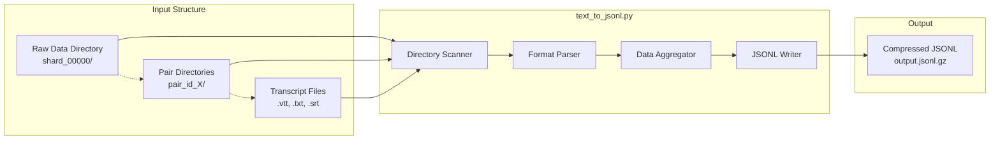
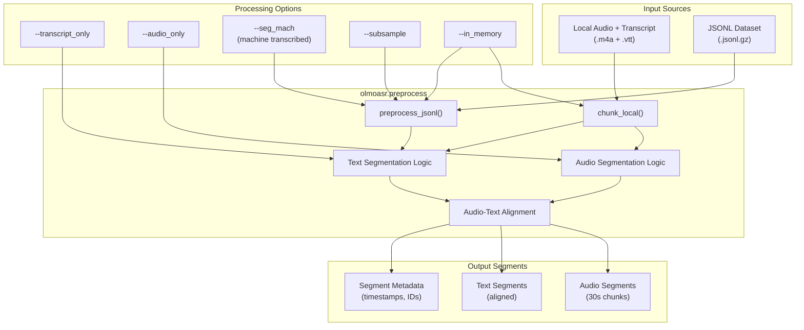
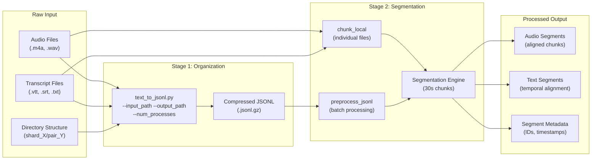

<!-- source: DeepWiki mcp.deepwiki.com · repo allenai/OLMoASR · page 3.1 Data Preprocessing & Segmentation · fetched 2026-10-26 -->

# Data Preprocessing & Segmentation

<details>
<summary>Relevant source files</summary>

The following files were used as context for generating this wiki page:

- [configs/job_configs/data/processing/segmentation.sh](configs/job_configs/data/processing/segmentation.sh)
- [configs/job_configs/data/processing/text_to_jsonl.sh](configs/job_configs/data/processing/text_to_jsonl.sh)
- [scripts/README.md](scripts/README.md)

</details>


This document covers the initial data preprocessing and segmentation pipeline in OLMoASR, which transforms raw audio-transcript pairs into standardized, segmented datasets ready for training. The preprocessing system handles format standardization, audio/text temporal alignment, and segmentation into fixed-duration chunks.

For information about data quality assessment and filtering that occurs after segmentation, see [Data Tagging & Quality Control](#3.2). For training pipeline configuration, see [Training Scripts & Distributed Strategies](#4.2).

## Overview

The data preprocessing pipeline consists of two main stages:

1. **Text Organization**: Converting raw transcript files into standardized JSONL format
2. **Segmentation**: Splitting audio and text into aligned temporal segments (typically 30-second chunks)

## Text Organization Pipeline

### text_to_jsonl.py Processing

The first stage organizes scattered transcript files into a structured JSONL format using `scripts/data/processing/text_to_jsonl.py`.

#### Text Organization Workflow


The script processes directories containing audio-transcript pairs and consolidates them into a single JSONL file with standardized metadata.

**Sources:** [scripts/README.md:6](), [configs/job_configs/data/processing/text_to_jsonl.sh:1-4]()

## Audio/Text Segmentation Pipeline

### Core Segmentation Module

The main segmentation logic resides in `olmoasr/preprocess.py`, which provides two primary entry points:

- `chunk_local`: Processes individual audio/transcript file pairs
- `preprocess_jsonl`: Processes existing JSONL datasets

#### Segmentation Architecture


**Sources:** [scripts/README.md:6](), [configs/job_configs/data/processing/segmentation.sh:1-70]()

## Segmentation Modes

### Local File Processing

The `chunk_local` function processes individual audio-transcript pairs:

| Mode | Command Flag | Purpose |
|------|--------------|---------|
| Full Segmentation | Default | Segments both audio and text with alignment |
| Transcript Only | `--transcript_only True` | Segments text without processing audio |
| Audio Only | `--audio_only True` | Segments audio without text processing |

**Example Usage:**
```bash
python olmoasr/preprocess.py/chunk_local \
    --transcript_file /path/to/transcript.vtt \
    --audio_file /path/to/audio.m4a \
    --output_dir /path/to/output \
    --in_memory False
```

### JSONL Processing

The `preprocess_jsonl` function handles existing JSONL datasets:

| Processing Type | Flags | Description |
|----------------|-------|-------------|
| Manual Transcripts | Default | Processes manually-created transcripts only |
| Mixed Sources | `--seg_mach True` | Includes machine-transcribed content |
| Subsampling | `--subsample True --subsample_size N` | Random sampling during segmentation |
| Subsample Only | `--only_subsample True` | Subsamples pre-segmented data |

### Memory Management

The system supports two memory modes controlled by the `--in_memory` flag:

- `--in_memory True`: Loads data into memory for faster processing
- `--in_memory False`: Streams data from disk for memory-constrained environments

**Sources:** [configs/job_configs/data/processing/segmentation.sh:8-70]()

## Data Flow and File Formats

### Complete Preprocessing Pipeline


### Processing Configuration

The segmentation system supports parallel processing through the `--num_processes` parameter in `text_to_jsonl.py`, enabling efficient handling of large datasets.

**Key Configuration Options:**

| Parameter | Function | Purpose |
|-----------|----------|---------|
| `--shard` | `preprocess_jsonl` | Identifies data shard for processing |
| `--log_dir` | `preprocess_jsonl` | Specifies logging output directory |
| `--output_dir` | Both functions | Target directory for processed segments |
| `--subsample_size` | `preprocess_jsonl` | Number of samples for random subsampling |

**Sources:** [scripts/README.md:5-6](), [configs/job_configs/data/processing/segmentation.sh:18-62](), [configs/job_configs/data/processing/text_to_jsonl.sh:1-4]()

---

