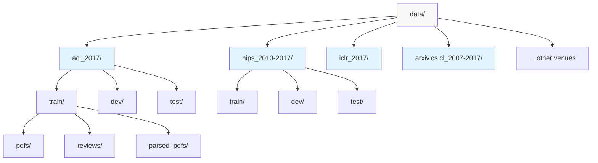
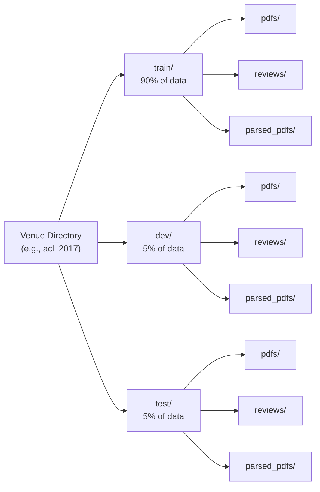
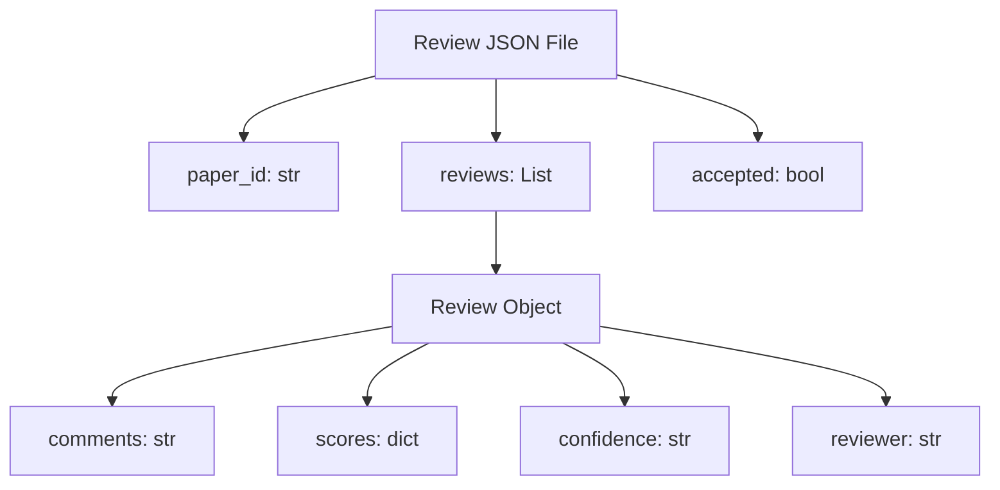
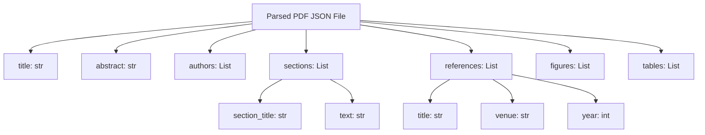
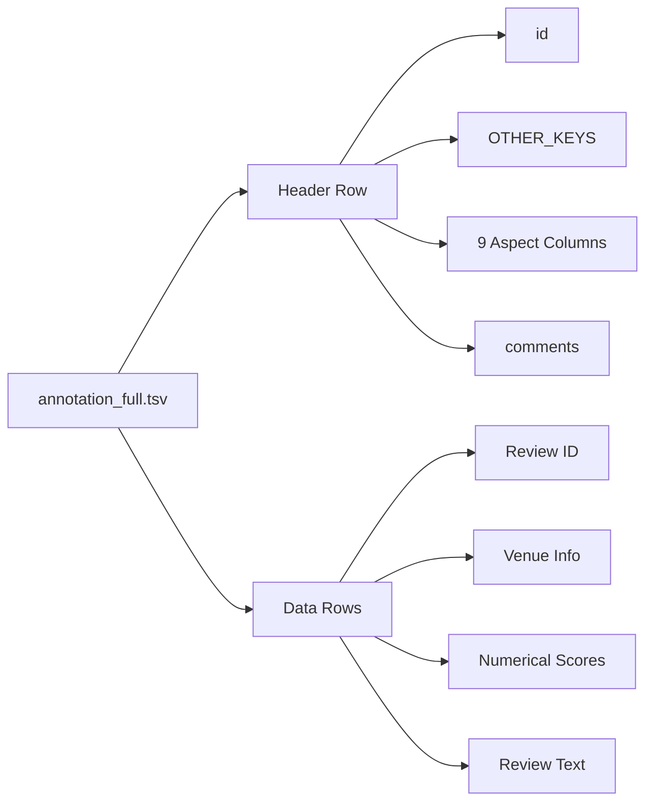
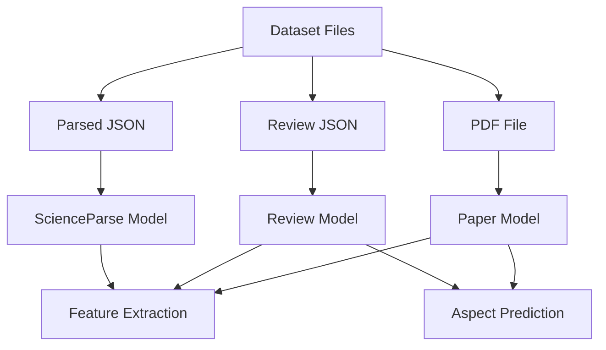

<!-- source: DeepWiki mcp.deepwiki.com · repo allenai/PeerRead · page 3 Dataset Structure · fetched 2026-10-26 -->

# Dataset Structure

<details>
<summary>Relevant source files</summary>

The following files were used as context for generating this wiki page:

- [README.md](README.md)
- [code/aspect_predict/annotation_full.tsv](code/aspect_predict/annotation_full.tsv)

</details>


This page describes the organization and structure of the PeerRead dataset, including the directory layout, data splits, file formats, and annotation schema. For information about preparing or processing the dataset, see [Data Preparation Pipeline](#4). For details on the data models used to represent papers and reviews in code, see [Data Models](#7.1).

---

## Overview

The PeerRead dataset is organized hierarchically by **venue** (conference or journal) and **split** (train/dev/test). The dataset contains over 14,000 paper drafts with accept/reject decisions from venues including ACL, NIPS, ICLR, and arXiv, along with over 10,000 textual peer reviews. Each venue is stored in a separate directory, and within each venue, data is divided into training, development, and test sets.

Sources: [README.md:1-36]()

---

## Directory Hierarchy

The top-level organization of the dataset follows a venue-based structure:



**Venue Directories**: Each venue has its own directory under `data/`:
- `data/acl_2017/` - ACL 2017 conference data
- `data/nips_2013-2017/` - NIPS conferences from 2013-2017
- `data/iclr_2017/` - ICLR 2017 conference data
- `data/arxiv.cs.cl_2007-2017/` - arXiv CS.CL papers from 2007-2017
- Additional venues following the same pattern

Sources: [README.md:8-9]()

---

## Train/Dev/Test Split Structure

Each venue directory contains three subdirectories representing the data splits:



**Split Ratios**: The dataset uses a 90/5/5 split:
- **train/**: 90% of the data, used for model training
- **dev/**: 5% of the data, used for hyperparameter tuning and model selection
- **test/**: 5% of the data, used for final evaluation

**Split Contents**: Each split directory contains three subdirectories:
1. **pdfs/** - Original PDF files of paper submissions
2. **reviews/** - JSON files containing peer review text and metadata
3. **parsed_pdfs/** - Structured JSON output from Science Parse tool

Sources: [README.md:8-9](), Diagram 2 from high-level architecture

---

## File Formats and Contents

### PDF Files

Paper submissions are stored as PDF files in the `pdfs/` directory of each split. Each PDF represents a paper draft that was submitted to the venue.

**Location**: `<venue>/<split>/pdfs/*.pdf`

### Review JSON Files

Peer reviews are stored as JSON files in the `reviews/` directory. Each file contains structured review data including:



**Location**: `<venue>/<split>/reviews/*.json`

**Key Fields**:
- `paper_id` - Unique identifier for the paper
- `reviews` - Array of review objects, each containing:
  - `comments` - Free-text review comments
  - Numerical scores (venue-dependent)
  - Reviewer metadata
- `accepted` - Binary accept/reject decision

### Parsed PDF JSON Files

Structured paper content extracted by Science Parse is stored in the `parsed_pdfs/` directory as JSON files.



**Location**: `<venue>/<split>/parsed_pdfs/*.json`

**Key Fields**:
- `title` - Paper title
- `abstract` - Paper abstract text
- `authors` - List of author names and affiliations
- `sections` - Structured paper sections with titles and text
- `references` - Bibliography entries with parsed metadata
- `figures` - Figure captions and locations
- `tables` - Table captions and locations
- Additional metadata (year, venue, etc.)

Sources: Diagram 2 from high-level architecture, README.md context

---

## Aspect Annotation Structure

For ICLR 2017 reviews, detailed aspect-level annotations are provided in a separate TSV file:

**File Location**: `code/aspect_predict/annotation_full.tsv`

### Aspect Categories

The annotation file contains scores for 9 distinct review aspects:

| Aspect | Description |
|--------|-------------|
| `APPROPRIATENESS` | Suitability of the paper for the venue |
| `CLARITY` | Quality of writing and presentation |
| `ORIGINALITY` | Novelty of the contribution |
| `SOUNDNESS / CORRECTNESS` | Technical correctness and rigor |
| `MEANINGFUL COMPARISON` | Quality of experimental comparisons |
| `SUBSTANCE` | Depth and significance of contribution |
| `IMPACT` | Potential influence on the field |
| `RECOMMENDATION` | Overall reviewer recommendation |
| `OTHER_KEYS` | Additional metadata |

### File Structure



**Format**: Tab-separated values (TSV) with the following columns:
1. `id` - Unique review identifier
2. `OTHER_KEYS` - Venue and reviewer metadata (e.g., "ICLR 2017 conference AnonReviewer1")
3. `APPROPRIATENESS` - Score (1-5 or missing)
4. `CLARITY` - Score (1-5 or missing)
5. `ORIGINALITY` - Score (1-5 or missing)
6. `SOUNDNESS / CORRECTNESS` - Score (1-5 or missing)
7. `MEANINGFUL COMPARISON` - Score (1-5 or missing)
8. `SUBSTANCE` - Score (1-5 or missing)
9. `IMPACT` - Score (1-5 or missing)
10. `RECOMMENDATION` - Score (1-6 or missing)
11. `comments` - Full review text
12. Trailing empty column

**Missing Values**: Represented by "-" when an aspect was not scored

**Example Entry**:
```
97	ICLR 2017 conference AnonReviewer3	-	3	2	-	-	2	2	2	The paper reframes...	
```

Sources: [code/aspect_predict/annotation_full.tsv:1-100]()

---

## Data Model Representation

The dataset files are loaded and represented in code using specific data model classes:



These data models provide structured access to the dataset contents:
- **Paper Model**: Represents paper metadata and acceptance status
- **Review Model**: Represents individual review objects
- **ScienceParse Model**: Represents parsed PDF structure

For implementation details, see [Data Models](#7.1).

Sources: Diagram 1 from high-level architecture

---

## Special Cases and Licensing

Some venue directories may contain README files with download instructions rather than actual data files:

**Example**: `data/nips_2013-2017/README.md`

Due to licensing constraints, NIPS data is not included directly in the repository. Users must download it separately following the instructions provided. The `setup.sh` script at the repository root handles downloading these larger data files.

**Setup Command**: Run `./setup.sh` to download missing data files and install dependencies.

Sources: [README.md:8-9](), [README.md:14]()

---

## Directory Path Patterns

Common path patterns used throughout the codebase:

| Pattern | Example | Purpose |
|---------|---------|---------|
| `data/<venue>/` | `data/acl_2017/` | Venue-specific root |
| `data/<venue>/train/` | `data/iclr_2017/train/` | Training split |
| `data/<venue>/train/pdfs/` | `data/nips_2013-2017/train/pdfs/` | PDF storage |
| `data/<venue>/train/reviews/` | `data/acl_2017/train/reviews/` | Review JSON storage |
| `data/<venue>/train/parsed_pdfs/` | `data/arxiv.cs.cl_2007-2017/train/parsed_pdfs/` | Parsed structure storage |
| `data/<venue>/<split>/dataset/` | `data/acl_2017/train/dataset/` | Feature files (generated) |

The `dataset/` subdirectory within each split is created during feature extraction and contains:
- `features.svmlite_*.txt` - Feature vectors in SVMLight format
- `features_*.dat` - Serialized feature data
- `vect_*.pkl` - Pickled vectorizer objects

Sources: Diagram 3 from high-level architecture, contextual understanding of the data flow

---

## Summary Table

| Component | Location | Format | Description |
|-----------|----------|--------|-------------|
| Paper PDFs | `<venue>/<split>/pdfs/` | PDF | Original paper submissions |
| Reviews | `<venue>/<split>/reviews/` | JSON | Peer review text and metadata |
| Parsed Papers | `<venue>/<split>/parsed_pdfs/` | JSON | Structured content from Science Parse |
| Aspect Annotations | `code/aspect_predict/annotation_full.tsv` | TSV | 9-aspect scores for ICLR 2017 reviews |
| Generated Features | `<venue>/<split>/dataset/` | Multiple | Extracted features for classification |
| Split Ratios | - | - | Train (90%), Dev (5%), Test (5%) |
| Venues | `data/` subdirectories | - | ACL, NIPS, ICLR, arXiv, others |

Sources: [README.md:1-36](), [code/aspect_predict/annotation_full.tsv:1-2](), architectural diagrams

---

