# Page: Overview

# Overview

<details>
<summary>Relevant source files</summary>

The following files were used as context for generating this wiki page:

- [README.md](README.md)

</details>


This document provides a high-level introduction to the PeerRead dataset and repository, including its purpose, contents, and the two main machine learning systems for peer review analysis. For detailed setup instructions, see [Getting Started](#2). For in-depth documentation of the ML pipelines, see [Acceptance Classification Pipeline](#5) and [Aspect Prediction Pipeline](#6).

## Purpose and Scope

The PeerRead repository serves two primary functions:

1. **Dataset Distribution**: Provides access to a large-scale dataset of scientific peer reviews, including paper drafts, review texts, and accept/reject decisions from multiple top-tier conferences
2. **Reference Implementations**: Includes baseline models for two NLP research tasks:
   - **Acceptance prediction**: Classifying whether a paper will be accepted or rejected
   - **Aspect score prediction**: Predicting numerical scores for specific review aspects (e.g., clarity, originality, soundness)

The repository is designed for researchers studying peer review processes, developing automatic review generation systems, or exploring machine learning applications in scientific communication.

**Sources:** [README.md:1-11]()

## Dataset Contents

The PeerRead dataset consists of over **14,000 paper drafts** and corresponding accept/reject decisions, along with over **10,000 textual peer reviews** written by domain experts. The data spans multiple venues and time periods:

| Venue/Source | Time Period | Content Type |
|--------------|-------------|--------------|
| ACL | 2017 | Papers + Reviews + Decisions |
| NIPS | 2013-2017 | Papers + Reviews + Decisions |
| ICLR | 2017 | Papers + Reviews + Decisions + Aspect Annotations |
| CoNLL | 2016 | Papers + Reviews + Decisions |
| arXiv (cs.CL, cs.LG, cs.AI) | 2007-2017 | Papers (no reviews) |

The dataset includes:
- **PDF files** of paper drafts
- **JSON-formatted reviews** with text, scores, and metadata
- **Parsed paper content** extracted using Science Parse (sections, references, abstracts)
- **Aspect annotations** for ICLR 2017 reviews (9 numerical aspect scores)

**Sources:** [README.md:4-8]()

## Repository Structure

The repository is organized into two main directories:

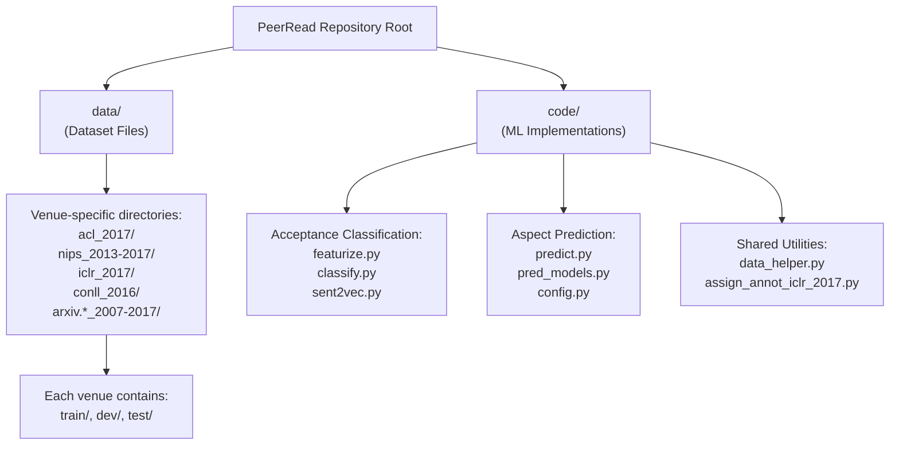

**Directory Structure:**
- **`/data/`**: Contains venue-specific subdirectories, each with train/dev/test splits. Each split directory includes `reviews/`, `pdfs/`, and `parsed_pdfs/` subdirectories
- **`/code/`**: Contains Python implementations of the two ML pipelines and shared utilities
- **`/setup.sh`**: Installation script for dependencies and data download

**Sources:** [README.md:8-11]()

## Machine Learning Pipelines

The repository implements two independent ML systems for analyzing peer reviews:

### Pipeline Architecture

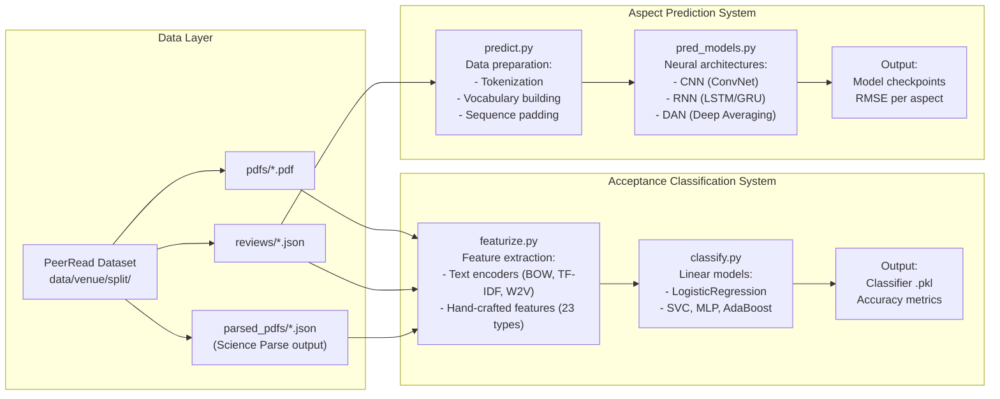

**Sources:** [README.md:10-11](), High-level diagrams

### Acceptance Classification Pipeline

**Purpose**: Predict whether a paper will be accepted or rejected based on paper content and review text.

**Approach**: Feature engineering with linear classifiers
- **Input**: Paper PDFs (parsed) + review JSONs
- **Method**: Extracts lexical features (bag-of-words, TF-IDF, Word2Vec embeddings) and hand-crafted features (reference statistics, document structure, linguistic patterns)
- **Models**: Linear classifiers selected via 5-fold cross-validation (Logistic Regression, SVM, MLP, AdaBoost)
- **Output**: Binary accept/reject predictions with accuracy metrics

**Key Components**:
- `featurize.py` - Extracts and persists features in SVMLight format
- `classify.py` - Trains and evaluates classification models
- `sent2vec.py` - Implements Word2Vec-based embedding vectorizers
- `run_featurize_classify.sh` - End-to-end pipeline execution script

For detailed documentation, see [Acceptance Classification Pipeline](#5).

**Sources:** [README.md:11](), High-level diagrams

### Aspect Prediction Pipeline

**Purpose**: Predict numerical scores for 9 specific review aspects (e.g., clarity, originality, soundness, impact).

**Approach**: Deep learning with neural networks
- **Input**: Review text + aspect annotations (ICLR 2017 subset)
- **Method**: Trains neural networks to perform multi-output regression, predicting scores for each aspect
- **Models**: Three architectures available - CNN (convolutional), RNN (recurrent), DAN (deep averaging network)
- **Output**: Aspect score predictions with RMSE metrics compared to mean/majority baselines

**Key Components**:
- `predict.py` - Data loading, preprocessing, training loop, and evaluation
- `pred_models.py` - Neural network architecture implementations
- `config.py` - Configuration classes for each model type (CNNConfig, RNNConfig, DANConfig)
- `run_predict.sh` - Pipeline execution script

For detailed documentation, see [Aspect Prediction Pipeline](#6).

**Sources:** [README.md:11](), High-level diagrams

## Code-to-System Mapping

The following diagram maps the conceptual systems to their implementation files:

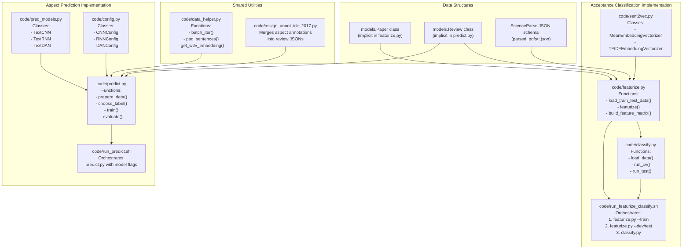

**Sources:** [README.md:11](), High-level diagrams

## Data Flow Summary

The complete end-to-end workflow consists of three sequential phases:

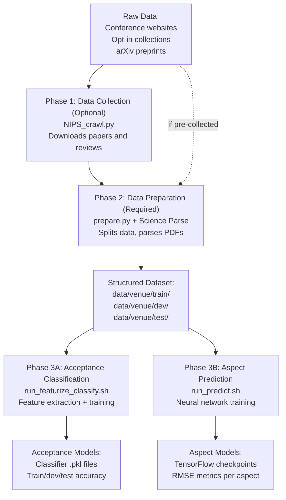

**Key Points**:
1. **Phase 1** (optional): Data can be collected via web crawling or used pre-collected
2. **Phase 2** (required): The `prepare.py` script creates train/dev/test splits and invokes Science Parse to extract structured content from PDFs
3. **Phase 3**: Two independent pipelines that can be run in parallel or separately

For setup and execution details, see [Getting Started](#2). For dataset structure details, see [Dataset Structure](#3).

**Sources:** [README.md:1-14](), High-level diagrams

## External Dependencies

The repository relies on several external tools and libraries:

| Dependency | Purpose | Used By |
|------------|---------|---------|
| **Science Parse** | PDF parsing (extracting sections, references, abstracts) | Data preparation pipeline |
| **scikit-learn** | Feature vectorizers and classification models | Acceptance classification |
| **Gensim** | Word2Vec embeddings | Both pipelines |
| **TensorFlow** | Neural network training | Aspect prediction |
| **NLTK** | Text tokenization and preprocessing | Aspect prediction |

The `setup.sh` script at the repository root installs these dependencies and downloads necessary data files.

**Sources:** [README.md:14](), High-level diagrams

## Research Applications

The dataset and models support research in multiple areas:

1. **Peer Review Analysis**: Understanding what factors influence acceptance decisions
2. **Automatic Review Generation**: Training models to provide feedback on scientific papers
3. **Review Quality Assessment**: Predicting which aspects of a paper need improvement
4. **Scholarly Document Understanding**: Leveraging parsed paper structure for NLP tasks
5. **Transfer Learning**: Using pre-trained models for related scientific document tasks

For citation information and acknowledgements, see [README.md:17-35]().

**Sources:** [README.md:1-11]()

## Quick Start

To begin using PeerRead:

1. **Installation**: Run `./setup.sh` to install dependencies
2. **Explore Data**: Navigate to `data/` to examine the dataset structure (see [Dataset Structure](#3))
3. **Run Acceptance Classification**: Execute `code/run_featurize_classify.sh` (see [Acceptance Classification Pipeline](#5))
4. **Run Aspect Prediction**: Execute `code/run_predict.sh` (see [Aspect Prediction Pipeline](#6))

For complete setup instructions, see [Getting Started](#2).

**Sources:** [README.md:13-14]()

---

# Page: Getting Started

# Getting Started

<details>
<summary>Relevant source files</summary>

The following files were used as context for generating this wiki page:

- [README.md](README.md)
- [code/README.md](code/README.md)

</details>


This guide provides step-by-step instructions for installing the PeerRead repository, setting up the required dependencies, and running your first experiments with both the acceptance classification and aspect prediction pipelines. By the end of this guide, you will have executed both machine learning tasks on the ICLR 2017 dataset.

For detailed information about the dataset structure and file formats, see [Dataset Structure](#3). For comprehensive documentation of the individual pipelines, see [Acceptance Classification Pipeline](#5) and [Aspect Prediction Pipeline](#6).

---

## Prerequisites

Before starting, ensure your system meets these requirements:

| Requirement | Version/Specification | Purpose |
|-------------|----------------------|---------|
| Python | 2.7 or 3.x | Core runtime for all scripts |
| Git | Any recent version | Repository cloning |
| Java | JDK 8+ | Required for Science Parse PDF processing |
| Disk Space | ~5 GB | Dataset storage and model checkpoints |
| RAM | 8 GB minimum | Feature extraction and model training |

**Required Python Libraries:**
- `scikit-learn`: Linear classifiers and feature extraction
- `numpy`: Numerical operations
- `scipy`: Sparse matrix operations for features
- `gensim`: Word2Vec embeddings
- `nltk`: Text preprocessing
- `tensorflow`: Neural network models (aspect prediction only)

**Sources:** [README.md:1-36](), [code/README.md:1-54]()

---

## Installation and Setup

### Step 1: Clone the Repository

```bash
git clone https://github.com/allenai/PeerRead.git
cd PeerRead
```

### Step 2: Run Setup Script

The `setup.sh` script installs Python dependencies and downloads large data files not included in the repository:

```bash
./setup.sh
```

This script performs the following operations:
- Installs required Python packages via pip
- Downloads pre-trained Word2Vec embeddings
- Downloads Science Parse JAR file for PDF processing
- Verifies dataset directory structure

**Sources:** [README.md:13-14]()

---

## System Architecture: Getting Started Workflow

The following diagram shows the typical workflow for getting started with PeerRead, mapping high-level actions to specific scripts and their locations:

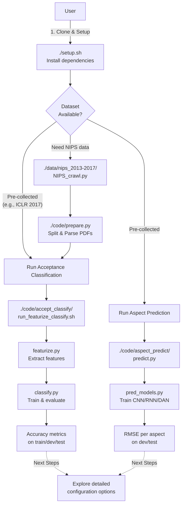

**Sources:** [README.md:1-36](), [code/README.md:1-54]()

---

## Quick Start: Acceptance Classification

The acceptance classification pipeline predicts whether a paper will be accepted or rejected based on the paper content and peer reviews. This task uses feature engineering with linear classifiers.

### Step 1: Navigate to the Acceptance Classification Directory

```bash
cd code/accept_classify
```

### Step 2: Execute the Pipeline Script

The `run_featurize_classify.sh` script orchestrates the entire pipeline:

```bash
./run_featurize_classify.sh
```

### What Happens During Execution

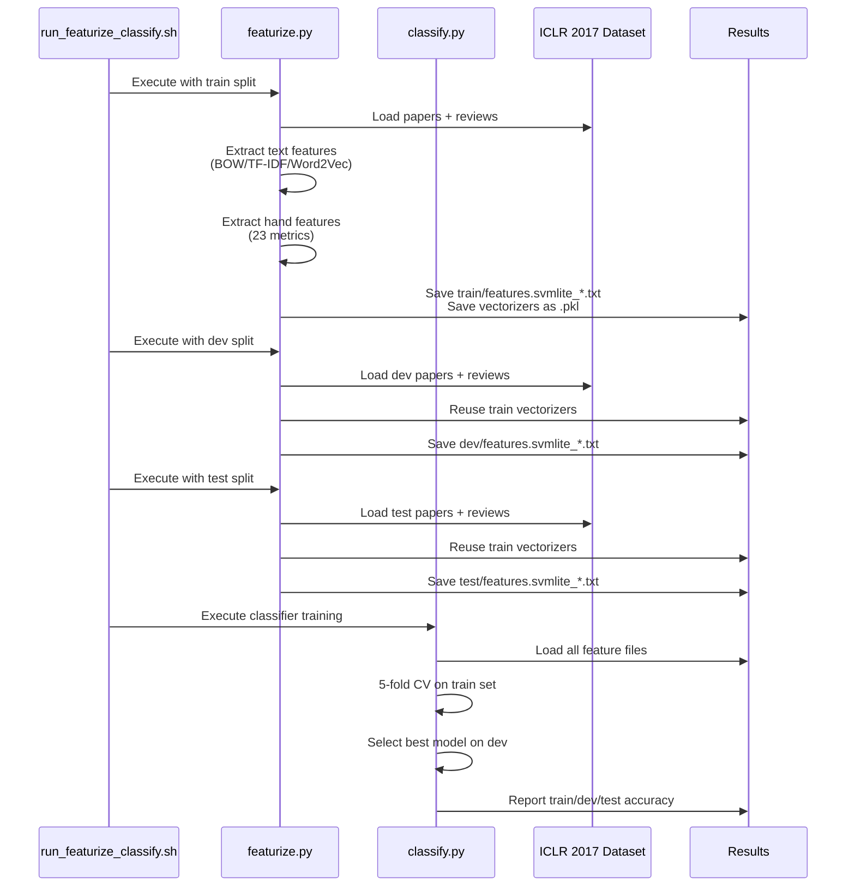

**Runtime Expectations:**
- **featurize.py**: ~35 minutes on ICLR 2017 dataset (one-time cost)
- **classify.py**: ~5 seconds on ICLR 2017 dataset

**Expected Output:**
```
Training accuracy: 0.XX
Development accuracy: 0.XX
Test accuracy: 0.XX
```

**Sources:** [code/README.md:4-20]()

---

## Quick Start: Aspect Prediction

The aspect prediction pipeline uses deep learning to predict numerical scores for 9 different review aspects (e.g., recommendation, clarity, originality).

### Step 1: Navigate to the Aspect Prediction Directory

```bash
cd code/aspect_predict
```

### Step 2: Execute the Prediction Script

The `predict.py` script handles data loading, model training, and evaluation:

```bash
python predict.py "../../data/iclr_2017" "all" "dan" 0
```

### Command-Line Arguments

The `predict.py` script accepts four positional arguments:

| Position | Argument | Options | Description |
|----------|----------|---------|-------------|
| 1 | Dataset path | Path string | Directory containing train/dev/test splits |
| 2 | Input type | `all`, `review`, `paper` | Text source for prediction |
| 3 | Model type | `dan`, `rnn`, `cnn` | Neural architecture to use |
| 4 | Aspect index | 0-8 | Which aspect to predict (0=all aspects) |

**Example Commands:**
```bash
# Train DAN model on review text for all aspects
python predict.py "../../data/iclr_2017" "review" "dan" 0

# Train RNN model on paper text for aspect 3
python predict.py "../../data/iclr_2017" "paper" "rnn" 3

# Train CNN model on combined text for recommendation score
python predict.py "../../data/iclr_2017" "all" "cnn" 1
```

### Code Components for Aspect Prediction

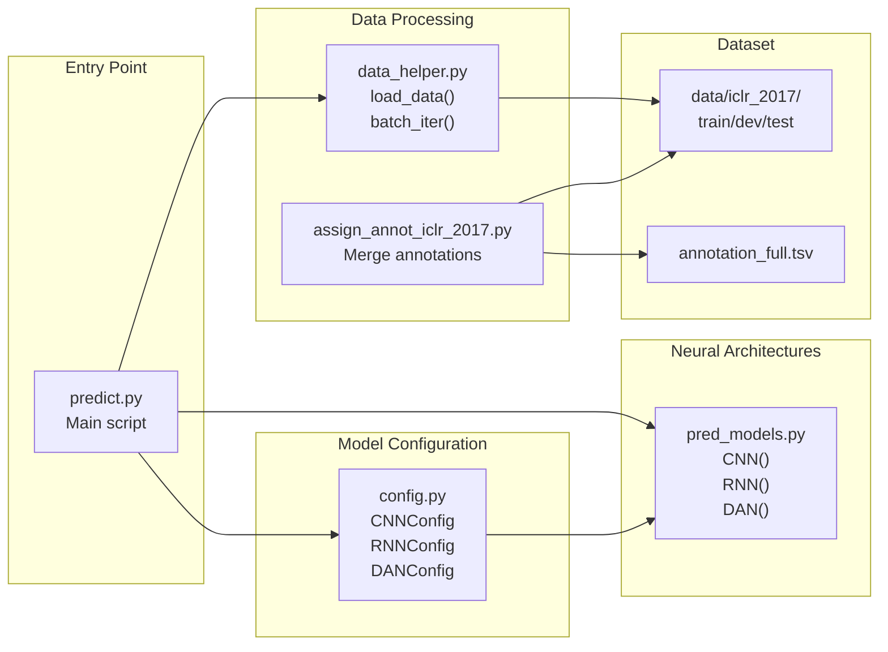

**Expected Output:**
```
Aspect 0 - RMSE on dev: X.XX
Aspect 1 - RMSE on dev: X.XX
...
Mean baseline: X.XX
Majority baseline: X.XX
```

**Sources:** [code/README.md:21-37]()

---

## Detailed Script Execution Flow

### Acceptance Classification Pipeline

The following table maps user actions to specific Python functions and their file locations:

| Action | Script | Key Functions | Output Location |
|--------|--------|---------------|-----------------|
| Feature extraction (train) | `featurize.py` | `build_vocabulary()`, `create_vectorizer()` | `train/dataset/features.svmlite_*.txt`<br/>`train/dataset/vect_*.pkl` |
| Feature extraction (dev/test) | `featurize.py` | `load_vectorizer()`, `transform_features()` | `dev/dataset/features.svmlite_*.txt`<br/>`test/dataset/features.svmlite_*.txt` |
| Model training | `classify.py` | `cross_validate()`, `train_model()` | Console output with accuracies |

**Sources:** [code/README.md:16-19]()

### Aspect Prediction Pipeline

The following table maps user actions to specific Python functions:

| Action | Script | Key Functions | Output Location |
|--------|--------|---------------|-----------------|
| Data loading | `predict.py` | `prepare_data()`, `choose_label()` | In-memory tensors |
| Model initialization | `pred_models.py` | `CNN()`, `RNN()`, `DAN()` | TensorFlow graph |
| Training loop | `predict.py` | `train_step()`, `dev_step()` | `ckpts/` directory |
| Evaluation | `predict.py` | `calculate_rmse()` | Console output with RMSE |

**Sources:** [code/README.md:31-36]()

---

## Verification Steps

After running both pipelines, verify your installation by checking for expected outputs:

### Acceptance Classification Verification

```bash
# Check that feature files were created
ls -lh ../../data/iclr_2017/train/dataset/features.svmlite_*.txt
ls -lh ../../data/iclr_2017/dev/dataset/features.svmlite_*.txt
ls -lh ../../data/iclr_2017/test/dataset/features.svmlite_*.txt

# Check that vectorizer pickle files exist (train only)
ls -lh ../../data/iclr_2017/train/dataset/vect_*.pkl
```

**Expected files:**
- `features.svmlite_bow.txt`: Bag-of-words features
- `features.svmlite_w2v.txt`: Word2Vec features
- `features.svmlite_tfidf.txt`: TF-IDF features
- `vect_bow.pkl`, `vect_tfidf.pkl`, `vect_w2v.pkl`: Trained vectorizers

### Aspect Prediction Verification

```bash
# Check that model checkpoints were saved
ls -lh ckpts/
```

**Expected directory structure:**
- `ckpts/checkpoint`: TensorFlow checkpoint metadata
- `ckpts/model-*.data-*`: Model weights
- `ckpts/model-*.index`: Model index
- `ckpts/model-*.meta`: Model graph definition

**Sources:** [code/README.md:1-54]()

---

## Execution Environment Mapping

This diagram shows where each script executes and what working directory assumptions they make:

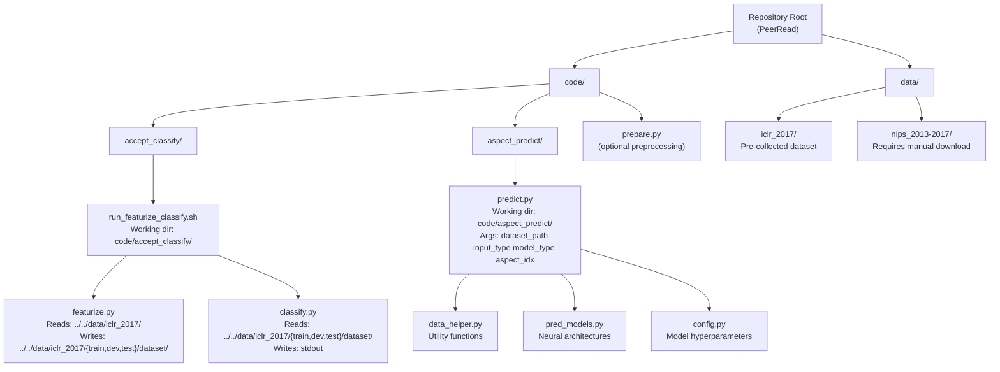

**Sources:** [code/README.md:1-54]()

---

## Common Issues and Solutions

| Issue | Likely Cause | Solution |
|-------|--------------|----------|
| `ModuleNotFoundError: No module named 'sklearn'` | Missing scikit-learn | Run `pip install scikit-learn` |
| `FileNotFoundError: [Errno 2] No such file or directory: '../../data/iclr_2017'` | Wrong working directory | Ensure you're in `code/accept_classify/` or `code/aspect_predict/` |
| `java.lang.OutOfMemoryError` during Science Parse | Insufficient heap space | Edit `prepare.py` to increase JVM memory: `-Xmx8g` |
| `TypeError: 'NoneType' object is not iterable` in featurize.py | Missing parsed PDFs | Run `prepare.py` to generate `parsed_pdfs/` directories |
| Empty feature files | No papers/reviews in dataset | Verify `pdfs/` and `reviews/` directories exist and contain data |

**Sources:** [code/README.md:1-54]()

---

## Next Steps

After successfully running the quick start experiments, explore these topics:

### Deeper Understanding
- **[Dataset Structure](#3)**: Learn about the organization of data splits, file formats, and venue-specific differences
- **[Data Preparation Pipeline](#4)**: Understand how to preprocess raw data if you want to add new venues or papers
- **[External Dependencies](#9)**: Learn about Science Parse and how to configure it for optimal PDF processing

### Pipeline Customization
- **[Feature Extraction](#5.1)**: Explore the 23 hand-crafted features and experiment with different text encoding methods
- **[Classification and Model Selection](#5.3)**: Understand the cross-validation strategy and try different classifier families
- **[Neural Network Models](#6.2)**: Configure CNN, RNN, and DAN architectures with custom hyperparameters
- **[Training and Evaluation](#6.3)**: Learn about early stopping, checkpointing, and evaluation metrics

### Advanced Workflows
- **[Running Experiments](#8)**: Systematic approach to hyperparameter tuning and result logging
- **[Text Encoding Methods](#5.2)**: Deep dive into Word2Vec, TF-IDF, and bag-of-words implementations
- **[Core Components](#7)**: Understand the shared data models and utilities used across both pipelines

**Sources:** [README.md:1-36](), [code/README.md:1-54]()

---

## Quick Reference: Essential Commands

```bash
# Initial setup (one-time)
./setup.sh

# Acceptance classification (from code/accept_classify)
./run_featurize_classify.sh

# Aspect prediction examples (from code/aspect_predict)
python predict.py "../../data/iclr_2017" "all" "dan" 0
python predict.py "../../data/iclr_2017" "review" "rnn" 0
python predict.py "../../data/iclr_2017" "paper" "cnn" 0

# Optional: Prepare new dataset (from code)
python prepare.py ../data/your_venue_name
```

**Sources:** [README.md:1-36](), [code/README.md:1-54]()

---

# Page: Dataset Structure

# Dataset Structure

<details>
<summary>Relevant source files</summary>

The following files were used as context for generating this wiki page:

- [README.md](README.md)
- [code/aspect_predict/annotation_full.tsv](code/aspect_predict/annotation_full.tsv)

</details>


This page describes the organization and structure of the PeerRead dataset, including the directory layout, data splits, file formats, and annotation schema. For information about preparing or processing the dataset, see [Data Preparation Pipeline](#4). For details on the data models used to represent papers and reviews in code, see [Data Models](#7.1).

---

## Overview

The PeerRead dataset is organized hierarchically by **venue** (conference or journal) and **split** (train/dev/test). The dataset contains over 14,000 paper drafts with accept/reject decisions from venues including ACL, NIPS, ICLR, and arXiv, along with over 10,000 textual peer reviews. Each venue is stored in a separate directory, and within each venue, data is divided into training, development, and test sets.

Sources: [README.md:1-36]()

---

## Directory Hierarchy

The top-level organization of the dataset follows a venue-based structure:

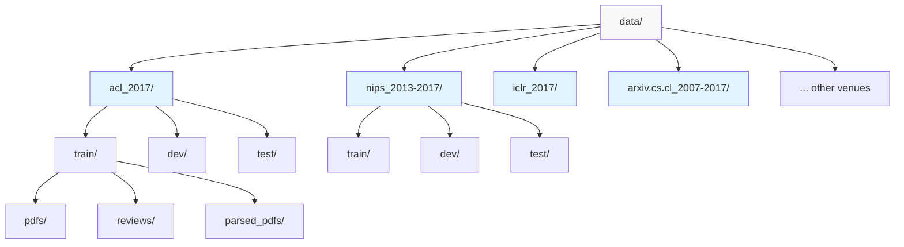

**Venue Directories**: Each venue has its own directory under `data/`:
- `data/acl_2017/` - ACL 2017 conference data
- `data/nips_2013-2017/` - NIPS conferences from 2013-2017
- `data/iclr_2017/` - ICLR 2017 conference data
- `data/arxiv.cs.cl_2007-2017/` - arXiv CS.CL papers from 2007-2017
- Additional venues following the same pattern

Sources: [README.md:8-9]()

---

## Train/Dev/Test Split Structure

Each venue directory contains three subdirectories representing the data splits:

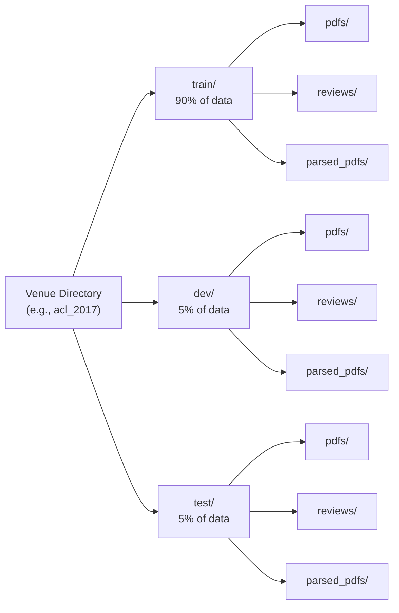

**Split Ratios**: The dataset uses a 90/5/5 split:
- **train/**: 90% of the data, used for model training
- **dev/**: 5% of the data, used for hyperparameter tuning and model selection
- **test/**: 5% of the data, used for final evaluation

**Split Contents**: Each split directory contains three subdirectories:
1. **pdfs/** - Original PDF files of paper submissions
2. **reviews/** - JSON files containing peer review text and metadata
3. **parsed_pdfs/** - Structured JSON output from Science Parse tool

Sources: [README.md:8-9](), Diagram 2 from high-level architecture

---

## File Formats and Contents

### PDF Files

Paper submissions are stored as PDF files in the `pdfs/` directory of each split. Each PDF represents a paper draft that was submitted to the venue.

**Location**: `<venue>/<split>/pdfs/*.pdf`

### Review JSON Files

Peer reviews are stored as JSON files in the `reviews/` directory. Each file contains structured review data including:

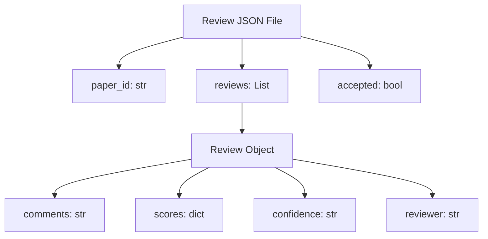

**Location**: `<venue>/<split>/reviews/*.json`

**Key Fields**:
- `paper_id` - Unique identifier for the paper
- `reviews` - Array of review objects, each containing:
  - `comments` - Free-text review comments
  - Numerical scores (venue-dependent)
  - Reviewer metadata
- `accepted` - Binary accept/reject decision

### Parsed PDF JSON Files

Structured paper content extracted by Science Parse is stored in the `parsed_pdfs/` directory as JSON files.

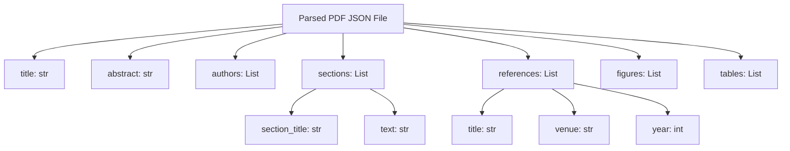

**Location**: `<venue>/<split>/parsed_pdfs/*.json`

**Key Fields**:
- `title` - Paper title
- `abstract` - Paper abstract text
- `authors` - List of author names and affiliations
- `sections` - Structured paper sections with titles and text
- `references` - Bibliography entries with parsed metadata
- `figures` - Figure captions and locations
- `tables` - Table captions and locations
- Additional metadata (year, venue, etc.)

Sources: Diagram 2 from high-level architecture, README.md context

---

## Aspect Annotation Structure

For ICLR 2017 reviews, detailed aspect-level annotations are provided in a separate TSV file:

**File Location**: `code/aspect_predict/annotation_full.tsv`

### Aspect Categories

The annotation file contains scores for 9 distinct review aspects:

| Aspect | Description |
|--------|-------------|
| `APPROPRIATENESS` | Suitability of the paper for the venue |
| `CLARITY` | Quality of writing and presentation |
| `ORIGINALITY` | Novelty of the contribution |
| `SOUNDNESS / CORRECTNESS` | Technical correctness and rigor |
| `MEANINGFUL COMPARISON` | Quality of experimental comparisons |
| `SUBSTANCE` | Depth and significance of contribution |
| `IMPACT` | Potential influence on the field |
| `RECOMMENDATION` | Overall reviewer recommendation |
| `OTHER_KEYS` | Additional metadata |

### File Structure

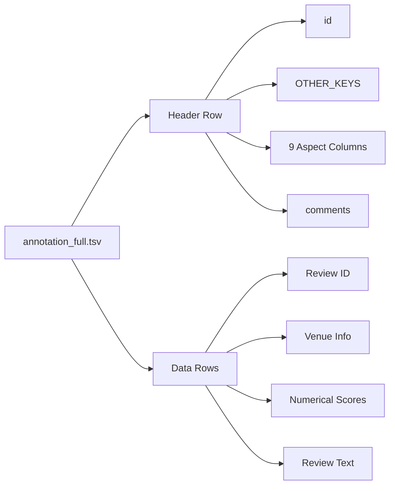

**Format**: Tab-separated values (TSV) with the following columns:
1. `id` - Unique review identifier
2. `OTHER_KEYS` - Venue and reviewer metadata (e.g., "ICLR 2017 conference AnonReviewer1")
3. `APPROPRIATENESS` - Score (1-5 or missing)
4. `CLARITY` - Score (1-5 or missing)
5. `ORIGINALITY` - Score (1-5 or missing)
6. `SOUNDNESS / CORRECTNESS` - Score (1-5 or missing)
7. `MEANINGFUL COMPARISON` - Score (1-5 or missing)
8. `SUBSTANCE` - Score (1-5 or missing)
9. `IMPACT` - Score (1-5 or missing)
10. `RECOMMENDATION` - Score (1-6 or missing)
11. `comments` - Full review text
12. Trailing empty column

**Missing Values**: Represented by "-" when an aspect was not scored

**Example Entry**:
```
97	ICLR 2017 conference AnonReviewer3	-	3	2	-	-	2	2	2	The paper reframes...	
```

Sources: [code/aspect_predict/annotation_full.tsv:1-100]()

---

## Data Model Representation

The dataset files are loaded and represented in code using specific data model classes:

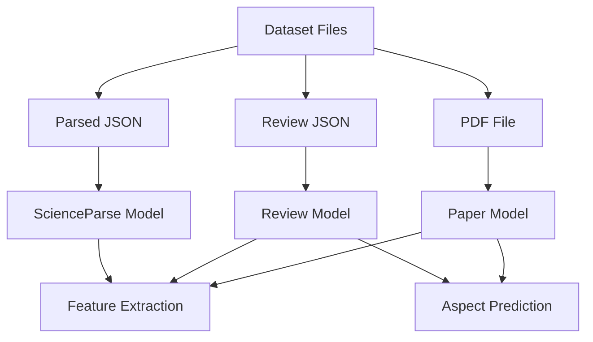

These data models provide structured access to the dataset contents:
- **Paper Model**: Represents paper metadata and acceptance status
- **Review Model**: Represents individual review objects
- **ScienceParse Model**: Represents parsed PDF structure

For implementation details, see [Data Models](#7.1).

Sources: Diagram 1 from high-level architecture

---

## Special Cases and Licensing

Some venue directories may contain README files with download instructions rather than actual data files:

**Example**: `data/nips_2013-2017/README.md`

Due to licensing constraints, NIPS data is not included directly in the repository. Users must download it separately following the instructions provided. The `setup.sh` script at the repository root handles downloading these larger data files.

**Setup Command**: Run `./setup.sh` to download missing data files and install dependencies.

Sources: [README.md:8-9](), [README.md:14]()

---

## Directory Path Patterns

Common path patterns used throughout the codebase:

| Pattern | Example | Purpose |
|---------|---------|---------|
| `data/<venue>/` | `data/acl_2017/` | Venue-specific root |
| `data/<venue>/train/` | `data/iclr_2017/train/` | Training split |
| `data/<venue>/train/pdfs/` | `data/nips_2013-2017/train/pdfs/` | PDF storage |
| `data/<venue>/train/reviews/` | `data/acl_2017/train/reviews/` | Review JSON storage |
| `data/<venue>/train/parsed_pdfs/` | `data/arxiv.cs.cl_2007-2017/train/parsed_pdfs/` | Parsed structure storage |
| `data/<venue>/<split>/dataset/` | `data/acl_2017/train/dataset/` | Feature files (generated) |

The `dataset/` subdirectory within each split is created during feature extraction and contains:
- `features.svmlite_*.txt` - Feature vectors in SVMLight format
- `features_*.dat` - Serialized feature data
- `vect_*.pkl` - Pickled vectorizer objects

Sources: Diagram 3 from high-level architecture, contextual understanding of the data flow

---

## Summary Table

| Component | Location | Format | Description |
|-----------|----------|--------|-------------|
| Paper PDFs | `<venue>/<split>/pdfs/` | PDF | Original paper submissions |
| Reviews | `<venue>/<split>/reviews/` | JSON | Peer review text and metadata |
| Parsed Papers | `<venue>/<split>/parsed_pdfs/` | JSON | Structured content from Science Parse |
| Aspect Annotations | `code/aspect_predict/annotation_full.tsv` | TSV | 9-aspect scores for ICLR 2017 reviews |
| Generated Features | `<venue>/<split>/dataset/` | Multiple | Extracted features for classification |
| Split Ratios | - | - | Train (90%), Dev (5%), Test (5%) |
| Venues | `data/` subdirectories | - | ACL, NIPS, ICLR, arXiv, others |

Sources: [README.md:1-36](), [code/aspect_predict/annotation_full.tsv:1-2](), architectural diagrams

---

# Page: Data Preparation Pipeline

# Data Preparation Pipeline

<details>
<summary>Relevant source files</summary>

The following files were used as context for generating this wiki page:

- [code/data_prepare/prepare.py](code/data_prepare/prepare.py)
- [code/data_prepare/run_prepare.sh](code/data_prepare/run_prepare.sh)

</details>


## Purpose and Scope

The Data Preparation Pipeline transforms raw conference data (PDFs and review JSONs) into structured train/dev/test splits ready for machine learning experiments. This pipeline handles data validation, PDF parsing via Science Parse, and standardized dataset organization.

This document provides a high-level overview of the complete preparation workflow. For detailed information about specific stages:
- Data collection from conferences and arXiv: see [Data Collection](#4.1)
- The `prepare.py` script and splitting logic: see [Data Processing and Splitting](#4.2)

For information about the downstream ML pipelines that consume the prepared data:
- Acceptance classification: see [Acceptance Classification Pipeline](#5)
- Aspect prediction: see [Aspect Prediction Pipeline](#6)

**Sources:** [code/data_prepare/prepare.py:1-126](), [code/data_prepare/run_prepare.sh:1-15]()

## Pipeline Overview

The data preparation pipeline consists of four stages executed sequentially for each dataset. The pipeline is mandatory before running any ML experiments, as it creates the standardized directory structure and enriches PDFs with metadata from Science Parse.

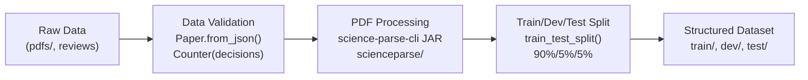

**Diagram: High-level pipeline stages executed by prepare.py**

The pipeline operates on multiple datasets in batch mode via the `run_prepare.sh` script, which iterates through conference venues (NIPS, ICLR, ACL, CoNLL, arXiv categories).

**Sources:** [code/data_prepare/prepare.py:10-126](), [code/data_prepare/run_prepare.sh:1-15]()

## Input Requirements

Before running the preparation pipeline, the data directory must contain:

| Directory/File | Description | Required |
|----------------|-------------|----------|
| `pdfs/` | Directory containing PDF files of papers | Yes |
| `reviews/` | Directory containing JSON files with reviews | Yes (or `reviews.json`) |
| `reviews.json` | Alternative: single file with all reviews from SoftConf dump | Alternative to `reviews/` |

The pipeline validates these inputs and reports statistics before processing:

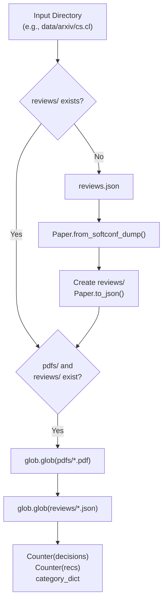

**Diagram: Input validation and review file handling in prepare.py**

The validation stage [code/data_prepare/prepare.py:17-61]() performs several checks:
- Converts SoftConf dump format to individual review JSONs if needed
- Counts PDFs, papers, and reviews
- Analyzes decision distributions (accept/reject)
- Categorizes papers by arXiv subject area

**Sources:** [code/data_prepare/prepare.py:14-61]()

## Science Parse Integration

The pipeline invokes an external Science Parse JAR file to extract structured information from PDFs. This produces enriched JSON files containing:
- Title, authors, abstract
- References (parsed bibliographic entries)
- Section structure
- Figures and tables

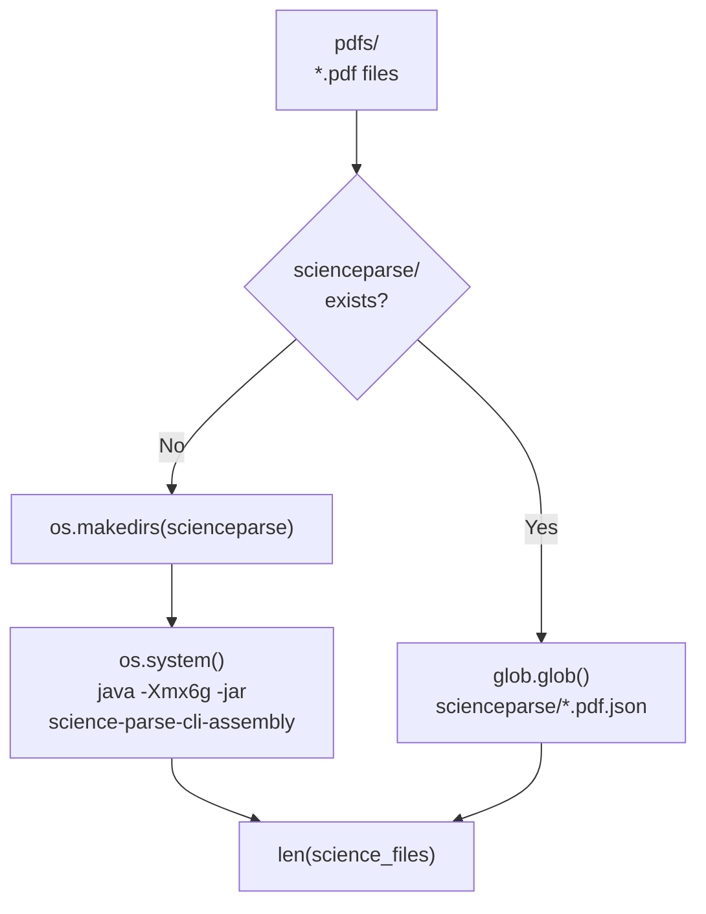

**Diagram: Science Parse execution flow**

The Science Parse invocation [code/data_prepare/prepare.py:69]() uses:
- **Memory allocation:** 6GB heap (`-Xmx6g`)
- **Input:** `pdf_dir` containing all PDFs
- **Output:** `scienceparse/` directory with `*.pdf.json` files
- **JAR path:** `../lib/science-parse-cli-assembly-1.2.9-SNAPSHOT.jar`

If the `scienceparse/` directory already exists, the pipeline skips reprocessing and loads existing parsed files [code/data_prepare/prepare.py:72-74]().

**Sources:** [code/data_prepare/prepare.py:64-75]()

## Data Splitting Strategy

The pipeline splits data into train/dev/test sets with a 90%/5%/5% ratio using `sklearn.model_selection.train_test_split`:

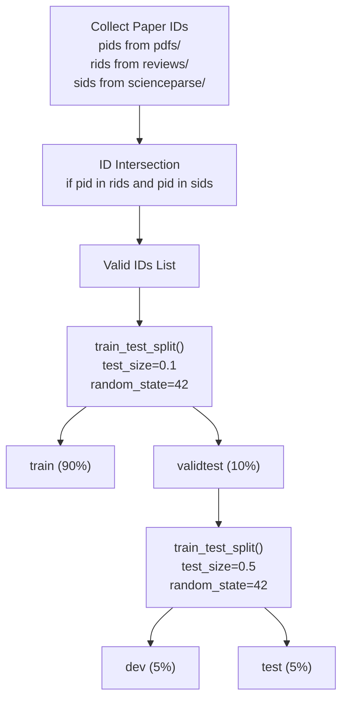

**Diagram: Two-stage splitting process**

The splitting logic [code/data_prepare/prepare.py:95-103]() ensures:
1. **Completeness:** Only papers with all three components (PDF, review, parsed PDF) are included
2. **Reproducibility:** Fixed random seed (42) ensures consistent splits across runs
3. **Two-stage split:** First separates train (90%) from validation+test (10%), then splits the 10% equally into dev and test

**Sources:** [code/data_prepare/prepare.py:78-103]()

## File Organization

After splitting, the pipeline creates parallel directory structures for each split:

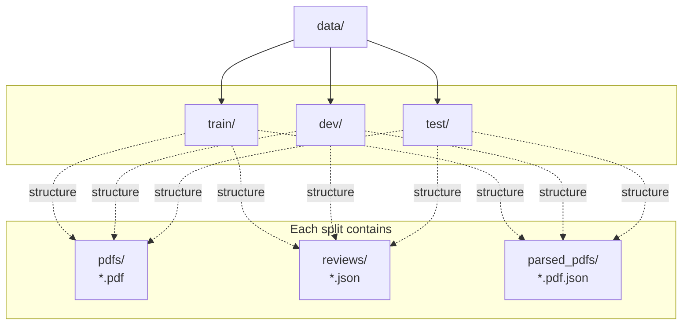

**Diagram: Output directory structure created by prepare.py**

The file copying operation [code/data_prepare/prepare.py:105-123]() uses:
- `copyfile()` from `shutil` module to copy files
- `rmtree()` to clean existing split directories if re-running
- Consistent naming: Paper ID is preserved across all three file types

| Split | Purpose | Directory Structure |
|-------|---------|---------------------|
| `train/` | Model training | `pdfs/`, `reviews/`, `parsed_pdfs/` |
| `dev/` | Hyperparameter tuning, model selection | `pdfs/`, `reviews/`, `parsed_pdfs/` |
| `test/` | Final evaluation | `pdfs/`, `reviews/`, `parsed_pdfs/` |

**Sources:** [code/data_prepare/prepare.py:105-124]()

## Batch Processing

The `run_prepare.sh` script processes multiple datasets in sequence:

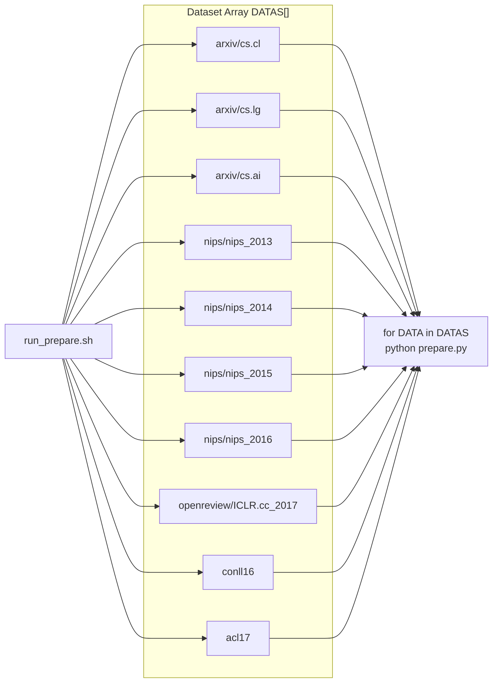

**Diagram: Batch processing loop in run_prepare.sh**

The script [code/data_prepare/run_prepare.sh:4-12]() defines:
- **DATADIR:** Base path (`../../data/`)
- **DATAS array:** 10 datasets across 4 venues (arXiv, NIPS, ICLR/OpenReview, direct submissions)
- **Execution:** Calls `python prepare.py $DATADIR$DATA` for each dataset

**Sources:** [code/data_prepare/run_prepare.sh:1-15]()

## Dependencies and Imports

The preparation pipeline requires the following Python dependencies:

| Module | Purpose | Usage in prepare.py |
|--------|---------|---------------------|
| `os`, `sys`, `glob` | File system operations | Directory creation, file discovery |
| `collections.Counter` | Statistics collection | Decision and recommendation counts |
| `shutil.copyfile`, `rmtree` | File operations | Copying files to splits, cleaning directories |
| `sklearn.model_selection.train_test_split` | Data splitting | Creating train/dev/test splits |
| `models.Paper` | Data model | Loading and parsing paper/review JSON files |
| `models.Review` | Data model | Review representation |

The pipeline also depends on:
- **Science Parse JAR:** External Java tool for PDF processing (see [External Dependencies](#9))
- **Java Runtime:** Required to execute Science Parse (minimum 6GB heap)

**Sources:** [code/data_prepare/prepare.py:1-9]()

## Execution Flow Summary

The complete execution flow from raw data to structured dataset:

```mermaid
sequenceDiagram
    participant User
    participant Shell as run_prepare.sh
    participant Python as prepare.py
    participant SP as Science Parse JAR
    participant FS as File System
    
    User->>Shell: ./run_prepare.sh
    loop For each dataset in DATAS
        Shell->>Python: python prepare.py <dataset_path>
        Python->>FS: Check pdfs/ and reviews/
        Python->>FS: Load paper/review JSONs
        Python->>Python: Counter(decisions, recs)
        Python->>SP: java -jar science-parse-cli
        SP->>FS: Write scienceparse/*.pdf.json
        Python->>Python: Collect valid IDs (pdf+review+parse)
        Python->>Python: train_test_split() twice
        Python->>FS: rmtree() existing splits
        Python->>FS: makedirs() train/dev/test
        loop For each paper ID in split
            Python->>FS: copyfile() pdf, review, parsed_pdf
        end
    end
    Shell->>User: All datasets prepared
```

**Diagram: Sequence diagram showing prepare.py execution**

The pipeline is idempotent: running it multiple times on the same data produces identical results due to the fixed random seed. However, existing split directories are removed and recreated [code/data_prepare/prepare.py:106-107]() to ensure clean state.

**Sources:** [code/data_prepare/prepare.py:10-126](), [code/data_prepare/run_prepare.sh:8-12]()

## Output Validation

The pipeline prints statistics at each stage:

```
Number of pdfs: <count>
Number of papers: <count>
Paper Decisions: Counter({'true': X, 'false': Y})
Review Recommendations: Counter({...})
Number of reviews: <count>
Categories: {'cs.cl': X, 'cs.lg': Y, ...}
Number of science parses: <count>
Splitting.. train <count>
Splitting.. dev <count>
Splitting.. test <count>
```

These statistics [code/data_prepare/prepare.py:28-74]() help verify:
- All expected PDFs and reviews are present
- Decision distribution (class balance)
- Category breakdown for arXiv papers
- Science Parse completed successfully
- Split sizes match expected ratios

**Sources:** [code/data_prepare/prepare.py:28-111]()

---

# Page: Data Collection

# Data Collection

<details>
<summary>Relevant source files</summary>

The following files were used as context for generating this wiki page:

- [code/data_prepare/crawler/NIPS_crawl.py](code/data_prepare/crawler/NIPS_crawl.py)
- [code/data_prepare/prepare.py](code/data_prepare/prepare.py)

</details>


## Purpose and Scope

This document explains how to collect raw data for the PeerRead dataset using the NIPS web crawler and describes alternative data collection methods. Data collection is **optional** - the repository can work with pre-collected data that is already included or obtained from other sources.

For information about processing and splitting collected data into train/dev/test sets, see [Data Processing and Splitting](#4.2). For the complete dataset structure after processing, see [Dataset Structure](#3).

---

## Overview of Data Sources

The PeerRead dataset aggregates peer review data from multiple sources. The repository provides automated collection tools for some sources while others require manual acquisition.

```mermaid
graph TB
    subgraph Sources["Data Sources"]
        NIPS["papers.nips.cc<br/>NIPS Conference<br/>(Automated)"]
        OpenReview["openreview.net<br/>ICLR Conference<br/>(Manual Download)"]
        OptIn["Author/Reviewer Contributions<br/>CoNLL, ACL Venues<br/>(Opt-in Collection)"]
        ArXiv["arxiv.org<br/>Preprints<br/>(Manual Download)"]
    end
    
    subgraph Tools["Collection Tools"]
        NIPSCrawl["NIPS_crawl.py<br/>Automated Web Crawler"]
        Manual["Manual Collection<br/>Direct Download"]
    end
    
    subgraph Output["Raw Output"]
        PDFDir["data/pdfs/<br/>PDF Files"]
        ReviewDir["data/reviews/<br/>Review JSON Files"]
    end
    
    NIPS --> NIPSCrawl
    OpenReview --> Manual
    OptIn --> Manual
    ArXiv --> Manual
    
    NIPSCrawl --> PDFDir
    NIPSCrawl --> ReviewDir
    Manual --> PDFDir
    Manual --> ReviewDir
```

**Data Source Characteristics:**

| Source | Collection Method | Content Available | Automated Tool |
|--------|------------------|-------------------|----------------|
| NIPS Conference | Web Scraping | Papers, Reviews, Acceptance Decisions | `NIPS_crawl.py` |
| ICLR (OpenReview) | Manual Download | Papers, Reviews, Public Comments | None |
| CoNLL/ACL | Author Opt-in | Papers, Reviews (with consent) | None |
| arXiv | Manual Download | Preprints only (no reviews) | None |

Sources: [code/data_prepare/crawler/NIPS_crawl.py]()

---

## NIPS Crawler Architecture

The `NIPS_crawl.py` script implements a hierarchical web crawler that traverses the NIPS conference website structure to extract papers, reviews, and metadata.

```mermaid
graph TB
    Main["main()<br/>Entry Point<br/>code/data_prepare/crawler/NIPS_crawl.py:13-56"]
    
    GetURL["get_url(http, url)<br/>HTTP Request Handler<br/>Lines 244-255"]
    
    Level1["Conference Page<br/>papers.nips.cc/book/advances-...<br/>List of Papers"]
    
    HandlePaper["handle_paper()<br/>Parse Paper Link<br/>Lines 57-88"]
    
    Level2["Paper Detail Page<br/>Extract: Title, Authors,<br/>PDF URL, Reviews URL"]
    
    HandleURL2["handle_url2()<br/>Parse Paper Details<br/>Lines 90-156"]
    
    Level3["Reviews Page<br/>Extract Review Text<br/>and Confidence Scores"]
    
    HandleURL3["handle_url3()<br/>Parse Reviews<br/>Lines 158-241"]
    
    subgraph Output["Output Files"]
        PDF["pdfs{ID}.pdf<br/>Raw PDF File"]
        JSON["reviews{ID}.json<br/>Paper Object with Reviews"]
    end
    
    Main --> GetURL
    GetURL --> Level1
    Level1 --> HandlePaper
    HandlePaper --> HandleURL2
    HandleURL2 --> Level2
    Level2 --> HandleURL3
    HandleURL3 --> Level3
    
    HandleURL2 --> PDF
    HandlePaper --> JSON
```

**Crawler Components:**

| Function | Purpose | Lines |
|----------|---------|-------|
| `main()` | Entry point, processes command-line arguments and iterates through papers | [code/data_prepare/crawler/NIPS_crawl.py:13-56]() |
| `handle_paper()` | Parses paper listing HTML, extracts title and authors | [code/data_prepare/crawler/NIPS_crawl.py:57-88]() |
| `handle_url2()` | Extracts paper metadata, abstract, PDF/review URLs | [code/data_prepare/crawler/NIPS_crawl.py:90-156]() |
| `handle_url3()` | Parses review pages, handles different HTML formats by year | [code/data_prepare/crawler/NIPS_crawl.py:158-241]() |
| `get_url()` | HTTP request wrapper with error handling | [code/data_prepare/crawler/NIPS_crawl.py:244-255]() |

Sources: [code/data_prepare/crawler/NIPS_crawl.py:1-261]()

---

## Implementation Details

### URL Construction and HTTP Handling

The crawler constructs URLs based on the NIPS conference year and uses `urllib3` with certificate verification for secure connections:

```mermaid
graph LR
    Year["Year Input<br/>(e.g., 2016)"]
    Number["Conference Number<br/>year - 1987"]
    URL["https://papers.nips.cc/book/<br/>advances-in-neural-information-<br/>processing-systems-{number}-{year}"]
    
    HTTP["urllib3.PoolManager<br/>cert_reqs='CERT_REQUIRED'<br/>Line 30"]
    
    Request["HTTP GET Request<br/>get_url() function"]
    Response["HTTP Response<br/>Status Check"]
    
    Year --> Number
    Number --> URL
    URL --> HTTP
    HTTP --> Request
    Request --> Response
```

**Key implementation details:**

- **Conference number calculation**: `number = str(int(year)-1987)` [code/data_prepare/crawler/NIPS_crawl.py:29]()
- **SSL verification**: Uses `certifi` package for certificate validation [code/data_prepare/crawler/NIPS_crawl.py:8,30]()
- **Error handling**: Returns `None` on HTTP errors or retry exhaustion [code/data_prepare/crawler/NIPS_crawl.py:248-253]()

Sources: [code/data_prepare/crawler/NIPS_crawl.py:13-32,244-255]()

### HTML Parsing and Regular Expressions

The crawler uses regular expressions to extract structured data from HTML pages. Different regex patterns handle format variations across conference years:

**Paper Listing Pattern** [code/data_prepare/crawler/NIPS_crawl.py:59]():
```
<li><a href="([^\"]+)">([^<]+)</a> (.*)</li>
```
Captures: (1) Paper URL, (2) Title, (3) Author HTML

**Author Extraction Pattern** [code/data_prepare/crawler/NIPS_crawl.py:70]():
```
a [^>]+>([^<]+)</a
```
Captures: (1) Author name from anchor tag

**Review Extraction Patterns**:

| Year Range | Pattern | Location |
|------------|---------|----------|
| Pre-2016 | `<i>Submitted by Assigned_Reviewer_[0-9]+</i>` | [code/data_prepare/crawler/NIPS_crawl.py:180]() |
| 2016+ | `<h3>Reviewer [0-9]+</h3>` | [code/data_prepare/crawler/NIPS_crawl.py:205]() |

Sources: [code/data_prepare/crawler/NIPS_crawl.py:57-241]()

### Paper Object Construction

The crawler constructs `Paper` objects with all collected metadata and serializes them to JSON:

```mermaid
graph LR
    Metadata["Extracted Metadata"]
    
    subgraph PaperFields["Paper Object Fields"]
        Title["title: str"]
        Abstract["abstract: str"]
        ID["ID: str"]
        Reviews["REVIEWS: List[Review]"]
        Authors["AUTHORS: List[str]"]
        Conference["CONFERENCE: str<br/>'NIPS{year}'"]
        Accepted["ACCEPTED: bool"]
        PubType["PUBLICATION_TYPE: str"]
    end
    
    JSON["reviews{ID}.json<br/>Serialized Output"]
    
    Metadata --> Title
    Metadata --> Abstract
    Metadata --> ID
    Metadata --> Reviews
    Metadata --> Authors
    Metadata --> Conference
    Metadata --> Accepted
    Metadata --> PubType
    
    PubType --> JSON
    
    Title --> JSON
    Abstract --> JSON
    ID --> JSON
    Reviews --> JSON
    Authors --> JSON
    Conference --> JSON
    Accepted --> JSON
```

**Paper instantiation** [code/data_prepare/crawler/NIPS_crawl.py:83-84]():
```python
conference = "NIPS"+str(year)
p = Paper(title, abstract, id, reviews, authors, conference, True, None, publication_type)
```

**JSON serialization** [code/data_prepare/crawler/NIPS_crawl.py:86]():
```python
p.to_json(out_dir+"/reviews"+str(id)+".json")
```

Sources: [code/data_prepare/crawler/NIPS_crawl.py:83-88](), [code/models/Paper.py]()

### Review Object Handling

Reviews are extracted with varying metadata depending on the conference year. The crawler adapts to different HTML structures:

**Pre-2016 Format** [code/data_prepare/crawler/NIPS_crawl.py:171-200]():
- Uses `<BR>` tag splitting
- Extracts review text from `<DIV class="response">` blocks
- No confidence scores available

**2016+ Format** [code/data_prepare/crawler/NIPS_crawl.py:201-232]():
- Uses `<h3>Reviewer [0-9]+</h3>` headers
- Extracts confidence scores: `<p>([0-9]+)-.*</p>`
- Review text from `<p>` tags

**Review construction** [code/data_prepare/crawler/NIPS_crawl.py:208,235]():
```python
r = Review(None, review, None, None, None, None, None, confidence)
reviews.append(r)
```

Sources: [code/data_prepare/crawler/NIPS_crawl.py:158-241](), [code/models/Review.py]()

---

## Running the Crawler

### Command-Line Interface

**Basic usage:**
```bash
python code/data_prepare/crawler/NIPS_crawl.py <year> <output_dir>
```

**Skip PDF downloads (reviews only):**
```bash
python code/data_prepare/crawler/NIPS_crawl.py <year> <output_dir> no_pdf
```

**Command-line arguments** [code/data_prepare/crawler/NIPS_crawl.py:13-21]():

| Argument | Position | Required | Description |
|----------|----------|----------|-------------|
| `year` | 1 | Yes | Conference year to crawl (e.g., 2016) |
| `output_dir` | 2 | Yes | Directory to save PDFs and review JSONs |
| `no_pdf` | 3 | No | Any value disables PDF downloads |

### Execution Flow

```mermaid
graph TB
    Start["Script Invocation"]
    ParseArgs["Parse Arguments<br/>Lines 13-21"]
    CheckArgs{"argc < 3?"}
    PrintUsage["Print Usage Message<br/>Exit -1"]
    
    CreateDir["Create output_dir<br/>if not exists<br/>Lines 26-27"]
    
    BuildURL["Construct Conference URL<br/>Line 32"]
    
    FetchList["Fetch Paper List<br/>get_url()<br/>Lines 35-38"]
    
    CheckData{"data is None?"}
    ExitError["Exit -2"]
    
    ParseHTML["Split HTML into Lines<br/>Line 40"]
    
    LoopStart["For each line in HTML"]
    CheckPaper{"Line contains<br/>'<li><a href=/paper'?"}
    
    HandlePaper["handle_paper()<br/>Extract and Save Paper<br/>Line 49"]
    
    LoopEnd["Next Line"]
    
    Complete["Print Paper Count<br/>Exit"]
    
    Start --> ParseArgs
    ParseArgs --> CheckArgs
    CheckArgs -->|Yes| PrintUsage
    CheckArgs -->|No| CreateDir
    CreateDir --> BuildURL
    BuildURL --> FetchList
    FetchList --> CheckData
    CheckData -->|Yes| ExitError
    CheckData -->|No| ParseHTML
    ParseHTML --> LoopStart
    LoopStart --> CheckPaper
    CheckPaper -->|Yes| HandlePaper
    CheckPaper -->|No| LoopEnd
    HandlePaper --> LoopEnd
    LoopEnd --> LoopStart
    LoopStart -->|Done| Complete
```

**Exit codes:**
- `-1`: Invalid arguments
- `-2`: Failed to fetch conference page
- `0`: Success

Sources: [code/data_prepare/crawler/NIPS_crawl.py:13-56]()

### Example Crawl Session

**Crawling NIPS 2016 papers:**
```bash
mkdir -p data/nips2016
python code/data_prepare/crawler/NIPS_crawl.py 2016 data/nips2016
```

**Expected console output:**
```
Got 1234 lines
Found 567 papers
```

**Output directory structure:**
```
data/nips2016/
├── pdfs1234.pdf
├── pdfs1235.pdf
├── ...
├── reviews1234.json
├── reviews1235.json
└── ...
```

Sources: [code/data_prepare/crawler/NIPS_crawl.py:42,55]()

---

## Output Format

### Directory Structure

The crawler creates files with specific naming conventions in the output directory:

| File Pattern | Content | Generated By |
|-------------|---------|--------------|
| `pdfs{ID}.pdf` | Raw PDF file of the paper | [code/data_prepare/crawler/NIPS_crawl.py:153]() |
| `reviews{ID}.json` | Paper object with reviews as JSON | [code/data_prepare/crawler/NIPS_crawl.py:86]() |

**ID extraction** [code/data_prepare/crawler/NIPS_crawl.py:159]():
```python
id = reviews_url.split("/")[-1].split(".")[0]
```

Sources: [code/data_prepare/crawler/NIPS_crawl.py:86,153,159]()

### Review JSON Schema

Each `reviews{ID}.json` file contains a serialized `Paper` object with the following structure:

```mermaid
graph TB
    Paper["Paper Object"]
    
    subgraph BasicFields["Basic Fields"]
        Title["TITLE: str<br/>Paper title"]
        Abstract["ABSTRACT: str<br/>Paper abstract"]
        ID["ID: str<br/>Paper identifier"]
        Conference["CONFERENCE: str<br/>'NIPS{year}'"]
        Accepted["ACCEPTED: bool<br/>Always true for NIPS"]
        PubType["PUBLICATION_TYPE: str<br/>'Poster' | 'Oral' | etc"]
    end
    
    subgraph MetaFields["Metadata Fields"]
        Authors["AUTHORS: List[str]<br/>Author names"]
        Subjects["SUBJECTS: str | None<br/>Not used by crawler"]
    end
    
    subgraph ReviewsField["Reviews Field"]
        ReviewsList["REVIEWS: List[Review]"]
        
        subgraph ReviewObject["Review Object"]
            ReviewText["TEXT: str<br/>Review content"]
            Confidence["CONFIDENCE: int | None<br/>Reviewer confidence (2016+)"]
            OtherFields["RECOMMENDATION: None<br/>AUTHOR_RESPONSE: None<br/>DATE: None<br/>TITLE: None<br/>REVIEWER_ID: None"]
        end
    end
    
    Paper --> BasicFields
    Paper --> MetaFields
    Paper --> ReviewsField
    ReviewsList --> ReviewObject
```

**Example JSON structure:**
```json
{
  "TITLE": "Example Paper Title",
  "ABSTRACT": "This paper presents...",
  "ID": "1234",
  "CONFERENCE": "NIPS2016",
  "ACCEPTED": true,
  "PUBLICATION_TYPE": "Poster",
  "AUTHORS": ["Author One", "Author Two"],
  "SUBJECTS": null,
  "REVIEWS": [
    {
      "TEXT": "This paper makes an interesting contribution...",
      "CONFIDENCE": "4",
      "RECOMMENDATION": null,
      "AUTHOR_RESPONSE": null,
      "DATE": null,
      "TITLE": null,
      "REVIEWER_ID": null
    }
  ]
}
```

Sources: [code/data_prepare/crawler/NIPS_crawl.py:83-86,182,208,235](), [code/models/Paper.py](), [code/models/Review.py]()

---

## Error Handling and Edge Cases

### Missing Data Handling

The crawler handles missing or incomplete data gracefully:

```mermaid
graph TB
    FetchPaper["Fetch Paper Page"]
    
    CheckPDF{"PDF URL found?"}
    CheckReview{"Reviews URL found?"}
    CheckType{"Publication Type found?"}
    CheckAbstract{"Abstract found?"}
    
    SetDefaults["Set Default Values:<br/>abstract = ''<br/>reviews_url = ''<br/>publication_type = ''"]
    
    LogWarning["Print Warning:<br/>'Some fields missing in paper page'<br/>Line 131"]
    
    Continue["Continue Processing"]
    
    FetchPaper --> CheckPDF
    CheckPDF -->|No| CheckReview
    CheckPDF -->|Yes| CheckReview
    CheckReview -->|No| CheckType
    CheckReview -->|Yes| CheckType
    CheckType -->|No| CheckAbstract
    CheckType -->|Yes| CheckAbstract
    CheckAbstract -->|No| SetDefaults
    CheckAbstract -->|Yes| Continue
    
    SetDefaults --> LogWarning
    LogWarning --> Continue
```

**Missing field handling** [code/data_prepare/crawler/NIPS_crawl.py:130-139]():
- Sets empty strings for missing abstract, review URL, or publication type
- Logs warning but continues processing
- Does not skip the paper

**No reviews found** [code/data_prepare/crawler/NIPS_crawl.py:238-239]():
```python
if len(reviews) == 0:
    print("%%% no reviews found in",reviews_url,"!")
```
- Prints warning but returns empty reviews list
- Paper JSON is still created

Sources: [code/data_prepare/crawler/NIPS_crawl.py:130-139,238-239]()

### HTTP Error Handling

Network and HTTP errors are caught and logged:

**Request failure handling** [code/data_prepare/crawler/NIPS_crawl.py:245-253]():

| Error Type | Detection | Action |
|------------|-----------|--------|
| HTTP Status ≠ 200 | `response.status != 200` | Print error, return `None` |
| Max Retries Exceeded | `urllib3.exceptions.MaxRetryError` | Print error, return `None` |
| Paper handling fails | `data is None` in `main()` | Skip paper, print "Can't handle paper" |

**Error propagation:**
- `get_url()` returns `None` on errors
- Calling functions check for `None` and skip processing
- Script continues to next paper rather than crashing

Sources: [code/data_prepare/crawler/NIPS_crawl.py:51-53,244-255]()

---

## Alternative Data Collection Methods

While the NIPS crawler provides automated collection, other data sources require different approaches:

### Manual Collection Workflow

```mermaid
graph LR
    subgraph "Manual Sources"
        ICLR["OpenReview.net<br/>ICLR Data"]
        OptIn["Author Opt-in<br/>CoNLL/ACL"]
        ArXiv["arXiv.org<br/>Preprints"]
    end
    
    subgraph "Manual Steps"
        Download["Manual Download<br/>from Website"]
        Convert["Format Conversion<br/>to Paper JSON"]
        Place["Place in data/reviews/<br/>and data/pdfs/"]
    end
    
    subgraph "Integration"
        PrepareScript["prepare.py<br/>Processes all data<br/>regardless of source"]
    end
    
    ICLR --> Download
    OptIn --> Download
    ArXiv --> Download
    
    Download --> Convert
    Convert --> Place
    Place --> PrepareScript
```

**Manual collection guidelines:**

1. **ICLR (OpenReview)**: Download JSON exports from openreview.net, convert to `Paper` format
2. **Opt-in Data**: Collect with author/reviewer consent, format as review JSONs
3. **arXiv Preprints**: Download PDFs, create review JSONs with empty review lists

**Expected directory structure before processing** [code/data_prepare/prepare.py:14-15,24-25]():
```
data/<venue_name>/
├── pdfs/
│   ├── {id}.pdf
│   └── ...
└── reviews/
    ├── {id}.json
    └── ...
```

### SoftConf Dump Format

The repository also supports importing from SoftConf review dumps:

**SoftConf import** [code/data_prepare/prepare.py:17-22]():
```python
if os.path.exists(os.path.join(data_dir, 'reviews.json')) and not os.path.exists(review_dir):
    print('Loading reviews from a review file')
    papers = Paper.from_softconf_dump(os.path.join(data_dir, 'reviews.json'))
    os.makedirs(review_dir)
    for paper in papers:
      paper.to_json('{}/reviews/{}.json'.format(data_dir,paper.ID))
```

This method:
- Reads a single `reviews.json` file with all papers
- Splits it into individual review JSON files
- Places them in `data/reviews/` directory

Sources: [code/data_prepare/prepare.py:17-22](), [code/models/Paper.py]()

---

## Integration with Data Preparation Pipeline

After data collection, the raw files must be processed by the data preparation pipeline:

```mermaid
graph LR
    Collection["Data Collection Phase<br/>(NIPS_crawl.py or Manual)"]
    
    RawStructure["Raw Directory:<br/>data/{venue}/<br/>├── pdfs/<br/>└── reviews/"]
    
    Prepare["prepare.py<br/>Data Processing<br/>See Section 4.2"]
    
    SciParse["Science Parse<br/>PDF → JSON<br/>See Section 9"]
    
    Split["Train/Dev/Test Split<br/>90/5/5 ratio"]
    
    Final["Processed Dataset:<br/>data/{venue}/<br/>├── train/<br/>├── dev/<br/>└── test/"]
    
    Collection --> RawStructure
    RawStructure --> Prepare
    Prepare --> SciParse
    Prepare --> Split
    SciParse --> Final
    Split --> Final
```

**Next steps after collection:**

1. Ensure PDFs and review JSONs are in correct directories
2. Run `prepare.py` to split data and invoke Science Parse (see [Data Processing and Splitting](#4.2))
3. Verify train/dev/test splits are created
4. Proceed to feature extraction or aspect prediction (see [Acceptance Classification Pipeline](#5) or [Aspect Prediction Pipeline](#6))

Sources: [code/data_prepare/prepare.py:1-126]()

---

# Page: Data Processing and Splitting

# Data Processing and Splitting

<details>
<summary>Relevant source files</summary>

The following files were used as context for generating this wiki page:

- [code/data_prepare/prepare.py](code/data_prepare/prepare.py)
- [code/data_prepare/run_prepare.sh](code/data_prepare/run_prepare.sh)

</details>


## Purpose and Scope

This page documents the data preparation pipeline implemented in `prepare.py`, which transforms raw PeerRead data into organized train/dev/test splits. This script is the mandatory entry point for both downstream ML pipelines and must be executed after data collection but before running any experiments.

For information about collecting raw data, see [Data Collection](#4.1). For details about how the resulting structured datasets are used in feature extraction, see [Feature Extraction](#5.1).

## Overview

The `prepare.py` script performs three core operations:

1. **Validation**: Loads and validates PDFs and review JSONs, printing dataset statistics
2. **Science Parse Execution**: Invokes the external Science Parse JAR to extract structured information from PDFs
3. **Data Splitting**: Splits data into train (90%), dev (5%), and test (5%) sets with consistent random state

The script ensures that only papers with complete data (PDF + review JSON + parsed PDF) are included in the final splits, maintaining data integrity across all three components.

**Sources**: [code/data_prepare/prepare.py:1-126]()

## Input Requirements

Before running `prepare.py`, the target data directory must contain:

| Required Directory | Contents | Format |
|-------------------|----------|--------|
| `pdfs/` | Paper PDF files | `<paper_id>.pdf` |
| `reviews/` | Review metadata | `<paper_id>.json` (Paper objects) |

Alternatively, a single `reviews.json` file in SoftConf dump format can be provided, which the script will automatically split into individual review files.

**Sources**: [code/data_prepare/prepare.py:14-25]()

## Data Flow

The following diagram shows the complete transformation performed by `prepare.py`:

```mermaid
flowchart TD
    subgraph Input["Input Directory Structure"]
        InputPDFs["pdfs/<br/>&lt;paper_id&gt;.pdf"]
        InputReviews["reviews/<br/>&lt;paper_id&gt;.json"]
        InputAlt["reviews.json<br/>(SoftConf dump)"]
    end
    
    subgraph PrepareScript["prepare.py Processing"]
        LoadData["Load & Validate<br/>Paper.from_json()<br/>Line 37"]
        Stats["Calculate Statistics<br/>Decisions, Recommendations<br/>Lines 33-61"]
        SciParse["Science Parse<br/>java -jar science-parse-cli<br/>Line 69"]
        IDMatch["Match IDs<br/>pids ∩ rids ∩ sids<br/>Lines 99-101"]
        Split["train_test_split()<br/>90/10, then 50/50<br/>Lines 102-103"]
        Copy["Copy Files<br/>copyfile()<br/>Lines 113-123"]
    end
    
    subgraph Intermediate["Intermediate Output"]
        SciDir["scienceparse/<br/>&lt;paper_id&gt;.pdf.json"]
    end
    
    subgraph Output["Output Directory Structure"]
        Train["train/<br/>pdfs/, reviews/, parsed_pdfs/"]
        Dev["dev/<br/>pdfs/, reviews/, parsed_pdfs/"]
        Test["test/<br/>pdfs/, reviews/, parsed_pdfs/"]
    end
    
    InputPDFs --> LoadData
    InputReviews --> LoadData
    InputAlt -.converted.-> InputReviews
    
    LoadData --> Stats
    Stats --> SciParse
    InputPDFs --> SciParse
    SciParse --> SciDir
    
    InputPDFs --> IDMatch
    InputReviews --> IDMatch
    SciDir --> IDMatch
    
    IDMatch --> Split
    Split --> Copy
    
    Copy --> Train
    Copy --> Dev
    Copy --> Test
```

**Sources**: [code/data_prepare/prepare.py:10-124]()

## Processing Steps

### Step 1: SoftConf Dump Handling

The script first checks for a `reviews.json` file in SoftConf dump format. If found and the `reviews/` directory doesn't exist, it converts the dump into individual review files:

```python
# Lines 17-22
if os.path.exists(os.path.join(data_dir, 'reviews.json')) and not os.path.exists(review_dir):
    papers = Paper.from_softconf_dump(os.path.join(data_dir, 'reviews.json'))
    os.makedirs(review_dir)
    for paper in papers:
        paper.to_json('{}/reviews/{}.json'.format(data_dir,paper.ID))
```

This allows the script to work with data from conferences that provide SoftConf exports.

**Sources**: [code/data_prepare/prepare.py:17-22]()

### Step 2: Data Validation and Statistics

The script loads all review files and collects statistics:

| Statistic | Purpose |
|-----------|---------|
| Paper Decisions | Distribution of accept/reject labels |
| Review Recommendations | Reviewer recommendation distribution |
| Number of Reviews | Total review count |
| Categories | Paper category distribution (cs.cl, cs.lg, cs.ai) |

These statistics are printed to console for manual verification:

```python
# Lines 58-61
print('Paper Decisions:',Counter(decisions))
print('Review Recommendations:',Counter(recs))
print('Number of reviews:',len(reviews))
print('Categories: ', category_dict)
```

**Sources**: [code/data_prepare/prepare.py:27-61]()

### Step 3: Science Parse Execution

The script invokes the Science Parse JAR to extract structured information from PDFs:

```bash
java -Xmx6g -jar ../lib/science-parse-cli-assembly-1.2.9-SNAPSHOT.jar <pdf_dir> -o <science_dir>
```

This command:
- Allocates 6GB heap memory (`-Xmx6g`)
- Processes all PDFs in the `pdfs/` directory
- Outputs parsed JSON files to `scienceparse/` directory

The parsed files are named `<paper_id>.pdf.json` and contain extracted sections, references, figures, and other metadata required for feature extraction.

**Sources**: [code/data_prepare/prepare.py:64-74]()

### Step 4: ID Matching and Filtering

Before splitting, the script ensures data completeness by finding the intersection of paper IDs that have all three components:

```python
# Lines 95-101
pids = [os.path.basename(pfile).replace('.pdf','') for pfile in pdf_files]
rids = [os.path.basename(rfile).replace('.json','') for rfile in review_files]
sids = [os.path.basename(sfile).replace('.pdf.json','') for sfile in science_files]
ids = []
for pid in pids:
    if pid in rids and pid in sids:
        ids.append(pid)
```

Only papers present in all three lists are included in the final dataset. This prevents downstream errors from incomplete data.

**Sources**: [code/data_prepare/prepare.py:95-101]()

### Step 5: Train/Dev/Test Splitting

The script uses sklearn's `train_test_split` with a fixed random state for reproducibility:

```mermaid
graph LR
    AllIDs["Complete IDs<br/>(100%)"]
    TrainSet["train<br/>(90%)"]
    ValidTest["validtest<br/>(10%)"]
    DevSet["dev<br/>(5%)"]
    TestSet["test<br/>(5%)"]
    
    AllIDs -->|"train_test_split<br/>test_size=0.1<br/>random_state=42"| TrainSet
    AllIDs -->|"train_test_split<br/>test_size=0.1<br/>random_state=42"| ValidTest
    ValidTest -->|"train_test_split<br/>test_size=0.5<br/>random_state=42"| DevSet
    ValidTest -->|"train_test_split<br/>test_size=0.5<br/>random_state=42"| TestSet
```

The splitting strategy:
1. Split all IDs into 90% train and 10% validtest
2. Split validtest into 50% dev and 50% test
3. Final ratio: **90% train, 5% dev, 5% test**

**Sources**: [code/data_prepare/prepare.py:102-103]()

### Step 6: File Organization

For each paper in each split, the script copies three files into the appropriate subdirectories:

```python
# Lines 113-123
copyfile(
    os.path.join(pdf_dir,d+'.pdf'),
    os.path.join(data_dir, data_types[didx], 'pdfs', d+'.pdf'))

copyfile(
    os.path.join(review_dir,d+'.json'),
    os.path.join(data_dir, data_types[didx], 'reviews', d+'.json'))

copyfile(
    os.path.join(science_dir,d+'.pdf.json'),
    os.path.join(data_dir, data_types[didx], 'parsed_pdfs', d+'.pdf.json'))
```

The script removes existing split directories before creating new ones to ensure clean state.

**Sources**: [code/data_prepare/prepare.py:105-123]()

## Output Structure

After successful execution, the data directory contains the following structure:

```mermaid
graph TB
    Root["data_dir/"]
    
    subgraph Original["Original Files (Preserved)"]
        PDFs["pdfs/<br/>&lt;paper_id&gt;.pdf"]
        Reviews["reviews/<br/>&lt;paper_id&gt;.json"]
        SciParse["scienceparse/<br/>&lt;paper_id&gt;.pdf.json"]
    end
    
    subgraph Splits["Generated Splits"]
        Train["train/"]
        Dev["dev/"]
        Test["test/"]
    end
    
    subgraph TrainSub["train/ subdirectories"]
        TrainPDF["pdfs/"]
        TrainReview["reviews/"]
        TrainParsed["parsed_pdfs/"]
    end
    
    subgraph DevSub["dev/ subdirectories"]
        DevPDF["pdfs/"]
        DevReview["reviews/"]
        DevParsed["parsed_pdfs/"]
    end
    
    subgraph TestSub["test/ subdirectories"]
        TestPDF["pdfs/"]
        TestReview["reviews/"]
        TestParsed["parsed_pdfs/"]
    end
    
    Root --> PDFs
    Root --> Reviews
    Root --> SciParse
    Root --> Train
    Root --> Dev
    Root --> Test
    
    Train --> TrainPDF
    Train --> TrainReview
    Train --> TrainParsed
    
    Dev --> DevPDF
    Dev --> DevReview
    Dev --> DevParsed
    
    Test --> TestPDF
    Test --> TestReview
    Test --> TestParsed
```

Each split directory contains three subdirectories with identical naming:

| Subdirectory | Contents | Source |
|--------------|----------|--------|
| `pdfs/` | Original PDF files | Copied from `data_dir/pdfs/` |
| `reviews/` | Review JSON files | Copied from `data_dir/reviews/` |
| `parsed_pdfs/` | Science Parse outputs | Copied from `data_dir/scienceparse/` |

**Sources**: [code/data_prepare/prepare.py:108-110]()

## Execution Workflow

### Running prepare.py Directly

Execute the script with a single argument specifying the data directory:

```bash
python prepare.py /path/to/data/directory
```

The script will:
1. Print configuration and input statistics
2. Execute Science Parse (if not already run)
3. Perform splitting (if not already done)
4. Print completion status for each step

**Sources**: [code/data_prepare/prepare.py:10-12]()

### Running via Shell Script

The provided `run_prepare.sh` script processes multiple datasets in batch:

```bash
#!/bin/bash
DATADIR="../../data/"
DATAS=("arxiv/cs.cl" "arxiv/cs.lg" "arxiv/cs.ai" "nips/nips_2013" ...)

for DATA in "${DATAS[@]}"
do
  echo "preparing dataset: " $DATA
  python prepare.py $DATADIR$DATA
done
```

This is useful for preparing all PeerRead datasets at once.

**Sources**: [code/data_prepare/run_prepare.sh:1-15]()

## Idempotency and Caching

The script implements intelligent caching to avoid redundant work:

| Check | Behavior |
|-------|----------|
| `scienceparse/` exists | Reads existing parsed files instead of re-parsing |
| Split directories exist | Skips splitting unless `split_again=True` |

This allows the script to be run multiple times safely. However, if the source data changes, you must manually delete the split directories to trigger re-splitting:

```bash
rm -rf data_dir/train data_dir/dev data_dir/test
python prepare.py data_dir
```

**Sources**: [code/data_prepare/prepare.py:66-88]()

## Dependencies

The script relies on the following components:

| Component | Usage | Location |
|-----------|-------|----------|
| `Paper` class | Loading and parsing review JSONs | [models/Paper.py]() |
| `Review` class | Accessing review metadata | [models/Review.py]() |
| `sklearn.model_selection.train_test_split` | Random splitting with fixed seed | Standard library |
| Science Parse JAR | PDF parsing | `../lib/science-parse-cli-assembly-1.2.9-SNAPSHOT.jar` |

For more details on the Science Parse dependency and how to install it, see [External Dependencies](#9).

**Sources**: [code/data_prepare/prepare.py:1-8](), [code/data_prepare/prepare.py:69]()

## Data Model Integration

The script integrates with PeerRead's core data models:

```mermaid
graph LR
    PrepareScript["prepare.py"]
    
    subgraph DataModels["Data Models"]
        PaperClass["Paper class<br/>from_json()<br/>from_softconf_dump()"]
        ReviewClass["Review class<br/>get_recommendation()"]
        SPClass["ScienceParse<br/>(generated by JAR)"]
    end
    
    PrepareScript -->|"loads"| PaperClass
    PaperClass -->|"contains"| ReviewClass
    PrepareScript -->|"generates"| SPClass
    
    PaperClass -->|"get_accepted()"| PrepareScript
    PaperClass -->|"get_reviews()"| PrepareScript
    ReviewClass -->|"provides recommendations"| PrepareScript
```

Key methods used:
- `Paper.from_softconf_dump()`: Converts SoftConf dump to Paper objects
- `Paper.from_json()`: Loads individual review files
- `Paper.get_accepted()`: Extracts acceptance decision
- `Paper.get_reviews()`: Returns list of Review objects

For detailed documentation of these data models, see [Data Models](#7.1).

**Sources**: [code/data_prepare/prepare.py:7-8](), [code/data_prepare/prepare.py:19](), [code/data_prepare/prepare.py:37](), [code/data_prepare/prepare.py:40-42]()

## Summary Table

| Aspect | Details |
|--------|---------|
| **Script** | `code/data_prepare/prepare.py` |
| **Input** | `pdfs/` and `reviews/` directories (or `reviews.json` dump) |
| **Output** | `train/`, `dev/`, `test/` directories with 90/5/5 split |
| **Split Method** | `sklearn.train_test_split` with `random_state=42` |
| **External Tool** | Science Parse JAR for PDF parsing |
| **Validation** | ID intersection across PDFs, reviews, and parsed files |
| **Idempotent** | Yes, skips existing outputs |
| **Prerequisites** | Paper and Review models, Science Parse JAR |
| **Next Step** | Feature extraction for acceptance classification or aspect prediction |

**Sources**: [code/data_prepare/prepare.py:1-126](), [code/data_prepare/run_prepare.sh:1-15]()

---

# Page: Acceptance Classification Pipeline

# Acceptance Classification Pipeline

<details>
<summary>Relevant source files</summary>

The following files were used as context for generating this wiki page:

- [code/README.md](code/README.md)
- [code/accept_classify/run_classify.sh](code/accept_classify/run_classify.sh)
- [code/accept_classify/run_featurize_classify.sh](code/accept_classify/run_featurize_classify.sh)

</details>


## Purpose and Scope

The Acceptance Classification Pipeline is a machine learning system that predicts whether academic papers will be accepted or rejected based on their content and peer reviews. This pipeline implements a feature engineering approach, extracting both lexical and hand-crafted features from papers and reviews, then training linear classifiers to make binary accept/reject predictions.

This page provides a comprehensive overview of the pipeline's architecture, execution flow, and configuration. For detailed documentation of:
- Feature extraction mechanisms and feature types, see [Feature Extraction](#5.1)
- Text encoding strategies (BOW, TF-IDF, Word2Vec), see [Text Encoding Methods](#5.2)
- Classifier training and model selection procedures, see [Classification and Model Selection](#5.3)

## Pipeline Overview

The acceptance classification pipeline consists of two sequential phases executed through the main script `run_featurize_classify.sh`:

```mermaid
graph LR
    Input["Input Data<br/>reviews/<br/>parsed_pdfs/"]
    
    Phase1["Phase 1: Featurization<br/>featurize.py<br/>~35 minutes"]
    
    Artifacts["Feature Artifacts<br/>features.svmlite_*.txt<br/>features_*.dat<br/>vect_*.pkl"]
    
    Phase2["Phase 2: Classification<br/>classify.py<br/>~5 seconds"]
    
    Output["Output Models<br/>best_classifier_*.pkl<br/>Accuracy Metrics"]
    
    Input --> Phase1
    Phase1 --> Artifacts
    Artifacts --> Phase2
    Phase2 --> Output
```

**Diagram: High-Level Pipeline Flow**

The pipeline processes three data splits (train, dev, test) independently during featurization, but maintains consistency through shared vectorizer artifacts created during training.

Sources: [code/README.md:6-19](), [code/accept_classify/run_featurize_classify.sh:1-41]()

## Entry Point and Script Structure

The primary entry point is `run_featurize_classify.sh`, which orchestrates the entire pipeline through a series of bash script operations:

| Script | Purpose | Execution Time | Key Functions |
|--------|---------|----------------|---------------|
| `run_featurize_classify.sh` | Main orchestration script | ~35 min total | Coordinates featurization and classification |
| `featurize.py` | Feature extraction | ~35 min on ICLR_2017 | Generates feature vectors and vectorizer artifacts |
| `classify.py` | Model training and evaluation | ~5 sec on ICLR_2017 | Cross-validation, model selection, evaluation |
| `sent2vec.py` | Embedding utilities | N/A (imported) | Text encoding and embedding vectorizers |

Sources: [code/README.md:14](), [code/accept_classify/run_featurize_classify.sh:1-41]()

## Detailed Architecture

The following diagram maps the pipeline's architecture to specific code entities:

```mermaid
graph TB
    subgraph Input["Input Layer"]
        ReviewJSON["Review JSON Files<br/>DATADIR/DATASET/reviews/"]
        ParsedPDF["Parsed PDFs<br/>DATADIR/DATASET/parsed_pdfs/"]
    end
    
    subgraph FeaturizeScript["featurize.py"]
        direction TB
        LoadReviews["Load Reviews<br/>Review.from_json()"]
        LoadPapers["Load Parsed Papers<br/>ScienceParse.from_json()"]
        
        subgraph TextFeatures["Text Feature Extraction"]
            BuildVocab["Build Vocabulary<br/>max_vocab parameter"]
            SelectEncoder{"Select Encoder<br/>ENCODER parameter"}
            BOWEnc["BOW Encoder<br/>CountVectorizer"]
            TFIDFEnc["TF-IDF Encoder<br/>TfidfVectorizer"]
            W2VEnc["Word2Vec Encoder<br/>MeanEmbeddingVectorizer"]
            W2VTFIDFEnc["Word2Vec TF-IDF<br/>TFIDFEmbeddingVectorizer"]
        end
        
        subgraph HandFeatures["Hand-Crafted Features<br/>HAND parameter=True"]
            RefFeats["Reference Stats<br/>23 features from ScienceParse"]
            DocFeats["Document Structure<br/>sections, figures, tables"]
            LingFeats["Linguistic Features<br/>sentence length, vocabulary"]
        end
        
        CombineFeats["Combine Features<br/>scipy.sparse.hstack()"]
        SaveSVMLite["Save SVMLight Format<br/>features.svmlite_*.txt"]
        SaveVectorizers["Save Vectorizers<br/>vect_*.pkl<br/>Only for train split"]
        SaveMetadata["Save Metadata<br/>features_*.dat"]
    end
    
    subgraph ClassifyScript["classify.py"]
        LoadSVMLite["Load SVMLight Features<br/>sklearn.load_svmlight_file()"]
        LoadMeta["Load Metadata<br/>pickle.load()"]
        
        subgraph ModelSelection["Cross-Validation"]
            CVFolds["5-Fold CV on Training"]
            TestModels["Test Models:<br/>LogisticRegression<br/>LinearSVC<br/>MLPClassifier<br/>AdaBoostClassifier"]
        end
        
        SelectBest["Select Best Model<br/>by Dev Set Performance"]
        Evaluate["Evaluate on All Splits<br/>accuracy_score()"]
        SaveModel["Save Best Model<br/>best_classifier_*.pkl"]
    end
    
    ReviewJSON --> LoadReviews
    ParsedPDF --> LoadPapers
    
    LoadReviews --> BuildVocab
    LoadPapers --> BuildVocab
    
    BuildVocab --> SelectEncoder
    SelectEncoder --> BOWEnc
    SelectEncoder --> TFIDFEnc
    SelectEncoder --> W2VEnc
    SelectEncoder --> W2VTFIDFEnc
    
    LoadPapers --> RefFeats
    LoadPapers --> DocFeats
    LoadReviews --> LingFeats
    
    BOWEnc --> CombineFeats
    TFIDFEnc --> CombineFeats
    W2VEnc --> CombineFeats
    W2VTFIDFEnc --> CombineFeats
    RefFeats --> CombineFeats
    DocFeats --> CombineFeats
    LingFeats --> CombineFeats
    
    CombineFeats --> SaveSVMLite
    CombineFeats --> SaveVectorizers
    CombineFeats --> SaveMetadata
    
    SaveSVMLite --> LoadSVMLite
    SaveMetadata --> LoadMeta
    
    LoadSVMLite --> CVFolds
    LoadMeta --> CVFolds
    CVFolds --> TestModels
    TestModels --> SelectBest
    SelectBest --> Evaluate
    Evaluate --> SaveModel
```

**Diagram: Code-Level Architecture Mapping**

Sources: [code/accept_classify/run_featurize_classify.sh:14-26](), [code/accept_classify/run_featurize_classify.sh:30-38](), [code/README.md:17-18]()

## Execution Flow

### Configuration Parameters

The pipeline is controlled by five key parameters defined in `run_featurize_classify.sh`:

```bash
DATADIR=../../data/iclr_2017  # Dataset directory
MAX_VOCAB=30000               # Vocabulary size limit (or False for unlimited)
ENCODER=w2v                   # Text encoder: {bow, tfidf, w2v, w2v-tfidf, None}
HAND=True                     # Include hand-crafted features: {True, False}
FEATDIR=dataset               # Feature output subdirectory
```

Sources: [code/accept_classify/run_featurize_classify.sh:4-9]()

### Phase 1: Feature Extraction

The featurization phase processes each data split (train, dev, test) through the following workflow:

```mermaid
graph TB
    Start["Start Featurization Loop"]
    
    subgraph TrainSplit["Train Split Processing"]
        T1["Remove old features<br/>rm -rf DATADIR/train/dataset"]
        T2["Run featurize.py<br/>Create new vectorizers"]
        T3["Save vectorizers<br/>vect_*.pkl"]
        T4["Save features<br/>features.svmlite_*.txt<br/>features_*.dat"]
    end
    
    subgraph DevTestSplit["Dev/Test Split Processing"]
        D1["Remove old features<br/>rm -rf DATADIR/DATASET/dataset"]
        D2["Run featurize.py<br/>Load train vectorizers"]
        D3["Reuse vectorizers<br/>vect_*.pkl from train"]
        D4["Save features<br/>features.svmlite_*.txt"]
    end
    
    Timing["Total Time: ~35 minutes<br/>for ICLR_2017 dataset"]
    
    Start --> TrainSplit
    TrainSplit --> T1
    T1 --> T2
    T2 --> T3
    T3 --> T4
    
    Start --> DevTestSplit
    DevTestSplit --> D1
    D1 --> D2
    D2 --> D3
    D3 --> D4
    
    T4 --> Timing
    D4 --> Timing
```

**Diagram: Featurization Execution Flow**

The key distinction is that the **train split creates and saves vectorizers**, while **dev and test splits reuse the train vectorizers** to ensure consistent feature spaces across all splits. This is implemented through the vectorizer pickle file parameter passed to `featurize.py`.

Sources: [code/accept_classify/run_featurize_classify.sh:14-27]()

### Phase 2: Classification

After featurization completes, the classification phase trains models on the extracted features:

| Step | Operation | Input Files | Output |
|------|-----------|-------------|--------|
| 1 | Load train features | `train/dataset/features.svmlite_*.txt`<br/>`train/dataset/features_*.dat` | Feature matrices and labels |
| 2 | Cross-validation | Train features | Model performance scores |
| 3 | Model selection | Dev features: `dev/dataset/features.svmlite_*.txt` | Best model identifier |
| 4 | Final evaluation | All three splits | Train/Dev/Test accuracies |
| 5 | Save model | Best model | `train/dataset/best_classifier_*.pkl` |

Sources: [code/accept_classify/run_featurize_classify.sh:30-38](), [code/README.md:18]()

## Feature Naming Convention

The pipeline uses a consistent naming convention for all generated artifacts. File names incorporate the configuration parameters to distinguish between different experimental settings:

**Pattern:** `{filename}_{MAX_VOCAB}_{ENCODER}_{HAND}.{extension}`

**Examples:**
- `features.svmlite_30000_w2v_True.txt` - SVMLight feature file with 30K vocab, Word2Vec encoding, hand features enabled
- `vect_30000_w2v_True.pkl` - Vectorizer pickle with same configuration
- `best_classifier_30000_w2v_True.pkl` - Best classifier model
- `features_30000_w2v_True.dat` - Feature metadata (labels, paper IDs)

This naming scheme allows multiple configurations to coexist in the same directory and enables systematic experimentation with different parameter combinations.

Sources: [code/accept_classify/run_featurize_classify.sh:20-24](), [code/accept_classify/run_featurize_classify.sh:32-36]()

## Input Data Requirements

The pipeline expects a specific directory structure for each data split:

```
DATADIR/
├── train/
│   ├── reviews/              # JSON files, one per paper
│   ├── parsed_pdfs/          # ScienceParse JSON output
│   └── dataset/              # Created by pipeline (features)
├── dev/
│   ├── reviews/
│   ├── parsed_pdfs/
│   └── dataset/
└── test/
    ├── reviews/
    ├── parsed_pdfs/
    └── dataset/
```

**Input File Formats:**
- **Reviews:** JSON files conforming to the `Review` class schema (see [Data Models](#7.1))
- **Parsed PDFs:** JSON files conforming to the `ScienceParse` class schema, generated by Science Parse tool (see [External Dependencies](#9))

Sources: [code/accept_classify/run_featurize_classify.sh:18-20]()

## Output Artifacts

The pipeline generates three types of output artifacts per configuration:

### 1. Feature Files (All Splits)

**Location:** `{DATADIR}/{train,dev,test}/dataset/`

- `features.svmlite_*.txt` - Feature vectors in SVMLight format (sparse matrix representation)
  - Format: `<label> <index>:<value> <index>:<value> ...`
  - One line per paper
  - Binary labels: 1 (accept) or -1 (reject)

### 2. Vectorizer Artifacts (Train Only)

**Location:** `{DATADIR}/train/dataset/`

- `vect_*.pkl` - Serialized sklearn vectorizers (CountVectorizer, TfidfVectorizer, or embedding vectorizers)
- `features_*.dat` - Metadata pickle containing:
  - Feature labels/names
  - Paper IDs
  - Accept/reject labels
  - Additional metadata for debugging

### 3. Model Files (Train Only)

**Location:** `{DATADIR}/train/dataset/`

- `best_classifier_*.pkl` - Trained sklearn classifier (selected via cross-validation)

Sources: [code/accept_classify/run_featurize_classify.sh:20-24](), [code/accept_classify/run_featurize_classify.sh:32-36]()

## Command-Line Usage

### Running the Full Pipeline

The simplest way to execute the pipeline is through the main script:

```bash
cd ./code/accept_classify/
./run_featurize_classify.sh
```

This runs with default configuration on the ICLR 2017 dataset. To modify parameters, edit the variables at the top of `run_featurize_classify.sh`.

### Running Individual Components

Users can also execute featurization and classification separately:

**Featurization Only:**
```bash
python featurize.py \
  <review_dir> \
  <parsed_pdf_dir> \
  <output_dir> \
  <metadata_file> \
  <vectorizer_file> \
  <max_vocab> \
  <encoder_type> \
  <use_hand_features>
```

**Classification Only:**
```bash
python classify.py \
  <train_features> \
  <dev_features> \
  <test_features> \
  <output_model_path> \
  <metadata_file>
```

Sources: [code/accept_classify/run_featurize_classify.sh:18-24](), [code/accept_classify/run_featurize_classify.sh:32-37](), [code/README.md:8-18]()

## Performance Characteristics

Based on the ICLR 2017 dataset (approximately 427 papers):

| Phase | Time | Notes |
|-------|------|-------|
| Featurization (train) | ~12 minutes | Creates vectorizers, processes all papers |
| Featurization (dev) | ~1 minute | Reuses vectorizers, fewer papers |
| Featurization (test) | ~1 minute | Reuses vectorizers, fewer papers |
| **Total Featurization** | **~35 minutes** | Includes Word2Vec loading time |
| Classification | ~5 seconds | Cross-validation + model selection |
| **Total Pipeline** | **~35 minutes** | Dominated by featurization |

The featurization phase is computationally expensive primarily due to:
1. Loading large Word2Vec embedding files (when `ENCODER=w2v`)
2. Text preprocessing and vocabulary building
3. Extracting hand-crafted features from parsed PDFs
4. Sparse matrix operations for feature combination

Sources: [code/README.md:14]()

## Key Design Decisions

### Vectorizer Reuse Strategy

The pipeline creates vectorizers only during train split processing and reuses them for dev/test splits. This design ensures:

1. **Consistent feature spaces** - All splits use identical vocabulary and feature indices
2. **No information leakage** - Dev/test data doesn't influence vocabulary or vectorizer parameters
3. **Efficient processing** - Vectorizers are expensive to create but cheap to reuse

The implementation passes the train vectorizer path to `featurize.py` for dev/test splits:

```bash
# Train creates new vectorizer
python featurize.py ... None ... # vectorizer_file = None (or train path)

# Dev/test reuse train vectorizer  
python featurize.py ... $DATADIR/train/$FEATDIR/vect_*.pkl ...
```

Sources: [code/accept_classify/run_featurize_classify.sh:20-24]()

### Feature Combination Approach

The pipeline combines multiple feature types into a single feature matrix:
- **Text features** from selected encoder (bow/tfidf/w2v/w2v-tfidf)
- **Hand-crafted features** (23 features from ScienceParse)

These are concatenated using `scipy.sparse.hstack()` to create a unified feature representation that preserves sparsity when applicable.

### SVMLight Format Choice

The pipeline uses SVMLight format for feature storage rather than numpy arrays or other formats because:
1. **Sparse representation** - Efficient storage for high-dimensional sparse features (especially BOW/TF-IDF)
2. **Standard format** - Compatible with many ML tools and libraries
3. **Human readable** - Text format allows manual inspection and debugging

Sources: [code/README.md:17]()

## Related Components

This pipeline integrates with several other system components:

- **Data Preparation Pipeline** ([Section 4](#4)) - Provides the split directory structure and parsed PDFs
- **Feature Extraction** ([Section 5.1](#5.1)) - Detailed documentation of feature types and extraction logic
- **Text Encoding Methods** ([Section 5.2](#5.2)) - Deep dive into BOW, TF-IDF, Word2Vec implementations
- **Classification and Model Selection** ([Section 5.3](#5.3)) - Model training, cross-validation, and evaluation details
- **Data Models** ([Section 7.1](#7.1)) - `Review` and `ScienceParse` data structures
- **Data Helper Utilities** ([Section 7.2](#7.2)) - Embedding loading and text processing utilities

---

# Page: Feature Extraction

# Feature Extraction

<details>
<summary>Relevant source files</summary>

The following files were used as context for generating this wiki page:

- [code/accept_classify/featurize.py](code/accept_classify/featurize.py)
- [code/accept_classify/run_featurize_classify.sh](code/accept_classify/run_featurize_classify.sh)

</details>


## Purpose and Scope

This page documents the feature extraction system for the acceptance classification pipeline. The `featurize.py` script transforms raw papers and reviews into numerical feature vectors suitable for machine learning classifiers. It implements both text-based encoding strategies (bag-of-words, TF-IDF, Word2Vec) and hand-crafted features derived from document structure and metadata.

For information about the classification stage that consumes these features, see [Classification and Model Selection](#5.3). For details on the specific text encoding implementations, see [Text Encoding Methods](#5.2).

Sources: [code/accept_classify/featurize.py:1-382]()

## System Overview

The feature extraction system operates in two distinct modes: **training mode** (for the training set) and **inference mode** (for dev/test sets). In training mode, it builds vocabularies and fits vectorizers on the training data, then persists these artifacts. In inference mode, it loads pre-built vectorizers to ensure consistent feature spaces across all data splits.

```mermaid
graph TB
    subgraph "Input Data"
        PaperJSON["Paper JSON Files<br/>(reviews/*.json)"]
        ParsedPDF["ScienceParse JSON<br/>(parsed_pdfs/*.json)"]
    end
    
    subgraph "featurize.py Main Workflow"
        LoadPapers["Load Papers + Reviews<br/>Paper.from_json()"]
        LoadSP["Load ScienceParse<br/>ScienceParseReader.read_science_parse()"]
        BuildCorpus["Build Text Corpus<br/>get_paper_content()"]
        Preprocess["Text Preprocessing<br/>preprocess()"]
        
        ModeCheck{"is_train?"}
        
        subgraph "Training Mode"
            BuildVocab["Build Vocabulary<br/>Counter.most_common()"]
            FitVect["Fit Vectorizer<br/>vect.fit()"]
            SaveVect["Save Vectorizer<br/>save_vect(vect, pkl)"]
            CreateFeatDict["Create idToFeature<br/>addFeatureToDict()"]
        end
        
        subgraph "Inference Mode"
            LoadVect["Load Vectorizer<br/>load_vect(pkl)"]
            LoadFeatDict["Load idToFeature<br/>read_features(dat)"]
        end
        
        ExtractText["Extract Text Features<br/>vect.transform()"]
        ExtractHand["Extract Hand Features<br/>sp.get_*()"]
        WriteSVMLight["Write SVMLight Format<br/>features.svmlite_*.txt"]
    end
    
    subgraph "Output Artifacts"
        FeaturesDAT["features_*.dat<br/>(feature id mapping)"]
        VectPKL["vect_*.pkl<br/>(fitted vectorizer)"]
        SVMLightTXT["features.svmlite_*.txt<br/>(feature vectors)"]
        LabelsFile["labels_*.tsv"]
        IDsFile["ids_*.tsv"]
    end
    
    PaperJSON --> LoadPapers
    ParsedPDF --> LoadSP
    LoadPapers --> BuildCorpus
    LoadSP --> BuildCorpus
    BuildCorpus --> Preprocess
    
    Preprocess --> ModeCheck
    
    ModeCheck -->|"is_train=True"| BuildVocab
    BuildVocab --> FitVect
    FitVect --> SaveVect
    BuildVocab --> CreateFeatDict
    SaveVect --> ExtractText
    CreateFeatDict --> ExtractText
    
    ModeCheck -->|"is_train=False"| LoadVect
    ModeCheck -->|"is_train=False"| LoadFeatDict
    LoadVect --> ExtractText
    LoadFeatDict --> ExtractText
    
    ExtractText --> WriteSVMLight
    ExtractHand --> WriteSVMLight
    
    WriteSVMLight --> FeaturesDAT
    WriteSVMLight --> VectPKL
    WriteSVMLight --> SVMLightTXT
    WriteSVMLight --> LabelsFile
    WriteSVMLight --> IDsFile
```

**Diagram: Feature Extraction Workflow** - Shows the dual-mode operation where training mode creates and persists vocabularies/vectorizers, while inference mode reuses them for consistent feature spaces.

Sources: [code/accept_classify/featurize.py:75-373]()

## Command-Line Interface

The `featurize.py` script expects 9 command-line arguments that control the feature extraction process:

| Argument Position | Parameter Name | Description | Example Value |
|------------------|----------------|-------------|---------------|
| 1 | `paper_json_dir` | Directory containing review JSON files | `../../data/iclr_2017/train/reviews/` |
| 2 | `scienceparse_dir` | Directory containing parsed PDF JSONs | `../../data/iclr_2017/train/parsed_pdfs/` |
| 3 | `out_dir` | Output directory for features | `../../data/iclr_2017/train/dataset/` |
| 4 | `feature_output_file` | Feature ID mapping file path | `features_30000_w2v_True.dat` |
| 5 | `vect_file` | Vectorizer pickle file path | `vect_30000_w2v_True.pkl` |
| 6 | `max_vocab_size` | Maximum vocabulary size or `False` | `30000` or `False` |
| 7 | `encoder` | Text encoding method or `False` | `bow`, `bowtfidf`, `w2v`, `w2vtfidf`, `False` |
| 8 | `hand` | Enable hand-crafted features or `False` | `True` or `False` |

The script automatically detects whether to operate in training or inference mode based on the existence of the `feature_output_file`:

- **Training mode**: If `feature_output_file` does not exist, the script builds vocabularies and vectorizers from scratch
- **Inference mode**: If `feature_output_file` exists, the script loads pre-built artifacts

Sources: [code/accept_classify/featurize.py:75-106](), [code/accept_classify/run_featurize_classify.sh:1-41]()

## Text Preprocessing Pipeline

All text undergoes a standardized preprocessing pipeline before feature extraction:

```mermaid
graph LR
    RawText["Raw Text Input"]
    RemoveNonASCII["Remove Non-ASCII<br/>re.sub(r'[^\\x00-\\x7F]+')"]
    Lowercase["Lowercase<br/>.lower()"]
    Tokenize["Word Tokenization<br/>word_tokenize()"]
    RemoveStopwords["Remove Stopwords<br/>nltk.corpus.stopwords"]
    RemoveShort["Remove Single-Char<br/>len(w) > 1"]
    CleanText["Preprocessed Text"]
    
    RawText --> RemoveNonASCII
    RemoveNonASCII --> Lowercase
    Lowercase --> Tokenize
    Tokenize --> RemoveStopwords
    RemoveStopwords --> RemoveShort
    RemoveShort --> CleanText
```

**Diagram: Text Preprocessing Steps** - Sequential transformations applied to all text content.

The `preprocess()` function [code/accept_classify/featurize.py:59-72]() applies these transformations:

1. **Non-ASCII removal**: Strips characters outside the ASCII range
2. **Lowercasing**: Converts all text to lowercase
3. **Tokenization**: Uses NLTK's `word_tokenize()` for word segmentation
4. **Stopword removal**: Removes English stopwords using NLTK's stopword list
5. **Length filtering**: Removes single-character tokens

The preprocessed text is then used to build the corpus vocabulary [code/accept_classify/featurize.py:145-154]().

Sources: [code/accept_classify/featurize.py:59-72](), [code/accept_classify/featurize.py:145-154]()

## Text Encoding Strategies

The system supports four text encoding methods controlled by the `encoder` parameter:

### Bag-of-Words (BOW)

Uses `sklearn.feature_extraction.text.CountVectorizer` to create binary or count-based term vectors.

```mermaid
graph LR
    Vocab["Vocabulary Building<br/>Counter.most_common()"]
    CountVect["CountVectorizer<br/>max_df=0.5<br/>stop_words='english'"]
    Transform["vect.transform()"]
    SparseMatrix["Sparse Feature Matrix"]
    
    Vocab --> CountVect
    CountVect --> Transform
    Transform --> SparseMatrix
```

**Diagram: BOW Encoding Pipeline**

Implementation: [code/accept_classify/featurize.py:167-191]()

### TF-IDF (bowtfidf)

Uses `sklearn.feature_extraction.text.TfidfVectorizer` for term frequency-inverse document frequency weighting.

```mermaid
graph LR
    Vocab["Vocabulary Building"]
    TfidfVect["TfidfVectorizer<br/>sublinear_tf=True<br/>max_df=0.5"]
    Fit["vect.fit(corpus)"]
    Transform["vect.transform()"]
    TfidfMatrix["TF-IDF Feature Matrix"]
    
    Vocab --> TfidfVect
    TfidfVect --> Fit
    Fit --> Transform
    Transform --> TfidfMatrix
```

**Diagram: TF-IDF Encoding Pipeline**

Implementation: [code/accept_classify/featurize.py:188-191]()

### Word2Vec Mean (w2v)

Uses `MeanEmbeddingVectorizer` from `sent2vec.py` to average pre-trained word embeddings.

```mermaid
graph LR
    LoadW2V["import_embeddings()<br/>Load Word2Vec Model"]
    CreateVect["MeanEmbeddingVectorizer(w2v)"]
    AddFeatures["Add Features<br/>w2v0, w2v1, ..., w2vN"]
    Transform["vect.transform()"]
    DenseVector["Dense Embedding Vector"]
    
    LoadW2V --> CreateVect
    CreateVect --> AddFeatures
    AddFeatures --> Transform
    Transform --> DenseVector
```

**Diagram: Word2Vec Mean Encoding Pipeline**

Implementation: [code/accept_classify/featurize.py:194-213]()

### Word2Vec TF-IDF (w2vtfidf)

Uses `TFIDFEmbeddingVectorizer` to weight word embeddings by their TF-IDF scores before averaging.

Implementation: [code/accept_classify/featurize.py:194-213]()

Sources: [code/accept_classify/featurize.py:163-216]()

## Hand-Crafted Features

When `hand=True`, the system extracts 23 hand-crafted features derived from the ScienceParse output. These features capture document structure, citation patterns, and linguistic characteristics:

### Feature Categories

| Category | Feature Name | Description | Source Method |
|----------|-------------|-------------|---------------|
| **Citation Statistics** | `get_most_recent_reference_year` | Year of most recent citation (normalized to 2000) | `sp.get_most_recent_reference_year()` |
| | `get_num_references` | Total number of references | `sp.get_num_references()` |
| | `get_num_recent_references` | Number of references from recent years | `sp.get_num_recent_references(2017)` |
| | `get_num_refmentions` | Number of reference mentions in text | `sp.get_num_refmentions()` |
| | `get_avg_length_reference_mention_contexts` | Average context length around citations | `sp.get_avg_length_reference_mention_contexts()` |
| **Abstract Keywords** | `abstract_contains_deep` | Presence of "deep" in abstract | `p.abstract_contains_a_term("deep")` |
| | `abstract_contains_neural` | Presence of "neural" in abstract | `p.abstract_contains_a_term("neural")` |
| | `abstract_contains_embedding` | Presence of "embedding" in abstract | `p.abstract_contains_a_term("embedding")` |
| | `abstract_contains_outperform` | Presence of "outperform" in abstract | `p.abstract_contains_a_term("outperform")` |
| | `abstract_contains_novel` | Presence of "novel" in abstract | `p.abstract_contains_a_term("novel")` |
| | `abstract_contains_state_of_the_art` | Presence of "state of the art" | `p.abstract_contains_a_term("state of the art")` |
| | `abstract_contains_state-of-the-art` | Presence of "state-of-the-art" | `p.abstract_contains_a_term("state-of-the-art")` |
| **Document Structure** | `get_num_ref_to_figures` | Number of figure references | `sp.get_num_ref_to_figures()` |
| | `get_num_ref_to_tables` | Number of table references | `sp.get_num_ref_to_tables()` |
| | `get_num_ref_to_sections` | Number of section references | `sp.get_num_ref_to_sections()` |
| | `get_num_ref_to_equations` | Number of equation references | `sp.get_num_ref_to_equations()` |
| | `get_num_ref_to_theorems` | Number of theorem references | `sp.get_num_ref_to_theorems()` |
| | `get_num_sections` | Total number of sections | `sp.get_num_sections()` |
| | `get_contains_appendix` | Whether paper contains appendix | `sp.get_contains_appendix()` |
| **Linguistic Features** | `get_num_uniq_words` | Number of unique words | `sp.get_num_uniq_words()` |
| | `get_avg_sentence_length` | Average sentence length | `sp.get_avg_sentence_length()` |
| | `proportion_of_frequent_words` | Ratio of high-frequency words | `sp.get_frequent_words_proportion()` |
| **Metadata** | `get_title_length` | Length of paper title | `p.get_title_len()` |
| | `get_num_authors` | Number of authors | `sp.get_num_authors()` |

```mermaid
graph TB
    ScienceParse["ScienceParse Object<br/>(sp)"]
    Paper["Paper Object<br/>(p)"]
    
    subgraph "Citation Features"
        RefYear["get_most_recent_reference_year"]
        NumRefs["get_num_references"]
        RecentRefs["get_num_recent_references"]
        RefMentions["get_num_refmentions"]
        AvgContext["get_avg_length_reference_mention_contexts"]
    end
    
    subgraph "Abstract Keywords"
        Deep["abstract_contains_deep"]
        Neural["abstract_contains_neural"]
        Embedding["abstract_contains_embedding"]
        Outperform["abstract_contains_outperform"]
        Novel["abstract_contains_novel"]
        SOTA1["abstract_contains_state_of_the_art"]
        SOTA2["abstract_contains_state-of-the-art"]
    end
    
    subgraph "Structure Features"
        Figures["get_num_ref_to_figures"]
        Tables["get_num_ref_to_tables"]
        Sections["get_num_ref_to_sections"]
        Equations["get_num_ref_to_equations"]
        Theorems["get_num_ref_to_theorems"]
        NumSections["get_num_sections"]
        Appendix["get_contains_appendix"]
    end
    
    subgraph "Linguistic Features"
        UniqWords["get_num_uniq_words"]
        SentLen["get_avg_sentence_length"]
        FreqWords["proportion_of_frequent_words"]
    end
    
    subgraph "Metadata"
        TitleLen["get_title_length"]
        NumAuthors["get_num_authors"]
    end
    
    ScienceParse --> RefYear
    ScienceParse --> NumRefs
    ScienceParse --> RecentRefs
    ScienceParse --> RefMentions
    ScienceParse --> AvgContext
    
    Paper --> Deep
    Paper --> Neural
    Paper --> Embedding
    Paper --> Outperform
    Paper --> Novel
    Paper --> SOTA1
    Paper --> SOTA2
    
    ScienceParse --> Figures
    ScienceParse --> Tables
    ScienceParse --> Sections
    ScienceParse --> Equations
    ScienceParse --> Theorems
    ScienceParse --> NumSections
    ScienceParse --> Appendix
    
    ScienceParse --> UniqWords
    ScienceParse --> SentLen
    ScienceParse --> FreqWords
    
    Paper --> TitleLen
    ScienceParse --> NumAuthors
```

**Diagram: Hand-Crafted Feature Extraction** - Shows how features are derived from Paper and ScienceParse objects.

Sources: [code/accept_classify/featurize.py:234-260](), [code/accept_classify/featurize.py:289-363]()

## Feature Persistence and Reusability

The system implements a sophisticated persistence model to ensure consistent feature spaces across train/dev/test splits:

```mermaid
graph TB
    subgraph "Training Set Processing"
        TrainData["Training Data"]
        BuildVocab["Build Vocabulary"]
        FitVectorizer["Fit Vectorizer"]
        CreateMapping["Create idToFeature<br/>Mapping"]
        
        SaveVect["save_vect()<br/>vect_*.pkl"]
        SaveFeatures["save_features_to_file()<br/>features_*.dat"]
    end
    
    subgraph "Persisted Artifacts"
        VectPKL["vect_30000_w2v_True.pkl<br/>(Fitted Vectorizer)"]
        FeatDAT["features_30000_w2v_True.dat<br/>(Feature ID Map)"]
    end
    
    subgraph "Dev/Test Set Processing"
        DevTestData["Dev/Test Data"]
        LoadVect["load_vect()<br/>Load Vectorizer"]
        LoadFeatures["read_features()<br/>Load ID Map"]
        TransformOnly["Transform Only<br/>(No Fitting)"]
    end
    
    TrainData --> BuildVocab
    BuildVocab --> FitVectorizer
    BuildVocab --> CreateMapping
    
    FitVectorizer --> SaveVect
    CreateMapping --> SaveFeatures
    
    SaveVect --> VectPKL
    SaveFeatures --> FeatDAT
    
    VectPKL --> LoadVect
    FeatDAT --> LoadFeatures
    
    LoadVect --> TransformOnly
    LoadFeatures --> TransformOnly
    DevTestData --> TransformOnly
```

**Diagram: Feature Persistence Model** - Training set creates reusable artifacts that dev/test sets consume.

### Persistence Functions

The system provides functions for saving and loading vectorizers and feature mappings:

**Vectorizer Persistence**:
- `save_vect(vect, ofile)` [code/accept_classify/featurize.py:37-38](): Serializes sklearn vectorizer using pickle
- `load_vect(ifile)` [code/accept_classify/featurize.py:40-41](): Deserializes vectorizer from pickle file

**Feature Mapping Persistence**:
- `save_features_to_file(idToFeature, file)` [code/accept_classify/featurize.py:30-35](): Writes feature ID mapping as TSV
- `read_features(ifile)` [code/accept_classify/featurize.py:21-28](): Reads feature ID mapping from TSV

### Mode Detection Logic

The script determines the operating mode based on file existence [code/accept_classify/featurize.py:95-106]():

```python
is_train = True
vect = None
idToFeature = None
if os.path.isfile(feature_output_file):
    is_train = False
    idToFeature = read_features(feature_output_file)
    if encoder:
        print('Loading vector file from...',vect_file)
        vect = load_vect(vect_file)
else:
    print('Loading vector file from scratch..')
    idToFeature = dict()
```

Sources: [code/accept_classify/featurize.py:21-41](), [code/accept_classify/featurize.py:95-106]()

## Output Files

The feature extraction process generates multiple output files with naming conventions that encode the configuration:

### Naming Convention

All output files follow the pattern: `{basename}_{max_vocab}_{encoder}_{hand}.{extension}`

Example: `features.svmlite_30000_w2v_True.txt`

### File Types

| File Name Pattern | Description | Format |
|------------------|-------------|---------|
| `features.svmlite_*.txt` | Feature vectors in SVMLight format | `label feat_id:value feat_id:value ...` |
| `features_*.dat` | Feature ID to name mapping | `id\tfeature_name\n` |
| `vect_*.pkl` | Serialized sklearn vectorizer | Python pickle binary |
| `labels_*.tsv` | Binary acceptance labels | `0` or `1` per line |
| `ids_*.tsv` | Paper ID to title mapping | `id\ttitle\n` |
| `corpus.pkl` | Preprocessed corpus words | Python pickle binary |

### SVMLight Format Structure

The SVMLight format is a sparse representation where only non-zero features are stored [code/accept_classify/featurize.py:271-365]():

```
<label> <feature_id>:<value> <feature_id>:<value> ... \n
```

Example:
```
1 45:0.823 127:1.0 289:0.456 5001:35 5002:12 5003:1 ...
```

Where:
- `1` = accepted paper
- `45:0.823` = feature ID 45 (e.g., a TF-IDF word weight) has value 0.823
- `5001:35` = feature ID 5001 (e.g., `get_num_references`) has value 35

Sources: [code/accept_classify/featurize.py:108-110](), [code/accept_classify/featurize.py:264-373]()

## Execution via Shell Script

The `run_featurize_classify.sh` script orchestrates the complete feature extraction workflow:

```mermaid
graph TB
    ShellScript["run_featurize_classify.sh"]
    
    subgraph "Configuration"
        DataDir["DATADIR=../../data/iclr_2017"]
        MaxVocab["MAX_VOCAB=30000"]
        Encoder["ENCODER=w2v"]
        Hand["HAND=True"]
    end
    
    subgraph "Iteration Loop"
        Train["Process train/<br/>is_train=True"]
        Dev["Process dev/<br/>is_train=False"]
        Test["Process test/<br/>is_train=False"]
    end
    
    subgraph "featurize.py Invocations"
        CallTrain["python featurize.py<br/>$DATADIR/train/reviews/<br/>$DATADIR/train/parsed_pdfs/<br/>$DATADIR/train/dataset/<br/>features_*.dat vect_*.pkl<br/>$MAX_VOCAB $ENCODER $HAND"]
        
        CallDev["python featurize.py<br/>$DATADIR/dev/reviews/<br/>$DATADIR/dev/parsed_pdfs/<br/>$DATADIR/dev/dataset/<br/>$DATADIR/train/dataset/features_*.dat<br/>$DATADIR/train/dataset/vect_*.pkl<br/>$MAX_VOCAB $ENCODER $HAND"]
        
        CallTest["python featurize.py<br/>$DATADIR/test/reviews/<br/>$DATADIR/test/parsed_pdfs/<br/>$DATADIR/test/dataset/<br/>$DATADIR/train/dataset/features_*.dat<br/>$DATADIR/train/dataset/vect_*.pkl<br/>$MAX_VOCAB $ENCODER $HAND"]
    end
    
    ShellScript --> DataDir
    ShellScript --> MaxVocab
    ShellScript --> Encoder
    ShellScript --> Hand
    
    DataDir --> Train
    MaxVocab --> Train
    Encoder --> Train
    Hand --> Train
    
    Train --> CallTrain
    Dev --> CallDev
    Test --> CallTest
    
    CallTrain --> CallDev
    CallDev --> CallTest
```

**Diagram: Shell Script Execution Flow** - Shows how the script iterates through datasets and passes configuration.

### Key Script Features

1. **Sequential Processing**: Processes train, dev, test in order [code/accept_classify/run_featurize_classify.sh:14-26]()
2. **Artifact Reuse**: Dev and test reference training artifacts via path arguments [code/accept_classify/run_featurize_classify.sh:22-24]()
3. **Directory Cleanup**: Removes existing output directory before processing [code/accept_classify/run_featurize_classify.sh:17]()
4. **Timing Information**: Reports runtime for featurization and classification stages [code/accept_classify/run_featurize_classify.sh:13,27,30,38]()

Sources: [code/accept_classify/run_featurize_classify.sh:1-41]()

## Integration with Classification Pipeline

The feature extraction stage produces inputs for the classification stage:

```mermaid
graph LR
    subgraph "Feature Extraction Stage"
        Featurize["featurize.py"]
        SVMLightTrain["features.svmlite_*_train.txt"]
        SVMLightDev["features.svmlite_*_dev.txt"]
        SVMLightTest["features.svmlite_*_test.txt"]
        FeatMap["features_*.dat"]
    end
    
    subgraph "Classification Stage"
        Classify["classify.py"]
        LoadSVM["load_svmlight_file()"]
        CrossVal["5-Fold Cross-Validation"]
        ModelSelect["Model Selection"]
        Evaluate["Final Evaluation"]
    end
    
    Featurize --> SVMLightTrain
    Featurize --> SVMLightDev
    Featurize --> SVMLightTest
    Featurize --> FeatMap
    
    SVMLightTrain --> LoadSVM
    SVMLightDev --> LoadSVM
    SVMLightTest --> LoadSVM
    FeatMap --> Classify
    
    LoadSVM --> CrossVal
    CrossVal --> ModelSelect
    ModelSelect --> Evaluate
```

**Diagram: Pipeline Integration** - Feature extraction outputs feed directly into classification.

The shell script chains these stages together [code/accept_classify/run_featurize_classify.sh:30-38]():

```bash
python classify.py \
    $DATADIR/train/$FEATDIR/features.svmlite_${MAX_VOCAB}_${ENCODER}_${HAND}.txt \
    $DATADIR/dev/$FEATDIR/features.svmlite_${MAX_VOCAB}_${ENCODER}_${HAND}.txt \
    $DATADIR/test/$FEATDIR/features.svmlite_${MAX_VOCAB}_${ENCODER}_${HAND}.txt \
    $DATADIR/train/$FEATDIR/best_classifer_${MAX_VOCAB}_${ENCODER}_${HAND}.pkl \
    $DATADIR/train/$FEATDIR/features_${MAX_VOCAB}_${ENCODER}_${HAND}.dat
```

Sources: [code/accept_classify/run_featurize_classify.sh:30-38]()

## Data Model Dependencies

The feature extraction system depends on three core data models:

```mermaid
graph TB
    subgraph "Data Models"
        Paper["Paper<br/>(models/Paper.py)"]
        Review["Review<br/>(models/Review.py)"]
        ScienceParse["ScienceParse<br/>(models/ScienceParse.py)"]
        SPReader["ScienceParseReader<br/>(models/ScienceParseReader.py)"]
    end
    
    subgraph "featurize.py Usage"
        LoadPaper["Paper.from_json()<br/>Load paper + reviews"]
        LoadSP["ScienceParseReader.read_science_parse()<br/>Load parsed PDF data"]
        GetContent["get_paper_content()<br/>Extract full text"]
        GetTitle["get_title(), get_title_len()"]
        CheckTerms["abstract_contains_a_term()"]
        GetAccepted["get_accepted()"]
        SPMethods["sp.get_num_references()<br/>sp.get_avg_sentence_length()<br/>sp.get_num_sections()<br/>...23 total methods"]
    end
    
    Paper --> LoadPaper
    SPReader --> LoadSP
    ScienceParse --> LoadSP
    
    LoadPaper --> GetTitle
    LoadPaper --> CheckTerms
    LoadPaper --> GetAccepted
    
    LoadSP --> GetContent
    LoadSP --> SPMethods
```

**Diagram: Data Model Dependencies** - Shows how featurize.py interacts with Paper and ScienceParse objects.

### Model Import Statements

[code/accept_classify/featurize.py:15-19]():
```python
sys.path.insert(1,os.path.join(sys.path[0],'..'))
from models.Review import Review
from models.Paper import Paper
from models.ScienceParse import ScienceParse
from models.ScienceParseReader import ScienceParseReader
```

### Key Model Methods Used

**Paper Object Methods**:
- `Paper.from_json(filename)` - Load paper and reviews from JSON
- `get_title()` - Get paper title
- `get_title_len()` - Get title character count
- `abstract_contains_a_term(term)` - Check for keyword presence
- `get_accepted()` - Get acceptance status (label)
- `get_reviews()` - Get associated Review objects

**ScienceParse Object Methods**:
- `get_paper_content()` - Get full paper text
- `get_num_references()` - Citation count
- `get_most_recent_reference_year()` - Latest citation year
- `get_num_sections()` - Section count
- `get_avg_sentence_length()` - Average sentence length
- 18+ additional structural and linguistic methods

Sources: [code/accept_classify/featurize.py:15-19](), [code/accept_classify/featurize.py:122-126](), [code/accept_classify/featurize.py:266-363]()

---

# Page: Text Encoding Methods

# Text Encoding Methods

<details>
<summary>Relevant source files</summary>

The following files were used as context for generating this wiki page:

- [code/accept_classify/featurize.py](code/accept_classify/featurize.py)
- [code/accept_classify/sent2vec.py](code/accept_classify/sent2vec.py)

</details>


## Purpose and Scope

This page documents the text encoding strategies used in the acceptance classification pipeline to convert paper content into numerical feature vectors. The system supports four encoding methods: **Bag of Words (BOW)**, **TF-IDF**, **Word2Vec Mean (w2v)**, and **Word2Vec TF-IDF weighted (w2vtfidf)**. These methods transform preprocessed text from paper titles and abstracts into fixed-dimensional vectors suitable for machine learning classification.

For information about the broader feature extraction pipeline that incorporates these encoders alongside hand-crafted features, see [Feature Extraction](#5.1). For details on how these features are used in classification, see [Classification and Model Selection](#5.3).

---

## Encoding Architecture Overview

The encoding system follows a three-stage pipeline: preprocessing, vocabulary building, and vectorization. During training, vocabularies and vectorizers are created and persisted to disk. During evaluation (dev/test), these artifacts are loaded to ensure consistent feature spaces.

```mermaid
graph TB
    subgraph Input["Raw Text Input"]
        PaperContent["Paper Content<br/>Title + Abstract"]
    end
    
    subgraph Preprocess["Text Preprocessing<br/>featurize.py:59-72"]
        RemoveNonASCII["Remove Non-ASCII<br/>Characters"]
        Lowercase["Convert to Lowercase"]
        Tokenize["NLTK Word Tokenize"]
        StopRemove["Remove Stopwords<br/>+ Single Chars"]
    end
    
    subgraph VocabBuild["Vocabulary Construction"]
        CountWords["Count Word<br/>Frequencies"]
        LimitVocab["Limit by max_vocab_size<br/>Optional"]
        BuildDict["Build Vocabulary<br/>Dictionary"]
    end
    
    subgraph EncoderChoice["Encoder Selection<br/>featurize.py:163-216"]
        SelectEncoder{"encoder parameter"}
        
        subgraph SKLearn["sklearn-based<br/>featurize.py:167-191"]
            BOW["bow<br/>CountVectorizer"]
            TFIDF["bowtfidf<br/>TfidfVectorizer"]
        end
        
        subgraph Custom["Custom Embedding<br/>featurize.py:194-213"]
            W2V["w2v<br/>MeanEmbeddingVectorizer"]
            W2VTFIDF["w2vtfidf<br/>TFIDFEmbeddingVectorizer"]
        end
    end
    
    subgraph Persistence["Vectorizer Persistence<br/>featurize.py:37-41"]
        SaveTrain["Training: Save to<br/>vect.pkl"]
        LoadTest["Dev/Test: Load from<br/>vect.pkl"]
    end
    
    subgraph Output["Encoded Features"]
        SparseFeat["Sparse Vectors<br/>BOW/TF-IDF<br/>vocab_size dims"]
        DenseFeat["Dense Vectors<br/>w2v/w2vtfidf<br/>300 dims"]
    end
    
    PaperContent --> RemoveNonASCII
    RemoveNonASCII --> Lowercase
    Lowercase --> Tokenize
    Tokenize --> StopRemove
    
    StopRemove --> CountWords
    CountWords --> LimitVocab
    LimitVocab --> BuildDict
    
    BuildDict --> SelectEncoder
    SelectEncoder --> BOW
    SelectEncoder --> TFIDF
    SelectEncoder --> W2V
    SelectEncoder --> W2VTFIDF
    
    BOW --> SaveTrain
    TFIDF --> SaveTrain
    W2V --> SaveTrain
    W2VTFIDF --> SaveTrain
    
    SaveTrain --> LoadTest
    
    BOW --> SparseFeat
    TFIDF --> SparseFeat
    W2V --> DenseFeat
    W2VTFIDF --> DenseFeat
```

**Diagram: Text encoding pipeline from raw paper content to vectorized features**

Sources: [code/accept_classify/featurize.py:59-217](), [code/accept_classify/sent2vec.py:1-95]()

---

## Text Preprocessing

All text undergoes standardized preprocessing before encoding. The `preprocess` function normalizes text to ensure consistent tokenization across different papers.

### Preprocessing Steps

| Step | Function | Purpose |
|------|----------|---------|
| Non-ASCII Removal | Regex substitution | Remove special characters outside ASCII range |
| Lowercasing | `str.lower()` | Normalize case for vocabulary matching |
| Tokenization | `nltk.word_tokenize` | Split text into word tokens |
| Stopword Removal | NLTK stopwords list | Remove common English words |
| Short Word Filtering | Length check | Remove single-character tokens |

### Implementation

The preprocessing logic is implemented in [code/accept_classify/featurize.py:59-72]():

```python
def preprocess(input, only_char=False, lower=False, stop_remove=False, stemming=False):
  input = re.sub(r'[^\x00-\x7F]+',' ', input)
  if lower: input = input.lower()
  if only_char:
    tokenizer = RegexpTokenizer(r'\w+')
    tokens = tokenizer.tokenize(input)
    input = ' '.join(tokens)
  tokens = word_tokenize(input)
  if stop_remove:
    tokens = [w for w in tokens if not w in stopwords.words('english')]
  tokens = [w for w in tokens if len(w) > 1]
  return " ".join(tokens)
```

During feature extraction, papers are preprocessed with `only_char=True`, `lower=True`, and `stop_remove=True` at [code/accept_classify/featurize.py:147]().

Sources: [code/accept_classify/featurize.py:59-72](), [code/accept_classify/featurize.py:147]()

---

## Vocabulary Construction

After preprocessing, the system builds a vocabulary from the training corpus. This vocabulary can optionally be limited by the `max_vocab_size` parameter to control feature dimensionality.

### Vocabulary Building Process

```mermaid
graph LR
    subgraph Input["Preprocessed Corpus"]
        AllWords["Word List<br/>from all papers"]
    end
    
    subgraph Counting["Frequency Counting<br/>featurize.py:168"]
        Counter["collections.Counter<br/>word frequencies"]
    end
    
    subgraph Limiting["Optional Limiting<br/>featurize.py:170-171"]
        CheckLimit{"max_vocab_size<br/>specified?"}
        MostCommon["Select top N<br/>most frequent words"]
        KeepAll["Keep all words"]
    end
    
    subgraph VocabDict["Vocabulary Dictionary<br/>featurize.py:172-181"]
        BuildMapping["Map word -> feature_id<br/>addFeatureToDict"]
    end
    
    AllWords --> Counter
    Counter --> CheckLimit
    CheckLimit -->|Yes| MostCommon
    CheckLimit -->|No| KeepAll
    MostCommon --> BuildMapping
    KeepAll --> BuildMapping
```

**Diagram: Vocabulary construction from preprocessed corpus**

### Vocabulary Persistence

The vocabulary is stored in two formats:

1. **Feature mapping file** (`features.dat`): Maps feature names to numeric IDs
2. **Vectorizer pickle** (`vect.pkl`): Contains the fitted scikit-learn or custom vectorizer

The system determines whether to create or load vocabularies based on file existence at [code/accept_classify/featurize.py:98-106]():

- **Training mode** (`is_train=True`): Creates new vocabulary and vectorizer
- **Evaluation mode** (`is_train=False`): Loads existing vocabulary and vectorizer

Sources: [code/accept_classify/featurize.py:98-106](), [code/accept_classify/featurize.py:168-182]()

---

## Scikit-learn Based Encoders

The system provides two sklearn-based encoding methods that produce sparse feature vectors based on token frequencies.

### Bag of Words (BOW)

The `bow` encoder uses `CountVectorizer` to create binary or count-based features for vocabulary words.

**Implementation:** [code/accept_classify/featurize.py:186]()

```python
vect = CountVectorizer(max_df=0.5, analyzer='word', 
                       stop_words='english', vocabulary=vocabulary)
```

**Parameters:**
- `max_df=0.5`: Ignores terms appearing in >50% of documents
- `analyzer='word'`: Operates at word level
- `stop_words='english'`: Additional stopword filtering
- `vocabulary`: Pre-built vocabulary dictionary

### TF-IDF

The `bowtfidf` encoder uses `TfidfVectorizer` to weight terms by their inverse document frequency.

**Implementation:** [code/accept_classify/featurize.py:188-189]()

```python
vect = TfidfVectorizer(sublinear_tf=True, max_df=0.5, analyzer='word',
                       stop_words='english', vocabulary=vocabulary)
```

**Parameters:**
- `sublinear_tf=True`: Uses `1 + log(tf)` instead of raw term frequency
- Other parameters same as BOW

### Feature Extraction

Both sklearn encoders transform text into sparse vectors at [code/accept_classify/featurize.py:229]():

```python
all_titles_features = vect.transform(all_titles)
```

The sparse features are then written in SVMLight format at [code/accept_classify/featurize.py:276-280]():

```python
nz = title_tfidf.nonzero()[1]
for word_id in sorted(nz):
    outSvmLiteFile.write(str(word_id)+":"+ str(title_tfidf[0,word_id])+" ")
```

Sources: [code/accept_classify/featurize.py:167-191](), [code/accept_classify/featurize.py:229](), [code/accept_classify/featurize.py:276-280]()

---

## Word2Vec-based Encoders

The system provides two custom vectorizers that use pre-trained word embeddings to create dense feature representations.

### Embedding Loading

Pre-trained embeddings are loaded using Gensim at [code/accept_classify/sent2vec.py:11-21]():

```python
def import_embeddings(filename="../../data/word2vec/glove.840B.300d.w2v.txt", 
                      binary=False):
  if sys.version_info[0] < 3:
    w2v = gensim.models.Word2Vec.load_word2vec_format(filename, binary=binary)
  else:
    w2v = gensim.models.KeyedVectors.load_word2vec_format(filename, binary=binary)
  return w2v
```

The default embeddings are GloVe 840B with 300 dimensions.

### Mean Embedding Vectorizer (w2v)

The `MeanEmbeddingVectorizer` averages word embeddings for all words in the input text.

**Class Definition:** [code/accept_classify/sent2vec.py:23-51]()

```mermaid
graph LR
    subgraph Input["Input Text"]
        Tokens["Token List<br/>['word1', 'word2', 'word3']"]
    end
    
    subgraph Lookup["Embedding Lookup"]
        CheckVocab{"word in<br/>word2vec?"}
        GetEmbed["Retrieve 300-dim<br/>embedding vector"]
        SkipWord["Skip word"]
    end
    
    subgraph Aggregation["Mean Pooling"]
        Average["np.mean()<br/>axis=0"]
        DefaultZero["Use zero vector<br/>if no words found"]
    end
    
    subgraph Output["Output"]
        DenseVec["Dense Vector<br/>300 dimensions"]
    end
    
    Tokens --> CheckVocab
    CheckVocab -->|Yes| GetEmbed
    CheckVocab -->|No| SkipWord
    GetEmbed --> Average
    SkipWord --> Average
    Average --> DefaultZero
    DefaultZero --> DenseVec
```

**Diagram: MeanEmbeddingVectorizer transformation process**

**Implementation Details:**
- Dimensionality: 300 (embedding dimension)
- Vocabulary filtering: Optional via `word_counter` parameter
- Fallback: Zero vector if no words have embeddings

### TF-IDF Weighted Embedding Vectorizer (w2vtfidf)

The `TFIDFEmbeddingVectorizer` weights word embeddings by their TF-IDF scores before averaging.

**Class Definition:** [code/accept_classify/sent2vec.py:55-92]()

```mermaid
graph TB
    subgraph Training["Fit Phase<br/>sent2vec.py:73-84"]
        TrainCorpus["Training Corpus"]
        FitTFIDF["Fit TfidfVectorizer<br/>analyzer=lambda x: x"]
        GetMaxIDF["Extract max IDF<br/>as default weight"]
        BuildWeights["Build word->weight<br/>mapping"]
    end
    
    subgraph Transform["Transform Phase<br/>sent2vec.py:86-92"]
        InputText["Input Tokens"]
        
        subgraph WeightedLookup["Weighted Embedding Lookup"]
            GetWeight["Get TF-IDF weight<br/>for word"]
            GetEmbed["Get embedding<br/>for word"]
            Multiply["embedding * weight"]
        end
        
        MeanPool["Mean pooling<br/>of weighted embeddings"]
        OutputVec["Dense Vector<br/>300 dimensions"]
    end
    
    TrainCorpus --> FitTFIDF
    FitTFIDF --> GetMaxIDF
    GetMaxIDF --> BuildWeights
    
    InputText --> GetWeight
    InputText --> GetEmbed
    GetWeight --> Multiply
    GetEmbed --> Multiply
    Multiply --> MeanPool
    MeanPool --> OutputVec
```

**Diagram: TFIDFEmbeddingVectorizer training and transformation**

**Key Differences from w2v:**
- Requires `fit()` call on training corpus to compute IDF weights
- Uses `defaultdict` with max IDF as fallback for unseen words
- Weights emphasize rare terms more heavily

### Feature Extraction

Word2Vec encoders are initialized at [code/accept_classify/featurize.py:204-205]():

```python
w2v = import_embeddings()
vect = MeanEmbeddingVectorizer(w2v,word_counter) if encoder=='w2v' 
       else TFIDFEmbeddingVectorizer(w2v,word_counter)
```

For `w2vtfidf`, fitting occurs at [code/accept_classify/featurize.py:211-212]():

```python
if encoder == 'w2vtfidf':
    vect.fit([p for p in paper_content_corpus])
```

Features are written as dense vectors at [code/accept_classify/featurize.py:282-283]():

```python
for word_id in range(vect.dim):
    outSvmLiteFile.write(str(word_id)+":"+ str(title_tfidf[word_id])+" ")
```

Sources: [code/accept_classify/featurize.py:194-213](), [code/accept_classify/featurize.py:282-283](), [code/accept_classify/sent2vec.py:23-92]()

---

## Encoder Comparison

The following table summarizes the characteristics of each encoding method:

| Encoder | Vectorizer Class | Dimensionality | Sparsity | Training Required | External Data |
|---------|-----------------|----------------|----------|-------------------|---------------|
| `bow` | `CountVectorizer` | `len(vocabulary)` | Sparse | Vocabulary building | No |
| `bowtfidf` | `TfidfVectorizer` | `len(vocabulary)` | Sparse | Vocabulary + IDF computation | No |
| `w2v` | `MeanEmbeddingVectorizer` | 300 | Dense | Vocabulary filtering | Word2Vec embeddings |
| `w2vtfidf` | `TFIDFEmbeddingVectorizer` | 300 | Dense | Vocabulary filtering + IDF | Word2Vec embeddings |

### Typical Dimensionality

Without vocabulary limiting:
- **BOW/TF-IDF**: 10,000-50,000 dimensions (vocabulary size)
- **w2v/w2vtfidf**: 300 dimensions (embedding size)

With `max_vocab_size=5000`:
- **BOW/TF-IDF**: 5,000 dimensions
- **w2v/w2vtfidf**: 300 dimensions (unchanged)

Sources: [code/accept_classify/featurize.py:167-216](), [code/accept_classify/sent2vec.py:40](), [code/accept_classify/sent2vec.py:71]()

---

## Vectorizer Persistence and Reuse

The system ensures consistent feature spaces across train/dev/test splits by persisting and reusing vectorizers.

### Training Phase

During training (`is_train=True`), vectorizers are created and saved:

**Feature ID Mapping:** [code/accept_classify/featurize.py:137-139]()
```python
def addFeatureToDict(fname):
    id = len(idToFeature)
    idToFeature[fname] = id
```

**Vectorizer Serialization:** [code/accept_classify/featurize.py:37-38]()
```python
def save_vect(vect, ofile):
    pkl.dump(vect, open(ofile, "wb"))
```

Saved at [code/accept_classify/featurize.py:191](), [code/accept_classify/featurize.py:213]().

### Evaluation Phase

During evaluation (`is_train=False`), artifacts are loaded:

**Feature ID Loading:** [code/accept_classify/featurize.py:21-28]()
```python
def read_features(ifile):
    idToFeature = dict()
    with open(ifile,"rb") as ifh:
        for l in ifh:
            e = l.rstrip().decode("utf-8").split("\t")
            if len(e) == 2:
                idToFeature[e[1]] = e[0]
    return idToFeature
```

**Vectorizer Deserialization:** [code/accept_classify/featurize.py:40-41]()
```python
def load_vect(ifile):
    return pkl.load(open(ifile, "rb"))
```

Loaded at [code/accept_classify/featurize.py:102-103]().

### Consistency Enforcement

For sklearn encoders, the pre-built vocabulary ensures only training vocabulary words are used at [code/accept_classify/featurize.py:178-181]():

```python
fid = get_feature_id(w)
if fid is not None:
    vocabulary[w] = fid
```

For Word2Vec encoders, vocabulary filtering limits embeddings to training words at [code/accept_classify/featurize.py:199-201]().

Sources: [code/accept_classify/featurize.py:21-41](), [code/accept_classify/featurize.py:98-106](), [code/accept_classify/featurize.py:178-181]()

---

## Integration with Feature Extraction Pipeline

Text encoders generate only one component of the final feature vector. They are combined with hand-crafted features to create the complete representation.

```mermaid
graph LR
    subgraph Inputs["Data Sources"]
        PaperJSON["Paper JSON<br/>title, abstract"]
        ScienceParse["ScienceParse<br/>parsed PDF structure"]
    end
    
    subgraph TextFeatures["Text Encoding<br/>featurize.py:222-229"]
        Preprocess["Preprocess text"]
        SelectEnc{"encoder<br/>parameter"}
        BOWTrans["BOW/TF-IDF<br/>transform"]
        W2VTrans["w2v/w2vtfidf<br/>transform"]
    end
    
    subgraph HandFeatures["Hand-Crafted Features<br/>featurize.py:289-363"]
        RefStats["23 reference/<br/>structure features"]
    end
    
    subgraph Output["Feature File Output"]
        SVMLite["features.svmlite_<br/>max_vocab_encoder_hand.txt"]
    end
    
    PaperJSON --> Preprocess
    Preprocess --> SelectEnc
    SelectEnc --> BOWTrans
    SelectEnc --> W2VTrans
    
    ScienceParse --> RefStats
    
    BOWTrans --> SVMLite
    W2VTrans --> SVMLite
    RefStats --> SVMLite
```

**Diagram: Integration of text encoders with hand-crafted features**

### File Naming Convention

Output files include encoding parameters in their names:

```
features.svmlite_{max_vocab_size}_{encoder}_{hand}.txt
```

Examples:
- `features.svmlite_5000_bowtfidf_True.txt` - TF-IDF with 5000 vocab, hand features
- `features.svmlite_False_w2v_True.txt` - Word2Vec mean, no vocab limit, hand features
- `features.svmlite_10000_bow_False.txt` - BOW with 10000 vocab, no hand features

Sources: [code/accept_classify/featurize.py:108-110](), [code/accept_classify/featurize.py:222-286]()

---

## Usage Example

The encoder is selected via command-line arguments to `featurize.py`:

```bash
python featurize.py \
    train/reviews \
    train/parsed_pdfs \
    train/dataset \
    train/dataset/features.dat \
    train/dataset/vect.pkl \
    5000 \
    bowtfidf \
    True
```

**Arguments:**
1. `train/reviews` - Paper JSON directory
2. `train/parsed_pdfs` - ScienceParse directory
3. `train/dataset` - Output directory
4. `train/dataset/features.dat` - Feature mapping file
5. `train/dataset/vect.pkl` - Vectorizer pickle file
6. `5000` - max_vocab_size (or `False` for unlimited)
7. `bowtfidf` - Encoder type (`bow`, `bowtfidf`, `w2v`, `w2vtfidf`, or `False`)
8. `True` - Include hand-crafted features (`True` or `False`)

Sources: [code/accept_classify/featurize.py:75-89]()

---

# Page: Classification and Model Selection

# Classification and Model Selection

<details>
<summary>Relevant source files</summary>

The following files were used as context for generating this wiki page:

- [code/accept_classify/classify.py](code/accept_classify/classify.py)
- [code/accept_classify/run_classify.sh](code/accept_classify/run_classify.sh)

</details>


## Purpose and Scope

This page documents the classification stage of the Acceptance Classification Pipeline, implemented in [code/accept_classify/classify.py](). This module loads pre-computed feature vectors, performs extensive model selection via cross-validation, and evaluates the best classifier on train/dev/test splits. 

This page focuses specifically on the **model training and evaluation** phase. For feature extraction that precedes this step, see [Feature Extraction](#5.1). For text encoding strategies, see [Text Encoding Methods](#5.2).

---

## Overview

The classification system implements a comprehensive model selection strategy that searches across multiple algorithm families and hyperparameters. The workflow consists of:

1. Loading pre-computed features in SVMLight format
2. Computing majority class baselines for reference
3. Defining a search space of candidate classifiers
4. Selecting the best model via 5-fold cross-validation on training data
5. Evaluating the selected model on train/dev/test sets
6. Persisting the best classifier for future use

**Sources:** [code/accept_classify/classify.py:1-94]()

---

## Classification Workflow

The following diagram illustrates the end-to-end classification process, showing how data flows from feature files through model selection to final evaluation:

```mermaid
flowchart TD
    subgraph Input["Input: Feature Files"]
        TrainFeat["train/dataset/features.svmlite_*.txt"]
        DevFeat["dev/dataset/features.svmlite_*.txt"]
        TestFeat["test/dataset/features.svmlite_*.txt"]
        VocabFile["train/dataset/features_*.dat<br/>(for n_features)"]
    end
    
    subgraph Loading["Data Loading: get_data()"]
        LoadSVM["datasets.load_svmlight_file()"]
        OptScale["Optional: preprocessing.scale()"]
        Features["Sparse Feature Matrix<br/>Labels Vector"]
    end
    
    subgraph Baseline["Baseline Computation"]
        CountLabels["Counter(labels)"]
        MajorityCalc["Calculate Majority %<br/>for train/dev/test"]
    end
    
    subgraph ModelSearch["Model Selection"]
        DefineClfs["Define Classifier Grid<br/>14 candidates total"]
        CVLoop["For each classifier:<br/>model_selection.cross_val_score()<br/>cv=5, n_jobs=8"]
        SelectBest["Select clf with<br/>max mean CV score"]
    end
    
    subgraph Training["Final Training"]
        FitBest["best_classifier.fit()<br/>on full train set"]
    end
    
    subgraph Evaluation["Evaluation"]
        PredTrain["Predict train set"]
        PredDev["Predict dev set"]
        PredTest["Predict test set"]
        CalcAcc["Calculate accuracy %<br/>for each split"]
    end
    
    subgraph Output["Output"]
        PrintResults["Print accuracies to stdout"]
        SaveModel["Save best_classifier.pkl<br/>(optional)"]
    end
    
    TrainFeat --> LoadSVM
    DevFeat --> LoadSVM
    TestFeat --> LoadSVM
    VocabFile --> LoadSVM
    
    LoadSVM --> OptScale
    OptScale --> Features
    
    Features --> CountLabels
    CountLabels --> MajorityCalc
    
    Features --> DefineClfs
    DefineClfs --> CVLoop
    CVLoop --> SelectBest
    
    SelectBest --> FitBest
    
    FitBest --> PredTrain
    FitBest --> PredDev
    FitBest --> PredTest
    
    PredTrain --> CalcAcc
    PredDev --> CalcAcc
    PredTest --> CalcAcc
    
    CalcAcc --> PrintResults
    FitBest --> SaveModel
```

**Sources:** [code/accept_classify/classify.py:10-94]()

---

## Input Data Format

The classification system expects features in SVMLight format, produced by the featurization stage. The `get_data()` function handles loading:

| Parameter | Type | Description |
|-----------|------|-------------|
| `features_if` | str | Path to SVMLight format feature file |
| `scale` | bool | Whether to apply standard scaling (default: False) |
| `n_features` | int | Total number of features (required for consistency) |

The function returns a tuple of `(features, labels)` where:
- `features`: scipy sparse matrix or numpy array (if scaled)
- `labels`: numpy array of binary labels (0=reject, 1=accept)

**Key Implementation:**
```
[code/accept_classify/classify.py:10-16]()
```

The `n_features` parameter is critical for ensuring consistent feature dimensions across train/dev/test splits. It is computed by counting lines in the feature data file [code/accept_classify/classify.py:27]().

**Sources:** [code/accept_classify/classify.py:10-16](), [code/accept_classify/classify.py:27-30]()

---

## Baseline Computation

Before model training, the system computes majority class baselines to provide a reference point for evaluation. This is implemented using `collections.Counter` to count label distributions:

```mermaid
flowchart LR
    Labels["Label Vectors<br/>train_labels<br/>dev_labels<br/>test_labels"]
    Counter["Counter(labels)<br/>Count 0s and 1s"]
    Compute["majority % =<br/>100 × count[0] / total"]
    Print["Print to stdout:<br/>Train majority: X%<br/>Dev majority: Y%<br/>Test majority: Z%"]
    
    Labels --> Counter
    Counter --> Compute
    Compute --> Print
```

The majority baseline represents the accuracy achieved by always predicting the most common class. A good classifier must substantially exceed this baseline.

**Sources:** [code/accept_classify/classify.py:33-45]()

---

## Classifier Search Space

The system defines a comprehensive grid of 14 candidate classifiers spanning multiple algorithm families. The search space is intentionally diverse to identify the best-performing approach without prior assumptions.

### Classifier Candidates

```mermaid
graph TB
    subgraph LogisticRegression["Logistic Regression (8 variants)"]
        LR1["LogisticRegression<br/>C ∈ {0.1, 0.25, 0.5, 1.0}<br/>dual=True (L2)"]
        LR2["LogisticRegression<br/>C ∈ {0.1, 0.25, 0.5, 1.0}<br/>penalty='l1'"]
    end
    
    subgraph SVM["Support Vector Machine (4 variants)"]
        SVM1["SVC(kernel='rbf')<br/>C ∈ {0.1, 0.25, 0.5, 1.0}"]
    end
    
    subgraph Neural["Neural Network (1 variant)"]
        MLP["MLPClassifier<br/>alpha=1"]
    end
    
    subgraph Ensemble["Ensemble (1 variant)"]
        Ada["AdaBoostClassifier<br/>default params"]
    end
    
    Total["Total: 14 classifiers<br/>Shuffled randomly"]
    
    LR1 --> Total
    LR2 --> Total
    SVM1 --> Total
    MLP --> Total
    Ada --> Total
```

### Hyperparameter Grid

| Algorithm | Parameter | Values | Variants |
|-----------|-----------|--------|----------|
| Logistic Regression (L2) | C | 0.1, 0.25, 0.5, 1.0 | 4 |
| Logistic Regression (L1) | C | 0.1, 0.25, 0.5, 1.0 | 4 |
| SVM (RBF kernel) | C | 0.1, 0.25, 0.5, 1.0 | 4 |
| MLP Classifier | alpha | 1 | 1 |
| AdaBoost | default | - | 1 |

The classifiers are shuffled randomly [code/accept_classify/classify.py:63]() to avoid any ordering bias in the search process.

**Sources:** [code/accept_classify/classify.py:51-64]()

---

## Model Selection Strategy

The system uses **5-fold cross-validation** on the training set to estimate each classifier's generalization performance. The best classifier is selected based on maximum mean CV score.

### Cross-Validation Process

```mermaid
flowchart TD
    Start["For each classifier in grid"]
    CV["model_selection.cross_val_score()<br/>clf, train_features, train_labels<br/>cv=5, n_jobs=8"]
    ComputeMean["mean_score = sum(scores) / len(scores)"]
    Compare{"mean_score ><br/>best_score?"}
    Update["Update:<br/>best_classifier = clf<br/>best_v = mean_score"]
    Continue["Continue to next classifier"]
    Done["Return best_classifier"]
    
    Start --> CV
    CV --> ComputeMean
    ComputeMean --> Compare
    Compare -->|Yes| Update
    Compare -->|No| Continue
    Update --> Continue
    Continue --> Done
```

**Key Parameters:**
- **cv=5**: Uses 5-fold stratified cross-validation
- **n_jobs=8**: Parallelizes across 8 CPU cores for efficiency
- **Scoring**: Default accuracy metric (proportion of correct predictions)

The cross-validation loop iterates through all 14 classifiers [code/accept_classify/classify.py:69-75](), tracking the classifier with the highest mean CV accuracy.

**Sources:** [code/accept_classify/classify.py:66-77]()

---

## Final Training and Evaluation

After selecting the best classifier via cross-validation, the system performs final training and comprehensive evaluation:

### Training

The selected classifier is trained on the **full training set** (not just CV folds):

```python
best_classifier.fit(train_features, train_labels)
```

**Sources:** [code/accept_classify/classify.py:78]()

### Evaluation Protocol

The trained classifier is evaluated on all three data splits:

| Split | Purpose | Metric |
|-------|---------|--------|
| **Train** | Verify model fit, detect overfitting | Accuracy % |
| **Dev** | Development set performance (not used for selection here) | Accuracy % |
| **Test** | Final held-out performance | Accuracy % |

For each split, the system:
1. Generates predictions using `clf.predict()`
2. Compares predictions to ground truth labels
3. Computes accuracy as: `100.0 × (correct predictions) / (total examples)`
4. Prints results with example counts

### Evaluation Output Format

```mermaid
flowchart LR
    BestCLF["Best Classifier Info<br/>Best v: XX.XX%<br/>Best clf: <type>"]
    TrainAcc["Train accuracy: XX.XX%<br/>in N examples"]
    DevAcc["Dev accuracy: XX.XX%<br/>in M examples"]
    TestAcc["Test accuracy: XX.XX%<br/>in K examples"]
    
    BestCLF --> TrainAcc
    TrainAcc --> DevAcc
    DevAcc --> TestAcc
```

**Sources:** [code/accept_classify/classify.py:77-91]()

---

## Running Classification

The classification script is typically invoked via the shell wrapper [code/accept_classify/run_classify.sh]() after feature extraction is complete.

### Command-Line Interface

```bash
python classify.py \
  <train_features.svmlite> \
  <dev_features.svmlite> \
  <test_features.svmlite> \
  <output_classifier.pkl> \
  <features.dat>
```

### Arguments

| Position | Argument | Description |
|----------|----------|-------------|
| 1 | train_features | Path to training set SVMLight features |
| 2 | dev_features | Path to dev set SVMLight features |
| 3 | test_features | Path to test set SVMLight features |
| 4 | output_pkl | Path to save best classifier (currently unused in code) |
| 5 | features_dat | Path to feature data file (for n_features count) |

**Example from run_classify.sh:**
```bash
python classify.py \
  $DATADIR/train/$FEATDIR/features.svmlite_False_w2v_True.txt \
  $DATADIR/dev/$FEATDIR/features.svmlite_False_w2v_True.txt \
  $DATADIR/test/$FEATDIR/features.svmlite_False_w2v_True.txt \
  $DATADIR/train/$FEATDIR/best_classifer_False_w2v_True.pkl \
  $DATADIR/train/$FEATDIR/features_False_w2v_True.dat
```

**Sources:** [code/accept_classify/classify.py:19-22](), [code/accept_classify/run_classify.sh:28-33]()

---

## Complete Workflow Mapping

The following diagram maps the classification workflow to specific code entities:

```mermaid
flowchart TB
    subgraph Shell["Shell Script: run_classify.sh"]
        RunClassify["Lines 26-33:<br/>python classify.py with args"]
    end
    
    subgraph Main["Main Function: classify.py:main()"]
        ArgParse["Lines 20-22:<br/>Parse command-line args"]
        LoadFeats["Lines 27-30:<br/>get_data() for train/dev/test"]
        
        subgraph Baselines["Lines 33-45"]
            MajClass["Counter(train_labels)<br/>Counter(dev_labels)<br/>Counter(test_labels)"]
            PrintMaj["Print majority baselines"]
        end
        
        subgraph ModelDef["Lines 51-64"]
            BuildGrid["Build classifier list:<br/>linear_model.LogisticRegression<br/>svm.SVC<br/>neural_network.MLPClassifier<br/>ensemble.AdaBoostClassifier"]
            Shuffle["random.shuffle(clfs)"]
        end
        
        subgraph CVSearch["Lines 69-75"]
            CVLoop["for clf in clfs:<br/>model_selection.cross_val_score"]
            TrackBest["Track best_classifier, best_v"]
        end
        
        subgraph FinalEval["Lines 77-91"]
            PrintBest["Print best CV score & clf"]
            Fit["best_classifier.fit(train_features)"]
            PredAll["Predict train/dev/test"]
            PrintAcc["Print accuracies"]
        end
    end
    
    subgraph Helper["Helper: get_data()"]
        SVMLoad["Lines 10-16:<br/>datasets.load_svmlight_file<br/>Optional: preprocessing.scale"]
    end
    
    RunClassify --> ArgParse
    ArgParse --> LoadFeats
    LoadFeats --> Helper
    Helper --> MajClass
    MajClass --> PrintMaj
    PrintMaj --> BuildGrid
    BuildGrid --> Shuffle
    Shuffle --> CVLoop
    CVLoop --> TrackBest
    TrackBest --> PrintBest
    PrintBest --> Fit
    Fit --> PredAll
    PredAll --> PrintAcc
```

**Sources:** [code/accept_classify/classify.py:1-94](), [code/accept_classify/run_classify.sh:26-33]()

---

## Output and Results

### Console Output

The classification script prints comprehensive results to stdout:

1. **Dataset Statistics:**
   - Label distribution (Counter) and feature shape for train/dev/test
   - Example: `Counter({0: 105, 1: 60}) (165, 5023)`

2. **Majority Baselines:**
   - Percentage of majority class in each split
   - Example: `Train majority: 63.636, Dev majority: 62.5, Test majority: 65.0`

3. **Classifier Search:**
   - Total number of classifiers evaluated
   - Example: `Total number of classifiers 14`

4. **Best Model Selection:**
   - Best cross-validation score and classifier type
   - Example: `Best v: 68.181, Best clf: LogisticRegression(C=0.5, penalty='l1')`

5. **Final Accuracies:**
   - Train/dev/test accuracies with example counts
   - Example: `Train accuracy: 70.30 in 165 examples`
   - Example: `Dev accuracy: 68.75 in 16 examples`
   - Example: `Test accuracy: 69.23 in 26 examples`

### Model Persistence

While the script accepts an output path for saving the best classifier [code/accept_classify/classify.py:21](), the current implementation does not include code to persist the model. The trained classifier exists only in memory during script execution.

To save the model for future use, you would need to add:
```python
import pickle
with open(args[4], 'wb') as f:
    pickle.dump(best_classifier, f)
```

**Sources:** [code/accept_classify/classify.py:19-91]()

---

## Key Design Decisions

### Why 5-Fold Cross-Validation?

The system uses 5-fold CV [code/accept_classify/classify.py:70]() rather than other validation strategies because:
- Provides robust performance estimates with limited data
- Balances bias-variance tradeoff better than single train/dev split
- Computationally feasible with n_jobs=8 parallelization

### Why This Classifier Mix?

The search space includes:
- **Linear models** (Logistic Regression): Fast, interpretable, effective for text classification
- **Kernel methods** (RBF SVM): Captures non-linear decision boundaries
- **Neural networks** (MLP): Flexible function approximation
- **Ensembles** (AdaBoost): Combines multiple weak learners

This diversity ensures the system finds effective solutions across different feature representations (BOW, TF-IDF, Word2Vec).

### Scaling Considerations

The `scale` parameter [code/accept_classify/classify.py:12]() is set to `False` by default because:
- Feature scaling is less critical for tree-based and linear models with regularization
- TF-IDF and count features have meaningful magnitudes
- Sparse feature matrices are memory-efficient; converting to dense for scaling increases memory footprint

**Sources:** [code/accept_classify/classify.py:10-16](), [code/accept_classify/classify.py:51-70]()

---

# Page: Aspect Prediction Pipeline

# Aspect Prediction Pipeline

<details>
<summary>Relevant source files</summary>

The following files were used as context for generating this wiki page:

- [code/README.md](code/README.md)
- [code/aspect_predict/predict.py](code/aspect_predict/predict.py)
- [code/aspect_predict/run_predict.sh](code/aspect_predict/run_predict.sh)

</details>


## Purpose and Scope

The Aspect Prediction Pipeline is a deep learning system that predicts fine-grained aspect scores from peer review comments and paper content. Given a review text and optionally the paper being reviewed, the pipeline predicts numerical scores (1-5 scale) for up to 9 different review aspects such as RECOMMENDATION, CLARITY, ORIGINALITY, and IMPACT.

This page provides an overview of the complete aspect prediction workflow, from data preparation through model training and evaluation. For detailed information about specific components, see:

- For aspect annotation format and data merging: [Aspect Annotations](#6.1)
- For neural network architectures (CNN, RNN, DAN): [Neural Network Models](#6.2)
- For training procedures and evaluation metrics: [Training and Evaluation](#6.3)

For the alternative acceptance classification pipeline that uses feature engineering and linear models, see [Acceptance Classification Pipeline](#5).

## Pipeline Overview

The Aspect Prediction Pipeline operates as a supervised regression system that learns to map review text (and optionally paper text) to numerical aspect scores. The pipeline differs from the acceptance classification pipeline by using neural networks instead of feature engineering, and by predicting continuous scores rather than binary accept/reject decisions.

**Sources:** [code/README.md:21-37](), [code/aspect_predict/predict.py:1-3]()

### High-Level Workflow

```mermaid
graph TB
    Input["Review JSONs + Paper PDFs<br/>(with aspect annotations)"]
    
    subgraph "Data Preparation (prepare_data)"
        Load["Load Paper + Review objects"]
        Preproc["preprocess()<br/>tokenize, lowercase"]
        Vocab["Build vocabulary<br/>max_vocab_size=35000"]
        Pad["pad_sentence()<br/>paper: 1000 tokens<br/>review: 200 tokens"]
        Merge["assign_annot_iclr_2017.py<br/>merge annotations"]
    end
    
    subgraph "Model Selection"
        Config["config.py<br/>CNNConfig/RNNConfig/DANConfig"]
        Model["pred_models.py<br/>CNN/RNN/DAN class"]
    end
    
    subgraph "Training Loop (predict.py main)"
        Batch["batch_iter()<br/>create mini-batches"]
        Forward["Model forward pass"]
        Loss["MSE Loss"]
        Opt["RMSProp + gradient clipping"]
        EarlyStop["Early stopping on dev RMSE"]
    end
    
    Output["Model checkpoints<br/>RMSE per aspect"]
    
    Input --> Load
    Load --> Merge
    Merge --> Preproc
    Preproc --> Vocab
    Vocab --> Pad
    
    Pad --> Config
    Config --> Model
    
    Model --> Batch
    Batch --> Forward
    Forward --> Loss
    Loss --> Opt
    Opt --> EarlyStop
    
    EarlyStop --> Output
```

**Sources:** [code/aspect_predict/predict.py:56-199](), [code/aspect_predict/predict.py:244-460]()

## Input and Output Specification

### Input Requirements

The pipeline requires three types of input data:

| Input Type | Location | Format | Purpose |
|------------|----------|--------|---------|
| Review JSONs | `{train,dev,test}/reviews_annotated/` | JSON files (Review objects) | Review text with aspect scores |
| Paper PDFs | `{train,dev,test}/parsed_pdfs/` | JSON (ScienceParse output) | Parsed paper content |
| Aspect Annotations | Root dataset directory | `annotation_full.tsv` | Aspect score annotations |

The aspect annotations must be merged with reviews before training. For ICLR 2017 data, this is done by `assign_annot_iclr_2017.py`.

**Sources:** [code/aspect_predict/predict.py:83-106](), [code/README.md:36]()

### Output Artifacts

| Artifact | Location | Description |
|----------|----------|-------------|
| Model checkpoints | `./ckpts/{timestamp}/` | TensorFlow saved models |
| Vocabulary | `{dataset}/vocab.{dataset}.{vocab_size}` | Word-to-index mappings |
| Trained results | `./trained_results/{timestamp}/` | Experiment metadata |
| Evaluation metrics | Console output | RMSE per aspect + baselines |

**Sources:** [code/aspect_predict/predict.py:309-349]()

## Running the Pipeline

### Shell Script Execution

The primary interface for running the pipeline is `run_predict.sh`, which iterates over all aspect labels:

```bash
cd ./code/aspect_predict/
./run_predict.sh
```

The script executes `predict.py` for each of the 9 aspect labels (0-8) with configurable parameters.

**Sources:** [code/README.md:21-28](), [code/aspect_predict/run_predict.sh:1-15]()

### Direct Python Execution

For more control, invoke `predict.py` directly:

```bash
python predict.py <data_dir> <train_text> <model> <label>
```

**Command-line Arguments:**

| Position | Name | Options | Description |
|----------|------|---------|-------------|
| 1 | `data_dir` | Path | Dataset directory (e.g., `../../data/iclr_2017`) |
| 2 | `train_text` | `"all"`, `"review"`, `"paper"` | Input text source |
| 3 | `model` | `"dan"`, `"rnn"`, `"cnn"` | Neural architecture |
| 4 | `label` | `0-8` | Aspect index to predict |

**Sources:** [code/aspect_predict/predict.py:244-251](), [code/README.md:25-28]()

### Configuration in run_predict.sh

The shell script defines default configuration variables:

```bash
DATADIR="../../data/iclr_2017"  # Dataset path
LABELS=(0 1 2 3 4 5 6 7 8)      # All 9 aspects
TRAIN_TEXT="all"                 # Use paper + review
MODEL="dan"                      # Deep Averaging Network
```

**Sources:** [code/aspect_predict/run_predict.sh:2-7]()

## Data Preparation Flow

The `prepare_data()` function orchestrates the transformation from raw data to training-ready tensors:

```mermaid
graph LR
    subgraph "Input Loading"
        Reviews["Review.from_json()<br/>Load review JSONs"]
        Papers["ScienceParseReader<br/>Load parsed PDFs"]
    end
    
    subgraph "Text Processing"
        PP["preprocess()<br/>lowercase, tokenize<br/>remove short words"]
        VB["Vocabulary Building<br/>Counter + most_common<br/>PAD=0, UNK=1"]
    end
    
    subgraph "Sequence Encoding"
        Encode["Word → Index mapping<br/>OOV → UNK(1)"]
        PadP["pad_sentence()<br/>paper → 1000 tokens"]
        PadR["pad_sentence()<br/>review → 200 tokens"]
    end
    
    subgraph "Label Processing"
        Extract["Extract aspect scores<br/>from Review.__dict__"]
        Fill["fill_missing=True/False<br/>ACL vs ICLR"]
    end
    
    Output["(x_paper, x_review, y)<br/>numpy arrays"]
    
    Reviews --> PP
    Papers --> PP
    PP --> VB
    VB --> Encode
    Encode --> PadP
    Encode --> PadR
    Reviews --> Extract
    Extract --> Fill
    
    PadP --> Output
    PadR --> Output
    Fill --> Output
```

**Sources:** [code/aspect_predict/predict.py:56-199]()

### Aspect Label Handling

The pipeline handles different aspect sets for different datasets:

| Dataset | Aspect Count | Aspects | Fill Missing |
|---------|--------------|---------|--------------|
| ICLR | 9 | RECOMMENDATION, SUBSTANCE, APPROPRIATENESS, MEANINGFUL_COMPARISON, SOUNDNESS_CORRECTNESS, ORIGINALITY, CLARITY, IMPACT, RECOMMENDATION_ORIGINAL | False |
| ACL | 9 | RECOMMENDATION, SUBSTANCE, APPROPRIATENESS, MEANINGFUL_COMPARISON, SOUNDNESS_CORRECTNESS, ORIGINALITY, CLARITY, IMPACT, REVIEWER_CONFIDENCE | True |

When `fill_missing=True`, missing aspect values are imputed with the column mean.

**Sources:** [code/aspect_predict/predict.py:69-80](), [code/aspect_predict/predict.py:189-194]()

## Main Components and Responsibilities

### predict.py Function Map

The main script is organized into distinct functional units:

```mermaid
graph TB
    subgraph "Utility Functions"
        models["models(model_text)<br/>Returns Model class + Config"]
        preprocess["preprocess(input, ...)<br/>Text normalization"]
        evaluate["evaluate(y, y_)<br/>RMSE calculation"]
    end
    
    subgraph "Data Pipeline"
        prepare_data["prepare_data()<br/>Load, tokenize, pad<br/>Build vocabulary"]
        choose_label["choose_label()<br/>Filter NaN, select aspect<br/>Compute baselines"]
    end
    
    subgraph "Training Orchestration"
        main["main(args)<br/>End-to-end training"]
        feed_data["feed_data()<br/>Create feed_dict"]
    end
    
    subgraph "External Dependencies"
        Review["models.Review"]
        Paper["models.Paper"]
        SP["models.ScienceParse"]
        Models["pred_models.CNN/RNN/DAN"]
        Config["config.CNNConfig/RNNConfig/DANConfig"]
        Helper["data_helper.load_embeddings<br/>batch_iter, pad_sentence"]
    end
    
    main --> prepare_data
    main --> choose_label
    main --> models
    main --> feed_data
    
    models --> Models
    models --> Config
    prepare_data --> Review
    prepare_data --> Paper
    prepare_data --> SP
    prepare_data --> preprocess
    choose_label --> evaluate
    main --> Helper
```

**Sources:** [code/aspect_predict/predict.py:29-242]()

### Function Responsibilities

| Function | Lines | Purpose |
|----------|-------|---------|
| `models()` | [29-33]() | Maps model name string to Model class and Config class |
| `preprocess()` | [36-49]() | Tokenizes and normalizes text (lowercase, stopword removal, length filtering) |
| `evaluate()` | [52-53]() | Computes RMSE between predictions and ground truth |
| `prepare_data()` | [56-199]() | Loads all data splits, builds vocabulary, encodes sequences, extracts labels |
| `choose_label()` | [203-241]() | Filters data for specific aspect, removes NaN, computes baseline metrics |
| `main()` | [244-460]() | Orchestrates training loop, model creation, checkpointing, evaluation |

**Sources:** [code/aspect_predict/predict.py:1-460]()

## Training Text Options

The pipeline supports three modes for combining paper and review text:

```mermaid
graph LR
    subgraph "Input Options (train_text parameter)"
        Paper["'paper'<br/>x_train = x_train[0]<br/>1000 tokens"]
        Review["'review'<br/>x_train = x_train[1]<br/>200 tokens"]
        All["'all'<br/>concatenate(x_train, axis=1)<br/>1200 tokens"]
    end
    
    subgraph "Model Input"
        SeqLen["config.seq_length<br/>Determines input layer size"]
    end
    
    Paper --> SeqLen
    Review --> SeqLen
    All --> SeqLen
    
    SeqLen --> Embedding["Embedding Layer<br/>vocab_size × embed_dim"]
```

**Sources:** [code/aspect_predict/predict.py:289-304]()

## Baseline Computation

The `choose_label()` function computes two baseline predictions for comparison:

| Baseline | Strategy | Calculation |
|----------|----------|-------------|
| Mean | Predict training set mean for all examples | `np.average(y_aspect)` |
| Majority | Predict most common score for all examples | `Counter(y_aspect).most_common(1)[0][0]` |

These baselines are computed on the training set and evaluated on the test set to measure whether the neural model provides improvement over trivial predictors.

**Sources:** [code/aspect_predict/predict.py:223-241](), [code/aspect_predict/predict.py:274-288]()

## Key Files and Their Roles

| File | Purpose | Key Classes/Functions |
|------|---------|----------------------|
| `predict.py` | Main training script | `main()`, `prepare_data()`, `choose_label()` |
| `pred_models.py` | Neural architectures | `CNN`, `RNN`, `DAN` classes |
| `config.py` | Model hyperparameters | `CNNConfig`, `RNNConfig`, `DANConfig` |
| `data_helper.py` | Data utilities | `load_embeddings()`, `batch_iter()`, `pad_sentence()` |
| `run_predict.sh` | Shell orchestration | Loops over aspects and models |
| `assign_annot_iclr_2017.py` | Data preparation | Merges aspect annotations into reviews |

**Sources:** [code/README.md:31-37]()

## Integration with Data Models

The pipeline integrates with the core data models defined in the parent directory:

```mermaid
graph TB
    subgraph "predict.py imports"
        Imp1["from models.Review import Review"]
        Imp2["from models.Paper import Paper"]
        Imp3["from models.ScienceParse import ScienceParse"]
        Imp4["from models.ScienceParseReader import ScienceParseReader"]
    end
    
    subgraph "Data Loading"
        Load1["Paper.from_json(filename)<br/>Load review JSON"]
        Load2["ScienceParseReader.read_science_parse()<br/>Load parsed PDF"]
        Load3["review.COMMENTS<br/>Extract review text"]
        Load4["paper.SCIENCEPARSE.get_paper_content()<br/>Extract paper text"]
    end
    
    Imp1 --> Load1
    Imp2 --> Load1
    Imp3 --> Load2
    Imp4 --> Load2
    
    Load1 --> Load3
    Load2 --> Load4
```

**Sources:** [code/aspect_predict/predict.py:21-25](), [code/aspect_predict/predict.py:104-115]()

---

# Page: Aspect Annotations

# Aspect Annotations

<details>
<summary>Relevant source files</summary>

The following files were used as context for generating this wiki page:

- [code/aspect_predict/annotation_full.tsv](code/aspect_predict/annotation_full.tsv)
- [code/aspect_predict/assign_annot_iclr_2017.py](code/aspect_predict/assign_annot_iclr_2017.py)

</details>


This page documents the aspect annotation system used in the PeerRead dataset for the aspect prediction pipeline (see [Aspect Prediction Pipeline](#6) for the complete system). Aspect annotations provide numeric scores for specific qualities of peer reviews, enabling supervised learning for aspect-based review analysis.

For information about training neural models on these annotations, see [Neural Network Models](#6.2). For the complete prediction workflow, see [Training and Evaluation](#6.3).

---

## Overview

The aspect annotation system provides structured, quantitative assessments of peer reviews across nine dimensions. These annotations are stored in a TSV file and merged with raw review data to create training, development, and test datasets for the aspect prediction models.

**Key Components:**
- `annotation_full.tsv`: Master annotation file containing aspect scores
- `assign_annot_iclr_2017.py`: Script that merges annotations with review JSONs
- Nine aspect categories rated on integer scales
- Support for both annotated and non-annotated reviews

---

## Annotation File Structure

### File Format

The annotation data is stored in [code/aspect_predict/annotation_full.tsv:1-10]() as a tab-separated values file with the following structure:

| Column | Description | Type |
|--------|-------------|------|
| `id` | Paper identifier | String |
| `OTHER_KEYS` | Reviewer identifier (e.g., "ICLR 2017 conference AnonReviewer3") | String |
| `APPROPRIATENESS` | Score for paper's appropriateness to venue | Integer or `-` |
| `CLARITY` | Score for clarity of presentation | Integer or `-` |
| `ORIGINALITY` | Score for novelty of contribution | Integer or `-` |
| `SOUNDNESS_CORRECTNESS` | Score for technical correctness | Integer or `-` |
| `MEANINGFUL_COMPARISON` | Score for comparison with related work | Integer or `-` |
| `SUBSTANCE` | Score for depth of contribution | Integer or `-` |
| `IMPACT` | Score for expected impact | Integer or `-` |
| `RECOMMENDATION` | Overall recommendation score | Integer or `-` |
| `comments` | Free-text review comments | String |

**Note:** Missing aspect scores are denoted by `-` in the file and converted to `None` in the Python data structures.

```mermaid
graph LR
    TSV["annotation_full.tsv<br/>TSV File"]
    Header["Header Row<br/>Column Names"]
    DataRows["Data Rows<br/>One per review"]
    
    TSV --> Header
    TSV --> DataRows
    
    DataRows --> PaperID["id column<br/>Paper identifier"]
    DataRows --> ReviewerID["OTHER_KEYS column<br/>Reviewer identifier"]
    DataRows --> Aspects["Aspect Columns<br/>9 numeric scores"]
    DataRows --> Comments["comments column<br/>Review text"]
    
    Aspects --> APPR["APPROPRIATENESS"]
    Aspects --> CLAR["CLARITY"]
    Aspects --> ORIG["ORIGINALITY"]
    Aspects --> SOUND["SOUNDNESS_CORRECTNESS"]
    Aspects --> COMP["MEANINGFUL_COMPARISON"]
    Aspects --> SUBS["SUBSTANCE"]
    Aspects --> IMP["IMPACT"]
    Aspects --> REC["RECOMMENDATION"]
```

**Diagram: Annotation File Structure**

Sources: [code/aspect_predict/annotation_full.tsv:1-2]()

---

## Nine Aspect Categories

The annotation system evaluates reviews across nine dimensions, each rated on a discrete integer scale (typically 1-5, though exact ranges may vary):

### 1. APPROPRIATENESS
Evaluates whether the paper topic and approach are suitable for the target venue or conference.

### 2. CLARITY
Measures how well the paper is written and how clearly ideas are communicated.

### 3. ORIGINALITY
Assesses the novelty and uniqueness of the contribution.

### 4. SOUNDNESS_CORRECTNESS
Evaluates technical correctness, validity of proofs, and methodological rigor.

### 5. MEANINGFUL_COMPARISON
Measures the quality and comprehensiveness of comparisons with related work and baselines.

### 6. SUBSTANCE
Assesses the depth and significance of the technical contribution.

### 7. IMPACT
Evaluates the expected influence and importance of the work to the field.

### 8. RECOMMENDATION_UNOFFICIAL
An unofficial overall recommendation score (distinct from the conference's official recommendation).

### 9. Comments Field
While not a numeric aspect, the free-text comments provide context and are used in some prediction tasks.

**Aspect Distribution Example** (from sample data):

```mermaid
graph TD
    Review["Review Instance"]
    
    Review --> A1["APPROPRIATENESS: -<br/>Not rated"]
    Review --> A2["CLARITY: 3<br/>Medium clarity"]
    Review --> A3["ORIGINALITY: 2<br/>Low originality"]
    Review --> A4["SOUNDNESS_CORRECTNESS: -<br/>Not rated"]
    Review --> A5["MEANINGFUL_COMPARISON: -<br/>Not rated"]
    Review --> A6["SUBSTANCE: 2<br/>Limited substance"]
    Review --> A7["IMPACT: 2<br/>Low expected impact"]
    Review --> A8["RECOMMENDATION: 2<br/>Weak reject"]
    Review --> A9["COMMENTS: 'The paper reframes...'<br/>Text review"]
```

**Diagram: Aspect Scores for a Single Review**

Sources: [code/aspect_predict/annotation_full.tsv:2-2]()

---

## Annotation Loading Process

### Loading Function

The `get_annots_dic()` function in [code/aspect_predict/assign_annot_iclr_2017.py:11-46]() reads the TSV file and constructs a dictionary structure:

```mermaid
flowchart TD
    Start["get_annots_dic()"]
    OpenFile["Open annotation_full.tsv"]
    InitDict["Initialize defaultdict"]
    
    Start --> OpenFile
    OpenFile --> InitDict
    
    InitDict --> ReadLoop["For each line"]
    ReadLoop --> CheckHeader{"Is header row?"}
    CheckHeader -->|Yes| Skip["Skip line"]
    CheckHeader -->|No| ParseLine["Split on tabs"]
    
    ParseLine --> ValidateLen{"Length == 12?"}
    ValidateLen -->|No| LogError["Print error"]
    ValidateLen -->|Yes| CreateDict["Create aspect_dic"]
    
    CreateDict --> ExtractID["Extract ID and OTHER_KEYS"]
    ExtractID --> ConvertNums["Convert numeric strings<br/>to int or None"]
    ConvertNums --> MapAspects["Map columns to<br/>aspect attributes"]
    MapAspects --> AppendDict["Append to annots[ID]"]
    
    AppendDict --> ReadLoop
    Skip --> ReadLoop
    LogError --> ReadLoop
    
    ReadLoop --> ReturnDict["Return annots dictionary"]
```

**Diagram: Annotation Loading Workflow**

**Key Processing Steps:**
1. **Header Detection** [line 17](): Skip the first row containing column names
2. **Validation** [lines 20-22](): Ensure each row has exactly 12 tab-separated tokens
3. **Type Conversion** [lines 29-33](): Convert numeric strings to integers, non-numeric to `None`
4. **Dictionary Construction** [lines 24-45](): Create structured dictionary with aspect names as keys
5. **Grouping** [line 45](): Group multiple reviews by paper ID

Sources: [code/aspect_predict/assign_annot_iclr_2017.py:11-46]()

---

## Merging Annotations with Reviews

### Integration Architecture

The `assign_annot_iclr_2017.py` script merges aspect annotations with original review JSON files:

```mermaid
flowchart TD
    subgraph "Input Sources"
        AnnotFile["annotation_full.tsv<br/>Aspect scores"]
        ReviewRaw["reviews_raw/*.json<br/>Original reviews"]
    end
    
    subgraph "Loading Phase"
        LoadAnnot["get_annots_dic()<br/>Load annotations"]
        LoadReview["Paper.from_json()<br/>Load review JSON"]
    end
    
    subgraph "Matching Phase"
        AnnotDict["annots dictionary<br/>Keyed by paper ID"]
        ReviewList["paper.REVIEWS list<br/>Review objects"]
        
        Match["Match on OTHER_KEYS<br/>Reviewer identifier"]
    end
    
    subgraph "Merging Phase"
        CopyAttrs["Copy aspect scores<br/>to Review object"]
        SetFlag["Set IS_ANNOTATED=True"]
        Combine["Add to combined list"]
    end
    
    subgraph "Output"
        SaveJSON["reviews/*.json<br/>Annotated reviews"]
    end
    
    AnnotFile --> LoadAnnot
    ReviewRaw --> LoadReview
    
    LoadAnnot --> AnnotDict
    LoadReview --> ReviewList
    
    AnnotDict --> Match
    ReviewList --> Match
    
    Match --> CopyAttrs
    CopyAttrs --> SetFlag
    SetFlag --> Combine
    
    Combine --> SaveJSON
```

**Diagram: Annotation Merging Pipeline**

Sources: [code/aspect_predict/assign_annot_iclr_2017.py:49-110]()

### Merging Logic

The merging process [lines 80-96]() works as follows:

1. **Load Original Reviews**: Read review JSON files from `reviews_raw/` directory
2. **Match by Reviewer ID**: For each original review, find corresponding annotation using `OTHER_KEYS` field
3. **Attribute Transfer**: Copy aspect scores from annotation dict to Review object attributes [lines 88-90]()
4. **Flag Annotated Reviews**: Set `IS_ANNOTATED=True` for successfully merged reviews [line 91]()
5. **Preserve Non-Annotated**: Include original reviews even if no annotation exists
6. **Save Combined**: Write merged reviews to `reviews/` directory [line 103]()

**Code Example:**
```python
# Key merging logic from assign_annot_iclr_2017.py:85-96
if r_annotated['OTHER_KEYS'] == r_original.OTHER_KEYS:
    r_combined = r_original
    for k,v in r_annotated.items():
        if k in ['RECOMMENDATION_UNOFFICIAL','SUBSTANCE','APPROPRIATENESS',
                 'MEANINGFUL_COMPARISON','SOUNDNESS_CORRECTNESS',
                 'ORIGINALITY','CLARITY','IMPACT']:
            setattr(r_combined, k, v)
    setattr(r_combined, 'IS_ANNOTATED',True)
```

Sources: [code/aspect_predict/assign_annot_iclr_2017.py:80-96]()

---

## Directory Structure

The annotation merging process operates on the following directory structure:

```mermaid
graph TD
    Root["data/iclr_2017/"]
    
    Root --> Train["train/"]
    Root --> Dev["dev/"]
    Root --> Test["test/"]
    
    Train --> TrainRaw["reviews_raw/<br/>Original JSONs"]
    Train --> TrainAnnot["reviews/<br/>Annotated JSONs"]
    Train --> TrainSP["scienceparse/"]
    Train --> TrainModel["model/"]
    
    Dev --> DevRaw["reviews_raw/"]
    Dev --> DevAnnot["reviews/"]
    Dev --> DevSP["scienceparse/"]
    Dev --> DevModel["model/"]
    
    Test --> TestRaw["reviews_raw/"]
    Test --> TestAnnot["reviews/<br/>Output destination"]
    Test --> TestSP["scienceparse/"]
    Test --> TestModel["model/"]
    
    style TrainAnnot fill:#f9f9f9
    style DevAnnot fill:#f9f9f9
    style TestAnnot fill:#f9f9f9
```

**Diagram: Directory Layout for Annotation Processing**

**Directory Purposes:**
- `reviews_raw/`: Contains original review JSON files without aspect scores
- `reviews/`: Output directory for merged reviews with aspect annotations
- `scienceparse/`: Parsed PDF metadata (not used in annotation merging)
- `model/`: Directory for saved models (created if needed)

Sources: [code/aspect_predict/assign_annot_iclr_2017.py:56-67]()

---

## Data Statistics

### Annotation Coverage

The annotation file contains reviews from ICLR 2017 conference:

```mermaid
graph LR
    Total["annotation_full.tsv"]
    
    Total --> Papers["Papers with annotations<br/>Unique paper IDs"]
    Total --> Reviews["Total annotated reviews<br/>Sum across all papers"]
    
    Papers --> Train["Train split<br/>Most papers"]
    Papers --> Dev["Dev split<br/>~5% papers"]
    Papers --> Test["Test split<br/>~5% papers"]
    
    Reviews --> R1["Multiple reviews per paper"]
    Reviews --> R2["1-3 annotated reviews typical"]
```

**Diagram: Annotation Dataset Distribution**

The script prints statistics during execution [lines 53, 106]():
- Total papers with annotations
- Total annotated reviews across all papers
- Per-split counts (train/dev/test)

Sources: [code/aspect_predict/assign_annot_iclr_2017.py:49-106]()

---

## Aspect Score Properties

### Missing Values

Not all reviews have scores for all aspects. The system handles missing values as follows:

**In TSV File** [lines 29-33]():
- Missing values represented as `-` character
- Converted to `None` in Python

**In Review Objects**:
- Aspect attributes set to `None` when no score available
- Model training filters examples with missing target aspects (see [Training and Evaluation](#6.3))

### Score Ranges

Based on sample data in [annotation_full.tsv]():
- Most aspects use 1-5 integer scale
- Some aspects may have different ranges
- Score interpretation depends on conference guidelines

```mermaid
graph TD
    AspectScore["Aspect Score Value"]
    
    AspectScore --> Integer["Integer (1-5 typical)"]
    AspectScore --> Missing["None / Missing"]
    
    Integer --> Low["Low scores: 1-2<br/>Negative assessment"]
    Integer --> Med["Medium scores: 3<br/>Neutral assessment"]
    Integer --> High["High scores: 4-5<br/>Positive assessment"]
    
    Missing --> NoRate["Reviewer did not rate<br/>this aspect"]
    Missing --> NotAppl["Aspect not applicable<br/>to this review"]
```

**Diagram: Aspect Score Value Space**

Sources: [code/aspect_predict/annotation_full.tsv:1-10](), [code/aspect_predict/assign_annot_iclr_2017.py:29-33]()

---

## Integration with Review Model

The merged aspect scores are stored as attributes on the `Review` object (see [Data Models](#7.1)):

**Review Attributes After Merging:**
- `APPROPRIATENESS`
- `CLARITY`
- `ORIGINALITY`
- `SOUNDNESS_CORRECTNESS`
- `MEANINGFUL_COMPARISON`
- `SUBSTANCE`
- `IMPACT`
- `RECOMMENDATION_UNOFFICIAL`
- `IS_ANNOTATED` (boolean flag)
- `COMMENTS` (text content)
- `OTHER_KEYS` (reviewer identifier used for matching)

The `IS_ANNOTATED` flag distinguishes reviews with aspect scores from those without, allowing the dataset to contain both annotated and non-annotated reviews.

Sources: [code/aspect_predict/assign_annot_iclr_2017.py:85-91]()

---

## Usage in Prediction Pipeline

The annotated reviews serve as training data for the aspect prediction models:

1. **Data Preparation**: The `assign_annot_iclr_2017.py` script must be run after data splitting but before model training
2. **Model Input**: Review text (COMMENTS field) serves as input
3. **Model Targets**: Numeric aspect scores serve as regression targets
4. **Training Filtering**: Examples with missing target aspects are filtered during data preparation in `predict.py`

For complete details on how annotations are used in training, see [Training and Evaluation](#6.3).

Sources: [code/aspect_predict/assign_annot_iclr_2017.py:1-111]()

---

## Running the Annotation Merger

### Execution

To merge annotations with reviews:

```bash
cd code/aspect_predict
python assign_annot_iclr_2017.py
```

**Prerequisites:**
- `annotation_full.tsv` must exist in `code/aspect_predict/`
- Raw review JSONs must exist in `data/iclr_2017/{train,dev,test}/reviews_raw/`
- Data splitting must be complete (see [Data Processing and Splitting](#4.2))

**Output:**
- Annotated review JSONs written to `data/iclr_2017/{train,dev,test}/reviews/`
- Console output showing paper and review counts per split

Sources: [code/aspect_predict/assign_annot_iclr_2017.py:49-110]()

---

## Key Functions Reference

### `get_annots_dic()`

**Location**: [code/aspect_predict/assign_annot_iclr_2017.py:11-46]()

**Purpose**: Load aspect annotations from TSV file into Python dictionary

**Returns**: `defaultdict(list)` mapping paper IDs to lists of aspect dictionaries

**Key Operations**:
- Opens `annotation_full.tsv` with UTF-8 encoding
- Parses tab-separated values
- Converts numeric strings to integers
- Groups reviews by paper ID

### `main()`

**Location**: [code/aspect_predict/assign_annot_iclr_2017.py:49-110]()

**Purpose**: Orchestrate the complete annotation merging process

**Workflow**:
1. Load annotations with `get_annots_dic()`
2. Iterate over train/dev/test splits
3. For each split, load review JSONs from `reviews_raw/`
4. Match and merge annotations with reviews
5. Save merged reviews to `reviews/` directory

Sources: [code/aspect_predict/assign_annot_iclr_2017.py:11-110]()

---

# Page: Neural Network Models

# Neural Network Models

<details>
<summary>Relevant source files</summary>

The following files were used as context for generating this wiki page:

- [code/aspect_predict/config.py](code/aspect_predict/config.py)
- [code/aspect_predict/pred_models.py](code/aspect_predict/pred_models.py)

</details>


## Purpose and Scope

This page documents the three neural network architectures implemented for aspect prediction in the PeerRead repository: **Convolutional Neural Network (CNN)**, **Recurrent Neural Network (RNN)**, and **Deep Averaging Network (DAN)**. These models predict numerical scores for 9 review aspects from text input.

For information about the aspect annotation data these models predict, see [Aspect Annotations](#6.1). For details on training procedures, evaluation metrics, and running experiments, see [Training and Evaluation](#6.3).

**Sources:** [code/aspect_predict/pred_models.py:1-175](), [code/aspect_predict/config.py:1-48]()

---

## Model Architecture Overview

All three models implement the same high-level task: regression from text sequences to 9 aspect scores. They differ in how they encode the input text before passing it to fully connected layers for prediction.

```mermaid
graph TB
    subgraph "Input Layer - Shared"
        Input["input_x<br/>[batch_size, seq_length]"]
        EmbedLookup["tf.nn.embedding_lookup<br/>embedding matrix"]
        EmbedOut["embedded inputs<br/>[batch_size, seq_length, embedding_dim]"]
    end
    
    subgraph "Encoding Layer - Model-Specific"
        direction LR
        CNNEnc["CNN: conv1d + max_pool<br/>[batch_size, num_filters]"]
        RNNEnc["RNN: dynamic_rnn + last_state<br/>[batch_size, hidden_dim]"]
        DANEnc["DAN: reduce_mean<br/>[batch_size, embedding_dim]"]
    end
    
    subgraph "Output Layer - Shared"
        FC["tf.layers.dense<br/>fully connected layers"]
        Logits["logits<br/>[batch_size, num_classes]"]
        Loss["MSE Loss<br/>tf.reduce_mean(tf.square(logits - input_y))"]
        Optimizer["RMSPropOptimizer<br/>gradient clipping = 5.0"]
    end
    
    Input --> EmbedLookup
    EmbedLookup --> EmbedOut
    
    EmbedOut --> CNNEnc
    EmbedOut --> RNNEnc
    EmbedOut --> DANEnc
    
    CNNEnc --> FC
    RNNEnc --> FC
    DANEnc --> FC
    
    FC --> Logits
    Logits --> Loss
    Loss --> Optimizer
```

**Sources:** [code/aspect_predict/pred_models.py:8-175]()

---

## Configuration Classes

Each model has a corresponding configuration class that defines hyperparameters. All three configurations share common parameters but differ in architecture-specific settings.

### Shared Configuration Parameters

| Parameter | Value | Description |
|-----------|-------|-------------|
| `embedding_dim` | 300 | Dimension of word embeddings |
| `seq_length` | 200 | Maximum sequence length (padded/truncated) |
| `num_classes` | 9 | Number of aspect scores to predict |
| `vocab_size` | 20000 | Vocabulary size |
| `hidden_dim` | 100 | Hidden layer dimension |
| `dropout_keep_prob` | 1.0 | Dropout keep probability |
| `learning_rate` | 1e-3 | Learning rate for optimizer |
| `batch_size` | 32 | Training batch size |
| `num_epochs` | 100 | Maximum training epochs |
| `print_per_batch` | 50 | Print frequency (batches) |
| `save_per_batch` | 10 | Checkpoint save frequency (batches) |

**Sources:** [code/aspect_predict/config.py:2-46]()

### Architecture-Specific Parameters

| Model | Class | Specific Parameters |
|-------|-------|---------------------|
| CNN | `CNNConfig` | `num_filters=128`, `kernel_size=5` |
| RNN | `RNNConfig` | `num_layers=1`, `rnn='gru'` (or 'lstm') |
| DAN | `DANConfig` | `num_layers=1` (for output FC layers) |

**Sources:** [code/aspect_predict/config.py:2-46]()

---

## CNN Model Architecture

The `CNN` class implements a convolutional neural network for text classification/regression. It uses 1D convolutions followed by global max pooling to capture local n-gram patterns.

### Architecture Flow

```mermaid
graph TB
    InputX["input_x<br/>tf.placeholder<br/>[None, seq_length]"]
    InputY["input_y<br/>tf.placeholder<br/>[None, num_classes]"]
    KeepProb["keep_prob<br/>tf.placeholder"]
    
    Embed["embedding<br/>tf.get_variable<br/>[vocab_size, embedding_dim]"]
    EmbedLookup["tf.nn.embedding_lookup"]
    EmbedInputs["embedding_inputs<br/>[None, seq_length, embedding_dim]"]
    
    Conv["tf.layers.conv1d<br/>filters=num_filters<br/>kernel_size=kernel_size"]
    ConvOut["conv output<br/>[None, seq_length-kernel_size+1, num_filters]"]
    
    MaxPool["tf.reduce_max<br/>reduction_indices=[1]"]
    GMP["gmp (global max pool)<br/>[None, num_filters]"]
    
    FC["tf.layers.dense<br/>hidden_dim units<br/>dropout + relu"]
    FinalFC["tf.layers.dense<br/>num_classes units"]
    Logits["logits<br/>[None, num_classes]"]
    
    LossMSE["MSE Loss<br/>tf.reduce_mean(tf.square(logits - input_y))"]
    GradClip["tf.clip_by_global_norm<br/>max_norm=5.0"]
    RMSProp["tf.train.RMSPropOptimizer<br/>learning_rate=1e-3, decay=0.9"]
    
    InputX --> EmbedLookup
    Embed --> EmbedLookup
    EmbedLookup --> EmbedInputs
    
    EmbedInputs --> Conv
    Conv --> ConvOut
    ConvOut --> MaxPool
    MaxPool --> GMP
    
    GMP --> FC
    FC --> FinalFC
    FinalFC --> Logits
    
    Logits --> LossMSE
    InputY --> LossMSE
    LossMSE --> GradClip
    GradClip --> RMSProp
    KeepProb --> FC
```

### Key Components

**Embedding Layer** [code/aspect_predict/pred_models.py:96-97]()
- Uses CPU for embedding lookup to reduce GPU memory
- Embeddings can be pre-initialized (trainable=False) or trained from scratch

**Convolutional Layer** [code/aspect_predict/pred_models.py:100]()
- `tf.layers.conv1d` with `num_filters=128` filters
- Kernel size of 5 captures 5-gram patterns
- No explicit activation (linear)

**Global Max Pooling** [code/aspect_predict/pred_models.py:101]()
- `tf.reduce_max` over the sequence dimension (axis 1)
- Produces fixed-size representation: `[batch_size, num_filters]`
- Named `gmp` in the code

**Fully Connected Layers** [code/aspect_predict/pred_models.py:105-110]()
- Variable number of layers controlled by `self.out_layers` (default 1)
- Intermediate layers use dropout and ReLU activation
- Final layer outputs `num_classes` logits without activation

**Sources:** [code/aspect_predict/pred_models.py:71-119](), [code/aspect_predict/config.py:2-16]()

---

## RNN Model Architecture

The `RNN` class implements a recurrent neural network using either LSTM or GRU cells. It processes sequences sequentially and uses the final hidden state for prediction.

### Architecture Flow

```mermaid
graph TB
    InputX["input_x<br/>tf.placeholder<br/>[None, seq_length]"]
    InputY["input_y<br/>tf.placeholder<br/>[None, num_classes]"]
    KeepProb["keep_prob<br/>tf.placeholder"]
    
    Embed["embedding<br/>tf.get_variable<br/>[vocab_size, embedding_dim]"]
    EmbedLookup["tf.nn.embedding_lookup"]
    EmbedInputs["embedding_inputs<br/>[None, seq_length, embedding_dim]"]
    
    CellChoice{"config.rnn<br/>== 'lstm'?"}
    LSTMCell["tf.contrib.rnn.BasicLSTMCell<br/>hidden_dim units"]
    GRUCell["tf.contrib.rnn.GRUCell<br/>hidden_dim units"]
    
    Dropout["tf.contrib.rnn.DropoutWrapper<br/>output_keep_prob=keep_prob"]
    MultiCell["tf.contrib.rnn.MultiRNNCell<br/>num_layers cells"]
    DynamicRNN["tf.nn.dynamic_rnn"]
    
    Outputs["_outputs<br/>[None, seq_length, hidden_dim]"]
    Last["last = _outputs[:, -1, :]<br/>[None, hidden_dim]"]
    
    FC["tf.layers.dense<br/>hidden_dim units<br/>dropout + relu"]
    FinalFC["tf.layers.dense<br/>num_classes units"]
    Logits["logits<br/>[None, num_classes]"]
    
    LossMSE["MSE Loss<br/>tf.reduce_mean(tf.square(logits - input_y))"]
    GradClip["tf.clip_by_global_norm<br/>max_norm=5.0"]
    RMSProp["tf.train.RMSPropOptimizer<br/>learning_rate=1e-3, decay=0.9"]
    
    InputX --> EmbedLookup
    Embed --> EmbedLookup
    EmbedLookup --> EmbedInputs
    
    EmbedInputs --> CellChoice
    CellChoice -->|yes| LSTMCell
    CellChoice -->|no| GRUCell
    
    LSTMCell --> Dropout
    GRUCell --> Dropout
    Dropout --> MultiCell
    MultiCell --> DynamicRNN
    
    DynamicRNN --> Outputs
    Outputs --> Last
    
    Last --> FC
    FC --> FinalFC
    FinalFC --> Logits
    
    Logits --> LossMSE
    InputY --> LossMSE
    LossMSE --> GradClip
    GradClip --> RMSProp
    KeepProb --> Dropout
    KeepProb --> FC
```

### Key Components

**RNN Cell Selection** [code/aspect_predict/pred_models.py:33-43]()
- Supports both `BasicLSTMCell` and `GRUCell`
- Choice controlled by `config.rnn` parameter ('lstm' or 'gru')
- Default configuration uses GRU

**Dropout Wrapper** [code/aspect_predict/pred_models.py:38-43]()
- Applied to each RNN cell's output
- Controlled by `keep_prob` placeholder at runtime

**Multi-Layer RNN** [code/aspect_predict/pred_models.py:49-50]()
- `MultiRNNCell` stacks `num_layers` cells (default 1)
- All cells share the same dropout configuration
- Uses `state_is_tuple=True` for LSTM states

**Dynamic RNN Execution** [code/aspect_predict/pred_models.py:51-52]()
- `tf.nn.dynamic_rnn` handles variable-length sequences efficiently
- Extracts last timestep output: `_outputs[:, -1, :]`
- This becomes the fixed-size sequence encoding

**Sources:** [code/aspect_predict/pred_models.py:8-69](), [code/aspect_predict/config.py:18-32]()

---

## DAN Model Architecture

The `DAN` (Deep Averaging Network) class implements the simplest architecture: averaging word embeddings followed by fully connected layers. Despite its simplicity, it often performs competitively.

### Architecture Flow

```mermaid
graph TB
    InputX["input_x<br/>tf.placeholder<br/>[None, seq_length]"]
    InputY["input_y<br/>tf.placeholder<br/>[None, num_classes]"]
    KeepProb["keep_prob<br/>tf.placeholder"]
    
    Embed["embedding<br/>tf.get_variable<br/>trainable=True<br/>[vocab_size, embedding_dim]"]
    EmbedLookup["tf.nn.embedding_lookup"]
    EmbedInputs["embedding_inputs<br/>[None, seq_length, embedding_dim]"]
    
    ReduceMean["tf.reduce_mean<br/>axis=1<br/>name='last_dan'"]
    Last["last<br/>[None, embedding_dim]"]
    
    FC["tf.layers.dense<br/>hidden_dim units<br/>dropout + relu"]
    FinalFC["tf.layers.dense<br/>num_classes units"]
    Logits["logits<br/>[None, num_classes]"]
    
    LossMSE["MSE Loss<br/>tf.reduce_mean(tf.square(logits - input_y))"]
    GradClip["tf.clip_by_global_norm<br/>max_norm=5.0"]
    RMSProp["tf.train.RMSPropOptimizer<br/>learning_rate=1e-3, decay=0.9"]
    
    InputX --> EmbedLookup
    Embed --> EmbedLookup
    EmbedLookup --> EmbedInputs
    
    EmbedInputs --> ReduceMean
    ReduceMean --> Last
    
    Last --> FC
    FC --> FinalFC
    FinalFC --> Logits
    
    Logits --> LossMSE
    InputY --> LossMSE
    LossMSE --> GradClip
    GradClip --> RMSProp
    KeepProb --> FC
```

### Key Components

**Trainable Embeddings** [code/aspect_predict/pred_models.py:136-138]()
- Unlike CNN and RNN, DAN uses `trainable=True` for embeddings by default
- This allows the model to fine-tune word representations
- Pre-trained embeddings can still be provided as initialization

**Mean Pooling** [code/aspect_predict/pred_models.py:154]()
- `tf.reduce_mean` over sequence dimension (axis 1)
- Creates a simple bag-of-embeddings representation
- Named `last_dan` in the computation graph
- Output shape: `[batch_size, embedding_dim]`

**Simplicity vs Performance Trade-off**
- No recurrence or convolution operations
- Significantly faster to train than CNN or RNN
- Ignores word order but often performs well on aggregate tasks
- Good baseline for comparison

**Sources:** [code/aspect_predict/pred_models.py:123-172](), [code/aspect_predict/config.py:33-46]()

---

## Shared Components Across Models

All three models share identical implementations for several key components.

### Embedding Management

```mermaid
graph LR
    Condition{"embedding<br/>parameter<br/>provided?"}
    
    PreTrained["Pre-trained embeddings<br/>trainable=False for CNN/RNN<br/>trainable=True for DAN"]
    Scratch["Random initialization<br/>trainable=True"]
    
    Placeholder["embedding_placeholder<br/>for initialization"]
    Variable["embedding tf.get_variable<br/>[vocab_size, embedding_dim]"]
    Init["embedding_init<br/>assign operation"]
    
    Condition -->|yes| PreTrained
    Condition -->|no| Scratch
    
    PreTrained --> Placeholder
    PreTrained --> Variable
    PreTrained --> Init
    
    Scratch --> Variable
```

**Embedding Initialization Logic** (identical across all three models):
- CNN: [code/aspect_predict/pred_models.py:82-91]()
- RNN: [code/aspect_predict/pred_models.py:18-27]()
- DAN: [code/aspect_predict/pred_models.py:135-144]()

When `embedding` parameter is provided:
1. Creates `embedding` variable with `trainable=False` (CNN/RNN) or `True` (DAN)
2. Creates `embedding_placeholder` for feeding pre-trained values
3. Creates `embedding_init` assignment operation
4. Pre-trained embeddings are loaded and initialized during training setup

**Sources:** [code/aspect_predict/pred_models.py:18-27](), [code/aspect_predict/pred_models.py:82-91](), [code/aspect_predict/pred_models.py:135-144]()

### Optimization Strategy

All models use identical optimization configuration:

| Component | Implementation | Location |
|-----------|----------------|----------|
| **Loss Function** | Mean Squared Error (MSE) | [pred_models.py:63](), [pred_models.py:113](), [pred_models.py:166]() |
| **Gradient Clipping** | `tf.clip_by_global_norm` with max_norm=5.0 | [pred_models.py:66](), [pred_models.py:116](), [pred_models.py:169]() |
| **Optimizer** | `RMSPropOptimizer` with decay=0.9 | [pred_models.py:67](), [pred_models.py:117](), [pred_models.py:170]() |
| **Learning Rate** | 1e-3 (from config) | [config.py:11](), [config.py:27](), [config.py:41]() |
| **Global Step** | `tf.Variable` for tracking training progress | [pred_models.py:64](), [pred_models.py:114](), [pred_models.py:167]() |

**Gradient Clipping Rationale:**
- Prevents exploding gradients, especially important for RNN
- Max norm of 5.0 constrains the global norm of all gradients
- Applied before optimizer updates

**Sources:** [code/aspect_predict/pred_models.py:62-68](), [code/aspect_predict/pred_models.py:112-118](), [code/aspect_predict/pred_models.py:164-171]()

### Placeholder Inputs

All models define three identical placeholders:

```python
self.input_x = tf.placeholder(tf.int32, [None, self.config.seq_length], name='input_x')
self.input_y = tf.placeholder(tf.float32, [None, self.config.num_classes], name='input_y')
self.keep_prob = tf.placeholder(tf.float32, name='keep_prob')
```

- **input_x**: Token indices for input sequences, shape `[batch_size, seq_length]`
- **input_y**: Target aspect scores, shape `[batch_size, num_classes]` (9 aspects)
- **keep_prob**: Dropout keep probability (1.0 for inference, <1.0 for training)

**Sources:** [code/aspect_predict/pred_models.py:11-13](), [code/aspect_predict/pred_models.py:74-76](), [code/aspect_predict/pred_models.py:126-128]()

---

## Model Selection Guide

### Architectural Comparison

| Model | Strengths | Weaknesses | Best For |
|-------|-----------|------------|----------|
| **CNN** | Fast training, captures local patterns, parallelizable | Fixed n-gram size, no long-range dependencies | Short texts, style detection |
| **RNN** | Handles sequences naturally, captures order, variable length | Slow training, gradient issues, sequential | Long-range dependencies, syntax |
| **DAN** | Fastest training, simple, good baseline | Ignores word order, loses structural info | Large datasets, quick experiments |

### Encoding Layer Outputs

| Model | Encoding Method | Output Dimension | Computational Cost |
|-------|----------------|------------------|-------------------|
| CNN | Conv1D + Global Max Pool | `num_filters` (128) | Medium |
| RNN | Multi-layer RNN + Last State | `hidden_dim` (100) | High |
| DAN | Mean Pooling | `embedding_dim` (300) | Low |

### Configuration Differences

**CNN-Specific Parameters:**
```python
num_filters = 128    # Number of convolutional filters
kernel_size = 5      # Size of convolutional window (5-grams)
```

**RNN-Specific Parameters:**
```python
num_layers = 1       # Number of stacked RNN layers
rnn = 'gru'         # Cell type: 'gru' or 'lstm'
```

**DAN-Specific Parameters:**
```python
num_layers = 1       # Currently only used for output layers
# Note: DAN has trainable=True for embeddings
```

**Sources:** [code/aspect_predict/config.py:2-46](), [code/aspect_predict/pred_models.py:1-175]()

---

## Model Implementation Details

### Common Patterns

All three model classes follow the same implementation pattern:

1. **Constructor** (`__init__`):
   - Accepts `config` object and optional `embedding` parameter
   - Defines placeholders for inputs
   - Sets up embedding management
   - Calls architecture-specific method (`cnn()`, `rnn()`, or `dan()`)

2. **Architecture Method**:
   - Performs embedding lookup on CPU
   - Applies model-specific encoding
   - Adds fully connected output layers
   - Defines loss and optimization

3. **Trainable Attributes**:
   - `self.logits`: Model predictions
   - `self.loss`: MSE loss value
   - `self._train_op`: Training operation
   - `self.global_step`: Training step counter

### TensorFlow Name Scopes

All models use consistent name scopes for organization:

| Name Scope | Purpose | Models |
|------------|---------|--------|
| `"rnn"` | RNN cell and dynamic_rnn operations | RNN only |
| `"cnn"` | Conv1D and max pooling operations | CNN only |
| `"dan"` | Mean pooling operation | DAN only |
| `"score"` | Fully connected output layers | All |
| `"optimize"` | Loss computation and optimizer | All |

These scopes are visible in TensorBoard visualizations and make debugging easier.

**Sources:** [code/aspect_predict/pred_models.py:48](), [code/aspect_predict/pred_models.py:99](), [code/aspect_predict/pred_models.py:153](), [code/aspect_predict/pred_models.py:54](), [code/aspect_predict/pred_models.py:103](), [code/aspect_predict/pred_models.py:156](), [code/aspect_predict/pred_models.py:62](), [code/aspect_predict/pred_models.py:112](), [code/aspect_predict/pred_models.py:164]()

---

## Usage in Training Pipeline

These model classes are instantiated and trained by the [predict.py]() script (see [Training and Evaluation](#6.3)). The typical usage pattern:

```python
# Select configuration based on command-line argument
if model_type == 'cnn':
    config = CNNConfig()
    model = CNN(config, embedding=pretrained_embeddings)
elif model_type == 'rnn':
    config = RNNConfig()
    model = RNN(config, embedding=pretrained_embeddings)
elif model_type == 'dan':
    config = DANConfig()
    model = DAN(config, embedding=pretrained_embeddings)

# Training loop feeds placeholders
feed_dict = {
    model.input_x: batch_x,
    model.input_y: batch_y,
    model.keep_prob: config.dropout_keep_prob
}
_, loss = session.run([model._train_op, model.loss], feed_dict)
```

The `binarize` parameter in constructors (currently unused) was intended for binary classification variants but is not actively used in the aspect prediction task.

**Sources:** [code/aspect_predict/pred_models.py:9](), [code/aspect_predict/pred_models.py:72](), [code/aspect_predict/pred_models.py:124]()

---

# Page: Training and Evaluation

# Training and Evaluation

<details>
<summary>Relevant source files</summary>

The following files were used as context for generating this wiki page:

- [code/aspect_predict/data_helper.py](code/aspect_predict/data_helper.py)
- [code/aspect_predict/predict.py](code/aspect_predict/predict.py)
- [code/aspect_predict/run_predict.sh](code/aspect_predict/run_predict.sh)

</details>


## Purpose and Scope

This document explains the training and evaluation procedures for neural network models in the aspect prediction pipeline. It covers the training loop, batch iteration, loss computation, early stopping, model checkpointing, and evaluation metrics used to assess model performance.

For information about the neural network architectures themselves (CNN, RNN, DAN), see [Neural Network Models](#6.2). For details on data preparation and annotation merging, see [Aspect Annotations](#6.1).

---

## Training Workflow Overview

The training process follows a standard supervised learning workflow with early stopping based on development set performance. The main orchestration happens in `predict.py`, which loads data, initializes models, runs the training loop, and performs final evaluation.

```mermaid
flowchart TD
    Args["Command Line Arguments<br/>data_dir, train_text, model_name, label"]
    PrepData["prepare_data()<br/>Load and preprocess data<br/>Build vocabulary"]
    ChooseLabel["choose_label()<br/>Filter NaN values<br/>Compute baselines"]
    
    subgraph "Baseline Computation"
        MeanBaseline["Mean Baseline<br/>Average of training labels"]
        MajorBaseline["Majority Baseline<br/>Most common label"]
    end
    
    InitModel["Initialize Model<br/>CNN/RNN/DAN from config"]
    LoadEmbed["load_embeddings()<br/>GloVe 840B 300d"]
    
    subgraph "Training Loop"
        Epochs["Iterate Epochs<br/>config.num_epochs"]
        Batches["batch_iter()<br/>Shuffle and batch data"]
        Forward["Forward Pass<br/>model.logits"]
        Loss["MSE Loss<br/>model.loss"]
        Backward["Backward Pass<br/>model._train_op"]
        DevEval["Dev Evaluation<br/>Every save_per_batch steps"]
        SaveCkpt["Save Checkpoint<br/>If best dev loss"]
    end
    
    RestoreBest["Restore Best Checkpoint<br/>saver.restore()"]
    FinalEval["Final Test Evaluation<br/>RMSE per aspect"]
    
    Args --> PrepData
    PrepData --> ChooseLabel
    ChooseLabel --> MeanBaseline
    ChooseLabel --> MajorBaseline
    ChooseLabel --> InitModel
    InitModel --> LoadEmbed
    LoadEmbed --> Epochs
    Epochs --> Batches
    Batches --> Forward
    Forward --> Loss
    Loss --> Backward
    Backward --> DevEval
    DevEval --> SaveCkpt
    SaveCkpt --> Epochs
    Epochs --> RestoreBest
    RestoreBest --> FinalEval
    
    style ChooseLabel fill:#f9f9f9
    style DevEval fill:#f9f9f9
    style FinalEval fill:#f9f9f9
```

**Diagram: End-to-End Training and Evaluation Workflow**

Sources: [code/aspect_predict/predict.py:244-460]()

---

## Baseline Computation

Before training neural models, the system computes two statistical baselines for comparison: **mean baseline** and **majority baseline**. These provide reference points to evaluate whether the neural model is learning meaningful patterns.

### Baseline Calculation Logic

The `choose_label()` function computes baselines from the training set and applies them to test data:

| Baseline Type | Computation | Purpose |
|--------------|-------------|---------|
| **Mean Baseline** | Average of all training labels for each aspect | Predicts the mean value for all test examples |
| **Majority Baseline** | Most common label value in training set | Predicts the mode value for all test examples |

### Implementation Details

The baseline computation happens in [code/aspect_predict/predict.py:203-241]():

```mermaid
flowchart LR
    Input["Input: x, y<br/>Filter: label index"]
    RemoveNaN["Remove NaN Values<br/>~np.isnan(y).flatten()"]
    Reshape["Reshape to (-1, 1)<br/>Single aspect column"]
    
    subgraph "Per-Aspect Statistics"
        ComputeMean["np.average(y_aspect)<br/>Mean value"]
        ComputeMode["Counter.most_common(1)<br/>Majority value"]
    end
    
    subgraph "Baseline Evaluation"
        EvalMean["evaluate(y, [mean]*n)<br/>RMSE with mean"]
        EvalMajor["evaluate(y, [major]*n)<br/>RMSE with majority"]
    end
    
    Output["Return: filtered x, y<br/>baselines, statistics"]
    
    Input --> RemoveNaN
    RemoveNaN --> Reshape
    Reshape --> ComputeMean
    Reshape --> ComputeMode
    ComputeMean --> EvalMean
    ComputeMode --> EvalMajor
    EvalMean --> Output
    EvalMajor --> Output
```

**Diagram: Baseline Computation Process**

The function returns six values [code/aspect_predict/predict.py:241]():
1. Filtered `x` (paper and review inputs)
2. Filtered `y` (aspect labels)
3. `evaluate_mean` - RMSE when predicting mean
4. `evaluate_major` - RMSE when predicting majority
5. `mean_aspects` - Mean values per aspect
6. `major_aspects` - Majority values per aspect

### Baseline Results Display

Baselines are printed before training starts [code/aspect_predict/predict.py:284-287]():

```
Majority (Test)
    RECOMMENDATION    0.9234    0.8765
    SUBSTANCE         1.0123    0.9876
    ...
    TOTAL             0.9456    0.9123
```

Sources: [code/aspect_predict/predict.py:203-287]()

---

## Training Loop Architecture

The training loop implements a standard epoch-batch iteration with periodic evaluation and early stopping.

### Loop Structure

```mermaid
graph TD
    InitVars["Initialize:<br/>best_loss = inf<br/>best_at_step = 0"]
    EpochLoop["For epoch in range(num_epochs)"]
    
    subgraph "Batch Training"
        GenBatch["batch_iter(train_data)<br/>Shuffle and create batches"]
        PrepFeed["feed_data()<br/>Create feed_dict"]
        RunTrain["sess.run([loss, train_op])<br/>Forward + backward pass"]
        AccumLoss["Accumulate train_losses"]
    end
    
    subgraph "Periodic Actions"
        CheckPrint["If current_step % print_per_batch"]
        PrintStatus["Print [epoch/step] avg_loss"]
        CheckSave["If current_step % save_per_batch"]
        DevEval["Evaluate on dev set<br/>Compute dev_loss, dev_rmse"]
        TestEval["Evaluate on test set<br/>Compute test_rmse"]
        CheckBest["If dev_loss <= best_loss"]
        SaveModel["saver.save(checkpoint)"]
    end
    
    InitVars --> EpochLoop
    EpochLoop --> GenBatch
    GenBatch --> PrepFeed
    PrepFeed --> RunTrain
    RunTrain --> AccumLoss
    AccumLoss --> CheckPrint
    CheckPrint --> PrintStatus
    PrintStatus --> CheckSave
    CheckSave --> DevEval
    DevEval --> TestEval
    TestEval --> CheckBest
    CheckBest --> SaveModel
    SaveModel --> GenBatch
    GenBatch --> EpochLoop
    
    style CheckBest fill:#f9f9f9
    style SaveModel fill:#f9f9f9
```

**Diagram: Training Loop Control Flow**

### Key Training Parameters

Training is controlled by configuration objects (see [Neural Network Models](#6.2)). Key parameters from [code/aspect_predict/predict.py:315-319]():

| Parameter | Source | Description |
|-----------|--------|-------------|
| `num_epochs` | `config.num_epochs` | Maximum number of training epochs |
| `batch_size` | `config.batch_size` | Mini-batch size for SGD |
| `dropout_keep_prob` | `config.dropout_keep_prob` | Dropout probability during training |
| `print_per_batch` | `config.print_per_batch` | Steps between status prints |
| `save_per_batch` | `config.save_per_batch` | Steps between dev evaluations |

### Batch Iterator

The `batch_iter()` function in [code/aspect_predict/data_helper.py:58-73]() generates mini-batches:

**Functionality:**
- Accepts data array, batch size, and shuffle flag
- Shuffles data if requested using `np.random.permutation()`
- Yields batches of size `batch_size`
- Handles final incomplete batch automatically

**Usage in training** [code/aspect_predict/predict.py:358]():
```python
train_batches = batch_iter(list(zip(x_train, y_train)), config.batch_size)
```

### Feed Dictionary Construction

The `feed_data()` function prepares TensorFlow feed dictionaries [code/aspect_predict/predict.py:326-332]():

```python
def feed_data(x_batch, y_batch, keep_prob):
    feed_dict = {
        model.input_x: x_batch,
        model.input_y: y_batch,
        model.keep_prob: keep_prob
    }
    return feed_dict
```

**Notes:**
- `keep_prob` is set to `config.dropout_keep_prob` during training
- `keep_prob` is set to `1.0` during evaluation (no dropout)

Sources: [code/aspect_predict/predict.py:356-369](), [code/aspect_predict/data_helper.py:58-73]()

---

## Model Checkpointing and Early Stopping

The system implements early stopping based on development set loss, saving checkpoints whenever performance improves.

### Checkpoint Management

```mermaid
flowchart TD
    CreateDir["Create checkpoint_dir<br/>./ckpts/[timestamp]/"]
    InitSaver["tf.train.Saver(tf.global_variables())"]
    
    subgraph "During Training"
        DevEval["Evaluate on dev set<br/>Compute avg dev_loss"]
        Compare["Compare with best_loss"]
        UpdateBest["Update best_loss<br/>Update best_at_step"]
        SaveCkpt["saver.save()<br/>checkpoint_prefix + step"]
    end
    
    subgraph "After Training"
        PrintBest["Print 'Best epoch' info"]
        Restore["saver.restore()<br/>Load best checkpoint"]
        FinalEval["Final evaluation on test"]
    end
    
    CreateDir --> InitSaver
    InitSaver --> DevEval
    DevEval --> Compare
    Compare -->|"dev_loss <= best_loss"| UpdateBest
    UpdateBest --> SaveCkpt
    SaveCkpt --> DevEval
    Compare -->|"Training complete"| PrintBest
    PrintBest --> Restore
    Restore --> FinalEval
```

**Diagram: Checkpoint Saving and Model Restoration**

### Implementation Details

**Checkpoint Directory Structure** [code/aspect_predict/predict.py:345-349]():
```
./ckpts/[timestamp]/
└── model-[step].data-00000-of-00001
└── model-[step].index
└── model-[step].meta
└── checkpoint
```

**Early Stopping Logic** [code/aspect_predict/predict.py:422-425]():
```python
if np.average(dev_losses) <= best_loss:
    best_loss, best_at_step = np.average(dev_losses), current_step
    path = saver.save(sess, checkpoint_prefix, global_step=current_step)
    print('Best loss %.2f at step %d'%(best_loss , best_at_step))
```

**Model Restoration** [code/aspect_predict/predict.py:429-430]():
```python
print('Best epoch', best_at_step)
saver.restore(sess, checkpoint_prefix + '-' + str(best_at_step))
```

Sources: [code/aspect_predict/predict.py:337-349](), [code/aspect_predict/predict.py:422-430]()

---

## Evaluation Metrics

The system uses **Root Mean Squared Error (RMSE)** as the primary evaluation metric for aspect prediction.

### RMSE Implementation

The `evaluate()` function [code/aspect_predict/predict.py:52-53]() wraps scikit-learn's MSE:

```python
def evaluate(y, y_):
    return math.sqrt(mean_squared_error(y, y_))
```

**Properties:**
- **Scale-sensitive**: RMSE is in the same units as the labels (1-5 scale)
- **Regression metric**: Appropriate for continuous aspect scores
- **Penalty for large errors**: Squared term emphasizes larger deviations

### Evaluation Process

```mermaid
graph LR
    subgraph "Data Preparation"
        BatchData["batch_iter(data)<br/>Create batches<br/>shuffle=False for test"]
    end
    
    subgraph "Per-Batch Processing"
        FeedDict["feed_data(x, y, keep_prob=1.0)<br/>No dropout during eval"]
        Forward["sess.run([model.loss, model.logits])"]
        Collect["Collect predictions by aspect<br/>aspect_all_ys, aspect_all_ys_"]
    end
    
    subgraph "Metric Computation"
        PerAspect["For each aspect:<br/>evaluate(y_true, y_pred)"]
        PrintResults["Print RMSE per aspect<br/>Print average RMSE"]
    end
    
    BatchData --> FeedDict
    FeedDict --> Forward
    Forward --> Collect
    Collect --> PerAspect
    PerAspect --> PrintResults
```

**Diagram: Evaluation Process Flow**

### Evaluation During Training

**Development Set Evaluation** [code/aspect_predict/predict.py:373-396]():
- Runs every `save_per_batch` steps
- Iterates through all dev batches
- Computes RMSE per aspect
- Uses results for early stopping

**Test Set Evaluation** [code/aspect_predict/predict.py:399-419]():
- Runs after each dev evaluation (for monitoring)
- Uses `shuffle=False` to maintain order
- Prints per-aspect RMSE
- Results are for informational purposes only

### Final Evaluation Output

After training completes and the best model is restored, final evaluation [code/aspect_predict/predict.py:432-454]() produces:

```
           RECOMMENDATION    0.8234
              SUBSTANCE      0.7654
        APPROPRIATENESS      0.8123
  MEANINGFUL_COMPARISON      0.9012
 SOUNDNESS_CORRECTNESS      0.7890
           ORIGINALITY      0.8456
              CLARITY      0.7234
               IMPACT      0.8901
                TOTAL      0.8188
```

Sources: [code/aspect_predict/predict.py:52-53](), [code/aspect_predict/predict.py:373-454]()

---

## Running Experiments

Experiments are executed using the `run_predict.sh` shell script, which provides a convenient interface for training multiple models.

### Shell Script Configuration

The script [code/aspect_predict/run_predict.sh:1-16]() defines experiment parameters:

| Variable | Options | Description |
|----------|---------|-------------|
| `DDIR` | Path string | Base data directory |
| `DATADIR` | `iclr_2017`, `acl_2017` | Specific dataset to use |
| `LABELS` | Array of 0-8 | Which aspects to predict (-1 for all) |
| `TRAIN_TEXT` | `all`, `paper`, `review` | Input text source |
| `MODEL` | `cnn`, `rnn`, `dan` | Neural architecture |

### Command Line Interface

The `predict.py` script accepts four positional arguments [code/aspect_predict/predict.py:246-250]():

```bash
python predict.py <data_dir> <train_text> <model_name> <label>
```

**Arguments:**
1. `data_dir` - Path to dataset (e.g., `../../data/iclr_2017`)
2. `train_text` - Input type: `paper`, `review`, or `all`
3. `model_name` - Architecture: `cnn`, `rnn`, or `dan`
4. `label` - Aspect index (0-8) or -1 for all aspects

### Input Text Options

The `train_text` parameter controls which input is used [code/aspect_predict/predict.py:290-304]():

| Option | Input Source | Behavior |
|--------|-------------|----------|
| `paper` | Paper content only | `x_train = x_train[0]` |
| `review` | Review comments only | `x_train = x_train[1]` |
| `all` | Concatenated paper + review | `np.concatenate(x_train, axis=1)` |

### Example Execution

**Train DAN model on ICLR 2017 using all text for RECOMMENDATION aspect:**
```bash
python predict.py ../../data/iclr_2017 all dan 0
```

**Train RNN model on ACL 2017 using review text for all aspects:**
```bash
python predict.py ../../data/acl_2017 review rnn -1
```

### Output Artifacts

Training produces two sets of artifacts:

**1. Checkpoints** [code/aspect_predict/predict.py:345-349]():
```
./ckpts/[timestamp]/
└── model-[step].*  # TensorFlow checkpoint files
```

**2. Trained Results** [code/aspect_predict/predict.py:310-313]():
```
./trained_results/[timestamp]/
└── (Currently unused, directory created but empty)
```

Sources: [code/aspect_predict/run_predict.sh:1-16](), [code/aspect_predict/predict.py:244-313]()

---

## Training Monitoring and Output

### Console Output Format

During training, the system prints progress information at regular intervals:

**Training Progress** [code/aspect_predict/predict.py:368-369]():
```
[epoch/step] avg_loss
[0/100] 2.3456
[0/200] 2.1234
```

**Development Evaluation** [code/aspect_predict/predict.py:396]():
```
[step] dev loss: X.XXXXXX, acc: X.XXXXXX
[500] dev loss: 1.234567, acc: 0.823456
```

**Test Monitoring** [code/aspect_predict/predict.py:419]():
```
[step] test loss: X.XXXX
[500] test loss: 0.8234
```

**Best Model Updates** [code/aspect_predict/predict.py:425]():
```
Best loss XX.XX at step XXXX
Best loss 1.23 at step 1500
```

### Training Statistics

The system tracks and reports:

1. **Dataset sizes** [code/aspect_predict/predict.py:306-307]():
   ```
   x_train: N, x_dev: N, x_test: N
   y_train: N, y_dev: N, y_test: N
   ```

2. **Baseline performance** (see Baseline Computation section above)

3. **Per-epoch progress** with average training loss

4. **Periodic dev/test evaluation** at checkpoint intervals

### Session Configuration

TensorFlow session is configured for GPU usage [code/aspect_predict/predict.py:334-336]():
```python
session_conf = tf.ConfigProto(allow_soft_placement=True, log_device_placement=False)
sess = tf.Session(config=session_conf)
sess.run(tf.global_variables_initializer())
```

**Configuration details:**
- `allow_soft_placement=True` - Automatically place ops on CPU if GPU unavailable
- `log_device_placement=False` - Suppress device placement logging

Sources: [code/aspect_predict/predict.py:334-425]()

---

## Pre-trained Embeddings Integration

The training process supports initialization with pre-trained word embeddings to improve model performance.

### Embedding Loading

The `load_embeddings()` function [code/aspect_predict/data_helper.py:40-55]() handles embedding initialization:

```mermaid
flowchart TD
    LoadW2V["gensim.models.KeyedVectors<br/>Load GloVe binary format"]
    GetDim["embedding_size = len(glove['the'])<br/>Determine dimension"]
    InitRandom["np.random.normal(0.0, 0.01)<br/>Initialize all embeddings randomly"]
    
    subgraph "Per-Word Lookup"
        IterVocab["For word in vocab"]
        TryLookup["Try: embedding_var[wid] = glove[word]"]
        HandleMissing["Except KeyError:<br/>Keep random initialization"]
    end
    
    Report["Print: num embeddings with no value"]
    Return["Return embedding_var as float32"]
    
    LoadW2V --> GetDim
    GetDim --> InitRandom
    InitRandom --> IterVocab
    IterVocab --> TryLookup
    TryLookup --> HandleMissing
    HandleMissing --> IterVocab
    IterVocab --> Report
    Report --> Return
```

**Diagram: Pre-trained Embedding Loading Process**

### Embedding Configuration

Default embedding path [code/aspect_predict/predict.py:322]():
```python
embedding_mat = load_embeddings(vocab, load="/data/word2vec/glove.840B.300d.w2v.bin")
```

**Embedding specifications:**
- **Source**: GloVe 840B tokens, 300 dimensions
- **Format**: Word2Vec binary format (Gensim compatible)
- **Fallback**: Random initialization for out-of-vocabulary words

### Embedding Initialization in TensorFlow

The loaded embeddings are passed to the model during initialization [code/aspect_predict/predict.py:325-341]():

```python
model = model(config, embedding = embedding_mat)

# Later, after session creation:
if embedding_mat is not None:
    sess.run(
        [model.embedding_init],
        feed_dict={model.embedding_placeholder:embedding_mat})
```

**Process:**
1. Model creates embedding placeholder and initialization op
2. After session initialization, embeddings are loaded via feed dict
3. Embeddings can be trainable or frozen depending on model configuration

Sources: [code/aspect_predict/data_helper.py:40-55](), [code/aspect_predict/predict.py:322-341]()

---

## Summary

The training and evaluation system implements a robust pipeline with the following key features:

| Component | Implementation | Purpose |
|-----------|----------------|---------|
| **Baseline Computation** | Mean and majority predictions | Reference performance metrics |
| **Training Loop** | Epoch-batch iteration with SGD | Model parameter optimization |
| **Early Stopping** | Dev loss monitoring | Prevent overfitting |
| **Checkpointing** | Save best model by dev performance | Model persistence |
| **Evaluation Metric** | RMSE per aspect | Quantify prediction accuracy |
| **Batch Processing** | Shuffled mini-batches | Efficient training |
| **Pre-trained Embeddings** | GloVe initialization | Improved initialization |

The system is designed to be modular and configurable, supporting multiple datasets, architectures, and input configurations through command-line arguments and shell script parameters.

Sources: [code/aspect_predict/predict.py:1-462](), [code/aspect_predict/data_helper.py:1-75](), [code/aspect_predict/run_predict.sh:1-16]()

---

# Page: Core Components

# Core Components

<details>
<summary>Relevant source files</summary>

The following files were used as context for generating this wiki page:

- [code/__init__.py](code/__init__.py)
- [code/models/__init__.py](code/models/__init__.py)

</details>


## Purpose and Scope

This document provides an overview of the shared infrastructure components used across both the Acceptance Classification and Aspect Prediction pipelines in the PeerRead repository. These components include data models, text processing utilities, embedding management, and helper functions that enable consistent data handling throughout the system.

For detailed documentation of specific components:
- Data structure specifications: see [Data Models](#7.1)
- Utility function implementations: see [Data Helper Utilities](#7.2)

The components documented here form the foundation that both pipelines build upon, ensuring consistent data representation and processing across different modeling approaches.

---

## Component Architecture Overview

The PeerRead system is built on three layers of shared components: data models that represent core entities, text processing utilities that transform raw text into model inputs, and helper functions that manage data flow during training and evaluation.

### High-Level Component Relationships

```mermaid
graph TB
    subgraph "Data Layer"
        Paper["Paper Model<br/>(paper metadata)"]
        Review["Review Model<br/>(review text + scores)"]
        ScienceParse["ScienceParse Model<br/>(parsed PDF structure)"]
    end
    
    subgraph "Text Processing"
        Tokenizer["Tokenization<br/>(sentence splitting, word tokens)"]
        VocabBuilder["Vocabulary Builder<br/>(word -> index mapping)"]
        Padding["Sequence Padding<br/>(fixed-length sequences)"]
    end
    
    subgraph "Embedding Layer"
        Word2VecUtils["sent2vec.py<br/>MeanEmbeddingVectorizer<br/>TFIDFEmbeddingVectorizer"]
        VectorizerCache["Vectorizer Persistence<br/>(pickle serialization)"]
    end
    
    subgraph "Batch Processing"
        BatchIterator["data_helper.batch_iter<br/>(mini-batch generation)"]
        DataLoader["Data Loading<br/>(JSON/TSV parsing)"]
    end
    
    subgraph "Consumers"
        AcceptPipeline["Acceptance Classification<br/>featurize.py<br/>classify.py"]
        AspectPipeline["Aspect Prediction<br/>predict.py<br/>pred_models.py"]
    end
    
    Paper --> AcceptPipeline
    Review --> AcceptPipeline
    ScienceParse --> AcceptPipeline
    
    Paper --> AspectPipeline
    Review --> AspectPipeline
    
    Tokenizer --> VocabBuilder
    VocabBuilder --> Padding
    
    Tokenizer --> AcceptPipeline
    VocabBuilder --> AcceptPipeline
    Padding --> AspectPipeline
    
    Word2VecUtils --> AcceptPipeline
    Word2VecUtils --> VectorizerCache
    VectorizerCache --> AcceptPipeline
    
    BatchIterator --> AspectPipeline
    DataLoader --> AcceptPipeline
    DataLoader --> AspectPipeline
```

**Sources:** Diagrams 1, 3, 4 from architecture overview

---

## Data Models

The system defines three primary data structures that represent the core entities in the PeerRead dataset. These models provide a consistent interface for accessing paper and review information across both pipelines.

### Model Responsibilities

| Model | Primary Responsibility | Key Attributes | Used By |
|-------|----------------------|----------------|---------|
| `Paper` | Paper metadata and content | Title, authors, abstract, venue | Both pipelines |
| `Review` | Review text and scores | Comments, ratings, aspects | Both pipelines |
| `ScienceParse` | Structured PDF content | Sections, references, figures | Acceptance classification |

### Data Model Interaction Pattern

```mermaid
graph LR
    subgraph "File System"
        ReviewJSON["reviews/*.json<br/>(review metadata)"]
        PaperPDF["pdfs/*.pdf<br/>(paper content)"]
        ParsedJSON["parsed_pdfs/*.json<br/>(Science Parse output)"]
    end
    
    subgraph "Object Models"
        PaperObj["Paper Object<br/>metadata fields"]
        ReviewObj["Review Object<br/>text + scores"]
        SParseObj["ScienceParse Object<br/>structure + references"]
    end
    
    subgraph "Feature Extraction"
        TextFeatures["Text Features<br/>(BOW, TF-IDF, embeddings)"]
        HandFeatures["Hand Features<br/>(23 statistics)"]
        AspectLabels["Aspect Labels<br/>(9 dimensions)"]
    end
    
    ReviewJSON --> PaperObj
    ReviewJSON --> ReviewObj
    PaperPDF --> SParseObj
    ParsedJSON --> SParseObj
    
    PaperObj --> TextFeatures
    ReviewObj --> TextFeatures
    ReviewObj --> AspectLabels
    SParseObj --> HandFeatures
    
    TextFeatures --> AcceptClassifier["classify.py"]
    HandFeatures --> AcceptClassifier
    
    TextFeatures --> AspectPredictor["predict.py"]
    AspectLabels --> AspectPredictor
```

**Sources:** [code/models/__init__.py:1](), Diagrams 1, 3, 4

The models are implemented as Python classes or dictionaries that parse JSON files from the dataset. Detailed field specifications are covered in [Data Models](#7.1).

---

## Text Processing Utilities

Text processing utilities provide standardized methods for converting raw text into numerical representations suitable for machine learning models. These utilities are shared across both pipelines but used differently depending on the modeling approach.

### Tokenization and Vocabulary Building

The system uses two approaches to vocabulary management:

**Acceptance Classification Approach:**
- Uses scikit-learn's built-in tokenization within vectorizers
- Vocabulary size determined by `max_vocab_size` parameter
- Vectorizers persisted as pickle files for consistent test-time encoding

**Aspect Prediction Approach:**
- Custom tokenization with NLTK sentence and word tokenizers
- Vocabulary built from training data with minimum frequency thresholds
- Special tokens: `<PAD>`, `<UNK>` for padding and unknown words

### Sequence Processing Pipeline

```mermaid
graph LR
    RawText["Raw Text<br/>(review comments)"]
    
    subgraph "Preprocessing"
        Clean["Text Cleaning<br/>(lowercase, punctuation)"]
        Tokenize["Tokenization<br/>(word splitting)"]
    end
    
    subgraph "Vocabulary"
        BuildVocab["Vocabulary Building<br/>(word -> int mapping)"]
        OOV["OOV Handling<br/>(UNK token)"]
    end
    
    subgraph "Encoding"
        BOWPath["BOW Encoding<br/>(CountVectorizer)"]
        TFIDFPath["TF-IDF Encoding<br/>(TfidfVectorizer)"]
        SeqPath["Sequence Encoding<br/>(int arrays)"]
    end
    
    subgraph "Post-processing"
        Pad["Padding<br/>(fixed length)"]
        Sparse["Sparse Matrix<br/>(scipy.sparse)"]
    end
    
    RawText --> Clean
    Clean --> Tokenize
    Tokenize --> BuildVocab
    BuildVocab --> OOV
    
    OOV --> BOWPath
    OOV --> TFIDFPath
    OOV --> SeqPath
    
    BOWPath --> Sparse
    TFIDFPath --> Sparse
    SeqPath --> Pad
```

**Sources:** Diagrams 3, 4 from architecture overview

---

## Embedding Management

The `sent2vec.py` module provides utilities for converting text into dense vector representations using pre-trained Word2Vec embeddings. This component bridges the gap between sparse bag-of-words representations and dense semantic embeddings.

### Embedding Vectorizers

The system implements two custom vectorizers compatible with scikit-learn's transformer interface:

```mermaid
graph TB
    subgraph "Word2Vec Model Loading"
        W2VFile["Pre-trained Model<br/>(GoogleNews-vectors)"]
        Gensim["gensim.models.KeyedVectors"]
        W2VModel["Word2Vec Model<br/>(300-dim vectors)"]
    end
    
    subgraph "Vectorizers"
        MeanEmbed["MeanEmbeddingVectorizer<br/>(average word vectors)"]
        TFIDFEmbed["TFIDFEmbeddingVectorizer<br/>(TF-IDF weighted average)"]
    end
    
    subgraph "Text Input"
        Tokens["Tokenized Text<br/>(list of words)"]
    end
    
    subgraph "Vector Output"
        MeanVec["Mean Vector<br/>(300-dim)"]
        TFIDFVec["TF-IDF Vector<br/>(300-dim)"]
    end
    
    W2VFile --> Gensim
    Gensim --> W2VModel
    
    W2VModel --> MeanEmbed
    W2VModel --> TFIDFEmbed
    
    Tokens --> MeanEmbed
    Tokens --> TFIDFEmbed
    
    MeanEmbed --> MeanVec
    TFIDFEmbed --> TFIDFVec
```

**Sources:** Diagram 3, [code/models/sent2vec.py]()

### Vectorizer Features

| Vectorizer Class | Aggregation Method | Use Case | Output Dimension |
|-----------------|-------------------|----------|------------------|
| `MeanEmbeddingVectorizer` | Arithmetic mean | Simple semantic representation | 300 |
| `TFIDFEmbeddingVectorizer` | TF-IDF weighted mean | Term-importance aware | 300 |

Both vectorizers implement the `fit()` and `transform()` interface, making them compatible with scikit-learn pipelines. They handle out-of-vocabulary words by skipping them during aggregation.

---

## Batch Processing and Data Loading

Data helper utilities manage the flow of data from disk to model inputs, handling batching, shuffling, and format conversions. These utilities are particularly important for the neural network training in the aspect prediction pipeline.

### Batch Iterator Implementation

The `data_helper.batch_iter` function generates mini-batches for training:

```mermaid
graph LR
    subgraph "Input Data"
        X["Feature Arrays<br/>(padded sequences)"]
        Y["Label Arrays<br/>(aspect scores)"]
    end
    
    subgraph "batch_iter Function"
        Shuffle["Optional Shuffling<br/>(random permutation)"]
        Chunk["Batch Chunking<br/>(batch_size slicing)"]
        Yield["Yield Generator<br/>(memory efficient)"]
    end
    
    subgraph "Training Loop"
        Model["Neural Model<br/>(CNN/RNN/DAN)"]
        Loss["Loss Computation<br/>(MSE)"]
        Backprop["Gradient Update<br/>(RMSProp)"]
    end
    
    X --> Shuffle
    Y --> Shuffle
    
    Shuffle --> Chunk
    Chunk --> Yield
    
    Yield --> Model
    Model --> Loss
    Loss --> Backprop
    Backprop -.next batch.-> Yield
```

**Sources:** Diagram 4, [code/data_helper.py]()

### Data Loading Functions

| Function | Purpose | Input Format | Output Format |
|----------|---------|--------------|---------------|
| `load_papers` | Load paper metadata | JSON files | Paper objects/dicts |
| `load_reviews` | Load review data | JSON files | Review objects/dicts |
| `load_parsed_pdfs` | Load Science Parse output | JSON files | ScienceParse objects/dicts |
| `prepare_data` | Tokenize and build vocab | Raw text | Sequences + vocab dict |
| `batch_iter` | Generate mini-batches | NumPy arrays | Batch tuples |

---

## Cross-Pipeline Usage Patterns

The core components are utilized differently by each pipeline, reflecting their distinct modeling approaches:

### Component Usage Matrix

```mermaid
graph TB
    subgraph "Core Components"
        DataModels["Data Models<br/>(Paper, Review, ScienceParse)"]
        TextProc["Text Processing<br/>(tokenization, vocab)"]
        Embeddings["Embeddings<br/>(sent2vec.py)"]
        Batching["Batching<br/>(batch_iter)"]
    end
    
    subgraph "Acceptance Classification"
        LoadData1["Load all models"]
        Vectorize["sklearn vectorizers<br/>(fit on train)"]
        ExtractFeatures["Extract 23 hand features<br/>(from ScienceParse)"]
        Combine["Merge text + hand features"]
        Persist["Persist vectorizers<br/>(*.pkl files)"]
    end
    
    subgraph "Aspect Prediction"
        LoadData2["Load Paper + Review"]
        BuildVocab["Build vocabulary<br/>(training set)"]
        Pad["Pad sequences<br/>(fixed length)"]
        Batch["Generate batches<br/>(shuffled)"]
        Train["Train neural model<br/>(epochal training)"]
    end
    
    DataModels --> LoadData1
    DataModels --> LoadData2
    
    TextProc --> Vectorize
    TextProc --> BuildVocab
    
    Embeddings --> Vectorize
    
    LoadData1 --> Vectorize
    LoadData1 --> ExtractFeatures
    Vectorize --> Combine
    ExtractFeatures --> Combine
    Combine --> Persist
    
    LoadData2 --> BuildVocab
    BuildVocab --> Pad
    Pad --> Batch
    
    Batching --> Batch
    Batch --> Train
```

**Sources:** Diagrams 3, 4, 5

### Pipeline-Specific Patterns

**Acceptance Classification:**
- Loads all three data models (Paper, Review, ScienceParse)
- Creates dense feature vectors through featurization
- Persists fitted vectorizers for test-time consistency
- No batching required (linear models process full matrices)

**Aspect Prediction:**
- Loads only Paper and Review models
- Builds vocabulary from training data
- Uses sequence padding for fixed-length inputs
- Requires batching for mini-batch gradient descent
- Early stopping based on development set performance

---

## Vectorizer Persistence and Reuse

A critical design pattern in the acceptance classification pipeline is the persistence of fitted vectorizers. This ensures that feature spaces remain consistent across train, dev, and test splits.

### Vectorizer Lifecycle

```mermaid
graph TD
    subgraph "Training Phase"
        TrainData["Training Data"]
        FitVectorizer["fit() on training<br/>(learn vocabulary)"]
        TransformTrain["transform() training<br/>(encode features)"]
        SaveVectorizer["Pickle vectorizer<br/>(vect_*.pkl)"]
    end
    
    subgraph "Dev/Test Phase"
        LoadVectorizer["Unpickle vectorizer<br/>(same vocab)"]
        DevTestData["Dev/Test Data"]
        TransformDevTest["transform() dev/test<br/>(encode features)"]
    end
    
    subgraph "Persistence Layer"
        VectBOW["vect_bow.pkl"]
        VectTFIDF["vect_tfidf.pkl"]
        VectW2V["vect_w2v.pkl"]
        VectW2VTFIDF["vect_w2v_tfidf.pkl"]
    end
    
    TrainData --> FitVectorizer
    FitVectorizer --> TransformTrain
    FitVectorizer --> SaveVectorizer
    
    SaveVectorizer --> VectBOW
    SaveVectorizer --> VectTFIDF
    SaveVectorizer --> VectW2V
    SaveVectorizer --> VectW2VTFIDF
    
    VectBOW --> LoadVectorizer
    VectTFIDF --> LoadVectorizer
    VectW2V --> LoadVectorizer
    VectW2VTFIDF --> LoadVectorizer
    
    LoadVectorizer --> TransformDevTest
    DevTestData --> TransformDevTest
```

**Sources:** Diagram 3, [code/featurize.py]()

This pattern prevents data leakage by ensuring that vocabulary and IDF statistics are computed only from training data, while dev and test data are encoded using the same learned parameters.

---

## Component Interaction Summary

The following table summarizes how core components integrate with the main pipeline scripts:

| Component | featurize.py | classify.py | predict.py | pred_models.py |
|-----------|-------------|-------------|------------|----------------|
| **Data Models** | Loads all three | Loads features | Loads Paper, Review | Receives preprocessed |
| **Tokenization** | Via sklearn | N/A | Custom NLTK | N/A |
| **Embeddings** | sent2vec vectorizers | N/A | Pre-trained (optional) | Embedding layer |
| **Vocabulary** | Built by vectorizers | N/A | Built from training | Embedding lookup |
| **Batching** | N/A | N/A | batch_iter | Consumes batches |
| **Persistence** | Saves vectorizers | Loads vectorizers | Saves checkpoints | N/A |

**Sources:** [code/featurize.py](), [code/classify.py](), [code/predict.py](), [code/pred_models.py](), Diagrams 3, 4

---

## Module Organization

The core components are organized into the following module structure:

```mermaid
graph TB
    subgraph "code/"
        Init1["__init__.py"]
        
        subgraph "models/"
            Init2["models/__init__.py"]
            Paper["Paper model definitions"]
            Review["Review model definitions"]
            SParse["ScienceParse model definitions"]
        end
        
        Featurize["featurize.py<br/>(feature extraction)"]
        Classify["classify.py<br/>(model training)"]
        Predict["predict.py<br/>(aspect prediction)"]
        PredModels["pred_models.py<br/>(neural architectures)"]
        
        subgraph "Utilities"
            Sent2Vec["sent2vec.py<br/>(embedding vectorizers)"]
            DataHelper["data_helper.py<br/>(batch utilities)"]
            Config["config.py<br/>(model configs)"]
        end
    end
    
    Init1 --> Init2
    Init2 --> Paper
    Init2 --> Review
    Init2 --> SParse
    
    Paper --> Featurize
    Review --> Featurize
    SParse --> Featurize
    
    Paper --> Predict
    Review --> Predict
    
    Sent2Vec --> Featurize
    DataHelper --> Predict
    Config --> PredModels
```

**Sources:** [code/__init__.py:1](), [code/models/__init__.py:1]()

The `__init__.py` files enable Python package imports and may define module-level exports. The modular organization allows each pipeline to import only the components it requires.

---

## Configuration Management

Model configurations are centralized in configuration objects that define hyperparameters for both pipelines:

| Configuration Class | Pipeline | Key Parameters |
|--------------------|----------|----------------|
| `CNNConfig` | Aspect Prediction | `num_filters`, `kernel_sizes`, `fc_layers` |
| `RNNConfig` | Aspect Prediction | `rnn_type`, `num_layers`, `hidden_size` |
| `DANConfig` | Aspect Prediction | `embedding_dim`, `fc_layers` |
| Feature config | Acceptance Classification | `encoder_type`, `max_vocab_size`, `ngram_range` |

These configurations provide a standardized interface for hyperparameter tuning and experimental reproducibility.

**Sources:** Diagram 4, [code/config.py]()

---

For detailed information on specific components, refer to the following subsections:
- [Data Models](#7.1) - Detailed field specifications and loading procedures
- [Data Helper Utilities](#7.2) - Implementation details of utility functions

---

# Page: Data Models

# Data Models

<details>
<summary>Relevant source files</summary>

The following files were used as context for generating this wiki page:

- [code/accept_classify/featurize.py](code/accept_classify/featurize.py)
- [code/aspect_predict/assign_annot_iclr_2017.py](code/aspect_predict/assign_annot_iclr_2017.py)
- [code/data_prepare/crawler/NIPS_crawl.py](code/data_prepare/crawler/NIPS_crawl.py)

</details>


## Purpose and Scope

This document describes the core data models that represent the fundamental entities in the PeerRead dataset: **Paper**, **Review**, and **ScienceParse**. These models provide structured representations of academic papers, peer reviews, and parsed PDF metadata. They are used throughout both the acceptance classification pipeline ([5](#5)) and aspect prediction pipeline ([6](#6)).

For information about utility functions that work with these models (batching, padding, data loading), see [Data Helper Utilities](#7.2).

---

## Model Architecture Overview

The three core models form a hierarchical structure where a `Paper` contains multiple `Review` objects and has an associated `ScienceParse` object with PDF-extracted metadata:

```mermaid
graph TD
    Paper["Paper Model"]
    Review["Review Model"]
    ScienceParse["ScienceParse Model"]
    ScienceParseReader["ScienceParseReader"]
    JSONFile["JSON Files<br/>(reviews/*.json)"]
    ParsedPDF["Parsed PDF JSON<br/>(parsed_pdfs/*.json)"]
    
    JSONFile -->|"Paper.from_json()"| Paper
    ParsedPDF -->|"ScienceParseReader.read_science_parse()"| ScienceParse
    Paper -->|"contains list"| Review
    Paper -->|"has associated"| ScienceParse
    ScienceParseReader -->|"creates"| ScienceParse
    
    Paper -->|"TITLE<br/>ABSTRACT<br/>ID<br/>AUTHORS<br/>REVIEWS<br/>ACCEPTED<br/>CONFERENCE"| PaperAttrs["Paper Attributes"]
    Review -->|"COMMENTS<br/>RECOMMENDATION<br/>OTHER_KEYS<br/>IS_ANNOTATED<br/>aspect scores"| ReviewAttrs["Review Attributes"]
    ScienceParse -->|"sections<br/>references<br/>year<br/>figures<br/>tables"| ParseAttrs["ScienceParse Attributes"]
```

**Sources:** [code/accept_classify/featurize.py:16-19](), [code/aspect_predict/assign_annot_iclr_2017.py:5-8](), [code/data_prepare/crawler/NIPS_crawl.py:10]()

---

## Paper Model

The `Paper` class represents an academic paper submission with its metadata, reviews, and acceptance status.

### Structure and Key Attributes

Based on usage patterns in the codebase, the `Paper` model contains the following core attributes:

| Attribute | Type | Description |
|-----------|------|-------------|
| `ID` | string | Unique identifier for the paper |
| `TITLE` | string | Paper title |
| `ABSTRACT` | string | Paper abstract text |
| `AUTHORS` | list | List of author names |
| `REVIEWS` | list of Review | Associated peer reviews |
| `ACCEPTED` | boolean | Acceptance/rejection status |
| `CONFERENCE` | string | Conference name (e.g., "NIPS2016", "ICLR") |
| `PUBLICATION_TYPE` | string | Type of publication (e.g., "Poster", "Oral") |
| `SCIENCEPARSE` | ScienceParse | Associated parsed PDF metadata |

**Sources:** [code/data_prepare/crawler/NIPS_crawl.py:84](), [code/aspect_predict/assign_annot_iclr_2017.py:72-75]()

### Key Methods

The `Paper` model provides methods for construction, serialization, and feature extraction:

```mermaid
graph LR
    subgraph "Construction Methods"
        FromJSON["Paper.from_json(filename)"]
    end
    
    subgraph "Serialization Methods"
        ToJSON["to_json(filename)"]
        ToJSONObj["to_json_object()"]
    end
    
    subgraph "Accessor Methods"
        GetTitle["get_title()"]
        GetAccepted["get_accepted()"]
        GetReviews["get_reviews()"]
        GetScienceParse["get_scienceparse()"]
        GetTitleLen["get_title_len()"]
    end
    
    subgraph "Feature Methods"
        AbstractContains["abstract_contains_a_term(term)"]
    end
    
    FromJSON -->|"creates"| Paper["Paper instance"]
    Paper -->|"saves to"| ToJSON
    Paper -->|"converts to"| ToJSONObj
    Paper --> GetTitle
    Paper --> GetAccepted
    Paper --> GetReviews
    Paper --> GetScienceParse
    Paper --> GetTitleLen
    Paper --> AbstractContains
```

**Sources:** [code/accept_classify/featurize.py:123-126, 269, 273, 302-322, 354](), [code/aspect_predict/assign_annot_iclr_2017.py:72, 103](), [code/data_prepare/crawler/NIPS_crawl.py:84, 86]()

### Usage Example from Featurize Pipeline

The following code pattern shows typical usage in the acceptance classification pipeline:

```python
# Loading papers from JSON
paper = Paper.from_json(paper_json_filename)

# Associating parsed PDF data
paper.SCIENCEPARSE = ScienceParseReader.read_science_parse(
    paper.ID, paper.TITLE, paper.ABSTRACT, scienceparse_dir
)

# Accessing attributes
title = paper.get_title()
accepted = paper.get_accepted()
reviews = paper.get_reviews()

# Feature extraction
has_deep = paper.abstract_contains_a_term("deep")
has_neural = paper.abstract_contains_a_term("neural")
```

**Sources:** [code/accept_classify/featurize.py:123-126, 269, 273, 302-306]()

---

## Review Model

The `Review` class represents a single peer review with optional aspect-level annotations.

### Structure and Key Attributes

| Attribute | Type | Description |
|-----------|------|-------------|
| `COMMENTS` | string | Review text/comments |
| `RECOMMENDATION` | string/int | Reviewer's recommendation |
| `OTHER_KEYS` | string | Additional metadata/identifier |
| `CONFIDENCE` | int | Reviewer confidence score |
| `IS_ANNOTATED` | boolean | Whether aspect annotations are present |

**Aspect Annotation Attributes** (when `IS_ANNOTATED=True`):

| Attribute | Type | Description |
|-----------|------|-------------|
| `RECOMMENDATION_UNOFFICIAL` | int | Unofficial recommendation score (1-9) |
| `SUBSTANCE` | int | Substance rating |
| `APPROPRIATENESS` | int | Appropriateness rating |
| `MEANINGFUL_COMPARISON` | int | Meaningful comparison rating |
| `SOUNDNESS_CORRECTNESS` | int | Soundness/correctness rating |
| `ORIGINALITY` | int | Originality rating |
| `CLARITY` | int | Clarity rating |
| `IMPACT` | int | Impact rating |

**Sources:** [code/data_prepare/crawler/NIPS_crawl.py:182, 208, 235](), [code/aspect_predict/assign_annot_iclr_2017.py:24-42, 85-91]()

### Construction Patterns

The `Review` model supports multiple construction patterns:

```mermaid
graph TD
    subgraph "Basic Review"
        BasicReview["Review(None, comments)"]
    end
    
    subgraph "Review with Confidence"
        ConfReview["Review(None, comments, None, None,<br/>None, None, None, confidence)"]
    end
    
    subgraph "Annotated Review"
        AnnotReview["Review with aspect scores<br/>set via setattr()"]
    end
    
    BasicReview -->|"NIPS pre-2016"| ReviewInstance["Review instance"]
    ConfReview -->|"NIPS 2016+"| ReviewInstance
    AnnotReview -->|"ICLR 2017"| ReviewInstance
```

**Sources:** [code/data_prepare/crawler/NIPS_crawl.py:182, 208, 235](), [code/aspect_predict/assign_annot_iclr_2017.py:88-91]()

### Aspect Annotation Merging

In the aspect prediction pipeline, aspect annotations are merged into reviews from a separate annotation file:

```python
# Load annotation data
aspect_dic = {
    'ID': paper_id,
    'COMMENTS': comments,
    'OTHER_KEYS': other_keys,
    'RECOMMENDATION_UNOFFICIAL': score,
    'SUBSTANCE': score,
    'APPROPRIATENESS': score,
    'MEANINGFUL_COMPARISON': score,
    'SOUNDNESS_CORRECTNESS': score,
    'ORIGINALITY': score,
    'CLARITY': score,
    'IMPACT': score
}

# Match and merge with original review
if r_annotated['OTHER_KEYS'] == r_original.OTHER_KEYS:
    for k, v in r_annotated.items():
        if k in ['RECOMMENDATION_UNOFFICIAL', 'SUBSTANCE', ...]:
            setattr(r_combined, k, v)
    setattr(r_combined, 'IS_ANNOTATED', True)
```

**Sources:** [code/aspect_predict/assign_annot_iclr_2017.py:24-42, 85-91]()

---

## ScienceParse Model

The `ScienceParse` class encapsulates metadata extracted from PDF files using the external Science Parse tool ([9](#9)). It provides structured access to document structure, references, and linguistic features.

### Structure and Key Attributes

The model represents parsed PDF content including:

| Category | Attributes | Description |
|----------|------------|-------------|
| **Metadata** | year, authors | Publication year and author list |
| **Document Structure** | sections, figures, tables | Document organization |
| **References** | references, refmentions | Bibliography and citation contexts |
| **Content** | paper content | Full text of the paper |

**Sources:** [code/accept_classify/featurize.py:124-125, 273]()

### Feature Extraction Methods

The `ScienceParse` model provides numerous methods for extracting hand-crafted features:

```mermaid
graph TB
    ScienceParse["ScienceParse instance"]
    
    subgraph "Reference Features"
        GetNumRefs["get_num_references()"]
        GetRecentRefs["get_num_recent_references(year)"]
        GetMostRecentYear["get_most_recent_reference_year()"]
        GetNumRefMentions["get_num_refmentions()"]
        GetAvgRefContext["get_avg_length_reference_mention_contexts()"]
    end
    
    subgraph "Document Structure Features"
        GetNumSections["get_num_sections()"]
        GetNumFigures["get_num_ref_to_figures()"]
        GetNumTables["get_num_ref_to_tables()"]
        GetNumSectionRefs["get_num_ref_to_sections()"]
        GetContainsAppendix["get_contains_appendix()"]
        GetNumEquations["get_num_ref_to_equations()"]
        GetNumTheorems["get_num_ref_to_theorems()"]
    end
    
    subgraph "Linguistic Features"
        GetNumUniqWords["get_num_uniq_words()"]
        GetAvgSentLen["get_avg_sentence_length()"]
        GetFreqWordsProp["get_frequent_words_proportion()"]
        GetNumAuthors["get_num_authors()"]
    end
    
    subgraph "Content Access"
        GetPaperContent["get_paper_content()"]
    end
    
    ScienceParse --> GetNumRefs
    ScienceParse --> GetRecentRefs
    ScienceParse --> GetMostRecentYear
    ScienceParse --> GetNumRefMentions
    ScienceParse --> GetAvgRefContext
    ScienceParse --> GetNumSections
    ScienceParse --> GetNumFigures
    ScienceParse --> GetNumTables
    ScienceParse --> GetNumSectionRefs
    ScienceParse --> GetContainsAppendix
    ScienceParse --> GetNumEquations
    ScienceParse --> GetNumTheorems
    ScienceParse --> GetNumUniqWords
    ScienceParse --> GetAvgSentLen
    ScienceParse --> GetFreqWordsProp
    ScienceParse --> GetNumAuthors
    ScienceParse --> GetPaperContent
```

**Sources:** [code/accept_classify/featurize.py:234-260, 290-363]()

### Feature Extraction Usage Pattern

The acceptance classification pipeline extracts 23 hand-crafted features from `ScienceParse`:

```python
sp = paper.get_scienceparse()

# Reference statistics
most_recent_year = sp.get_most_recent_reference_year() - 2000
num_refs = sp.get_num_references()
num_refmentions = sp.get_num_refmentions()
avg_ref_context = sp.get_avg_length_reference_mention_contexts()
num_recent_refs = sp.get_num_recent_references(2017)

# Document structure
num_figures = sp.get_num_ref_to_figures()
num_tables = sp.get_num_ref_to_tables()
num_sections = sp.get_num_sections()
num_section_refs = sp.get_num_ref_to_sections()
contains_appendix = sp.get_contains_appendix()
num_equations = sp.get_num_ref_to_equations()
num_theorems = sp.get_num_ref_to_theorems()

# Linguistic features
num_uniq_words = sp.get_num_uniq_words()
avg_sent_len = sp.get_avg_sentence_length()
freq_words_prop = sp.get_frequent_words_proportion(hfws, mfw, lfw)
num_authors = sp.get_num_authors()
```

**Sources:** [code/accept_classify/featurize.py:290-363]()

---

## ScienceParseReader

The `ScienceParseReader` is a utility class that loads and creates `ScienceParse` objects from JSON files produced by the external Science Parse tool.

### Usage Pattern

```mermaid
graph LR
    ParsedJSON["Parsed PDF JSON<br/>(parsed_pdfs/*.json)"]
    Reader["ScienceParseReader"]
    SParse["ScienceParse instance"]
    Paper["Paper.SCIENCEPARSE"]
    
    ParsedJSON -->|"read_science_parse(id, title, abstract, dir)"| Reader
    Reader -->|"creates"| SParse
    SParse -->|"assigned to"| Paper
```

**Sources:** [code/accept_classify/featurize.py:19, 124](), [code/aspect_predict/assign_annot_iclr_2017.py:8]()

### Typical Usage

The reader associates parsed PDF data with a `Paper` object:

```python
from models.ScienceParseReader import ScienceParseReader

# Create ScienceParse object from parsed PDF directory
paper.SCIENCEPARSE = ScienceParseReader.read_science_parse(
    paper.ID,           # Paper identifier
    paper.TITLE,        # Paper title (fallback)
    paper.ABSTRACT,     # Paper abstract (fallback)
    scienceparse_dir    # Directory containing parsed JSON files
)
```

**Sources:** [code/accept_classify/featurize.py:124]()

---

## Data Model Interactions Across Pipelines

The following diagram illustrates how the three models flow through the system's major pipelines:

```mermaid
graph TB
    subgraph "Data Sources"
        ReviewJSON["Review JSON Files"]
        ParsedPDFJSON["Parsed PDF JSON Files"]
    end
    
    subgraph "Model Construction"
        PaperFromJSON["Paper.from_json()"]
        SPReaderRead["ScienceParseReader.read_science_parse()"]
        AspectMerge["assign_annot_iclr_2017.py:<br/>Merge aspect annotations"]
    end
    
    subgraph "Core Models"
        PaperObj["Paper"]
        ReviewList["List of Review objects"]
        SParseObj["ScienceParse"]
    end
    
    subgraph "Acceptance Classification Pipeline"
        Featurize["featurize.py:<br/>Extract features"]
        Classify["classify.py:<br/>Train classifier"]
    end
    
    subgraph "Aspect Prediction Pipeline"
        PrepareData["predict.py:<br/>prepare_data()"]
        TrainModel["predict.py:<br/>Train neural model"]
    end
    
    ReviewJSON --> PaperFromJSON
    ParsedPDFJSON --> SPReaderRead
    
    PaperFromJSON --> PaperObj
    SPReaderRead --> SParseObj
    PaperObj --> ReviewList
    SParseObj -.attached to.-> PaperObj
    
    PaperObj --> AspectMerge
    AspectMerge --> ReviewList
    
    PaperObj --> Featurize
    ReviewList --> Featurize
    SParseObj --> Featurize
    Featurize --> Classify
    
    PaperObj --> PrepareData
    ReviewList --> PrepareData
    PrepareData --> TrainModel
```

**Sources:** [code/accept_classify/featurize.py:123-126](), [code/aspect_predict/assign_annot_iclr_2017.py:72-103]()

---

## Model Persistence and Serialization

### Paper Serialization

The `Paper` model supports JSON serialization for persistence:

| Method | Purpose | Usage Context |
|--------|---------|---------------|
| `Paper.from_json(filename)` | Deserialize from JSON file | Loading data in all pipelines |
| `paper.to_json(filename)` | Serialize to JSON file | NIPS crawler output |
| `paper.to_json_object()` | Convert to JSON-serializable dict | Annotation merging output |

**Sources:** [code/data_prepare/crawler/NIPS_crawl.py:86](), [code/aspect_predict/assign_annot_iclr_2017.py:103]()

### File Organization

Papers and their associated models are organized in the dataset structure:

```
data/
└── {venue}_{year}/
    └── {split}/
        ├── reviews/*.json          # Paper objects with reviews
        ├── parsed_pdfs/*.json      # ScienceParse source data
        └── dataset/                # Generated features
```

**Sources:** [code/accept_classify/featurize.py:82-84]()

---

## Summary

The three core data models provide structured access to the PeerRead dataset:

- **Paper**: Represents paper submissions with metadata, reviews, and acceptance status
- **Review**: Encapsulates peer review comments and optional aspect-level scores  
- **ScienceParse**: Provides PDF-extracted metadata and features for papers

These models are shared across both machine learning pipelines and serve as the foundation for feature extraction ([5.1](#5.1)), aspect prediction ([6](#6)), and data preparation ([4](#4)).

---

# Page: Data Helper Utilities

# Data Helper Utilities

<details>
<summary>Relevant source files</summary>

The following files were used as context for generating this wiki page:

- [code/accept_classify/sent2vec.py](code/accept_classify/sent2vec.py)
- [code/aspect_predict/data_helper.py](code/aspect_predict/data_helper.py)

</details>


## Purpose and Scope

This document describes the utility functions and helper classes used for data manipulation, embedding management, and batch processing across both the acceptance classification and aspect prediction pipelines. These utilities provide core functionality for loading word embeddings, encoding text into vector representations, padding sequences, and iterating over data in batches during training.

For information about the data structures that these utilities operate on (Paper, Review, ScienceParse objects), see [Data Models](#7.1). For details about how these utilities are used in feature extraction, see [Feature Extraction](#5.1) and [Text Encoding Methods](#5.2).

---

## Overview

The PeerRead repository contains two primary helper modules that provide data manipulation utilities:

| Module | Location | Primary Purpose |
|--------|----------|-----------------|
| `sent2vec.py` | `code/accept_classify/` | Embedding management and text vectorization for acceptance classification |
| `data_helper.py` | `code/aspect_predict/` | Sequence processing, batching, and embedding loading for aspect prediction |

These modules share similar functionality but are tailored to the specific needs of their respective pipelines:

```mermaid
graph TB
    subgraph "Accept Classification Pipeline"
        AC_Featurize["featurize.py"]
        AC_Sent2Vec["sent2vec.py"]
        AC_Import["import_embeddings()"]
        AC_Mean["MeanEmbeddingVectorizer"]
        AC_TFIDF["TFIDFEmbeddingVectorizer"]
    end
    
    subgraph "Aspect Prediction Pipeline"
        AP_Predict["predict.py"]
        AP_Helper["data_helper.py"]
        AP_Load["load_embeddings()"]
        AP_Pad["pad_sentence()"]
        AP_Batch["batch_iter()"]
        AP_Progress["progress()"]
    end
    
    subgraph "External Resources"
        Embeddings["Pre-trained Embeddings<br/>GloVe/Word2Vec<br/>.w2v.txt or .bin"]
    end
    
    AC_Featurize --> AC_Sent2Vec
    AC_Sent2Vec --> AC_Import
    AC_Sent2Vec --> AC_Mean
    AC_Sent2Vec --> AC_TFIDF
    AC_Import --> Embeddings
    
    AP_Predict --> AP_Helper
    AP_Helper --> AP_Load
    AP_Helper --> AP_Pad
    AP_Helper --> AP_Batch
    AP_Helper --> AP_Progress
    AP_Load --> Embeddings
```

Sources: [code/accept_classify/sent2vec.py:1-95](), [code/aspect_predict/data_helper.py:1-75]()

---

## Embedding Management

### Loading Pre-trained Word Embeddings

The `import_embeddings()` function loads pre-trained word vectors from disk using the Gensim library. It handles both text and binary formats and includes version compatibility for Python 2 and 3.

#### Function: `import_embeddings()`

**Location:** [code/accept_classify/sent2vec.py:11-21]()

**Signature:**
```python
def import_embeddings(filename="../../data/word2vec/glove.840B.300d.w2v.txt", binary=False)
```

**Parameters:**
- `filename` (str): Path to the word embedding file. Default is GloVe 840B embeddings with 300 dimensions.
- `binary` (bool): Whether the file is in binary format. Binary format loads faster.

**Returns:** A Gensim `Word2Vec` or `KeyedVectors` object containing the word embeddings.

**Implementation Details:**
- Uses `gensim.models.Word2Vec.load_word2vec_format()` for Python 2
- Uses `gensim.models.KeyedVectors.load_word2vec_format()` for Python 3
- Binary format recommended for speed improvements after initial conversion

#### Function: `load_embeddings()`

**Location:** [code/aspect_predict/data_helper.py:40-55]()

**Signature:**
```python
def load_embeddings(vocab, load=False)
```

This function creates an embedding matrix for a specific vocabulary, initializing out-of-vocabulary (OOV) words randomly.

**Parameters:**
- `vocab` (dict): Vocabulary mapping words to integer IDs
- `load` (str/bool): Path to binary word embedding file

**Returns:** A numpy array of shape `[vocab_size, embedding_dim]` containing embeddings.

**Process:**
1. Loads pre-trained embeddings using Gensim
2. Initializes embedding matrix with random values (mean=0.0, std=0.01)
3. Replaces random values with pre-trained vectors where available
4. Reports count of OOV words

```mermaid
flowchart LR
    Vocab["vocab dict<br/>{word: id}"]
    Load["load_embeddings()"]
    GloVe["GloVe Binary File<br/>gensim.KeyedVectors"]
    Init["Initialize Matrix<br/>np.random.normal<br/>[vocab_size x dim]"]
    Populate["Populate Known Words<br/>embedding_var[wid] = glove[word]"]
    Matrix["Embedding Matrix<br/>np.array [vocab_size x dim]"]
    
    Vocab --> Load
    GloVe --> Load
    Load --> Init
    Init --> Populate
    Populate --> Matrix
```

Sources: [code/aspect_predict/data_helper.py:40-55]()

---

## Text Vectorization Classes

The `sent2vec.py` module provides two scikit-learn compatible vectorizer classes for converting tokenized text into fixed-dimensional vectors using word embeddings.

### Class: `MeanEmbeddingVectorizer`

**Location:** [code/accept_classify/sent2vec.py:23-51]()

Converts a sentence (list of tokens) into a single vector by averaging the word embeddings of all tokens.

#### Initialization

```python
MeanEmbeddingVectorizer(word2vec, word_counter=False)
```

**Parameters:**
- `word2vec`: A Gensim word embedding model
- `word_counter` (optional): Dictionary of word counts to filter the embedding vocabulary

**Attributes:**
- `self.word2vec`: The word embedding dictionary
- `self.dim`: Dimensionality of embeddings (determined from the embedding of 'a')

#### Methods

| Method | Purpose | Parameters | Returns |
|--------|---------|------------|---------|
| `fit(X, y=None)` | Sklearn-compatible fit (no-op) | Training data | self |
| `transform(X)` | Convert tokenized sentences to vectors | List of token lists | numpy array [n_samples x dim] |

**Transform Logic:**
- For each sentence (list of tokens):
  - Look up embeddings for all in-vocabulary words
  - Compute mean across all embeddings
  - If no words are in vocabulary, return zero vector

Sources: [code/accept_classify/sent2vec.py:23-51]()

### Class: `TFIDFEmbeddingVectorizer`

**Location:** [code/accept_classify/sent2vec.py:55-92]()

Similar to `MeanEmbeddingVectorizer`, but weights each word embedding by its TF-IDF score before averaging.

#### Initialization

```python
TFIDFEmbeddingVectorizer(word2vec, word_counter=False)
```

**Parameters:** Same as `MeanEmbeddingVectorizer`

**Additional Attributes:**
- `self.word2weight`: Dictionary mapping words to TF-IDF weights (computed during `fit()`)

#### Methods

| Method | Purpose | Details |
|--------|---------|---------|
| `fit(X, y=None)` | Compute TF-IDF weights from training data | Uses `TfidfVectorizer` from sklearn to compute IDF scores |
| `transform(X)` | Convert sentences to TF-IDF weighted vectors | Multiplies each word embedding by its IDF weight before averaging |

**Key Features:**
- Uses `TfidfVectorizer(analyzer=lambda x: x)` to work with pre-tokenized text
- Assigns max IDF to unseen words (conservative weighting)
- Returns zero vector for sentences with no in-vocabulary words

```mermaid
graph TB
    Input["Tokenized Sentences<br/>List[List[str]]"]
    
    subgraph "MeanEmbeddingVectorizer"
        MEV_Lookup["Look up embeddings"]
        MEV_Mean["Compute mean"]
        MEV_Out["Vector per sentence"]
    end
    
    subgraph "TFIDFEmbeddingVectorizer"
        TFIDF_Fit["fit(): Compute IDF weights<br/>sklearn.TfidfVectorizer"]
        TFIDF_Lookup["Look up embeddings"]
        TFIDF_Weight["Multiply by IDF weights"]
        TFIDF_Mean["Compute mean"]
        TFIDF_Out["Vector per sentence"]
    end
    
    Input --> MEV_Lookup
    MEV_Lookup --> MEV_Mean
    MEV_Mean --> MEV_Out
    
    Input --> TFIDF_Fit
    TFIDF_Fit --> TFIDF_Lookup
    TFIDF_Lookup --> TFIDF_Weight
    TFIDF_Weight --> TFIDF_Mean
    TFIDF_Mean --> TFIDF_Out
```

Sources: [code/accept_classify/sent2vec.py:55-92]()

---

## Sequence Processing Utilities

### Function: `pad_sentence()`

**Location:** [code/aspect_predict/data_helper.py:29-37]()

Pads or truncates a token sequence to a fixed length, essential for batching sequences of varying lengths in neural network training.

**Signature:**
```python
def pad_sentence(token_list, pad_length, pad_id, reverse=False)
```

**Parameters:**

| Parameter | Type | Description |
|-----------|------|-------------|
| `token_list` | list[int] | Sequence of token IDs to pad |
| `pad_length` | int | Target length for the sequence |
| `pad_id` | int | ID to use for padding tokens (typically 0) |
| `reverse` | bool | If True, add padding at start and reverse sequence |

**Returns:** Padded list of length `pad_length`

**Behavior:**
- If `len(token_list) < pad_length`: Adds `pad_id` tokens to fill
- If `len(token_list) > pad_length`: Truncates to `pad_length`
- If `reverse=True`: Reverses the token list and pads at the beginning
- If `reverse=False`: Pads at the end

**Usage Example (conceptual):**
```
token_list = [45, 23, 67, 12]
pad_length = 7
pad_id = 0

Normal: [45, 23, 67, 12, 0, 0, 0]
Reverse: [0, 0, 0, 12, 67, 23, 45]
```

Sources: [code/aspect_predict/data_helper.py:29-37]()

---

## Batch Iteration

### Function: `batch_iter()`

**Location:** [code/aspect_predict/data_helper.py:58-73]()

Creates an iterator that yields batches of data for mini-batch training. This is a critical utility for the neural network training loop in aspect prediction.

**Signature:**
```python
def batch_iter(data, batch_size, shuffle=True)
```

**Parameters:**

| Parameter | Type | Description |
|-----------|------|-------------|
| `data` | array-like | Input data to batch (converted to numpy array) |
| `batch_size` | int | Number of samples per batch |
| `shuffle` | bool | Whether to shuffle data before batching |

**Returns:** Generator yielding numpy arrays of shape `[batch_size, ...]`

**Implementation Details:**
1. Converts input to numpy array
2. Calculates number of batches: `⌈data_size / batch_size⌉`
3. Optionally shuffles data using `np.random.permutation()`
4. Yields batches sequentially
5. Last batch may be smaller if data size is not divisible by batch size

```mermaid
flowchart TD
    Data["Input Data<br/>List or Array"]
    Convert["Convert to<br/>np.array()"]
    Shuffle{shuffle=True?}
    ShuffleData["Shuffle Indices<br/>np.random.permutation()"]
    NoShuffle["Use Original Order"]
    Loop["For each batch_num"]
    Slice["Slice data<br/>[start:end]"]
    Yield["yield batch"]
    
    Data --> Convert
    Convert --> Shuffle
    Shuffle -->|Yes| ShuffleData
    Shuffle -->|No| NoShuffle
    ShuffleData --> Loop
    NoShuffle --> Loop
    Loop --> Slice
    Slice --> Yield
    Yield -.next batch.-> Loop
```

Sources: [code/aspect_predict/data_helper.py:58-73]()

---

## Progress Tracking

### Function: `progress()`

**Location:** [code/aspect_predict/data_helper.py:10-26]()

Displays a console progress bar for long-running operations, useful for monitoring data loading and processing tasks.

**Signature:**
```python
def progress(progress, status="")
```

**Parameters:**
- `progress` (float or int): Progress value between 0.0 and 1.0 (or 0 to 100 if int)
- `status` (str): Optional status message to display

**Output Format:**
```
Percent: [###############] 100.00% | Finished.
```

**Features:**
- 15-character progress bar with `#` symbols
- Percentage display with 2 decimal places
- Custom status message support
- Automatic error handling for invalid progress values
- Uses `\r` for in-place updating (overwrites same line)

Sources: [code/aspect_predict/data_helper.py:10-26]()

---

## Usage Patterns

### Pattern 1: Loading Embeddings for Feature Extraction

Used in the acceptance classification pipeline to create Word2Vec-based text encoders.

```mermaid
sequenceDiagram
    participant F as featurize.py
    participant S as sent2vec.py
    participant G as Gensim
    
    F->>S: import_embeddings(filename)
    S->>G: load_word2vec_format()
    G-->>S: KeyedVectors object
    S-->>F: word2vec model
    
    F->>S: MeanEmbeddingVectorizer(word2vec)
    S-->>F: vectorizer instance
    
    F->>S: vectorizer.transform(documents)
    S-->>F: Document vectors [n_docs x dim]
```

**Code Locations:**
- Import: [code/accept_classify/sent2vec.py:11-21]()
- Vectorizer: [code/accept_classify/sent2vec.py:23-51]()

Sources: [code/accept_classify/sent2vec.py:11-51]()

### Pattern 2: Preparing Data for Neural Network Training

Used in the aspect prediction pipeline to process sequences and create batches.

```mermaid
sequenceDiagram
    participant P as predict.py
    participant D as data_helper.py
    participant T as TensorFlow Training Loop
    
    P->>D: load_embeddings(vocab, embedding_file)
    D-->>P: embedding_matrix [vocab_size x dim]
    
    P->>D: pad_sentence(tokens, max_len, pad_id)
    D-->>P: padded_tokens [max_len]
    
    loop Each Epoch
        P->>D: batch_iter(data, batch_size, shuffle=True)
        loop Each Batch
            D-->>P: yield batch [batch_size x ...]
            P->>T: Train on batch
        end
    end
```

**Code Locations:**
- Embedding loading: [code/aspect_predict/data_helper.py:40-55]()
- Padding: [code/aspect_predict/data_helper.py:29-37]()
- Batching: [code/aspect_predict/data_helper.py:58-73]()

Sources: [code/aspect_predict/data_helper.py:29-73]()

---

## Dependencies

Both helper modules rely on the following external libraries:

| Library | Purpose | Version Requirements |
|---------|---------|----------------------|
| `numpy` | Array operations, random initialization | Standard scientific Python |
| `gensim` | Loading pre-trained word embeddings | Compatible with both Python 2 and 3 |
| `sklearn` | TF-IDF computation, vectorizer interface | For TFIDFEmbeddingVectorizer |

**Import Statements:**
- [code/accept_classify/sent2vec.py:4-9](): numpy, gensim, sklearn, collections, dill
- [code/aspect_predict/data_helper.py:5-6](): os, re, sys, json, logging, itertools, gensim, numpy, functools, random

Sources: [code/accept_classify/sent2vec.py:1-9](), [code/aspect_predict/data_helper.py:1-8]()

---

## Summary

The data helper utilities provide essential infrastructure for both machine learning pipelines in PeerRead:

1. **Embedding Management**: Loading and managing pre-trained word vectors with vocabulary filtering
2. **Text Vectorization**: Converting tokenized text to fixed-dimensional vectors via averaging (simple or TF-IDF weighted)
3. **Sequence Processing**: Padding token sequences to uniform length for neural network batch processing
4. **Batch Iteration**: Creating mini-batches with optional shuffling for training
5. **Progress Tracking**: Visual feedback for long-running operations

These utilities are designed to be reusable across different parts of the codebase and follow scikit-learn conventions where appropriate (e.g., `fit()` and `transform()` methods in vectorizers).

---

# Page: Running Experiments

# Running Experiments

<details>
<summary>Relevant source files</summary>

The following files were used as context for generating this wiki page:

- [code/accept_classify/run_classify.sh](code/accept_classify/run_classify.sh)
- [code/accept_classify/run_featurize_classify.sh](code/accept_classify/run_featurize_classify.sh)
- [code/aspect_predict/run_predict.sh](code/aspect_predict/run_predict.sh)

</details>


## Purpose and Scope

This document provides a practical guide to executing machine learning experiments in the PeerRead repository. It covers how to run the shell scripts that orchestrate both the acceptance classification and aspect prediction pipelines, configure experimental parameters, and locate output artifacts.

For detailed information about the underlying feature extraction process, see [Feature Extraction](#5.1). For neural model architectures and training procedures, see [Neural Network Models](#6.2) and [Training and Evaluation](#6.3). For data preparation that must precede experiments, see [Data Preparation Pipeline](#4).

---

## Overview

The PeerRead repository provides two main shell scripts for running experiments:

| Pipeline | Shell Script | Purpose |
|----------|-------------|---------|
| Acceptance Classification | `run_featurize_classify.sh` | Feature extraction + linear model training |
| Aspect Prediction | `run_predict.sh` | Neural network training for aspect score prediction |

Both scripts are designed to run end-to-end experiments with minimal manual intervention, handling data loading, model training, evaluation, and artifact persistence automatically.

---

## Experiment Execution Flow

The following diagram shows the high-level execution pattern common to both pipelines:

**Diagram: End-to-End Experiment Execution Pattern**

```mermaid
graph TD
    User["User Invokes Shell Script"]
    Config["Configure Parameters<br/>MAX_VOCAB, ENCODER, MODEL, etc"]
    DataCheck["Verify Data Availability<br/>train/dev/test splits exist"]
    
    subgraph "Pipeline-Specific Execution"
        AcceptPath["Acceptance Classification Path"]
        AspectPath["Aspect Prediction Path"]
    end
    
    subgraph "Feature-Based Pipeline"
        Loop1["Loop: train, dev, test"]
        Feat["featurize.py<br/>Extract features per split"]
        FeatOut["Output: features.svmlite_*.txt<br/>vect_*.pkl artifacts"]
        Class["classify.py<br/>Train + evaluate models"]
        ClassOut["Output: best_classifier_*.pkl<br/>accuracy metrics"]
    end
    
    subgraph "Neural Pipeline"
        Loop2["Loop: aspects 0-8"]
        Predict["predict.py<br/>Train neural model"]
        PredOut["Output: model checkpoints<br/>RMSE metrics"]
    end
    
    User --> Config
    Config --> DataCheck
    DataCheck --> AcceptPath
    DataCheck --> AspectPath
    
    AcceptPath --> Loop1
    Loop1 --> Feat
    Feat --> FeatOut
    FeatOut --> Class
    Class --> ClassOut
    
    AspectPath --> Loop2
    Loop2 --> Predict
    Predict --> PredOut
```

Sources: [code/accept_classify/run_featurize_classify.sh:1-41](), [code/aspect_predict/run_predict.sh:1-17]()

---

## Acceptance Classification Experiments

### Script Configuration

The `run_featurize_classify.sh` script controls the acceptance classification pipeline through several key configuration variables set at the top of the file:

**Diagram: Acceptance Classification Configuration Parameters**

```mermaid
graph LR
    subgraph "Configuration Variables"
        DATADIR["DATADIR<br/>../../data/iclr_2017"]
        DATASETS["DATASETS<br/>['train', 'dev', 'test']"]
        FEATDIR["FEATDIR<br/>'dataset'"]
        MAX_VOCAB["MAX_VOCAB<br/>30000 or False"]
        ENCODER["ENCODER<br/>w2v, tfidf, bow, w2v_tfidf"]
        HAND["HAND<br/>True or False"]
    end
    
    subgraph "Usage in Execution"
        FeatCall["featurize.py arguments"]
        ClassCall["classify.py arguments"]
        OutputPath["Output file paths"]
    end
    
    DATADIR --> FeatCall
    DATADIR --> ClassCall
    DATADIR --> OutputPath
    
    DATASETS --> FeatCall
    
    FEATDIR --> OutputPath
    
    MAX_VOCAB --> FeatCall
    MAX_VOCAB --> OutputPath
    
    ENCODER --> FeatCall
    ENCODER --> OutputPath
    
    HAND --> FeatCall
    HAND --> OutputPath
```

Sources: [code/accept_classify/run_featurize_classify.sh:4-9]()

**Configuration Parameter Details:**

| Parameter | Type | Purpose | Common Values |
|-----------|------|---------|---------------|
| `DATADIR` | Path | Root directory containing train/dev/test splits | `../../data/iclr_2017` |
| `DATASETS` | Array | Dataset splits to process | `("train" "dev" "test")` |
| `FEATDIR` | String | Subdirectory name for feature outputs | `dataset` |
| `MAX_VOCAB` | Integer or False | Maximum vocabulary size for text encoding | `30000`, `False` |
| `ENCODER` | String | Text encoding strategy | `w2v`, `tfidf`, `bow`, `w2v_tfidf` |
| `HAND` | Boolean | Include hand-crafted features | `True`, `False` |

Sources: [code/accept_classify/run_featurize_classify.sh:4-9]()

### Execution Phases

The script executes in two sequential phases:

**Phase 1: Feature Extraction (lines 14-26)**

The script iterates over all dataset splits and invokes `featurize.py` for each:

```bash
for DATASET in "${DATASETS[@]}"
do
    python featurize.py \
        $DATADIR/$DATASET/reviews/ \
        $DATADIR/$DATASET/parsed_pdfs/ \
        $DATADIR/$DATASET/$FEATDIR \
        $DATADIR/train/$FEATDIR/features_${MAX_VOCAB}_${ENCODER}_${HAND}.dat \
        $DATADIR/train/$FEATDIR/vect_${MAX_VOCAB}_${ENCODER}_${HAND}.pkl \
        $MAX_VOCAB $ENCODER $HAND
done
```

**Key behaviors:**
- Cleans output directory before each run: `rm -rf $DATADIR/$DATASET/$FEATDIR` [code/accept_classify/run_featurize_classify.sh:17]()
- Passes training split's vectorizer artifacts to dev/test to ensure consistent feature spaces
- Outputs runtime statistics: `echo "run-time: $(expr date +%s - $start_time) s"` [code/accept_classify/run_featurize_classify.sh:27]()

Sources: [code/accept_classify/run_featurize_classify.sh:14-27]()

**Phase 2: Classification (lines 30-38)**

After feature extraction completes, the script trains and evaluates models:

```bash
python classify.py \
    $DATADIR/train/$FEATDIR/features.svmlite_${MAX_VOCAB}_${ENCODER}_${HAND}.txt \
    $DATADIR/dev/$FEATDIR/features.svmlite_${MAX_VOCAB}_${ENCODER}_${HAND}.txt \
    $DATADIR/test/$FEATDIR/features.svmlite_${MAX_VOCAB}_${ENCODER}_${HAND}.txt \
    $DATADIR/train/$FEATDIR/best_classifer_${MAX_VOCAB}_${ENCODER}_${HAND}.pkl \
    $DATADIR/train/$FEATDIR/features_${MAX_VOCAB}_${ENCODER}_${HAND}.dat
```

Sources: [code/accept_classify/run_featurize_classify.sh:32-37]()

### Output Artifacts

The acceptance classification pipeline produces the following artifacts:

**Diagram: Acceptance Classification Output Structure**

```mermaid
graph TD
    Root["$DATADIR"]
    
    subgraph "Train Split"
        TrainDir["train/dataset/"]
        TrainFeat["features.svmlite_30000_w2v_True.txt<br/>SVMLight format features"]
        TrainDat["features_30000_w2v_True.dat<br/>Pickled feature metadata"]
        TrainVect["vect_30000_w2v_True.pkl<br/>Fitted vectorizers"]
        TrainModel["best_classifer_30000_w2v_True.pkl<br/>Trained classifier"]
    end
    
    subgraph "Dev Split"
        DevDir["dev/dataset/"]
        DevFeat["features.svmlite_30000_w2v_True.txt<br/>Transformed dev features"]
    end
    
    subgraph "Test Split"
        TestDir["test/dataset/"]
        TestFeat["features.svmlite_30000_w2v_True.txt<br/>Transformed test features"]
    end
    
    Root --> TrainDir
    Root --> DevDir
    Root --> TestDir
    
    TrainDir --> TrainFeat
    TrainDir --> TrainDat
    TrainDir --> TrainVect
    TrainDir --> TrainModel
    
    DevDir --> DevFeat
    TestDir --> TestFeat
```

Sources: [code/accept_classify/run_featurize_classify.sh:19-37]()

**File Naming Convention:**

All output files follow the pattern: `{base_name}_{MAX_VOCAB}_{ENCODER}_{HAND}.{ext}`

Example with `MAX_VOCAB=30000`, `ENCODER=w2v`, `HAND=True`:
- `features.svmlite_30000_w2v_True.txt`
- `vect_30000_w2v_True.pkl`
- `best_classifer_30000_w2v_True.pkl`

Sources: [code/accept_classify/run_featurize_classify.sh:22-36]()

### Running the Experiment

**Prerequisites:**
1. Data must be prepared (see [Data Preparation Pipeline](#4))
2. Working directory must be `code/accept_classify/`

**Execution command:**
```bash
cd code/accept_classify/
./run_featurize_classify.sh
```

**Modifying configuration:**
Edit the configuration variables at the top of the script before execution. For example, to use TF-IDF encoding without hand features:

```bash
ENCODER=tfidf
HAND=False
```

Sources: [code/accept_classify/run_featurize_classify.sh:1-41]()

---

## Aspect Prediction Experiments

### Script Configuration

The `run_predict.sh` script controls aspect prediction experiments through these configuration variables:

**Diagram: Aspect Prediction Configuration**

```mermaid
graph LR
    subgraph "Configuration Variables"
        DDIR["DDIR<br/>'../../data/'"]
        DATADIR["DATADIR<br/>'$DDIR/iclr_2017'"]
        LABELS["LABELS<br/>[0, 1, 2, 3, 4, 5, 6, 7, 8]"]
        TRAIN_TEXT["TRAIN_TEXT<br/>'all', 'review', 'paper'"]
        MODEL["MODEL<br/>'dan', 'rnn', 'cnn'"]
    end
    
    subgraph "predict.py Arguments"
        Arg1["$DATADIR<br/>data directory"]
        Arg2["$TRAIN_TEXT<br/>text source"]
        Arg3["$MODEL<br/>model architecture"]
        Arg4["$LABEL<br/>aspect index"]
    end
    
    DATADIR --> Arg1
    TRAIN_TEXT --> Arg2
    MODEL --> Arg3
    LABELS --> Arg4
```

Sources: [code/aspect_predict/run_predict.sh:2-8]()

**Configuration Parameter Details:**

| Parameter | Type | Purpose | Valid Values |
|-----------|------|---------|--------------|
| `DDIR` | Path | Base data directory | `../../data/` |
| `DATADIR` | Path | Dataset-specific directory | `$DDIR/iclr_2017`, `$DDIR/acl_2017` |
| `LABELS` | Array | Aspect indices to predict | `0` through `8` (9 aspects total) |
| `TRAIN_TEXT` | String | Input text type | `all`, `review`, `paper` |
| `MODEL` | String | Neural architecture | `dan`, `rnn`, `cnn` |

Sources: [code/aspect_predict/run_predict.sh:2-8]()

### Execution Loop

The script loops over aspect labels, training a separate model for each:

```bash
for LABEL in "${LABELS[@]}"
do
  echo "Predicting aspect on..." Data=$DATADIR Model=$MODEL Text=$TRAIN_TEXT Label=$LABEL
  python predict.py $DATADIR $TRAIN_TEXT $MODEL $LABEL
  exit
done
```

**Note:** The script contains `exit` after the first iteration [code/aspect_predict/run_predict.sh:13](), which means it only trains one aspect model per execution. To train all 9 aspects, either:
1. Remove the `exit` statement
2. Run the script 9 times with different `LABEL` values

Sources: [code/aspect_predict/run_predict.sh:9-14]()

### Command-Line Arguments to predict.py

The `predict.py` script receives four positional arguments:

**Diagram: predict.py Argument Flow**

```mermaid
graph LR
    Shell["run_predict.sh"]
    
    subgraph "Arguments Passed to predict.py"
        Arg1["sys.argv[1]<br/>$DATADIR<br/>data directory path"]
        Arg2["sys.argv[2]<br/>$TRAIN_TEXT<br/>review/paper/all"]
        Arg3["sys.argv[3]<br/>$MODEL<br/>dan/rnn/cnn"]
        Arg4["sys.argv[4]<br/>$LABEL<br/>aspect index 0-8"]
    end
    
    subgraph "Used By"
        LoadData["prepare_data()<br/>loads annotations"]
        ChooseLabel["choose_label()<br/>filters by aspect"]
        ModelSelect["Model selection<br/>CNNConfig/RNNConfig/DANConfig"]
    end
    
    Shell --> Arg1
    Shell --> Arg2
    Shell --> Arg3
    Shell --> Arg4
    
    Arg1 --> LoadData
    Arg2 --> LoadData
    Arg4 --> ChooseLabel
    Arg3 --> ModelSelect
```

Sources: [code/aspect_predict/run_predict.sh:12]()

### Output Artifacts

Aspect prediction experiments produce model checkpoints and evaluation metrics:

**Diagram: Aspect Prediction Output Structure**

```mermaid
graph TD
    Run["Experiment Run"]
    
    subgraph "Model Checkpoints"
        CkptDir["ckpts/"]
        ModelFiles["model checkpoint files<br/>architecture-specific format"]
    end
    
    subgraph "Console Output"
        Baseline["Mean/Majority Baselines<br/>RMSE per aspect"]
        Training["Training Progress<br/>Loss per epoch"]
        DevEval["Dev Set Evaluation<br/>RMSE per epoch"]
        FinalTest["Final Test RMSE<br/>Best model performance"]
    end
    
    Run --> CkptDir
    Run --> Baseline
    Run --> Training
    Run --> DevEval
    Run --> FinalTest
    
    CkptDir --> ModelFiles
```

Sources: [code/aspect_predict/run_predict.sh:1-17]()

### Running the Experiment

**Prerequisites:**
1. Data must be prepared with aspect annotations merged (see [Aspect Annotations](#6.1))
2. Working directory must be `code/aspect_predict/`

**Execution command:**
```bash
cd code/aspect_predict/
./run_predict.sh
```

**Training a single aspect:**
To train only aspect 3 with RNN on review text:
```bash
TRAIN_TEXT="review"
MODEL="rnn"
LABELS=(3)
```

**Training all aspects:**
Remove the `exit` statement on line 13 or run the script multiple times with different `LABEL` values.

Sources: [code/aspect_predict/run_predict.sh:1-17]()

---

## Alternative Scripts

The repository includes an alternative script for acceptance classification:

### run_classify.sh

This script [code/accept_classify/run_classify.sh:1-36]() provides a similar pipeline to `run_featurize_classify.sh` but with some differences:

**Key differences:**

| Aspect | run_featurize_classify.sh | run_classify.sh |
|--------|---------------------------|-----------------|
| Default `MAX_VOCAB` | `30000` | `False` (no limit) |
| Data directory | Hardcoded to `iclr_2017` | Uses `DATADIR` array for multiple datasets |
| Configuration | Single dataset | Supports multiple datasets via array |

Sources: [code/accept_classify/run_classify.sh:1-36](), [code/accept_classify/run_featurize_classify.sh:1-41]()

---

## Configuration Matrix

The following table shows common experimental configurations and their use cases:

### Acceptance Classification Configurations

| Configuration | `ENCODER` | `MAX_VOCAB` | `HAND` | Use Case |
|---------------|-----------|-------------|--------|----------|
| Baseline BOW | `bow` | `30000` | `False` | Simple baseline without embeddings |
| TF-IDF Only | `tfidf` | `30000` | `False` | Weighted term importance |
| Word2Vec + Features | `w2v` | `30000` | `True` | Best reported performance |
| Word2Vec TF-IDF | `w2v_tfidf` | `30000` | `False` | Weighted embeddings |
| Full Vocabulary | Any | `False` | Any | No vocabulary limit |

### Aspect Prediction Configurations

| Configuration | `MODEL` | `TRAIN_TEXT` | Use Case |
|---------------|---------|--------------|----------|
| CNN on Reviews | `cnn` | `review` | Local pattern detection in reviews |
| RNN on Papers | `rnn` | `paper` | Sequential modeling of paper content |
| DAN on Combined | `dan` | `all` | Fast training on all text |
| RNN on Combined | `rnn` | `all` | Best sequential modeling |

Sources: [code/accept_classify/run_featurize_classify.sh:7-9](), [code/aspect_predict/run_predict.sh:6-7]()

---

## Execution Time Considerations

Both scripts include timing instrumentation:

**Acceptance classification:**
- Separate timers for feature extraction and classification phases
- Timing output: `echo "run-time: $(expr date +%s - $start_time) s"` [code/accept_classify/run_featurize_classify.sh:27,38]()

**Typical execution times:**
- Feature extraction: 5-15 minutes per split (depends on corpus size and `ENCODER`)
- Classification: 2-10 minutes (depends on cross-validation folds and model complexity)

**Aspect prediction:**
- No built-in timing in `run_predict.sh`
- Typical training time: 30-120 minutes per aspect (depends on `MODEL` and corpus size)
- Early stopping can reduce time significantly

Sources: [code/accept_classify/run_featurize_classify.sh:13,27,30,38]()

---

## Common Execution Patterns

### Running Multiple Experiments in Parallel

Since aspect prediction trains independent models per aspect, experiments can be parallelized:

```bash
# Terminal 1
LABELS=(0 1 2)
./run_predict.sh

# Terminal 2  
LABELS=(3 4 5)
./run_predict.sh

# Terminal 3
LABELS=(6 7 8)
./run_predict.sh
```

### Comparing Text Encoders

To compare different text encoding strategies for acceptance classification:

```bash
# Experiment 1: Word2Vec
ENCODER=w2v
./run_featurize_classify.sh

# Experiment 2: TF-IDF
ENCODER=tfidf
./run_featurize_classify.sh

# Experiment 3: BOW
ENCODER=bow
./run_featurize_classify.sh
```

### Ablation Studies

To measure the impact of hand-crafted features:

```bash
# With hand features
HAND=True
./run_featurize_classify.sh

# Without hand features
HAND=False
./run_featurize_classify.sh
```

Sources: [code/accept_classify/run_featurize_classify.sh:7-9](), [code/aspect_predict/run_predict.sh:6-7]()

---

## Interpreting Results

### Acceptance Classification Output

The `classify.py` script outputs:
1. **Training accuracy** from cross-validation on training set
2. **Development set accuracy** for model selection
3. **Test set accuracy** for final evaluation
4. **Best model saved** to `.pkl` file

Results are printed to console during execution.

### Aspect Prediction Output

The `predict.py` script outputs:
1. **Baseline RMSE** (mean and majority predictions)
2. **Training loss** per epoch
3. **Development RMSE** per epoch
4. **Test RMSE** for best development checkpoint
5. **Per-aspect RMSE** when evaluating all 9 aspects

All metrics are printed to console. No automatic logging to files is implemented.

Sources: [code/accept_classify/run_featurize_classify.sh:31-38](), [code/aspect_predict/run_predict.sh:9-14]()

---

## Troubleshooting

### Common Issues

**Issue: "No such file or directory" errors**
- **Cause:** Data not prepared or incorrect `DATADIR` path
- **Solution:** Verify data preparation completed (see [Data Preparation Pipeline](#4)) and check path variables

**Issue: Feature extraction fails on dev/test splits**
- **Cause:** Training split must be processed first to create vectorizer artifacts
- **Solution:** Ensure the `DATASETS` array has `"train"` as the first element [code/accept_classify/run_featurize_classify.sh:5]()

**Issue: Out of memory during aspect prediction**
- **Cause:** Batch size or model size too large
- **Solution:** Modify configuration in `config.py` (see [Neural Network Models](#6.2))

**Issue: Aspect prediction only trains one aspect**
- **Cause:** `exit` statement on line 13
- **Solution:** Remove `exit` statement from `run_predict.sh` [code/aspect_predict/run_predict.sh:13]()

Sources: [code/accept_classify/run_featurize_classify.sh:5,14-24](), [code/aspect_predict/run_predict.sh:13]()

---

# Page: External Dependencies

# External Dependencies

<details>
<summary>Relevant source files</summary>

The following files were used as context for generating this wiki page:

- [README.md](README.md)
- [code/data_prepare/prepare.py](code/data_prepare/prepare.py)
- [code/lib/.keep](code/lib/.keep)

</details>


## Purpose and Scope

This document catalogs all external tools and libraries required by the PeerRead system. The repository depends on both a critical external Java application (Science Parse) for PDF processing and a suite of Python machine learning libraries for feature extraction and model training.

For information about how these dependencies are used within specific pipelines, see [Acceptance Classification Pipeline](#5) and [Aspect Prediction Pipeline](#6). For installation procedures, see [Getting Started](#2).

---

## Overview of External Dependencies

The PeerRead system has two categories of external dependencies:

1. **External Tools**: Science Parse, a standalone Java application for parsing scientific PDFs
2. **Python Libraries**: Machine learning, NLP, and scientific computing libraries

The following diagram shows how these dependencies map to different components of the system:

```mermaid
graph TB
    subgraph "Data Preparation Phase"
        PrepScript["prepare.py"]
        ScienceParseJAR["science-parse-cli-assembly-1.2.9-SNAPSHOT.jar<br/>External Java Tool"]
    end
    
    subgraph "Acceptance Classification Phase"
        FeaturizeScript["featurize.py"]
        ClassifyScript["classify.py"]
    end
    
    subgraph "Aspect Prediction Phase"
        PredictScript["predict.py"]
        ModelsScript["pred_models.py"]
    end
    
    subgraph "Python Dependencies"
        Gensim["Gensim<br/>Word2Vec embeddings"]
        SKLearn["scikit-learn<br/>Vectorizers, Classifiers, Metrics"]
        TensorFlow["TensorFlow<br/>Neural network models"]
        NLTK["NLTK<br/>Tokenization, Stopwords"]
        SciPy["SciPy<br/>Sparse matrices"]
        NumPy["NumPy<br/>Array operations"]
    end
    
    PrepScript --> ScienceParseJAR
    
    FeaturizeScript --> Gensim
    FeaturizeScript --> SKLearn
    FeaturizeScript --> NLTK
    FeaturizeScript --> SciPy
    FeaturizeScript --> NumPy
    
    ClassifyScript --> SKLearn
    ClassifyScript --> NumPy
    
    PredictScript --> NLTK
    PredictScript --> Gensim
    PredictScript --> NumPy
    
    ModelsScript --> TensorFlow
    ModelsScript --> NumPy
```

**Sources:** [README.md:1-36](), [code/data_prepare/prepare.py:1-127]()

---

## Science Parse: PDF to Structured JSON Converter

### What is Science Parse?

Science Parse is an external Java application developed by the Allen Institute for AI (AI2) that extracts structured information from scientific papers in PDF format. It is the **most critical external dependency** in the PeerRead system, as it transforms raw PDFs into machine-readable JSON containing:

- Paper title and abstract
- Author information
- Section structure
- References (bibliography)
- Figures and tables metadata
- Year of publication

### Integration Point

Science Parse is invoked during the data preparation phase by [code/data_prepare/prepare.py:69]():

```python
os.system('java -Xmx6g -jar ../lib/science-parse-cli-assembly-1.2.9-SNAPSHOT.jar %s -o %s'%(pdf_dir,science_dir))
```

This command:
- Allocates 6GB of heap memory (`-Xmx6g`)
- Executes the JAR file located at `../lib/science-parse-cli-assembly-1.2.9-SNAPSHOT.jar`
- Processes all PDFs in the input directory (`pdf_dir`)
- Outputs JSON files to the science parse directory (`science_dir`)

### File Storage Location

The Science Parse JAR file is expected to be located at:

```
code/lib/science-parse-cli-assembly-1.2.9-SNAPSHOT.jar
```

The `code/lib/` directory exists as indicated by [code/lib/.keep:1]().

### Output Format

For each input PDF `{paper_id}.pdf`, Science Parse generates a corresponding `{paper_id}.pdf.json` file containing structured metadata. This parsed data is then loaded by the `ScienceParse` data model class during feature extraction.

### Dependency Flow

```mermaid
flowchart LR
    PDFs["PDFs Directory<br/>*.pdf files"]
    PrepareScript["prepare.py:69<br/>Subprocess call"]
    ScienceParseJAR["science-parse-cli-assembly-1.2.9-SNAPSHOT.jar<br/>-Xmx6g heap memory"]
    ParsedDir["parsed_pdfs Directory<br/>*.pdf.json files"]
    ScienceParseModel["ScienceParse Data Model"]
    Featurize["Feature Extraction<br/>featurize.py"]
    
    PDFs --> PrepareScript
    PrepareScript --> ScienceParseJAR
    ScienceParseJAR --> ParsedDir
    ParsedDir --> ScienceParseModel
    ScienceParseModel --> Featurize
```

**Sources:** [code/data_prepare/prepare.py:64-74](), [README.md:14]()

---

## Python Library Dependencies

### Machine Learning and NLP Core Libraries

The system requires several Python libraries that provide different capabilities across the two main pipelines:

| Library | Primary Use | Used By | Key Functionality |
|---------|-------------|---------|-------------------|
| **Gensim** | Word embeddings | Acceptance Classification, Aspect Prediction | Pre-trained Word2Vec models, embedding loading |
| **scikit-learn** | Feature engineering & classification | Acceptance Classification | `CountVectorizer`, `TfidfVectorizer`, `LogisticRegression`, `SVC`, `MLPClassifier` |
| **TensorFlow** | Neural networks | Aspect Prediction only | CNN, RNN, DAN model implementations |
| **NLTK** | Text preprocessing | Both pipelines | Tokenization, stopword filtering |

### Supporting Scientific Computing Libraries

| Library | Purpose | Usage Examples |
|---------|---------|----------------|
| **NumPy** | Array operations | Matrix manipulations, numerical computations throughout |
| **SciPy** | Sparse matrices | SVMLight format for feature persistence |
| **glob** | File pattern matching | Finding PDF/JSON files in directories |
| **sklearn.model_selection** | Data splitting | `train_test_split` for creating data partitions |

**Sources:** [code/data_prepare/prepare.py:1-8](), [README.md:14]()

---

## Dependency Installation and Management

### Setup Script

The repository provides a setup script at the root directory:

```bash
./setup.sh
```

This script, as mentioned in [README.md:14](), handles:
1. Installing Python package dependencies
2. Downloading larger data files not included in the repository
3. Setting up the Science Parse JAR file (if not already present)

### Manual Installation

Users can also manually install dependencies using standard Python package managers. The repository structure suggests dependencies should be managed through:

- **pip** or **conda** for Python libraries
- Manual download and placement of Science Parse JAR into `code/lib/`

### Version Compatibility

Based on the Science Parse JAR filename, the system uses:
- **Science Parse**: version 1.2.9-SNAPSHOT
- **Python libraries**: No explicit version pinning is visible in the provided files, suggesting compatibility with standard recent versions

**Sources:** [README.md:14](), [code/lib/.keep:1]()

---

## Dependency Usage by Pipeline

### Acceptance Classification Pipeline Dependencies

```mermaid
graph TD
    subgraph "Feature Extraction featurize.py"
        TextEncoders["Text Encoding"]
        HandFeatures["Hand-Crafted Features"]
    end
    
    subgraph "Classification classify.py"
        ModelTraining["Model Training & Selection"]
        Evaluation["Performance Evaluation"]
    end
    
    subgraph "Required Libraries"
        NLTK_ACC["NLTK<br/>Tokenization"]
        Gensim_ACC["Gensim<br/>Word2Vec embeddings"]
        SKLearn_VEC["scikit-learn<br/>CountVectorizer<br/>TfidfVectorizer<br/>MeanEmbeddingVectorizer"]
        SKLearn_CLF["scikit-learn<br/>LogisticRegression<br/>SVC<br/>MLPClassifier<br/>AdaBoost"]
        SKLearn_EVAL["scikit-learn<br/>accuracy_score<br/>classification_report"]
    end
    
    TextEncoders --> NLTK_ACC
    TextEncoders --> Gensim_ACC
    TextEncoders --> SKLearn_VEC
    
    HandFeatures --> NLTK_ACC
    
    ModelTraining --> SKLearn_CLF
    Evaluation --> SKLearn_EVAL
```

**Key Dependencies:**
- `sklearn.feature_extraction.text.CountVectorizer`: Bag-of-words encoding
- `sklearn.feature_extraction.text.TfidfVectorizer`: TF-IDF encoding
- `gensim.models.KeyedVectors`: Loading pre-trained Word2Vec models
- `nltk.corpus.stopwords`: Stopword filtering during preprocessing

**Sources:** Inferred from architecture diagrams and acceptance classification pipeline structure

---

### Aspect Prediction Pipeline Dependencies

```mermaid
graph TD
    subgraph "Data Preparation predict.py"
        TextPrep["Text Preprocessing"]
        VocabBuild["Vocabulary Building"]
        Embedding["Embedding Matrix Creation"]
    end
    
    subgraph "Model Training pred_models.py"
        NeuralArch["Neural Architectures"]
        Training["Training Loop"]
    end
    
    subgraph "Required Libraries"
        NLTK_ASP["NLTK<br/>word_tokenize"]
        Gensim_ASP["Gensim<br/>Loading pretrained embeddings"]
        TF_Models["TensorFlow<br/>tf.nn.conv1d<br/>tf.nn.rnn<br/>tf.layers"]
        TF_Train["TensorFlow<br/>tf.train.RMSPropOptimizer<br/>tf.clip_by_global_norm"]
    end
    
    TextPrep --> NLTK_ASP
    VocabBuild --> NLTK_ASP
    Embedding --> Gensim_ASP
    
    NeuralArch --> TF_Models
    Training --> TF_Train
```

**Key Dependencies:**
- `tensorflow`: Required for all neural network models (CNN, RNN, DAN)
- `nltk.tokenize.word_tokenize`: Tokenizing review text
- `gensim.models.KeyedVectors`: Loading GloVe or Word2Vec embeddings
- `numpy`: Array operations for batch processing

**TensorFlow Components Used:**
- `tf.nn.conv1d`: 1D convolutions for CNN model
- `tf.nn.rnn_cell.LSTMCell` / `GRUCell`: Recurrent units for RNN model
- `tf.train.RMSPropOptimizer`: Optimization algorithm
- `tf.clip_by_global_norm`: Gradient clipping for stability

**Sources:** Inferred from architecture diagrams and aspect prediction pipeline structure

---

## External Resource Acquisition

### Science Parse JAR Download

The Science Parse tool is not included directly in the repository due to its size. Users must:

1. Download the JAR file from the Allen Institute for AI's GitHub releases
2. Place it in `code/lib/science-parse-cli-assembly-1.2.9-SNAPSHOT.jar`
3. Ensure Java Runtime Environment (JRE) 8+ is installed

### Pre-trained Word Embeddings

Both pipelines may require pre-trained word embeddings:

- **Word2Vec**: Typically Google News vectors (300-dimensional)
- **GloVe**: Stanford GloVe embeddings (various dimensions)

These are loaded via Gensim's `KeyedVectors.load_word2vec_format()` or similar methods. The `setup.sh` script handles downloading larger data files, which likely includes these embeddings.

**Sources:** [README.md:14](), [code/data_prepare/prepare.py:69]()

---

## Dependency Version Matrix

The following table summarizes compatibility requirements:

| Component | Minimum Version | Notes |
|-----------|-----------------|-------|
| **Java Runtime** | 8+ | Required for Science Parse JAR execution |
| **Python** | 2.7 or 3.5+ | Inferred from codebase style |
| **Science Parse** | 1.2.9-SNAPSHOT | Exact version specified in JAR filename |
| **TensorFlow** | 1.x | Code style suggests TF 1.x API |
| **scikit-learn** | 0.19+ | For model selection and vectorizers |
| **Gensim** | 3.x+ | For KeyedVectors API |
| **NLTK** | 3.x+ | Standard tokenization and stopwords |

**Note:** The repository may support newer versions, but these represent the baseline compatibility requirements inferred from the codebase.

**Sources:** [code/data_prepare/prepare.py:69](), architecture diagrams

---

## Troubleshooting Common Dependency Issues

### Science Parse Failures

**Symptom**: Java out-of-memory errors during PDF parsing

**Solution**: The system allocates 6GB heap memory by default [code/data_prepare/prepare.py:69](). For large datasets, increase this:

```python
os.system('java -Xmx12g -jar ...')  # Increase to 12GB
```

**Symptom**: Science Parse JAR not found

**Solution**: Verify the JAR exists at `code/lib/science-parse-cli-assembly-1.2.9-SNAPSHOT.jar`

### Python Library Conflicts

**TensorFlow GPU vs CPU**: The aspect prediction pipeline can run on either CPU or GPU. Ensure the correct TensorFlow variant is installed based on available hardware.

**Gensim Model Loading**: Pre-trained embeddings must be in binary Word2Vec format. If using GloVe, convert using Gensim's utilities.

**Sources:** [code/data_prepare/prepare.py:69]()

---

## Summary of Critical Dependencies

The system has **one critical external tool dependency** and **multiple Python library dependencies**:

**Critical External Tool:**
- Science Parse JAR (Java application) - **Required** for data preparation phase

**Python Libraries by Priority:**
- **Always Required**: NumPy, scikit-learn, NLTK, SciPy
- **Acceptance Classification**: Gensim (Word2Vec)
- **Aspect Prediction**: TensorFlow, Gensim (embeddings)

For step-by-step installation instructions, see [Getting Started](#2). For understanding how these dependencies integrate into the pipelines, see [Acceptance Classification Pipeline](#5) and [Aspect Prediction Pipeline](#6).

**Sources:** [README.md:1-36](), [code/data_prepare/prepare.py:1-127](), [code/lib/.keep:1]()