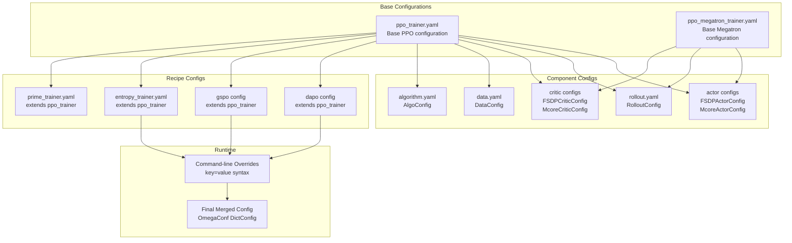
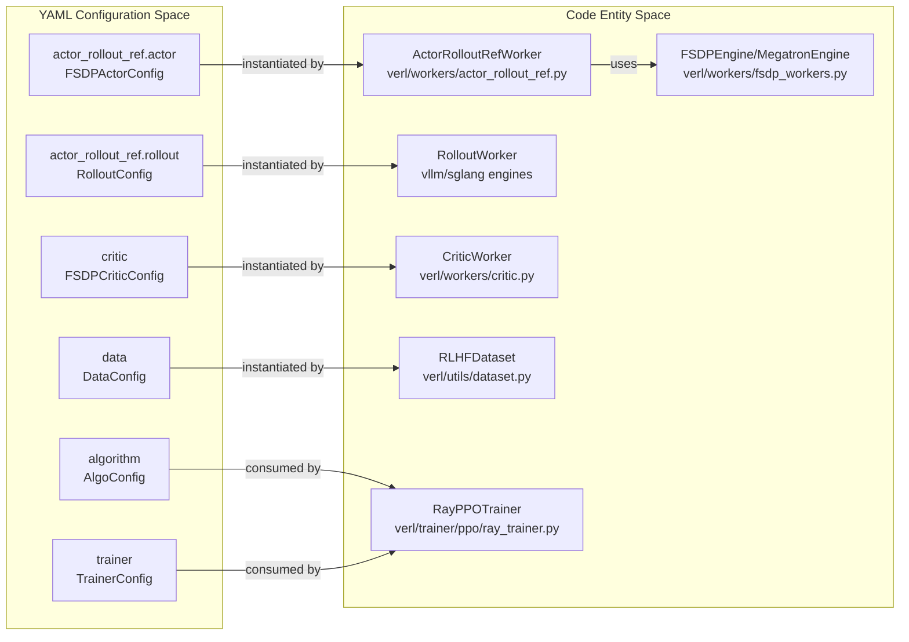
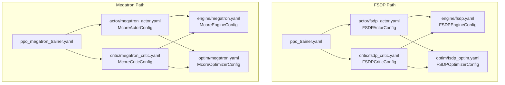
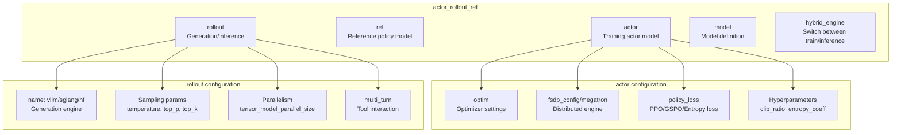
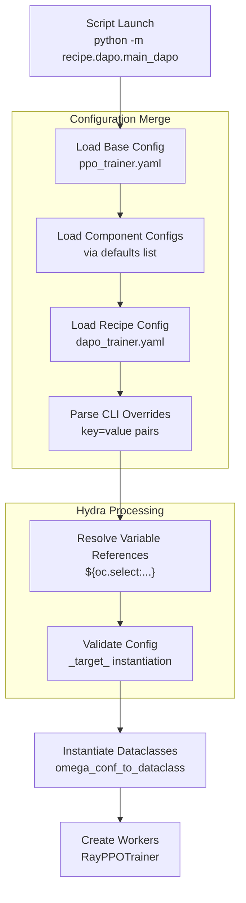

<!-- source: DeepWiki mcp.deepwiki.com · repo allenai/SAGE · page 2.2 Configuration System · fetched 2026-10-26 -->

# Configuration System

<details>
<summary>Relevant source files</summary>

The following files were used as context for generating this wiki page:

- [rl_train/trainer/config/_generated_ppo_megatron_trainer.yaml](rl_train/trainer/config/_generated_ppo_megatron_trainer.yaml)
- [rl_train/trainer/config/_generated_ppo_trainer.yaml](rl_train/trainer/config/_generated_ppo_trainer.yaml)
- [rl_train/trainer/config/critic/megatron_critic.yaml](rl_train/trainer/config/critic/megatron_critic.yaml)
- [rl_train/trainer/config/rollout/rollout.yaml](rl_train/trainer/config/rollout/rollout.yaml)
- [verl/recipe/dapo/run_dapo_early_qwen2.5_32b.sh](verl/recipe/dapo/run_dapo_early_qwen2.5_32b.sh)
- [verl/recipe/dapo/run_dapo_qwen2.5_32b.sh](verl/recipe/dapo/run_dapo_qwen2.5_32b.sh)
- [verl/recipe/dapo/run_dapo_qwen2.5_32b_npu.sh](verl/recipe/dapo/run_dapo_qwen2.5_32b_npu.sh)
- [verl/recipe/dapo/run_dapo_qwen2.5_32b_tis.sh](verl/recipe/dapo/run_dapo_qwen2.5_32b_tis.sh)
- [verl/recipe/dapo/run_dapo_qwen2.5_7b_npu.sh](verl/recipe/dapo/run_dapo_qwen2.5_7b_npu.sh)
- [verl/recipe/dapo/run_dapo_qwen3_14b_base_npu.sh](verl/recipe/dapo/run_dapo_qwen3_14b_base_npu.sh)
- [verl/recipe/dapo/run_dapo_qwen3_8b_base_npu.sh](verl/recipe/dapo/run_dapo_qwen3_8b_base_npu.sh)
- [verl/recipe/dapo/run_dapo_qwen3_moe_30b_base_fsdp_npu.sh](verl/recipe/dapo/run_dapo_qwen3_moe_30b_base_fsdp_npu.sh)
- [verl/recipe/dapo/run_dapo_wo_ds_qwen2.5_32b.sh](verl/recipe/dapo/run_dapo_wo_ds_qwen2.5_32b.sh)
- [verl/recipe/dapo/test_dapo_7b.sh](verl/recipe/dapo/test_dapo_7b.sh)
- [verl/recipe/entropy/32b_clip_cov.sh](verl/recipe/entropy/32b_clip_cov.sh)
- [verl/recipe/entropy/32b_kl_cov.sh](verl/recipe/entropy/32b_kl_cov.sh)
- [verl/recipe/entropy/32b_kl_cov_mininbsz.sh](verl/recipe/entropy/32b_kl_cov_mininbsz.sh)
- [verl/recipe/entropy/7b_clip_cov.sh](verl/recipe/entropy/7b_clip_cov.sh)
- [verl/recipe/entropy/7b_kl_cov.sh](verl/recipe/entropy/7b_kl_cov.sh)
- [verl/recipe/entropy/config/entropy_trainer.yaml](verl/recipe/entropy/config/entropy_trainer.yaml)
- [verl/recipe/gspo/test_gspo_qwen30b_a3b_ep.sh](verl/recipe/gspo/test_gspo_qwen30b_a3b_ep.sh)
- [verl/recipe/prime/config/prime_trainer.yaml](verl/recipe/prime/config/prime_trainer.yaml)
- [verl/verl/trainer/config/_generated_ppo_megatron_trainer.yaml](verl/verl/trainer/config/_generated_ppo_megatron_trainer.yaml)
- [verl/verl/trainer/config/_generated_ppo_trainer.yaml](verl/verl/trainer/config/_generated_ppo_trainer.yaml)
- [verl/verl/trainer/config/critic/megatron_critic.yaml](verl/verl/trainer/config/critic/megatron_critic.yaml)
- [verl/verl/trainer/config/rollout/rollout.yaml](verl/verl/trainer/config/rollout/rollout.yaml)

</details>


## Purpose and Scope

This document describes the configuration system used in SAGE's VERL framework for setting up and running RLHF training experiments. The configuration system is built on [Hydra](https://hydra.cc) and [OmegaConf](https://omegaconf.readthedocs.io), enabling hierarchical, composable YAML-based configuration management. This system controls all aspects of training including model parameters, distributed training strategies, algorithm hyperparameters, data processing, and hardware-specific optimizations.

For information about how these configurations are consumed by the training loop, see [Training Pipeline](#2.1). For details on the distributed execution architecture configured by this system, see [Distributed Architecture](#2.3).

## Configuration Architecture

The configuration system follows a hierarchical composition model where specialized configurations inherit from base templates and can be selectively overridden at runtime.

### Configuration Hierarchy



**Configuration Composition Flow**

Sources: [verl/verl/trainer/config/_generated_ppo_trainer.yaml:1-533](), [verl/verl/trainer/config/_generated_ppo_megatron_trainer.yaml:1-549](), [verl/recipe/entropy/config/entropy_trainer.yaml:1-39](), [verl/recipe/prime/config/prime_trainer.yaml:1-77]()

### Configuration to Code Mapping



**Configuration to Worker Mapping**

Sources: [verl/verl/trainer/config/_generated_ppo_trainer.yaml:6-108](), [verl/verl/trainer/config/_generated_ppo_trainer.yaml:162-247](), [verl/verl/trainer/config/_generated_ppo_trainer.yaml:304-402]()

## Configuration Structure

The configuration system organizes settings into seven primary sections, each controlling different aspects of the training system:

| Section | Purpose | Key Components |
|---------|---------|----------------|
| `actor_rollout_ref` | Configures actor model, reference model, and rollout generation | `.actor`, `.ref`, `.rollout`, `.model`, `.hybrid_engine` |
| `data` | Training and validation data configuration | `train_files`, `val_files`, `max_prompt_length`, `max_response_length`, `train_batch_size` |
| `critic` | Value function critic configuration | `optim`, `model`, `fsdp_config`/`megatron`, `ppo_mini_batch_size` |
| `reward_model` | Reward model configuration for PRIME and other algorithms | `enable`, `model`, `strategy`, `reward_manager` |
| `algorithm` | RL algorithm hyperparameters | `adv_estimator`, `gamma`, `lam`, `kl_ctrl`, `filter_groups`, `rollout_is` |
| `trainer` | Training loop and checkpointing configuration | `total_epochs`, `save_freq`, `test_freq`, `logger`, `nnodes`, `n_gpus_per_node` |
| `global_profiler` | Performance profiling configuration | `tool`, `steps`, `save_path` |

Sources: [verl/verl/trainer/config/_generated_ppo_trainer.yaml:1-533]()

### File Organization

Configuration files are organized in the following directory structure:

```
verl/trainer/config/
├── ppo_trainer.yaml              # Base FSDP configuration
├── ppo_megatron_trainer.yaml     # Base Megatron configuration
├── _generated_ppo_trainer.yaml   # Flattened reference (auto-generated)
├── actor/
│   ├── fsdp_actor.yaml          # FSDP actor configuration
│   └── megatron_actor.yaml      # Megatron actor configuration
├── critic/
│   ├── fsdp_critic.yaml         # FSDP critic configuration
│   └── megatron_critic.yaml     # Megatron critic configuration
├── rollout/
│   └── rollout.yaml             # Rollout/generation configuration
├── engine/
│   ├── fsdp.yaml                # FSDP engine settings
│   └── megatron.yaml            # Megatron engine settings
├── optim/
│   ├── fsdp_optim.yaml          # FSDP optimizer settings
│   └── megatron.yaml            # Megatron optimizer settings
└── data.yaml                    # Data loading configuration

recipe/
├── dapo/config/
│   └── dapo_trainer.yaml        # DAPO-specific overrides
├── entropy/config/
│   └── entropy_trainer.yaml     # Entropy regularization overrides
└── prime/config/
    └── prime_trainer.yaml       # PRIME reward modeling overrides
```

Sources: [verl/verl/trainer/config/_generated_ppo_trainer.yaml:1-4](), [verl/recipe/entropy/config/entropy_trainer.yaml:1-8](), [verl/recipe/prime/config/prime_trainer.yaml:1-9]()

## Configuration Composition with Hydra

### Defaults Mechanism

Hydra uses the `defaults` list to compose configurations from multiple files. Each recipe configuration extends the base configuration:

```yaml
# recipe/entropy/config/entropy_trainer.yaml
hydra:
  searchpath:
    - file://verl/trainer/config

defaults:
  - ppo_trainer      # Inherits from base ppo_trainer.yaml
  - _self_           # Apply current file's settings last (override priority)

# Recipe-specific overrides below
actor_rollout_ref:
  actor:
    policy_loss:
      loss_mode: "kl_cov"  # Override default "vanilla" loss
```

The `_self_` entry controls merge priority - when placed last, the current file's values override inherited ones.

Sources: [verl/recipe/entropy/config/entropy_trainer.yaml:1-8](), [verl/recipe/prime/config/prime_trainer.yaml:1-9]()

### FSDP vs Megatron Configuration Paths

The system provides two parallel configuration paths for different distributed training strategies:



**Dual Configuration Strategy**

Sources: [verl/verl/trainer/config/_generated_ppo_trainer.yaml:23-157](), [verl/verl/trainer/config/_generated_ppo_megatron_trainer.yaml:29-173]()

## Configuration Override Patterns

### OmegaConf Override Syntax

The system supports rich command-line override syntax through OmegaConf:

| Syntax | Purpose | Example |
|--------|---------|---------|
| `key=value` | Set or override a value | `trainer.total_epochs=10` |
| `+key=value` | Add a new key | `+actor_rollout_ref.model.override_config.dropout=0.1` |
| `~key` | Delete a key | `~reward_model.enable` |
| `key.nested=value` | Set nested value | `actor_rollout_ref.actor.optim.lr=1e-6` |
| `${oc.select:key,default}` | Reference with default | `log_prob_use_dynamic_bsz: ${oc.select:actor_rollout_ref.actor.use_dynamic_bsz,false}` |
| `key='["item1","item2"]'` | Set list values | `trainer.logger='["console","wandb"]'` |

Sources: [verl/recipe/dapo/run_dapo_qwen2.5_32b.sh:61-131](), [verl/recipe/entropy/32b_kl_cov.sh:62-143]()

### Common Override Patterns

**Performance Tuning:**
```bash
# Dynamic batch sizing for memory efficiency
actor_rollout_ref.actor.use_dynamic_bsz=True \
actor_rollout_ref.actor.ppo_max_token_len_per_gpu=16384 \
actor_rollout_ref.ref.log_prob_use_dynamic_bsz=True \
actor_rollout_ref.ref.log_prob_max_token_len_per_gpu=16384
```

**Parallelism Configuration:**
```bash
# Ulysses sequence parallelism for long contexts
actor_rollout_ref.actor.ulysses_sequence_parallel_size=8 \
actor_rollout_ref.ref.ulysses_sequence_parallel_size=8 \
# vLLM tensor parallelism for generation
actor_rollout_ref.rollout.tensor_model_parallel_size=4
```

**Memory Optimization:**
```bash
# Parameter and optimizer offloading
actor_rollout_ref.actor.fsdp_config.param_offload=True \
actor_rollout_ref.actor.fsdp_config.optimizer_offload=True \
actor_rollout_ref.ref.fsdp_config.param_offload=True
```

**Model Configuration:**
```bash
# Override model-specific settings
+actor_rollout_ref.model.override_config.attention_dropout=0.0 \
+actor_rollout_ref.model.override_config.embd_pdrop=0.0 \
actor_rollout_ref.model.enable_gradient_checkpointing=True
```

Sources: [verl/recipe/dapo/run_dapo_qwen2.5_32b.sh:83-100](), [verl/recipe/gspo/test_gspo_qwen30b_a3b_ep.sh:98-148]()

## Key Configuration Sections

### actor_rollout_ref Section

The `actor_rollout_ref` section is the largest and most complex, containing four main sub-sections:



**actor_rollout_ref Internal Structure**

#### actor Sub-section

Key fields in `actor_rollout_ref.actor`:

| Field | Type | Purpose | Default |
|-------|------|---------|---------|
| `optim.lr` | float | Learning rate | 1e-6 |
| `optim.weight_decay` | float | Weight decay | 0.01 |
| `ppo_mini_batch_size` | int | Mini-batch size | 256 |
| `ppo_max_token_len_per_gpu` | int | Max tokens per GPU | 16384 |
| `clip_ratio` | float | PPO clip ratio (vanilla) | 0.2 |
| `clip_ratio_low` | float | GSPO lower clip ratio | 0.2 |
| `clip_ratio_high` | float | GSPO upper clip ratio | 0.2 |
| `policy_loss.loss_mode` | str | Loss type: vanilla/gspo/kl_cov/clip_cov | vanilla |
| `use_dynamic_bsz` | bool | Enable dynamic batching | false |
| `ulysses_sequence_parallel_size` | int | Ulysses SP size | 1 |
| `use_torch_compile` | bool | Enable torch.compile | true |
| `entropy_coeff` | float | Entropy regularization | 0 |

Sources: [verl/verl/trainer/config/_generated_ppo_trainer.yaml:7-107]()

#### rollout Sub-section

Key fields in `actor_rollout_ref.rollout`:

| Field | Type | Purpose | Default |
|-------|------|---------|---------|
| `name` | str | Engine: vllm/sglang/hf | ??? (required) |
| `mode` | str | sync/async | sync |
| `temperature` | float | Sampling temperature | 1.0 |
| `top_p` | float | Nucleus sampling | 1.0 |
| `top_k` | int | Top-k sampling (-1 for vLLM) | -1 |
| `n` | int | Number of responses per prompt | 1 |
| `tensor_model_parallel_size` | int | TP size for generation | 2 |
| `gpu_memory_utilization` | float | KV cache memory fraction | 0.5 |
| `enable_chunked_prefill` | bool | Chunked prefill optimization | true |
| `enable_prefix_caching` | bool | Prefix KV cache reuse | true |
| `calculate_log_probs` | bool | Log probs for importance sampling | false |

Sources: [verl/verl/trainer/config/rollout/rollout.yaml:1-298]()

#### model Sub-section

Fields in `actor_rollout_ref.model`:

| Field | Type | Purpose |
|-------|------|---------|
| `path` | str | Model path/HuggingFace ID |
| `tokenizer_path` | str | Tokenizer path (if different) |
| `enable_gradient_checkpointing` | bool | Activation checkpointing |
| `use_remove_padding` | bool | Remove padding optimization |
| `use_fused_kernels` | bool | Enable fused kernels |
| `lora_rank` | int | LoRA rank (0 = disabled) |
| `override_config` | dict | Override model config |

Sources: [verl/verl/trainer/config/_generated_ppo_trainer.yaml:247-268]()

### data Section

Configuration for training and validation data:

```yaml
data:
  tokenizer: null  # Use model's tokenizer
  train_files: ~/data/rlhf/gsm8k/train.parquet
  val_files: ~/data/rlhf/gsm8k/test.parquet
  prompt_key: prompt
  max_prompt_length: 512
  max_response_length: 512
  train_batch_size: 1024
  val_batch_size: null
  shuffle: true
  truncation: error  # error/left/right
  dataloader_num_workers: 8
  return_raw_chat: false
  image_key: images  # For multimodal
  video_key: videos
```

Sources: [verl/verl/trainer/config/_generated_ppo_trainer.yaml:270-303]()

### critic Section

Configuration for the value function critic (if enabled):

```yaml
critic:
  enable: null  # Auto-detected based on algorithm
  strategy: fsdp  # fsdp or megatron
  optim:
    lr: 1e-5
    weight_decay: 0.01
  model:
    path: ~/models/deepseek-llm-7b-chat
    fsdp_config:
      param_offload: false
      optimizer_offload: false
  ppo_mini_batch_size: 256
  ppo_max_token_len_per_gpu: 32768
  cliprange_value: 0.5
  loss_agg_mode: token-mean
```

Sources: [verl/verl/trainer/config/_generated_ppo_trainer.yaml:304-402]()

### reward_model Section

Configuration for external reward models (used in PRIME):

```yaml
reward_model:
  enable: false
  strategy: fsdp  # fsdp or megatron
  model:
    path: ~/models/FsfairX-LLaMA3-RM-v0.1
    input_tokenizer: ${actor_rollout_ref.model.path}
  reward_manager: naive  # naive/dapo/prime
  micro_batch_size_per_gpu: null
  use_dynamic_bsz: ${critic.use_dynamic_bsz}
  launch_reward_fn_async: false
```

Sources: [verl/verl/trainer/config/_generated_ppo_trainer.yaml:403-444]()

### algorithm Section

RL algorithm hyperparameters:

```yaml
algorithm:
  gamma: 1.0  # Discount factor
  lam: 1.0    # GAE lambda
  adv_estimator: gae  # gae/grpo/rloo
  norm_adv_by_std_in_grpo: true
  use_kl_in_reward: false
  kl_penalty: kl
  kl_ctrl:
    type: fixed  # fixed/adaptive
    kl_coef: 0.001
    target_kl: 0.1
  # Rollout Importance Sampling (TIS)
  rollout_is: false
  rollout_is_threshold: null  # Upper bound (e.g., 2.0)
  rollout_is_threshold_lower: null  # Lower bound
  rollout_is_level: token  # token/sequence
  rollout_is_mode: truncate  # truncate/clamp
  # DAPO-specific filtering
  filter_groups:
    enable: false
    metric: acc  # acc/score
    max_num_gen_batches: 10
```

Sources: [verl/verl/trainer/config/_generated_ppo_trainer.yaml:448-471]()

### trainer Section

Training loop configuration:

```yaml
trainer:
  project_name: verl_examples
  experiment_name: gsm8k
  logger: [console, wandb]
  nnodes: 1
  n_gpus_per_node: 8
  total_epochs: 30
  total_training_steps: null  # If set, overrides epochs
  save_freq: -1  # -1 = save only at end
  test_freq: -1   # -1 = test only at end
  val_before_train: true
  critic_warmup: 0
  default_local_dir: checkpoints/${trainer.project_name}/${trainer.experiment_name}
  resume_mode: auto  # auto/disable/must
  device: cuda  # cuda/npu
```

Sources: [verl/verl/trainer/config/_generated_ppo_trainer.yaml:472-501]()

## Algorithm-Specific Configurations

Different algorithms extend the base configuration with specialized settings:

### DAPO Configuration

DAPO adds group filtering and overlong buffer mechanisms:

```yaml
# recipe/dapo additions
algorithm:
  filter_groups:
    enable: true
    metric: acc
    max_num_gen_batches: 10

reward_model:
  reward_manager: dapo
  overlong_buffer:
    enable: true
    len: 4096
    penalty_factor: 1.0

data:
  gen_batch_size: 1536  # Larger for filtering
  train_batch_size: 512
```

Sources: [verl/recipe/dapo/run_dapo_qwen2.5_32b.sh:25-31](), [verl/recipe/dapo/run_dapo_qwen2.5_32b.sh:79-120]()

### Entropy Regularization Configuration

Entropy variants override the policy loss mode:

```yaml
# recipe/entropy/config/entropy_trainer.yaml
actor_rollout_ref:
  actor:
    policy_loss:
      loss_mode: "kl_cov"  # or "clip_cov"
      kl_cov_ratio: 0.0002
      ppo_kl_coef: 0.1
      clip_cov_ratio: 0.0002
      clip_cov_lb: 1.0
      clip_cov_ub: 5.0
```

Sources: [verl/recipe/entropy/config/entropy_trainer.yaml:32-39]()

### PRIME Configuration

PRIME enables reward model training:

```yaml
# recipe/prime/config/prime_trainer.yaml
reward_model:
  enable: true
  reward_manager: prime
  prime_granularity: token
  prime_norm: batch_norm
  model:
    update: before  # Double-forward
    beta_train: 0.05
    loss_type: ce

algorithm:
  adv_estimator: rloo
  reward_gt_coef: 5
  reward_dpo_coef: 5
```

Sources: [verl/recipe/prime/config/prime_trainer.yaml:29-71]()

## Configuration Resolution Process



**Configuration Resolution Flow**

The resolution order ensures that CLI overrides have highest priority:
1. Base configuration loaded
2. Component configurations merged via `defaults`
3. Recipe-specific overrides applied
4. Command-line overrides applied (highest priority)
5. Variable interpolation resolved (`${...}` references)
6. `_target_` classes instantiated into dataclass objects

Sources: [verl/recipe/dapo/run_dapo_qwen2.5_32b.sh:59-131](), [verl/verl/trainer/config/_generated_ppo_trainer.yaml:1-4]()

## Variable Interpolation

OmegaConf supports powerful variable interpolation for DRY (Don't Repeat Yourself) configuration:

```yaml
# Reference other config values
actor_rollout_ref:
  rollout:
    prompt_length: ${oc.select:data.max_prompt_length,512}
    response_length: ${oc.select:data.max_response_length,512}
  
  ref:
    strategy: ${actor_rollout_ref.actor.strategy}
    log_prob_use_dynamic_bsz: ${oc.select:actor_rollout_ref.actor.use_dynamic_bsz,false}

critic:
  ppo_mini_batch_size: ${oc.select:actor_rollout_ref.actor.ppo_mini_batch_size,256}
  
# Environment variable interpolation
trainer:
  default_local_dir: checkpoints/${trainer.project_name}/${trainer.experiment_name}
```

The `${oc.select:key,default}` syntax provides safe access with fallback defaults.

Sources: [verl/verl/trainer/config/_generated_ppo_trainer.yaml:169](), [verl/verl/trainer/config/_generated_ppo_trainer.yaml:88-92](), [verl/verl/trainer/config/_generated_ppo_trainer.yaml:356]()

## Practical Usage Examples

### Example 1: FSDP Training with 32B Model

```bash
python3 -m recipe.dapo.main_dapo \
    data.train_files="${TRAIN_FILE}" \
    data.max_prompt_length=2048 \
    data.max_response_length=20480 \
    data.train_batch_size=512 \
    actor_rollout_ref.model.path="${MODEL_PATH}" \
    actor_rollout_ref.model.enable_gradient_checkpointing=True \
    actor_rollout_ref.actor.optim.lr=1e-6 \
    actor_rollout_ref.actor.ppo_mini_batch_size=32 \
    actor_rollout_ref.actor.ulysses_sequence_parallel_size=8 \
    actor_rollout_ref.actor.fsdp_config.param_offload=True \
    actor_rollout_ref.actor.fsdp_config.optimizer_offload=True \
    actor_rollout_ref.rollout.name=vllm \
    actor_rollout_ref.rollout.tensor_model_parallel_size=4 \
    actor_rollout_ref.rollout.gpu_memory_utilization=0.80 \
    trainer.nnodes=16 \
    trainer.n_gpus_per_node=8
```

Sources: [verl/recipe/dapo/run_dapo_qwen2.5_32b.sh:61-131]()

### Example 2: Megatron Training with MoE

```bash
python3 -m verl.trainer.main_ppo \
    --config-path=config \
    --config-name='ppo_megatron_trainer.yaml' \
    actor_rollout_ref.actor.megatron.tensor_model_parallel_size=4 \
    actor_rollout_ref.actor.megatron.pipeline_model_parallel_size=1 \
    actor_rollout_ref.actor.megatron.expert_model_parallel_size=4 \
    actor_rollout_ref.actor.megatron.expert_tensor_parallel_size=1 \
    actor_rollout_ref.rollout.mode=async \
    actor_rollout_ref.rollout.tensor_model_parallel_size=1 \
    actor_rollout_ref.rollout.expert_parallel_size=4 \
    +actor_rollout_ref.actor.megatron.override_transformer_config.moe_router_dtype=fp32
```

Sources: [verl/recipe/gspo/test_gspo_qwen30b_a3b_ep.sh:77-167]()

### Example 3: Entropy Regularization with KL-Cov

```bash
python -m recipe.entropy.main_entropy \
    actor_rollout_ref.actor.policy_loss.loss_mode=kl_cov \
    actor_rollout_ref.actor.policy_loss.kl_cov_ratio=0.0002 \
    actor_rollout_ref.actor.policy_loss.ppo_kl_coef=1.0 \
    algorithm.filter_groups.enable=True \
    algorithm.filter_groups.metric=acc \
    actor_rollout_ref.actor.use_dynamic_bsz=True
```

Sources: [verl/recipe/entropy/32b_kl_cov.sh:62-143]()

### Example 4: NPU-Specific Configuration

```bash
# NPU-specific optimizations
actor_rollout_ref.actor.use_torch_compile=False \
actor_rollout_ref.ref.use_torch_compile=False \
actor_rollout_ref.actor.entropy_checkpointing=True \
actor_rollout_ref.actor.fsdp_config.forward_prefetch=True \
trainer.device=npu
```

Sources: [verl/recipe/dapo/run_dapo_qwen2.5_32b_npu.sh:84-141]()

## Configuration Best Practices

### Memory Management

For large models, configure offloading and sequence parallelism:

```bash
# Enable parameter/optimizer offloading
actor_rollout_ref.actor.fsdp_config.param_offload=True
actor_rollout_ref.actor.fsdp_config.optimizer_offload=True

# Use Ulysses sequence parallelism for long contexts
actor_rollout_ref.actor.ulysses_sequence_parallel_size=8
actor_rollout_ref.ref.ulysses_sequence_parallel_size=8

# Reduce per-GPU token limit
actor_rollout_ref.actor.ppo_max_token_len_per_gpu=16384
```

### Generation Optimization

Balance throughput and memory for rollout:

```bash
# Use TP for generation
actor_rollout_ref.rollout.tensor_model_parallel_size=4

# Tune memory utilization
actor_rollout_ref.rollout.gpu_memory_utilization=0.80

# Enable optimizations
actor_rollout_ref.rollout.enable_chunked_prefill=True
actor_rollout_ref.rollout.enable_prefix_caching=True
```

### Dynamic Batch Sizing

Enable dynamic batching for variable-length sequences:

```bash
actor_rollout_ref.actor.use_dynamic_bsz=True
actor_rollout_ref.ref.log_prob_use_dynamic_bsz=True
actor_rollout_ref.rollout.log_prob_use_dynamic_bsz=True
actor_rollout_ref.model.use_remove_padding=True
```

### Configuration Validation

Always validate configurations before long runs:

```bash
# Use small values for quick validation
trainer.total_epochs=1
trainer.total_training_steps=10
data.train_batch_size=16
trainer.save_freq=5
```

Sources: [verl/recipe/dapo/run_dapo_qwen2.5_32b.sh:52-58](), [verl/recipe/dapo/run_dapo_qwen2.5_32b.sh:83-117](), [verl/recipe/dapo/test_dapo_7b.sh:51-131]()

## Configuration Reference Tables

### Strategy Selection

| Model Size | Recommended Strategy | Parallelism Configuration |
|------------|---------------------|---------------------------|
| 7B | FSDP | `sp_size=1-4`, `gen_tp=1` |
| 14B | FSDP | `sp_size=2-8`, `gen_tp=2` |
| 32B | FSDP | `sp_size=8-16`, `gen_tp=4`, `offload=true` |
| 70B+ | Megatron | `tp=4-8`, `pp=2-4`, `gen_tp=4-8` |
| MoE 30B+ | Megatron | `tp=4`, `ep=4`, `etp=1`, `gen_ep=4` |

Sources: [verl/recipe/dapo/run_dapo_qwen2.5_32b.sh:52-57](), [verl/recipe/gspo/test_gspo_qwen30b_a3b_ep.sh:69-75]()

### Loss Mode Selection

| Loss Mode | Use Case | Key Parameters |
|-----------|----------|----------------|
| `vanilla` | Standard PPO | `clip_ratio=0.2` |
| `gspo` | Generalized self-play | `clip_ratio_low`, `clip_ratio_high` |
| `kl_cov` | KL covariance regularization | `kl_cov_ratio`, `ppo_kl_coef` |
| `clip_cov` | Clip covariance regularization | `clip_cov_ratio`, `clip_cov_lb`, `clip_cov_ub` |

Sources: [verl/verl/trainer/config/_generated_ppo_trainer.yaml:52-59](), [verl/recipe/entropy/config/entropy_trainer.yaml:32-39]()

### Advantage Estimator Selection

| Estimator | Description | Use Case |
|-----------|-------------|----------|
| `gae` | Generalized Advantage Estimation | Standard PPO with critic |
| `grpo` | Group-relative policy optimization | No critic, multiple responses |
| `rloo` | REINFORCE leave-one-out | Reward model training (PRIME) |

Sources: [verl/verl/trainer/config/_generated_ppo_trainer.yaml:452](), [verl/recipe/prime/config/prime_trainer.yaml:64]()

---

