# Page: Getting Started

# Getting Started

<details>
<summary>Relevant source files</summary>

The following files were used as context for generating this wiki page:

- [rl_train/trainer/config/_generated_ppo_megatron_trainer.yaml](rl_train/trainer/config/_generated_ppo_megatron_trainer.yaml)
- [rl_train/trainer/config/_generated_ppo_trainer.yaml](rl_train/trainer/config/_generated_ppo_trainer.yaml)
- [rl_train/trainer/config/critic/megatron_critic.yaml](rl_train/trainer/config/critic/megatron_critic.yaml)
- [verl/recipe/langgraph_agent/__init__.py](verl/recipe/langgraph_agent/__init__.py)
- [verl/recipe/r1/__init__.py](verl/recipe/r1/__init__.py)
- [verl/scripts/__init__.py](verl/scripts/__init__.py)
- [verl/verl/experimental/dataset/__init__.py](verl/verl/experimental/dataset/__init__.py)
- [verl/verl/model_merger/__init__.py](verl/verl/model_merger/__init__.py)
- [verl/verl/models/__init__.py](verl/verl/models/__init__.py)
- [verl/verl/models/transformers/__init__.py](verl/verl/models/transformers/__init__.py)
- [verl/verl/trainer/__init__.py](verl/verl/trainer/__init__.py)
- [verl/verl/trainer/config/_generated_ppo_megatron_trainer.yaml](verl/verl/trainer/config/_generated_ppo_megatron_trainer.yaml)
- [verl/verl/trainer/config/_generated_ppo_trainer.yaml](verl/verl/trainer/config/_generated_ppo_trainer.yaml)
- [verl/verl/trainer/config/critic/megatron_critic.yaml](verl/verl/trainer/config/critic/megatron_critic.yaml)
- [verl/verl/trainer/ppo/__init__.py](verl/verl/trainer/ppo/__init__.py)
- [verl/verl/workers/__init__.py](verl/verl/workers/__init__.py)

</details>


This document introduces the SAGE repository and the **verl** (Versatile Efficient Reinforcement Learning) framework. It provides an overview of the system's purpose, architecture, and capabilities to help new users understand how the components fit together and begin running RLHF training experiments.

For detailed information about specific subsystems, see:
- Core training concepts: [Core Concepts](#2)
- Algorithm implementations: [Training Algorithms](#3)
- Model support and parallelism: [Model Support](#4)
- Advanced optimizations: [Advanced Topics](#6)

## What is SAGE?

SAGE is a comprehensive framework for **Reinforcement Learning from Human Feedback (RLHF)** training of large language models (LLMs) and vision-language models (VLMs). Built on the verl framework, it provides production-ready implementations of multiple policy optimization algorithms with extensive support for distributed training at scale.

### Core Purpose

The framework enables:
- **Policy optimization** using algorithms like PPO, DAPO, GSPO, SPPO, and PRIME
- **Distributed training** across multiple GPUs/nodes using PyTorch FSDP or Megatron-LM
- **Efficient inference** during rollout generation via vLLM and SGLang integration
- **Flexible hardware support** including NVIDIA GPUs and Ascend NPUs

Sources: [verl/verl/trainer/config/_generated_ppo_trainer.yaml:1-533]()

## Key Capabilities

| Capability | Description | Implementation |
|------------|-------------|----------------|
| **Algorithms** | PPO variants including DAPO, GSPO, SPPO, PRIME | `RayPPOTrainer`, `RayDAPOTrainer`, `RaySPPOTrainer` |
| **Distributed Training** | FSDP or Megatron-LM parallelism strategies | `FSDPEngine`, `MegatronEngine` |
| **Efficient Inference** | High-throughput generation during rollout | vLLM, SGLang backends |
| **Model Support** | LLaMA, Qwen2/3, Molmo2, with MoE variants | `verl.models` module |
| **Hardware** | GPU (CUDA) and NPU (Ascend) support | Fused kernels, NPU patches |
| **Configuration** | Hydra-based YAML configuration system | `verl.trainer.config` |

Sources: [verl/verl/trainer/config/_generated_ppo_trainer.yaml:6-533](), [verl/verl/trainer/config/_generated_ppo_megatron_trainer.yaml:6-549]()

## System Architecture

### High-Level Component Overview

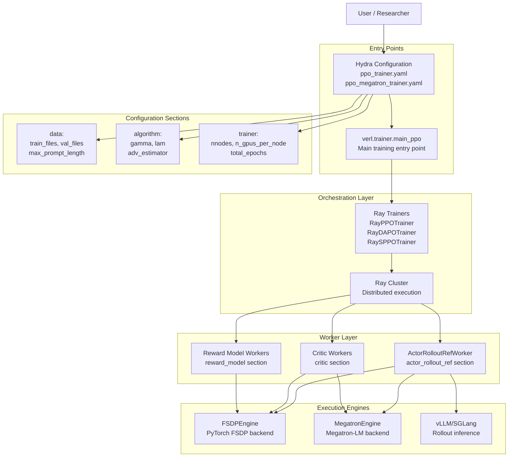

Sources: [verl/verl/trainer/config/_generated_ppo_trainer.yaml:6-533](), [verl/verl/trainer/config/_generated_ppo_megatron_trainer.yaml:6-549]()

### Configuration Structure to Code Mapping

The framework uses a hierarchical YAML configuration that maps directly to Python dataclasses. This diagram shows how configuration sections instantiate specific worker and engine components:

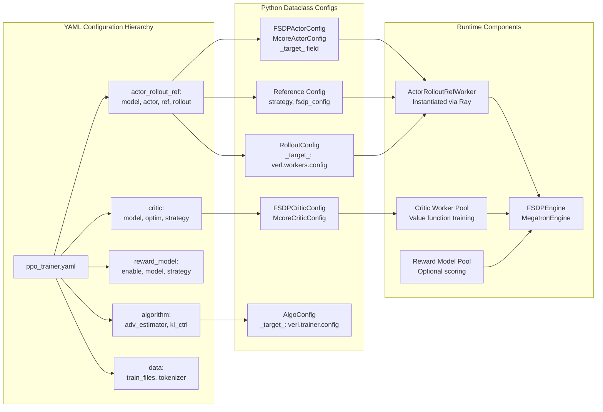

Sources: [verl/verl/trainer/config/_generated_ppo_trainer.yaml:6-270](), [rl_train/trainer/config/critic/megatron_critic.yaml:1-44]()

### Training Strategy Selection

The framework supports two primary distributed training strategies, selected via the `strategy` configuration field:

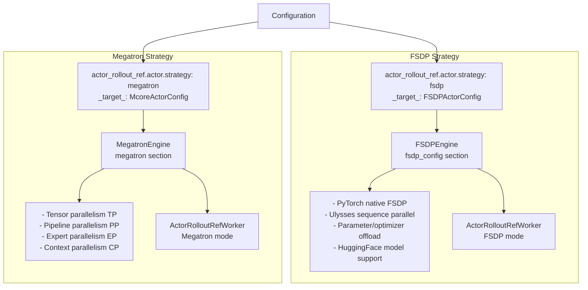

**FSDP** is recommended for:
- Models from HuggingFace Hub (7B-70B range)
- Rapid prototyping and experimentation
- Long context training (with Ulysses SP)

**Megatron** is recommended for:
- Maximum scale (100B+ parameters)
- MoE models requiring expert parallelism
- Pipeline parallelism across multiple nodes

Sources: [verl/verl/trainer/config/_generated_ppo_trainer.yaml:23-40](), [verl/verl/trainer/config/_generated_ppo_megatron_trainer.yaml:29-56]()

## Configuration Overview

### Main Configuration Sections

The training configuration is organized into seven major sections:

| Section | Purpose | Key Parameters |
|---------|---------|----------------|
| `actor_rollout_ref` | Actor model, rollout, reference policy | `model.path`, `rollout.name`, `actor.strategy` |
| `data` | Training/validation data sources | `train_files`, `val_files`, `max_prompt_length` |
| `critic` | Value function configuration | `enable`, `strategy`, `ppo_mini_batch_size` |
| `reward_model` | External reward model (optional) | `enable`, `model.path`, `strategy` |
| `algorithm` | RL algorithm parameters | `adv_estimator`, `gamma`, `lam`, `kl_ctrl` |
| `trainer` | Training orchestration | `nnodes`, `n_gpus_per_node`, `total_epochs` |
| `global_profiler` | Performance profiling | `tool`, `steps`, `save_path` |

### Example: FSDP Configuration Structure

```yaml
actor_rollout_ref:
  model:
    path: ~/models/qwen2-7b-instruct    # Model path
    
  actor:
    strategy: fsdp                       # Use FSDP
    ppo_mini_batch_size: 256
    fsdp_config:
      ulysses_sequence_parallel_size: 4  # Sequence parallelism
      param_offload: false
      
  rollout:
    name: vllm                           # Use vLLM for inference
    tensor_model_parallel_size: 2
    
data:
  train_files: ~/data/train.parquet
  max_prompt_length: 512
  max_response_length: 512
  
trainer:
  nnodes: 1
  n_gpus_per_node: 8
  total_epochs: 30
```

Sources: [verl/verl/trainer/config/_generated_ppo_trainer.yaml:6-270]()

### Example: Megatron Configuration Structure

```yaml
actor_rollout_ref:
  model:
    path: ~/models/qwen2-30b-instruct
    
  actor:
    strategy: megatron                   # Use Megatron-LM
    megatron:
      tensor_model_parallel_size: 4      # 4-way TP
      pipeline_model_parallel_size: 2    # 2-way PP
      sequence_parallel: true
      use_distributed_optimizer: true
      
  rollout:
    name: vllm
    tensor_model_parallel_size: 4
    
trainer:
  nnodes: 2
  n_gpus_per_node: 8
```

Sources: [verl/verl/trainer/config/_generated_ppo_megatron_trainer.yaml:29-261]()

## Quick Start

### Basic Training Flow

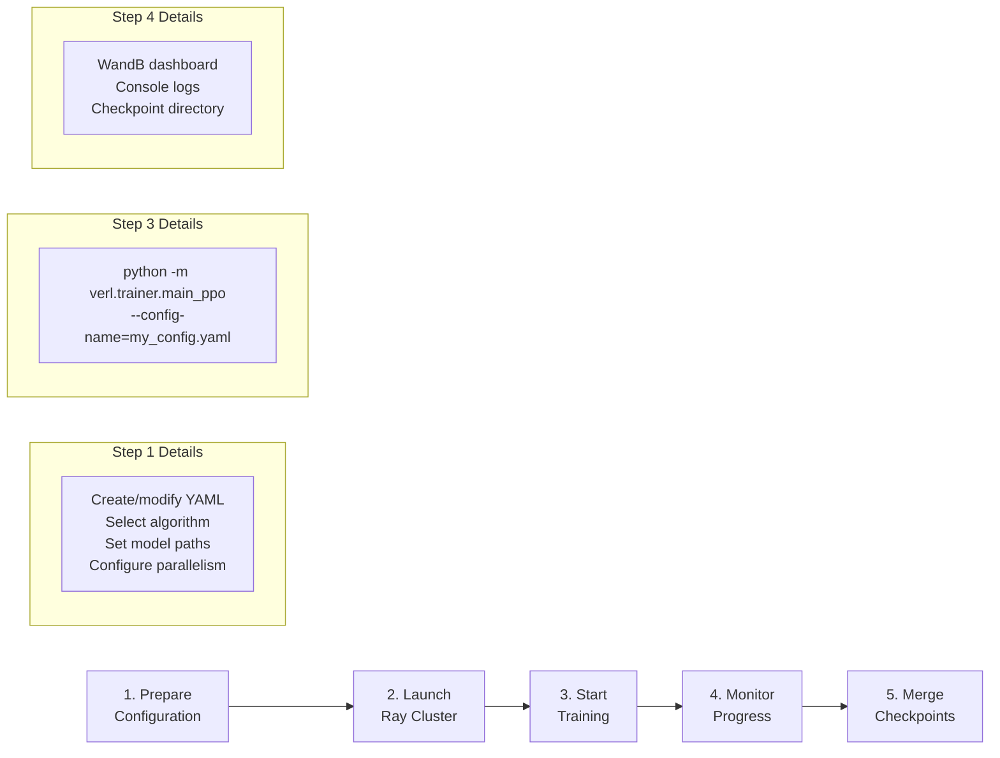

### Typical Execution Command

Training is launched via the `main_ppo` entry point with Hydra configuration:

```bash
# FSDP-based training
python -m verl.trainer.main_ppo \
  --config-name=ppo_trainer \
  actor_rollout_ref.model.path=/path/to/model \
  data.train_files=/path/to/train.parquet \
  trainer.nnodes=1 \
  trainer.n_gpus_per_node=8

# Megatron-based training
python -m verl.trainer.main_ppo \
  --config-name=ppo_megatron_trainer \
  actor_rollout_ref.model.path=/path/to/model \
  data.train_files=/path/to/train.parquet \
  actor_rollout_ref.actor.megatron.tensor_model_parallel_size=4
```

### Configuration Override Syntax

Hydra enables command-line configuration overrides:

```bash
# Override individual parameters
python -m verl.trainer.main_ppo \
  actor_rollout_ref.actor.ppo_mini_batch_size=512 \
  algorithm.adv_estimator=gae \
  trainer.total_epochs=50

# Switch to different algorithm
python -m verl.trainer.main_ppo \
  --config-name=dapo_trainer \
  actor_rollout_ref.rollout.filter_groups.enable=true
```

Sources: [verl/verl/trainer/config/_generated_ppo_trainer.yaml:472-501]()

## Training Pipeline Overview

The core training loop orchestrates three phases: generation, evaluation, and training.

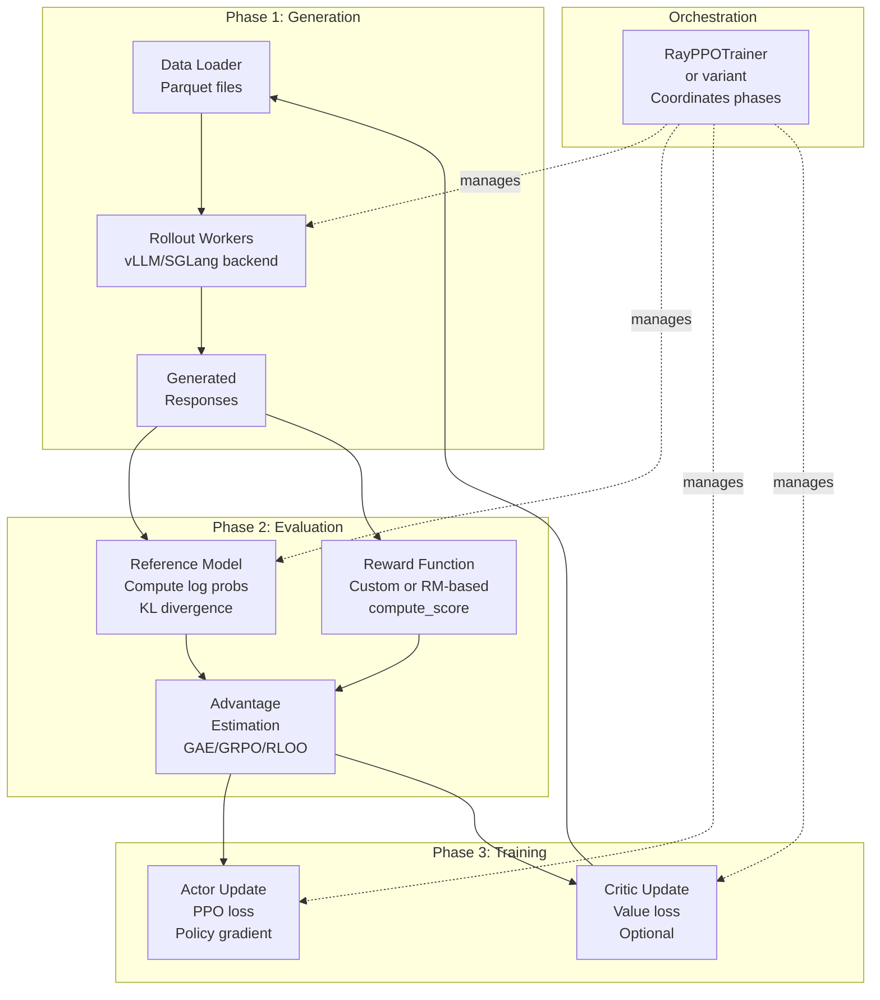

**Key Components:**
- **Data Loader**: Reads prompts from parquet files ([verl/verl/trainer/config/_generated_ppo_trainer.yaml:270-303]())
- **Rollout Workers**: Generate responses using vLLM or SGLang ([verl/verl/trainer/config/_generated_ppo_trainer.yaml:162-246]())
- **Reference Model**: Computes KL penalty ([verl/verl/trainer/config/_generated_ppo_trainer.yaml:108-161]())
- **Reward Function**: Custom Python function or reward model ([verl/verl/trainer/config/_generated_ppo_trainer.yaml:445-447]())
- **Advantage Estimator**: GAE, GRPO, or RLOO ([verl/verl/trainer/config/_generated_ppo_trainer.yaml:448-471]())
- **Actor Update**: Policy optimization via PPO ([verl/verl/trainer/config/_generated_ppo_trainer.yaml:6-107]())
- **Critic Update**: Optional value function training ([verl/verl/trainer/config/_generated_ppo_trainer.yaml:304-402]())

Sources: [verl/verl/trainer/config/_generated_ppo_trainer.yaml:1-533]()

## Supported Models

The framework provides first-class support for multiple model architectures:

| Model Family | Variants | Strategy Support | Features |
|--------------|----------|------------------|----------|
| **LLaMA** | LLaMA 2, LLaMA 3 | FSDP, Megatron | Standard LLM training |
| **Qwen** | Qwen2, Qwen2.5, Qwen3 | FSDP, Megatron | MoE support (Qwen3-MoE) |
| **Molmo2** | Molmo2-7B, Molmo2-72B | FSDP | Vision-language multimodal |

Models are specified via the `actor_rollout_ref.model.path` configuration field and can be loaded from:
- Local filesystem paths
- HuggingFace Hub identifiers
- Custom model implementations via `external_lib` parameter

Sources: [verl/verl/trainer/config/_generated_ppo_trainer.yaml:247-268]()

## Resource Allocation

### Ray Worker Pool Configuration

The framework uses Ray to manage distributed worker pools:

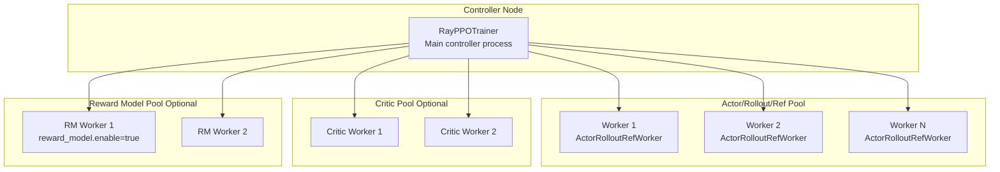

**Resource Pool Sizing:**
- **Actor/Rollout/Ref**: Determined by `trainer.nnodes` × `trainer.n_gpus_per_node`
- **Critic**: Enabled via `critic.enable`, shares or uses separate GPUs
- **Reward Model**: Enabled via `reward_model.enable`, configured with `reward_model.nnodes` and `reward_model.n_gpus_per_node`

Sources: [verl/verl/trainer/config/_generated_ppo_trainer.yaml:484-485](), [verl/verl/trainer/config/_generated_ppo_trainer.yaml:403-444]()

## Next Steps

After understanding the basic architecture and configuration structure, explore these topics:

1. **[Core Concepts](#2)**: Learn about the training pipeline, configuration system, and distributed architecture in detail
2. **[Training Algorithms](#3)**: Choose the right algorithm (DAPO, GSPO, SPPO, PRIME) for your task
3. **[Model Support](#4)**: Understand model-specific configurations and parallelism strategies
4. **[System Components](#5)**: Deep dive into trainers, workers, engines, and checkpoint management
5. **[Advanced Topics](#6)**: Explore hardware optimizations, long context training, and inference integration

### Common Configuration Patterns

| Use Case | Recommended Config | Key Settings |
|----------|-------------------|--------------|
| **Quick experimentation** | FSDP, 7B model | `strategy: fsdp`, `nnodes: 1`, `n_gpus_per_node: 8` |
| **Math reasoning** | DAPO/GSPO | Use `dapo_trainer` or `gspo_trainer` config |
| **Large scale (30B+)** | Megatron | `strategy: megatron`, increase TP/PP sizes |
| **Long context (8K+)** | FSDP with Ulysses | `ulysses_sequence_parallel_size: 4-8` |
| **MoE models** | Megatron with EP | `expert_model_parallel_size: 8` |

### Important Configuration Files

- **FSDP Training**: [verl/trainer/config/ppo_trainer.yaml]() → [verl/verl/trainer/config/_generated_ppo_trainer.yaml]()
- **Megatron Training**: [verl/trainer/config/ppo_megatron_trainer.yaml]() → [verl/verl/trainer/config/_generated_ppo_megatron_trainer.yaml]()
- **FSDP Critic**: [verl/trainer/config/critic/fsdp_critic.yaml]()
- **Megatron Critic**: [verl/trainer/config/critic/megatron_critic.yaml]() → [verl/verl/trainer/config/critic/megatron_critic.yaml:1-44]()

Sources: [verl/verl/trainer/config/_generated_ppo_trainer.yaml:1-533](), [verl/verl/trainer/config/_generated_ppo_megatron_trainer.yaml:1-549](), [verl/verl/trainer/config/critic/megatron_critic.yaml:1-44]()

---

# Page: Core Concepts

# Core Concepts

<details>
<summary>Relevant source files</summary>

The following files were used as context for generating this wiki page:

- [rl_train/trainer/config/_generated_ppo_megatron_trainer.yaml](rl_train/trainer/config/_generated_ppo_megatron_trainer.yaml)
- [rl_train/trainer/config/_generated_ppo_trainer.yaml](rl_train/trainer/config/_generated_ppo_trainer.yaml)
- [rl_train/trainer/config/critic/megatron_critic.yaml](rl_train/trainer/config/critic/megatron_critic.yaml)
- [rl_train/trainer/ppo/sage_ray_trainer.py](rl_train/trainer/ppo/sage_ray_trainer.py)
- [verl/recipe/collabllm/reward_function.py](verl/recipe/collabllm/reward_function.py)
- [verl/recipe/dapo/dapo_ray_trainer.py](verl/recipe/dapo/dapo_ray_trainer.py)
- [verl/recipe/entropy/entropy_ray_trainer.py](verl/recipe/entropy/entropy_ray_trainer.py)
- [verl/recipe/one_step_off_policy/ray_trainer.py](verl/recipe/one_step_off_policy/ray_trainer.py)
- [verl/recipe/prime/prime_ray_trainer.py](verl/recipe/prime/prime_ray_trainer.py)
- [verl/recipe/sppo/sppo_ray_trainer.py](verl/recipe/sppo/sppo_ray_trainer.py)
- [verl/verl/trainer/config/_generated_ppo_megatron_trainer.yaml](verl/verl/trainer/config/_generated_ppo_megatron_trainer.yaml)
- [verl/verl/trainer/config/_generated_ppo_trainer.yaml](verl/verl/trainer/config/_generated_ppo_trainer.yaml)
- [verl/verl/trainer/config/critic/megatron_critic.yaml](verl/verl/trainer/config/critic/megatron_critic.yaml)
- [verl/verl/trainer/ppo/ray_trainer.py](verl/verl/trainer/ppo/ray_trainer.py)

</details>


This page explains the foundational concepts of the verl framework that powers SAGE's RLHF training system. These concepts apply across all training algorithms (DAPO, GSPO, PRIME, etc.) and model backends (FSDP, Megatron).

For detailed information about specific topics, see:
- Training pipeline phases and data flow: [Training Pipeline](#2.1)
- Configuration file structure and parameters: [Configuration System](#2.2)
- Ray-based distributed execution: [Distributed Architecture](#2.3)
- Specific algorithm implementations: [Training Algorithms](#3)

---

## Overview

The verl framework is organized around three core concepts:

1. **Training Pipeline**: The RLHF training loop that orchestrates generation, reward computation, and policy optimization
2. **Configuration System**: Hydra-based YAML configuration enabling composable, algorithm-specific training setups
3. **Distributed Architecture**: Ray-based resource management and worker coordination across multiple GPUs/nodes

These three concepts work together: configurations define what to train and how, the distributed architecture allocates resources and creates workers, and the training pipeline coordinates execution across those workers.

---

## The Training Pipeline

The training pipeline implements the standard RLHF loop with four main phases executed on each training step:

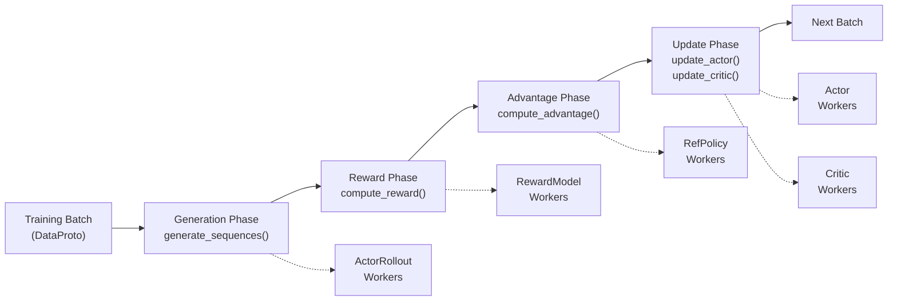

**Sources**: [verl/verl/trainer/ppo/ray_trainer.py:263-1009]()

### Phase 1: Generation (Rollout)

The generation phase samples responses from the current policy. The driver process calls `generate_sequences()` on the rollout workers, which use optimized inference engines (vLLM or SGLang).

| Component | Role | Code Location |
|-----------|------|---------------|
| `DataProto` | Container for batch data (tensor and non-tensor) | [verl/verl/trainer/ppo/ray_trainer.py:192]() |
| `generate_sequences()` | Remote method invoked on rollout workers | [verl/verl/trainer/ppo/ray_trainer.py:644-656]() |
| `rollout_wg` | RayWorkerGroup for rollout workers | [verl/verl/trainer/ppo/ray_trainer.py:851-858]() |

The output includes `responses`, `attention_mask`, and optionally `old_log_probs` if computed during generation.

### Phase 2: Reward Computation

Rewards are computed by combining multiple sources: reward models (optional), reference policy KL penalty (optional), and custom reward functions.

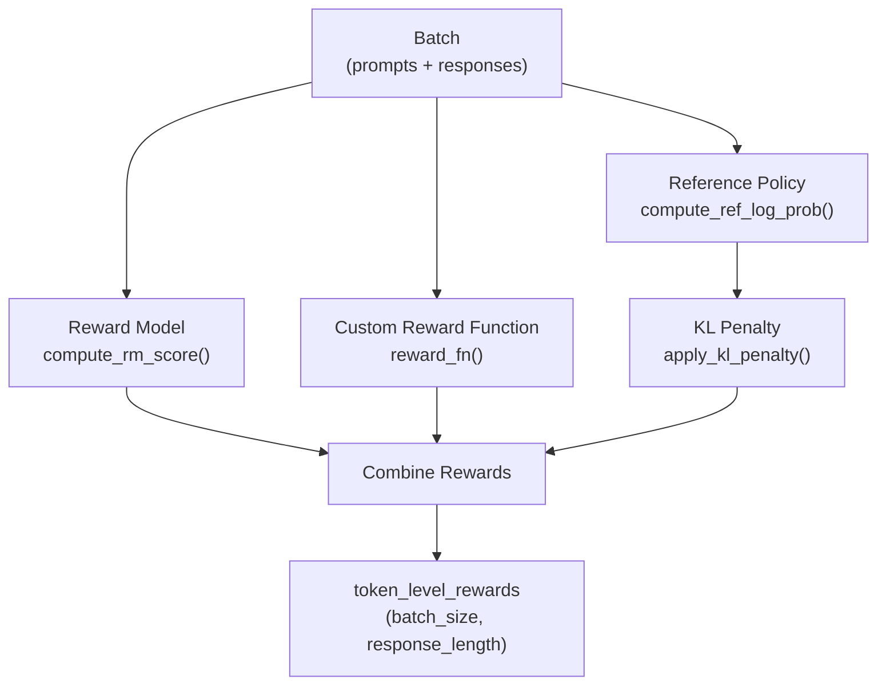

**Sources**: [verl/verl/trainer/ppo/ray_trainer.py:685-732]()

The `compute_reward()` function merges model-based and rule-based rewards:

- **Reward Model**: Optional learned model that scores responses via `rm_wg.compute_rm_score()` [verl/verl/trainer/ppo/ray_trainer.py:696-698]()
- **Custom Function**: User-defined `reward_fn` for task-specific scoring [verl/verl/trainer/ppo/ray_trainer.py:701-711]()
- **KL Penalty**: Divergence from reference policy, controlled by `apply_kl_penalty()` [verl/verl/trainer/ppo/ray_trainer.py:122-162]()

### Phase 3: Advantage Estimation

Advantages are computed on the driver process using one of several estimators:

| Estimator | Method | Use Case |
|-----------|--------|----------|
| `GAE` | `compute_gae_advantage_return()` | Standard PPO with value function |
| `GRPO` | `compute_grpo_outcome_advantage()` | Group-relative policy optimization |
| `REINFORCE++` | Various estimators | Variance reduction techniques |
| `RLOO` | `compute_rloo_advantage_return()` | Leave-one-out baseline (PRIME) |

**Sources**: [verl/verl/trainer/ppo/ray_trainer.py:182-261](), [verl/verl/trainer/ppo/core_algos.py]()

The `compute_advantage()` function is executed on the driver, operating on the full batch. For value-based methods like GAE, critic values are first computed via `critic_wg.compute_values()` [verl/verl/trainer/ppo/ray_trainer.py:741-744]().

### Phase 4: Policy and Critic Updates

The final phase updates model parameters using computed advantages:

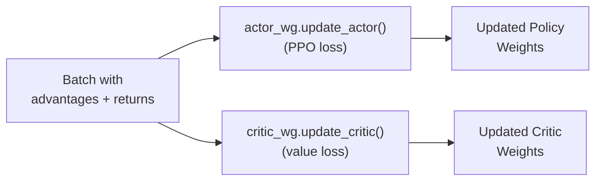

**Sources**: [verl/verl/trainer/ppo/ray_trainer.py:748-761]()

Both updates run distributed across their respective worker groups:
- `actor_wg.update_actor()`: Computes PPO clipped loss and updates policy parameters
- `critic_wg.update_critic()`: Computes value function loss (MSE against returns)

### DataProto: The Core Data Structure

All pipeline phases operate on `DataProto` objects, which encapsulate:

```python
DataProto:
  .batch               # Dict of torch tensors (prompts, responses, advantages, etc.)
  .non_tensor_batch    # Dict of non-tensor data (numpy arrays, lists, metadata)
  .meta_info           # Dict of metadata (timing, metrics, config overrides)
```

Key methods:
- `.union()`: Merge another DataProto into this one
- `.pop()`: Remove and return specific keys
- `.repeat()`: Repeat data for multi-sample rollouts

**Sources**: [verl/verl/trainer/ppo/ray_trainer.py:38]()

---

## The Configuration System

Configurations use Hydra's composition system to build training setups from reusable components. The main configuration file references sub-configs via `defaults:` sections.

### Configuration Hierarchy

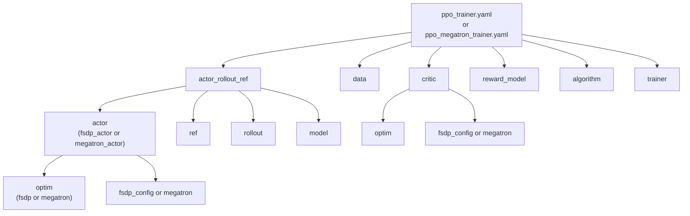

**Sources**: [verl/verl/trainer/config/_generated_ppo_trainer.yaml:1-533](), [verl/verl/trainer/config/_generated_ppo_megatron_trainer.yaml:1-549]()

### Major Configuration Sections

| Section | Purpose | Key Parameters |
|---------|---------|----------------|
| `actor_rollout_ref` | Actor and rollout worker configs | `strategy`, `ppo_mini_batch_size`, `clip_ratio` |
| `actor_rollout_ref.rollout` | Generation settings | `temperature`, `top_p`, `response_length`, `name` (vllm/sglang) |
| `critic` | Critic network configuration | `enable`, `ppo_mini_batch_size`, `cliprange_value` |
| `reward_model` | Reward model setup | `enable`, `strategy`, `reward_manager` |
| `algorithm` | RL algorithm parameters | `adv_estimator`, `gamma`, `lam`, `kl_ctrl` |
| `data` | Dataset and dataloader | `train_files`, `train_batch_size`, `max_prompt_length` |
| `trainer` | Training orchestration | `total_epochs`, `save_freq`, `test_freq`, `logger` |

**Sources**: [verl/verl/trainer/config/_generated_ppo_trainer.yaml:6-531]()

### Strategy Selection: FSDP vs Megatron

The `strategy` field determines the parallelism backend:

```yaml
# FSDP Strategy (default)
actor_rollout_ref:
  actor:
    strategy: fsdp
    fsdp_config:
      ulysses_sequence_parallel_size: 1
      param_offload: false
      
# Megatron Strategy (for maximum scale)
actor_rollout_ref:
  actor:
    strategy: megatron
    megatron:
      tensor_model_parallel_size: 2
      pipeline_model_parallel_size: 2
```

**Sources**: [verl/verl/trainer/config/_generated_ppo_trainer.yaml:40-42](), [verl/verl/trainer/config/_generated_ppo_megatron_trainer.yaml:57]()

### Configuration Instantiation

Configurations are loaded and instantiated using:

```python
# Load with Hydra
config = hydra.compose(config_name="ppo_trainer")

# Convert to dataclass
from verl.utils.config import omega_conf_to_dataclass
actor_config = omega_conf_to_dataclass(config.actor_rollout_ref.actor)
```

The `_target_` fields specify which Python class to instantiate, enabling type-safe configuration objects.

**Sources**: [verl/verl/trainer/config/_generated_ppo_trainer.yaml:9-41]()

---

## The Distributed Architecture

The distributed architecture uses Ray to manage GPU resources and coordinate workers across multiple nodes.

### Resource Pool Management

The `ResourcePoolManager` allocates GPUs into named pools that are shared by different worker roles:

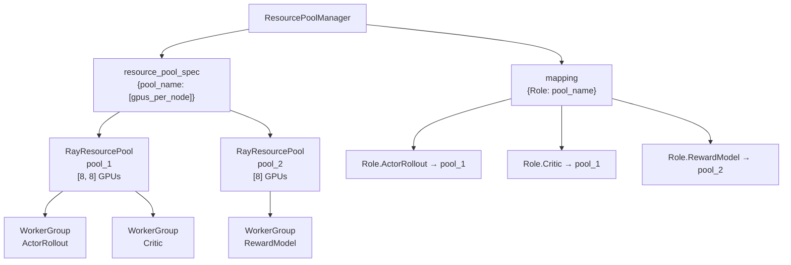

**Sources**: [verl/verl/trainer/ppo/ray_trainer.py:65-120]()

Each `RayResourcePool` manages a set of GPUs across nodes specified as `process_on_nodes: [n_gpus_node_0, n_gpus_node_1, ...]`. The `max_colocate_count` parameter controls how many worker groups can share the pool (typically 1 for FSDP, >1 for Megatron).

### Worker Roles and Mapping

Training involves five potential worker roles:

| Role | Enum | Purpose | Required |
|------|------|---------|----------|
| Actor | `Role.ActorRollout` | Policy training and generation | Yes |
| Rollout | `Role.ActorRollout` | Generation only (async mode) | Conditional |
| Critic | `Role.Critic` | Value function for GAE | Conditional |
| Reference | `Role.RefPolicy` | KL divergence computation | Conditional |
| Reward Model | `Role.RewardModel` | Learned reward scoring | Conditional |

**Sources**: [verl/verl/trainer/ppo/utils.py]()

The `role_worker_mapping` dictionary maps each role to its worker class:

```python
role_worker_mapping = {
    Role.ActorRollout: ActorRolloutRefWorker,  # Handles both actor and rollout
    Role.Critic: CriticWorker,
    Role.RewardModel: RewardModelWorker,
}
```

**Sources**: [verl/verl/trainer/ppo/ray_trainer.py:277-278]()

### RayWorkerGroup Abstraction

`RayWorkerGroup` provides a unified interface for distributed method calls:

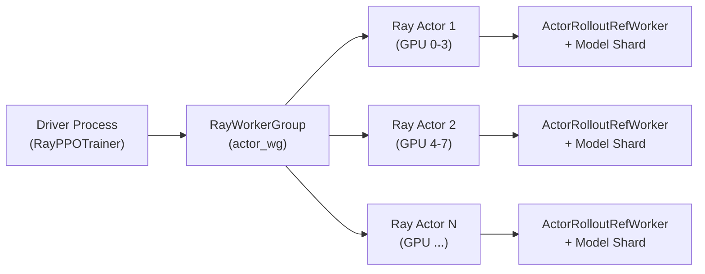

**Sources**: [verl/verl/trainer/ppo/ray_trainer.py:851-947]()

Key methods on worker groups:
- `.execute_all_sync()`: Execute method on all workers and aggregate results
- `.execute_one_sync()`: Execute on a single worker (rank 0)
- `.spawn()`: Create sub-groups for specific roles

Example usage:
```python
# Initialize worker group
actor_wg = RayWorkerGroup(resource_pool=pool, ray_cls_with_init=actor_cls)

# Remote method call
output = actor_wg.update_actor(batch)  # Calls update_actor() on all workers
```

### Hybrid Engine Mode

When `hybrid_engine: true`, the same worker handles both training and inference:

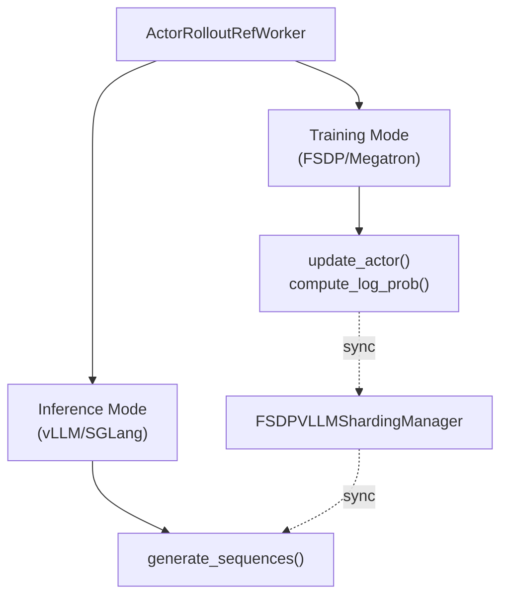

**Sources**: [verl/verl/trainer/ppo/ray_trainer.py:316-317]()

The `FSDPVLLMShardingManager` synchronizes weights between training and inference engines, enabling efficient rollout without separate worker pools.

---

## Integration Example

The three concepts come together in the trainer initialization:

```python
# 1. Configuration System: Load and compose configs
config = load_config("ppo_trainer.yaml")

# 2. Distributed Architecture: Create resource pools and worker groups
resource_pool_manager = ResourcePoolManager(
    resource_pool_spec={"pool_1": [8, 8]},  # 2 nodes, 8 GPUs each
    mapping={Role.ActorRollout: "pool_1", Role.Critic: "pool_1"}
)

trainer = RayPPOTrainer(
    config=config,
    resource_pool_manager=resource_pool_manager,
    role_worker_mapping=role_worker_mapping,
)

trainer.init_workers()  # Creates RayWorkerGroups

# 3. Training Pipeline: Execute RLHF loop
trainer.fit()  # Runs generation → reward → advantage → update
```

**Sources**: [verl/verl/trainer/ppo/ray_trainer.py:273-406](), [verl/verl/trainer/ppo/ray_trainer.py:618-1009]()

The configuration determines algorithm behavior, the distributed architecture provisions resources and creates workers, and the training pipeline orchestrates execution across those workers to implement RLHF training.

---

# Page: Training Pipeline

# Training Pipeline

<details>
<summary>Relevant source files</summary>

The following files were used as context for generating this wiki page:

- [rl_train/trainer/config/_generated_ppo_megatron_trainer.yaml](rl_train/trainer/config/_generated_ppo_megatron_trainer.yaml)
- [rl_train/trainer/config/_generated_ppo_trainer.yaml](rl_train/trainer/config/_generated_ppo_trainer.yaml)
- [rl_train/trainer/config/critic/megatron_critic.yaml](rl_train/trainer/config/critic/megatron_critic.yaml)
- [rl_train/trainer/ppo/sage_ray_trainer.py](rl_train/trainer/ppo/sage_ray_trainer.py)
- [verl/recipe/collabllm/reward_function.py](verl/recipe/collabllm/reward_function.py)
- [verl/recipe/dapo/dapo_ray_trainer.py](verl/recipe/dapo/dapo_ray_trainer.py)
- [verl/recipe/entropy/entropy_ray_trainer.py](verl/recipe/entropy/entropy_ray_trainer.py)
- [verl/recipe/one_step_off_policy/ray_trainer.py](verl/recipe/one_step_off_policy/ray_trainer.py)
- [verl/recipe/prime/prime_ray_trainer.py](verl/recipe/prime/prime_ray_trainer.py)
- [verl/recipe/sppo/sppo_ray_trainer.py](verl/recipe/sppo/sppo_ray_trainer.py)
- [verl/verl/trainer/config/_generated_ppo_megatron_trainer.yaml](verl/verl/trainer/config/_generated_ppo_megatron_trainer.yaml)
- [verl/verl/trainer/config/_generated_ppo_trainer.yaml](verl/verl/trainer/config/_generated_ppo_trainer.yaml)
- [verl/verl/trainer/config/critic/megatron_critic.yaml](verl/verl/trainer/config/critic/megatron_critic.yaml)
- [verl/verl/trainer/ppo/ray_trainer.py](verl/verl/trainer/ppo/ray_trainer.py)

</details>


This document describes the RLHF (Reinforcement Learning from Human Feedback) training loop in the SAGE/verl framework. The training pipeline consists of four main phases: generation (rollout), reward computation, advantage estimation, and policy updates. The loop is orchestrated by Ray-based trainers that coordinate distributed workers across multiple GPUs.

For information about the distributed architecture and worker roles, see [Distributed Architecture](#2.3). For details on specific training algorithms like DAPO and GSPO, see [Training Algorithms](#3).

## Overview

The training pipeline implements a standard RLHF loop where a policy model is fine-tuned using reinforcement learning. Each training iteration processes batches of prompts through four sequential phases executed by distributed workers coordinated via Ray.

**Training Loop Architecture**

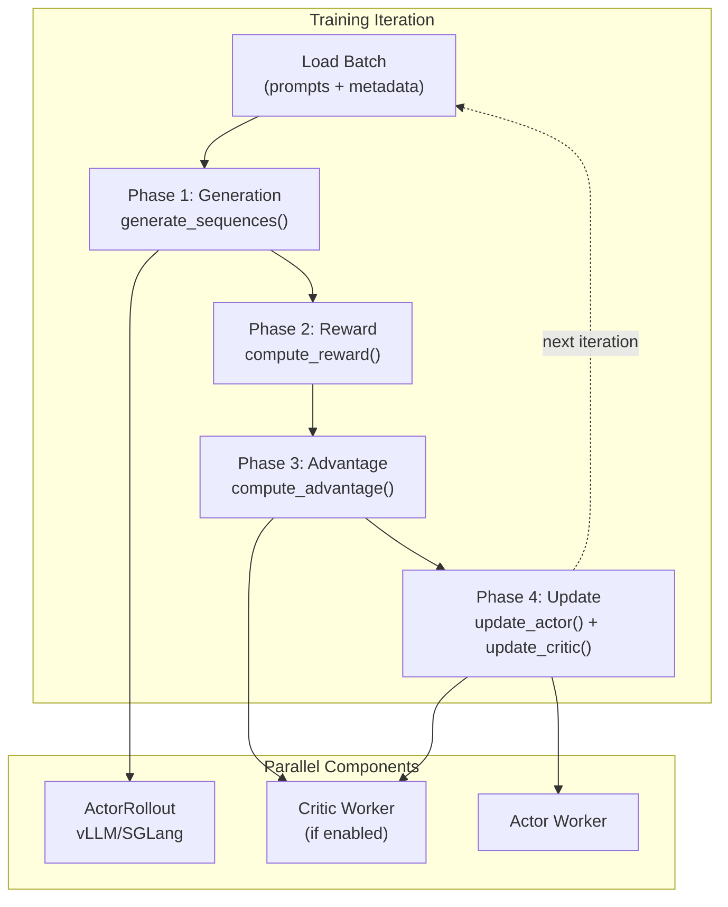

Sources: [verl/verl/trainer/ppo/ray_trainer.py:263-869]()

## Phase 1: Generation (Rollout)

The generation phase produces response sequences from input prompts using the current policy. This phase uses optimized inference engines (vLLM or SGLang) for high-throughput batch generation.

**Key Components:**
- **Worker Class**: `ActorRolloutRefWorker` 
- **Method**: `generate_sequences()`
- **Engines**: vLLM or SGLang for efficient batched inference
- **Output**: `DataProto` containing prompts, responses, and attention masks

**Generation Flow**

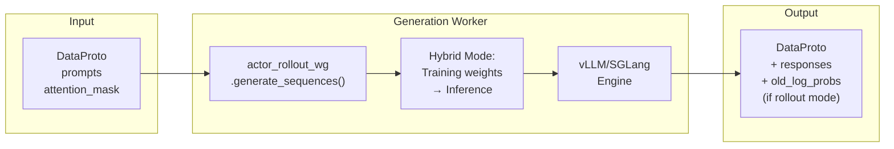

**Code Flow:**

1. **Batch Preparation**: Pop generation-specific keys from batch
   ```
   gen_batch = batch.pop(
       batch_keys=["input_ids", "attention_mask", "position_ids"],
       non_tensor_batch_keys=["raw_prompt_ids"]
   )
   ```

2. **Generation Call**: Invoke worker group method
   ```
   gen_batch_output = self.actor_rollout_wg.generate_sequences(gen_batch)
   ```

3. **Response Collection**: Merge generated outputs with original batch
   ```
   batch = batch.union(gen_batch_output)
   ```

**Generation Modes:**

| Mode | Description | Configuration |
|------|-------------|---------------|
| Sync | Standard synchronous generation | `rollout.mode: sync` |
| Async | Asynchronous generation with weight sync | `rollout.mode: async` |
| Hybrid Engine | Weights synced between training and inference | `hybrid_engine: true` |

**Sampling Parameters:**

The generation phase supports various sampling configurations set in `RolloutConfig`:

- `temperature`: Controls randomness (default: 1.0)
- `top_k`: Top-k sampling (default: -1, disabled)
- `top_p`: Nucleus sampling (default: 1.0)
- `n`: Number of samples per prompt (for GRPO/RLOO)
- `do_sample`: Whether to sample or use greedy decoding

Sources: [verl/verl/trainer/ppo/ray_trainer.py:502-517](), [verl/verl/trainer/config/_generated_ppo_trainer.yaml:162-246](), [verl/recipe/one_step_off_policy/ray_trainer.py:302-360]()

## Phase 2: Reward Computation

The reward computation phase assigns scalar rewards to generated responses. Rewards can come from learned reward models, rule-based functions, or a combination of both.

**Reward Sources**

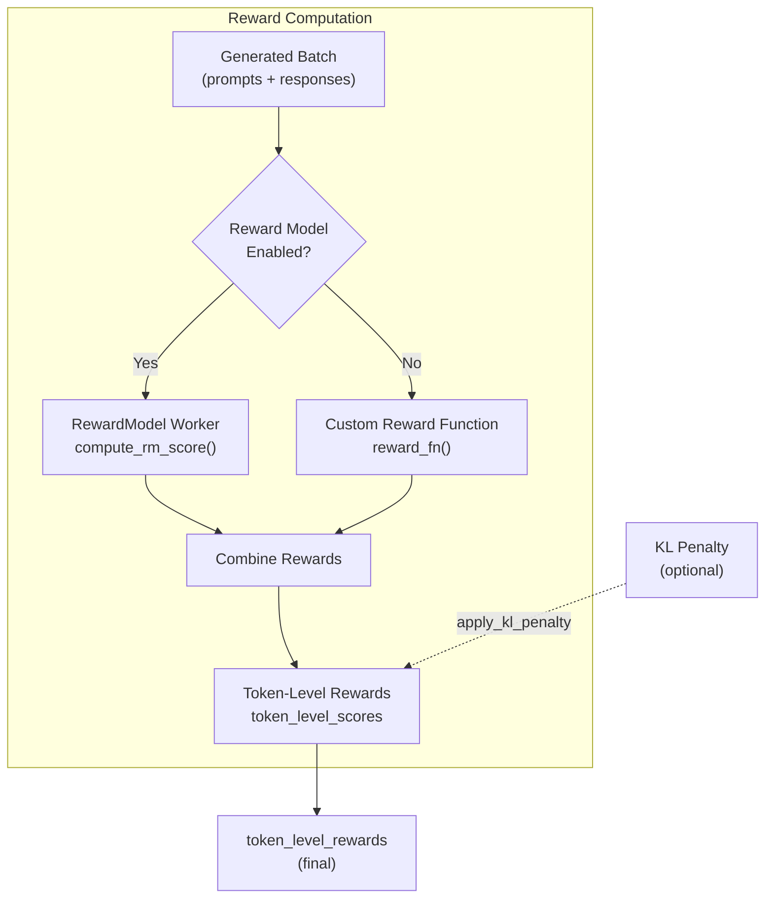

**Reward Model Path:**

If a reward model is configured (`reward_model.enable: true`), the system first computes model-based scores:

1. **Model Scoring**: 
   ```python
   reward_tensor = self.rm_wg.compute_rm_score(batch)
   batch = batch.union(reward_tensor)
   ```

2. **Function Combination**: The reward function can access model scores via `batch.batch["rm_scores"]` and combine them with rule-based rewards.

**Custom Reward Function:**

Custom reward functions are loaded from Python modules specified in configuration:

```yaml
custom_reward_function:
  path: path/to/reward_module.py
  name: compute_score
```

The function receives a `DataProto` and can return:
- A tensor of token-level rewards
- A dictionary with `reward_tensor` and optional `reward_extra_info`

**Reward Function Interface:**

```python
def compute_score(data: DataProto, return_dict: bool = False):
    # Access prompts, responses, ground truth
    prompts = data.batch["prompts"]
    responses = data.batch["responses"]
    ground_truth = data.non_tensor_batch.get("ground_truth")
    
    # Compute rewards (shape: [batch_size, response_length])
    rewards = ...
    
    if return_dict:
        return {
            "reward_tensor": rewards,
            "reward_extra_info": {"metric_1": [...], ...}
        }
    return rewards
```

**KL Penalty:**

If configured (`algorithm.use_kl_in_reward: true`), a KL divergence penalty is applied between the current policy and reference policy:

```
token_level_rewards = token_level_scores - β * KL(π || π_ref)
```

The KL coefficient β is controlled by `AdaptiveKLController` which can adjust dynamically based on training progress.

Sources: [verl/verl/trainer/ppo/ray_trainer.py:122-162](), [verl/verl/trainer/ppo/reward.py](), [verl/verl/trainer/config/_generated_ppo_trainer.yaml:403-447]()

## Phase 3: Advantage Estimation

The advantage estimation phase computes advantage values that guide policy optimization. SAGE supports multiple advantage estimators tailored for different training scenarios.

**Advantage Estimators**

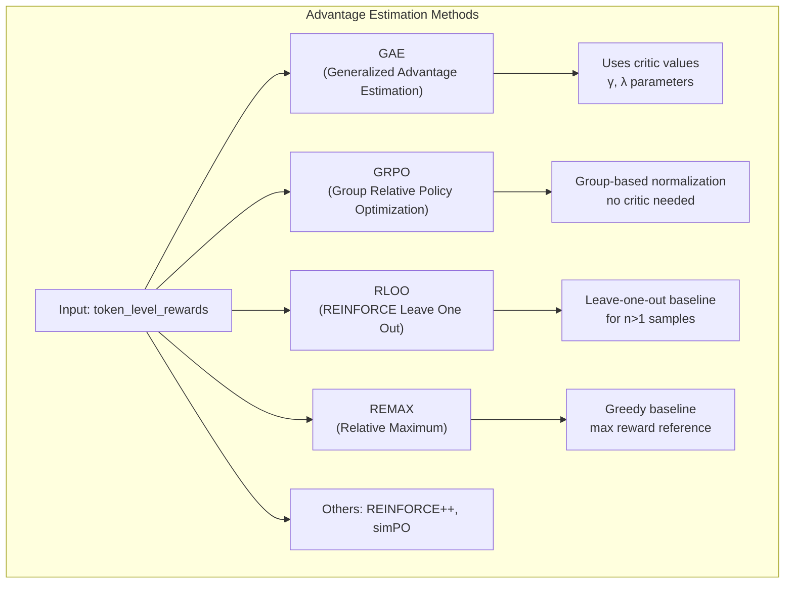

**Advantage Estimator Selection:**

The estimator is configured via `algorithm.adv_estimator`:

| Estimator | Use Case | Requires Critic | Configuration |
|-----------|----------|----------------|---------------|
| `gae` | Standard PPO with value function | Yes | `gamma`, `lam` |
| `grpo` | Best-of-N sampling | No | `n` rollouts per prompt |
| `rloo` | REINFORCE with leave-one-out | No | `n` rollouts per prompt |
| `remax` | Relative to greedy baseline | No | Generates greedy sample |
| `reinforce++` | Variance reduction | No | Optional baseline |

**GAE (Generalized Advantage Estimation):**

When using GAE, advantages are computed using temporal difference bootstrapping:

```python
advantages, returns = compute_gae_advantage_return(
    token_level_rewards=batch["token_level_rewards"],
    values=batch["values"],
    response_mask=batch["response_mask"],
    gamma=config.algorithm.gamma,  # discount factor
    lam=config.algorithm.lam       # GAE lambda
)
```

The critic value function must be enabled for GAE.

**GRPO (Group Relative Policy Optimization):**

For GRPO, advantages are computed by comparing samples within the same group (prompt):

```python
advantages, returns = compute_grpo_outcome_advantage(
    token_level_rewards=batch["token_level_rewards"],
    response_mask=batch["response_mask"],
    index=batch.non_tensor_batch["uid"],  # group by prompt UID
    norm_adv_by_std_in_grpo=True
)
```

This normalizes advantages relative to other responses for the same prompt, reducing variance without a critic.

**Advantage Computation Flow:**

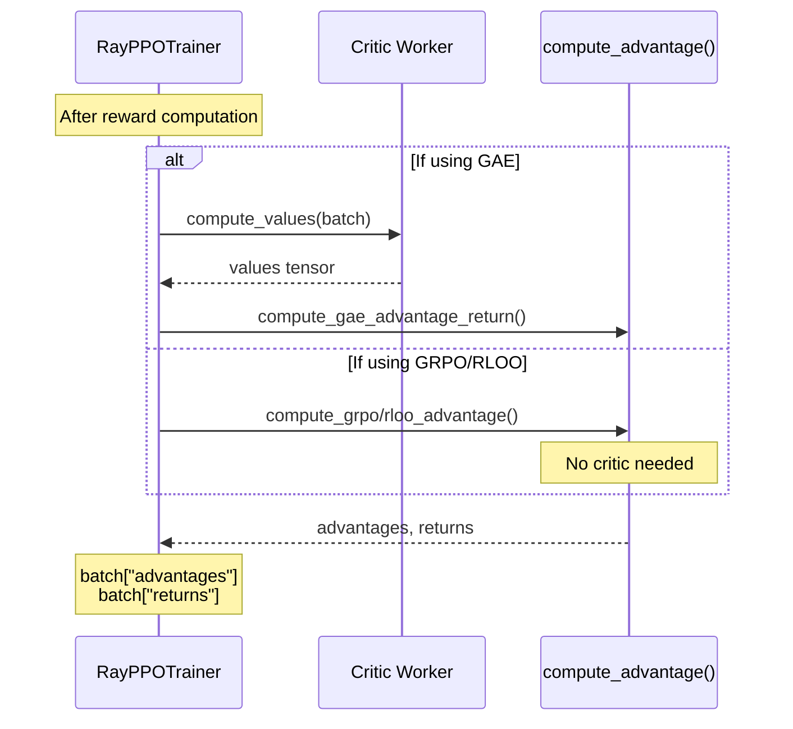

**Output:**

After advantage estimation, the batch contains:
- `advantages`: Per-token advantage estimates (shape: `[batch_size, response_length]`)
- `returns`: Computed returns for critic training (if applicable)
- `response_mask`: Mask indicating valid response tokens

Sources: [verl/verl/trainer/ppo/ray_trainer.py:182-261](), [verl/verl/trainer/ppo/core_algos.py](), [verl/verl/trainer/config/_generated_ppo_trainer.yaml:448-471]()

## Phase 4: Policy Update

The policy update phase performs gradient-based optimization of the actor (policy model) and optionally the critic (value function). This phase implements PPO-style clipped objectives to ensure stable learning.

**Update Components**

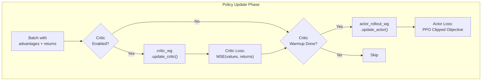

**Actor Update:**

The actor update uses a PPO-style clipped objective to constrain policy changes:

1. **Mini-batch Creation**: The batch is divided into mini-batches based on `ppo_mini_batch_size`

2. **PPO Objective**: For each mini-batch, compute:
   ```
   ratio = exp(log_prob - old_log_prob)
   surr1 = ratio * advantages
   surr2 = clip(ratio, 1-ε, 1+ε) * advantages
   policy_loss = -mean(min(surr1, surr2))
   ```
   where ε is the clip ratio (`clip_ratio`)

3. **Entropy Regularization** (optional):
   ```
   loss = policy_loss - entropy_coeff * entropy
   ```

4. **Gradient Descent**: Backpropagate and update actor parameters

**Clipping Variants:**

Different algorithms use different clipping strategies:

| Algorithm | Clipping | Configuration |
|-----------|----------|---------------|
| Vanilla PPO | Symmetric | `clip_ratio: 0.2` |
| GSPO | Asymmetric | `clip_ratio_low: 0.2`<br/>`clip_ratio_high: 0.2` |
| Entropy-based | Covariance-aware | `policy_loss.clip_cov_ratio` |

**Critic Update:**

If a critic is enabled, it's updated before the actor:

1. **Value Loss**: Mean squared error between predicted values and computed returns
   ```
   value_loss = MSE(values, returns)
   ```

2. **Clipped Value Loss** (optional):
   ```
   values_clipped = old_values + clip(values - old_values, -c, +c)
   value_loss = mean(max(MSE(values, returns), MSE(values_clipped, returns)))
   ```
   where c is `cliprange_value`

3. **Gradient Descent**: Update critic parameters

**Multi-Epoch Training:**

Both actor and critic can be updated multiple times per batch:

- `ppo_epochs`: Number of epochs to train on each batch (default: 1)
- `shuffle`: Whether to shuffle data between epochs

**Training Configuration:**

```yaml
actor:
  ppo_mini_batch_size: 256      # Mini-batch size for updates
  ppo_epochs: 1                  # Training epochs per batch
  clip_ratio: 0.2                # PPO clip parameter
  entropy_coeff: 0.0             # Entropy regularization weight
  loss_agg_mode: token-mean      # Loss aggregation: token-mean or sequence-mean
  
critic:
  cliprange_value: 0.5           # Value clipping range
  ppo_epochs: 1                  # Critic training epochs
```

**Loss Aggregation:**

The `loss_agg_mode` parameter determines how token-level losses are aggregated:

- `token-mean`: Average over all valid tokens
- `sequence-mean`: Average per sequence, then average over sequences

This affects the effective weighting of short vs. long sequences.

Sources: [verl/verl/trainer/ppo/ray_trainer.py:869-1020](), [verl/workers/actor/fsdp_workers.py](), [verl/workers/critic/fsdp_workers.py](), [verl/verl/trainer/config/_generated_ppo_trainer.yaml:6-107](), [verl/verl/trainer/config/_generated_ppo_trainer.yaml:304-402]()

## Training Loop Orchestration

The `RayPPOTrainer` class orchestrates the entire training loop, coordinating distributed workers and managing the training lifecycle.

**Trainer Class Hierarchy**

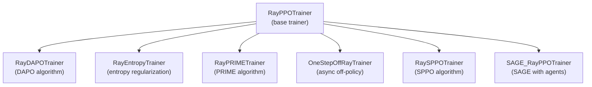

**Main Training Loop:**

The `fit()` method implements the training loop:

```python
def fit(self):
    # 1. Initialize
    self.global_steps = 0
    self._load_checkpoint()
    
    # 2. Initial validation
    if self.val_reward_fn and config.trainer.val_before_train:
        val_metrics = self._validate()
        logger.log(val_metrics, step=0)
    
    # 3. Training epochs
    for epoch in range(config.trainer.total_epochs):
        for batch_dict in self.train_dataloader:
            # Phase 1: Generation
            gen_batch_output = self.actor_rollout_wg.generate_sequences(gen_batch)
            
            # Phase 2: Reward
            reward_tensor = compute_reward(batch, self.reward_fn)
            
            # Phase 3: Advantage
            batch = compute_advantage(batch, config.algorithm)
            
            # Phase 4: Update
            if self.use_critic:
                self.critic_wg.update_critic(batch)
            self.actor_rollout_wg.update_actor(batch)
            
            # Validation and checkpointing
            if should_validate:
                self._validate()
            if should_save:
                self._save_checkpoint()
            
            self.global_steps += 1
```

**Worker Initialization:**

The trainer initializes Ray workers during `init_workers()`:

1. **Create Resource Pools**: Allocate GPU resources across nodes
2. **Initialize Worker Groups**: Create worker groups for each role
3. **Load Models**: Initialize model weights on each worker
4. **Setup Profilers**: Configure performance profiling if enabled

**Worker Group Mapping:**

```mermaid
graph LR
    subgraph "Worker Groups"
        A["actor_rollout_wg<br/>ActorRolloutRefWorker"]
        B["critic_wg<br/>CriticWorker"]
        C["ref_policy_wg<br/>ReferenceWorker"]
        D["rm_wg<br/>RewardModelWorker"]
    end
    
    subgraph "Roles"
        E["Role.ActorRollout"]
        F["Role.Critic"]
        G["Role.RefPolicy"]
        H["Role.RewardModel"]
    end
    
    E -.maps to.-> A
    F -.maps to.-> B
    G -.maps to.-> C
    H -.maps to.-> D
    
    subgraph "Resource Pools"
        I["RayResourcePool<br/>(actor_rollout)"]
        J["RayResourcePool<br/>(critic)"]
        K["RayResourcePool<br/>(reward)"]
    end
    
    A --> I
    B --> J
    C --> I
    D --> K
```

**Checkpointing:**

The trainer supports checkpoint saving and resuming:

- **Save**: `_save_checkpoint()` saves actor, critic, and dataloader state
- **Load**: `_load_checkpoint()` resumes from latest checkpoint
- **Resume Modes**: `auto`, `disable`, or explicit path via `resume_from_path`

**Validation:**

The `_validate()` method evaluates the current policy on the validation set:

1. Generate responses for validation prompts
2. Compute rewards using `val_reward_fn`
3. Log metrics and optionally sample generations
4. Return validation metrics dict

Sources: [verl/verl/trainer/ppo/ray_trainer.py:263-417](), [verl/verl/trainer/ppo/ray_trainer.py:519-869](), [verl/verl/trainer/ppo/ray_trainer.py:1020-1150]()

## Data Flow Through Pipeline

Understanding how data flows through the pipeline helps clarify the interactions between components.

**DataProto Structure**

The training pipeline uses `DataProto` objects to pass data between phases. A `DataProto` contains:

- `batch`: Dictionary of tensors (e.g., `prompts`, `responses`, `attention_mask`)
- `non_tensor_batch`: Dictionary of non-tensor data (e.g., `uid`, `data_source`, metadata)
- `meta_info`: Metadata about the batch (e.g., `global_token_num`, timing info)

**Data Transformations Per Phase**

```mermaid
flowchart TB
    subgraph "Phase 0: Data Loading"
        A["train_dataloader"]
        B["batch_dict:<br/>input_ids, attention_mask,<br/>position_ids"]
        C["DataProto.from_single_dict()"]
        D["DataProto:<br/>prompts (input_ids)<br/>attention_mask"]
    end
    
    subgraph "Phase 1: Generation"
        E["Pop generation keys<br/>Extract raw_prompt_ids"]
        F["gen_batch:<br/>raw_prompt_ids only"]
        G["generate_sequences()"]
        H["gen_batch_output:<br/>+ responses<br/>+ old_log_probs"]
        I["Union with original<br/>batch.union(output)"]
    end
    
    subgraph "Phase 2: Reward"
        J["DataProto:<br/>prompts + responses"]
        K["compute_reward()"]
        L["+ token_level_scores<br/>+ reward_extra_info"]
        M["apply_kl_penalty()<br/>(if enabled)"]
        N["+ token_level_rewards"]
    end
    
    subgraph "Phase 3: Advantage"
        O["compute_log_prob()"]
        P["+ old_log_probs<br/>(recomputed)"]
        Q["compute_ref_log_prob()<br/>(if ref policy enabled)"]
        R["+ ref_log_prob"]
        S["compute_values()<br/>(if critic enabled)"]
        T["+ values"]
        U["compute_advantage()"]
        V["+ advantages<br/>+ returns"]
    end
    
    subgraph "Phase 4: Update"
        W["Split into mini-batches"]
        X["update_actor()<br/>update_critic()"]
        Y["Updated model weights"]
    end
    
    A --> B
    B --> C
    C --> D
    D --> E
    E --> F
    F --> G
    G --> H
    H --> I
    I --> J
    J --> K
    K --> L
    L --> M
    M --> N
    N --> O
    O --> P
    P --> Q
    Q --> R
    R --> S
    S --> T
    T --> U
    U --> V
    V --> W
    W --> X
    X --> Y
```

**Key Data Operations:**

1. **Batch Repeat**: For algorithms that sample multiple responses per prompt (GRPO, RLOO):
   ```python
   gen_batch = gen_batch.repeat(repeat_times=config.rollout.n, interleave=True)
   ```

2. **Union**: Merge new tensors into existing DataProto:
   ```python
   batch = batch.union(gen_batch_output)
   ```

3. **Pop**: Remove keys for specific operations:
   ```python
   gen_batch = batch.pop(batch_keys=["input_ids", ...])
   ```

4. **Indexing**: Filter batch by indices:
   ```python
   filtered_batch = batch[kept_indices]
   ```

5. **Concatenation**: Combine multiple batches:
   ```python
   combined = DataProto.concat([batch1, batch2])
   ```

**Batch Balancing:**

To balance GPU utilization, the trainer can redistribute data across workers to equalize the number of valid tokens per rank:

```python
if config.trainer.balance_batch:
    self._balance_batch(batch, metrics=metrics)
```

This uses `get_seqlen_balanced_partitions()` to compute optimal data distribution.

Sources: [verl/verl/trainer/ppo/ray_trainer.py:502-869](), [verl/verl/utils/seqlen_balancing.py](), [verl/verl/protocol.py]()

## Configuration Overview

The training pipeline is highly configurable through Hydra-based YAML configurations. Key configuration sections:

**Actor/Rollout Configuration:**

```yaml
actor_rollout_ref:
  actor:
    strategy: fsdp  # or megatron
    ppo_mini_batch_size: 256
    ppo_epochs: 1
    clip_ratio: 0.2
    entropy_coeff: 0
    optim:
      lr: 1e-6
      weight_decay: 0.01
  
  rollout:
    name: vllm  # or sglang
    mode: sync  # or async
    temperature: 1.0
    n: 1  # samples per prompt
    tensor_model_parallel_size: 2
  
  hybrid_engine: true
```

**Algorithm Configuration:**

```yaml
algorithm:
  adv_estimator: gae  # gae, grpo, rloo, remax, etc.
  gamma: 1.0
  lam: 1.0
  use_kl_in_reward: false
  kl_ctrl:
    type: fixed
    kl_coef: 0.001
```

**Trainer Configuration:**

```yaml
trainer:
  total_epochs: 30
  project_name: verl_examples
  experiment_name: gsm8k
  logger: [console, wandb]
  val_before_train: true
  test_freq: -1
  save_freq: -1
  balance_batch: true
  nnodes: 1
  n_gpus_per_node: 8
```

For more details on configuration, see [Configuration System](#2.2).

Sources: [verl/verl/trainer/config/_generated_ppo_trainer.yaml](), [rl_train/trainer/config/_generated_ppo_trainer.yaml]()

## Asynchronous Training Modes

For advanced use cases, SAGE supports asynchronous training modes where generation and training are decoupled.

**One-Step Off-Policy Training:**

The `OneStepOffRayTrainer` implements asynchronous generation with periodic weight synchronization:

1. **Separate Workers**: Actor and rollout workers are separate
2. **Weight Sync**: Weights synced from actor to rollout via NCCL
3. **Async Generation**: Rollout generates while actor trains on previous batch
4. **Pipeline Parallelism**: Generation and training overlap in time

```mermaid
sequenceDiagram
    participant Trainer
    participant Actor
    participant Rollout
    
    Note over Trainer: Batch N
    Trainer->>Rollout: sync_rollout_weights()
    Trainer->>Rollout: async_generate_sequences()
    
    Note over Rollout: Generating...
    Note over Trainer: Batch N-1
    Trainer->>Actor: update_actor(batch_N-1)
    Note over Actor: Training...
    
    Rollout-->>Trainer: generation complete
    Note over Trainer: Proceed to reward/advantage
```

**Configuration:**

```yaml
actor_rollout_ref:
  rollout:
    mode: async
  hybrid_engine: false  # Must be false for async mode
```

For more details, see [One-Step Off-Policy Training](#3.5).

Sources: [verl/recipe/one_step_off_policy/ray_trainer.py:95-501]()

---

# Page: Configuration System

# Configuration System

<details>
<summary>Relevant source files</summary>

The following files were used as context for generating this wiki page:

- [rl_train/trainer/config/_generated_ppo_megatron_trainer.yaml](rl_train/trainer/config/_generated_ppo_megatron_trainer.yaml)
- [rl_train/trainer/config/_generated_ppo_trainer.yaml](rl_train/trainer/config/_generated_ppo_trainer.yaml)
- [rl_train/trainer/config/critic/megatron_critic.yaml](rl_train/trainer/config/critic/megatron_critic.yaml)
- [rl_train/trainer/config/rollout/rollout.yaml](rl_train/trainer/config/rollout/rollout.yaml)
- [verl/recipe/dapo/run_dapo_early_qwen2.5_32b.sh](verl/recipe/dapo/run_dapo_early_qwen2.5_32b.sh)
- [verl/recipe/dapo/run_dapo_qwen2.5_32b.sh](verl/recipe/dapo/run_dapo_qwen2.5_32b.sh)
- [verl/recipe/dapo/run_dapo_qwen2.5_32b_npu.sh](verl/recipe/dapo/run_dapo_qwen2.5_32b_npu.sh)
- [verl/recipe/dapo/run_dapo_qwen2.5_32b_tis.sh](verl/recipe/dapo/run_dapo_qwen2.5_32b_tis.sh)
- [verl/recipe/dapo/run_dapo_qwen2.5_7b_npu.sh](verl/recipe/dapo/run_dapo_qwen2.5_7b_npu.sh)
- [verl/recipe/dapo/run_dapo_qwen3_14b_base_npu.sh](verl/recipe/dapo/run_dapo_qwen3_14b_base_npu.sh)
- [verl/recipe/dapo/run_dapo_qwen3_8b_base_npu.sh](verl/recipe/dapo/run_dapo_qwen3_8b_base_npu.sh)
- [verl/recipe/dapo/run_dapo_qwen3_moe_30b_base_fsdp_npu.sh](verl/recipe/dapo/run_dapo_qwen3_moe_30b_base_fsdp_npu.sh)
- [verl/recipe/dapo/run_dapo_wo_ds_qwen2.5_32b.sh](verl/recipe/dapo/run_dapo_wo_ds_qwen2.5_32b.sh)
- [verl/recipe/dapo/test_dapo_7b.sh](verl/recipe/dapo/test_dapo_7b.sh)
- [verl/recipe/entropy/32b_clip_cov.sh](verl/recipe/entropy/32b_clip_cov.sh)
- [verl/recipe/entropy/32b_kl_cov.sh](verl/recipe/entropy/32b_kl_cov.sh)
- [verl/recipe/entropy/32b_kl_cov_mininbsz.sh](verl/recipe/entropy/32b_kl_cov_mininbsz.sh)
- [verl/recipe/entropy/7b_clip_cov.sh](verl/recipe/entropy/7b_clip_cov.sh)
- [verl/recipe/entropy/7b_kl_cov.sh](verl/recipe/entropy/7b_kl_cov.sh)
- [verl/recipe/entropy/config/entropy_trainer.yaml](verl/recipe/entropy/config/entropy_trainer.yaml)
- [verl/recipe/gspo/test_gspo_qwen30b_a3b_ep.sh](verl/recipe/gspo/test_gspo_qwen30b_a3b_ep.sh)
- [verl/recipe/prime/config/prime_trainer.yaml](verl/recipe/prime/config/prime_trainer.yaml)
- [verl/verl/trainer/config/_generated_ppo_megatron_trainer.yaml](verl/verl/trainer/config/_generated_ppo_megatron_trainer.yaml)
- [verl/verl/trainer/config/_generated_ppo_trainer.yaml](verl/verl/trainer/config/_generated_ppo_trainer.yaml)
- [verl/verl/trainer/config/critic/megatron_critic.yaml](verl/verl/trainer/config/critic/megatron_critic.yaml)
- [verl/verl/trainer/config/rollout/rollout.yaml](verl/verl/trainer/config/rollout/rollout.yaml)

</details>


## Purpose and Scope

This document describes the configuration system used in SAGE's VERL framework for setting up and running RLHF training experiments. The configuration system is built on [Hydra](https://hydra.cc) and [OmegaConf](https://omegaconf.readthedocs.io), enabling hierarchical, composable YAML-based configuration management. This system controls all aspects of training including model parameters, distributed training strategies, algorithm hyperparameters, data processing, and hardware-specific optimizations.

For information about how these configurations are consumed by the training loop, see [Training Pipeline](#2.1). For details on the distributed execution architecture configured by this system, see [Distributed Architecture](#2.3).

## Configuration Architecture

The configuration system follows a hierarchical composition model where specialized configurations inherit from base templates and can be selectively overridden at runtime.

### Configuration Hierarchy

```mermaid
graph TB
    subgraph "Base Configurations"
        BasePPO["ppo_trainer.yaml<br/>Base PPO configuration"]
        BaseMegatron["ppo_megatron_trainer.yaml<br/>Base Megatron configuration"]
    end
    
    subgraph "Component Configs"
        ActorConfig["actor configs<br/>FSDPActorConfig<br/>McoreActorConfig"]
        RolloutConfig["rollout.yaml<br/>RolloutConfig"]
        CriticConfig["critic configs<br/>FSDPCriticConfig<br/>McoreCriticConfig"]
        DataConfig["data.yaml<br/>DataConfig"]
        AlgoConfig["algorithm.yaml<br/>AlgoConfig"]
    end
    
    subgraph "Recipe Configs"
        DAPO["dapo config<br/>extends ppo_trainer"]
        GSPO["gspo config<br/>extends ppo_trainer"]
        Entropy["entropy_trainer.yaml<br/>extends ppo_trainer"]
        PRIME["prime_trainer.yaml<br/>extends ppo_trainer"]
    end
    
    subgraph "Runtime"
        CLIOverrides["Command-line Overrides<br/>key=value syntax"]
        FinalConfig["Final Merged Config<br/>OmegaConf DictConfig"]
    end
    
    BasePPO --> ActorConfig
    BasePPO --> RolloutConfig
    BasePPO --> CriticConfig
    BasePPO --> DataConfig
    BasePPO --> AlgoConfig
    BaseMegatron --> ActorConfig
    BaseMegatron --> RolloutConfig
    BaseMegatron --> CriticConfig
    
    BasePPO --> DAPO
    BasePPO --> GSPO
    BasePPO --> Entropy
    BasePPO --> PRIME
    
    DAPO --> CLIOverrides
    GSPO --> CLIOverrides
    Entropy --> CLIOverrides
    CLIOverrides --> FinalConfig
```

**Configuration Composition Flow**

Sources: [verl/verl/trainer/config/_generated_ppo_trainer.yaml:1-533](), [verl/verl/trainer/config/_generated_ppo_megatron_trainer.yaml:1-549](), [verl/recipe/entropy/config/entropy_trainer.yaml:1-39](), [verl/recipe/prime/config/prime_trainer.yaml:1-77]()

### Configuration to Code Mapping

```mermaid
graph LR
    subgraph "YAML Configuration Space"
        ActorCfg["actor_rollout_ref.actor<br/>FSDPActorConfig"]
        RolloutCfg["actor_rollout_ref.rollout<br/>RolloutConfig"]
        CriticCfg["critic<br/>FSDPCriticConfig"]
        DataCfg["data<br/>DataConfig"]
        AlgoCfg["algorithm<br/>AlgoConfig"]
        TrainerCfg["trainer<br/>TrainerConfig"]
    end
    
    subgraph "Code Entity Space"
        ActorWorker["ActorRolloutRefWorker<br/>verl/workers/actor_rollout_ref.py"]
        RolloutWorker["RolloutWorker<br/>vllm/sglang engines"]
        CriticWorker["CriticWorker<br/>verl/workers/critic.py"]
        DataLoader["RLHFDataset<br/>verl/utils/dataset.py"]
        Trainer["RayPPOTrainer<br/>verl/trainer/ppo/ray_trainer.py"]
        Engine["FSDPEngine/MegatronEngine<br/>verl/workers/fsdp_workers.py"]
    end
    
    ActorCfg -->|"instantiated by"| ActorWorker
    RolloutCfg -->|"instantiated by"| RolloutWorker
    CriticCfg -->|"instantiated by"| CriticWorker
    DataCfg -->|"instantiated by"| DataLoader
    AlgoCfg -->|"consumed by"| Trainer
    TrainerCfg -->|"consumed by"| Trainer
    ActorWorker -->|"uses"| Engine
```

**Configuration to Worker Mapping**

Sources: [verl/verl/trainer/config/_generated_ppo_trainer.yaml:6-108](), [verl/verl/trainer/config/_generated_ppo_trainer.yaml:162-247](), [verl/verl/trainer/config/_generated_ppo_trainer.yaml:304-402]()

## Configuration Structure

The configuration system organizes settings into seven primary sections, each controlling different aspects of the training system:

| Section | Purpose | Key Components |
|---------|---------|----------------|
| `actor_rollout_ref` | Configures actor model, reference model, and rollout generation | `.actor`, `.ref`, `.rollout`, `.model`, `.hybrid_engine` |
| `data` | Training and validation data configuration | `train_files`, `val_files`, `max_prompt_length`, `max_response_length`, `train_batch_size` |
| `critic` | Value function critic configuration | `optim`, `model`, `fsdp_config`/`megatron`, `ppo_mini_batch_size` |
| `reward_model` | Reward model configuration for PRIME and other algorithms | `enable`, `model`, `strategy`, `reward_manager` |
| `algorithm` | RL algorithm hyperparameters | `adv_estimator`, `gamma`, `lam`, `kl_ctrl`, `filter_groups`, `rollout_is` |
| `trainer` | Training loop and checkpointing configuration | `total_epochs`, `save_freq`, `test_freq`, `logger`, `nnodes`, `n_gpus_per_node` |
| `global_profiler` | Performance profiling configuration | `tool`, `steps`, `save_path` |

Sources: [verl/verl/trainer/config/_generated_ppo_trainer.yaml:1-533]()

### File Organization

Configuration files are organized in the following directory structure:

```
verl/trainer/config/
├── ppo_trainer.yaml              # Base FSDP configuration
├── ppo_megatron_trainer.yaml     # Base Megatron configuration
├── _generated_ppo_trainer.yaml   # Flattened reference (auto-generated)
├── actor/
│   ├── fsdp_actor.yaml          # FSDP actor configuration
│   └── megatron_actor.yaml      # Megatron actor configuration
├── critic/
│   ├── fsdp_critic.yaml         # FSDP critic configuration
│   └── megatron_critic.yaml     # Megatron critic configuration
├── rollout/
│   └── rollout.yaml             # Rollout/generation configuration
├── engine/
│   ├── fsdp.yaml                # FSDP engine settings
│   └── megatron.yaml            # Megatron engine settings
├── optim/
│   ├── fsdp_optim.yaml          # FSDP optimizer settings
│   └── megatron.yaml            # Megatron optimizer settings
└── data.yaml                    # Data loading configuration

recipe/
├── dapo/config/
│   └── dapo_trainer.yaml        # DAPO-specific overrides
├── entropy/config/
│   └── entropy_trainer.yaml     # Entropy regularization overrides
└── prime/config/
    └── prime_trainer.yaml       # PRIME reward modeling overrides
```

Sources: [verl/verl/trainer/config/_generated_ppo_trainer.yaml:1-4](), [verl/recipe/entropy/config/entropy_trainer.yaml:1-8](), [verl/recipe/prime/config/prime_trainer.yaml:1-9]()

## Configuration Composition with Hydra

### Defaults Mechanism

Hydra uses the `defaults` list to compose configurations from multiple files. Each recipe configuration extends the base configuration:

```yaml
# recipe/entropy/config/entropy_trainer.yaml
hydra:
  searchpath:
    - file://verl/trainer/config

defaults:
  - ppo_trainer      # Inherits from base ppo_trainer.yaml
  - _self_           # Apply current file's settings last (override priority)

# Recipe-specific overrides below
actor_rollout_ref:
  actor:
    policy_loss:
      loss_mode: "kl_cov"  # Override default "vanilla" loss
```

The `_self_` entry controls merge priority - when placed last, the current file's values override inherited ones.

Sources: [verl/recipe/entropy/config/entropy_trainer.yaml:1-8](), [verl/recipe/prime/config/prime_trainer.yaml:1-9]()

### FSDP vs Megatron Configuration Paths

The system provides two parallel configuration paths for different distributed training strategies:

```mermaid
graph TB
    subgraph "FSDP Path"
        FSDP_Base["ppo_trainer.yaml"]
        FSDP_Actor["actor/fsdp_actor.yaml<br/>FSDPActorConfig"]
        FSDP_Critic["critic/fsdp_critic.yaml<br/>FSDPCriticConfig"]
        FSDP_Engine["engine/fsdp.yaml<br/>FSDPEngineConfig"]
        FSDP_Optim["optim/fsdp_optim.yaml<br/>FSDPOptimizerConfig"]
    end
    
    subgraph "Megatron Path"
        Meg_Base["ppo_megatron_trainer.yaml"]
        Meg_Actor["actor/megatron_actor.yaml<br/>McoreActorConfig"]
        Meg_Critic["critic/megatron_critic.yaml<br/>McoreCriticConfig"]
        Meg_Engine["engine/megatron.yaml<br/>McoreEngineConfig"]
        Meg_Optim["optim/megatron.yaml<br/>McoreOptimizerConfig"]
    end
    
    FSDP_Base --> FSDP_Actor
    FSDP_Base --> FSDP_Critic
    FSDP_Actor --> FSDP_Engine
    FSDP_Actor --> FSDP_Optim
    FSDP_Critic --> FSDP_Engine
    FSDP_Critic --> FSDP_Optim
    
    Meg_Base --> Meg_Actor
    Meg_Base --> Meg_Critic
    Meg_Actor --> Meg_Engine
    Meg_Actor --> Meg_Optim
    Meg_Critic --> Meg_Engine
    Meg_Critic --> Meg_Optim
```

**Dual Configuration Strategy**

Sources: [verl/verl/trainer/config/_generated_ppo_trainer.yaml:23-157](), [verl/verl/trainer/config/_generated_ppo_megatron_trainer.yaml:29-173]()

## Configuration Override Patterns

### OmegaConf Override Syntax

The system supports rich command-line override syntax through OmegaConf:

| Syntax | Purpose | Example |
|--------|---------|---------|
| `key=value` | Set or override a value | `trainer.total_epochs=10` |
| `+key=value` | Add a new key | `+actor_rollout_ref.model.override_config.dropout=0.1` |
| `~key` | Delete a key | `~reward_model.enable` |
| `key.nested=value` | Set nested value | `actor_rollout_ref.actor.optim.lr=1e-6` |
| `${oc.select:key,default}` | Reference with default | `log_prob_use_dynamic_bsz: ${oc.select:actor_rollout_ref.actor.use_dynamic_bsz,false}` |
| `key='["item1","item2"]'` | Set list values | `trainer.logger='["console","wandb"]'` |

Sources: [verl/recipe/dapo/run_dapo_qwen2.5_32b.sh:61-131](), [verl/recipe/entropy/32b_kl_cov.sh:62-143]()

### Common Override Patterns

**Performance Tuning:**
```bash
# Dynamic batch sizing for memory efficiency
actor_rollout_ref.actor.use_dynamic_bsz=True \
actor_rollout_ref.actor.ppo_max_token_len_per_gpu=16384 \
actor_rollout_ref.ref.log_prob_use_dynamic_bsz=True \
actor_rollout_ref.ref.log_prob_max_token_len_per_gpu=16384
```

**Parallelism Configuration:**
```bash
# Ulysses sequence parallelism for long contexts
actor_rollout_ref.actor.ulysses_sequence_parallel_size=8 \
actor_rollout_ref.ref.ulysses_sequence_parallel_size=8 \
# vLLM tensor parallelism for generation
actor_rollout_ref.rollout.tensor_model_parallel_size=4
```

**Memory Optimization:**
```bash
# Parameter and optimizer offloading
actor_rollout_ref.actor.fsdp_config.param_offload=True \
actor_rollout_ref.actor.fsdp_config.optimizer_offload=True \
actor_rollout_ref.ref.fsdp_config.param_offload=True
```

**Model Configuration:**
```bash
# Override model-specific settings
+actor_rollout_ref.model.override_config.attention_dropout=0.0 \
+actor_rollout_ref.model.override_config.embd_pdrop=0.0 \
actor_rollout_ref.model.enable_gradient_checkpointing=True
```

Sources: [verl/recipe/dapo/run_dapo_qwen2.5_32b.sh:83-100](), [verl/recipe/gspo/test_gspo_qwen30b_a3b_ep.sh:98-148]()

## Key Configuration Sections

### actor_rollout_ref Section

The `actor_rollout_ref` section is the largest and most complex, containing four main sub-sections:

```mermaid
graph TB
    subgraph "actor_rollout_ref"
        Actor["actor<br/>Training actor model"]
        Ref["ref<br/>Reference policy model"]
        Rollout["rollout<br/>Generation/inference"]
        Model["model<br/>Model definition"]
        HybridEngine["hybrid_engine<br/>Switch between train/inference"]
    end
    
    subgraph "actor configuration"
        ActorOptim["optim<br/>Optimizer settings"]
        ActorEngine["fsdp_config/megatron<br/>Distributed engine"]
        ActorPolicy["policy_loss<br/>PPO/GSPO/Entropy loss"]
        ActorHyper["Hyperparameters<br/>clip_ratio, entropy_coeff"]
    end
    
    subgraph "rollout configuration"
        RolloutEngine["name: vllm/sglang/hf<br/>Generation engine"]
        RolloutParams["Sampling params<br/>temperature, top_p, top_k"]
        RolloutParallel["Parallelism<br/>tensor_model_parallel_size"]
        RolloutMultiTurn["multi_turn<br/>Tool interaction"]
    end
    
    Actor --> ActorOptim
    Actor --> ActorEngine
    Actor --> ActorPolicy
    Actor --> ActorHyper
    
    Rollout --> RolloutEngine
    Rollout --> RolloutParams
    Rollout --> RolloutParallel
    Rollout --> RolloutMultiTurn
```

**actor_rollout_ref Internal Structure**

#### actor Sub-section

Key fields in `actor_rollout_ref.actor`:

| Field | Type | Purpose | Default |
|-------|------|---------|---------|
| `optim.lr` | float | Learning rate | 1e-6 |
| `optim.weight_decay` | float | Weight decay | 0.01 |
| `ppo_mini_batch_size` | int | Mini-batch size | 256 |
| `ppo_max_token_len_per_gpu` | int | Max tokens per GPU | 16384 |
| `clip_ratio` | float | PPO clip ratio (vanilla) | 0.2 |
| `clip_ratio_low` | float | GSPO lower clip ratio | 0.2 |
| `clip_ratio_high` | float | GSPO upper clip ratio | 0.2 |
| `policy_loss.loss_mode` | str | Loss type: vanilla/gspo/kl_cov/clip_cov | vanilla |
| `use_dynamic_bsz` | bool | Enable dynamic batching | false |
| `ulysses_sequence_parallel_size` | int | Ulysses SP size | 1 |
| `use_torch_compile` | bool | Enable torch.compile | true |
| `entropy_coeff` | float | Entropy regularization | 0 |

Sources: [verl/verl/trainer/config/_generated_ppo_trainer.yaml:7-107]()

#### rollout Sub-section

Key fields in `actor_rollout_ref.rollout`:

| Field | Type | Purpose | Default |
|-------|------|---------|---------|
| `name` | str | Engine: vllm/sglang/hf | ??? (required) |
| `mode` | str | sync/async | sync |
| `temperature` | float | Sampling temperature | 1.0 |
| `top_p` | float | Nucleus sampling | 1.0 |
| `top_k` | int | Top-k sampling (-1 for vLLM) | -1 |
| `n` | int | Number of responses per prompt | 1 |
| `tensor_model_parallel_size` | int | TP size for generation | 2 |
| `gpu_memory_utilization` | float | KV cache memory fraction | 0.5 |
| `enable_chunked_prefill` | bool | Chunked prefill optimization | true |
| `enable_prefix_caching` | bool | Prefix KV cache reuse | true |
| `calculate_log_probs` | bool | Log probs for importance sampling | false |

Sources: [verl/verl/trainer/config/rollout/rollout.yaml:1-298]()

#### model Sub-section

Fields in `actor_rollout_ref.model`:

| Field | Type | Purpose |
|-------|------|---------|
| `path` | str | Model path/HuggingFace ID |
| `tokenizer_path` | str | Tokenizer path (if different) |
| `enable_gradient_checkpointing` | bool | Activation checkpointing |
| `use_remove_padding` | bool | Remove padding optimization |
| `use_fused_kernels` | bool | Enable fused kernels |
| `lora_rank` | int | LoRA rank (0 = disabled) |
| `override_config` | dict | Override model config |

Sources: [verl/verl/trainer/config/_generated_ppo_trainer.yaml:247-268]()

### data Section

Configuration for training and validation data:

```yaml
data:
  tokenizer: null  # Use model's tokenizer
  train_files: ~/data/rlhf/gsm8k/train.parquet
  val_files: ~/data/rlhf/gsm8k/test.parquet
  prompt_key: prompt
  max_prompt_length: 512
  max_response_length: 512
  train_batch_size: 1024
  val_batch_size: null
  shuffle: true
  truncation: error  # error/left/right
  dataloader_num_workers: 8
  return_raw_chat: false
  image_key: images  # For multimodal
  video_key: videos
```

Sources: [verl/verl/trainer/config/_generated_ppo_trainer.yaml:270-303]()

### critic Section

Configuration for the value function critic (if enabled):

```yaml
critic:
  enable: null  # Auto-detected based on algorithm
  strategy: fsdp  # fsdp or megatron
  optim:
    lr: 1e-5
    weight_decay: 0.01
  model:
    path: ~/models/deepseek-llm-7b-chat
    fsdp_config:
      param_offload: false
      optimizer_offload: false
  ppo_mini_batch_size: 256
  ppo_max_token_len_per_gpu: 32768
  cliprange_value: 0.5
  loss_agg_mode: token-mean
```

Sources: [verl/verl/trainer/config/_generated_ppo_trainer.yaml:304-402]()

### reward_model Section

Configuration for external reward models (used in PRIME):

```yaml
reward_model:
  enable: false
  strategy: fsdp  # fsdp or megatron
  model:
    path: ~/models/FsfairX-LLaMA3-RM-v0.1
    input_tokenizer: ${actor_rollout_ref.model.path}
  reward_manager: naive  # naive/dapo/prime
  micro_batch_size_per_gpu: null
  use_dynamic_bsz: ${critic.use_dynamic_bsz}
  launch_reward_fn_async: false
```

Sources: [verl/verl/trainer/config/_generated_ppo_trainer.yaml:403-444]()

### algorithm Section

RL algorithm hyperparameters:

```yaml
algorithm:
  gamma: 1.0  # Discount factor
  lam: 1.0    # GAE lambda
  adv_estimator: gae  # gae/grpo/rloo
  norm_adv_by_std_in_grpo: true
  use_kl_in_reward: false
  kl_penalty: kl
  kl_ctrl:
    type: fixed  # fixed/adaptive
    kl_coef: 0.001
    target_kl: 0.1
  # Rollout Importance Sampling (TIS)
  rollout_is: false
  rollout_is_threshold: null  # Upper bound (e.g., 2.0)
  rollout_is_threshold_lower: null  # Lower bound
  rollout_is_level: token  # token/sequence
  rollout_is_mode: truncate  # truncate/clamp
  # DAPO-specific filtering
  filter_groups:
    enable: false
    metric: acc  # acc/score
    max_num_gen_batches: 10
```

Sources: [verl/verl/trainer/config/_generated_ppo_trainer.yaml:448-471]()

### trainer Section

Training loop configuration:

```yaml
trainer:
  project_name: verl_examples
  experiment_name: gsm8k
  logger: [console, wandb]
  nnodes: 1
  n_gpus_per_node: 8
  total_epochs: 30
  total_training_steps: null  # If set, overrides epochs
  save_freq: -1  # -1 = save only at end
  test_freq: -1   # -1 = test only at end
  val_before_train: true
  critic_warmup: 0
  default_local_dir: checkpoints/${trainer.project_name}/${trainer.experiment_name}
  resume_mode: auto  # auto/disable/must
  device: cuda  # cuda/npu
```

Sources: [verl/verl/trainer/config/_generated_ppo_trainer.yaml:472-501]()

## Algorithm-Specific Configurations

Different algorithms extend the base configuration with specialized settings:

### DAPO Configuration

DAPO adds group filtering and overlong buffer mechanisms:

```yaml
# recipe/dapo additions
algorithm:
  filter_groups:
    enable: true
    metric: acc
    max_num_gen_batches: 10

reward_model:
  reward_manager: dapo
  overlong_buffer:
    enable: true
    len: 4096
    penalty_factor: 1.0

data:
  gen_batch_size: 1536  # Larger for filtering
  train_batch_size: 512
```

Sources: [verl/recipe/dapo/run_dapo_qwen2.5_32b.sh:25-31](), [verl/recipe/dapo/run_dapo_qwen2.5_32b.sh:79-120]()

### Entropy Regularization Configuration

Entropy variants override the policy loss mode:

```yaml
# recipe/entropy/config/entropy_trainer.yaml
actor_rollout_ref:
  actor:
    policy_loss:
      loss_mode: "kl_cov"  # or "clip_cov"
      kl_cov_ratio: 0.0002
      ppo_kl_coef: 0.1
      clip_cov_ratio: 0.0002
      clip_cov_lb: 1.0
      clip_cov_ub: 5.0
```

Sources: [verl/recipe/entropy/config/entropy_trainer.yaml:32-39]()

### PRIME Configuration

PRIME enables reward model training:

```yaml
# recipe/prime/config/prime_trainer.yaml
reward_model:
  enable: true
  reward_manager: prime
  prime_granularity: token
  prime_norm: batch_norm
  model:
    update: before  # Double-forward
    beta_train: 0.05
    loss_type: ce

algorithm:
  adv_estimator: rloo
  reward_gt_coef: 5
  reward_dpo_coef: 5
```

Sources: [verl/recipe/prime/config/prime_trainer.yaml:29-71]()

## Configuration Resolution Process

```mermaid
flowchart TD
    Start["Script Launch<br/>python -m recipe.dapo.main_dapo"]
    LoadBase["Load Base Config<br/>ppo_trainer.yaml"]
    LoadDefaults["Load Component Configs<br/>via defaults list"]
    LoadRecipe["Load Recipe Config<br/>dapo_trainer.yaml"]
    ParseCLI["Parse CLI Overrides<br/>key=value pairs"]
    Resolve["Resolve Variable References<br/>${oc.select:...}"]
    Validate["Validate Config<br/>_target_ instantiation"]
    Instantiate["Instantiate Dataclasses<br/>omega_conf_to_dataclass"]
    CreateWorkers["Create Workers<br/>RayPPOTrainer"]
    
    Start --> LoadBase
    LoadBase --> LoadDefaults
    LoadDefaults --> LoadRecipe
    LoadRecipe --> ParseCLI
    ParseCLI --> Resolve
    Resolve --> Validate
    Validate --> Instantiate
    Instantiate --> CreateWorkers
    
    subgraph "Configuration Merge"
        LoadBase
        LoadDefaults
        LoadRecipe
        ParseCLI
    end
    
    subgraph "Hydra Processing"
        Resolve
        Validate
    end
```

**Configuration Resolution Flow**

The resolution order ensures that CLI overrides have highest priority:
1. Base configuration loaded
2. Component configurations merged via `defaults`
3. Recipe-specific overrides applied
4. Command-line overrides applied (highest priority)
5. Variable interpolation resolved (`${...}` references)
6. `_target_` classes instantiated into dataclass objects

Sources: [verl/recipe/dapo/run_dapo_qwen2.5_32b.sh:59-131](), [verl/verl/trainer/config/_generated_ppo_trainer.yaml:1-4]()

## Variable Interpolation

OmegaConf supports powerful variable interpolation for DRY (Don't Repeat Yourself) configuration:

```yaml
# Reference other config values
actor_rollout_ref:
  rollout:
    prompt_length: ${oc.select:data.max_prompt_length,512}
    response_length: ${oc.select:data.max_response_length,512}
  
  ref:
    strategy: ${actor_rollout_ref.actor.strategy}
    log_prob_use_dynamic_bsz: ${oc.select:actor_rollout_ref.actor.use_dynamic_bsz,false}

critic:
  ppo_mini_batch_size: ${oc.select:actor_rollout_ref.actor.ppo_mini_batch_size,256}
  
# Environment variable interpolation
trainer:
  default_local_dir: checkpoints/${trainer.project_name}/${trainer.experiment_name}
```

The `${oc.select:key,default}` syntax provides safe access with fallback defaults.

Sources: [verl/verl/trainer/config/_generated_ppo_trainer.yaml:169](), [verl/verl/trainer/config/_generated_ppo_trainer.yaml:88-92](), [verl/verl/trainer/config/_generated_ppo_trainer.yaml:356]()

## Practical Usage Examples

### Example 1: FSDP Training with 32B Model

```bash
python3 -m recipe.dapo.main_dapo \
    data.train_files="${TRAIN_FILE}" \
    data.max_prompt_length=2048 \
    data.max_response_length=20480 \
    data.train_batch_size=512 \
    actor_rollout_ref.model.path="${MODEL_PATH}" \
    actor_rollout_ref.model.enable_gradient_checkpointing=True \
    actor_rollout_ref.actor.optim.lr=1e-6 \
    actor_rollout_ref.actor.ppo_mini_batch_size=32 \
    actor_rollout_ref.actor.ulysses_sequence_parallel_size=8 \
    actor_rollout_ref.actor.fsdp_config.param_offload=True \
    actor_rollout_ref.actor.fsdp_config.optimizer_offload=True \
    actor_rollout_ref.rollout.name=vllm \
    actor_rollout_ref.rollout.tensor_model_parallel_size=4 \
    actor_rollout_ref.rollout.gpu_memory_utilization=0.80 \
    trainer.nnodes=16 \
    trainer.n_gpus_per_node=8
```

Sources: [verl/recipe/dapo/run_dapo_qwen2.5_32b.sh:61-131]()

### Example 2: Megatron Training with MoE

```bash
python3 -m verl.trainer.main_ppo \
    --config-path=config \
    --config-name='ppo_megatron_trainer.yaml' \
    actor_rollout_ref.actor.megatron.tensor_model_parallel_size=4 \
    actor_rollout_ref.actor.megatron.pipeline_model_parallel_size=1 \
    actor_rollout_ref.actor.megatron.expert_model_parallel_size=4 \
    actor_rollout_ref.actor.megatron.expert_tensor_parallel_size=1 \
    actor_rollout_ref.rollout.mode=async \
    actor_rollout_ref.rollout.tensor_model_parallel_size=1 \
    actor_rollout_ref.rollout.expert_parallel_size=4 \
    +actor_rollout_ref.actor.megatron.override_transformer_config.moe_router_dtype=fp32
```

Sources: [verl/recipe/gspo/test_gspo_qwen30b_a3b_ep.sh:77-167]()

### Example 3: Entropy Regularization with KL-Cov

```bash
python -m recipe.entropy.main_entropy \
    actor_rollout_ref.actor.policy_loss.loss_mode=kl_cov \
    actor_rollout_ref.actor.policy_loss.kl_cov_ratio=0.0002 \
    actor_rollout_ref.actor.policy_loss.ppo_kl_coef=1.0 \
    algorithm.filter_groups.enable=True \
    algorithm.filter_groups.metric=acc \
    actor_rollout_ref.actor.use_dynamic_bsz=True
```

Sources: [verl/recipe/entropy/32b_kl_cov.sh:62-143]()

### Example 4: NPU-Specific Configuration

```bash
# NPU-specific optimizations
actor_rollout_ref.actor.use_torch_compile=False \
actor_rollout_ref.ref.use_torch_compile=False \
actor_rollout_ref.actor.entropy_checkpointing=True \
actor_rollout_ref.actor.fsdp_config.forward_prefetch=True \
trainer.device=npu
```

Sources: [verl/recipe/dapo/run_dapo_qwen2.5_32b_npu.sh:84-141]()

## Configuration Best Practices

### Memory Management

For large models, configure offloading and sequence parallelism:

```bash
# Enable parameter/optimizer offloading
actor_rollout_ref.actor.fsdp_config.param_offload=True
actor_rollout_ref.actor.fsdp_config.optimizer_offload=True

# Use Ulysses sequence parallelism for long contexts
actor_rollout_ref.actor.ulysses_sequence_parallel_size=8
actor_rollout_ref.ref.ulysses_sequence_parallel_size=8

# Reduce per-GPU token limit
actor_rollout_ref.actor.ppo_max_token_len_per_gpu=16384
```

### Generation Optimization

Balance throughput and memory for rollout:

```bash
# Use TP for generation
actor_rollout_ref.rollout.tensor_model_parallel_size=4

# Tune memory utilization
actor_rollout_ref.rollout.gpu_memory_utilization=0.80

# Enable optimizations
actor_rollout_ref.rollout.enable_chunked_prefill=True
actor_rollout_ref.rollout.enable_prefix_caching=True
```

### Dynamic Batch Sizing

Enable dynamic batching for variable-length sequences:

```bash
actor_rollout_ref.actor.use_dynamic_bsz=True
actor_rollout_ref.ref.log_prob_use_dynamic_bsz=True
actor_rollout_ref.rollout.log_prob_use_dynamic_bsz=True
actor_rollout_ref.model.use_remove_padding=True
```

### Configuration Validation

Always validate configurations before long runs:

```bash
# Use small values for quick validation
trainer.total_epochs=1
trainer.total_training_steps=10
data.train_batch_size=16
trainer.save_freq=5
```

Sources: [verl/recipe/dapo/run_dapo_qwen2.5_32b.sh:52-58](), [verl/recipe/dapo/run_dapo_qwen2.5_32b.sh:83-117](), [verl/recipe/dapo/test_dapo_7b.sh:51-131]()

## Configuration Reference Tables

### Strategy Selection

| Model Size | Recommended Strategy | Parallelism Configuration |
|------------|---------------------|---------------------------|
| 7B | FSDP | `sp_size=1-4`, `gen_tp=1` |
| 14B | FSDP | `sp_size=2-8`, `gen_tp=2` |
| 32B | FSDP | `sp_size=8-16`, `gen_tp=4`, `offload=true` |
| 70B+ | Megatron | `tp=4-8`, `pp=2-4`, `gen_tp=4-8` |
| MoE 30B+ | Megatron | `tp=4`, `ep=4`, `etp=1`, `gen_ep=4` |

Sources: [verl/recipe/dapo/run_dapo_qwen2.5_32b.sh:52-57](), [verl/recipe/gspo/test_gspo_qwen30b_a3b_ep.sh:69-75]()

### Loss Mode Selection

| Loss Mode | Use Case | Key Parameters |
|-----------|----------|----------------|
| `vanilla` | Standard PPO | `clip_ratio=0.2` |
| `gspo` | Generalized self-play | `clip_ratio_low`, `clip_ratio_high` |
| `kl_cov` | KL covariance regularization | `kl_cov_ratio`, `ppo_kl_coef` |
| `clip_cov` | Clip covariance regularization | `clip_cov_ratio`, `clip_cov_lb`, `clip_cov_ub` |

Sources: [verl/verl/trainer/config/_generated_ppo_trainer.yaml:52-59](), [verl/recipe/entropy/config/entropy_trainer.yaml:32-39]()

### Advantage Estimator Selection

| Estimator | Description | Use Case |
|-----------|-------------|----------|
| `gae` | Generalized Advantage Estimation | Standard PPO with critic |
| `grpo` | Group-relative policy optimization | No critic, multiple responses |
| `rloo` | REINFORCE leave-one-out | Reward model training (PRIME) |

Sources: [verl/verl/trainer/config/_generated_ppo_trainer.yaml:452](), [verl/recipe/prime/config/prime_trainer.yaml:64]()

---

# Page: Distributed Architecture

# Distributed Architecture

<details>
<summary>Relevant source files</summary>

The following files were used as context for generating this wiki page:

- [rl_train/trainer/ppo/sage_ray_trainer.py](rl_train/trainer/ppo/sage_ray_trainer.py)
- [verl/recipe/collabllm/reward_function.py](verl/recipe/collabllm/reward_function.py)
- [verl/recipe/dapo/dapo_ray_trainer.py](verl/recipe/dapo/dapo_ray_trainer.py)
- [verl/recipe/entropy/entropy_ray_trainer.py](verl/recipe/entropy/entropy_ray_trainer.py)
- [verl/recipe/one_step_off_policy/README.md](verl/recipe/one_step_off_policy/README.md)
- [verl/recipe/one_step_off_policy/ray_trainer.py](verl/recipe/one_step_off_policy/ray_trainer.py)
- [verl/recipe/prime/prime_ray_trainer.py](verl/recipe/prime/prime_ray_trainer.py)
- [verl/recipe/sppo/sppo_ray_trainer.py](verl/recipe/sppo/sppo_ray_trainer.py)
- [verl/scripts/legacy_model_merger.py](verl/scripts/legacy_model_merger.py)
- [verl/verl/model_merger/fsdp_model_merger.py](verl/verl/model_merger/fsdp_model_merger.py)
- [verl/verl/model_merger/megatron_model_merger.py](verl/verl/model_merger/megatron_model_merger.py)
- [verl/verl/models/llama/megatron/checkpoint_utils/llama_loader_depracated.py](verl/verl/models/llama/megatron/checkpoint_utils/llama_loader_depracated.py)
- [verl/verl/trainer/ppo/ray_trainer.py](verl/verl/trainer/ppo/ray_trainer.py)
- [verl/verl/workers/fsdp_workers.py](verl/verl/workers/fsdp_workers.py)

</details>


This document describes the distributed training architecture of the verl framework, focusing on Ray-based orchestration, resource management, worker coordination, and communication patterns. For information about the training algorithms themselves (PPO, DAPO, GSPO, etc.), see [Training Algorithms](#3). For details about model parallelism strategies (FSDP, Megatron), see [Model Parallelism Strategies](#4.3).

## Overview

The verl framework employs a **single-controller, multi-worker** architecture built on Ray for distributed reinforcement learning. A central driver process (running the trainer) orchestrates multiple distributed worker groups that handle different aspects of the training pipeline: policy rollouts, model updates, value estimation, and reward computation.

The architecture supports two primary execution modes:
- **Hybrid Engine Mode** (`hybrid_engine=True`): Actor and rollout workers are colocated on the same GPUs, switching between training and inference modes
- **Separated Mode** (`hybrid_engine=False`): Actor and rollout workers run on separate GPU resources, enabling asynchronous one-step off-policy training

**Key Components:**

| Component | Purpose | Primary Classes |
|-----------|---------|----------------|
| Driver Process | Orchestrates training loop, computes advantages | `RayPPOTrainer`, `RayDAPOTrainer`, etc. |
| Resource Pools | Manages GPU allocation across nodes | `RayResourcePool`, `ResourcePoolManager` |
| Worker Groups | Coordinates workers of the same role | `RayWorkerGroup` |
| Workers | Execute model operations (forward, backward, generation) | `ActorRolloutRefWorker`, `FSDPCriticWorker` |

Sources: [verl/trainer/ppo/ray_trainer.py:263-333](), [verl/single_controller/ray/base.py]()

## Resource Pool Architecture

### ResourcePoolManager

The `ResourcePoolManager` class manages GPU resource allocation across the distributed cluster. It defines resource pools and maps worker roles to specific pools.

```mermaid
graph TB
    subgraph "ResourcePoolManager"
        Spec["resource_pool_spec<br/>{pool_name: [gpus_per_node]}"]
        Mapping["mapping<br/>{Role: pool_name}"]
        Dict["resource_pool_dict<br/>{pool_name: RayResourcePool}"]
    end
    
    subgraph "Example Configuration"
        ActorPool["'actor_rollout': [8, 8]<br/>(2 nodes, 8 GPUs each)"]
        CriticPool["'critic': [4, 4]<br/>(2 nodes, 4 GPUs each)"]
    end
    
    subgraph "Resource Pools"
        Pool1["RayResourcePool<br/>name='actor_rollout'<br/>process_on_nodes=[8,8]<br/>max_colocate_count=1"]
        Pool2["RayResourcePool<br/>name='critic'<br/>process_on_nodes=[4,4]<br/>max_colocate_count=1"]
    end
    
    Spec --> ActorPool
    Spec --> CriticPool
    ActorPool --> Pool1
    CriticPool --> Pool2
    
    Mapping -.maps.-> Pool1
    Mapping -.maps.-> Pool2
    Dict --> Pool1
    Dict --> Pool2
```

**Resource Pool Creation Process:**

1. `ResourcePoolManager.create_resource_pool()` iterates through `resource_pool_spec`
2. For each pool, creates a `RayResourcePool` with specified `process_on_nodes`
3. Sets `max_colocate_count=1` for FSDP (merges all worker groups into one process)
4. Validates total GPU requirements against available Ray cluster resources

**Configuration Example:**
```python
resource_pool_spec = {
    'actor_rollout': [8, 8],  # 2 nodes with 8 GPUs each
    'critic': [4, 4]           # 2 nodes with 4 GPUs each
}
mapping = {
    Role.ActorRollout: 'actor_rollout',
    Role.Critic: 'critic'
}
```

Sources: [verl/trainer/ppo/ray_trainer.py:65-119](), [verl/single_controller/ray/base.py]()

### Ray Resource Allocation

Each `RayResourcePool` manages a set of Ray actor processes distributed across nodes:

**Key Parameters:**
- `process_on_nodes`: List specifying number of GPUs per node (e.g., `[8, 8, 8]` = 3 nodes with 8 GPUs each)
- `use_gpu`: Whether to allocate GPU resources (always `True` for training)
- `max_colocate_count`: Maximum number of `RayWorkerGroup` instances per resource pool
  - Set to `1` for FSDP: All worker groups share the same Ray actors
  - Set to `>1` for Megatron: Different models can use separate worker groups

**Resource Validation:**

The system validates that requested resources can be satisfied by the Ray cluster:

```python
def _check_resource_available(self):
    node_available_resources = ray._private.state.available_resources_per_node()
    node_available_gpus = {
        node: node_info.get("GPU", 0) if "GPU" in node_info else node_info.get("NPU", 0)
        for node, node_info in node_available_resources.items()
    }
    total_available_gpus = sum(node_available_gpus.values())
    total_required_gpus = sum([...])
    if total_available_gpus < total_required_gpus:
        raise ValueError(f"Total available GPUs {total_available_gpus} is less than ...")
```

Sources: [verl/trainer/ppo/ray_trainer.py:88-119](), [verl/single_controller/ray/resource_pool.py]()

## Worker Roles and Groups

### Worker Role Taxonomy

The framework defines five primary worker roles, each handling specific aspects of the training pipeline:

```mermaid
graph TB
    subgraph "Role Enumeration"
        Actor["Role.Actor<br/>Policy training"]
        Rollout["Role.Rollout<br/>Sequence generation"]
        ActorRollout["Role.ActorRollout<br/>Hybrid: training + generation"]
        Critic["Role.Critic<br/>Value estimation"]
        RefPolicy["Role.RefPolicy<br/>Reference log probs"]
        RewardModel["Role.RewardModel<br/>Reward scoring"]
    end
    
    subgraph "Worker Classes"
        ARFW["ActorRolloutRefWorker<br/>role='actor'|'rollout'|'actor_rollout'"]
        CriticW["FSDPCriticWorker<br/>or MegatronCriticWorker"]
        RMW["RewardModelWorker"]
    end
    
    Actor --> ARFW
    Rollout --> ARFW
    ActorRollout --> ARFW
    RefPolicy --> ARFW
    Critic --> CriticW
    RewardModel --> RMW
```

**Role Descriptions:**

| Role | Purpose | Key Methods | Typical Resources |
|------|---------|-------------|-------------------|
| `ActorRollout` | Combined training and inference (hybrid mode) | `update_actor()`, `generate_sequences()`, `compute_log_prob()` | All training GPUs |
| `Actor` | Policy training only (separated mode) | `update_actor()`, `compute_log_prob()`, `sync_rollout_weights()` | Majority of GPUs |
| `Rollout` | Sequence generation only (separated mode) | `generate_sequences()` via vLLM/SGLang | Subset of GPUs |
| `Critic` | Value function estimation (for GAE) | `compute_values()`, `update_critic()` | Shared with actor or separate |
| `RefPolicy` | Reference policy for KL divergence | `compute_ref_log_prob()` | Shared with actor (LoRA) or separate |
| `RewardModel` | Model-based reward scoring | `compute_rm_score()` | Separate GPUs |

Sources: [verl/trainer/ppo/utils.py:17-45](), [verl/trainer/ppo/ray_trainer.py:270-333]()

### Worker Group Initialization

Worker groups are initialized through a multi-step process coordinated by `RayPPOTrainer.init_workers()`:

**Step 1: Create Worker Classes with Initialization Arguments**

```python
# Example: Creating actor_rollout worker class
actor_rollout_cls = RayClassWithInitArgs(
    cls=ActorRolloutRefWorker,
    config=self.config.actor_rollout_ref,
    role="actor_rollout"
)
```

**Step 2: Map Worker Classes to Resource Pools**

```python
resource_pool_to_cls = {
    resource_pool_actor: {
        'actor_rollout': actor_rollout_cls
    },
    resource_pool_critic: {
        'critic': critic_cls
    }
}
```

**Step 3: Create Colocated Worker Classes (for FSDP)**

For FSDP with `max_colocate_count=1`, multiple worker classes share the same Ray actors:

```python
worker_dict_cls = create_colocated_worker_cls(class_dict={
    'actor_rollout': actor_rollout_cls,
    'ref': ref_policy_cls
})
```

**Step 4: Spawn Worker Groups**

```python
wg_dict = RayWorkerGroup(
    resource_pool=resource_pool,
    ray_cls_with_init=worker_dict_cls,
    device_name='cuda'
)
spawn_wg = wg_dict.spawn(prefix_set=['actor_rollout', 'ref'])
# Returns: {'actor_rollout': RayWorkerGroup, 'ref': RayWorkerGroup}
```

**Step 5: Initialize Models on Workers**

```python
self.actor_rollout_wg.init_model()
self.critic_wg.init_model()
```

This triggers distributed model initialization across all workers in the group via the `@register` decorated `init_model()` method.

Sources: [verl/trainer/ppo/ray_trainer.py:662-753](), [verl/single_controller/base/decorator.py]()

### RayWorkerGroup Communication

`RayWorkerGroup` provides a high-level interface for coordinating workers of the same role:

```mermaid
graph LR
    subgraph "Driver Process"
        Trainer["RayPPOTrainer<br/>self.actor_rollout_wg"]
    end
    
    subgraph "RayWorkerGroup"
        WG["RayWorkerGroup<br/>world_size=16"]
        Workers["workers: List[RayActor]<br/>[worker_0, ..., worker_15]"]
    end
    
    subgraph "Ray Actors (Distributed)"
        W0["Worker 0<br/>GPU 0<br/>rank=0"]
        W1["Worker 1<br/>GPU 1<br/>rank=1"]
        W15["Worker 15<br/>GPU 15<br/>rank=15"]
    end
    
    Trainer -->|"generate_sequences(batch)"| WG
    WG -->|"Ray RPC"| W0
    WG -->|"Ray RPC"| W1
    WG -->|"Ray RPC"| W15
    W0 -->|"DataProto"| WG
    W1 -->|"DataProto"| WG
    W15 -->|"DataProto"| WG
    WG -->|"aggregated DataProto"| Trainer
```

**Key Methods:**

- **Communication Methods:**
  - `generate_sequences(data: DataProto) -> DataProto`: Distributed sequence generation
  - `compute_log_prob(data: DataProto) -> DataProto`: Compute action log probabilities
  - `update_actor(data: DataProto) -> DataProto`: Perform gradient updates
  - `compute_values(data: DataProto) -> DataProto`: Critic value estimation

- **Management Methods:**
  - `init_model()`: Initialize models on all workers
  - `save_checkpoint(local_path, remote_path, global_step)`: Distributed checkpoint saving
  - `load_checkpoint(path)`: Distributed checkpoint loading

**Dispatch Modes:**

Workers use the `@register` decorator to specify how methods are dispatched:

| Dispatch Mode | Behavior | Use Case |
|---------------|----------|----------|
| `ONE_TO_ALL` | Driver calls all workers, no data return | `init_model()`, `save_checkpoint()` |
| `DP_COMPUTE` | Data parallel computation with gather | `generate_sequences()`, `update_actor()` |
| `MEGATRON_COMPUTE` | Megatron-style pipeline parallel | Megatron tensor/pipeline parallel models |

Sources: [verl/single_controller/ray/worker_group.py](), [verl/single_controller/base/decorator.py]()

## Distributed Training Flow

### Synchronous Training Pipeline

In hybrid engine mode (`hybrid_engine=True`), the training follows a synchronous pipeline where all operations happen sequentially on the driver:

```mermaid
sequenceDiagram
    participant D as Driver<br/>(RayPPOTrainer)
    participant AR as ActorRollout<br/>WorkerGroup
    participant C as Critic<br/>WorkerGroup
    participant R as RefPolicy<br/>WorkerGroup

    Note over D: Load batch from<br/>train_dataloader
    
    D->>AR: generate_sequences(gen_batch)
    Note over AR: vLLM/SGLang inference<br/>on all DP ranks
    AR-->>D: responses, log_probs
    
    D->>D: compute_reward(batch)<br/>(driver-side)
    
    D->>AR: compute_log_prob(batch)
    Note over AR: Recompute log probs<br/>with updated policy
    AR-->>D: old_log_probs
    
    D->>R: compute_ref_log_prob(batch)
    Note over R: Frozen reference<br/>policy forward pass
    R-->>D: ref_log_probs
    
    D->>C: compute_values(batch)
    Note over C: Value network<br/>forward pass
    C-->>D: values
    
    D->>D: compute_advantage(batch)<br/>(GAE/GRPO/etc.)
    
    D->>C: update_critic(batch)
    Note over C: Critic loss backward<br/>+ optimizer step
    C-->>D: critic_metrics
    
    D->>AR: update_actor(batch)
    Note over AR: PPO loss backward<br/>+ optimizer step
    AR-->>D: actor_metrics
```

**Key Characteristics:**

1. **Sequential Execution**: Each phase completes before the next begins
2. **Blocking Operations**: Driver waits for each worker group to finish
3. **GPU Context Switching** (hybrid mode): Workers switch between training and inference modes
4. **Data Parallel Dispatch**: Batches are automatically sharded across DP ranks using `@register(dispatch_mode=Dispatch.DP_COMPUTE)`

**Timing Breakdown** (from DAPO 32B benchmark):
- Generation (`gen`): ~70% of total step time (dominant bottleneck)
- Old log prob (`old_log_prob`): ~10%
- Actor update (`update_actor`): ~15%
- Other operations: ~5%

Sources: [rl_train/trainer/ppo/sage_ray_trainer.py:223-408](), [verl/trainer/ppo/ray_trainer.py:778-1006]()

### Hybrid Engine Mode Switching

In hybrid engine mode, `ActorRolloutRefWorker` alternates between **trainer mode** (for policy updates) and **rollout mode** (for inference):

```mermaid
stateDiagram-v2
    [*] --> TrainerMode: init_model()
    
    TrainerMode: FSDP model on GPU<br/>Optimizer states loaded<br/>Training precision (mixed)
    
    RolloutMode: FSDP offloaded to CPU<br/>vLLM engine on GPU<br/>Inference precision (bf16)
    
    TrainerMode --> RolloutMode: rollout_mode()<br/>- offload_fsdp_model_to_cpu<br/>- rollout.resume()<br/>- update_weights()<br/>- sync random states
    
    RolloutMode --> TrainerMode: trainer_mode()<br/>- rollout.release()<br/>- load_fsdp_model_to_gpu<br/>- model.train()<br/>- sync random states
    
    RolloutMode --> RolloutMode: generate_sequences()
    TrainerMode --> TrainerMode: update_actor()<br/>compute_log_prob()
```

**Trainer Mode (`trainer_mode()`):**
- FSDP model loaded on GPU with full precision
- Optimizer states active
- Gradient computation enabled
- Used for: `update_actor()`, `compute_log_prob()`

**Rollout Mode (`rollout_mode()`):**
- FSDP model offloaded to CPU (if `param_offload=True`)
- vLLM/SGLang engine on GPU with model weights
- Inference optimizations enabled (PagedAttention, continuous batching)
- Used for: `generate_sequences()`

**Parameter Synchronization:**

When switching to rollout mode, FSDP parameters are synchronized to the inference engine:

```python
async def rollout_mode(self):
    # 1. Load FSDP model to GPU if offloaded
    if self._is_offload_param:
        load_fsdp_model_to_gpu(self.actor_module_fsdp)
    
    # 2. Collect parameters (with LoRA handling)
    if hasattr(peft_model, "peft_config"):  # LoRA
        params = collect_lora_params(...)
    else:
        params = self.actor_module_fsdp.state_dict()
    
    # 3. Resume inference engine
    await self.rollout.resume(tags=["weights"])
    
    # 4. Update inference engine weights
    await self.rollout.update_weights(per_tensor_param)
    
    # 5. Offload FSDP model back to CPU
    if self._is_offload_param:
        offload_fsdp_model_to_cpu(self.actor_module_fsdp)
```

Sources: [verl/workers/fsdp_workers.py:655-755](), [verl/workers/rollout/vllm_rollout.py]()

## Communication and Synchronization

### Data Parallel Communication

The framework uses `DataProto` as the primary data structure for distributed communication. The `@register` decorator handles automatic data sharding and gathering:

```mermaid
graph TB
    subgraph "Driver Process"
        D["RayPPOTrainer<br/>batch: DataProto<br/>batch_size=128"]
    end
    
    subgraph "Dispatch Layer"
        Dispatch["@register(dispatch_mode=DP_COMPUTE)<br/>shard_batch_to_dp_rank"]
    end
    
    subgraph "Workers (world_size=4)"
        W0["Worker 0<br/>local_batch_size=32<br/>indices [0:32]"]
        W1["Worker 1<br/>local_batch_size=32<br/>indices [32:64]"]
        W2["Worker 2<br/>local_batch_size=32<br/>indices [64:96]"]
        W3["Worker 3<br/>local_batch_size=32<br/>indices [96:128]"]
    end
    
    subgraph "Gather Layer"
        Gather["gather_from_dp_rank<br/>Concatenate results"]
    end
    
    D --> Dispatch
    Dispatch --> W0
    Dispatch --> W1
    Dispatch --> W2
    Dispatch --> W3
    W0 --> Gather
    W1 --> Gather
    W2 --> Gather
    W3 --> Gather
    Gather --> D
```

**DataProto Sharding:**

When a method with `dispatch_mode=Dispatch.DP_COMPUTE` is called, the dispatcher automatically:

1. **Determines DP Rank**: Identifies which workers should receive data based on device mesh configuration
2. **Shards Batch**: Divides `batch.batch` tensors along dimension 0
3. **Preserves Metadata**: Keeps `batch.meta_info` and `batch.non_tensor_batch` consistent
4. **Dispatches**: Sends sharded batches via Ray RPC to respective workers

**Example: Distributed Generation:**

```python
# Driver side
gen_batch = DataProto(...)  # batch_size=128
gen_batch_output = self.actor_rollout_wg.generate_sequences(gen_batch)

# Worker side (automatically invoked)
@register(dispatch_mode=Dispatch.DP_COMPUTE)
def generate_sequences(self, data: DataProto) -> DataProto:
    # Receives: data with batch_size=32 (128/4)
    # Returns: generated responses with batch_size=32
    ...
```

**Gathering Results:**

After workers complete computation, results are automatically gathered back to the driver in the original order, reconstructing the full batch.

Sources: [verl/single_controller/base/decorator.py](), [verl/protocol/dataproto.py]()

### NCCL-Based Weight Synchronization

For separated actor-rollout mode (one-step off-policy training), the framework uses NCCL collectives for efficient parameter synchronization:

```mermaid
sequenceDiagram
    participant D as Driver
    participant A0 as Actor Worker 0<br/>(rank 0)
    participant A1 as Actor Worker 1<br/>(rank 1)
    participant R0 as Rollout Worker 0<br/>(rank 2)
    participant R1 as Rollout Worker 1<br/>(rank 3)

    Note over D: Training step completes<br/>Actor weights updated
    
    D->>A0: sync_rollout_weights()
    D->>A1: sync_rollout_weights()
    D->>R0: sync_rollout_weights()
    D->>R1: sync_rollout_weights()
    
    Note over A0,R1: NCCL broadcast group<br/>"actor_rollout"<br/>world_size=4
    
    loop For each parameter tensor
        A0->>A0: tensor = params[key]
        A1->>A1: tensor = empty(...)
        R0->>R0: tensor = empty(...)
        R1->>R1: tensor = empty(...)
        
        Note over A0,R1: NCCL broadcast<br/>src_rank=0
        A0->>A1: broadcast tensor
        A0->>R0: broadcast tensor
        A0->>R1: broadcast tensor
        
        R0->>R0: vllm_model.load_weights(tensor)
        R1->>R1: vllm_model.load_weights(tensor)
    end
```

**Weight Synchronization Setup:**

1. **Create Communication Group:**

```python
def create_weight_sync_group(self):
    master_address = ray.get(self.actor_wg.workers[0]._get_node_ip.remote())
    master_port = ray.get(self.actor_wg.workers[0]._get_free_port.remote())
    world_size = len(self.actor_wg.workers + self.rollout_wg.workers)
    
    # Actor workers initialize group with ranks [0, ..., N_actor-1]
    self.actor_wg.create_weight_sync_group(
        master_address, master_port, 0, world_size
    )
    
    # Rollout workers initialize group with ranks [N_actor, ..., world_size-1]
    self.rollout_wg.create_weight_sync_group(
        master_address, master_port, len(self.actor_wg.workers), world_size
    )
```

2. **Synchronize Weights:**

```python
def sync_rollout_weights(self):
    params = self._get_actor_params() if self._is_actor else None
    
    for key, shape, dtype in self._weights_info:
        tensor = torch.empty(shape, dtype=dtype, device=get_torch_device())
        
        if self._is_actor and rank == 0:
            tensor.copy_(params[key].full_tensor())
        
        # NCCL broadcast from actor rank 0 to all ranks
        collective.broadcast(tensor, src_rank=0, group_name="actor_rollout")
        
        if self._is_rollout:
            inference_model.load_weights([(key, tensor)])
```

**Performance Characteristics:**

- **Latency**: Typically <300ms for 7B models, negligible compared to generation time
- **Bandwidth**: Utilizes full NVLINK/Infiniband bandwidth via NCCL
- **Scalability**: Efficient broadcast tree topology scales to large clusters

Sources: [verl/recipe/one_step_off_policy/ray_trainer.py:278-300](), [verl/workers/fsdp_workers.py:1757-1812]()

## Asynchronous One-Step Off-Policy Training

### Architecture Overview

The one-step off-policy training mode decouples generation and training into separate, concurrent pipelines:

```mermaid
graph TB
    subgraph "Separated Resource Pools"
        AP["Actor Pool<br/>12 GPUs<br/>Training"]
        RP["Rollout Pool<br/>4 GPUs<br/>Inference"]
    end
    
    subgraph "Pipeline Timeline"
        direction LR
        S0["Step 0:<br/>Gen batch 1"]
        S1["Step 1:<br/>Gen batch 2<br/>Train batch 1"]
        S2["Step 2:<br/>Gen batch 3<br/>Train batch 2"]
        S3["Step 3:<br/>Gen batch 4<br/>Train batch 3"]
        
        S0 --> S1 --> S2 --> S3
    end
    
    subgraph "Key Operations"
        Sync["sync_rollout_weights()<br/>NCCL broadcast<br/>~300ms"]
        Gen["async_generate_sequences()<br/>Non-blocking RPC"]
        Wait["wait for previous gen<br/>Future.get()"]
    end
    
    AP -.resources.-> S1
    RP -.resources.-> S0
    
    Sync -.before.-> Gen
    Gen -.returns.-> Wait
```

**Key Advantages:**

1. **Parallelism**: Generation for batch N+1 overlaps with training on batch N
2. **Resource Optimization**: Fewer GPUs for generation reduces idle time during long-tail samples
3. **One-Step Off-Policy**: Training uses samples from previous policy (one gradient step behind)
4. **GPU Utilization**: Training GPUs remain active during generation long-tail

**Performance Gains** (Qwen2.5-Math-7B DAPO):
- FSDP2: 23% speedup (19h18m → 15h34m)
- Megatron: 40% speedup (18h21m → 13h06m)

Sources: [verl/recipe/one_step_off_policy/README.md:1-83](), [verl/recipe/one_step_off_policy/ray_trainer.py:95-163]()

### Asynchronous Training Loop

The async training loop uses a continuous iterator and future-based batching:

```python
def _create_continuous_iterator(self):
    """Yield batches continuously across epochs"""
    for epoch in range(self.config.trainer.total_epochs):
        iterator = iter(self.train_dataloader)
        for batch_dict in iterator:
            yield epoch, batch_dict

def _async_gen_next_batch(self, continuous_iterator):
    """Initiate async generation for next batch"""
    epoch, batch_dict = next(continuous_iterator)
    batch = DataProto.from_single_dict(batch_dict)
    gen_batch = batch.pop(...)  # Extract generation inputs
    
    # Sync actor weights to rollout workers via NCCL
    self.sync_rollout_weights()
    
    # Non-blocking async generation
    gen_batch_output = self.rollout_wg.async_generate_sequences(gen_batch)
    
    return GenerationBatchFuture(epoch, batch, gen_batch_output)

# Training loop
continuous_iterator = self._create_continuous_iterator()
batch_data_future = self._async_gen_next_batch(continuous_iterator)  # Initial generation

while batch_data_future is not None:
    # Wait for previous generation to complete
    with marked_timer("wait_prev_gen", timing_raw):
        epoch, batch, gen_batch_result = batch_data_future.get()
    
    # Launch next generation immediately (async, non-blocking)
    batch_data_future = self._async_gen_next_batch(continuous_iterator)
    
    # Training proceeds while next batch generates
    batch = batch.union(gen_batch_result)
    batch = compute_rewards(batch)
    batch = compute_advantages(batch)
    actor_output = self.actor_wg.update_actor(batch)
```

**Timing Analysis:**

| Synchronous Mode | Asynchronous Mode |
|------------------|-------------------|
| `step ≈ gen + old_log_prob + update_actor` | `step ≈ wait_prev_gen + old_log_prob + update_actor` |
| Generation blocks training | Generation overlaps with training |
| `gen` is longest phase | `wait_prev_gen` measures non-overlapped time |

**GenerationBatchFuture:**

Encapsulates asynchronous generation results:

```python
class GenerationBatchFuture:
    def __init__(self, epoch, batch, gen_batch_output, future_reward=None):
        self.epoch = epoch
        self.batch = batch
        self.gen_batch_output = gen_batch_output  # Ray ObjectRef
        self.future_reward = future_reward
    
    def get(self):
        """Block until generation completes, return results"""
        gen_batch_result = self.gen_batch_output.get()  # Ray ObjectRef.get()
        return self.epoch, self.batch, gen_batch_result, self.future_reward
```

Sources: [verl/recipe/one_step_off_policy/ray_trainer.py:302-399](), [verl/recipe/one_step_off_policy/ray_trainer.py:58-93]()

### Resource Configuration for Async Mode

Optimal performance requires balancing generation and training resources:

**Configuration Parameters:**

```yaml
# Separated mode (hybrid_engine=False)
actor_rollout_ref:
  hybrid_engine: false

# Training resources (actor)
trainer:
  nnodes: 1
  n_gpus_per_node: 12

# Generation resources (rollout)  
rollout:
  nnodes: 1
  n_gpus_per_node: 4
```

**Resource Allocation Strategies:**

1. **Resource-Constrained (Shared Nodes):**
   - Set `trainer.nnodes = rollout.nnodes`
   - Ensure `trainer.n_gpus_per_node + rollout.n_gpus_per_node ≤ physical_gpus_per_node`
   - Total nodes = `max(trainer.nnodes, rollout.nnodes)`
   - Example: 1 node with 16 GPUs → 12 for training, 4 for rollout

2. **Resource-Abundant (Separate Nodes):**
   - Set `trainer.n_gpus_per_node = rollout.n_gpus_per_node`
   - Scale independently via `trainer.nnodes` and `rollout.nnodes`
   - Total nodes = `trainer.nnodes + rollout.nnodes`
   - Example: 2 training nodes + 1 rollout node, each with 8 GPUs

**Tuning Guidelines:**

- **Ideal State**: `wait_prev_gen` ≈ 0 (generation fully overlaps with training)
- **High `wait_prev_gen` + uniform sequence lengths**: Increase rollout resources
- **High `wait_prev_gen` + long-tail distribution**: Optimize stopping criteria (resource increase won't help)
- **Batch Divisibility**: Ensure `rollout.n * train_batch_size` is divisible by `trainer.total_gpus`

Sources: [verl/recipe/one_step_off_policy/README.md:215-289](), [verl/recipe/one_step_off_policy/ray_trainer.py:170-277]()

---

# Page: Training Algorithms

# Training Algorithms

<details>
<summary>Relevant source files</summary>

The following files were used as context for generating this wiki page:

- [rl_train/trainer/config/rollout/rollout.yaml](rl_train/trainer/config/rollout/rollout.yaml)
- [rl_train/trainer/ppo/sage_ray_trainer.py](rl_train/trainer/ppo/sage_ray_trainer.py)
- [verl/recipe/collabllm/reward_function.py](verl/recipe/collabllm/reward_function.py)
- [verl/recipe/dapo/dapo_ray_trainer.py](verl/recipe/dapo/dapo_ray_trainer.py)
- [verl/recipe/dapo/run_dapo_early_qwen2.5_32b.sh](verl/recipe/dapo/run_dapo_early_qwen2.5_32b.sh)
- [verl/recipe/dapo/run_dapo_qwen2.5_32b.sh](verl/recipe/dapo/run_dapo_qwen2.5_32b.sh)
- [verl/recipe/dapo/run_dapo_qwen2.5_32b_npu.sh](verl/recipe/dapo/run_dapo_qwen2.5_32b_npu.sh)
- [verl/recipe/dapo/run_dapo_qwen2.5_32b_tis.sh](verl/recipe/dapo/run_dapo_qwen2.5_32b_tis.sh)
- [verl/recipe/dapo/run_dapo_qwen2.5_7b_npu.sh](verl/recipe/dapo/run_dapo_qwen2.5_7b_npu.sh)
- [verl/recipe/dapo/run_dapo_qwen3_14b_base_npu.sh](verl/recipe/dapo/run_dapo_qwen3_14b_base_npu.sh)
- [verl/recipe/dapo/run_dapo_qwen3_8b_base_npu.sh](verl/recipe/dapo/run_dapo_qwen3_8b_base_npu.sh)
- [verl/recipe/dapo/run_dapo_qwen3_moe_30b_base_fsdp_npu.sh](verl/recipe/dapo/run_dapo_qwen3_moe_30b_base_fsdp_npu.sh)
- [verl/recipe/dapo/run_dapo_wo_ds_qwen2.5_32b.sh](verl/recipe/dapo/run_dapo_wo_ds_qwen2.5_32b.sh)
- [verl/recipe/dapo/test_dapo_7b.sh](verl/recipe/dapo/test_dapo_7b.sh)
- [verl/recipe/entropy/32b_clip_cov.sh](verl/recipe/entropy/32b_clip_cov.sh)
- [verl/recipe/entropy/32b_kl_cov.sh](verl/recipe/entropy/32b_kl_cov.sh)
- [verl/recipe/entropy/32b_kl_cov_mininbsz.sh](verl/recipe/entropy/32b_kl_cov_mininbsz.sh)
- [verl/recipe/entropy/7b_clip_cov.sh](verl/recipe/entropy/7b_clip_cov.sh)
- [verl/recipe/entropy/7b_kl_cov.sh](verl/recipe/entropy/7b_kl_cov.sh)
- [verl/recipe/entropy/config/entropy_trainer.yaml](verl/recipe/entropy/config/entropy_trainer.yaml)
- [verl/recipe/entropy/entropy_ray_trainer.py](verl/recipe/entropy/entropy_ray_trainer.py)
- [verl/recipe/gspo/test_gspo_qwen30b_a3b_ep.sh](verl/recipe/gspo/test_gspo_qwen30b_a3b_ep.sh)
- [verl/recipe/one_step_off_policy/ray_trainer.py](verl/recipe/one_step_off_policy/ray_trainer.py)
- [verl/recipe/prime/config/prime_trainer.yaml](verl/recipe/prime/config/prime_trainer.yaml)
- [verl/recipe/prime/prime_ray_trainer.py](verl/recipe/prime/prime_ray_trainer.py)
- [verl/recipe/sppo/sppo_ray_trainer.py](verl/recipe/sppo/sppo_ray_trainer.py)
- [verl/verl/trainer/config/rollout/rollout.yaml](verl/verl/trainer/config/rollout/rollout.yaml)
- [verl/verl/trainer/ppo/ray_trainer.py](verl/verl/trainer/ppo/ray_trainer.py)

</details>


This page provides an overview of the reinforcement learning algorithms implemented in SAGE for training language models. These algorithms extend the base PPO (Proximal Policy Optimization) framework with various innovations for improved sample efficiency, exploration control, and training stability.

For information about the distributed training infrastructure that executes these algorithms, see [Ray Trainers](#5.1). For model-specific configurations, see [Model Parallelism Strategies](#4.3).

## Algorithm Architecture

SAGE implements multiple training algorithms, all extending a common base PPO trainer. The architecture follows an inheritance pattern where specialized trainers override specific training loop components while sharing common infrastructure.

**Trainer Class Hierarchy**

```mermaid
graph TB
    RayPPOTrainer["RayPPOTrainer<br/>(verl/trainer/ppo/ray_trainer.py:263)"]
    RayDAPOTrainer["RayDAPOTrainer<br/>(recipe/dapo/dapo_ray_trainer.py:48)"]
    RayEntropyTrainer["RayEntropyTrainer<br/>(recipe/entropy/entropy_ray_trainer.py:45)"]
    RayPRIMETrainer["RayPRIMETrainer<br/>(recipe/prime/prime_ray_trainer.py:147)"]
    RaySPPOTrainer["RaySPPOTrainer<br/>(recipe/sppo/sppo_ray_trainer.py:76)"]
    OneStepOffRayTrainer["OneStepOffRayTrainer<br/>(recipe/one_step_off_policy/ray_trainer.py:95)"]
    SAGE_RayPPOTrainer["SAGE_RayPPOTrainer<br/>(rl_train/trainer/ppo/sage_ray_trainer.py:68)"]
    
    RayPPOTrainer --> RayDAPOTrainer
    RayPPOTrainer --> RayEntropyTrainer
    RayPPOTrainer --> RayPRIMETrainer
    RayPPOTrainer --> RaySPPOTrainer
    RayPPOTrainer --> OneStepOffRayTrainer
    RayPPOTrainer --> SAGE_RayPPOTrainer
    
    RayDAPOTrainer -.uses.-> DynamicSampling["Dynamic Sampling<br/>Group Filtering"]
    RayEntropyTrainer -.uses.-> CovarReg["Covariance Regularization<br/>kl_cov / clip_cov"]
    RayPRIMETrainer -.uses.-> RLOO["RLOO Advantages<br/>Separate RM Training"]
    RaySPPOTrainer -.uses.-> SoftMean["SoftMean Baseline<br/>Self-Play"]
    OneStepOffRayTrainer -.uses.-> AsyncRollout["Async Rollout<br/>Weight Sync"]
```

Sources: [verl/verl/trainer/ppo/ray_trainer.py:263](), [verl/recipe/dapo/dapo_ray_trainer.py:48](), [verl/recipe/entropy/entropy_ray_trainer.py:45](), [verl/recipe/prime/prime_ray_trainer.py:147](), [verl/recipe/sppo/sppo_ray_trainer.py:76](), [verl/recipe/one_step_off_policy/ray_trainer.py:95](), [rl_train/trainer/ppo/sage_ray_trainer.py:68]()

## Base PPO Framework

The `RayPPOTrainer` class implements the core PPO training loop with the following key phases:

**Training Loop Phases**

```mermaid
graph LR
    subgraph "Rollout Phase"
        Gen["generate_sequences()<br/>Actor+Rollout"]
    end
    
    subgraph "Reward Phase"
        RM["compute_rm_score()<br/>Reward Model"]
        RF["reward_fn()<br/>Rule-based"]
        KL["apply_kl_penalty()<br/>KL Control"]
    end
    
    subgraph "Advantage Phase"
        LogProb["compute_log_prob()<br/>Old Policy"]
        RefProb["compute_ref_log_prob()<br/>Ref Policy"]
        Values["compute_values()<br/>Critic"]
        Adv["compute_advantage()<br/>GAE/GRPO/RLOO"]
    end
    
    subgraph "Update Phase"
        UpdateCritic["update_critic()<br/>Value Function"]
        UpdateActor["update_actor()<br/>Policy Gradient"]
    end
    
    Gen --> RM
    RM --> RF
    RF --> KL
    KL --> LogProb
    LogProb --> RefProb
    RefProb --> Values
    Values --> Adv
    Adv --> UpdateCritic
    UpdateCritic --> UpdateActor
```

Sources: [verl/verl/trainer/ppo/ray_trainer.py:263-1461]()

### Advantage Estimators

The framework supports multiple advantage estimation methods, configured via `algorithm.adv_estimator`:

| Estimator | Description | Implementation | Use Case |
|-----------|-------------|----------------|----------|
| `GAE` | Generalized Advantage Estimation | [core_algos.compute_gae_advantage_return:214-221]() | Critic-based value estimation with bias-variance tradeoff |
| `GRPO` | Group Relative Policy Optimization | [core_algos.compute_grpo_outcome_advantage:230-242]() | Outcome-based advantages normalized within prompt groups |
| `RLOO` | Reward Leave-One-Out | [prime_core_algos.compute_rloo_advantage_return:44-55]() | Removes self-bias by excluding current response from baseline |
| `REMAX` | Reward Maximization | [ray_trainer.py:243-267]() | Uses greedy baseline for comparison |
| `REINFORCE++` | Enhanced REINFORCE | [core_algos.get_adv_estimator_fn:245-259]() | Variance-reduced policy gradient |

**Advantage Computation Flow**

```mermaid
graph TD
    Input["DataProto<br/>token_level_rewards<br/>response_mask"]
    
    Estimator{algorithm.adv_estimator}
    
    GAE["GAE Estimator<br/>compute_gae_advantage_return()<br/>Uses values, gamma, lam"]
    GRPO["GRPO Estimator<br/>compute_grpo_outcome_advantage()<br/>Groups by uid, normalizes"]
    RLOO["RLOO Estimator<br/>compute_rloo_advantage_return()<br/>Leave-one-out baseline"]
    Other["Other Estimators<br/>get_adv_estimator_fn()<br/>REMAX, REINFORCE++"]
    
    Output["DataProto<br/>advantages<br/>returns"]
    
    Input --> Estimator
    Estimator -->|adv_estimator=GAE| GAE
    Estimator -->|adv_estimator=GRPO| GRPO
    Estimator -->|adv_estimator=RLOO| RLOO
    Estimator -->|other| Other
    
    GAE --> Output
    GRPO --> Output
    RLOO --> Output
    Other --> Output
```

Sources: [verl/verl/trainer/ppo/ray_trainer.py:182-260](), [verl/verl/trainer/ppo/core_algos.py]()

### KL Penalty Application

KL divergence penalties can be applied to rewards to prevent policy drift from the reference policy:

```mermaid
graph LR
    TokenRewards["token_level_scores<br/>(from reward_fn)"]
    
    ComputeKL["kl_penalty()<br/>old_log_probs - ref_log_prob"]
    
    Controller["AdaptiveKLController<br/>kl_ctrl.value (beta)"]
    
    Apply["token_level_rewards =<br/>scores - beta * kld"]
    
    Update["kl_ctrl.update()<br/>Adjust beta"]
    
    TokenRewards --> ComputeKL
    ComputeKL --> Controller
    Controller --> Apply
    Apply --> Update
```

Configuration via `algorithm.use_kl_in_reward=True` and `algorithm.kl_ctrl`:
- `type`: `fixed` or `adaptive`
- `kl_coef`: Initial KL coefficient (beta)
- `kl_target`: Target KL divergence for adaptive control
- `kl_horizon`: Time horizon for adaptation

Sources: [verl/verl/trainer/ppo/ray_trainer.py:122-161](), [verl/verl/trainer/ppo/core_algos.py]()

## DAPO (Diversity-Aware Policy Optimization)

DAPO extends PPO with dynamic sampling and group filtering to improve sample efficiency on math reasoning tasks. The key innovation is filtering prompts where all responses have identical correctness, as these provide no learning signal.

**DAPO Training Flow**

```mermaid
graph TD
    BatchGen["Generate Batch<br/>gen_batch_size prompts<br/>n responses each"]
    
    ComputeReward["Compute Rewards<br/>reward_fn() evaluates correctness"]
    
    FilterCheck{algorithm.filter_groups.enable}
    
    NoFilter["Use All Data<br/>batch = new_batch"]
    
    Filter["Filter Groups<br/>Keep prompts with std > 0"]
    
    CheckSize{num_prompt_in_batch >= train_batch_size?}
    
    GenMore["Generate More<br/>Continue to next batch"]
    
    Align["Align Batch<br/>Truncate to train_batch_size"]
    
    Compute["Compute Advantages<br/>Update Models"]
    
    BatchGen --> ComputeReward
    ComputeReward --> FilterCheck
    FilterCheck -->|False| NoFilter
    FilterCheck -->|True| Filter
    NoFilter --> Compute
    Filter --> CheckSize
    CheckSize -->|No| GenMore
    CheckSize -->|Yes| Align
    GenMore --> BatchGen
    Align --> Compute
```

### Dynamic Sampling Configuration

Key DAPO parameters in shell scripts:

| Parameter | Purpose | Typical Value |
|-----------|---------|---------------|
| `enable_filter_groups` | Enable group filtering | `True` |
| `filter_groups_metric` | Metric for filtering | `acc` / `seq_reward` |
| `max_num_gen_batches` | Max generation rounds | `10` (0 = unlimited) |
| `train_prompt_bsz` | Final training batch size | `512` |
| `gen_prompt_bsz` | Generation batch size | `train_prompt_bsz * 3` |
| `n_resp_per_prompt` | Responses per prompt | `16` |

### Overlong Buffer Penalty

DAPO includes an overlong buffer mechanism to penalize excessively long responses:

```
if response_length > max_response_length - overlong_buffer_len:
    penalty = overlong_penalty_factor * (tokens_in_buffer / overlong_buffer_len)
    token_level_rewards -= penalty
```

Configuration:
- `reward_model.overlong_buffer.enable`: Enable penalty (default: `True`)
- `reward_model.overlong_buffer.len`: Buffer size in tokens (typical: `4096`)
- `reward_model.overlong_buffer.penalty_factor`: Penalty multiplier (typical: `1.0`)

Sources: [verl/recipe/dapo/dapo_ray_trainer.py:48-306](), [verl/recipe/dapo/run_dapo_qwen2.5_32b.sh](), [verl/recipe/dapo/run_dapo_early_qwen2.5_32b.sh]()

## GSPO (Generalized Self-Play Optimization)

GSPO uses asymmetric clipping ratios for policy optimization, allowing different upper and lower bounds on the importance sampling ratio. This enables more aggressive policy updates while maintaining stability.

**Policy Loss Computation**

```mermaid
graph LR
    Ratio["ratio = exp(log_probs - old_log_probs)"]
    
    ClipLow["clip_low = ratio.clamp(1-clip_ratio_low, 1+clip_ratio_low)"]
    ClipHigh["clip_high = ratio.clamp(1-clip_ratio_high, 1+clip_ratio_high)"]
    
    Select["policy_loss = select based on advantage sign<br/>advantages > 0: use clip_high<br/>advantages < 0: use clip_low"]
    
    Weight["weight = clip_ratio_c / (clip_ratio_c + abs(ratio - 1))"]
    
    Final["weighted_loss = policy_loss * weight"]
    
    Ratio --> ClipLow
    Ratio --> ClipHigh
    ClipLow --> Select
    ClipHigh --> Select
    Select --> Weight
    Weight --> Final
```

### GSPO Configuration

Typical asymmetric clipping configuration:

```yaml
actor_rollout_ref.actor.clip_ratio_low: 3e-4    # Lower bound for negative advantages
actor_rollout_ref.actor.clip_ratio_high: 4e-4   # Upper bound for positive advantages
actor_rollout_ref.actor.clip_ratio_c: 10.0      # Weighting coefficient
actor_rollout_ref.actor.policy_loss.loss_mode: gspo
```

The asymmetric clipping allows the policy to increase probabilities of good actions more aggressively (`clip_ratio_high`) while being more conservative about decreasing probabilities of bad actions (`clip_ratio_low`).

Sources: [verl/recipe/gspo/test_gspo_qwen30b_a3b_ep.sh]()

## Entropy Regularization

The entropy regularization algorithms add covariance-based regularization terms to the policy loss to control exploration. Two variants are implemented:

### KL Covariance (kl_cov)

Adds a regularization term based on the covariance between KL divergence and advantages:

```
L_kl_cov = ppo_kl_coef * kl_term + kl_cov_ratio * cov(kl, advantages)
```

where `kl_term = kl_divergence(policy || reference)`.

**Configuration**:
```yaml
actor_rollout_ref.actor.policy_loss.loss_mode: kl_cov
actor_rollout_ref.actor.policy_loss.ppo_kl_coef: 1.0       # Weight for KL term
actor_rollout_ref.actor.policy_loss.kl_cov_ratio: 0.0002   # Weight for covariance term
```

### Clip Covariance (clip_cov)

Clips the importance sampling ratio with adaptive bounds based on advantage covariance:

```
ratio_lb = clip_cov_lb + clip_cov_ratio * cov(ratio, advantages)
ratio_ub = clip_cov_ub + clip_cov_ratio * cov(ratio, advantages)
clipped_ratio = ratio.clamp(ratio_lb, ratio_ub)
```

**Configuration**:
```yaml
actor_rollout_ref.actor.policy_loss.loss_mode: clip_cov
actor_rollout_ref.actor.policy_loss.clip_cov_ratio: 0.0002  # Covariance weight
actor_rollout_ref.actor.policy_loss.clip_cov_lb: 1.0        # Lower bound base
actor_rollout_ref.actor.policy_loss.clip_cov_ub: 5.0        # Upper bound base
```

**Entropy Algorithm Selection**

```mermaid
graph TD
    LossMode{actor.policy_loss.loss_mode}
    
    Vanilla["Vanilla PPO<br/>Standard clipped objective"]
    KLCov["KL Covariance<br/>L = ppo_kl * kl + kl_cov_ratio * cov(kl, adv)"]
    ClipCov["Clip Covariance<br/>Adaptive clipping bounds"]
    
    LossMode -->|vanilla| Vanilla
    LossMode -->|kl_cov| KLCov
    LossMode -->|clip_cov| ClipCov
```

Sources: [verl/recipe/entropy/entropy_ray_trainer.py:45-348](), [verl/recipe/entropy/32b_kl_cov.sh](), [verl/recipe/entropy/32b_clip_cov.sh](), [verl/recipe/entropy/config/entropy_trainer.yaml]()

## PRIME (Preference-based Reward Modeling)

PRIME trains a separate reward model using preference data while simultaneously training the policy. It uses RLOO (Reward Leave-One-Out) for advantage estimation to reduce bias.

**PRIME Training Architecture**

```mermaid
graph TB
    subgraph "Reward Model Training"
        RMData["Preference Data<br/>Filtered by accuracy"]
        RMUpdate["update_rm()<br/>DPO-style loss"]
        RMModel["Reward Model<br/>Bradley-Terry scoring"]
    end
    
    subgraph "Policy Training"
        Rollout["Generate Rollouts<br/>n responses per prompt"]
        RMScore["compute_rm_score()<br/>Score responses"]
        RLOO["RLOO Advantages<br/>Leave-one-out baseline"]
        PolicyUpdate["update_actor()<br/>PPO with RLOO advantages"]
    end
    
    RMData --> RMUpdate
    RMUpdate --> RMModel
    RMModel --> RMScore
    
    Rollout --> RMScore
    RMScore --> RLOO
    RLOO --> PolicyUpdate
```

### RLOO Advantage Estimation

RLOO computes advantages by excluding the current response from the baseline:

```python
def compute_rloo_advantage_return(data, response_mask, n, config):
    rewards = data.batch["token_level_rewards"].sum(axis=-1)  # (bs,)
    # Group responses by prompt
    grouped = rewards.reshape(-1, n)  # (num_prompts, n)
    # Leave-one-out mean
    for i in range(n):
        baseline = grouped[:, :i].mean() + grouped[:, i+1:].mean()
        advantages[i] = rewards[i] - baseline
    return advantages, rewards
```

### PRIME Configuration

Key settings for PRIME:

```yaml
algorithm:
  adv_estimator: rloo
  reward_gt_coef: 5          # Weight for ground truth rewards
  reward_dpo_coef: 5         # Weight for DPO rewards

reward_model:
  enable: True
  update: before               # Update RM before policy
  mini_batch_size: 32
  prime_granularity: token    # token or sequence level
  prime_norm: batch_norm      # batch_norm or none
  beta_train: 0.05            # DPO beta parameter

data:
  filter_accuracy: True
  accuracy_lower_bound: 0.2   # Filter too-easy samples
  accuracy_upper_bound: 0.8   # Filter too-hard samples
  oversample_factor: 4.0      # Oversample for filtering
```

Sources: [verl/recipe/prime/prime_ray_trainer.py:147-388](), [verl/recipe/prime/config/prime_trainer.yaml]()

## One-Step Off-Policy Training

One-step off-policy training separates the rollout and actor update workers, allowing asynchronous generation and training. This improves GPU utilization by overlapping rollout and training phases.

**Async Training Architecture**

```mermaid
graph TB
    subgraph "Rollout Workers"
        RolloutModel["Rollout Model<br/>Inference-optimized"]
        AsyncGen["async_generate_sequences()<br/>vLLM/SGLang backend"]
    end
    
    subgraph "Actor Workers"
        ActorModel["Actor Model<br/>Training-optimized"]
        ActorUpdate["update_actor()<br/>Gradient computation"]
    end
    
    subgraph "Weight Synchronization"
        GetWeights["get_actor_weights_info()<br/>Extract parameters"]
        WeightSync["sync_rollout_weights()<br/>NCCL-based sync"]
        NCCLGroup["NCCL Process Group<br/>cross-worker communication"]
    end
    
    Data["Training Data"] --> AsyncGen
    AsyncGen --> Reward["Compute Rewards<br/>Future-based"]
    Reward --> Advantage["Compute Advantages<br/>Driver process"]
    
    Advantage --> ActorUpdate
    ActorUpdate --> GetWeights
    GetWeights --> WeightSync
    WeightSync --> NCCLGroup
    NCCLGroup --> RolloutModel
```

### Weight Synchronization Flow

The system maintains separate worker groups for rollout and actor, synchronizing weights via NCCL:

1. **Initialization** ([ray_trainer.py:278-295]()):
   - Create NCCL process group spanning both worker types
   - Master address from first actor worker
   - Ranks: actor workers first, then rollout workers

2. **Synchronization** ([ray_trainer.py:297-300]()):
   - After each actor update, extract weight info
   - Broadcast weights from actor to rollout workers
   - Uses `sync_rollout_weights()` on both groups

3. **Async Generation** ([ray_trainer.py:311-359]()):
   - Sync weights to rollout workers
   - Launch async generation (returns future)
   - Optionally launch async reward computation
   - Driver processes next batch while generation continues

### One-Step Configuration

```yaml
actor_rollout_ref:
  hybrid_engine: False          # Must be False for separated workers
  rollout:
    mode: async                 # Enable async mode
```

The system automatically creates separate `Role.Actor` and `Role.Rollout` worker groups when `hybrid_engine=False`.

Sources: [verl/recipe/one_step_off_policy/ray_trainer.py:95-589]()

## Algorithm Comparison Matrix

| Algorithm | Advantage Estimator | Key Innovation | Best For | Typical Config |
|-----------|---------------------|----------------|----------|----------------|
| **DAPO** | GRPO | Dynamic sampling with group filtering | Math reasoning with binary outcomes | `n=16`, filtering enabled |
| **GSPO** | GRPO | Asymmetric clipping ratios | Aggressive policy updates | `clip_ratio_low=3e-4`, `clip_ratio_high=4e-4` |
| **Entropy** | GRPO | Covariance-based exploration control | Maintaining exploration | `kl_cov_ratio=0.0002` |
| **PRIME** | RLOO | Separate reward model training | Preference-based tasks | `n=4`, RM enabled |
| **One-Step** | GAE/GRPO | Async rollout/training separation | Maximum throughput | `mode=async` |

## Common Configuration Patterns

All algorithms share these configuration sections:

**Data Configuration**
```yaml
data:
  train_batch_size: 512              # Final batch size for training
  gen_batch_size: 1536              # Batch size for generation (often 3x train)
  max_prompt_length: 2048           # Max tokens in prompt
  max_response_length: 20480        # Max tokens in response
```

**Actor Configuration**
```yaml
actor_rollout_ref.actor:
  optim.lr: 1e-6                    # Learning rate
  optim.lr_warmup_steps: 10         # Warmup steps
  ppo_mini_batch_size: 32           # Mini-batch size for PPO updates
  loss_agg_mode: token-mean         # How to aggregate loss (token-mean/seq-mean)
  clip_ratio_low: 0.2               # Lower clipping bound
  clip_ratio_high: 0.28             # Upper clipping bound
  entropy_coeff: 0                  # Entropy bonus coefficient
```

**Rollout Configuration**
```yaml
actor_rollout_ref.rollout:
  n: 16                             # Responses per prompt
  temperature: 1.0                  # Sampling temperature
  top_p: 1.0                        # Nucleus sampling parameter
  tensor_model_parallel_size: 4     # Tensor parallelism for inference
```

**Algorithm Configuration**
```yaml
algorithm:
  adv_estimator: grpo               # GAE/GRPO/RLOO
  gamma: 1.0                        # Discount factor
  lam: 1.0                          # GAE lambda
  use_kl_in_reward: False           # Apply KL penalty to rewards
  kl_ctrl:
    type: fixed                     # fixed or adaptive
    kl_coef: 0.0                    # KL coefficient
```

Sources: [verl/verl/trainer/config/](), [verl/recipe/dapo/run_dapo_qwen2.5_32b.sh](), [verl/recipe/gspo/test_gspo_qwen30b_a3b_ep.sh](), [rl_train/trainer/config/rollout/rollout.yaml]()

---

# Page: DAPO (Diversity-Aware Policy Optimization)

# DAPO (Diversity-Aware Policy Optimization)

<details>
<summary>Relevant source files</summary>

The following files were used as context for generating this wiki page:

- [rl_train/trainer/ppo/sage_ray_trainer.py](rl_train/trainer/ppo/sage_ray_trainer.py)
- [verl/recipe/collabllm/reward_function.py](verl/recipe/collabllm/reward_function.py)
- [verl/recipe/dapo/dapo_ray_trainer.py](verl/recipe/dapo/dapo_ray_trainer.py)
- [verl/recipe/dapo/run_dapo_early_qwen2.5_32b.sh](verl/recipe/dapo/run_dapo_early_qwen2.5_32b.sh)
- [verl/recipe/dapo/run_dapo_qwen2.5_32b.sh](verl/recipe/dapo/run_dapo_qwen2.5_32b.sh)
- [verl/recipe/dapo/run_dapo_qwen2.5_32b_npu.sh](verl/recipe/dapo/run_dapo_qwen2.5_32b_npu.sh)
- [verl/recipe/dapo/run_dapo_qwen2.5_32b_tis.sh](verl/recipe/dapo/run_dapo_qwen2.5_32b_tis.sh)
- [verl/recipe/dapo/run_dapo_qwen2.5_7b_npu.sh](verl/recipe/dapo/run_dapo_qwen2.5_7b_npu.sh)
- [verl/recipe/dapo/run_dapo_qwen3_14b_base_npu.sh](verl/recipe/dapo/run_dapo_qwen3_14b_base_npu.sh)
- [verl/recipe/dapo/run_dapo_qwen3_8b_base_npu.sh](verl/recipe/dapo/run_dapo_qwen3_8b_base_npu.sh)
- [verl/recipe/dapo/run_dapo_qwen3_moe_30b_base_fsdp_npu.sh](verl/recipe/dapo/run_dapo_qwen3_moe_30b_base_fsdp_npu.sh)
- [verl/recipe/dapo/run_dapo_wo_ds_qwen2.5_32b.sh](verl/recipe/dapo/run_dapo_wo_ds_qwen2.5_32b.sh)
- [verl/recipe/dapo/test_dapo_7b.sh](verl/recipe/dapo/test_dapo_7b.sh)
- [verl/recipe/entropy/entropy_ray_trainer.py](verl/recipe/entropy/entropy_ray_trainer.py)
- [verl/recipe/one_step_off_policy/ray_trainer.py](verl/recipe/one_step_off_policy/ray_trainer.py)
- [verl/recipe/prime/prime_ray_trainer.py](verl/recipe/prime/prime_ray_trainer.py)
- [verl/recipe/sppo/sppo_ray_trainer.py](verl/recipe/sppo/sppo_ray_trainer.py)
- [verl/verl/trainer/ppo/ray_trainer.py](verl/verl/trainer/ppo/ray_trainer.py)

</details>


## Purpose and Scope

This document describes DAPO (Diversity-Aware Policy Optimization), a reinforcement learning algorithm specialized for math reasoning tasks. DAPO extends the base PPO algorithm with three key innovations: **group filtering** (also called dynamic sampling) to focus training on diverse responses, **overlong buffer** to penalize excessively long generations, and **asymmetric clipping** for refined policy updates.

For general PPO training concepts, see [Training Algorithms](#3). For the base trainer implementation, see [Ray Trainers](#5.1). For other algorithm variants like GSPO and SPPO, see [GSPO](#3.2) and sections 3.3-3.5.

---

## Core Concepts

### Group Filtering (Dynamic Sampling)

Group filtering is DAPO's primary mechanism for improving sample efficiency. Instead of using all generated responses for training, DAPO filters prompts based on whether their responses exhibit sufficient diversity.

**Filtering Logic:**
1. Generate `n` responses per prompt (typically 16)
2. Compute a metric (usually `acc` for accuracy) for each response
3. Calculate the standard deviation of metrics within each prompt's response group
4. **Keep only prompts where std > 0** (responses have diversity)
5. Discard prompts where all responses have identical metrics

**Rationale:** Prompts that produce diverse responses (some correct, some incorrect) provide stronger learning signal than prompts where the model either solves all attempts or fails all attempts.

```mermaid
graph TB
    Prompt["Prompt Batch<br/>(size: train_batch_size)"]
    Generate["Generate Responses<br/>(n=16 per prompt)"]
    Score["Compute Rewards<br/>(e.g., accuracy)"]
    CheckDiv{"Check Response<br/>Diversity<br/>(std > 0?)"}
    Keep["Keep Prompt<br/>& All Responses"]
    Discard["Discard Prompt<br/>& All Responses"]
    CheckSize{"Enough<br/>Prompts?"}
    GenMore["Generate Next Batch"]
    Train["Train on Filtered Data"]
    
    Prompt --> Generate
    Generate --> Score
    Score --> CheckDiv
    CheckDiv -->|"Yes"| Keep
    CheckDiv -->|"No"| Discard
    Keep --> CheckSize
    Discard --> CheckSize
    CheckSize -->|"No"| GenMore
    GenMore --> Generate
    CheckSize -->|"Yes"| Train
```

**Sources:** [verl/recipe/dapo/dapo_ray_trainer.py:207-267](), [verl/recipe/entropy/entropy_ray_trainer.py:187-249]()

### Overlong Buffer

The overlong buffer mechanism penalizes responses that exceed a target length, addressing the common problem of models generating unnecessarily verbose solutions to gain higher rewards.

**Configuration Parameters:**
| Parameter | Description | Typical Value |
|-----------|-------------|---------------|
| `reward_model.overlong_buffer.enable` | Enable overlong penalty | `True` |
| `reward_model.overlong_buffer.len` | Length threshold (in tokens) | 4096 |
| `reward_model.overlong_buffer.penalty_factor` | Penalty multiplier | 1.0 |

**Penalty Formula:**
```
if response_length > (max_response_length - overlong_buffer_len):
    penalty = (response_length - threshold) * penalty_factor
    final_reward = base_reward - penalty
```

**Sources:** [verl/recipe/dapo/run_dapo_qwen2.5_32b.sh:17-21](), [verl/recipe/dapo/run_dapo_qwen3_14b_base_npu.sh:17-21]()

### Asymmetric Clipping

DAPO uses asymmetric clipping ratios for policy updates, unlike standard PPO which uses symmetric clipping. This allows finer control over how much the policy can change in positive vs. negative directions.

**Key Parameters:**
- `clip_ratio_low`: Lower clipping threshold (typically 0.2)
- `clip_ratio_high`: Upper clipping threshold (typically 0.28)
- `clip_ratio_c`: Additional clipping parameter (typically 10.0)

The asymmetric clipping is applied during the actor update phase to constrain policy ratio changes.

**Sources:** [verl/recipe/dapo/run_dapo_qwen2.5_32b.sh:14-15](), [verl/recipe/dapo/run_dapo_qwen3_14b_base_npu.sh:12-13]()

---

## Architecture

### RayDAPOTrainer Class

DAPO is implemented as `RayDAPOTrainer`, which extends `RayPPOTrainer` with the group filtering mechanism.

```mermaid
classDiagram
    class RayPPOTrainer {
        +config
        +tokenizer
        +reward_fn
        +actor_rollout_wg
        +fit()
        +_validate()
        +_balance_batch()
    }
    
    class RayDAPOTrainer {
        +gen_steps
        +fit()
    }
    
    class DataProto {
        +batch
        +non_tensor_batch
        +meta_info
        +concat()
        +repeat()
    }
    
    class FilteringLogic {
        prompt_uid2metric_vals
        prompt_uid2metric_std
        kept_prompt_uids
    }
    
    RayPPOTrainer <|-- RayDAPOTrainer
    RayDAPOTrainer --> DataProto : processes
    RayDAPOTrainer --> FilteringLogic : uses
```

**Class Location:** [verl/recipe/dapo/dapo_ray_trainer.py:48-51]()

**Key Methods:**
- `fit()`: Main training loop with filtering logic [verl/recipe/dapo/dapo_ray_trainer.py:53-345]()

**Sources:** [verl/recipe/dapo/dapo_ray_trainer.py:48-345]()

### Training Flow with Group Filtering

The DAPO training flow introduces generation batching and filtering between the standard PPO rollout and update phases.

```mermaid
flowchart TD
    Start["Start Training Epoch"]
    LoadBatch["Load Batch from Dataloader<br/>(DataProto.from_single_dict)"]
    GenBatch["Generate Responses<br/>(actor_rollout_wg.generate_sequences)"]
    ComputeReward["Compute Rewards<br/>(reward_fn)"]
    
    CheckFilter{"filter_groups.enable?"}
    
    AddToBuffer["Add to Batch Buffer"]
    ComputeStd["Compute Metric Std<br/>per Prompt UID"]
    FilterPrompts["Filter Prompts<br/>(keep if std > 0)"]
    CheckBatchSize{"batch_size >= <br/>train_batch_size?"}
    CheckMaxGen{"gen_batches <<br/>max_num_gen_batches?"}
    
    DirectUpdate["Use Batch Directly"]
    
    AlignBatch["Align Batch Size<br/>(trim to exact size)"]
    ComputeMask["Compute response_mask"]
    Balance["Balance Batch<br/>(if enabled)"]
    LogProb["Compute old_log_probs<br/>(actor_rollout_wg)"]
    RefLogProb["Compute ref_log_prob<br/>(ref_policy_wg)"]
    Advantage["Compute Advantages<br/>(GRPO)"]
    UpdateActor["Update Actor<br/>(actor_rollout_wg.update_actor)"]
    Validate["Validate<br/>(if test_freq)"]
    Save["Save Checkpoint<br/>(if save_freq)"]
    
    Start --> LoadBatch
    LoadBatch --> GenBatch
    GenBatch --> ComputeReward
    ComputeReward --> CheckFilter
    
    CheckFilter -->|"Yes"| AddToBuffer
    CheckFilter -->|"No"| DirectUpdate
    
    AddToBuffer --> ComputeStd
    ComputeStd --> FilterPrompts
    FilterPrompts --> CheckBatchSize
    
    CheckBatchSize -->|"No"| CheckMaxGen
    CheckMaxGen -->|"Yes"| LoadBatch
    CheckMaxGen -->|"No"| Error["Error: Too many batches"]
    
    CheckBatchSize -->|"Yes"| AlignBatch
    DirectUpdate --> ComputeMask
    AlignBatch --> ComputeMask
    
    ComputeMask --> Balance
    Balance --> LogProb
    LogProb --> RefLogProb
    RefLogProb --> Advantage
    Advantage --> UpdateActor
    UpdateActor --> Validate
    Validate --> Save
```

**Key Variables:**
- `num_prompt_in_batch`: Count of prompts kept after filtering [verl/recipe/dapo/dapo_ray_trainer.py:109]()
- `num_gen_batches`: Count of generation batches in current step [verl/recipe/dapo/dapo_ray_trainer.py:110]()
- `prompt_uid2metric_vals`: Maps prompt UID to list of metric values [verl/recipe/dapo/dapo_ray_trainer.py:223]()

**Sources:** [verl/recipe/dapo/dapo_ray_trainer.py:111-345](), [verl/recipe/entropy/entropy_ray_trainer.py:94-348]()

### Filtering Implementation Details

The filtering logic operates at the trajectory level, maintaining the UID (unique identifier) of each prompt to group responses.

```mermaid
graph LR
    subgraph "Per Prompt"
        P1["Prompt UID: abc"]
        R1_1["Response 1<br/>acc=1.0"]
        R1_2["Response 2<br/>acc=0.0"]
        R1_n["Response N<br/>acc=1.0"]
        Std1["std = 0.47<br/>(> 0: KEEP)"]
        
        P1 --> R1_1
        P1 --> R1_2
        P1 --> R1_n
        R1_1 --> Std1
        R1_2 --> Std1
        R1_n --> Std1
    end
    
    subgraph "No Diversity"
        P2["Prompt UID: def"]
        R2_1["Response 1<br/>acc=0.0"]
        R2_2["Response 2<br/>acc=0.0"]
        R2_n["Response N<br/>acc=0.0"]
        Std2["std = 0.0<br/>(= 0: DISCARD)"]
        
        P2 --> R2_1
        P2 --> R2_2
        P2 --> R2_n
        R2_1 --> Std2
        R2_2 --> Std2
        R2_n --> Std2
    end
```

**Implementation Code Pattern:**
```python
# Collect metrics per prompt UID
prompt_uid2metric_vals = defaultdict(list)
for uid, metric_val in zip(batch.non_tensor_batch["uid"], 
                            batch.non_tensor_batch[metric_name]):
    prompt_uid2metric_vals[uid].append(metric_val)

# Compute std and filter
prompt_uid2metric_std = {
    uid: np.std(vals) 
    for uid, vals in prompt_uid2metric_vals.items()
}
kept_prompt_uids = [
    uid for uid, std in prompt_uid2metric_std.items()
    if std > 0 or len(prompt_uid2metric_vals[uid]) == 1
]
```

**Sources:** [verl/recipe/dapo/dapo_ray_trainer.py:222-244](), [verl/recipe/entropy/entropy_ray_trainer.py:203-225]()

---

## Configuration

### Key Configuration Parameters

DAPO training is configured through nested configuration objects passed to the trainer. The main configuration sections are:

| Section | Parameter | Description | Typical Value |
|---------|-----------|-------------|---------------|
| `algorithm` | `adv_estimator` | Advantage estimator type | `"grpo"` |
| `algorithm` | `use_kl_in_reward` | Apply KL penalty to rewards | `False` |
| `algorithm.filter_groups` | `enable` | Enable group filtering | `True` |
| `algorithm.filter_groups` | `metric` | Metric for filtering | `"acc"` |
| `algorithm.filter_groups` | `max_num_gen_batches` | Max generation attempts | `10` |
| `actor_rollout_ref.actor` | `clip_ratio_low` | Lower clip threshold | `0.2` |
| `actor_rollout_ref.actor` | `clip_ratio_high` | Upper clip threshold | `0.28` |
| `actor_rollout_ref.actor` | `loss_agg_mode` | Loss aggregation mode | `"token-mean"` |
| `actor_rollout_ref.rollout` | `n` | Responses per prompt | `16` |
| `reward_model` | `reward_manager` | Reward manager type | `"dapo"` |
| `reward_model.overlong_buffer` | `enable` | Enable overlong penalty | `True` |
| `reward_model.overlong_buffer` | `len` | Buffer length threshold | `4096` |
| `reward_model.overlong_buffer` | `penalty_factor` | Penalty multiplier | `1.0` |

**Sources:** [verl/recipe/dapo/run_dapo_qwen2.5_32b.sh:1-131](), [verl/recipe/dapo/run_dapo_qwen3_14b_base_npu.sh:1-140]()

### Configuration Variants

DAPO supports several configuration modes:

**1. Full DAPO (with Dynamic Sampling):**
```yaml
algorithm.filter_groups.enable=True
algorithm.filter_groups.max_num_gen_batches=10
algorithm.filter_groups.metric=acc
data.gen_batch_size=$((train_prompt_bsz * 3))  # 3x for oversampling
```

**2. DAPO without Dynamic Sampling:**
```yaml
algorithm.filter_groups.enable=False
data.gen_batch_size=${train_prompt_bsz}  # No oversampling
```

**3. Early DAPO Version:**
```yaml
actor_rollout_ref.actor.loss_agg_mode="seq-mean-token-mean"  # Different aggregation
algorithm.filter_groups.enable=False
```

**Sources:** [verl/recipe/dapo/run_dapo_qwen2.5_32b.sh:25-29](), [verl/recipe/dapo/run_dapo_wo_ds_qwen2.5_32b.sh:26-29](), [verl/recipe/dapo/run_dapo_early_qwen2.5_32b.sh:24-30]()

### Example Configuration: Qwen2.5-32B

Complete configuration example for training Qwen2.5-32B with DAPO on a 16-node cluster:

```bash
# Model and data
MODEL_PATH="${RAY_DATA_HOME}/models/Qwen2.5-32B"
TRAIN_FILE="${RAY_DATA_HOME}/data/dapo-math-17k.parquet"
TEST_FILE="${RAY_DATA_HOME}/data/aime-2024.parquet"

# Batch sizes
train_prompt_bsz=512
gen_prompt_bsz=$((512 * 3))  # 1536 for oversampling
n_resp_per_prompt=16

# DAPO-specific
enable_filter_groups=True
filter_groups_metric=acc
max_num_gen_batches=10

# Overlong buffer
enable_overlong_buffer=True
overlong_buffer_len=$((1024 * 4))  # 4096 tokens
overlong_penalty_factor=1.0

# Clipping
clip_ratio_low=0.2
clip_ratio_high=0.28

# Performance
sp_size=8  # Ulysses sequence parallel
gen_tp=4   # Tensor parallel for generation
offload=True
```

**Sources:** [verl/recipe/dapo/run_dapo_qwen2.5_32b.sh:1-131]()

---

## DAPO Reward Manager

DAPO uses a specialized reward manager (`reward_model.reward_manager=dapo`) that implements the overlong buffer penalty and integrates with math-specific reward functions.

### Reward Computation Flow

```mermaid
sequenceDiagram
    participant Trainer as RayDAPOTrainer
    participant RewardFn as reward_fn
    participant RM as DAPORewardManager
    participant Batch as DataProto
    
    Trainer->>Batch: Add responses to batch
    Trainer->>RewardFn: Call with batch
    RewardFn->>RM: Compute base rewards
    RM->>RM: Check response lengths
    alt Response > (max_len - buffer_len)
        RM->>RM: Apply overlong penalty
    end
    RM->>RewardFn: Return penalized rewards
    RewardFn->>Trainer: Return reward tensor
    Trainer->>Batch: Store in token_level_scores
```

**Key Integration Points:**
1. Base reward computation (typically accuracy for math problems)
2. Length checking against `max_response_length - overlong_buffer_len`
3. Penalty application with `penalty_factor`
4. Return as token-level rewards with penalty applied at final token

**Sources:** [verl/recipe/dapo/run_dapo_qwen2.5_32b.sh:117-120]()

---

## Model Support and Performance

### Supported Models

DAPO has been tested and configured for the following models:

| Model | Size | Backend | Configuration File |
|-------|------|---------|-------------------|
| Qwen2.5-32B | 32B | FSDP+vLLM | `run_dapo_qwen2.5_32b.sh` |
| Qwen2.5-7B-Instruct | 7B | FSDP+vLLM | `run_dapo_qwen2.5_7b_npu.sh` |
| Qwen3-8B-Base | 8B | FSDP+vLLM | `run_dapo_qwen3_8b_base_npu.sh` |
| Qwen3-14B-Base | 14B | FSDP+vLLM | `run_dapo_qwen3_14b_base_npu.sh` |
| Qwen3-MoE-30B | 30B (MoE) | FSDP+vLLM | `run_dapo_qwen3_moe_30b_base_fsdp_npu.sh` |

**Sources:** [verl/recipe/dapo/]()

### Performance Configuration

DAPO uses several optimization techniques for efficient training:

**Sequence Parallelism (Ulysses):**
```bash
sp_size=8  # For 32B models
actor_ppo_max_token_len=$((max_prompt_length + max_response_length))
```

**Dynamic Batching:**
```bash
use_dynamic_bsz=True
actor_rollout_ref.actor.use_dynamic_bsz=${use_dynamic_bsz}
```

**Offloading:**
```bash
offload=True
actor_rollout_ref.actor.fsdp_config.param_offload=${offload}
actor_rollout_ref.actor.fsdp_config.optimizer_offload=${offload}
```

**Tensor Parallelism for Generation:**
```bash
gen_tp=4
actor_rollout_ref.rollout.tensor_model_parallel_size=${gen_tp}
```

**Sources:** [verl/recipe/dapo/run_dapo_qwen2.5_32b.sh:51-57]()

---

## Usage

### Running DAPO Training

**Basic Ray Job Submission:**

```bash
ray job submit --no-wait \
    --runtime-env="${RUNTIME_ENV}" \
    --working-dir "${WORKING_DIR}" \
    -- python3 -m recipe.dapo.main_dapo \
    [configuration parameters...]
```

**Key Entry Point:** `recipe.dapo.main_dapo` module

**Sources:** [verl/recipe/dapo/run_dapo_qwen2.5_32b.sh:59-61]()

### Training Data Format

DAPO expects training data in Parquet format with at least the following fields:

- `prompt`: The input prompt (math problem)
- `ground_truth`: Expected answer or solution
- Additional fields for reward computation (problem-specific)

**Example Dataset:** `dapo-math-17k.parquet` (17K math problems)

**Sources:** [verl/recipe/dapo/run_dapo_qwen2.5_32b.sh:42]()

### Validation and Metrics

DAPO performs validation using the `val_reward_fn` on a separate validation set:

```bash
data.val_files="${TEST_FILE}"
trainer.val_before_train=True
trainer.test_freq=5  # Validate every 5 steps
```

**Common Validation Sets:**
- AIME 2024 problems (`aime-2024.parquet`)
- GSM8K test set

**Validation Metrics:**
- `val-core/{data_source}/acc/mean@{n}`: Mean accuracy
- `val-core/{data_source}/acc/maj@{n}`: Majority voting accuracy
- `val-core/{data_source}/acc/best@{n}`: Best of n accuracy

**Sources:** [verl/recipe/dapo/run_dapo_qwen2.5_32b.sh:43](), [verl/trainer/ppo/ray_trainer.py:636-659]()

---

## Comparison with Base PPO

DAPO differs from base PPO in three key ways:

| Aspect | Base PPO | DAPO |
|--------|----------|------|
| **Sample Selection** | Uses all generated samples | Filters prompts by response diversity |
| **Generation Batching** | Single batch per step | Multiple generation batches until filtered quota met |
| **Response Length** | No explicit control | Overlong buffer penalty |
| **Clipping** | Symmetric (single ratio) | Asymmetric (separate low/high) |
| **Target Domain** | General RL | Math reasoning optimization |

**Sources:** [verl/recipe/dapo/dapo_ray_trainer.py:48-345](), [verl/trainer/ppo/ray_trainer.py:263-1668]()

---

## Advanced Features

### Rollout Importance Sampling

DAPO supports rollout importance sampling to correct distribution mismatch between rollout and training:

```bash
algorithm.rollout_is=True
algorithm.rollout_is_threshold=2.0
algorithm.rollout_is_level=token
algorithm.rollout_is_mode=truncate
actor_rollout_ref.rollout.calculate_log_probs=True
```

**Note:** This feature requires enabling log probability calculation during rollout.

**Sources:** [verl/recipe/dapo/run_dapo_qwen2.5_32b_tis.sh:20-26](), [verl/recipe/dapo/run_dapo_qwen2.5_32b_tis.sh:73-84]()

### Multi-Node Training

DAPO scales across multiple nodes using Ray's distributed execution:

```bash
trainer.n_gpus_per_node=8
trainer.nnodes=16  # Total 128 GPUs
```

**Resource Pool Configuration:**
The trainer creates resource pools mapping roles (actor, rollout, reference) to GPU resources across nodes.

**Sources:** [verl/recipe/dapo/run_dapo_qwen2.5_32b.sh:37](), [verl/trainer/ppo/ray_trainer.py:66-120]()

### Checkpoint Management

DAPO supports automatic checkpoint saving and resumption:

```bash
trainer.save_freq=5  # Save every 5 steps
trainer.resume_mode=auto  # Auto-resume from latest checkpoint
trainer.default_local_dir="${CKPTS_DIR}"
```

**Checkpoint Contents:**
- Actor model weights
- Optimizer states
- Dataloader state (for exact resumption)
- Global step counter

**Sources:** [verl/recipe/dapo/run_dapo_qwen2.5_32b.sh:128-131](), [verl/trainer/ppo/ray_trainer.py:768-825]()

---

# Page: GSPO (Generalized Self-Play Optimization)

# GSPO (Generalized Self-Play Optimization)

<details>
<summary>Relevant source files</summary>

The following files were used as context for generating this wiki page:

- [rl_train/trainer/config/rollout/rollout.yaml](rl_train/trainer/config/rollout/rollout.yaml)
- [rl_train/trainer/ppo/sage_ray_trainer.py](rl_train/trainer/ppo/sage_ray_trainer.py)
- [verl/recipe/collabllm/reward_function.py](verl/recipe/collabllm/reward_function.py)
- [verl/recipe/dapo/dapo_ray_trainer.py](verl/recipe/dapo/dapo_ray_trainer.py)
- [verl/recipe/entropy/32b_clip_cov.sh](verl/recipe/entropy/32b_clip_cov.sh)
- [verl/recipe/entropy/32b_kl_cov.sh](verl/recipe/entropy/32b_kl_cov.sh)
- [verl/recipe/entropy/32b_kl_cov_mininbsz.sh](verl/recipe/entropy/32b_kl_cov_mininbsz.sh)
- [verl/recipe/entropy/7b_clip_cov.sh](verl/recipe/entropy/7b_clip_cov.sh)
- [verl/recipe/entropy/7b_kl_cov.sh](verl/recipe/entropy/7b_kl_cov.sh)
- [verl/recipe/entropy/config/entropy_trainer.yaml](verl/recipe/entropy/config/entropy_trainer.yaml)
- [verl/recipe/entropy/entropy_ray_trainer.py](verl/recipe/entropy/entropy_ray_trainer.py)
- [verl/recipe/gspo/test_gspo_qwen30b_a3b_ep.sh](verl/recipe/gspo/test_gspo_qwen30b_a3b_ep.sh)
- [verl/recipe/one_step_off_policy/ray_trainer.py](verl/recipe/one_step_off_policy/ray_trainer.py)
- [verl/recipe/prime/config/prime_trainer.yaml](verl/recipe/prime/config/prime_trainer.yaml)
- [verl/recipe/prime/prime_ray_trainer.py](verl/recipe/prime/prime_ray_trainer.py)
- [verl/recipe/sppo/sppo_ray_trainer.py](verl/recipe/sppo/sppo_ray_trainer.py)
- [verl/verl/trainer/config/rollout/rollout.yaml](verl/verl/trainer/config/rollout/rollout.yaml)
- [verl/verl/trainer/ppo/ray_trainer.py](verl/verl/trainer/ppo/ray_trainer.py)

</details>


## Purpose and Scope

This page documents the GSPO (Generalized Self-Play Optimization) algorithm implementation in the SAGE framework. GSPO is a policy optimization algorithm variant that uses **asymmetric clipping ratios** to improve training stability and performance. It is built on top of the base PPO framework and integrates with the distributed Ray-based training infrastructure.

For information about other RL algorithms, see:
- DAPO (Diversity-Aware Policy Optimization): [3.1](#3.1)
- Entropy Regularization variants: [3.3](#3.3)
- Base PPO training pipeline: [2.1](#2.1)

**Sources:** [verl/recipe/gspo/test_gspo_qwen30b_a3b_ep.sh:1-168](), Diagram 4 from high-level architecture overview

---

## Algorithm Overview

GSPO extends the standard PPO algorithm by introducing **asymmetric clipping** in the policy loss computation. Unlike vanilla PPO which uses a symmetric clipping ratio (e.g., `[1-ε, 1+ε]`), GSPO allows different lower and upper bounds for the probability ratio clipping.

### Key Characteristics

| Feature | GSPO | Vanilla PPO |
|---------|------|-------------|
| Clipping Strategy | Asymmetric (`clip_ratio_low`, `clip_ratio_high`) | Symmetric (`clip_ratio`) |
| Advantage Estimator | Typically GRPO | GAE, GRPO, or others |
| Loss Mode | `gspo` | `vanilla` |
| Response Sampling | Multiple responses per prompt (n > 1) | Single or multiple |
| Reference Policy | Optional (KL penalty configurable) | Optional |

The asymmetric clipping allows more fine-grained control over policy updates, enabling:
- Stronger constraints on policy degradation (`clip_ratio_low`)
- More flexibility for policy improvement (`clip_ratio_high`)

**Sources:** [verl/recipe/gspo/test_gspo_qwen30b_a3b_ep.sh:17-27](), [verl/recipe/entropy/config/entropy_trainer.yaml:32-39]()

---

## GSPO Training Flow

The following diagram shows how GSPO fits into the overall training pipeline:

```mermaid
graph TB
    subgraph "Data Loading"
        Dataset["Training Dataset<br/>(e.g., dapo-math-17k.parquet)"]
        Dataloader["StatefulDataLoader<br/>batch_size=train_prompt_bsz"]
    end
    
    subgraph "Generation Phase (Rollout)"
        Prompt["Prompt Batch<br/>(batch_size prompts)"]
        Repeat["Repeat n times<br/>(n_resp_per_prompt)"]
        Rollout["actor_rollout_wg.generate_sequences()<br/>vLLM or SGLang engine"]
        Responses["Generated Responses<br/>(batch_size × n responses)"]
    end
    
    subgraph "Reward Computation"
        RewardFn["reward_fn(batch)<br/>Custom reward function"]
        TokenRewards["token_level_rewards<br/>(response_length per sample)"]
    end
    
    subgraph "Advantage Estimation"
        AdvEst["compute_advantage()<br/>adv_estimator=grpo"]
        Advantages["advantages, returns"]
    end
    
    subgraph "Policy Update"
        LogProb["compute_log_prob()<br/>old_log_probs"]
        RefLogProb["compute_ref_log_prob()<br/>ref_log_prob (optional)"]
        PolicyLoss["GSPO Policy Loss<br/>loss_mode=gspo<br/>clip_ratio_low, clip_ratio_high"]
        ActorUpdate["actor_rollout_wg.update_actor()<br/>Gradient descent"]
    end
    
    Dataset --> Dataloader
    Dataloader --> Prompt
    Prompt --> Repeat
    Repeat --> Rollout
    Rollout --> Responses
    
    Responses --> RewardFn
    RewardFn --> TokenRewards
    TokenRewards --> AdvEst
    AdvEst --> Advantages
    
    Advantages --> LogProb
    LogProb --> RefLogProb
    RefLogProb --> PolicyLoss
    PolicyLoss --> ActorUpdate
    
    ActorUpdate -.next batch.-> Dataloader
```

**Sources:** [verl/verl/trainer/ppo/ray_trainer.py:263-1500](), [verl/recipe/gspo/test_gspo_qwen30b_a3b_ep.sh:77-167]()

---

## Key Configuration Parameters

### Asymmetric Clipping Ratios

The core distinguishing feature of GSPO is the use of two separate clipping thresholds:

```yaml
actor_rollout_ref:
  actor:
    clip_ratio_low: 3e-4      # Lower bound for probability ratio clipping
    clip_ratio_high: 4e-4     # Upper bound for probability ratio clipping
    clip_ratio_c: 10.0        # Clipping constant (additional parameter)
    policy_loss:
      loss_mode: gspo         # Activates GSPO loss computation
```

**Typical Values:**
- Small models (7B): `clip_ratio_low=3e-4`, `clip_ratio_high=4e-4`
- Large models (30B+): `clip_ratio_low=3e-4`, `clip_ratio_high=4e-4`

**Sources:** [verl/recipe/gspo/test_gspo_qwen30b_a3b_ep.sh:17-18,95-97]()

### Advantage Estimation

GSPO typically uses GRPO (Group Relative Policy Optimization) for advantage estimation:

```yaml
algorithm:
  adv_estimator: grpo              # Group-based advantage estimation
  use_kl_in_reward: false          # Whether to apply KL penalty in reward
  kl_ctrl:
    kl_coef: 0.0                   # KL coefficient
```

The `adv_estimator` is configured at [verl/verl/trainer/ppo/ray_trainer.py:182-260]() in the `compute_advantage()` function.

**Sources:** [verl/recipe/gspo/test_gspo_qwen30b_a3b_ep.sh:10,90-92](), [verl/verl/trainer/ppo/ray_trainer.py:182-260]()

### Response Sampling

GSPO typically samples multiple responses per prompt to enable comparison-based learning:

```yaml
actor_rollout_ref:
  rollout:
    n: 16                          # Number of responses per prompt
    temperature: 1.0               # Sampling temperature
    top_p: 1.0                     # Nucleus sampling threshold
    top_k: -1                      # Top-k sampling (-1 for vLLM)
```

**Sources:** [verl/recipe/gspo/test_gspo_qwen30b_a3b_ep.sh:30,54-56,88]()

---

## Loss Mode Architecture

The following diagram shows how the loss mode is selected and applied in the training worker:

```mermaid
graph TB
    subgraph "Configuration"
        Config["actor_rollout_ref.actor.policy_loss.loss_mode"]
    end
    
    subgraph "Worker Initialization"
        ActorWorker["ActorRolloutRefWorker<br/>role='actor_rollout'"]
        LossConfig["policy_loss config<br/>loss_mode, clip_ratio_low, clip_ratio_high"]
    end
    
    subgraph "Training Forward Pass"
        Batch["DataProto batch<br/>with advantages, old_log_probs"]
        ComputeLoss["Compute policy loss<br/>Based on loss_mode"]
        
        VanillaLoss["Vanilla PPO Loss<br/>Symmetric clipping"]
        GSPOLoss["GSPO Loss<br/>Asymmetric clipping<br/>clip_ratio_low, clip_ratio_high"]
        KLCovLoss["KL Covariance Loss<br/>Entropy regularization"]
        ClipCovLoss["Clip Covariance Loss<br/>Entropy regularization"]
    end
    
    subgraph "Backward Pass"
        Gradients["Compute Gradients"]
        Optimizer["Optimizer Step<br/>AdamW, lr scheduling"]
    end
    
    Config --> ActorWorker
    ActorWorker --> LossConfig
    
    Batch --> ComputeLoss
    LossConfig --> ComputeLoss
    
    ComputeLoss --> VanillaLoss
    ComputeLoss --> GSPOLoss
    ComputeLoss --> KLCovLoss
    ComputeLoss --> ClipCovLoss
    
    VanillaLoss --> Gradients
    GSPOLoss --> Gradients
    KLCovLoss --> Gradients
    ClipCovLoss --> Gradients
    
    Gradients --> Optimizer
```

**Note:** The actual loss computation is implemented in the actor worker's training engine. The `loss_mode` parameter switches between different loss formulations.

**Sources:** [verl/recipe/gspo/test_gspo_qwen30b_a3b_ep.sh:89](), [verl/recipe/entropy/config/entropy_trainer.yaml:33-39](), [verl/verl/trainer/ppo/ray_trainer.py:673-756]()

---

## GSPO vs Other Algorithms

The following table compares GSPO with other algorithm variants in the repository:

| Algorithm | Loss Mode | Clipping | Advantage Estimator | Key Use Case |
|-----------|-----------|----------|---------------------|--------------|
| **GSPO** | `gspo` | Asymmetric | GRPO | Math reasoning, general RL tasks |
| DAPO | `vanilla` | Symmetric | GRPO | Math reasoning with diversity filtering |
| Entropy (KL-cov) | `kl_cov` | Symmetric | GRPO | Exploration control via KL covariance |
| Entropy (Clip-cov) | `clip_cov` | Symmetric | GRPO | Exploration control via clip covariance |
| Vanilla PPO | `vanilla` | Symmetric | GAE | Standard RL tasks |
| SPPO | N/A | N/A | Custom (softmean) | Self-play optimization |

**Sources:** [verl/recipe/gspo/test_gspo_qwen30b_a3b_ep.sh:27,89](), [verl/recipe/entropy/config/entropy_trainer.yaml:34](), [verl/recipe/dapo/dapo_ray_trainer.py:1-348](), [verl/recipe/sppo/sppo_ray_trainer.py:1-349]()

---

## Model and Hardware Support

### Supported Models

GSPO has been tested with the following model architectures:

```mermaid
graph LR
    GSPO["GSPO Algorithm"]
    
    subgraph "Qwen Models"
        Qwen7B["Qwen2.5-7B<br/>FSDP or Megatron"]
        Qwen30B["Qwen3-30B-A3B<br/>Megatron-LM<br/>MoE with EP"]
    end
    
    subgraph "LLaMA Models"
        LLaMA7B["LLaMA-7B<br/>FSDP"]
        LLaMA13B["LLaMA-13B<br/>Megatron"]
    end
    
    GSPO --> Qwen7B
    GSPO --> Qwen30B
    GSPO --> LLaMA7B
    GSPO --> LLaMA13B
```

**Sources:** [verl/recipe/gspo/test_gspo_qwen30b_a3b_ep.sh:8,46](), Section 4.1 reference to LLaMA and Qwen implementations

### Distributed Training Strategies

GSPO supports both FSDP and Megatron backends:

#### FSDP Configuration (for smaller models ~7-13B)

```yaml
actor_rollout_ref:
  actor:
    fsdp_config:
      param_offload: false         # Offload parameters to CPU
      optimizer_offload: false     # Offload optimizer states
  rollout:
    tensor_model_parallel_size: 2  # TP size for rollout
    data_parallel_size: 1          # DP size
```

#### Megatron Configuration (for larger models 30B+)

```yaml
actor_rollout_ref:
  actor:
    megatron:
      pipeline_model_parallel_size: 1    # PP size
      tensor_model_parallel_size: 4      # TP size
      expert_model_parallel_size: 4      # EP size (for MoE)
      expert_tensor_parallel_size: 1     # ETP size
      param_offload: true                # Offload for memory efficiency
      optimizer_offload: true
      grad_offload: true
  rollout:
    tensor_model_parallel_size: 1        # Generation TP
    data_parallel_size: 4                # Generation DP
    expert_parallel_size: 4              # Generation EP
```

**Sources:** [verl/recipe/gspo/test_gspo_qwen30b_a3b_ep.sh:71-148](), Diagram 3 from high-level architecture on distributed training strategies

---

## Memory Optimization Features

GSPO training supports several memory optimization techniques:

```mermaid
graph TB
    subgraph "Memory Optimization Techniques"
        DynamicBatch["Dynamic Batch Sizing<br/>use_dynamic_bsz=true<br/>Sequence packing"]
        Offload["Parameter Offloading<br/>param_offload, optimizer_offload, grad_offload"]
        OverlongBuffer["Overlong Buffer Management<br/>enable_overlong_buffer<br/>Penalty for long sequences"]
    end
    
    subgraph "Configuration Params"
        ActorMaxToken["actor.ppo_max_token_len_per_gpu<br/>Max tokens per GPU for training"]
        InferMaxToken["rollout.log_prob_max_token_len_per_gpu<br/>Max tokens per GPU for inference"]
        GPUUtil["rollout.gpu_memory_utilization<br/>KV cache memory fraction"]
    end
    
    DynamicBatch --> ActorMaxToken
    DynamicBatch --> InferMaxToken
    Offload --> ActorMaxToken
    OverlongBuffer --> InferMaxToken
    
    ActorMaxToken --> GPUUtil
    InferMaxToken --> GPUUtil
```

**Key Parameters:**

| Parameter | Typical Value | Purpose |
|-----------|---------------|---------|
| `use_dynamic_bsz` | `true` | Enable sequence packing for variable-length inputs |
| `actor_ppo_max_token_len_per_gpu` | 10240-20480 | Maximum tokens per GPU during training |
| `infer_ppo_max_token_len_per_gpu` | 30720 | Maximum tokens per GPU during inference |
| `gpu_memory_utilization` | 0.80-0.85 | Fraction of GPU memory for KV cache |
| `enable_overlong_buffer` | `true` | Penalize responses exceeding max length |

**Sources:** [verl/recipe/gspo/test_gspo_qwen30b_a3b_ep.sh:60-63,98-103,112-114,149-154]()

---

## Example Configuration

### Complete GSPO Training Script Structure

The following shows the typical structure of a GSPO training configuration:

```bash
# Algorithm parameters
adv_estimator=grpo
clip_ratio_low=3e-4
clip_ratio_high=4e-4
loss_mode=gspo

# Data parameters
max_prompt_length=$((1024 * 2))
max_response_length=$((1024 * 8))
train_prompt_bsz=256
n_resp_per_prompt=16

# Distributed training
gen_tp=1                    # Tensor parallelism for generation
gen_dp=4                    # Data parallelism for generation
gen_ep=4                    # Expert parallelism for generation (MoE)
train_tp=4                  # Tensor parallelism for training
train_pp=1                  # Pipeline parallelism
EP=4                        # Expert parallelism for training
ETP=1                       # Expert tensor parallelism

# Launch training
python3 -m verl.trainer.main_ppo \
    --config-path=config \
    --config-name='ppo_megatron_trainer.yaml' \
    actor_rollout_ref.actor.policy_loss.loss_mode=${loss_mode} \
    actor_rollout_ref.actor.clip_ratio_low=${clip_ratio_low} \
    actor_rollout_ref.actor.clip_ratio_high=${clip_ratio_high} \
    algorithm.adv_estimator=${adv_estimator} \
    actor_rollout_ref.rollout.n=${n_resp_per_prompt} \
    # ... additional parameters
```

**Sources:** [verl/recipe/gspo/test_gspo_qwen30b_a3b_ep.sh:1-168]()

---

## Rollout Engine Integration

GSPO supports both vLLM and SGLang for efficient generation during rollout:

```mermaid
graph LR
    subgraph "Rollout Configuration"
        RolloutConfig["actor_rollout_ref.rollout"]
        RolloutName["name: vllm or sglang"]
        RolloutMode["mode: sync or async"]
    end
    
    subgraph "vLLM Engine"
        vLLMEngine["vLLM<br/>GPU memory utilization<br/>Chunked prefill<br/>Prefix caching"]
    end
    
    subgraph "SGLang Engine"
        SGLangEngine["SGLang<br/>RadixAttention<br/>Multi-stage wake up"]
    end
    
    subgraph "Generation"
        GenSeq["generate_sequences()<br/>actor_rollout_wg"]
        Responses["Generated Responses<br/>with log_probs"]
    end
    
    RolloutConfig --> RolloutName
    RolloutConfig --> RolloutMode
    
    RolloutName -->|vllm| vLLMEngine
    RolloutName -->|sglang| SGLangEngine
    
    vLLMEngine --> GenSeq
    SGLangEngine --> GenSeq
    GenSeq --> Responses
```

**Configuration:**

```yaml
actor_rollout_ref:
  rollout:
    name: vllm                         # or sglang
    mode: sync                         # or async
    gpu_memory_utilization: 0.80       # KV cache memory
    enable_chunked_prefill: true       # Chunked prefill for long contexts
    enable_prefix_caching: true        # Cache prompt prefixes
    max_num_batched_tokens: 8192       # Max tokens per batch
```

**Sources:** [verl/recipe/gspo/test_gspo_qwen30b_a3b_ep.sh:66,119-135](), [verl/verl/trainer/config/rollout/rollout.yaml:1-298](), [rl_train/trainer/config/rollout/rollout.yaml:1-298]()

---

## Trainer Class Hierarchy

The following diagram shows the relationship between GSPO and other trainer classes:

```mermaid
graph TB
    RayPPOTrainer["RayPPOTrainer<br/>verl/trainer/ppo/ray_trainer.py<br/>Base PPO implementation"]
    
    RayDAPOTrainer["RayDAPOTrainer<br/>recipe/dapo/dapo_ray_trainer.py<br/>Group filtering logic"]
    
    RayEntropyTrainer["RayEntropyTrainer<br/>recipe/entropy/entropy_ray_trainer.py<br/>Entropy regularization variants"]
    
    RaySPPOTrainer["RaySPPOTrainer<br/>recipe/sppo/sppo_ray_trainer.py<br/>Self-play optimization"]
    
    GSPOUsage["GSPO Configuration<br/>Uses RayPPOTrainer with:<br/>loss_mode=gspo<br/>clip_ratio_low, clip_ratio_high"]
    
    RayPPOTrainer -->|inherits| RayDAPOTrainer
    RayPPOTrainer -->|inherits| RayEntropyTrainer
    RayPPOTrainer -->|inherits| RaySPPOTrainer
    RayPPOTrainer -->|configured as| GSPOUsage
```

**Key Point:** GSPO does not have a separate trainer class. Instead, it is a **configuration** of the base `RayPPOTrainer` with specific loss mode and clipping parameters.

**Sources:** [verl/verl/trainer/ppo/ray_trainer.py:263-270](), [verl/recipe/dapo/dapo_ray_trainer.py:48](), [verl/recipe/entropy/entropy_ray_trainer.py:45](), [verl/recipe/sppo/sppo_ray_trainer.py:76]()

---

## Training Metrics

GSPO training logs the following key metrics:

| Metric Category | Metric Name | Description |
|-----------------|-------------|-------------|
| **Actor** | `actor/policy_loss` | GSPO policy loss with asymmetric clipping |
| | `actor/entropy` | Policy entropy (exploration measure) |
| | `actor/approx_kl` | Approximate KL divergence from old policy |
| **Rewards** | `actor/reward_kl_penalty` | KL penalty applied to rewards (if enabled) |
| | `critic/returns/mean` | Average returns across batch |
| | `critic/advantages/mean` | Average advantages (from GRPO) |
| **Performance** | `timing_s/gen` | Generation time in seconds |
| | `timing_s/update_actor` | Actor update time in seconds |
| | `response_length/mean` | Average response length |
| | `training/global_step` | Current training step |

**Sources:** [verl/verl/trainer/ppo/ray_trainer.py:122-161](), [verl/trainer/ppo/metric_utils.py]() (referenced in imports)

---

## Best Practices

### When to Use GSPO

✅ **Use GSPO when:**
- Training on math reasoning tasks (GSM8K, AIME, etc.)
- You want more fine-grained control over policy updates than vanilla PPO
- Working with models that benefit from asymmetric clipping (30B+ parameters)
- Using GRPO for advantage estimation with multiple responses per prompt

❌ **Consider alternatives when:**
- You need diversity-aware filtering → Use **DAPO** [3.1](#3.1)
- You need explicit entropy regularization → Use **Entropy variants** [3.3](#3.3)
- Training reward models → Use **PRIME** [3.4](#3.4)

### Hyperparameter Tuning Guidelines

| Parameter | Starting Value | Tuning Range | Notes |
|-----------|----------------|--------------|-------|
| `clip_ratio_low` | 3e-4 | [1e-4, 1e-3] | Lower = more conservative updates |
| `clip_ratio_high` | 4e-4 | [2e-4, 1e-3] | Higher = more aggressive exploration |
| `n_resp_per_prompt` | 8-16 | [4, 32] | More responses = better GRPO estimates |
| `learning_rate` | 1e-6 | [5e-7, 2e-6] | Lower for large models |
| `train_prompt_bsz` | 256 | [128, 512] | Scale with GPU memory |

**Sources:** [verl/recipe/gspo/test_gspo_qwen30b_a3b_ep.sh:17-18,30,105-106](), Practical experience from example configurations

---

## Summary

GSPO (Generalized Self-Play Optimization) is a PPO variant that introduces **asymmetric clipping ratios** (`clip_ratio_low`, `clip_ratio_high`) to provide more nuanced control over policy updates. It is configured through the base `RayPPOTrainer` by setting:
- `actor_rollout_ref.actor.policy_loss.loss_mode=gspo`
- Asymmetric clipping parameters
- Typically used with GRPO advantage estimation

GSPO integrates seamlessly with SAGE's distributed training infrastructure, supporting both FSDP and Megatron backends, vLLM/SGLang rollout engines, and various memory optimization techniques for efficient training at scale.

**Sources:** All sections above, synthesized from [verl/recipe/gspo/test_gspo_qwen30b_a3b_ep.sh](), [verl/verl/trainer/ppo/ray_trainer.py](), and related configuration files

---

# Page: Entropy Regularization

# Entropy Regularization

<details>
<summary>Relevant source files</summary>

The following files were used as context for generating this wiki page:

- [rl_train/trainer/config/rollout/rollout.yaml](rl_train/trainer/config/rollout/rollout.yaml)
- [rl_train/trainer/ppo/sage_ray_trainer.py](rl_train/trainer/ppo/sage_ray_trainer.py)
- [verl/recipe/collabllm/reward_function.py](verl/recipe/collabllm/reward_function.py)
- [verl/recipe/dapo/dapo_ray_trainer.py](verl/recipe/dapo/dapo_ray_trainer.py)
- [verl/recipe/entropy/32b_clip_cov.sh](verl/recipe/entropy/32b_clip_cov.sh)
- [verl/recipe/entropy/32b_kl_cov.sh](verl/recipe/entropy/32b_kl_cov.sh)
- [verl/recipe/entropy/32b_kl_cov_mininbsz.sh](verl/recipe/entropy/32b_kl_cov_mininbsz.sh)
- [verl/recipe/entropy/7b_clip_cov.sh](verl/recipe/entropy/7b_clip_cov.sh)
- [verl/recipe/entropy/7b_kl_cov.sh](verl/recipe/entropy/7b_kl_cov.sh)
- [verl/recipe/entropy/config/entropy_trainer.yaml](verl/recipe/entropy/config/entropy_trainer.yaml)
- [verl/recipe/entropy/entropy_ray_trainer.py](verl/recipe/entropy/entropy_ray_trainer.py)
- [verl/recipe/gspo/test_gspo_qwen30b_a3b_ep.sh](verl/recipe/gspo/test_gspo_qwen30b_a3b_ep.sh)
- [verl/recipe/one_step_off_policy/ray_trainer.py](verl/recipe/one_step_off_policy/ray_trainer.py)
- [verl/recipe/prime/config/prime_trainer.yaml](verl/recipe/prime/config/prime_trainer.yaml)
- [verl/recipe/prime/prime_ray_trainer.py](verl/recipe/prime/prime_ray_trainer.py)
- [verl/recipe/sppo/sppo_ray_trainer.py](verl/recipe/sppo/sppo_ray_trainer.py)
- [verl/verl/trainer/config/rollout/rollout.yaml](verl/verl/trainer/config/rollout/rollout.yaml)
- [verl/verl/trainer/ppo/ray_trainer.py](verl/verl/trainer/ppo/ray_trainer.py)

</details>


## Purpose and Scope

This document describes the Entropy Regularization training algorithm implementation in SAGE. Entropy regularization is a policy optimization technique that controls exploration by adding covariance-based regularization terms to the PPO loss function. This helps maintain diversity in generated responses during reinforcement learning.

For the base PPO training pipeline, see [Training Pipeline](#2.1). For other training algorithms like DAPO and GSPO, see [DAPO](#3.1) and [GSPO](#3.2).

## Overview

Entropy regularization modifies the standard PPO objective by incorporating regularization based on the covariance of rewards or clipping ratios across multiple sampled responses. The implementation provides two main regularization modes:

| Mode | Description | Key Parameters |
|------|-------------|----------------|
| **kl_cov** | KL-divergence weighted covariance regularization | `kl_cov_ratio`, `ppo_kl_coef` |
| **clip_cov** | Clipping ratio covariance regularization with bounds | `clip_cov_ratio`, `clip_cov_lb`, `clip_cov_ub` |

Both modes work in conjunction with the GRPO (Group Relative Policy Optimization) advantage estimator and include a filter mechanism to exclude prompts that produce responses with zero variance, which would destabilize training.

**Sources:** [verl/recipe/entropy/config/entropy_trainer.yaml:33-39](), [verl/recipe/entropy/32b_kl_cov.sh:27-28](), [verl/recipe/entropy/32b_clip_cov.sh:30]()

## Architecture

### Trainer Class Hierarchy

```mermaid
classDiagram
    class RayPPOTrainer {
        +fit()
        +init_workers()
        +_validate()
        +_load_checkpoint()
        +_save_checkpoint()
    }
    
    class RayEntropyTrainer {
        +fit()
    }
    
    RayPPOTrainer <|-- RayEntropyTrainer
    
    note for RayEntropyTrainer "Adds filter_groups mechanism\nfor variance-based filtering"
```

The `RayEntropyTrainer` class extends `RayPPOTrainer` and overrides the `fit()` method to implement the entropy regularization training loop with response filtering.

**Sources:** [verl/recipe/entropy/entropy_ray_trainer.py:45-48]()

### Training Loop Integration

```mermaid
flowchart TB
    DataLoader["StatefulDataLoader\n(train_dataloader)"]
    GenerateBatch["generate_sequences()\nvia actor_rollout_wg"]
    ComputeReward["reward_fn()\nCompute token_level_scores"]
    FilterGroups{"Filter Groups\nalgorithm.filter_groups.enable"}
    CheckVariance["Check std(rewards)\nper prompt UID"]
    CollectBatch["Collect trajectories\nuntil train_batch_size"]
    ComputeAdvantage["compute_advantage()\nGRPO estimator"]
    UpdateActor["update_actor()\nwith entropy loss mode"]
    
    DataLoader --> GenerateBatch
    GenerateBatch --> ComputeReward
    ComputeReward --> FilterGroups
    FilterGroups -->|Enabled| CheckVariance
    FilterGroups -->|Disabled| ComputeAdvantage
    CheckVariance -->|std > 0| CollectBatch
    CheckVariance -->|std == 0| DataLoader
    CollectBatch -->|Batch full| ComputeAdvantage
    CollectBatch -->|Need more| DataLoader
    ComputeAdvantage --> UpdateActor
    UpdateActor --> DataLoader
    
    note1["filter_groups.metric:\nacc / seq_reward / seq_final_reward"]
    note2["Prevents training on\ndegenerate samples"]
    
    CheckVariance -.-> note1
    CheckVariance -.-> note2
```

**Sources:** [verl/recipe/entropy/entropy_ray_trainer.py:94-248](), [verl/recipe/entropy/config/entropy_trainer.yaml:23-26]()

## Loss Modes

The entropy regularization is applied through the `policy_loss.loss_mode` configuration parameter, which determines how the actor loss is computed during the `update_actor()` call.

### KL Covariance Mode (kl_cov)

In KL covariance mode, the loss incorporates regularization based on the covariance of KL divergence between the current policy and reference policy:

**Configuration Parameters:**
- `policy_loss.loss_mode`: `"kl_cov"`
- `policy_loss.kl_cov_ratio`: Coefficient for the covariance regularization term (e.g., 0.0002)
- `policy_loss.ppo_kl_coef`: Coefficient for the KL divergence penalty (e.g., 1.0)

**Example Configuration:**
```yaml
actor_rollout_ref:
  actor:
    policy_loss:
      loss_mode: "kl_cov"
      kl_cov_ratio: 0.0002
      ppo_kl_coef: 1
```

**Sources:** [verl/recipe/entropy/config/entropy_trainer.yaml:33-39](), [verl/recipe/entropy/32b_kl_cov.sh:27](), [verl/recipe/entropy/7b_kl_cov.sh:27]()

### Clip Covariance Mode (clip_cov)

In clip covariance mode, the loss uses regularization based on the covariance of clipping ratios with bounded constraints:

**Configuration Parameters:**
- `policy_loss.loss_mode`: `"clip_cov"`
- `policy_loss.clip_cov_ratio`: Coefficient for the covariance regularization term (e.g., 0.0002)
- `policy_loss.clip_cov_lb`: Lower bound for clipping (e.g., 1.0)
- `policy_loss.clip_cov_ub`: Upper bound for clipping (e.g., 5.0)

**Example Configuration:**
```yaml
actor_rollout_ref:
  actor:
    policy_loss:
      loss_mode: "clip_cov"
      clip_cov_ratio: 0.0002
      clip_cov_lb: 1.0
      clip_cov_ub: 5.0
```

**Sources:** [verl/recipe/entropy/config/entropy_trainer.yaml:33-39](), [verl/recipe/entropy/32b_clip_cov.sh:30](), [verl/recipe/entropy/7b_clip_cov.sh:30]()

## Filter Groups Mechanism

The filter groups mechanism prevents training instability by filtering out prompts whose multiple sampled responses have zero variance in the selected metric. This is critical when using entropy regularization because zero-variance samples can cause numerical issues.

### Filter Process

```mermaid
flowchart LR
    GenBatch["Generated Batch\n(n responses per prompt)"]
    ComputeMetric["Compute Metric\nseq_reward / acc"]
    GroupByUID["Group by\nprompt UID"]
    ComputeStd["Compute std(metric)\nper prompt"]
    FilterDecision{"std > 0 OR\nonly 1 response?"}
    KeepPrompt["Keep prompt\nand all responses"]
    DiscardPrompt["Discard prompt\ngenerate more"]
    
    GenBatch --> ComputeMetric
    ComputeMetric --> GroupByUID
    GroupByUID --> ComputeStd
    ComputeStd --> FilterDecision
    FilterDecision -->|Yes| KeepPrompt
    FilterDecision -->|No| DiscardPrompt
```

### Configuration Options

| Parameter | Type | Description |
|-----------|------|-------------|
| `algorithm.filter_groups.enable` | bool | Enable/disable filtering |
| `algorithm.filter_groups.metric` | str | Metric to use for filtering: `acc`, `seq_reward`, `seq_final_reward` |
| `algorithm.filter_groups.max_num_gen_batches` | int | Maximum generation batches before error (0 = unlimited) |

### Implementation Details

The filter implementation in the training loop:

1. **Generate responses:** Sample `n` responses per prompt (configured via `actor_rollout_ref.rollout.n`)
2. **Compute metric:** Calculate the selected metric (e.g., accuracy, sequence reward) for each response
3. **Group by UID:** Group responses by their prompt's unique identifier
4. **Calculate variance:** Compute standard deviation of metric values per prompt
5. **Filter:** Keep only prompts with `std > 0` or single responses
6. **Collect:** Accumulate filtered trajectories until reaching `train_batch_size`

**Sources:** [verl/recipe/entropy/entropy_ray_trainer.py:187-248](), [verl/recipe/entropy/config/entropy_trainer.yaml:23-26]()

## Configuration Structure

### Complete Configuration Template

```yaml
# Algorithm configuration
algorithm:
  adv_estimator: grpo  # Must use GRPO with entropy regularization
  use_kl_in_reward: False
  kl_ctrl:
    kl_coef: 0.0
  filter_groups:
    enable: True  # Enable variance filtering
    metric: acc  # or seq_reward, seq_final_reward
    max_num_gen_batches: 10  # 0 for unlimited

# Actor configuration
actor_rollout_ref:
  rollout:
    n: 8  # Number of responses per prompt
    temperature: 1.0
    top_p: 1.0
  actor:
    policy_loss:
      loss_mode: "kl_cov"  # or "clip_cov"
      # KL Cov parameters
      kl_cov_ratio: 0.0002
      ppo_kl_coef: 1
      # Clip Cov parameters
      clip_cov_ratio: 0.0002
      clip_cov_lb: 1.0
      clip_cov_ub: 5.0
    clip_ratio_low: 0.2  # Standard PPO clipping
    clip_ratio_high: 0.2
    loss_agg_mode: "token-mean"
```

**Sources:** [verl/recipe/entropy/config/entropy_trainer.yaml:1-39](), [verl/recipe/entropy/32b_kl_cov.sh:10-34]()

## Usage Examples

### Running KL Covariance Training (7B Model)

```bash
# Configure parameters
loss_mode="kl_cov"
kl_cov_ratio=0.002
ppo_kl_coef=1
n_resp_per_prompt=8

# Launch training
python -m recipe.entropy.main_entropy \
    actor_rollout_ref.actor.policy_loss.loss_mode=${loss_mode} \
    actor_rollout_ref.actor.policy_loss.kl_cov_ratio=${kl_cov_ratio} \
    actor_rollout_ref.actor.policy_loss.ppo_kl_coef=${ppo_kl_coef} \
    actor_rollout_ref.rollout.n=${n_resp_per_prompt} \
    algorithm.adv_estimator=grpo \
    algorithm.filter_groups.enable=True \
    algorithm.filter_groups.metric=acc
```

**Sources:** [verl/recipe/entropy/7b_kl_cov.sh:62-89]()

### Running Clip Covariance Training (32B Model)

```bash
# Configure parameters
loss_mode="clip_cov"
clip_cov_ratio=0.0002
clip_cov_lb=1.0
clip_cov_ub=5.0
n_resp_per_prompt=8

# Launch training
python -m recipe.entropy.main_entropy \
    actor_rollout_ref.actor.policy_loss.loss_mode=${loss_mode} \
    actor_rollout_ref.actor.policy_loss.clip_cov_ratio=${clip_cov_ratio} \
    actor_rollout_ref.actor.policy_loss.clip_cov_lb=${clip_cov_lb} \
    actor_rollout_ref.actor.policy_loss.clip_cov_ub=${clip_cov_ub} \
    actor_rollout_ref.rollout.n=${n_resp_per_prompt} \
    algorithm.adv_estimator=grpo \
    algorithm.filter_groups.enable=True \
    algorithm.filter_groups.metric=acc
```

**Sources:** [verl/recipe/entropy/32b_clip_cov.sh:65-94]()

## Key Implementation Classes and Functions

### RayEntropyTrainer Class

The main trainer class that orchestrates entropy regularization training:

**Location:** [verl/recipe/entropy/entropy_ray_trainer.py:45]()

**Key Methods:**
- `fit()`: Main training loop with filter groups logic [verl/recipe/entropy/entropy_ray_trainer.py:50-348]()

### Key Differences from Base RayPPOTrainer

1. **Filter Groups Implementation:** Prompts are filtered based on response variance [verl/recipe/entropy/entropy_ray_trainer.py:187-248]()
2. **Batch Collection:** Collects multiple generation batches until sufficient non-degenerate prompts are gathered [verl/recipe/entropy/entropy_ray_trainer.py:226-249]()
3. **Metric Computation:** Computes and tracks the filtering metric (accuracy, sequence reward) [verl/recipe/entropy/entropy_ray_trainer.py:191-220]()

**Sources:** [verl/recipe/entropy/entropy_ray_trainer.py:45-348]()

## Hyperparameter Guidelines

### Model Size Recommendations

| Model Size | `kl_cov_ratio` / `clip_cov_ratio` | `n` (responses) | `train_batch_size` | Notes |
|------------|-----------------------------------|-----------------|-------------------|-------|
| 7B | 0.002 / 0.0002 | 8 | 256 | Higher ratio for smaller models |
| 32B | 0.0002 / 0.0002 | 8 | 256 | Lower ratio for larger models |
| 30B+ (MoE) | 0.0002 / 0.0002 | 16 | 256 | More responses for MoE |

### Critical Settings

- **GRPO Required:** Entropy regularization must be used with `algorithm.adv_estimator=grpo`
- **Filter Groups:** Should enable `algorithm.filter_groups.enable=True` to prevent zero-variance issues
- **Response Count:** Use `n >= 8` responses per prompt to ensure sufficient variance
- **Temperature:** Set `temperature=1.0` for diverse sampling

**Sources:** [verl/recipe/entropy/7b_kl_cov.sh:10-34](), [verl/recipe/entropy/32b_kl_cov.sh:7-38](), [verl/recipe/gspo/test_gspo_qwen30b_a3b_ep.sh:10-34]()

---

# Page: PRIME (Preference-based Reward Modeling)

# PRIME (Preference-based Reward Modeling)

<details>
<summary>Relevant source files</summary>

The following files were used as context for generating this wiki page:

- [rl_train/trainer/config/rollout/rollout.yaml](rl_train/trainer/config/rollout/rollout.yaml)
- [rl_train/trainer/ppo/sage_ray_trainer.py](rl_train/trainer/ppo/sage_ray_trainer.py)
- [verl/recipe/collabllm/reward_function.py](verl/recipe/collabllm/reward_function.py)
- [verl/recipe/dapo/dapo_ray_trainer.py](verl/recipe/dapo/dapo_ray_trainer.py)
- [verl/recipe/entropy/32b_clip_cov.sh](verl/recipe/entropy/32b_clip_cov.sh)
- [verl/recipe/entropy/32b_kl_cov.sh](verl/recipe/entropy/32b_kl_cov.sh)
- [verl/recipe/entropy/32b_kl_cov_mininbsz.sh](verl/recipe/entropy/32b_kl_cov_mininbsz.sh)
- [verl/recipe/entropy/7b_clip_cov.sh](verl/recipe/entropy/7b_clip_cov.sh)
- [verl/recipe/entropy/7b_kl_cov.sh](verl/recipe/entropy/7b_kl_cov.sh)
- [verl/recipe/entropy/config/entropy_trainer.yaml](verl/recipe/entropy/config/entropy_trainer.yaml)
- [verl/recipe/entropy/entropy_ray_trainer.py](verl/recipe/entropy/entropy_ray_trainer.py)
- [verl/recipe/gspo/test_gspo_qwen30b_a3b_ep.sh](verl/recipe/gspo/test_gspo_qwen30b_a3b_ep.sh)
- [verl/recipe/one_step_off_policy/ray_trainer.py](verl/recipe/one_step_off_policy/ray_trainer.py)
- [verl/recipe/prime/config/prime_trainer.yaml](verl/recipe/prime/config/prime_trainer.yaml)
- [verl/recipe/prime/prime_ray_trainer.py](verl/recipe/prime/prime_ray_trainer.py)
- [verl/recipe/sppo/sppo_ray_trainer.py](verl/recipe/sppo/sppo_ray_trainer.py)
- [verl/verl/trainer/config/rollout/rollout.yaml](verl/verl/trainer/config/rollout/rollout.yaml)
- [verl/verl/trainer/ppo/ray_trainer.py](verl/verl/trainer/ppo/ray_trainer.py)

</details>


## Purpose and Scope

PRIME is a training algorithm within the SAGE framework that jointly trains a policy model and a reward model using preference-based learning. Unlike standard PPO variants (see [DAPO](#3.1), [GSPO](#3.2)), PRIME simultaneously updates both the policy and an explicit reward model, using RLOO (Reward-weighted Leave-One-Out) advantage estimation and preference-based data filtering.

This document covers the PRIME-specific training pipeline, reward model integration, data filtering mechanisms, and configuration. For information about the base PPO training infrastructure, see [Ray Trainers](#5.1). For general training concepts, see [Training Pipeline](#2.1).

**Key Distinguishing Features:**
- Separate trainable reward model alongside the policy
- RLOO advantage estimation instead of GAE or GRPO
- Accuracy-based data filtering with oversampling
- Token-level reward granularity with batch normalization
- No critic network required (`use_critic = False`)

## Architecture Overview

```mermaid
graph TB
    subgraph "PRIME Training System"
        Trainer["RayPRIMETrainer<br/>(prime_ray_trainer.py)"]
        
        subgraph "Models"
            Actor["Actor/Policy Model<br/>ActorRolloutRefWorker"]
            RM["Reward Model<br/>RewardModelWorker<br/>(trainable)"]
        end
        
        subgraph "Data Processing"
            Dataset["RLHFDataset<br/>with oversample_factor=4.0"]
            Filter["Accuracy Filter<br/>(0.2-0.8 bounds)"]
            Oversample["Oversampling Logic<br/>Prioritize filtered prompts"]
        end
        
        subgraph "Algorithm Components"
            RLOO["RLOO Advantage<br/>prime_core_algos.compute_rloo_advantage_return"]
            RMUpdate["Reward Model Update<br/>CE loss with beta_train"]
            ActorUpdate["Actor Update<br/>PPO with RLOO advantages"]
        end
        
        subgraph "Configuration"
            Config["prime_trainer.yaml<br/>reward_model.enable=True<br/>algorithm.adv_estimator=rloo"]
        end
    end
    
    Config --> Trainer
    Dataset --> Filter
    Filter --> Oversample
    Oversample --> Trainer
    
    Trainer --> Actor
    Trainer --> RM
    
    Trainer --> RLOO
    RLOO --> RMUpdate
    RMUpdate --> ActorUpdate
    ActorUpdate --> Actor
    RMUpdate --> RM
    
    style Trainer fill:#f9f9f9
    style RM fill:#ffe6e6
    style RLOO fill:#e6f3ff
```

**Sources:** [verl/recipe/prime/prime_ray_trainer.py:1-400](), [verl/recipe/prime/config/prime_trainer.yaml:1-77]()

## Key Components

### RayPRIMETrainer

The `RayPRIMETrainer` class extends `RayPPOTrainer` with PRIME-specific functionality:

```mermaid
graph LR
    RayPPOTrainer["RayPPOTrainer<br/>(ray_trainer.py)"]
    RayPRIMETrainer["RayPRIMETrainer<br/>(prime_ray_trainer.py)"]
    
    RayPPOTrainer -->|"extends"| RayPRIMETrainer
    
    RayPRIMETrainer --> CustomDataloader["Custom Dataloader<br/>with oversampling"]
    RayPRIMETrainer --> RLOOAdvantage["RLOO Advantage<br/>Estimation"]
    RayPRIMETrainer --> CustomMetrics["Custom Data Metrics"]
    RayPRIMETrainer --> NoCritic["use_critic = False"]
```

**Key Characteristics:**
- **Line 147-176:** Constructor sets `self.use_critic = False`, disabling critic network
- **Line 180-232:** Custom `_create_dataloader()` with `RLHFDataset` and oversample factor
- **Line 43-56:** Custom `compute_advantage()` using RLOO instead of GAE/GRPO
- **Line 59-117:** Custom `compute_data_metrics()` tailored for PRIME's requirements

**Sources:** [verl/recipe/prime/prime_ray_trainer.py:147-232]()

### Reward Model Training

PRIME trains a separate reward model that learns to predict preferences:

```mermaid
graph TB
    subgraph "Reward Model Configuration"
        RMConfig["reward_model section<br/>in prime_trainer.yaml"]
        
        RMConfig --> Enable["enable: True"]
        RMConfig --> Strategy["strategy: fsdp"]
        RMConfig --> Update["update: before<br/>(double-forward)"]
        RMConfig --> Loss["loss_type: ce"]
        RMConfig --> BetaTrain["beta_train: 0.05"]
        RMConfig --> Granularity["prime_granularity: token"]
        RMConfig --> Norm["prime_norm: batch_norm"]
    end
    
    subgraph "Training Process"
        Forward["Forward Pass<br/>Compute rewards"]
        CELoss["Cross-Entropy Loss<br/>Between preferences"]
        Normalize["Batch Normalization<br/>or beta_train scaling"]
        Optimize["Optimizer Step<br/>lr=1e-6"]
    end
    
    Enable --> Forward
    Loss --> CELoss
    Granularity --> Forward
    Norm --> Normalize
    BetaTrain --> Normalize
    
    Forward --> CELoss
    CELoss --> Normalize
    Normalize --> Optimize
    
    style RMConfig fill:#ffe6e6
    style CELoss fill:#e6f3ff
```

**Configuration Parameters:**
| Parameter | Value | Description |
|-----------|-------|-------------|
| `enable` | `True` | Enables trainable reward model |
| `strategy` | `fsdp` | Uses FSDP for distributed training |
| `update` | `before` | Double-forward: update RM before actor |
| `loss_type` | `ce` | Cross-entropy loss for preferences |
| `beta_train` | `0.05` | Temperature parameter for training |
| `prime_granularity` | `token` | Token-level reward computation |
| `prime_norm` | `batch_norm` | Normalize rewards per batch |
| `mini_batch_size` | (from actor) | Batch size for RM updates |
| `optim.lr` | `1e-6` | Learning rate for RM optimizer |

**Sources:** [verl/recipe/prime/config/prime_trainer.yaml:29-62]()

### RLOO Advantage Estimation

RLOO (Reward-weighted Leave-One-Out) is PRIME's core advantage computation method:

```mermaid
graph TB
    Input["DataProto with responses<br/>n responses per prompt"]
    
    subgraph "RLOO Computation"
        TokenRewards["token_level_rewards<br/>(batch_size, seq_len)"]
        ResponseMask["response_mask<br/>attention mask for responses"]
        NumResponses["n = rollout.n<br/>(e.g., 4)"]
        
        TokenRewards --> ComputeRLOO["prime_core_algos.compute_rloo_advantage_return"]
        ResponseMask --> ComputeRLOO
        NumResponses --> ComputeRLOO
        
        ComputeRLOO --> Advantages["advantages<br/>(batch_size, seq_len)"]
        ComputeRLOO --> Returns["returns<br/>(batch_size, seq_len)"]
    end
    
    Input --> TokenRewards
    Input --> ResponseMask
    
    Advantages --> Output["Updated DataProto<br/>with advantages & returns"]
    Returns --> Output
    
    style ComputeRLOO fill:#e6f3ff
```

**Implementation Details:**
- **Line 43-56:** `compute_advantage()` function in `prime_ray_trainer.py`
- **RLOO Mechanism:** For each response, compute advantage using all other responses as baseline
- **Grouping:** Responses are grouped by prompt UID for correct leave-one-out computation
- **Response Mask:** Ensures computation only on valid response tokens

**Sources:** [verl/recipe/prime/prime_ray_trainer.py:43-56]()

### Data Filtering and Oversampling

PRIME uses aggressive data filtering to focus on informative examples:

```mermaid
graph TB
    subgraph "Data Configuration"
        OversampleFactor["oversample_factor: 4.0<br/>Sample 4x more than batch_size"]
        FilterAccuracy["filter_accuracy: True"]
        LowerBound["accuracy_lower_bound: 0.2"]
        UpperBound["accuracy_upper_bound: 0.8"]
        FilterTruncate["filter_truncate: True"]
    end
    
    subgraph "Processing Pipeline"
        LoadData["Load Training Data<br/>train_files"]
        Oversample["Sample batch_size × 4.0<br/>responses"]
        ComputeReward["Compute Rewards<br/>via Reward Model"]
        ComputeAcc["Compute Accuracy<br/>per prompt"]
        FilterRange["Keep prompts with<br/>0.2 ≤ accuracy ≤ 0.8"]
        Prioritize["Prioritize filtered prompts<br/>to fill batch_size"]
        Truncate["Truncate if needed<br/>(right truncation)"]
    end
    
    OversampleFactor --> Oversample
    LoadData --> Oversample
    Oversample --> ComputeReward
    ComputeReward --> ComputeAcc
    
    FilterAccuracy --> FilterRange
    LowerBound --> FilterRange
    UpperBound --> FilterRange
    ComputeAcc --> FilterRange
    
    FilterRange --> Prioritize
    FilterTruncate --> Truncate
    Prioritize --> Truncate
    
    Truncate --> FinalBatch["Final Training Batch<br/>size = train_batch_size"]
    
    style Prioritize fill:#e6f3ff
```

**Rationale:**
- **Oversample Factor (4.0):** Generates 4x more responses to have sufficient candidates after filtering
- **Accuracy Bounds (0.2-0.8):** Filters out too-easy (>0.8) and too-hard (<0.2) examples
- **Prioritization:** Ensures batch is filled with informative examples
- **Truncation:** Handles prompts that exceed max length

**Sources:** [verl/recipe/prime/config/prime_trainer.yaml:11-17]()

## Training Pipeline

### Complete Training Loop

```mermaid
graph TB
    Start["Training Epoch Start"]
    
    subgraph "Data Loading"
        LoadBatch["Load Oversampled Batch<br/>batch_size × oversample_factor"]
        FilterData["Filter by Accuracy<br/>(0.2-0.8 bounds)"]
    end
    
    subgraph "Generation Phase"
        GenSequences["Generate Sequences<br/>actor_rollout_wg.generate_sequences"]
        RepeatResponses["n responses per prompt<br/>(e.g., n=4)"]
    end
    
    subgraph "Reward Computation"
        RMForward["Reward Model Forward<br/>rm_wg.compute_rm_score"]
        CombineRewards["Combine RM + Rule-based<br/>reward_fn"]
        TokenLevelScores["token_level_scores"]
    end
    
    subgraph "Advantage & Updates"
        ComputeRLLOO["Compute RLOO Advantages<br/>prime_core_algos.compute_rloo_advantage_return"]
        UpdateRM["Update Reward Model<br/>CE loss with beta_train"]
        UpdateActor["Update Actor Policy<br/>PPO with RLOO advantages"]
    end
    
    subgraph "Checkpointing"
        SaveActor["Save Actor Checkpoint<br/>actor_local_path"]
        SaveRM["Save RM Checkpoint<br/>reward_local_path"]
        SaveDataloader["Save Dataloader State<br/>data.pt"]
    end
    
    Start --> LoadBatch
    LoadBatch --> FilterData
    FilterData --> GenSequences
    GenSequences --> RepeatResponses
    RepeatResponses --> RMForward
    RMForward --> CombineRewards
    CombineRewards --> TokenLevelScores
    TokenLevelScores --> ComputeRLLOO
    ComputeRLLOO --> UpdateRM
    UpdateRM --> UpdateActor
    UpdateActor --> CheckSave{"Save<br/>Checkpoint?"}
    CheckSave -->|"Yes"| SaveActor
    CheckSave -->|"No"| NextBatch
    SaveActor --> SaveRM
    SaveRM --> SaveDataloader
    SaveDataloader --> NextBatch["Next Batch"]
    NextBatch --> End["Epoch End"]
    
    style ComputeRLLOO fill:#e6f3ff
    style UpdateRM fill:#ffe6e6
```

**Sources:** [verl/recipe/prime/prime_ray_trainer.py:332-600]()

### Detailed Training Step Breakdown

The main training loop in `fit()` method:

| Phase | Code Location | Description |
|-------|---------------|-------------|
| **Initialization** | [prime_ray_trainer.py:349-361]() | Load checkpoint, validate if needed |
| **Data Loading** | [prime_ray_trainer.py:369-387]() | Load batch from `RLHFDataset` with oversampling |
| **Generation** | [prime_ray_trainer.py:394-418]() | Generate `n` responses per prompt using actor |
| **Reward Computation** | [prime_ray_trainer.py:422-450]() | Compute RM scores and combine with rule-based rewards |
| **Log Prob** | [prime_ray_trainer.py:452-465]() | Compute old log probabilities from actor |
| **Reference Policy** | [prime_ray_trainer.py:467-472]() | Compute reference log probs (if enabled) |
| **RLOO Advantages** | [prime_ray_trainer.py:474-480]() | Compute advantages using RLOO algorithm |
| **RM Update** | [prime_ray_trainer.py:483-490]() | Update reward model parameters |
| **Actor Update** | [prime_ray_trainer.py:493-501]() | Update actor policy with PPO |
| **Validation** | [prime_ray_trainer.py:503-512]() | Periodic validation on `val_dataset` |
| **Checkpointing** | [prime_ray_trainer.py:514-522]() | Save actor, RM, and dataloader states |

**Sources:** [verl/recipe/prime/prime_ray_trainer.py:332-600]()

## Configuration Structure

### Hierarchical Configuration

```mermaid
graph LR
    subgraph "prime_trainer.yaml"
        Base["Extends ppo_trainer.yaml"]
        
        DataConfig["data:<br/>- filter_accuracy<br/>- accuracy_bounds<br/>- oversample_factor<br/>- filter_truncate"]
        
        ActorConfig["actor_rollout_ref:<br/>- rollout.n=4<br/>- actor.entropy_coeff"]
        
        RMConfig["reward_model:<br/>- enable=True<br/>- strategy=fsdp<br/>- prime_granularity<br/>- prime_norm<br/>- beta_train"]
        
        AlgoConfig["algorithm:<br/>- adv_estimator=rloo<br/>- reward_gt_coef<br/>- reward_dpo_coef"]
        
        TrainerConfig["trainer:<br/>- project_name=prime<br/>- balance_batch=False"]
    end
    
    Base --> DataConfig
    Base --> ActorConfig
    Base --> RMConfig
    Base --> AlgoConfig
    Base --> TrainerConfig
```

**Sources:** [verl/recipe/prime/config/prime_trainer.yaml:1-77]()

### Critical Configuration Parameters

**Data Configuration:**
```yaml
data:
  filter_accuracy: True              # Enable accuracy filtering
  accuracy_lower_bound: 0.2          # Minimum accuracy threshold
  accuracy_upper_bound: 0.8          # Maximum accuracy threshold
  oversample_factor: 4.0             # Sample 4x more responses
  filter_truncate: True              # Enable truncation filtering
  truncation: right                  # Truncate from right side
```

**Reward Model Configuration:**
```yaml
reward_model:
  enable: True                        # Enable trainable RM
  strategy: fsdp                      # Distributed strategy
  update: before                      # Update before actor (double-forward)
  prime_granularity: token            # Token-level rewards
  prime_norm: batch_norm              # Batch normalization
  beta_train: 0.05                    # Training temperature
  loss_type: ce                       # Cross-entropy loss
  optim:
    lr: 1e-6                          # RM learning rate
```

**Algorithm Configuration:**
```yaml
algorithm:
  adv_estimator: rloo                 # Use RLOO advantages
  kl_ctrl:
    type: fixed
    kl_coef: 0.000                    # No KL penalty
  reward_gt_coef: 5                   # Weight for ground-truth rewards
  reward_dpo_coef: 5                  # Weight for DPO-style rewards
```

**Rollout Configuration:**
```yaml
actor_rollout_ref:
  rollout:
    n: 4                              # 4 responses per prompt
  actor:
    entropy_coeff: 0.001              # Entropy regularization
```

**Sources:** [verl/recipe/prime/config/prime_trainer.yaml:11-71]()

## Integration with Base Framework

### Inheritance and Customization

PRIME integrates with the SAGE framework by extending `RayPPOTrainer`:

```mermaid
graph TB
    subgraph "Base Framework"
        RayPPOTrainer["RayPPOTrainer<br/>(ray_trainer.py)"]
        
        BaseComponents["Base Components:<br/>- Worker initialization<br/>- Resource management<br/>- Checkpoint management<br/>- Validation pipeline"]
    end
    
    subgraph "PRIME Customizations"
        RayPRIMETrainer["RayPRIMETrainer<br/>(prime_ray_trainer.py)"]
        
        CustomComponents["Custom Components:<br/>- RLOO advantage (vs GAE/GRPO)<br/>- RM training integration<br/>- Oversampling dataloader<br/>- Accuracy filtering<br/>- Custom metrics"]
    end
    
    subgraph "Shared Infrastructure"
        Workers["Ray Workers:<br/>- ActorRolloutRefWorker<br/>- RewardModelWorker<br/>- RayResourcePool"]
        
        DataFlow["Data Flow:<br/>- DataProto<br/>- Generation<br/>- Log prob computation"]
    end
    
    RayPPOTrainer --> BaseComponents
    RayPPOTrainer -->|"extends"| RayPRIMETrainer
    RayPRIMETrainer --> CustomComponents
    
    BaseComponents --> Workers
    CustomComponents --> Workers
    Workers --> DataFlow
    
    style RayPRIMETrainer fill:#ffe6e6
    style CustomComponents fill:#e6f3ff
```

**Overridden Methods:**

| Method | Base Location | PRIME Override | Purpose |
|--------|---------------|----------------|---------|
| `__init__` | [ray_trainer.py:273-342]() | [prime_ray_trainer.py:154-176]() | Set `use_critic=False` |
| `_create_dataloader` | [ray_trainer.py:344-417]() | [prime_ray_trainer.py:180-232]() | Add oversampling logic |
| `compute_advantage` | [ray_trainer.py:182-260]() | [prime_ray_trainer.py:43-56]() | Use RLOO instead of GAE |
| `compute_data_metrics` | [ppo/metric_utils.py]() | [prime_ray_trainer.py:59-117]() | PRIME-specific metrics |
| `_save_checkpoint` | [ray_trainer.py:768-825]() | [prime_ray_trainer.py:234-277]() | Save RM checkpoint |
| `_load_checkpoint` | [ray_trainer.py:826-876]() | [prime_ray_trainer.py:279-331]() | Load RM checkpoint |
| `fit` | [ray_trainer.py:879-1352]() | [prime_ray_trainer.py:332-600]() | PRIME training loop |

**Sources:** [verl/recipe/prime/prime_ray_trainer.py:1-600](), [verl/verl/trainer/ppo/ray_trainer.py:263-1352]()

### Worker Roles and Resource Mapping

PRIME uses the same worker infrastructure but with specific role configurations:

```mermaid
graph TB
    subgraph "Resource Pools"
        ActorPool["Actor/Rollout Pool<br/>Role.ActorRollout"]
        RMPool["Reward Model Pool<br/>Role.RewardModel"]
        RefPool["Reference Policy Pool<br/>Role.RefPolicy (optional)"]
    end
    
    subgraph "Worker Groups"
        ActorWG["actor_rollout_wg<br/>ActorRolloutRefWorker"]
        RMWG["rm_wg<br/>RewardModelWorker"]
        RefWG["ref_policy_wg<br/>RefPolicy Worker"]
    end
    
    subgraph "Training Operations"
        ActorOps["Actor Operations:<br/>- generate_sequences<br/>- compute_log_prob<br/>- update_actor"]
        RMOps["RM Operations:<br/>- compute_rm_score<br/>- update_rm_model"]
        RefOps["Ref Operations:<br/>- compute_ref_log_prob"]
    end
    
    ActorPool --> ActorWG
    RMPool --> RMWG
    RefPool --> RefWG
    
    ActorWG --> ActorOps
    RMWG --> RMOps
    RefWG --> RefOps
    
    style RMWG fill:#ffe6e6
    style RMOps fill:#ffe6e6
```

**Sources:** [verl/recipe/prime/prime_ray_trainer.py:154-176](), [verl/verl/trainer/ppo/ray_trainer.py:662-757]()

## Differences from Standard PPO

| Aspect | Standard PPO (RayPPOTrainer) | PRIME (RayPRIMETrainer) |
|--------|------------------------------|-------------------------|
| **Advantage Estimation** | GAE or GRPO | RLOO (Leave-One-Out) |
| **Reward Model** | Optional, frozen | Trainable, updated jointly |
| **Critic Network** | Often used | Disabled (`use_critic=False`) |
| **Data Sampling** | Standard batch | Oversample (4x) + accuracy filter |
| **Reward Computation** | Token-level or sequence-level | Token-level with batch normalization |
| **Update Order** | Actor → Critic | RM → Actor (double-forward) |
| **Checkpoint Format** | Actor + Critic | Actor + RM + Dataloader |
| **Configuration Base** | `ppo_trainer.yaml` | `prime_trainer.yaml` (extends PPO) |

**Sources:** [verl/recipe/prime/prime_ray_trainer.py:43-176](), [verl/verl/trainer/ppo/ray_trainer.py:182-260]()

---

# Page: One-Step Off-Policy Training

# One-Step Off-Policy Training

<details>
<summary>Relevant source files</summary>

The following files were used as context for generating this wiki page:

- [rl_train/trainer/config/rollout/rollout.yaml](rl_train/trainer/config/rollout/rollout.yaml)
- [verl/recipe/entropy/32b_clip_cov.sh](verl/recipe/entropy/32b_clip_cov.sh)
- [verl/recipe/entropy/32b_kl_cov.sh](verl/recipe/entropy/32b_kl_cov.sh)
- [verl/recipe/entropy/32b_kl_cov_mininbsz.sh](verl/recipe/entropy/32b_kl_cov_mininbsz.sh)
- [verl/recipe/entropy/7b_clip_cov.sh](verl/recipe/entropy/7b_clip_cov.sh)
- [verl/recipe/entropy/7b_kl_cov.sh](verl/recipe/entropy/7b_kl_cov.sh)
- [verl/recipe/entropy/config/entropy_trainer.yaml](verl/recipe/entropy/config/entropy_trainer.yaml)
- [verl/recipe/gspo/test_gspo_qwen30b_a3b_ep.sh](verl/recipe/gspo/test_gspo_qwen30b_a3b_ep.sh)
- [verl/recipe/one_step_off_policy/README.md](verl/recipe/one_step_off_policy/README.md)
- [verl/recipe/prime/config/prime_trainer.yaml](verl/recipe/prime/config/prime_trainer.yaml)
- [verl/scripts/legacy_model_merger.py](verl/scripts/legacy_model_merger.py)
- [verl/verl/model_merger/fsdp_model_merger.py](verl/verl/model_merger/fsdp_model_merger.py)
- [verl/verl/model_merger/megatron_model_merger.py](verl/verl/model_merger/megatron_model_merger.py)
- [verl/verl/models/llama/megatron/checkpoint_utils/llama_loader_depracated.py](verl/verl/models/llama/megatron/checkpoint_utils/llama_loader_depracated.py)
- [verl/verl/trainer/config/rollout/rollout.yaml](verl/verl/trainer/config/rollout/rollout.yaml)
- [verl/verl/workers/fsdp_workers.py](verl/verl/workers/fsdp_workers.py)

</details>


## Purpose and Scope

This page describes the **One-Step Off-Policy Async Training** mode in verl, which enables parallel execution of model generation (rollout) and training phases to improve training efficiency. This mode addresses GPU underutilization during synchronous training by overlapping the generation of the next batch with training of the current batch, maintaining a one-step off-policy relationship between generation and training parameters.

For information about synchronous training modes, see the base training pipeline documentation [2.1](#2.1). For algorithm-specific configurations like DAPO and GSPO, see [3.1](#3.1) and [3.2](#3.2).

**Sources:** [verl/recipe/one_step_off_policy/README.md:1-79]()

## Background and Motivation

### The Synchronous Training Bottleneck

Standard synchronous RL training in verl follows this pattern:
1. Generate responses for all prompts in a batch using the current policy
2. Compute rewards and advantages
3. Update the policy model
4. Repeat

This approach has a critical efficiency problem: during generation, the training phase must wait for the longest response to complete. GPUs assigned to training remain idle while generation is ongoing, especially during long-tail samples. In DAPO 32B training on math tasks, the rollout phase accounts for approximately 70% of total training time.

**Sources:** [verl/recipe/one_step_off_policy/README.md:9-19]()

### One-Step Off-Policy Solution

The one-step off-policy approach parallelizes generation and training by:
1. Generating samples for batch `N+1` while training on batch `N`
2. Using dedicated GPU resources for generation and training
3. Synchronizing weights from training to generation via NCCL after each training step

This maintains a one-step lag between generation policy and training policy, which is acceptable in off-policy RL algorithms.

**Performance improvements observed:**
- FSDP2 backend: **+23%** faster (19h18m → 15h34m)
- Megatron backend: **+40%** faster (18h21m → 13h06m)

**Sources:** [verl/recipe/one_step_off_policy/README.md:25-52](), [verl/recipe/one_step_off_policy/README.md:54-76]()

## Architecture Overview

```mermaid
graph TB
    subgraph "Training Resources"
        Actor["Actor Model<br/>(ActorRolloutRefWorker<br/>role=actor)"]
        Ref["Reference Model<br/>(ActorRolloutRefWorker<br/>role=ref)"]
        Critic["Critic Model<br/>(Optional)"]
    end
    
    subgraph "Rollout Resources"
        Rollout["Rollout Engine<br/>(ActorRolloutRefWorker<br/>role=rollout)<br/>vLLM/SGLang"]
    end
    
    subgraph "Async Pipeline"
        Iterator["continuous_iterator<br/>_create_continuous_iterator()"]
        AsyncGen["_async_gen_next_batch()<br/>Returns GenerationBatchFuture"]
        WaitGen["batch_data_future.get()<br/>Waits for generation"]
        SyncWeights["sync_rollout_weights()<br/>NCCL broadcast"]
    end
    
    subgraph "Training Step"
        CompAdv["compute_advantages()"]
        UpdateActor["update_actor()"]
        UpdateCritic["update_critic()"]
    end
    
    Iterator -->|"next()"| AsyncGen
    AsyncGen -->|"sync weights"| SyncWeights
    SyncWeights -->|"broadcast"| Actor
    SyncWeights -->|"broadcast"| Rollout
    AsyncGen -->|"async generate"| Rollout
    AsyncGen -->|"return future"| WaitGen
    WaitGen -->|"batch N"| CompAdv
    CompAdv --> UpdateActor
    CompAdv --> UpdateCritic
    UpdateActor -->|"next iteration"| Iterator
    
    Rollout -.->|"generation for batch N+1<br/>while training batch N"| WaitGen
    
    style AsyncGen fill:#f9f9f9
    style SyncWeights fill:#f9f9f9
    style WaitGen fill:#f9f9f9
```

**Async Training Pipeline Flow**

The diagram above shows the async training loop where generation and training overlap. The key insight is that `_async_gen_next_batch()` starts generation for batch N+1 immediately after syncing weights from the training step for batch N, allowing parallel execution.

**Sources:** [verl/recipe/one_step_off_policy/README.md:80-133]()

## Configuration

### Enabling Async Mode

Set `rollout.mode` to `async` in the configuration:

```yaml
actor_rollout_ref:
  hybrid_engine: False  # Must be False for async mode
  rollout:
    mode: async  # Enable async training
    name: vllm  # or sglang
```

Async mode requires separate resource allocation for rollout and training:

```yaml
trainer:
  nnodes: 1
  n_gpus_per_node: 6  # Training GPUs

rollout:
  nnodes: 1
  n_gpus_per_node: 2  # Rollout GPUs
```

**Sources:** [verl/recipe/one_step_off_policy/README.md:215-247](), [rl_train/trainer/config/rollout/rollout.yaml:7-8]()

### Resource Allocation Guidelines

| Configuration Mode | When to Use | Example Setup |
|-------------------|-------------|---------------|
| **Shared Nodes** | Resource-constrained environments | `trainer.nnodes = rollout.nnodes`<br/>`trainer.n_gpus_per_node + rollout.n_gpus_per_node ≤ physical_gpus_per_node` |
| **Separate Nodes** | Resource-abundant environments | `trainer.nnodes ≠ rollout.nnodes`<br/>`trainer.n_gpus_per_node = rollout.n_gpus_per_node` |

**Batch Distribution Constraints:**

Either of these must hold for proper batch distribution:
1. `rollout.n` is an integer divisor of `trainer.n_gpus_per_node * trainer.nnodes`
2. `rollout.n * data.train_batch_size` is evenly divisible by `trainer.n_gpus_per_node * trainer.nnodes`

**Sources:** [verl/recipe/one_step_off_policy/README.md:249-289]()

### Example Configurations

**FSDP2 Configuration:**
```bash
python3 -m recipe.one_step_off_policy.async_main_ppo \
    --config-path=config \
    --config-name='one_step_off_ppo_trainer.yaml' \
    actor_rollout_ref.actor.strategy=fsdp2 \
    actor_rollout_ref.hybrid_engine=False \
    trainer.nnodes=1 \
    trainer.n_gpus_per_node=6 \
    rollout.nnodes=1 \
    rollout.n_gpus_per_node=2
```

**Megatron Configuration:**
```bash
python3 -m recipe.one_step_off_policy.async_main_ppo \
    --config-path=config \
    --config-name='one_step_off_ppo_megatron_trainer.yaml' \
    actor_rollout_ref.actor.strategy=megatron \
    actor_rollout_ref.hybrid_engine=False \
    trainer.nnodes=1 \
    trainer.n_gpus_per_node=6 \
    rollout.nnodes=1 \
    rollout.n_gpus_per_node=2
```

**Sources:** [verl/recipe/one_step_off_policy/README.md:217-247](), [verl/recipe/gspo/test_gspo_qwen30b_a3b_ep.sh:131]()

## Implementation Details

### Continuous Iterator Pattern

The async pipeline uses a continuous iterator to seamlessly handle epoch boundaries without interrupting the generation-training overlap:

```python
def _create_continuous_iterator(self):
    for epoch in range(self.config.trainer.total_epochs):
        iterator = iter(self.train_dataloader)
        for batch_dict in iterator:
            yield epoch, batch_dict
```

This generator eliminates the need for special handling of epoch transitions in the async loop.

**Sources:** [verl/recipe/one_step_off_policy/README.md:90-95]()

### Async Generation Pipeline

```mermaid
sequenceDiagram
    participant Trainer as AsyncRayPPOTrainer
    participant Actor as ActorWorkerGroup
    participant Rollout as RolloutWorkerGroup
    participant Future as GenerationBatchFuture
    
    Note over Trainer: Step N starts
    Trainer->>Trainer: _async_gen_next_batch(iterator)
    Trainer->>Actor: sync_rollout_weights()
    Actor->>Rollout: NCCL broadcast params
    Note over Rollout: Receives updated weights
    Trainer->>Rollout: async_generate_sequences(gen_batch)
    Rollout-->>Trainer: Return ObjectRef (non-blocking)
    Trainer->>Future: Wrap ObjectRef
    
    Note over Trainer: Training batch N-1 continues
    Trainer->>Trainer: compute_advantages(batch N-1)
    Trainer->>Actor: update_actor(batch N-1)
    
    Note over Trainer: Step N+1 starts
    Trainer->>Future: batch_data_future.get()
    Note over Future: Waits if generation not complete
    Future-->>Trainer: Return batch N data
    Trainer->>Trainer: _async_gen_next_batch(iterator)
    Note over Trainer: Launch generation for N+1
```

**Async Generation Sequence**

The core async method `_async_gen_next_batch()` encapsulates:
1. Reading the next batch from the data iterator
2. Syncing weights from actor to rollout via NCCL
3. Launching async generation (returns immediately with a future)
4. Wrapping the result in `GenerationBatchFuture`

**Sources:** [verl/recipe/one_step_off_policy/README.md:98-112]()

### Training Loop Structure

The main training loop in async mode:

```python
continuous_iterator = self._create_continuous_iterator()
# First generation: initialize the pipeline
batch_data_future = self._async_gen_next_batch(continuous_iterator)

while batch_data_future is not None:
    # Wait for previous generation to complete
    batch = batch_data_future.get()
    
    # Immediately launch next generation (non-blocking)
    batch_data_future = self._async_gen_next_batch(continuous_iterator)
    
    # Train on current batch while next generation runs
    batch = critic.compute_values(batch)
    batch = reference.compute_log_prob(batch)
    batch = reward.compute_reward(batch)
    batch = compute_advantages(batch)
    
    critic_metrics = critic.update_critic(batch)
    actor_metrics = actor.update_actor(batch)
```

The key aspect is that generation for batch N+1 starts before training on batch N completes, creating the overlap.

**Sources:** [verl/recipe/one_step_off_policy/README.md:115-133]()

## Parameter Synchronization via NCCL

### Weight Information Exchange

Before training begins, actor and rollout exchange metadata about model parameters:

```mermaid
graph LR
    subgraph "Initialization Phase"
        Actor["Actor<br/>(Training Ranks)"]
        Rollout["Rollout<br/>(Generation Ranks)"]
        Trainer["AsyncRayPPOTrainer"]
    end
    
    Trainer -->|"get_actor_weights_info()"| Actor
    Actor -->|"[(key, shape, dtype), ...]"| Trainer
    Trainer -->|"set_actor_weights_info()"| Rollout
    Rollout -.->|"Store weights_info"| Rollout
    
    Trainer -->|"create_collective_group()<br/>actor_rollout_workers<br/>backend=nccl"| Actor
    Trainer -->|"create_collective_group()<br/>actor_rollout_workers<br/>backend=nccl"| Rollout
    
    style Trainer fill:#f9f9f9
```

**Weight Information Setup**

The methods used:
- `ActorRolloutRefWorker.get_actor_weights_info()` - Returns list of (name, shape, dtype) tuples for all parameters [verl/recipe/one_step_off_policy/README.md:145-153]()
- `ActorRolloutRefWorker.set_actor_weights_info()` - Stores parameter metadata on rollout workers [verl/recipe/one_step_off_policy/README.md:155-158]()
- `collective.create_collective_group()` - Creates NCCL communication group spanning actor and rollout workers [verl/recipe/one_step_off_policy/README.md:170-178]()

**Sources:** [verl/recipe/one_step_off_policy/README.md:143-179]()

### NCCL Broadcast Implementation

Parameter synchronization happens via tensor-by-tensor NCCL broadcast:

| Step | Actor Ranks | Rollout Ranks | Communication |
|------|-------------|---------------|---------------|
| 1. Get params | `_get_actor_params()` returns full state dict | Wait for broadcast | - |
| 2. Allocate tensor | Allocate empty tensor on GPU | Allocate empty tensor on GPU | - |
| 3. Copy to buffer | Rank 0: Copy param to tensor | - | - |
| 4. Broadcast | Participate in NCCL broadcast | Participate in NCCL broadcast | `collective.broadcast()` via `actor_rollout` group |
| 5. Load weights | - | `inference_model.load_weights()` | - |

**Key implementation aspects:**
- DTensors are converted to full tensors before broadcast using `full_tensor()` [verl/recipe/one_step_off_policy/README.md:203-205]()
- vLLM MoE models require patching the weight loader [verl/recipe/one_step_off_policy/README.md:194-197]()
- Broadcast uses `src_rank=0` and `group_name="actor_rollout"` [verl/recipe/one_step_off_policy/README.md:210]()
- Synchronization latency is typically under 300ms [verl/recipe/one_step_off_policy/README.md:137-141]()

**Sources:** [verl/recipe/one_step_off_policy/README.md:181-213]()

### Synchronization Trigger Points

Weight synchronization occurs in `_async_gen_next_batch()` before launching generation:

```python
def _async_gen_next_batch(self, continuous_iterator):
    try:
        epoch, batch_dict = next(continuous_iterator)
    except StopIteration:
        return None
    
    batch = DataProto.from_single_dict(batch_dict)
    gen_batch = batch_process(batch)
    
    # Synchronize weights from actor to rollout
    self.sync_rollout_weights()
    
    # Launch async generation with updated weights
    gen_batch_output = self.rollout_wg.async_generate_sequences(gen_batch)
    
    return GenerationBatchFuture(epoch, batch, gen_batch_output)
```

The `sync_rollout_weights()` method coordinates both actor and rollout workers:

```python
def sync_rollout_weights(self):
    self.actor_wg.sync_rollout_weights()
    ray.get(self.rollout_wg.sync_rollout_weights())
```

**Sources:** [verl/recipe/one_step_off_policy/README.md:98-112](), [verl/recipe/one_step_off_policy/README.md:183-186]()

## Performance Tuning

### Monitoring Metrics

Key metrics to monitor for resource allocation tuning:

| Metric | Description | Implication |
|--------|-------------|-------------|
| `wait_prev_gen` | Time waiting for previous generation to complete | High value indicates rollout is bottleneck |
| `generate_sequences` | Total generation time per batch | Compare to training time for balance |
| `old_log_prob` | Reference policy log prob computation time | Part of training overhead |
| `update_actor` | Actor model update time | Main training component |
| `sequence_length` | Distribution of generated sequence lengths | Long tail indicates stopping criteria issues |

**Sources:** [verl/recipe/one_step_off_policy/README.md:260-273]()

### Resource Tuning Strategy

```mermaid
graph TD
    Start["Monitor Metrics"]
    CheckWait{"High<br/>wait_prev_gen?"}
    CheckSeqLen{"Uniform<br/>sequence<br/>lengths?"}
    IncreaseRollout["Increase rollout GPUs:<br/>rollout.n_gpus_per_node<br/>or rollout.nnodes"]
    OptimizeStopping["Optimize stopping criteria:<br/>max_response_length<br/>temperature<br/>top_p"]
    Balanced["Resources balanced"]
    
    Start --> CheckWait
    CheckWait -->|"No"| Balanced
    CheckWait -->|"Yes"| CheckSeqLen
    CheckSeqLen -->|"Yes"| IncreaseRollout
    CheckSeqLen -->|"No"| OptimizeStopping
    IncreaseRollout --> Start
    OptimizeStopping --> Start
```

**Resource Tuning Decision Flow**

**Tuning Guidelines:**
1. **Ideal state**: `wait_prev_gen` ≈ 0 and generation time ≈ training time
2. **High wait time + uniform sequences**: Increase rollout resources
3. **High wait time + long-tail sequences**: Optimize generation stopping criteria (increasing resources won't help)
4. **Low wait time**: Consider reducing rollout resources to free GPUs for training

**Sources:** [verl/recipe/one_step_off_policy/README.md:262-289]()

### Supported Configurations

| Component | Supported Options |
|-----------|------------------|
| **Training Engine** | FSDP2, Megatron |
| **Rollout Engine** | vLLM, SGLang |
| **Advantage Estimator** | GRPO, GRPO_PASSK, REINFORCE_PLUS_PLUS, RLOO, OPO, REINFORCE_PLUS_PLUS_BASELINE, GPG |
| **Reward Functions** | All reward managers (DAPO, PRIME, custom) |
| **Parallelism** | TP, PP, DP, EP (for Megatron); FSDP + DP (for FSDP2) |

**Sources:** [verl/recipe/one_step_off_policy/README.md:291-298]()

## Comparison: Sync vs Async Modes

| Aspect | Sync Mode (`mode=sync`) | Async Mode (`mode=async`) |
|--------|------------------------|---------------------------|
| **Resource Allocation** | Hybrid engine: training and rollout share GPUs | Separate: dedicated GPUs for training and rollout |
| **Configuration** | `hybrid_engine=True`<br/>`rollout.mode=sync` | `hybrid_engine=False`<br/>`rollout.mode=async`<br/>Explicit `rollout.nnodes` and `rollout.n_gpus_per_node` |
| **Execution Flow** | Sequential: gen → train → gen → train | Overlapped: gen(N+1) ‖ train(N) |
| **Policy Consistency** | On-policy: generation uses immediately updated weights | One-step off-policy: generation uses weights from previous step |
| **GPU Utilization** | Training GPUs idle during generation | Training GPUs active during generation |
| **Speedup** | Baseline | +23% to +40% observed |
| **Complexity** | Lower (automatic resource sharing) | Higher (manual resource allocation) |
| **Best For** | Stable training, simple setup, on-policy algorithms | High throughput, long generation times, off-policy algorithms |

**Sources:** [verl/recipe/one_step_off_policy/README.md:9-52](), [verl/recipe/gspo/test_gspo_qwen30b_a3b_ep.sh:131](), [rl_train/trainer/config/rollout/rollout.yaml:7-8]()

---

# Page: Model Support

# Model Support

<details>
<summary>Relevant source files</summary>

The following files were used as context for generating this wiki page:

- [rl_train/utils/dataset/vision_utils.py](rl_train/utils/dataset/vision_utils.py)
- [sage/serve/demo.py](sage/serve/demo.py)
- [sage/src/models/molmo2/image_processing.py](sage/src/models/molmo2/image_processing.py)
- [sage/src/models/molmo2/modeling.py](sage/src/models/molmo2/modeling.py)
- [sage/src/models/molmo2/processing.py](sage/src/models/molmo2/processing.py)
- [sage/src/models/molmo2/video_processing.py](sage/src/models/molmo2/video_processing.py)
- [sage/src/models/molmo2/vllm/modeling.py](sage/src/models/molmo2/vllm/modeling.py)
- [verl/recipe/minicpmo/rl_dataset.py](verl/recipe/minicpmo/rl_dataset.py)
- [verl/verl/models/llama/megatron/modeling_llama_megatron.py](verl/verl/models/llama/megatron/modeling_llama_megatron.py)
- [verl/verl/models/qwen2/megatron/modeling_qwen2_megatron.py](verl/verl/models/qwen2/megatron/modeling_qwen2_megatron.py)
- [verl/verl/models/transformers/apertus.py](verl/verl/models/transformers/apertus.py)
- [verl/verl/models/transformers/llama.py](verl/verl/models/transformers/llama.py)
- [verl/verl/models/transformers/monkey_patch.py](verl/verl/models/transformers/monkey_patch.py)
- [verl/verl/models/transformers/npu_patch.py](verl/verl/models/transformers/npu_patch.py)
- [verl/verl/models/transformers/qwen2.py](verl/verl/models/transformers/qwen2.py)
- [verl/verl/models/transformers/qwen2_vl.py](verl/verl/models/transformers/qwen2_vl.py)
- [verl/verl/utils/megatron/pipeline_parallel.py](verl/verl/utils/megatron/pipeline_parallel.py)

</details>


This page provides an overview of the model architectures supported in SAGE, including their implementation variants, distributed training strategies, and hardware optimizations. The framework supports both text-only and multimodal (vision-language) models with flexible backend options.

For detailed information about specific training algorithms, see [Training Algorithms](#3). For distributed training strategies and parallelism configurations, see [Model Parallelism Strategies](#4.3). For multimodal model specifics, see [Molmo2 (Multimodal Vision-Language)](#4.2).

---

## Supported Model Families

SAGE supports four primary model families with implementations for both FSDP and Megatron-LM backends. Each model family includes multiple variants optimized for different training scenarios.

### Architecture Matrix

| Model Family | Text-Only | Vision-Language | FSDP Support | Megatron Support | MoE Support |
|--------------|-----------|-----------------|--------------|------------------|-------------|
| LLaMA | ✓ | - | ✓ | ✓ | - |
| Qwen2/3 | ✓ | Qwen2-VL | ✓ | ✓ | Qwen3-MoE |
| Molmo2 | - | ✓ | ✓ | - | - |
| Apertus | ✓ | - | ✓ | - | - |

### Model Class Hierarchy

```mermaid
graph TB
    subgraph "LLaMA Models"
        LlamaBase["ParallelLlamaForCausalLM<br/>(Megatron)"]
        LlamaRmPad["ParallelLlamaForCausalLMRmPad<br/>(Flash Attention)"]
        LlamaPP["ParallelLlamaForCausalLMRmPadPP<br/>(Pipeline Parallel)"]
        LlamaValue["ParallelLlamaForValueRmPadPP<br/>(Value Head)"]
        
        LlamaBase --> LlamaRmPad
        LlamaRmPad --> LlamaPP
        LlamaPP --> LlamaValue
    end
    
    subgraph "Qwen2 Models"
        Qwen2Base["ParallelQwen2ForCausalLM<br/>(Megatron)"]
        Qwen2RmPad["ParallelQwen2ForCausalLMRmPad<br/>(Flash Attention)"]
        Qwen2PP["ParallelQwen2ForCausalLMRmPadPP<br/>(Pipeline Parallel)"]
        Qwen2Value["ParallelQwen2ForValueRmPadPP<br/>(Value Head)"]
        Qwen2VL["Qwen2VLForConditionalGeneration<br/>(Transformers)"]
        
        Qwen2Base --> Qwen2RmPad
        Qwen2RmPad --> Qwen2PP
        Qwen2PP --> Qwen2Value
        Qwen2VL -.multimodal.-> Qwen2Base
    end
    
    subgraph "Molmo2 Models"
        Molmo2Text["Molmo2TextModel<br/>(Text Decoder)"]
        Molmo2Vision["Molmo2VisionBackbone<br/>(Vision Encoder)"]
        Molmo2Full["Molmo2ForConditionalGeneration<br/>(Full Model)"]
        Molmo2VLLMText["Molmo2TextModel<br/>(vLLM variant)"]
        Molmo2VLLMVision["Molmo2VisionBackbone<br/>(vLLM variant)"]
        
        Molmo2Text --> Molmo2Full
        Molmo2Vision --> Molmo2Full
        Molmo2VLLMText -.inference.-> Molmo2Text
        Molmo2VLLMVision -.inference.-> Molmo2Vision
    end
    
    subgraph "Transformers Extensions"
        MonkeyPatch["monkey_patch.py<br/>Flash Attention + Ulysses SP"]
        NPUPatch["npu_patch.py<br/>NPU Optimizations"]
        
        MonkeyPatch -.patches.-> LlamaBase
        MonkeyPatch -.patches.-> Qwen2Base
        MonkeyPatch -.patches.-> Molmo2Full
        NPUPatch -.patches.-> Qwen2Base
    end
```

**Sources:**
- [verl/verl/models/llama/megatron/modeling_llama_megatron.py:74-218]()
- [verl/verl/models/llama/megatron/modeling_llama_megatron.py:223-383]()
- [verl/verl/models/qwen2/megatron/modeling_qwen2_megatron.py:75-219]()
- [verl/verl/models/qwen2/megatron/modeling_qwen2_megatron.py:224-412]()
- [sage/src/models/molmo2/modeling.py:145-178]()
- [sage/src/models/molmo2/vllm/modeling.py:1069-1116]()

---

## Model Implementation Variants

Each model family provides multiple implementation variants optimized for different training scenarios. The variants differ in padding removal strategies, pipeline parallelism support, and value function heads for PPO training.

### Base Implementations

The base implementations use standard attention masking without padding removal:

**LLaMA Base:**
- Class: `ParallelLlamaForCausalLM` at [verl/verl/models/llama/megatron/modeling_llama_megatron.py:161-218]()
- Model: `ParallelLlamaModel` with `VocabParallelEmbedding` and `ParallelLlamaDecoderLayer`
- Output: `CausalLMOutputWithPast` with `(batch_size, sequence_length, vocab_size)` logits

**Qwen2 Base:**
- Class: `ParallelQwen2ForCausalLM` at [verl/verl/models/qwen2/megatron/modeling_qwen2_megatron.py:162-218]()
- Model: `ParallelQwen2Model` with similar architecture to LLaMA
- Support for sliding window attention via configuration

### RmPad (Remove Padding) Implementations

RmPad variants use Flash Attention's `unpad_input` to remove padding tokens, significantly improving efficiency for variable-length sequences:

```mermaid
graph LR
    Input["Input IDs<br/>(batch_size, seq_length)"]
    Mask["Attention Mask<br/>(batch_size, seq_length)"]
    Unpad["unpad_input()<br/>from flash_attn"]
    Process["Model Layers<br/>(total_nnz, 1, hidden_size)"]
    Pad["pad_input()"]
    Output["Logits<br/>(batch_size, seq_length, vocab_size)"]
    
    Input --> Unpad
    Mask --> Unpad
    Unpad --> Process
    Process --> Pad
    Pad --> Output
```

**Key Classes:**
- `ParallelLlamaForCausalLMRmPad` at [verl/verl/models/llama/megatron/modeling_llama_megatron.py:293-382]()
- `ParallelQwen2ForCausalLMRmPad` at [verl/verl/models/qwen2/megatron/modeling_qwen2_megatron.py:294-383]()

**RmPad Pipeline:**
1. **Unpad:** `unpad_input(input_ids.unsqueeze(dim=-1), attention_mask)` at [verl/verl/models/llama/megatron/modeling_llama_megatron.py:341-343]()
2. **Sequence Parallel Padding:** `pad_to_sequence_parallel(input_ids)` if SP enabled at [verl/verl/models/llama/megatron/modeling_llama_megatron.py:347-348]()
3. **Forward Pass:** Through `ParallelLlamaModelRmPad` with `(total_nnz, 1, hidden_size)` shape
4. **Repad:** `pad_input(logits, indices, batch_size, seqlen=sequence_length)` at [verl/verl/models/llama/megatron/modeling_llama_megatron.py:372-374]()

### Pipeline Parallel (PP) Implementations

PP variants support Megatron-LM's pipeline parallelism, dividing model layers across pipeline stages:

**Architecture:**
- `ParallelLlamaModelRmPadPP` at [verl/verl/models/llama/megatron/modeling_llama_megatron.py:418-531]()
- `ParallelQwen2ModelRmPadPP` at [verl/verl/models/qwen2/megatron/modeling_qwen2_megatron.py:419-531]()

**Layer Distribution:**
```python
# From modeling_llama_megatron.py:447-465
pp_rank = mpu.get_pipeline_model_parallel_rank()
pp_size = megatron_config.pipeline_model_parallel_size
self.num_layer_per_pp = config.num_hidden_layers // pp_size
vpp_rank = mpu.get_virtual_pipeline_model_parallel_rank()

if vpp_size is not None:
    self.num_layer_vpp_chunk = self.num_layer_per_pp // vpp_size
    offset = vpp_rank * (config.num_hidden_layers // vpp_size) + (pp_rank * self.num_layer_vpp_chunk)
else:
    offset = pp_rank * self.num_layer_per_pp
```

**Key Features:**
- `pre_process`: Embedding layer on first PP stage
- `post_process`: LM head on last PP stage
- `set_input_tensor()`: Receives hidden states from previous stage at [verl/verl/models/llama/megatron/modeling_llama_megatron.py:472-480]()
- Virtual pipeline parallelism (VPP) support for interleaved schedules

### Value Function Implementations

Value function variants replace the LM head with a scalar value head for PPO critic training:

**Key Differences:**
- `_init_head()`: Creates `nn.Linear(hidden_size, 1)` instead of `ColumnParallelLinear(hidden_size, vocab_size)` at [verl/verl/models/llama/megatron/modeling_llama_megatron.py:386-393]()
- `_forward_head()`: Returns `(total_nnz, 1)` value predictions
- Sequence parallel marking: `mark_parameter_as_sequence_parallel(self.lm_head.weight)` at [verl/verl/models/llama/megatron/modeling_llama_megatron.py:393]()

**Classes:**
- `ParallelLlamaForValueRmPad` at [verl/verl/models/llama/megatron/modeling_llama_megatron.py:385-411]()
- `ParallelLlamaForValueRmPadPP` at [verl/verl/models/llama/megatron/modeling_llama_megatron.py:659-688]()
- `ParallelQwen2ForValueRmPad` at [verl/verl/models/qwen2/megatron/modeling_qwen2_megatron.py:386-411]()
- `ParallelQwen2ForValueRmPadPP` at [verl/verl/models/qwen2/megatron/modeling_qwen2_megatron.py:659-688]()

**Sources:**
- [verl/verl/models/llama/megatron/modeling_llama_megatron.py:161-411]()
- [verl/verl/models/llama/megatron/modeling_llama_megatron.py:418-688]()
- [verl/verl/models/qwen2/megatron/modeling_qwen2_megatron.py:162-411]()
- [verl/verl/models/qwen2/megatron/modeling_qwen2_megatron.py:419-688]()

---

## Multimodal Extensions

SAGE supports vision-language models through dedicated architectures for Molmo2 and Qwen2-VL, enabling RLHF training on multimodal tasks.

### Molmo2 Architecture

Molmo2 combines a vision transformer encoder with a causal language model decoder for multimodal understanding:

```mermaid
graph TB
    subgraph "Input Processing"
        Images["Images<br/>(batch_size, n_crops, n_patches, pixels)"]
        Text["Text Input IDs<br/>(batch_size, seq_length)"]
        Processor["Molmo2Processor"]
        
        Images --> Processor
        Text --> Processor
    end
    
    subgraph "Vision Backbone"
        ViT["Molmo2VisionTransformer<br/>image_vit"]
        VitBlocks["Molmo2VisionBlockCollection<br/>27 layers"]
        Pooling["ViTMultiHeadDotProductAttention<br/>image_pooling_2d"]
        Projector["ImageProjectorMLP<br/>image_projector"]
        
        ViT --> VitBlocks
        VitBlocks --> Pooling
        Pooling --> Projector
    end
    
    subgraph "Text Decoder"
        Embed["Molmo2Embedding<br/>embed_tokens"]
        Merge["merge_multimodal_embeddings()"]
        Layers["Molmo2DecoderLayer x 48"]
        LMHead["lm_head"]
        
        Embed --> Merge
        Projector --> Merge
        Merge --> Layers
        Layers --> LMHead
    end
    
    Processor --> ViT
    Processor --> Embed
```

**Vision Backbone Components:**
- `Molmo2VisionBackbone` at [sage/src/models/molmo2/modeling.py:460-567]()
  - `Molmo2VisionTransformer`: Patch embedding + positional encoding + transformer blocks at [sage/src/models/molmo2/modeling.py:377-437]()
  - `vit_layers`: Configurable layer selection (e.g., `[-3, -9]`) for feature extraction at [sage/src/models/molmo2/modeling.py:466-471]()
  - `image_pooling_2d`: Attention-based pooling with `pooling_attention_mask` support at [sage/src/models/molmo2/modeling.py:484-494]()
  - `image_projector`: MLP projection to text hidden size at [sage/src/models/molmo2/modeling.py:495-500]()

**Text Decoder Components:**
- `Molmo2TextModel` at [sage/src/models/molmo2/modeling.py:1069-1197]()
  - `embed_tokens`: `VocabParallelEmbedding` with `additional_vocab_size` for special tokens at [sage/src/models/molmo2/modeling.py:1092-1096]()
  - `layers`: `Molmo2DecoderLayer` with optional `norm_after` at [sage/src/models/molmo2/modeling.py:1098-1110]()
  - `norm`: `RMSNorm` post-layer normalization at [sage/src/models/molmo2/modeling.py:1112]()

**Image Token Insertion:**
```python
# From modeling.py:1255-1267
inputs_embeds = self.model.embed_tokens(input_ids)
if pixel_values is not None:
    image_features = self.vision_backbone(
        pixel_values,
        token_pooling=token_pooling,
    )
    # Merge multimodal embeddings at image token positions
    inputs_embeds = merge_multimodal_embeddings(
        input_ids,
        inputs_embeds,
        image_features,
        image_token_mask,
    )
```

**Image Processing Pipeline:**
- `Molmo2ImageProcessor` at [sage/src/models/molmo2/image_processing.py:341-542]()
  - `preprocess()`: Crops, resizes, normalizes images at [sage/src/models/molmo2/image_processing.py:419-508]()
  - `image_to_patches_and_grids()`: Converts to patches with overlapping crops at [sage/src/models/molmo2/image_processing.py:262-331]()
  - `token_pooling`: Index tensor mapping patches to tokens at [sage/src/models/molmo2/image_processing.py:478-496]()

**Video Processing Pipeline:**
- `Molmo2VideoProcessor` at [sage/src/models/molmo2/video_processing.py:166-274]()
  - `preprocess()`: Frame sampling, resizing, normalization at [sage/src/models/molmo2/video_processing.py:203-252]()
  - Temporal sampling modes: `"uniform"`, `"uniform_last_frame"`, `"fps"` at [sage/src/models/molmo2/video_processing.py:142-185]()

### Qwen2-VL Integration

Qwen2-VL uses dynamic resolution vision processing with 3D RoPE (Rotary Position Embeddings):

**Key Features:**
- `get_rope_index()`: Computes 3D position IDs for vision-language inputs at [verl/verl/models/transformers/qwen2_vl.py:64-161]()
- `qwen2_vl_attn_forward()`: Custom attention with multimodal RoPE at [verl/verl/models/transformers/qwen2_vl.py:268-332]()
- `_custom_flash_attention_forward()`: Flash Attention with 3D position support at [verl/verl/models/transformers/qwen2_vl.py:182-265]()

**Position ID Generation:**
```python
# From qwen2_vl.py:86-152
position_ids = torch.ones(3, input_ids.size(0), dtype=input_ids.dtype, device=input_ids.device)
# Compute temporal, height, width position indices for vision tokens
t_index = torch.arange(llm_grid_t) * second_per_grid_t * tokens_per_second
h_index = torch.arange(llm_grid_h).expand(llm_grid_t, -1, llm_grid_w)
w_index = torch.arange(llm_grid_w).expand(llm_grid_t, llm_grid_h, -1)
llm_positions = torch.stack([t_index, h_index, w_index])
```

**Ulysses Sequence Parallelism Integration:**
- Position ID gathering across SP ranks at [verl/verl/models/transformers/qwen2_vl.py:224-226]()
- Varlen Flash Attention for non-contiguous position IDs at [verl/verl/models/transformers/qwen2_vl.py:228-245]()

**Sources:**
- [sage/src/models/molmo2/modeling.py:460-567]()
- [sage/src/models/molmo2/modeling.py:1069-1323]()
- [sage/src/models/molmo2/image_processing.py:262-508]()
- [sage/src/models/molmo2/video_processing.py:142-252]()
- [verl/verl/models/transformers/qwen2_vl.py:64-332]()

---

## Hardware and Optimization Support

SAGE provides extensive optimizations for different hardware backends, including GPU-specific Flash Attention and NPU-specific fused kernels.

### GPU Optimizations

Flash Attention and Ulysses Sequence Parallelism are applied via monkey patches:

**Flash Attention Integration:**
- `llama_flash_attn_forward()` at [verl/verl/models/transformers/llama.py:42-156]()
- `qwen2_flash_attn_forward()` at [verl/verl/models/transformers/qwen2.py:35-156]()
- Uses `_flash_attention_forward()` from transformers with sliding window support

**Ulysses Sequence Parallelism:**
```mermaid
graph LR
    subgraph "Before Attention"
        Q1["Query<br/>(bsz, seq/n, heads, dim)"]
        K1["Key<br/>(bsz, seq/n, heads_k, dim)"]
        V1["Value<br/>(bsz, seq/n, heads_k, dim)"]
        
        A2A_1["gather_seq_scatter_heads()"]
        
        Q1 --> A2A_1
        K1 --> A2A_1
        V1 --> A2A_1
    end
    
    subgraph "Flash Attention"
        Q2["Query<br/>(bsz, seq, heads/n, dim)"]
        K2["Key<br/>(bsz, seq, heads_k/n, dim)"]
        V2["Value<br/>(bsz, seq, heads_k/n, dim)"]
        
        FA["Flash Attention"]
        
        A2A_1 --> Q2
        A2A_1 --> K2
        A2A_1 --> V2
        
        Q2 --> FA
        K2 --> FA
        V2 --> FA
    end
    
    subgraph "After Attention"
        Out["Output<br/>(bsz, seq, heads/n, dim)"]
        
        A2A_2["gather_heads_scatter_seq()"]
        
        FA --> Out
        Out --> A2A_2
    end
    
    Final["Output<br/>(bsz, seq/n, heads, dim)"]
    A2A_2 --> Final
```

**Ulysses Implementation:**
- `gather_seq_scatter_heads()`: All-to-all gather sequence, scatter heads at [verl/verl/models/transformers/llama.py:85-87]()
- `gather_heads_scatter_seq()`: All-to-all gather heads, scatter sequence at [verl/verl/models/transformers/llama.py:148-149]()
- Validation: `validate_ulysses_config(num_heads, sp_size)` ensures heads divisible by SP size

**Monkey Patch Application:**
- Applied via `_monkey_patch_model()` at [verl/verl/models/transformers/monkey_patch.py:156-305]()
- Patches `Attention.forward` methods in transformers models
- Supports transformers versions 4.45.0 to 4.55.0+

### NPU (Ascend) Optimizations

NPU-specific optimizations use `torch_npu` fused kernels for improved performance:

**Fused Operations:**
- `npu_rms_norm()`: Fused RMS normalization at [verl/verl/models/transformers/npu_patch.py:54-55]()
- `npu_swiglu()`: Fused SwiGLU activation at [verl/verl/models/transformers/npu_patch.py:60-61]()
- `npu_rotary_mul()`: Fused rotary position embedding at [verl/verl/models/transformers/npu_patch.py:64-69]()

**MoE Optimization:**
```python
# From npu_patch.py:99-139
def moe_block_forward(self, hidden_states: torch.Tensor) -> torch.Tensor:
    # Concat expert weights for grouped matmul
    up_weight_list = [e.up_proj.weight.t() for e in self.experts]
    gate_weight_list = [e.gate_proj.weight.t() for e in self.experts]
    down_weight_list = [e.down_proj.weight.t() for e in self.experts]
    w1 = torch.stack(up_weight_list)
    w2 = torch.stack(gate_weight_list)
    w3 = torch.stack(down_weight_list)
    
    # Use npu_grouped_matmul for efficient expert computation
    intermediate = GmmFunction.apply(permuted_tokens, w1, group_list, split_size)
    gate = GmmFunction.apply(permuted_tokens, w2, group_list, split_size)
    output = GmmFunction.apply(torch_npu.npu_swiglu(gate_up), w3, group_list, split_size)
```

**NPU Patch Targets:**
- Qwen2.5-VL: `apply_rotary_pos_emb_flashatt_qwen2_5_vl_npu()` at [verl/verl/models/transformers/npu_patch.py:37-50]()
- Qwen3: `apply_rotary_pos_emb_qwen3_npu()` at [verl/verl/models/transformers/npu_patch.py:64-69]()
- Qwen3-MoE: `moe_block_forward()` for expert parallelism at [verl/verl/models/transformers/npu_patch.py:99-153]()

**Patch Application:**
- `patch_for_npu()`: Applies all NPU patches at [verl/verl/models/transformers/npu_patch.py:157-194]()
- Applied to `Qwen2RMSNorm`, `Qwen2MLP`, `Qwen3MoeMLP` modules

**Sources:**
- [verl/verl/models/transformers/llama.py:42-156]()
- [verl/verl/models/transformers/qwen2.py:35-156]()
- [verl/verl/models/transformers/monkey_patch.py:49-305]()
- [verl/verl/models/transformers/npu_patch.py:37-194]()

---

## Integration with Training Framework

Models integrate with the SAGE training framework through standardized interfaces for both FSDP and Megatron backends.

### Model Loading and Initialization

```mermaid
graph TB
    Config["ModelConfig<br/>(HuggingFace config)"]
    
    subgraph "FSDP Path"
        FSDP_Load["AutoModelForCausalLM.from_pretrained()"]
        FSDP_Patch["apply_monkey_patches()"]
        FSDP_Wrap["FSDP Wrapping"]
        FSDP_Model["FSDP Model"]
        
        Config --> FSDP_Load
        FSDP_Load --> FSDP_Patch
        FSDP_Patch --> FSDP_Wrap
        FSDP_Wrap --> FSDP_Model
    end
    
    subgraph "Megatron Path"
        MG_Config["ModelParallelConfig"]
        MG_Load["ParallelModelForCausalLMRmPad()"]
        MG_Init["Initialize layers with offsets"]
        MG_Model["Megatron Model"]
        
        Config --> MG_Config
        MG_Config --> MG_Load
        MG_Load --> MG_Init
        MG_Init --> MG_Model
    end
    
    subgraph "Worker Integration"
        ActorWorker["ActorRolloutRefWorker"]
        CriticWorker["CriticWorker"]
        
        FSDP_Model --> ActorWorker
        MG_Model --> ActorWorker
        FSDP_Model --> CriticWorker
        MG_Model --> CriticWorker
    end
```

**FSDP Model Loading:**
- Loads from HuggingFace checkpoint via `AutoModelForCausalLM.from_pretrained()`
- Applies monkey patches via `apply_monkey_patches()` for Flash Attention + Ulysses
- Wraps with `FullyShardedDataParallel` for parameter sharding

**Megatron Model Loading:**
- Creates from scratch: `ParallelLlamaForCausalLMRmPad(config, megatron_config)`
- Initializes layers with PP/TP/SP aware offsets at [verl/verl/models/llama/megatron/modeling_llama_megatron.py:447-465]()
- Loads weights via Megatron checkpoint utilities

### Model Parallel Configuration

**Megatron Parallel Dimensions:**
```python
# Example megatron_config
megatron_config = ModelParallelConfig(
    tensor_model_parallel_size=8,       # TP: split weights across 8 GPUs
    pipeline_model_parallel_size=4,     # PP: 4 pipeline stages
    virtual_pipeline_model_parallel_size=2,  # VPP: interleaved schedule
    sequence_parallel=True,             # SP: sequence dimension parallelism
)
```

**Parallel Dimensions:**
| Dimension | Description | Applied In | Configuration |
|-----------|-------------|------------|---------------|
| Tensor Parallel (TP) | Split weight matrices across GPUs | `ColumnParallelLinear`, `RowParallelLinear` | `tensor_model_parallel_size` |
| Pipeline Parallel (PP) | Distribute layers across stages | `*RmPadPP` models | `pipeline_model_parallel_size` |
| Sequence Parallel (SP) | Split sequence dimension | Embeddings, LayerNorms | `sequence_parallel=True` |
| Data Parallel (DP) | Replicate model across GPUs | FSDP | `world_size / (TP * PP)` |

**Ulysses Sequence Parallel:**
- Independent of Megatron SP, applied via monkey patches
- Configured via `ULYSSES_SEQUENCE_PARALLEL_SIZE` environment variable
- Validated at attention layer: `validate_ulysses_config(num_heads, sp_size)` at [verl/verl/models/transformers/llama.py:82]()

### vLLM Integration for Inference

Molmo2 includes specialized vLLM implementation for efficient batch inference during rollout:

**vLLM Model Structure:**
- `Molmo2ForConditionalGeneration` at [sage/src/models/molmo2/vllm/modeling.py:1210-1393]()
- `Molmo2TextModel`: Text decoder with vLLM attention at [sage/src/models/molmo2/vllm/modeling.py:1069-1197]()
- `Molmo2VisionBackbone`: Vision encoder shared with training at [sage/src/models/molmo2/vllm/modeling.py:611-753]()

**Multimodal Input Processing:**
```python
# From vllm/modeling.py:1262-1280
def forward(self, input_ids, positions, intermediate_tensors, **kwargs):
    if get_pp_group().is_first_rank:
        inputs_embeds = self.get_input_embeddings(input_ids)
        if pixel_values is not None:
            image_features = self.vision_backbone(
                pixel_values, 
                token_pooling=token_pooling,
            )
            # Merge at image token positions
            inputs_embeds = merge_multimodal_embeddings(
                input_ids, inputs_embeds, image_features, 
                self.config.image_token_id,
            )
    return self.language_model(input_ids, positions, inputs_embeds=inputs_embeds)
```

**Sharding Manager:**
- `FSDPVLLMShardingManager`: Synchronizes FSDP training weights to vLLM inference at [verl/verl/workers/sharding_manager/fsdp_vllm_base.py]() (not shown in files but referenced in architecture)
- Converts between FSDP checkpoint format and vLLM weight format
- Handles parameter offloading for memory efficiency

**Sources:**
- [verl/verl/models/llama/megatron/modeling_llama_megatron.py:418-531]()
- [verl/verl/models/qwen2/megatron/modeling_qwen2_megatron.py:419-531]()
- [verl/verl/models/transformers/monkey_patch.py:156-305]()
- [sage/src/models/molmo2/vllm/modeling.py:1069-1393]()
- [verl/verl/utils/megatron/pipeline_parallel.py:22-71]()

---

## Model-Specific Considerations

### LLaMA Models
- Standard decoder-only transformer architecture
- Support for Llama 2 and Llama 3 variants
- Both base and instruction-tuned checkpoints compatible
- Main implementation at [verl/verl/models/llama/megatron/modeling_llama_megatron.py]()

### Qwen2/3 Models
- **Qwen2**: Similar to LLaMA with sliding window attention support
- **Qwen3**: Includes MoE (Mixture of Experts) variants with expert parallelism
- **Qwen2-VL**: Dynamic resolution vision input with 3D RoPE
- MoE implementation optimized for NPU with grouped matmul at [verl/verl/models/transformers/npu_patch.py:99-153]()

### Molmo2 Models
- **Vision Backbone**: SigLIP-based vision transformer with 27 layers
- **Adapter**: Multi-layer feature extraction with attention pooling
- **Text Decoder**: 48-layer transformer with optional `norm_after` configuration
- **Special Tokens**: `<im_patch>`, `<im_start>`, `<im_end>`, `<im_col>` for image insertion
- vLLM variant for efficient inference during RLHF rollout

### Apertus Models
- QK normalization applied after Q/K projections at [verl/verl/models/transformers/apertus.py:67-68]()
- Similar to LLaMA architecture with additional normalization layers
- Ulysses sequence parallelism support at [verl/verl/models/transformers/apertus.py:70-79]()

**Sources:**
- [verl/verl/models/llama/megatron/modeling_llama_megatron.py:74-688]()
- [verl/verl/models/qwen2/megatron/modeling_qwen2_megatron.py:75-688]()
- [verl/verl/models/transformers/qwen2_vl.py:64-449]()
- [sage/src/models/molmo2/modeling.py:145-1323]()
- [verl/verl/models/transformers/apertus.py:41-100]()

---

# Page: LLaMA and Qwen Models

# LLaMA and Qwen Models

<details>
<summary>Relevant source files</summary>

The following files were used as context for generating this wiki page:

- [verl/verl/models/llama/megatron/modeling_llama_megatron.py](verl/verl/models/llama/megatron/modeling_llama_megatron.py)
- [verl/verl/models/qwen2/megatron/modeling_qwen2_megatron.py](verl/verl/models/qwen2/megatron/modeling_qwen2_megatron.py)
- [verl/verl/models/transformers/apertus.py](verl/verl/models/transformers/apertus.py)
- [verl/verl/models/transformers/llama.py](verl/verl/models/transformers/llama.py)
- [verl/verl/models/transformers/monkey_patch.py](verl/verl/models/transformers/monkey_patch.py)
- [verl/verl/models/transformers/npu_patch.py](verl/verl/models/transformers/npu_patch.py)
- [verl/verl/models/transformers/qwen2.py](verl/verl/models/transformers/qwen2.py)
- [verl/verl/models/transformers/qwen2_vl.py](verl/verl/models/transformers/qwen2_vl.py)
- [verl/verl/third_party/sglang/parallel_state.py](verl/verl/third_party/sglang/parallel_state.py)
- [verl/verl/utils/fsdp_utils.py](verl/verl/utils/fsdp_utils.py)
- [verl/verl/utils/megatron/pipeline_parallel.py](verl/verl/utils/megatron/pipeline_parallel.py)
- [verl/verl/workers/engine/base.py](verl/verl/workers/engine/base.py)
- [verl/verl/workers/engine/fsdp/transformer_impl.py](verl/verl/workers/engine/fsdp/transformer_impl.py)
- [verl/verl/workers/engine/megatron/transformer_impl.py](verl/verl/workers/engine/megatron/transformer_impl.py)
- [verl/verl/workers/reward_model/megatron/reward_model.py](verl/verl/workers/reward_model/megatron/reward_model.py)
- [verl/verl/workers/sharding_manager/fsdp_vllm.py](verl/verl/workers/sharding_manager/fsdp_vllm.py)

</details>


## Purpose and Scope

This document describes the LLaMA and Qwen2/3 model implementations within SAGE, covering support for both FSDP and Megatron-LM distributed training backends. The implementation includes standard causal language models, value models for critic training, and Mixture-of-Experts (MoE) variants. For multimodal vision-language models like Molmo2, see [Molmo2 (Multimodal Vision-Language)](#4.2). For distributed training strategy details, see [Model Parallelism Strategies](#4.3).

---

## Architecture Overview

SAGE provides dual-backend support for LLaMA and Qwen models, allowing users to choose between PyTorch FSDP for ease of use or Megatron-LM for maximum scale. Both architectures share similar model variant structures but differ in their parallelism implementations.

### Model Family Hierarchy

```mermaid
graph TB
    subgraph "LLaMA Family"
        LlamaBase["Base: LlamaConfig<br/>from transformers"]
        
        subgraph "Megatron Backend"
            LlamaM1["ParallelLlamaModel<br/>Standard forward"]
            LlamaM2["ParallelLlamaForCausalLM<br/>With lm_head"]
            LlamaM3["ParallelLlamaModelRmPad<br/>Padding removal"]
            LlamaM4["ParallelLlamaForCausalLMRmPad<br/>rmpad + lm_head"]
            LlamaM5["ParallelLlamaForValueRmPad<br/>Critic model"]
            LlamaM6["ParallelLlamaModelRmPadPP<br/>Pipeline parallel"]
            LlamaM7["ParallelLlamaForCausalLMRmPadPP<br/>PP + lm_head"]
            LlamaM8["ParallelLlamaForValueRmPadPP<br/>PP + critic"]
        end
        
        subgraph "FSDP Backend"
            LlamaF1["FSDPEngineWithLMHead<br/>Auto from transformers"]
            LlamaF2["Monkey patches:<br/>llama_flash_attn_forward<br/>llama_attn_forward"]
        end
    end
    
    subgraph "Qwen Family"
        QwenBase["Base: Qwen2Config<br/>Qwen3Config<br/>from transformers"]
        
        subgraph "Megatron Backend "
            QwenM1["ParallelQwen2Model<br/>Standard forward"]
            QwenM2["ParallelQwen2ForCausalLM<br/>With lm_head"]
            QwenM3["ParallelQwen2ModelRmPad<br/>Padding removal"]
            QwenM4["ParallelQwen2ForCausalLMRmPad<br/>rmpad + lm_head"]
            QwenM5["ParallelQwen2ForValueRmPad<br/>Critic model"]
            QwenM6["ParallelQwen2ModelRmPadPP<br/>Pipeline parallel"]
            QwenM7["ParallelQwen2ForCausalLMRmPadPP<br/>PP + lm_head + weight sharing"]
            QwenM8["ParallelQwen2ForValueRmPadPP<br/>PP + critic"]
        end
        
        subgraph "FSDP Backend "
            QwenF1["FSDPEngineWithLMHead<br/>Auto from transformers"]
            QwenF2["Monkey patches:<br/>qwen2_flash_attn_forward<br/>qwen2_attn_forward"]
            QwenF3["NPU patches:<br/>apply_rotary_pos_emb_qwen3_npu<br/>rms_norm_forward<br/>moe_block_forward"]
        end
    end
    
    LlamaBase --> LlamaM1 & LlamaM3 & LlamaM6
    LlamaM1 --> LlamaM2
    LlamaM3 --> LlamaM4 & LlamaM5
    LlamaM6 --> LlamaM7 & LlamaM8
    
    QwenBase --> QwenM1 & QwenM3 & QwenM6
    QwenM1 --> QwenM2
    QwenM3 --> QwenM4 & QwenM5
    QwenM6 --> QwenM7 & QwenM8
    
    LlamaBase --> LlamaF1 & LlamaF2
    QwenBase --> QwenF1 & QwenF2 & QwenF3
```

**Sources:** 
- [verl/verl/models/llama/megatron/modeling_llama_megatron.py:74-411]()
- [verl/verl/models/qwen2/megatron/modeling_qwen2_megatron.py:75-412]()
- [verl/verl/models/transformers/llama.py:42-157]()
- [verl/verl/models/transformers/qwen2.py:35-200]()
- [verl/verl/models/transformers/npu_patch.py:1-159]()

---

## Backend Implementations

### FSDP Backend

The FSDP backend uses PyTorch's native Fully Sharded Data Parallel for model sharding. Models are loaded from HuggingFace Hub and wrapped with FSDP policies.

#### Key Components

| Component | Description | File Reference |
|-----------|-------------|----------------|
| `FSDPEngine` | Base engine for FSDP training | [verl/verl/workers/engine/fsdp/transformer_impl.py:81-646]() |
| `FSDPEngineWithLMHead` | Registered engine for LLaMA/Qwen | [verl/verl/workers/engine/fsdp/transformer_impl.py:701-918]() |
| `_build_module` | Loads HuggingFace model with dtype | [verl/verl/workers/engine/fsdp/transformer_impl.py:185-239]() |
| `_build_fsdp_module` | Wraps with FSDP sharding | [verl/verl/workers/engine/fsdp/transformer_impl.py:255-353]() |
| `apply_monkey_patch` | Applies optimizations | [verl/verl/models/transformers/monkey_patch.py:130-440]() |

#### FSDP Model Initialization Flow

```mermaid
flowchart TD
    Start["FSDPEngine.initialize()"] --> BuildModule["_build_module()"]
    BuildModule --> LoadHF["get_hf_auto_model_class()<br/>Load from HuggingFace"]
    LoadHF --> CheckLiger{"use_liger?"}
    CheckLiger -->|Yes| ApplyLiger["_apply_liger_kernel_to_instance()"]
    CheckLiger -->|No| CheckPatch
    ApplyLiger --> CheckPatch{"Check patches"}
    
    CheckPatch --> Patches["apply_monkey_patch()<br/>- Flash Attention<br/>- Remove padding<br/>- Ulysses SP<br/>- Fused kernels"]
    Patches --> CheckLora{"lora_rank > 0?"}
    
    CheckLora -->|Yes| LoRA["_build_lora_module()<br/>get_peft_model()"]
    CheckLora -->|No| FSDP
    LoRA --> FSDP["_build_fsdp_module()"]
    
    FSDP --> WrapPolicy["get_fsdp_wrap_policy()<br/>transformer_auto_wrap_policy"]
    WrapPolicy --> Strategy{"engine_config.strategy"}
    
    Strategy -->|fsdp| FSDP1["FSDP() wrapper<br/>- ShardingStrategy<br/>- MixedPrecision<br/>- sync_module_states"]
    Strategy -->|fsdp2| FSDP2["apply_fsdp2()<br/>- MixedPrecisionPolicy<br/>- CPUOffloadPolicy<br/>- reshard_after_forward"]
    
    FSDP1 --> CheckActivation
    FSDP2 --> CheckActivation{"enable_activation_offload?"}
    
    CheckActivation -->|Yes| ActivationOffload["enable_activation_offloading()"]
    CheckActivation -->|No| BuildOptim
    ActivationOffload --> BuildOptim["_build_optimizer()<br/>AdamW"]
    
    BuildOptim --> BuildScheduler["_build_lr_scheduler()<br/>cosine/constant with warmup"]
    BuildScheduler --> End["FSDPCheckpointManager<br/>initialized"]
```

**Sources:**
- [verl/verl/workers/engine/fsdp/transformer_impl.py:142-166]()
- [verl/verl/workers/engine/fsdp/transformer_impl.py:185-239]()
- [verl/verl/workers/engine/fsdp/transformer_impl.py:255-353]()
- [verl/verl/workers/engine/fsdp/transformer_impl.py:397-428]()

#### FSDP Forward Pass with Padding Removal

The FSDP engine supports efficient forward passes with padding removal using Flash Attention's variable-length API:

```mermaid
flowchart LR
    Input["input_ids (batch, seqlen)<br/>Nested tensor"] --> CheckMode{"use_remove_padding?"}
    
    CheckMode -->|Yes| RmPad["Extract .values()<br/>(1, total_nnz)"]
    CheckMode -->|No| Pad["to_padded_tensor()<br/>(batch, max_seqlen)"]
    
    RmPad --> CheckSP{"ulysses_sp_size > 1?"}
    CheckSP -->|Yes| SPPad["ulysses_pad_and_slice_inputs()<br/>(1, total_nnz/sp + pad)"]
    CheckSP -->|No| Forward
    SPPad --> Forward["model.forward()<br/>Flash Attention varlen"]
    
    Pad --> Forward2["model.forward()<br/>Flash Attention padded"]
    
    Forward --> Logits["logits (total_nnz, vocab)"]
    Forward2 --> Logits2["logits (batch, seqlen, vocab)"]
    
    Logits --> LogProbs["logprobs_from_logits()<br/>gather by rolled input_ids"]
    Logits2 --> LogProbs2["logprobs_from_logits()<br/>gather by rolled input_ids"]
    
    LogProbs --> CheckEntropy{"calculate_entropy?"}
    LogProbs2 --> CheckEntropy2{"calculate_entropy?"}
    
    CheckEntropy -->|Yes| Entropy["entropy_from_logits()"]
    CheckEntropy -->|No| Output
    CheckEntropy2 -->|Yes| Entropy2["entropy_from_logits()"]
    CheckEntropy2 -->|No| Output2
    
    Entropy --> Output["Output:<br/>log_probs, entropy<br/>as nested tensors"]
    Entropy2 --> Output2["Output:<br/>log_probs, entropy<br/>as padded tensors"]
```

**Sources:**
- [verl/verl/workers/engine/fsdp/transformer_impl.py:703-816]()
- [verl/verl/workers/engine/fsdp/transformer_impl.py:817-920]()

### Megatron Backend

The Megatron backend implements NVIDIA Megatron-LM style parallelism with tensor, pipeline, and expert parallelism support. It provides custom model implementations optimized for large-scale training.

#### Key Components

| Component | Description | File Reference |
|-----------|-------------|----------------|
| `MegatronEngine` | Base engine for Megatron training | [verl/verl/workers/engine/megatron/transformer_impl.py:53-462]() |
| `MegatronEngineWithLMHead` | Registered engine for LLaMA/Qwen | [verl/verl/workers/engine/megatron/transformer_impl.py:510-681]() |
| `ParallelLlamaForCausalLMRmPad` | LLaMA with padding removal | [verl/verl/models/llama/megatron/modeling_llama_megatron.py:293-383]() |
| `ParallelQwen2ForCausalLMRmPadPP` | Qwen2 with pipeline parallel | [verl/verl/models/qwen2/megatron/modeling_qwen2_megatron.py:533-726]() |
| `hf_to_mcore_config` | Config conversion utility | Referenced in [verl/verl/workers/engine/megatron/transformer_impl.py:98-105]() |

#### Megatron Model Architecture

Megatron models consist of embedding layers, decoder layers with tensor parallelism, and output projection heads:

```mermaid
graph TB
    subgraph "Megatron LLaMA/Qwen Architecture"
        Input["Input: input_ids (1, total_nnz)"] --> Embed
        
        subgraph "Embedding Layer (TP)"
            Embed["VocabParallelEmbedding<br/>vocab_size → hidden_size<br/>Sharded across TP"]
        end
        
        Embed --> CheckSP{"sequence_parallel?"}
        CheckSP -->|Yes| SP["scatter_to_sequence_parallel_region()<br/>(total_nnz, 1, hidden) → (total_nnz/sp, 1, hidden)"]
        CheckSP -->|No| Layers
        SP --> Layers
        
        subgraph "Decoder Layers"
            Layers["ParallelLlamaDecoderLayerRmPad<br/>or ParallelQwen2DecoderLayerRmPad<br/>× num_hidden_layers"]
            
            subgraph "Single Layer"
                Attn["Flash Attention Varlen<br/>- QKV: ColumnParallelLinear (TP)<br/>- O: RowParallelLinear (TP)<br/>- RoPE embeddings"]
                MLP["MLP Block<br/>- Gate/Up: ColumnParallelLinear (TP)<br/>- Down: RowParallelLinear (TP)<br/>- SwiGLU activation"]
            end
            
            Layers --> Attn
            Attn --> MLP
        end
        
        MLP --> Norm["ParallelLlamaRMSNorm<br/>or ParallelQwen2RMSNorm"]
        Norm --> Head
        
        subgraph "Output Head (TP)"
            Head["ColumnParallelLinear<br/>hidden_size → vocab_size/tp<br/>No bias"]
        end
        
        Head --> Gather["gather_from_tensor_model_parallel_region()<br/>vocab_size/tp → vocab_size"]
        Gather --> Output["logits (total_nnz, vocab_size)"]
    end
```

**Sources:**
- [verl/verl/models/llama/megatron/modeling_llama_megatron.py:223-291]()
- [verl/verl/models/llama/megatron/modeling_llama_megatron.py:293-383]()
- [verl/verl/models/qwen2/megatron/modeling_qwen2_megatron.py:224-292]()
- [verl/verl/models/qwen2/megatron/modeling_qwen2_megatron.py:294-384]()

#### Pipeline Parallel Variants

Pipeline parallel models split layers across multiple pipeline stages, with separate pre-process and post-process handling:

```mermaid
graph LR
    subgraph "PP Stage 0 (pre_process=True)"
        PP0Input["input_ids"] --> PP0Embed["embed_tokens<br/>VocabParallelEmbedding"]
        PP0Embed --> PP0SP["scatter_to_sequence_parallel"]
        PP0SP --> PP0Layers["Layers 0 to N/P-1"]
    end
    
    subgraph "PP Stage 1"
        PP1Input["hidden_states<br/>from previous stage"] --> PP1Layers["Layers N/P to 2N/P-1"]
    end
    
    subgraph "PP Stage P-1 (post_process=True)"
        PPLastInput["hidden_states<br/>from previous stage"] --> PPLastLayers["Layers (P-1)N/P to N-1"]
        PPLastLayers --> PPLastNorm["RMSNorm"]
        PPLastNorm --> PPLastHead["lm_head<br/>ColumnParallelLinear"]
        PPLastHead --> PPLastOutput["logits"]
    end
    
    PP0Layers -->|P2P Send| PP1Input
    PP1Layers -->|P2P Send| PPLastInput
    
    WeightShare["Embedding Weight Sharing<br/>all_reduce across PP group"]
    PP0Embed -.shared.-> WeightShare
    PPLastHead -.shared.-> WeightShare
```

**Sources:**
- [verl/verl/models/llama/megatron/modeling_llama_megatron.py:418-531]()
- [verl/verl/models/llama/megatron/modeling_llama_megatron.py:533-657]()
- [verl/verl/models/qwen2/megatron/modeling_qwen2_megatron.py:419-531]()
- [verl/verl/models/qwen2/megatron/modeling_qwen2_megatron.py:533-726]()

The Qwen2 pipeline parallel implementation includes embedding weight sharing via `share_embeddings_and_output_weights` flag and the `setup_embeddings_and_output_layer()` method [verl/verl/models/qwen2/megatron/modeling_qwen2_megatron.py:583-621]().

---

## Model Variants

### Causal Language Models

Causal language models predict the next token given previous context. Both LLaMA and Qwen provide identical interfaces:

**Megatron:**
- `ParallelLlamaForCausalLM` [verl/verl/models/llama/megatron/modeling_llama_megatron.py:161-218]()
- `ParallelQwen2ForCausalLM` [verl/verl/models/qwen2/megatron/modeling_qwen2_megatron.py:162-219]()
- With padding removal: `ParallelLlamaForCausalLMRmPad`, `ParallelQwen2ForCausalLMRmPad`
- With pipeline parallel: `ParallelLlamaForCausalLMRmPadPP`, `ParallelQwen2ForCausalLMRmPadPP`

**FSDP:**
- Loaded via `FSDPEngineWithLMHead` using HuggingFace `AutoModelForCausalLM`
- Automatic model detection from `model_config.architectures[0]`

### Value Models (for Critics)

Value models output a single scalar value per token, used for critic models in PPO:

**Megatron:**
- `ParallelLlamaForValueRmPad` [verl/verl/models/llama/megatron/modeling_llama_megatron.py:385-411]()
- `ParallelQwen2ForValueRmPad` [verl/verl/models/qwen2/megatron/modeling_qwen2_megatron.py:386-412]()
- Pipeline parallel: `ParallelLlamaForValueRmPadPP`, `ParallelQwen2ForValueRmPadPP`

Key differences from causal LM:
1. `lm_head` is a regular `nn.Linear` with `out_features=1` instead of `ColumnParallelLinear`
2. Weight marked with `mark_parameter_as_sequence_parallel` for efficient gathering
3. Output squeeze removes the last dimension: `(batch, seqlen, 1)` → `(batch, seqlen)`

### Padding Removal Variants

Padding removal variants use Flash Attention's variable-length API (`flash_attn_varlen_func`) to skip computation on padded tokens:

**Key Features:**
- Input shape: `(1, total_nnz)` instead of `(batch, max_seqlen)`
- Uses `unpad_input` from `flash_attn.bert_padding` [verl/verl/models/llama/megatron/modeling_llama_megatron.py:341-343]()
- Requires `cu_seqlens` (cumulative sequence lengths) and `max_seqlen_in_batch`
- Outputs are restored to batch format using `pad_input` [verl/verl/models/llama/megatron/modeling_llama_megatron.py:372-375]()

### Pipeline Parallel Variants

Pipeline parallel models split transformer layers across multiple pipeline stages:

**Architecture Components:**
- `pre_process`: First stage includes embedding layer
- `post_process`: Last stage includes normalization and output head
- `set_input_tensor()`: Receives hidden states from previous pipeline stage
- Layer distribution: `num_layer_per_pp = config.num_hidden_layers // pp_size`
- Virtual pipeline parallel (VPP) support with `microbatch_group_size_per_vp_stage`

**Sources:**
- [verl/verl/models/llama/megatron/modeling_llama_megatron.py:418-531]()
- [verl/verl/models/qwen2/megatron/modeling_qwen2_megatron.py:419-531]()

---

## HuggingFace Transformer Patches

SAGE applies runtime patches to HuggingFace transformer models for performance optimizations and distributed training support.

### Monkey Patching System

```mermaid
graph TB
    Start["apply_monkey_patch(model)"] --> CheckArch{"Detect model<br/>architecture"}
    
    CheckArch -->|LLaMA| LlamaPatch["Patch LlamaAttention"]
    CheckArch -->|Qwen2| Qwen2Patch["Patch Qwen2Attention"]
    CheckArch -->|Qwen2-VL| Qwen2VLPatch["Patch Qwen2VLAttention"]
    CheckArch -->|Other| Return
    
    LlamaPatch --> CheckTransformers{"transformers<br/>version"}
    Qwen2Patch --> CheckTransformers
    Qwen2VLPatch --> VLMCheck
    
    CheckTransformers -->|">= 4.48.0"| NewAPI["Apply new attention:<br/>llama_attn_forward<br/>qwen2_attn_forward"]
    CheckTransformers -->|"4.45.0 - 4.47.1"| OldAPI["Apply flash attention:<br/>llama_flash_attn_forward<br/>qwen2_flash_attn_forward"]
    
    VLMCheck{"is VLM?"}
    VLMCheck -->|Yes| VLMPatches["patch_vlm_for_ulysses_input_slicing()<br/>qwen2_vl_attn_forward"]
    VLMCheck -->|No| NewAPI
    
    NewAPI --> UlyssesWrap["Wrap with _ulysses_flash_attention_forward<br/>if ulysses_sp_size > 1"]
    OldAPI --> UlyssesWrap
    VLMPatches --> UlyssesWrap
    
    UlyssesWrap --> CheckRemovePad{"use_remove_padding?"}
    
    CheckRemovePad -->|Yes| RemovePad["patch_llama_remove_padding()<br/>patch_qwen2_remove_padding()"]
    CheckRemovePad -->|No| CheckFused
    
    RemovePad --> CheckFused{"use_fused_kernels?"}
    
    CheckFused -->|Yes| FusedKernels["Apply fused kernels:<br/>- fused_rms_norm<br/>- fused_swiglu<br/>- fused_rotary_emb"]
    CheckFused -->|No| Return["Return patched model"]
    
    FusedKernels --> Return
```

**Sources:**
- [verl/verl/models/transformers/monkey_patch.py:130-440]()

### Flash Attention Support

Flash Attention implementations provide memory-efficient attention computation with support for long sequences:

| Model | Function | Version Support | Features |
|-------|----------|-----------------|----------|
| LLaMA | `llama_flash_attn_forward` | 4.45.0 - 4.47.1 | Flash Attention 2, Ulysses SP |
| LLaMA | `llama_attn_forward` | >= 4.48.0 | New API, Ulysses SP |
| Qwen2 | `qwen2_flash_attn_forward` | 4.45.0 - 4.47.1 | Sliding window, Ulysses SP |
| Qwen2 | `qwen2_attn_forward` | >= 4.48.0 | New API, Ulysses SP |
| Qwen2-VL | `qwen2_vl_attn_forward` | All | Multimodal RoPE, Ulysses SP |

**Flash Attention Varlen Flow:**

```mermaid
sequenceDiagram
    participant M as Model Forward
    participant P as prepare_fa2_from_position_ids
    participant F as flash_attn_varlen_func
    participant U as Ulysses AlltoAll
    
    M->>M: Project Q, K, V
    M->>U: gather_seq_scatter_heads()<br/>(bsz, seqlen/sp, nheads) →<br/>(bsz, seqlen, nheads/sp)
    M->>P: Check position_ids discontinuity
    P->>P: Extract cu_seqlens from offsets
    P->>F: Q, K, V, cu_seqlens, max_seqlen
    F->>F: Variable-length attention
    F->>M: attn_output (bsz, seqlen, nheads/sp)
    M->>U: gather_heads_scatter_seq()<br/>(bsz, seqlen, nheads/sp) →<br/>(bsz, seqlen/sp, nheads)
    M->>M: Output projection
```

**Sources:**
- [verl/verl/models/transformers/llama.py:42-157]()
- [verl/verl/models/transformers/qwen2.py:35-200]()
- [verl/verl/models/transformers/qwen2_vl.py:268-333]()

### Ulysses Sequence Parallelism

Ulysses SP distributes long sequences across multiple GPUs using all-to-all communication:

**Core Operations:**
1. `gather_seq_scatter_heads()`: Gathers sequence dimension, scatters head dimension
2. `gather_heads_scatter_seq()`: Inverse operation
3. Applied before and after attention computation

**Implementation in `_ulysses_flash_attention_forward`:**
- KV head repetition for compatibility: `repeats = max(ulysses_sp_size // key_states.size(2), 1)`
- All-to-all before attention: sequence sharded → head sharded
- All-to-all after attention: head sharded → sequence sharded
- Position IDs all-gathered for `prepare_fa2_from_position_ids`

**Sources:**
- [verl/verl/models/transformers/monkey_patch.py:49-118]()
- [verl/verl/utils/ulysses.py]() (referenced but not provided)

---

## Hardware Optimizations

### NPU Support for Qwen Models

SAGE provides hardware-specific optimizations for Ascend NPU (Neural Processing Unit):

**Available Optimizations:**

| Optimization | Function | Description |
|--------------|----------|-------------|
| RoPE | `apply_rotary_pos_emb_qwen3_npu` | Uses `torch_npu.npu_rotary_mul` for efficient RoPE |
| RMS Norm | `rms_norm_forward` | Uses `torch_npu.npu_rms_norm` API |
| SwiGLU | `silu_forward` | Fused gate/up projection with `npu_swiglu` |
| Flash Attention | `apply_rotary_pos_emb_flashatt_qwen2_5_vl_npu` | Qwen2.5-VL RoPE for flash attention |

**NPU Patch Application:**

```mermaid
flowchart TD
    Import["import torch_npu"] --> CheckModel{"Detect model type"}
    
    CheckModel -->|Qwen3/Qwen3.1| Qwen3Patches["Apply patches:<br/>- apply_rotary_pos_emb_qwen3_npu<br/>- rms_norm_forward<br/>- silu_forward"]
    CheckModel -->|Qwen2.5-VL| Qwen2VLPatches["Apply patches:<br/>- apply_rotary_pos_emb_flashatt_qwen2_5_vl_npu"]
    CheckModel -->|Qwen3-MoE| MoEPatches["Apply MoE patches:<br/>- moe_block_forward"]
    
    Qwen3Patches --> RMSNorm["Replace RMSNorm.forward<br/>with npu_rms_norm"]
    Qwen2VLPatches --> FlashRoPE["Replace apply_rotary_pos_emb<br/>in flash attention"]
    MoEPatches --> GroupedMatMul["Use npu_grouped_matmul<br/>for expert routing"]
    
    RMSNorm --> SiLU["Replace MLP.forward<br/>with npu_swiglu"]
    FlashRoPE --> Done
    GroupedMatMul --> Done["Patched model"]
    SiLU --> Done
```

**Sources:**
- [verl/verl/models/transformers/npu_patch.py:34-69]()
- [verl/verl/models/transformers/npu_patch.py:53-61]()
- [verl/verl/models/transformers/npu_patch.py:99-159]()

### MoE (Mixture-of-Experts) Optimizations

Qwen3-MoE models benefit from specialized NPU kernels for expert routing:

**NPU MoE Block Implementation:**
1. Router computes expert selection: `selected_experts = torch.topk(routing_weights, self.top_k)`
2. Expert weights stacked: `w1`, `w2`, `w3` tensors for all experts
3. Tokens permuted and sorted by expert assignment
4. `npu_grouped_matmul` performs batched matrix multiplication across experts
5. `GmmFunction` with custom backward for gradient computation
6. Results unpermuted back to original token order

**Benefits:**
- Efficient batched computation across all experts
- Reduced memory overhead from expert routing
- Optimized gradient computation for MoE training

**Sources:**
- [verl/verl/models/transformers/npu_patch.py:72-159]()

---

## Integration with Training System

### Engine Registration

Models are automatically registered with the training system based on architecture and backend:

```mermaid
graph LR
    Config["HFModelConfig<br/>+ engine_config<br/>+ optimizer_config"] --> Factory["EngineRegistry"]
    
    Factory --> CheckBackend{"backend"}
    
    CheckBackend -->|"fsdp/fsdp2"| FSDPEngine["FSDPEngineWithLMHead.register<br/>model_type='language_model'<br/>backend=['fsdp', 'fsdp2']<br/>device=['cuda', 'npu']"]
    
    CheckBackend -->|"megatron"| MegatronEngine["MegatronEngineWithLMHead.register<br/>model_type='language_model'<br/>backend='megatron'"]
    
    FSDPEngine --> Engine["Engine instance<br/>with model, optimizer,<br/>lr_scheduler"]
    MegatronEngine --> Engine
    
    Engine --> Training["Training loop:<br/>- forward_backward_batch()<br/>- optimizer_step()<br/>- lr_scheduler_step()"]
```

**Registry Decorators:**
- `@EngineRegistry.register(model_type="language_model", backend=["fsdp", "fsdp2"], device=["cuda", "npu"])` [verl/verl/workers/engine/fsdp/transformer_impl.py:701]()
- `@EngineRegistry.register(model_type="language_model", backend="megatron")` [verl/verl/workers/engine/megatron/transformer_impl.py:510]()

**Sources:**
- [verl/verl/workers/engine/fsdp/transformer_impl.py:701-918]()
- [verl/verl/workers/engine/megatron/transformer_impl.py:510-681]()
- [verl/verl/workers/engine/base.py:189-236]()

### Weight Synchronization Between Training and Inference

For efficient RLHF training, SAGE synchronizes weights between FSDP training models and vLLM inference engines:

```mermaid
sequenceDiagram
    participant T as Training (FSDP)
    participant SM as FSDPVLLMShardingManager
    participant V as vLLM Inference
    
    Note over T,V: Rollout Phase Begins
    
    T->>SM: __enter__()
    SM->>T: load_fsdp_model_to_gpu()
    T->>SM: module.state_dict()
    
    alt LoRA Enabled
        SM->>SM: collect_lora_params()<br/>or layered_summon_lora_params()
        SM->>SM: Extract LoRA weights only
    else Full Model
        SM->>SM: Full state_dict()
    end
    
    SM->>SM: convert_weight_keys()<br/>Normalize parameter names
    SM->>V: wake_up(tags=['weights'])
    SM->>V: update_params(state_dict)
    
    alt LoRA Sync
        V->>V: add_lora(TensorLoRARequest)
    else Full Sync
        V->>V: model.load_weights(state_dict)
    end
    
    SM->>V: wake_up(tags=['kv_cache'])
    SM->>T: offload_fsdp_model_to_cpu()
    
    Note over V: Inference runs with updated weights
    
    V->>SM: Generated responses
    SM->>T: __exit__()
    SM->>V: sleep(level=VLLM_SLEEP_LEVEL)
    T->>T: Train on responses
```

**Key Mechanisms:**
1. **Layered Summoning**: Efficient LoRA parameter collection without full unshard [verl/verl/utils/fsdp_utils.py]() (referenced)
2. **Weight Name Conversion**: `convert_weight_keys()` maps FSDP parameter names to vLLM format
3. **LoRA Requests**: `TensorLoRARequest` enables dynamic LoRA switching in vLLM
4. **Memory Management**: Cache freeing via `free_cache_engine` and `wake_up()/sleep()` cycle

**Sources:**
- [verl/verl/workers/sharding_manager/fsdp_vllm.py:128-262]()
- [verl/verl/workers/sharding_manager/fsdp_vllm.py:283-356]()

---

## Configuration Examples

### FSDP Configuration for Qwen2-7B

```python
# Model config
model_config = HFModelConfig(
    local_path="Qwen/Qwen2-7B",
    architectures=["Qwen2ForCausalLM"],
    hf_config=Qwen2Config.from_pretrained("Qwen/Qwen2-7B"),
    use_remove_padding=True,
    use_fused_kernels=False,
    lora_rank=0,  # Set > 0 for LoRA
)

# FSDP engine config
engine_config = FSDPEngineConfig(
    strategy="fsdp2",  # or "fsdp"
    fsdp_size=8,
    ulysses_sequence_parallel_size=1,
    model_dtype="bf16",
    mixed_precision={
        "param_dtype": "bf16",
        "reduce_dtype": "fp32",
        "buffer_dtype": "fp32",
    },
    wrap_policy={
        "transformer_layer_cls_to_wrap": ["Qwen2DecoderLayer"],
    },
)
```

### Megatron Configuration for LLaMA-70B with Pipeline Parallel

```python
# Megatron engine config
engine_config = McoreEngineConfig(
    tensor_model_parallel_size=8,
    pipeline_model_parallel_size=4,
    virtual_pipeline_model_parallel_size=2,
    context_parallel_size=1,
    expert_model_parallel_size=1,
    sequence_parallel=True,
    use_distributed_optimizer=True,
)

# Model config
model_config = HFModelConfig(
    local_path="/path/to/llama-70b",
    architectures=["LlamaForCausalLM"],
    share_embeddings_and_output_weights=False,
)
```

**Sources:**
- [verl/verl/workers/config.py]() (referenced but not provided)
- [verl/verl/workers/engine/fsdp/transformer_impl.py:88-109]()
- [verl/verl/workers/engine/megatron/transformer_impl.py:54-77]()

---

# Page: Molmo2 (Multimodal Vision-Language)

# Molmo2 (Multimodal Vision-Language)

<details>
<summary>Relevant source files</summary>

The following files were used as context for generating this wiki page:

- [rl_train/utils/dataset/vision_utils.py](rl_train/utils/dataset/vision_utils.py)
- [sage/serve/demo.py](sage/serve/demo.py)
- [sage/src/models/molmo2/image_processing.py](sage/src/models/molmo2/image_processing.py)
- [sage/src/models/molmo2/modeling.py](sage/src/models/molmo2/modeling.py)
- [sage/src/models/molmo2/processing.py](sage/src/models/molmo2/processing.py)
- [sage/src/models/molmo2/video_processing.py](sage/src/models/molmo2/video_processing.py)
- [sage/src/models/molmo2/vllm/modeling.py](sage/src/models/molmo2/vllm/modeling.py)
- [verl/recipe/minicpmo/rl_dataset.py](verl/recipe/minicpmo/rl_dataset.py)

</details>


## Purpose and Scope

This page documents the Molmo2 vision-language model architecture and its integration into the SAGE framework. Molmo2 is a multimodal model that processes images and videos alongside text to perform visual question answering and reasoning tasks. The implementation includes both training-time (Transformers) and inference-time (vLLM) backends, along with specialized image and video preprocessing pipelines.

For information about training algorithms that work with Molmo2, see [Training Algorithms](#3). For details on distributed training strategies, see [Model Parallelism Strategies](#4.3).

---

## Architecture Overview

Molmo2 consists of three primary components: a Vision Transformer (ViT) backbone for encoding images/videos, an adapter module that bridges vision features to the language model's embedding space, and a causal language model decoder for text generation.

```mermaid
graph TB
    subgraph "Input Processing"
        ImageInput["Image/Video Input"]
        ImageProc["Molmo2ImageProcessor<br/>image_processing.py"]
        VideoProc["Molmo2VideoProcessor<br/>video_processing.py"]
        Processor["Molmo2Processor<br/>processing.py"]
    end
    
    subgraph "Vision Backbone"
        PatchEmbed["Patch Embedding<br/>14x14 patches"]
        PosEmbed["Positional Embedding<br/>interpolated"]
        ViTBlocks["Molmo2VisionBlockCollection<br/>27 transformer blocks"]
        MultiLayer["Multi-layer extraction<br/>layers -3, -9"]
    end
    
    subgraph "Vision Adapter"
        Pool["ViTMultiHeadDotProductAttention<br/>pooling_2d"]
        Project["ImageProjectorMLP<br/>SwiGLU projection"]
    end
    
    subgraph "Language Model"
        Embed["VocabParallelEmbedding<br/>152064 + 128 tokens"]
        Decoder["Molmo2DecoderLayer x48<br/>RoPE attention"]
        LMHead["ParallelLMHead"]
    end
    
    ImageInput --> ImageProc
    ImageInput --> VideoProc
    ImageProc --> Processor
    VideoProc --> Processor
    Processor --> PatchEmbed
    
    PatchEmbed --> PosEmbed
    PosEmbed --> ViTBlocks
    ViTBlocks --> MultiLayer
    MultiLayer --> Pool
    Pool --> Project
    
    Project --> Embed
    Embed --> Decoder
    Decoder --> LMHead
    
    style ImageProc fill:#f9f9f9
    style VideoProc fill:#f9f9f9
    style Processor fill:#f9f9f9
    style Pool fill:#e8f5e9
    style Project fill:#e8f5e9
```

**Sources:** [sage/src/models/molmo2/modeling.py:1-1500](), [sage/src/models/molmo2/image_processing.py:1-553](), [sage/src/models/molmo2/processing.py:1-628]()

---

## Vision Backbone

The vision backbone is a Vision Transformer that processes image patches and extracts multi-layer features.

### Vision Transformer Components

| Component | Class | Configuration |
|-----------|-------|---------------|
| Patch Embedding | `Molmo2VisionTransformer.patch_embedding` | Linear projection: `(14×14×3) → 1152` |
| Positional Embedding | `Molmo2VisionTransformer.positional_embedding` | Interpolated 2D embeddings, 577 positions |
| Transformer Blocks | `Molmo2VisionBlock` | 27 layers, 16 heads, 72 head_dim |
| Attention | `ViTMultiHeadDotProductAttention` | GQA with 16 KV heads |
| MLP | `ViTMLP` | Hidden size 4304, GELU activation |

**Sources:** [sage/src/models/molmo2/modeling.py:377-437](), [sage/src/models/molmo2/vllm/modeling.py:502-571]()

### Patch Processing Pipeline

```mermaid
graph LR
    subgraph "Image to Patches"
        Raw["Raw Image<br/>HxWx3"]
        Crop["Overlapping Crops<br/>build_overlapping_crops"]
        Patch["Patches<br/>14x14x3 each"]
        Batch["batch_pixels_to_patches<br/>[nc, np, cps]"]
    end
    
    subgraph "Position Encoding"
        PosBase["Base Positions<br/>24x24 grid"]
        Interp["Bicubic Interpolation<br/>F.interpolate"]
        PosAdded["add_pos_emb"]
    end
    
    subgraph "Feature Extraction"
        ViT["ViT Blocks x27"]
        Layer1["Layer -9 features"]
        Layer2["Layer -3 features"]
        Concat["Concatenate<br/>2x1152 dims"]
    end
    
    Raw --> Crop
    Crop --> Patch
    Patch --> Batch
    
    Batch --> PosBase
    PosBase --> Interp
    Interp --> PosAdded
    
    PosAdded --> ViT
    ViT --> Layer1
    ViT --> Layer2
    Layer1 --> Concat
    Layer2 --> Concat
```

The vision backbone extracts features from specific intermediate layers (configured via `vit_layers = [-3, -9]` in `AdapterConfig`) rather than just using the final layer output. This multi-layer extraction provides richer visual representations.

**Sources:** [sage/src/models/molmo2/modeling.py:460-567](), [sage/src/models/molmo2/image_processing.py:262-331]()

---

## Vision Adapter

The adapter bridges vision features to the language model through attention-based pooling and projection.

### Adapter Architecture

```mermaid
graph TB
    subgraph "Input Features"
        VitOut["ViT Output<br/>[batch, crops, patches, 2304]"]
        PoolIdx["token_pooling<br/>pooling indices"]
    end
    
    subgraph "Feature Pooling"
        Arrange["Arrange by pooling_idx<br/>to_pool tensor"]
        Query["Query: mean/sum<br/>over pool dim"]
        PoolAttn["ViTMultiHeadDotProductAttention<br/>16 heads, 72 dim"]
        Pooled["Pooled Features<br/>[batch, num_patches, 1152]"]
    end
    
    subgraph "Projection"
        Gate["w1: Linear 1152->18944"]
        Up["w3: Linear 1152->18944"]
        Act["SiLU activation"]
        Mul["Element-wise multiply"]
        Down["w2: Linear 18944->3584"]
        Final["Final Features<br/>[valid_tokens, 3584]"]
    end
    
    VitOut --> Arrange
    PoolIdx --> Arrange
    Arrange --> Query
    Query --> PoolAttn
    PoolAttn --> Pooled
    
    Pooled --> Gate
    Pooled --> Up
    Gate --> Act
    Act --> Mul
    Up --> Mul
    Mul --> Down
    Down --> Final
    
    style Arrange fill:#f0f0f0
    style PoolAttn fill:#e8f5e9
    style Mul fill:#fff3e0
```

The adapter uses a two-stage process:

1. **Attention Pooling**: A cross-attention mechanism (`image_pooling_2d`) pools variable-size patch features into fixed-size tokens. The query is either a simple mean or an attention-masked sum.

2. **MLP Projection**: An `ImageProjectorMLP` with SwiGLU activation projects pooled features from adapter dimension (1152) to language model dimension (3584).

**Sources:** [sage/src/models/molmo2/modeling.py:440-567](), [sage/src/models/molmo2/vllm/modeling.py:611-720]()

### Pooling Configuration

| Parameter | Value | Purpose |
|-----------|-------|---------|
| `vit_layers` | `[-3, -9]` | Which ViT layers to extract from |
| `pooling_attention_mask` | `False` | Use attention masking in pooling |
| `pooling_size` | `[2, 2]` | Spatial pooling dimensions |
| `image_feature_dropout` | `0.0` | Dropout on image features |

**Sources:** [sage/src/models/molmo2/modeling.py:173-185]()

---

## Text Model

The language model component is a decoder-only transformer with RoPE positional embeddings and optional QK normalization.

### Decoder Configuration

```mermaid
graph TB
    subgraph "Input Embeddings"
        Vocab["VocabParallelEmbedding<br/>152064 base tokens"]
        AddVocab["+ 128 additional tokens"]
        MergedEmbed["Merged Embeddings<br/>3584 hidden_size"]
    end
    
    subgraph "Decoder Layers x48"
        InputNorm["RMSNorm<br/>eps=1e-6"]
        SelfAttn["Molmo2Attention<br/>28 heads, 4 KV heads"]
        QKNorm["Optional QK Norm<br/>olmo or qwen3 style"]
        RoPE["RoPE<br/>theta=1e6"]
        PostNorm["RMSNorm"]
        MLP["LanguageModelMLP<br/>18944 intermediate"]
    end
    
    subgraph "Output"
        FinalNorm["RMSNorm"]
        LMHead["LogitsProcessor"]
    end
    
    Vocab --> AddVocab
    AddVocab --> MergedEmbed
    MergedEmbed --> InputNorm
    
    InputNorm --> SelfAttn
    SelfAttn --> QKNorm
    QKNorm --> RoPE
    RoPE --> PostNorm
    PostNorm --> MLP
    
    MLP --> FinalNorm
    FinalNorm --> LMHead
    
    style QKNorm fill:#fff3e0
    style RoPE fill:#e1f5ff
```

### Key Features

- **Grouped Query Attention (GQA)**: 28 query heads with 4 KV heads (7:1 ratio) reduces memory consumption
- **Large Vocabulary**: 152064 base tokens + 128 special tokens for vision-language interaction
- **QK Normalization**: Optional layer normalization on queries and keys for training stability (`use_qk_norm`, `qk_norm_type`)
- **High Rope Theta**: `rope_theta=1000000.0` enables better long-context modeling

**Sources:** [sage/src/models/molmo2/modeling.py:707-902](), [sage/src/models/molmo2/vllm/modeling.py:756-945]()

### Special Token Architecture

```mermaid
graph LR
    subgraph "Image Tokens"
        ImStart["<im_start>"]
        ImPatch["<im_patch> x N"]
        ImCol["<im_col>"]
        ImEnd["<im_end>"]
    end
    
    subgraph "Video Tokens"
        FrameStart["<frame_start>"]
        FramePatch["<im_patch> x N"]
        FrameEnd["<frame_end>"]
    end
    
    subgraph "Placeholder Tokens"
        ImagePrompt["<|image|>"]
        VideoPrompt["<|video|>"]
        LowRes["<low_res_im_start>"]
    end
    
    ImStart --> ImPatch
    ImPatch --> ImCol
    ImCol --> ImEnd
    
    FrameStart --> FramePatch
    FramePatch --> FrameEnd
    
    ImagePrompt -.replaced by.-> ImStart
    VideoPrompt -.replaced by.-> FrameStart
```

The processor replaces high-level placeholders (`<|image|>`, `<|video|>`) with structured token sequences that encode spatial layout (via `<im_col>`) and temporal structure (via `<frame_start>`/`<frame_end>`).

**Sources:** [sage/src/models/molmo2/processing.py:36-46](), [sage/src/models/molmo2/vllm/modeling.py:95-107]()

---

## Image and Video Processing

### Image Processing Pipeline

The `Molmo2ImageProcessor` implements multi-crop processing with overlapping windows to handle high-resolution images.

```mermaid
graph TB
    subgraph "Crop Generation"
        Input["Input Image"]
        Tiling["select_tiling<br/>choose grid layout"]
        Resize["resize_image<br/>to crop windows"]
        Overlap["build_overlapping_crops<br/>with margins [4,4]"]
    end
    
    subgraph "Low-Res Processing"
        LowRes["Global resize<br/>378x378"]
        LowNorm["Normalize"]
        LowPatch["Patch to 14x14"]
    end
    
    subgraph "Pooling Index Generation"
        CropIdx["Patch indices per crop"]
        GlobalIdx["Global patch indices"]
        PoolArrange["arange_for_pooling<br/>2x2 pooling"]
        Combined["Concatenate indices"]
    end
    
    subgraph "Output"
        PixelVals["pixel_values<br/>[nc, np, cps]"]
        TokenPool["image_token_pooling<br/>[npp, pp]"]
        Grids["image_grids<br/>shape info"]
    end
    
    Input --> Tiling
    Tiling --> Resize
    Resize --> Overlap
    
    Input --> LowRes
    LowRes --> LowNorm
    LowNorm --> LowPatch
    
    Overlap --> CropIdx
    LowPatch --> GlobalIdx
    CropIdx --> PoolArrange
    GlobalIdx --> PoolArrange
    PoolArrange --> Combined
    
    Overlap --> PixelVals
    LowPatch --> PixelVals
    Combined --> TokenPool
    PoolArrange --> Grids
```

**Key Parameters:**

| Parameter | Default | Purpose |
|-----------|---------|---------|
| `max_crops` | 8 | Maximum high-res crops per image |
| `overlap_margins` | `[4, 4]` | Overlapping patches at crop boundaries |
| `patch_size` | 14 | ViT patch size in pixels |
| `pooling_size` | `[2, 2]` | Spatial pooling before adapter |
| `size` | `{"height": 378, "width": 378}` | Base resolution for crops |

**Sources:** [sage/src/models/molmo2/image_processing.py:341-551]()

### Video Processing Pipeline

Video processing extends image processing to temporal sequences, maintaining frame-level pooling indices.

```mermaid
graph TB
    subgraph "Frame Extraction"
        Video["Video File"]
        Decode["Decode frames"]
        Sample["Uniform sampling<br/>max 128 frames"]
    end
    
    subgraph "Per-Frame Processing"
        Frame["Frame[i]"]
        ImgProc["image_to_patches_and_grids"]
        Crops["Crops[i]"]
        PoolIdx["pooling_idx[i]"]
        Offset["Add cumulative offset"]
    end
    
    subgraph "Aggregation"
        ConcatCrops["Concatenate crops<br/>across frames"]
        ConcatIdx["Concatenate indices<br/>with offsets"]
        VideoGrid["video_grids<br/>[nframes, h, w]"]
    end
    
    subgraph "Output"
        PixelValsVideo["pixel_values_videos<br/>[total_crops, np, cps]"]
        VideoTokenPool["video_token_pooling<br/>[total_patches, pp]"]
        Grids["video_grids<br/>[nv, 3]"]
    end
    
    Video --> Decode
    Decode --> Sample
    Sample --> Frame
    
    Frame --> ImgProc
    ImgProc --> Crops
    ImgProc --> PoolIdx
    PoolIdx --> Offset
    
    Crops --> ConcatCrops
    Offset --> ConcatIdx
    ImgProc --> VideoGrid
    
    ConcatCrops --> PixelValsVideo
    ConcatIdx --> VideoTokenPool
    VideoGrid --> Grids
```

The video processor treats each frame independently through the image pipeline, then adjusts pooling indices with cumulative offsets to maintain global indexing across all frame crops.

**Sources:** [sage/src/models/molmo2/video_processing.py:183-337](), [sage/src/models/molmo2/processing.py:174-229]()

---

## Dual Implementation Backends

Molmo2 has two parallel implementations optimized for different use cases:

### Transformers Backend (Training)

Located in `sage/src/models/molmo2/modeling.py`, this implementation integrates with Hugging Face Transformers for training:

- Full gradient checkpointing support
- Flash Attention 2 and SDPA backends
- Cache-aware generation
- Training-specific features like dropout and normalization

**Key Classes:**
- `Molmo2ForConditionalGeneration`: Main model entry point
- `Molmo2TextModel`: Language model decoder
- `Molmo2VisionBackbone`: Vision encoder with adapter

**Sources:** [sage/src/models/molmo2/modeling.py:1-2400]()

### vLLM Backend (Inference)

Located in `sage/src/models/molmo2/vllm/modeling.py`, this implementation optimizes for high-throughput inference:

- PagedAttention for efficient KV cache management
- Tensor parallelism for distributed inference
- Quantization support (INT8, FP8, AWQ)
- Continuous batching

**Key Classes:**
- `Molmo2ForConditionalGeneration` (vLLM variant)
- `Molmo2TextModel` (vLLM variant) 
- Parallel linear layers: `QKVParallelLinear`, `ColumnParallelLinear`, `RowParallelLinear`

**Sources:** [sage/src/models/molmo2/vllm/modeling.py:1-2400]()

### Backend Comparison

| Feature | Transformers | vLLM |
|---------|-------------|------|
| **Use Case** | Training, fine-tuning | High-throughput inference |
| **Attention** | Flash Attention 2, SDPA | PagedAttention |
| **Parallelism** | FSDP, Megatron via verl | Tensor Parallel (native) |
| **Quantization** | Post-training | Runtime INT8/FP8 |
| **Batching** | Static | Continuous batching |
| **Memory** | Per-batch allocation | Shared KV cache pages |

**Sources:** [sage/src/models/molmo2/modeling.py:145-178](), [sage/src/models/molmo2/vllm/modeling.py:74-91]()

---

## Integration with RLHF Training

Molmo2 integrates into the SAGE framework's RLHF training pipeline through specialized dataset loaders and processors.

```mermaid
graph TB
    subgraph "Data Loading"
        Parquet["Parquet Files<br/>with video paths"]
        RLHFDataset["RLHFDataset<br/>rl_dataset.py"]
        VisionUtils["vision_utils.py<br/>fetch_image/fetch_video"]
    end
    
    subgraph "Preprocessing"
        Processor["Molmo2Processor"]
        ImageProc["Molmo2ImageProcessor"]
        VideoProc["Molmo2VideoProcessor"]
        Tokenizer["Qwen2Tokenizer"]
    end
    
    subgraph "Model Inputs"
        InputIds["input_ids"]
        AttentionMask["attention_mask"]
        PositionIds["position_ids"]
        PixelValues["pixel_values"]
        ImageBound["image_bound<br/>token ranges"]
        MultiModal["multi_modal_inputs"]
    end
    
    subgraph "Training"
        Actor["Actor Model<br/>policy network"]
        Rollout["Rollout Workers<br/>vLLM generation"]
        Ref["Reference Model<br/>frozen"]
        Reward["Reward Model"]
    end
    
    Parquet --> RLHFDataset
    RLHFDataset --> VisionUtils
    VisionUtils --> Processor
    
    Processor --> ImageProc
    Processor --> VideoProc
    Processor --> Tokenizer
    
    ImageProc --> PixelValues
    VideoProc --> PixelValues
    Tokenizer --> InputIds
    Tokenizer --> AttentionMask
    Tokenizer --> PositionIds
    RLHFDataset --> ImageBound
    
    PixelValues --> MultiModal
    MultiModal --> Actor
    InputIds --> Actor
    InputIds --> Rollout
    InputIds --> Ref
    Actor --> Reward
```

**Sources:** [verl/recipe/minicpmo/rl_dataset.py:402-572](), [rl_train/utils/dataset/vision_utils.py:1-133]()

### Dataset Processing Flow

The `RLHFDataset` class handles multimodal data loading:

1. **Video/Image Loading**: `fetch_image`/`fetch_video` functions load media from file paths or URLs
2. **Preprocessing**: `process_minicpmo_data` applies model-specific transformations (patch extraction, normalization)
3. **Tokenization**: Chat templates are applied, then text is tokenized with `input_ids`, `attention_mask`, `position_ids`
4. **Image Bounds**: Special tracking of image token positions via `build_image_bound` for efficient processing
5. **Multi-modal Inputs**: Vision features stored separately in `multi_modal_inputs` dict

**Sources:** [verl/recipe/minicpmo/rl_dataset.py:369-400](), [verl/recipe/minicpmo/rl_dataset.py:489-561]()

### Environment-Based Model Selection

The codebase uses an environment variable to switch between Qwen-VL and Molmo2:

```python
IS_MOLMO2 = os.environ.get("IS_MOLMO2", "False")
IS_MOLMO2 = IS_MOLMO2.lower() == "true"

if IS_MOLMO2:
    from sage.src.models.molmo2.vision_process import fetch_image, fetch_video
else:
    from sage.src.models.qwen_vl.vision_process import fetch_image, fetch_video
```

This allows the same training code to work with either model family.

**Sources:** [rl_train/utils/dataset/vision_utils.py:22-28](), [sage/serve/demo.py:372-376]()

---

## Key Differences from Qwen-VL

Molmo2 differs from Qwen-VL (the other VLM supported in SAGE) in several architectural dimensions:

| Aspect | Molmo2 | Qwen-VL |
|--------|--------|---------|
| **Vision Encoder** | ViT with multi-layer extraction | Clip-style ViT |
| **Adapter** | Attention pooling + SwiGLU MLP | Resampler or linear projection |
| **Crops** | Overlapping crops with margins | Non-overlapping tiles |
| **Video Processing** | Per-frame crops with offset tracking | Uniform frame sampling |
| **Special Tokens** | `<im_start>`, `<frame_start>`, column tokens | Different schema |
| **Position Encoding** | Interpolated 2D positional embeddings | Learned or RoPE |
| **Language Model** | Custom Molmo2 decoder | Qwen2 decoder |

### Token Schema Comparison

```mermaid
graph LR
    subgraph "Molmo2 Image Tokens"
        M1["<low_res_im_start>"]
        M2["<im_patch> x W"]
        M3["<im_col>"]
        M4["<im_end>"]
        M5["<im_start>"]
        M6["high-res patches"]
        M7["<im_end>"]
    end
    
    subgraph "Qwen-VL Image Tokens"
        Q1["<|vision_start|>"]
        Q2["<|image_pad|> x N"]
        Q3["<|vision_end|>"]
    end
    
    M1 --> M2
    M2 --> M3
    M3 --> M4
    M4 --> M5
    M5 --> M6
    M6 --> M7
    
    Q1 --> Q2
    Q2 --> Q3
```

Molmo2's token schema explicitly encodes spatial structure with column tokens (`<im_col>`) and distinguishes low-resolution global views from high-resolution crops. Qwen-VL uses a simpler padding-based approach.

**Sources:** [sage/src/models/molmo2/processing.py:36-172]()

### Video Frame Sampling

Molmo2 and Qwen-VL also differ in frame sampling strategies:

- **Molmo2**: Uses `frame_sample_mode` ("uniform_last_frame" by default) to ensure the last frame is included
- **Qwen-VL**: Simple uniform sampling with `nframes` parameter

Both models support FPS-based sampling, but Molmo2's implementation provides more control over edge cases.

**Sources:** [sage/src/models/molmo2/vision_process.py:1-400](), [sage/serve/demo.py:138-187]()

---

## Demo Interface Integration

The Gradio demo in `sage/serve/demo.py` provides a visual interface for Molmo2 video understanding:

```mermaid
graph TB
    subgraph "UI Components"
        VideoUpload["Video Upload<br/>or Example Selection"]
        Query["Text Query Input"]
        Submit["Submit Button"]
    end
    
    subgraph "Frame Display"
        ExtractFrames["extract_sampled_frames_molmo<br/>fetch_video + overlay_timestamp"]
        Gallery["Gradio Gallery<br/>128 frames with timestamps"]
    end
    
    subgraph "Processing Pipeline"
        SAGE["SAGE System"]
        ContextVLM["Context VLM<br/>get_context"]
        ToolCalls["Tool Execution<br/>get_tool_calls"]
        Reasoner["Iterative Reasoner<br/>get_iterative_reasoner_results"]
    end
    
    subgraph "Results Display"
        Context["Prior Context<br/>JSON display"]
        Tools["Tool Info<br/>JSON display"]
        Results["Iterative Results<br/>JSON display"]
        Answer["Final Answer<br/>text display"]
    end
    
    VideoUpload --> ExtractFrames
    ExtractFrames --> Gallery
    
    Query --> SAGE
    VideoUpload --> SAGE
    SAGE --> ContextVLM
    ContextVLM --> ToolCalls
    ToolCalls --> Reasoner
    
    ContextVLM --> Context
    ToolCalls --> Tools
    Reasoner --> Results
    Reasoner --> Answer
```

The demo extracts and displays sampled frames with overlaid timestamps using the same frame sampling logic as the underlying model, ensuring visual parity between what the user sees and what the model processes.

**Sources:** [sage/serve/demo.py:138-187](), [sage/serve/demo.py:327-382](), [sage/serve/demo.py:412-591]()

### Frame Sampling with Timestamps

The `extract_sampled_frames_molmo` function demonstrates Molmo2's frame extraction:

```python
# Uses Molmo2's fetch_video to get frames
video_info = molmo_fetch_video(ele, use_cache=False)
frames_array = video_info.get("frames", None)  # (T, H, W, C) in RGB

# Calculate timestamps based on frame index and video duration
timestamp_seconds = (idx / num_extracted_frames) * video_duration
timestamp_str = seconds_to_timestamp(int(timestamp_seconds), in_hr=video_duration >= 3600)

# Overlay timestamp on frame
frame_img = overlay_timestamp(frame_img, timestamp_str)
```

This provides users visual feedback about temporal sampling density and helps them understand which moments the model analyzed.

**Sources:** [sage/serve/demo.py:138-187](), [sage/src/functions/utils/temporal.py:1-100]()

---

## Summary

Molmo2 provides SAGE with a powerful multimodal architecture for video understanding tasks:

- **Modular Design**: Separate vision backbone, adapter, and language model allow independent optimization
- **Multi-Scale Processing**: Overlapping crops capture high-resolution details while global crops maintain context
- **Dual Backends**: Transformers for training, vLLM for inference, sharing the same model weights
- **Flexible Integration**: Environment-based switching enables the same training/inference code to work with multiple VLM families
- **Temporal Modeling**: Per-frame processing with offset tracking efficiently handles long videos

The implementation balances generality (supporting images and videos, training and inference) with optimization (quantization, parallelism, efficient attention).

**Sources:** [sage/src/models/molmo2/modeling.py:1-2400](), [sage/src/models/molmo2/vllm/modeling.py:1-2400](), [sage/src/models/molmo2/processing.py:1-628]()

---

# Page: Model Parallelism Strategies

# Model Parallelism Strategies

<details>
<summary>Relevant source files</summary>

The following files were used as context for generating this wiki page:

- [verl/recipe/one_step_off_policy/README.md](verl/recipe/one_step_off_policy/README.md)
- [verl/scripts/legacy_model_merger.py](verl/scripts/legacy_model_merger.py)
- [verl/verl/model_merger/fsdp_model_merger.py](verl/verl/model_merger/fsdp_model_merger.py)
- [verl/verl/model_merger/megatron_model_merger.py](verl/verl/model_merger/megatron_model_merger.py)
- [verl/verl/models/llama/megatron/checkpoint_utils/llama_loader_depracated.py](verl/verl/models/llama/megatron/checkpoint_utils/llama_loader_depracated.py)
- [verl/verl/models/llama/megatron/modeling_llama_megatron.py](verl/verl/models/llama/megatron/modeling_llama_megatron.py)
- [verl/verl/models/qwen2/megatron/modeling_qwen2_megatron.py](verl/verl/models/qwen2/megatron/modeling_qwen2_megatron.py)
- [verl/verl/models/transformers/apertus.py](verl/verl/models/transformers/apertus.py)
- [verl/verl/models/transformers/llama.py](verl/verl/models/transformers/llama.py)
- [verl/verl/models/transformers/monkey_patch.py](verl/verl/models/transformers/monkey_patch.py)
- [verl/verl/models/transformers/npu_patch.py](verl/verl/models/transformers/npu_patch.py)
- [verl/verl/models/transformers/qwen2.py](verl/verl/models/transformers/qwen2.py)
- [verl/verl/models/transformers/qwen2_vl.py](verl/verl/models/transformers/qwen2_vl.py)
- [verl/verl/third_party/sglang/parallel_state.py](verl/verl/third_party/sglang/parallel_state.py)
- [verl/verl/utils/fsdp_utils.py](verl/verl/utils/fsdp_utils.py)
- [verl/verl/utils/megatron/pipeline_parallel.py](verl/verl/utils/megatron/pipeline_parallel.py)
- [verl/verl/workers/engine/base.py](verl/verl/workers/engine/base.py)
- [verl/verl/workers/engine/fsdp/transformer_impl.py](verl/verl/workers/engine/fsdp/transformer_impl.py)
- [verl/verl/workers/engine/megatron/transformer_impl.py](verl/verl/workers/engine/megatron/transformer_impl.py)
- [verl/verl/workers/fsdp_workers.py](verl/verl/workers/fsdp_workers.py)
- [verl/verl/workers/reward_model/megatron/reward_model.py](verl/verl/workers/reward_model/megatron/reward_model.py)
- [verl/verl/workers/sharding_manager/fsdp_vllm.py](verl/verl/workers/sharding_manager/fsdp_vllm.py)

</details>


This document describes the model parallelism strategies available in SAGE for training large language models. SAGE supports two primary distributed training backends: **FSDP** (Fully Sharded Data Parallel) from PyTorch and **Megatron-LM** from NVIDIA. Each strategy offers different parallelism dimensions and trade-offs between ease of use, scalability, and performance.

For information about the training engines that implement these strategies, see [Training Engines](#5.3). For checkpoint management across different parallelism configurations, see [Checkpoint Management](#5.4).

---

## Strategy Overview

SAGE provides two distinct paths for distributed training, each with different characteristics and use cases:

| Strategy | Parallelism Dimensions | Primary Use Case | Model Support |
|----------|----------------------|------------------|---------------|
| **FSDP** | Data Parallel (DP)<br/>Sequence Parallel (SP) | HuggingFace models<br/>Rapid prototyping<br/>Models up to ~30B | LLaMA, Qwen2/3, Molmo2 |
| **Megatron** | Tensor Parallel (TP)<br/>Pipeline Parallel (PP)<br/>Data Parallel (DP)<br/>Expert Parallel (EP)<br/>Context Parallel (CP) | Maximum scale<br/>Very large models (70B+)<br/>MoE models | LLaMA, Qwen2/3 (Megatron implementations) |

**Sources:** [verl/workers/fsdp_workers.py:1-160](), [verl/workers/engine/megatron/transformer_impl.py:53-96]()

---

## FSDP Strategy

### Architecture and Device Mesh

FSDP uses PyTorch's native Fully Sharded Data Parallel implementation with an optional sequence parallelism dimension via Ulysses for long context support.

```mermaid
graph TB
    subgraph "FSDP Device Mesh Configuration"
        WorldSize["World Size<br/>(total GPUs)"]
        
        WorldSize --> MeshType{Mesh Type}
        
        MeshType -->|"fsdp_size < 0"| OneDMesh["1D Mesh<br/>mesh_shape=(world_size,)<br/>mesh_dim_names=['fsdp']"]
        MeshType -->|"fsdp_size > 0"| TwoDMesh["2D Mesh<br/>mesh_shape=(ddp, fsdp)<br/>mesh_dim_names=['ddp', 'fsdp']"]
        
        OneDMesh --> Strategy1["ShardingStrategy.FULL_SHARD"]
        TwoDMesh --> Strategy2["ShardingStrategy.HYBRID_SHARD"]
    end
    
    subgraph "Optional Ulysses SP"
        UlyssesMesh["Ulysses Device Mesh<br/>mesh_shape=(dp, sp)<br/>mesh_dim_names=['dp', 'sp']"]
        UlyssesSize["ulysses_sequence_parallel_size > 1"]
        
        UlyssesSize --> UlyssesMesh
    end
    
    subgraph "FSDP Versions"
        FSDP1["FSDP1 (PyTorch < 2.4)<br/>FullyShardedDataParallel"]
        FSDP2["FSDP2 (PyTorch >= 2.4)<br/>fully_shard API"]
    end
```

The device mesh is created in [verl/workers/fsdp_workers.py:98-105]():

```python
def create_device_mesh(world_size, fsdp_size):
    if fsdp_size < 0 or fsdp_size >= world_size:
        device_mesh = init_device_mesh(device_name, mesh_shape=(world_size,), 
                                      mesh_dim_names=["fsdp"])
    else:
        device_mesh = init_device_mesh(
            device_name, mesh_shape=(world_size // fsdp_size, fsdp_size), 
            mesh_dim_names=["ddp", "fsdp"]
        )
```

**Sources:** [verl/workers/fsdp_workers.py:98-118](), [verl/workers/engine/fsdp/transformer_impl.py:167-183]()

### FSDP Configuration Options

FSDP supports two strategies depending on the PyTorch version:

#### FSDP1 Configuration

For PyTorch versions < 2.4, SAGE uses the `FullyShardedDataParallel` wrapper:

| Parameter | Purpose | Default |
|-----------|---------|---------|
| `cpu_offload` | Offload params to CPU | `None` (actor)<br/>`CPUOffload(True)` (ref) |
| `param_init_fn` | Initialize params on rank 0 | `init_fn` |
| `auto_wrap_policy` | Layer wrapping policy | Transformer-based |
| `sharding_strategy` | FULL_SHARD or HYBRID_SHARD | From device mesh |
| `mixed_precision` | Param/reduce/buffer dtypes | bf16/fp32/fp32 |
| `sync_module_states` | Sync params across ranks | `True` |
| `forward_prefetch` | Prefetch next layer | `False` |
| `use_orig_params` | Preserve original params | `False` |

**Sources:** [verl/workers/engine/fsdp/transformer_impl.py:283-309]()

#### FSDP2 Configuration

For PyTorch versions >= 2.4, SAGE uses the composable `fully_shard` API:

| Parameter | Purpose | Notes |
|-----------|---------|-------|
| `mp_policy` | MixedPrecisionPolicy | cast_forward_inputs=True |
| `offload_policy` | CPUOffloadPolicy | pin_memory=True |
| `reshard_after_forward` | Free shards after forward | Configurable |
| `shard_placement_fn` | Custom shard placement | For FSDP size control |

**Sources:** [verl/workers/engine/fsdp/transformer_impl.py:310-333]()

### Ulysses Sequence Parallelism

Ulysses SP enables efficient long context training by partitioning sequences across multiple GPUs and using AlltoAll collective communication to redistribute data between sequence and head dimensions.

```mermaid
graph LR
    subgraph "Ulysses SP Flow"
        Input["Input Tensor<br/>(bs, seq_len, n_heads, head_dim)"]
        
        Input --> Slice["Sequence Slicing<br/>(bs, seq_len/sp, n_heads, head_dim)"]
        
        Slice --> QKV["QKV Projection<br/>(bs, seq_len/sp, n_heads, head_dim)"]
        
        QKV --> AlltoAll1["AlltoAll: Gather Seq, Scatter Heads<br/>(bs, seq_len, n_heads/sp, head_dim)"]
        
        AlltoAll1 --> Attention["Flash Attention<br/>Full sequence visibility"]
        
        Attention --> AlltoAll2["AlltoAll: Gather Heads, Scatter Seq<br/>(bs, seq_len/sp, n_heads, head_dim)"]
        
        AlltoAll2 --> Output["Output"]
    end
```

Ulysses SP is applied as a monkey patch to attention layers. Key implementation details:

- **Input padding**: Sequences are padded to be divisible by `sp_size`
- **Communication**: Uses `all_to_all` collective on the `sp` dimension of the device mesh
- **Flash attention**: Operates on full sequence length after gathering
- **Gradient handling**: Backward pass reverses the AlltoAll operations

**Sources:** [verl/workers/fsdp_workers.py:161-179](), [verl/models/transformers/monkey_patch.py:49-131]()

### FSDP Offload Strategies

FSDP supports manual parameter and optimizer offloading to reduce GPU memory usage:

```mermaid
graph TB
    subgraph "Offload Workflow"
        TrainMode["Train Mode Entry"]
        EvalMode["Eval Mode Entry"]
        
        TrainMode --> LoadModel["load_fsdp_model_to_gpu()"]
        TrainMode --> LoadOptim["load_fsdp_optimizer()"]
        
        LoadModel --> Training["Training Forward/Backward"]
        LoadOptim --> Training
        
        Training --> OffloadModel["offload_fsdp_model_to_cpu()"]
        Training --> OffloadOptim["offload_fsdp_optimizer()"]
        
        EvalMode --> LoadModelEval["load_fsdp_model_to_gpu()"]
        LoadModelEval --> Evaluation["Evaluation Forward Only"]
        Evaluation --> OffloadModelEval["offload_fsdp_model_to_cpu()"]
    end
```

The offload functions handle FSDP's internal `_flat_param` structure and ensure proper device placement for both FSDP1 and FSDP2 versions.

**Sources:** [verl/utils/fsdp_utils.py:390-471](), [verl/workers/engine/fsdp/transformer_impl.py:676-698]()

---

## Megatron Strategy

### Multi-Dimensional Parallelism

Megatron-LM provides 4D+ parallelism for maximum scalability:

```mermaid
graph TB
    subgraph "Megatron Parallelism Dimensions"
        TP["Tensor Parallel (TP)<br/>Split weights across columns/rows<br/>All-Reduce for communication"]
        PP["Pipeline Parallel (PP)<br/>Split layers across stages<br/>P2P send/recv for communication"]
        DP["Data Parallel (DP)<br/>Replicate model across batches<br/>All-Reduce gradients"]
        EP["Expert Parallel (EP)<br/>Partition MoE experts<br/>All-to-All for expert routing"]
        CP["Context Parallel (CP)<br/>Split sequence for attention<br/>Ring communication"]
        
        WorldSize["World Size"] --> Decomposition["world_size = TP × PP × DP × EP × CP"]
        
        Decomposition --> TP
        Decomposition --> PP
        Decomposition --> DP
        Decomposition --> EP
        Decomposition --> CP
    end
```

The parallelism dimensions are initialized in [verl/workers/engine/megatron/transformer_impl.py:85-95]():

```python
mpu.initialize_model_parallel(
    tensor_model_parallel_size=engine_config.tensor_model_parallel_size,
    pipeline_model_parallel_size=engine_config.pipeline_model_parallel_size,
    virtual_pipeline_model_parallel_size=engine_config.virtual_pipeline_model_parallel_size,
    context_parallel_size=engine_config.context_parallel_size,
    expert_model_parallel_size=engine_config.expert_model_parallel_size,
    expert_tensor_parallel_size=engine_config.expert_tensor_parallel_size,
)
```

**Sources:** [verl/workers/engine/megatron/transformer_impl.py:84-96]()

### Tensor Parallelism (TP)

Tensor parallelism partitions weight matrices across GPUs, with each GPU computing a portion of the output. Two primary patterns are used:

| Layer Type | Parallelism | Communication |
|------------|-------------|---------------|
| `VocabParallelEmbedding` | Vocabulary split | All-Reduce on forward |
| `ColumnParallelLinear` | Column-wise split | Identity on forward<br/>All-Reduce on backward |
| `RowParallelLinear` | Row-wise split | All-Reduce on forward<br/>Identity on backward |

**Example from Megatron LLaMA:**

```python
# Embedding layer with TP
self.embed_tokens = tensor_parallel.VocabParallelEmbedding(
    num_embeddings=config.vocab_size, 
    embedding_dim=config.hidden_size,
    config=megatron_config
)

# LM head with column parallelism
self.lm_head = tensor_parallel.ColumnParallelLinear(
    input_size=config.hidden_size,
    output_size=config.vocab_size,
    bias=False,
    gather_output=False,  # Keep output sharded across TP
    config=megatron_config
)
```

**Sources:** [verl/models/llama/megatron/modeling_llama_megatron.py:86-93](), [verl/models/llama/megatron/modeling_llama_megatron.py:167-180]()

### Pipeline Parallelism (PP)

Pipeline parallelism divides the model layers across multiple GPU stages, processing micro-batches in a pipelined fashion to hide communication latency.

```mermaid
graph TB
    subgraph "Pipeline Parallel Stages"
        Stage0["PP Stage 0 (Rank 0)<br/>Embedding + Layers 0-N/4"]
        Stage1["PP Stage 1 (Rank 1)<br/>Layers N/4 to N/2"]
        Stage2["PP Stage 2 (Rank 2)<br/>Layers N/2 to 3N/4"]
        Stage3["PP Stage 3 (Rank 3)<br/>Layers 3N/4 to N + LM Head"]
        
        Stage0 -->|"P2P Send"| Stage1
        Stage1 -->|"P2P Send"| Stage2
        Stage2 -->|"P2P Send"| Stage3
        
        Stage3 -->|"Backward"| Stage2
        Stage2 -->|"Backward"| Stage1
        Stage1 -->|"Backward"| Stage0
    end
    
    subgraph "Virtual Pipeline Parallel (VPP)"
        VPP["Split each stage into V chunks<br/>Interleaved execution<br/>Reduces pipeline bubbles"]
    end
```

**Key PP implementation details:**

1. **Pre/Post Process Flags**: Each stage has `pre_process` (first stage) and `post_process` (last stage) flags
2. **Input Tensor Passing**: `set_input_tensor()` method receives activations from previous stage
3. **Layer Distribution**: Layers are evenly divided or dynamically assigned based on `get_dynamic_pipeline_shards()`

**Example from Megatron LLaMA with PP:**

```python
class ParallelLlamaModelRmPadPP(nn.Module):
    def __init__(self, config, megatron_config, pre_process, post_process):
        super().__init__()
        # Only instantiate embedding on first stage
        if pre_process:
            self.embed_tokens = tensor_parallel.VocabParallelEmbedding(...)
        
        # Calculate layers for this PP rank
        pp_rank = mpu.get_pipeline_model_parallel_rank()
        pp_size = megatron_config.pipeline_model_parallel_size
        self.num_layer_per_pp = config.num_hidden_layers // pp_size
        
        # Only instantiate norm on last stage
        if post_process:
            self.norm = ParallelLlamaRMSNorm(config, megatron_config)
```

**Sources:** [verl/models/llama/megatron/modeling_llama_megatron.py:418-471](), [verl/model_merger/megatron_model_merger.py:57-98]()

### Sequence Parallelism in Megatron

Megatron's sequence parallelism (SP) splits the sequence dimension across TP ranks to save memory, particularly for activations:

```mermaid
graph LR
    subgraph "Megatron SP Flow"
        Embed["Embedding Layer<br/>(total_seq, hidden)"]
        
        Embed --> ScatterSP["scatter_to_sequence_parallel_region()<br/>(total_seq/tp, hidden)"]
        
        ScatterSP --> Layers["Transformer Layers<br/>LayerNorm operates on sharded seq"]
        
        Layers --> GatherSP["gather_from_sequence_parallel_region()<br/>(total_seq, hidden)"]
        
        GatherSP --> LMHead["LM Head"]
    end
```

Key differences from Ulysses:
- **Scope**: Megatron SP splits sequence during LayerNorm/Dropout, Ulysses SP splits during attention
- **Communication**: Megatron uses scatter/gather on TP group, Ulysses uses AlltoAll on dedicated SP group
- **Purpose**: Megatron SP reduces activation memory, Ulysses SP enables full sequence attention

**Sources:** [verl/models/llama/megatron/modeling_llama_megatron.py:268-274](), [verl/utils/megatron/sequence_parallel.py:1-50]()

### Expert Parallelism (EP)

For Mixture of Experts (MoE) models, expert parallelism distributes experts across GPUs:

| Dimension | Purpose | Communication |
|-----------|---------|---------------|
| `expert_model_parallel_size` | Number of GPUs across which experts are partitioned | All-to-All for token routing |
| `expert_tensor_parallel_size` | Tensor parallelism within each expert | All-Reduce within expert TP group |

This allows scaling MoE models like Qwen3-MoE beyond single-node memory constraints.

**Sources:** [verl/workers/engine/megatron/transformer_impl.py:92]()

---

## Strategy Selection Guide

### When to Use FSDP

**Advantages:**
- **Ease of use**: Works with standard HuggingFace models with minimal modification
- **Rapid iteration**: Simpler setup and debugging
- **Good for medium scale**: Efficient up to ~30B parameter models
- **LoRA support**: Native PEFT/LoRA integration
- **Flexible sharding**: Can combine with Ulysses SP for long context

**Limitations:**
- Limited scalability for very large models (70B+)
- No pipeline parallelism (bubbles with very deep models)
- Less optimized for extreme scale compared to Megatron

**Typical Configuration:**
```yaml
actor:
  strategy: fsdp2  # or fsdp
  fsdp_config:
    fsdp_size: -1  # Full shard across all GPUs
    mixed_precision:
      param_dtype: bf16
      reduce_dtype: fp32
    param_offload: false
    optimizer_offload: false
  ulysses_sequence_parallel_size: 1  # Set to 4-8 for long context
```

**Sources:** [verl/workers/fsdp_workers.py:488-528](), [verl/workers/engine/fsdp/transformer_impl.py:283-353]()

### When to Use Megatron

**Advantages:**
- **Maximum scale**: Proven for 100B+ parameter models
- **4D+ parallelism**: TP, PP, DP, EP, CP for flexible scaling
- **Highly optimized**: Custom kernels, communication overlap, pipeline schedules
- **MoE support**: Expert parallelism for mixture-of-experts architectures
- **Production ready**: Battle-tested on largest models

**Limitations:**
- More complex setup and debugging
- Requires Megatron-specific model implementations
- Higher learning curve for configuration tuning

**Typical Configuration:**
```yaml
actor:
  megatron:
    tensor_model_parallel_size: 4     # TP across 4 GPUs
    pipeline_model_parallel_size: 2   # PP across 2 stages
    context_parallel_size: 1          # CP for sequence
    expert_model_parallel_size: 1     # EP for MoE
    sequence_parallel: true           # Enable SP within TP
    use_distributed_optimizer: true   # Shard optimizer states
```

**Sources:** [verl/workers/engine/megatron/transformer_impl.py:53-96]()

### Scaling Recommendations

| Model Size | Strategy | Configuration | Notes |
|------------|----------|---------------|-------|
| < 7B | FSDP | FULL_SHARD, no offload | Single node sufficient |
| 7B - 13B | FSDP or Megatron | FSDP: FULL_SHARD<br/>Megatron: TP=2 | FSDP preferred for ease |
| 13B - 30B | FSDP or Megatron | FSDP: HYBRID_SHARD<br/>Megatron: TP=4, PP=1 | Consider Ulysses for long context |
| 30B - 70B | Megatron | TP=4-8, PP=2-4 | Pipeline parallelism recommended |
| 70B+ | Megatron | TP=8, PP=4-8, EP for MoE | Distributed optimizer required |

**Sources:** Analysis from [verl/workers/engine/fsdp/transformer_impl.py](), [verl/workers/engine/megatron/transformer_impl.py]()

---

## Integration with Inference Engines

Both FSDP and Megatron strategies integrate with vLLM and SGLang for efficient rollout generation. The sharding manager handles parameter synchronization between training and inference representations.

```mermaid
graph TB
    subgraph "Training to Inference Bridge"
        TrainingModel["Training Model<br/>(FSDP or Megatron)"]
        
        TrainingModel --> GetParams["get_per_tensor_param()"]
        
        GetParams --> ConvertDTensor["Convert DTensor to full tensors<br/>Handle FSDP sharding"]
        
        ConvertDTensor --> UpdateVLLM["update_weights() on vLLM/SGLang<br/>Shard params for inference TP"]
        
        UpdateVLLM --> InferenceEngine["Inference Engine<br/>vLLM or SGLang"]
        
        InferenceEngine --> Rollout["Batch Generation"]
        
        Rollout --> BackToTraining["Return to Training Mode"]
    end
    
    subgraph "Key Components"
        FSDPManager["FSDPVLLMShardingManager"]
        MegatronBridge["Megatron per_tensor_generator"]
        
        FSDPManager --> ConvertDTensor
        MegatronBridge --> ConvertDTensor
    end
```

**FSDP Integration:**

The `FSDPVLLMShardingManager` handles synchronization:
1. Collects parameters via FSDP state_dict (handles DTensor sharding)
2. Converts weight keys to match HuggingFace naming
3. Offloads training model and loads inference model
4. Syncs parameters to vLLM with appropriate TP sharding

**Megatron Integration:**

The Megatron engine exports parameters via `per_tensor_generator`:
1. Gathers weights from TP/PP ranks to rank 0
2. Converts Megatron naming to HuggingFace format
3. Applies weight transformations (e.g., QKV splitting)
4. Yields tensors that vLLM can consume

**Sources:** [verl/workers/sharding_manager/fsdp_vllm.py:58-127](), [verl/workers/engine/megatron/transformer_impl.py:442-455](), [verl/utils/megatron_utils.py:687-850]()

---

## Checkpoint Format Conversion

SAGE provides model mergers to convert distributed checkpoints to HuggingFace format:

### FSDP Checkpoint Merging

```mermaid
graph TB
    subgraph "FSDP Checkpoint Merge"
        Shards["Distributed Shards<br/>model_world_size_N_rank_*.pt"]
        
        Shards --> LoadShards["Load all shards in parallel<br/>ThreadPoolExecutor"]
        
        LoadShards --> ExtractMesh["Extract device mesh info<br/>from DTensor metadata"]
        
        ExtractMesh --> MergeLogic{Placement Type}
        
        MergeLogic -->|"Replicate"| TakeFirst["Take first replica"]
        MergeLogic -->|"Shard(dim)"| Concat["Concatenate along dim"]
        
        TakeFirst --> HFFormat["HuggingFace Format"]
        Concat --> HFFormat
    end
```

**Key classes:**
- `FSDPModelMerger`: Handles DTensor to regular tensor conversion
- `_merge_by_placement()`: Merges based on Replicate/Shard placement
- Supports both 1D (FSDP only) and 2D (FSDP+DDP) meshes

**Sources:** [verl/model_merger/fsdp_model_merger.py:35-100](), [scripts/legacy_model_merger.py:230-380]()

### Megatron Checkpoint Merging

```mermaid
graph TB
    subgraph "Megatron Checkpoint Merge"
        DistCkpt["Distributed Checkpoint<br/>Megatron format"]
        
        DistCkpt --> InitPP["Initialize PP ranks<br/>world_size = pp_size"]
        
        InitPP --> LoadPerRank["Each PP rank loads its layers<br/>via load_dist_checkpointing()"]
        
        LoadPerRank --> GatherTP["Gather TP shards within PP rank<br/>Concatenate QKV, gate-up projections"]
        
        GatherTP --> NameConvert["Convert parameter names<br/>Megatron -> HuggingFace"]
        
        NameConvert --> Merge["Merge across PP ranks<br/>Reassemble full model"]
        
        Merge --> HFFormat["HuggingFace Format"]
    end
```

**Key classes:**
- `MegatronModelMerger`: Orchestrates multi-process merging
- `get_dynamic_pipeline_shards()`: Calculates layer distribution
- `per_tensor_generator()`: Gathers and converts weights

**Sources:** [verl/model_merger/megatron_model_merger.py:101-280](), [scripts/legacy_model_merger.py:26-36]()

---

## Summary

SAGE's dual-strategy approach provides flexibility across the scale spectrum:

- **FSDP** offers simplicity and rapid iteration for most use cases, with optional Ulysses SP for long context
- **Megatron** provides maximum scalability and performance for the largest models and production deployments
- Both strategies integrate seamlessly with vLLM/SGLang for efficient hybrid training-inference workflows
- Model mergers enable checkpoint portability between distributed formats and standard HuggingFace models

The choice of strategy depends on model size, hardware constraints, and development velocity requirements. For most research use cases under 30B parameters, FSDP provides the best balance of usability and performance. For production-scale models beyond 70B parameters, Megatron's multi-dimensional parallelism becomes essential.

**Sources:** [verl/workers/fsdp_workers.py](), [verl/workers/engine/fsdp/transformer_impl.py](), [verl/workers/engine/megatron/transformer_impl.py](), [verl/models/llama/megatron/modeling_llama_megatron.py](), [verl/models/qwen2/megatron/modeling_qwen2_megatron.py]()

---

# Page: System Components

# System Components

<details>
<summary>Relevant source files</summary>

The following files were used as context for generating this wiki page:

- [rl_train/trainer/ppo/sage_ray_trainer.py](rl_train/trainer/ppo/sage_ray_trainer.py)
- [verl/recipe/collabllm/reward_function.py](verl/recipe/collabllm/reward_function.py)
- [verl/recipe/dapo/dapo_ray_trainer.py](verl/recipe/dapo/dapo_ray_trainer.py)
- [verl/recipe/entropy/entropy_ray_trainer.py](verl/recipe/entropy/entropy_ray_trainer.py)
- [verl/recipe/one_step_off_policy/README.md](verl/recipe/one_step_off_policy/README.md)
- [verl/recipe/one_step_off_policy/ray_trainer.py](verl/recipe/one_step_off_policy/ray_trainer.py)
- [verl/recipe/prime/prime_ray_trainer.py](verl/recipe/prime/prime_ray_trainer.py)
- [verl/recipe/sppo/sppo_ray_trainer.py](verl/recipe/sppo/sppo_ray_trainer.py)
- [verl/scripts/legacy_model_merger.py](verl/scripts/legacy_model_merger.py)
- [verl/verl/model_merger/fsdp_model_merger.py](verl/verl/model_merger/fsdp_model_merger.py)
- [verl/verl/model_merger/megatron_model_merger.py](verl/verl/model_merger/megatron_model_merger.py)
- [verl/verl/models/llama/megatron/checkpoint_utils/llama_loader_depracated.py](verl/verl/models/llama/megatron/checkpoint_utils/llama_loader_depracated.py)
- [verl/verl/third_party/sglang/parallel_state.py](verl/verl/third_party/sglang/parallel_state.py)
- [verl/verl/trainer/ppo/ray_trainer.py](verl/verl/trainer/ppo/ray_trainer.py)
- [verl/verl/utils/fsdp_utils.py](verl/verl/utils/fsdp_utils.py)
- [verl/verl/workers/engine/base.py](verl/verl/workers/engine/base.py)
- [verl/verl/workers/engine/fsdp/transformer_impl.py](verl/verl/workers/engine/fsdp/transformer_impl.py)
- [verl/verl/workers/engine/megatron/transformer_impl.py](verl/verl/workers/engine/megatron/transformer_impl.py)
- [verl/verl/workers/fsdp_workers.py](verl/verl/workers/fsdp_workers.py)
- [verl/verl/workers/reward_model/megatron/reward_model.py](verl/verl/workers/reward_model/megatron/reward_model.py)
- [verl/verl/workers/sharding_manager/fsdp_vllm.py](verl/verl/workers/sharding_manager/fsdp_vllm.py)

</details>


## Purpose and Scope

This page documents the internal architecture of the verl framework's core components, which form the foundation for distributed reinforcement learning training in SAGE. The system is built on Ray for distributed execution and provides a modular architecture separating concerns into trainers, workers, engines, and resource management.

For information about specific training algorithms implemented on top of this infrastructure, see [Training Algorithms](#3). For model-specific implementations, see [Model Support](#4). For advanced features like hardware optimizations and inference integration, see [Advanced Topics](#6).

## System Architecture Overview

The verl framework implements a layered architecture where each layer has distinct responsibilities:

```mermaid
graph TB
    subgraph "Orchestration Layer"
        Trainer["RayPPOTrainer<br/>(ray_trainer.py)"]
        ResourceMgr["ResourcePoolManager<br/>(ray_trainer.py:66-120)"]
    end
    
    subgraph "Execution Layer"
        ActorWorker["ActorRolloutRefWorker<br/>(fsdp_workers.py:133)"]
        CriticWorker["Critic Worker"]
        RMWorker["RewardModel Worker"]
    end
    
    subgraph "Backend Layer"
        FSDPEngine["FSDPEngine<br/>(fsdp/transformer_impl.py:81)"]
        MegatronEngine["MegatronEngine<br/>(megatron/transformer_impl.py:53)"]
    end
    
    subgraph "Infrastructure Layer"
        Checkpoint["FSDPCheckpointManager<br/>MegatronCheckpointManager"]
        Sharding["FSDPVLLMShardingManager<br/>(fsdp_vllm.py:57)"]
        RayCluster["Ray Cluster<br/>Distributed Process Groups"]
    end
    
    Trainer --> ResourceMgr
    Trainer --> ActorWorker
    Trainer --> CriticWorker
    Trainer --> RMWorker
    
    ActorWorker --> FSDPEngine
    ActorWorker --> MegatronEngine
    ActorWorker --> Sharding
    
    CriticWorker --> FSDPEngine
    CriticWorker --> MegatronEngine
    
    FSDPEngine --> Checkpoint
    MegatronEngine --> Checkpoint
    
    ResourceMgr --> RayCluster
    ActorWorker --> RayCluster
    CriticWorker --> RayCluster
    RMWorker --> RayCluster
```

**Sources:** [verl/trainer/ppo/ray_trainer.py:263-407](), [verl/workers/fsdp_workers.py:133-189]()

## Component Hierarchy

The system is organized into four primary layers, each with specific responsibilities:

### Orchestration Layer

| Component | File | Responsibility |
|-----------|------|----------------|
| `RayPPOTrainer` | [verl/trainer/ppo/ray_trainer.py:263]() | Main training loop coordination, algorithm implementation |
| `ResourcePoolManager` | [verl/trainer/ppo/ray_trainer.py:66]() | Ray resource pool allocation and worker placement |
| Algorithm Variants | [verl/recipe/dapo/](), [verl/recipe/gspo/]() | Specialized trainers for DAPO, GSPO, SPPO, etc. |

### Execution Layer (Workers)

| Component | File | Responsibility |
|-----------|------|----------------|
| `ActorRolloutRefWorker` | [verl/workers/fsdp_workers.py:133]() | Policy model, rollout generation, reference policy |
| Critic Worker | Training code instantiates from base | Value function estimation |
| Reward Model Worker | [verl/workers/reward_model/]() | Computing reward scores |

### Backend Layer (Engines)

| Component | File | Responsibility |
|-----------|------|----------------|
| `FSDPEngine` | [verl/workers/engine/fsdp/transformer_impl.py:81]() | PyTorch FSDP training backend |
| `MegatronEngine` | [verl/workers/engine/megatron/transformer_impl.py:53]() | Megatron-LM training backend with 4D parallelism |
| `EngineRegistry` | [verl/workers/engine/base.py:116]() | Factory for creating appropriate engine instances |

### Infrastructure Layer

| Component | File | Responsibility |
|-----------|------|----------------|
| `FSDPCheckpointManager` | [verl/utils/checkpoint/fsdp_checkpoint_manager.py]() | FSDP checkpoint save/load |
| `MegatronCheckpointManager` | [verl/utils/checkpoint/megatron_checkpoint_manager.py]() | Megatron checkpoint save/load |
| `FSDPVLLMShardingManager` | [verl/workers/sharding_manager/fsdp_vllm.py:57]() | Synchronizing FSDP parameters to vLLM/SGLang |
| Ray Resource Pools | [verl/single_controller/ray/]() | Distributed process management |

**Sources:** [verl/trainer/ppo/ray_trainer.py:263-407](), [verl/workers/fsdp_workers.py:1-800](), [verl/workers/engine/base.py:1-150]()

## Worker Role Architecture

Workers are the fundamental execution units in verl. The `ActorRolloutRefWorker` is particularly important as it can operate in multiple modes:

```mermaid
graph TB
    subgraph "Worker Roles"
        ARR["ActorRolloutRefWorker<br/>(fsdp_workers.py:133)"]
    end
    
    subgraph "Operational Modes"
        Actor["Actor Mode<br/>Training policy model<br/>Gradient computation"]
        Rollout["Rollout Mode<br/>Sequence generation<br/>vLLM/SGLang inference"]
        Ref["Reference Mode<br/>Reference log probs<br/>Frozen policy"]
    end
    
    subgraph "Hybrid Engine"
        TrainerMode["trainer_mode()<br/>(fsdp_workers.py:738)"]
        RolloutMode["rollout_mode()<br/>(fsdp_workers.py:655)"]
    end
    
    ARR --> Actor
    ARR --> Rollout
    ARR --> Ref
    
    Actor --> TrainerMode
    Rollout --> RolloutMode
    
    TrainerMode --> |"Model on GPU<br/>Optimizer loaded"| Training["Training Execution"]
    RolloutMode --> |"Weights synced<br/>vLLM/SGLang active"| Generation["Inference Execution"]
```

The worker architecture enables several key features:

1. **Mode Switching**: The `ActorRolloutRefWorker` can switch between trainer and rollout modes, enabling hybrid engine operation where the same GPUs are time-multiplexed for training and inference.

2. **Parameter Offloading**: Workers support CPU offloading of parameters and optimizer states to reduce GPU memory usage when idle ([fsdp_workers.py:223-231]()).

3. **Distributed Initialization**: Workers initialize their own process groups and device meshes ([fsdp_workers.py:146-169]()).

4. **FSDP/Megatron Abstraction**: Workers can use either FSDP or Megatron backends through the engine interface.

**Sources:** [verl/workers/fsdp_workers.py:133-800](), [verl/workers/fsdp_workers.py:655-755]()

## Training Engine Interface

The engine layer provides a unified interface for different distributed training backends:

```mermaid
graph LR
    subgraph "Engine Interface"
        BaseEngine["BaseEngine<br/>(engine/base.py:26)"]
    end
    
    subgraph "FSDP Implementation"
        FSDPEngine["FSDPEngine<br/>(fsdp/transformer_impl.py:81)"]
        FSDPImpl["FSDPEngineWithLMHead<br/>(fsdp/transformer_impl.py:702)"]
    end
    
    subgraph "Megatron Implementation"
        MegatronEngine["MegatronEngine<br/>(megatron/transformer_impl.py:53)"]
        MegatronImpl["MegatronEngineWithLMHead<br/>(megatron/transformer_impl.py:510)"]
    end
    
    subgraph "Core Operations"
        Initialize["initialize()<br/>Build model/optimizer"]
        TrainMode["train_mode()<br/>Context manager"]
        EvalMode["eval_mode()<br/>Context manager"]
        ForwardBackward["forward_backward_batch()<br/>Training loop"]
        Checkpoint["save/load_checkpoint()<br/>Persistence"]
    end
    
    BaseEngine --> FSDPEngine
    BaseEngine --> MegatronEngine
    
    FSDPEngine --> FSDPImpl
    MegatronEngine --> MegatronImpl
    
    FSDPEngine --> Initialize
    FSDPEngine --> TrainMode
    FSDPEngine --> EvalMode
    FSDPEngine --> ForwardBackward
    FSDPEngine --> Checkpoint
```

### Key Engine Methods

The `BaseEngine` interface ([engine/base.py:26-150]()) defines critical methods that all engines must implement:

| Method | Purpose | FSDP Implementation | Megatron Implementation |
|--------|---------|---------------------|-------------------------|
| `initialize()` | Build model, optimizer, scheduler | [fsdp/transformer_impl.py:142-166]() | [megatron/transformer_impl.py:204-238]() |
| `train_mode()` | Enter training mode with grad tracking | [fsdp/transformer_impl.py:676-698]() | [megatron/transformer_impl.py:485-507]() |
| `eval_mode()` | Enter eval mode, no gradients | [fsdp/transformer_impl.py:648-673]() | [megatron/transformer_impl.py:464-482]() |
| `forward_backward_batch()` | Execute forward and backward pass | [fsdp/transformer_impl.py:461-489]() | [megatron/transformer_impl.py:382-440]() |
| `optimizer_step()` | Update parameters, clip gradients | [fsdp/transformer_impl.py:500-527]() | [megatron/transformer_impl.py:270-285]() |
| `save_checkpoint()` | Persist model state | [fsdp/transformer_impl.py:564-584]() | [megatron/transformer_impl.py:335-360]() |
| `load_checkpoint()` | Restore model state | [fsdp/transformer_impl.py:586-606]() | [megatron/transformer_impl.py:361-380]() |

**Sources:** [verl/workers/engine/base.py:26-150](), [verl/workers/engine/fsdp/transformer_impl.py:81-700](), [verl/workers/engine/megatron/transformer_impl.py:53-550]()

## Data Flow Through System

The following diagram illustrates how data flows through the system during a single training step:

```mermaid
graph TB
    subgraph "1. Batch Preparation"
        DataLoader["DataLoader<br/>train_dataloader"]
        BatchDict["DataProto.from_single_dict()<br/>(ray_trainer.py:502)"]
    end
    
    subgraph "2. Generation Phase"
        GenBatch["gen_batch = batch.pop()<br/>Remove input tensors"]
        Generate["actor_rollout_wg.generate_sequences()<br/>(ray_trainer.py:579)"]
        VLLMInference["vLLM/SGLang Engine<br/>Batch generation"]
    end
    
    subgraph "3. Reward Computation"
        Union["batch.union(gen_batch_output)<br/>Merge prompt + response"]
        RewardFn["reward_fn(batch)<br/>(ray_trainer.py:599)"]
        RMScore["rm_wg.compute_rm_score()<br/>Optional RM scoring"]
    end
    
    subgraph "4. Policy Evaluation"
        LogProb["actor_rollout_wg.compute_log_prob()<br/>(ray_trainer.py:625)"]
        RefLogProb["ref_policy_wg.compute_ref_log_prob()<br/>(ray_trainer.py:636)"]
        Values["critic_wg.compute_values()<br/>(ray_trainer.py:643)"]
    end
    
    subgraph "5. Advantage Estimation"
        ComputeAdv["compute_advantage()<br/>(ray_trainer.py:182-260)"]
        KLPenalty["apply_kl_penalty()<br/>(ray_trainer.py:122-161)"]
    end
    
    subgraph "6. Update Phase"
        UpdateActor["actor_rollout_wg.update_actor()<br/>(ray_trainer.py:670)"]
        UpdateCritic["critic_wg.update_critic()<br/>(ray_trainer.py:663)"]
    end
    
    DataLoader --> BatchDict
    BatchDict --> GenBatch
    GenBatch --> Generate
    Generate --> VLLMInference
    VLLMInference --> Union
    Union --> RewardFn
    Union --> RMScore
    RMScore --> RewardFn
    RewardFn --> LogProb
    LogProb --> RefLogProb
    RefLogProb --> Values
    Values --> ComputeAdv
    ComputeAdv --> KLPenalty
    KLPenalty --> UpdateCritic
    KLPenalty --> UpdateActor
```

**Key Data Structures:**

- **`DataProto`**: Core data container that holds both tensor (`batch`) and non-tensor (`non_tensor_batch`) data, plus metadata (`meta_info`)
- **Batch Keys**: Standard keys include `input_ids`, `attention_mask`, `position_ids`, `responses`, `old_log_probs`, `ref_log_prob`, `values`, `token_level_rewards`, `advantages`, `returns`

**Sources:** [verl/trainer/ppo/ray_trainer.py:518-700](), [verl/verl/__init__.py]() (DataProto definition)

## Hybrid Engine Mode

The hybrid engine is a key optimization that allows the same GPU resources to be used for both training and high-throughput inference:

```mermaid
graph TB
    subgraph "Trainer Mode Active"
        TrainCtx["with engine.train_mode():<br/>(fsdp/transformer_impl.py:676)"]
        LoadModel["load_fsdp_model_to_gpu()<br/>(fsdp_workers.py:683)"]
        LoadOpt["load_fsdp_optimizer()<br/>(fsdp_workers.py:685)"]
        Training["Execute training<br/>forward_backward_batch()"]
        OffloadModel["offload_fsdp_model_to_cpu()<br/>(fsdp_workers.py:695)"]
        OffloadOpt["offload_fsdp_optimizer()<br/>(fsdp_workers.py:697)"]
    end
    
    subgraph "Rollout Mode Active"
        RolloutCtx["await rollout_mode():<br/>(fsdp_workers.py:655)"]
        SyncWeights["Collect FSDP state_dict<br/>Convert DTensor to full tensor"]
        UpdateVLLM["rollout.update_weights()<br/>(fsdp_vllm.py:225)"]
        ResumeVLLM["rollout.resume(kv_cache)<br/>(fsdp_workers.py:730)"]
        Generation["Execute generation<br/>vLLM/SGLang inference"]
        ReleaseVLLM["rollout.release()<br/>(fsdp_workers.py:742)"]
    end
    
    TrainCtx --> LoadModel
    LoadModel --> LoadOpt
    LoadOpt --> Training
    Training --> OffloadModel
    OffloadModel --> OffloadOpt
    OffloadOpt --> RolloutCtx
    
    RolloutCtx --> SyncWeights
    SyncWeights --> UpdateVLLM
    UpdateVLLM --> ResumeVLLM
    ResumeVLLM --> Generation
    Generation --> ReleaseVLLM
    ReleaseVLLM --> TrainCtx
```

The hybrid engine mode alternates between two states:

1. **Trainer Mode** ([fsdp_workers.py:738-755]()): Model and optimizer on GPU, FSDP manages sharding, gradients enabled
2. **Rollout Mode** ([fsdp_workers.py:655-737]()): Model parameters synced to vLLM/SGLang, high-throughput inference active

The `FSDPVLLMShardingManager` ([fsdp_vllm.py:57-400]()) handles the parameter synchronization:
- Extracts full tensors from FSDP sharded state
- Converts DTensor to regular tensors
- Updates vLLM/SGLang weights via `update_weights()`
- Supports both full model sync and LoRA adapter sync

**Sources:** [verl/workers/fsdp_workers.py:655-755](), [verl/workers/sharding_manager/fsdp_vllm.py:57-400]()

## Resource Pool Management

The `ResourcePoolManager` ([ray_trainer.py:66-120]()) coordinates Ray resource allocation:

```mermaid
graph TB
    subgraph "Resource Pool Configuration"
        Spec["resource_pool_spec<br/>{pool_name: [gpus_per_node]}"]
        Mapping["mapping<br/>{Role: pool_name}"]
    end
    
    subgraph "Resource Pools"
        ActorPool["Actor Pool<br/>GPUs for policy training"]
        RolloutPool["Rollout Pool<br/>GPUs for inference"]
        CriticPool["Critic Pool<br/>GPUs for value function"]
        RefPool["Reference Pool<br/>GPUs for reference policy"]
    end
    
    subgraph "Worker Groups"
        ActorWG["actor_wg<br/>RayWorkerGroup"]
        RolloutWG["rollout_wg<br/>RayWorkerGroup"]
        CriticWG["critic_wg<br/>RayWorkerGroup"]
        RefWG["ref_policy_wg<br/>RayWorkerGroup"]
    end
    
    Spec --> ActorPool
    Spec --> RolloutPool
    Spec --> CriticPool
    Spec --> RefPool
    
    Mapping --> ActorPool
    Mapping --> RolloutPool
    Mapping --> CriticPool
    Mapping --> RefPool
    
    ActorPool --> ActorWG
    RolloutPool --> RolloutWG
    CriticPool --> CriticWG
    RefPool --> RefWG
```

**Key Features:**

1. **Flexible Topology**: Resource pools can be configured to use separate or shared GPU resources
2. **Colocation**: Multiple worker types can share the same resource pool using `create_colocated_worker_cls()` ([ray_trainer.py:450]())
3. **Hybrid Engine**: When `hybrid_engine=True`, actor and rollout share resources via mode switching
4. **Validation**: Checks that requested resources don't exceed available cluster capacity ([ray_trainer.py:103-119]())

**Sources:** [verl/trainer/ppo/ray_trainer.py:66-120](), [verl/trainer/ppo/ray_trainer.py:395-466]()

## Checkpoint Management

Checkpoint managers handle the persistence and restoration of model, optimizer, and scheduler states:

```mermaid
graph LR
    subgraph "FSDP Checkpoint Flow"
        FSDPSave["FSDPCheckpointManager.save_checkpoint()<br/>(fsdp_checkpoint_manager.py)"]
        FSDPState["Collect sharded state_dict<br/>FSDP.state_dict()"]
        FSDPFiles["Save per-rank files<br/>model_world_size_X_rank_Y.pt"]
        FSDPMerge["Optional: Merge to HF format<br/>FSDPModelMerger"]
    end
    
    subgraph "Megatron Checkpoint Flow"
        MegatronSave["MegatronCheckpointManager.save_checkpoint()<br/>(megatron_checkpoint_manager.py)"]
        MegatronState["Collect TP/PP/DP shards<br/>Per-rank tensors"]
        MegatronFiles["Save per-rank directories<br/>iter_XXXXXX/mp_rank_YY/"]
        MegatronMerge["Optional: Merge to HF format<br/>MegatronModelMerger"]
    end
    
    FSDPSave --> FSDPState
    FSDPState --> FSDPFiles
    FSDPFiles --> FSDPMerge
    
    MegatronSave --> MegatronState
    MegatronState --> MegatronFiles
    MegatronFiles --> MegatronMerge
```

Both checkpoint managers support:
- **Distributed Checkpointing**: Each rank saves its portion of the model
- **Optimizer State**: Saves optimizer states with model parameters
- **LR Scheduler State**: Persists learning rate schedule progress
- **Resume Training**: Can resume from any saved checkpoint
- **Max Checkpoint Retention**: Automatically deletes old checkpoints to save space

**Checkpoint Locations:**
- Local filesystem paths specified by `local_path`
- Optional HDFS paths via `hdfs_path` parameter
- Checkpoints saved at intervals specified by `trainer.save_freq`

**Sources:** [verl/utils/checkpoint/fsdp_checkpoint_manager.py](), [verl/utils/checkpoint/megatron_checkpoint_manager.py](), [verl/scripts/legacy_model_merger.py:230-400]() (FSDP merger), [verl/model_merger/megatron_model_merger.py:101-400]() (Megatron merger)

## Detailed Component Documentation

For detailed information about each component:

- **Ray Trainers**: See [Ray Trainers](#5.1) for `RayPPOTrainer` and algorithm-specific trainer implementations
- **Workers**: See [Workers](#5.2) for `ActorRolloutRefWorker`, initialization flow, and mode switching
- **Training Engines**: See [Training Engines](#5.3) for `FSDPEngine` and `MegatronEngine` interfaces and implementations  
- **Checkpoint Management**: See [Checkpoint Management](#5.4) for detailed checkpoint format specifications and model merging utilities

---

# Page: Ray Trainers

# Ray Trainers

<details>
<summary>Relevant source files</summary>

The following files were used as context for generating this wiki page:

- [rl_train/trainer/ppo/sage_ray_trainer.py](rl_train/trainer/ppo/sage_ray_trainer.py)
- [verl/recipe/collabllm/reward_function.py](verl/recipe/collabllm/reward_function.py)
- [verl/recipe/dapo/dapo_ray_trainer.py](verl/recipe/dapo/dapo_ray_trainer.py)
- [verl/recipe/entropy/entropy_ray_trainer.py](verl/recipe/entropy/entropy_ray_trainer.py)
- [verl/recipe/one_step_off_policy/ray_trainer.py](verl/recipe/one_step_off_policy/ray_trainer.py)
- [verl/recipe/prime/prime_ray_trainer.py](verl/recipe/prime/prime_ray_trainer.py)
- [verl/recipe/sppo/sppo_ray_trainer.py](verl/recipe/sppo/sppo_ray_trainer.py)
- [verl/verl/trainer/ppo/ray_trainer.py](verl/verl/trainer/ppo/ray_trainer.py)

</details>


Ray Trainers are the orchestration layer for distributed reinforcement learning training in the SAGE/verl framework. They coordinate the execution of the PPO training pipeline across distributed Ray workers, managing resource allocation, worker groups, and the complete training loop from generation through policy updates.

For information about the distributed workers managed by trainers, see [Workers](#5.2). For details on the underlying training engines, see [Training Engines](#5.3). For checkpoint persistence, see [Checkpoint Management](#5.4).

## Purpose and Scope

Ray Trainers run on a single driver process (typically on CPU or a single GPU node) and orchestrate distributed training by:
- Managing Ray resource pools and worker groups for different roles (actor, critic, reference policy, reward model)
- Executing the training loop: generation → reward computation → advantage estimation → policy/value updates
- Handling checkpoint saving/loading and validation
- Collecting and logging training metrics
- Supporting multiple RL algorithms through a common interface

## Trainer Class Hierarchy

The framework implements a base trainer with algorithm-specific variants that customize the training logic.

**Trainer Class Hierarchy**

```mermaid
graph TD
    RayPPOTrainer["RayPPOTrainer<br/>verl/trainer/ppo/ray_trainer.py<br/>Base orchestration logic"]
    
    RayDAPOTrainer["RayDAPOTrainer<br/>recipe/dapo/dapo_ray_trainer.py<br/>Group filtering + overlong buffer"]
    
    RayEntropyTrainer["RayEntropyTrainer<br/>recipe/entropy/entropy_ray_trainer.py<br/>KL/Clip covariance regularization"]
    
    RayPRIMETrainer["RayPRIMETrainer<br/>recipe/prime/prime_ray_trainer.py<br/>RLOO advantages + RM training"]
    
    RaySPPOTrainer["RaySPPOTrainer<br/>recipe/sppo/sppo_ray_trainer.py<br/>Softmean baseline"]
    
    OneStepOffRayTrainer["OneStepOffRayTrainer<br/>recipe/one_step_off_policy/ray_trainer.py<br/>Async rollout + weight sync"]
    
    SAGE_RayPPOTrainer["SAGE_RayPPOTrainer<br/>rl_train/trainer/ppo/sage_ray_trainer.py<br/>Multi-turn trajectories"]
    
    RayPPOTrainer --> RayDAPOTrainer
    RayPPOTrainer --> RayEntropyTrainer
    RayPPOTrainer --> RayPRIMETrainer
    RayPPOTrainer --> RaySPPOTrainer
    RayPPOTrainer --> OneStepOffRayTrainer
    RayPPOTrainer --> SAGE_RayPPOTrainer
```

Sources: [verl/verl/trainer/ppo/ray_trainer.py:263-270](), [verl/recipe/dapo/dapo_ray_trainer.py:48](), [verl/recipe/entropy/entropy_ray_trainer.py:45](), [verl/recipe/prime/prime_ray_trainer.py:147](), [verl/recipe/sppo/sppo_ray_trainer.py:76](), [verl/recipe/one_step_off_policy/ray_trainer.py:95](), [rl_train/trainer/ppo/sage_ray_trainer.py:68]()

## Core Components

### ResourcePoolManager

The `ResourcePoolManager` manages Ray resource pools that define GPU allocation across nodes for different worker roles.

**ResourcePoolManager Structure**

```mermaid
graph LR
    ResourcePoolManager["ResourcePoolManager<br/>verl/trainer/ppo/ray_trainer.py:66-120"]
    
    Spec["resource_pool_spec<br/>dict[str, list[int]]<br/>Pool name → GPU counts per node"]
    
    Mapping["mapping<br/>dict[Role, str]<br/>Worker role → Pool name"]
    
    Pools["resource_pool_dict<br/>dict[str, RayResourcePool]<br/>Created Ray resource pools"]
    
    ResourcePoolManager --> Spec
    ResourcePoolManager --> Mapping
    ResourcePoolManager --> Pools
    
    Spec --> |"create_resource_pool()"| Pools
    Mapping --> |"get_resource_pool(role)"| Pools
```

The `resource_pool_spec` defines GPU allocation per node. For example:
```python
{
    "actor_rollout": [8, 8],  # 2 nodes, 8 GPUs each
    "critic": [4, 4]          # 2 nodes, 4 GPUs each
}
```

Sources: [verl/verl/trainer/ppo/ray_trainer.py:66-120]()

### RayPPOTrainer Initialization

The base trainer initializes with configuration, tokenizer, worker mappings, and resource management.

**Trainer Initialization Components**

| Component | Type | Purpose |
|-----------|------|---------|
| `config` | OmegaConf | Training configuration (algorithm, data, model, trainer settings) |
| `tokenizer` | PreTrainedTokenizer | Text encoding/decoding |
| `role_worker_mapping` | dict[Role, WorkerType] | Maps roles (Actor, Critic, etc.) to worker class implementations |
| `resource_pool_manager` | ResourcePoolManager | Manages Ray resource pools for distributed execution |
| `ray_worker_group_cls` | type[RayWorkerGroup] | Class for creating worker groups (default: RayWorkerGroup) |
| `reward_fn` | Callable | Function for computing training rewards |
| `val_reward_fn` | Callable | Function for computing validation rewards |
| `train_dataset` / `val_dataset` | Dataset | Training and validation datasets |

The constructor performs:
1. Store configuration and components
2. Create dataloader with StatefulDataLoader for checkpoint resume
3. Initialize KL controller if using KL penalty in rewards
4. Setup validation generations logger

Sources: [verl/verl/trainer/ppo/ray_trainer.py:273-342](), [verl/verl/trainer/ppo/ray_trainer.py:344-417]()

### Worker Initialization

The `init_workers()` method creates Ray resource pools and initializes worker groups for each role.

**Worker Initialization Flow**

```mermaid
graph TD
    Start["init_workers()"] --> CreatePools["Create resource pools<br/>resource_pool_manager.create_resource_pool()"]
    
    CreatePools --> BuildCls["Build worker class specifications<br/>RayClassWithInitArgs for each role"]
    
    BuildCls --> CreateActorRollout["Create ActorRollout worker<br/>role='actor_rollout'<br/>hybrid_engine mode"]
    
    CreateActorRollout --> CreateCritic{"use_critic?"}
    CreateCritic -->|Yes| AddCritic["Create Critic worker<br/>role='critic'"]
    CreateCritic -->|No| CreateRef
    AddCritic --> CreateRef
    
    CreateRef{"use_reference_policy?"}
    CreateRef -->|Yes| AddRef["Create RefPolicy worker<br/>role='ref'"]
    CreateRef -->|No| CreateRM
    AddRef --> CreateRM
    
    CreateRM{"use_rm?"}
    CreateRM -->|Yes| AddRM["Create RewardModel worker<br/>role='rm'"]
    CreateRM -->|No| InitWG
    AddRM --> InitWG
    
    InitWG["Initialize WorkerGroups<br/>create_colocated_worker_cls()<br/>RayWorkerGroup.spawn()"]
    
    InitWG --> InitModels["Initialize models on workers<br/>init_model() for each worker group"]
    
    InitModels --> CheckAsync{"rollout.mode == 'async'?"}
    CheckAsync -->|Yes| CreateAsync["Create AgentLoopManager<br/>async_rollout_manager"]
    CheckAsync -->|No| End
    CreateAsync --> End["Workers ready"]
```

Sources: [verl/verl/trainer/ppo/ray_trainer.py:662-767]()

## Training Loop Flow

The training loop orchestrates generation, reward computation, advantage estimation, and policy updates.

**Training Loop Pipeline (RayPPOTrainer.fit)**

```mermaid
graph TD
    Start["fit()"] --> LoadCkpt["Load checkpoint<br/>_load_checkpoint()"]
    LoadCkpt --> ValBefore{"val_before_train?"}
    ValBefore -->|Yes| InitVal["Run validation<br/>_validate()"]
    ValBefore -->|No| LoopStart
    InitVal --> LoopStart
    
    LoopStart["Iterate over epochs and batches"] --> PopKeys["Pop keys for generation<br/>input_ids, attention_mask, position_ids"]
    
    PopKeys --> Repeat["Repeat batch n times<br/>config.rollout.n"]
    
    Repeat --> Generate["Generate sequences<br/>actor_rollout_wg.generate_sequences()<br/>or async_rollout_manager.generate_sequences()"]
    
    Generate --> ComputeReward["Compute rewards<br/>rm_wg.compute_rm_score() + reward_fn()"]
    
    ComputeReward --> Balance{"balance_batch?"}
    Balance -->|Yes| BalanceTokens["Balance tokens across DP ranks<br/>_balance_batch()"]
    Balance -->|No| OldLogProb
    BalanceTokens --> OldLogProb
    
    OldLogProb["Recompute log probs<br/>actor_rollout_wg.compute_log_prob()"]
    
    OldLogProb --> RefLogProb{"use_reference_policy?"}
    RefLogProb -->|Yes| ComputeRef["Compute ref log probs<br/>ref_policy_wg.compute_ref_log_prob()"]
    RefLogProb -->|No| Values
    ComputeRef --> Values
    
    Values{"use_critic?"}
    Values -->|Yes| ComputeVal["Compute values<br/>critic_wg.compute_values()"]
    Values -->|No| Adv
    ComputeVal --> Adv
    
    Adv["Compute advantages<br/>compute_advantage() on driver"]
    
    Adv --> UpdateCritic{"use_critic?"}
    UpdateCritic -->|Yes| CriticUpdate["Update critic<br/>critic_wg.update_critic()"]
    UpdateCritic -->|No| UpdateActor
    CriticUpdate --> UpdateActor
    
    UpdateActor["Update actor<br/>actor_rollout_wg.update_actor()"]
    
    UpdateActor --> Validate{"Time to validate?"}
    Validate -->|Yes| RunVal["Run validation<br/>_validate()"]
    Validate -->|No| Save
    RunVal --> Save
    
    Save{"Time to save?"}
    Save -->|Yes| SaveCkpt["Save checkpoint<br/>_save_checkpoint()"]
    Save -->|No| Log
    SaveCkpt --> Log
    
    Log["Log metrics<br/>Tracking.log()"]
    
    Log --> CheckDone{"Last step?"}
    CheckDone -->|Yes| End["Training complete"]
    CheckDone -->|No| LoopStart
```

Sources: [verl/verl/trainer/ppo/ray_trainer.py:1456-1743]()

### Key Training Loop Functions

| Function | Location | Purpose |
|----------|----------|---------|
| `apply_kl_penalty()` | [verl/verl/trainer/ppo/ray_trainer.py:122-162]() | Apply KL divergence penalty between reference and current policy to token-level rewards |
| `compute_response_mask()` | [verl/verl/trainer/ppo/ray_trainer.py:164-180]() | Extract attention mask for response tokens only |
| `compute_advantage()` | [verl/verl/trainer/ppo/ray_trainer.py:182-261]() | Compute advantage estimates using GAE, GRPO, REINFORCE++, RLOO, etc. |

Sources: [verl/verl/trainer/ppo/ray_trainer.py:122-261]()

## Advantage Estimation Methods

The `compute_advantage()` function supports multiple advantage estimators, configured via `config.algorithm.adv_estimator`.

**Advantage Estimators**

| Estimator | Enum Value | Implementation | Description |
|-----------|------------|----------------|-------------|
| GAE | `AdvantageEstimator.GAE` | `core_algos.compute_gae_advantage_return()` | Generalized Advantage Estimation with value function |
| GRPO | `AdvantageEstimator.GRPO` | `core_algos.compute_grpo_outcome_advantage()` | Group Relative Policy Optimization (group-based advantages) |
| REINFORCE++ | Various | `core_algos.get_adv_estimator_fn()` | REINFORCE variants (REMAX, RLOO, etc.) |

The advantage computation flow:

```mermaid
graph TD
    Start["compute_advantage()"] --> CheckMask{"response_mask in batch?"}
    CheckMask -->|No| ComputeMask["Compute response mask<br/>compute_response_mask()"]
    CheckMask -->|Yes| CheckEstimator
    ComputeMask --> CheckEstimator
    
    CheckEstimator{"adv_estimator type?"}
    
    CheckEstimator -->|"GAE"| GAE["Compute GAE<br/>core_algos.compute_gae_advantage_return()<br/>Uses values, token_level_rewards, gamma, lam"]
    
    CheckEstimator -->|"GRPO"| GRPO["Compute GRPO<br/>core_algos.compute_grpo_outcome_advantage()<br/>Group-based advantages with optional normalization"]
    
    CheckEstimator -->|"Other"| Other["Get estimator function<br/>core_algos.get_adv_estimator_fn()<br/>REMAX, RLOO, etc."]
    
    GAE --> SetAdv["Set advantages and returns<br/>data.batch['advantages']<br/>data.batch['returns']"]
    GRPO --> SetAdv
    Other --> SetAdv
    
    SetAdv --> End["Return updated DataProto"]
```

For GAE, the computation uses:
- `token_level_rewards`: Token-level reward signals (with optional KL penalty applied)
- `values`: Value function predictions from critic
- `response_mask`: Mask indicating valid response tokens
- `gamma`: Discount factor (typically 1.0)
- `lam`: GAE lambda parameter (typically 1.0)

Sources: [verl/verl/trainer/ppo/ray_trainer.py:182-261]()

## Trainer Variants

### RayDAPOTrainer (DAPO)

Implements Diversity-Aware Policy Optimization with group filtering to ensure diverse training data.

**DAPO Specific Features**

```mermaid
graph TD
    Start["RayDAPOTrainer.fit()"] --> GenBatch["Generate batch"]
    GenBatch --> Reward["Compute rewards"]
    
    Reward --> CheckFilter{"filter_groups.enable?"}
    CheckFilter -->|No| Update["Proceed to update"]
    CheckFilter -->|Yes| FilterLogic["Group filtering logic"]
    
    FilterLogic --> ComputeMetric["Compute metric per prompt<br/>seq_final_reward or seq_reward"]
    
    ComputeMetric --> GroupByUID["Group trajectories by prompt UID<br/>prompt_uid2metric_vals"]
    
    GroupByUID --> ComputeStd["Compute std(metric) per prompt<br/>prompt_uid2metric_std"]
    
    ComputeStd --> FilterZeroStd["Keep prompts with std > 0<br/>or single trajectory"]
    
    FilterZeroStd --> CheckCount{"Enough prompts?"}
    
    CheckCount -->|No| CheckMax{"num_gen_batches < max?"}
    CheckMax -->|Yes| GenBatch
    CheckMax -->|No| Error["Raise ValueError:<br/>Too many gen batches"]
    
    CheckCount -->|Yes| Align["Align batch size<br/>Keep first train_batch_size * n trajectories"]
    
    Align --> Update
```

Key configuration:
- `algorithm.filter_groups.enable`: Enable group filtering
- `algorithm.filter_groups.metric`: Metric to use (`seq_final_reward` or `seq_reward`)
- `algorithm.filter_groups.max_num_gen_batches`: Max generation batches before error (0 = unlimited)

Sources: [verl/recipe/dapo/dapo_ray_trainer.py:48-409]()

### RayEntropyTrainer (Entropy Regularization)

Similar to base trainer but focuses on KL/Clip covariance regularization methods. The main difference is in the algorithm configuration rather than major code changes to the training loop.

Sources: [verl/recipe/entropy/entropy_ray_trainer.py:45-348]()

### RayPRIMETrainer (PRIME)

Implements PRIME algorithm with RLOO (REINFORCE Leave-One-Out) advantages and integrated reward model training.

**PRIME Specific Components**

| Component | Implementation | Purpose |
|-----------|---------------|---------|
| Advantage estimation | `prime_core_algos.compute_rloo_advantage_return()` | RLOO-based advantage computation |
| Reward model update | `rm_wg.update_rm()` with various modes | Update reward model during training |
| Sample filtering | `filter_and_downsample()` | Filter samples based on accuracy and length |

The reward model update supports multiple modes:
- `none`: Forward pass only
- `after`: Update and return reward directly
- `before`: Update first, then forward pass
- `reverse`: Forward pass first, then update

Sources: [verl/recipe/prime/prime_ray_trainer.py:147-573]()

### RaySPPOTrainer (Self-Play PPO)

Implements Self-Play Policy Optimization with softmean baseline.

**SPPO Advantage Computation**

```mermaid
graph LR
    Rewards["token_level_rewards<br/>sum over tokens"] --> SoftMean["SoftMean_β(rewards)<br/>β = config.algorithm.sppo_eta"]
    
    SoftMean --> Subtract["rewards - softmean<br/>= seq_level_rewards"]
    
    Subtract --> Store["Store in batch['seq_level_rewards']"]
```

The softmean function: `SoftMean_β(x) = (1/β) * log((1/n) * Σ exp(β * x_i))`

Sources: [verl/recipe/sppo/sppo_ray_trainer.py:50-74](), [verl/recipe/sppo/sppo_ray_trainer.py:68-73]()

### OneStepOffRayTrainer (Asynchronous Off-Policy)

Implements one-step off-policy training with separated actor and rollout workers, enabling asynchronous generation with weight synchronization.

**One-Step Off-Policy Architecture**

```mermaid
graph TD
    Init["OneStepOffRayTrainer.init_workers()"] --> SepWorkers["Create separate worker groups<br/>actor_wg and rollout_wg"]
    
    SepWorkers --> CreateSync["Create weight sync group<br/>NCCL for GPU-GPU sync"]
    
    CreateSync --> InitSync["Initial weight sync<br/>sync_rollout_weights()"]
    
    InitSync --> FitStart["fit() training loop"]
    
    FitStart --> AsyncGen["Async generation pipeline"]
    
    AsyncGen --> SyncWeights["Sync weights actor→rollout<br/>NCCL broadcast"]
    
    SyncWeights --> GenSeq["Rollout: async_generate_sequences()<br/>Generation on rollout_wg"]
    
    GenSeq --> LaunchReward["Launch async reward computation<br/>compute_reward_async.remote()"]
    
    LaunchReward --> Wait["Wait for previous batch<br/>batch_data_future.get()"]
    
    Wait --> UpdateActor["Update actor on actor_wg<br/>compute_log_prob() + update_actor()"]
    
    UpdateActor --> NextBatch{"More batches?"}
    NextBatch -->|Yes| SyncWeights
    NextBatch -->|No| End["Training complete"]
```

Key methods:
- `_async_gen_next_batch()`: Launch asynchronous generation and optionally async reward computation
- `sync_rollout_weights()`: Synchronize weights from actor to rollout workers via NCCL
- `create_weight_sync_group()`: Setup NCCL communication group

Sources: [verl/recipe/one_step_off_policy/ray_trainer.py:95-665]()

### SAGE_RayPPOTrainer

Extends base trainer to support multi-turn trajectory collection for agent-based training scenarios.

Key addition:
- `traj_collector`: Optional `TrajectoryCollector` for multi-turn interactions
- Modified generation flow to call `traj_collector.multi_turn_loop()` instead of direct generation

Sources: [rl_train/trainer/ppo/sage_ray_trainer.py:68-531]()

## Validation

The `_validate()` method runs validation on the validation dataset using the validation reward function.

**Validation Flow**

```mermaid
graph TD
    Start["_validate()"] --> Iterate["Iterate validation batches"]
    
    Iterate --> RepeatBatch["Repeat batch n times<br/>config.rollout.val_kwargs.n"]
    
    RepeatBatch --> GenSeq["Generate sequences<br/>actor_rollout_wg.generate_sequences()<br/>with validate=True"]
    
    GenSeq --> ComputeReward["Compute rewards<br/>val_reward_fn(batch)"]
    
    ComputeReward --> CollectMetrics["Collect metrics by data_source"]
    
    CollectMetrics --> ProcessMetrics["Process validation metrics<br/>process_validation_metrics()"]
    
    ProcessMetrics --> DumpGen{"validation_data_dir set?"}
    DumpGen -->|Yes| Dump["Dump generations to disk<br/>_dump_generations()"]
    DumpGen -->|No| LogTable
    Dump --> LogTable
    
    LogTable["Log generation table<br/>_maybe_log_val_generations()"]
    
    LogTable --> Return["Return metric_dict"]
```

Validation metrics are organized by:
- `data_source`: The source of validation data
- Variable: The metric variable (e.g., `acc`, `reward`)
- Metric type: `mean`, `maj` (majority), `best`, etc.

The metrics are categorized into:
- `val-core`: Core metrics (mean/maj/best at max n)
- `val-aux`: Auxiliary metrics

Sources: [verl/verl/trainer/ppo/ray_trainer.py:519-661]()

## Checkpoint Management

The trainer handles checkpoint saving and loading for all components.

**Checkpoint Structure**

```
checkpoint_dir/
├── global_step_{step}/
│   ├── actor/           # Actor model checkpoint
│   ├── critic/          # Critic model checkpoint (if enabled)
│   ├── reward/          # Reward model checkpoint (PRIME only)
│   └── data.pt          # Dataloader state
└── latest_checkpointed_iteration.txt  # Tracks latest step
```

**Checkpoint Save Process**

| Component | Method | Files Created |
|-----------|--------|---------------|
| Actor | `actor_rollout_wg.save_checkpoint()` | Model weights, optimizer state |
| Critic | `critic_wg.save_checkpoint()` | Model weights, optimizer state |
| Reward Model | `rm_wg.save_checkpoint()` | Model weights (PRIME only) |
| Dataloader | `torch.save()` | Sampler state for resume |

Configuration:
- `trainer.default_local_dir`: Local checkpoint directory
- `trainer.default_hdfs_dir`: Remote HDFS directory (optional)
- `trainer.save_freq`: Checkpoint save frequency (steps)
- `trainer.max_actor_ckpt_to_keep`: Max actor checkpoints to retain
- `trainer.max_critic_ckpt_to_keep`: Max critic checkpoints to retain

Sources: [verl/verl/trainer/ppo/ray_trainer.py:768-825](), [verl/verl/trainer/ppo/ray_trainer.py:826-911]()

## Configuration and Usage

The trainer is configured via Hydra/OmegaConf with the following key sections:

**Core Configuration Sections**

| Section | Purpose | Key Parameters |
|---------|---------|----------------|
| `trainer` | Trainer settings | `total_epochs`, `save_freq`, `test_freq`, `logger`, `balance_batch` |
| `data` | Data configuration | `train_files`, `val_files`, `train_batch_size`, `val_batch_size` |
| `algorithm` | Algorithm settings | `adv_estimator`, `gamma`, `lam`, `use_kl_in_reward`, `kl_penalty` |
| `actor_rollout_ref` | Actor/rollout config | `model`, `rollout`, `actor`, `hybrid_engine` |
| `critic` | Critic configuration | `model`, `optim` |
| `reward_model` | Reward model config | `enable`, `model`, `launch_reward_fn_async` |
| `global_profiler` | Profiling settings | `steps`, `tool`, `tool_config` |

**Example Usage Pattern**

```python
# Create role-to-worker mapping
role_worker_mapping = {
    Role.ActorRollout: ActorRolloutRefWorker,
    Role.Critic: CriticWorker,
    Role.RefPolicy: ReferenceWorker,
}

# Create resource pool manager
resource_pool_manager = ResourcePoolManager(
    resource_pool_spec={
        "actor_rollout": [8, 8],  # 2 nodes, 8 GPUs each
        "critic": [4, 4],
    },
    mapping={
        Role.ActorRollout: "actor_rollout",
        Role.Critic: "critic",
        Role.RefPolicy: "actor_rollout",  # Co-locate with actor
    }
)

# Create trainer
trainer = RayPPOTrainer(
    config=config,
    tokenizer=tokenizer,
    role_worker_mapping=role_worker_mapping,
    resource_pool_manager=resource_pool_manager,
    reward_fn=reward_fn,
    val_reward_fn=val_reward_fn,
)

# Initialize workers
trainer.init_workers()

# Run training
trainer.fit()
```

Sources: [verl/verl/trainer/ppo/ray_trainer.py:273-342]()

---

# Page: Workers

# Workers

<details>
<summary>Relevant source files</summary>

The following files were used as context for generating this wiki page:

- [rl_train/trainer/ppo/sage_ray_trainer.py](rl_train/trainer/ppo/sage_ray_trainer.py)
- [verl/recipe/collabllm/reward_function.py](verl/recipe/collabllm/reward_function.py)
- [verl/recipe/dapo/dapo_ray_trainer.py](verl/recipe/dapo/dapo_ray_trainer.py)
- [verl/recipe/entropy/entropy_ray_trainer.py](verl/recipe/entropy/entropy_ray_trainer.py)
- [verl/recipe/one_step_off_policy/README.md](verl/recipe/one_step_off_policy/README.md)
- [verl/recipe/one_step_off_policy/ray_trainer.py](verl/recipe/one_step_off_policy/ray_trainer.py)
- [verl/recipe/prime/prime_ray_trainer.py](verl/recipe/prime/prime_ray_trainer.py)
- [verl/recipe/sppo/sppo_ray_trainer.py](verl/recipe/sppo/sppo_ray_trainer.py)
- [verl/scripts/legacy_model_merger.py](verl/scripts/legacy_model_merger.py)
- [verl/verl/model_merger/fsdp_model_merger.py](verl/verl/model_merger/fsdp_model_merger.py)
- [verl/verl/model_merger/megatron_model_merger.py](verl/verl/model_merger/megatron_model_merger.py)
- [verl/verl/models/llama/megatron/checkpoint_utils/llama_loader_depracated.py](verl/verl/models/llama/megatron/checkpoint_utils/llama_loader_depracated.py)
- [verl/verl/trainer/ppo/ray_trainer.py](verl/verl/trainer/ppo/ray_trainer.py)
- [verl/verl/workers/fsdp_workers.py](verl/verl/workers/fsdp_workers.py)

</details>


Workers are the distributed computing units in verl that execute RLHF training tasks across multiple GPUs and nodes. They encapsulate model instances, handle distributed communication, and perform specific roles such as policy training, sequence generation, and reward computation. For information about how workers are orchestrated by trainers, see [Ray Trainers](#5.1). For details on the underlying training engines, see [Training Engines](#5.3).

## Worker Architecture

Workers in verl are implemented as Ray actors that can be instantiated with different roles. The primary worker class is `ActorRolloutRefWorker`, which provides a unified interface for actor (policy training), rollout (sequence generation), and reference policy computation.

### Worker Class Hierarchy

```mermaid
graph TB
    Worker["Worker (base class)<br/>verl.single_controller.base.Worker"]
    DistProfilerExt["DistProfilerExtension<br/>Profiling capabilities"]
    ActorRolloutRefWorker["ActorRolloutRefWorker<br/>verl.workers.fsdp_workers"]
    
    Worker --> ActorRolloutRefWorker
    DistProfilerExt --> ActorRolloutRefWorker
    
    ActorRolloutRefWorker --> ActorRole["Actor Role<br/>Policy training<br/>update_actor()"]
    ActorRolloutRefWorker --> RolloutRole["Rollout Role<br/>Sequence generation<br/>generate_sequences()"]
    ActorRolloutRefWorker --> RefRole["Reference Role<br/>KL computation<br/>compute_ref_log_prob()"]
    ActorRolloutRefWorker --> HybridRole["Hybrid Roles<br/>actor_rollout<br/>actor_rollout_ref"]
    
    style ActorRolloutRefWorker fill:#f9f9f9
```

**Sources:** [verl/verl/workers/fsdp_workers.py:133-184]()

### Worker Roles

Workers can be instantiated with five distinct roles, determined by the `role` parameter passed during initialization:

| Role | Purpose | Key Methods | Used For |
|------|---------|-------------|----------|
| `actor` | Policy model training | `update_actor()`, `compute_log_prob()` | Gradient updates, policy optimization |
| `rollout` | Sequence generation | `generate_sequences()` | Generating responses during inference |
| `ref` | Reference policy | `compute_ref_log_prob()` | Computing KL divergence for regularization |
| `actor_rollout` | Combined actor + rollout | Both actor and rollout methods | Hybrid engine mode |
| `actor_rollout_ref` | All three roles | All methods | Full hybrid engine with reference |

**Sources:** [verl/verl/workers/fsdp_workers.py:183-188]()

## Worker Initialization Flow

The initialization of workers follows a multi-stage process involving configuration, distributed setup, model building, and optional rollout engine setup.

```mermaid
sequenceDiagram
    participant Trainer as RayPPOTrainer
    participant RayWG as RayWorkerGroup
    participant Worker as ActorRolloutRefWorker
    participant Model as FSDP/Megatron Model
    participant Rollout as Rollout Engine
    
    Trainer->>RayWG: Create resource pool
    Trainer->>RayWG: Spawn worker group
    RayWG->>Worker: __init__(config, role)
    Worker->>Worker: init distributed groups
    Worker->>Worker: setup device mesh (FSDP/Ulysses)
    Worker->>Worker: setup profiler
    Worker->>Worker: normalize batch sizes
    
    Trainer->>Worker: init_model()
    Worker->>Worker: import_external_libs()
    Worker->>Model: _build_model_optimizer()
    Model-->>Worker: model, optimizer, lr_scheduler
    Worker->>Worker: _build_rollout() [if rollout role]
    Worker->>Rollout: get_rollout_class()
    Rollout-->>Worker: rollout engine
    Worker->>Worker: trainer_mode() [hybrid engine]
    Worker-->>Trainer: Initialized
```

**Sources:** [verl/verl/workers/fsdp_workers.py:139-267](), [verl/verl/workers/fsdp_workers.py:756-805]()

### Stage 1: Configuration and Distributed Setup

During `__init__`, the worker performs critical setup:

```python
# Initialize distributed process group if not already done
if not torch.distributed.is_initialized():
    torch.distributed.init_process_group(
        backend=f"cpu:gloo,{get_device_name()}:{get_nccl_backend()}",
        rank=rank, world_size=world_size
    )

# Build FSDP device mesh
self.device_mesh = create_device_mesh(
    world_size=world_size, 
    fsdp_size=self.config.actor.fsdp_config.fsdp_size
)

# Build Ulysses sequence parallel device mesh if enabled
if self.ulysses_sequence_parallel_size > 1:
    self.ulysses_device_mesh = init_device_mesh(
        device_name, 
        mesh_shape=(dp, self.ulysses_sequence_parallel_size),
        mesh_dim_names=["dp", "sp"]
    )
```

**Sources:** [verl/verl/workers/fsdp_workers.py:145-168]()

### Stage 2: Batch Size Normalization

Workers normalize batch sizes based on distributed parallelism settings:

```python
# For actor role
self.config.actor.ppo_mini_batch_size *= self.config.rollout.n
self.config.actor.ppo_mini_batch_size //= (
    self.device_mesh.size() // self.ulysses_sequence_parallel_size
)

# For rollout role
if self.config.rollout.log_prob_micro_batch_size is not None:
    self.config.rollout.log_prob_micro_batch_size //= (
        self.device_mesh.size() // self.ulysses_sequence_parallel_size
    )
```

This ensures that batch sizes are correctly distributed across data parallel ranks.

**Sources:** [verl/verl/workers/fsdp_workers.py:233-266]()

### Stage 3: Model Building

The `_build_model_optimizer` method handles model instantiation:

```mermaid
graph LR
    Start["_build_model_optimizer()"] --> LoadHF["Load HuggingFace config<br/>AutoConfig.from_pretrained()"]
    LoadHF --> InitMeta["Initialize model with meta tensors<br/>get_init_weight_context_manager()"]
    InitMeta --> CreateModel["Create model instance<br/>AutoModelForCausalLM.from_pretrained()"]
    CreateModel --> ApplyPatches["Apply monkey patches<br/>apply_monkey_patch()"]
    ApplyPatches --> ApplyLoRA["Apply LoRA if enabled<br/>get_peft_model()"]
    ApplyLoRA --> WrapFSDP["Wrap with FSDP/FSDP2<br/>FSDP() or apply_fsdp2()"]
    WrapFSDP --> CreateOptim["Create optimizer and scheduler<br/>AdamW + lr_scheduler"]
    CreateOptim --> Return["Return model, optimizer, scheduler"]
    
    style WrapFSDP fill:#f9f9f9
```

**Sources:** [verl/verl/workers/fsdp_workers.py:268-577]()

Key decisions in model building:

1. **Meta Tensor Initialization**: Models are first created on meta device to avoid memory overhead, then materialized with actual weights
2. **Monkey Patching**: Optimizations like Flash Attention, fused kernels, and Ulysses SP are applied
3. **LoRA**: If `lora_rank > 0`, PEFT wrappers are applied to enable parameter-efficient training
4. **FSDP Wrapping**: Models are wrapped with either FSDP1 or FSDP2 based on strategy configuration
5. **Vision Tower Freezing**: For multimodal models, vision encoders can be frozen while keeping text parameters trainable

**Sources:** [verl/verl/workers/fsdp_workers.py:301-530]()

### Stage 4: Rollout Engine Setup

For workers with rollout capabilities, a rollout engine is created:

```python
self.rollout = get_rollout_class(rollout_config.name, rollout_config.mode)(
    config=rollout_config,
    model_config=model_config,
    device_mesh=rollout_device_mesh
)
```

Supported rollout engines include:
- **HF (Hugging Face)**: Native transformers generation
- **vLLM**: High-throughput inference with PagedAttention
- **SGLang**: Optimized generation with RadixAttention

**Sources:** [verl/verl/workers/fsdp_workers.py:579-653]()

## Worker Operations

Workers expose several key methods that are called by trainers during the RLHF training loop:

### Generation Operations

```python
@register(dispatch_mode=Dispatch.DP_COMPUTE)
def generate_sequences(self, prompts: DataProto) -> DataProto:
    """Generate sequences using the rollout engine.
    
    Returns DataProto with:
    - responses: generated token IDs
    - old_log_probs: log probabilities from rollout model
    - attention_mask: attention mask for full sequence
    """
```

The generation flow involves:
1. Switch to rollout mode (if hybrid engine)
2. Call rollout engine's `generate_sequences()`
3. Return responses with metadata

**Sources:** [verl/verl/workers/fsdp_workers.py:1105-1205]()

### Log Probability Computation

```python
@register(dispatch_mode=Dispatch.DP_COMPUTE)
def compute_log_prob(self, data: DataProto) -> DataProto:
    """Recompute log probabilities and entropy for generated sequences.
    
    Returns DataProto with:
    - old_log_probs: recomputed log probs from current actor
    - entropys: token-level entropy values
    """
```

This is crucial for PPO as it recomputes log probabilities with the current policy after generation.

**Sources:** [verl/verl/workers/fsdp_workers.py:1207-1291]()

### Reference Log Probability Computation

```python
@register(dispatch_mode=Dispatch.DP_COMPUTE)
def compute_ref_log_prob(self, data: DataProto) -> DataProto:
    """Compute log probabilities from frozen reference policy.
    
    Returns DataProto with:
    - ref_log_prob: log probs from reference model
    """
```

For KL penalty computation, workers can compute reference log probabilities either from a separate reference worker or from the base model when using LoRA.

**Sources:** [verl/verl/workers/fsdp_workers.py:1293-1411]()

### Actor Update

```python
@register(dispatch_mode=Dispatch.MEGATRON_COMPUTE)
def update_actor(self, data: DataProto) -> DataProto:
    """Perform policy gradient update on the actor model.
    
    Input DataProto contains:
    - advantages: computed advantage estimates
    - old_log_probs: log probs from generation
    - responses, attention_mask, etc.
    
    Returns DataProto with metrics in meta_info
    """
```

The actor update involves:
1. Multiple PPO epochs over the data
2. Mini-batch gradient accumulation
3. Gradient clipping
4. Optimizer step and learning rate scheduling

**Sources:** [verl/verl/workers/fsdp_workers.py:1413-1677]()

## Hybrid Engine Mode Switching

For hybrid engine configurations (where actor and rollout share resources), workers implement efficient mode switching between training and inference:

```mermaid
stateDiagram-v2
    [*] --> TrainerMode: init_model()
    
    state TrainerMode {
        [*] --> FSDPModel: FSDP model on GPU
        [*] --> Optimizer: Optimizer on GPU
    }
    
    state RolloutMode {
        [*] --> RolloutEngine: vLLM/SGLang engine
        [*] --> Weights: Synced weights in inference engine
    }
    
    TrainerMode --> RolloutMode: rollout_mode()<br/>1. Offload FSDP to CPU (optional)<br/>2. Collect weights<br/>3. Load into rollout engine<br/>4. Resume KV cache
    
    RolloutMode --> TrainerMode: trainer_mode()<br/>1. Release rollout engine<br/>2. Load FSDP from CPU (optional)<br/>3. Set train mode
    
    RolloutMode --> [*]: Generation complete
    TrainerMode --> [*]: Training complete
```

**Sources:** [verl/verl/workers/fsdp_workers.py:655-755]()

### Rollout Mode Transition

```python
async def rollout_mode(self):
    """Context switch to rollout mode for generation."""
    # 1. Aggressive cache clearing
    aggressive_empty_cache(force_sync=True)
    
    # 2. Load FSDP model to GPU if offloaded
    if self._is_offload_param:
        load_fsdp_model_to_gpu(self.actor_module_fsdp)
    
    # 3. Collect model weights (handling LoRA separately)
    if hasattr(peft_model, "peft_config"):  # LoRA case
        params = collect_lora_params(
            module=self.actor_module_fsdp,
            layered_summon=self.layered_summon,
            base_sync_done=self.base_sync_done
        )
    else:
        params = self.actor_module_fsdp.state_dict()
    
    # 4. Offload FSDP model to CPU
    if self._is_offload_param:
        offload_fsdp_model_to_cpu(self.actor_module_fsdp)
    
    # 5. Resume rollout engine and update weights
    await self.rollout.resume(tags=["weights"])
    await self.rollout.update_weights(per_tensor_param)
    await self.rollout.resume(tags=["kv_cache"])
    
    # 6. Restore generation random state
    self.torch_random_states = get_torch_device().get_rng_state()
    get_torch_device().set_rng_state(self.gen_random_states)
```

**Sources:** [verl/verl/workers/fsdp_workers.py:655-737]()

### Trainer Mode Transition

```python
async def trainer_mode(self):
    """Context switch to trainer mode for policy updates."""
    # 1. Release rollout engine resources
    if self.config.rollout.free_cache_engine:
        await self.rollout.release()
    
    # 2. Set model to training mode
    self.actor_module_fsdp.train()
    
    # 3. Clear cache
    aggressive_empty_cache(force_sync=True)
    
    # 4. Enable expandable segments for training
    set_expandable_segments(True)
    
    # 5. Restore training random state
    self.gen_random_states = get_torch_device().get_rng_state()
    get_torch_device().set_rng_state(self.torch_random_states)
```

**Sources:** [verl/verl/workers/fsdp_workers.py:738-754]()

## Advanced Worker Features

### Parameter Offloading

Workers support offloading parameters and optimizer states to CPU to reduce GPU memory usage:

```python
# Enable parameter offloading
self._is_offload_param = self.config.actor.fsdp_config.get("param_offload", False)
self._is_offload_optimizer = self.config.actor.fsdp_config.get("optimizer_offload", False)

# During rollout mode
if self._is_offload_param:
    load_fsdp_model_to_gpu(self.actor_module_fsdp)  # Load before generation
    offload_fsdp_model_to_cpu(self.actor_module_fsdp)  # Offload after collection

# During training
if self._is_offload_optimizer:
    load_fsdp_optimizer(self.actor_optimizer)  # Load before training
    offload_fsdp_optimizer(self.actor_optimizer)  # Offload after training
```

This is particularly useful for large models when memory is constrained.

**Sources:** [verl/verl/workers/fsdp_workers.py:223-231](), [verl/verl/workers/fsdp_workers.py:660-700]()

### LoRA Support

Workers handle LoRA (Low-Rank Adaptation) training with special logic:

1. **LoRA Application**: During model building, PEFT wrappers are applied if `lora_rank > 0`
2. **Parameter Collection**: Only LoRA parameters are collected for weight syncing
3. **Base Model Handling**: Base model weights can be synced separately for certain rollout engines
4. **Reference Policy**: When using LoRA, the reference policy is computed from the base model (without LoRA adapters)

```python
if self._is_lora:
    actor_module.enable_input_require_grads()
    lora_config = {
        "task_type": TaskType.CAUSAL_LM,
        "r": self.config.model.lora_rank,
        "lora_alpha": self.config.model.lora_alpha,
        "target_modules": self.config.model.target_modules,
    }
    actor_module = get_peft_model(actor_module, LoraConfig(**lora_config))
```

**Sources:** [verl/verl/workers/fsdp_workers.py:422-434](), [verl/verl/workers/fsdp_workers.py:664-696]()

### Ulysses Sequence Parallelism

Workers support Ulysses sequence parallelism for handling long contexts:

```python
# Setup Ulysses device mesh
if self.ulysses_sequence_parallel_size > 1:
    self.ulysses_device_mesh = init_device_mesh(
        device_name,
        mesh_shape=(dp, self.ulysses_sequence_parallel_size),
        mesh_dim_names=["dp", "sp"]
    )

# Register dispatch with sequence parallel awareness
if self.ulysses_device_mesh is not None:
    is_collect = self.ulysses_device_mesh["sp"].get_local_rank() == 0
    self._register_dispatch_collect_info(
        "actor", 
        dp_rank=self.ulysses_device_mesh["dp"].get_local_rank(),
        is_collect=is_collect
    )
```

Ulysses SP shards the sequence dimension across multiple GPUs, enabling training on very long sequences.

**Sources:** [verl/verl/workers/fsdp_workers.py:162-179]()

### Profiling Integration

Workers integrate with the distributed profiling system:

```python
profiler_config = omega_conf_to_dataclass(omega_profiler_config, ProfilerConfig)
DistProfilerExtension.__init__(
    self, 
    DistProfiler(rank=self.rank, config=profiler_config, tool_config=tool_config)
)

# Use profiler in operations
with self.profiler.profile("generate_sequences"):
    result = self.rollout.generate_sequences(prompts)
```

Supported profiling tools include:
- **NPU profiler**: For Ascend hardware
- **nsys**: NVIDIA Nsight Systems
- **torch profiler**: PyTorch native profiler
- **torch_memory**: PyTorch memory profiler

**Sources:** [verl/verl/workers/fsdp_workers.py:212-221]()

### Checkpoint Management

Workers implement distributed checkpoint saving and loading:

```python
@register(dispatch_mode=Dispatch.ONE_TO_ALL)
def save_checkpoint(self, local_path: str, remote_path: str, global_steps: int):
    """Save distributed checkpoint to local/remote storage."""
    self.ckpt_manager.save_checkpoint(
        self.actor_module_fsdp,
        self.actor_optimizer,
        lr_scheduler=self.actor_lr_scheduler,
        step=global_steps
    )

@register(dispatch_mode=Dispatch.ONE_TO_ALL)
def load_checkpoint(self, load_dir: str):
    """Load distributed checkpoint from storage."""
    self.ckpt_manager.load_checkpoint(
        self.actor_module_fsdp,
        self.actor_optimizer,
        lr_scheduler=self.actor_lr_scheduler
    )
```

Checkpoint managers handle FSDP and Megatron checkpoint formats transparently. For details on checkpoint formats and merging, see [Checkpoint Management](#5.4).

**Sources:** [verl/verl/workers/fsdp_workers.py:1679-1759]()

## Worker Communication Patterns

Workers use different communication patterns based on the operation:

```mermaid
graph TB
    subgraph "Dispatch Modes"
        DP_COMPUTE["Dispatch.DP_COMPUTE<br/>Data parallel computation<br/>Each DP rank processes different data"]
        MEGATRON_COMPUTE["Dispatch.MEGATRON_COMPUTE<br/>Pipeline parallel computation<br/>Different data per PP stage"]
        ONE_TO_ALL["Dispatch.ONE_TO_ALL<br/>Broadcast to all workers<br/>Same operation everywhere"]
    end
    
    subgraph "Operations"
        Gen["generate_sequences()"]
        LogProb["compute_log_prob()"]
        RefLogProb["compute_ref_log_prob()"]
        UpdateActor["update_actor()"]
        SaveCkpt["save_checkpoint()"]
    end
    
    Gen --> DP_COMPUTE
    LogProb --> DP_COMPUTE
    RefLogProb --> DP_COMPUTE
    UpdateActor --> MEGATRON_COMPUTE
    SaveCkpt --> ONE_TO_ALL
    
    style DP_COMPUTE fill:#f9f9f9
    style MEGATRON_COMPUTE fill:#f9f9f9
    style ONE_TO_ALL fill:#f9f9f9
```

**Sources:** [verl/verl/workers/fsdp_workers.py:1105](), [verl/verl/workers/fsdp_workers.py:1207](), [verl/verl/workers/fsdp_workers.py:1413](), [verl/verl/workers/fsdp_workers.py:1679]()

### Data Parallel Compute Pattern

For operations like `generate_sequences`, `compute_log_prob`, and `compute_ref_log_prob`:
- Each data parallel rank receives a different subset of the batch
- Workers process their subset independently
- Results are automatically collected and concatenated by the dispatcher

### Megatron Compute Pattern

For operations like `update_actor` with pipeline parallelism:
- Different pipeline stages process different micro-batches
- Forward and backward passes are pipelined across stages
- Gradients are synchronized at the end of each mini-batch

### Broadcast Pattern

For operations like `save_checkpoint` and `load_checkpoint`:
- All workers execute the same operation
- No data distribution is performed
- Typically used for control operations

**Sources:** [verl/single_controller/base/decorator.py]() (dispatch implementation)

---

# Page: Training Engines

# Training Engines

<details>
<summary>Relevant source files</summary>

The following files were used as context for generating this wiki page:

- [verl/recipe/one_step_off_policy/README.md](verl/recipe/one_step_off_policy/README.md)
- [verl/scripts/legacy_model_merger.py](verl/scripts/legacy_model_merger.py)
- [verl/verl/model_merger/fsdp_model_merger.py](verl/verl/model_merger/fsdp_model_merger.py)
- [verl/verl/model_merger/megatron_model_merger.py](verl/verl/model_merger/megatron_model_merger.py)
- [verl/verl/models/llama/megatron/checkpoint_utils/llama_loader_depracated.py](verl/verl/models/llama/megatron/checkpoint_utils/llama_loader_depracated.py)
- [verl/verl/third_party/sglang/parallel_state.py](verl/verl/third_party/sglang/parallel_state.py)
- [verl/verl/utils/fsdp_utils.py](verl/verl/utils/fsdp_utils.py)
- [verl/verl/workers/engine/base.py](verl/verl/workers/engine/base.py)
- [verl/verl/workers/engine/fsdp/transformer_impl.py](verl/verl/workers/engine/fsdp/transformer_impl.py)
- [verl/verl/workers/engine/megatron/transformer_impl.py](verl/verl/workers/engine/megatron/transformer_impl.py)
- [verl/verl/workers/fsdp_workers.py](verl/verl/workers/fsdp_workers.py)
- [verl/verl/workers/reward_model/megatron/reward_model.py](verl/verl/workers/reward_model/megatron/reward_model.py)
- [verl/verl/workers/sharding_manager/fsdp_vllm.py](verl/verl/workers/sharding_manager/fsdp_vllm.py)

</details>


Training engines are the core execution components that encapsulate model training logic, providing a unified interface for forward-backward passes, optimization, and checkpoint management across different distributed training strategies. This document covers the engine abstraction layer, FSDP and Megatron implementations, and their integration with the worker system.

For information about how engines are instantiated and used within workers, see [Workers](#5.2). For checkpoint format details and conversion utilities, see [Checkpoint Management](#5.4).

---

## Engine Architecture Overview

The training engine architecture provides a backend-agnostic interface for model training operations. Engines handle device management, distributed communication, mixed precision, gradient accumulation, and checkpoint persistence.

### BaseEngine Interface

The abstract `BaseEngine` class defines the contract that all engine implementations must fulfill. Key responsibilities include:

| Responsibility | Methods |
|---------------|---------|
| Initialization | `initialize()` |
| Mode Switching | `train_mode()`, `eval_mode()` |
| Training Step | `forward_backward_batch()`, `train_batch()`, `infer_batch()` |
| Optimization | `optimizer_zero_grad()`, `optimizer_step()`, `lr_scheduler_step()` |
| Checkpoint I/O | `save_checkpoint()`, `load_checkpoint()` |
| Device Management | `to()` |
| Data Parallel Info | `get_data_parallel_size()`, `get_data_parallel_rank()`, `get_data_parallel_group()` |

**Engine Lifecycle Diagram**

```mermaid
graph TB
    Init["initialize()<br/>Build model, optimizer, lr_scheduler"]
    Train["train_mode()<br/>Context manager"]
    Eval["eval_mode()<br/>Context manager"]
    ForwardBackward["forward_backward_batch()<br/>Compute gradients"]
    OptimStep["optimizer_step()<br/>Update parameters"]
    LRStep["lr_scheduler_step()<br/>Adjust learning rate"]
    Save["save_checkpoint()<br/>Persist state"]
    Load["load_checkpoint()<br/>Restore state"]
    
    Init --> Train
    Init --> Eval
    Train --> ForwardBackward
    ForwardBackward --> OptimStep
    OptimStep --> LRStep
    Train --> Save
    Load --> Train
    
    style Init fill:#e1f5ff
    style Train fill:#ffe1e1
    style Eval fill:#fff5e1
```

Sources: [verl/verl/workers/engine/base.py:26-191]()

### EngineRegistry System

The `EngineRegistry` provides dynamic engine instantiation based on model type, backend, and device. Engines self-register using the `@EngineRegistry.register()` decorator.

**Registry Structure**

```mermaid
graph LR
    Registry["EngineRegistry._engines<br/>{model_type -> {backend -> {device -> class}}}"]
    
    LM["language_model"]
    VM["value_model"]
    
    FSDP["fsdp/fsdp2"]
    Megatron["megatron"]
    
    CUDA["cuda"]
    NPU["npu"]
    
    FSDPEngineWithLMHead["FSDPEngineWithLMHead"]
    MegatronEngineWithLMHead["MegatronEngineWithLMHead"]
    MegatronEngineWithValueHead["MegatronEngineWithValueHead"]
    
    Registry --> LM
    Registry --> VM
    
    LM --> FSDP
    LM --> Megatron
    VM --> Megatron
    
    FSDP --> CUDA
    FSDP --> NPU
    Megatron --> CUDA
    
    CUDA --> FSDPEngineWithLMHead
    CUDA --> MegatronEngineWithLMHead
    CUDA --> MegatronEngineWithValueHead
```

Engine registration example from code:

```python
@EngineRegistry.register(model_type="language_model", backend=["fsdp", "fsdp2"], device=["cuda", "npu"])
class FSDPEngineWithLMHead(FSDPEngine):
    # Implementation
```

Sources: [verl/verl/workers/engine/base.py:193-264](), [verl/verl/workers/engine/fsdp/transformer_impl.py:701-702](), [verl/verl/workers/engine/megatron/transformer_impl.py:510-511]()

---

## FSDP Engine Implementation

The `FSDPEngine` implements training using PyTorch's Fully Sharded Data Parallel (FSDP), supporting both FSDP v1 and FSDP v2 (fully_shard API). It manages device meshes for data parallelism and sequence parallelism (Ulysses).

### Device Mesh Initialization

FSDP engines create device meshes for sharding and sequence parallelism:

```mermaid
graph TB
    WorldSize["torch.distributed.get_world_size()"]
    FSDPSize["engine_config.fsdp_size"]
    SPSize["engine_config.ulysses_sequence_parallel_size"]
    
    DeviceMesh["create_device_mesh()<br/>FSDP mesh: (world_size,) or (dp, fsdp)"]
    UlyssesMesh["init_device_mesh()<br/>Ulysses mesh: (dp, sp)"]
    
    ShardingManager["FSDPUlyssesShardingManager<br/>Manages SP context"]
    
    WorldSize --> DeviceMesh
    FSDPSize --> DeviceMesh
    SPSize --> UlyssesMesh
    DeviceMesh --> ShardingManager
    UlyssesMesh --> ShardingManager
```

The device mesh determines the sharding strategy:
- 1-D mesh → `ShardingStrategy.FULL_SHARD` (pure FSDP)
- 2-D mesh → `ShardingStrategy.HYBRID_SHARD` (DDP + FSDP)

Sources: [verl/verl/workers/engine/fsdp/transformer_impl.py:167-183](), [verl/verl/workers/engine/fsdp/utils.py:8-25]()

### Model Building Pipeline

The engine builds models through several stages:

```mermaid
graph TB
    BuildModule["_build_module()<br/>Load HF model with dtype"]
    ApplyLora["_build_lora_module()<br/>Apply LoRA if lora_rank > 0"]
    ApplyFSDP["_build_fsdp_module()<br/>Wrap with FSDP/FSDP2"]
    BuildOptim["_build_optimizer()<br/>Create AdamW"]
    BuildScheduler["_build_lr_scheduler()<br/>Create scheduler"]
    
    MonkeyPatch["apply_monkey_patch()<br/>Flash attention, fused kernels"]
    WrapPolicy["get_fsdp_wrap_policy()<br/>Transformer layer wrapping"]
    MixedPrecision["MixedPrecision<br/>param_dtype, reduce_dtype, buffer_dtype"]
    
    BuildModule --> MonkeyPatch
    MonkeyPatch --> ApplyLora
    ApplyLora --> WrapPolicy
    WrapPolicy --> MixedPrecision
    MixedPrecision --> ApplyFSDP
    ApplyFSDP --> BuildOptim
    BuildOptim --> BuildScheduler
```

**Key Configuration Points:**

| Component | Configuration | Purpose |
|-----------|--------------|---------|
| `model_dtype` | `torch.float32` (training) or `torch.bfloat16` (inference) | Parameter storage precision |
| `mixed_precision` | `param_dtype`, `reduce_dtype`, `buffer_dtype` | Computation precision |
| `wrap_policy` | Transformer layer classes or size-based | FSDP unit granularity |
| `use_orig_params` | Boolean | Enable LoRA or frozen layers |
| `offload_policy` | `CPUOffloadPolicy` or None | CPU offloading for memory |

Sources: [verl/verl/workers/engine/fsdp/transformer_impl.py:185-428]()

### Forward-Backward Execution

FSDP engines process batches with automatic gradient accumulation:

**FSDP Forward-Backward Flow**

```mermaid
sequenceDiagram
    participant Engine as FSDPEngine
    participant PrepMB as prepare_micro_batches
    participant FwdStep as forward_step
    participant Model as FSDP Model
    participant Loss as loss_function
    
    Engine->>PrepMB: Split data into micro-batches
    PrepMB-->>Engine: List of micro-batches + indices
    
    loop For each micro-batch
        Engine->>FwdStep: Process micro-batch
        FwdStep->>Model: Forward pass
        Model-->>FwdStep: Model outputs
        FwdStep->>Loss: Compute loss
        Loss-->>FwdStep: loss, metrics
        alt not forward_only
            FwdStep->>Model: loss.backward()
            Note over Model: Accumulate gradients
        end
        FwdStep-->>Engine: metrics
    end
    
    Engine->>Engine: postprocess_batch_func<br/>Aggregate metrics
```

The `forward_backward_batch()` method handles:
1. **Batch preparation**: Split into micro-batches for gradient accumulation
2. **Loss scaling**: Scale by `local_micro_bsz / (global_bsz / dp_size)` to account for accumulation
3. **Gradient computation**: Call `loss.backward()` for each micro-batch
4. **Metric aggregation**: Combine metrics from all micro-batches

Sources: [verl/verl/workers/engine/fsdp/transformer_impl.py:461-489]()

### Optimization Step

The optimization process includes gradient clipping and scheduler updates:

```mermaid
graph TB
    ClipGrad["module.clip_grad_norm_()<br/>or fsdp2_clip_grad_norm_()"]
    CheckFinite["torch.isfinite(grad_norm)"]
    OptimStep["optimizer.step()"]
    ZeroGrad["optimizer.zero_grad()"]
    SchedulerStep["lr_scheduler.step()"]
    
    ClipGrad --> CheckFinite
    CheckFinite -->|finite| OptimStep
    CheckFinite -->|not finite| ZeroGrad
    OptimStep --> SchedulerStep
```

The engine handles both FSDP v1 (`module.clip_grad_norm_()`) and FSDP v2 (`fsdp2_clip_grad_norm_()`) gradient clipping. If gradients are non-finite, the update is skipped.

Sources: [verl/verl/workers/engine/fsdp/transformer_impl.py:494-536]()

### Parameter Offloading

FSDP engines support CPU offloading for memory efficiency:

```python
# Offload model parameters
if self._is_offload_param:
    offload_fsdp_model_to_cpu(self.module)

# Offload optimizer states  
if self._is_offload_optimizer:
    offload_fsdp_optimizer(optimizer=self.optimizer)
```

Context managers automatically handle offloading:

```mermaid
graph LR
    EnterTrain["__enter__()"]
    LoadModel["load_fsdp_model_to_gpu()"]
    LoadOptim["load_fsdp_optimizer()"]
    Train["Training operations"]
    ExitTrain["__exit__()"]
    OffloadModel["offload_fsdp_model_to_cpu()"]
    OffloadOptim["offload_fsdp_optimizer()"]
    
    EnterTrain --> LoadModel
    LoadModel --> LoadOptim
    LoadOptim --> Train
    Train --> ExitTrain
    ExitTrain --> OffloadModel
    OffloadModel --> OffloadOptim
```

Sources: [verl/verl/workers/engine/fsdp/transformer_impl.py:676-698](), [verl/verl/utils/fsdp_utils.py:144-224]()

---

## Megatron Engine Implementation

The `MegatronEngine` implements training using NVIDIA Megatron-LM's 4D parallelism (tensor, pipeline, data, and expert parallelism). It handles complex pipeline schedules and distributed checkpointing.

### Parallel State Initialization

Megatron engines initialize the parallel state with multiple parallelism dimensions:

```mermaid
graph TB
    InitMPU["mpu.initialize_model_parallel()"]
    
    TP["Tensor Parallel<br/>tensor_model_parallel_size"]
    PP["Pipeline Parallel<br/>pipeline_model_parallel_size"]
    VPP["Virtual Pipeline Parallel<br/>virtual_pipeline_model_parallel_size"]
    CP["Context Parallel<br/>context_parallel_size"]
    EP["Expert Parallel<br/>expert_model_parallel_size"]
    ETP["Expert Tensor Parallel<br/>expert_tensor_parallel_size"]
    
    InitMPU --> TP
    InitMPU --> PP
    InitMPU --> VPP
    InitMPU --> CP
    InitMPU --> EP
    InitMPU --> ETP
    
    Groups["Process Groups<br/>TP group, PP group,<br/>DP group, CP group"]
    
    TP --> Groups
    PP --> Groups
    VPP --> Groups
    CP --> Groups
    EP --> Groups
    ETP --> Groups
```

The parallel state determines process group memberships used for collective communication.

Sources: [verl/verl/workers/engine/megatron/transformer_impl.py:84-95]()

### Model Building with Megatron Core

Megatron engines build models using Megatron Core's transformer configuration:

**Megatron Model Building Flow**

```mermaid
graph TB
    HFConfig["HuggingFace Config"]
    MCoreConfig["hf_to_mcore_config()<br/>TransformerConfig"]
    ModelProvider["megatron_model_provider()<br/>init_mcore_model()"]
    GetModel["get_model()<br/>Wrap with DDP/no_sync"]
    LoadWeights["load_megatron_gptmodel_weights()<br/>or load_dist_checkpointing()"]
    
    HFConfig --> MCoreConfig
    MCoreConfig --> ModelProvider
    ModelProvider --> GetModel
    GetModel --> LoadWeights
    
    MCoreConfig --> TFConfig["tf_config attributes:<br/>- num_layers<br/>- hidden_size<br/>- num_attention_heads<br/>- ffn_hidden_size<br/>- normalization<br/>- activation_func"]
```

The model provider creates a list of model chunks for virtual pipeline parallelism:

```python
whole_model = get_model(
    model_provider_func=megatron_model_provider,
    model_type=ModelType.encoder_or_decoder,
    wrap_with_ddp=True,  # for training
    transformer_config=tf_config
)
# Returns: List[torch.nn.Module] with length = virtual_pp_size
```

Sources: [verl/verl/workers/engine/megatron/transformer_impl.py:97-195]()

### Pipeline Parallel Forward-Backward

Megatron engines use Megatron Core's pipeline schedule for forward-backward passes:

**Pipeline Schedule Execution**

```mermaid
sequenceDiagram
    participant Engine as MegatronEngine
    participant PrepMB as prepare_micro_batches
    participant FBFunc as forward_backward_func
    participant BatchGen as make_batch_generator
    participant FwdStep as forward_step
    participant PP as Pipeline Schedule
    
    Engine->>PrepMB: Split data by num_batches_divided_by
    PrepMB-->>Engine: micro_batches, indices
    
    Engine->>BatchGen: Create VPP batch generator
    Engine->>FBFunc: Call with forward_step, model, num_microbatches
    
    FBFunc->>PP: Execute pipeline schedule
    
    loop Pipeline stages
        PP->>FwdStep: Process batch from generator
        FwdStep->>FwdStep: forward_fn(model, input_ids, ...)
        FwdStep-->>PP: logits, loss_func
        PP->>PP: P2P communication<br/>send/recv activations
    end
    
    PP-->>FBFunc: losses_reduced
    FBFunc-->>Engine: List of outputs
    
    Engine->>Engine: postprocess_batch_func<br/>Reorder by indices
```

Key pipeline parallel concepts:

| Concept | Description |
|---------|-------------|
| **Micro-batch** | Smallest unit processed in one forward-backward |
| **Pipeline stage** | One or more transformer layers on a PP rank |
| **Virtual pipeline** | Interleaving of micro-batches to hide bubble time |
| **P2P communication** | Point-to-point activation/gradient exchange between stages |

The forward step must return `(output, loss_func_partial)` where the loss function is called only on the last pipeline stage.

Sources: [verl/verl/workers/engine/megatron/transformer_impl.py:382-440](), [verl/verl/workers/engine/megatron/transformer_impl.py:557-645]()

### Megatron Optimization

Megatron's optimizer handles distributed optimizer state and gradient clipping:

```mermaid
graph TB
    ZeroGrad["optimizer.zero_grad()"]
    ZeroBuffer["chunk.zero_grad_buffer()<br/>For each model chunk"]
    OptimStep["optimizer.step()"]
    GradClip["Gradient clipping<br/>inside optimizer"]
    AllGather["All-gather sharded params<br/>if distributed optimizer"]
    
    ZeroGrad --> ZeroBuffer
    OptimStep --> GradClip
    GradClip --> AllGather
    AllGather --> Success["Return grad_norm"]
```

The Megatron optimizer integrates:
- **Distributed optimizer**: Shards optimizer states across data parallel ranks
- **Gradient clipping**: Computed before parameter update
- **Contiguous buffers**: Reduces memory fragmentation

Sources: [verl/verl/workers/engine/megatron/transformer_impl.py:260-297]()

---

## Engine Operations

### Train/Eval Mode Context Managers

Engines provide context managers that handle mode switching and parameter movement:

**FSDP Context Manager Flow**

```mermaid
graph LR
    EnterTrain["EngineTrainModeCtx.__enter__()"]
    LoadParams["Load params to GPU if offloaded"]
    LoadOptim["Load optimizer to GPU if offloaded"]
    EnterSP["ulysses_sharding_manager.__enter__()"]
    SetTrain["module.train()"]
    
    Training["Training operations"]
    
    ExitTrain["__exit__()"]
    ExitSP["ulysses_sharding_manager.__exit__()"]
    Reshard["Reshard FSDP modules"]
    OffloadParams["Offload params if enabled"]
    OffloadOptim["Offload optimizer if enabled"]
    
    EnterTrain --> LoadParams
    LoadParams --> LoadOptim
    LoadOptim --> EnterSP
    EnterSP --> SetTrain
    SetTrain --> Training
    Training --> ExitTrain
    ExitTrain --> ExitSP
    ExitSP --> Reshard
    Reshard --> OffloadParams
    OffloadParams --> OffloadOptim
```

**Megatron Context Manager Flow**

```mermaid
graph LR
    EnterTrain["EngineTrainModeCtx.__enter__()"]
    LoadParams["Load params to GPU if offloaded"]
    LoadOptim["Load optimizer to GPU if offloaded"]
    SetTrain["For each chunk: module.train()"]
    
    Training["Training operations"]
    
    ExitTrain["__exit__()"]
    OffloadParams["Offload params if enabled"]
    OffloadOptim["Offload optimizer if enabled"]
    
    EnterTrain --> LoadParams
    LoadParams --> LoadOptim
    LoadOptim --> SetTrain
    SetTrain --> Training
    Training --> ExitTrain
    ExitTrain --> OffloadParams
    OffloadParams --> OffloadOptim
```

Usage pattern:

```python
with engine.train_mode():
    outputs = engine.train_batch(data, loss_function)

with engine.eval_mode():
    outputs = engine.infer_batch(data, loss_function)
```

Sources: [verl/verl/workers/engine/fsdp/transformer_impl.py:648-698](), [verl/verl/workers/engine/megatron/transformer_impl.py:464-507]()

### Checkpoint Management

Engines delegate checkpoint I/O to specialized checkpoint managers:

**Checkpoint Manager Architecture**

```mermaid
graph TB
    FSDPEngine["FSDPEngine"]
    MegatronEngine["MegatronEngine"]
    
    FSDPMgr["FSDPCheckpointManager"]
    MegatronMgr["MegatronCheckpointManager"]
    
    SaveFSDP["save_checkpoint()<br/>- model state dict<br/>- optimizer state<br/>- lr_scheduler state"]
    LoadFSDP["load_checkpoint()<br/>- restore state dicts<br/>- handle offloading"]
    
    SaveMegatron["save_checkpoint()<br/>- dist checkpointing<br/>- model + optimizer<br/>- lr_scheduler state"]
    LoadMegatron["load_checkpoint()<br/>- dist checkpointing<br/>- restore state"]
    
    FSDPEngine --> FSDPMgr
    MegatronEngine --> MegatronMgr
    
    FSDPMgr --> SaveFSDP
    FSDPMgr --> LoadFSDP
    
    MegatronMgr --> SaveMegatron
    MegatronMgr --> LoadMegatron
```

**Checkpoint save flow:**

1. If params offloaded: `load_fsdp_model_to_gpu()` or `load_megatron_model_to_gpu()`
2. Call `checkpoint_manager.save_checkpoint(local_path, hdfs_path, global_step)`
3. `torch.distributed.barrier()` to synchronize
4. If params offloaded: `offload_fsdp_model_to_cpu()` or `offload_megatron_model_to_cpu()`

**Checkpoint load flow:**

1. If params offloaded: Load to GPU first
2. Call `checkpoint_manager.load_checkpoint(local_path, hdfs_path)`
3. `torch.distributed.barrier()` to synchronize
4. If params/optimizer offloaded: Offload back to CPU

Sources: [verl/verl/workers/engine/fsdp/transformer_impl.py:564-607](), [verl/verl/workers/engine/megatron/transformer_impl.py:335-380]()

### Parameter Extraction for Rollout

Engines provide parameter extraction for synchronizing weights to inference engines:

```mermaid
graph TB
    GetParams["get_per_tensor_param()"]
    
    FSDPPath["FSDP Path"]
    MegatronPath["Megatron Path"]
    
    LoadGPU["Load model to GPU if offloaded"]
    CollectLora["collect_lora_params()<br/>If LoRA enabled"]
    StateDict["module.state_dict()"]
    ConvertKeys["convert_weight_keys()<br/>Remove FSDP prefixes"]
    DTensorFull["param.full_tensor()<br/>If DTensor"]
    OffloadCPU["Offload model if needed"]
    
    MegatronGen["per_tensor_generator()<br/>Convert Megatron → HF format"]
    
    GetParams --> FSDPPath
    GetParams --> MegatronPath
    
    FSDPPath --> LoadGPU
    LoadGPU --> CollectLora
    CollectLora --> StateDict
    StateDict --> ConvertKeys
    ConvertKeys --> DTensorFull
    DTensorFull --> OffloadCPU
    
    MegatronPath --> MegatronGen
```

The returned parameter iterator is consumed by sharding managers (e.g., `FSDPVLLMShardingManager`) to update inference engine weights.

Sources: [verl/verl/workers/engine/fsdp/transformer_impl.py:608-646](), [verl/verl/workers/engine/megatron/transformer_impl.py:442-455]()

---

## Integration with Worker System

Engines are instantiated and managed by workers. The worker-engine relationship:

**Worker-Engine Integration**

```mermaid
graph TB
    Worker["ActorRolloutRefWorker<br/>or DataParallelPPOActor/Critic"]
    
    EngineConfig["Engine Configuration<br/>- FSDPEngineConfig<br/>- McoreEngineConfig"]
    OptimizerConfig["Optimizer Configuration<br/>- FSDPOptimizerConfig<br/>- McoreOptimizerConfig"]
    ModelConfig["Model Configuration<br/>- HFModelConfig"]
    CheckpointConfig["Checkpoint Configuration"]
    
    Registry["EngineRegistry.new()<br/>Select by model_type, backend"]
    
    Engine["BaseEngine instance<br/>- FSDPEngine<br/>- MegatronEngine"]
    
    Initialize["engine.initialize()"]
    TrainMode["with engine.train_mode()"]
    TrainBatch["engine.train_batch(data, loss_fn)"]
    EvalMode["with engine.eval_mode()"]
    InferBatch["engine.infer_batch(data, loss_fn)"]
    
    Worker --> EngineConfig
    Worker --> OptimizerConfig
    Worker --> ModelConfig
    Worker --> CheckpointConfig
    
    EngineConfig --> Registry
    OptimizerConfig --> Registry
    ModelConfig --> Registry
    CheckpointConfig --> Registry
    
    Registry --> Engine
    
    Engine --> Initialize
    Initialize --> TrainMode
    TrainMode --> TrainBatch
    Initialize --> EvalMode
    EvalMode --> InferBatch
```

Worker usage pattern:

```python
# In DataParallelPPOActor.__init__()
self.actor_engine = EngineRegistry.new(
    model_type="language_model",
    backend=config.actor.strategy,  # "fsdp", "fsdp2", or "megatron"
    model_config=model_config,
    engine_config=engine_config,
    optimizer_config=optimizer_config,
    checkpoint_config=checkpoint_config,
)
self.actor_engine.initialize()

# Training step
with self.actor_engine.train_mode():
    outputs = self.actor_engine.train_batch(data, loss_function)

# Inference step  
with self.actor_engine.eval_mode():
    outputs = self.actor_engine.infer_batch(data, loss_function)
```

Sources: [verl/verl/workers/engine/base.py:240-263](), [verl/verl/workers/fsdp_workers.py:757-796]()

---

## Summary

Training engines provide the execution layer for VERL's distributed training framework:

| Engine | Parallelism | Best For | Key Features |
|--------|------------|----------|--------------|
| **FSDPEngine** | Data + FSDP + Ulysses SP | Single-host or small-scale, HuggingFace models | Simple setup, auto-wrapping, LoRA support |
| **MegatronEngine** | Tensor + Pipeline + Data + Expert | Large-scale, maximum model size | 4D parallelism, virtual pipeline, MoE support |

Both engines share the same interface, enabling algorithm code to be backend-agnostic. The `EngineRegistry` system allows dynamic engine selection based on configuration, and context managers ensure proper resource management throughout training.

Sources: [verl/verl/workers/engine/base.py](), [verl/verl/workers/engine/fsdp/transformer_impl.py](), [verl/verl/workers/engine/megatron/transformer_impl.py]()

---

# Page: Checkpoint Management

# Checkpoint Management

<details>
<summary>Relevant source files</summary>

The following files were used as context for generating this wiki page:

- [verl/recipe/one_step_off_policy/README.md](verl/recipe/one_step_off_policy/README.md)
- [verl/scripts/legacy_model_merger.py](verl/scripts/legacy_model_merger.py)
- [verl/verl/experimental/__init__.py](verl/verl/experimental/__init__.py)
- [verl/verl/experimental/dynamic_dataset/__init__.py](verl/verl/experimental/dynamic_dataset/__init__.py)
- [verl/verl/model_merger/fsdp_model_merger.py](verl/verl/model_merger/fsdp_model_merger.py)
- [verl/verl/model_merger/megatron_model_merger.py](verl/verl/model_merger/megatron_model_merger.py)
- [verl/verl/models/llama/megatron/checkpoint_utils/__init__.py](verl/verl/models/llama/megatron/checkpoint_utils/__init__.py)
- [verl/verl/models/llama/megatron/checkpoint_utils/llama_loader_depracated.py](verl/verl/models/llama/megatron/checkpoint_utils/llama_loader_depracated.py)
- [verl/verl/third_party/__init__.py](verl/verl/third_party/__init__.py)
- [verl/verl/third_party/sglang/parallel_state.py](verl/verl/third_party/sglang/parallel_state.py)
- [verl/verl/utils/experimental/__init__.py](verl/verl/utils/experimental/__init__.py)
- [verl/verl/utils/fsdp_utils.py](verl/verl/utils/fsdp_utils.py)
- [verl/verl/workers/engine/base.py](verl/verl/workers/engine/base.py)
- [verl/verl/workers/engine/fsdp/transformer_impl.py](verl/verl/workers/engine/fsdp/transformer_impl.py)
- [verl/verl/workers/engine/megatron/transformer_impl.py](verl/verl/workers/engine/megatron/transformer_impl.py)
- [verl/verl/workers/fsdp_workers.py](verl/verl/workers/fsdp_workers.py)
- [verl/verl/workers/reward_model/megatron/reward_model.py](verl/verl/workers/reward_model/megatron/reward_model.py)
- [verl/verl/workers/roles/utils/__init__.py](verl/verl/workers/roles/utils/__init__.py)
- [verl/verl/workers/sharding_manager/__init__.py](verl/verl/workers/sharding_manager/__init__.py)
- [verl/verl/workers/sharding_manager/fsdp_vllm.py](verl/verl/workers/sharding_manager/fsdp_vllm.py)

</details>


## Purpose and Scope

This document describes the checkpoint management system in SAGE, covering the saving, loading, and conversion of model checkpoints across distributed training backends. The system handles checkpoints in distributed formats (FSDP and Megatron-LM) and provides tools to merge them into unified HuggingFace format for deployment.

For information about the training engines that use these checkpoints, see [Training Engines](#5.3). For worker initialization and model setup, see [Workers](#5.2).

## Checkpoint Formats and Organization

SAGE supports multiple checkpoint formats corresponding to different distributed training strategies:

### FSDP Checkpoint Format

FSDP checkpoints are saved as per-rank `.pt` files with the naming pattern `model_world_size_{N}_rank_{i}.pt`, where `N` is the world size and `i` is the rank index. Each file contains a sharded portion of the model parameters, stored as either regular tensors or `DTensor` objects with sharding metadata.

```mermaid
graph TB
    subgraph "FSDP Checkpoint Directory"
        Config["fsdp_config.json<br/>(world_size, mesh info)"]
        Rank0["model_world_size_8_rank_0.pt<br/>(DTensor shards)"]
        Rank1["model_world_size_8_rank_1.pt"]
        Rank2["model_world_size_8_rank_2.pt"]
        RankN["model_world_size_8_rank_7.pt"]
        Optim0["optimizer_world_size_8_rank_0.pt"]
        OptimN["optimizer_world_size_8_rank_7.pt"]
    end
    
    subgraph "Checkpoint Contents"
        ModelParams["Model Parameters<br/>(DTensor or Tensor)"]
        Placements["Placement Info<br/>(Shard/Replicate)"]
        DeviceMesh["Device Mesh<br/>(fsdp/ddp dimensions)"]
    end
    
    Rank0 --> ModelParams
    ModelParams --> Placements
    ModelParams --> DeviceMesh
    Config -.describes.-> DeviceMesh
```

**Diagram: FSDP Checkpoint Structure**

Sources: [verl/verl/model_merger/fsdp_model_merger.py:68-88](), [verl/verl/utils/fsdp_utils.py:143-167]()

### Megatron Checkpoint Format

Megatron checkpoints are organized in subdirectories corresponding to tensor parallel (TP) and pipeline parallel (PP) ranks. Each subdirectory contains a `model.pt` file with the model shard for that TP/PP combination.

```mermaid
graph TB
    subgraph "Megatron Checkpoint Directory"
        Dir1["mp_rank_00_000/model.pt<br/>(tp=0, pp=0)"]
        Dir2["mp_rank_01_000/model.pt<br/>(tp=1, pp=0)"]
        Dir3["mp_rank_00_001/model.pt<br/>(tp=0, pp=1)"]
        Dir4["mp_rank_01_001/model.pt<br/>(tp=1, pp=1)"]
        HFConfig["config.json<br/>tokenizer files"]
    end
    
    subgraph "Sharding Strategy"
        TP["Tensor Parallel<br/>(QKV, FC weights split)"]
        PP["Pipeline Parallel<br/>(Layer groups)"]
        EP["Expert Parallel<br/>(MoE experts)"]
    end
    
    Dir1 --> TP
    Dir1 --> PP
    Dir2 --> TP
    Dir3 --> PP
```

**Diagram: Megatron Checkpoint Structure**

Sources: [verl/verl/model_merger/megatron_model_merger.py:459-486](), [verl/scripts/legacy_model_merger.py:459-486]()

## Checkpoint Managers

### FSDPCheckpointManager

The `FSDPCheckpointManager` handles checkpoint operations for FSDP-wrapped models, coordinating saves and loads across distributed ranks.

```mermaid
graph LR
    subgraph "FSDPCheckpointManager"
        SaveOp["save_checkpoint()"]
        LoadOp["load_checkpoint()"]
        Model["FSDP Model"]
        Optimizer["AdamW Optimizer"]
        Scheduler["LR Scheduler"]
        Processor["Processing Class<br/>(Tokenizer/Processor)"]
    end
    
    SaveOp -->|serializes| Model
    SaveOp -->|serializes| Optimizer
    SaveOp -->|serializes| Scheduler
    SaveOp -->|saves| Processor
    
    LoadOp -->|deserializes| Model
    LoadOp -->|deserializes| Optimizer
    LoadOp -->|deserializes| Scheduler
    
    subgraph "Storage Backends"
        Local["Local Filesystem"]
        HDFS["HDFS Storage"]
    end
    
    SaveOp --> Local
    SaveOp -.optional.-> HDFS
    LoadOp --> Local
    LoadOp -.optional.-> HDFS
```

**Diagram: FSDPCheckpointManager Architecture**

Key methods:
- `save_checkpoint(local_path, hdfs_path, global_step, max_ckpt_to_keep)` - Saves model, optimizer, scheduler, and processing class
- `load_checkpoint(local_path, hdfs_path, del_local_after_load)` - Loads checkpoint components and restores state

Sources: [verl/verl/workers/engine/fsdp/transformer_impl.py:159-166](), [verl/verl/workers/engine/fsdp/transformer_impl.py:564-607]()

### MegatronCheckpointManager

The `MegatronCheckpointManager` manages checkpoints for Megatron-LM models with tensor and pipeline parallelism.

```mermaid
graph TB
    subgraph "MegatronCheckpointManager"
        Init["__init__()<br/>(config, model, optimizer)"]
        SaveOp["save_checkpoint()"]
        LoadOp["load_checkpoint()"]
    end
    
    subgraph "Megatron Parallel State"
        TP["get_tensor_model_parallel_rank()"]
        PP["get_pipeline_model_parallel_rank()"]
        DP["get_data_parallel_rank()"]
    end
    
    subgraph "Checkpoint Structure"
        Emb["Embedding Layers<br/>(rank 0, first PP stage)"]
        Layers["Transformer Layers<br/>(distributed across PP)"]
        Output["Output Layer<br/>(last PP stage)"]
        TieEmb["Tied Embeddings<br/>(share_embeddings_and_output_weights)"]
    end
    
    Init --> TP
    Init --> PP
    SaveOp --> Emb
    SaveOp --> Layers
    SaveOp --> Output
    Output -.optional.-> TieEmb
    LoadOp --> Emb
    LoadOp --> Layers
```

**Diagram: MegatronCheckpointManager with Parallel State**

The manager coordinates with Megatron's parallel state to determine which model chunks belong to each rank and handles special cases like tied embeddings and value models.

Sources: [verl/verl/workers/engine/megatron/transformer_impl.py:220-238](), [verl/verl/workers/engine/megatron/transformer_impl.py:335-380]()

## Save and Load Operations

### Save Checkpoint Flow

The checkpoint save process handles parameter offloading, distributed coordination, and optional HDFS upload.

```mermaid
sequenceDiagram
    participant Engine as FSDPEngine/MegatronEngine
    participant Manager as CheckpointManager
    participant Model as FSDP/Megatron Model
    participant Storage as Local/HDFS Storage
    
    Engine->>Engine: Check param_offload flag
    alt param_offload enabled
        Engine->>Model: load_fsdp_model_to_gpu()
    end
    
    Engine->>Manager: save_checkpoint(local_path, hdfs_path, global_step)
    Manager->>Model: Collect state_dict
    Manager->>Storage: Save model_world_size_{N}_rank_{i}.pt
    
    alt optimizer exists
        Manager->>Storage: Save optimizer state
    end
    
    alt scheduler exists
        Manager->>Storage: Save scheduler state
    end
    
    Manager->>Storage: Save tokenizer/processor
    Manager-->>Storage: torch.distributed.barrier()
    
    alt hdfs_path provided
        Manager->>Storage: Copy to HDFS
    end
    
    alt param_offload enabled
        Engine->>Model: offload_fsdp_model_to_cpu()
    end
```

**Diagram: Checkpoint Save Sequence**

The save operation includes several key steps:

1. **Parameter Loading**: If `param_offload` is enabled, parameters are temporarily loaded to GPU
2. **State Collection**: Model, optimizer, and scheduler states are collected
3. **Serialization**: States are saved to rank-specific files
4. **Synchronization**: `torch.distributed.barrier()` ensures all ranks complete
5. **Optional HDFS Upload**: Checkpoints can be copied to HDFS for durability
6. **Parameter Offload**: If enabled, parameters are moved back to CPU

Sources: [verl/verl/workers/engine/fsdp/transformer_impl.py:564-585](), [verl/verl/workers/engine/megatron/transformer_impl.py:335-360]()

### Load Checkpoint Flow

Loading mirrors the save process with additional validation and state restoration.

```mermaid
sequenceDiagram
    participant Engine as FSDPEngine/MegatronEngine
    participant Manager as CheckpointManager
    participant Model as FSDP/Megatron Model
    participant Storage as Local/HDFS Storage
    
    alt hdfs_path provided
        Storage->>Storage: Copy from HDFS to local
    end
    
    Engine->>Engine: Check param_offload flag
    alt param_offload enabled
        Engine->>Model: load_fsdp_model_to_gpu()
    end
    
    Engine->>Manager: load_checkpoint(local_path, hdfs_path)
    Manager->>Storage: Load model_world_size_{N}_rank_{i}.pt
    Manager->>Model: Restore state_dict
    
    alt optimizer exists
        Manager->>Storage: Load optimizer state
    end
    
    alt scheduler exists
        Manager->>Storage: Load scheduler state
    end
    
    Manager-->>Storage: torch.distributed.barrier()
    
    alt param_offload enabled
        Engine->>Model: offload_fsdp_model_to_cpu()
    end
    
    alt optimizer_offload enabled
        Engine->>Engine: offload_fsdp_optimizer()
    end
```

**Diagram: Checkpoint Load Sequence**

Sources: [verl/verl/workers/engine/fsdp/transformer_impl.py:587-607](), [verl/verl/workers/engine/megatron/transformer_impl.py:361-381]()

## Checkpoint Merging and Conversion

### Model Merger Architecture

The model merger system converts distributed checkpoints to HuggingFace format for deployment and sharing.

```mermaid
graph TB
    subgraph "BaseModelMerger"
        Init["__init__(ModelMergerConfig)"]
        GetClass["get_transformers_auto_model_class()"]
        PatchGen["patch_model_generation_config()"]
        SaveLora["save_lora_adapter()"]
        SaveHF["save_hf_model_and_tokenizer()"]
        Upload["upload_to_huggingface()"]
        MergeAbs["merge_and_save() [abstract]"]
    end
    
    subgraph "FSDPModelMerger"
        GetWS["_get_world_size()"]
        LoadR0["_load_rank_zero_state_dict()"]
        ExtractMesh["_extract_device_mesh_info()"]
        CalcShard["_calculate_shard_configuration()"]
        LoadMerge["_load_and_merge_state_dicts()"]
        MergeFSDP["merge_and_save() [concrete]"]
    end
    
    subgraph "MegatronModelMerger"
        LoadDist["_load_state_dicts()"]
        MergeTP["_merge_across_tp()"]
        MergeQKV["_merge_qkv_weights()"]
        MergeGateUp["_merge_gate_up_weights()"]
        MergeMcore["merge_and_save() [concrete]"]
    end
    
    Init --> GetClass
    Init --> PatchGen
    MergeAbs --> SaveLora
    MergeAbs --> SaveHF
    SaveHF --> Upload
    
    FSDPModelMerger -->|inherits| BaseModelMerger
    MegatronModelMerger -->|inherits| BaseModelMerger
    
    MergeFSDP --> GetWS
    MergeFSDP --> LoadR0
    MergeFSDP --> ExtractMesh
    MergeFSDP --> CalcShard
    MergeFSDP --> LoadMerge
    
    MergeMcore --> LoadDist
    MergeMcore --> MergeTP
    MergeTP --> MergeQKV
    MergeTP --> MergeGateUp
```

**Diagram: Model Merger Class Hierarchy**

Sources: [verl/verl/model_merger/base_model_merger.py](), [verl/verl/model_merger/fsdp_model_merger.py:35-66](), [verl/verl/model_merger/megatron_model_merger.py:101-141]()

### FSDP Checkpoint Merging

The `FSDPModelMerger` reconstructs full model parameters from FSDP shards by:

1. **Detecting Sharding Configuration**: Reads `fsdp_config.json` for world size and device mesh info
2. **Loading Shards**: Loads all `model_world_size_{N}_rank_{i}.pt` files in parallel
3. **Extracting Placement Info**: For `DTensor` parameters, extracts sharding placements (Shard/Replicate)
4. **Merging Tensors**: Concatenates sharded dimensions or selects replicated tensors

```mermaid
graph TB
    subgraph "FSDP Merge Process"
        Start[Load fsdp_config.json]
        GetWS[Extract world_size]
        LoadR0[Load rank_0 checkpoint]
        ExtMesh[Extract device_mesh info]
        
        Start --> GetWS
        GetWS --> LoadR0
        LoadR0 --> ExtMesh
    end
    
    subgraph "Parallel Shard Loading"
        ThreadPool[ThreadPoolExecutor]
        Load0[Load rank_0]
        Load1[Load rank_1]
        LoadN[Load rank_N]
        
        ThreadPool --> Load0
        ThreadPool --> Load1
        ThreadPool --> LoadN
    end
    
    subgraph "Tensor Merging"
        CheckType{DTensor?}
        ExtractPlace[Extract placements]
        CheckPlace{Placement Type}
        MergeShard[torch.cat on shard dim]
        UseReplicate[Use first tensor]
        
        CheckType -->|Yes| ExtractPlace
        ExtractPlace --> CheckPlace
        CheckPlace -->|Shard| MergeShard
        CheckPlace -->|Replicate| UseReplicate
    end
    
    ExtMesh --> ThreadPool
    Load0 --> CheckType
    Load1 --> CheckType
    LoadN --> CheckType
```

**Diagram: FSDP Checkpoint Merge Flow**

The merge process handles different device mesh configurations:
- **1D FSDP**: `mesh_dim_names = ("fsdp",)` - Simple concatenation along shard dimension
- **2D FSDP+DDP**: `mesh_dim_names = ("ddp", "fsdp")` - Discards replicated DP dimension

Sources: [verl/verl/model_merger/fsdp_model_merger.py:68-228]()

### Megatron Checkpoint Merging

The `MegatronModelMerger` handles more complex tensor transformations due to Megatron's TP/PP/EP parallelism:

```mermaid
graph TB
    subgraph "Megatron Merge Process"
        Init[Initialize mpu parallel state]
        BuildPP[Build pipeline shards config]
        LoadDist[Load distributed checkpoint]
        
        Init --> BuildPP
        BuildPP --> LoadDist
    end
    
    subgraph "Parameter Transformations"
        QKV[QKV Weight Merging]
        GateUp[Gate-Up Weight Merging]
        Expert[Expert Weight Merging]
        Norm[LayerNorm Weights]
        
        QKV -->|"Concat Q,K,V<br/>across TP"| Merged
        GateUp -->|"Concat Gate,Up<br/>across TP"| Merged
        Expert -->|"Concat experts<br/>across EP"| Merged
        Norm -->|"No merge"| Merged
    end
    
    subgraph "Special Cases"
        TieEmb["Tied Embeddings<br/>(share_embeddings_and_output_weights)"]
        ValueModel["Value Model<br/>(regression head)"]
        MLA["Multi-Latent Attention<br/>(Qwen architecture)"]
    end
    
    LoadDist --> QKV
    LoadDist --> GateUp
    LoadDist --> Expert
    LoadDist --> Norm
    
    Merged[Merged State Dict]
    Merged --> TieEmb
    Merged --> ValueModel
    Merged --> MLA
```

**Diagram: Megatron Checkpoint Merge with Transformations**

Key transformations:
- **QKV Merging**: Splits per-rank QKV tensors into Q, K, V components, then concatenates across TP ranks
- **Gate-Up Merging**: Splits gated FFN weights (gate/up) and interleaves them correctly
- **Expert Merging**: For MoE models, concatenates expert weights across EP ranks
- **Parameter Mapping**: Converts Megatron naming (e.g., `self_attention.linear_qkv`) to HF naming (e.g., `self_attn.qkv_proj`)

| Megatron Parameter | HuggingFace Parameter |
|-------------------|----------------------|
| `embedding.word_embeddings` | `model.embed_tokens` |
| `self_attention.linear_qkv` | `self_attn.qkv_proj` |
| `self_attention.linear_proj` | `self_attn.o_proj` |
| `mlp.linear_fc1` | `mlp.gate_up_proj` |
| `mlp.linear_fc2` | `mlp.down_proj` |
| `final_layernorm` | `norm` |
| `output_layer` | `lm_head` |

**Table: Megatron to HuggingFace Parameter Name Mapping**

Sources: [verl/verl/model_merger/megatron_model_merger.py:174-219](), [verl/verl/model_merger/megatron_model_merger.py:488-540]()

### LoRA Adapter Handling

Both mergers support extracting and saving LoRA adapters separately from base model weights.

```mermaid
graph LR
    subgraph "LoRA Extraction"
        CheckLora{Contains lora_ params?}
        ExtractLora[Extract lora parameters]
        RemoveLora[Remove from base state_dict]
        GenConfig[Generate adapter_config.json]
        SaveAdapter[Save adapter_model.safetensors]
        
        CheckLora -->|Yes| ExtractLora
        ExtractLora --> RemoveLora
        RemoveLora --> GenConfig
        GenConfig --> SaveAdapter
    end
    
    subgraph "LoRA Config"
        Rank[lora_rank]
        Alpha[lora_alpha]
        TargetMods[target_modules]
        TaskType[task_type]
        
        GenConfig --> Rank
        GenConfig --> Alpha
        GenConfig --> TargetMods
        GenConfig --> TaskType
    end
    
    subgraph "Base Model Cleanup"
        RemoveWrapper["Remove base_model.model.<br/>and .base_layer prefixes"]
        
        RemoveLora --> RemoveWrapper
    end
```

**Diagram: LoRA Adapter Extraction Flow**

The LoRA extraction process:
1. Identifies parameters with `lora_` prefix
2. Infers LoRA rank from adapter weight dimensions
3. Extracts target modules from parameter names
4. Saves adapter configuration and weights to separate directory
5. Cleans base model state dict by removing PEFT wrapper keys

Sources: [verl/verl/model_merger/base_model_merger.py:136-192]()

## Parameter Offloading During Checkpointing

To manage memory during checkpoint operations, the system supports offloading parameters between CPU and GPU.

### FSDP Parameter Offloading

FSDP provides manual offload functions that temporarily move parameters for checkpoint I/O:

```mermaid
graph LR
    subgraph "offload_fsdp_model_to_cpu"
        CheckVer{FSDP Version}
        V1Offload[FSDP v1: flat_param_to(cpu)]
        V2Offload[FSDP v2: model.cpu()]
        EmptyCache[get_torch_device().empty_cache()]
        
        CheckVer -->|v1| V1Offload
        CheckVer -->|v2| V2Offload
        V1Offload --> EmptyCache
        V2Offload --> EmptyCache
    end
    
    subgraph "load_fsdp_model_to_gpu"
        CheckVer2{FSDP Version}
        V1Load[FSDP v1: flat_param_to(gpu)]
        V2Load[FSDP v2: model.to(gpu)]
        
        CheckVer2 -->|v1| V1Load
        CheckVer2 -->|v2| V2Load
    end
    
    subgraph "Checkpoint Save with Offload"
        SaveStart[save_checkpoint called]
        LoadGPU[load_fsdp_model_to_gpu]
        DoSave[Perform save operation]
        OffloadCPU[offload_fsdp_model_to_cpu]
        
        SaveStart -->|if param_offload| LoadGPU
        LoadGPU --> DoSave
        DoSave --> OffloadCPU
    end
```

**Diagram: FSDP Parameter Offload Flow**

Key functions:
- `offload_fsdp_model_to_cpu(model, empty_cache)` - Moves FSDP flat parameters to CPU [verl/verl/utils/fsdp_utils.py:143-174]()
- `load_fsdp_model_to_gpu(model)` - Moves FSDP flat parameters back to GPU [verl/verl/utils/fsdp_utils.py:177-201]()
- `offload_fsdp_optimizer(optimizer)` - Offloads optimizer state tensors [verl/verl/utils/fsdp_utils.py:204-214]()
- `load_fsdp_optimizer(optimizer, device)` - Loads optimizer state back to GPU [verl/verl/utils/fsdp_utils.py:217-227]()

The offload pattern wraps checkpoint operations:
```python
if self._is_offload_param:
    load_fsdp_model_to_gpu(self.module)

self.checkpoint_manager.save_checkpoint(...)

if self._is_offload_param:
    offload_fsdp_model_to_cpu(self.module)
```

Sources: [verl/verl/utils/fsdp_utils.py:143-227](), [verl/verl/workers/engine/fsdp/transformer_impl.py:575-585]()

### Megatron Parameter Offloading

Megatron models use similar offload utilities adapted for Megatron's module structure:

```mermaid
graph TB
    subgraph "offload_megatron_model_to_cpu"
        IterChunks[Iterate model chunks]
        IterParams[Iterate parameters]
        MoveCPU[param.data.to('cpu')]
        
        IterChunks --> IterParams
        IterParams --> MoveCPU
    end
    
    subgraph "load_megatron_model_to_gpu"
        IterChunks2[Iterate model chunks]
        IterParams2[Iterate parameters]
        MoveGPU[param.data.to(device_id)]
        LoadGrad{load_grad?}
        MoveGradGPU[grad.to(device_id)]
        
        IterChunks2 --> IterParams2
        IterParams2 --> MoveGPU
        MoveGPU --> LoadGrad
        LoadGrad -->|True| MoveGradGPU
    end
```

**Diagram: Megatron Parameter Offload Operations**

Megatron models are structured as lists of module chunks (for virtual pipeline parallelism), so offload functions iterate through each chunk and move parameters individually.

Sources: [verl/verl/workers/engine/megatron/transformer_impl.py:299-324](), [verl/verl/workers/engine/megatron/transformer_impl.py:352-360]()

## Usage Examples

### Saving Checkpoints During Training

Engines provide a unified `save_checkpoint` interface:

```python
# FSDP Engine
engine.save_checkpoint(
    local_path="/checkpoints/step_1000",
    hdfs_path="hdfs://cluster/checkpoints/step_1000",  # optional
    global_step=1000,
    max_ckpt_to_keep=3  # keep only last 3 checkpoints
)

# Megatron Engine  
engine.save_checkpoint(
    local_path="/checkpoints/step_1000",
    hdfs_path="hdfs://cluster/checkpoints/step_1000",
    global_step=1000,
    max_ckpt_to_keep=3
)
```

Sources: [verl/verl/workers/engine/fsdp/transformer_impl.py:564-585](), [verl/verl/workers/engine/megatron/transformer_impl.py:335-360]()

### Converting FSDP Checkpoints to HuggingFace

Using the model merger script:

```bash
python scripts/model_merger.py \
    --backend fsdp \
    --local-dir checkpoints/global_step_1000/actor \
    --target-dir merged_models/step_1000 \
    --hf-upload-path your-org/model-step-1000
```

Or programmatically:

```python
from verl.model_merger import ModelMergerConfig, FSDPModelMerger

config = ModelMergerConfig(
    operation="merge",
    backend="fsdp",
    local_dir="checkpoints/global_step_1000/actor",
    target_dir="merged_models/step_1000",
    hf_upload_path="your-org/model-step-1000"
)
merger = FSDPModelMerger(config)
merger.merge_and_save()
```

Sources: [verl/scripts/model_merger.py](), [verl/verl/model_merger/fsdp_model_merger.py:206-228]()

### Converting Megatron Checkpoints to HuggingFace

Using the model merger script with Megatron-specific flags:

```bash
python scripts/model_merger.py \
    --backend megatron \
    --tie-word-embedding \
    --local-dir checkpoints/global_step_1000/actor \
    --target-dir merged_models/step_1000
```

The `--tie-word-embedding` flag is important for models where embedding and output layers share weights.

Sources: [verl/scripts/model_merger.py:15-37](), [verl/verl/model_merger/megatron_model_merger.py]()

---

# Page: Advanced Topics

# Advanced Topics

<details>
<summary>Relevant source files</summary>

The following files were used as context for generating this wiki page:

- [verl/recipe/dapo/run_dapo_early_qwen2.5_32b.sh](verl/recipe/dapo/run_dapo_early_qwen2.5_32b.sh)
- [verl/recipe/dapo/run_dapo_qwen2.5_32b.sh](verl/recipe/dapo/run_dapo_qwen2.5_32b.sh)
- [verl/recipe/dapo/run_dapo_qwen2.5_32b_npu.sh](verl/recipe/dapo/run_dapo_qwen2.5_32b_npu.sh)
- [verl/recipe/dapo/run_dapo_qwen2.5_32b_tis.sh](verl/recipe/dapo/run_dapo_qwen2.5_32b_tis.sh)
- [verl/recipe/dapo/run_dapo_qwen2.5_7b_npu.sh](verl/recipe/dapo/run_dapo_qwen2.5_7b_npu.sh)
- [verl/recipe/dapo/run_dapo_qwen3_14b_base_npu.sh](verl/recipe/dapo/run_dapo_qwen3_14b_base_npu.sh)
- [verl/recipe/dapo/run_dapo_qwen3_8b_base_npu.sh](verl/recipe/dapo/run_dapo_qwen3_8b_base_npu.sh)
- [verl/recipe/dapo/run_dapo_qwen3_moe_30b_base_fsdp_npu.sh](verl/recipe/dapo/run_dapo_qwen3_moe_30b_base_fsdp_npu.sh)
- [verl/recipe/dapo/run_dapo_wo_ds_qwen2.5_32b.sh](verl/recipe/dapo/run_dapo_wo_ds_qwen2.5_32b.sh)
- [verl/recipe/dapo/test_dapo_7b.sh](verl/recipe/dapo/test_dapo_7b.sh)
- [verl/verl/models/llama/megatron/modeling_llama_megatron.py](verl/verl/models/llama/megatron/modeling_llama_megatron.py)
- [verl/verl/models/qwen2/megatron/modeling_qwen2_megatron.py](verl/verl/models/qwen2/megatron/modeling_qwen2_megatron.py)
- [verl/verl/models/transformers/apertus.py](verl/verl/models/transformers/apertus.py)
- [verl/verl/models/transformers/llama.py](verl/verl/models/transformers/llama.py)
- [verl/verl/models/transformers/monkey_patch.py](verl/verl/models/transformers/monkey_patch.py)
- [verl/verl/models/transformers/npu_patch.py](verl/verl/models/transformers/npu_patch.py)
- [verl/verl/models/transformers/qwen2.py](verl/verl/models/transformers/qwen2.py)
- [verl/verl/models/transformers/qwen2_vl.py](verl/verl/models/transformers/qwen2_vl.py)
- [verl/verl/utils/megatron/pipeline_parallel.py](verl/verl/utils/megatron/pipeline_parallel.py)

</details>


This page covers specialized features and optimizations for advanced use cases in the SAGE training framework. These topics include hardware-specific optimizations, techniques for handling long context sequences, and efficient integration between training and inference engines.

**Scope**: This page provides an overview of three advanced optimization areas:
- Hardware-specific optimizations (NPU support, fused kernels)
- Long context training via Ulysses sequence parallelism
- Inference engine integration (vLLM/SGLang)

For details on the core training pipeline and worker architecture, see [Core Concepts](#2). For model-specific implementations, see [Model Support](#4). For distributed training strategies, see [Distributed Architecture](#2.3).

---

## Overview of Advanced Features

The SAGE framework implements a layered optimization architecture that enables efficient training across different hardware platforms, context lengths, and model sizes. These optimizations are applied through three primary mechanisms:

1. **Monkey Patches**: Runtime modifications to transformer model forward passes
2. **Custom Model Implementations**: Hardware-specific model definitions (Megatron, remove-padding variants)
3. **Inference Engine Bridges**: Parameter synchronization between training and inference systems

The following diagram illustrates how these optimization layers integrate:

**Diagram: Optimization Stack Architecture**

```mermaid
graph TB
    subgraph "Model Layer"
        HFModel["HuggingFace Model<br/>(LlamaForCausalLM, Qwen2ForCausalLM)"]
        MegatronModel["Megatron Model<br/>(ParallelLlamaForCausalLMRmPad)"]
    end
    
    subgraph "Optimization Patches"
        MonkeyPatch["monkey_patch.py<br/>patch_forward_with_backends()<br/>_ulysses_flash_attention_forward()"]
        NPUPatch["npu_patch.py<br/>rms_norm_forward()<br/>silu_forward()<br/>apply_rotary_pos_emb_qwen3_npu()"]
        UlyssesPatch["llama.py, qwen2.py<br/>llama_flash_attn_forward()<br/>qwen2_flash_attn_forward()"]
    end
    
    subgraph "Runtime Features"
        RemovePad["Remove Padding<br/>(unpad_input, pad_input)"]
        FusedKernels["Fused Kernels<br/>(triton/torch backend)"]
        UlyssesSP["Ulysses SP<br/>(gather_seq_scatter_heads)"]
    end
    
    subgraph "Hardware Targets"
        GPU["GPU (CUDA)<br/>Flash Attention 2<br/>Triton kernels"]
        NPU["NPU (Ascend)<br/>npu_flash_attn_func<br/>torch_npu ops"]
    end
    
    HFModel --> MonkeyPatch
    HFModel --> UlyssesPatch
    MegatronModel --> RemovePad
    
    MonkeyPatch --> FusedKernels
    MonkeyPatch --> UlyssesSP
    UlyssesPatch --> UlyssesSP
    NPUPatch --> FusedKernels
    
    FusedKernels --> GPU
    FusedKernels --> NPU
    UlyssesSP --> GPU
    UlyssesSP --> NPU
    RemovePad --> GPU
    RemovePad --> NPU
```

Sources: [verl/verl/models/transformers/monkey_patch.py](), [verl/verl/models/transformers/npu_patch.py](), [verl/verl/models/transformers/llama.py](), [verl/verl/models/transformers/qwen2.py]()

---

## Hardware Optimization Strategies

### NPU vs GPU Execution

The framework supports both NVIDIA GPUs (CUDA) and Huawei Ascend NPUs through architecture-specific optimizations. The `npu_patch.py` module applies NPU-specific kernel implementations at import time.

**Key NPU Optimizations**:

| Operation | Standard Implementation | NPU-Optimized Implementation |
|-----------|------------------------|------------------------------|
| RMS Normalization | `torch.nn.LayerNorm` | `torch_npu.npu_rms_norm()` |
| SwiGLU Activation | `F.silu(gate) * up` | `torch_npu.npu_swiglu()` |
| Rotary Position Embedding | Complex number multiplication | `torch_npu.npu_rotary_mul()` |
| Grouped Matrix Multiply (MoE) | Sequential expert computation | `torch_npu.npu_grouped_matmul()` |

**Configuration Example**:
```yaml
trainer:
  device: npu  # or 'cuda' for GPU
  n_gpus_per_node: 16  # NPUs per node

actor_rollout_ref:
  actor:
    use_torch_compile: False  # Disable for NPU
  model:
    override_config:
      attention_dropout: 0.0  # Required for NPU flash attention
```

Sources: [verl/verl/models/transformers/npu_patch.py:54-208](), [verl/recipe/dapo/run_dapo_qwen2.5_32b_npu.sh:138-141]()

### Fused Kernel Backends

The framework supports two backends for fused kernel operations during training:

**Diagram: Fused Kernel Selection**

```mermaid
graph LR
    Config["use_fused_kernels=True<br/>fused_kernels_backend"]
    
    TritonPath["Triton Backend<br/>forward_with_triton_backend()"]
    TorchPath["Torch Backend<br/>forward_with_torch_backend()"]
    
    TritonOps["Triton Operations<br/>- compute_log_probs_triton()<br/>- compute_entropy_triton()"]
    TorchOps["Torch Operations<br/>- torch.nn.functional.cross_entropy()<br/>- custom entropy computation"]
    
    Config -->|backend='triton'| TritonPath
    Config -->|backend='torch'| TorchPath
    
    TritonPath --> TritonOps
    TorchPath --> TorchOps
```

The `patch_forward_with_backends()` function in [verl/verl/models/transformers/monkey_patch.py:196-279]() selects the appropriate backend based on model type and configuration. For vision-language models (Qwen2-VL, Qwen3-VL, GLM4V), specialized implementations handle multimodal inputs.

Sources: [verl/verl/models/transformers/monkey_patch.py:196-279]()

### Remove Padding Optimization

Megatron model implementations use remove-padding to eliminate computation on padding tokens:

**Diagram: Remove Padding Flow**

```mermaid
graph TB
    Input["Padded Input<br/>(batch_size, seq_length)<br/>with attention_mask"]
    
    Unpad["unpad_input()<br/>flash_attn.bert_padding"]
    
    UnpaddedTensor["Unpaddeed Tensor<br/>(total_nnz, 1)<br/>indices, cu_seqlens, max_seqlen"]
    
    SPPad["pad_to_sequence_parallel()<br/>if sequence_parallel=True"]
    
    Model["Model Forward<br/>ParallelLlamaModelRmPad<br/>ParallelQwen2ModelRmPad"]
    
    Repad["pad_input()<br/>restore original shape"]
    
    Output["Padded Output<br/>(batch_size, seq_length, vocab_size)"]
    
    Input --> Unpad
    Unpad --> UnpaddedTensor
    UnpaddedTensor --> SPPad
    SPPad --> Model
    Model --> Repad
    Repad --> Output
```

This optimization is critical for variable-length sequences and is enabled via:
```yaml
actor_rollout_ref:
  model:
    use_remove_padding: True
```

Sources: [verl/verl/models/llama/megatron/modeling_llama_megatron.py:220-383](), [verl/verl/models/qwen2/megatron/modeling_qwen2_megatron.py:221-383]()

For detailed NPU-specific kernel implementations and performance tuning, see [Hardware Optimizations](#6.1).

---

## Long Context Training with Ulysses Sequence Parallelism

Ulysses sequence parallelism enables training on sequences longer than what fits in a single GPU's memory by distributing the sequence dimension across multiple devices.

### Ulysses SP Architecture

The key insight is to shard the sequence across GPUs while keeping attention heads intact, then perform all-to-all communication to gather sequences and shard heads during attention computation.

**Diagram: Ulysses All-to-All Communication Pattern**

```mermaid
graph TB
    subgraph "Before Attention (Input Distribution)"
        Input["Hidden States<br/>(batch, seq_len/sp_size, hidden_dim)"]
        QKV["Q, K, V Projections<br/>(batch, seq_len/sp_size, num_heads, head_dim)"]
    end
    
    subgraph "All-to-All #1: Sequence to Heads"
        A2A1["gather_seq_scatter_heads()<br/>verl/utils/ulysses.py"]
        Transform1["(batch, seq_len/sp_size, num_heads, head_dim)<br/>↓<br/>(batch, seq_len, num_heads/sp_size, head_dim)"]
    end
    
    subgraph "Attention Computation"
        FlashAttn["_flash_attention_forward()<br/>Full sequence visible<br/>Heads sharded"]
        Output1["(batch, seq_len, num_heads/sp_size, head_dim)"]
    end
    
    subgraph "All-to-All #2: Heads to Sequence"
        A2A2["gather_heads_scatter_seq()<br/>verl/utils/ulysses.py"]
        Transform2["(batch, seq_len, num_heads/sp_size, head_dim)<br/>↓<br/>(batch, seq_len/sp_size, num_heads, head_dim)"]
    end
    
    subgraph "After Attention (Output Distribution)"
        OutputProj["Output Projection<br/>(batch, seq_len/sp_size, hidden_dim)"]
    end
    
    Input --> QKV
    QKV --> A2A1
    A2A1 --> Transform1
    Transform1 --> FlashAttn
    FlashAttn --> Output1
    Output1 --> A2A2
    A2A2 --> Transform2
    Transform2 --> OutputProj
```

### Implementation in Attention Modules

The framework patches attention forward functions to insert Ulysses all-to-all operations. For example, in LLaMA models:

```python
# From llama_flash_attn_forward() in verl/models/transformers/llama.py
ulysses_sp_size = get_ulysses_sequence_parallel_world_size()

if ulysses_sp_size > 1:
    validate_ulysses_config(self.num_heads, ulysses_sp_size)
    
    # Gather sequence, scatter heads
    query_states = gather_seq_scatter_heads(query_states, seq_dim=2, head_dim=1)
    key_states = gather_seq_scatter_heads(key_states, seq_dim=2, head_dim=1)
    value_states = gather_seq_scatter_heads(value_states, seq_dim=2, head_dim=1)

# Flash attention sees full sequence, sharded heads
attn_output = _flash_attention_forward(...)

if ulysses_sp_size > 1:
    # Gather heads, scatter sequence
    attn_output = gather_heads_scatter_seq(attn_output, seq_dim=1, head_dim=2)
```

**Configuration**:
```yaml
actor_rollout_ref:
  actor:
    ulysses_sequence_parallel_size: 8  # Shard sequence across 8 GPUs
  ref:
    ulysses_sequence_parallel_size: 8
  
  actor:
    ppo_max_token_len_per_gpu: 2816  # (max_prompt + max_response) / sp_size
```

### Multimodal Position Encoding

For vision-language models like Qwen2-VL, position IDs must be gathered across all sequence parallel ranks before computing multimodal rotary position embeddings:

```python
# From qwen2_vl_attn_forward() in verl/models/transformers/qwen2_vl.py
if sp_size > 1:
    position_ids_lst = [torch.empty_like(position_ids) for _ in range(sp_size)]
    position_ids = dist.all_gather(position_ids_lst, position_ids, 
                                   group=get_ulysses_sequence_parallel_group())
    position_ids = torch.cat(position_ids_lst, dim=-1)  # Full sequence
```

Sources: [verl/verl/models/transformers/llama.py:42-167](), [verl/verl/models/transformers/qwen2.py:35-157](), [verl/verl/models/transformers/qwen2_vl.py:164-265](), [verl/verl/models/transformers/monkey_patch.py:49-117]()

For detailed implementation of all-to-all communication primitives and configuration guidelines, see [Long Context Training](#6.2).

---

## Inference Integration Architecture

The training framework integrates with high-throughput inference engines (vLLM, SGLang) for efficient rollout generation. This requires careful parameter synchronization between training and inference representations.

### Training-Inference Bridge

**Diagram: Parameter Synchronization Flow**

```mermaid
graph TB
    subgraph "Training Side (FSDP)"
        FSDPModel["FSDP Wrapped Model<br/>Sharded parameters<br/>optimizer states"]
        FSDPWorker["ActorRolloutRefWorker<br/>mode='train'"]
    end
    
    subgraph "Synchronization Layer"
        ShardingManager["FSDPVLLMShardingManager<br/>verl/workers/sharding_manager"]
        UpdateWeights["update_weights()<br/>Gather FSDP shards<br/>Reshape for inference"]
    end
    
    subgraph "Inference Side (vLLM/SGLang)"
        InferenceEngine["vLLM LLMEngine<br/>or SGLang Runtime"]
        RolloutWorker["ActorRolloutRefWorker<br/>mode='rollout'"]
    end
    
    subgraph "Rollout Loop"
        Generate["generate()<br/>Batch sampling<br/>n responses per prompt"]
        LogProbs["compute_log_prob()<br/>Reference policy KL"]
    end
    
    FSDPModel --> FSDPWorker
    FSDPWorker --> ShardingManager
    ShardingManager --> UpdateWeights
    UpdateWeights --> InferenceEngine
    InferenceEngine --> RolloutWorker
    RolloutWorker --> Generate
    RolloutWorker --> LogProbs
    Generate --> ShardingManager
    LogProbs --> FSDPWorker
```

### Hybrid Engine Mode

The `ActorRolloutRefWorker` switches between training mode (FSDP) and rollout mode (vLLM/SGLang) within the same Ray actor:

| Mode | Engine | Purpose | Parameters |
|------|--------|---------|------------|
| `train` | FSDPEngine | Policy updates | Sharded across FSDP ranks |
| `rollout` | vLLM/SGLang | Response generation | Gathered, reshaped for TP |
| `offload` | None | Memory optimization | Offloaded to CPU |

**Weight Update Synchronization**:

```python
# Conceptual flow from ActorRolloutRefWorker
def update_model_weights_from_fsdp_to_inference():
    # 1. Gather FSDP shards
    gathered_state_dict = gather_fsdp_state_dict(fsdp_model)
    
    # 2. Reshape for inference engine tensor parallelism
    reshaped_state_dict = reshape_for_vllm_tp(gathered_state_dict, 
                                               tp_size=vllm_tp_size)
    
    # 3. Load into inference engine
    vllm_engine.load_weights(reshaped_state_dict)
```

### Configuration for Inference Integration

```yaml
actor_rollout_ref:
  rollout:
    name: vllm  # or 'sglang'
    tensor_model_parallel_size: 4  # Inference TP
    gpu_memory_utilization: 0.80
    enable_chunked_prefill: True
    max_num_batched_tokens: 22528  # (max_prompt + max_response)
    
  actor:
    ulysses_sequence_parallel_size: 8  # Training SP
    fsdp_config:
      param_offload: True  # Free memory between train/rollout
```

### Inference Engine Selection

- **vLLM**: PagedAttention, prefix caching, continuous batching
- **SGLang**: RadixAttention, better cache hit rates for structured generation

Both engines support:
- Dynamic batching with variable sequence lengths
- Efficient KV cache management
- Tensor parallelism for large models

Sources: [verl/recipe/dapo/run_dapo_qwen2.5_32b.sh:99-113](), [verl/recipe/dapo/run_dapo_qwen2.5_32b_npu.sh:109-121]()

For detailed implementation of `FSDPVLLMShardingManager` and parameter offloading strategies, see [Inference Integration](#6.3).

---

## Pipeline Parallelism Support

For Megatron models with pipeline parallelism, the framework provides utilities to handle micro-batch distribution and input shape computation.

**Key Components**:

- `compute_transformers_input_shapes()`: Pre-computes input shapes for each pipeline stage after remove-padding
- `make_batch_generator()`: Creates batch iterators for virtual pipeline parallelism (VPP)

```python
# From verl/utils/megatron/pipeline_parallel.py
def make_batch_generator(batches, vpp_size):
    if vpp_size > 1:
        # Virtual pipeline: duplicate batch iterator for each VPP chunk
        batch_generator = [batches] * vpp_size
        batch_generator = [iter(b) for b in batch_generator]
    else:
        batch_generator = iter(batches)
    return batch_generator
```

Pipeline parallelism models use `pre_process` and `post_process` flags to determine which pipeline stage contains embeddings and output head:

- First stage (`pre_process=True`): Contains embedding layer
- Last stage (`post_process=True`): Contains LM head
- Middle stages: Only decoder layers

Sources: [verl/verl/utils/megatron/pipeline_parallel.py:1-72](), [verl/verl/models/llama/megatron/modeling_llama_megatron.py:418-689](), [verl/verl/models/qwen2/megatron/modeling_qwen2_megatron.py:419-738]()

---

## Configuration Best Practices

### GPU Training (32B model, 16 nodes)
```yaml
trainer:
  device: cuda
  nnodes: 16
  n_gpus_per_node: 8

actor_rollout_ref:
  actor:
    ulysses_sequence_parallel_size: 8
    fsdp_config:
      param_offload: True
      optimizer_offload: True
  rollout:
    tensor_model_parallel_size: 4
    gpu_memory_utilization: 0.80
```

### NPU Training (32B model, 2 nodes)
```yaml
trainer:
  device: npu
  nnodes: 2
  n_gpus_per_node: 16

actor_rollout_ref:
  actor:
    ulysses_sequence_parallel_size: 8
    use_torch_compile: False
    fsdp_config:
      forward_prefetch: True
  rollout:
    tensor_model_parallel_size: 4
    gpu_memory_utilization: 0.90
```

### 7B Model (single node)
```yaml
actor_rollout_ref:
  actor:
    ulysses_sequence_parallel_size: 1  # No SP needed
    fsdp_config:
      param_offload: False
  rollout:
    tensor_model_parallel_size: 1
    gpu_memory_utilization: 0.85
```

Sources: [verl/recipe/dapo/run_dapo_qwen2.5_32b.sh](), [verl/recipe/dapo/run_dapo_qwen2.5_32b_npu.sh](), [verl/recipe/dapo/test_dapo_7b.sh]()

---

## Summary

The SAGE framework's advanced features enable efficient training across diverse hardware platforms and model scales through:

1. **Hardware Optimizations**: NPU-specific kernels and fused operations reduce computation overhead
2. **Ulysses Sequence Parallelism**: Enables training on sequences up to 22K tokens by sharding across devices
3. **Inference Integration**: Tight coupling with vLLM/SGLang provides high-throughput rollout generation

These optimizations are composable—you can combine Ulysses SP with NPU acceleration, or use remove-padding with inference integration. The configuration system allows fine-tuning each optimization independently based on your hardware and model requirements.

For implementation details:
- [Hardware Optimizations](#6.1): NPU kernels, fused operations, remove-padding
- [Long Context Training](#6.2): Ulysses SP communication primitives, position encoding
- [Inference Integration](#6.3): Sharding managers, weight synchronization, engine configuration

---

# Page: Hardware Optimizations

# Hardware Optimizations

<details>
<summary>Relevant source files</summary>

The following files were used as context for generating this wiki page:

- [verl/recipe/dapo/run_dapo_early_qwen2.5_32b.sh](verl/recipe/dapo/run_dapo_early_qwen2.5_32b.sh)
- [verl/recipe/dapo/run_dapo_qwen2.5_32b.sh](verl/recipe/dapo/run_dapo_qwen2.5_32b.sh)
- [verl/recipe/dapo/run_dapo_qwen2.5_32b_npu.sh](verl/recipe/dapo/run_dapo_qwen2.5_32b_npu.sh)
- [verl/recipe/dapo/run_dapo_qwen2.5_32b_tis.sh](verl/recipe/dapo/run_dapo_qwen2.5_32b_tis.sh)
- [verl/recipe/dapo/run_dapo_qwen2.5_7b_npu.sh](verl/recipe/dapo/run_dapo_qwen2.5_7b_npu.sh)
- [verl/recipe/dapo/run_dapo_qwen3_14b_base_npu.sh](verl/recipe/dapo/run_dapo_qwen3_14b_base_npu.sh)
- [verl/recipe/dapo/run_dapo_qwen3_8b_base_npu.sh](verl/recipe/dapo/run_dapo_qwen3_8b_base_npu.sh)
- [verl/recipe/dapo/run_dapo_qwen3_moe_30b_base_fsdp_npu.sh](verl/recipe/dapo/run_dapo_qwen3_moe_30b_base_fsdp_npu.sh)
- [verl/recipe/dapo/run_dapo_wo_ds_qwen2.5_32b.sh](verl/recipe/dapo/run_dapo_wo_ds_qwen2.5_32b.sh)
- [verl/recipe/dapo/test_dapo_7b.sh](verl/recipe/dapo/test_dapo_7b.sh)
- [verl/verl/models/llama/megatron/modeling_llama_megatron.py](verl/verl/models/llama/megatron/modeling_llama_megatron.py)
- [verl/verl/models/qwen2/megatron/modeling_qwen2_megatron.py](verl/verl/models/qwen2/megatron/modeling_qwen2_megatron.py)
- [verl/verl/models/transformers/apertus.py](verl/verl/models/transformers/apertus.py)
- [verl/verl/models/transformers/llama.py](verl/verl/models/transformers/llama.py)
- [verl/verl/models/transformers/monkey_patch.py](verl/verl/models/transformers/monkey_patch.py)
- [verl/verl/models/transformers/npu_patch.py](verl/verl/models/transformers/npu_patch.py)
- [verl/verl/models/transformers/qwen2.py](verl/verl/models/transformers/qwen2.py)
- [verl/verl/models/transformers/qwen2_vl.py](verl/verl/models/transformers/qwen2_vl.py)
- [verl/verl/utils/megatron/pipeline_parallel.py](verl/verl/utils/megatron/pipeline_parallel.py)

</details>


## Purpose and Scope

This document describes hardware-specific optimizations implemented in the SAGE/verl framework to improve training performance across different accelerator types. The framework provides two primary hardware backends:

- **GPU (CUDA)**: NVIDIA GPUs with Flash Attention and optional fused kernels
- **NPU (Ascend)**: Huawei Ascend NPUs with custom kernel implementations

For general model architecture information, see [Model Support](#4). For distributed training strategies, see [Distributed Architecture](#2.3). For long context training with Ulysses sequence parallelism, see [Long Context Training](#6.2).

---

## Hardware Backend Architecture

The framework implements a layered optimization approach where hardware-specific kernels are applied through monkey patching to maintain compatibility with standard transformer implementations.

```mermaid
graph TB
    subgraph "Model Definition Layer"
        BaseModel["Base Transformer Model<br/>(HuggingFace)"]
    end
    
    subgraph "Hardware Detection Layer"
        DeviceDetect["Device Detection<br/>is_npu_available()"]
        ConfigCheck["Configuration Check<br/>device=npu/cuda"]
    end
    
    subgraph "Optimization Layer"
        MonkeyPatch["monkey_patch.py<br/>patch_forward_with_backends()"]
        NPUPatch["npu_patch.py<br/>NPU-specific kernels"]
        GPUOpt["GPU Flash Attention<br/>Fused kernels"]
    end
    
    subgraph "Kernel Implementations"
        NPURMS["torch_npu.npu_rms_norm"]
        NPUSwiGLU["torch_npu.npu_swiglu"]
        NPURoPE["torch_npu.npu_rotary_mul"]
        NPUFlash["npu_flash_attn_func"]
        NPUGMM["GmmFunction<br/>(Grouped MatMul)"]
        
        CUDAFlash["flash_attn_func<br/>(Flash Attention 2)"]
        TritonKernel["Triton Fused Kernels"]
        TorchKernel["Torch Fused Kernels"]
    end
    
    BaseModel --> DeviceDetect
    DeviceDetect --> ConfigCheck
    ConfigCheck -->|NPU| MonkeyPatch
    ConfigCheck -->|GPU| MonkeyPatch
    
    MonkeyPatch -->|NPU Path| NPUPatch
    MonkeyPatch -->|GPU Path| GPUOpt
    
    NPUPatch --> NPURMS
    NPUPatch --> NPUSwiGLU
    NPUPatch --> NPURoPE
    NPUPatch --> NPUFlash
    NPUPatch --> NPUGMM
    
    GPUOpt --> CUDAFlash
    GPUOpt --> TritonKernel
    GPUOpt --> TorchKernel
    
    style ConfigCheck fill:#f9f9f9
    style NPUPatch fill:#f9f9f9
    style GPUOpt fill:#f9f9f9
```

**Sources:** [verl/verl/models/transformers/npu_patch.py:1-208](), [verl/verl/models/transformers/monkey_patch.py:196-244]()

---

## NPU (Ascend) Hardware Optimizations

### Overview

The framework provides comprehensive support for Huawei Ascend NPUs through the `torch_npu` library. Optimizations are automatically applied when the device is set to `npu` in the trainer configuration.

### NPU Kernel Implementations

The following optimized kernels are provided for NPU hardware:

| Kernel | Standard Implementation | NPU Implementation | Purpose |
|--------|------------------------|-------------------|---------|
| RMS Normalization | `torch` operations | `torch_npu.npu_rms_norm` | Layer normalization for transformers |
| SwiGLU Activation | Separate gate/up/down projections | `torch_npu.npu_swiglu` | Fused activation for MLP layers |
| Rotary Position Embedding | Complex number operations | `torch_npu.npu_rotary_mul` | Efficient RoPE computation |
| Flash Attention | `flash_attn_func` | `npu_flash_attn_func` | Optimized attention mechanism |
| Grouped Matrix Multiply | Sequential matmul | `torch_npu.npu_grouped_matmul` | MoE expert routing |

**Sources:** [verl/verl/models/transformers/npu_patch.py:54-165]()

### RMS Normalization Optimization

The NPU-optimized RMS normalization replaces the standard PyTorch implementation:

```mermaid
graph LR
    Input["Hidden States<br/>(B, S, H)"]
    NPUKernel["torch_npu.npu_rms_norm<br/>(weight, epsilon)"]
    Output["Normalized States<br/>(B, S, H)"]
    
    Input --> NPUKernel
    NPUKernel --> Output
```

Applied to model classes:
- `Qwen2RMSNorm` in Qwen2.5-VL models
- `Qwen3MoeRMSNorm` in Qwen3 MoE models  
- `Qwen3RMSNorm` in Qwen3 dense models

**Sources:** [verl/verl/models/transformers/npu_patch.py:54-55](), [verl/verl/models/transformers/npu_patch.py:197-204]()

### SwiGLU Activation Optimization

The SwiGLU activation in MLP layers is fused into a single kernel call:

```mermaid
graph TB
    HiddenState["hidden_states"]
    
    subgraph "Standard Implementation"
        Gate["gate_proj(x)"]
        Up["up_proj(x)"]
        SiLU["F.silu(gate)"]
        Mul["gate * up"]
        Down1["down_proj(result)"]
    end
    
    subgraph "NPU Optimized"
        Concat["torch.cat([gate, up])"]
        NPUSwiGLU["torch_npu.npu_swiglu"]
        Down2["down_proj(result)"]
    end
    
    HiddenState --> Gate
    HiddenState --> Up
    Gate --> SiLU
    Up --> Mul
    SiLU --> Mul
    Mul --> Down1
    
    HiddenState --> Concat
    Concat --> NPUSwiGLU
    NPUSwiGLU --> Down2
    
    style NPUSwiGLU fill:#f9f9f9
```

**Sources:** [verl/verl/models/transformers/npu_patch.py:58-61]()

### Rotary Position Embedding Optimization

NPU provides a specialized kernel for rotary position embeddings that avoids complex number conversions:

**Sources:** [verl/verl/models/transformers/npu_patch.py:64-69](), [verl/verl/models/transformers/npu_patch.py:37-50]()

### Flash Attention on NPU

Flash Attention is supported on NPU through the `transformers.integrations.npu_flash_attention` module. The framework automatically detects Flash Attention availability and enables it when `attn_implementation="flash_attention_2"` is specified.

**Sources:** [verl/verl/models/transformers/npu_patch.py:168-194]()

### MoE Grouped Matrix Multiplication

For Mixture-of-Experts models, the NPU backend provides optimized grouped matrix multiplication through a custom autograd function:

```mermaid
graph TB
    Tokens["Permuted Tokens<br/>(N, hidden_dim)"]
    Weights["Expert Weights<br/>(num_experts, ...)"]
    GroupList["group_list<br/>(Expert boundaries)"]
    
    subgraph "Forward Pass"
        W1["Up Weights (w1)"]
        W2["Gate Weights (w2)"]
        W3["Down Weights (w3)"]
        
        GMM1["GmmFunction.apply<br/>(tokens, w1, group_list)"]
        GMM2["GmmFunction.apply<br/>(tokens, w2, group_list)"]
        SwiGLU["npu_swiglu<br/>([gate, up])"]
        GMM3["GmmFunction.apply<br/>(act, w3, group_list)"]
    end
    
    subgraph "Backward Pass"
        DX["Gradient wrt input"]
        DW["Gradient wrt weights"]
        CustomBackward["Custom backward<br/>with npu_grouped_matmul"]
    end
    
    Tokens --> GMM1
    Tokens --> GMM2
    Weights --> W1
    Weights --> W2
    Weights --> W3
    
    W1 --> GMM1
    W2 --> GMM2
    GMM1 --> SwiGLU
    GMM2 --> SwiGLU
    W3 --> GMM3
    SwiGLU --> GMM3
    
    GMM3 --> CustomBackward
    CustomBackward --> DX
    CustomBackward --> DW
    
    style GMM1 fill:#f9f9f9
    style GMM2 fill:#f9f9f9
    style GMM3 fill:#f9f9f9
```

**Sources:** [verl/verl/models/transformers/npu_patch.py:72-96](), [verl/verl/models/transformers/npu_patch.py:99-165]()

---

## GPU Optimizations

### Flash Attention Integration

For GPU training, the framework integrates Flash Attention 2 for efficient attention computation. The implementation supports:

- Standard Flash Attention for causal language modeling
- Ulysses sequence parallelism with AlltoAll communication (see [Long Context Training](#6.2))
- Variable-length sequences with padding removal

```mermaid
graph TB
    QKV["Query, Key, Value<br/>(batch, seq_len, n_head, head_dim)"]
    
    subgraph "Standard Path"
        FA["_flash_attention_forward"]
        Output1["Attention Output"]
    end
    
    subgraph "Ulysses SP Path"
        A2A1["AlltoAll<br/>(seq -> heads)"]
        FA2["_flash_attention_forward"]
        A2A2["AlltoAll<br/>(heads -> seq)"]
        Output2["Attention Output"]
    end
    
    SPCheck{"Ulysses SP<br/>enabled?"}
    
    QKV --> SPCheck
    SPCheck -->|No| FA
    SPCheck -->|Yes| A2A1
    FA --> Output1
    A2A1 --> FA2
    FA2 --> A2A2
    A2A2 --> Output2
```

**Sources:** [verl/verl/models/transformers/monkey_patch.py:49-117](), [verl/verl/models/transformers/llama.py:42-167]()

### Fused Kernel Backends

The framework supports two fused kernel backends for GPU training:

1. **Triton Backend**: Uses Triton-compiled kernels for custom operations
2. **Torch Backend**: Uses PyTorch native fused operations

Fused kernels are enabled through configuration and applied via monkey patching:

**Sources:** [verl/verl/models/transformers/monkey_patch.py:196-244]()

---

## Configuration for Hardware-Specific Training

### NPU Training Configuration

To enable NPU training, set the `device` parameter in the trainer configuration:

```yaml
trainer:
  device: npu
  n_gpus_per_node: 16  # NPUs per node
```

Additional NPU-specific optimizations are configured through the actor/ref workers:

| Configuration Parameter | Purpose | Typical Value |
|------------------------|---------|---------------|
| `use_torch_compile` | Disable torch.compile (incompatible with NPU) | `False` |
| `entropy_checkpointing` | Enable gradient checkpointing for entropy | `True` |
| `forward_prefetch` | Enable FSDP forward prefetching | `True` |
| `ulysses_sequence_parallel_size` | Sequence parallel size for long contexts | `2-16` |

**Sources:** [verl/recipe/dapo/run_dapo_qwen3_14b_base_npu.sh:132-139](), [verl/recipe/dapo/run_dapo_qwen2.5_32b_npu.sh:84-86]()

### GPU Training Configuration

For GPU training, the default device is `cuda` (can be omitted):

```yaml
trainer:
  device: cuda  # or omit this line
  n_gpus_per_node: 8
```

Enable fused kernels through model configuration:

**Sources:** [verl/recipe/dapo/run_dapo_qwen2.5_32b.sh:1-131]()

---

## Performance Tuning Parameters

### Memory Management

Different memory configurations are used for NPU vs GPU:

| Parameter | NPU Configuration | GPU Configuration |
|-----------|------------------|-------------------|
| `gpu_memory_utilization` (vLLM) | `0.80-0.90` | `0.70-0.85` |
| `param_offload` (FSDP) | `True` (often required) | `True/False` (model-dependent) |
| `optimizer_offload` (FSDP) | `True` (often required) | `True/False` (model-dependent) |

**Sources:** [verl/recipe/dapo/run_dapo_qwen2.5_32b_npu.sh:56-58](), [verl/recipe/dapo/run_dapo_qwen2.5_32b.sh:54-56]()

### Sequence Parallelism Configuration

For long context training on NPU, Ulysses sequence parallelism is critical:

```mermaid
graph LR
    Config["ulysses_sequence_parallel_size"]
    
    subgraph "Small Models (7-14B)"
        SP_Small["sp_size = 2-4"]
        Token_Small["max_token_len / sp_size"]
    end
    
    subgraph "Large Models (30B+)"
        SP_Large["sp_size = 8-16"]
        Token_Large["max_token_len / sp_size"]
    end
    
    Config --> SP_Small
    Config --> SP_Large
    
    SP_Small --> Token_Small
    SP_Large --> Token_Large
```

**Sources:** [verl/recipe/dapo/run_dapo_qwen3_14b_base_npu.sh:49-52](), [verl/recipe/dapo/run_dapo_qwen3_moe_30b_base_fsdp_npu.sh:53-56]()

### MoE-Specific Optimizations on NPU

For Mixture-of-Experts models on NPU, additional configuration is required:

| Parameter | Purpose | Typical Value |
|-----------|---------|---------------|
| `sp_size` | Sequence parallel size | `8-16` (higher for load balance) |
| `max_num_seqs` | Maximum sequences in vLLM batch | `128` |
| `enforce_eager` | Disable CUDA graph caching | `False` |
| `free_cache_engine` | Free vLLM cache between iterations | `True` |

**Sources:** [verl/recipe/dapo/run_dapo_qwen3_moe_30b_base_fsdp_npu.sh:53-61](), [verl/recipe/dapo/run_dapo_qwen3_moe_30b_base_fsdp_npu.sh:126-127]()

### Gradient Checkpointing

Gradient checkpointing (activation recomputation) is enabled to reduce memory usage:

```yaml
actor_rollout_ref:
  model:
    enable_gradient_checkpointing: True
  actor:
    entropy_checkpointing: True  # NPU-specific
  ref:
    entropy_checkpointing: True  # NPU-specific
```

**Sources:** [verl/recipe/dapo/run_dapo_qwen3_14b_base_npu.sh:89](), [verl/recipe/dapo/run_dapo_qwen3_14b_base_npu.sh:134-136]()

---

## Hardware-Specific Training Examples

### NPU Training Command Structure

```mermaid
graph TB
    Script["run_dapo_*_npu.sh"]
    
    subgraph "Configuration Parameters"
        Device["trainer.device=npu"]
        NPUs["trainer.n_gpus_per_node=16"]
        SP["ulysses_sequence_parallel_size"]
        Compile["use_torch_compile=False"]
        Prefetch["forward_prefetch=True"]
    end
    
    subgraph "Ray Job Submission"
        RaySubmit["ray job submit"]
        Runtime["--runtime-env"]
        WorkDir["--working-dir"]
    end
    
    subgraph "Python Execution"
        MainModule["recipe.dapo.main_dapo"]
        HydraOverrides["Hydra configuration overrides"]
    end
    
    Script --> Device
    Script --> NPUs
    Script --> SP
    Script --> Compile
    Script --> Prefetch
    
    Script --> RaySubmit
    RaySubmit --> Runtime
    RaySubmit --> WorkDir
    RaySubmit --> MainModule
    MainModule --> HydraOverrides
```

**Sources:** [verl/recipe/dapo/run_dapo_qwen3_14b_base_npu.sh:1-140]()

### Performance Comparison: NPU vs GPU Configuration

Key differences in configuration between NPU and GPU training:

| Aspect | NPU Configuration | GPU Configuration |
|--------|------------------|-------------------|
| Device specification | `trainer.device=npu` | `trainer.device=cuda` (default) |
| Torch compile | `use_torch_compile=False` | `use_torch_compile=True` (optional) |
| Forward prefetch | `forward_prefetch=True` | `forward_prefetch=False` (default) |
| Entropy checkpointing | `entropy_checkpointing=True` | Not typically used |
| Memory utilization | Higher (0.80-0.90) | Lower (0.70-0.85) |
| Chunked prefill | Often disabled | Often enabled |

**Sources:** [verl/recipe/dapo/run_dapo_qwen2.5_32b_npu.sh:84-141](), [verl/recipe/dapo/run_dapo_qwen2.5_32b.sh:1-131]()

---

# Page: Long Context Training

# Long Context Training

<details>
<summary>Relevant source files</summary>

The following files were used as context for generating this wiki page:

- [verl/recipe/one_step_off_policy/README.md](verl/recipe/one_step_off_policy/README.md)
- [verl/scripts/legacy_model_merger.py](verl/scripts/legacy_model_merger.py)
- [verl/verl/model_merger/fsdp_model_merger.py](verl/verl/model_merger/fsdp_model_merger.py)
- [verl/verl/model_merger/megatron_model_merger.py](verl/verl/model_merger/megatron_model_merger.py)
- [verl/verl/models/llama/megatron/checkpoint_utils/llama_loader_depracated.py](verl/verl/models/llama/megatron/checkpoint_utils/llama_loader_depracated.py)
- [verl/verl/models/llama/megatron/modeling_llama_megatron.py](verl/verl/models/llama/megatron/modeling_llama_megatron.py)
- [verl/verl/models/qwen2/megatron/modeling_qwen2_megatron.py](verl/verl/models/qwen2/megatron/modeling_qwen2_megatron.py)
- [verl/verl/models/transformers/apertus.py](verl/verl/models/transformers/apertus.py)
- [verl/verl/models/transformers/llama.py](verl/verl/models/transformers/llama.py)
- [verl/verl/models/transformers/monkey_patch.py](verl/verl/models/transformers/monkey_patch.py)
- [verl/verl/models/transformers/npu_patch.py](verl/verl/models/transformers/npu_patch.py)
- [verl/verl/models/transformers/qwen2.py](verl/verl/models/transformers/qwen2.py)
- [verl/verl/models/transformers/qwen2_vl.py](verl/verl/models/transformers/qwen2_vl.py)
- [verl/verl/utils/megatron/pipeline_parallel.py](verl/verl/utils/megatron/pipeline_parallel.py)
- [verl/verl/workers/fsdp_workers.py](verl/verl/workers/fsdp_workers.py)

</details>


## Purpose and Scope

This document covers **Ulysses Sequence Parallelism**, the technique used in SAGE for training models with long context sequences. Ulysses enables efficient long-context training by distributing the sequence dimension across multiple GPUs using AlltoAll communication patterns. This approach is complementary to other parallelism strategies covered in [Model Parallelism Strategies](#4.3).

For inference-specific optimizations, see [Inference Integration](#6.3). For general hardware optimizations, see [Hardware Optimizations](#6.1).

## Overview

Ulysses Sequence Parallelism addresses the memory bottleneck of long-context training by sharding input sequences across GPUs. Unlike data parallelism (which replicates the model) or tensor parallelism (which shards model parameters), sequence parallelism distributes the sequence dimension itself. This is particularly effective for transformer models where attention computation scales quadratically with sequence length.

**Key characteristics:**
- Distributes sequence dimension across `sp_size` GPUs
- Each GPU processes `seq_len / sp_size` tokens
- Uses AlltoAll collectives to exchange data between attention computation phases
- Works seamlessly with FSDP and Megatron backends
- Minimal code changes required to existing model implementations

Sources: [verl/verl/workers/fsdp_workers.py:162-179]()

## Architecture

### Device Mesh Configuration

The system creates separate device meshes for data parallelism and sequence parallelism:

```mermaid
graph TB
    subgraph "Device Mesh Setup"
        WorldSize["World Size<br/>(total GPUs)"]
        SPSize["ulysses_sequence_parallel_size<br/>(config parameter)"]
        
        WorldSize --> Compute["Compute DP Size<br/>dp = world_size / sp_size"]
        SPSize --> Compute
        
        Compute --> DeviceMesh["init_device_mesh<br/>mesh_shape=(dp, sp)<br/>mesh_dim_names=['dp', 'sp']"]
        
        DeviceMesh --> DPDim["DP Dimension<br/>Replicates model across dp ranks"]
        DeviceMesh --> SPDim["SP Dimension<br/>Shards sequence across sp ranks"]
    end
    
    subgraph "Example: 8 GPUs, sp_size=4"
        Config["world_size=8<br/>sp_size=4"]
        Config --> Result["mesh_shape=(2, 4)<br/>2 DP groups<br/>4 SP ranks per group"]
    end
```

**Device Mesh Initialization**

The device mesh is created during worker initialization:

```python
# From ActorRolloutRefWorker.__init__
self.ulysses_sequence_parallel_size = self.config.actor.get("ulysses_sequence_parallel_size", 1)
dp = world_size // self.ulysses_sequence_parallel_size

if self.ulysses_sequence_parallel_size > 1:
    self.ulysses_device_mesh = init_device_mesh(
        device_name, 
        mesh_shape=(dp, self.ulysses_sequence_parallel_size), 
        mesh_dim_names=["dp", "sp"]
    )
```

Sources: [verl/verl/workers/fsdp_workers.py:162-168]()

### Sharding Manager

The `FSDPUlyssesShardingManager` coordinates parameter and data sharding between FSDP and Ulysses:

```mermaid
graph LR
    subgraph "FSDPUlyssesShardingManager"
        Manager["FSDPUlyssesShardingManager<br/>device_mesh=(dp, sp)"]
        
        Manager --> GetRank["get_ulysses_sequence_parallel_rank()<br/>Returns sp rank ID"]
        Manager --> GetSize["get_ulysses_sequence_parallel_world_size()<br/>Returns sp_size"]
        Manager --> GetGroup["get_ulysses_sequence_parallel_group()<br/>Returns NCCL group"]
        Manager --> Slice["slice_input_tensor()<br/>Shards input tensors by seq_dim"]
    end
    
    subgraph "Usage in Training"
        Input["Input Tensor<br/>(batch, seq_len, hidden)"]
        Input --> Slice
        Slice --> Sharded["Sharded Tensor<br/>(batch, seq_len/sp, hidden)"]
        Sharded --> Model["Model Forward<br/>with Ulysses Attention"]
    end
```

**Key Methods:**

| Method | Purpose | Return Type |
|--------|---------|-------------|
| `get_ulysses_sequence_parallel_rank()` | Get current rank in SP group | `int` |
| `get_ulysses_sequence_parallel_world_size()` | Get total SP size | `int` |
| `get_ulysses_sequence_parallel_group()` | Get NCCL process group | `ProcessGroup` |
| `slice_input_tensor(tensor, dim, padding)` | Shard tensor along dimension | `torch.Tensor` |

Sources: [verl/verl/workers/sharding_manager/fsdp_ulysses.py]()

## Communication Pattern

### AlltoAll Mechanism

Ulysses uses AlltoAll collectives to redistribute data between sequence-sharded and head-sharded layouts:

```mermaid
sequenceDiagram
    participant Input as "Input<br/>(batch, seq/n, heads, dim)"
    participant A2A1 as "AlltoAll 1:<br/>gather_seq_scatter_heads"
    participant Attn as "Flash Attention"
    participant A2A2 as "AlltoAll 2:<br/>gather_heads_scatter_seq"
    participant Output as "Output<br/>(batch, seq/n, heads, dim)"
    
    Input->>A2A1: Sequence-sharded input
    Note over A2A1: Redistribute:<br/>seq/n → seq<br/>heads → heads/n
    A2A1->>Attn: (batch, seq, heads/n, dim)
    Note over Attn: Compute attention<br/>on full sequence
    Attn->>A2A2: (batch, seq, heads/n, dim)
    Note over A2A2: Redistribute:<br/>seq → seq/n<br/>heads/n → heads
    A2A2->>Output: Sequence-sharded output
```

**Transform Operations:**

1. **gather_seq_scatter_heads**: Converts `(batch, seq/n, heads, dim)` → `(batch, seq, heads/n, dim)`
   - Gathers sequence dimension across SP group
   - Scatters head dimension across SP group

2. **gather_heads_scatter_seq**: Converts `(batch, seq, heads/n, dim)` → `(batch, seq/n, heads, dim)`
   - Gathers head dimension across SP group
   - Scatters sequence dimension across SP group

Sources: [verl/verl/utils/ulysses.py](), [verl/verl/models/transformers/monkey_patch.py:49-117]()

### Flash Attention Integration

The `_ulysses_flash_attention_forward` function wraps standard flash attention with AlltoAll operations:

```mermaid
graph TB
    subgraph "Ulysses Flash Attention Forward"
        Input["Query, Key, Value States<br/>(batch, seq/sp, heads, dim)"]
        
        Input --> CheckSP{"sp_size > 1?"}
        
        CheckSP -->|Yes| RepeatKV["Repeat KV Heads<br/>repeats = sp_size // kv_heads"]
        CheckSP -->|No| Direct["Direct Flash Attention"]
        
        RepeatKV --> A2A1["gather_seq_scatter_heads<br/>Q, K, V"]
        A2A1 --> GatherPos["AllGather position_ids<br/>across SP group"]
        
        GatherPos --> Shape["Reshape to<br/>(batch, seq, heads/sp, dim)"]
        Shape --> FlashAttn["_flash_attention_forward<br/>Full sequence attention"]
        
        FlashAttn --> A2A2["gather_heads_scatter_seq<br/>attention output"]
        A2A2 --> Output["Output<br/>(batch, seq/sp, heads, dim)"]
        
        Direct --> Output
    end
```

**Key Implementation Details:**

- **KV Head Repetition**: When `kv_heads < sp_size`, key/value heads are repeated to enable proper sharding
- **Position ID Gathering**: Position IDs must be gathered across the SP group for correct attention mask construction
- **Query Length**: The `query_length` parameter is updated after AlltoAll to reflect the full sequence length

Sources: [verl/verl/models/transformers/monkey_patch.py:49-117]()

## Model-Specific Implementations

### Standard Transformer Models (LLaMA, Qwen2)

For standard decoder-only models, Ulysses is applied uniformly across all attention layers:

```mermaid
graph TB
    subgraph "LLaMA/Qwen2 Attention Layer"
        Hidden["Hidden States<br/>(batch, seq/sp, hidden)"]
        
        Hidden --> QKVProj["Q/K/V Projections"]
        QKVProj --> Reshape["Reshape to<br/>(batch, seq/sp, heads, dim)"]
        
        Reshape --> CheckSP{"sp_size > 1?"}
        
        CheckSP -->|Yes| A2A1["AlltoAll:<br/>gather_seq_scatter_heads"]
        CheckSP -->|No| RoPE["Apply RoPE"]
        
        A2A1 --> RoPE
        RoPE --> FlashAttn["Flash Attention<br/>(full sequence)"]
        
        FlashAttn --> CheckSP2{"sp_size > 1?"}
        CheckSP2 -->|Yes| A2A2["AlltoAll:<br/>gather_heads_scatter_seq"]
        CheckSP2 -->|No| OProj["Output Projection"]
        
        A2A2 --> OProj
        OProj --> Output["Output<br/>(batch, seq/sp, hidden)"]
    end
```

**Configuration:**

| Parameter | Description | Example |
|-----------|-------------|---------|
| `ulysses_sequence_parallel_size` | Number of GPUs for sequence parallelism | `4` or `8` |
| `num_attention_heads` | Must be divisible by `sp_size` | `32` (sp_size=4) |
| `num_key_value_heads` | Can be less than `sp_size` (uses repetition) | `8` (sp_size=4) |

Sources: [verl/verl/models/transformers/llama.py:42-157](), [verl/verl/models/transformers/qwen2.py:35-157]()

### Vision-Language Models (Qwen2-VL)

Qwen2-VL requires special handling due to multi-dimensional RoPE (mrope) and variable sequence lengths:

```mermaid
graph TB
    subgraph "Qwen2-VL Ulysses Integration"
        Input["Input with Images<br/>position_ids shape: (3, batch, seq/sp)"]
        
        Input --> CheckPos{"position_ids.ndim == 3?"}
        CheckPos -->|Yes| ExtractPos["Extract first dimension<br/>for AlltoAll operations"]
        CheckPos -->|No| RegularPath["Regular Ulysses path"]
        
        ExtractPos --> VarlenCheck{"Variable length<br/>sequences?"}
        VarlenCheck -->|Yes| VarlenFA["flash_attn_varlen_func<br/>with cu_seqlens"]
        VarlenCheck -->|No| RegularFA["Regular flash attention"]
        
        RegularPath --> RegularFA
        VarlenFA --> A2A["AlltoAll operations"]
        RegularFA --> A2A
        A2A --> Output["Output<br/>(batch, seq/sp, hidden)"]
    end
    
    subgraph "Position ID Handling"
        PosIn["position_ids: (3, batch, seq/sp)<br/>3D for t, h, w dimensions"]
        PosIn --> Gather["AllGather across SP group"]
        Gather --> PosOut["position_ids: (3, batch, seq)<br/>Full sequence positions"]
    end
```

**Special Considerations:**

1. **3D Position IDs**: Qwen2-VL uses `(3, batch_size, seq_length)` position IDs for temporal, height, and width dimensions
2. **Variable Length Sequences**: Uses `flash_attn_varlen_func` with `cu_seqlens` for batches with mixed text and image tokens
3. **Vision Tower Exclusion**: Vision attention layers use eager mode (`attn_implementation="eager"`) and don't use Ulysses

Sources: [verl/verl/models/transformers/qwen2_vl.py:164-265](), [verl/verl/workers/fsdp_workers.py:331-335]()

## Configuration

### YAML Configuration

Enable Ulysses by setting `ulysses_sequence_parallel_size` in the actor config:

```yaml
actor:
  ulysses_sequence_parallel_size: 4  # Use 4 GPUs for sequence parallelism
  
  fsdp_config:
    fsdp_size: -1  # Use all remaining GPUs for FSDP
    param_offload: false
    optimizer_offload: false
```

**Configuration Rules:**

- `world_size` must be divisible by `ulysses_sequence_parallel_size`
- `num_attention_heads` should be divisible by `sp_size` for optimal performance
- Data parallel size is automatically computed: `dp_size = world_size / sp_size`

### Batch Size Normalization

When using Ulysses, batch sizes are normalized by the DP group size (not the full world size):

```python
# From ActorRolloutRefWorker.__init__
self.config.actor.ppo_mini_batch_size *= self.config.rollout.n
self.config.actor.ppo_mini_batch_size //= (
    self.device_mesh.size() // self.ulysses_sequence_parallel_size
)
```

**Example:**
- `world_size = 8`, `sp_size = 4`, `rollout.n = 32`, `ppo_mini_batch_size = 64`
- Effective batch size per GPU: `64 * 32 / (8 / 4) = 1024`

Sources: [verl/verl/workers/fsdp_workers.py:233-256]()

## Monkey Patching System

### Automatic Model Patching

The `apply_monkey_patch` function automatically patches models to use Ulysses:

```mermaid
graph TB
    subgraph "Monkey Patch Application"
        Model["Model Instance"]
        SPSize["ulysses_sp_size > 1"]
        
        Model --> DetectArch{"Detect Architecture"}
        SPSize --> DetectArch
        
        DetectArch -->|LLaMA| PatchLLaMA["Patch LlamaFlashAttention2.forward<br/>→ llama_flash_attn_forward"]
        DetectArch -->|Qwen2| PatchQwen2["Patch Qwen2FlashAttention2.forward<br/>→ qwen2_flash_attn_forward"]
        DetectArch -->|Qwen2-VL| PatchQwen2VL["Patch Qwen2VLAttention.forward<br/>→ qwen2_vl_attn_forward"]
        DetectArch -->|Gemma2| PatchGemma2["Patch Gemma2FlashAttention2.forward<br/>→ gemma2_flash_attn_forward"]
        
        PatchLLaMA --> Validate["Validate sp_size divides heads"]
        PatchQwen2 --> Validate
        PatchQwen2VL --> Validate
        PatchGemma2 --> Validate
        
        Validate --> Patched["Patched Model<br/>with Ulysses Support"]
    end
```

**Supported Models:**

| Model Architecture | Attention Module | Patch Function |
|-------------------|------------------|----------------|
| LLaMA / LLaMA-2 / LLaMA-3 | `LlamaFlashAttention2` | `llama_flash_attn_forward` |
| Qwen2 / Qwen2.5 | `Qwen2FlashAttention2` | `qwen2_flash_attn_forward` |
| Qwen2-VL / Qwen2.5-VL | `Qwen2VLAttention` | `qwen2_vl_attn_forward` |
| Gemma2 | `Gemma2FlashAttention2` | `gemma2_flash_attn_forward` |
| Apertus | `ApertusAttention` | `apertus_attn_forward` |

Sources: [verl/verl/models/transformers/monkey_patch.py:218-365]()

### VLM Input Slicing

For vision-language models, input embeddings are sliced before entering the decoder:

```mermaid
graph LR
    subgraph "VLM Input Processing"
        Embeds["inputs_embeds<br/>(batch, seq_len, hidden)"]
        PosIds["position_ids<br/>(batch, seq_len)"]
        
        Embeds --> Slice1["slice_input_tensor<br/>dim=1 (seq dimension)"]
        PosIds --> Slice2["slice_input_tensor<br/>dim=-1 (seq dimension)"]
        
        Slice1 --> Sliced1["inputs_embeds<br/>(batch, seq_len/sp, hidden)"]
        Slice2 --> Sliced2["position_ids<br/>(batch, seq_len/sp)"]
        
        Sliced1 --> Decoder["Language Model Decoder<br/>with Ulysses Attention"]
        Sliced2 --> Decoder
    end
```

**Implementation:**

The system patches the decoder's forward method to slice inputs when `sp_size > 1`:

```python
# Pseudo-code from monkey patch
if inputs_embeds is not None and sp_size > 1:
    inputs_embeds = slice_input_tensor(inputs_embeds, dim=1, padding=False)
    position_ids = slice_input_tensor(position_ids, dim=-1, padding=False)
```

Sources: [verl/verl/models/transformers/monkey_patch.py:120-163]()

## Performance Considerations

### Memory Efficiency

Ulysses Sequence Parallelism provides linear memory scaling with sequence length:

| Configuration | Memory per GPU | Effective Context |
|---------------|----------------|-------------------|
| No SP (1 GPU) | 1x | 8K tokens |
| SP size = 4 | ~0.3x | 32K tokens |
| SP size = 8 | ~0.15x | 64K tokens |

**Memory Breakdown:**
- **Activation Memory**: Reduced by `1/sp_size` (sequence dimension is sharded)
- **Model Memory**: Unchanged (model parameters are replicated or FSDP-sharded independently)
- **Communication Overhead**: 2 AlltoAll operations per attention layer

### Communication Overhead

**AlltoAll Communication Cost:**

Each attention layer performs 2 AlltoAll operations:
1. Before attention: `gather_seq_scatter_heads`
2. After attention: `gather_heads_scatter_seq`

**Communication Volume per Layer:**
- Data size: `batch_size * seq_len * hidden_size * dtype_size`
- Each rank sends/receives: `batch_size * (seq_len/sp_size) * hidden_size * dtype_size`

**Optimization Tips:**
- Use high-bandwidth interconnects (InfiniBand, NVLink)
- Increase `sp_size` only when necessary (communication overhead grows with `sp_size`)
- Combine with pipeline parallelism to hide communication latency

### Validation Requirements

The system validates configuration constraints:

```python
def validate_ulysses_config(num_heads: int, sp_size: int):
    """Validates that num_heads is divisible by sp_size"""
    assert num_heads % sp_size == 0, (
        f"num_heads ({num_heads}) must be divisible by "
        f"ulysses_sequence_parallel_size ({sp_size})"
    )
```

**Common Issues:**

| Issue | Cause | Solution |
|-------|-------|----------|
| `num_heads not divisible by sp_size` | Configuration mismatch | Choose `sp_size` that divides `num_heads` |
| OOM during training | `sp_size` too small | Increase `sp_size` to shard longer sequences |
| High communication time | `sp_size` too large | Reduce `sp_size` or use faster interconnect |

Sources: [verl/verl/utils/ulysses.py]()

## Integration with FSDP and Megatron

### FSDP Integration

Ulysses works alongside FSDP by using separate mesh dimensions:

```mermaid
graph TB
    subgraph "Combined FSDP + Ulysses"
        Mesh["Device Mesh<br/>mesh_shape=(dp, sp)<br/>mesh_dim_names=['dp', 'sp']"]
        
        Mesh --> FSDP["FSDP Sharding<br/>Shards model parameters<br/>across dp*sp GPUs"]
        Mesh --> Ulysses["Ulysses Sharding<br/>Shards sequence dimension<br/>across sp GPUs"]
        
        FSDP --> Gradient["Gradient AllReduce<br/>across dp dimension"]
        Ulysses --> Forward["Forward Pass<br/>AlltoAll across sp dimension"]
    end
```

**Configuration Example:**
```yaml
# 8 GPUs: 2 DP groups, 4 SP ranks per group
actor:
  ulysses_sequence_parallel_size: 4
  fsdp_config:
    fsdp_size: -1  # Uses all 8 GPUs for FSDP
```

Sources: [verl/verl/workers/fsdp_workers.py:159-179]()

### Megatron Integration

For Megatron models, sequence parallelism can be combined with tensor parallelism:

```mermaid
graph TB
    subgraph "Megatron + Ulysses"
        Input["Input Sequence"]
        
        Input --> TP["Tensor Parallel Split<br/>Splits model weights<br/>across tp_size GPUs"]
        Input --> SPShard["Sequence Parallel Split<br/>Splits sequence<br/>across sp_size GPUs"]
        
        TP --> Compute["Compute Layer"]
        SPShard --> Compute
        
        Compute --> TPGather["TP Gather<br/>AllReduce across TP group"]
        Compute --> SPAlltoAll["SP AlltoAll<br/>across SP group"]
        
        TPGather --> Output["Layer Output"]
        SPAlltoAll --> Output
    end
```

**Note:** Megatron has its own sequence parallelism implementation (`megatron_config.sequence_parallel`). The Ulysses implementation is specifically for FSDP-based training but follows similar principles.

Sources: [verl/verl/models/llama/megatron/modeling_llama_megatron.py:269-274](), [verl/verl/models/qwen2/megatron/modeling_qwen2_megatron.py:269-274]()

---

# Page: Inference Integration

# Inference Integration

<details>
<summary>Relevant source files</summary>

The following files were used as context for generating this wiki page:

- [verl/recipe/one_step_off_policy/README.md](verl/recipe/one_step_off_policy/README.md)
- [verl/scripts/legacy_model_merger.py](verl/scripts/legacy_model_merger.py)
- [verl/verl/model_merger/fsdp_model_merger.py](verl/verl/model_merger/fsdp_model_merger.py)
- [verl/verl/model_merger/megatron_model_merger.py](verl/verl/model_merger/megatron_model_merger.py)
- [verl/verl/models/llama/megatron/checkpoint_utils/llama_loader_depracated.py](verl/verl/models/llama/megatron/checkpoint_utils/llama_loader_depracated.py)
- [verl/verl/third_party/sglang/parallel_state.py](verl/verl/third_party/sglang/parallel_state.py)
- [verl/verl/utils/fsdp_utils.py](verl/verl/utils/fsdp_utils.py)
- [verl/verl/workers/engine/base.py](verl/verl/workers/engine/base.py)
- [verl/verl/workers/engine/fsdp/transformer_impl.py](verl/verl/workers/engine/fsdp/transformer_impl.py)
- [verl/verl/workers/engine/megatron/transformer_impl.py](verl/verl/workers/engine/megatron/transformer_impl.py)
- [verl/verl/workers/fsdp_workers.py](verl/verl/workers/fsdp_workers.py)
- [verl/verl/workers/reward_model/megatron/reward_model.py](verl/verl/workers/reward_model/megatron/reward_model.py)
- [verl/verl/workers/sharding_manager/fsdp_vllm.py](verl/verl/workers/sharding_manager/fsdp_vllm.py)

</details>


## Purpose and Scope

This document describes how SAGE integrates high-throughput inference engines (vLLM and SGLang) with distributed training frameworks (FSDP and Megatron) for efficient rollout generation during RLHF training. It covers parameter synchronization mechanisms, hybrid engine mode switching, and memory management strategies that enable seamless transitions between training and inference modes.

For training engine implementations, see [System Components](#5). For rollout generation configuration, see [Training Pipeline](#2.1).

## Overview

SAGE supports two primary modes of inference integration:

1. **Hybrid Engine Mode**: Colocated training and inference on the same workers with dynamic mode switching
2. **Separate Worker Mode**: Dedicated workers for training and inference with explicit parameter synchronization

Both modes require efficient parameter transfer from FSDP/Megatron training models to vLLM/SGLang inference engines while managing GPU memory constraints.

**Supported Inference Engines:**
- vLLM (version 0.5.4+, with 0.7.3+ requiring `VLLMHijack`)
- SGLang (for RadixAttention support)

**Integration Architecture:**

```mermaid
graph TB
    subgraph "Training Framework"
        FSDP["FSDP Module<br/>(PyTorch FSDP)"]
        Megatron["Megatron Module<br/>(Megatron-LM)"]
    end
    
    subgraph "Parameter Synchronization Layer"
        ShardingMgr["FSDPVLLMShardingManager<br/>__enter__/__exit__"]
        HybridMode["Hybrid Mode Context<br/>rollout_mode()/trainer_mode()"]
        AsyncSync["Async NCCL Sync<br/>sync_rollout_weights()"]
    end
    
    subgraph "Inference Engines"
        vLLM["vLLM LLM Engine<br/>model_runner.model"]
        SGLang["SGLang Engine<br/>parallel_state"]
    end
    
    FSDP --> ShardingMgr
    FSDP --> HybridMode
    FSDP --> AsyncSync
    Megatron --> AsyncSync
    
    ShardingMgr --> vLLM
    HybridMode --> vLLM
    AsyncSync --> vLLM
    AsyncSync --> SGLang
    
    style ShardingMgr fill:#f9f9f9
    style HybridMode fill:#f9f9f9
    style AsyncSync fill:#f9f9f9
```

Sources: [verl/verl/workers/fsdp_workers.py:655-754](), [verl/verl/workers/sharding_manager/fsdp_vllm.py:57-127]()

## Hybrid Engine Mode Switching

The `ActorRolloutRefWorker` implements hybrid engine functionality when `rollout.name` is configured as `vllm` or `sglang` and the worker role is `actor_rollout` or `actor_rollout_ref`.

### Mode Transition Methods

| Method | Purpose | Key Operations |
|--------|---------|----------------|
| `rollout_mode()` | Switch to inference mode | Offload training params → Load inference engine → Update weights → Set random state |
| `trainer_mode()` | Switch to training mode | Sleep inference engine → Restore training mode → Empty cache → Restore random state |

**Context Manager Implementation:**

```mermaid
sequenceDiagram
    participant Trainer as Training Loop
    participant Worker as ActorRolloutRefWorker
    participant FSDP as FSDP Model
    participant vLLM as vLLM Engine
    
    Trainer->>Worker: await rollout_mode()
    Worker->>FSDP: offload_fsdp_model_to_cpu()
    Worker->>FSDP: state_dict() / collect_lora_params()
    Worker->>vLLM: wake_up(tags=["weights"])
    Worker->>vLLM: update_weights(params)
    Worker->>vLLM: wake_up(tags=["kv_cache"])
    Worker->>Worker: set gen_random_states
    
    Note over Trainer,vLLM: Inference operations
    
    Trainer->>Worker: await trainer_mode()
    Worker->>vLLM: sleep(level=VLLM_SLEEP_LEVEL)
    Worker->>FSDP: train()
    Worker->>Worker: empty_cache()
    Worker->>Worker: restore torch_random_states
```

Sources: [verl/verl/workers/fsdp_workers.py:655-754](), [verl/verl/utils/memory_utils.py]()

### Parameter Offloading Strategy

The hybrid engine supports manual parameter offloading controlled by `actor.fsdp_config.param_offload`:

```mermaid
graph LR
    subgraph "Rollout Mode Entry"
        A["Check _is_offload_param"]
        B["load_fsdp_model_to_gpu()"]
        C["collect params/state_dict()"]
        D["offload_fsdp_model_to_cpu()"]
    end
    
    subgraph "Parameter Transfer"
        E["convert_weight_keys()"]
        F["DTensor → full_tensor()"]
        G["vLLM.update_weights()"]
    end
    
    A -->|True| B
    B --> C
    C --> D
    D --> E
    A -->|False| C
    E --> F
    F --> G
    
    style A fill:#f9f9f9
    style E fill:#f9f9f9
```

Sources: [verl/verl/workers/fsdp_workers.py:659-700](), [verl/verl/utils/fsdp_utils.py:143-201]()

### LoRA Support in Hybrid Mode

For LoRA-enabled models, the system supports incremental weight updates:

- **First sync** (`base_sync_done=False`): Transfer full base model weights
- **Subsequent syncs** (`base_sync_done=True`): Transfer only LoRA adapter weights using `TensorLoRARequest`

**Layered Summoning** (`layered_summon=True`): Efficiently collect LoRA parameters layer-by-layer to reduce memory overhead.

Sources: [verl/verl/workers/fsdp_workers.py:664-733](), [verl/verl/utils/fsdp_utils.py:621-645]()

## Parameter Synchronization Mechanisms

### State Dict Collection

**FSDP State Dict Modes:**

| FSDP Version | Configuration | Behavior |
|--------------|---------------|----------|
| FSDP v1 (PyTorch <2.4) | `FULL_STATE_DICT` | Rank 0 gathers all parameters |
| FSDP v1 | `SHARDED_STATE_DICT` | Each rank holds parameter shards |
| FSDP v2 (PyTorch ≥2.4) | `DTensor` | Distributed tensors with device mesh |

Sources: [verl/verl/workers/fsdp_workers.py:625-637](), [verl/verl/utils/fsdp_utils.py:99-108]()

### Weight Key Conversion

The `convert_weight_keys()` function transforms FSDP parameter names to vLLM-compatible names:

```mermaid
graph LR
    A["FSDP Keys<br/>_fsdp_wrapped_module.*"]
    B["Remove FSDP Wrappers<br/>_fsdp_wrapped_module<br/>_checkpoint_wrapped_module"]
    C["Remove LoRA Base Layer<br/>.base_layer"]
    D["vLLM Keys<br/>model.layers.*"]
    
    A --> B
    B --> C
    C --> D
    
    style B fill:#f9f9f9
    style C fill:#f9f9f9
```

Sources: [verl/verl/utils/model.py:convert_weight_keys](), [verl/verl/workers/fsdp_workers.py:678-680]()

### DTensor Handling

For FSDP2 with `DTensor` parameters:

```python
# Convert DTensor to full tensor on appropriate device
device = get_device_id()  # Target device for vLLM
per_tensor_param = (
    (name, param.to(device, non_blocking=True).full_tensor() 
     if isinstance(param, DTensor) else param)
    for name, param in params.items()
)
```

Sources: [verl/verl/workers/fsdp_workers.py:706-711](), [verl/verl/workers/engine/fsdp/transformer_impl.py:640-644]()

## FSDPVLLMShardingManager

The `FSDPVLLMShardingManager` (deprecated but still functional) provides a context manager for parameter synchronization with additional features like TP (tensor parallel) sharding.

### Initialization Parameters

| Parameter | Type | Purpose |
|-----------|------|---------|
| `module` | `FSDP` | FSDP-wrapped training model |
| `inference_engine` | `LLM` | vLLM inference engine instance |
| `full_params` | `bool` | Use full state dict vs sharded |
| `device_mesh` | `DeviceMesh` | Mesh with `dp`, `infer_tp`, `infer_pp` dimensions |
| `offload_param` | `bool` | Enable manual parameter offloading |
| `load_format` | `str` | `"dummy_hf"` or `"safetensors"` (affects `base_sync_done`) |
| `layered_summon` | `bool` | Enable layer-wise LoRA parameter collection |

Sources: [verl/verl/workers/sharding_manager/fsdp_vllm.py:66-127]()

### Context Manager Workflow

```mermaid
sequenceDiagram
    participant Ctx as Context Manager
    participant FSDP as FSDP Module
    participant vLLM as vLLM Engine
    participant GPU as GPU Memory
    
    Note over Ctx: __enter__()
    Ctx->>GPU: empty_cache()
    Ctx->>FSDP: load_fsdp_model_to_gpu() [if offload_param]
    Ctx->>FSDP: collect_lora_params() / state_dict()
    Ctx->>FSDP: offload_fsdp_model_to_cpu() [if offload_param]
    Ctx->>GPU: set_expandable_segments(False)
    Ctx->>vLLM: wake_up(tags=["weights"])
    Ctx->>vLLM: update_weights(params)
    Ctx->>GPU: empty_cache()
    Ctx->>vLLM: wake_up(tags=["kv_cache"])
    
    Note over Ctx: Inference operations
    
    Note over Ctx: __exit__()
    Ctx->>vLLM: sleep(level=VLLM_SLEEP_LEVEL)
    Ctx->>FSDP: train()
    Ctx->>GPU: empty_cache()
    Ctx->>GPU: set_expandable_segments(True)
```

Sources: [verl/verl/workers/sharding_manager/fsdp_vllm.py:129-262]()

### Memory Allocator Management

**PyTorch vs vLLM Memory Management:**

- **PyTorch**: Uses caching memory allocator with `expandable_segments`
- **vLLM**: Uses custom `CuMemAllocator` for KV cache management

The sharding manager toggles `expandable_segments` to prevent conflicts:

```python
set_expandable_segments(False)  # Before vLLM wake_up
# ... vLLM operations ...
set_expandable_segments(True)   # After vLLM sleep
```

Sources: [verl/verl/workers/sharding_manager/fsdp_vllm.py:187-257](), [verl/verl/utils/device.py:set_expandable_segments]()

### TP Group Preprocessing

For multi-TP configurations, the sharding manager performs `all_gather` across TP ranks before inference:

```mermaid
graph TB
    A["DataProto Input<br/>on DP rank i, TP rank j"]
    B["preprocess_data()<br/>all_gather across TP group"]
    C["Replicated DataProto<br/>on all TP ranks"]
    D["vLLM Inference<br/>with TP sharding"]
    E["postprocess_data()<br/>chunk by tp_rank"]
    F["Original DataProto<br/>on TP rank j"]
    
    A --> B
    B --> C
    C --> D
    D --> E
    E --> F
    
    style B fill:#f9f9f9
    style E fill:#f9f9f9
```

Sources: [verl/verl/workers/sharding_manager/fsdp_vllm.py:264-282]()

## vLLM Weight Loading

### Model Weight Update

The `update_params()` method loads parameters into the vLLM model runner:

```mermaid
graph TB
    subgraph "LoRA Path base_sync_done=True"
        A1["Create TensorLoRARequest<br/>lora_int_id, peft_config"]
        A2["llm_engine.add_lora()"]
    end
    
    subgraph "Full Model Path base_sync_done=False"
        B1["replace_lora_wrapper()<br/>Transform LoRA keys"]
        B2["patch_vllm_moe_model_weight_loader()"]
        B3["model.load_weights()<br/>Iterator of name, tensor"]
    end
    
    C["peft_config present?"]
    
    C -->|Yes + base_sync_done| A1
    A1 --> A2
    C -->|Yes + !base_sync_done| B1
    C -->|No| B2
    B1 --> B2
    B2 --> B3
    
    style A1 fill:#f9f9f9
    style B1 fill:#f9f9f9
    style B2 fill:#f9f9f9
```

**LoRA Key Transformation Example:**
```
# FSDP LoRA key
model.layers.0.self_attn.q_proj.weight

# vLLM key (when base not synced)
model.layers.0.self_attn.q_proj.base_layer.weight
```

Sources: [verl/verl/workers/sharding_manager/fsdp_vllm.py:283-356]()

### VLLMHijack for Version Compatibility

For vLLM ≥0.7.3, the `VLLMHijack.hijack()` method patches vLLM internals to ensure compatibility with SAGE's weight loading patterns:

```python
if is_version_ge(pkg="vllm", minver="0.7.3"):
    VLLMHijack.hijack()
```

Sources: [verl/verl/workers/sharding_manager/fsdp_vllm.py:125-126](), [verl/verl/utils/vllm.py:VLLMHijack]()

## Async Parameter Synchronization (One-Step Off-Policy)

For asynchronous training modes, SAGE implements NCCL-based parameter synchronization between separate actor and rollout worker groups.

### Architecture Overview

```mermaid
graph TB
    subgraph "Actor Workers nnodes × n_gpus_per_node"
        Actor1["ActorRolloutRefWorker<br/>rank 0-N<br/>_is_actor=True"]
        ActorN["ActorRolloutRefWorker<br/>rank N"]
    end
    
    subgraph "Rollout Workers rollout.nnodes × rollout.n_gpus_per_node"
        Rollout1["ActorRolloutRefWorker<br/>rank N+1 to M<br/>_is_rollout=True"]
        RolloutM["ActorRolloutRefWorker<br/>rank M"]
    end
    
    subgraph "NCCL Communication Group"
        NCCLGroup["actor_rollout group<br/>ranks: 0 to M"]
    end
    
    Actor1 -.broadcast.-> NCCLGroup
    ActorN -.broadcast.-> NCCLGroup
    NCCLGroup -.receive.-> Rollout1
    NCCLGroup -.receive.-> RolloutM
    
    style NCCLGroup fill:#f9f9f9
```

Sources: [verl/recipe/one_step_off_policy/README.md:162-179](), [verl/verl/workers/fsdp_workers.py:sync_rollout_weights]()

### Weight Synchronization Protocol

**Initialization Phase:**

1. Actor workers compute and share parameter metadata via `get_actor_weights_info()`:
   ```python
   [(key, tensor.size(), tensor.dtype), ...]
   ```

2. Rollout workers receive metadata via `set_actor_weights_info()`

3. Create collective group spanning all actor and rollout workers:
   ```python
   collective.create_collective_group(
       actor_rollout_workers,
       len(actor_rollout_workers),
       list(range(0, len(actor_rollout_workers))),
       backend="nccl",
       group_name="actor_rollout"
   )
   ```

Sources: [verl/recipe/one_step_off_policy/README.md:144-179]()

**Synchronization Phase:**

```mermaid
sequenceDiagram
    participant Trainer as AsyncRayPPOTrainer
    participant ActorWG as Actor WorkerGroup
    participant RolloutWG as Rollout WorkerGroup
    participant NCCL as NCCL Collective
    
    Trainer->>ActorWG: sync_rollout_weights()
    Trainer->>RolloutWG: sync_rollout_weights()
    
    Note over ActorWG: For each (key, shape, dtype)
    ActorWG->>ActorWG: Rank 0: Load full_tensor() into buffer
    ActorWG->>NCCL: broadcast(tensor, src_rank=0)
    
    Note over RolloutWG: For each (key, shape, dtype)
    RolloutWG->>RolloutWG: Create empty tensor buffer
    RolloutWG->>NCCL: broadcast(tensor, src_rank=0)
    RolloutWG->>RolloutWG: inference_model.load_weights([(key, tensor)])
    
    Note over Trainer: Synchronization latency: ~300ms
```

Sources: [verl/recipe/one_step_off_policy/README.md:183-213]()

### DTensor Handling in Async Mode

For FSDP2 models using `DTensor`, the synchronization extracts full tensors:

```python
if self._is_actor:
    assert key in params
    origin_data = params[key]
    if hasattr(origin_data, "full_tensor"):
        origin_data = origin_data.full_tensor()
    if torch.distributed.get_rank() == 0:
        tensor.copy_(origin_data)
```

Sources: [verl/recipe/one_step_off_policy/README.md:199-207]()

### Performance Characteristics

**Typical Latencies:**
- Parameter sync: <300ms (NCCL broadcast)
- Weight loading into vLLM: Depends on model size and LoRA state

**Configuration Requirements:**

| Constraint | Formula | Reason |
|------------|---------|--------|
| Batch divisibility | `rollout.n` divides `trainer.n_gpus_per_node * trainer.nnodes` | Even batch distribution |
| Sample divisibility | `rollout.n * data.train_batch_size` divides `trainer.n_gpus_per_node * trainer.nnodes` | Even sample distribution |

Sources: [verl/recipe/one_step_off_policy/README.md:250-271]()

## Memory Management Strategies

### CPU Offloading

**Manual Offloading** (controlled by `param_offload`):

```mermaid
graph LR
    A["Training Mode<br/>Params on GPU"]
    B["offload_fsdp_model_to_cpu()"]
    C["Params on CPU<br/>GPU memory freed"]
    D["Collect state_dict()"]
    E["Transfer to vLLM"]
    F["load_fsdp_model_to_gpu()"]
    G["Inference Mode<br/>vLLM on GPU"]
    
    A --> B
    B --> C
    C --> D
    D --> E
    C --> F
    F --> A
    E --> G
    
    style B fill:#f9f9f9
    style F fill:#f9f9f9
```

**FSDP Native Offloading** (configured via `CPUOffload` or `CPUOffloadPolicy`):

- FSDP v1: `CPUOffload(offload_params=True)`
- FSDP v2: `CPUOffloadPolicy(pin_memory=True)`

When FSDP native offloading is enabled, manual offloading is disabled (`_is_offload_param=False`).

Sources: [verl/verl/workers/fsdp_workers.py:223-231](), [verl/verl/workers/engine/fsdp/transformer_impl.py:508-522](), [verl/verl/utils/fsdp_utils.py:143-225]()

### Cache Management

**Critical Empty Cache Points:**

1. Before vLLM wake_up (rollout mode entry)
2. After vLLM sleep (trainer mode entry)
3. After parameter transfer completion

```python
aggressive_empty_cache(force_sync=True)
```

**Rationale**: vLLM uses a separate memory allocator (`CuMemAllocator`); clearing PyTorch cache prevents fragmentation.

Sources: [verl/verl/workers/fsdp_workers.py:657, 728, 748](), [verl/verl/utils/memory_utils.py:aggressive_empty_cache]()

### Random State Management

The hybrid engine maintains separate random states for training and generation:

```python
# Store training random state
self.torch_random_states = get_torch_device().get_rng_state()

# Set generation random state (seeded by DP rank)
gen_dp_rank = rollout_device_mesh["dp"].get_local_rank()
get_torch_device().manual_seed(gen_dp_rank + 1000)
self.gen_random_states = get_torch_device().get_rng_state()

# Restore training state
get_torch_device().set_rng_state(self.torch_random_states)
```

This ensures reproducible generation across TP ranks while maintaining independent training randomness.

Sources: [verl/verl/workers/fsdp_workers.py:612-616, 735-737, 753-754](), [verl/verl/workers/sharding_manager/fsdp_vllm.py:114-122, 240-261]()

## Megatron Integration

Megatron models use a different parameter synchronization approach due to their inherent support for pipeline parallelism:

```mermaid
graph TB
    subgraph "Megatron Module List vpp_size"
        M1["Model Chunk 0<br/>PP rank 0, VPP rank 0"]
        M2["Model Chunk 1<br/>PP rank 0, VPP rank 1"]
    end
    
    subgraph "Parameter Export"
        E1["per_tensor_generator()<br/>Convert mcore → HF"]
        E2["Weight key mapping"]
        E3["TP shard merging"]
    end
    
    subgraph "vLLM Loading"
        V["vLLM model.load_weights()"]
    end
    
    M1 --> E1
    M2 --> E1
    E1 --> E2
    E2 --> E3
    E3 --> V
    
    style E1 fill:#f9f9f9
    style E2 fill:#f9f9f9
    style E3 fill:#f9f9f9
```

**Key Differences:**
- Uses `get_per_tensor_param()` instead of `state_dict()`
- Weight converter (`get_mcore_weight_converter()`) transforms Megatron Core parameter names
- Supports mbridge for automatic weight conversion

Sources: [verl/verl/workers/engine/megatron/transformer_impl.py:442-455](), [verl/verl/utils/megatron_utils.py:per_tensor_generator]()

---

**Key Files Referenced:**
- [verl/verl/workers/fsdp_workers.py]()
- [verl/verl/workers/sharding_manager/fsdp_vllm.py]()
- [verl/verl/workers/engine/fsdp/transformer_impl.py]()
- [verl/verl/workers/engine/megatron/transformer_impl.py]()
- [verl/verl/utils/fsdp_utils.py]()
- [verl/verl/utils/vllm.py]()
- [verl/recipe/one_step_off_policy/README.md]()