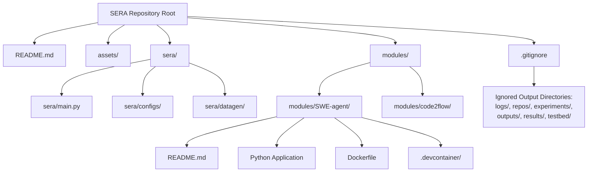
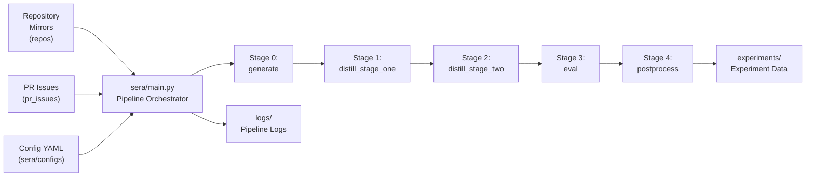
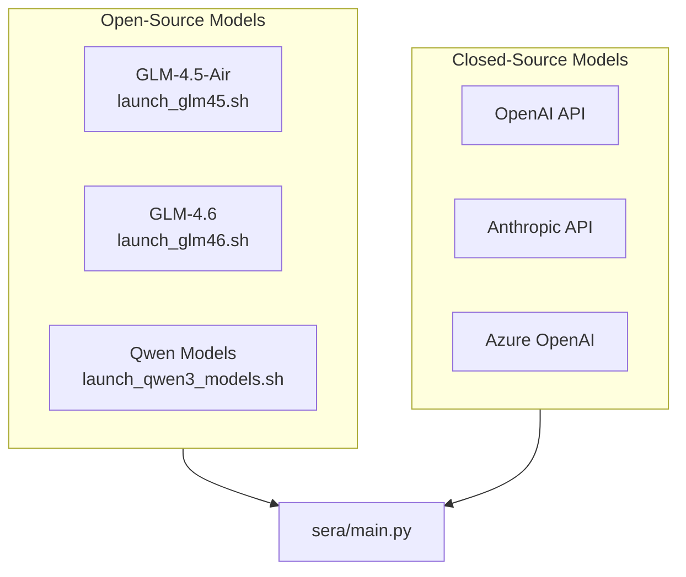
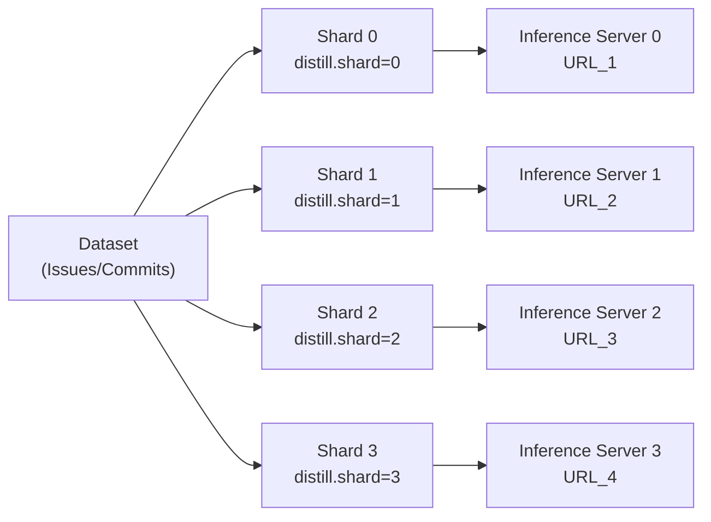
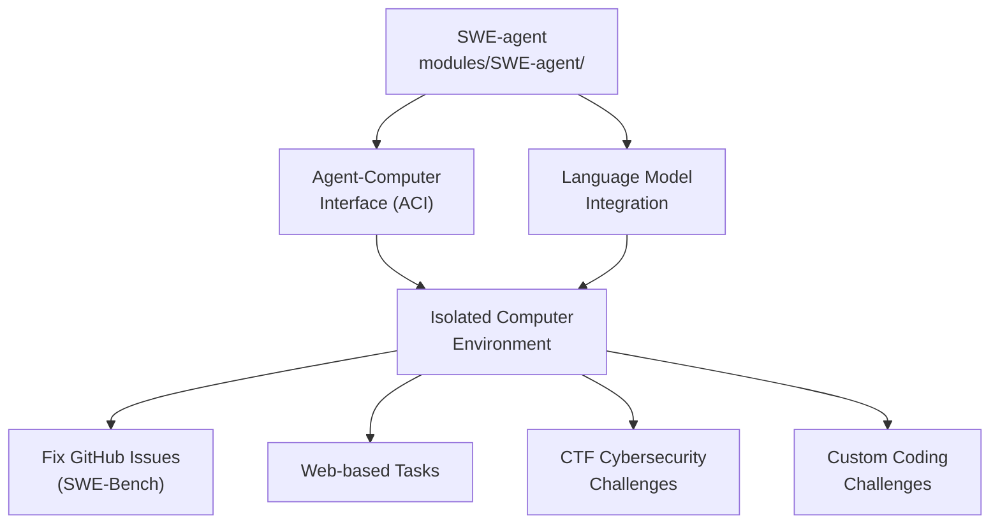
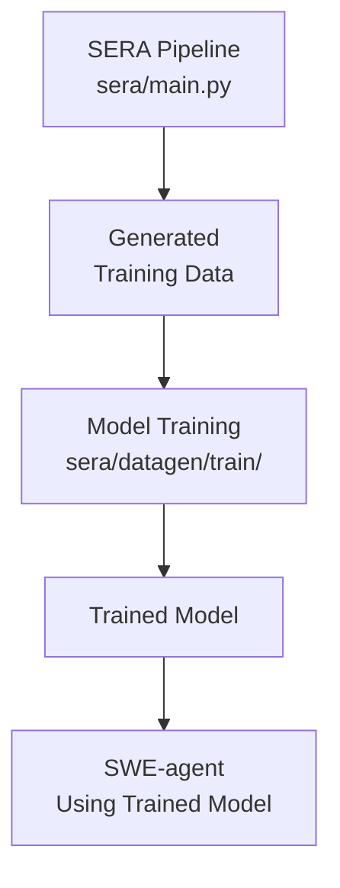
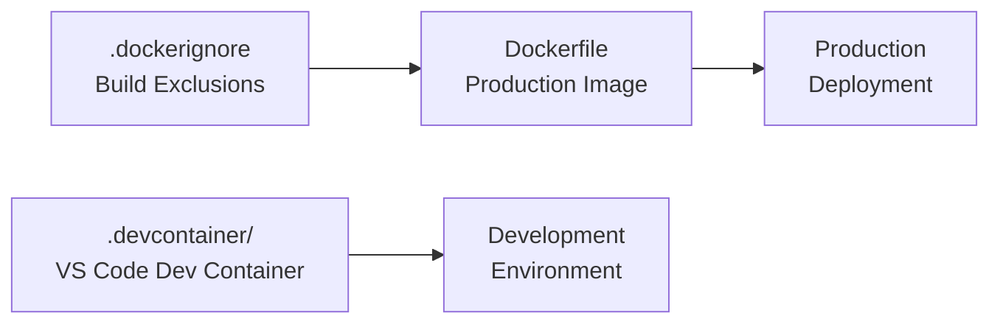

<!-- source: DeepWiki mcp.deepwiki.com · repo allenai/SERA · page 1 Overview · fetched 2026-10-26 -->

# Overview

<details>
<summary>Relevant source files</summary>

The following files were used as context for generating this wiki page:

- [.gitignore](.gitignore)
- [README.md](README.md)
- [assets/SERA.jpg](assets/SERA.jpg)
- [modules/SWE-agent/README.md](modules/SWE-agent/README.md)

</details>


## Purpose and Scope

This document provides a high-level introduction to the SERA repository, which consists of two main systems:

1. **SERA Data Generation System** - A multi-stage pipeline for generating synthetic training data from language models
2. **SWE-agent** - An autonomous software engineering agent that uses language models to perform coding tasks

This page explains the overall architecture, repository structure, and how these systems relate to each other. For detailed information about specific subsystems, refer to:
- SERA pipeline stages and configuration: [SERA Data Generation System](#2)
- SWE-agent capabilities and usage: [SWE-agent Module](#3)
- Development environment setup: [Development Environment](#4)
- Deployment and containerization: [Docker and Containerization](#5)

## Repository Structure

The SERA repository is organized into two primary layers: the root SERA system and the SWE-agent module located in `modules/SWE-agent/`.

### Directory Organization



**Sources:** [.gitignore:1-227](), [README.md:1-185](), [modules/SWE-agent/README.md:1-105]()

### Key Directories and Artifacts

| Directory/File | Purpose |
|----------------|---------|
| `sera/` | SERA data generation pipeline source code |
| `sera/main.py` | Pipeline orchestrator and entry point |
| `sera/configs/` | YAML configuration files for experiments |
| `sera/datagen/` | Data generation modules and inference server scripts |
| `modules/SWE-agent/` | SWE-agent autonomous coding agent (git submodule) |
| `modules/code2flow/` | Code analysis utilities |
| `experiments/` | Generated experiment outputs (gitignored) |
| `outputs/` | Pipeline output data (gitignored) |
| `results/` | Evaluation results (gitignored) |
| `logs/` | Runtime logs (gitignored) |
| `repos/` | Cloned repository mirrors (gitignored) |

**Sources:** [.gitignore:1-10](), [.gitignore:174-178](), [README.md:7-16]()

## SERA Data Generation System

SERA (Soft-Verified Efficient Repository Agents) is a system for generating synthetic training data by having language models perform software engineering tasks on real codebases.

### Pipeline Architecture



**Sources:** [README.md:130-156](), [.gitignore:1-7]()

### Inference Server Integration

SERA supports multiple inference backends for data generation:



**Sources:** [README.md:18-32](), [README.md:86-94]()

### Configuration Profiles

SERA includes pre-configured experiment profiles for different use cases:

| Configuration | Purpose | Key Features |
|---------------|---------|--------------|
| `specialization_django` | Generate data for Django/Sympy repos from SWE-Bench | Uses existing SWE-Bench issues |
| `specialization_personal` | Generate data for custom repositories | Requires GitHub mirror organization |
| `specialization_anthropic` | Use closed-source models (Claude) | No inference server setup needed |
| `swesmith_scaling` | Large-scale data generation with sharding | Supports multi-server parallel execution |

**Sources:** [README.md:39-122]()

### Multi-Server Scaling

SERA supports horizontal scaling through dataset sharding across multiple inference servers:



**Sources:** [README.md:96-121]()

## SWE-agent Autonomous Software Engineering Agent

SWE-agent is an autonomous agent system that enables language models to perform software engineering tasks through configurable Agent-Computer Interfaces (ACIs).

### Core Capabilities



**Sources:** [modules/SWE-agent/README.md:15-22]()

### Language Model Support

SWE-agent integrates with multiple AI model providers:

| Provider | Models | Configuration |
|----------|--------|---------------|
| OpenAI | GPT-4o, GPT-4, etc. | Via OpenAI API |
| Anthropic | Claude Sonnet 3.5, 3.7 | Via Anthropic API |
| Azure | Azure-hosted OpenAI models | Via Azure OpenAI endpoint |
| Together AI | Various open models | Via Together API |
| Groq | Fast inference models | Via Groq API |
| Local/Custom | Any OpenAI-compatible server | Custom endpoint URL |

**Sources:** [modules/SWE-agent/README.md:1-45]()

### EnIGMA Cybersecurity Mode

SWE-agent includes EnIGMA mode for offensive cybersecurity (Capture The Flag) challenges, featuring:

- **Debugger**: Interactive debugging capabilities for binary analysis
- **Server Connection Tools**: Network interaction tools for CTF challenges  
- **Summarizer**: Handles long command outputs efficiently

**Sources:** [modules/SWE-agent/README.md:46-56]()

## System Integration and Data Flow

### SERA-to-SWE-agent Relationship



SERA generates synthetic training data by having language models solve coding tasks. This data is used to train more capable coding models, which can then be deployed in SWE-agent for autonomous software engineering.

**Sources:** [README.md:1-6](), [README.md:171-173](), [modules/SWE-agent/README.md:15-22]()

## Development and Deployment Infrastructure

### Containerization Stack



**Sources:** [.gitignore:20-32]()

### Output and Artifact Management

The repository excludes various output directories from version control to keep the codebase clean:

| Directory | Purpose | Managed By |
|-----------|---------|------------|
| `logs/` | Pipeline execution logs | SERA |
| `repos/` | Cloned repository mirrors | SERA |
| `experiments/` | Experiment output data | SERA |
| `outputs/` | Generated dataset outputs | SERA |
| `results/` | Evaluation results | SWE-agent |
| `testbed/` | Test execution environments | SWE-agent |
| `trajectories/` | Agent execution traces | SWE-agent |

**Sources:** [.gitignore:1-10](), [.gitignore:174-178](), [.gitignore:20-32]()

## Licensing

The repository uses a dual-licensing structure:

- **SERA System**: Apache License 2.0
- **SWE-agent Module**: MIT License

For licensing details, see [Licensing](#8.1).

**Sources:** [modules/SWE-agent/README.md:93-94]()

## Getting Started

### Installation

```bash
# Clone repository
git clone https://github.com/allenai/SERA

# Create conda environment
conda create -n sera python=3.12

# Install packages
pip install -e . -e modules/code2flow -e modules/SWE-agent
```

**Sources:** [README.md:7-15]()

### Quick Start Examples

1. **Generate data from Django repositories:**
   ```bash
   python sera/main.py \
       --config-name=specialization_django \
       distill.model.name=openai/GLM-4.5-Air \
       distill.model.url=http://localhost:24444/v1
   ```

2. **Use SWE-agent to fix GitHub issues:**
   See [Agent Capabilities and Usage](#3.1) for detailed instructions.

**Sources:** [README.md:39-46](), [modules/SWE-agent/README.md:33-42]()

## External Resources

- **Technical Report**: https://allenai.org/papers/opencodingagents
- **Test SERA in Claude**: https://github.com/allenai/sera-cli
- **SWE-agent Documentation**: https://swe-agent.com
- **SWE-agent Discord**: https://discord.gg/AVEFbBn2rH

**Sources:** [README.md:3-5](), [modules/SWE-agent/README.md:9-11]()

---

