<!-- source: DeepWiki mcp.deepwiki.com · repo allenai/SERA · page 2.4 Pipeline Stages · fetched 2026-10-26 -->

# Pipeline Stages

<details>
<summary>Relevant source files</summary>

The following files were used as context for generating this wiki page:

- [.gitignore](.gitignore)
- [README.md](README.md)

</details>


## Purpose and Scope

This document details the five-stage pipeline architecture of the SERA data generation system. The pipeline transforms repository data and issue descriptions into training data through sequential processing stages: generation, two distillation passes, evaluation, and postprocessing. Each stage produces intermediate artifacts that feed into the next stage, with support for resuming from any point in case of interruptions.

For information about configuring the data sources and specialization profiles used by the pipeline, see [Specialization Configurations](#2.3). For details on scaling the pipeline across multiple inference servers, see [Multi-Server Scaling](#2.5).

**Sources:** [README.md:1-185]()

---

## Pipeline Architecture Overview

The SERA pipeline implements a multi-stage data generation architecture where each stage builds upon the outputs of previous stages. The pipeline is orchestrated through `sera/main.py` and can be configured to run end-to-end or resume from any intermediate stage.

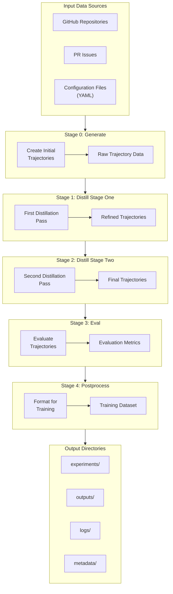

**Sources:** [README.md:19-153](), [.gitignore:1-7]()

---

## Stage Mapping and Identification

The pipeline uses a numeric mapping system to identify stages for resumption and control purposes. This mapping is defined in the main execution logic and allows users to specify which stage to start from.

| Stage Name | Stage ID | Key Function | Primary Output |
|------------|----------|--------------|----------------|
| `pipeline` | -1 | Full pipeline execution | All stages sequentially |
| `generate` | 0 | Initial trajectory generation | Raw trajectory data |
| `distill_stage_one` | 1 | First refinement pass | Refined trajectories |
| `distill_stage_two` | 2 | Second refinement pass | Polished trajectories |
| `eval` | 3 | Quality evaluation | Metrics and scores |
| `postprocess` | 4 | Training data formatting | Final dataset |

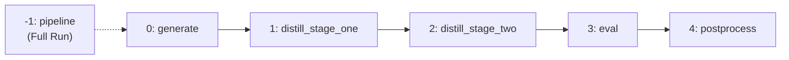

**Sources:** [README.md:134-141]()

---

## Stage 0: Generate

The `generate` stage creates initial trajectories by processing repository data and issue descriptions. This stage sets up Docker containers for repository environments and produces raw trajectory data that serves as input to subsequent distillation stages.

### Generate Stage Operations

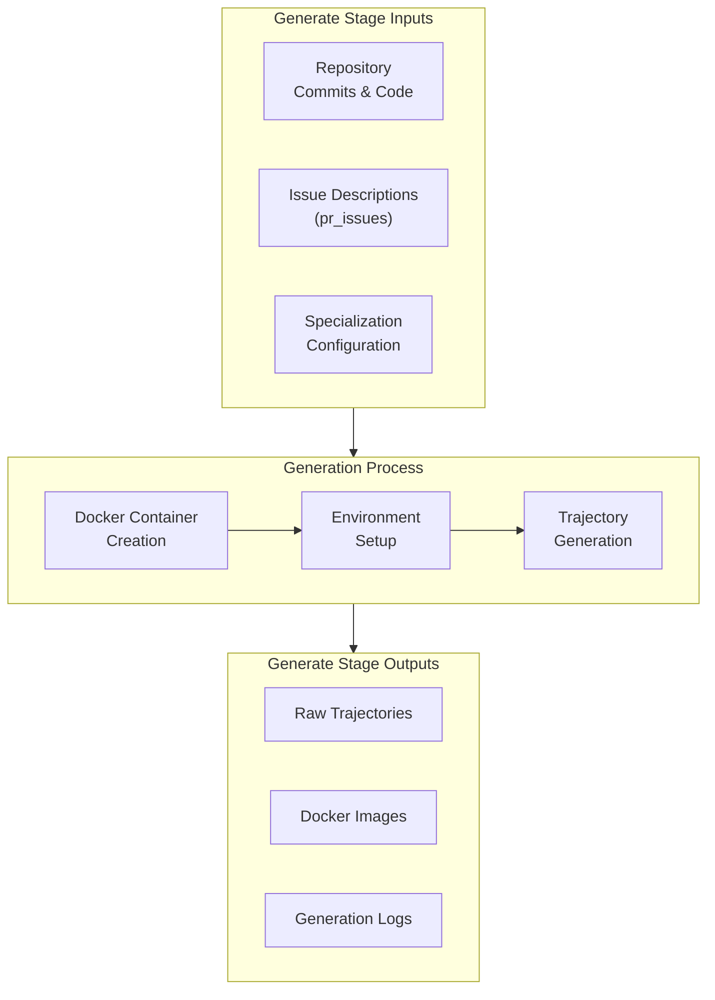

### Configuration Parameters

The generate stage is configured through the `generate` section of the configuration file:

- `generate.docker.gh_mirror_org`: GitHub organization for repository mirrors
- `generate.docker.docker_org`: Docker organization for pushing images
- Repository-specific settings (commits, install commands, test commands)

**Sources:** [README.md:49-83](), [README.md:123-128]()

---

## Stage 1: Distill Stage One

The `distill_stage_one` stage performs the first refinement pass on generated trajectories. This stage processes raw trajectories through the distillation model to improve quality and consistency.

### Distill Stage One Process

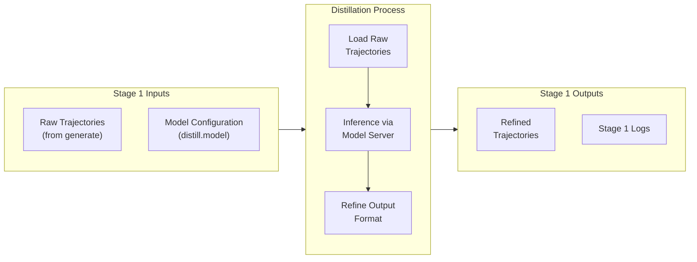

### Model Configuration

The distillation model is configured via command-line arguments:

- `distill.model.name`: Model identifier (e.g., `openai/GLM-4.5-Air`)
- `distill.model.url`: URL of the inference server
- `distill.shard`: Shard index for parallel processing
- `distill.total_shards`: Total number of shards

**Sources:** [README.md:42-46](), [README.md:102-120]()

---

## Stage 2: Distill Stage Two

The `distill_stage_two` stage performs a second refinement pass on trajectories from the first distillation stage. This stage uses synthetic PR issues from SWE-Bench demonstrations or custom PR issues to further refine the training data.

### Distill Stage Two Process

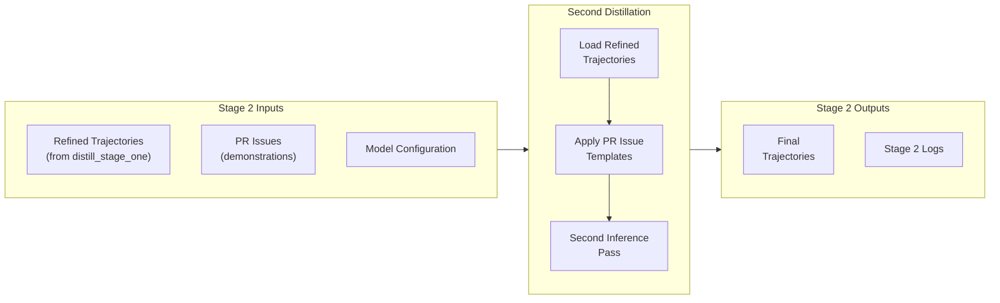

### Custom PR Issues

Users can provide custom PR issues instead of the default SWE-Bench demonstrations:

- Use `scrape_github.py` to extract issues from repositories
- Issues are saved to the `pr_issues/` directory
- Configure via `distill.args.pipeline_repo=GENERATED_PATH`

**Sources:** [README.md:84](), [README.md:157-169](), [.gitignore:7]()

---

## Stage 3: Eval

The `eval` stage evaluates the quality and correctness of trajectories produced by the distillation stages. This stage generates metrics and scores that inform the final dataset selection.

### Evaluation Process

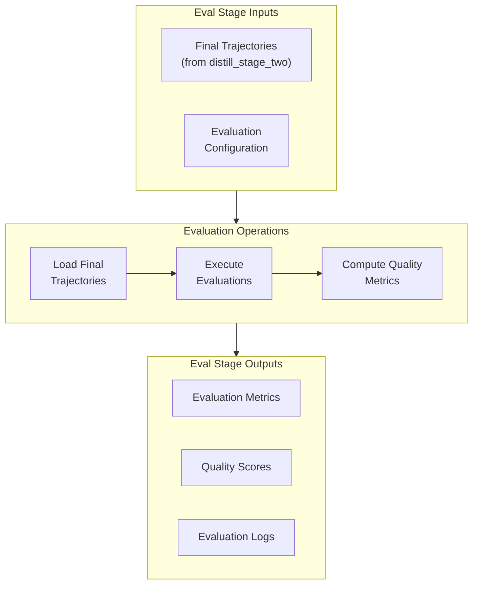

**Sources:** [README.md:134-141]()

---

## Stage 4: Postprocess

The `postprocess` stage transforms evaluated trajectories into the final training dataset format. This stage filters, formats, and packages the data for use in model training.

### Postprocessing Operations

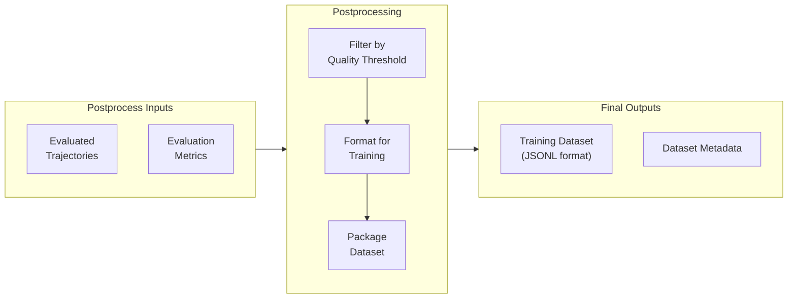

**Sources:** [README.md:134-141]()

---

## Pipeline Execution Control

### Starting a Full Pipeline Run

To execute the complete pipeline from start to finish, use `sera/main.py` with a configuration file. The pipeline runs all stages sequentially:

```bash
python sera/main.py \
    --config-name=specialization_django \
    distill.model.name=openai/GLM-4.5-Air \
    distill.model.url=URL
```

This executes stages in order: `generate` → `distill_stage_one` → `distill_stage_two` → `eval` → `postprocess`.

**Sources:** [README.md:41-46]()

### Multiple Configuration Options

Different specialization configurations are available for different use cases:

| Configuration | Purpose | Key Features |
|---------------|---------|--------------|
| `specialization_django` | SWE-Bench repositories | Django, Sympy specialization |
| `specialization_personal` | Custom repositories | User-defined codebases |
| `specialization_anthropic` | Closed-source models | Uses Anthropic API directly |
| `swesmith_scaling` | Large-scale generation | Supports sharding |

**Sources:** [README.md:39-95]()

---

## Stage Resumption and Error Handling

### Resuming from Specific Stages

The pipeline supports resuming from any stage using the `stage=` parameter. This is critical for handling interrupted runs or iterating on specific stages without reprocessing earlier stages.

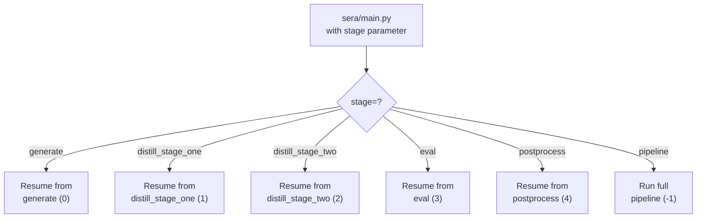

### Resumption Example

To resume from the second distillation stage after killing a stalled run:

```bash
python sera/main.py \
    --config-name=specialization_django \
    distill.model.name=openai/GLM-4.5-Air \
    distill.model.url=URL \
    stage=distill_stage_two
```

The pipeline will skip trajectories that failed in the first distillation stage and proceed using only successful rollouts.

**Sources:** [README.md:130-156]()

### Automatic Resumption

If a run is interrupted and restarted with the same experiment name (via `name=`), the pipeline automatically resumes from where it left off instead of restarting from scratch. This is handled by checking for existing intermediate artifacts.

**Sources:** [README.md:155-156]()

### Handling Stalled Generations

At large scales, some generations (< 1%) may stall the teacher model. The stage resumption mechanism allows users to:

1. Identify stalled trajectories during a stage
2. Kill the stalled run
3. Resume from the next stage, skipping failed trajectories
4. Continue the pipeline with successful data only

**Sources:** [README.md:132]()

---

## Output Artifacts and Directory Structure

### Primary Output Directories

The pipeline generates multiple types of artifacts across several directories:

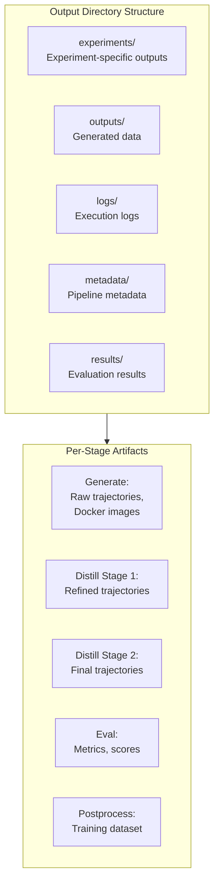

| Directory | Content | Ignored by Git |
|-----------|---------|----------------|
| `logs/` | Execution logs from all stages | Yes |
| `experiments/` | Experiment-specific configurations and outputs | Yes |
| `outputs/` | Generated trajectory data | Yes |
| `metadata/` | Pipeline state and metadata | Yes |
| `results/` | Evaluation results | Yes |

**Sources:** [.gitignore:1-7](), [.gitignore:175]()

### Intermediate Artifacts

Each stage produces intermediate artifacts that are used by subsequent stages. These artifacts are stored in the output directories and include:

- **Generate Stage**: Docker container images, raw trajectory files
- **Distill Stage One**: Refined trajectory files, distillation logs
- **Distill Stage Two**: Final trajectory files with synthetic PR issues
- **Eval Stage**: Evaluation metrics, quality scores, test results
- **Postprocess Stage**: Formatted training data (JSONL), dataset metadata

**Sources:** [README.md:134-141]()

---

## Configuration Schema and Parameters

### Global Configuration Options

The pipeline behavior is controlled through a comprehensive configuration system. The full configuration schema is defined in `sera/config_schema.py`:

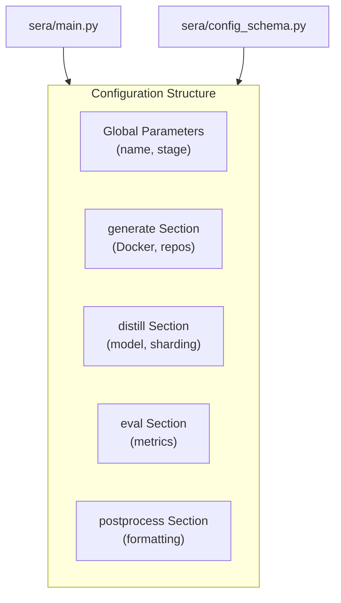

### Key Configuration Parameters

| Parameter | Purpose | Example Value |
|-----------|---------|---------------|
| `name` | Experiment identifier | `django_specialization` |
| `stage` | Starting stage | `distill_stage_two` |
| `distill.model.name` | Model identifier | `openai/GLM-4.5-Air` |
| `distill.model.url` | Inference server URL | `http://host:24444/v1` |
| `distill.shard` | Shard index (for parallel runs) | `0` |
| `distill.total_shards` | Total shards | `4` |
| `generate.docker.gh_mirror_org` | GitHub mirror organization | `oca-repos` |
| `generate.docker.docker_org` | Docker registry organization | Custom org name |
| `distill.args.pipeline_repo` | Custom PR issues path | `pr_issues/custom.json` |

**Sources:** [README.md:37](), [README.md:42-58](), [README.md:102-120]()

### Configuration Files

Pre-defined configuration files are located in `sera/configs/`:

- `specialization_django.yaml`: Django/Sympy specialization
- `specialization_personal.yaml`: Personal repository configuration
- `specialization_anthropic.yaml`: Closed-source model configuration
- `swesmith_scaling.yaml`: Large-scale generation configuration

**Sources:** [README.md:43](), [README.md:50](), [README.md:92](), [README.md:105]()

---

## Integration with Training Pipeline

The final output of the postprocess stage feeds into the training pipeline, which is documented separately:

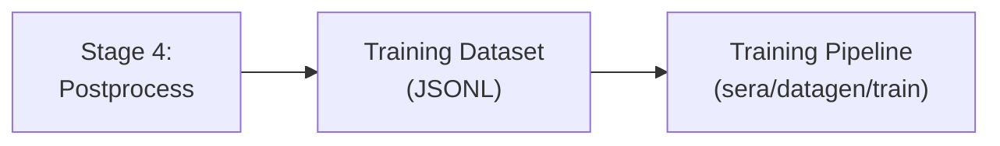

For details on training with the generated data, see the README in `sera/datagen/train/`.

**Sources:** [README.md:171-173]()

---

