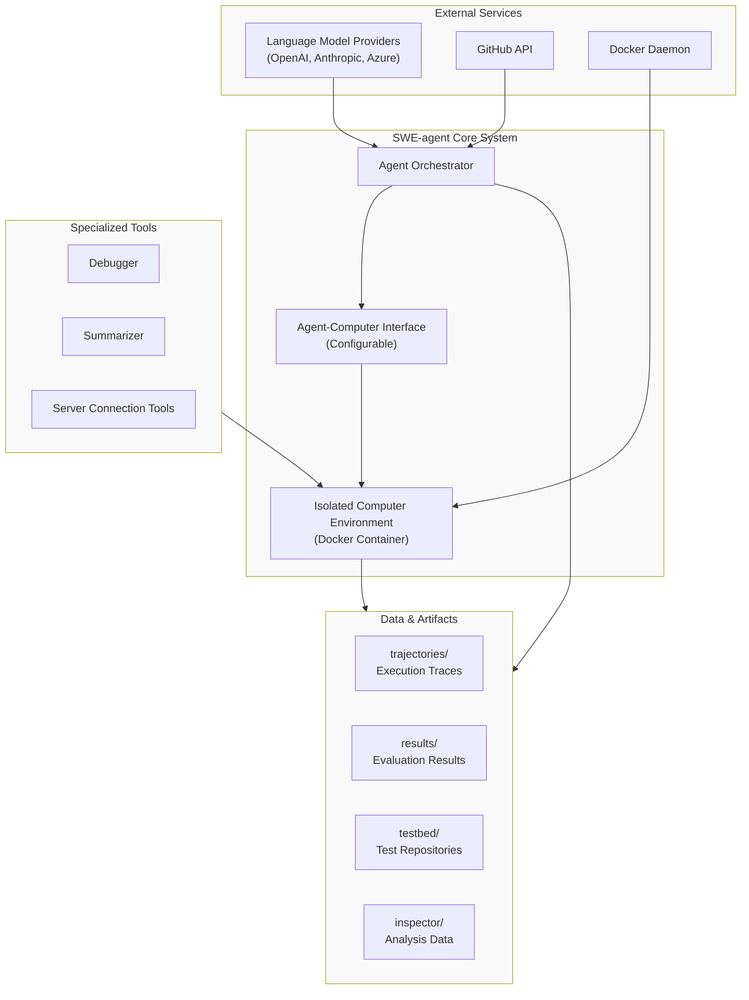
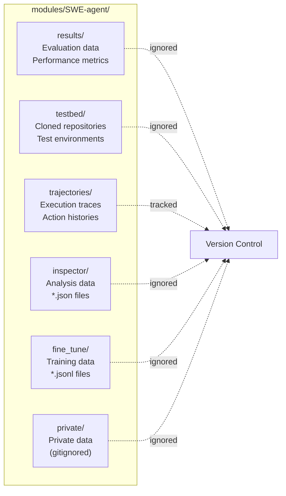
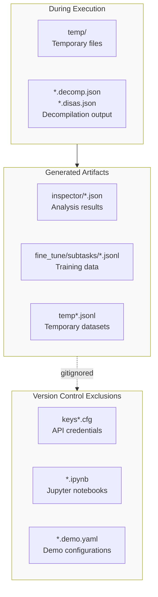
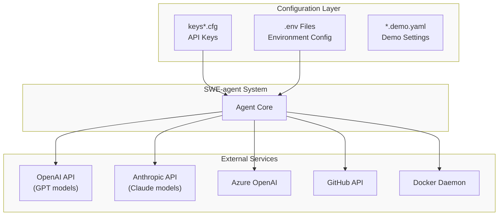

<!-- source: DeepWiki mcp.deepwiki.com · repo allenai/SERA · page 3 SWE-agent Module · fetched 2026-10-26 -->

# SWE-agent Module

<details>
<summary>Relevant source files</summary>

The following files were used as context for generating this wiki page:

- [modules/SWE-agent/.gitignore](modules/SWE-agent/.gitignore)
- [modules/SWE-agent/README.md](modules/SWE-agent/README.md)
- [modules/SWE-agent/assets/batch_animated.gif](modules/SWE-agent/assets/batch_animated.gif)
- [modules/SWE-agent/assets/swe-agent-banner-dark.svg](modules/SWE-agent/assets/swe-agent-banner-dark.svg)

</details>


## Purpose and Scope

This document provides an overview of the SWE-agent module, an autonomous software engineering agent system that enables language models to perform software engineering tasks through configurable Agent-Computer Interfaces (ACIs). SWE-agent is located as a submodule within the SERA repository at `modules/SWE-agent/`.

For detailed information on specific aspects of SWE-agent:
- Agent capabilities and usage examples: see [Agent Capabilities and Usage](#3.1)
- Architecture and design patterns: see [Agent Architecture](#3.2)
- EnIGMA cybersecurity mode features: see [EnIGMA Mode and Special Features](#3.3)
- AI provider and service integrations: see [External Service Integration](#3.4)

For the parent SERA data generation system, see [SERA Data Generation System](#2).

**Sources:** [modules/SWE-agent/README.md:1-105]()

## Overview

SWE-agent is an autonomous agent system that allows language models (such as GPT-4o, Claude Sonnet 3.5, or custom models) to perform complex software engineering tasks. The agent operates within isolated execution environments and uses configurable interfaces to interact with code repositories, development tools, and external services.

The system is built and maintained by researchers from Princeton University and Stanford University and has achieved state-of-the-art results on software engineering benchmarks including SWE-bench and cybersecurity challenges.

**Sources:** [modules/SWE-agent/README.md:15-24]()

## Core Capabilities

SWE-agent provides four primary task categories:

| Task Category | Description | Use Cases |
|---------------|-------------|-----------|
| **GitHub Issue Fixing** | Autonomously fixes issues in real GitHub repositories | Bug fixes, feature implementation, code maintenance |
| **Web-based Tasks** | Performs tasks that involve web interactions | Data collection, web scraping, API interactions |
| **Capture The Flag (CTF)** | Solves offensive cybersecurity challenges | Vulnerability discovery, exploit development, security testing |
| **Custom Coding Challenges** | Handles arbitrary programming tasks | Algorithm implementation, code generation, testing |

The agent achieves these capabilities through:
- **Configurable ACIs**: Agent-Computer Interfaces that define how the language model interacts with the execution environment
- **Isolated Environments**: Docker-based containers that provide safe, reproducible execution contexts
- **Tool Integration**: Built-in tools for debugging, summarization, and server connections

**Sources:** [modules/SWE-agent/README.md:15-20](), [modules/SWE-agent/README.md:46-52]()

## System Architecture Overview



**Diagram: SWE-agent High-Level Architecture**

This architecture diagram shows how SWE-agent integrates external services with its core components to produce execution artifacts. The Agent-Computer Interface serves as the configurable boundary layer that translates language model responses into executable commands within the isolated environment.

**Sources:** [modules/SWE-agent/README.md:15-23](), [modules/SWE-agent/.gitignore:142-157]()

## Agent-Computer Interface (ACI)

The Agent-Computer Interface is a configurable component that defines the interaction protocol between the language model and the execution environment. ACIs specify:

- **Command Set**: Available shell commands and tools the agent can invoke
- **Output Format**: How command results are formatted and presented to the model
- **Context Management**: How information is maintained across interaction turns
- **Safety Constraints**: Limitations on what actions the agent can perform

ACIs are the key innovation that enables SWE-agent to achieve state-of-the-art performance. Different ACIs can be designed for different task types, allowing the same underlying agent system to handle diverse software engineering challenges.

**Sources:** [modules/SWE-agent/README.md:22-23]()

## Execution Workflow

```mermaid
sequenceDiagram
    participant User
    participant Agent["Agent Orchestrator"]
    participant LLM["Language Model"]
    participant ACI["Agent-Computer Interface"]
    participant ICE["Isolated Environment<br/>(Docker)"]
    participant FS["File System<br/>(testbed)"]
    
    User->>Agent: "Submit Task<br/>(Issue, Challenge, etc.)"
    Agent->>FS: "Clone Repository"
    Agent->>ICE: "Initialize Container"
    
    loop "Interaction Loop"
        Agent->>LLM: "Send Context + History"
        LLM->>Agent: "Return Action"
        Agent->>ACI: "Parse Action"
        ACI->>ICE: "Execute Command"
        ICE->>ACI: "Return Output"
        ACI->>Agent: "Format Response"
        Agent->>Agent: "Update Trajectory"
    end
    
    Agent->>FS: "Save Results"
    Agent->>User: "Return Solution"
```

**Diagram: Agent Execution Workflow**

This sequence diagram illustrates the interaction flow during task execution. The agent maintains an interaction loop with the language model, translating high-level actions into concrete commands through the ACI layer.

**Sources:** [modules/SWE-agent/README.md:15-23]()

## Data Directory Structure



**Diagram: Data Directory Organization**

The directory structure shows where SWE-agent stores various types of data during and after execution:

| Directory | Purpose | Version Control |
|-----------|---------|-----------------|
| `results/` | Evaluation results and performance metrics | Ignored |
| `testbed/` | Cloned repositories for testing | Ignored |
| `trajectories/` | Execution traces and action histories | Tracked (selectively) |
| `inspector/` | Analysis data in JSON format | Ignored |
| `fine_tune/` | Fine-tuning datasets in JSONL format | Ignored |
| `private/` | Private or sensitive data | Ignored |

**Sources:** [modules/SWE-agent/.gitignore:142-160]()

## EnIGMA Cybersecurity Mode

SWE-agent includes EnIGMA (Enhanced Interactive Generative Model Agent), a specialized mode for solving offensive cybersecurity challenges. EnIGMA achieves state-of-the-art results on multiple CTF benchmarks.

Key EnIGMA features that are available across all SWE-agent modes:

- **Debugger**: Integrated debugging tools for analyzing program execution
- **Server Connection Tools**: Utilities for interacting with remote servers (netcat, socket connections)
- **Summarizer**: Handles long command outputs by intelligently summarizing results

These features were originally developed for the cybersecurity domain but are now integrated into the core SWE-agent system.

**Sources:** [modules/SWE-agent/README.md:46-52]()

## File System Artifacts



**Diagram: SWE-agent File Artifacts**

During execution and analysis, SWE-agent generates various file artifacts:

- **Decompilation Outputs**: `*.decomp.json` and `*.disas.json` files for reverse engineering tasks
- **Inspector Data**: JSON files in `inspector/` containing execution analysis
- **Fine-tuning Data**: JSONL files for training models on agent trajectories
- **Temporary Files**: Working files in `temp/` directory

Configuration and credential files (`.cfg`, `.env`) are excluded from version control for security.

**Sources:** [modules/SWE-agent/.gitignore:137-197]()

## Website Frontend

SWE-agent includes a web-based frontend for interacting with the agent system:

```
website/
└── frontend/
    ├── node_modules/     # Dependencies (ignored)
    ├── build/           # Production build (ignored)
    ├── coverage/        # Test coverage (ignored)
    └── package-lock.json # (ignored)
```

The frontend provides a user interface for submitting tasks, monitoring execution, and viewing results. All standard Node.js artifacts (dependencies, builds, coverage reports) are excluded from version control.

**Sources:** [modules/SWE-agent/.gitignore:162-184]()

## Integration Points



**Diagram: External Service Integration Points**

SWE-agent integrates with multiple external services through a configuration layer:

- **AI Providers**: OpenAI (GPT models), Anthropic (Claude models), Azure OpenAI
- **Version Control**: GitHub API for repository access
- **Containerization**: Docker Daemon for isolated execution environments

Configuration is managed through `.cfg` files (API keys) and `.env` files (environment variables). Demo configurations use `.demo.yaml` files for testing.

**Sources:** [modules/SWE-agent/.gitignore:137-188](), [modules/SWE-agent/README.md:15-23]()

## Development and Testing

SWE-agent includes comprehensive development infrastructure:

| Component | Purpose | Status |
|-----------|---------|--------|
| Pytest | Unit and integration testing | [](https://github.com/SWE-agent/SWE-agent/actions/workflows/pytest.yaml) |
| Documentation Build | MkDocs documentation generation | [](https://github.com/SWE-agent/SWE-agent/actions/workflows/build-docs.yaml) |
| Code Coverage | Codecov integration | [](https://codecov.io/gh/SWE-agent/SWE-agent) |
| Pre-commit Hooks | Code quality enforcement | [](https://results.pre-commit.ci/latest/github/SWE-agent/SWE-agent/main) |
| Link Validation | Documentation link checking | [](https://github.com/SWE-agent/SWE-agent/actions/workflows/check-links.yaml) |

**Sources:** [modules/SWE-agent/README.md:96-103]()

## State-of-the-Art Results

SWE-agent has achieved state-of-the-art performance on multiple benchmarks:

- **SWE-bench Full**: SWE-agent 1.0 + Claude 3.7 achieves SoTA (February 28, 2025)
- **SWE-bench Verified**: SWE-agent 1.0 + Claude 3.7 achieves SoTA (February 25, 2025)
- **SWE-bench Light**: SWE-agent 1.0 achieves SoTA (February 13, 2025)
- **CTF Benchmarks**: EnIGMA mode achieves state-of-the-art results on multiple cybersecurity challenges

These results demonstrate the effectiveness of the Agent-Computer Interface approach in enabling language models to perform complex software engineering tasks.

**Sources:** [modules/SWE-agent/README.md:26-31]()

## Getting Started

To begin using SWE-agent:

1. **Try in Browser**: Use GitHub Codespaces for instant access without local setup
2. **Local Installation**: Follow the installation guide for detailed setup instructions (see [Installation](#4))
3. **Command Line Usage**: Learn basic CLI operations (see [Agent Capabilities and Usage](#3.1))
4. **Benchmarking**: Run evaluations on SWE-bench datasets (see [Agent Capabilities and Usage](#3.1))

Documentation is available at the official SWE-agent website, and community support is provided through Discord.

**Sources:** [modules/SWE-agent/README.md:33-44]()

## License

SWE-agent is licensed under the MIT License. See the `LICENSE` file in the `modules/SWE-agent/` directory for full details.

**Sources:** [modules/SWE-agent/README.md:93-94]()

## Project Team

SWE-agent is an academic project started at Princeton University by:
- John Yang* (Stanford University)
- Carlos E. Jimenez* (Princeton University)
- Alexander Wettig (Princeton University)
- Kilian Lieret (Princeton University)
- Shunyu Yao (Princeton University)
- Karthik Narasimhan (Princeton University)
- Ofir Press (Princeton University)

Contact: johnby@stanford.edu, carlosej@princeton.edu, kl5675@princeton.edu

**Sources:** [modules/SWE-agent/README.md:58-60]()

---

