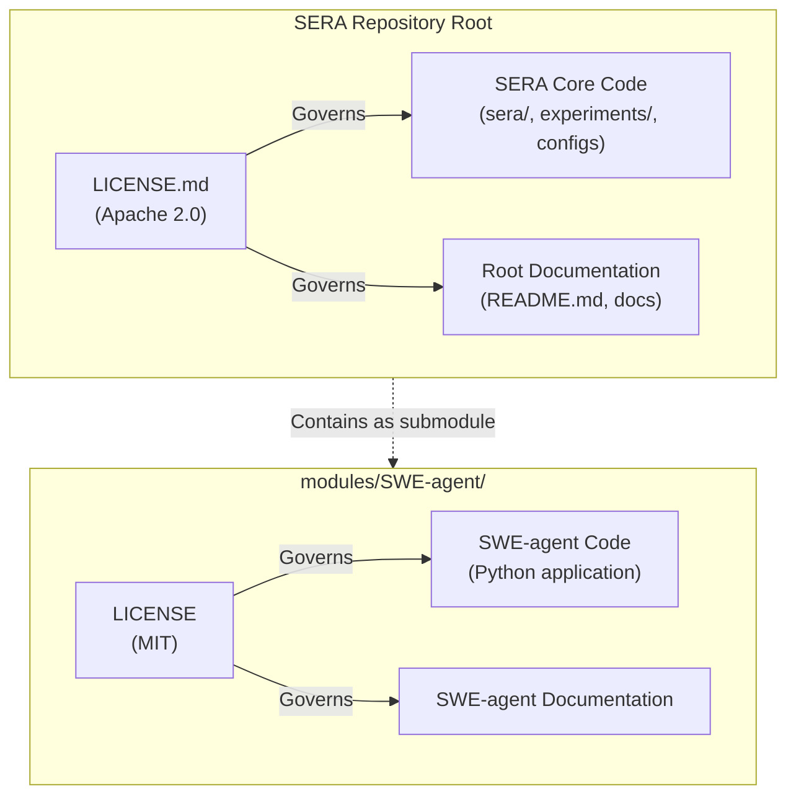
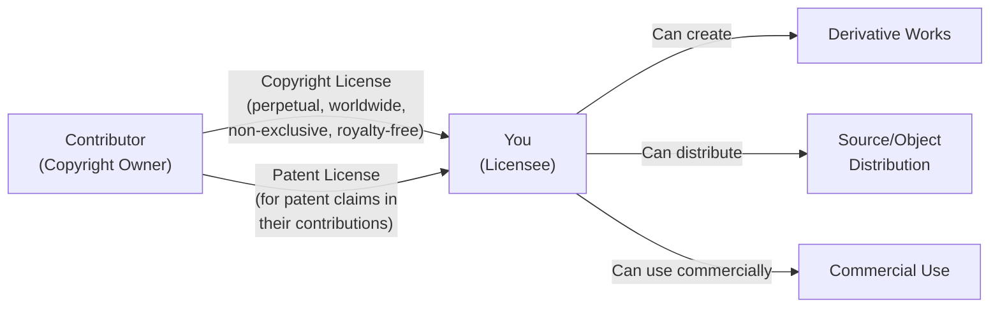
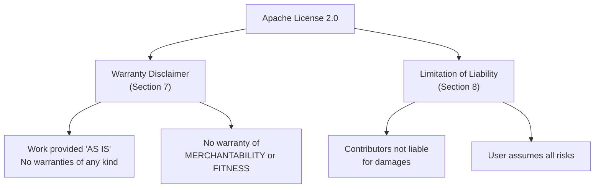
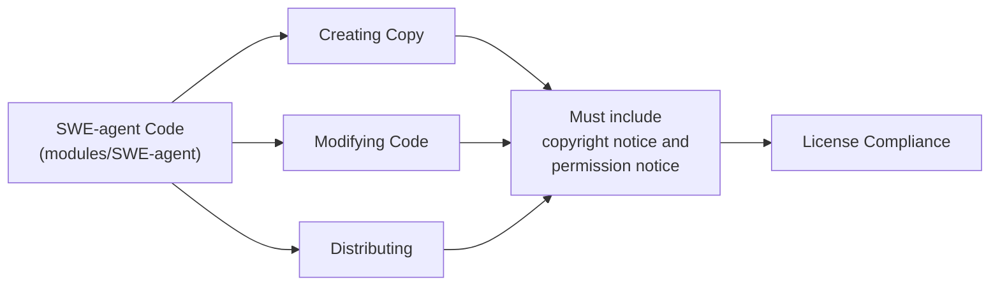
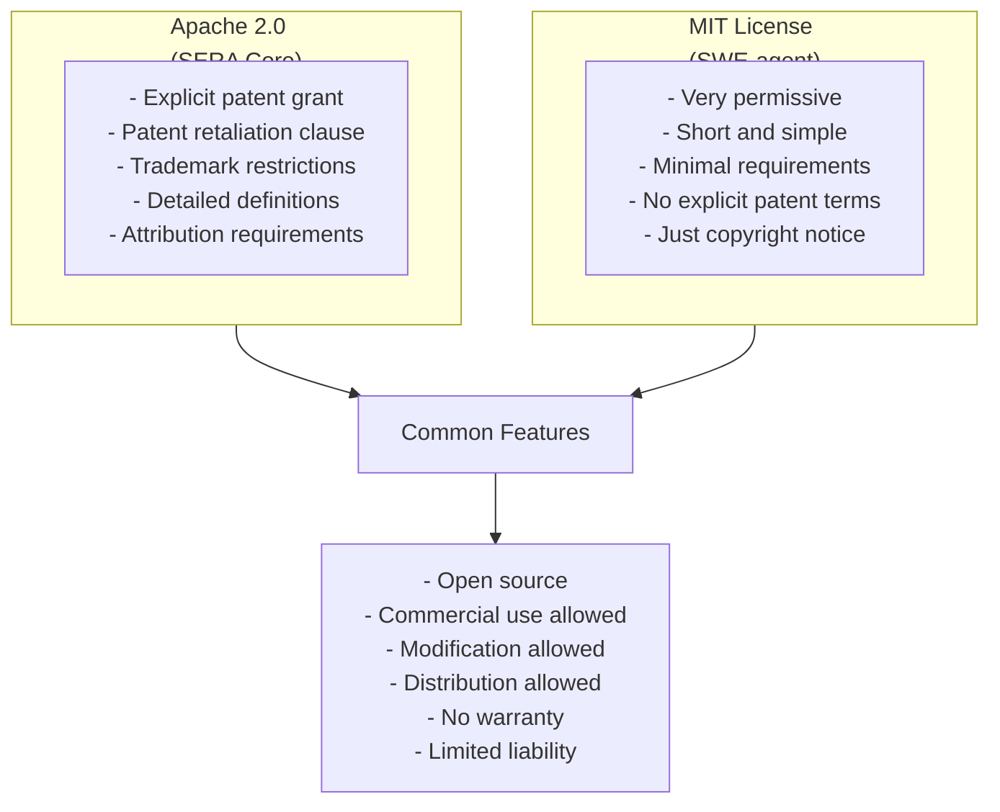
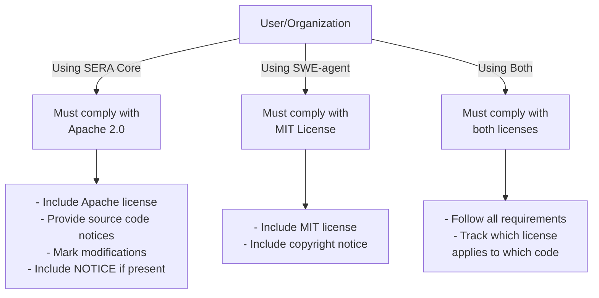
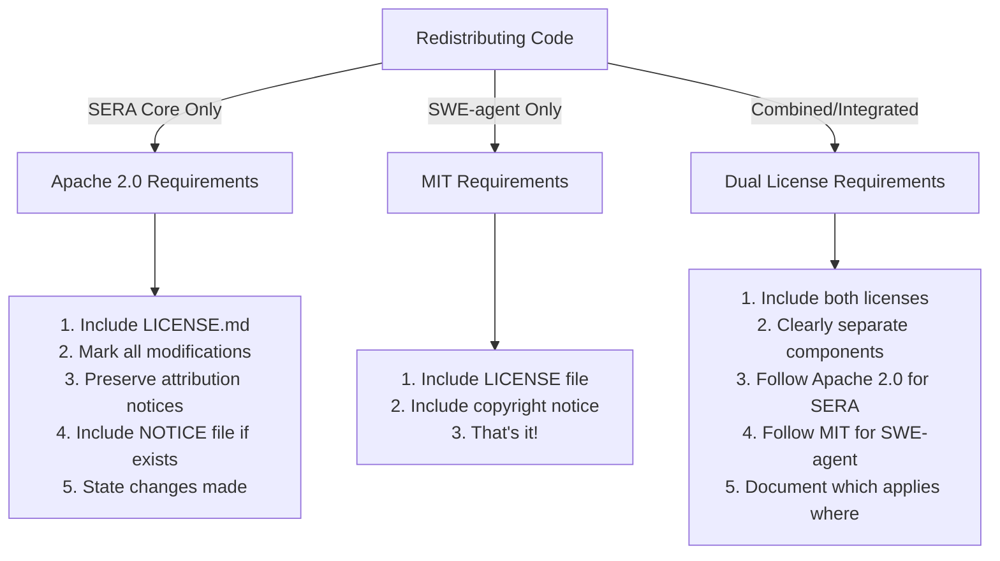
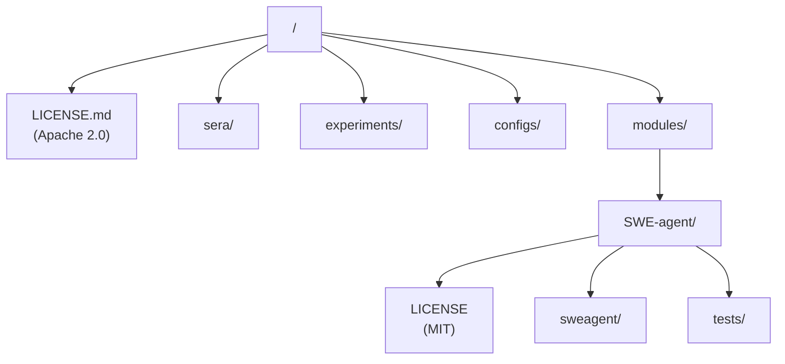

<!-- source: DeepWiki mcp.deepwiki.com · repo allenai/SERA · page 8.1 Licensing · fetched 2026-10-26 -->

# Licensing

<details>
<summary>Relevant source files</summary>

The following files were used as context for generating this wiki page:

- [LICENSE.md](LICENSE.md)
- [modules/SWE-agent/LICENSE](modules/SWE-agent/LICENSE)

</details>


## Purpose and Scope

This document explains the licensing structure of the SERA repository, which uses a dual licensing model. The root SERA project is licensed under Apache License 2.0, while the SWE-agent submodule uses the MIT License. This page details both licenses, their implications for usage and redistribution, and how the dual licensing structure applies to different components of the codebase.

For information about contributing code to the project, see [Contribution Guidelines](#7.1). For security-related concerns, see [Security Policy](#7.5).

---

## Dual Licensing Structure

The SERA repository implements a dual licensing model where different components are governed by different open-source licenses:



**Sources:** [LICENSE.md:1-201](), [modules/SWE-agent/LICENSE:1-22]()

### License Jurisdiction

| Component | License Type | License File | Applies To |
|-----------|-------------|--------------|------------|
| SERA Core | Apache License 2.0 | `LICENSE.md` | Root directory code, configurations, data generation pipeline |
| SWE-agent Module | MIT License | `modules/SWE-agent/LICENSE` | All code within `modules/SWE-agent/` directory |

**Sources:** [LICENSE.md:1-201](), [modules/SWE-agent/LICENSE:1-22]()

---

## Apache License 2.0 (SERA Core)

The SERA data generation system and all root-level code are licensed under the Apache License 2.0, a permissive open-source license that provides explicit patent grants and trademark protections.

### Key Terms and Permissions

The Apache License 2.0 grants the following permissions to users:

| Permission | Description | License Section |
|------------|-------------|-----------------|
| **Reproduce** | Create copies of the work | Section 2 |
| **Prepare Derivative Works** | Modify and create derivative works | Section 2 |
| **Public Display/Performance** | Publicly display or perform the work | Section 2 |
| **Sublicense** | Grant sublicenses to third parties | Section 2 |
| **Distribute** | Distribute copies in source or object form | Section 2 |
| **Patent Grant** | Use patent claims from contributors | Section 3 |

**Sources:** [LICENSE.md:1-201]()

### Copyright and Patent Grants



**Sources:** [LICENSE.md:66-87]()

### Redistribution Requirements

When redistributing SERA code or derivative works under Apache 2.0, you must:

1. **Include License Copy**: Provide recipients with a copy of the Apache License 2.0 ([LICENSE.md:94-95]())
2. **Mark Modifications**: Add prominent notices to modified files stating the changes ([LICENSE.md:97-98]())
3. **Preserve Notices**: Retain all copyright, patent, trademark, and attribution notices from the original source ([LICENSE.md:100-104]())
4. **Include NOTICE File**: If present, include a readable copy of attribution notices from any NOTICE file ([LICENSE.md:106-121]())

**Sources:** [LICENSE.md:89-128]()

### Definitions

| Term | Definition |
|------|------------|
| **Work** | The software made available under the license, in source or object form ([LICENSE.md:35-38]()) |
| **Derivative Works** | Works based on or derived from the original work, representing original authorship ([LICENSE.md:40-46]()) |
| **Contribution** | Any work intentionally submitted to the licensor for inclusion in the project ([LICENSE.md:48-60]()) |
| **Contributor** | Licensor and any individual or entity whose contribution has been incorporated ([LICENSE.md:62-64]()) |

**Sources:** [LICENSE.md:7-64]()

### Patent Termination Clause

The Apache License includes a patent retaliation provision:

> If You institute patent litigation against any entity alleging that the Work or a Contribution constitutes patent infringement, then any patent licenses granted to You under this License shall terminate as of the date such litigation is filed.

This means patent licenses terminate automatically if you sue claiming the software infringes patents.

**Sources:** [LICENSE.md:82-87]()

### Warranty Disclaimer and Liability Limitation



The license provides the software "AS IS" without any warranties, and contributors are not liable for damages arising from use of the software.

**Sources:** [LICENSE.md:143-163]()

---

## MIT License (SWE-agent Module)

The SWE-agent module, located in `modules/SWE-agent/`, is licensed under the MIT License, one of the most permissive open-source licenses available.

### Copyright Holders

```
Copyright (c) 2024 John Yang, Carlos E. Jimenez, Alexander Wettig, 
Shunyu Yao, Karthik Narasimhan, Ofir Press
```

**Sources:** [modules/SWE-agent/LICENSE:3]()

### MIT License Permissions

The MIT License grants users broad permissions with minimal restrictions:

| Permission | Allowed | Condition |
|------------|---------|-----------|
| **Use** | ✓ Yes | Include license notice |
| **Copy** | ✓ Yes | Include license notice |
| **Modify** | ✓ Yes | Include license notice |
| **Merge** | ✓ Yes | Include license notice |
| **Publish** | ✓ Yes | Include license notice |
| **Distribute** | ✓ Yes | Include license notice |
| **Sublicense** | ✓ Yes | Include license notice |
| **Sell** | ✓ Yes | Include license notice |

**Sources:** [modules/SWE-agent/LICENSE:7-10]()

### Single Requirement

The MIT License has only one requirement: include the copyright notice and permission notice in all copies or substantial portions of the software.



**Sources:** [modules/SWE-agent/LICENSE:11-13]()

### Warranty Disclaimer

The MIT License explicitly disclaims all warranties:

> THE SOFTWARE IS PROVIDED "AS IS", WITHOUT WARRANTY OF ANY KIND, EXPRESS OR IMPLIED, INCLUDING BUT NOT LIMITED TO THE WARRANTIES OF MERCHANTABILITY, FITNESS FOR A PARTICULAR PURPOSE AND NONINFRINGEMENT.

Authors and copyright holders are not liable for any claims or damages arising from use of the software.

**Sources:** [modules/SWE-agent/LICENSE:15-21]()

---

## License Comparison

### Apache 2.0 vs MIT



**Sources:** [LICENSE.md:1-201](), [modules/SWE-agent/LICENSE:1-22]()

### Key Differences

| Aspect | Apache 2.0 (SERA) | MIT (SWE-agent) |
|--------|-------------------|-----------------|
| **Length** | 201 lines, detailed | 22 lines, concise |
| **Patent Grant** | Explicit patent license grant | No explicit patent terms |
| **Patent Protection** | Retaliation clause included | Not addressed |
| **Trademark** | Explicitly restricted | Not addressed |
| **Redistribution Requirements** | Must mark modifications, include notices | Only copyright notice required |
| **Contributor Agreement** | Defined terms for contributions | Not explicitly defined |
| **Complexity** | More complex, suitable for corporate use | Simple, easy to understand |

**Sources:** [LICENSE.md:1-201](), [modules/SWE-agent/LICENSE:1-22]()

---

## Practical Implications

### For Users

When using SERA and SWE-agent, users should be aware of the following:



**Sources:** [LICENSE.md:89-128](), [modules/SWE-agent/LICENSE:11-13]()

### For Contributors

Contributors submitting code to the repository should understand:

1. **SERA Core Contributions**: By submitting code to the SERA root directory, contributions are licensed under Apache 2.0 terms without additional restrictions ([LICENSE.md:130-136]())

2. **SWE-agent Contributions**: Contributions to the SWE-agent module fall under the MIT License

3. **Patent Rights**: When contributing to SERA core, you grant an irrevocable patent license for any patent claims in your contribution ([LICENSE.md:73-87]())

**Sources:** [LICENSE.md:130-136](), [LICENSE.md:73-87](), [modules/SWE-agent/LICENSE:1-22]()

### For Redistributors



**Sources:** [LICENSE.md:89-128](), [modules/SWE-agent/LICENSE:11-13]()

### Commercial Use

Both licenses permit commercial use without royalties:

- **Apache 2.0**: Allows commercial use with explicit patent grants and protections ([LICENSE.md:66-71]())
- **MIT**: Allows commercial use with minimal restrictions ([modules/SWE-agent/LICENSE:7-10]())

Users can incorporate both SERA and SWE-agent into commercial products, provided they comply with the respective license requirements.

**Sources:** [LICENSE.md:66-71](), [modules/SWE-agent/LICENSE:7-10]()

---

## License File Locations

### File System Structure



**Sources:** [LICENSE.md:1](), [modules/SWE-agent/LICENSE:1]()

### License Text Access

The full license texts are available at:

- **Apache 2.0 (SERA)**: [LICENSE.md:1-201]()
- **MIT (SWE-agent)**: [modules/SWE-agent/LICENSE:1-22]()

Both licenses are also available from official sources:
- Apache 2.0: https://www.apache.org/licenses/LICENSE-2.0
- MIT: https://opensource.org/licenses/MIT

**Sources:** [LICENSE.md:1-201](), [modules/SWE-agent/LICENSE:1-22]()

---

## Compliance Checklist

### When Using SERA Core (Apache 2.0)

- [ ] Include a copy of [LICENSE.md:1-201]() with distributions
- [ ] Retain all copyright notices from source files
- [ ] Mark any modified files with prominent change notices
- [ ] Include NOTICE file if present in distribution
- [ ] Do not use Apache trademarks without permission
- [ ] Understand patent grant implications

**Sources:** [LICENSE.md:89-142]()

### When Using SWE-agent (MIT)

- [ ] Include a copy of [modules/SWE-agent/LICENSE:1-22]()
- [ ] Include the copyright notice with all substantial portions
- [ ] That's the only requirement!

**Sources:** [modules/SWE-agent/LICENSE:1-22]()

### When Combining Both

- [ ] Include both license files in distribution
- [ ] Clearly document which license applies to which code
- [ ] Follow Apache 2.0 requirements for SERA components
- [ ] Follow MIT requirements for SWE-agent components
- [ ] Maintain separation between licensed components if modified

**Sources:** [LICENSE.md:1-201](), [modules/SWE-agent/LICENSE:1-22]()

---

## Additional Resources

For questions about licensing or contributions, refer to:

- [Contribution Guidelines](#7.1) - Process for contributing code
- [Pull Request Process](#7.3) - How to submit changes
- [Code of Conduct](#7.4) - Community standards
- [Security Policy](#7.5) - Reporting vulnerabilities

**Sources:** This information synthesizes the licensing structure from [LICENSE.md:1-201]() and [modules/SWE-agent/LICENSE:1-22]()

---

