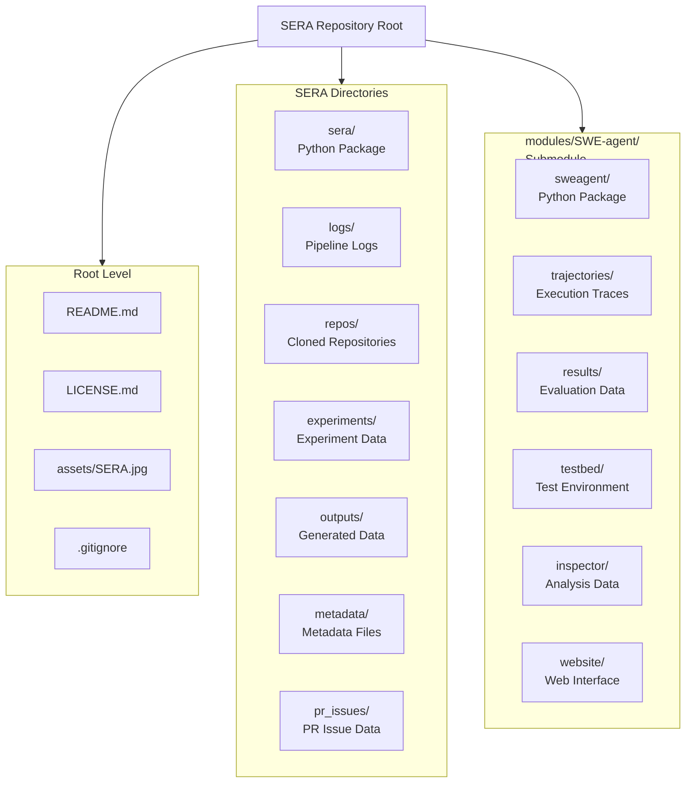
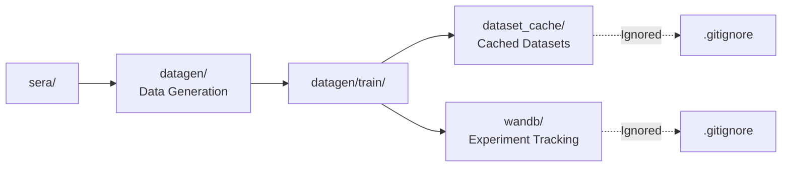
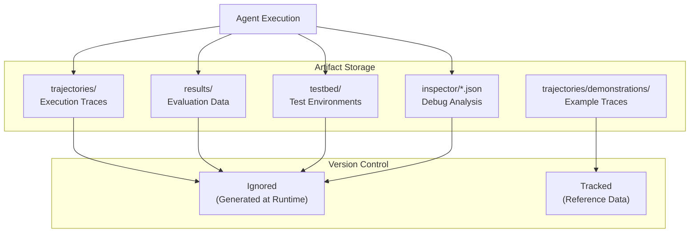
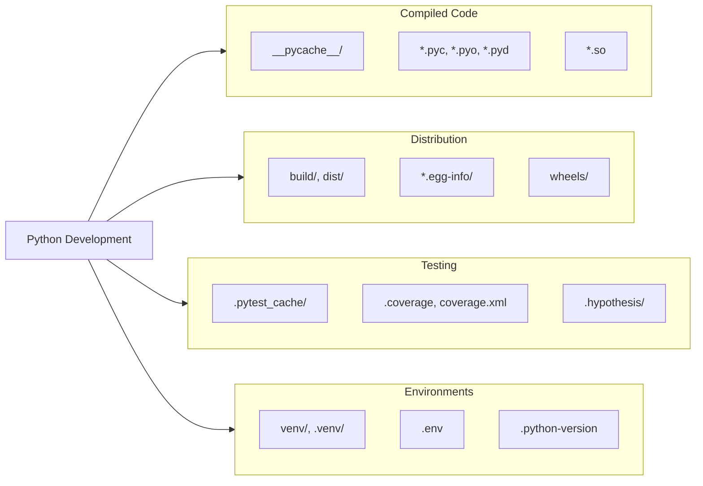
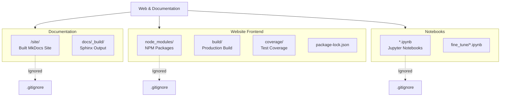
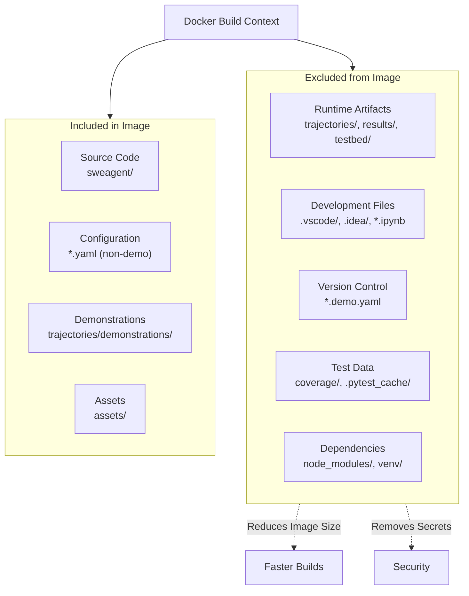
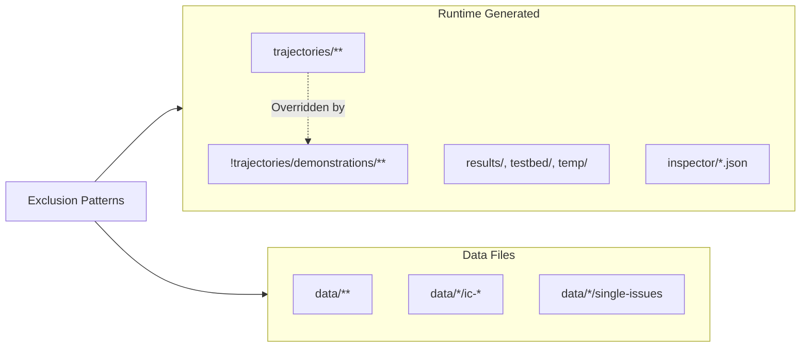
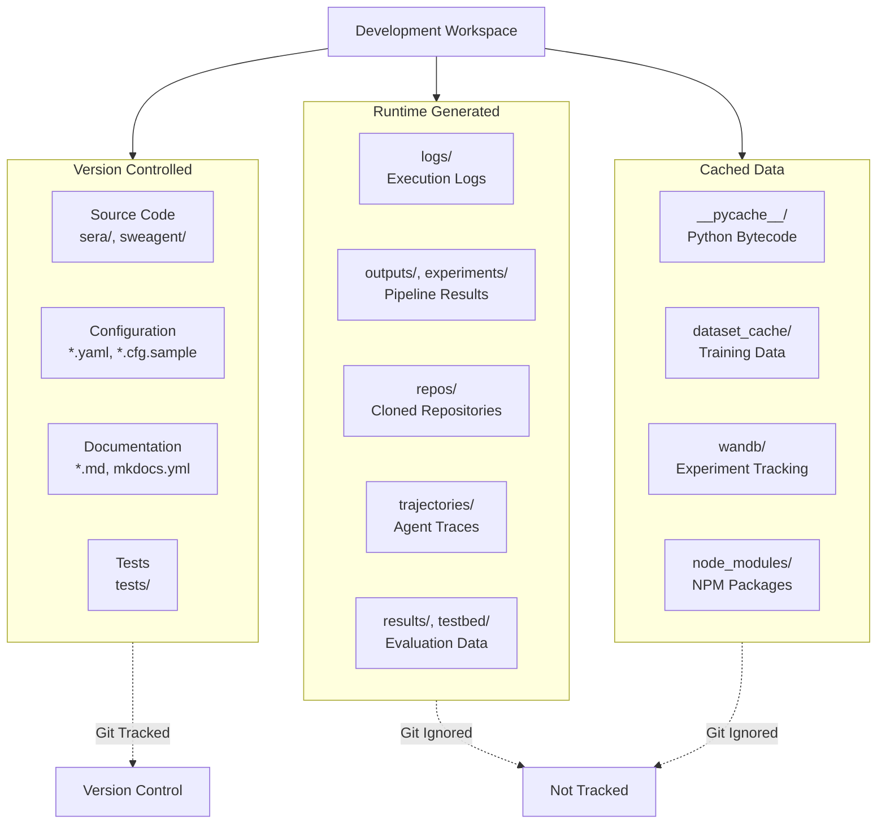
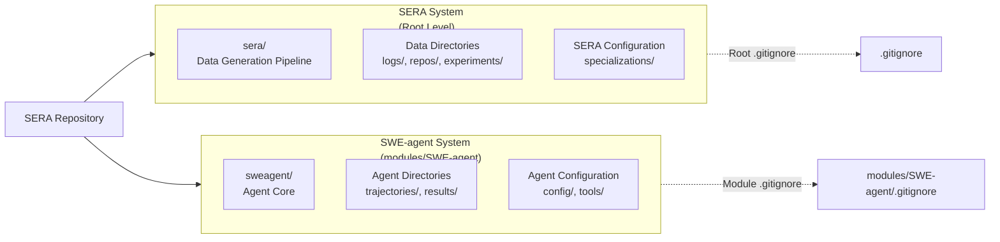

<!-- source: DeepWiki mcp.deepwiki.com · repo allenai/SERA · page 9 Repository Structure · fetched 2026-10-26 -->

# Repository Structure

Relevant source files

The following files were used as context for generating this wiki page:

- [.gitignore](.gitignore)
- [modules/SWE-agent/.dockerignore](modules/SWE-agent/.dockerignore)
- [modules/SWE-agent/.gitignore](modules/SWE-agent/.gitignore)

## Purpose and Scope

This document describes the file organization and directory structure of the SERA repository, including both the root-level SERA system and the `modules/SWE-agent/` submodule. It documents the development workspace layout, artifact directories, and exclusion patterns defined in `.gitignore` and `.dockerignore` files.

For information about setting up the development environment, see [Development Environment](#4). For Docker containerization details, see [Docker and Containerization](#5).

---

## Repository Overview

The SERA repository follows a two-layer structure with distinct purposes at each level:

**Sources:** [.gitignore:1-227](), [modules/SWE-agent/.gitignore:1-198]()

---

## Root Directory Structure

### SERA System Directories

The root level of the repository contains directories specific to the SERA data generation pipeline:

| Directory | Purpose | Tracking Status |
|-----------|---------|-----------------|
| `sera/` | Main Python package containing pipeline code | Tracked |
| `logs/` | Pipeline execution logs and debug output | Ignored |
| `repos/` | Cloned GitHub repositories for analysis | Ignored |
| `experiments/` | Experimental configurations and results | Ignored |
| `outputs/` | Generated training data and artifacts | Ignored |
| `metadata/` | Repository and issue metadata | Ignored |
| `pr_issues/` | Pull request issue data for processing | Ignored |
| `.claude/` | Claude AI integration data | Ignored |
| `assets/` | Static assets (SERA.jpg) | Tracked |

**Sources:** [.gitignore:1-7]()

### SERA Python Package Organization

The `sera/` directory contains the data generation pipeline code. Key subdirectories include:

**Sources:** [.gitignore:9-10]()

---

## SWE-agent Module Structure

### Module Directory Layout

The `modules/SWE-agent/` submodule contains the autonomous software engineering agent system:

| Directory | Purpose | Tracking Status |
|-----------|---------|-----------------|
| `sweagent/` | Core agent Python package | Tracked |
| `trajectories/` | Agent execution traces | Ignored (except demonstrations) |
| `data/` | Task data and benchmarks | Partially ignored |
| `results/` | Evaluation results and metrics | Ignored |
| `testbed/` | Isolated test environments | Ignored |
| `inspector/` | Analysis and debugging data | Ignored |
| `website/frontend/` | Web interface for agent interaction | Partially tracked |
| `.devcontainer/` | VS Code development container | Tracked |
| `assets/` | Visual assets and documentation images | Tracked |

**Sources:** [modules/SWE-agent/.gitignore:143-157](), [modules/SWE-agent/.dockerignore:140-143]()

### Execution Artifact Directories

**Sources:** [modules/SWE-agent/.gitignore:143-157](), [modules/SWE-agent/.dockerignore:188-191]()

---

## Ignored Artifacts and Exclusions

### Python Development Artifacts

Both the root repository and SWE-agent module exclude standard Python development artifacts:

**Sources:** [.gitignore:15-163](), [modules/SWE-agent/.gitignore:1-131]()

### API Keys and Credentials

Credential files are excluded from version control for security:

| Pattern | Purpose | Location |
|---------|---------|----------|
| `keys*.cfg` | API key configuration files | Root and SWE-agent |
| `*.env`, `.env.*` | Environment variable files | Both locations |
| `.api_key` | API key storage | SWE-agent website |

**Sources:** [.gitignore:169](), [modules/SWE-agent/.gitignore:137](), [modules/SWE-agent/.gitignore:181]()

### Documentation and Web Assets

**Sources:** [.gitignore:154-173](), [modules/SWE-agent/.gitignore:122-184]()

### IDE and Editor Files

Development environment files are excluded to avoid conflicts:

| Pattern | IDE/Editor | Files Excluded |
|---------|------------|----------------|
| `.vscode/**` | Visual Studio Code | Workspace settings |
| `.idea/` | PyCharm | Project configuration |
| `.DS_Store` | macOS Finder | File metadata |
| `.ipynb_checkpoints` | Jupyter | Notebook checkpoints |

**Sources:** [.gitignore:166](), [.gitignore:223](), [modules/SWE-agent/.gitignore:134](), [modules/SWE-agent/.gitignore:190](), [modules/SWE-agent/.dockerignore:192]()

---

## Docker Build Exclusions

### SWE-agent Docker Build Context

The `.dockerignore` file for SWE-agent optimizes Docker image builds by excluding unnecessary files:

**Sources:** [modules/SWE-agent/.dockerignore:1-196]()

### Key Exclusion Patterns

The Docker build excludes runtime-generated files while preserving reference data:

**Sources:** [modules/SWE-agent/.dockerignore:188-191](), [modules/SWE-agent/.dockerignore:145-147](), [modules/SWE-agent/.dockerignore:154-155]()

---

## Development Workspace Organization

### Working Directory Structure

During development, the repository expands with additional runtime directories:

**Sources:** [.gitignore:1-227](), [modules/SWE-agent/.gitignore:1-198]()

### Temporary and Fine-Tuning Data

Special patterns for data processing workflows:

| Directory/Pattern | Purpose | Status |
|-------------------|---------|--------|
| `fine_tune/*.ipynb` | Fine-tuning notebooks | Ignored |
| `fine_tune/subtasks/*.jsonl` | Task-specific training data | Ignored |
| `temp*.jsonl` | Temporary JSONL files | Ignored |
| `*.demo.yaml` | Demo configuration (editing) | Ignored |
| `*.decomp.json` | Decompilation output | Ignored |
| `*.disas.json` | Disassembly output | Ignored |

**Sources:** [.gitignore:184-186](), [.gitignore:220](), [.gitignore:225-227](), [modules/SWE-agent/.gitignore:150-154](), [modules/SWE-agent/.gitignore:187]()

---

## Module Separation

### SERA vs SWE-agent Organization

The repository maintains clear separation between the two major components:

**Sources:** [.gitignore:20-32](), [modules/SWE-agent/.gitignore:1-198]()

### Ignored Paths in Root .gitignore

The root `.gitignore` specifically excludes SWE-agent runtime files:

| Pattern | Purpose |
|---------|---------|
| `SWE-agent/keys.yaml` | Agent API keys |
| `SWE-agent/.swe-agent-human-history` | Interaction history |
| `SWE-agent/.vscode/**` | VS Code settings |
| `SWE-agent/cov.xml` | Coverage reports |
| `SWE-agent/!trajectories/demonstrations/**` | Preserve demonstrations |
| `SWE-agent/data/**` | Runtime data |
| `SWE-agent/*.env` | Environment files |
| `SWE-agent/!tools/*` | Preserve tool definitions |
| `SWE-agent/deps/*` | Dependencies |
| `SWE-agent/trajectories/*` | Execution traces |
| `SWE-agent/*.jsonl`, `*.json` | Data files |

**Sources:** [.gitignore:20-32]()

---

## Summary

The SERA repository implements a hierarchical structure with clear separation of concerns:

1. **Root Level**: SERA data generation system with pipeline code and runtime data directories
2. **SWE-agent Module**: Autonomous agent system in `modules/SWE-agent/` with independent artifact management
3. **Ignored Artifacts**: Comprehensive exclusion of runtime data, credentials, and development artifacts
4. **Docker Optimization**: Selective inclusion patterns for efficient container builds
5. **Development Workspace**: Runtime directories expand during execution but remain excluded from version control

This organization enables independent development of both systems while maintaining a cohesive repository structure. The `.gitignore` and `.dockerignore` patterns ensure that only source code, configuration templates, and reference data are tracked, while runtime artifacts, credentials, and development files remain local.

**Sources:** [.gitignore:1-227](), [modules/SWE-agent/.gitignore:1-198](), [modules/SWE-agent/.dockerignore:1-196]()