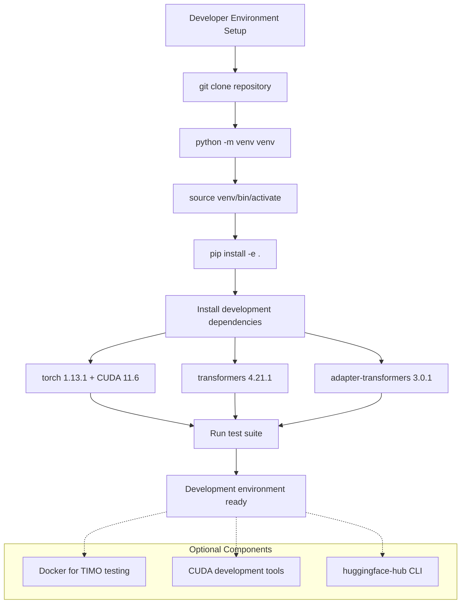
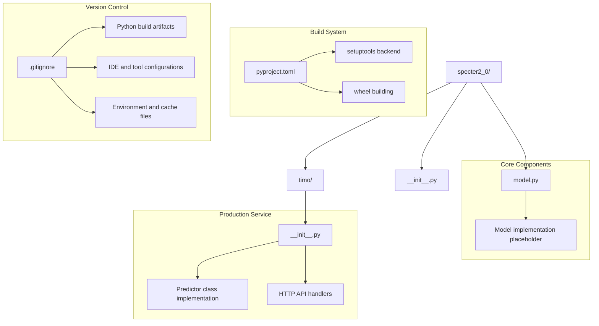
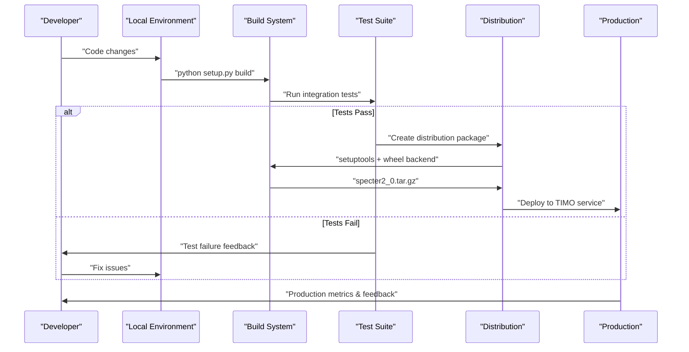
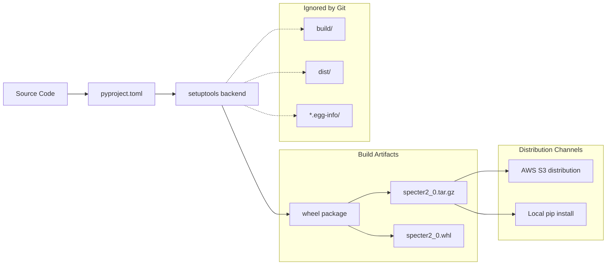
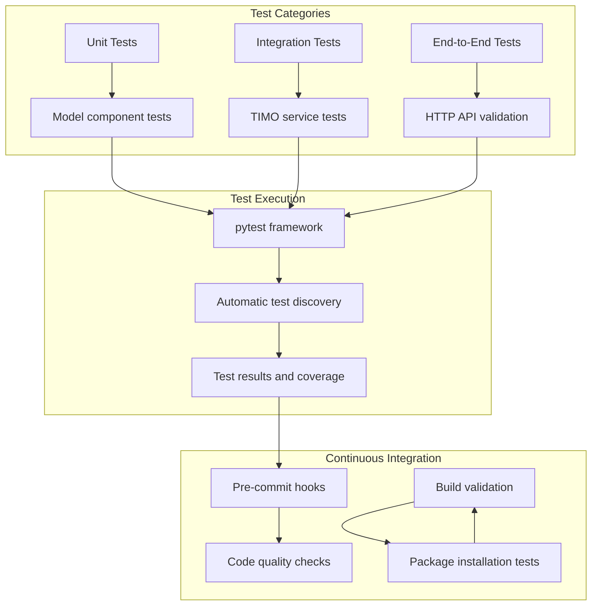
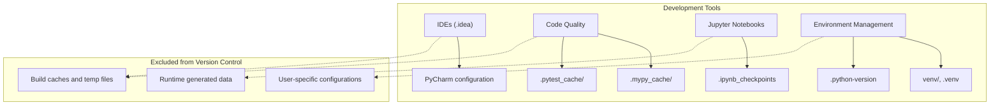

<!-- source: DeepWiki mcp.deepwiki.com · repo allenai/SPECTER2 · page 5 Development · fetched 2026-10-26 -->

# Development

Relevant source files

The following files were used as context for generating this wiki page:

- [.gitignore](.gitignore)
- [pyproject.toml](pyproject.toml)
- [specter2_0/__init__.py](specter2_0/__init__.py)
- [specter2_0/model.py](specter2_0/model.py)
- [specter2_0/timo/__init__.py](specter2_0/timo/__init__.py)

This page provides comprehensive information for developers working with the SPECTER2 codebase, including environment setup, code organization, development workflows, and contribution guidelines. This covers the technical aspects of maintaining and extending the SPECTER2 system.

For information about using the models, see [Model Usage](#2). For production API details, see [Production API](#3). For installation instructions for end users, see [Installation](#4).

## Development Environment Setup

The SPECTER2 project follows standard Python packaging conventions with a modular structure supporting both local development and production deployment.

### Environment Configuration

The development environment is configured through standard Python tooling:

| Component | Configuration File | Purpose |
|-----------|-------------------|---------|
| Build System | `pyproject.toml` | Defines build backend and requirements |
| Package Structure | `specter2_0/` | Main package directory |
| Dependency Management | `setup.py` | Runtime and development dependencies |
| Version Control | `.gitignore` | Excludes build artifacts and temporary files |

### Development Setup Flow

**Sources:** [pyproject.toml:1-4](), [.gitignore:111-118]()

## Code Organization

The codebase follows a hierarchical module structure that separates core functionality, production services, and development utilities.

### Package Structure

**Sources:** [specter2_0/__init__.py:1](), [specter2_0/model.py:1-4](), [specter2_0/timo/__init__.py:1]()

### Module Responsibilities

| Module Path | Primary Responsibility | Development Notes |
|-------------|----------------------|-------------------|
| `specter2_0/` | Main package namespace | Contains core model implementations |
| `specter2_0/model.py` | Model interface definitions | Currently contains placeholder for implementation |
| `specter2_0/timo/` | Production service components | TIMO API predictor and handlers |

## Development Workflow

The development process integrates model training, package building, and production deployment through a structured pipeline.

### Development Lifecycle

**Sources:** [pyproject.toml:2-3](), [specter2_0/model.py:2-3]()

## Build and Distribution Process

The project uses modern Python packaging standards with setuptools and wheel for distribution.

### Build Configuration

The build system is configured through `pyproject.toml` using the setuptools backend:

**Sources:** [pyproject.toml:1-4](), [.gitignore:15-31]()

### Artifact Management

The `.gitignore` configuration excludes standard Python build artifacts and development files:

| Category | Excluded Files | Purpose |
|----------|----------------|---------|
| Build Artifacts | `build/`, `dist/`, `*.egg-info/` | Generated during package building |
| Python Runtime | `__pycache__/`, `*.py[cod]` | Bytecode and compiled files |
| Development Tools | `.idea/`, `.pytest_cache/` | IDE and testing tool files |
| Virtual Environments | `venv/`, `.env` | Local development environments |

**Sources:** [.gitignore:5-8](), [.gitignore:13-31](), [.gitignore:111-118]()

## Testing and Validation

The development workflow incorporates testing at multiple levels to ensure code quality and production readiness.

### Test Infrastructure

**Sources:** [.gitignore:44-56]()

## Development Tools Integration

The project integrates with standard Python development tools and IDE configurations.

### Tool Configuration

**Sources:** [.gitignore:1-143]()

---

