# Page: Overview

# Overview

<details>
<summary>Relevant source files</summary>

The following files were used as context for generating this wiki page:

- [README.md](README.md)
- [requirements.txt](requirements.txt)

</details>


## Purpose and Scope

This document provides a high-level introduction to the SciREX system, its architecture, and the structure of the codebase. SciREX is a document-level information extraction challenge dataset designed for extracting structured information from scientific papers, including named entities, coreference clusters, and N-ary relations between entities.

For detailed information about specific subsystems:
- Dataset format and schemas: see [Data Format Specification](#2.1)
- Model architectures: see [Model Architecture](#3)
- Training procedures: see [Training](#4)
- Prediction and evaluation: see [Prediction and Evaluation](#5)

---

## What is SciREX?

SciREX (Scientific Information Extraction) is both a dataset and a system for document-level information extraction from scientific papers. The system extracts four types of salient entities (**Method**, **Metric**, **Task**, **Material**) along with their mentions, coreference clusters, and N-ary relations (typically 4-ary tuples connecting Method-Metric-Task-Material entities with an optional Score).

### Key Characteristics

| Aspect | Description |
|--------|-------------|
| **Task Type** | Document-level multi-task information extraction |
| **Input** | Full scientific paper text (sentences and sections) |
| **Output** | NER mentions, salient entity clusters, N-ary relations |
| **Dataset Size** | train/dev/test splits in JSONL format |
| **Base Model** | SciBERT (domain-adapted BERT for scientific text) |
| **Framework** | AllenNLP for training infrastructure |

**Sources:** [README.md:1-28]()

---

## System Architecture

The SciREX system follows a modular pipeline architecture with two parallel training workflows and a sequential prediction workflow.

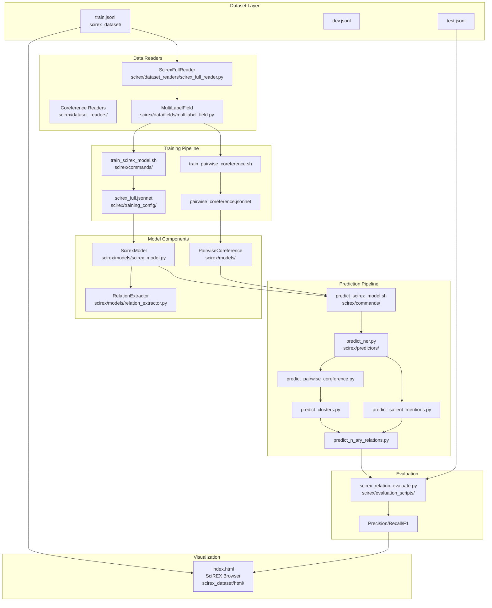

**Sources:** [README.md:40-57]()

---

## Key Components and Code Mapping

### Data Layer

The dataset consists of three JSONL files containing document-level annotations:

| File | Location | Contents |
|------|----------|----------|
| `train.jsonl` | [scirex_dataset/release_data.tar.gz]() | Training documents with full annotations |
| `dev.jsonl` | [scirex_dataset/release_data.tar.gz]() | Development set for validation |
| `test.jsonl` | [scirex_dataset/release_data.tar.gz]() | Test set for final evaluation |

Each document contains: `doc_id`, `words`, `sentences`, `sections`, `ner`, `coref`, `n_ary_relations`, `method_subrelations`.

**Sources:** [README.md:3-26]()

### Data Processing Components

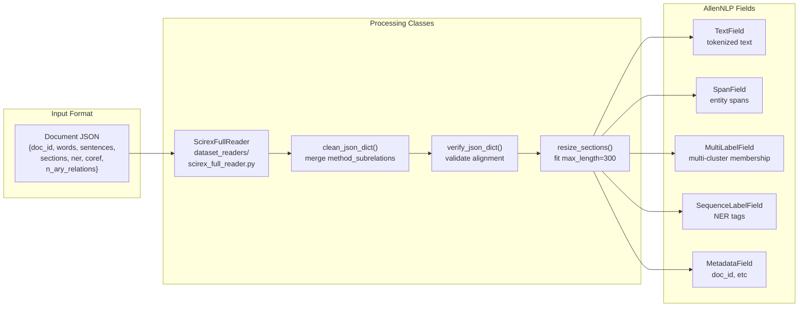

**Sources:** [README.md:8-26]()

### Training Workflow

The system uses a two-phase training approach:

1. **Main Model Training**: Executed via [scirex/commands/train_scirex_model.sh]()
   - Trains `ScirexModel` for multi-task NER, saliency detection, and relation extraction
   - Configuration: [scirex/training_config/scirex_full.jsonnet]()
   - Requires `BERT_BASE_FOLDER` environment variable pointing to SciBERT weights

2. **Coreference Model Training**: Executed via [scirex/commands/train_pairwise_coreference.sh]()
   - Trains pairwise coreference classifier
   - Configuration: [scirex/training_config/pairwise_coreference.jsonnet]()
   - Uses same SciBERT base model

**Sources:** [README.md:40-46]()

### Model Architecture Components

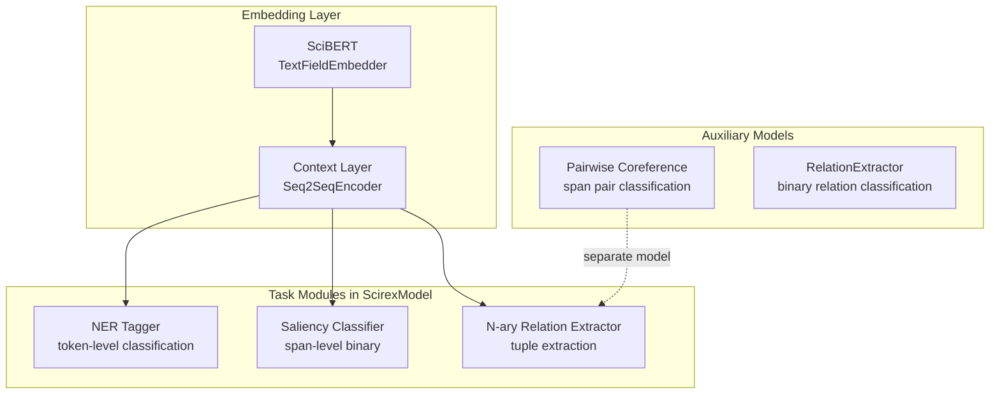

The `ScirexModel` class implements multi-task learning with three parallel objectives, each with configurable loss weights (`nw`, `lw`, `rw`).

**Sources:** [README.md:40-46]()

### Prediction Pipeline

The prediction system follows a strict sequential dependency chain:

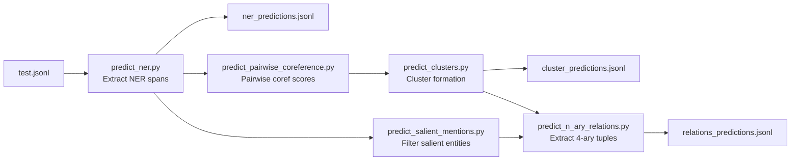

All five prediction steps are orchestrated by [scirex/commands/predict_scirex_model.sh:1-57]().

**Sources:** [README.md:48-57]()

### Evaluation System

The evaluation script [scirex/evaluation_scripts/scirex_relation_evaluate.py]() performs:

1. **Span Mapping**: Fuzzy matching of predicted spans to gold spans (>0.5 IOU)
2. **Cluster Mapping**: Mapping spans to coreference clusters
3. **Relation Filtering**: Removing relations with entities missing textual mentions (noted at [README.md:28]() as affecting ~50% of relations)
4. **Metric Calculation**: Computing precision, recall, and F1 per entity type

**Sources:** [README.md:28]()

---

## Data Flow Through the System

The following diagram illustrates how data transforms through the complete pipeline:

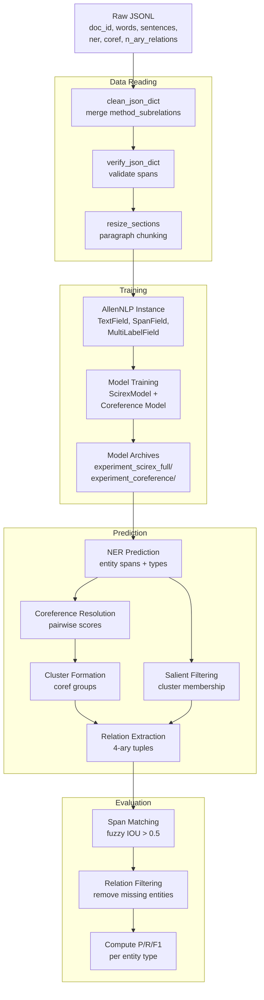

**Sources:** [README.md:1-57]()

---

## Repository Structure

The repository is organized into the following main directories:

| Directory | Purpose |
|-----------|---------|
| `scirex/dataset_readers/` | Data loading and preprocessing classes |
| `scirex/models/` | Neural network model implementations |
| `scirex/predictors/` | Prediction scripts for each task |
| `scirex/evaluation_scripts/` | Evaluation and metric calculation |
| `scirex/training_config/` | Jsonnet configuration files |
| `scirex/commands/` | Shell scripts for training and prediction |
| `scirex/data/fields/` | Custom AllenNLP field types |
| `scirex_dataset/` | Dataset files and browser visualization |

**Sources:** [README.md:1-74]()

---

## Installation and Setup

The system requires Python 3.7 and AllenNLP 0.9.0. Key dependencies:

| Dependency | Version | Purpose |
|------------|---------|---------|
| `allennlp` | 0.9.0 | Training framework |
| `spacy` | 2.1.6 | Text processing |
| `fuzzywuzzy` | 0.17.0 | Entity string matching |
| `scikit-learn` | 0.21.3 | Evaluation metrics |

Setup steps:
1. Create conda environment: `conda create -n scirex python=3.7`
2. Install dependencies: `pip install -r requirements.txt`
3. Download spaCy model: `python -m spacy download en`
4. Set `PYTHONPATH` to repository root
5. Extract dataset: `tar -xvzf scirex_dataset/release_data.tar.gz --directory scirex_dataset`
6. Set `BERT_BASE_FOLDER` environment variable pointing to SciBERT weights

For detailed installation instructions, see [Installation and Setup](#8.2).

**Sources:** [README.md:31-44](), [requirements.txt:1-18]()

---

## External Integrations

The system integrates with:

- **AllenNLP**: Core training and data processing framework
- **SciBERT**: Pre-trained BERT model for scientific text (download from [README.md:44]())
- **DyGIE++**: Alternative information extraction framework with format converters (see [DyGIE++ Integration](#7.1))
- **Semantic Scholar**: Papers referenced via `doc_id` field
- **SciREX Browser**: Web-based visualization at https://allenai.github.io/SciREX/

**Sources:** [README.md:4](), [README.md:44]()

---

## Important Notes

### Relation Evaluation Caveat

Approximately 50% of relations in the dataset contain at least one entity with no textual mentions (they appear only in tables, which are excluded from the dataset). During evaluation, these relations are filtered out at [scirex/evaluation_scripts/scirex_relation_evaluate.py:110](), which artificially reduces precision metrics. This is a known limitation documented in [README.md:28]().

### Citation

For academic use, cite the following paper:
```bibtex
@inproceedings{jain-etal-2020-scirex,
  title={SciREX: A Challenge Dataset for Document-Level Information Extraction},
  author={Sarthak Jain and Madeleine van Zuylen and Hannaneh Hajishirzi and Iz Beltagy},
  booktitle = "Proceedings of the 58th Annual Meeting of the Association for Computational Linguistics",
  month={jul},
  year={2020},
  eprint={2005.00512},
  archivePrefix={arXiv},
  primaryClass={cs.CL}
}
```

**Sources:** [README.md:59-73]()

---

# Page: Dataset and Data Format

# Dataset and Data Format

<details>
<summary>Relevant source files</summary>

The following files were used as context for generating this wiki page:

- [README.md](README.md)
- [requirements.txt](requirements.txt)
- [scirex/data/dataset_readers/coreference_eval_reader.py](scirex/data/dataset_readers/coreference_eval_reader.py)
- [scirex/data/dataset_readers/coreference_train_reader.py](scirex/data/dataset_readers/coreference_train_reader.py)
- [scirex/data/dataset_readers/multi_label_field.py](scirex/data/dataset_readers/multi_label_field.py)
- [scirex/data/dataset_readers/scirex_full_reader.py](scirex/data/dataset_readers/scirex_full_reader.py)
- [scirex/models/gelu.py](scirex/models/gelu.py)

</details>


## Purpose and Scope

This document provides an overview of the SciREX dataset structure, file organization, and data formats used throughout the system. It covers the raw dataset format, how data is organized, and the high-level data processing pipeline. For detailed field specifications and type definitions, see [Data Format Specification](#2.1). For implementation details of data readers and preprocessing steps, see [Data Readers and Preprocessing](#2.2). For information about the annotation process and dataset statistics, see [Annotation Guidelines and Statistics](#2.3).

## Dataset Overview

The SciREX dataset is a document-level information extraction challenge dataset designed for extracting structured information from scientific papers. The dataset consists of annotated scientific documents with entity mentions, coreference chains, and n-ary relations.

### Dataset Location and Structure

The dataset is distributed as a compressed archive located at:
- Repository path: `scirex_dataset/release_data.tar.gz`
- Public access: https://github.com/allenai/SciREX/blob/master/scirex_dataset/release_data.tar.gz
- Interactive browser: https://allenai.github.io/SciREX/

After extraction using `tar -xvzf scirex_dataset/release_data.tar.gz --directory scirex_dataset`, the dataset contains three files:

| File | Purpose | Format |
|------|---------|--------|
| `train.jsonl` | Training data | One document per line (JSONL) |
| `dev.jsonl` | Development/validation data | One document per line (JSONL) |
| `test.jsonl` | Test data | One document per line (JSONL) |

**Sources:** [README.md:1-8]()

### Dataset Scope and Document-Level Annotations

Each document in the dataset represents a complete scientific paper with rich document-level annotations including:
- **Words**: Tokenized text of the entire document
- **Structural elements**: Sentence and section boundaries
- **Named entities**: Typed mentions (Method, Metric, Task, Material)
- **Coreference**: Salient entity clusters with their mentions
- **Relations**: N-ary relations connecting multiple entities

**Sources:** [README.md:10-26]()

## Data Format Overview

### Basic Document Structure

Each line in a `.jsonl` file contains a single JSON document with the following top-level fields:

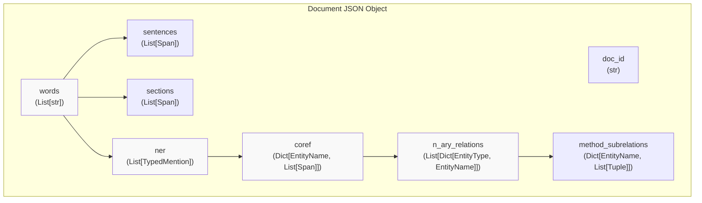

**Diagram: Document JSON Structure - Top-level fields and their relationships**

**Sources:** [README.md:10-26]()

### Key Type Definitions

The data format uses several fundamental types defined as follows:

| Type | Definition | Example |
|------|------------|---------|
| `Span` | `Tuple[int, int]` | `(0, 10)` - inclusive start, exclusive end |
| `TypedMention` | `Tuple[int, int, EntityType]` | `(5, 8, "Method")` |
| `EntityType` | `Union["Method", "Metric", "Task", "Material"]` | `"Method"` |
| `EntityName` | `str` | `"BERT"` |
| `ClusterName` | `str` | Unique identifier for an entity cluster |

The `Span` type is particularly important as it represents a range indexing into the `words` array. All span-based annotations use this convention throughout the system.

**Sources:** [README.md:22-25](), [scirex/data/dataset_readers/scirex_full_reader.py:26-29]()

### N-ary Relations Structure

Relations in SciREX are n-ary (specifically 4-ary), connecting entities of four different types. Each relation is a dictionary with exactly four keys:

```python
{
    "Method": "BERT",
    "Metric": "F1 Score", 
    "Task": "Named Entity Recognition",
    "Material": "CoNLL-2003"
}
```

These relations represent experimental results reported in scientific papers, capturing which method was applied to which task and dataset, achieving a particular metric score.

**Important Constraint**: Approximately 50% of relations in the dataset contain at least one entity with no textual mentions (these entities appear only in tables, which are excluded from the text). This affects evaluation methodology, as discussed in the note at [README.md:28]().

**Sources:** [README.md:18-28]()

## Data Flow and Transformation Pipeline

The following diagram illustrates how raw dataset files are transformed through various processing stages to become model-ready instances:

```mermaid
flowchart LR
    subgraph "Raw Data Layer"
        JSONL["train.jsonl<br/>dev.jsonl<br/>test.jsonl"]
    end
    
    subgraph "Preprocessing: clean_json_dict"
        MergeSub["Merge method_subrelations<br/>into main entities"]
        GroupSent["Group sentences<br/>into sections"]
        VerifyAlign["Verify alignment<br/>via verify_json_dict"]
        
        MergeSub --> GroupSent
        GroupSent --> VerifyAlign
    end
    
    subgraph "Resizing: resize_sections_and_group"
        Collapse["Collapse short paragraphs<br/>min_len=20"]
        Break["Break long paragraphs<br/>max_len=300"]
        MoveBound["Move boundaries<br/>to avoid splitting entities"]
        
        Collapse --> Break
        Break --> MoveBound
    end
    
    subgraph "Instance Creation: text_to_instance"
        TextField["TextField<br/>(BERT tokens)"]
        SpanField["SpanField<br/>(entity spans)"]
        MultiLabel["MultiLabelField<br/>(cluster assignments)"]
        SeqLabel["SequenceLabelField<br/>(NER labels)"]
        
        TextField --> SpanField
        SpanField --> MultiLabel
        TextField --> SeqLabel
    end
    
    subgraph "AllenNLP Instance"
        Instance["Instance object<br/>with all fields"]
    end
    
    JSONL --> MergeSub
    VerifyAlign --> Collapse
    MoveBound --> TextField
    SeqLabel --> Instance
    MultiLabel --> Instance
```

**Diagram: Data Transformation Pipeline - From raw JSONL to AllenNLP Instance**

**Sources:** [scirex/data/dataset_readers/scirex_full_reader.py:32-102](), [scirex/data/dataset_readers/scirex_full_reader.py:243-300](), [scirex/data/dataset_readers/scirex_full_reader.py:302-421]()

### Data Processing Steps

#### 1. JSON Cleaning (`clean_json_dict`)

The `clean_json_dict` function at [scirex/data/dataset_readers/scirex_full_reader.py:32-102]() performs several critical preprocessing steps:

- **Method subrelation merging**: Combines submethod entities (e.g., "DLDL+VGG-Face" split into "DLDL" and "VGG-Face") back into their parent method clusters
- **Entity type enrichment**: Augments entity spans with both their type and saliency flag (whether they belong to any coreference cluster)
- **Sentence grouping**: Groups sentences into their containing sections using `group_sentences_to_sections`
- **Cross-sentence entity handling**: Merges adjacent sentences when entities span sentence boundaries

#### 2. Validation (`verify_json_dict`)

The `verify_json_dict` function at [scirex/data/dataset_readers/scirex_full_reader.py:105-119]() ensures data consistency by asserting:
- Each entity belongs to exactly one section
- Each entity belongs to exactly one grouped sentence
- Section and sentence boundaries align correctly
- All coreference spans exist in the entity list

#### 3. Paragraph Resizing (`resize_sections_and_group`)

To accommodate BERT's maximum sequence length constraint (300 tokens), the `resize_sections_and_group` method at [scirex/data/dataset_readers/scirex_full_reader.py:243-300]() performs paragraph-level operations:

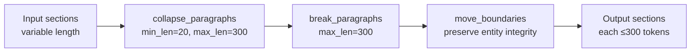

**Diagram: Paragraph Resizing Pipeline**

This ensures no entity is split across paragraph boundaries while keeping paragraphs within BERT's length constraints.

**Sources:** [scirex/data/dataset_readers/scirex_full_reader.py:243-300]()

## Data Readers

The SciREX system uses several specialized dataset readers to convert raw data into model-ready formats:

### ScirexFullReader

The primary reader for the main information extraction task, registered as `"scirex_full_reader"` at [scirex/data/dataset_readers/scirex_full_reader.py:121]().

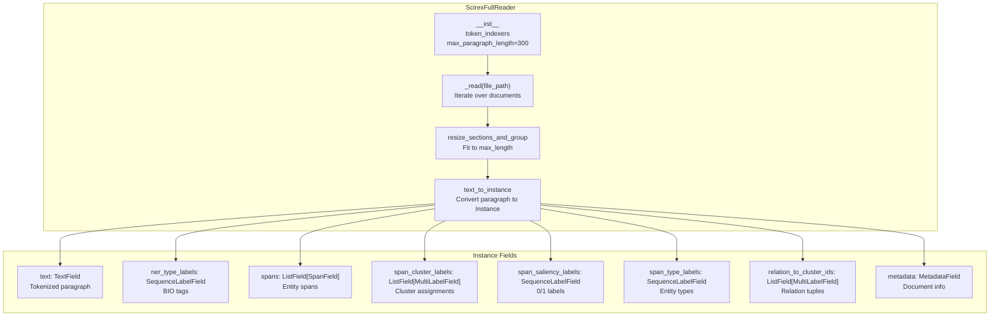

**Diagram: ScirexFullReader Architecture - Converting documents to AllenNLP Instances**

Key parameters:
- `token_indexers`: Configures how tokens are converted to indices (typically BERT tokenizer)
- `max_paragraph_length`: Maximum tokens per paragraph (default: 300)
- `lazy`: Whether to load data lazily
- `to_scirex_converter`: Flag for format conversion mode

The reader yields one `Instance` per paragraph, not per document. This allows processing long documents that exceed BERT's maximum length.

**Sources:** [scirex/data/dataset_readers/scirex_full_reader.py:121-241]()

### Coreference Readers

Two specialized readers handle pairwise coreference training and evaluation:

#### ScirexCoreferenceTrainReader

Registered as `"scirex_coreference_train_reader"` at [scirex/data/dataset_readers/coreference_train_reader.py:17](), this reader:

- Generates all pairwise combinations of entities with matching types
- Creates binary classification instances (coreferent=1, not coreferent=0)
- Balances positive/negative examples during training via sampling
- Formats entity pairs as: `"EntityType entity_text_1" [SEP] "EntityType entity_text_2"`

**Sources:** [scirex/data/dataset_readers/coreference_train_reader.py:1-113]()

#### ScirexCoreferenceEvalReader

Located at [scirex/data/dataset_readers/coreference_eval_reader.py:17-90](), this reader:

- Similar to the training reader but without downsampling
- Used for evaluation to ensure all pairs are considered
- Includes metadata for mapping predictions back to document spans

**Sources:** [scirex/data/dataset_readers/coreference_eval_reader.py:1-90]()

## Custom Field Types

### MultiLabelField

The `MultiLabelField` class at [scirex/data/dataset_readers/multi_label_field.py:14-144]() is a crucial custom AllenNLP field that extends the standard `LabelField` to support multiple labels per instance.

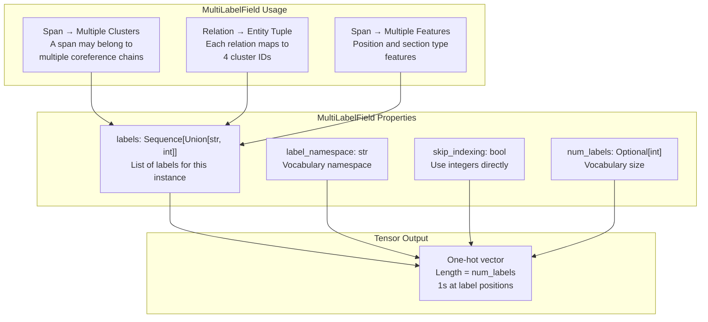

**Diagram: MultiLabelField - Supporting multi-label classification**

Key features:
- **Multi-label support**: Unlike standard `LabelField`, allows multiple active labels per instance
- **Skip indexing**: Can use integer labels directly without vocabulary lookup
- **One-hot encoding**: Converts to a binary vector with 1s at positions corresponding to active labels
- **Validation**: Ensures all labels are valid (either all strings or all integers)

This field is used extensively in SciREX for:
1. **Span cluster assignments** (`span_cluster_labels` field): A span may belong to multiple coreference clusters
2. **Relation cluster IDs** (`relation_to_cluster_ids` field): Each relation is a tuple of cluster IDs
3. **Section features** (`span_features` field): Spans have multiple structural features

**Sources:** [scirex/data/dataset_readers/multi_label_field.py:14-144](), [scirex/data/dataset_readers/scirex_full_reader.py:362-373]()

## Instance Field Mapping

The following table shows how raw JSON fields map to AllenNLP Instance fields in `ScirexFullReader`:

| JSON Field | Instance Field(s) | Field Type | Purpose |
|------------|------------------|------------|---------|
| `words` | `text` | `TextField` | Tokenized paragraph text |
| `ner` | `ner_type_labels` | `SequenceLabelField` | BIO-tagged sequence labels |
| `ner` | `spans` | `ListField[SpanField]` | Entity span boundaries |
| `ner` + `coref` | `span_saliency_labels` | `SequenceLabelField` | Binary salient/non-salient |
| `ner` | `span_type_labels` | `SequenceLabelField` | Entity types (Method/Metric/Task/Material) |
| `coref` | `span_cluster_labels` | `ListField[MultiLabelField]` | Cluster memberships for each span |
| `n_ary_relations` | `relation_to_cluster_ids` | `ListField[MultiLabelField]` | Relations as cluster ID tuples |
| `sentences`, `sections` | `metadata.sentence_indices` | `MetadataField` | Structural boundaries |
| `doc_id` | `metadata.doc_id` | `MetadataField` | Document identifier |

**Sources:** [scirex/data/dataset_readers/scirex_full_reader.py:324-421]()

## Data Format Constraints and Special Cases

### Entity-Cluster Consistency

All entity spans in the `ner` field must be consistent with coreference clusters:
- Every span in a coreference cluster must exist in the `ner` field
- Entity types are inferred from cluster memberships in relations
- The `clean_json_dict` function ensures this consistency at [scirex/data/dataset_readers/scirex_full_reader.py:69-77]()

### Method Subrelations

The `method_subrelations` field allows methods to be hierarchically decomposed (e.g., "DLDL+VGG-Face" into "DLDL" and "VGG-Face"). During preprocessing:
- Submethods are merged into the parent method's cluster
- This prevents submethods from being treated as independent entities
- The merging logic is at [scirex/data/dataset_readers/scirex_full_reader.py:54-67]()

### Cross-Sentence Entities

When entities span multiple sentences:
- Adjacent sentences are merged into a single sentence span
- This maintains the constraint that each entity belongs to exactly one sentence
- Handled at [scirex/data/dataset_readers/scirex_full_reader.py:83-96]()

### Empty Paragraphs

Some paragraphs after resizing may contain no entities:
- Empty field instances are created to maintain consistency
- Uses `.empty_field()` method on field types
- Handled at [scirex/data/dataset_readers/scirex_full_reader.py:386-406]()

**Sources:** [scirex/data/dataset_readers/scirex_full_reader.py:32-102]()

## Summary

The SciREX dataset provides rich document-level information extraction annotations in a structured JSONL format. The data processing pipeline transforms raw documents through multiple stages:

1. **Cleaning**: Merges subrelations, groups sentences, enriches entity types
2. **Validation**: Ensures structural consistency and alignment
3. **Resizing**: Adapts paragraph lengths to BERT constraints while preserving entity integrity
4. **Field Creation**: Converts to specialized AllenNLP fields including custom `MultiLabelField` for multi-label scenarios

The modular reader architecture supports both the main IE task (`ScirexFullReader`) and specialized coreference modeling, enabling flexible training and evaluation workflows. For detailed field specifications, see [Data Format Specification](#2.1), and for implementation details, see [Data Readers and Preprocessing](#2.2).

---

# Page: Data Format Specification

# Data Format Specification

<details>
<summary>Relevant source files</summary>

The following files were used as context for generating this wiki page:

- [README.md](README.md)
- [requirements.txt](requirements.txt)

</details>


## Purpose and Scope

This document provides the complete technical specification for the SciREX dataset format. It defines the JSON/JSONL schema used for storing document-level information extraction annotations, including all field types, data structures, and constraints.

For information about how this data is read and processed by the system, see [Data Readers and Preprocessing](#2.2). For evaluation-specific format transformations, see [Evaluation Metrics and Scripts](#5.2).

## File Format Overview

The SciREX dataset consists of three JSONL (JSON Lines) files located in the dataset directory:
- `train.jsonl` - Training set
- `dev.jsonl` - Development/validation set  
- `test.jsonl` - Test set

Each file contains **one document per line**, where each line is a complete, valid JSON object representing a single scientific paper with its annotations.

**Sources:** [README.md:3-6]()

## Document Schema

### Top-Level Structure

Each document is a JSON object with the following top-level fields:

| Field Name | Type | Description |
|------------|------|-------------|
| `doc_id` | `str` | Document identifier used by Semantic Scholar |
| `words` | `List[str]` | Ordered list of all words in the document |
| `sentences` | `List[Span]` | Sentence boundaries as spans into `words` |
| `sections` | `List[Span]` | Section boundaries as spans into `words` |
| `ner` | `List[TypedMention]` | Named entity mentions with types |
| `coref` | `Dict[EntityName, List[Span]]` | Coreference clusters for salient entities |
| `n_ary_relations` | `List[Dict[EntityType, EntityName]]` | 4-ary relations between entities |
| `method_subrelations` | `Dict[EntityName, List[Tuple[Span, SubEntityName]]]` | Hierarchical method decomposition |

**Sources:** [README.md:8-20]()

### Type Definitions

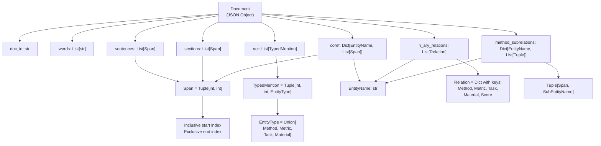

**Type Definitions:**

```python
Span = Tuple[int, int]  # [start, end) - Inclusive start, Exclusive end
TypedMention = Tuple[int, int, EntityType]  # [start, end, type]
EntityType = Union["Method", "Metric", "Task", "Material"]
EntityName = str
SubEntityName = str
```

**Sources:** [README.md:22-25]()

## Field Specifications

### `doc_id` - Document Identifier

- **Type:** `str`
- **Description:** Unique identifier corresponding to the Semantic Scholar paper ID
- **Purpose:** Links the document to its source paper in the Semantic Scholar corpus
- **Example:** `"123456789"`

### `words` - Document Tokenization

- **Type:** `List[str]`
- **Description:** Complete tokenized representation of the document
- **Indexing:** All other span-based annotations (sentences, sections, ner, coref) index into this array
- **Notes:** 
  - Words are in document order
  - Represents the canonical token sequence for all annotations
  - Does not include table content (tables are excluded from the dataset)

### `sentences` - Sentence Boundaries

- **Type:** `List[Span]` where `Span = Tuple[int, int]`
- **Description:** Defines sentence boundaries within the document
- **Indexing:** Each span `(start, end)` indexes into the `words` array
- **Semantics:** `words[start:end]` gives the tokens for that sentence
- **Coverage:** Non-overlapping spans that partition the document

**Example:**
```python
# If words = ["The", "method", "works", ".", "Results", "show", "..."]
# Then sentences might be:
[(0, 4), (4, 7), ...]  # Sentence 1: words[0:4], Sentence 2: words[4:7]
```

### `sections` - Section Boundaries

- **Type:** `List[Span]` where `Span = Tuple[int, int]`
- **Description:** Defines section boundaries (e.g., Abstract, Introduction, Methods)
- **Indexing:** Each span `(start, end)` indexes into the `words` array
- **Coverage:** May be non-contiguous or overlapping depending on document structure

### `ner` - Named Entity Recognition

- **Type:** `List[TypedMention]` where `TypedMention = Tuple[int, int, EntityType]`
- **Description:** All entity mentions in the document with their types
- **Structure:** Each mention is `(start_idx, end_idx, entity_type)`
- **Entity Types:** One of `"Method"`, `"Metric"`, `"Task"`, `"Material"`

**Entity Type Definitions:**

| EntityType | Description | Examples |
|------------|-------------|----------|
| `Method` | Computational methods, algorithms, models | "BERT", "ResNet", "attention mechanism" |
| `Metric` | Evaluation metrics and measurements | "F1 score", "accuracy", "BLEU" |
| `Task` | Research tasks and problems | "machine translation", "image classification" |
| `Material` | Datasets, corpora, resources | "ImageNet", "Penn Treebank", "WMT14" |

**Example:**
```python
# If words = ["We", "use", "BERT", "on", "GLUE", "dataset"]
# Then ner might contain:
[(2, 3, "Method"),    # "BERT"
 (4, 5, "Material")]  # "GLUE"
```

**Sources:** [README.md:16,23-24]()

### `coref` - Coreference Clusters

- **Type:** `Dict[EntityName, List[Span]]`
- **Description:** Maps salient entity names to all their mentions in the document
- **Structure:** 
  - **Key:** Canonical entity name (string)
  - **Value:** List of spans where this entity is mentioned
- **Salient Entities:** Only entities that participate in relations are included
- **Purpose:** Enables entity-level relation extraction by grouping mentions

**Example:**
```python
{
    "BERT": [(10, 11), (45, 46), (89, 90)],  # Entity "BERT" mentioned at 3 locations
    "ImageNet": [(23, 24), (67, 68)],         # Entity "ImageNet" mentioned at 2 locations
    "accuracy": [(34, 35)]                    # Entity "accuracy" mentioned once
}
```

**Sources:** [README.md:17]()

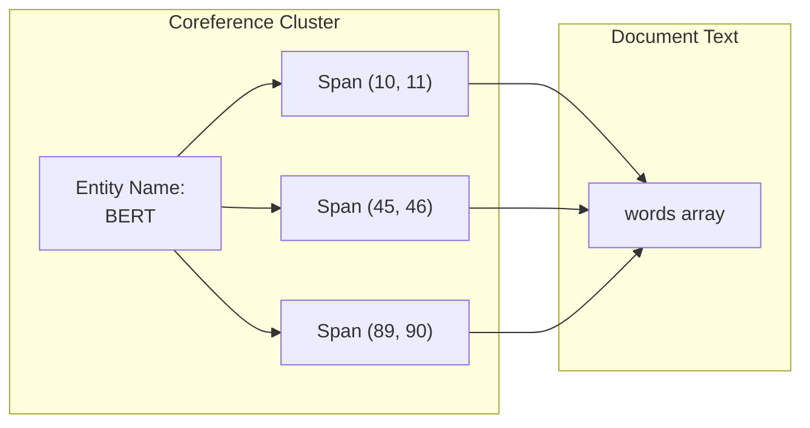

### `n_ary_relations` - 4-ary Relations

- **Type:** `List[Dict[EntityType, EntityName]]`
- **Description:** List of 4-ary relations connecting Method, Metric, Task, and Material entities
- **Structure:** Each relation is a dictionary with up to 5 keys:
  - `"Method"` - The method/model being evaluated
  - `"Metric"` - The evaluation metric used
  - `"Task"` - The task being performed
  - `"Material"` - The dataset/corpus used
  - `"Score"` (optional) - The numeric score achieved

**Relation Schema:**
```python
Relation = {
    "Method": EntityName,    # Required
    "Metric": EntityName,    # Required
    "Task": EntityName,      # Required
    "Material": EntityName,  # Required
    "Score": EntityName      # Optional - may be present
}
```

**Example:**
```python
[
    {
        "Method": "BERT",
        "Metric": "accuracy",
        "Task": "text classification",
        "Material": "GLUE",
        "Score": "92.3"
    },
    {
        "Method": "ResNet-50",
        "Metric": "top-1 accuracy",
        "Task": "image classification",
        "Material": "ImageNet"
    }
]
```

**Semantic Interpretation:** A relation captures the statement: "Method X achieves Metric Y on Task Z using Material W (with Score S)"

**Sources:** [README.md:18]()

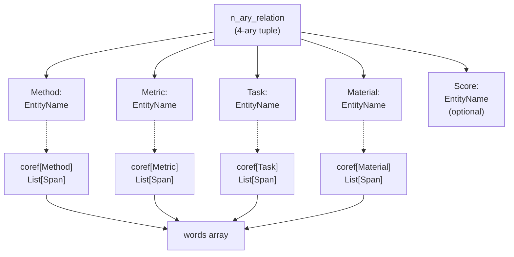

**Sources:** [README.md:18]()

### `method_subrelations` - Hierarchical Method Decomposition

- **Type:** `Dict[EntityName, List[Tuple[Span, SubEntityName]]]`
- **Description:** Decomposes complex methods into constituent sub-methods
- **Structure:**
  - **Key:** Parent method entity name
  - **Value:** List of (span, sub-method name) tuples
- **Purpose:** Captures hierarchical relationships when a method is composed of multiple sub-components

**Example:**
```python
{
    "DLDL+VGG-Face": [
        ((45, 46), "DLDL"),      # Sub-method 1
        ((47, 48), "VGG-Face")   # Sub-method 2
    ]
}
```

This indicates that the method "DLDL+VGG-Face" is composed of two sub-methods: "DLDL" and "VGG-Face", which are mentioned at the specified spans in the document.

**Sources:** [README.md:19]()

## Data Format Visualization

### Complete Document Structure

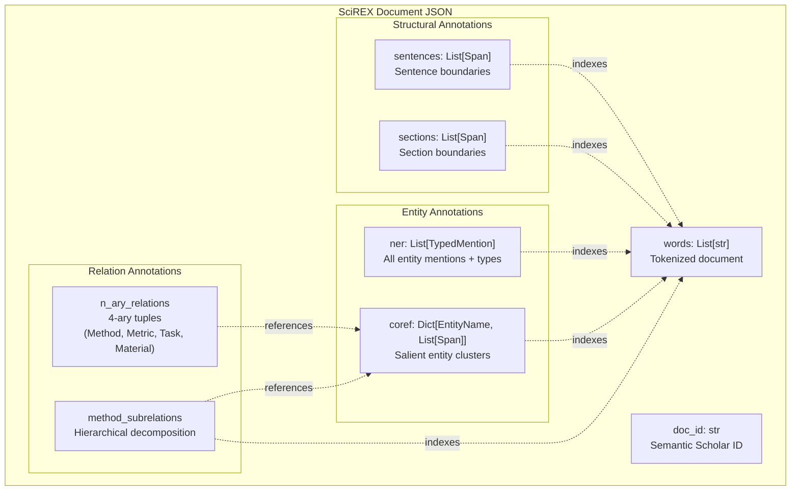

**Sources:** [README.md:8-20]()

### Span Indexing Semantics

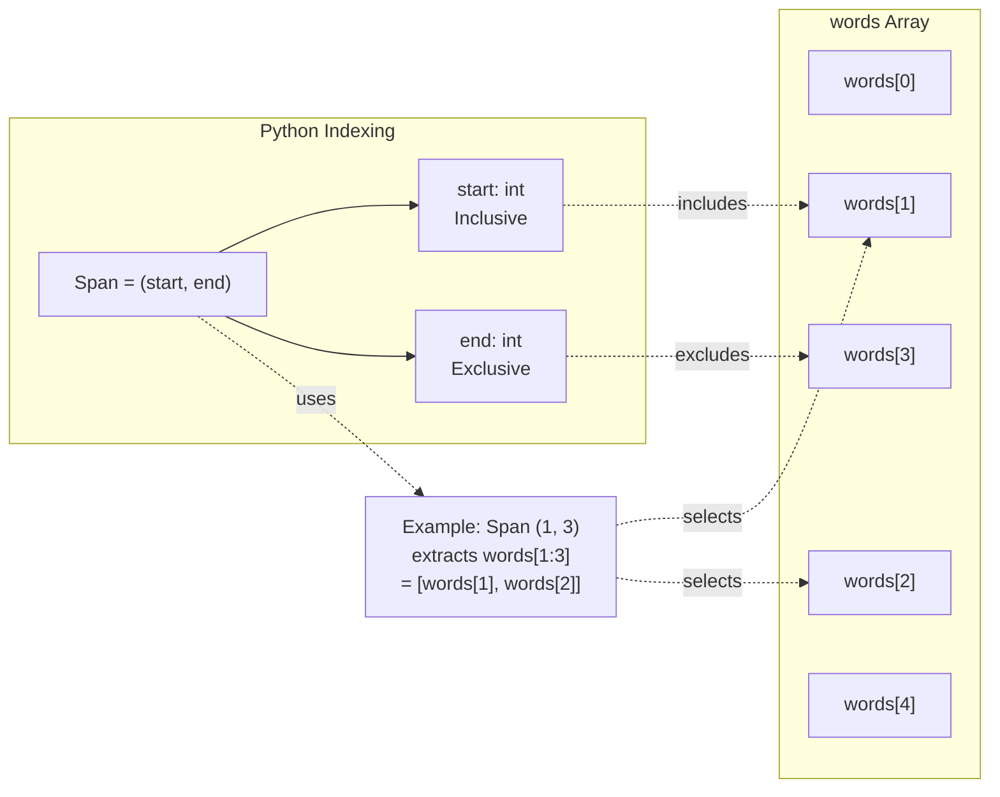

**Indexing Convention:** All spans use Python slice semantics `[start:end)` where `start` is inclusive and `end` is exclusive.

**Sources:** [README.md:22]()

## Example Document Fragment

Here is a simplified example showing how the different annotation layers relate to each other:

```json
{
    "doc_id": "12345",
    "words": [
        "We", "evaluate", "BERT", "on", "the", "GLUE", "benchmark",
        ".", "The", "model", "achieves", "92.3", "accuracy", "."
    ],
    "sentences": [
        [0, 8],
        [8, 14]
    ],
    "sections": [
        [0, 14]
    ],
    "ner": [
        [2, 3, "Method"],      
        [5, 7, "Material"],    
        [9, 10, "Method"],     
        [12, 13, "Metric"]     
    ],
    "coref": {
        "BERT": [[2, 3], [9, 10]],
        "GLUE": [[5, 7]],
        "accuracy": [[12, 13]]
    },
    "n_ary_relations": [
        {
            "Method": "BERT",
            "Material": "GLUE",
            "Metric": "accuracy",
            "Task": "natural language understanding",
            "Score": "92.3"
        }
    ],
    "method_subrelations": {}
}
```

**Annotation Breakdown:**
- **Words 2-3 ("BERT")**: Method entity, part of "BERT" coreference cluster
- **Words 5-7 ("GLUE benchmark")**: Material entity  
- **Words 9-10 ("model")**: Also refers to "BERT" (coreference)
- **Words 12-13 ("accuracy")**: Metric entity
- **Relation**: Links BERT (method) + GLUE (material) + accuracy (metric) + task + score

**Sources:** [README.md:10-26]()

## Data Considerations and Limitations

### Missing Entity Mentions in Relations

A critical characteristic of the dataset is that **approximately 50% of relations contain at least one entity that has no textual mentions** in the document. This occurs because:

1. Entities are sometimes mentioned only in **tables**, which are excluded from the dataset
2. Some entity values (especially scores) are **implicit or derived**

**Impact on Evaluation:**

The evaluation scripts handle this by **filtering out relations with missing entity mentions** during end-to-end evaluation. Specifically:
- Relations where any constituent entity lacks mentions in the `coref` dictionary are removed
- This filtering is implemented in the evaluation pipeline
- **Note:** This artificially reduces the system's precision, as the model cannot predict relations for entities it has never seen

**Evaluation Filtering:** The relation evaluation script removes these problematic relations to enable fair evaluation of the end-to-end extraction task.

**Sources:** [README.md:28](), [scirex/evaluation_scripts/scirex_relation_evaluate.py:110]()

### Table Content Exclusion

The dataset **does not include table content**, only the main text of scientific papers. This design decision means:
- Entities mentioned exclusively in tables have no text spans
- Numeric scores from tables may not appear in the text
- Relations extracted from tables are present but lack supporting text evidence

This limitation is documented as a known issue in the evaluation methodology.

**Sources:** [README.md:28]()

## Data Files Location

The dataset files are distributed as a compressed archive:

**Location:** `scirex_dataset/release_data.tar.gz`

**Extraction:**
```bash
tar -xvzf scirex_dataset/release_data.tar.gz --directory scirex_dataset
```

**Resulting Files:**
- `scirex_dataset/train.jsonl`
- `scirex_dataset/dev.jsonl`
- `scirex_dataset/test.jsonl`

**Public URL:** https://github.com/allenai/SciREX/blob/master/scirex_dataset/release_data.tar.gz

**Sources:** [README.md:3,43]()

---

# Page: Data Readers and Preprocessing

# Data Readers and Preprocessing

<details>
<summary>Relevant source files</summary>

The following files were used as context for generating this wiki page:

- [scirex/data/dataset_readers/coreference_eval_reader.py](scirex/data/dataset_readers/coreference_eval_reader.py)
- [scirex/data/dataset_readers/coreference_train_reader.py](scirex/data/dataset_readers/coreference_train_reader.py)
- [scirex/data/dataset_readers/multi_label_field.py](scirex/data/dataset_readers/multi_label_field.py)
- [scirex/data/dataset_readers/scirex_full_reader.py](scirex/data/dataset_readers/scirex_full_reader.py)
- [scirex/models/gelu.py](scirex/models/gelu.py)

</details>


This page documents the data reading and preprocessing pipeline that transforms raw SciREX JSON/JSONL files into AllenNLP `Instance` objects suitable for model training and inference. This includes the main `ScirexFullReader`, preprocessing utilities for data cleaning and validation, the custom `MultiLabelField` for multi-label classification, and specialized coreference readers.

For the specification of the raw data format being read, see [Data Format Specification](#2.1). For information about model architecture that consumes these instances, see [Model Architecture](#3).

## Overview of Data Reading Pipeline

The data reading process transforms raw JSON documents through several stages:

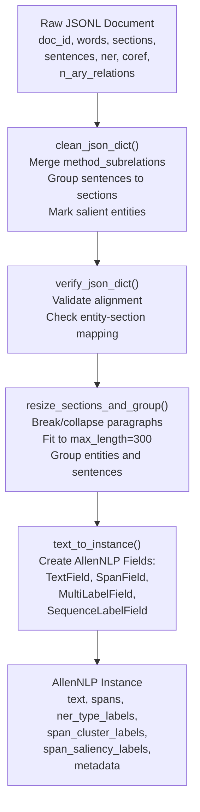

**Sources:** [scirex/data/dataset_readers/scirex_full_reader.py:32-422]()

## ScirexFullReader

The `ScirexFullReader` is the primary dataset reader registered as `"scirex_full_reader"` in the AllenNLP framework. It handles document-level information extraction data and produces instances for multi-task learning.

### Configuration Parameters

| Parameter | Type | Default | Description |
|-----------|------|---------|-------------|
| `token_indexers` | `Dict[str, TokenIndexer]` | None | Tokenizers for converting tokens to indices |
| `max_paragraph_length` | `int` | 300 | Maximum tokens per paragraph (BERT constraint) |
| `lazy` | `bool` | False | Whether to lazily load instances |
| `to_scirex_converter` | `bool` | False | Hack for format conversion to SciERC |

**Sources:** [scirex/data/dataset_readers/scirex_full_reader.py:123-129]()

### Preprocessing Functions

#### clean_json_dict

The `clean_json_dict` function performs critical data transformations before instance creation:

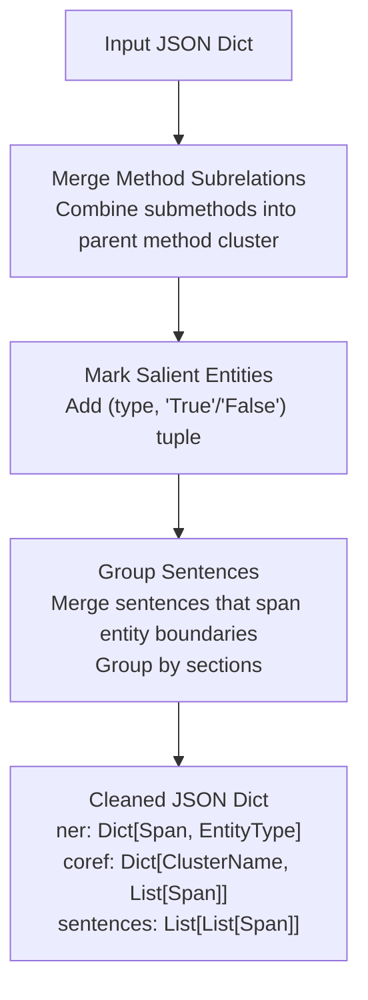

Key operations:

1. **Convert NER to dictionary format**: Transforms `List[Tuple[int, int, BaseEntityType]]` to `Dict[Span, BaseEntityType]` for efficient lookup [scirex/data/dataset_readers/scirex_full_reader.py:34-37]()

2. **Merge method subrelations**: Under the current model, method subrelations are not treated as separate components. Submethod spans are merged into the parent method cluster [scirex/data/dataset_readers/scirex_full_reader.py:54-67]()

3. **Mark salient entities**: Each entity span is augmented with a saliency flag indicating whether it belongs to any coreference cluster: `entities[span] = (entity_type, "True"/"False")` [scirex/data/dataset_readers/scirex_full_reader.py:76-77]()

4. **Handle sentence-entity misalignment**: If an entity spans multiple sentences, those sentences are merged into a single sentence [scirex/data/dataset_readers/scirex_full_reader.py:82-96]()

5. **Group sentences by sections**: Sentences are grouped into their containing sections using `group_sentences_to_sections()` [scirex/data/dataset_readers/scirex_full_reader.py:98-100]()

**Sources:** [scirex/data/dataset_readers/scirex_full_reader.py:32-102]()

#### verify_json_dict

The `verify_json_dict` function validates that the cleaned data satisfies structural constraints:

| Assertion | Description |
|-----------|-------------|
| Entities in sections | Each entity must be contained in exactly one section |
| Entities in sentences | Each entity must be contained in exactly one sentence |
| Section-sentence alignment | Section boundaries must align with sentence boundaries |
| Coreference validity | All spans in coreference clusters must exist in the entity dictionary |

These assertions catch data quality issues early and use `breakpoint()` for debugging when violated [scirex/data/dataset_readers/scirex_full_reader.py:105-119]()

**Sources:** [scirex/data/dataset_readers/scirex_full_reader.py:105-119]()

#### resize_sections_and_group

This critical function handles BERT's 512-token length constraints by dynamically resizing paragraphs:

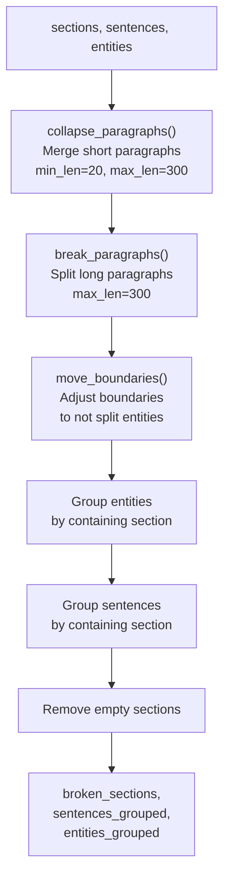

The resizing pipeline:

1. **Collapse short paragraphs**: Paragraphs shorter than 20 tokens are merged with neighbors [scirex/data/dataset_readers/scirex_full_reader.py:248]()

2. **Break long paragraphs**: Paragraphs exceeding 300 tokens are split [scirex/data/dataset_readers/scirex_full_reader.py:247-249]()

3. **Move boundaries**: Boundaries are adjusted to ensure no entity is split across paragraphs [scirex/data/dataset_readers/scirex_full_reader.py:246-251]()

4. **Group entities and sentences**: Each entity and sentence is assigned to exactly one section. Assertions verify that each entity belongs to exactly one paragraph [scirex/data/dataset_readers/scirex_full_reader.py:259-285]()

5. **Remove empty sections**: Sections with zero length are discarded [scirex/data/dataset_readers/scirex_full_reader.py:289-298]()

**Sources:** [scirex/data/dataset_readers/scirex_full_reader.py:243-300]()

### Instance Construction

The `text_to_instance` method converts a paragraph of text into an AllenNLP `Instance` with multiple field types:

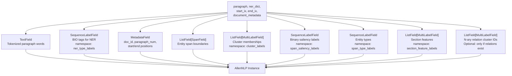

Key aspects of instance construction:

1. **TextField**: Created from paragraph tokens using the provided token indexers [scirex/data/dataset_readers/scirex_full_reader.py:324]()

2. **NER Labels**: Converted to BIO tags using `spans_to_bio_tags()` with offsets adjusted to paragraph-relative positions [scirex/data/dataset_readers/scirex_full_reader.py:340-344]()

3. **Span fields**: Each entity span gets multiple associated fields:
   - `SpanField`: Boundary indices (start, end-1) relative to paragraph [scirex/data/dataset_readers/scirex_full_reader.py:361]()
   - `MultiLabelField` for cluster membership: An entity can belong to multiple clusters [scirex/data/dataset_readers/scirex_full_reader.py:362-368]()
   - Saliency label: Binary indicator (1 if in any cluster, 0 otherwise) [scirex/data/dataset_readers/scirex_full_reader.py:370]()
   - Type label: Entity type (Method, Material, Task, Metric) [scirex/data/dataset_readers/scirex_full_reader.py:371]()
   - Section features: Document structure features from `extract_sentence_features()` [scirex/data/dataset_readers/scirex_full_reader.py:372-374]()

4. **Empty field handling**: Paragraphs without entities receive empty field placeholders to maintain consistent batch shapes [scirex/data/dataset_readers/scirex_full_reader.py:386-406]()

5. **Relation fields**: Only added if n-ary relations exist in the document [scirex/data/dataset_readers/scirex_full_reader.py:408-419]()

**Sources:** [scirex/data/dataset_readers/scirex_full_reader.py:302-421]()

### Document-Level Metadata

The reader maintains document-level information in the metadata field:

| Metadata Key | Type | Description |
|--------------|------|-------------|
| `cluster_name_to_id` | `Dict[ClusterName, int]` | Maps cluster names to integer IDs (0 to num_clusters-1) |
| `span_to_cluster_ids` | `Dict[Span, List[int]]` | Maps each span to list of cluster IDs it belongs to |
| `relation_to_cluster_ids` | `Dict[int, List[int]]` | Maps relation index to tuple of cluster IDs |
| `type_to_cluster_ids` | `Dict[BaseEntityType, List[int]]` | Maps entity types to their cluster IDs |
| `doc_id` | `str` | Document identifier |
| `doc_length` | `int` | Total document word count |
| `entities_to_features_map` | `Dict[Span, List[str]]` | Document structure features per entity |

This metadata enables document-level reasoning across multiple paragraph instances during training and prediction [scirex/data/dataset_readers/scirex_full_reader.py:214-222]()

**Sources:** [scirex/data/dataset_readers/scirex_full_reader.py:166-222]()

## MultiLabelField

The `MultiLabelField` is a custom AllenNLP field type that extends `LabelField` to support multi-label classification where a single instance can have multiple correct labels.

### Design and Operation

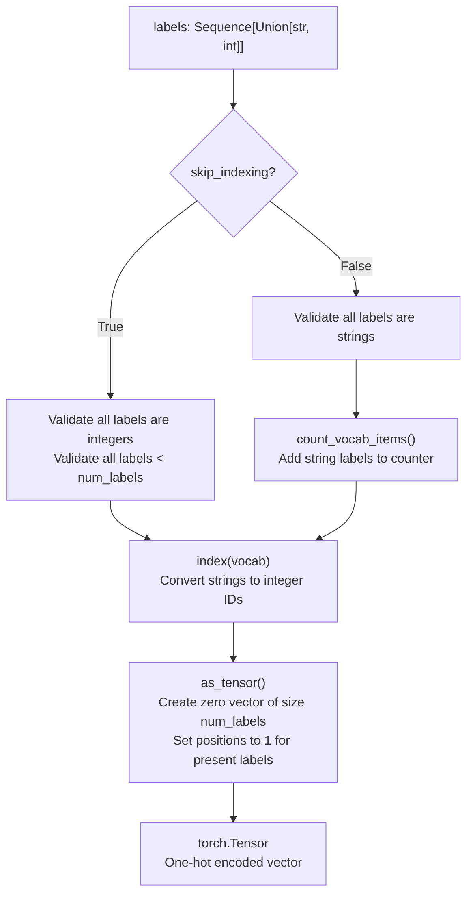

### Key Features

1. **Dual mode operation**: 
   - String mode (`skip_indexing=False`): Labels are strings that need vocabulary indexing [scirex/data/dataset_readers/multi_label_field.py:82-87]()
   - Integer mode (`skip_indexing=True`): Labels are pre-computed integer indices [scirex/data/dataset_readers/multi_label_field.py:66-81]()

2. **One-hot encoding**: The `as_tensor()` method creates a vector of zeros with size `num_labels`, then uses `scatter_()` to set positions corresponding to the labels to 1 [scirex/data/dataset_readers/multi_label_field.py:122-130]()

3. **Namespace warnings**: The field logs warnings if the namespace doesn't end with "labels" or "tags", as these namespaces avoid UNK/PAD tokens [scirex/data/dataset_readers/multi_label_field.py:89-99]()

4. **Empty field support**: Can create empty fields with no labels for consistent batch shapes [scirex/data/dataset_readers/multi_label_field.py:133-136]()

### Usage in SciREX

`MultiLabelField` is used for three purposes in the SciREX reader:

1. **Cluster labels**: Entities can belong to multiple coreference clusters simultaneously [scirex/data/dataset_readers/scirex_full_reader.py:362-368]()

2. **Section features**: Multiple document structure features per entity [scirex/data/dataset_readers/scirex_full_reader.py:372-374]()

3. **Relation cluster IDs**: Representing n-ary relations as tuples of cluster IDs [scirex/data/dataset_readers/scirex_full_reader.py:409-418]()

**Sources:** [scirex/data/dataset_readers/multi_label_field.py:1-145]()

## Coreference Readers

The system includes two specialized readers for training and evaluating pairwise coreference models.

### ScirexCoreferenceTrainReader

Registered as `"scirex_coreference_train_reader"`, this reader generates pairwise training examples for coreference resolution:

```mermaid
graph TB
    Input["JSONL Document<br/>ner, coref, words"]
    ExtractEnt["Extract all NER entities"]
    ComputeClusters["Compute span-to-clusters mapping"]
    GenPairs["Generate all entity pairs<br/>with same type"]
    DetermineLabel["Determine labels:<br/>1: same cluster or same text<br/>0: different clusters<br/>skip: no cluster membership"]
    CountLabels["Count label distribution"]
    ComputeProb["Compute keep_prob<br/>to balance classes"]
    Sample["Sample training pairs<br/>based on keep_prob"]
    Format["Format as '[CLS] type1 text1 [SEP] type2 text2'"]
    CreateFields["Create TextField and LabelField"]
    Output["Instance with<br/>tokens, label, metadata"]
    
    Input --> ExtractEnt
    ExtractEnt --> ComputeClusters
    ComputeClusters --> GenPairs
    GenPairs --> DetermineLabel
    DetermineLabel --> CountLabels
    CountLabels --> ComputeProb
    ComputeProb --> Sample
    Sample --> Format
    Format --> CreateFields
    CreateFields --> Output
```

Key aspects:

1. **Pair generation**: Creates all combinations of entity pairs with matching types [scirex/data/dataset_readers/coreference_train_reader.py:64-67]()

2. **Label assignment**:
   - Label 1: Same cluster membership or exact text match (lowercased) [scirex/data/dataset_readers/coreference_train_reader.py:78-79]()
   - Label 0: Disjoint cluster memberships [scirex/data/dataset_readers/coreference_train_reader.py:82-83]()
   - Skip: Neither entity belongs to any cluster [scirex/data/dataset_readers/coreference_train_reader.py:80-81]()

3. **Class balancing**: Computes sampling probabilities to equalize class distribution during training [scirex/data/dataset_readers/coreference_train_reader.py:37-39]()

4. **Input format**: Pairs are formatted as `"[CLS] {type} {text1} [SEP] {type} {text2}"` for BERT-based models [scirex/data/dataset_readers/coreference_train_reader.py:100-101]()

**Sources:** [scirex/data/dataset_readers/coreference_train_reader.py:1-114]()

### ScirexCoreferenceEvalReader

Used for evaluation, this reader generates pairs based on specific criteria:

```mermaid
graph TB
    Input["JSONL Document<br/>NER entities, words"]
    Filter["Filter entities by field parameter"]
    GenPairs["Generate entity combinations"]
    TypeCheck["Keep only if:<br/>- Same entity type OR<br/>- Same text (case-insensitive)"]
    Format["Format as '[CLS] type1 text1 [SEP] type2 text2'"]
    StoreMetadata["Store span indices and doc_id"]
    Output["Instance with<br/>tokens, metadata<br/>(no labels)"]
    
    Input --> Filter
    Filter --> GenPairs
    GenPairs --> TypeCheck
    TypeCheck --> Format
    Format --> StoreMetadata
    StoreMetadata --> Output
```

Differences from training reader:

1. **Field-specific**: Can filter to specific entity types via the `field` parameter [scirex/data/dataset_readers/coreference_eval_reader.py:20]()

2. **Selection criteria**: Includes pairs with same type OR same text [scirex/data/dataset_readers/coreference_eval_reader.py:52]()

3. **No labels**: Does not assign gold labels (for prediction-only use) [scirex/data/dataset_readers/coreference_eval_reader.py:66-90]()

4. **Metadata storage**: Stores span indices and document ID for result aggregation [scirex/data/dataset_readers/coreference_eval_reader.py:53-58]()

**Sources:** [scirex/data/dataset_readers/coreference_eval_reader.py:1-91]()

## Data Processing Utilities

The readers depend on several utility modules imported at the top of `scirex_full_reader.py`:

| Utility Module | Key Functions | Purpose |
|----------------|---------------|---------|
| `paragraph_alignment` | `group_sentences_to_sections()`, `collapse_paragraphs()`, `break_paragraphs()`, `move_boundaries()` | Paragraph resizing and alignment [scirex/data/dataset_readers/scirex_full_reader.py:19]() |
| `section_feature_extraction` | `extract_sentence_features()` | Extract document structure features [scirex/data/dataset_readers/scirex_full_reader.py:20]() |
| `span_utils` | `does_overlap()`, `is_x_in_y()`, `spans_to_bio_tags()` | Span manipulation and validation [scirex/data/dataset_readers/scirex_full_reader.py:21]() |
| `entity_utils` | `used_entities` | List of valid entity types [scirex/data/dataset_readers/scirex_full_reader.py:22]() |

These utilities are documented in their respective modules under `scirex/data/utils/`.

**Sources:** [scirex/data/dataset_readers/scirex_full_reader.py:19-22]()

## Reading Pipeline Summary

The complete data reading pipeline can be summarized as:

```mermaid
graph LR
    Raw["Raw JSONL<br/>train/dev/test.jsonl"]
    Clean["clean_json_dict<br/>merge subrelations<br/>mark saliency<br/>group sentences"]
    Verify["verify_json_dict<br/>validate structure"]
    Resize["resize_sections_and_group<br/>fit BERT constraints"]
    Split["Split by paragraph<br/>create multiple instances<br/>per document"]
    Instance["AllenNLP Instances<br/>TextField, SpanField,<br/>MultiLabelField,<br/>SequenceLabelField"]
    
    Raw --> Clean
    Clean --> Verify
    Verify --> Resize
    Resize --> Split
    Split --> Instance
```

Each document may produce multiple instances (one per paragraph), with document-level metadata maintained across all instances from the same document. This design allows BERT-based models to process long scientific papers while maintaining document-level context through metadata.

**Sources:** [scirex/data/dataset_readers/scirex_full_reader.py:140-241]()

---

# Page: Annotation Guidelines and Statistics

# Annotation Guidelines and Statistics

<details>
<summary>Relevant source files</summary>

The following files were used as context for generating this wiki page:

- [Annotation Guidelines.pdf](Annotation Guidelines.pdf)
- [notebooks/Annotation Statistics.ipynb](notebooks/Annotation Statistics.ipynb)
- [notebooks/Fuzzy Matching Threshold.ipynb](notebooks/Fuzzy Matching Threshold.ipynb)

</details>


## Purpose and Scope

This page documents the annotation process used to create the SciREX dataset, including the guidelines provided to annotators and statistical analyses of annotation quality and inter-annotator agreement. This complements the data format specification covered in [2.1](#2.1) and focuses on the human annotation process and quality metrics.

For information about how the annotated data is loaded and processed by the system, see [2.2](#2.2).

## Annotation Guidelines

The annotation process for SciREX is documented in the `Annotation Guidelines.pdf` file, which provides detailed instructions for annotators on how to identify and label scientific entities and their relationships in research papers.

### Annotation Workflow

```mermaid
graph LR
    Papers["Research Papers<br/>(Semantic Scholar)"]
    BRAT["BRAT Annotation Tool"]
    Round1["Initial Annotation<br/>Round 1"]
    Round2["Propagated Annotation<br/>Round 2"]
    Final["Final Dataset<br/>train/dev/test.jsonl"]
    
    Papers --> BRAT
    BRAT --> Round1
    Round1 --> Round2
    Round2 --> Final
    
    Round1 -.comparison.-> Round2
```

**Diagram: Annotation Workflow Pipeline**

The annotation process involves multiple rounds:
1. **Initial annotation**: Annotators identify entities and relations in research papers
2. **Propagation**: Annotations are propagated across coreference clusters
3. **Review round**: A second round compares and refines annotations
4. **Final dataset**: Consolidated annotations are exported to JSONL format

**Sources:** [Annotation Guidelines.pdf:1-200](), [notebooks/Annotation Statistics.ipynb:32-34]()

### Entity Types

Annotators label four primary entity types as defined in the `used_entities` list:

| Entity Type | Description | Example |
|------------|-------------|---------|
| **Method** | Techniques, algorithms, or approaches | "BERT", "attention mechanism" |
| **Task** | Research problems or objectives | "machine translation", "sentiment analysis" |
| **Material** | Datasets, corpora, or resources | "ImageNet", "WMT14 dataset" |
| **Metric** | Evaluation measures | "BLEU score", "F1 measure" |

**Sources:** [notebooks/Annotation Statistics.ipynb:23]()

### Coreference and Relation Annotation

Beyond entity identification, annotators:
- Link coreferent mentions into clusters (e.g., "our model", "the proposed approach", "it")
- Annotate n-ary relations between entity clusters
- Include method subrelations for compositional methods

**Sources:** [notebooks/Annotation Statistics.ipynb:43-59]()

## Inter-Annotator Agreement Statistics

### Entity Type Agreement

The following confusion matrix shows agreement between original and revised annotations across 440 documents, measuring how entity type assignments changed between annotation rounds:

```mermaid
graph TD
    subgraph "Annotation Comparison Framework"
        Original["Original Annotations<br/>all_data_original_propagated.jsonl"]
        Revised["Revised Annotations<br/>all_data_propagated.jsonl"]
        Matcher["span_match()<br/>IOU-based matching"]
        Stats["Confusion Matrix<br/>Entity Type Agreement"]
        
        Original --> Matcher
        Revised --> Matcher
        Matcher --> Stats
    end
```

**Diagram: Inter-Annotator Agreement Analysis Pipeline**

**Sources:** [notebooks/Annotation Statistics.ipynb:10-14](), [notebooks/Annotation Statistics.ipynb:68-99]()

#### Entity Type Confusion Matrix

The following table shows the percentage of entity mentions by type in original annotations (rows) and how they were classified in revised annotations (columns):

| Original | Material | Metric | Task | Method | None |
|----------|----------|--------|------|--------|------|
| **Material** | 3.55% | 0.01% | 0.07% | 0.16% | 0.03% |
| **Metric** | 0.02% | 7.95% | 0.00% | 0.03% | 0.00% |
| **Task** | 0.32% | 0.07% | 17.92% | 0.44% | 0.01% |
| **Method** | 0.65% | 0.21% | 0.24% | 53.27% | 0.02% |
| **None** | 2.40% | 1.30% | 2.82% | 8.50% | 0.00% |

**Key observations:**
- **High agreement on main types**: Material (3.55%), Metric (7.95%), Task (17.92%), Method (53.27%)
- **Method dominance**: Method entities comprise 62.4% of all annotations
- **Low disagreement**: "None" row shows entities added in revision (15.02% total new entities)
- **Strong diagonal**: Most entities retain their original type assignment

**Sources:** [notebooks/Annotation Statistics.ipynb:117-135](), [notebooks/Annotation Statistics.ipynb:158-188]()

### Coreference Link Changes

The analysis tracks how coreference cluster assignments changed between annotation rounds:

```mermaid
graph LR
    subgraph "Link Change Analysis"
        ExistSpan["Existing Span<br/>(matched across rounds)"]
        NewSpan["New Span<br/>(added in revision)"]
        
        ExistSpan --> LinkAdded["+: Link Added"]
        ExistSpan --> LinkRemoved["-: Link Removed"]
        NewSpan --> NewLink["+: New Span Linked"]
    end
```

**Diagram: Coreference Link Change Categories**

**Sources:** [notebooks/Annotation Statistics.ipynb:196-226]()

#### Coreference Modification Statistics

| Entity Type | Exist (+) | Exist (-) | New (+) | New (-) |
|-------------|-----------|-----------|---------|---------|
| **Material** | 1.2% | 0.8% | 6.8% | 0.0% |
| **Metric** | 0.4% | 1.2% | 2.8% | 0.0% |
| **Task** | 0.9% | 1.6% | 5.4% | 0.0% |
| **Method** | 1.7% | 14.0% | 8.0% | 0.0% |

**Legend:**
- **Exist (+)**: Existing spans with new coreference links added
- **Exist (-)**: Existing spans with coreference links removed
- **New (+)**: Newly annotated spans that were linked to clusters
- **New (-)**: Newly annotated spans without links (always 0%)

**Key findings:**
- Average of **12.4% of spans modified** per document (1,968 total changes / 440 docs / 360 avg spans)
- Method entities show highest modification rate (23.7% of changes)
- Link removal most common for Methods (14.0%), indicating refinement of over-connected clusters
- New span linking (22.0%) indicates annotation completeness improvements

**Sources:** [notebooks/Annotation Statistics.ipynb:243-252](), [notebooks/Annotation Statistics.ipynb:256-301]()

## Relation Statistics

### N-ary Relation Distribution

The dataset contains relations of varying cardinality (2-ary, 3-ary, and 4-ary):

```mermaid
graph TB
    subgraph "Relation Analysis Pipeline"
        Relations["n_ary_relations"]
        Coref["coref clusters"]
        Sections["sections"]
        Sentences["sentences"]
        
        Relations --> Analysis["Relation Analysis<br/>stats_for_relation()"]
        Coref --> Analysis
        Sections --> Analysis
        Sentences --> Analysis
        
        Analysis --> InSection["In-Section<br/>Relations"]
        Analysis --> OutSection["Cross-Section<br/>Relations"]
        Analysis --> InSentence["In-Sentence<br/>Relations"]
        Analysis --> OutSentence["Cross-Sentence<br/>Relations"]
    end
```

**Diagram: N-ary Relation Scope Analysis**

The function `map_to_section_and_sentence()` maps each entity mention to its containing section and sentence, enabling analysis of relation scope.

**Sources:** [notebooks/Annotation Statistics.ipynb:305-358](), [notebooks/Annotation Statistics.ipynb:386-418]()

### Relation Scope Statistics

Average number of relations per document by cardinality and scope:

| n-ary | In Section | In Sentence | Out Section | Out Sentence |
|-------|------------|-------------|-------------|--------------|
| **2-ary** | 12.380 | 6.630 | 16.980 | 22.730 |
| **3-ary** | 4.955 | 0.591 | 14.618 | 18.982 |
| **4-ary** | 0.707 | 0.011 | 4.186 | 4.882 |

**Key insights:**
- **2-ary relations**: 29.36 per document (most common)
- **3-ary relations**: 19.57 per document  
- **4-ary relations**: 5.59 per document (least common)
- **Cross-sentence relations dominate**: 77.5% of 2-ary, 97.0% of 3-ary, 99.3% of 4-ary relations span multiple sentences
- **Section-level scope**: Higher cardinality relations are increasingly distributed across sections

This distribution reflects the complexity of scientific discourse, where multi-hop reasoning across sentences and sections is necessary to extract complete research findings.

**Sources:** [notebooks/Annotation Statistics.ipynb:436-463](), [notebooks/Annotation Statistics.ipynb:488-491]()

### Unique Relation Extraction

To compute distinct relations (avoiding double-counting from entity type combinations):

```python
# From notebook cell [26-28]
def stats_for_relation(data):
    n_ary_relations = data['n_ary_relations']
    for card in range(2, 5):
        rels = []
        for elist in combinations(used_entities, card):
            for rel in n_ary_relations:
                rel = [rel[k] for k in elist]
                rels.append(tuple(rel))
        rels = set(rels)  # Deduplicate
        stats[card] = len(rels)
```

This deduplication ensures each unique cluster tuple is counted once, regardless of which entity type combinations it appears in.

**Sources:** [notebooks/Annotation Statistics.ipynb:540-557](), [notebooks/Annotation Statistics.ipynb:572-577]()

## Statistical Code Implementations

### Entity Span Matching

The `span_match()` function computes Intersection over Union (IoU) between spans:

```python
def span_match(span_1, span_2):
    sa, ea = span_1
    sb, eb = span_2
    iou = (min(ea, eb) - max(sa, sb)) / (max(eb, ea) - min(sa, sb))
    return iou
```

Spans are considered matching if `iou > 0.5`, allowing for minor boundary differences while requiring substantial overlap.

**Sources:** [notebooks/Annotation Statistics.ipynb:10-14]()

### Confusion Matrix Computation

The `matching()` function computes entity type agreement:

```python
def matching(spans_1, spans_2):
    match = np.zeros((len(spans_1), len(spans_2)))
    match_types = {k + '_1':{l + '_2':0 for l in ents} for k in ents}
    
    # Exact span matching
    for i, s1 in enumerate(spans_1):
        for j, s2 in enumerate(spans_2):
            if (s1[0], s1[1]) == (s2[0], s2[1]):
                match[i, j] = 1
    
    # Aggregate type agreements
    # ... (counting logic)
    return match_types
```

This strict exact-match approach ensures only identical span boundaries are compared for type agreement.

**Sources:** [notebooks/Annotation Statistics.ipynb:68-99]()

### Coreference Link Analysis

The `matching_links()` function tracks coreference changes:

```python
def matching_links(spans_1, spans_2, links_1, links_2):
    # Match spans with IoU > 0.5
    for i, s1 in enumerate(spans_1):
        for j, s2 in enumerate(spans_2):
            if span_match((s1[0], s1[1]), (s2[0], s2[1])) > 0.5:
                match[i, j] = 1
    
    # Compare cluster membership
    for matched_span:
        new_links = links_2.get(span, set())
        old_links = links_1.get(span, set())
        match_types[type]['Exist']['+'] += len(new_links - old_links) > 0
        match_types[type]['Exist']['-'] += len(old_links - new_links) > 0
```

This uses fuzzy matching (IoU > 0.5) to handle minor span boundary variations while tracking precise cluster membership changes.

**Sources:** [notebooks/Annotation Statistics.ipynb:196-226]()

## Summary

The SciREX annotation process produced a high-quality dataset with:
- **Strong entity type agreement**: 82.7% of entities retained original types
- **Controlled coreference refinement**: 12.4% modification rate shows iterative improvement
- **Complex relation structure**: Average of 54.5 relations per document across 2-4 entity clusters
- **Cross-sentence reasoning**: 77-99% of relations require multi-sentence inference
- **Rigorous guidelines**: Documented in `Annotation Guidelines.pdf` for reproducibility

These statistics demonstrate the dataset's suitability for document-level information extraction research, with substantial inter-annotator agreement and rich relational structure that captures scientific discourse complexity.

**Sources:** [Annotation Guidelines.pdf:1-200](), [notebooks/Annotation Statistics.ipynb:1-577]()

---

# Page: Model Architecture

# Model Architecture

<details>
<summary>Relevant source files</summary>

The following files were used as context for generating this wiki page:

- [README.md](README.md)
- [dygiepp/dygie/models/dygie.py](dygiepp/dygie/models/dygie.py)
- [dygiepp/scripts/train/train_pwc.sh](dygiepp/scripts/train/train_pwc.sh)
- [requirements.txt](requirements.txt)
- [scirex/data/utils/scirex_to_scierc_format.py](scirex/data/utils/scirex_to_scierc_format.py)
- [scirex/models/scirex_model.py](scirex/models/scirex_model.py)
- [scirex/predictors/utils.py](scirex/predictors/utils.py)

</details>


This document provides a technical overview of the neural network architectures used in the SciREX system for document-level information extraction. It covers the primary `ScirexModel` multi-task architecture, its component modules, and the data flow through the model during training and inference.

For details on training procedures and configuration parameters, see [Training](#4). For information on how models generate predictions, see [Prediction Pipeline](#5.1). For detailed documentation of individual component models, see [Component Models](#3.2).

## Overview

The SciREX system employs a multi-task learning architecture that jointly learns three information extraction tasks:

| Task | Purpose | Output |
|------|---------|--------|
| **Named Entity Recognition (NER)** | Identify typed entity mentions at the token level | Span boundaries and entity types (Method, Task, Material, Metric) |
| **Saliency Classification** | Identify which entity mentions are salient to the document | Binary classification per span |
| **N-ary Relation Extraction** | Predict relations between entity clusters | 4-ary tuples of entity clusters |

The architecture is implemented primarily in the `ScirexModel` class ([scirex/models/scirex_model.py:25-442]()), which extends AllenNLP's `Model` base class. The model processes entire document paragraphs (up to 300 words) and produces predictions for all three tasks simultaneously.

**Sources:** [scirex/models/scirex_model.py](), [README.md:40-46]()

## Core Architecture Components

### ScirexModel Class Structure

The following diagram maps the main components of `ScirexModel` to their code locations:

```mermaid
graph TB
    subgraph ScirexModel["ScirexModel (scirex_model.py:25)"]
        Init["__init__<br/>(lines 26-70)"]
        Forward["forward()<br/>(lines 73-117)"]
        
        subgraph Embeddings["Embedding Components"]
            TextEmbed["_text_field_embedder<br/>TextFieldEmbedder"]
            Context["_context_layer<br/>Seq2SeqEncoder"]
            Dropout["_lexical_dropout<br/>Dropout(p=0.2)"]
        end
        
        subgraph SpanExtraction["Span Extraction (lines 54-57)"]
            EndpointExt["_endpoint_span_extractor<br/>EndpointSpanExtractor"]
            AttentiveExt["_attentive_span_extractor<br/>SelfAttentiveSpanExtractor"]
        end
        
        subgraph TaskModules["Task-Specific Modules"]
            NER["_ner<br/>NERTagger (line 46)"]
            Saliency["_saliency_classifier<br/>SpanClassifier (line 47-49)"]
            Relations["_cluster_n_ary_relation<br/>NAryRelationExtractor (line 50-52)"]
        end
        
        subgraph LossWeights["Loss Management"]
            Weights["_loss_weights<br/>Dict[str, float]"]
            Metrics["_multi_task_loss_metrics<br/>Dict[str, Average]"]
        end
        
        Init --> Embeddings
        Init --> SpanExtraction
        Init --> TaskModules
        Init --> LossWeights
        
        Forward --> Embeddings
        Forward --> SpanExtraction
        Forward --> TaskModules
    end
```

**Sources:** [scirex/models/scirex_model.py:25-70]()

### Initialization Parameters

The `ScirexModel.__init__()` method accepts the following key parameters:

| Parameter | Type | Purpose |
|-----------|------|---------|
| `vocab` | `Vocabulary` | AllenNLP vocabulary for label indexing |
| `text_field_embedder` | `TextFieldEmbedder` | Typically SciBERT embeddings |
| `context_layer` | `Seq2SeqEncoder` | Contextual encoder (LSTM/Transformer) |
| `modules` | `Params` | Configuration for NER, saliency, and relation modules |
| `loss_weights` | `Dict[str, int]` | Weights for multi-task loss: `{"ner": nw, "saliency": lw, "n_ary_relation": rw}` |
| `lexical_dropout` | `float` | Dropout rate applied to embeddings (default: 0.2) |

**Sources:** [scirex/models/scirex_model.py:26-37]()

## Data Flow Through the Model

### Forward Pass Architecture

The `forward()` method orchestrates the multi-task learning process. The following diagram shows the data flow:

```mermaid
flowchart TD
    Input["Input Batch<br/>text, spans, labels"]
    
    EmbedForward["embedding_forward()<br/>(lines 119-154)"]
    
    TextEmbed["_text_field_embedder<br/>+ _lexical_dropout"]
    ContextLayer["_context_layer<br/>Seq2SeqEncoder"]
    
    NERForward["ner_forward()<br/>(lines 156-168)"]
    SpanEmbedForward["span_embeddings_forward()<br/>(lines 170-202)"]
    
    SaliencyRelForward["saliency_and_relation_forward()<br/>(lines 258-298)"]
    
    subgraph TaskOutputs["Task Outputs"]
        NERLoss["NER Loss<br/>weighted by loss_weights['ner']"]
        SaliencyLoss["Saliency Loss<br/>weighted by loss_weights['saliency']"]
        RelationLoss["N-ary Relation Loss<br/>weighted by loss_weights['n_ary_relation']"]
    end
    
    TotalLoss["Total Loss = sum of weighted losses"]
    
    Input --> EmbedForward
    EmbedForward --> TextEmbed
    TextEmbed --> ContextLayer
    ContextLayer --> NERForward
    ContextLayer --> SpanEmbedForward
    
    NERForward --> NERLoss
    SpanEmbedForward --> SaliencyRelForward
    SaliencyRelForward --> SaliencyLoss
    SaliencyRelForward --> RelationLoss
    
    NERLoss --> TotalLoss
    SaliencyLoss --> TotalLoss
    RelationLoss --> TotalLoss
```

**Sources:** [scirex/models/scirex_model.py:73-117]()

### Embedding Forward Pass

The `embedding_forward()` method ([scirex/models/scirex_model.py:119-154]()) processes raw text into contextualized embeddings:

```mermaid
graph LR
    Input["text: TextField"]
    Embed["_text_field_embedder<br/>(SciBERT)"]
    Dropout["_lexical_dropout"]
    Flatten["Flatten to 1D"]
    Filter["Filter valid tokens"]
    Context["_context_layer<br/>(Seq2SeqEncoder)"]
    Unflatten["Reshape to batch"]
    Output["Output Dict:<br/>contextualised, text,<br/>mask, lengths"]
    
    Input --> Embed
    Embed --> Dropout
    Dropout --> Flatten
    Flatten --> Filter
    Filter --> Context
    Context --> Unflatten
    Unflatten --> Output
```

The output dictionary contains:
- `"contextualised"`: Contextualized embeddings with shape `(batch_size, max_length, encoding_dim)`
- `"text"`: Original text embeddings
- `"mask"`: Attention mask indicating valid positions
- `"lengths"`: Sentence lengths for each batch element

**Sources:** [scirex/models/scirex_model.py:119-154]()

### Span Embedding Extraction

The `span_embeddings_forward()` method ([scirex/models/scirex_model.py:170-202]()) extracts and enriches span representations:

```mermaid
flowchart TD
    ContextEmbed["Contextualized Embeddings"]
    Spans["Candidate Spans"]
    
    ExtractSpans["extract_span_embeddings()<br/>(lines 330-336)"]
    
    subgraph SpanExtractors["Dual Span Extraction"]
        Endpoint["_endpoint_span_extractor<br/>Concatenate start & end"]
        Attentive["_attentive_span_extractor<br/>Attention over span tokens"]
    end
    
    Concat1["Concatenate:<br/>endpoint + attentive"]
    
    Offset["offset_span_by_para_start()<br/>(lines 322-328)<br/>Adjust to document coordinates"]
    
    Position["get_span_position()<br/>(lines 316-319)<br/>Normalized position in doc"]
    
    TypeOneHot["get_span_one_hot_labels()<br/>(lines 300-306)<br/>One-hot entity type"]
    
    FeatureConcat["Concatenate:<br/>position + type + custom features"]
    
    FinalConcat["featured_span_embeddings:<br/>span_embeddings + features"]
    
    Output["Output Dict:<br/>spans, span_embeddings,<br/>featured_span_embeddings,<br/>span_mask, span_ix"]
    
    ContextEmbed --> ExtractSpans
    Spans --> ExtractSpans
    
    ExtractSpans --> Endpoint
    ExtractSpans --> Attentive
    
    Endpoint --> Concat1
    Attentive --> Concat1
    
    Concat1 --> Offset
    Offset --> Position
    Offset --> TypeOneHot
    
    Position --> FeatureConcat
    TypeOneHot --> FeatureConcat
    Spans --> FeatureConcat
    
    Concat1 --> FinalConcat
    FeatureConcat --> FinalConcat
    
    FinalConcat --> Output
```

The span extraction uses two complementary methods:
- **EndpointSpanExtractor** ([scirex/models/scirex_model.py:54-56]()): Concatenates the embeddings at span boundaries with `combination="x,y"`
- **SelfAttentiveSpanExtractor** ([scirex/models/scirex_model.py:57]()): Applies attention mechanism over tokens within the span

**Sources:** [scirex/models/scirex_model.py:170-202](), [scirex/models/scirex_model.py:330-336]()

## Task-Specific Modules

### NER Module

The NER module is implemented via the `NERTagger` class and processes token sequences:

```mermaid
graph TB
    Context["Contextualized Embeddings<br/>(batch_size, seq_len, hidden_dim)"]
    
    NERModule["_ner: NERTagger<br/>(from ner_crf_tagger.py)"]
    
    NERForward["ner_forward()<br/>(lines 156-168)"]
    
    CRF["CRF Layer<br/>BIOUL tagging scheme"]
    
    Decode["decode() in prediction mode<br/>Converts tags to spans"]
    
    Output["Output:<br/>loss, spans, span_labels"]
    
    Context --> NERForward
    NERForward --> NERModule
    NERModule --> CRF
    CRF --> Decode
    Decode --> Output
```

During training, the NER module computes a CRF loss. During prediction (`prediction_mode=True`), it decodes the tag sequence into spans with entity types ([scirex/models/scirex_model.py:163-166]()).

**Sources:** [scirex/models/scirex_model.py:156-168](), [scirex/models/scirex_model.py:46]()

### Saliency Classifier

The saliency classifier determines which entity mentions are salient (important) to the document:

```mermaid
graph LR
    SpanEmbed["featured_span_embeddings"]
    SpanFeatures["span_features<br/>(position, type, custom)"]
    
    Classifier["_saliency_classifier<br/>SpanClassifier"]
    
    Binary["Binary Classification<br/>Salient vs Non-salient"]
    
    Loss["Binary Cross-Entropy Loss"]
    
    SpanEmbed --> Classifier
    SpanFeatures --> Classifier
    Classifier --> Binary
    Binary --> Loss
```

The saliency classifier is a `SpanClassifier` instance ([scirex/models/scirex_model.py:47-49]()) that performs binary classification on each span. The output is used by the relation extractor to focus on salient entities.

**Sources:** [scirex/models/scirex_model.py:204-229](), [scirex/models/scirex_model.py:47-49]()

### N-ary Relation Extractor

The relation extractor predicts 4-ary relations between entity clusters:

```mermaid
flowchart TD
    SpanEmbed["featured_span_embeddings"]
    CorefLabels["span_cluster_labels<br/>(multi-label: spans can belong to multiple clusters)"]
    
    TypeToClusters["type_to_cluster_ids<br/>Maps entity types to cluster IDs"]
    RelationTemplate["relation_to_cluster_ids<br/>Expected relation structures"]
    
    RelationModule["_cluster_n_ary_relation<br/>NAryRelationExtractor"]
    
    ComputeRep["compute_representations()<br/>(lines 248-254)"]
    
    ClusterEmbed["Aggregate span embeddings<br/>to cluster embeddings"]
    
    Scoring["Score candidate relations<br/>4-tuple: (Method, Task, Material, Metric)"]
    
    Loss["Relation Classification Loss"]
    
    SpanEmbed --> ComputeRep
    CorefLabels --> ComputeRep
    TypeToClusters --> ComputeRep
    RelationTemplate --> ComputeRep
    
    ComputeRep --> RelationModule
    RelationModule --> ClusterEmbed
    ClusterEmbed --> Scoring
    Scoring --> Loss
```

The relation extractor operates on **cluster-level** rather than span-level representations. It aggregates span embeddings within each coreference cluster and scores candidate 4-ary relations between clusters ([scirex/models/scirex_model.py:248-254]()).

**Sources:** [scirex/models/scirex_model.py:231-256](), [scirex/models/scirex_model.py:50-52]()

## Multi-Task Loss Computation

The total loss is a weighted sum of task-specific losses:

```mermaid
graph TB
    subgraph Losses["Individual Task Losses"]
        L_ner["L_ner<br/>(CRF loss)"]
        L_sal["L_saliency<br/>(Binary CE loss)"]
        L_rel["L_n_ary_relation<br/>(Relation classification loss)"]
    end
    
    subgraph Weights["Loss Weights (configurable)"]
        W_ner["loss_weights['ner']<br/>(default: nw)"]
        W_sal["loss_weights['saliency']<br/>(default: lw)"]
        W_rel["loss_weights['n_ary_relation']<br/>(default: rw)"]
    end
    
    Weighted["Weighted Loss Computation"]
    
    Total["Total Loss =<br/>nw × L_ner +<br/>lw × L_saliency +<br/>rw × L_n_ary_relation"]
    
    L_ner --> Weighted
    L_sal --> Weighted
    L_rel --> Weighted
    
    W_ner --> Weighted
    W_sal --> Weighted
    W_rel --> Weighted
    
    Weighted --> Total
```

The loss computation occurs in the `forward()` method ([scirex/models/scirex_model.py:92-109]()):

```python
loss = 0.0
if self._loss_weights["ner"] > 0.0:
    loss += self._loss_weights["ner"] * output_dict["ner"]["loss"]
if self._loss_weights["saliency"] > 0.0:
    loss += self._loss_weights["saliency"] * output_dict["saliency"]["loss"]
if self._loss_weights["n_ary_relation"] > 0.0:
    loss += self._loss_weights["n_ary_relation"] * output_dict["n_ary_relation"]["loss"]
```

Loss weights can be set to 0 to disable specific tasks during training, enabling task-specific training or ablation studies.

**Sources:** [scirex/models/scirex_model.py:92-109](), [scirex/models/scirex_model.py:59-62]()

## Coordinate Systems and Offset Handling

The model operates on paragraph-level inputs but maintains document-level coordinate systems for evaluation:

```mermaid
graph LR
    subgraph Document["Full Document Space"]
        DocCoords["Document Coordinates<br/>(0 to doc_length)"]
    end
    
    subgraph Paragraph["Paragraph Input Space"]
        ParaCoords["Paragraph Coordinates<br/>(0 to para_length ≤ 300)"]
    end
    
    Metadata["metadata['start_pos_in_doc']<br/>Paragraph offset in document"]
    
    OffsetFunc["offset_span_by_para_start()<br/>(lines 322-328)"]
    
    ParaCoords --> OffsetFunc
    Metadata --> OffsetFunc
    OffsetFunc --> DocCoords
    
    style Metadata fill:#f9f9f9
```

The `offset_span_by_para_start()` method ([scirex/models/scirex_model.py:322-328]()) converts paragraph-relative span coordinates to document-relative coordinates by adding the paragraph's start position. This is critical for maintaining alignment between predictions across different paragraphs of the same document.

**Sources:** [scirex/models/scirex_model.py:322-328](), [scirex/models/scirex_model.py:179]()

## Prediction Mode vs Training Mode

The model has two operational modes controlled by boolean flags:

| Mode | Flag | Behavior |
|------|------|----------|
| **Training** | `training_mode = True` | Computes losses, updates metrics |
| **Prediction** | `prediction_mode = True` | Decodes outputs to human-readable formats, skips loss computation |

In prediction mode ([scirex/models/scirex_model.py:163-166]()):
- NER predictions are decoded from BIOUL tags to spans
- Saliency scores are thresholded to produce binary labels
- Relation predictions are converted from cluster IDs to entity names

**Sources:** [scirex/models/scirex_model.py:67-68](), [scirex/models/scirex_model.py:163-166]()

## Metrics and Validation

The model tracks metrics for each task via the `get_metrics()` method ([scirex/models/scirex_model.py:389-434]()):

```mermaid
graph TB
    subgraph TaskMetrics["Task-Specific Metrics"]
        NERMetrics["NER Metrics<br/>ner_f1-measure"]
        SaliencyMetrics["Saliency Metrics<br/>span_f1"]
        RelationMetrics["N-ary Relation Metrics<br/>n_ary_rel_global_1.f1-score"]
    end
    
    subgraph LossMetrics["Loss Tracking"]
        LossNER["loss_ner"]
        LossSaliency["loss_saliency"]
        LossRelation["loss_n_ary_relation"]
    end
    
    ValidationMetric["validation_metric =<br/>weighted sum of F1 scores"]
    
    NERMetrics --> ValidationMetric
    SaliencyMetrics --> ValidationMetric
    RelationMetrics --> ValidationMetric
    
    style ValidationMetric fill:#f9f9f9
```

The validation metric ([scirex/models/scirex_model.py:415-420]()) combines weighted F1 scores from all tasks:

```python
all_metrics["validation_metric"] = (
    self._loss_weights["ner"] * nan_to_zero(metrics_ner.get("ner_f1-measure", 0))
    + self._loss_weights["saliency"] * nan_to_zero(metrics_saliency.get("span_f1", 0))
    + self._loss_weights["n_ary_relation"] * nan_to_zero(metrics_n_ary.get("n_ary_rel_global_1.f1-score", 0))
)
```

**Sources:** [scirex/models/scirex_model.py:389-434]()

## Alternative Model: DyGIE++

The repository also integrates with the DyGIE++ framework as an alternative modeling approach. The `DyGIE` model ([dygiepp/dygie/models/dygie.py:28-405]()) implements a joint information extraction architecture with:

- **CorefResolver**: Coreference resolution module with propagation
- **NERTagger**: Named entity recognition
- **RelationExtractor**: Binary relation extraction (different from SciREX's N-ary relations)
- **EventExtractor**: Event extraction (not used in SciREX)

The key architectural difference is that DyGIE++ uses **graph propagation** to share information between spans, whereas SciREX uses a more traditional multi-task architecture without propagation layers.

For details on how to use DyGIE++ with SciREX data, see [DyGIE++ Integration](#7.1).

**Sources:** [dygiepp/dygie/models/dygie.py:28-405](), [dygiepp/scripts/train/train_pwc.sh]()

## Architecture Summary Table

| Component | Implementation | Input | Output | Role |
|-----------|----------------|-------|--------|------|
| **Text Embedder** | `TextFieldEmbedder` (SciBERT) | Token IDs | Token embeddings | Contextual word representations |
| **Context Layer** | `Seq2SeqEncoder` | Token embeddings | Contextualized embeddings | Encode sequential context |
| **Span Extractor** | `EndpointSpanExtractor` + `SelfAttentiveSpanExtractor` | Contextualized embeddings + spans | Span embeddings | Extract fixed-length span representations |
| **NER Tagger** | `NERTagger` (CRF) | Contextualized embeddings | Entity spans + types | Token-level entity recognition |
| **Saliency Classifier** | `SpanClassifier` | Featured span embeddings | Binary labels | Identify important mentions |
| **Relation Extractor** | `NAryRelationExtractor` | Cluster embeddings | 4-ary relations | Cluster-level relation prediction |

**Sources:** [scirex/models/scirex_model.py:26-70]()

---

# Page: ScirexModel: Multi-Task Information Extraction

# ScirexModel: Multi-Task Information Extraction

<details>
<summary>Relevant source files</summary>

The following files were used as context for generating this wiki page:

- [dygiepp/dygie/models/dygie.py](dygiepp/dygie/models/dygie.py)
- [dygiepp/scripts/train/train_pwc.sh](dygiepp/scripts/train/train_pwc.sh)
- [scirex/data/utils/scirex_to_scierc_format.py](scirex/data/utils/scirex_to_scierc_format.py)
- [scirex/models/scirex_model.py](scirex/models/scirex_model.py)
- [scirex/predictors/utils.py](scirex/predictors/utils.py)

</details>


## Purpose and Scope

This document provides detailed technical documentation for the `ScirexModel` class, the primary multi-task neural network architecture in the SciREX system. The `ScirexModel` jointly performs three information extraction tasks: Named Entity Recognition (NER), salient mention classification, and N-ary relation extraction. 

For information about training this model, see [Training Scripts and Workflows](#4.1). For details on the prediction pipeline that uses this model, see [Prediction Pipeline](#5.1). For configuration parameters, see [Model Configuration](#3.3). For component models like the standalone relation extractor and coreference models, see [Component Models](#3.2).

---

## Architecture Overview

The `ScirexModel` is registered as `"scirex_model"` in AllenNLP and is defined in [scirex/models/scirex_model.py:24-442](). It implements a multi-task learning framework where shared contextualized representations feed into three parallel task-specific modules.

### High-Level Architecture

```mermaid
graph TB
    subgraph Input["Input Layer"]
        Text["text: TextField<br/>(batch_size, max_length)"]
        Spans["spans: SpanField<br/>(batch_size, num_spans, 2)"]
        Labels["Labels:<br/>ner_type_labels<br/>span_saliency_labels<br/>span_cluster_labels<br/>relation_to_cluster_ids"]
    end
    
    subgraph Embedding["Embedding & Context Layer"]
        TextEmbed["_text_field_embedder<br/>TextFieldEmbedder<br/>(SciBERT)"]
        Dropout["_lexical_dropout<br/>Dropout(p=0.2)"]
        Context["_context_layer<br/>Seq2SeqEncoder<br/>(BiLSTM)"]
        
        TextEmbed --> Dropout
        Dropout --> Context
    end
    
    subgraph SpanRep["Span Representation Layer"]
        EndpointExt["_endpoint_span_extractor<br/>EndpointSpanExtractor<br/>combination='x,y'"]
        AttentiveExt["_attentive_span_extractor<br/>SelfAttentiveSpanExtractor"]
        Features["Feature Concatenation:<br/>- span_position<br/>- span_type_labels_one_hot<br/>- span_features"]
        
        EndpointExt --> Features
        AttentiveExt --> Features
    end
    
    subgraph Tasks["Task Modules"]
        NER["_ner<br/>NERTagger<br/>Token-level tagging"]
        Saliency["_saliency_classifier<br/>SpanClassifier<br/>Binary span classification"]
        Relation["_cluster_n_ary_relation<br/>NAryRelationExtractor<br/>N-ary relation scoring"]
    end
    
    subgraph Loss["Loss Aggregation"]
        WeightedLoss["Weighted Sum:<br/>loss_weights['ner'] * ner_loss +<br/>loss_weights['saliency'] * sal_loss +<br/>loss_weights['n_ary_relation'] * rel_loss"]
    end
    
    Text --> TextEmbed
    Context --> NER
    Context --> EndpointExt
    Context --> AttentiveExt
    Spans --> EndpointExt
    Spans --> AttentiveExt
    
    Features --> Saliency
    Features --> Relation
    
    NER --> WeightedLoss
    Saliency --> WeightedLoss
    Relation --> WeightedLoss
    
    Labels --> NER
    Labels --> Saliency
    Labels --> Relation
```

**Sources:** [scirex/models/scirex_model.py:26-70]()

---

## Model Initialization

The `ScirexModel.__init__` method [scirex/models/scirex_model.py:26-70]() initializes all components:

### Key Parameters

| Parameter | Type | Purpose |
|-----------|------|---------|
| `vocab` | `Vocabulary` | AllenNLP vocabulary for token/label indexing |
| `text_field_embedder` | `TextFieldEmbedder` | Typically SciBERT for domain-specific embeddings |
| `context_layer` | `Seq2SeqEncoder` | Typically BiLSTM for contextualizing embeddings |
| `modules` | `Params` | Nested parameters for NER, saliency, and relation modules |
| `loss_weights` | `Dict[str, int]` | Weights for each task: `"ner"`, `"saliency"`, `"n_ary_relation"` |
| `lexical_dropout` | `float` | Dropout probability for embeddings (default: 0.2) |

### Component Instantiation

The model instantiates three task-specific modules from the provided `modules` parameter:

```mermaid
graph LR
    Modules["modules: Params"]
    
    NERParams["modules.pop('ner')"]
    SalParams["modules.pop('saliency_classifier')"]
    RelParams["modules.pop('n_ary_relation')"]
    
    NERModule["_ner: NERTagger<br/>from scirex.models.ner.ner_crf_tagger"]
    SalModule["_saliency_classifier: SpanClassifier<br/>from scirex.models.span_classifiers.span_classifier"]
    RelModule["_cluster_n_ary_relation: NAryRelationExtractor<br/>from scirex.models.relations.entity_relation"]
    
    Modules --> NERParams
    Modules --> SalParams
    Modules --> RelParams
    
    NERParams --> NERModule
    SalParams --> SalModule
    RelParams --> RelModule
```

**Sources:** [scirex/models/scirex_model.py:44-52]()

### Span Extractors

Two span extractors are initialized to capture different aspects of span representations:

- **`_endpoint_span_extractor`**: [scirex/models/scirex_model.py:54-56]() - Concatenates start and end token embeddings using `combination="x,y"`
- **`_attentive_span_extractor`**: [scirex/models/scirex_model.py:57]() - Uses self-attention over span tokens

**Sources:** [scirex/models/scirex_model.py:54-57]()

---

## Forward Pass: Main Pipeline

The `forward` method [scirex/models/scirex_model.py:72-117]() orchestrates the entire multi-task forward pass.

### Forward Pass Flow

```mermaid
graph TD
    Forward["forward()"]
    
    EmbedForward["embedding_forward(text)<br/>Returns: output_embedding"]
    NERForward["ner_forward()<br/>If loss_weights['ner'] > 0"]
    SpanForward["span_embeddings_forward()<br/>Returns: output_span_embedding"]
    SalRelForward["saliency_and_relation_forward()<br/>If loss_weights['saliency'] or 'n_ary_relation' > 0"]
    
    OutputDict["output_dict:<br/>- ner<br/>- saliency<br/>- n_ary_relation<br/>- loss (weighted sum)"]
    
    Forward --> EmbedForward
    EmbedForward --> NERForward
    EmbedForward --> SpanForward
    SpanForward --> SalRelForward
    
    NERForward --> OutputDict
    SalRelForward --> OutputDict
```

### Method Signatures

**Input Parameters:**
- `text`: TextField containing tokenized input
- `ner_type_labels`: Token-level NER labels
- `spans`: SpanField with candidate span indices
- `span_cluster_labels`: Multi-label cluster assignments (MultiLabelField)
- `span_saliency_labels`: Binary saliency labels
- `span_type_labels`: Predicted entity types for spans
- `span_features`: Additional span features
- `relation_to_cluster_ids`: Ground truth N-ary relations
- `metadata`: Document metadata including cluster information

**Sources:** [scirex/models/scirex_model.py:72-117]()

---

## Embedding Forward: Text Encoding

The `embedding_forward` method [scirex/models/scirex_model.py:119-154]() transforms raw text into contextualized embeddings.

### Embedding Pipeline

```mermaid
graph TB
    Input["text: TextField"]
    
    Embed["text_embeddings = _text_field_embedder(text)<br/>(batch_size, max_sentence_length, embed_dim)"]
    Drop["text_embeddings = _lexical_dropout(text_embeddings)"]
    Mask["text_mask = get_text_field_mask(text)"]
    
    Flat["Flatten embeddings<br/>Filter by mask"]
    Ctx["filtered_contextualized_embeddings =<br/>_context_layer(filtered_text_embeddings)"]
    Unflatten["Reshape to original batch structure"]
    
    Output["output_embedding dict:<br/>- 'contextualised': contextualized_embeddings<br/>- 'text': text_embeddings<br/>- 'mask': text_mask<br/>- 'lengths': sentence_lengths"]
    
    Input --> Embed
    Embed --> Drop
    Drop --> Mask
    Mask --> Flat
    Flat --> Ctx
    Ctx --> Unflatten
    Unflatten --> Output
```

### Key Operations

1. **Embedding**: [scirex/models/scirex_model.py:121]() - Apply text field embedder (SciBERT)
2. **Dropout**: [scirex/models/scirex_model.py:121]() - Apply lexical dropout
3. **Masking**: [scirex/models/scirex_model.py:122-123]() - Extract valid token positions
4. **Flattening**: [scirex/models/scirex_model.py:126-129]() - Flatten batch for efficient encoding
5. **Contextualization**: [scirex/models/scirex_model.py:130-133]() - Apply BiLSTM context layer
6. **Reshaping**: [scirex/models/scirex_model.py:135-146]() - Restore batch structure

**Sources:** [scirex/models/scirex_model.py:119-154]()

---

## NER Forward: Token-Level Tagging

The `ner_forward` method [scirex/models/scirex_model.py:156-168]() handles named entity recognition at the token level.

### NER Processing

```mermaid
graph LR
    Input["output_embedding['contextualised']<br/>output_embedding['mask']<br/>ner_type_labels<br/>metadata"]
    
    NERModule["_ner(contextualized, mask, labels, metadata)<br/>Returns: output_ner with loss"]
    
    PredMode{"prediction_mode?"}
    
    Decode["_ner.decode(output_ner)<br/>Extracts spans and span_labels"]
    
    Output["output_ner:<br/>- loss<br/>- spans (if prediction)<br/>- span_labels (if prediction)"]
    
    Input --> NERModule
    NERModule --> PredMode
    PredMode -->|True| Decode
    PredMode -->|False| Output
    Decode --> Output
```

**Prediction Mode:** When `self.prediction_mode` is True [scirex/models/scirex_model.py:163-166](), the method decodes predictions to extract span boundaries and labels, which are then used by downstream tasks.

**Sources:** [scirex/models/scirex_model.py:156-168]()

---

## Span Embeddings Forward: Feature-Rich Span Representations

The `span_embeddings_forward` method [scirex/models/scirex_model.py:170-202]() creates enriched span representations by combining span extractors with positional and type features.

### Span Embedding Pipeline

```mermaid
graph TB
    Input["spans<br/>span_type_labels<br/>span_features<br/>metadata"]
    
    ValidCheck{"spans.nelement() != 0?"}
    
    Extract["extract_span_embeddings()<br/>- _attentive_span_extractor<br/>- _endpoint_span_extractor<br/>Returns: span_mask, spans, span_embeddings"]
    
    MaskCheck{"span_mask.sum() != 0?"}
    
    Offset["offset_span_by_para_start()<br/>Adjust span indices by paragraph offset"]
    Position["get_span_position()<br/>Normalized position in document"]
    OneHot["get_span_one_hot_labels()<br/>Convert type labels to one-hot"]
    
    Concat["Concatenate features:<br/>span_features = [span_position, span_type_labels_one_hot, span_features]<br/>featured_span_embeddings = [span_embeddings, span_features]"]
    
    Output["output_span_embeddings:<br/>- span_mask<br/>- span_ix<br/>- spans (offset)<br/>- span_embeddings<br/>- featured_span_embeddings<br/>- valid: True"]
    
    Invalid["output_span_embeddings:<br/>valid: False"]
    
    Input --> ValidCheck
    ValidCheck -->|No| Invalid
    ValidCheck -->|Yes| Extract
    Extract --> MaskCheck
    MaskCheck -->|No| Invalid
    MaskCheck -->|Yes| Offset
    Offset --> Position
    Position --> OneHot
    OneHot --> Concat
    Concat --> Output
```

### Feature Engineering

The method constructs rich span representations through:

1. **Span Extraction** [scirex/models/scirex_model.py:174-176]():
   - Endpoint embeddings: concatenate start and end token representations
   - Attentive embeddings: weighted sum over span tokens

2. **Offset Adjustment** [scirex/models/scirex_model.py:179]():
   - Adjusts paragraph-relative spans to document-level offsets using `start_pos_in_doc` from metadata

3. **Position Features** [scirex/models/scirex_model.py:180]():
   - Normalized span position: `span_offset.mean() / doc_length`

4. **Type Features** [scirex/models/scirex_model.py:181-183]():
   - One-hot encoding of predicted entity types

5. **Custom Features** [scirex/models/scirex_model.py:185-186]():
   - Additional features passed via `span_features` parameter

**Sources:** [scirex/models/scirex_model.py:170-202]()

### Extract Span Embeddings Implementation

```mermaid
graph LR
    Context["contextualized_embeddings"]
    Spans["spans: (batch, num_spans, 2)"]
    
    Attentive["_attentive_span_extractor<br/>(contextualized_embeddings, spans)"]
    Endpoint["_endpoint_span_extractor<br/>(contextualized_embeddings, spans)"]
    
    Mask["span_mask = (spans[:,:,0] >= 0)"]
    ReLU["spans = F.relu(spans.float()).long()"]
    
    Concat["span_embeddings = cat([endpoint, attentive])"]
    
    Output["Returns:<br/>span_mask, spans, span_embeddings"]
    
    Context --> Attentive
    Context --> Endpoint
    Spans --> Attentive
    Spans --> Endpoint
    Spans --> Mask
    Spans --> ReLU
    
    Attentive --> Concat
    Endpoint --> Concat
    Concat --> Output
    Mask --> Output
    ReLU --> Output
```

**Sources:** [scirex/models/scirex_model.py:330-336]()

---

## Saliency and Relation Forward: Span-Level Tasks

The `saliency_and_relation_forward` method [scirex/models/scirex_model.py:258-298]() jointly processes saliency classification and N-ary relation extraction.

### Task Execution Flow

```mermaid
graph TB
    Input["output_span_embedding<br/>metadata<br/>span_saliency_labels<br/>relation_to_cluster_ids<br/>span_cluster_labels"]
    
    ValidCheck{"output_span_embedding['valid']?"}
    
    Extract["Extract from output_span_embedding:<br/>- spans<br/>- featured_span_embeddings<br/>- span_ix<br/>- span_mask"]
    
    Saliency["_saliency_classifier(<br/>  spans,<br/>  featured_span_embeddings,<br/>  span_features,<br/>  span_saliency_labels,<br/>  metadata<br/>)<br/>Returns: output_saliency with loss"]
    
    RelCheck{"relation_to_cluster_ids != None<br/>or prediction_mode?"}
    
    PrepRel["Prepare relation inputs:<br/>- type_to_cluster_ids<br/>- relation_to_cluster_ids<br/>from metadata"]
    
    Relation["_cluster_n_ary_relation.compute_representations(<br/>  featured_span_embeddings,<br/>  span_cluster_labels,<br/>  type_to_cluster_ids,<br/>  relation_to_cluster_ids,<br/>  metadata<br/>)<br/>Returns: output_n_ary_relation with loss"]
    
    Output["Returns:<br/>output_saliency, output_n_ary_relation"]
    
    DefaultOutput["Returns:<br/>output_saliency: {loss: 0.0}<br/>output_n_ary_relation: {loss: 0.0}"]
    
    Input --> ValidCheck
    ValidCheck -->|No| DefaultOutput
    ValidCheck -->|Yes| Extract
    Extract --> Saliency
    Saliency --> RelCheck
    RelCheck -->|Yes| PrepRel
    RelCheck -->|No| Output
    PrepRel --> Relation
    Relation --> Output
```

### Saliency Classification

The saliency classifier [scirex/models/scirex_model.py:278-284]() determines which spans are "salient" (i.e., worth including in downstream relation extraction). This is a binary classification task operating on the `featured_span_embeddings`.

### N-ary Relation Extraction

The relation extractor [scirex/models/scirex_model.py:286-296]() requires:
- **Span embeddings**: Rich representations from the span embedding layer
- **Coreference labels**: Multi-label cluster assignments (`span_cluster_labels`)
- **Type-to-cluster mapping**: Maps entity types to cluster IDs
- **Relation templates**: Expected N-ary relation structures from metadata

**Sources:** [scirex/models/scirex_model.py:258-298]()

---

## Loss Computation and Weighting

The model aggregates losses from all tasks using configurable weights [scirex/models/scirex_model.py:92-109]().

### Loss Aggregation

```mermaid
graph TB
    NERLoss["output_dict['ner']['loss']"]
    SalLoss["output_dict['saliency']['loss']"]
    RelLoss["output_dict['n_ary_relation']['loss']"]
    
    NERWeight["loss_weights['ner']"]
    SalWeight["loss_weights['saliency']"]
    RelWeight["loss_weights['n_ary_relation']"]
    
    WeightedNER["loss_weights['ner'] * ner_loss"]
    WeightedSal["loss_weights['saliency'] * sal_loss"]
    WeightedRel["loss_weights['n_ary_relation'] * rel_loss"]
    
    TotalLoss["total_loss = sum of weighted losses"]
    
    Metrics["_multi_task_loss_metrics<br/>Track individual losses<br/>for monitoring"]
    
    NERLoss --> WeightedNER
    SalLoss --> WeightedSal
    RelLoss --> WeightedRel
    
    NERWeight --> WeightedNER
    SalWeight --> WeightedSal
    RelWeight --> WeightedRel
    
    WeightedNER --> TotalLoss
    WeightedSal --> TotalLoss
    WeightedRel --> TotalLoss
    
    NERLoss --> Metrics
    SalLoss --> Metrics
    RelLoss --> Metrics
```

### Loss Weight Configuration

Loss weights are specified in the configuration file (see [Model Configuration](#3.3)) and control:
- **Task importance**: Higher weights prioritize specific tasks during training
- **Task enabling**: Setting weight to 0.0 disables a task entirely
- **Validation metric**: Weighted combination used for model selection [scirex/models/scirex_model.py:415-420]()

The `_permanent_loss_weights` [scirex/models/scirex_model.py:62]() preserves original weights, allowing dynamic adjustments during training.

**Sources:** [scirex/models/scirex_model.py:59-65](), [scirex/models/scirex_model.py:92-109]()

---

## Prediction and Decoding

The model supports specialized decoding methods for different use cases.

### Decode Methods

```mermaid
graph TB
    MainDecode["decode(output_dict)<br/>Standard decoding"]
    SalDecode["decode_saliency(batch, threshold)<br/>Saliency-only decoding"]
    RelDecode["decode_relations(batch)<br/>Relation-only decoding"]
    
    NERDec["_ner.decode(output_dict['ner'])"]
    SalDec["_saliency_classifier.decode(output_dict['saliency'])"]
    RelDec["_cluster_n_ary_relation.decode(output_dict['n_ary_relation'])"]
    
    MainDecode --> NERDec
    MainDecode --> SalDec
    MainDecode --> RelDec
    
    SalDecode --> SalForward["saliency_forward()"]
    SalForward --> SalDec
    
    RelDecode --> RelForward["relation_forward()"]
    RelForward --> RelDec
```

### Main Decode Method

The `decode` method [scirex/models/scirex_model.py:339-345]() converts raw model outputs to interpretable predictions by calling each submodule's decoder.

### Specialized Decode Methods

1. **`decode_saliency`** [scirex/models/scirex_model.py:347-365]():
   - Performs full forward pass through embedding and span layers
   - Applies saliency classification with optional threshold
   - Used by the salient mention predictor

2. **`decode_relations`** [scirex/models/scirex_model.py:367-387]():
   - Performs forward pass through embedding and span layers
   - Extracts N-ary relations using predicted clusters
   - Used by the relation prediction pipeline

**Sources:** [scirex/models/scirex_model.py:339-387]()

---

## Metrics and Monitoring

The `get_metrics` method [scirex/models/scirex_model.py:389-434]() aggregates metrics from all submodules.

### Metrics Collection

```mermaid
graph TB
    GetMetrics["get_metrics(reset=False)"]
    
    NERMetrics["metrics_ner = _ner.get_metrics(reset)<br/>- ner_f1-measure<br/>- per entity type F1"]
    SalMetrics["metrics_saliency = _saliency_classifier.get_metrics(reset)<br/>- span_f1"]
    RelMetrics["metrics_n_ary = _cluster_n_ary_relation.get_metrics(reset)<br/>- n_ary_rel_global_1.f1-score"]
    LossMetrics["metrics_loss = {loss_X: v.get_metric(reset)}<br/>from _multi_task_loss_metrics"]
    
    Validation["validation_metric =<br/>loss_weights['ner'] * ner_f1 +<br/>loss_weights['saliency'] * span_f1 +<br/>loss_weights['n_ary_relation'] * rel_f1"]
    
    Display["Filter by _display_metrics<br/>Prefix hidden metrics with '_'"]
    
    GetMetrics --> NERMetrics
    GetMetrics --> SalMetrics
    GetMetrics --> RelMetrics
    GetMetrics --> LossMetrics
    
    NERMetrics --> Validation
    SalMetrics --> Validation
    RelMetrics --> Validation
    
    Validation --> Display
    LossMetrics --> Display
```

### Validation Metric

The composite `validation_metric` [scirex/models/scirex_model.py:415-420]() combines task-specific F1 scores weighted by their loss weights. This metric is used by AllenNLP for:
- Model checkpointing (saving best model)
- Early stopping
- Learning rate scheduling

The `nan_to_zero` helper function [scirex/models/scirex_model.py:437-441]() handles cases where metrics are undefined (e.g., no predictions for a class).

**Sources:** [scirex/models/scirex_model.py:389-434]()

---

## Training and Prediction Modes

The model maintains state flags to control behavior:

```mermaid
graph LR
    Init["__init__()"]
    
    TrainMode["self.training_mode = True<br/>self.prediction_mode = False"]
    
    Train["During training:<br/>- Compute losses<br/>- Update metrics<br/>- No decoding"]
    
    Predict["During prediction:<br/>- Set prediction_mode = True<br/>- Decode NER spans<br/>- Use decoded spans for downstream"]
    
    Init --> TrainMode
    TrainMode --> Train
    TrainMode --> Predict
```

### Mode Differences

| Aspect | Training Mode | Prediction Mode |
|--------|---------------|-----------------|
| `training_mode` | `True` (default) | `True` or `False` |
| `prediction_mode` | `False` (default) | `True` (set by predictor) |
| NER output | Loss and logits | Decoded spans [scirex/models/scirex_model.py:163-166]() |
| Relation input | Gold clusters | Predicted clusters |
| Loss computation | All enabled tasks | May skip some tasks |

**Sources:** [scirex/models/scirex_model.py:67-68](), [scirex/models/scirex_model.py:163-166]()

---

## Helper Methods

### Offset Span by Paragraph Start

```python
@staticmethod
def offset_span_by_para_start(metadata, spans, span_mask)
```

**Purpose:** Converts paragraph-relative span indices to document-level indices by adding the paragraph's starting position.

**Implementation:** [scirex/models/scirex_model.py:322-328]()
- Extracts `start_pos_in_doc` from metadata
- Broadcasts offset to all spans
- Masks invalid spans

### Get Span Position

```python
@staticmethod
def get_span_position(metadata, span_offset)
```

**Purpose:** Computes normalized position feature (0.0 to 1.0) based on span location in document.

**Implementation:** [scirex/models/scirex_model.py:316-319]()
- Takes mean of start and end indices
- Divides by document length from metadata

### Get Span One Hot Labels

```python
def get_span_one_hot_labels(self, label_namespace, span_labels, spans)
```

**Purpose:** Converts integer span labels to one-hot encoded vectors.

**Implementation:** [scirex/models/scirex_model.py:300-306]()
- Determines number of labels from vocabulary
- Creates zero tensor and scatters labels

**Sources:** [scirex/models/scirex_model.py:300-328]()

---

## Comparison with DyGIE++

The SciREX system also supports the DyGIE++ model as an alternative architecture. Key differences:

| Aspect | ScirexModel | DyGIE++ Model |
|--------|-------------|---------------|
| Class name | `ScirexModel` | `DyGIE` |
| Registration | `"scirex_model"` | `"dygie"` |
| File location | [scirex/models/scirex_model.py]() | [dygiepp/dygie/models/dygie.py]() |
| Coreference | Separate pairwise model | Integrated coref module |
| Relation type | N-ary (4-ary) relations | Binary relations |
| Span features | Position + type + custom | Width embeddings + endpoint |
| Propagation | None | Coref/relation propagation |

### Architecture Comparison

```mermaid
graph TB
    subgraph ScirexArch["ScirexModel Architecture"]
        ScirexEmbed["TextFieldEmbedder + Context"]
        ScirexNER["NER (CRF tagger)"]
        ScirexSal["Saliency Classifier"]
        ScirexRel["N-ary Relation (4-ary)"]
        
        ScirexEmbed --> ScirexNER
        ScirexEmbed --> ScirexSal
        ScirexEmbed --> ScirexRel
    end
    
    subgraph DyGIEArch["DyGIE++ Architecture"]
        DyGIEEmbed["TextFieldEmbedder + Context"]
        DyGIENER["NER Module"]
        DyGIECoref["Coref Module"]
        DyGIERel["Binary Relation Module"]
        DyGIEProp["Propagation Layer"]
        
        DyGIEEmbed --> DyGIENER
        DyGIEEmbed --> DyGIECoref
        DyGIEEmbed --> DyGIERel
        DyGIECoref --> DyGIEProp
        DyGIERel --> DyGIEProp
        DyGIEProp --> DyGIENER
    end
```

**Sources:** [scirex/models/scirex_model.py](), [dygiepp/dygie/models/dygie.py]()

---

## Usage in Prediction Pipeline

The ScirexModel is used by multiple prediction scripts in sequence:

```mermaid
graph LR
    Model["ScirexModel<br/>(trained archive)"]
    
    PredictNER["predict_ner.py<br/>Extracts named entities"]
    PredictSal["predict_salient_mentions.py<br/>Filters salient spans"]
    PredictRel["predict_n_ary_relations.py<br/>Extracts N-ary relations"]
    
    NEROut["ner_predictions.jsonl<br/>Spans + types"]
    SalOut["salient_predictions.jsonl<br/>Filtered spans"]
    RelOut["relations_predictions.jsonl<br/>N-ary relation tuples"]
    
    Model --> PredictNER
    Model --> PredictSal
    Model --> PredictRel
    
    PredictNER --> NEROut
    PredictSal --> SalOut
    PredictRel --> RelOut
    
    NEROut --> PredictSal
    SalOut --> PredictRel
```

The model's `decode_saliency` and `decode_relations` methods enable modular prediction where each component can be run independently. For details on the full prediction pipeline, see [Prediction Pipeline](#5.1).

**Sources:** [scirex/models/scirex_model.py:347-387]()

---

## Configuration Example

A typical configuration snippet for ScirexModel in Jsonnet:

```json
{
  "model": {
    "type": "scirex_model",
    "text_field_embedder": {
      "token_embedders": {
        "bert": {
          "type": "pretrained_transformer",
          "model_name": "allenai/scibert_scivocab_uncased"
        }
      }
    },
    "context_layer": {
      "type": "lstm",
      "input_size": 768,
      "hidden_size": 200,
      "num_layers": 2,
      "bidirectional": true
    },
    "modules": {
      "ner": { /* NER configuration */ },
      "saliency_classifier": { /* Saliency configuration */ },
      "n_ary_relation": { /* Relation configuration */ }
    },
    "loss_weights": {
      "ner": 1.0,
      "saliency": 1.0,
      "n_ary_relation": 1.0
    },
    "lexical_dropout": 0.2
  }
}
```

For complete configuration details, see [Model Configuration](#3.3).

**Sources:** Based on configuration patterns in [scirex/models/scirex_model.py:26-70]()

---

# Page: Component Models

# Component Models

<details>
<summary>Relevant source files</summary>

The following files were used as context for generating this wiki page:

- [.gitignore](.gitignore)
- [scirex/commands/predict_scirex_model.sh](scirex/commands/predict_scirex_model.sh)
- [scirex/evaluation_scripts/scirex_relation_evaluate.py](scirex/evaluation_scripts/scirex_relation_evaluate.py)
- [scirex/models/doctaet.py](scirex/models/doctaet.py)
- [scirex/models/relations/mention_binary_relation.py](scirex/models/relations/mention_binary_relation.py)
- [scirex/predictors/predict_n_ary_relations.py](scirex/predictors/predict_n_ary_relations.py)

</details>


## Purpose and Scope

This page documents the specialized component models used within the SciREX system. These are distinct from the main multi-task `ScirexModel` (see [3.1](#3.1)) and serve specific purposes in the information extraction pipeline:

- **RelationExtractor**: Binary relation classification between span pairs
- **DoctaetModel**: Document-level binary classification using BERT
- **Pairwise Coreference Model**: Binary coreference resolution between mention pairs

For configuration of these models, see [Model Configuration](#3.3). For their integration into the prediction pipeline, see [Prediction Pipeline](#5.1).

---

## RelationExtractor: Binary Relation Classification

The `RelationExtractor` model performs pairwise classification to determine if two spans are related. This component is used both within the main `ScirexModel` for N-ary relation extraction and as a standalone model for pairwise coreference resolution.

### Architecture Overview

```mermaid
graph TB
    subgraph Input["Input Layer"]
        SpanEmb["span_embeddings_batched<br/>(B, NS, E)"]
        SpanIdx["spans_batched<br/>(B, NS, 2)"]
        SpanMask["span_mask_batched<br/>(B, NS)"]
        Labels["coref_labels_batched<br/>relation_index_batched"]
    end
    
    subgraph Processing["Span Processing"]
        Flatten["_flatten_spans()<br/>Flatten across batches"]
        Offset["Document Offset Adjustment<br/>start_pos_in_doc"]
        Filter["Filter by span_mask<br/>Keep valid spans only"]
    end
    
    subgraph PairEmbedding["Pair Embedding Generation"]
        Compute["_compute_span_pair_embeddings()<br/>(1, NS, NS, E)"]
        Concat["Concatenate:<br/>- embeddings_1_tiled<br/>- embeddings_2_tiled<br/>- similarity (element-wise product)"]
    end
    
    subgraph Scoring["Relation Scoring"]
        FFN["antecedent_feedforward<br/>FeedForward network"]
        Linear["antecedent_scorer<br/>Linear(hidden_dim, 1)"]
        Sigmoid["sigmoid()<br/>Binary probability"]
    end
    
    subgraph Loss["Loss Computation"]
        GoldLabels["_compute_antecedent_gold_labels()<br/>relation AND NOT coref"]
        Coverage["relation_coverage filter<br/>Paragraph distance constraint"]
        Weight["Sample weighting<br/>(3 * gold_labels) + 1"]
        BCE["Binary Cross Entropy"]
    end
    
    SpanEmb --> Flatten
    SpanIdx --> Offset
    SpanMask --> Filter
    
    Flatten --> Compute
    Offset --> Compute
    
    Compute --> Concat
    Concat --> FFN
    FFN --> Linear
    Linear --> Sigmoid
    
    Labels --> GoldLabels
    GoldLabels --> Coverage
    Coverage --> Weight
    Weight --> BCE
    Sigmoid --> BCE
    
    style FFN fill:#f9f9f9
    style BCE fill:#f9f9f9
```

**Sources:** [scirex/models/relations/mention_binary_relation.py:17-213]()

### Key Components

#### Span Pair Embeddings

The model creates all pairwise combinations of span embeddings using `_compute_span_pair_embeddings()`:

| Component | Dimension | Description |
|-----------|-----------|-------------|
| `embeddings_1_tiled` | (B, NS, NS, E) | First span embedding repeated for all pairs |
| `embeddings_2_tiled` | (B, NS, NS, E) | Second span embedding repeated for all pairs |
| `similarity_embeddings` | (B, NS, NS, E) | Element-wise product of span embeddings |
| **Final pair embedding** | (B, NS, NS, 3E) | Concatenation of all three components |

**Sources:** [scirex/models/relations/mention_binary_relation.py:156-174]()

#### Document-Level Span Flattening

```mermaid
graph LR
    subgraph Batched["Batched Input (Sentences)"]
        S1["Sentence 1<br/>spans: (10, 2)<br/>start_pos: 0"]
        S2["Sentence 2<br/>spans: (8, 2)<br/>start_pos: 50"]
        S3["Sentence 3<br/>spans: (12, 2)<br/>start_pos: 95"]
    end
    
    subgraph Flattened["Flattened Output (Document)"]
        Doc["All Spans: (1, 30, 2)<br/>Adjusted to document coordinates<br/>Para indices: [0,0,...,1,1,...,2,2,...]"]
    end
    
    S1 --> Doc
    S2 --> Doc
    S3 --> Doc
```

The `_flatten_spans()` method converts sentence-batched spans into a single document-level representation by:
1. Adding `start_pos_in_doc` offsets to convert sentence-relative positions to document-relative positions
2. Filtering out invalid spans based on `span_mask`
3. Tracking paragraph indices for each span

**Sources:** [scirex/models/relations/mention_binary_relation.py:54-62,193-204]()

#### Relation vs Coreference Label Computation

The model distinguishes between relations and coreference using the formula in `_compute_antecedent_gold_labels()`:

```
relation_label = relation_indicator × (relation_indicator - coref_indicator)
```

This ensures that:
- Spans in the same coreference cluster are **not** labeled as relations
- Only spans that share a relation type but are **not** coreferent are labeled as positive

**Sources:** [scirex/models/relations/mention_binary_relation.py:177-190]()

#### Paragraph Coverage Constraint

The model applies a distance constraint through `relation_coverage`:

```mermaid
graph TB
    subgraph Example["Paragraph Distance Filtering (relation_coverage=1)"]
        P0["Paragraph 0<br/>Span A"]
        P1["Paragraph 1<br/>Span B"]
        P2["Paragraph 2<br/>Span C"]
        P3["Paragraph 3<br/>Span D"]
        
        P0 -.-> P1
        P1 -.-> P2
        P2 -.-> P3
        
        P0 -->|"Distance=0<br/>Included"| P0
        P0 -->|"Distance=1<br/>Included"| P1
        P0 -->|"Distance=2<br/>Excluded"| P2
        P0 -->|"Distance=3<br/>Excluded"| P3
    end
```

Only span pairs within `relation_coverage` paragraphs of each other are considered for training and evaluation.

**Sources:** [scirex/models/relations/mention_binary_relation.py:110-122]()

### Training Methodology

The loss computation includes:

1. **Sample Weighting**: Positive examples receive 3× weight: `sample_weight = (3 * gold_labels) + 1`
2. **Paragraph Filtering**: Only pairs within coverage distance contribute to loss
3. **Binary Cross Entropy**: Standard BCE loss with custom weighting

```python
loss = BCE(relation_scores_filtered, gold_labels_filtered) * sample_weight_filtered
```

**Sources:** [scirex/models/relations/mention_binary_relation.py:107-136]()

### Metrics

The model uses `BinaryThresholdF1` which computes precision, recall, and F1 at multiple thresholds to find the optimal classification threshold. Metrics are prefixed with `rel_` when reported.

**Sources:** [scirex/models/relations/mention_binary_relation.py:31,134,152-154]()

---

## DoctaetModel: BERT-based Binary Classification

The `DoctaetModel` is a document-level binary classifier built on BERT. It is used for various classification tasks in the SciREX pipeline.

### Architecture

```mermaid
graph TB
    subgraph Input["Input Tokens"]
        InputIDs["input_ids<br/>Token IDs"]
        TypeIDs["token_type_ids<br/>Segment IDs"]
        Mask["attention_mask<br/>Padding mask"]
    end
    
    subgraph BERT["BERT Encoder"]
        BERTModel["PretrainedBertEmbedder<br/>bert_model"]
        Sequence["Sequence output<br/>(unused)"]
        Pooled["Pooled output<br/>[CLS] representation"]
    end
    
    subgraph Classification["Classification Head"]
        Dropout["Dropout layer<br/>dropout rate"]
        FFN["aggregate_feedforward<br/>FeedForward"]
        Softmax["Softmax activation"]
    end
    
    subgraph Loss["Loss & Metrics"]
        Weight["Class weighting<br/>Inverse frequency"]
        CE["CrossEntropyLoss<br/>Weighted"]
        F1["BinaryThresholdF1<br/>Threshold optimization"]
    end
    
    InputIDs --> BERTModel
    TypeIDs --> BERTModel
    Mask --> BERTModel
    
    BERTModel --> Sequence
    BERTModel --> Pooled
    
    Pooled --> Dropout
    Dropout --> FFN
    FFN --> Softmax
    
    Softmax --> CE
    Softmax --> F1
    Weight --> CE
    
    style BERTModel fill:#f9f9f9
    style FFN fill:#f9f9f9
```

**Sources:** [scirex/models/doctaet.py:14-92]()

### Key Features

#### Class Weighting

The model automatically computes class weights based on label distribution:

```
class_weight[i] = total_samples / count(label_i)
```

This balances the loss computation for imbalanced datasets. Weights are extracted from `vocab._retained_counter["labels"]`.

**Sources:** [scirex/models/doctaet.py:34-42]()

#### BERT Integration

The model uses `PretrainedBertEmbedder` and extracts:
- **Sequence output**: Token-level representations (unused in this model)
- **Pooled output**: `[CLS]` token representation used for classification

The BERT model is accessed via `self.bert_model.bert_model` from the embedder.

**Sources:** [scirex/models/doctaet.py:29,67]()

#### Output Format

Forward pass returns:
- `label_probs`: Probability of the positive class (index obtained from vocab)
- `loss`: Weighted cross-entropy loss (only during training)
- `metadata`: Document metadata passed through

**Sources:** [scirex/models/doctaet.py:56-82]()

### Configuration Parameters

| Parameter | Type | Purpose |
|-----------|------|---------|
| `bert_model` | PretrainedBertEmbedder | BERT encoder |
| `aggregate_feedforward` | FeedForward | Classification head |
| `dropout` | float | Dropout rate (default: 0.0) |
| `index` | str | Token field name (default: "bert") |
| `label_namespace` | str | Vocabulary namespace for labels |

**Sources:** [scirex/models/doctaet.py:16-26]()

---

## Pairwise Coreference Model

The pairwise coreference model is a specialized instance of `RelationExtractor` trained to identify coreferent mentions. Unlike the relation extraction task, this model predicts whether two mentions refer to the same entity.

### Integration in Prediction Pipeline

```mermaid
graph LR
    subgraph Stage3["Stage 3: Coreference"]
        NERPred["ner_predictions.jsonl<br/>Entity mentions"]
        CorefPredict["predict_pairwise_coreference.py<br/>Binary coreference scores"]
        CorefArchive["Coreference Model Archive<br/>experiment_coreference/"]
        CorefOut["coreference_predictions.jsonl<br/>Pairwise scores"]
    end
    
    subgraph Stage4["Stage 4: Clustering"]
        Cluster["predict_clusters.py<br/>Threshold=0.95<br/>Agglomerative clustering"]
        ClusterOut["cluster_predictions.jsonl<br/>Coreference clusters"]
    end
    
    NERPred --> CorefPredict
    CorefArchive --> CorefPredict
    CorefPredict --> CorefOut
    CorefOut --> Cluster
    Cluster --> ClusterOut
```

**Sources:** [scirex/commands/predict_scirex_model.sh:18-29]()

### Training Separation

The coreference model is trained separately from the main `ScirexModel`:

| Aspect | Main Model | Coreference Model |
|--------|-----------|-------------------|
| Training script | `train_scirex_model.sh` | `train_pairwise_coreference.sh` |
| Output directory | `experiment_scirex_full/` | `experiment_coreference/` |
| Base architecture | `ScirexModel` (multi-task) | `RelationExtractor` (binary) |
| Task | NER + Saliency + Relations | Coreference only |

This separation allows independent optimization and prevents task interference during training.

**Sources:** [scirex/commands/predict_scirex_model.sh:6,20]()

### Clustering from Pairwise Scores

The clustering step (`predict_clusters.py`) converts pairwise coreference scores into clusters:

1. **Thresholding**: Filter pairs with score > 0.95
2. **Graph construction**: Build graph with spans as nodes, edges where score exceeds threshold
3. **Clustering**: Apply agglomerative clustering or connected components
4. **Output**: Map each span to a cluster ID

**Sources:** [scirex/commands/predict_scirex_model.sh:25-29]()

---

## Model Integration Summary

```mermaid
graph TB
    subgraph MainModel["ScirexModel (Multi-task)"]
        NER["NER Tagger"]
        Saliency["Saliency Classifier"]
        NaryRel["N-ary Relation Module<br/>Uses RelationExtractor"]
    end
    
    subgraph StandaloneModels["Standalone Component Models"]
        CorefModel["Pairwise Coreference Model<br/>(RelationExtractor instance)"]
        BinaryClassifier["DoctaetModel<br/>(Binary classification tasks)"]
    end
    
    subgraph SharedComponents["Shared Components"]
        RelExtractor["RelationExtractor<br/>Binary relation scoring"]
        BERTEmb["BERT Embeddings<br/>PretrainedBertEmbedder"]
    end
    
    RelExtractor -.->|"Instantiated for<br/>N-ary relations"| NaryRel
    RelExtractor -.->|"Trained separately<br/>for coreference"| CorefModel
    BERTEmb -.-> MainModel
    BERTEmb -.-> CorefModel
    BERTEmb -.-> BinaryClassifier
    
    style RelExtractor fill:#f9f9f9
    style BERTEmb fill:#f9f9f9
```

### Component Reuse

The modular design allows:
- `RelationExtractor` serves dual purposes: N-ary relation extraction (within `ScirexModel`) and binary coreference resolution (standalone)
- BERT embeddings are shared across all models
- Independent training prevents negative transfer between tasks
- Each component can be evaluated and optimized separately

**Sources:** [scirex/models/relations/mention_binary_relation.py](), [scirex/models/doctaet.py](), [scirex/commands/predict_scirex_model.sh]()

### Prediction Pipeline Dependencies

```mermaid
graph LR
    ScirexArchive["scirex_archive<br/>Main model"]
    CorefArchive["scirex_coreference_archive<br/>Coreference model"]
    
    ScirexArchive -->|"NER prediction"| PredNER["predict_ner.py"]
    ScirexArchive -->|"Salient mentions"| PredSalient["predict_salient_mentions.py"]
    ScirexArchive -->|"N-ary relations"| PredRel["predict_n_ary_relations.py"]
    
    CorefArchive -->|"Pairwise coref"| PredCoref["predict_pairwise_coreference.py"]
```

The prediction pipeline requires two separate model archives because the coreference model is trained independently with its own optimization objectives.

**Sources:** [scirex/commands/predict_scirex_model.sh:1-66](), [scirex/predictors/predict_n_ary_relations.py:44-106]()

---

# Page: Model Configuration

# Model Configuration

<details>
<summary>Relevant source files</summary>

The following files were used as context for generating this wiki page:

- [scirex/commands/train_doctaet.sh](scirex/commands/train_doctaet.sh)
- [scirex/commands/train_pairwise_coreference.sh](scirex/commands/train_pairwise_coreference.sh)
- [scirex/commands/train_pairwise_coreference_on_scierc.sh](scirex/commands/train_pairwise_coreference_on_scierc.sh)
- [scirex/commands/train_scirex_model.sh](scirex/commands/train_scirex_model.sh)
- [scirex/commands/train_scirex_model_on_scierc.sh](scirex/commands/train_scirex_model_on_scierc.sh)
- [scirex/training_config/scirex_full.jsonnet](scirex/training_config/scirex_full.jsonnet)

</details>


## Purpose and Scope

This page documents the configuration system used to customize and train SciREX models. It covers the Jsonnet-based configuration files, training script parameters, environment variables, and how to adjust key hyperparameters such as loss weights, BERT fine-tuning layers, and relation cardinality.

For information about the actual model architectures, see [ScirexModel: Multi-Task Information Extraction](#3.1) and [Component Models](#3.2). For information about the training process and workflows, see [Training Scripts and Workflows](#4.1).

---

## Configuration System Overview

SciREX uses AllenNLP's Jsonnet-based configuration system to define model architectures and training parameters. The configuration workflow involves three layers:

1. **Environment variables** set in shell scripts
2. **Jsonnet configuration files** that read environment variables and define model structure
3. **AllenNLP training commands** that consume the configuration

```mermaid
graph LR
    subgraph "Shell Script Layer"
        Script["train_scirex_model.sh"]
        EnvVars["Environment Variables:<br/>nw, lw, rw<br/>bert_fine_tune<br/>relation_cardinality<br/>BERT_VOCAB<br/>TRAIN_PATH"]
    end
    
    subgraph "Configuration Layer"
        Jsonnet["scirex_full.jsonnet"]
        Template["template_full.libsonnet"]
        Params["params object:<br/>loss_weights<br/>bert_fine_tune<br/>relation_cardinality"]
    end
    
    subgraph "AllenNLP Layer"
        Train["allennlp train"]
        Model["ScirexModel instantiation"]
    end
    
    Script --> EnvVars
    EnvVars --> Jsonnet
    Jsonnet --> Template
    Template --> Params
    Params --> Train
    Train --> Model
```

**Diagram: Configuration Flow from Shell Scripts to Model Instantiation**

Sources: [scirex/commands/train_scirex_model.sh:1-29](), [scirex/training_config/scirex_full.jsonnet:1-19]()

---

## Configuration Files

### Main Configuration File Structure

The primary configuration file is `scirex_full.jsonnet`, which imports a template and sets model-specific parameters:

[scirex/training_config/scirex_full.jsonnet:1-19]()

```jsonnet
local template = import "template_full.libsonnet";

local params = {
  use_lstm: true,
  bert_fine_tune: std.extVar("bert_fine_tune"),
  loss_weights: {
    ner: std.extVar('nw'),
    saliency: std.extVar('lw'),
    n_ary_relation: std.extVar('rw')
  },
  relation_cardinality: std.parseInt(std.extVar('relation_cardinality')),
  exact_match: std.extVar('em')
};

template(params)
```

### Configuration File Hierarchy

| Configuration File | Model Type | Purpose |
|-------------------|------------|---------|
| `scirex_full.jsonnet` | ScirexModel | Main multi-task IE model with NER, saliency, and relation extraction |
| `pairwise_coreference.jsonnet` | Pairwise Coreference | Binary classifier for entity pair coreference |
| `doctaet.jsonnet` | DoctaetModel | Document classification model |
| `template_full.libsonnet` | Template | Reusable template imported by configuration files |

```mermaid
graph TB
    subgraph "Configuration Files"
        SF["scirex_full.jsonnet"]
        PC["pairwise_coreference.jsonnet"]
        DT["doctaet.jsonnet"]
        Template["template_full.libsonnet"]
    end
    
    subgraph "Models Instantiated"
        ScirexM["ScirexModel<br/>Multi-task IE"]
        CorefM["Pairwise Coreference Model<br/>Binary classification"]
        DoctaetM["DoctaetModel<br/>Document classification"]
    end
    
    SF --> Template
    Template --> ScirexM
    PC --> CorefM
    DT --> DoctaetM
```

**Diagram: Configuration File to Model Mapping**

Sources: [scirex/training_config/scirex_full.jsonnet:1-19](), [scirex/commands/train_pairwise_coreference.sh:10](), [scirex/commands/train_doctaet.sh:10]()

---

## Training Scripts and Environment Variables

### Script Structure

Training scripts set environment variables and invoke AllenNLP's training command. The main script for training ScirexModel is `train_scirex_model.sh`:

[scirex/commands/train_scirex_model.sh:1-29]()

### Environment Variables

The training scripts use environment variables to parameterize model training:

| Environment Variable | Purpose | Default/Example Value | Used By |
|---------------------|---------|----------------------|---------|
| `BERT_VOCAB` | Path to SciBERT vocabulary | `$BERT_BASE_FOLDER/vocab.txt` | All models |
| `BERT_WEIGHTS` | Path to SciBERT weights | `$BERT_BASE_FOLDER/weights.tar.gz` | All models |
| `CONFIG_FILE` | Jsonnet configuration file | `scirex/training_config/scirex_full.jsonnet` | AllenNLP |
| `CUDA_DEVICE` | GPU device ID | Set externally | AllenNLP |
| `IS_LOWERCASE` | Whether to lowercase text | `true` | Text processing |
| `DATA_BASE_PATH` | Base path for data | `scirex_dataset/release_data` | Data loading |
| `TRAIN_PATH` | Training data path | `$DATA_BASE_PATH/train.jsonl` | DatasetReader |
| `DEV_PATH` | Development data path | `$DATA_BASE_PATH/dev.jsonl` | DatasetReader |
| `TEST_PATH` | Test data path | `$DATA_BASE_PATH/test.jsonl` | DatasetReader |
| `OUTPUT_BASE_PATH` | Model output directory | `outputs/pwc_outputs/experiment_scirex_full/$1` | AllenNLP |
| `nw` | NER loss weight | `1` | ScirexModel |
| `lw` | Saliency loss weight | `1` | ScirexModel |
| `rw` | Relation extraction loss weight | `1` | ScirexModel |
| `bert_fine_tune` | BERT layers to fine-tune | `10,11,pooler` | ScirexModel |
| `relation_cardinality` | N-ary relation size | `4` | RelationExtractor |
| `em` | Exact match mode | `false` | ScirexModel |

```mermaid
graph TB
    subgraph "Environment Variables Set in Script"
        BertVars["BERT_VOCAB<br/>BERT_WEIGHTS"]
        PathVars["TRAIN_PATH<br/>DEV_PATH<br/>TEST_PATH<br/>OUTPUT_BASE_PATH"]
        ConfigVars["CONFIG_FILE<br/>CUDA_DEVICE<br/>IS_LOWERCASE"]
        ModelVars["nw, lw, rw<br/>bert_fine_tune<br/>relation_cardinality<br/>em"]
    end
    
    subgraph "Jsonnet Configuration Access"
        ExtVar["std.extVar()"]
    end
    
    subgraph "Model Components Configured"
        NER["NER Tagger<br/>loss_weight=nw"]
        Saliency["Saliency Classifier<br/>loss_weight=lw"]
        Relations["Relation Extractor<br/>loss_weight=rw<br/>cardinality"]
        BERT["BERT Embedder<br/>fine_tune layers"]
    end
    
    ModelVars --> ExtVar
    ExtVar --> NER
    ExtVar --> Saliency
    ExtVar --> Relations
    BertVars --> BERT
    ConfigVars --> ExtVar
```

**Diagram: Environment Variable Flow to Model Components**

Sources: [scirex/commands/train_scirex_model.sh:7-28](), [scirex/training_config/scirex_full.jsonnet:9-16]()

### Training Command Invocation

The training script invokes AllenNLP training with inline parameter assignment:

[scirex/commands/train_scirex_model.sh:26-28]()

```bash
nw=1 lw=1 rw=1 em=false \
relation_cardinality=4 \
allennlp train -s $OUTPUT_BASE_PATH --include-package scirex $RECOVER $CONFIG_FILE
```

The parameters `nw`, `lw`, `rw`, `em`, and `relation_cardinality` are set inline and accessed in the Jsonnet file via `std.extVar()`.

Sources: [scirex/commands/train_scirex_model.sh:26-28]()

---

## Key Configuration Parameters

### Loss Weights

The ScirexModel uses weighted multi-task learning with three separate loss components:

- **`nw` (NER weight)**: Weight for the named entity recognition loss [scirex/commands/train_scirex_model.sh:26]()
- **`lw` (Saliency weight)**: Weight for the salient mention classification loss [scirex/commands/train_scirex_model.sh:26]()
- **`rw` (Relation weight)**: Weight for the N-ary relation extraction loss [scirex/commands/train_scirex_model.sh:26]()

Default configuration sets all weights to `1`, but these can be adjusted to prioritize specific tasks during training. The weights are passed to the Jsonnet configuration:

[scirex/training_config/scirex_full.jsonnet:10-14]()

```jsonnet
loss_weights: {
  ner: std.extVar('nw'),
  saliency: std.extVar('lw'),
  n_ary_relation: std.extVar('rw')
}
```

### BERT Fine-Tuning Configuration

The `bert_fine_tune` parameter specifies which BERT layers should be fine-tuned during training:

[scirex/commands/train_scirex_model.sh:24]()

```bash
export bert_fine_tune=10,11,pooler
```

This configuration fine-tunes:
- Layer 10 of BERT
- Layer 11 of BERT
- The pooler layer

This selective fine-tuning allows for domain adaptation of the pretrained SciBERT model while keeping earlier layers frozen to prevent catastrophic forgetting.

[scirex/training_config/scirex_full.jsonnet:9]()

### Relation Cardinality

The `relation_cardinality` parameter defines the arity of relations to extract:

[scirex/commands/train_scirex_model.sh:27]()

```bash
relation_cardinality=4
```

This value is set to `4` for 4-ary relations in SciREX (Method-Task-Metric-Result tuples). The parameter is parsed as an integer in the configuration:

[scirex/training_config/scirex_full.jsonnet:15]()

```jsonnet
relation_cardinality: std.parseInt(std.extVar('relation_cardinality'))
```

### Exact Match Mode

The `em` (exact match) parameter controls matching behavior:

[scirex/commands/train_scirex_model.sh:26]()

```bash
em=false
```

[scirex/training_config/scirex_full.jsonnet:16]()

### LSTM Usage

The configuration also controls whether to use an LSTM context layer:

[scirex/training_config/scirex_full.jsonnet:8]()

```jsonnet
use_lstm: true
```

This parameter determines whether contextualized embeddings from BERT are further processed through a bidirectional LSTM before being used for downstream tasks.

Sources: [scirex/training_config/scirex_full.jsonnet:8-16](), [scirex/commands/train_scirex_model.sh:24-27]()

---

## Configuration for Different Models

### ScirexModel Configuration

The main multi-task model is configured via `train_scirex_model.sh` and `scirex_full.jsonnet`:

**Key Parameters:**
- Multi-task loss weights: `nw=1`, `lw=1`, `rw=1`
- BERT fine-tuning: `bert_fine_tune=10,11,pooler`
- Relation cardinality: `relation_cardinality=4`
- LSTM context: `use_lstm: true`

**Output Directory:** `outputs/pwc_outputs/experiment_scirex_full/$1` where `$1` is the experiment name provided as a command-line argument.

Sources: [scirex/commands/train_scirex_model.sh:1-29](), [scirex/training_config/scirex_full.jsonnet:1-19]()

### Pairwise Coreference Configuration

The coreference model is configured via `train_pairwise_coreference.sh` and `pairwise_coreference.jsonnet`:

[scirex/commands/train_pairwise_coreference.sh:1-24]()

**Key Differences from ScirexModel:**
- Uses separate configuration file: `pairwise_coreference.jsonnet`
- No loss weight parameters (single-task model)
- No relation cardinality (not applicable)
- Output directory: `outputs/pwc_outputs/experiment_coreference/$1/`

Sources: [scirex/commands/train_pairwise_coreference.sh:1-24]()

### DoctaetModel Configuration

The document classification model is configured via `train_doctaet.sh` and `doctaet.jsonnet`:

[scirex/commands/train_doctaet.sh:1-25]()

**Key Differences:**
- Uses configuration file: `doctaet.jsonnet`
- Simpler architecture for document-level classification
- Output directory: `outputs/pwc_outputs/experiment_doctaet/$1`

Sources: [scirex/commands/train_doctaet.sh:1-25]()

---

## Configuration for Different Datasets

### SciREX Dataset Configuration

Default configuration for the SciREX dataset:

[scirex/commands/train_scirex_model.sh:16-20]()

```bash
export DATA_BASE_PATH=scirex_dataset/release_data
export TRAIN_PATH=$DATA_BASE_PATH/train.jsonl
export DEV_PATH=$DATA_BASE_PATH/dev.jsonl
export TEST_PATH=$DATA_BASE_PATH/test.jsonl
```

### SciERC Dataset Configuration

For training on the SciERC dataset, use the alternative training scripts that point to converted SciERC data:

**For ScirexModel on SciERC:**

[scirex/commands/train_scirex_model_on_scierc.sh:16-20]()

```bash
export DATA_BASE_PATH=dygiepp/data/scierc/processed_data/scirex/ner_version
export TRAIN_PATH=$DATA_BASE_PATH/train.jsonl
export DEV_PATH=$DATA_BASE_PATH/dev.jsonl
export TEST_PATH=$DATA_BASE_PATH/test.jsonl
```

**For Pairwise Coreference on SciERC:**

[scirex/commands/train_pairwise_coreference_on_scierc.sh:16-19]()

```bash
export ERC_DATA_BASE_PATH=dygiepp/data/scierc/processed_data/scirex/coref_version
export TRAIN_PATH=$ERC_DATA_BASE_PATH/train.jsonl
export DEV_PATH=$ERC_DATA_BASE_PATH/dev.jsonl
export TEST_PATH=$ERC_DATA_BASE_PATH/test.jsonl
```

```mermaid
graph TB
    subgraph "SciREX Dataset"
        SciREXBase["scirex_dataset/release_data/"]
        SciREXTrain["train.jsonl"]
        SciREXDev["dev.jsonl"]
        SciREXTest["test.jsonl"]
    end
    
    subgraph "SciERC Dataset"
        SciERCBase["dygiepp/data/scierc/processed_data/scirex/"]
        NERVersion["ner_version/<br/>train.jsonl, dev.jsonl, test.jsonl"]
        CorefVersion["coref_version/<br/>train.jsonl, dev.jsonl, test.jsonl"]
    end
    
    subgraph "Training Scripts"
        ScriptSciREX["train_scirex_model.sh<br/>train_pairwise_coreference.sh"]
        ScriptSciERC["train_scirex_model_on_scierc.sh<br/>train_pairwise_coreference_on_scierc.sh"]
    end
    
    SciREXBase --> SciREXTrain
    SciREXBase --> SciREXDev
    SciREXBase --> SciREXTest
    
    SciERCBase --> NERVersion
    SciERCBase --> CorefVersion
    
    SciREXTrain --> ScriptSciREX
    NERVersion --> ScriptSciERC
    CorefVersion --> ScriptSciERC
```

**Diagram: Dataset Path Configuration for SciREX vs SciERC**

Sources: [scirex/commands/train_scirex_model.sh:16-20](), [scirex/commands/train_scirex_model_on_scierc.sh:16-20](), [scirex/commands/train_pairwise_coreference_on_scierc.sh:16-19]()

---

## Customizing Model Configuration

### Adjusting Loss Weights

To prioritize specific tasks during training, modify the loss weights in the training command:

```bash
# Prioritize relation extraction over NER
nw=1 lw=1 rw=2 em=false relation_cardinality=4 \
allennlp train -s $OUTPUT_BASE_PATH --include-package scirex $RECOVER $CONFIG_FILE
```

### Modifying BERT Fine-Tuning

To fine-tune different BERT layers:

```bash
# Fine-tune only the last layer and pooler
export bert_fine_tune=11,pooler

# Fine-tune all layers
export bert_fine_tune=0,1,2,3,4,5,6,7,8,9,10,11,pooler
```

### Changing Relation Cardinality

To extract binary relations instead of 4-ary relations:

```bash
relation_cardinality=2
```

This would be useful for datasets with pairwise relations rather than complex N-ary tuples.

### Using Recovery Mode

The `$RECOVER` variable can be set to continue training from a checkpoint:

```bash
export RECOVER="--recover"
```

This variable is used in the training command at [scirex/commands/train_scirex_model.sh:28]().

Sources: [scirex/commands/train_scirex_model.sh:24-28]()

---

## Configuration Parameter Summary

| Parameter | Type | Default | Description | Configured In |
|-----------|------|---------|-------------|---------------|
| `nw` | float | 1 | NER loss weight | Shell script inline |
| `lw` | float | 1 | Saliency loss weight | Shell script inline |
| `rw` | float | 1 | Relation extraction loss weight | Shell script inline |
| `bert_fine_tune` | string | "10,11,pooler" | Comma-separated BERT layers to fine-tune | Shell script export |
| `relation_cardinality` | int | 4 | Arity of relations (2, 4, etc.) | Shell script inline |
| `em` | bool | false | Exact match mode | Shell script inline |
| `use_lstm` | bool | true | Use LSTM context layer | Jsonnet config |
| `CUDA_DEVICE` | int | - | GPU device ID | Shell script export |
| `BERT_VOCAB` | path | - | Path to SciBERT vocabulary | Shell script export |
| `BERT_WEIGHTS` | path | - | Path to SciBERT weights | Shell script export |
| `CONFIG_FILE` | path | - | Path to Jsonnet configuration | Shell script export |
| `DATA_BASE_PATH` | path | - | Base directory for data | Shell script export |
| `OUTPUT_BASE_PATH` | path | - | Directory for model outputs | Shell script export |

Sources: [scirex/commands/train_scirex_model.sh:1-29](), [scirex/training_config/scirex_full.jsonnet:1-19]()

---

# Page: Training

# Training

<details>
<summary>Relevant source files</summary>

The following files were used as context for generating this wiki page:

- [README.md](README.md)
- [requirements.txt](requirements.txt)
- [scirex/commands/train_doctaet.sh](scirex/commands/train_doctaet.sh)
- [scirex/commands/train_pairwise_coreference.sh](scirex/commands/train_pairwise_coreference.sh)
- [scirex/commands/train_pairwise_coreference_on_scierc.sh](scirex/commands/train_pairwise_coreference_on_scierc.sh)
- [scirex/commands/train_scirex_model.sh](scirex/commands/train_scirex_model.sh)
- [scirex/commands/train_scirex_model_on_scierc.sh](scirex/commands/train_scirex_model_on_scierc.sh)

</details>


This page provides a comprehensive guide to training SciREX models, covering environment setup, required dependencies, and the execution of training scripts. The SciREX system requires training two separate models: the main multi-task information extraction model and a secondary pairwise coreference resolution model.

For detailed information about individual training scripts and workflows, see [Training Scripts and Workflows](#4.1). For guidance on training with alternative datasets like SciERC, see [Training on Different Datasets](#4.2). For configuration details, see [Model Configuration](#3.3).

## Prerequisites

Before training SciREX models, several prerequisites must be satisfied:

### Environment Setup

1. **Python Environment**: Create a conda environment with Python 3.7
2. **Dependencies**: Install required packages from [requirements.txt:1-18]()
3. **SpaCy Model**: Download the English language model via `python -m spacy download en`
4. **PYTHONPATH**: Set the `PYTHONPATH` environment variable to the repository root

### Required Resources

| Resource | Description | Source |
|----------|-------------|--------|
| **SciREX Dataset** | Training, development, and test splits in JSONL format | `scirex_dataset/release_data.tar.gz` |
| **SciBERT** | Pre-trained BERT model for scientific text | Download from S3 (see below) |
| **Vocabulary File** | SciBERT vocabulary (`vocab.txt`) | Included in SciBERT archive |
| **Model Weights** | SciBERT pre-trained weights (`weights.tar.gz`) | Included in SciBERT archive |

The SciBERT model can be downloaded from `https://s3-us-west-2.amazonaws.com/ai2-s2-research/scibert/pytorch_models/scibert_scivocab_uncased.tar` and must be extracted to a location accessible during training.

**Dataset Extraction**: Extract the dataset files using:
```bash
tar -xvzf scirex_dataset/release_data.tar.gz --directory scirex_dataset
```

This creates three files in `scirex_dataset/release_data/`:
- `train.jsonl` - Training data
- `dev.jsonl` - Development/validation data  
- `test.jsonl` - Test data

Sources: [README.md:32-44]()

## Training Overview

```mermaid
graph TB
    subgraph Prerequisites["Prerequisites"]
        Dataset["SciREX Dataset<br/>(train/dev/test.jsonl)"]
        SciBERT["SciBERT Archive<br/>(vocab.txt + weights.tar.gz)"]
        EnvVars["Environment Variables<br/>BERT_BASE_FOLDER<br/>CUDA_DEVICE"]
    end
    
    subgraph Phase1["Phase 1: Main Model Training"]
        Config1["scirex_full.jsonnet"]
        Script1["train_scirex_model.sh"]
        Train1["AllenNLP Training<br/>Multi-task: NER + Saliency + Relations"]
        Archive1["experiment_scirex_full/main/<br/>model.tar.gz"]
        
        Config1 --> Train1
        Script1 --> Train1
        Train1 --> Archive1
    end
    
    subgraph Phase2["Phase 2: Coreference Model Training"]
        Config2["pairwise_coreference.jsonnet"]
        Script2["train_pairwise_coreference.sh"]
        Train2["AllenNLP Training<br/>Pairwise Coreference Classification"]
        Archive2["experiment_coreference/main/<br/>model.tar.gz"]
        
        Config2 --> Train2
        Script2 --> Train2
        Train2 --> Archive2
    end
    
    Dataset --> Script1
    Dataset --> Script2
    SciBERT --> Script1
    SciBERT --> Script2
    EnvVars --> Script1
    EnvVars --> Script2
    
    Archive1 --> Prediction["Prediction Pipeline"]
    Archive2 --> Prediction
```

**Training Overview Diagram**: The two-phase training process for SciREX models

SciREX employs a **two-phase training strategy** where each model is trained independently:

1. **Main Model** (`ScirexModel`): Multi-task model that jointly learns NER tagging, salient mention classification, and N-ary relation extraction
2. **Coreference Model**: Pairwise classification model that determines if two entity mentions refer to the same entity

These models are trained separately because they use different architectural components and training objectives, but both are required for the complete information extraction pipeline.

Sources: [README.md:40-46](), [scirex/commands/train_scirex_model.sh:1-28](), [scirex/commands/train_pairwise_coreference.sh:1-23]()

## Environment Variables

Both training scripts rely on a consistent set of environment variables that configure paths and training parameters:

### Required Environment Variables

```mermaid
graph LR
    subgraph Input["User-Provided Variables"]
        BERTBase["BERT_BASE_FOLDER"]
        CUDADev["CUDA_DEVICE"]
        ExpName["Experiment Name<br/>(CLI argument)"]
    end
    
    subgraph Derived["Script-Derived Variables"]
        BERTVocab["BERT_VOCAB<br/>=$BERT_BASE_FOLDER/vocab.txt"]
        BERTWeights["BERT_WEIGHTS<br/>=$BERT_BASE_FOLDER/weights.tar.gz"]
        DataPath["DATA_BASE_PATH<br/>=scirex_dataset/release_data"]
        TrainPath["TRAIN_PATH<br/>=$DATA_BASE_PATH/train.jsonl"]
        DevPath["DEV_PATH<br/>=$DATA_BASE_PATH/dev.jsonl"]
        TestPath["TEST_PATH<br/>=$DATA_BASE_PATH/test.jsonl"]
        OutputPath["OUTPUT_BASE_PATH<br/>=outputs/pwc_outputs/experiment_*/name"]
    end
    
    BERTBase --> BERTVocab
    BERTBase --> BERTWeights
    ExpName --> OutputPath
```

**Environment Variable Flow**: How user-provided variables are transformed into script configuration

| Variable | Purpose | Example Value | Set By |
|----------|---------|---------------|--------|
| `BERT_BASE_FOLDER` | Path to SciBERT directory | `/path/to/scibert_scivocab_uncased/` | User (export) |
| `CUDA_DEVICE` | GPU device ID for training | `0` or `1` | User (export or inline) |
| `BERT_VOCAB` | Path to BERT vocabulary file | `$BERT_BASE_FOLDER/vocab.txt` | Script |
| `BERT_WEIGHTS` | Path to BERT weights archive | `$BERT_BASE_FOLDER/weights.tar.gz` | Script |
| `CONFIG_FILE` | Path to Jsonnet configuration | `scirex/training_config/*.jsonnet` | Script |
| `IS_LOWERCASE` | Whether to lowercase text | `true` | Script |
| `DATA_BASE_PATH` | Base directory for data files | `scirex_dataset/release_data` | Script |
| `TRAIN_PATH` | Training data path | `$DATA_BASE_PATH/train.jsonl` | Script |
| `DEV_PATH` | Development data path | `$DATA_BASE_PATH/dev.jsonl` | Script |
| `TEST_PATH` | Test data path | `$DATA_BASE_PATH/test.jsonl` | Script |
| `OUTPUT_BASE_PATH` | Output directory for model artifacts | `outputs/pwc_outputs/experiment_*/name` | Script |

Sources: [scirex/commands/train_scirex_model.sh:7-22](), [scirex/commands/train_pairwise_coreference.sh:7-21]()

## Training the Main Model

The main SciREX model is trained using the `train_scirex_model.sh` script, which configures and invokes AllenNLP's training command with the `scirex_full.jsonnet` configuration.

### Script Execution

```bash
CUDA_DEVICE=<cuda-device-num> bash scirex/commands/train_scirex_model.sh main
```

The script accepts one required argument: the experiment name (e.g., `main`), which is used to create a unique output directory for model artifacts.

### Training Parameters

The script sets several inline training parameters that are passed as environment variables to the Jsonnet configuration [scirex/commands/train_scirex_model.sh:24-28]():

| Parameter | Value | Purpose |
|-----------|-------|---------|
| `nw` | `1` | Loss weight for NER task |
| `lw` | `1` | Loss weight for saliency (lexicon) classification |
| `rw` | `1` | Loss weight for relation extraction |
| `em` | `false` | Whether to use exact match for relation evaluation |
| `relation_cardinality` | `4` | Number of entity types in relations (4-ary) |
| `bert_fine_tune` | `10,11,pooler` | Which BERT layers to fine-tune |

The `bert_fine_tune` parameter specifies that layers 10, 11, and the pooler layer will be updated during training, while earlier layers remain frozen.

### Output Structure

Training produces a directory structure at `$OUTPUT_BASE_PATH` (default: `outputs/pwc_outputs/experiment_scirex_full/main/`):

```
experiment_scirex_full/main/
├── model.tar.gz              # Serialized trained model
├── config.json               # Resolved configuration
├── vocabulary/               # Vocabulary mappings
├── metrics_epoch_*.json      # Per-epoch metrics
├── training_state_epoch_*.th # Training checkpoints
└── metrics.json              # Final evaluation metrics
```

Sources: [README.md:45](), [scirex/commands/train_scirex_model.sh:1-28]()

## Training the Coreference Model

The pairwise coreference model is trained separately using the `train_pairwise_coreference.sh` script with the `pairwise_coreference.jsonnet` configuration.

### Script Execution

```bash
CUDA_DEVICE=<cuda-device-num> bash scirex/commands/train_pairwise_coreference.sh main
```

Like the main model script, this accepts an experiment name as a required argument.

### Key Differences from Main Model Training

```mermaid
graph TB
    subgraph MainModel["Main Model Training"]
        MainConfig["scirex_full.jsonnet"]
        MainReader["ScirexFullReader"]
        MainTasks["Multi-task Learning<br/>NER + Saliency + Relations"]
        MainParams["Parameters: nw, lw, rw<br/>relation_cardinality<br/>bert_fine_tune"]
        
        MainConfig --> MainReader
        MainReader --> MainTasks
        MainParams --> MainTasks
    end
    
    subgraph CorefModel["Coreference Model Training"]
        CorefConfig["pairwise_coreference.jsonnet"]
        CorefReader["Coreference Reader"]
        CorefTask["Binary Classification<br/>Same Entity vs Different"]
        CorefParams["Standard Parameters<br/>No custom loss weights"]
        
        CorefConfig --> CorefReader
        CorefReader --> CorefTask
        CorefParams --> CorefTask
    end
    
    SameDataset["Same Dataset<br/>train/dev/test.jsonl"] --> MainReader
    SameDataset --> CorefReader
    SameBERT["Same SciBERT<br/>vocab.txt + weights.tar.gz"] --> MainTasks
    SameBERT --> CorefTask
```

**Model Training Comparison**: Differences between main model and coreference model training

The coreference training script differs in several ways:

1. **Configuration File**: Uses `pairwise_coreference.jsonnet` instead of `scirex_full.jsonnet` [scirex/commands/train_pairwise_coreference.sh:10]()
2. **No Custom Parameters**: Does not set inline loss weights or relation cardinality [scirex/commands/train_pairwise_coreference.sh:23]()
3. **Force Flag**: Uses `--force` flag to overwrite existing output directory [scirex/commands/train_pairwise_coreference.sh:23]()
4. **Python Module Invocation**: Calls `python -m allennlp.run train` instead of direct `allennlp train` [scirex/commands/train_pairwise_coreference.sh:23]()

### Output Structure

Training produces artifacts at `$OUTPUT_BASE_PATH` (default: `outputs/pwc_outputs/experiment_coreference/main/`):

```
experiment_coreference/main/
├── model.tar.gz              # Serialized coreference model
├── config.json               # Resolved configuration
├── vocabulary/               # Vocabulary mappings
├── metrics_epoch_*.json      # Per-epoch metrics
└── metrics.json              # Final evaluation metrics
```

Sources: [README.md:46](), [scirex/commands/train_pairwise_coreference.sh:1-23]()

## AllenNLP Training Command

Both training scripts ultimately invoke AllenNLP's training infrastructure:

```bash
# Main model
allennlp train -s $OUTPUT_BASE_PATH --include-package scirex $RECOVER $CONFIG_FILE

# Coreference model  
python -m allennlp.run train -s $OUTPUT_BASE_PATH --include-package scirex --force $CONFIG_FILE
```

### Command Line Arguments

| Argument | Purpose |
|----------|---------|
| `train` | AllenNLP subcommand for training models |
| `-s $OUTPUT_BASE_PATH` | Serialization directory for model outputs |
| `--include-package scirex` | Import custom SciREX modules (models, readers, etc.) |
| `$CONFIG_FILE` | Path to Jsonnet configuration file |
| `--force` | (Coreference only) Overwrite existing output directory |
| `$RECOVER` | (Optional) Resume training from checkpoint |

The `--include-package scirex` flag is critical as it ensures AllenNLP can locate and import custom SciREX components like `ScirexFullReader`, `ScirexModel`, and custom field types.

Sources: [scirex/commands/train_scirex_model.sh:28](), [scirex/commands/train_pairwise_coreference.sh:23]()

## Additional Training Scripts

Beyond the main SciREX model and coreference model, the repository includes training scripts for additional models:

### DoctaetModel Training

The `train_doctaet.sh` script trains a simpler binary classification model:

```bash
CUDA_DEVICE=<cuda-device-num> bash scirex/commands/train_doctaet.sh experiment_name
```

This script uses the `doctaet.jsonnet` configuration and follows the same environment variable pattern as the main training scripts [scirex/commands/train_doctaet.sh:1-24]().

### Dataset-Specific Training Scripts

For training on the SciERC dataset instead of SciREX, alternative scripts are provided:

1. **Main Model on SciERC**: `train_scirex_model_on_scierc.sh` [scirex/commands/train_scirex_model_on_scierc.sh:1-24]()
   - Uses data from `dygiepp/data/scierc/processed_data/scirex/ner_version/`
   - Output: `experiment_scirex_full_on_scierc/`

2. **Coreference on SciERC**: `train_pairwise_coreference_on_scierc.sh` [scirex/commands/train_pairwise_coreference_on_scierc.sh:1-23]()
   - Uses data from `dygiepp/data/scierc/processed_data/scirex/coref_version/`
   - Output: `experiment_coreference_on_scierc/`

These scripts are documented in detail in [Training on Different Datasets](#4.2).

Sources: [scirex/commands/train_doctaet.sh:1-24](), [scirex/commands/train_pairwise_coreference_on_scierc.sh:1-23](), [scirex/commands/train_scirex_model_on_scierc.sh:1-24]()

## Training Workflow Summary

```mermaid
flowchart TD
    Start["Start Training Process"]
    
    Setup["Setup Environment<br/>1. Install dependencies (requirements.txt)<br/>2. Download SpaCy model<br/>3. Set PYTHONPATH<br/>4. Extract dataset<br/>5. Download SciBERT"]
    
    SetEnv["Set Environment Variables<br/>export BERT_BASE_FOLDER=...<br/>export CUDA_DEVICE=..."]
    
    TrainMain["Train Main Model<br/>bash train_scirex_model.sh main<br/>→ experiment_scirex_full/main/"]
    
    TrainCoref["Train Coreference Model<br/>bash train_pairwise_coreference.sh main<br/>→ experiment_coreference/main/"]
    
    Validate["Validate Outputs<br/>Check for model.tar.gz<br/>Review metrics.json"]
    
    Ready["Models Ready for Prediction"]
    
    Start --> Setup
    Setup --> SetEnv
    SetEnv --> TrainMain
    TrainMain --> TrainCoref
    TrainCoref --> Validate
    Validate --> Ready
```

**Complete Training Workflow**: End-to-end process for training SciREX models

The complete training workflow involves:

1. **Environment Setup**: Install dependencies and download required resources
2. **Variable Configuration**: Export paths to SciBERT and specify GPU device
3. **Main Model Training**: Train the multi-task information extraction model
4. **Coreference Training**: Train the pairwise coreference resolution model
5. **Validation**: Verify that both model archives are created successfully
6. **Prediction**: Use trained models in the prediction pipeline (see [Prediction Pipeline](#5.1))

Both model archives (`model.tar.gz` files) are required for the complete SciREX prediction pipeline, as the main model handles NER and relation extraction while the coreference model handles entity clustering.

Sources: [README.md:40-46](), [scirex/commands/train_scirex_model.sh:1-28](), [scirex/commands/train_pairwise_coreference.sh:1-23]()

---

# Page: Training Scripts and Workflows

# Training Scripts and Workflows

<details>
<summary>Relevant source files</summary>

The following files were used as context for generating this wiki page:

- [scirex/commands/train_doctaet.sh](scirex/commands/train_doctaet.sh)
- [scirex/commands/train_pairwise_coreference.sh](scirex/commands/train_pairwise_coreference.sh)
- [scirex/commands/train_pairwise_coreference_on_scierc.sh](scirex/commands/train_pairwise_coreference_on_scierc.sh)
- [scirex/commands/train_scirex_model.sh](scirex/commands/train_scirex_model.sh)
- [scirex/commands/train_scirex_model_on_scierc.sh](scirex/commands/train_scirex_model_on_scierc.sh)

</details>


## Purpose and Scope

This page documents the shell scripts and workflows used to train SciREX models. It covers environment setup, script execution, training parameters, and the two-phase training approach required for the full system. For details about model architectures and configurations, see [Model Architecture](#3) and [Model Configuration](#3.3). For information about training on different datasets (SciREX vs SciERC), see [Training on Different Datasets](#4.2).

## Training Scripts Overview

The SciREX repository provides five primary training scripts located in `scirex/commands/`:

| Script | Purpose | Primary Use Case |
|--------|---------|------------------|
| `train_scirex_model.sh` | Trains the main multi-task ScirexModel | Full information extraction on SciREX dataset |
| `train_pairwise_coreference.sh` | Trains the pairwise coreference model | Coreference resolution on SciREX dataset |
| `train_doctaet.sh` | Trains the DoctaetModel | Binary classification tasks |
| `train_scirex_model_on_scierc.sh` | Trains ScirexModel on SciERC data | Cross-dataset training |
| `train_pairwise_coreference_on_scierc.sh` | Trains coreference on SciERC data | Cross-dataset coreference |

Sources: [scirex/commands/train_scirex_model.sh:1-29](), [scirex/commands/train_pairwise_coreference.sh:1-24](), [scirex/commands/train_doctaet.sh:1-25]()

## Two-Phase Training Workflow

Training a complete SciREX system requires executing two independent training scripts in sequence. The main model handles NER, saliency detection, and relation extraction, while the coreference model is trained separately.

### Training Workflow Diagram

```mermaid
graph TB
    subgraph Setup["Environment Setup"]
        BERT_BASE["BERT_BASE_FOLDER<br/>(vocab.txt + weights.tar.gz)"]
        CUDA["CUDA_DEVICE"]
        DATA["scirex_dataset/release_data/"]
    end
    
    subgraph Phase1["Phase 1: Main Model Training"]
        Script1["train_scirex_model.sh"]
        Config1["scirex_full.jsonnet"]
        Env1["Export Variables:<br/>BERT_VOCAB, BERT_WEIGHTS<br/>TRAIN_PATH, DEV_PATH, TEST_PATH"]
        Params1["Training Parameters:<br/>nw=1, lw=1, rw=1<br/>relation_cardinality=4<br/>bert_fine_tune=10,11,pooler"]
        Train1["allennlp train<br/>--include-package scirex"]
        Output1["outputs/.../experiment_scirex_full/$1/"]
        
        Script1 --> Env1
        Config1 --> Train1
        Env1 --> Params1
        Params1 --> Train1
        Train1 --> Output1
    end
    
    subgraph Phase2["Phase 2: Coreference Model Training"]
        Script2["train_pairwise_coreference.sh"]
        Config2["pairwise_coreference.jsonnet"]
        Env2["Export Variables:<br/>BERT_VOCAB, BERT_WEIGHTS<br/>TRAIN_PATH, DEV_PATH, TEST_PATH"]
        Train2["python -m allennlp.run train<br/>--include-package scirex<br/>--force"]
        Output2["outputs/.../experiment_coreference/$1/"]
        
        Script2 --> Env2
        Config2 --> Train2
        Env2 --> Train2
        Train2 --> Output2
    end
    
    BERT_BASE --> Env1
    BERT_BASE --> Env2
    CUDA --> Train1
    CUDA --> Train2
    DATA --> Env1
    DATA --> Env2
    
    Output1 -.-> Prediction["Used in Prediction Pipeline"]
    Output2 -.-> Prediction
```

Sources: [scirex/commands/train_scirex_model.sh:1-29](), [scirex/commands/train_pairwise_coreference.sh:1-24]()

## Environment Variables

Both training scripts require setting multiple environment variables before execution. These variables configure paths to pretrained models, datasets, and training hyperparameters.

### Required Environment Variables

```mermaid
graph LR
    subgraph External["External Dependencies"]
        BERT_BASE_FOLDER["BERT_BASE_FOLDER<br/>(user-defined)"]
        CUDA_DEVICE_VAR["CUDA_DEVICE<br/>(user-defined)"]
        OUTPUT_DIR_VAR["OUTPUT_DIR<br/>(optional override)"]
    end
    
    subgraph Derived["Script-Exported Variables"]
        BERT_VOCAB["BERT_VOCAB<br/>$BERT_BASE_FOLDER/vocab.txt"]
        BERT_WEIGHTS["BERT_WEIGHTS<br/>$BERT_BASE_FOLDER/weights.tar.gz"]
        IS_LOWERCASE["IS_LOWERCASE<br/>true"]
        CONFIG_FILE["CONFIG_FILE<br/>scirex/training_config/*.jsonnet"]
    end
    
    subgraph Paths["Data Path Variables"]
        DATA_BASE_PATH["DATA_BASE_PATH<br/>scirex_dataset/release_data"]
        TRAIN_PATH["TRAIN_PATH<br/>$DATA_BASE_PATH/train.jsonl"]
        DEV_PATH["DEV_PATH<br/>$DATA_BASE_PATH/dev.jsonl"]
        TEST_PATH["TEST_PATH<br/>$DATA_BASE_PATH/test.jsonl"]
    end
    
    subgraph Output["Output Configuration"]
        OUTPUT_BASE_PATH["OUTPUT_BASE_PATH<br/>outputs/pwc_outputs/experiment_*/$1"]
    end
    
    BERT_BASE_FOLDER --> BERT_VOCAB
    BERT_BASE_FOLDER --> BERT_WEIGHTS
    DATA_BASE_PATH --> TRAIN_PATH
    DATA_BASE_PATH --> DEV_PATH
    DATA_BASE_PATH --> TEST_PATH
    OUTPUT_DIR_VAR -.optional.-> OUTPUT_BASE_PATH
```

| Variable | Purpose | Example Value |
|----------|---------|---------------|
| `BERT_BASE_FOLDER` | Base directory containing SciBERT files | `/path/to/scibert_scivocab_uncased` |
| `BERT_VOCAB` | Path to BERT vocabulary file | `$BERT_BASE_FOLDER/vocab.txt` |
| `BERT_WEIGHTS` | Path to pretrained BERT weights | `$BERT_BASE_FOLDER/weights.tar.gz` |
| `CUDA_DEVICE` | GPU device ID for training | `0`, `1`, or `-1` (CPU) |
| `IS_LOWERCASE` | Whether to lowercase text | `true` |
| `CONFIG_FILE` | Jsonnet configuration file | `scirex/training_config/scirex_full.jsonnet` |
| `DATA_BASE_PATH` | Base directory for dataset | `scirex_dataset/release_data` |
| `OUTPUT_BASE_PATH` | Directory for model artifacts | `outputs/pwc_outputs/experiment_scirex_full/run1` |

Sources: [scirex/commands/train_scirex_model.sh:7-22](), [scirex/commands/train_pairwise_coreference.sh:7-21]()

## Training the Main Model

The `train_scirex_model.sh` script trains the multi-task ScirexModel for NER, saliency detection, and N-ary relation extraction. This model is detailed in [ScirexModel: Multi-Task Information Extraction](#3.1).

### Script Invocation

```bash
export BERT_BASE_FOLDER=/path/to/scibert_scivocab_uncased
export CUDA_DEVICE=0
bash scirex/commands/train_scirex_model.sh experiment_name
```

The script requires one positional argument: an experiment name used to create the output directory [scirex/commands/train_scirex_model.sh:1-5]().

### Configuration and Parameters

The script sets inline training parameters before invoking AllenNLP:

```bash
nw=1 lw=1 rw=1 em=false \
relation_cardinality=4 \
allennlp train -s $OUTPUT_BASE_PATH --include-package scirex $RECOVER $CONFIG_FILE
```

[scirex/commands/train_scirex_model.sh:26-28]()

| Parameter | Purpose | Default Value |
|-----------|---------|---------------|
| `nw` | NER task loss weight | `1` |
| `lw` | Saliency (label) task loss weight | `1` |
| `rw` | Relation extraction task loss weight | `1` |
| `em` | Exact match mode | `false` |
| `relation_cardinality` | Number of entities in relations | `4` |
| `bert_fine_tune` | BERT layers to fine-tune | `10,11,pooler` |

These parameters are passed as environment variables and consumed by the Jsonnet configuration file (see [Model Configuration](#3.3) for details).

### BERT Fine-Tuning Configuration

The script configures which BERT layers are trainable:

```bash
export bert_fine_tune=10,11,pooler
```

[scirex/commands/train_scirex_model.sh:24]()

This trains only the top two transformer layers (10, 11) and the pooler layer, keeping earlier layers frozen. This reduces memory requirements and prevents overfitting on small datasets.

Sources: [scirex/commands/train_scirex_model.sh:1-29]()

## Training the Coreference Model

The `train_pairwise_coreference.sh` script trains a separate model for pairwise coreference resolution. This model is used in the prediction pipeline to cluster entity mentions (see [Prediction Pipeline](#5.1)).

### Script Invocation

```bash
export BERT_BASE_FOLDER=/path/to/scibert_scivocab_uncased
export CUDA_DEVICE=0
bash scirex/commands/train_pairwise_coreference.sh experiment_name
```

### Key Differences from Main Model Training

The coreference training script differs in several ways:

1. **Configuration File**: Uses `pairwise_coreference.jsonnet` instead of `scirex_full.jsonnet` [scirex/commands/train_pairwise_coreference.sh:10]()

2. **AllenNLP Invocation**: Uses `python -m allennlp.run train` with `--force` flag instead of the `allennlp` command [scirex/commands/train_pairwise_coreference.sh:23]()

3. **No Inline Parameters**: Does not set inline loss weights or relation cardinality

4. **Output Path**: Writes to `experiment_coreference/$1/` instead of `experiment_scirex_full/$1/` [scirex/commands/train_pairwise_coreference.sh:21]()

### Data Path Configuration

The coreference model uses the same dataset but with a different variable naming convention:

```bash
export ERC_DATA_BASE_PATH=scirex_dataset/release_data
export TRAIN_PATH=$ERC_DATA_BASE_PATH/train.jsonl
export DEV_PATH=$ERC_DATA_BASE_PATH/dev.jsonl
export TEST_PATH=$ERC_DATA_BASE_PATH/test.jsonl
```

[scirex/commands/train_pairwise_coreference.sh:16-19]()

Sources: [scirex/commands/train_pairwise_coreference.sh:1-24]()

## Training the DoctaetModel

The `train_doctaet.sh` script trains the DoctaetModel for binary classification tasks. This model is documented in [Component Models](#3.2).

### Script Execution

```bash
export BERT_BASE_FOLDER=/path/to/scibert_scivocab_uncased
export CUDA_DEVICE=0
bash scirex/commands/train_doctaet.sh experiment_name
```

The script follows the same environment variable pattern as the main model but uses the `doctaet.jsonnet` configuration file [scirex/commands/train_doctaet.sh:10]() and writes output to `experiment_doctaet/$1/` [scirex/commands/train_doctaet.sh:22]().

Sources: [scirex/commands/train_doctaet.sh:1-25]()

## Output Directory Structure

Both training scripts create structured output directories containing model artifacts, training logs, and metrics.

### Directory Layout

```mermaid
graph TB
    subgraph OutputRoot["Output Root Directory"]
        PWC["outputs/pwc_outputs/"]
    end
    
    subgraph MainModel["Main Model Artifacts"]
        ScirexFull["experiment_scirex_full/$EXPERIMENT_NAME/"]
        Model1["model.tar.gz"]
        Vocab1["vocabulary/"]
        Metrics1["metrics.json"]
        Config1["config.json"]
        Training1["training_*.log"]
        
        ScirexFull --> Model1
        ScirexFull --> Vocab1
        ScirexFull --> Metrics1
        ScirexFull --> Config1
        ScirexFull --> Training1
    end
    
    subgraph CorefModel["Coreference Model Artifacts"]
        CorefExp["experiment_coreference/$EXPERIMENT_NAME/"]
        Model2["model.tar.gz"]
        Vocab2["vocabulary/"]
        Metrics2["metrics.json"]
        Config2["config.json"]
        Training2["training_*.log"]
        
        CorefExp --> Model2
        CorefExp --> Vocab2
        CorefExp --> Metrics2
        CorefExp --> Config2
        CorefExp --> Training2
    end
    
    subgraph DoctaetModel["Doctaet Model Artifacts"]
        DoctaetExp["experiment_doctaet/$EXPERIMENT_NAME/"]
        Model3["model.tar.gz"]
        Vocab3["vocabulary/"]
        Metrics3["metrics.json"]
        
        DoctaetExp --> Model3
        DoctaetExp --> Vocab3
        DoctaetExp --> Metrics3
    end
    
    PWC --> ScirexFull
    PWC --> CorefExp
    PWC --> DoctaetExp
```

### Key Output Files

| File | Description |
|------|-------------|
| `model.tar.gz` | Serialized trained model (weights + configuration) |
| `vocabulary/` | Vocabulary files for tokens, labels, and entity types |
| `metrics.json` | Training and validation metrics per epoch |
| `config.json` | Resolved configuration used for training |
| `training_*.log` | AllenNLP training logs |

These artifacts are consumed by the prediction pipeline as documented in [Prediction Pipeline](#5.1).

Sources: [scirex/commands/train_scirex_model.sh:22](), [scirex/commands/train_pairwise_coreference.sh:21](), [scirex/commands/train_doctaet.sh:22]()

## Training Parameters and Loss Weights

The main training script accepts several inline parameters that control multi-task learning behavior.

### Loss Weight Parameters

The three loss weight parameters (`nw`, `lw`, `rw`) balance the contribution of each task to the total loss:

```bash
nw=1 lw=1 rw=1 em=false \
relation_cardinality=4 \
allennlp train ...
```

[scirex/commands/train_scirex_model.sh:26-28]()

- **`nw` (NER weight)**: Controls the contribution of named entity recognition loss
- **`lw` (Label/Saliency weight)**: Controls the contribution of salient mention detection loss
- **`rw` (Relation weight)**: Controls the contribution of N-ary relation extraction loss

The total loss is computed as: `total_loss = nw * ner_loss + lw * saliency_loss + rw * relation_loss`

### Relation Cardinality

The `relation_cardinality` parameter specifies the number of entities in extracted relations:

- `relation_cardinality=4`: Extracts 4-ary relations (Method, Task, Metric, Dataset)
- `relation_cardinality=2`: Extracts 2-ary relations (binary relations)

This parameter is consumed by the Jsonnet configuration to instantiate the appropriate relation extractor (see [Model Configuration](#3.3)).

Sources: [scirex/commands/train_scirex_model.sh:26-28]()

## Cross-Dataset Training Scripts

Two additional scripts enable training on the SciERC dataset instead of SciREX. These scripts are documented in detail in [Training on Different Datasets](#4.2).

### SciERC Training Scripts

| Script | Data Path | Purpose |
|--------|-----------|---------|
| `train_scirex_model_on_scierc.sh` | `dygiepp/data/scierc/.../ner_version/` | Train main model on SciERC |
| `train_pairwise_coreference_on_scierc.sh` | `dygiepp/data/scierc/.../coref_version/` | Train coreference on SciERC |

The primary difference is the `DATA_BASE_PATH` variable pointing to processed SciERC data [scirex/commands/train_scirex_model_on_scierc.sh:16](), [scirex/commands/train_pairwise_coreference_on_scierc.sh:16]().

Sources: [scirex/commands/train_scirex_model_on_scierc.sh:1-25](), [scirex/commands/train_pairwise_coreference_on_scierc.sh:1-24]()

## Script Execution Flow

The following diagram shows the complete execution flow from script invocation to model artifact generation.

```mermaid
flowchart TD
    Start["User invokes:<br/>bash train_scirex_model.sh exp_name"]
    
    ArgCheck["Check argument count<br/>[lines 1-5]"]
    SetBERT["Export BERT paths:<br/>BERT_VOCAB, BERT_WEIGHTS<br/>[lines 7-8]"]
    SetConfig["Export CONFIG_FILE:<br/>scirex_full.jsonnet<br/>[line 10]"]
    SetCUDA["Export CUDA_DEVICE<br/>[line 12]"]
    SetLowercase["Export IS_LOWERCASE=true<br/>[line 14]"]
    SetDataPaths["Export data paths:<br/>TRAIN_PATH, DEV_PATH, TEST_PATH<br/>[lines 16-20]"]
    SetOutput["Export OUTPUT_BASE_PATH<br/>[line 22]"]
    SetFineTune["Export bert_fine_tune=10,11,pooler<br/>[line 24]"]
    
    SetParams["Set inline parameters:<br/>nw=1 lw=1 rw=1 em=false<br/>relation_cardinality=4<br/>[lines 26-27]"]
    
    AllenNLP["Execute: allennlp train<br/>-s $OUTPUT_BASE_PATH<br/>--include-package scirex<br/>$RECOVER<br/>$CONFIG_FILE<br/>[line 28]"]
    
    LoadData["AllenNLP loads dataset<br/>using ScirexFullReader"]
    BuildVocab["Build vocabulary from<br/>training data"]
    InitModel["Initialize ScirexModel<br/>from config.jsonnet"]
    LoadBERT["Load pretrained BERT<br/>weights from BERT_WEIGHTS"]
    
    TrainLoop["Training loop:<br/>- Forward pass<br/>- Compute losses<br/>- Backward pass<br/>- Update parameters"]
    
    Validate["Validation on dev set<br/>after each epoch"]
    
    SaveCheckpoint["Save checkpoint:<br/>model.tar.gz<br/>metrics.json<br/>config.json"]
    
    End["Training complete<br/>Model ready for prediction"]
    
    Start --> ArgCheck
    ArgCheck -->|"Argument missing"| Error["Exit with error<br/>[lines 3-5]"]
    ArgCheck -->|"Argument provided"| SetBERT
    SetBERT --> SetConfig
    SetConfig --> SetCUDA
    SetCUDA --> SetLowercase
    SetLowercase --> SetDataPaths
    SetDataPaths --> SetOutput
    SetOutput --> SetFineTune
    SetFineTune --> SetParams
    SetParams --> AllenNLP
    
    AllenNLP --> LoadData
    LoadData --> BuildVocab
    BuildVocab --> InitModel
    InitModel --> LoadBERT
    LoadBERT --> TrainLoop
    TrainLoop --> Validate
    Validate --> SaveCheckpoint
    SaveCheckpoint -->|"Continue training"| TrainLoop
    SaveCheckpoint -->|"Training finished"| End
```

Sources: [scirex/commands/train_scirex_model.sh:1-29]()

## AllenNLP Command Variants

The training scripts use two different methods to invoke AllenNLP training:

### Standard Command

Used by `train_scirex_model.sh` and `train_doctaet.sh`:

```bash
allennlp train -s $OUTPUT_BASE_PATH --include-package scirex $RECOVER $CONFIG_FILE
```

[scirex/commands/train_scirex_model.sh:28]()

- Uses the `allennlp` command directly
- `$RECOVER` is an optional variable (not set in the scripts) that can be used to resume training

### Python Module Command

Used by `train_pairwise_coreference.sh` and `train_pairwise_coreference_on_scierc.sh`:

```bash
python -m allennlp.run train -s $OUTPUT_BASE_PATH --include-package scirex --force $CONFIG_FILE
```

[scirex/commands/train_pairwise_coreference.sh:23]()

- Uses `python -m allennlp.run` to invoke AllenNLP as a module
- Includes `--force` flag to overwrite existing output directory

Both methods are functionally equivalent for training, but the module invocation provides more explicit control over the Python environment.

Sources: [scirex/commands/train_scirex_model.sh:28](), [scirex/commands/train_pairwise_coreference.sh:23]()

## Error Handling

All training scripts include basic argument validation at the beginning:

```bash
if [ $# -eq  0 ]
  then
    echo "No argument supplied for experiment name"
    exit 1
fi
```

[scirex/commands/train_scirex_model.sh:1-5]()

This ensures an experiment name is provided for organizing output directories. Without this argument, the script exits immediately with an error message.

Sources: [scirex/commands/train_scirex_model.sh:1-5](), [scirex/commands/train_pairwise_coreference.sh:1-5](), [scirex/commands/train_doctaet.sh:1-5]()

---

# Page: Training on Different Datasets

# Training on Different Datasets

<details>
<summary>Relevant source files</summary>

The following files were used as context for generating this wiki page:

- [dygiepp/dygie/models/dygie.py](dygiepp/dygie/models/dygie.py)
- [dygiepp/scripts/train/train_pwc.sh](dygiepp/scripts/train/train_pwc.sh)
- [scirex/commands/train_doctaet.sh](scirex/commands/train_doctaet.sh)
- [scirex/commands/train_pairwise_coreference.sh](scirex/commands/train_pairwise_coreference.sh)
- [scirex/commands/train_pairwise_coreference_on_scierc.sh](scirex/commands/train_pairwise_coreference_on_scierc.sh)
- [scirex/commands/train_scirex_model.sh](scirex/commands/train_scirex_model.sh)
- [scirex/commands/train_scirex_model_on_scierc.sh](scirex/commands/train_scirex_model_on_scierc.sh)
- [scirex/data/utils/scirex_to_scierc_format.py](scirex/data/utils/scirex_to_scierc_format.py)
- [scirex/models/scirex_model.py](scirex/models/scirex_model.py)
- [scirex/predictors/utils.py](scirex/predictors/utils.py)

</details>


## Purpose and Scope

This page documents how to train SciREX models on different datasets, specifically the SciREX dataset and the SciERC dataset. It covers the differences in data paths, format conversions, training scripts, and configuration considerations when working with multiple datasets.

For general training workflow and environment setup, see [Training Scripts and Workflows](#4.1). For dataset format specifications, see [Data Format Specification](#2.1). For DyGIE++ integration details, see [DyGIE++ Integration](#7.1).

---

## Dataset Overview

The SciREX system supports training on two primary datasets with different characteristics and formats:

| Dataset | Path Pattern | Format | Use Case |
|---------|-------------|--------|----------|
| **SciREX** | `scirex_dataset/release_data/` | Document-level JSONL with full annotations | Primary dataset for multi-task IE |
| **SciERC** | `dygiepp/data/scierc/processed_data/scirex/` | Sentence-level format with entity relations | Cross-dataset training and DyGIE++ integration |

**Sources:** [scirex/commands/train_scirex_model.sh:16](), [scirex/commands/train_scirex_model_on_scierc.sh:16]()

---

## Training Script Mapping

### Available Training Scripts by Dataset

```mermaid
graph TB
    subgraph SciREX_Dataset["SciREX Dataset (scirex_dataset/release_data)"]
        SciREX_Main["train_scirex_model.sh<br/>Main multi-task model"]
        SciREX_Coref["train_pairwise_coreference.sh<br/>Coreference model"]
        SciREX_Doctaet["train_doctaet.sh<br/>Binary classification model"]
    end
    
    subgraph SciERC_Dataset["SciERC Dataset (dygiepp/data/scierc/processed_data/scirex)"]
        SciERC_Main["train_scirex_model_on_scierc.sh<br/>Main model on SciERC"]
        SciERC_Coref["train_pairwise_coreference_on_scierc.sh<br/>Coref model on SciERC"]
    end
    
    subgraph DyGIE_Dataset["SciREX in SciERC Format (release_data_in_scierc_format)"]
        DyGIE_Train["train_pwc.sh<br/>DyGIE++ model"]
    end
    
    Config["scirex_full.jsonnet<br/>Model Configuration"]
    CorefConfig["pairwise_coreference.jsonnet<br/>Coref Configuration"]
    
    SciREX_Main --> Config
    SciREX_Coref --> CorefConfig
    SciERC_Main --> Config
    SciERC_Coref --> CorefConfig
    
    style SciREX_Dataset fill:#e1f5ff
    style SciERC_Dataset fill:#fff4e1
    style DyGIE_Dataset fill:#ffe1e1
```

**Sources:** [scirex/commands/train_scirex_model.sh](), [scirex/commands/train_scirex_model_on_scierc.sh](), [scirex/commands/train_pairwise_coreference_on_scierc.sh](), [dygiepp/scripts/train/train_pwc.sh]()

---

## Training on SciREX Dataset

### Environment Variables

The SciREX dataset training scripts use the following environment variables:

```bash
export DATA_BASE_PATH=scirex_dataset/release_data
export TRAIN_PATH=$DATA_BASE_PATH/train.jsonl
export DEV_PATH=$DATA_BASE_PATH/dev.jsonl
export TEST_PATH=$DATA_BASE_PATH/test.jsonl
```

**Sources:** [scirex/commands/train_scirex_model.sh:16-20]()

### Main Model Training

To train the main `ScirexModel` on the SciREX dataset:

```bash
bash scirex/commands/train_scirex_model.sh experiment_name
```

This script:
- Uses configuration from `scirex/training_config/scirex_full.jsonnet`
- Loads BERT weights from `$BERT_BASE_FOLDER`
- Sets loss weights: `nw=1 lw=1 rw=1` for NER, saliency, and relations
- Configures `relation_cardinality=4` for 4-ary relations
- Fine-tunes BERT layers: `bert_fine_tune=10,11,pooler`

**Sources:** [scirex/commands/train_scirex_model.sh:10-28]()

### Coreference Model Training

To train the pairwise coreference model on SciREX:

```bash
bash scirex/commands/train_pairwise_coreference.sh experiment_name
```

Key differences:
- Uses `pairwise_coreference.jsonnet` configuration
- Outputs to `outputs/pwc_outputs/experiment_coreference/`
- Uses same data paths as main model

**Sources:** [scirex/commands/train_pairwise_coreference.sh:10-23]()

---

## Training on SciERC Dataset

### Data Path Configuration

The SciERC training scripts point to converted data in a different location:

```mermaid
graph LR
    subgraph SciERC_Paths["SciERC Data Paths"]
        Base["ERC_DATA_BASE_PATH<br/>dygiepp/data/scierc/processed_data/scirex/"]
        NER_Ver["ner_version/<br/>For main model"]
        Coref_Ver["coref_version/<br/>For coref model"]
        
        Base --> NER_Ver
        Base --> Coref_Ver
    end
    
    NER_Ver --> Train1["train.jsonl"]
    NER_Ver --> Dev1["dev.jsonl"]
    NER_Ver --> Test1["test.jsonl"]
    
    Coref_Ver --> Train2["train.jsonl"]
    Coref_Ver --> Dev2["dev.jsonl"]
    Coref_Ver --> Test2["test.jsonl"]
```

**Sources:** [scirex/commands/train_scirex_model_on_scierc.sh:16](), [scirex/commands/train_pairwise_coreference_on_scierc.sh:16]()

### Main Model on SciERC

```bash
bash scirex/commands/train_scirex_model_on_scierc.sh experiment_name
```

This script:
- Points to `dygiepp/data/scierc/processed_data/scirex/ner_version`
- Uses the same `scirex_full.jsonnet` configuration
- Outputs to `experiment_scirex_full_on_scierc/`

**Sources:** [scirex/commands/train_scirex_model_on_scierc.sh:16-24]()

### Coreference Model on SciERC

```bash
bash scirex/commands/train_pairwise_coreference_on_scierc.sh experiment_name
```

This script:
- Points to `dygiepp/data/scierc/processed_data/scirex/coref_version`
- Uses the same `pairwise_coreference.jsonnet` configuration
- Outputs to `experiment_coreference_on_scierc/`

**Sources:** [scirex/commands/train_pairwise_coreference_on_scierc.sh:16-23]()

---

## Data Format Conversion

### SciREX to SciERC Format Conversion

The `convert_scirex_instance_to_scierc_format` function transforms SciREX format to SciERC format:

```mermaid
flowchart TD
    Input["SciREX Instance<br/>Document-level annotations"]
    
    Parse["Parse Instance<br/>convert_scirex_instance_to_scierc_format()"]
    
    Extract["Extract Components<br/>- words<br/>- sentence_indices<br/>- ner_dict<br/>- document_metadata"]
    
    Adjust["Adjust Span Offsets<br/>span - start_ix"]
    
    BuildNER["Build Sentence-level NER<br/>Group by sentence"]
    
    BuildCluster["Build Clusters<br/>From span_to_cluster_ids"]
    
    BuildRelations["Build Relations<br/>Pairwise USED_FOR relations"]
    
    Output["SciERC Format<br/>- doc_key<br/>- sentences<br/>- ner<br/>- clusters<br/>- relations"]
    
    Input --> Parse
    Parse --> Extract
    Extract --> Adjust
    Adjust --> BuildNER
    Adjust --> BuildCluster
    Adjust --> BuildRelations
    BuildNER --> Output
    BuildCluster --> Output
    BuildRelations --> Output
```

**Sources:** [scirex/data/utils/scirex_to_scierc_format.py:17-66]()

### Key Transformation Details

| Component | SciREX Format | SciERC Format |
|-----------|---------------|---------------|
| **Spans** | Document-level offsets | Sentence-relative offsets (end_ix - 1) |
| **NER** | Dict of `{(start, end): [type]}` | List per sentence: `[(start, end-1, type)]` |
| **Clusters** | Dict mapping spans to cluster IDs | List of lists: `[[(start, end-1), ...], ...]` |
| **Relations** | N-ary relations between clusters | Pairwise `(s1, e1-1, s2, e2-1, 'USED_FOR')` |

**Sources:** [scirex/data/utils/scirex_to_scierc_format.py:25-59]()

### Conversion Script Usage

```bash
python scirex/data/utils/scirex_to_scierc_format.py \
    --input_dir scirex_dataset/release_data \
    --output_dir dygiepp/data/scierc/processed_data/scirex/ner_version \
    [--abstract]  # Optional: only use abstract paragraphs
```

The script processes all splits (train, dev, test) and generates:
- Sentence-level NER annotations
- Cluster assignments
- Pairwise coreference relations based on cluster membership

**Sources:** [scirex/data/utils/scirex_to_scierc_format.py:90-98]()

### Relation Extraction from Clusters

The conversion creates pairwise relations between mentions in the same sentence that belong to the same cluster:

```python
# For each pair of mentions in a sentence
for span_1, span_2 in combinations(sentence_mentions, 2):
    # Check if they share cluster membership
    if len(set(ids_1) & set(ids_2)) > 0:
        # Create USED_FOR relation
        relations[idx].append((span_1[0], span_1[1], span_2[0], span_2[1], 'USED_FOR'))
```

**Sources:** [scirex/data/utils/scirex_to_scierc_format.py:47-55]()

---

## Model Architecture Compatibility

### ScirexModel on Different Datasets

The `ScirexModel` class is dataset-agnostic at the architecture level. Both SciREX and SciERC training use the same model class registered as `"scirex_model"`:

```mermaid
graph TB
    subgraph Model_Components["ScirexModel Components"]
        Embedder["text_field_embedder<br/>TextFieldEmbedder"]
        Context["context_layer<br/>Seq2SeqEncoder"]
        NER["_ner<br/>NERTagger"]
        Saliency["_saliency_classifier<br/>SpanClassifier"]
        Relations["_cluster_n_ary_relation<br/>NAryRelationExtractor"]
    end
    
    subgraph Config_Params["Configuration Parameters"]
        LossWeights["loss_weights<br/>ner, saliency, n_ary_relation"]
        ModuleParams["modules<br/>Params for submodules"]
    end
    
    SciREX_Data["SciREX Dataset<br/>Document-level"]
    SciERC_Data["SciERC Dataset<br/>Sentence-level"]
    
    SciREX_Data --> Model_Components
    SciERC_Data --> Model_Components
    
    Config_Params --> Model_Components
    
    style Model_Components fill:#e1f5ff
    style Config_Params fill:#fff4e1
```

**Sources:** [scirex/models/scirex_model.py:24-70]()

### Data Reader Compatibility

The `ScirexFullReader` handles both formats through the same reading logic:

```python
class ScirexFullReader:
    def _read(self, file_path: str):
        # Reads JSONL format
        # Processes paragraphs/sentences
        # Generates AllenNLP instances
```

The reader automatically adapts to:
- Different document structures
- Paragraph vs. sentence granularity
- Various annotation schemas

**Sources:** [scirex/data/utils/scirex_to_scierc_format.py:70]()

---

## DyGIE++ Training on SciREX Data

### Configuration for DyGIE++

DyGIE++ training requires data in SciERC format:

```bash
# Convert to SciERC format first
python scirex/data/utils/scirex_to_scierc_format.py \
    --input_dir scirex_dataset/release_data \
    --output_dir scirex_dataset/release_data_in_scierc_format

# Train DyGIE++
bash dygiepp/scripts/train/train_pwc.sh 0
```

**Sources:** [dygiepp/scripts/train/train_pwc.sh:1-18]()

### DyGIE++ Environment Variables

```bash
experiment_name="scirex_data"
data_root="../scirex_dataset/release_data_in_scierc_format/"
config_file="./training_config/scirex_working_example.jsonnet"
cuda_device=$1

ie_train_data_path=$data_root/train.jsonl
ie_dev_data_path=$data_root/dev.jsonl
ie_test_data_path=$data_root/test.jsonl
```

**Sources:** [dygiepp/scripts/train/train_pwc.sh:5-13]()

### DyGIE Model Architecture Differences

The `DyGIE` model differs from `ScirexModel` in several ways:

```mermaid
graph TB
    subgraph DyGIE_Architecture["DyGIE Model"]
        DyGIE_Embed["text_field_embedder"]
        DyGIE_Context["context_layer"]
        DyGIE_Coref["_coref<br/>CorefResolver"]
        DyGIE_NER["_ner<br/>NERTagger"]
        DyGIE_Rel["_relation<br/>RelationExtractor"]
        DyGIE_Events["_events<br/>EventExtractor"]
        
        DyGIE_Embed --> DyGIE_Context
        DyGIE_Context --> DyGIE_Coref
        DyGIE_Context --> DyGIE_NER
        DyGIE_Context --> DyGIE_Rel
        DyGIE_Context --> DyGIE_Events
        
        DyGIE_Coref -.propagate.-> DyGIE_Rel
    end
    
    subgraph ScirexModel_Architecture["ScirexModel"]
        Scirex_Embed["text_field_embedder"]
        Scirex_Context["context_layer"]
        Scirex_NER["_ner"]
        Scirex_Sal["_saliency_classifier"]
        Scirex_Rel["_cluster_n_ary_relation"]
        
        Scirex_Embed --> Scirex_Context
        Scirex_Context --> Scirex_NER
        Scirex_Context --> Scirex_Sal
        Scirex_Context --> Scirex_Rel
    end
    
    style DyGIE_Architecture fill:#ffe1e1
    style ScirexModel_Architecture fill:#e1f5ff
```

**Sources:** [dygiepp/dygie/models/dygie.py:54-124](), [scirex/models/scirex_model.py:26-70]()

---

## Configuration Considerations

### Shared Configuration Parameters

Both SciREX and SciERC training use the same configuration files but with different data paths:

| Parameter | Value | Description |
|-----------|-------|-------------|
| `BERT_VOCAB` | `$BERT_BASE_FOLDER/vocab.txt` | BERT vocabulary file |
| `BERT_WEIGHTS` | `$BERT_BASE_FOLDER/weights.tar.gz` | Pre-trained BERT weights |
| `IS_LOWERCASE` | `true` | Case-sensitive processing |
| `CONFIG_FILE` | `scirex_full.jsonnet` | Model configuration |
| `bert_fine_tune` | `10,11,pooler` | BERT layers to fine-tune |
| `nw, lw, rw` | `1, 1, 1` | Loss weights for NER, saliency, relations |
| `relation_cardinality` | `4` | N-ary relation cardinality |

**Sources:** [scirex/commands/train_scirex_model.sh:7-27](), [scirex/commands/train_scirex_model_on_scierc.sh:7-24]()

### Dataset-Specific Adjustments

When training on different datasets, only the data paths change:

```mermaid
graph LR
    Config["scirex_full.jsonnet"]
    
    subgraph SciREX_Paths["SciREX"]
        SR_Train["train.jsonl<br/>scirex_dataset/release_data/"]
    end
    
    subgraph SciERC_Paths["SciERC"]
        SE_Train["train.jsonl<br/>dygiepp/data/scierc/.../ner_version/"]
    end
    
    Config --> SR_Train
    Config --> SE_Train
    
    style Config fill:#e1f5ff
```

**Sources:** [scirex/commands/train_scirex_model.sh:18](), [scirex/commands/train_scirex_model_on_scierc.sh:18]()

---

## Common Issues and Solutions

### Span Offset Misalignment

When converting between formats, span offsets must be adjusted:

```python
# Adjust to paragraph-relative offsets
mentions = {(span[0] - start_ix, span[1] - start_ix): label 
            for span, label in mentions.items()}

# Adjust sentence indices
sentence_indices = [(sent[0] - start_ix, sent[1] - start_ix) 
                   for sent in sentence_indices]
```

**Sources:** [scirex/data/utils/scirex_to_scierc_format.py:25-26]()

### End Index Convention

SciERC uses inclusive end indices (end - 1), while SciREX uses exclusive:

```python
# Convert to inclusive end index
ner = [[(int(s), int(e - 1), v) for (s, e, v) in sentence] 
       for sentence in ner]
```

**Sources:** [scirex/data/utils/scirex_to_scierc_format.py:57]()

### Cluster Filtering

Empty clusters should be filtered during conversion:

```python
clusters = [[(int(s), int(e-1)) for (s, e) in cluster] 
            for cluster in clusters if len(cluster) > 0]
```

**Sources:** [scirex/data/utils/scirex_to_scierc_format.py:58]()

---

# Page: Prediction and Evaluation

# Prediction and Evaluation

<details>
<summary>Relevant source files</summary>

The following files were used as context for generating this wiki page:

- [.gitignore](.gitignore)
- [README.md](README.md)
- [requirements.txt](requirements.txt)
- [scirex/commands/predict_scirex_model.sh](scirex/commands/predict_scirex_model.sh)
- [scirex/evaluation_scripts/scirex_relation_evaluate.py](scirex/evaluation_scripts/scirex_relation_evaluate.py)
- [scirex/models/doctaet.py](scirex/models/doctaet.py)
- [scirex/predictors/predict_n_ary_relations.py](scirex/predictors/predict_n_ary_relations.py)

</details>


## Purpose and Scope

This page documents the prediction and evaluation systems in SciREX, which enable generating predictions on new documents and measuring model performance. The prediction system orchestrates a sequential pipeline of specialized predictors to extract entities, resolve coreference, and identify n-ary relations. The evaluation system performs sophisticated span matching and cluster mapping to compute precision, recall, and F1 scores.

For detailed documentation on the sequential prediction process, see [Prediction Pipeline](#5.1). For information about evaluation metrics and scoring methodology, see [Evaluation Metrics and Scripts](#5.2). For details on entity matching algorithms, see [Entity Matching and Thresholding](#5.3).

**Sources:** [README.md:48-81](), [scirex/commands/predict_scirex_model.sh:1-81]()

## System Overview

The SciREX prediction and evaluation system consists of two main components that work together to assess model performance on document-level information extraction:

1. **Prediction Pipeline**: A sequential orchestration of specialized predictors that transform raw documents into structured relation predictions
2. **Evaluation Framework**: A sophisticated matching and scoring system that handles the challenges of document-level IE evaluation

```mermaid
graph TB
    subgraph Input["Input Data"]
        TestFile["test.jsonl<br/>Raw documents"]
        TrainedModels["Model Archives<br/>scirex_archive<br/>scirex_coreference_archive"]
    end
    
    subgraph PredictionPipeline["Prediction Pipeline"]
        PredNER["predict_ner.py<br/>NER predictions"]
        PredSalient["predict_salient_mentions.py<br/>Salient mentions"]
        PredCoref["predict_pairwise_coreference.py<br/>Pairwise coref"]
        PredCluster["predict_clusters.py<br/>Cluster formation"]
        PredSalientCluster["predict_salient_clusters.py<br/>Salient cluster filtering"]
        PredRelations["predict_n_ary_relations.py<br/>N-ary relations"]
        
        PredNER --> PredSalient
        PredNER --> PredCoref
        PredCoref --> PredCluster
        PredCluster --> PredSalientCluster
        PredSalientCluster --> PredRelations
        PredSalient --> PredRelations
    end
    
    subgraph Outputs["Prediction Outputs"]
        NEROut["ner_predictions.jsonl"]
        SalientOut["salient_mentions_predictions.jsonl"]
        CorefOut["coreference_predictions.jsonl"]
        ClusterOut["cluster_predictions.jsonl"]
        SalientClusterOut["salient_clusters_predictions.jsonl"]
        RelOut["relations_predictions.jsonl"]
    end
    
    subgraph Evaluation["Evaluation System"]
        SpanMatch["map_predicted_spans_to_gold<br/>Fuzzy span matching"]
        ClusterMatch["match_predicted_clusters_to_gold<br/>Cluster alignment"]
        RelFilter["has_all_mentions<br/>Filter unmatchable relations"]
        Metrics["Compute P/R/F1<br/>Per entity type"]
    end
    
    TestFile --> PredNER
    TrainedModels --> PredNER
    TrainedModels --> PredCoref
    TrainedModels --> PredRelations
    
    PredNER --> NEROut
    PredSalient --> SalientOut
    PredCoref --> CorefOut
    PredCluster --> ClusterOut
    PredSalientCluster --> SalientClusterOut
    PredRelations --> RelOut
    
    NEROut --> SpanMatch
    ClusterOut --> ClusterMatch
    RelOut --> RelFilter
    TestFile --> SpanMatch
    TestFile --> ClusterMatch
    TestFile --> RelFilter
    
    SpanMatch --> Metrics
    ClusterMatch --> Metrics
    RelFilter --> Metrics
```

**Diagram: End-to-End Prediction and Evaluation Flow**

**Sources:** [scirex/commands/predict_scirex_model.sh:1-81](), [scirex/evaluation_scripts/scirex_relation_evaluate.py:1-131]()

## Prediction Orchestration

The main prediction script `predict_scirex_model.sh` orchestrates the entire prediction pipeline. It requires two trained model archives and produces multiple intermediate and final prediction files.

### Required Environment Variables

| Variable | Purpose | Example |
|----------|---------|---------|
| `scirex_archive` | Path to main ScirexModel archive | `outputs/pwc_outputs/experiment_scirex_full/main` |
| `scirex_coreference_archive` | Path to coreference model archive | `outputs/pwc_outputs/experiment_coreference/main` |
| `cuda_device` | GPU device ID | `0` or `-1` for CPU |

**Sources:** [README.md:52-57](), [scirex/commands/predict_scirex_model.sh:1-10]()

### Prediction Pipeline Sequence

The prediction pipeline follows a strict sequential dependency where each step consumes outputs from previous steps:

```mermaid
graph LR
    NER["1. NER<br/>predict_ner.py"]
    Salient["2. Salient Mentions<br/>predict_salient_mentions.py"]
    Coref["3. Pairwise Coref<br/>predict_pairwise_coreference.py"]
    Cluster["4. Clustering<br/>predict_clusters.py<br/>threshold=0.95"]
    SalientCluster["5. Salient Filtering<br/>predict_salient_clusters.py"]
    Relations["6. Relations<br/>predict_n_ary_relations.py"]
    
    NER -->|"ner_predictions.jsonl"| Salient
    NER -->|"ner_predictions.jsonl"| Coref
    Salient -->|"salient_mentions_predictions.jsonl"| Relations
    Coref -->|"coreference_predictions.jsonl"| Cluster
    Cluster -->|"cluster_predictions.jsonl"| SalientCluster
    SalientCluster -->|"salient_clusters_predictions.jsonl"| Relations
```

**Diagram: Sequential Prediction Dependencies**

**Sources:** [scirex/commands/predict_scirex_model.sh:4-49]()

### Prediction Output Formats

Each predictor generates a JSONL file where each line contains predictions for one document:

**NER Predictions Format:**
- `doc_id`: Document identifier
- `ner`: List of `[start, end, entity_type]` triples

**Cluster Predictions Format:**
- `doc_id`: Document identifier
- `clusters`: Dictionary mapping cluster names to lists of spans `[[start, end], ...]`

**Relations Predictions Format:**
- `doc_id`: Document identifier
- `predicted_relations`: List of tuples `(relation, score, label)` where:
  - `relation`: Tuple of cluster names in order `(Method, Task, Material, Metric)`
  - `score`: Float confidence score
  - `label`: Binary prediction (0 or 1) based on threshold

**Sources:** [scirex/predictors/predict_n_ary_relations.py:72-105]()

## Relation Prediction Process

The relation prediction module (`predict_n_ary_relations.py`) deserves special attention as it demonstrates the integration between prediction components:

```mermaid
graph TB
    subgraph Inputs["Input Files"]
        SpanFile["span_file<br/>NER predictions"]
        ClusterFile["cluster_file<br/>Cluster predictions"]
    end
    
    subgraph Preprocessing["combine_span_and_cluster_file"]
        Load["Load JSONL files"]
        Merge["Merge spans + clusters<br/>into single document"]
        TmpFile["tmp_relation_42424242.jsonl"]
        
        Load --> Merge
        Merge --> TmpFile
    end
    
    subgraph ModelInference["Model Inference"]
        LoadArchive["load_archive<br/>Load ScirexModel"]
        ReadData["DatasetReader.read<br/>Create instances"]
        Iterate["DataIterator<br/>Batch processing"]
        Decode["model.decode_relations<br/>Generate candidates"]
        
        LoadArchive --> ReadData
        ReadData --> Iterate
        Iterate --> Decode
    end
    
    subgraph Postprocessing["Output Processing"]
        Threshold["Apply relation_threshold<br/>From metrics.json"]
        MapClusters["Map cluster IDs<br/>to entity names"]
        Deduplicate["Deduplicate relations<br/>Keep highest score"]
        OutputFile["relations_predictions.jsonl"]
        
        Threshold --> MapClusters
        MapClusters --> Deduplicate
        Deduplicate --> OutputFile
    end
    
    SpanFile --> Load
    ClusterFile --> Load
    TmpFile --> LoadArchive
    Decode --> Threshold
```

**Diagram: Relation Prediction Implementation**

The relation predictor loads the best threshold value from the model's `metrics.json` file and applies it to generate binary predictions:

```python
relation_threshold = json.load(open(archive_folder + '/metrics.json'))['best_validation__n_ary_rel_global_threshold']
```

**Sources:** [scirex/predictors/predict_n_ary_relations.py:23-106]()

## Evaluation Framework

The evaluation script `scirex_relation_evaluate.py` implements a sophisticated multi-stage evaluation process that handles the complexities of document-level information extraction.

### Evaluation Stages

```mermaid
graph TB
    subgraph Stage1["Stage 1: Span Mapping"]
        PredSpans["Predicted NER spans"]
        GoldSpans["Gold NER spans"]
        SpanMap["map_predicted_spans_to_gold<br/>Dict[tuple, tuple]"]
        
        PredSpans --> SpanMap
        GoldSpans --> SpanMap
    end
    
    subgraph Stage2["Stage 2: Cluster Mapping"]
        PredClusters["Predicted clusters"]
        GoldClusters["Gold clusters"]
        UseSpanMap["Use span mapping<br/>from Stage 1"]
        ClusterMap["match_predicted_clusters_to_gold<br/>Dict[str, str]"]
        
        PredClusters --> ClusterMap
        GoldClusters --> ClusterMap
        SpanMap --> UseSpanMap
        UseSpanMap --> ClusterMap
    end
    
    subgraph Stage3["Stage 3: Relation Evaluation"]
        PredRels["Predicted relations<br/>with cluster IDs"]
        GoldRels["Gold relations<br/>with cluster names"]
        MapRels["Map predicted clusters<br/>to gold clusters"]
        Filter["Filter: has_all_mentions<br/>Remove unmatchable"]
        ComputeMetrics["Compute P/R/F1<br/>for n=2 and n=4"]
        
        PredRels --> MapRels
        ClusterMap --> MapRels
        GoldRels --> Filter
        MapRels --> ComputeMetrics
        Filter --> ComputeMetrics
    end
    
    SpanMap --> UseSpanMap
```

**Diagram: Three-Stage Evaluation Process**

**Sources:** [scirex/evaluation_scripts/scirex_relation_evaluate.py:27-125]()

### Key Evaluation Functions

The evaluation script defines several critical functions:

**`ner_metrics(gold_data, predicted_data)`** [scirex/evaluation_scripts/scirex_relation_evaluate.py:27-36]()
- Maps predicted NER spans to gold spans using fuzzy matching
- Returns a dictionary: `{doc_id: {predicted_span: gold_span}}`

**`clustering_metrics(gold_data, predicted_clusters, span_map)`** [scirex/evaluation_scripts/scirex_relation_evaluate.py:39-54]()
- Matches predicted clusters to gold clusters
- Uses the span mapping from NER evaluation
- Computes and prints mean precision, recall, and F1 for clustering
- Returns cluster mapping: `{doc_id: {predicted_cluster: gold_cluster}}`

**`has_all_mentions(doc, relation)`** [scirex/evaluation_scripts/scirex_relation_evaluate.py:18-20]()
- Checks if all entities in a relation have textual mentions
- Critical for filtering unmatchable gold relations (see below)

**Sources:** [scirex/evaluation_scripts/scirex_relation_evaluate.py:18-54]()

## Critical Design Decision: Relation Filtering

A significant challenge in SciREX evaluation is that approximately 50% of gold relations contain at least one entity with no textual mentions (these entities appear only in tables, which were excluded from the dataset). This creates an evaluation problem: no predicted cluster can match a gold cluster with zero mentions.

The evaluation script addresses this by filtering out unmatchable relations:

```python
gold_relations = [tuple((t, x[t]) for t in types) for x in doc['n_ary_relations']]
gold_relations = set([x for x in gold_relations if has_all_mentions(doc, x)])
```

**Impact on Metrics:**
- Only gold relations with all entities having mentions are considered
- This prevents unfair penalization of the model for unpredictable cases
- According to the README, this "artificially reduces the precision of our model" because some predicted relations that match table-only gold entities are counted as false positives

**Sources:** [README.md:28](), [scirex/evaluation_scripts/scirex_relation_evaluate.py:109-110]()

## Evaluation Variants

The prediction script generates three different relation prediction files to support ablation studies:

| Prediction File | Cluster Source | Purpose |
|----------------|----------------|---------|
| `relations_predictions.jsonl` | Predicted salient clusters | End-to-end evaluation |
| `relations_predictions_gold_salient_clusters.jsonl` | Gold clusters filtered to predicted salient | Isolates relation extraction from clustering |
| `relations_predictions_gold_clusters.jsonl` | Pure gold clusters | Upper bound: relation extraction only |

Each variant is evaluated separately to understand error propagation through the pipeline:

```bash
# End-to-end evaluation
python scirex/evaluation_scripts/scirex_relation_evaluate.py \
  --gold-file $test_file \
  --ner-file $test_output_folder/ner_predictions.jsonl \
  --clusters-file $test_output_folder/salient_clusters_predictions.jsonl \
  --relations-file $test_output_folder/relations_predictions.jsonl

# Evaluation with gold cluster filtering
python scirex/evaluation_scripts/scirex_relation_evaluate.py \
  --gold-file $test_file \
  --ner-file $test_output_folder/ner_predictions.jsonl \
  --clusters-file $test_output_folder/salient_clusters_predictions_using_gold.jsonl \
  --relations-file $test_output_folder/relations_predictions_gold_salient_clusters.jsonl
```

**Sources:** [scirex/commands/predict_scirex_model.sh:43-80]()

## Relation Cardinality Evaluation

The evaluation script computes separate metrics for 2-ary and 4-ary relations by iterating over combinations of entity types:

```mermaid
graph LR
    AllTypes["Entity Types:<br/>Method, Task,<br/>Material, Metric"]
    N2["2-ary combinations<br/>6 pairs"]
    N4["4-ary combination<br/>1 tuple"]
    Metrics2["Metrics n=2<br/>Mean P/R/F1"]
    Metrics4["Metrics n=4<br/>Mean P/R/F1"]
    
    AllTypes --> N2
    AllTypes --> N4
    N2 --> Metrics2
    N4 --> Metrics4
```

The evaluation iterates over `n ∈ [2, 4]` and uses `combinations(used_entities, n)` to generate all possible entity type subsets. For each subset, it projects both predicted and gold relations onto those types and computes precision, recall, and F1.

**Sources:** [scirex/evaluation_scripts/scirex_relation_evaluate.py:93-125]()

## Metric Aggregation

The evaluation script uses pandas DataFrames to aggregate metrics across documents:

```python
all_metrics = []
for doc in gold_data:
    # ... compute metrics for this document ...
    all_metrics.append(metrics)

all_metrics = pd.DataFrame(all_metrics)
print(all_metrics.describe().loc['mean'][['p', 'r', 'f1']])
```

This approach computes mean precision, recall, and F1 across all documents, providing document-level macro-averaged metrics rather than micro-averaged metrics.

**Sources:** [scirex/evaluation_scripts/scirex_relation_evaluate.py:50-52](), [scirex/evaluation_scripts/scirex_relation_evaluate.py:123-125]()

## Prediction Mode Configuration

Both the main model and the dataset reader support a `prediction_mode` flag that modifies their behavior:

```python
model.prediction_mode = True
dataset_reader.prediction_mode = True
```

This flag typically:
- Disables loss computation
- Enables generation of additional output fields
- Modifies data preprocessing for prediction-time documents

The `DoctaetModel` class demonstrates this pattern with its binary threshold F1 metric implementation.

**Sources:** [scirex/predictors/predict_n_ary_relations.py:58-62](), [scirex/models/doctaet.py:52-53]()

## Command-Line Interface

The prediction system is designed to be executed via shell scripts that set up the environment and call Python modules sequentially. The main prediction script structure:

```bash
export test_file=scirex_dataset/release_data/test.jsonl
export test_output_folder=test_outputs/

echo "Predicting NER"
python scirex/predictors/predict_ner.py $scirex_archive $test_file $test_output_folder/ner_predictions.jsonl $cuda_device

echo "Predicting Salient Mentions"
python scirex/predictors/predict_salient_mentions.py $scirex_archive $test_output_folder/ner_predictions.jsonl ...

# ... additional prediction steps ...

echo "Evaluating on all Predicted steps"
python scirex/evaluation_scripts/scirex_relation_evaluate.py --gold-file $test_file --ner-file ...
```

Each predictor follows a consistent argument pattern: `(model_archive, input_file, output_file, cuda_device)`.

**Sources:** [scirex/commands/predict_scirex_model.sh:1-81]()

## Integration with Model Training

The prediction pipeline depends on artifacts produced during training:

1. **Model Archives**: Serialized models with vocabulary and weights (`model.tar.gz`)
2. **Metrics Files**: JSON files containing optimal thresholds (`metrics.json`)
3. **Configuration**: Dataset reader and iterator configurations embedded in the archive

The relation predictor demonstrates how these artifacts are loaded and used:

```python
archive_file = os.path.join(archive_folder, "model.tar.gz")
archive = load_archive(archive_file, cuda_device)
model = archive.model

relation_threshold = json.load(open(archive_folder + '/metrics.json'))['best_validation__n_ary_rel_global_threshold']

config = archive.config.duplicate()
dataset_reader_params = config["dataset_reader"]
dataset_reader = DatasetReader.from_params(dataset_reader_params)
```

**Sources:** [scirex/predictors/predict_n_ary_relations.py:48-62]()

## Summary

The SciREX prediction and evaluation system implements a modular, sequential pipeline that:

1. **Decomposes complex IE tasks** into manageable steps (NER → saliency → coreference → clustering → relations)
2. **Produces interpretable intermediate outputs** that support error analysis and ablation studies
3. **Handles document-level evaluation challenges** through sophisticated span and cluster mapping
4. **Addresses dataset limitations** by filtering unmatchable gold relations
5. **Supports multiple evaluation variants** to isolate error sources in the pipeline

For detailed information on specific components, see:
- [Prediction Pipeline](#5.1) for step-by-step prediction process documentation
- [Evaluation Metrics and Scripts](#5.2) for detailed evaluation methodology
- [Entity Matching and Thresholding](#5.3) for fuzzy matching algorithms

**Sources:** [README.md:1-74](), [scirex/commands/predict_scirex_model.sh:1-81](), [scirex/evaluation_scripts/scirex_relation_evaluate.py:1-131]()

---

# Page: Prediction Pipeline

# Prediction Pipeline

<details>
<summary>Relevant source files</summary>

The following files were used as context for generating this wiki page:

- [.gitignore](.gitignore)
- [scirex/commands/predict_scirex_model.sh](scirex/commands/predict_scirex_model.sh)
- [scirex/evaluation_scripts/scirex_relation_evaluate.py](scirex/evaluation_scripts/scirex_relation_evaluate.py)
- [scirex/models/doctaet.py](scirex/models/doctaet.py)
- [scirex/predictors/predict_n_ary_relations.py](scirex/predictors/predict_n_ary_relations.py)

</details>


## Purpose and Scope

This document describes the prediction pipeline used to generate information extraction outputs from trained SciREX models. The pipeline orchestrates a sequence of predictor modules that progressively build up structured predictions: Named Entity Recognition (NER), salient mention identification, coreference resolution, cluster formation, and N-ary relation extraction.

For information about training the models used in this pipeline, see [Training Scripts and Workflows](#4.1). For details on how predictions are evaluated, see [Evaluation Metrics and Scripts](#5.2).

---

## Pipeline Overview

The prediction pipeline is implemented as a sequential execution of Python scripts, orchestrated by the shell script [scirex/commands/predict_scirex_model.sh](). The pipeline takes two trained model archives (`$scirex_archive` and `$scirex_coreference_archive`) and a test file as input, producing multiple intermediate and final prediction files.

The pipeline follows a strict dependency order where each stage consumes outputs from previous stages:

```
Test Data → NER → Salient Mentions → Coreference → Clustering → Relations
                                    ↓
                                (also to Coreference)
```

This modular design allows for:
- **Ablation studies**: Test the impact of individual components by swapping predicted outputs with gold annotations
- **Error analysis**: Inspect intermediate outputs to identify failure modes
- **Flexible evaluation**: Evaluate end-to-end performance or oracle performance with gold inputs

**Sources:** [scirex/commands/predict_scirex_model.sh:1-81]()

---

## Sequential Prediction Stages

The following diagram maps the execution flow through specific Python scripts and their input/output files:

```mermaid
flowchart TD
    Input["test.jsonl<br/>(Raw test data)"]
    
    NER["predict_ner.py<br/>Extracts entity mentions"]
    NEROut["ner_predictions.jsonl<br/>(doc_id, ner spans)"]
    
    Salient["predict_salient_mentions.py<br/>Classifies mention saliency"]
    SalientOut["salient_mentions_predictions.jsonl<br/>(doc_id, salient spans)"]
    
    Coref["predict_pairwise_coreference.py<br/>Predicts pairwise coref"]
    CorefOut["coreference_predictions.jsonl<br/>(doc_id, pairwise scores)"]
    
    Cluster["predict_clusters.py<br/>Forms clusters (threshold=0.95)"]
    ClusterOut["cluster_predictions.jsonl<br/>(doc_id, clusters)"]
    
    SalientCluster["predict_salient_clusters.py<br/>Filters salient clusters"]
    SalientClusterOut["salient_clusters_predictions.jsonl<br/>(doc_id, filtered clusters)"]
    
    Relations["predict_n_ary_relations.py<br/>Extracts n-ary relations"]
    RelOut["relations_predictions.jsonl<br/>(doc_id, predicted_relations)"]
    
    Input --> NER
    NER --> NEROut
    NEROut --> Salient
    NEROut --> Coref
    Salient --> SalientOut
    Coref --> CorefOut
    CorefOut --> Cluster
    Cluster --> ClusterOut
    ClusterOut --> SalientCluster
    SalientOut --> SalientCluster
    SalientCluster --> SalientClusterOut
    NEROut --> Relations
    SalientClusterOut --> Relations
    Relations --> RelOut
    
    style Input fill:#f0f0f0
    style NEROut fill:#fff4e1
    style SalientOut fill:#fff4e1
    style CorefOut fill:#fff4e1
    style ClusterOut fill:#fff4e1
    style SalientClusterOut fill:#fff4e1
    style RelOut fill:#ffe1e1
```

**Sources:** [scirex/commands/predict_scirex_model.sh:4-49]()

---

## Stage 1: Named Entity Recognition

The first stage extracts typed entity mentions from the document text.

### Execution Command

```bash
python scirex/predictors/predict_ner.py \
  $scirex_archive \
  $test_file \
  $test_output_folder/ner_predictions.jsonl \
  $cuda_device
```

### Input/Output Format

| Field | Description |
|-------|-------------|
| **Input** | `test.jsonl` with document text and metadata |
| **Output** | `ner_predictions.jsonl` with extracted spans |
| **Span Format** | `[start_index, end_index, entity_type]` |
| **Entity Types** | `Material`, `Method`, `Task`, `Metric` |

The NER predictor loads the trained ScirexModel from `$scirex_archive` and runs inference on each document, producing span-level entity predictions with their types.

**Sources:** [scirex/commands/predict_scirex_model.sh:4-9]()

---

## Stage 2: Salient Mention Identification

This stage classifies which entity mentions are salient (i.e., represent key contributions of the paper).

### Execution Command

```bash
python scirex/predictors/predict_salient_mentions.py \
  $scirex_archive \
  $test_output_folder/ner_predictions.jsonl \
  $test_output_folder/salient_mentions_predictions.jsonl \
  $cuda_device
```

### Functionality

The salient mention predictor:
1. Loads NER predictions from Stage 1
2. Applies the saliency classifier component of ScirexModel
3. Outputs binary saliency labels for each mention

This component uses the same model archive as NER but accesses a different prediction head within the multi-task ScirexModel.

**Sources:** [scirex/commands/predict_scirex_model.sh:11-16]()

---

## Stage 3: Pairwise Coreference Resolution

This stage predicts which entity mentions refer to the same real-world entity.

### Execution Command

```bash
python scirex/predictors/predict_pairwise_coreference.py \
  $scirex_coreference_archive \
  $test_output_folder/ner_predictions.jsonl \
  $test_output_folder/coreference_predictions.jsonl \
  $cuda_device
```

### Model Architecture

Unlike the previous stages, this uses a separate model archive (`$scirex_coreference_archive`) trained specifically for coreference resolution. The predictor:
- Takes all pairs of NER mentions within a document
- Computes pairwise coreference scores
- Outputs a matrix of similarity scores between mentions

**Sources:** [scirex/commands/predict_scirex_model.sh:18-23]()

---

## Stage 4: Cluster Formation

This stage converts pairwise coreference scores into discrete entity clusters.

### Execution Command

```bash
python scirex/predictors/predict_clusters.py \
  $test_output_folder/coreference_predictions.jsonl \
  $test_output_folder/cluster_predictions.jsonl \
  0.95
```

### Clustering Algorithm

The script accepts a threshold parameter (0.95) and:
1. Reads pairwise coreference scores
2. Forms connected components where edges exist between mention pairs with scores above the threshold
3. Assigns cluster IDs to groups of coreferent mentions

The threshold of 0.95 is a hyperparameter that controls the precision-recall tradeoff in clustering.

**Sources:** [scirex/commands/predict_scirex_model.sh:25-29]()

---

## Stage 5: Salient Cluster Filtering

This stage combines saliency predictions with cluster assignments to identify salient entity clusters.

### Execution Command

```bash
python scirex/predictors/predict_salient_clusters.py \
  $test_output_folder/cluster_predictions.jsonl \
  $test_output_folder/salient_mentions_predictions.jsonl \
  $test_output_folder/salient_clusters_predictions.jsonl
```

### Filtering Logic

A cluster is considered salient if it contains at least one salient mention. This produces a filtered set of clusters that will be used for relation extraction.

**Sources:** [scirex/commands/predict_scirex_model.sh:31-35]()

---

## Stage 6: N-ary Relation Extraction

The final stage predicts relationships between entity clusters.

### Execution Command

```bash
python scirex/predictors/predict_n_ary_relations.py \
  $scirex_archive \
  $test_output_folder/ner_predictions.jsonl \
  $test_output_folder/salient_clusters_predictions.jsonl \
  $test_output_folder/relations_predictions.jsonl \
  $cuda_device
```

### Implementation Details

The relation predictor implements the following workflow:

```mermaid
flowchart LR
    Spans["NER Spans"]
    Clusters["Salient Clusters"]
    Merge["combine_span_and_cluster_file()"]
    Temp["tmp_relation_42424242.jsonl"]
    Model["ScirexModel<br/>decode_relations()"]
    Threshold["relation_threshold<br/>(from metrics.json)"]
    Output["relations_predictions.jsonl"]
    
    Spans --> Merge
    Clusters --> Merge
    Merge --> Temp
    Temp --> Model
    Model --> Threshold
    Threshold --> Output
```

The predictor:
1. **Combines inputs**: Merges NER spans with cluster information using `combine_span_and_cluster_file()` [scirex/predictors/predict_n_ary_relations.py:23-42]()
2. **Loads threshold**: Retrieves the optimal relation threshold from `metrics.json` [scirex/predictors/predict_n_ary_relations.py:48]()
3. **Generates candidates**: Creates all possible n-tuples of entity clusters from the specified entity types
4. **Scores relations**: Uses the ScirexModel's relation extraction component to score each candidate
5. **Applies threshold**: Filters predictions using the learned threshold

### Output Format

Each relation prediction is a tuple:
```python
(cluster_tuple, score, binary_label)
```

Where:
- `cluster_tuple`: IDs of participating entity clusters (e.g., Material, Method, Task, Metric)
- `score`: Confidence score (0-1)
- `binary_label`: 1 if score > threshold, else 0

**Sources:** [scirex/predictors/predict_n_ary_relations.py:1-109](), [scirex/commands/predict_scirex_model.sh:43-49]()

---

## Alternative Prediction Modes

The pipeline supports multiple execution modes for ablation studies and oracle experiments.

### Prediction Mode Comparison

| Mode | NER Source | Cluster Source | Purpose |
|------|-----------|----------------|---------|
| **End-to-End** | Predicted | Predicted (filtered) | Realistic full pipeline evaluation |
| **Gold Cluster Filter** | Predicted | Predicted (gold-filtered) | Test relation extraction with better clusters |
| **Gold Clusters** | Gold | Gold | Oracle performance upper bound |

### Gold Cluster Filtering Mode

```bash
python scirex/predictors/predict_salient_clusters_using_gold.py \
  $test_output_folder/cluster_predictions.jsonl \
  $test_file \
  $test_output_folder/salient_clusters_predictions_using_gold.jsonl
```

This mode uses gold cluster information to filter predicted clusters, removing false positive clusters while retaining true positives. It helps isolate relation extraction errors from clustering errors.

**Sources:** [scirex/commands/predict_scirex_model.sh:37-57]()

### Gold Clusters Mode

```bash
python scirex/predictors/predict_n_ary_relations.py \
  $scirex_archive \
  $test_file \
  $test_file \
  $test_output_folder/relations_predictions_gold_clusters.jsonl \
  $cuda_device
```

By passing `$test_file` as both the span file and cluster file, the predictor uses gold annotations for both NER and clustering. This provides an upper bound on relation extraction performance.

**Sources:** [scirex/commands/predict_scirex_model.sh:59-65]()

---

## Data Flow and File Formats

The following diagram shows how data structures evolve through the pipeline:

```mermaid
graph LR
    subgraph "Input Format"
        I1["test.jsonl<br/>- doc_id<br/>- words<br/>- sentences<br/>- sections"]
    end
    
    subgraph "After NER"
        N1["ner_predictions.jsonl<br/>- doc_id<br/>- ner: List[Tuple]<br/>  [start, end, type]"]
    end
    
    subgraph "After Coreference"
        C1["coreference_predictions.jsonl<br/>- doc_id<br/>- pairwise_scores: Matrix"]
        C2["cluster_predictions.jsonl<br/>- doc_id<br/>- clusters: Dict[str, List]<br/>  cluster_id → spans"]
    end
    
    subgraph "After Relations"
        R1["relations_predictions.jsonl<br/>- doc_id<br/>- predicted_relations<br/>  List[Tuple]<br/>  (clusters, score, label)"]
    end
    
    I1 --> N1
    N1 --> C1
    C1 --> C2
    C2 --> R1
```

### JSONL Format Details

All intermediate files use JSONL format (one JSON object per line). Each prediction file contains:
- **`doc_id`**: Document identifier matching the input test file
- **Task-specific fields**: Vary by prediction stage
- **Metadata** (optional): Document-level information

**Sources:** [scirex/predictors/predict_n_ary_relations.py:23-42](), [scirex/evaluation_scripts/scirex_relation_evaluate.py:23-24]()

---

## Cluster Metadata and Mapping

The relation prediction stage maintains bidirectional mappings between cluster names and IDs.

### Mapping Structure

```python
# From metadata in decode_relations output
cluster_name_to_id = metadata['document_metadata']['cluster_name_to_id']
# Example: {'Material-1': 0, 'Method-1': 1, ...}

# Inverted for prediction output
coref_key_map = {k:i for i, k in cluster_name_to_id.items()}
# Example: {0: 'Material-1', 1: 'Method-1', ...}
```

The predictor uses `coref_key_map` to convert internal cluster indices to human-readable cluster names in the output file [scirex/predictors/predict_n_ary_relations.py:84-87]().

**Sources:** [scirex/predictors/predict_n_ary_relations.py:82-94]()

---

## Prediction-Evaluation Integration

The prediction pipeline outputs are designed to integrate seamlessly with the evaluation system.

### Evaluation Invocation

```bash
python scirex/evaluation_scripts/scirex_relation_evaluate.py \
  --gold-file $test_file \
  --ner-file $test_output_folder/ner_predictions.jsonl \
  --clusters-file $test_output_folder/salient_clusters_predictions.jsonl \
  --relations-file $test_output_folder/relations_predictions.jsonl
```

### Evaluation Data Flow

```mermaid
flowchart TD
    Gold["test.jsonl<br/>(gold annotations)"]
    NERPred["ner_predictions.jsonl"]
    ClusterPred["cluster_predictions.jsonl"]
    RelPred["relations_predictions.jsonl"]
    
    SpanMap["map_predicted_spans_to_gold()<br/>Fuzzy matching"]
    ClusterMap["match_predicted_clusters_to_gold()<br/>Cluster alignment"]
    RelFilter["Filter relations<br/>has_all_mentions()"]
    
    Metrics["Compute P/R/F1<br/>- NER by type<br/>- Clusters<br/>- Relations (2-ary, 4-ary)"]
    
    Gold --> SpanMap
    NERPred --> SpanMap
    SpanMap --> ClusterMap
    ClusterPred --> ClusterMap
    ClusterMap --> RelFilter
    RelPred --> RelFilter
    RelFilter --> Metrics
```

The evaluation script:
1. Maps predicted spans to gold spans using fuzzy matching
2. Maps predicted clusters to gold clusters 
3. Filters relations that lack textual mentions
4. Computes precision, recall, and F1 for each task

**Sources:** [scirex/evaluation_scripts/scirex_relation_evaluate.py:1-131](), [scirex/commands/predict_scirex_model.sh:67-81]()

---

## Environment Variables and Configuration

The prediction script relies on environment variables defined before execution:

| Variable | Description | Example |
|----------|-------------|---------|
| `$scirex_archive` | Path to trained ScirexModel | `experiment_scirex_full/` |
| `$scirex_coreference_archive` | Path to trained coreference model | `experiment_coreference/` |
| `$test_file` | Input test data | `scirex_dataset/release_data/test.jsonl` |
| `$test_output_folder` | Output directory | `test_outputs/` |
| `$cuda_device` | GPU device ID | `0` for first GPU, `-1` for CPU |

These variables must be set in the shell environment before executing [scirex/commands/predict_scirex_model.sh]().

**Sources:** [scirex/commands/predict_scirex_model.sh:1-9]()

---

## Temporary Files and Cleanup

The relation predictor creates a temporary file during execution:

```python
annotations_to_jsonl(spans, 'tmp_relation_42424242.jsonl')
```

This temporary file combines span and cluster information into a single document for relation extraction. The file uses a unique name (`tmp_relation_42424242.jsonl`) to avoid conflicts [scirex/predictors/predict_n_ary_relations.py:41]().

**Note**: This file is not automatically deleted and may accumulate in the working directory during repeated predictions.

**Sources:** [scirex/predictors/predict_n_ary_relations.py:41](), [scirex/predictors/predict_n_ary_relations.py:47]()

---

# Page: Evaluation Metrics and Scripts

# Evaluation Metrics and Scripts

<details>
<summary>Relevant source files</summary>

The following files were used as context for generating this wiki page:

- [.gitignore](.gitignore)
- [scirex/commands/predict_scirex_model.sh](scirex/commands/predict_scirex_model.sh)
- [scirex/evaluation_scripts/scirex_relation_evaluate.py](scirex/evaluation_scripts/scirex_relation_evaluate.py)
- [scirex/metrics/n_ary_relation_metrics.py](scirex/metrics/n_ary_relation_metrics.py)
- [scirex/models/doctaet.py](scirex/models/doctaet.py)
- [scirex/predictors/predict_n_ary_relations.py](scirex/predictors/predict_n_ary_relations.py)

</details>


## Purpose and Scope

This document describes the evaluation methodology and scripts used to measure the performance of SciREX models on information extraction tasks. The evaluation system computes precision, recall, and F1 scores for Named Entity Recognition (NER), coreference clustering, and N-ary relation extraction. The evaluation process handles span-to-span mapping, cluster alignment, and relation filtering to account for imperfect predictions and coreference resolution.

For information about the prediction pipeline that generates the outputs being evaluated, see [Prediction Pipeline](#5.1). For details on the fuzzy matching algorithms used during evaluation, see [Entity Matching and Thresholding](#5.3).

## Evaluation Architecture

The evaluation system processes prediction outputs from multiple stages of the pipeline and compares them against gold annotations. The main evaluation script coordinates span mapping, cluster matching, and relation scoring.

```mermaid
graph TB
    subgraph Inputs["Input Files"]
        GoldFile["gold_file<br/>(test.jsonl)"]
        NERFile["ner_file<br/>(ner_predictions.jsonl)"]
        ClustersFile["clusters_file<br/>(salient_clusters_predictions.jsonl)"]
        RelationsFile["relations_file<br/>(relations_predictions.jsonl)"]
    end
    
    subgraph MainScript["scirex_relation_evaluate.py"]
        LoadData["load_jsonl()<br/>convert_to_dict()"]
        MergeMethod["merge_method_subrelations()"]
        
        NERMetrics["ner_metrics()<br/>map_predicted_spans_to_gold()"]
        ClusterMetrics["clustering_metrics()<br/>match_predicted_clusters_to_gold()"]
        GetTypes["get_types_of_clusters()"]
        
        RelEval["Relation Evaluation Loop<br/>combinations(used_entities, n)"]
        FilterRel["has_all_mentions()<br/>Filter relations"]
    end
    
    subgraph Outputs["Evaluation Outputs"]
        SpanMap["predicted_span_to_gold_span_map<br/>Dict[doc_id, Dict[tuple, tuple]]"]
        ClusterMap["predicted_cluster_to_gold_cluster_map<br/>Dict[doc_id, mapping]"]
        Metrics["Metrics DataFrames<br/>Precision/Recall/F1"]
    end
    
    GoldFile --> LoadData
    NERFile --> LoadData
    ClustersFile --> LoadData
    RelationsFile --> LoadData
    
    LoadData --> MergeMethod
    MergeMethod --> NERMetrics
    MergeMethod --> GetTypes
    
    NERMetrics --> SpanMap
    NERMetrics --> ClusterMetrics
    SpanMap --> ClusterMetrics
    
    GetTypes --> ClusterMetrics
    ClusterMetrics --> ClusterMap
    
    SpanMap --> RelEval
    ClusterMap --> RelEval
    RelEval --> FilterRel
    FilterRel --> Metrics
    
    style MainScript fill:#f9f9f9
    style Metrics fill:#e8f5e9
```

**Sources:** [scirex/evaluation_scripts/scirex_relation_evaluate.py:1-130]()

## Main Evaluation Script

The primary evaluation script is `scirex_relation_evaluate.py`, which orchestrates the entire evaluation process. It accepts four command-line arguments specifying paths to the gold annotations and three prediction files.

### Command-Line Arguments

| Argument | Description | Example |
|----------|-------------|---------|
| `--gold-file` | Gold annotations (test.jsonl) | `scirex_dataset/release_data/test.jsonl` |
| `--ner-file` | Predicted NER spans | `test_outputs/ner_predictions.jsonl` |
| `--clusters-file` | Predicted salient clusters | `test_outputs/salient_clusters_predictions.jsonl` |
| `--relations-file` | Predicted N-ary relations | `test_outputs/relations_predictions.jsonl` |

**Sources:** [scirex/evaluation_scripts/scirex_relation_evaluate.py:12-16](), [scirex/commands/predict_scirex_model.sh:67-80]()

## Evaluation Workflow

The evaluation process follows a three-stage pipeline: span mapping, cluster mapping, and relation evaluation. Each stage builds upon the previous mappings to align predictions with gold annotations.

```mermaid
flowchart TD
    Start["Load Gold and Prediction Files"]
    
    subgraph Stage1["Stage 1: NER Evaluation"]
        PreprocessGold["Preprocess Gold Data<br/>merge_method_subrelations()<br/>d['clusters'] = d['coref']"]
        ConvertDict["convert_to_dict()<br/>Create doc_id → document map"]
        SpanMapping["ner_metrics()<br/>For each document:<br/>map_predicted_spans_to_gold()"]
    end
    
    subgraph Stage2["Stage 2: Clustering Evaluation"]
        GetTypes["get_types_of_clusters()<br/>Assign entity types to clusters"]
        ClusterMatching["clustering_metrics()<br/>match_predicted_clusters_to_gold()<br/>Uses span_map from Stage 1"]
        PrintClusterMetrics["Print Salient Clustering Metrics<br/>pd.DataFrame.describe()"]
    end
    
    subgraph Stage3["Stage 3: Relation Evaluation"]
        LoopN["For n in [2, 4]:<br/>Relation cardinality"]
        LoopTypes["For types in combinations(used_entities, n):<br/>Entity type combinations"]
        MapRelations["Map predicted relations:<br/>mapping.get(v, v) for v in relation"]
        FilterMentions["Filter relations:<br/>has_all_mentions(doc, relation)"]
        ComputeMetrics["Compute P/R/F1:<br/>matched = relations & gold_relations"]
        PrintRelMetrics["Print Relation Metrics n={n}<br/>mean P/R/F1"]
    end
    
    Start --> PreprocessGold
    PreprocessGold --> ConvertDict
    ConvertDict --> SpanMapping
    SpanMapping --> GetTypes
    GetTypes --> ClusterMatching
    ClusterMatching --> PrintClusterMetrics
    PrintClusterMetrics --> LoopN
    LoopN --> LoopTypes
    LoopTypes --> MapRelations
    MapRelations --> FilterMentions
    FilterMentions --> ComputeMetrics
    ComputeMetrics --> PrintRelMetrics
    
    style Stage1 fill:#e3f2fd
    style Stage2 fill:#fff3e0
    style Stage3 fill:#f3e5f5
```

**Sources:** [scirex/evaluation_scripts/scirex_relation_evaluate.py:71-126]()

## NER Evaluation

The `ner_metrics()` function evaluates Named Entity Recognition performance by mapping predicted spans to gold spans. This mapping is used in subsequent stages to align clusters and relations.

### NER Metrics Implementation

```mermaid
graph LR
    subgraph Input["Input Data"]
        GoldData["gold_data<br/>List of documents"]
        PredData["predicted_data<br/>Dict[doc_id → doc]"]
    end
    
    subgraph Process["ner_metrics() Function"]
        InitMapping["Initialize mapping = {}"]
        IterDocs["For each doc in gold_data"]
        GetSpans["Extract predicted_spans, gold_spans"]
        MapSpans["map_predicted_spans_to_gold()<br/>Fuzzy matching with threshold"]
        StoreMapping["mapping[doc_id] = span_map"]
    end
    
    subgraph Output["Output"]
        SpanMap["Dict[doc_id, Dict[tuple, tuple]]<br/>predicted_span → gold_span"]
    end
    
    GoldData --> InitMapping
    PredData --> GetSpans
    InitMapping --> IterDocs
    IterDocs --> GetSpans
    GetSpans --> MapSpans
    MapSpans --> StoreMapping
    StoreMapping --> SpanMap
```

The `map_predicted_spans_to_gold()` function (from `scirex.predictors.utils`) performs fuzzy matching between predicted and gold spans. It uses string similarity metrics and overlap ratios to find the best alignment. See [Entity Matching and Thresholding](#5.3) for details on the matching algorithms.

**Sources:** [scirex/evaluation_scripts/scirex_relation_evaluate.py:27-36]()

## Clustering Evaluation

The `clustering_metrics()` function evaluates coreference clustering by matching predicted clusters to gold clusters. It uses the span mapping from NER evaluation to align cluster members.

### Clustering Metrics Implementation

The function calls `match_predicted_clusters_to_gold()` from `scirex.metrics.clustering_metrics`, which computes cluster-level precision, recall, and F1 scores. Metrics are aggregated across all documents and reported using pandas.

```mermaid
graph TB
    subgraph Input["Inputs"]
        GoldData["gold_data"]
        PredClusters["predicted_clusters<br/>Dict[doc_id → doc]"]
        SpanMap["span_map<br/>From ner_metrics()"]
    end
    
    subgraph ClusteringMetrics["clustering_metrics() Function"]
        InitMetrics["all_metrics = []<br/>mappings = {}"]
        IterDocs["For each doc in gold_data"]
        MatchClusters["match_predicted_clusters_to_gold()<br/>predicted_clusters, gold_coref,<br/>span_map, words"]
        StoreResults["mappings[doc_id] = mapping<br/>all_metrics.append(metrics)"]
        AggregateMetrics["pd.DataFrame(all_metrics)<br/>print describe().loc['mean']"]
    end
    
    subgraph Output["Outputs"]
        ClusterMap["mappings<br/>Dict[doc_id, cluster_mapping]"]
        PrintedMetrics["Printed: Salient Clustering Metrics<br/>Mean P/R/F1"]
    end
    
    GoldData --> InitMetrics
    PredClusters --> IterDocs
    SpanMap --> MatchClusters
    InitMetrics --> IterDocs
    IterDocs --> MatchClusters
    MatchClusters --> StoreResults
    StoreResults --> AggregateMetrics
    AggregateMetrics --> ClusterMap
    AggregateMetrics --> PrintedMetrics
```

**Sources:** [scirex/evaluation_scripts/scirex_relation_evaluate.py:39-54]()

### Cluster Type Assignment

Before clustering evaluation, the `get_types_of_clusters()` function assigns entity types to each cluster based on the NER types of its constituent spans. If a cluster has spans of multiple types, it takes the first type. Empty clusters are labeled as "Empty".

**Sources:** [scirex/evaluation_scripts/scirex_relation_evaluate.py:57-69]()

## Relation Evaluation

Relation evaluation is performed for both 2-ary and 4-ary relations. The evaluation loops over all combinations of entity types and computes precision, recall, and F1 for each relation cardinality.

### Relation Filtering: has_all_mentions()

A critical filtering step removes relations where constituent entities lack textual mentions. This is necessary because some entities (particularly those extracted from tables or figures) may not have corresponding text spans.

```python
def has_all_mentions(doc, relation):
    has_mentions = all(len(doc["clusters"][x[1]]) > 0 for x in relation)
    return has_mentions
```

This function checks that each entity cluster in the relation has at least one span mention. According to the codebase documentation, approximately 50% of relations are filtered out due to missing mentions.

**Sources:** [scirex/evaluation_scripts/scirex_relation_evaluate.py:18-21]()

### Relation Evaluation Loop

The relation evaluation process iterates over relation cardinalities (n=2, n=4) and entity type combinations. For each document, it:

1. Maps predicted cluster IDs to gold cluster IDs using the cluster mapping
2. Converts relations to dictionaries keyed by entity types
3. Projects relations to the current entity type combination
4. Filters gold relations to only include those with all mentions
5. Computes set intersection to find matched relations
6. Calculates precision, recall, and F1

```mermaid
graph TB
    subgraph OuterLoop["Outer Loop: n in [2, 4]"]
        InitOuterMetrics["all_metrics = []"]
        TypeCombinations["For types in combinations(used_entities, n)"]
    end
    
    subgraph InnerLoop["Inner Loop: Each Document"]
        GetPredData["predicted_data = predicted_relations[doc_id]"]
        GetMapping["mapping = predicted_cluster_to_gold_cluster_map[doc_id]"]
        
        MapPredRelations["Map predicted relations:<br/>mapping.get(v, v) for v in relation<br/>Filter where score == 1"]
        ProjectToTypes["Project to current entity types:<br/>tuple((t, x[t]) for t in types)"]
        
        GetGoldRelations["Extract gold relations:<br/>Filter with has_all_mentions()"]
        
        ComputeMatch["matched = relations & gold_relations"]
        ComputePRF["p = |matched| / |relations|<br/>r = |matched| / |gold_relations|<br/>f1 = 2*p*r / (p+r)"]
        AppendMetrics["if len(gold_relations) > 0:<br/>all_metrics.append(metrics)"]
    end
    
    subgraph Output["Output for each n"]
        AggregateDF["pd.DataFrame(all_metrics)"]
        PrintStats["print(describe().loc['mean'][['p', 'r', 'f1']])"]
    end
    
    InitOuterMetrics --> TypeCombinations
    TypeCombinations --> GetPredData
    GetPredData --> GetMapping
    GetMapping --> MapPredRelations
    MapPredRelations --> ProjectToTypes
    ProjectToTypes --> GetGoldRelations
    GetGoldRelations --> ComputeMatch
    ComputeMatch --> ComputePRF
    ComputePRF --> AppendMetrics
    AppendMetrics --> AggregateDF
    AggregateDF --> PrintStats
```

**Sources:** [scirex/evaluation_scripts/scirex_relation_evaluate.py:93-126]()

### Entity Type Combinations

The evaluation uses the `used_entities` set (from `scirex_utilities.entity_utils`) which contains the four entity types: Material, Method, Task, and Metric. For 2-ary relations, all pairs are evaluated (e.g., Material-Method, Method-Task). For 4-ary relations, all 4-tuples are evaluated.

**Sources:** [scirex/evaluation_scripts/scirex_relation_evaluate.py:9]()

## Training-Time Metrics

During model training, metrics are computed using specialized metric classes that track predictions and compute thresholds.

### NAryRelationMetrics

The `NAryRelationMetrics` class accumulates relation predictions and gold labels across batches. It computes optimal classification thresholds using the `compute_threshold()` function and generates a classification report.

Key methods:
- `__call__()`: Accumulates candidate relations, labels, and scores. Keeps the highest score for each unique relation.
- `get_metric()`: Computes the optimal threshold, applies it to predictions, and returns precision/recall/F1 metrics using sklearn's `classification_report()`.
- `reset()`: Clears accumulated data at the end of each epoch.

The class stores relations as `(doc_id, tuple(relation))` keys to handle the same relation appearing in multiple paragraphs within a document.

**Sources:** [scirex/metrics/n_ary_relation_metrics.py:10-76]()

### BinaryThresholdF1

The `DoctaetModel` uses the `BinaryThresholdF1` metric for binary classification tasks. This metric (referenced in the model but defined elsewhere) computes threshold-optimized F1 scores for binary predictions.

**Sources:** [scirex/models/doctaet.py:52-53]()

## Threshold Selection for Predictions

When generating predictions, the relation extractor uses a threshold from the trained model's metrics to determine which candidate relations to include. This threshold is stored in `metrics.json` and loaded during prediction.

```mermaid
graph LR
    subgraph Training["Training Phase"]
        TrainModel["ScirexModel Training"]
        ComputeThreshold["NAryRelationMetrics<br/>compute_threshold()"]
        SaveMetrics["Save to metrics.json<br/>best_validation__n_ary_rel_global_threshold"]
    end
    
    subgraph Prediction["Prediction Phase"]
        LoadArchive["load_archive(model.tar.gz)"]
        ReadThreshold["relation_threshold = json.load()<br/>['best_validation__n_ary_rel_global_threshold']"]
        ApplyThreshold["label = [1 if x > threshold else 0<br/>for x in scores]"]
    end
    
    TrainModel --> ComputeThreshold
    ComputeThreshold --> SaveMetrics
    SaveMetrics --> ReadThreshold
    LoadArchive --> ReadThreshold
    ReadThreshold --> ApplyThreshold
```

**Sources:** [scirex/predictors/predict_n_ary_relations.py:48-49](), [scirex/predictors/predict_n_ary_relations.py:92]()

## Integration with Prediction Pipeline

The evaluation script is invoked at the end of the prediction pipeline script. Multiple evaluation runs are performed to assess different experimental conditions:

1. **End-to-End Evaluation**: All predicted components (NER, clusters, relations)
2. **Gold Cluster Filtering**: Uses gold salient clusters to filter predicted relations
3. **Gold Cluster Evaluation**: Evaluates relation extraction given gold clusters

These multiple evaluation modes enable ablation studies to understand the contribution of each pipeline component.

**Sources:** [scirex/commands/predict_scirex_model.sh:67-81]()

## Metric Output Format

The evaluation script prints metrics to stdout in a structured format:

1. **Salient Clustering Metrics**: Mean precision, recall, F1 across all documents
2. **Relation Metrics n=2**: Mean precision, recall, F1 for 2-ary relations
3. **Relation Metrics n=4**: Mean precision, recall, F1 for 4-ary relations

All metrics are computed using pandas DataFrames, which are aggregated using `describe().loc['mean']` to compute mean values across documents. The epsilon value `1e-7` is added to denominators to prevent division by zero.

**Sources:** [scirex/evaluation_scripts/scirex_relation_evaluate.py:50-52](), [scirex/evaluation_scripts/scirex_relation_evaluate.py:115-125]()

---

# Page: Entity Matching and Thresholding

# Entity Matching and Thresholding

<details>
<summary>Relevant source files</summary>

The following files were used as context for generating this wiki page:

- [notebooks/Fuzzy Matching Threshold.ipynb](notebooks/Fuzzy Matching Threshold.ipynb)

</details>


## Purpose and Scope

This page documents the fuzzy matching algorithms and threshold optimization techniques used in SciREX for entity matching during evaluation. When evaluating predicted entities against gold annotations, exact string matching is insufficient due to variations in how entities are expressed (e.g., "ResNet-50" vs "ResNet 50", "LSTM" vs "Long Short-Term Memory"). This page covers:

- Similarity metrics for comparing entity mentions (`char_sim`, `fuzzy_match_with_any`)
- Threshold optimization methodology for determining match thresholds
- Optimal thresholds per entity type (Material, Method, Metric, Task)

For the broader evaluation pipeline that uses these algorithms, see [Evaluation Metrics and Scripts](#5.2). For the prediction pipeline that generates the entities being evaluated, see [Prediction Pipeline](#5.1).

---

## Entity Matching Problem

Entity matching in SciREX involves comparing predicted entity mentions against gold standard annotations where exact string matching would be too strict. Consider these challenges:

| Challenge | Example |
|-----------|---------|
| Case variations | "lstm" vs "LSTM" |
| Punctuation differences | "ResNet-50" vs "ResNet 50" |
| Whitespace | "ImageNet" vs "Image Net" |
| Abbreviations | "CNN" vs "Convolutional Neural Network" |
| Special characters | "V-Ne + Di Lo" vs "VNe DiLo" |

The solution uses similarity metrics with optimized thresholds to determine when two entity strings should be considered matches.

```mermaid
graph TB
    PredEntity["Predicted Entity<br/>'ResNet-50'"]
    GoldEntity["Gold Entity<br/>'ResNet 50'"]
    
    PredEntity --> SimCalc["Similarity Calculation<br/>(char_sim or fuzzy_match_with_any)"]
    GoldEntity --> SimCalc
    
    SimCalc --> SimScore["Similarity Score<br/>(0.0 to 1.0)"]
    
    SimScore --> Threshold{"Score ≥<br/>Threshold?"}
    
    Threshold -->|Yes| Match["Entities Match<br/>(True Positive)"]
    Threshold -->|No| NoMatch["No Match<br/>(False Positive/Negative)"]
    
    OptThresh["Optimal Thresholds<br/>(per entity type)"] -.-> Threshold
```

**Sources:** [notebooks/Fuzzy Matching Threshold.ipynb:115-149]()

---

## Similarity Metrics

### Character N-gram Similarity (char_sim)

The `char_sim` function computes similarity based on character n-grams using Jaccard similarity. It can optionally consider abbreviation patterns.

**Implementation:**

```python
def char_sim(w1: str, w2: str, ng: int = 3, with_abbr: bool = False):
    # Clean text and split into words
    w1, w2 = clean_text(w1), clean_text(w2)
    
    # Compute n-gram overlap
    ng = min(min([len(x) for x in w1 + w2]), ng)
    score_1 = jaccard_similarity(get_n_grams(w1, ng), get_n_grams(w2, ng))
    
    # Optional abbreviation matching
    score_2 = jaccard_similarity(get_abbr_n_grams(w1, ng), get_n_grams(w2, ng)) if with_abbr else 0
    score_3 = jaccard_similarity(get_n_grams(w1, ng), get_abbr_n_grams(w2, ng)) if with_abbr else 0
    
    return max(score_1, score_2, score_3)
```

**Key components:**

- `clean_text`: Removes special characters and normalizes whitespace [notebooks/Fuzzy Matching Threshold.ipynb:122]()
- `get_n_grams`: Extracts character n-grams from words [notebooks/Fuzzy Matching Threshold.ipynb:123]()
- `get_abbr_n_grams`: Extracts first letters for abbreviation matching [notebooks/Fuzzy Matching Threshold.ipynb:124]()
- `jaccard_similarity`: Computes Jaccard index between two sets [notebooks/Fuzzy Matching Threshold.ipynb:117-120]()

**Example:**
- "ResNet-50" → words: ["resnet", "50"]
- Character 3-grams: ["res", "esn", "sne", "net", "50"]
- Abbreviation patterns enable matching "CNN" with "Convolutional Neural Network"

**Sources:** [notebooks/Fuzzy Matching Threshold.ipynb:115-132]()

---

### FuzzyWuzzy Token Sort Ratio (fuzzy_match_with_any)

The `fuzzy_match_with_any` function uses the FuzzyWuzzy library's `token_sort_ratio`, which:
1. Tokenizes both strings
2. Sorts tokens alphabetically
3. Computes Levenshtein distance on sorted tokens
4. Returns normalized score (0-100, converted to 0-1)

```python
def fuzzy_match_with_any(w1: str, w2: str):
    from fuzzywuzzy import fuzz
    return fuzz.token_sort_ratio(" ".join(clean_text(w1)), 
                                  " ".join(clean_text(w2))) / 100
```

This approach is robust to:
- Word order variations
- Typographical errors
- Missing/extra tokens

**Sources:** [notebooks/Fuzzy Matching Threshold.ipynb:134-136]()

---

## Threshold Optimization Methodology

The optimal threshold for each entity type is determined empirically using labeled data where human annotators marked which predicted entities match gold entities.

```mermaid
graph LR
    subgraph "Input Data"
        Excel["Excel Annotations<br/>outputs/data_for_annotation_final.xlsx"]
        JSONL["PWC Data<br/>data/pwc_s2_cleaned_text.jsonl"]
    end
    
    subgraph "Processing"
        Load["Load Labeled Data<br/>load_workbook()"]
        Excel --> Load
        
        Merge["Merge with Predictions<br/>df.merge()"]
        Load --> Merge
        JSONL --> Merge
        
        Score["Compute Similarity Scores<br/>get_scores()"]
        Merge --> Score
        
        Sweep["Threshold Sweep<br/>np.linspace(0,1,100)"]
        Score --> Sweep
    end
    
    subgraph "Optimization"
        Calc["Calculate P/R/F1<br/>for each threshold"]
        Sweep --> Calc
        
        Select["Select threshold<br/>with max F1"]
        Calc --> Select
    end
    
    Select --> Output["Optimal Thresholds<br/>per entity type"]
```

**Process:**

1. **Data Loading**: Human-annotated matches loaded from Excel [notebooks/Fuzzy Matching Threshold.ipynb:66-88]()
   - Column 4: True entities (comma-separated)
   - Columns 6-218: Predicted entities (highlighted if matches)

2. **Similarity Computation**: For each predicted entity, compute similarity with all true entities [notebooks/Fuzzy Matching Threshold.ipynb:145-149]()
   ```python
   def compare_true_and_predicted_labels(l1, l2, similarity_function):
       scores = []
       for w, b in l2:  # l2: (predicted_entity, is_true_match)
           scores.append((w, b, max([similarity_function(w, x) for x in l1])))
       return scores
   ```

3. **Threshold Sweep**: Test 100 thresholds from 0 to 1 [notebooks/Fuzzy Matching Threshold.ipynb:184]()

4. **Metric Calculation**: For each threshold, compute:
   - **n_true**: Number of human-marked true matches
   - **n_pred**: Number of predictions above threshold
   - **true_pred**: Number of correct predictions above threshold
   - **Precision**: true_pred / n_pred
   - **Recall**: true_pred / n_true
   - **F1**: Harmonic mean of precision and recall

5. **Optimal Selection**: Choose threshold with highest F1 per entity type [notebooks/Fuzzy Matching Threshold.ipynb:197]()

**Sources:** [notebooks/Fuzzy Matching Threshold.ipynb:66-198]()

---

## Optimal Thresholds by Entity Type

### Using char_sim (with abbreviations)

Results from running `char_sim` with 3-grams and abbreviation matching enabled:

| Entity Type | Threshold | Precision | Recall | F1 |
|-------------|-----------|-----------|--------|-----|
| Material | 0.202 | 0.676 | 0.821 | 0.742 |
| Method | 0.354 | 0.586 | 0.773 | 0.667 |
| Metric | 0.111 | 0.745 | 0.946 | 0.833 |
| Task | 0.364 | 0.735 | 0.893 | 0.806 |

**Observations:**
- **Metric** entities benefit from very low threshold (0.111) with high recall (0.946)
- **Task** entities require higher threshold (0.364) for good precision
- Abbreviation matching helps across all types

**Sources:** [notebooks/Fuzzy Matching Threshold.ipynb:333-336]()

---

### Using char_sim (without abbreviations)

Results without abbreviation matching:

| Entity Type | Threshold | Precision | Recall | F1 |
|-------------|-----------|-----------|--------|-----|
| Material | 0.202 | 0.676 | 0.821 | 0.742 |
| Method | 0.374 | 0.660 | 0.750 | 0.702 |
| Metric | 0.111 | 0.795 | 0.946 | 0.864 |
| Task | 0.364 | 0.766 | 0.875 | 0.817 |

**Changes vs. with abbreviations:**
- **Method** precision improves (+7.4%) but recall decreases
- **Metric** precision increases significantly (+5%)
- Overall F1 scores slightly higher without abbreviations

**Sources:** [notebooks/Fuzzy Matching Threshold.ipynb:459-462]()

---

### Using fuzzy_match_with_any

Results using FuzzyWuzzy token sort ratio:

| Entity Type | Threshold | Precision | Recall | F1 |
|-------------|-----------|-----------|--------|-----|
| Material | 0.505 | 0.870 | 0.714 | 0.784 |
| Method | 0.576 | 0.537 | 0.659 | 0.592 |
| Metric | 0.434 | 0.750 | 0.730 | 0.740 |
| Task | 0.737 | 0.878 | 0.768 | 0.819 |

**Observations:**
- Much higher optimal thresholds (0.4-0.7 vs 0.1-0.4)
- **Material** and **Task** achieve highest precision with this method
- **Method** entities have lowest F1 (0.592)
- Trade-off: Higher precision but lower recall for Metric

**Sources:** [notebooks/Fuzzy Matching Threshold.ipynb:585-587]()

---

## Similarity Score Distributions

Visualizing how similarity scores differ between true and false matches helps understand threshold selection:

```mermaid
graph TB
    subgraph "Score Distribution Analysis"
        Data["Labeled Dataset<br/>(40 papers, 4 entity types)"]
        
        Compute["Compute Similarity Scores<br/>for all predicted entities"]
        Data --> Compute
        
        Separate["Separate by<br/>True vs False Match"]
        Compute --> Separate
        
        Plot["Box Plot<br/>(by entity type and label)"]
        Separate --> Plot
    end
    
    subgraph "Typical Pattern"
        True["True Matches<br/>Higher scores<br/>(0.6-1.0)"]
        False["False Matches<br/>Lower scores<br/>(0.0-0.4)"]
        Gap["Separation Gap<br/>Determines optimal threshold"]
        
        True -.-> Gap
        False -.-> Gap
    end
```

The notebook generates box plots showing score distributions grouped by entity type and whether they are true matches, enabling visual validation of threshold choices [notebooks/Fuzzy Matching Threshold.ipynb:200-209]().

**Sources:** [notebooks/Fuzzy Matching Threshold.ipynb:182-210]()

---

## Integration with Evaluation Pipeline

Entity matching is a critical component of the evaluation system described in section 5.2. The workflow is:

```mermaid
graph TB
    Pred["Predicted Entities<br/>ner_predictions.jsonl"]
    Gold["Gold Entities<br/>test.jsonl"]
    
    Pred --> Match["Entity Matching<br/>(fuzzy_match_with_any)"]
    Gold --> Match
    
    Match --> Thresh{"Similarity ≥<br/>Threshold?"}
    
    Thresh -->|Yes| TP["True Positive<br/>(Correct Match)"]
    Thresh -->|No| Mismatch["Mismatch"]
    
    Mismatch --> CheckGold{"In Gold?"}
    CheckGold -->|Yes| FN["False Negative<br/>(Missed Entity)"]
    CheckGold -->|No| FP["False Positive<br/>(Extra Entity)"]
    
    TP --> Metrics["Precision/Recall/F1<br/>scirex_relation_evaluate.py"]
    FN --> Metrics
    FP --> Metrics
    
    Thresholds["Optimal Thresholds<br/>Material: 0.505<br/>Method: 0.576<br/>Metric: 0.434<br/>Task: 0.737"] -.-> Thresh
```

**Key implementation details:**

1. **Default thresholds**: Based on `fuzzy_match_with_any` results (shown above)
2. **Per-entity type**: Different thresholds for Material/Method/Metric/Task
3. **Evaluation scripts**: Thresholds configured in evaluation code
4. **IOU backup**: For span-level matching, >0.5 intersection-over-union is also used [See high-level Diagram 5]

**Sources:** [notebooks/Fuzzy Matching Threshold.ipynb:1-783](), High-level system diagram 5

---

## Usage Example

Example workflow from the notebook [notebooks/Fuzzy Matching Threshold.ipynb:606-634]():

```python
# Load entity matching algorithms
from scripts.entity_matching_algorithms import entity_similarity_metric

# Example comparison
predicted = "V-Ne + Di Lo"
gold = "objective function"

# Use Method entity type matching
similarity = entity_similarity_metric['Method'][0](predicted, gold)
# Returns: 0.0 (no match)

# With threshold
threshold = 0.576  # Optimal for Method
if similarity >= threshold:
    print("Match found!")
else:
    print("No match")
```

The `entity_similarity_metric` dictionary provides optimized functions per entity type that encapsulate both the similarity function and appropriate threshold.

**Sources:** [notebooks/Fuzzy Matching Threshold.ipynb:606-635]()

---

## Limitations and Considerations

1. **Data size**: Thresholds optimized on 40 papers may not generalize perfectly to all scientific domains

2. **Entity type differences**: 
   - **Metric** entities (e.g., "F1 score", "accuracy") are more standardized → low threshold works
   - **Method** entities have high variation → requires higher threshold

3. **Abbreviation trade-offs**: Including abbreviation matching helps some cases but can introduce false positives

4. **Computational cost**: Character n-gram approach is faster than FuzzyWuzzy but may be less accurate for complex variations

5. **Threshold sensitivity**: Small changes in threshold can significantly impact precision/recall balance

**Sources:** [notebooks/Fuzzy Matching Threshold.ipynb:1-783]()

---

# Page: Visualization and Interactive Tools

# Visualization and Interactive Tools

<details>
<summary>Relevant source files</summary>

The following files were used as context for generating this wiki page:

- [docs/doc_ids.txt](docs/doc_ids.txt)
- [docs/index.html](docs/index.html)

</details>


This page documents the visualization and interactive tools provided by the SciREX system for exploring annotated scientific papers and model predictions. The primary tool is the **SciREX Browser**, a web-based interface for viewing documents with entity annotations, coreference chains, and n-ary relations.

For detailed information about the prediction outputs that feed into these tools, see [Prediction and Evaluation](#5). For data format specifications, see [Data Format Specification](#2.1).

---

## Overview

The SciREX visualization system consists of a client-side web application that displays annotated scientific papers with interactive features. The browser allows users to:

- Browse through documents in the SciREX dataset
- View color-coded entity mentions (Material, Method, Task, Metric)
- Explore n-ary relations between entities
- Interactively highlight coreference chains by clicking entities
- Navigate document sections and sentences

The system is designed to support both qualitative analysis of annotations and error analysis of model predictions.

```mermaid
graph TB
    subgraph "Data Sources"
        Dataset["SciREX Dataset<br/>train/dev/test.jsonl"]
        Predictions["Model Predictions<br/>relations_predictions.jsonl"]
    end
    
    subgraph "Browser Data Files"
        DocIDs["doc_ids.txt<br/>JSON list of paper IDs"]
        PaperJSON["train_docs/{doc_id}.json<br/>Individual paper data"]
    end
    
    subgraph "Web Interface (docs/index.html)"
        Selector["Paper Selector Dropdown<br/>#paperselector"]
        RelList["Relations Display<br/>#relations-list"]
        TextContainer["Document Text<br/>#text-container"]
    end
    
    subgraph "Interactive Features"
        ClickHandler["Entity Click Handler<br/>line 119-138"]
        CorefHighlight["Coreference Highlighting<br/>.cluster CSS class"]
        SubrelHandler["Subrelation Handler<br/>line 128-137"]
    end
    
    Dataset --> PaperJSON
    Predictions --> PaperJSON
    
    DocIDs --> Selector
    PaperJSON --> RelList
    PaperJSON --> TextContainer
    
    Selector --> ClickHandler
    RelList --> ClickHandler
    ClickHandler --> CorefHighlight
    ClickHandler --> SubrelHandler
    
    style PaperJSON fill:#f9f9f9
    style ClickHandler fill:#f9f9f9
```

**Sources:** [docs/index.html:1-150]()

---

## File Structure

The visualization system uses the following file structure:

| File/Directory | Purpose | Format |
|----------------|---------|--------|
| `docs/index.html` | Main browser interface | HTML + CSS + JavaScript |
| `docs/doc_ids.txt` | List of available papers | JSON with `doc_ids` array |
| `docs/train_docs/{doc_id}.json` | Individual paper data | SciREX JSON format |

The `train_docs/` directory contains one JSON file per paper, where each file follows the standard SciREX data format with fields: `words`, `sections`, `sentences`, `ner`, `coref`, `n_ary_relations`, and `method_subrelations`.

**Sources:** [docs/index.html:78-142](), [docs/doc_ids.txt:1]()

---

## Browser Architecture

```mermaid
graph LR
    subgraph "Data Loading (jQuery AJAX)"
        LoadDocIDs["$.ajax('doc_ids.txt')<br/>line 77-86"]
        LoadPaper["$.ajax('train_docs/' + id + '.json')<br/>line 91-142"]
    end
    
    subgraph "Data Processing"
        ParseWords["Parse words array<br/>line 96"]
        ParseNER["Parse NER spans<br/>line 98-102"]
        ParseCoref["Parse coreference clusters<br/>line 104"]
        ParseRelations["Parse n_ary_relations<br/>line 111"]
        ParseSubrels["Parse method_subrelations<br/>line 112"]
    end
    
    subgraph "DOM Manipulation"
        PopulateSelector["Populate #paperselector<br/>line 82-84"]
        BuildSpans["Build entity spans<br/>line 100-102"]
        InsertBreaks["Insert section breaks<br/>line 106-108"]
        BuildRelList["Build relations list<br/>line 115-140"]
    end
    
    subgraph "Event Handlers"
        SubmitClick["#paperform click<br/>line 87-143"]
        EntityClick["Entity click handler<br/>line 119-138"]
    end
    
    LoadDocIDs --> PopulateSelector
    SubmitClick --> LoadPaper
    LoadPaper --> ParseWords
    LoadPaper --> ParseNER
    LoadPaper --> ParseCoref
    LoadPaper --> ParseRelations
    LoadPaper --> ParseSubrels
    
    ParseNER --> BuildSpans
    ParseWords --> InsertBreaks
    ParseRelations --> BuildRelList
    BuildRelList --> EntityClick
    EntityClick --> ParseCoref
    EntityClick --> ParseSubrels
    
    style LoadPaper fill:#f9f9f9
    style EntityClick fill:#f9f9f9
```

**Sources:** [docs/index.html:75-145]()

---

## Entity Type Styling

The browser uses CSS classes to color-code entity types. Each entity type has a distinct background color for easy visual identification:

| Entity Type | CSS Class | Background Color | Definition |
|-------------|-----------|------------------|------------|
| Material | `.Material` | `#9fc5e8` (light blue) | Datasets, corpora |
| Method | `.Method` | `#d5a6bd` (light purple) | Models, algorithms |
| Task | `.Task` | `#ffe599` (light yellow) | Research tasks |
| Metric | `.Metric` | `#b6d7a8` (light green) | Evaluation metrics |

Additionally, the `.cluster` class applies bold font weight to highlight entities in the currently selected coreference chain.

**Sources:** [docs/index.html:15-34]()

---

## Data Format and Rendering

The browser processes data in the following sequence:

### 1. Document Loading

When a user selects a paper from the dropdown and clicks "Submit", the browser fetches `train_docs/{doc_id}.json` via AJAX [docs/index.html:87-95]().

### 2. Entity Annotation

NER spans are converted to inline HTML annotations by wrapping text with `<span>` elements:

- Opening tag: `<span class='{entity_type}' id='span-{start}-{end}'>`
- Closing tag: `</span>` appended to the end token

This transformation occurs at [docs/index.html:99-102]():

```javascript
ner.forEach(element => {
    words[element[0]] = "<span class='" + element[2] + "' id='span-" + element[0] + "-" + element[1] + "'>" + words[element[0]]
    words[element[1] - 1] = words[element[1] - 1] + '</span>'
});
```

Each span is assigned a unique ID based on its character offsets, enabling precise selection during coreference highlighting.

### 3. Section Breaks

Section boundaries are marked by inserting `<br/><br/>` before the first token of each section [docs/index.html:106-108]().

### 4. Relation Display

N-ary relations are rendered as horizontal lists with color-coded entity names [docs/index.html:115-140](). Each relation is assigned a unique ID (`relation-{index}`) and contains list items for each entity type.

**Sources:** [docs/index.html:95-142]()

---

## Interactive Coreference Visualization

```mermaid
graph TD
    subgraph "User Interaction"
        UserClick["User clicks entity<br/>in relation list"]
    end
    
    subgraph "Event Handler (line 119-138)"
        RemoveHighlight["Remove .cluster from all<br/>$('.cluster').removeClass('cluster')"]
        GetEntityName["Get entity name<br/>$('#' + e + index).text()"]
        GetSpans["Look up spans in clusters<br/>var spans = clusters[name]"]
        CheckSubrels["Check if name in subrelations<br/>if (name in subrelations)"]
    end
    
    subgraph "Highlighting Logic"
        HighlightMain["Add .cluster to clicked entity<br/>$('#' + e + index).addClass('cluster')"]
        HighlightSpans["Add .cluster to all spans<br/>$('#span-' + s[0] + '-' + s[1])"]
        HighlightSubrel["Add .cluster to subrelation spans<br/>for each in subrelations[name]"]
    end
    
    subgraph "Visual Result"
        BoldText["Bolded text in document<br/>.cluster {font-weight: bold}"]
    end
    
    UserClick --> RemoveHighlight
    RemoveHighlight --> GetEntityName
    GetEntityName --> GetSpans
    GetSpans --> CheckSubrels
    CheckSubrels --> HighlightMain
    HighlightMain --> HighlightSpans
    CheckSubrels --> HighlightSubrel
    HighlightSpans --> BoldText
    HighlightSubrel --> BoldText
    
    style GetSpans fill:#f9f9f9
    style HighlightSpans fill:#f9f9f9
```

The interactive coreference system works as follows:

1. **Click Detection**: Each entity name in the relations list has a click handler attached [docs/index.html:119]()

2. **Cluster Lookup**: The handler retrieves the entity name and looks it up in the `clusters` (coreference) dictionary [docs/index.html:121-122]()

3. **Highlighting**: All spans belonging to that cluster are highlighted by adding the `.cluster` CSS class [docs/index.html:124-126]()

4. **Subrelation Support**: If the entity has method subrelations, those are also highlighted [docs/index.html:128-137]()

This allows users to trace how entities are mentioned throughout the document and understand coreference chains.

**Sources:** [docs/index.html:119-138](), [docs/index.html:32-34]()

---

## Method Subrelations

Method subrelations represent hierarchical relationships where a method entity has associated sub-components (e.g., a neural architecture with specific layers). When a method entity with subrelations is clicked, the browser:

1. Checks if the entity name exists in `method_subrelations` [docs/index.html:128]()
2. Iterates through each subrelation tuple `[relation_type, subentity_name]` [docs/index.html:130]()
3. Looks up the subentity's spans in the coreference clusters [docs/index.html:132]()
4. Highlights all subentity spans alongside the main entity [docs/index.html:133-135]()

This feature enables users to see the full scope of a method's components in the document.

**Sources:** [docs/index.html:128-137]()

---

## Document ID Registry

The `doc_ids.txt` file contains a JSON object with a single key `doc_ids` mapping to an array of Semantic Scholar paper IDs. This file is loaded on page initialization to populate the paper selector dropdown [docs/index.html:77-86]().

Each ID corresponds to a JSON file in `train_docs/` with the naming pattern `{doc_id}.json`. The file contains 438 document IDs from the training set.

**Sources:** [docs/doc_ids.txt:1]()

---

## Technical Dependencies

The browser requires the following external libraries, loaded via CDN:

| Library | Version | Purpose | Line Reference |
|---------|---------|---------|----------------|
| Bootstrap CSS | 4.4.1 | UI styling | [docs/index.html:5-6]() |
| jQuery | 3.4.1 | DOM manipulation & AJAX | [docs/index.html:7]() |
| Popper.js | 1.16.0 | Bootstrap tooltips | [docs/index.html:8-10]() |
| Bootstrap JS | 4.4.1 | UI components | [docs/index.html:11-13]() |

All dependencies are loaded from public CDNs and do not require local installation.

**Sources:** [docs/index.html:5-13]()

---

## Extending the Browser

To add new papers to the browser:

1. Place the paper's JSON file in `docs/train_docs/{doc_id}.json` following the SciREX format
2. Add the `doc_id` to the `doc_ids` array in `docs/doc_ids.txt`
3. Ensure the JSON includes all required fields: `words`, `sections`, `sentences`, `ner`, `coref`, `n_ary_relations`

To modify entity type styling, edit the CSS classes in [docs/index.html:15-30](). To add new entity types, define a new CSS class with the entity type name and add it to the `entity_types` array in [docs/index.html:90]().

**Sources:** [docs/index.html:15-30](), [docs/index.html:90]()

---

# Page: SciREX Browser

# SciREX Browser

<details>
<summary>Relevant source files</summary>

The following files were used as context for generating this wiki page:

- [docs/doc_ids.txt](docs/doc_ids.txt)
- [docs/index.html](docs/index.html)

</details>


## Purpose and Scope

The SciREX Browser is a standalone web-based visualization tool for interactively exploring annotated scientific documents in the SciREX dataset. It provides a user interface for viewing papers with highlighted entity mentions, displaying extracted N-ary relations, and interactively highlighting coreference chains. This document covers the browser's architecture, data format, UI components, and interaction model.

For information about the evaluation metrics and prediction formats that feed into the browser, see [Evaluation Metrics and Scripts](#5.2). For details about the underlying dataset format, see [Data Format Specification](#2.1).

---

## System Overview

The SciREX Browser is implemented as a single-page HTML application with embedded JavaScript and CSS. It operates entirely client-side, loading JSON data files via AJAX requests to display annotated documents.

### Architecture Diagram

```mermaid
graph TB
    subgraph "Browser UI [index.html]"
        PaperSelect["Paper Selector<br/>#paperselector dropdown"]
        SubmitBtn["Submit Button<br/>#paperform"]
        RelationList["Relations List<br/>#relations-list"]
        TextContainer["Text Container<br/>#text-container"]
    end
    
    subgraph "Data Files"
        DocIDs["doc_ids.txt<br/>JSON list of paper IDs"]
        PaperJSON["train_docs/{doc_id}.json<br/>Paper annotations"]
    end
    
    subgraph "Data Structure in JSON"
        Words["words: List[str]"]
        Sections["sections: List[Span]"]
        NER["ner: List[TypedMention]"]
        Coref["coref: Dict[name→spans]"]
        Relations["n_ary_relations: List[Relation]"]
        Subrelations["method_subrelations: Dict"]
    end
    
    DocIDs -->|AJAX Load| PaperSelect
    SubmitBtn -->|Trigger Load| PaperJSON
    
    PaperJSON --> Words
    PaperJSON --> Sections
    PaperJSON --> NER
    PaperJSON --> Coref
    PaperJSON --> Relations
    PaperJSON --> Subrelations
    
    Words -->|Inject spans| TextContainer
    NER -->|Add highlights| TextContainer
    Sections -->|Add breaks| TextContainer
    Relations -->|Render list| RelationList
    
    RelationList -.Click Event.-> Coref
    Coref -.Apply .cluster class.-> TextContainer
    Subrelations -.Expand entities.-> Coref
```

**Sources**: [docs/index.html:1-150]()

---

## Data Files and Format

### Document Index File

The browser loads available paper IDs from `docs/doc_ids.txt`, which contains a JSON object with a single key:

| Field | Type | Description |
|-------|------|-------------|
| `doc_ids` | `List[str]` | Array of document IDs (SHA hashes) |

**Example**:
```json
{
  "doc_ids": [
    "000f90380d768a85e2316225854fc377c079b5c4",
    "0012de6bec1f25599e4f02517637e531a71909b9",
    ...
  ]
}
```

**Sources**: [docs/doc_ids.txt:1]()

### Paper Data Files

Individual paper annotations are stored in `docs/train_docs/{doc_id}.json`. Each file contains:

| Field | Type | Description |
|-------|------|-------------|
| `words` | `List[str]` | Tokenized words of the paper |
| `sections` | `List[Span]` | Section boundary spans `[start, end]` |
| `ner` | `List[TypedMention]` | NER annotations `[start, end, type]` |
| `coref` | `Dict[str, List[Span]]` | Coreference clusters: entity name → spans |
| `n_ary_relations` | `List[Relation]` | Extracted relations with entity names |
| `method_subrelations` | `Dict[str, List]` | Method entity subrelations |

**Sources**: [docs/index.html:96-112]()

---

## User Interface Components

### Component Hierarchy

```mermaid
graph TB
    Container[".container<br/>Bootstrap container"]
    
    Header1["Header Row: Title<br/><h1>SciREX browser</h1>"]
    Header2["Header Row: Paper Selector<br/>Form with dropdown + submit"]
    RelationShower["#relation-shower<br/>Relations display area"]
    TextRow["Text Display Row<br/>#text-container"]
    
    Container --> Header1
    Container --> Header2
    Container --> RelationShower
    Container --> TextRow
    
    Header2 --> Dropdown["#paperselector<br/><select> dropdown"]
    Header2 --> Submit["#paperform<br/>Submit button"]
    
    RelationShower --> RelTitle["<h4> Relations title"]
    RelationShower --> Key["<h5> Entity type key"]
    RelationShower --> RelList["#relations-list<br/><ul> list of relations"]
    
    RelList --> RelItems["Relation Items<br/>Horizontal list groups"]
    RelItems --> EntityCells["Entity Cells<br/>.Material .Method .Task .Metric"]
```

**Sources**: [docs/index.html:39-71]()

### Entity Type Styling

The browser uses CSS classes to color-code entity types:

| Entity Type | CSS Class | Background Color |
|-------------|-----------|-----------------|
| Material (Dataset) | `.Material` | `#9fc5e8` (Light blue) |
| Method | `.Method` | `#d5a6bd` (Light purple) |
| Task | `.Task` | `#ffe599` (Light yellow) |
| Metric | `.Metric` | `#b6d7a8` (Light green) |

The `.cluster` class is applied dynamically to bolded selected entities:

```css
.cluster {
    font-weight: bold;
}
```

**Sources**: [docs/index.html:15-34]()

---

## Interaction Flow

### Page Load and Initialization

```mermaid
sequenceDiagram
    participant User
    participant Browser
    participant DocIDs as "doc_ids.txt"
    participant PaperJSON as "train_docs/{id}.json"
    
    User->>Browser: Load index.html
    Browser->>Browser: $(document).ready()
    Browser->>DocIDs: AJAX GET request
    DocIDs-->>Browser: JSON with doc_ids array
    Browser->>Browser: Populate #paperselector dropdown
    Note over Browser: Each doc_id becomes<br/>an <option> element
    
    User->>Browser: Select paper from dropdown
    User->>Browser: Click #paperform button
    Browser->>PaperJSON: AJAX GET request
    PaperJSON-->>Browser: Paper annotation JSON
    Browser->>Browser: Process and render data
    Browser->>User: Display annotated paper
```

**Sources**: [docs/index.html:76-86]()

### Data Processing Pipeline

```mermaid
graph LR
    Load["Load Paper JSON<br/>lines 91-95"]
    
    ExtractData["Extract Data Fields<br/>words, sections, ner, coref<br/>lines 96-104"]
    
    AnnotateNER["Annotate NER<br/>Wrap spans in colored <span><br/>lines 99-102"]
    
    AddSections["Add Section Breaks<br/>Insert <br/><br/> tags<br/>lines 106-108"]
    
    RenderText["Render Text<br/>$('#text-container').html()<br/>line 109"]
    
    RenderRelations["Render Relations List<br/>Create clickable relation items<br/>lines 115-140"]
    
    Load --> ExtractData
    ExtractData --> AnnotateNER
    AnnotateNER --> AddSections
    AddSections --> RenderText
    ExtractData --> RenderRelations
```

**Sources**: [docs/index.html:87-143]()

### Entity Span Annotation

The NER annotation process modifies the `words` array in-place:

1. **Iterate through NER annotations**: Each annotation is a tuple `[start, end, type]` ([docs/index.html:99]())
2. **Wrap start word**: Prepend opening `<span>` tag with class and id: `<span class='{type}' id='span-{start}-{end}'>` ([docs/index.html:100]())
3. **Wrap end word**: Append closing `</span>` tag ([docs/index.html:101]())

**Example transformation**:
```javascript
// Before: words = ["The", "MNIST", "dataset", ...]
// NER annotation: [1, 3, "Material"]
// After: words = ["The", "<span class='Material' id='span-1-3'>MNIST", "dataset</span>", ...]
```

**Sources**: [docs/index.html:99-102]()

---

## Interactive Coreference Highlighting

### Click Event Handling

When a user clicks on an entity in a relation, the browser highlights all coreferent mentions:

```mermaid
graph TB
    ClickEvent["User clicks entity cell<br/>$('#' + EntityType + index).click()"]
    
    ClearPrev["Clear previous highlights<br/>$('.cluster').removeClass('cluster')"]
    
    GetName["Get entity name<br/>var name = $('#' + e + index).text()"]
    
    LookupSpans["Lookup spans in coref dict<br/>var spans = clusters[name]"]
    
    HighlightSelf["Highlight clicked cell<br/>addClass('cluster')"]
    
    HighlightSpans["Highlight all spans<br/>$('#span-' + start + '-' + end).addClass('cluster')"]
    
    CheckSub{"name in<br/>method_subrelations?"}
    
    HighlightSub["Highlight subrelation spans<br/>Iterate subrelation entities"]
    
    ClickEvent --> ClearPrev
    ClearPrev --> GetName
    GetName --> LookupSpans
    LookupSpans --> HighlightSelf
    HighlightSelf --> HighlightSpans
    HighlightSpans --> CheckSub
    CheckSub -->|Yes| HighlightSub
    CheckSub -->|No| End[Done]
    HighlightSub --> End
```

**Sources**: [docs/index.html:119-138]()

### Method Subrelations Support

If the clicked entity is a method with subrelations, the browser also highlights all subrelation entity mentions:

```javascript
if (name in subrelations) {
    subrelations[name].forEach(element => {
        var subname = element[1];  // Get subrelation entity name
        var spans = clusters[subname];  // Lookup its spans
        spans.forEach(element => {
            $("#span-" + element[0] + "-" + element[1]).addClass('cluster');
        });
    })
}
```

This allows users to see not just the main method mentions, but also all component mentions (e.g., individual layers of a neural network).

**Sources**: [docs/index.html:128-137]()

---

## Rendering Relations

### Relation Display Structure

Each N-ary relation is rendered as a horizontal Bootstrap list group:

```mermaid
graph LR
    RelItem["<ul id='relation-{index}'<br/>class='list-group-horizontal'>"]
    
    MatCell["<li id='Material{index}'<br/>class='list-group-item Material'>"]
    MethCell["<li id='Method{index}'<br/>class='list-group-item Method'>"]
    TaskCell["<li id='Task{index}'<br/>class='list-group-item Task'>"]
    MetrCell["<li id='Metric{index}'<br/>class='list-group-item Metric'>"]
    
    RelItem --> MatCell
    RelItem --> MethCell
    RelItem --> TaskCell
    RelItem --> MetrCell
```

Each cell displays the entity name from the relation and is clickable for coreference highlighting.

**Sources**: [docs/index.html:115-140]()

### Entity Types Processing

The browser iterates through four entity types in order:

```javascript
var entity_types = ["Material", "Task", "Method", "Metric"];
```

For each relation, it creates a list item for each entity type, displaying the value from `element[entity_type]` where `element` is a relation object.

**Sources**: [docs/index.html:90, 117-118]()

---

## Key Implementation Details

### jQuery Selectors and DOM Manipulation

The browser uses jQuery extensively for DOM manipulation:

| Selector | Purpose |
|----------|---------|
| `$("#paperselector")` | Access the paper dropdown |
| `$("#paperform")` | Access the submit button |
| `$("#text-container")` | Access the main text display area |
| `$("#relations-list")` | Access the relations list container |
| `$("#span-{start}-{end}")` | Access specific entity span elements |
| `$(".cluster")` | Access all currently highlighted elements |

**Sources**: [docs/index.html:76-144]()

### AJAX Data Loading

The browser loads data asynchronously using jQuery AJAX:

```javascript
$.ajax({
    url: 'doc_ids.txt',  // or 'train_docs/' + paper + '.json'
    dataType: "json",
    mimeType: "application/json",
    success: function (data) {
        // Process data
    }
});
```

**Sources**: [docs/index.html:77-86, 91-142]()

### Text Assembly Strategy

The browser assembles the final HTML text by:

1. Modifying the `words` array in-place with HTML tags
2. Joining all words with spaces: `words.join(" ")`
3. Setting innerHTML of text container: `$("#text-container").html(words.join(" "))`

This approach preserves word tokenization while injecting styling and structure.

**Sources**: [docs/index.html:99-109]()

---

## Usage Workflow

### Typical User Session

```mermaid
graph TD
    Start["Open index.html in browser"]
    Select["Select paper from dropdown<br/>~460 papers available"]
    Submit["Click Submit button"]
    View["View annotated paper text<br/>Entities highlighted by type"]
    Relations["Review N-ary relations<br/>4-tuples of entities"]
    Click["Click entity in relation"]
    Highlight["View bolded coreference chain"]
    Navigate["Click different entity<br/>or select new paper"]
    
    Start --> Select
    Select --> Submit
    Submit --> View
    View --> Relations
    Relations --> Click
    Click --> Highlight
    Highlight --> Navigate
    Navigate --> Select
```

**Sources**: [docs/index.html:1-150]()

### Key User Interactions

1. **Selecting a Paper**: Choose from dropdown populated from `doc_ids.txt`
2. **Viewing Entities**: Colored spans indicate entity types (Material, Method, Task, Metric)
3. **Exploring Relations**: Horizontal cards show 4-ary relations at top of page
4. **Interactive Coreference**: Click any entity name in a relation to bold all its mentions in text
5. **Section Navigation**: Section breaks (double line breaks) separate paper sections

**Sources**: [docs/index.html:44-71]()

---

## File Structure

```
docs/
├── index.html           # Main browser application
├── doc_ids.txt          # List of available document IDs
└── train_docs/          # Directory containing paper JSONs
    ├── {doc_id_1}.json
    ├── {doc_id_2}.json
    └── ...
```

**Sources**: [docs/index.html:1](), [docs/doc_ids.txt:1]()

---

## Dependencies

The SciREX Browser uses the following external libraries via CDN:

| Library | Version | Purpose |
|---------|---------|---------|
| Bootstrap CSS | 4.4.1 | UI styling and components |
| jQuery | 3.4.1 | DOM manipulation and AJAX |
| Popper.js | 1.16.0 | Bootstrap tooltip support |
| Bootstrap JS | 4.4.1 | Bootstrap interactive components |

**Sources**: [docs/index.html:5-13]()

---

## Extension Points

### Adding New Entity Types

To add a new entity type:

1. Add CSS color class in `<style>` section ([docs/index.html:15-34]())
2. Add entity type to `entity_types` array ([docs/index.html:90]())
3. Ensure paper JSON includes the entity type in NER and relations

### Customizing Visualization

Key customization points:

- **Colors**: Modify CSS classes `.Material`, `.Method`, `.Task`, `.Metric` ([docs/index.html:16-30]())
- **Layout**: Modify Bootstrap grid classes in HTML structure ([docs/index.html:39-71]())
- **Interaction**: Modify click event handlers ([docs/index.html:119-138]())

**Sources**: [docs/index.html:1-150]()

---

# Page: External Integrations

# External Integrations

<details>
<summary>Relevant source files</summary>

The following files were used as context for generating this wiki page:

- [dygiepp/dygie/commands/__init__.py](dygiepp/dygie/commands/__init__.py)
- [dygiepp/dygie/models/dygie.py](dygiepp/dygie/models/dygie.py)
- [dygiepp/scripts/dygie_results_in_scirex_format.py](dygiepp/scripts/dygie_results_in_scirex_format.py)
- [dygiepp/scripts/predict/predict_pwc_pretrained.sh](dygiepp/scripts/predict/predict_pwc_pretrained.sh)
- [dygiepp/scripts/train/train_pwc.sh](dygiepp/scripts/train/train_pwc.sh)
- [dygiepp/scripts/train/train_pwc_abstract.sh](dygiepp/scripts/train/train_pwc_abstract.sh)
- [scirex/data/utils/scirex_to_scierc_format.py](scirex/data/utils/scirex_to_scierc_format.py)
- [scirex/models/scirex_model.py](scirex/models/scirex_model.py)
- [scirex/predictors/utils.py](scirex/predictors/utils.py)

</details>


## Purpose and Scope

This document describes how the SciREX system integrates with external frameworks and libraries. SciREX is designed as both a standalone information extraction system and a dataset that can be used with alternative modeling approaches. The integration architecture enables:

- Training and evaluation using the **DyGIE++** joint information extraction framework as an alternative to the native `ScirexModel`
- Data format conversion between SciREX and SciERC schemas
- Leveraging external libraries for core functionality (AllenNLP, SciBERT, etc.)

For detailed documentation of the DyGIE++ integration workflow, see [DyGIE++ Integration](#7.1). For comprehensive information about external dependencies and their usage, see [Dependencies and External Libraries](#7.2).

## Integration Architecture Overview

The SciREX system maintains a modular architecture that separates its core dataset and evaluation framework from specific model implementations. This design allows researchers to experiment with different modeling approaches while maintaining consistent evaluation.

```mermaid
graph TB
    subgraph "SciREX Core"
        Dataset[SciREX Dataset<br/>JSONL format<br/>train/dev/test.jsonl]
        ScirexReader[ScirexFullReader<br/>scirex_full_reader.py]
        ScirexModel[ScirexModel<br/>scirex_model.py]
        Evaluation[scirex_relation_evaluate.py<br/>Evaluation Framework]
    end
    
    subgraph "Format Conversion Layer"
        ToSciERC[scirex_to_scierc_format.py<br/>convert_scirex_instance_to_scierc_format]
        FromDyGIE[dygie_results_in_scirex_format.py<br/>convert_all_instances]
    end
    
    subgraph "DyGIE++ Framework"
        SciERCData[SciERC Format Data<br/>release_data_in_scierc_format/]
        DyGIEModel[DyGIE Model<br/>dygie.py]
        DyGIEPredict[predict_dygie.py<br/>Prediction Script]
        TrainScript[train_pwc.sh<br/>Training Script]
    end
    
    subgraph "External Dependencies"
        AllenNLP[AllenNLP Framework<br/>Training & Data]
        SciBERT[SciBERT Embeddings<br/>Domain-specific BERT]
        FuzzyWuzzy[FuzzyWuzzy<br/>String Matching]
        SpaCy[SpaCy<br/>NLP Utilities]
    end
    
    Dataset --> ScirexReader
    ScirexReader --> ScirexModel
    ScirexModel --> Evaluation
    
    Dataset --> ToSciERC
    ToSciERC --> SciERCData
    SciERCData --> TrainScript
    TrainScript --> DyGIEModel
    DyGIEModel --> DyGIEPredict
    DyGIEPredict --> FromDyGIE
    FromDyGIE --> Evaluation
    
    ScirexModel -.uses.-> AllenNLP
    DyGIEModel -.uses.-> AllenNLP
    ScirexModel -.uses.-> SciBERT
    DyGIEModel -.uses.-> SciBERT
    Evaluation -.uses.-> FuzzyWuzzy
    Dataset -.uses.-> SpaCy
```

**Integration Architecture Diagram**

Sources: [scirex/data/utils/scirex_to_scierc_format.py](), [dygiepp/scripts/dygie_results_in_scirex_format.py](), [scirex/models/scirex_model.py]()

## DyGIE++ as an Alternative Model

DyGIE++ (Dynamic Graph Information Extraction) is an external framework that provides an alternative approach to joint information extraction. Unlike the native `ScirexModel` which uses a multi-task architecture with separate modules, DyGIE++ employs joint modeling with information propagation between tasks.

### Key Differences

| Aspect | ScirexModel | DyGIE++ Model |
|--------|-------------|---------------|
| Architecture | Multi-task with independent modules | Joint model with propagation |
| Model Class | `scirex_model.ScirexModel` | `dygie.models.dygie.DyGIE` |
| Data Format | SciREX JSONL | SciERC JSONL |
| Coreference | Pairwise separate model | Integrated coref resolution |
| Relation Extraction | N-ary cluster-based | Binary span-based |

### Integration Workflow

```mermaid
flowchart LR
    subgraph Input
        SciREX[SciREX Data<br/>train.jsonl]
    end
    
    subgraph Conversion
        Convert[scirex_to_scierc_format.py<br/>--input_dir --output_dir]
    end
    
    subgraph Training
        TrainScript[train_pwc.sh<br/>cuda_device]
        Config[scirex_working_example.jsonnet]
    end
    
    subgraph Prediction
        PredictScript[predict_pwc_pretrained.sh<br/>model test.jsonl output]
        DyGIEPredictor[predict_dygie.py]
    end
    
    subgraph Output
        Results[DyGIE++ Results<br/>predictions.jsonl]
        BackConvert[dygie_results_in_scirex_format.py<br/>convert_all_instances]
        SciREXResults[SciREX Format<br/>For evaluation]
    end
    
    SciREX --> Convert
    Convert --> TrainScript
    Config --> TrainScript
    TrainScript --> PredictScript
    PredictScript --> DyGIEPredictor
    DyGIEPredictor --> Results
    Results --> BackConvert
    BackConvert --> SciREXResults
```

**DyGIE++ Integration Workflow**

Sources: [dygiepp/scripts/train/train_pwc.sh](), [dygiepp/scripts/predict/predict_pwc_pretrained.sh](), [dygiepp/scripts/dygie_results_in_scirex_format.py]()

The integration is bidirectional—data flows from SciREX format to SciERC format for training, and predictions flow back from DyGIE++ format to SciREX format for evaluation. This allows direct comparison of different modeling approaches using the same evaluation framework.

For detailed information on training DyGIE++ models, data format specifications, and prediction workflows, see [DyGIE++ Integration](#7.1).

## Data Format Conversion

The integration between SciREX and DyGIE++ relies on format conversion at both the input and output stages. The conversion process handles structural differences in how the two systems represent annotations.

### SciREX to SciERC Conversion

The `scirex_to_scierc_format.py` script transforms SciREX document-level annotations into SciERC sentence-level format:

```mermaid
graph TB
    subgraph "SciREX Format"
        SRDoc[Document Level<br/>doc_id, words, sections]
        SRNER[ner: Dict span→type]
        SRCoref[coref: Dict name→spans]
        SRRel[n_ary_relations<br/>Dict entity_type→cluster]
    end
    
    subgraph "Conversion Logic"
        ConvertFunc[convert_scirex_instance_to_scierc_format]
        SentSplit[Split by sentences<br/>sentence_indices]
        SpanOffset[Adjust span offsets<br/>span - start_ix]
        RelConvert[Convert n-ary to binary<br/>combinations of mentions]
    end
    
    subgraph "SciERC Format"
        SEDoc[Sentence Level<br/>doc_key, sentences]
        SENER[ner: List per sentence<br/>start, end-1, type]
        SECluster[clusters: List of span lists<br/>start, end-1]
        SERel[relations: List per sentence<br/>s1, e1-1, s2, e2-1, USED_FOR]
    end
    
    SRDoc --> ConvertFunc
    SRNER --> ConvertFunc
    SRCoref --> ConvertFunc
    SRRel --> ConvertFunc
    
    ConvertFunc --> SentSplit
    ConvertFunc --> SpanOffset
    ConvertFunc --> RelConvert
    
    SentSplit --> SEDoc
    SentSplit --> SENER
    SpanOffset --> SECluster
    RelConvert --> SERel
```

**Format Conversion Process**

Sources: [scirex/data/utils/scirex_to_scierc_format.py:17-66]()

Key conversion operations performed by `convert_scirex_instance_to_scierc_format`:

1. **Paragraph to Sentence Splitting**: Each SciREX paragraph becomes a SciERC document with multiple sentences
2. **Span Offset Adjustment**: Converts document-level spans to paragraph-relative positions [scirex/data/utils/scirex_to_scierc_format.py:25-26]()
3. **NER Assignment**: Maps entity mentions to specific sentences using `is_x_in_y` containment checks [scirex/data/utils/scirex_to_scierc_format.py:29-32]()
4. **Cluster Mapping**: Converts coreference chains to SciERC cluster format [scirex/data/utils/scirex_to_scierc_format.py:39-42]()
5. **Binary Relations**: Creates pairwise USED_FOR relations from mentions in the same cluster [scirex/data/utils/scirex_to_scierc_format.py:46-55]()
6. **Indexing Convention**: Adjusts from inclusive end indices to exclusive (end-1) [scirex/data/utils/scirex_to_scierc_format.py:57-59]()

### DyGIE++ Results Back-Conversion

The `dygie_results_in_scirex_format.py` script converts DyGIE++ predictions back to SciREX format for evaluation:

```mermaid
graph LR
    subgraph "DyGIE++ Output"
        DYPred["Sentence-level predictions<br/>doc_key:section_id"]
        DYMulti["Multiple instances<br/>per document"]
    end
    
    subgraph "Conversion Steps"
        Combine["combine_same_doc_instances<br/>Group by doc_id"]
        OffsetAdj["Adjust offsets<br/>+ starting_idx"]
        SpanMap["Map to gold spans<br/>span_match IOU > 0.5"]
    end
    
    subgraph "SciREX Output"
        DocLevel["Document-level<br/>predictions"]
        Clusters["Mapped to gold<br/>clusters"]
    end
    
    DYPred --> Combine
    DYMulti --> Combine
    Combine --> OffsetAdj
    OffsetAdj --> SpanMap
    SpanMap --> DocLevel
    SpanMap --> Clusters
```

**Back-Conversion Process**

Sources: [dygiepp/scripts/dygie_results_in_scirex_format.py:12-41]()

The back-conversion process [dygiepp/scripts/dygie_results_in_scirex_format.py:17-27]():

1. **Document Reconstruction**: Combines sentence-level predictions grouped by `doc_id` extracted from `doc_key`
2. **Offset Restoration**: Adjusts span indices back to document-level positions
3. **Span Matching**: Uses fuzzy matching (IOU > 0.5) to map predicted spans to gold spans [dygiepp/scripts/dygie_results_in_scirex_format.py:76-83]()
4. **Cluster Assignment**: Maps matched spans to gold coreference clusters for relation evaluation

## Core External Dependencies

SciREX relies on several external libraries that provide foundational functionality. These dependencies are shared between the native `ScirexModel` and the `DyGIE` model implementations.

### Dependency Usage Map

```mermaid
graph TB
    subgraph "Model Layer"
        ScirexModel["ScirexModel<br/>scirex_model.py"]
        DyGIEModel["DyGIE<br/>dygie.py"]
    end
    
    subgraph "Core Framework"
        AllenNLP["AllenNLP"]
        Model["Model.register"]
        Vocabulary["Vocabulary"]
        TextFieldEmbedder["TextFieldEmbedder"]
        Seq2SeqEncoder["Seq2SeqEncoder"]
        SpanExtractor["EndpointSpanExtractor<br/>SelfAttentiveSpanExtractor"]
    end
    
    subgraph "Embeddings"
        SciBERT["SciBERT"]
        BERTVocab["vocab.txt"]
        BERTWeights["weights.tar.gz"]
    end
    
    subgraph "Evaluation"
        FuzzyWuzzy["FuzzyWuzzy"]
        SpanMatch["fuzzy_match_with_any<br/>char_sim"]
    end
    
    subgraph "Preprocessing"
        SpaCy["SpaCy"]
        Tokenization["Tokenization"]
        Sentencing["Sentence Splitting"]
    end
    
    ScirexModel --> Model
    ScirexModel --> TextFieldEmbedder
    ScirexModel --> Seq2SeqEncoder
    ScirexModel --> SpanExtractor
    DyGIEModel --> Model
    DyGIEModel --> TextFieldEmbedder
    DyGIEModel --> Seq2SeqEncoder
    DyGIEModel --> SpanExtractor
    
    Model --> AllenNLP
    Vocabulary --> AllenNLP
    TextFieldEmbedder --> AllenNLP
    Seq2SeqEncoder --> AllenNLP
    SpanExtractor --> AllenNLP
    
    TextFieldEmbedder --> SciBERT
    SciBERT --> BERTVocab
    SciBERT --> BERTWeights
    
    SpanMatch --> FuzzyWuzzy
    
    Tokenization --> SpaCy
    Sentencing --> SpaCy
```

**External Dependency Usage**

Sources: [scirex/models/scirex_model.py:1-21](), [dygiepp/dygie/models/dygie.py:1-24]()

### Key Dependencies

| Library | Purpose | Usage Location |
|---------|---------|----------------|
| **AllenNLP** | ML framework for NLP | Model registration, training, data processing |
| **SciBERT** | Scientific domain embeddings | Text field embedder in both models |
| **FuzzyWuzzy** | String similarity | Entity matching in evaluation (importance: 4.10) |
| **SpaCy** | NLP preprocessing | Text tokenization and sentence splitting |
| **PyTorch** | Deep learning backend | Underlying framework for AllenNLP |

Both `ScirexModel` [scirex/models/scirex_model.py:24]() and `DyGIE` [dygiepp/dygie/models/dygie.py:27]() are registered as AllenNLP models using the `@Model.register` decorator, enabling them to be instantiated from configuration files and trained using the `allennlp train` command.

For detailed information about how each external library is used, configuration requirements, and version specifications, see [Dependencies and External Libraries](#7.2).

## Training Configuration Integration

Both model implementations share similar configuration patterns through AllenNLP's Jsonnet configuration system. The configuration files specify:

- **Model architecture**: Which registered model class to use (`scirex_model` vs `dygie`)
- **Data paths**: Training, validation, and test data locations
- **Embeddings**: SciBERT model paths and parameters
- **Loss weights**: Task-specific loss weighting for multi-task learning
- **Training parameters**: Learning rate, batch size, optimization settings

The training scripts [dygiepp/scripts/train/train_pwc.sh:5-18]() set environment variables that override configuration values:

```bash
ie_train_data_path=$data_root/train.jsonl \
    ie_dev_data_path=$data_root/dev.jsonl \
    ie_test_data_path=$data_root/test.jsonl \
    cuda_device=$cuda_device \
    allennlp train $config_file \
    --serialization-dir ./models/$experiment_name \
    --include-package dygie
```

This pattern allows the same configuration template to be used with different data locations and GPU assignments.

Sources: [dygiepp/scripts/train/train_pwc.sh](), [dygiepp/scripts/train/train_pwc_abstract.sh]()

## Evaluation Integration

Both modeling approaches produce predictions that can be evaluated using the same evaluation framework. The evaluation system handles format differences through the conversion pipeline described above.

The shared evaluation metrics include:
- **NER**: Precision, recall, F1 per entity type (Material, Method, Task, Metric)
- **Coreference**: Cluster-based metrics
- **Relations**: Binary and 4-ary relation extraction metrics

The `dygie_results_in_scirex_format.py` script [dygiepp/scripts/dygie_results_in_scirex_format.py:43-117]() implements evaluation that:

1. Converts DyGIE++ predictions to document-level format
2. Merges method subrelations using `merge_method_subrelations` [dygiepp/scripts/dygie_results_in_scirex_format.py:51]()
3. Maps predicted spans to gold spans using fuzzy matching [dygiepp/scripts/dygie_results_in_scirex_format.py:76-83]()
4. Filters relations based on entity mention availability using `has_all_mentions` [dygiepp/scripts/dygie_results_in_scirex_format.py:87]()
5. Computes precision, recall, and F1 scores aggregated across all documents

This unified evaluation approach enables direct comparison of model performance across different architectures.

Sources: [dygiepp/scripts/dygie_results_in_scirex_format.py](), [scirex/predictors/utils.py:71-86]()

---

# Page: DyGIE++ Integration

# DyGIE++ Integration

<details>
<summary>Relevant source files</summary>

The following files were used as context for generating this wiki page:

- [dygiepp/dygie/commands/__init__.py](dygiepp/dygie/commands/__init__.py)
- [dygiepp/scripts/dygie_results_in_scirex_format.py](dygiepp/scripts/dygie_results_in_scirex_format.py)
- [dygiepp/scripts/predict/predict_pwc_pretrained.sh](dygiepp/scripts/predict/predict_pwc_pretrained.sh)
- [dygiepp/scripts/train/train_pwc_abstract.sh](dygiepp/scripts/train/train_pwc_abstract.sh)

</details>


## Purpose and Scope

This document describes how the SciREX system integrates with the DyGIE++ framework, an alternative information extraction model. It covers data format conversion between SciREX and SciERC formats, training DyGIE++ models on SciREX data, making predictions, and converting results back for evaluation. For information about the core SciREX model architecture, see [3.1](#3.1). For details on the native SciREX prediction pipeline, see [5.1](#5.1).

---

## Overview of DyGIE++

DyGIE++ is an external information extraction framework that performs joint entity, relation, and event extraction with cross-task propagation. Unlike the SciREX multi-task model which processes document-level annotations with paragraph-level encoding, DyGIE++ operates on sentence-level instances and uses a joint inference approach where predictions from one task inform others.

The integration allows researchers to:
- Compare alternative modeling approaches on the same dataset
- Leverage DyGIE++'s strengths in joint inference
- Evaluate cross-model performance on SciREX's document-level IE tasks

**Key Differences**

| Aspect | SciREX Model | DyGIE++ Model |
|--------|-------------|---------------|
| Granularity | Document/paragraph-level | Sentence-level sections |
| Training | Multi-task with weighted losses | Joint training with propagation |
| Data Format | SciREX JSONL | SciERC JSONL |
| Prediction Flow | Sequential pipeline (NER → Coref → Relations) | Joint prediction |
| Coreference | Separate pairwise model | Integrated coref resolution |

Sources: [dygiepp/scripts/dygie_results_in_scirex_format.py:1-122]()

---

## Data Format Conversion Architecture

The integration requires bidirectional format conversion between SciREX and SciERC data formats.

```mermaid
graph TB
    subgraph "SciREX Format"
        ScirexDoc["SciREX Document JSONL<br/>- doc_id: str<br/>- words: List[str]<br/>- ner: List[Tuple[start, end, type]]<br/>- coref: Dict[cluster_name → spans]<br/>- n_ary_relations<br/>- Document-level annotations"]
    end
    
    subgraph "Conversion Layer"
        ToSciERC["convert_scirex_to_scierc_format<br/>SciREX → SciERC"]
        FromSciERC["dygie_results_in_scirex_format.py<br/>SciERC → SciREX"]
    end
    
    subgraph "SciERC Format"
        SciERCDoc["SciERC Section JSONL<br/>- doc_key: 'doc_id:section_id'<br/>- sentences: List[List[str]]<br/>- ner: List[List[Tuple]]<br/>- relations: List[List[Tuple]]<br/>- Section-level annotations"]
    end
    
    subgraph "DyGIE++ Pipeline"
        Train["DyGIE++ Training<br/>train_pwc_abstract.sh"]
        Predict["DyGIE++ Prediction<br/>predict_pwc_pretrained.sh"]
        
        Train --> Predict
    end
    
    ScirexDoc --> ToSciERC
    ToSciERC --> SciERCDoc
    SciERCDoc --> Train
    Predict --> FromSciERC
    FromSciERC --> ScirexDoc
    
```

**Format Conversion Details**

The conversion process involves:

1. **Document Splitting**: SciREX documents are split into multiple section-level instances, each with a unique `doc_key` in format `{doc_id}:{section_id}`
2. **Span Offsets**: Global document offsets are converted to sentence-relative offsets
3. **Relation Conversion**: N-ary relations (4-ary tuples in SciREX) are converted to binary relations (2-ary) for DyGIE++
4. **Coreference Format**: SciREX's named cluster format (`coref: {cluster_name → spans}`) is converted to SciERC's cluster list format

Sources: [dygiepp/scripts/dygie_results_in_scirex_format.py:12-41]()

---

## Training DyGIE++ on SciREX Data

### Training Script Configuration

The training process uses shell scripts that configure AllenNLP training with SciERC-formatted data.

```mermaid
graph LR
    subgraph "Input"
        ConvertedData["SciERC Format Dataset<br/>release_data_in_scierc_format/"]
        Config["training_config/<br/>scirex_working_example.jsonnet"]
    end
    
    subgraph "Training Script"
        TrainScript["train_pwc_abstract.sh"]
        EnvVars["Environment Variables<br/>- ie_train_data_path<br/>- ie_dev_data_path<br/>- ie_test_data_path<br/>- cuda_device"]
        AllenNLPTrain["allennlp train<br/>--include-package dygie"]
    end
    
    subgraph "Output"
        ModelDir["./models/<br/>scirex_data_abstract/"]
        Cache["Cached Data<br/>$data_root/cached/"]
    end
    
    ConvertedData --> TrainScript
    Config --> TrainScript
    TrainScript --> EnvVars
    EnvVars --> AllenNLPTrain
    AllenNLPTrain --> ModelDir
    AllenNLPTrain --> Cache
```

### Training on Full Documents

[dygiepp/scripts/train/train_pwc_abstract.sh:1-19]() configures training on abstract-only sections:

```bash
experiment_name="scirex_data_abstract"
data_root="../scirex_dataset/release_data_in_scierc_format_abstracts_only/"
config_file="./training_config/scirex_working_example.jsonnet"
```

**Key Training Parameters**:
- `experiment_name`: Identifies the model output directory
- `data_root`: Path to SciERC-formatted SciREX data
- `config_file`: Jsonnet configuration for DyGIE++ model architecture
- `cuda_device`: GPU device ID or -1 for CPU training
- `--include-package dygie`: Registers DyGIE++ components with AllenNLP

The script exports environment variables for data paths:
- `ie_train_data_path`: Training set JSONL
- `ie_dev_data_path`: Development set JSONL  
- `ie_test_data_path`: Test set JSONL

Sources: [dygiepp/scripts/train/train_pwc_abstract.sh:1-19]()

---

## Prediction Workflow

### Prediction Script

The prediction script loads a trained DyGIE++ model and generates predictions on test data.

[dygiepp/scripts/predict/predict_pwc_pretrained.sh:1-16]() executes prediction:

```bash
data_root="../scirex_dataset/release_data_in_scierc_format/"

python ./dygie/commands/predict_dygie.py \
    $model \
    ./$data_root/test.jsonl \
    ./predictions/$2 \
    $1
```

**Arguments**:
- `$model`: Path to trained model archive
- `test.jsonl`: Input data in SciERC format
- `./predictions/$2`: Output file for predictions
- `$1`: Additional prediction parameters

The script creates a `./predictions/` directory if it doesn't exist and outputs predictions in SciERC format with document keys, predicted NER spans, and predicted relations per sentence.

Sources: [dygiepp/scripts/predict/predict_pwc_pretrained.sh:1-16]()

---

## Result Conversion and Evaluation

### Converting DyGIE++ Predictions to SciREX Format

The [dygiepp/scripts/dygie_results_in_scirex_format.py:1-122]() script converts DyGIE++ predictions back to document-level SciREX format and performs evaluation.

```mermaid
graph TB
    subgraph "DyGIE++ Output"
        DygiePred["DyGIE++ Predictions<br/>Section-level instances<br/>doc_key: 'id:section_id'"]
    end
    
    subgraph "Conversion Pipeline"
        ConvertInstance["convert_instance()<br/>Adjust offsets to document-level<br/>s + start, e + start + 1"]
        CombineDocs["combine_same_doc_instances()<br/>Group by doc_id<br/>Merge sections sequentially"]
        ConvertAll["convert_all_instances()<br/>Process all documents<br/>Sort by section_id"]
    end
    
    subgraph "Document-Level Output"
        DocFormat["Document-level predictions<br/>- doc_id<br/>- ner: document offsets<br/>- relations: document offsets"]
    end
    
    subgraph "Evaluation"
        SpanMap["Map predicted → gold spans<br/>Fuzzy matching > 0.5 overlap"]
        ClusterMap["predicted_span_to_gold<br/>Map spans to clusters"]
        RelEval["Evaluate Relations<br/>Compare cluster-level tuples"]
        Metrics["Compute P/R/F1<br/>Per entity type<br/>Per relation type"]
    end
    
    DygiePred --> ConvertInstance
    ConvertInstance --> CombineDocs
    CombineDocs --> ConvertAll
    ConvertAll --> DocFormat
    
    DocFormat --> SpanMap
    SpanMap --> ClusterMap
    ClusterMap --> RelEval
    RelEval --> Metrics
```

### Offset Adjustment

[dygiepp/scripts/dygie_results_in_scirex_format.py:12-15]() adjusts sentence-relative offsets to document-level:

The `convert_instance` function takes:
- `instance`: A single section's predictions
- `start`: The starting word offset for this section in the document

It converts:
- NER predictions: `(s, e, t)` → `(s + start, e + start + 1, t)`
- Relations: `(s1, e1, s2, e2, t)` → `((s1 + start, e1 + start + 1), (s2 + start, e2 + start + 1))`

### Section Merging

[dygiepp/scripts/dygie_results_in_scirex_format.py:17-27]() combines sections from the same document:

The `combine_same_doc_instances` function:
1. Sorts sections by `section_id` extracted from `doc_key`
2. Maintains a `starting_idx` accumulator
3. Converts each section's offsets using cumulative word counts
4. Aggregates all NER predictions and relations into a single document

[dygiepp/scripts/dygie_results_in_scirex_format.py:29-41]() groups all instances by document:

```python
documents = defaultdict(list)
for instance in instances:
    doc_id = instance['doc_key'].split(':')[0]
    instance['section_id'] = int(instance['doc_key'].split(':')[1])
    documents[doc_id].append(instance)
```

### Evaluation Methodology

The evaluation process in [dygiepp/scripts/dygie_results_in_scirex_format.py:43-117]() follows these steps:

**1. Span-Level Evaluation**

[dygiepp/scripts/dygie_results_in_scirex_format.py:54-67]()
- Extracts gold and predicted NER spans
- Computes exact match metrics per entity type
- Averages across all entity types and documents

**2. Span-to-Cluster Mapping**

[dygiepp/scripts/dygie_results_in_scirex_format.py:69-83]()

Creates `predicted_span_to_gold` dictionary:
- Maps each predicted span to `(entity_type, gold_span, cluster_id)`
- Uses `span_match()` function with 0.5 IOU threshold
- Falls back to unique span ID if no gold match found

**3. Relation Evaluation**

[dygiepp/scripts/dygie_results_in_scirex_format.py:85-109]()

For each entity type pair:
1. Extract gold N-ary relations and filter using `has_all_mentions()`
2. Convert binary predicted relations to cluster-level tuples
3. Match predicted and gold relations at cluster level
4. Compute precision, recall, F1 per relation type

The evaluation uses `combinations(used_entities, 2)` to iterate over all binary relation types (Method-Task, Method-Metric, etc.).

**Relation Filtering**: Only gold relations with all entity mentions present in text are evaluated, using `has_all_mentions()` from [scirex.evaluation_scripts.scirex_relation_evaluate]().

### Output Metrics

The script outputs:
- Overall NER precision, recall, F1 (averaged across entity types)
- Relation metrics for n=2 (binary relations)
- Mean metrics computed using pandas DataFrame aggregation

Sources: [dygiepp/scripts/dygie_results_in_scirex_format.py:43-122]()

---

## Integration Workflow Summary

```mermaid
graph TB
    subgraph "1. Data Preparation"
        OrigData["Original SciREX Data<br/>train/dev/test.jsonl"]
        Convert1["convert_scirex_to_scierc_format<br/>Split documents into sections"]
        SciERCData["SciERC Format Data<br/>release_data_in_scierc_format/"]
    end
    
    subgraph "2. Training Phase"
        TrainScript["train_pwc_abstract.sh<br/>Configure AllenNLP training"]
        DyGIEModel["DyGIE++ Model<br/>Joint IE with propagation"]
        ModelArchive["Model Archive<br/>./models/scirex_data_abstract/"]
    end
    
    subgraph "3. Prediction Phase"
        PredScript["predict_pwc_pretrained.sh<br/>Load model and predict"]
        SectionPreds["Section-level Predictions<br/>./predictions/*.jsonl"]
    end
    
    subgraph "4. Evaluation Phase"
        ConvertBack["dygie_results_in_scirex_format.py<br/>Merge sections to documents"]
        DocPreds["Document-level Predictions<br/>Adjusted offsets"]
        EvalMetrics["Evaluation Metrics<br/>NER F1, Relation F1"]
    end
    
    OrigData --> Convert1
    Convert1 --> SciERCData
    SciERCData --> TrainScript
    TrainScript --> DyGIEModel
    DyGIEModel --> ModelArchive
    
    ModelArchive --> PredScript
    SciERCData --> PredScript
    PredScript --> SectionPreds
    
    SectionPreds --> ConvertBack
    OrigData --> ConvertBack
    ConvertBack --> DocPreds
    DocPreds --> EvalMetrics
```

This complete workflow enables:
1. Training DyGIE++ models on SciREX data with format conversion
2. Generating predictions using trained DyGIE++ models
3. Converting predictions back to document-level for evaluation
4. Fair comparison between DyGIE++ and native SciREX model performance

Sources: [dygiepp/scripts/train/train_pwc_abstract.sh:1-19](), [dygiepp/scripts/predict/predict_pwc_pretrained.sh:1-16](), [dygiepp/scripts/dygie_results_in_scirex_format.py:1-122]()

---

# Page: Dependencies and External Libraries

# Dependencies and External Libraries

<details>
<summary>Relevant source files</summary>

The following files were used as context for generating this wiki page:

- [README.md](README.md)
- [dygiepp/dygie/models/dygie.py](dygiepp/dygie/models/dygie.py)
- [dygiepp/scripts/train/train_pwc.sh](dygiepp/scripts/train/train_pwc.sh)
- [requirements.txt](requirements.txt)
- [scirex/data/utils/scirex_to_scierc_format.py](scirex/data/utils/scirex_to_scierc_format.py)
- [scirex/models/scirex_model.py](scirex/models/scirex_model.py)
- [scirex/predictors/utils.py](scirex/predictors/utils.py)

</details>


This page documents the external libraries and frameworks that SciREX depends on, their specific versions, how they are used throughout the system, and the installation process. For information about training workflows and configuration, see [Training](#4). For details about the DyGIE++ framework integration, see [DyGIE++ Integration](#7.1).

## Overview of Dependencies

SciREX relies on several major external systems:

- **AllenNLP 0.9.0**: Core deep learning framework for NLP tasks
- **SciBERT**: Domain-specific pre-trained language model
- **SpaCy 2.1.6**: Text processing and tokenization
- **FuzzyWuzzy 0.17.0**: String matching for entity evaluation
- **PyTorch**: Neural network backend (via AllenNLP)

Sources: [requirements.txt:1-18](), [README.md:32-47]()

## Core Framework: AllenNLP

### Role and Integration

AllenNLP serves as the foundational framework for SciREX, providing:

- Model registration and configuration system via Jsonnet
- Dataset reading and batching infrastructure
- Training loop and optimization
- Vocabulary management
- Custom field types and data structures

**Mermaid Diagram: AllenNLP Integration Points**

```mermaid
graph TB
    subgraph "AllenNLP Core Classes"
        Model["Model<br/>(base class)"]
        DatasetReader["DatasetReader<br/>(base class)"]
        Vocabulary["Vocabulary"]
        TextFieldEmbedder["TextFieldEmbedder"]
        Seq2SeqEncoder["Seq2SeqEncoder"]
        SpanExtractors["SpanExtractors<br/>EndpointSpanExtractor<br/>SelfAttentiveSpanExtractor"]
    end
    
    subgraph "SciREX Models"
        ScirexModel["ScirexModel<br/>@Model.register('scirex_model')"]
        DyGIE["DyGIE<br/>@Model.register('dygie')"]
    end
    
    subgraph "SciREX Data Processing"
        ScirexFullReader["ScirexFullReader<br/>extends DatasetReader"]
        MultiLabelField["MultiLabelField<br/>custom field"]
    end
    
    subgraph "Model Components"
        NERTagger["NERTagger"]
        SpanClassifier["SpanClassifier"]
        RelationExtractor["RelationExtractor"]
    end
    
    Model --> ScirexModel
    Model --> DyGIE
    DatasetReader --> ScirexFullReader
    
    ScirexModel --> TextFieldEmbedder
    ScirexModel --> Seq2SeqEncoder
    ScirexModel --> SpanExtractors
    ScirexModel --> NERTagger
    ScirexModel --> SpanClassifier
    ScirexModel --> RelationExtractor
    
    DyGIE --> TextFieldEmbedder
    DyGIE --> Seq2SeqEncoder
    DyGIE --> SpanExtractors
    
    ScirexFullReader --> Vocabulary
    Vocabulary --> ScirexModel
```

Sources: [scirex/models/scirex_model.py:1-23](), [dygiepp/dygie/models/dygie.py:1-24]()

### Key AllenNLP Components Used

| Component | Usage in SciREX | File Reference |
|-----------|-----------------|----------------|
| `Model` | Base class for `ScirexModel` and `DyGIE` | [scirex/models/scirex_model.py:24-25]() |
| `DatasetReader` | Base for `ScirexFullReader` | Referenced in data readers |
| `TextFieldEmbedder` | Embeds tokenized text (SciBERT) | [scirex/models/scirex_model.py:29,40]() |
| `Seq2SeqEncoder` | Contextual encoding layer | [scirex/models/scirex_model.py:30,41]() |
| `EndpointSpanExtractor` | Extracts span representations | [scirex/models/scirex_model.py:54-56]() |
| `SelfAttentiveSpanExtractor` | Attention-based span extraction | [scirex/models/scirex_model.py:57]() |
| `Vocabulary` | Token/label vocabulary management | [scirex/models/scirex_model.py:28]() |
| `InitializerApplicator` | Model parameter initialization | [scirex/models/scirex_model.py:34]() |
| `RegularizerApplicator` | Model regularization | [scirex/models/scirex_model.py:35]() |
| `util.get_text_field_mask` | Text masking utilities | [scirex/models/scirex_model.py:122]() |

Sources: [scirex/models/scirex_model.py:1-71](), [dygiepp/dygie/models/dygie.py:10-15]()

### Training Infrastructure

AllenNLP provides the training command used throughout the system:

```bash
allennlp train $config_file \
    --cache-directory $data_root/cached \
    --serialization-dir ./models/$experiment_name \
    --include-package dygie
```

The `allennlp train` command handles:
- Configuration parsing from Jsonnet files
- Dataset loading and caching
- Model instantiation via registration decorators
- Training loop execution
- Metric tracking and checkpointing

Sources: [dygiepp/scripts/train/train_pwc.sh:10-18](), [README.md:45-46]()

## Pre-trained Language Model: SciBERT

### Overview

SciBERT is a BERT model pre-trained on scientific text (papers from Semantic Scholar). SciREX uses the uncased SciBERT variant with a scientific vocabulary.

**Download Location**: `https://s3-us-west-2.amazonaws.com/ai2-s2-research/scibert/pytorch_models/scibert_scivocab_uncased.tar`

### Required Files

SciBERT must contain two files:
- `vocab.txt`: SciBERT vocabulary (scientific domain tokens)
- `weights.tar.gz`: Pre-trained model weights

These files are referenced via the `BERT_BASE_FOLDER` environment variable.

Sources: [README.md:44]()

### Integration Points

**Mermaid Diagram: SciBERT Usage Flow**

```mermaid
graph LR
    subgraph "Environment Setup"
        EnvVar["BERT_BASE_FOLDER<br/>environment variable"]
        VocabFile["vocab.txt"]
        WeightsFile["weights.tar.gz"]
    end
    
    subgraph "Configuration"
        JsonnetConfig["scirex_full.jsonnet<br/>config file"]
        TextFieldEmbedder["TextFieldEmbedder<br/>configuration"]
    end
    
    subgraph "Model Execution"
        ScirexModel["ScirexModel"]
        EmbeddingLayer["_text_field_embedder"]
        ContextLayer["_context_layer"]
    end
    
    subgraph "Embeddings"
        TextEmbeddings["text_embeddings<br/>BERT representations"]
        ContextualEmbeddings["contextualized_embeddings<br/>after Seq2SeqEncoder"]
    end
    
    EnvVar --> VocabFile
    EnvVar --> WeightsFile
    
    VocabFile --> JsonnetConfig
    WeightsFile --> JsonnetConfig
    
    JsonnetConfig --> TextFieldEmbedder
    TextFieldEmbedder --> EmbeddingLayer
    
    EmbeddingLayer --> TextEmbeddings
    TextEmbeddings --> ContextLayer
    ContextLayer --> ContextualEmbeddings
```

Sources: [scirex/models/scirex_model.py:119-154](), [README.md:44]()

The SciBERT embeddings are applied in the `embedding_forward` method:

1. Text is embedded via `_text_field_embedder` [scirex/models/scirex_model.py:121]()
2. Lexical dropout is applied [scirex/models/scirex_model.py:121]()
3. Embeddings are flattened and filtered by mask [scirex/models/scirex_model.py:125-129]()
4. Context layer (LSTM) produces contextualized embeddings [scirex/models/scirex_model.py:130-133]()

Sources: [scirex/models/scirex_model.py:119-154]()

## Text Processing: SpaCy

### Version and Setup

**Version**: `spacy==2.1.6`

SpaCy must be downloaded separately after pip installation:

```bash
python -m spacy download en
```

Sources: [requirements.txt:12](), [README.md:37]()

### Usage in SciREX

SpaCy is used for text processing tasks including:
- Sentence segmentation
- Tokenization (preprocessing)
- Text normalization

While not explicitly imported in the provided model files, SpaCy is a required dependency for the data processing pipeline.

Sources: [requirements.txt:12](), [README.md:33-38]()

## Evaluation Library: FuzzyWuzzy

### Purpose

FuzzyWuzzy (version 0.17.0) provides string matching functionality critical for entity evaluation in SciREX. It enables fuzzy matching between predicted and gold entity spans.

### Integration in Evaluation

**Mermaid Diagram: FuzzyWuzzy in Evaluation Pipeline**

```mermaid
graph TB
    subgraph "Prediction Outputs"
        PredSpans["Predicted Spans<br/>List[Tuple[int, int, str]]"]
        GoldSpans["Gold Spans<br/>List[Tuple[int, int, str]]"]
    end
    
    subgraph "Span Matching"
        SpanMatch["span_match()<br/>IOU calculation"]
        MapFunction["map_predicted_spans_to_gold()<br/>threshold > 0.5"]
    end
    
    subgraph "FuzzyWuzzy Library"
        FuzzyMatch["fuzzywuzzy<br/>string matching"]
        CharSim["char_sim()<br/>character similarity"]
        FuzzyMatchAny["fuzzy_match_with_any()<br/>entity matching"]
    end
    
    subgraph "Evaluation Metrics"
        PredToGoldMap["predicted_to_gold<br/>Dict[tuple, tuple]"]
        ClusterIntersection["intersect_predicted_clusters_to_gold()"]
        Metrics["Precision/Recall/F1"]
    end
    
    PredSpans --> SpanMatch
    GoldSpans --> SpanMatch
    
    SpanMatch --> MapFunction
    MapFunction --> PredToGoldMap
    
    FuzzyMatch --> CharSim
    FuzzyMatch --> FuzzyMatchAny
    
    CharSim --> Metrics
    FuzzyMatchAny --> Metrics
    
    PredToGoldMap --> ClusterIntersection
    ClusterIntersection --> Metrics
```

Sources: [scirex/predictors/utils.py:1-87]()

### Key Functions Using String Matching

The `span_match` function computes intersection-over-union (IOU) for span alignment:

```python
def span_match(span_1, span_2):
    sa, ea = span_1
    sb, eb = span_2
    iou = (min(ea, eb) - max(sa, sb)) / (max(eb, ea) - min(sa, sb))
    return iou
```

Predicted spans are mapped to gold spans when IOU > 0.5 in `map_predicted_spans_to_gold`:

Sources: [scirex/predictors/utils.py:4-24]()

For more details on entity matching and thresholding, see [Entity Matching and Thresholding](#5.3).

## Numerical and Data Processing Libraries

### NumPy

**Version**: `numpy==1.16.4`

NumPy provides array operations used throughout the system for tensor manipulation before PyTorch operations and for data preprocessing.

### Pandas

**Version**: `pandas==0.24.2`

Pandas is used for data analysis, statistics computation, and structured data manipulation in evaluation scripts.

### Scikit-learn

**Version**: `scikit_learn==0.21.3`

Scikit-learn provides machine learning utilities including:
- Evaluation metrics
- Data splitting utilities
- Statistical functions

Sources: [requirements.txt:3-6]()

## Utility Libraries

### Progress and Logging

| Library | Version | Purpose | Example Usage |
|---------|---------|---------|---------------|
| `tqdm` | 4.32.1 | Progress bars for iteration | Data conversion loops |
| `p_tqdm` | 1.2 | Parallel progress bars | Batch processing |
| `Click` | 7.0 | CLI argument parsing | Command-line scripts |

**Example from data conversion**:

The `tqdm` library wraps iterators to display progress:

```python
for instance in tqdm(scirex_reader):
    if abstract and instance['paragraph_num'] not in [0, 1]:
        continue
    scierc_data.append(convert_scirex_instance_to_scierc_format(instance))
```

Sources: [scirex/data/utils/scirex_to_scierc_format.py:73-76](), [requirements.txt:10-13]()

### Web and Data Parsing

| Library | Version | Purpose |
|---------|---------|---------|
| `beautifulsoup4` | 4.8.0 | HTML parsing for browser visualization |
| `elasticsearch` | 7.0.2 | Document search/retrieval (optional) |
| `python-intervals` | Latest | Interval operations for span processing |

Sources: [requirements.txt:14-17]()

### Development Tools

| Library | Purpose |
|---------|---------|
| `ipdb` | Interactive debugging |
| `overrides` (1.9) | Method override decorators for type safety |
| `typing` (3.7.4) | Type hint support |

Sources: [requirements.txt:8,16](), [scirex/models/scirex_model.py:14]()

## Dependency Architecture

**Mermaid Diagram: Complete Dependency Graph**

```mermaid
graph TB
    subgraph "Core Framework"
        AllenNLP["AllenNLP 0.9.0"]
        PyTorch["PyTorch<br/>(via AllenNLP)"]
    end
    
    subgraph "Pre-trained Models"
        SciBERT["SciBERT<br/>vocab.txt + weights.tar.gz"]
    end
    
    subgraph "NLP Processing"
        SpaCy["SpaCy 2.1.6<br/>en model"]
    end
    
    subgraph "Numerical Computing"
        NumPy["NumPy 1.16.4"]
        Pandas["Pandas 0.24.2"]
        SKLearn["Scikit-learn 0.21.3"]
    end
    
    subgraph "Evaluation"
        FuzzyWuzzy["FuzzyWuzzy 0.17.0"]
    end
    
    subgraph "Utilities"
        TQDM["tqdm 4.32.1"]
        Click["Click 7.0"]
        BS4["BeautifulSoup4 4.8.0"]
        Overrides["overrides 1.9"]
    end
    
    subgraph "SciREX Components"
        ScirexModel["scirex_model.py"]
        ScirexReader["scirex_full_reader.py"]
        Predictors["Prediction scripts"]
        Evaluation["Evaluation scripts"]
        Browser["SciREX Browser"]
    end
    
    AllenNLP --> PyTorch
    AllenNLP --> ScirexModel
    AllenNLP --> ScirexReader
    
    SciBERT --> ScirexModel
    
    SpaCy --> ScirexReader
    
    NumPy --> ScirexModel
    NumPy --> Evaluation
    Pandas --> Evaluation
    SKLearn --> Evaluation
    
    FuzzyWuzzy --> Evaluation
    
    TQDM --> ScirexReader
    TQDM --> Predictors
    Click --> Predictors
    BS4 --> Browser
    Overrides --> ScirexModel
    
    ScirexModel --> Predictors
    Predictors --> Evaluation
```

Sources: [requirements.txt:1-18](), [scirex/models/scirex_model.py:1-23](), [scirex/data/utils/scirex_to_scierc_format.py:1-11]()

## Installation and Environment Setup

### Step-by-Step Installation

**1. Create Conda Environment**

```bash
conda create -n scirex python=3.7
conda activate scirex
```

**2. Install Python Dependencies**

```bash
pip install -r requirements.txt
```

This installs all packages listed in [requirements.txt:1-18]().

**3. Download SpaCy Model**

```bash
python -m spacy download en
```

**4. Download and Setup SciBERT**

```bash
# Download SciBERT
wget https://s3-us-west-2.amazonaws.com/ai2-s2-research/scibert/pytorch_models/scibert_scivocab_uncased.tar

# Extract to a directory
tar -xvf scibert_scivocab_uncased.tar -C /path/to/scibert/

# Set environment variable
export BERT_BASE_FOLDER=/path/to/scibert/
```

The `BERT_BASE_FOLDER` must contain:
- `vocab.txt`
- `weights.tar.gz`

**5. Set PYTHONPATH**

```bash
export PYTHONPATH=/path/to/SciREX:$PYTHONPATH
```

This ensures Python can import the `scirex` package.

Sources: [README.md:32-44]()

### Environment Variables

| Variable | Purpose | Example |
|----------|---------|---------|
| `BERT_BASE_FOLDER` | Path to SciBERT files | `/home/user/scibert/` |
| `PYTHONPATH` | Python module search path | `/home/user/SciREX` |
| `CUDA_DEVICE` | GPU device ID for training | `0` (or `-1` for CPU) |

Sources: [README.md:44-46](), [dygiepp/scripts/train/train_pwc.sh:8]()

### Verification

After installation, verify dependencies:

```bash
# Check AllenNLP
python -c "import allennlp; print(allennlp.__version__)"

# Check SpaCy model
python -c "import spacy; nlp = spacy.load('en'); print('SpaCy OK')"

# Check SciBERT path
ls $BERT_BASE_FOLDER/vocab.txt $BERT_BASE_FOLDER/weights.tar.gz
```

Sources: [README.md:32-44]()

## Version Compatibility Notes

### Critical Version Requirements

- **AllenNLP 0.9.0**: This specific version is required. Newer versions have breaking API changes.
- **Python 3.7**: The codebase targets Python 3.7 specifically.
- **NumPy 1.16.4**: Version pinned for compatibility with AllenNLP 0.9.0.

### Known Issues

1. **AllenNLP Caching**: The `--cache-directory` flag in training scripts prevents re-processing datasets on each run [dygiepp/scripts/train/train_pwc.sh:16]().

2. **CUDA Compatibility**: Ensure PyTorch (installed via AllenNLP) is compatible with your CUDA version.

3. **SpaCy Model**: The `en` model must be downloaded separately; it's not included in the pip package.

Sources: [requirements.txt:1-18](), [dygiepp/scripts/train/train_pwc.sh:15-16]()

## Dependencies by System Component

| Component | Key Dependencies | Purpose |
|-----------|------------------|---------|
| **Models** | AllenNLP, PyTorch, SciBERT | Neural architecture, training |
| **Data Readers** | AllenNLP, SpaCy, tqdm | Dataset loading, preprocessing |
| **Evaluation** | FuzzyWuzzy, scikit-learn, NumPy, Pandas | Metric computation, string matching |
| **Prediction** | AllenNLP, Click, tqdm | Inference pipeline, CLI |
| **Browser** | BeautifulSoup4 | HTML rendering, visualization |
| **DyGIE++ Integration** | AllenNLP | Alternative modeling framework |

Sources: [requirements.txt:1-18](), [scirex/models/scirex_model.py:1-23](), [scirex/data/utils/scirex_to_scierc_format.py:1-11](), [scirex/predictors/utils.py:1-3]()

---

# Page: Development Guide

# Development Guide

<details>
<summary>Relevant source files</summary>

The following files were used as context for generating this wiki page:

- [README.md](README.md)
- [requirements.txt](requirements.txt)
- [test/fixtures/bioul_to_span.json](test/fixtures/bioul_to_span.json)

</details>


## Purpose and Scope

This guide provides technical documentation for developers working on or extending the SciREX codebase. It covers development environment setup, code organization, common development workflows, and best practices for contributing to the project.

For detailed installation instructions, see [Installation and Setup](#8.2). For testing procedures and utilities, see [Testing](#8.1). For information about training models, see [Training](#4). For prediction workflows, see [Prediction Pipeline](#5.1).

---

## Development Environment Overview

The SciREX development environment consists of several key components that must be properly configured before beginning development work.

### Core Requirements

| Component | Version | Purpose |
|-----------|---------|---------|
| Python | 3.7 | Runtime environment |
| AllenNLP | 0.9.0 | Training and modeling framework |
| SciBERT | - | Pre-trained language model |
| SpaCy | 2.1.6 | Text processing |
| CUDA | Optional | GPU acceleration |

### Environment Variables

The system relies on several environment variables that must be configured:

```mermaid
graph TB
    subgraph "Required Environment Variables"
        PYTHONPATH["PYTHONPATH<br/>Must point to repo root"]
        BERT["BERT_BASE_FOLDER<br/>Path to SciBERT model<br/>Contains: vocab.txt, weights.tar.gz"]
        CUDA["CUDA_DEVICE<br/>GPU device number or -1 for CPU"]
    end
    
    subgraph "Script Execution"
        Train["train_scirex_model.sh<br/>train_pairwise_coreference.sh"]
        Predict["predict_scirex_model.sh"]
    end
    
    subgraph "Output Directories"
        Experiments["outputs/pwc_outputs/<br/>experiment_scirex_full/<br/>experiment_coreference/"]
        Predictions["outputs/predictions/<br/>ner_predictions.jsonl<br/>cluster_predictions.jsonl<br/>relations_predictions.jsonl"]
    end
    
    PYTHONPATH --> Train
    BERT --> Train
    CUDA --> Train
    CUDA --> Predict
    
    Train --> Experiments
    Predict --> Predictions
```

**Sources:** [README.md:35-46]()

---

## Code Organization

The codebase follows a modular structure organized by functionality. Understanding this organization is essential for efficient development.

### Directory Structure

```mermaid
graph TB
    subgraph "Repository Root"
        Dataset["scirex_dataset/<br/>release_data.tar.gz<br/>train.jsonl, dev.jsonl, test.jsonl"]
        ScirexPkg["scirex/<br/>Main Python package"]
        Test["test/<br/>Test fixtures and utilities"]
        Outputs["outputs/<br/>Model artifacts and predictions"]
        Browser["scirex_browser/<br/>Visualization tool"]
    end
    
    subgraph "scirex/ Package Structure"
        Commands["commands/<br/>train_scirex_model.sh<br/>train_pairwise_coreference.sh<br/>predict_scirex_model.sh"]
        Models["models/<br/>scirex.py<br/>doctaet.py<br/>pairwise_coreference.py<br/>relation_extractor.py"]
        DatasetReaders["dataset_readers/<br/>scirex_dataset_reader.py<br/>scirex_coreference_reader.py"]
        Predictors["predictors/<br/>predict_ner.py<br/>predict_salient_mentions.py<br/>predict_pairwise_coreference.py<br/>predict_clusters.py<br/>predict_n_ary_relations.py"]
        Evaluation["evaluation_scripts/<br/>scirex_relation_evaluate.py"]
        DataFields["data/<br/>multilabel_field.py"]
        Helpers["helper_classes/<br/>bioul.py<br/>entity_matcher.py"]
        Metrics["metrics/<br/>F1 calculation utilities"]
    end
    
    ScirexPkg --> Commands
    ScirexPkg --> Models
    ScirexPkg --> DatasetReaders
    ScirexPkg --> Predictors
    ScirexPkg --> Evaluation
    ScirexPkg --> DataFields
    ScirexPkg --> Helpers
    ScirexPkg --> Metrics
    
    Dataset -.->|read by| DatasetReaders
    Commands -.->|execute| Models
    Models -.->|produce| Outputs
    Predictors -.->|generate| Outputs
```

**Sources:** [README.md:1-74](), Directory structure inferred from system architecture diagrams

### Key Module Purposes

| Module | Primary Classes/Functions | Purpose |
|--------|--------------------------|---------|
| `scirex/models/` | `ScirexModel`, `RelationExtractor`, `DoctaetModel` | Neural network model definitions |
| `scirex/dataset_readers/` | `ScirexFullReader`, `ScirexCoreferencePairwiseReader` | Data loading and preprocessing |
| `scirex/predictors/` | `predict_ner.py`, `predict_n_ary_relations.py` | Inference pipeline components |
| `scirex/data/` | `MultiLabelField` | Custom AllenNLP field types |
| `scirex/helper_classes/` | `bioul.py`, `entity_matcher.py` | Utility functions for tagging and matching |
| `scirex/evaluation_scripts/` | `scirex_relation_evaluate.py` | Evaluation and metric calculation |
| `scirex/commands/` | Shell scripts | Orchestration of training and prediction |

---

## Development Workflow

The typical development workflow involves iterating through training, prediction, and evaluation phases.

### Standard Development Cycle

```mermaid
flowchart TD
    subgraph "Phase 1: Setup"
        Extract["Extract Dataset<br/>tar -xvzf release_data.tar.gz"]
        ConfigEnv["Configure Environment<br/>export BERT_BASE_FOLDER=...<br/>export PYTHONPATH=..."]
        ModifyCode["Modify Code<br/>Edit models, readers, or configs"]
    end
    
    subgraph "Phase 2: Training"
        TrainMain["Train Main Model<br/>bash commands/train_scirex_model.sh<br/>Uses: scirex_full.jsonnet<br/>Output: experiment_scirex_full/"]
        TrainCoref["Train Coreference Model<br/>bash commands/train_pairwise_coreference.sh<br/>Output: experiment_coreference/"]
        MonitorLogs["Monitor Training<br/>Check loss curves<br/>Validate metrics"]
    end
    
    subgraph "Phase 3: Prediction"
        RunPredict["Generate Predictions<br/>bash commands/predict_scirex_model.sh<br/>Sequential execution:<br/>1. predict_ner.py<br/>2. predict_salient_mentions.py<br/>3. predict_pairwise_coreference.py<br/>4. predict_clusters.py<br/>5. predict_n_ary_relations.py"]
        OutputFiles["Prediction Files<br/>ner_predictions.jsonl<br/>cluster_predictions.jsonl<br/>relations_predictions.jsonl"]
    end
    
    subgraph "Phase 4: Evaluation"
        RunEval["Run Evaluation<br/>scirex_relation_evaluate.py<br/>Compare predictions vs gold"]
        AnalyzeMetrics["Analyze Metrics<br/>P/R/F1 by entity type<br/>Error analysis"]
        VisualizeBrowser["Visualize Results<br/>SciREX Browser<br/>Interactive exploration"]
    end
    
    Extract --> ConfigEnv
    ConfigEnv --> ModifyCode
    ModifyCode --> TrainMain
    TrainMain --> TrainCoref
    TrainCoref --> MonitorLogs
    MonitorLogs --> RunPredict
    RunPredict --> OutputFiles
    OutputFiles --> RunEval
    RunEval --> AnalyzeMetrics
    AnalyzeMetrics --> VisualizeBrowser
    VisualizeBrowser -.->|iterate| ModifyCode
```

**Sources:** [README.md:40-57](), Workflow diagrams from architecture overview

### Script Execution Reference

The command-line interface for development tasks:

| Task | Command | Key Parameters |
|------|---------|---------------|
| Train main model | `CUDA_DEVICE=0 bash scirex/commands/train_scirex_model.sh main` | `BERT_BASE_FOLDER` required |
| Train coreference | `CUDA_DEVICE=0 bash scirex/commands/train_pairwise_coreference.sh main` | Uses separate config |
| Generate predictions | `scirex_archive=<path> scirex_coreference_archive=<path> cuda_device=0 bash scirex/commands/predict_scirex_model.sh` | Requires both model archives |
| Evaluate results | Run evaluation scripts from `scirex/evaluation_scripts/` | Compare predictions to gold data |

**Sources:** [README.md:40-57]()

---

## Common Development Tasks

### Extending the Model Architecture

To add new model components or modify existing ones:

1. **Locate Model Definitions**: Primary model implementations are in `scirex/models/`
   - `scirex.py`: Main multi-task model (`ScirexModel` class)
   - `relation_extractor.py`: Relation extraction module (`RelationExtractor` class)
   - `pairwise_coreference.py`: Coreference resolution

2. **Modify Configuration**: Update corresponding `.jsonnet` files to specify new parameters
   - Loss weights for multi-task learning (nw, lw, rw)
   - Model architecture hyperparameters
   - Training regime settings

3. **Update Data Processing**: If adding new annotation types, modify:
   - Dataset readers in `scirex/dataset_readers/`
   - Field definitions in `scirex/data/`
   - Preprocessing utilities

### Adding New Entity Types

```mermaid
graph LR
    subgraph "Code Modifications Required"
        DataFormat["Data Format<br/>Update EntityType definition<br/>Add to annotation schema"]
        Reader["Dataset Reader<br/>scirex_dataset_reader.py<br/>Parse new entity type"]
        Model["Model Architecture<br/>scirex.py<br/>Update NER tagger output dimension"]
        Config["Configuration<br/>scirex_full.jsonnet<br/>Update label vocabulary"]
        Evaluation["Evaluation Scripts<br/>scirex_relation_evaluate.py<br/>Add metrics for new type"]
    end
    
    DataFormat --> Reader
    Reader --> Model
    Model --> Config
    Config --> Evaluation
```

**Sources:** Architecture diagrams, [README.md:22-25]()

### Modifying Data Preprocessing

Key preprocessing operations are implemented in dataset readers:

1. **JSON Cleaning**: `clean_json_dict` function merges method subrelations and groups sentences
2. **Validation**: `verify_json_dict` ensures alignment between annotations and text
3. **Section Resizing**: `resize_sections` accommodates BERT's max_length constraint (300 tokens)
4. **Instance Creation**: Conversion from JSON to AllenNLP `Instance` objects with specialized fields

**Sources:** Data Format Evolution diagram, [README.md:8-26]()

### Debugging Workflow

```mermaid
flowchart TD
    Issue["Identify Issue<br/>Training failure?<br/>Prediction error?<br/>Metric anomaly?"]
    
    TrainDebug["Training Debug<br/>Check data loading<br/>Verify instance creation<br/>Inspect loss values"]
    PredDebug["Prediction Debug<br/>Validate model outputs<br/>Check span alignment<br/>Verify cluster formation"]
    EvalDebug["Evaluation Debug<br/>Inspect span matching<br/>Check cluster mapping<br/>Review filtered relations"]
    
    subgraph "Debug Tools"
        IPython["IPython debugger<br/>ipdb in requirements.txt<br/>import ipdb; ipdb.set_trace()"]
        Fixtures["Test Fixtures<br/>test/fixtures/<br/>Small examples for debugging"]
        Logging["AllenNLP Logging<br/>Built-in tensorboard support<br/>Progress bars and metrics"]
    end
    
    Issue --> TrainDebug
    Issue --> PredDebug
    Issue --> EvalDebug
    
    TrainDebug --> IPython
    PredDebug --> Fixtures
    EvalDebug --> Logging
```

**Sources:** [requirements.txt:16](), [test/fixtures/bioul_to_span.json:1-2]()

---

## Configuration Management

The system uses Jsonnet configuration files for flexible model specification. Understanding the configuration system is critical for development.

### Configuration File Structure

Key configuration files are located in `scirex/config/`:

- `scirex_full.jsonnet`: Main multi-task model configuration
- Coreference model configurations
- Dataset-specific configurations (SciREX vs SciERC)

Configuration parameters control:
- Model architecture (embedding dimensions, encoder layers)
- Training hyperparameters (learning rate, batch size, epochs)
- Loss weighting for multi-task learning
- Data processing settings (max_length, span width limits)

**Sources:** Architecture diagrams mentioning configuration with importance 2.87

---

## Testing Approach

For comprehensive testing documentation, see [Testing](#8.1).

The codebase includes test fixtures and utilities for validating core functionality:

- **BIOUL Tagging Tests**: Fixtures in `test/fixtures/bioul_to_span.json` validate sequence labeling conversion
- **Entity Matching Tests**: Validate fuzzy matching algorithms used in evaluation
- **Data Processing Tests**: Ensure correct JSON parsing and instance creation

**Sources:** [test/fixtures/bioul_to_span.json:1-2]()

---

## Dependency Management

### Core Dependencies

The system relies on several external libraries that developers should be familiar with:

```mermaid
graph TB
    subgraph "Training Framework"
        AllenNLP["AllenNLP 0.9.0<br/>Model training<br/>Data processing<br/>Experiment management"]
    end
    
    subgraph "Language Understanding"
        SciBERT["SciBERT<br/>Domain-specific embeddings<br/>vocab.txt + weights.tar.gz"]
        SpaCy["SpaCy 2.1.6<br/>Text preprocessing<br/>Sentence segmentation"]
    end
    
    subgraph "Evaluation Tools"
        FuzzyWuzzy["FuzzyWuzzy 0.17.0<br/>String similarity matching<br/>Entity alignment in evaluation"]
        Intervals["python-intervals<br/>Span overlap computation"]
    end
    
    subgraph "Utilities"
        NumPy["NumPy 1.16.4<br/>Numerical operations"]
        Pandas["Pandas 0.24.2<br/>Data manipulation"]
        Tqdm["tqdm 4.32.1<br/>Progress bars"]
        Click["Click 7.0<br/>CLI interface"]
    end
    
    AllenNLP --> SciBERT
    AllenNLP --> SpaCy
    FuzzyWuzzy -.->|used in| Evaluation["scirex_relation_evaluate.py"]
    Intervals -.->|used in| Evaluation
```

**Sources:** [requirements.txt:1-17]()

### Installing Dependencies

```bash
# Create conda environment
conda create -n scirex python=3.7

# Install Python packages
pip install -r requirements.txt

# Download SpaCy model
python -m spacy download en

# Set PYTHONPATH
export PYTHONPATH=/path/to/SciREX
```

**Sources:** [README.md:35-38]()

---

## Best Practices for Development

### Code Modification Guidelines

1. **Preserve Data Format Compatibility**: Changes to data structures should maintain backward compatibility with existing datasets
2. **Update Configuration Files**: Always update corresponding `.jsonnet` files when modifying model architecture
3. **Maintain Sequential Prediction Pipeline**: The prediction workflow has strict dependencies (NER → Salient → Coref → Cluster → Relations)
4. **Document Evaluation Changes**: Modifications to evaluation logic (span matching, filtering) should be clearly documented
5. **Test with Small Datasets**: Use dev set for quick iteration before full training runs

### Git Workflow Recommendations

1. Work on feature branches for new functionality
2. Ensure all tests pass before committing changes
3. Update documentation when modifying public interfaces
4. Include sample commands in commit messages for reproducibility

### Performance Considerations

- **Memory Management**: BERT-based models require significant GPU memory; adjust batch size accordingly
- **Preprocessing Cache**: AllenNLP caches preprocessed data; clear cache when modifying readers
- **Span Extraction Efficiency**: Large documents with many candidate spans can be slow; consider span width limits

---

## Additional Resources

### External Framework Documentation

- **AllenNLP Guide**: https://guide.allennlp.org/ - Comprehensive documentation for the underlying framework
- **SciBERT**: Pre-trained model specifically for scientific text
- **DyGIE++ Integration**: See [DyGIE++ Integration](#7.1) for alternative modeling approach

### Dataset and Evaluation

- **SciREX Browser**: Interactive visualization tool at https://allenai.github.io/SciREX/
- **Evaluation Methodology**: See [Evaluation Metrics and Scripts](#5.2) for detailed metric definitions
- **Entity Matching**: See [Entity Matching and Thresholding](#5.3) for fuzzy matching algorithms

**Sources:** [README.md:4](), External integrations diagram

---

# Page: Testing

# Testing

<details>
<summary>Relevant source files</summary>

The following files were used as context for generating this wiki page:

- [test/fixtures/bioul_to_span.json](test/fixtures/bioul_to_span.json)

</details>


This page documents the testing infrastructure for the SciREX codebase, including test fixtures, testing utilities for BIOUL tagging, and guidance on running tests. For information about training and evaluation metrics, see [Evaluation Metrics and Scripts](#5.2). For model prediction workflows, see [Prediction Pipeline](#5.1).

## Overview

The SciREX testing infrastructure focuses on validating core components of the information extraction pipeline, particularly:

- **BIOUL Tag Conversion**: Ensuring proper conversion between BIOUL tagging sequences and span representations
- **NER Component Testing**: Validating named entity recognition with entity types (Task, Method, Metric, Material)
- **Saliency Annotation**: Testing salient vs. non-salient entity distinction

The test fixtures and utilities support the development and validation of the multi-task ScirexModel and its component modules.

## Test Fixtures

### BIOUL Tag Test Data

The primary test fixture for BIOUL tagging is located at [test/fixtures/bioul_to_span.json:1-1](). This fixture contains annotated sequences for testing the conversion between BIOUL tags and span representations.

**BIOUL Tagging Scheme:**

```mermaid
graph LR
    subgraph "BIOUL Tag Components"
        Position["Position Prefix<br/>B = Begin<br/>I = Inside<br/>O = Outside<br/>U = Unit (single token)<br/>L = Last"]
        EntityType["Entity Type<br/>Task<br/>Method<br/>Metric<br/>Material"]
        Saliency["Saliency Flag<br/>_True = Salient<br/>_False = Not Salient"]
    end
    
    Position --> Tag["Complete Tag<br/>e.g., B-Method_True"]
    EntityType --> Tag
    Saliency --> Tag
```

Sources: [test/fixtures/bioul_to_span.json:1-1]()

### Tag Format Specification

Each tag in the test fixture follows the pattern: `{Position}-{EntityType}_{Saliency}`

| Tag Component | Values | Description |
|---------------|--------|-------------|
| Position | `B`, `I`, `O`, `U`, `L` | Token position within entity span |
| EntityType | `Task`, `Method`, `Metric`, `Material` | Scientific entity category |
| Saliency | `True`, `False` | Whether entity is salient to the paper |

**Examples:**
- `B-Method_True`: Begin token of a salient method mention
- `U-Task_False`: Single-token non-salient task mention
- `I-Metric_True`: Inside token of a salient metric mention
- `L-Material_False`: Last token of a non-salient material mention
- `O`: Token outside any entity

Sources: [test/fixtures/bioul_to_span.json:1-1]()

### Test Data Structure

The fixture file contains a JSON object with a single key `"tag"` mapping to an array of tag sequences. Each sequence represents a tokenized sentence or paragraph with corresponding BIOUL annotations.

```mermaid
graph TB
    subgraph "Test Fixture Structure"
        Root["test/fixtures/bioul_to_span.json<br/>Root Object"]
        TagArray["'tag' array<br/>Multiple sequences"]
        Seq1["Sequence 0<br/>List of BIOUL tags"]
        Seq2["Sequence 1<br/>List of BIOUL tags"]
        Seq3["Sequence N<br/>List of BIOUL tags"]
        
        Root --> TagArray
        TagArray --> Seq1
        TagArray --> Seq2
        TagArray --> Seq3
    end
    
    subgraph "Tag Sequence Example"
        Tags["['O', 'B-Task_False', 'I-Task_False',<br/>'L-Task_False', 'O', 'U-Method_False']"]
        Span1["Task span:<br/>tokens 1-3, not salient"]
        Span2["Method span:<br/>token 5, not salient"]
        
        Tags --> Span1
        Tags --> Span2
    end
```

Sources: [test/fixtures/bioul_to_span.json:1-1]()

## Entity Type Coverage in Test Data

The test fixture provides comprehensive coverage of all four entity types with varying span lengths and saliency labels:

| Entity Type | Span Patterns | Saliency Coverage | Example Tags |
|-------------|---------------|-------------------|--------------|
| **Task** | Single (U), Multi (B-I-L) | True, False | `U-Task_False`, `B-Task_True` |
| **Method** | Single (U), Multi (B-I*-L) | True, False | `B-Method_True`, `U-Method_False` |
| **Metric** | Single (U), Multi (B-I-L) | True, False | `B-Metric_True`, `L-Metric_False` |
| **Material** | Single (U) primarily | True, False | `U-Material_True` |

The test data includes:
- **Multi-token spans**: Entities spanning 2-7 tokens (e.g., `B-Method_True`, `I-Method_True`, `I-Method_True`, `L-Method_True`)
- **Single-token spans**: Unit tags for compact entity mentions (e.g., `U-Task_False`)
- **Dense annotations**: Sequences with multiple consecutive entities
- **Sparse annotations**: Sequences with mostly `O` (outside) tags

Sources: [test/fixtures/bioul_to_span.json:1-1]()

## BIOUL to Span Conversion

The testing infrastructure validates the conversion between BIOUL tag sequences and span-based representations used internally by the ScirexModel.

```mermaid
flowchart TD
    subgraph "Input: BIOUL Sequence"
        Input["['O', 'B-Method_True', 'I-Method_True',<br/>'L-Method_True', 'O', 'U-Task_False']"]
    end
    
    subgraph "Conversion Process"
        Parse["Parse BIOUL tags"]
        Group["Group consecutive B-I*-L tags"]
        Extract["Extract entity type & saliency"]
        CreateSpans["Create span objects<br/>(start, end, type, salient)"]
        
        Parse --> Group
        Group --> Extract
        Extract --> CreateSpans
    end
    
    subgraph "Output: Span Representation"
        Span1["Span 1:<br/>start=1, end=3<br/>type=Method<br/>salient=True"]
        Span2["Span 2:<br/>start=5, end=5<br/>type=Task<br/>salient=False"]
    end
    
    Input --> Parse
    CreateSpans --> Span1
    CreateSpans --> Span2
```

Sources: [test/fixtures/bioul_to_span.json:1-1]()

### Validation Rules

The BIOUL tagging scheme enforces several constraints that should be validated during testing:

1. **Sequence Validity**:
   - `B` (Begin) must be followed by `I` or `L`, not another `B`
   - `I` (Inside) must follow `B` or another `I`
   - `L` (Last) must follow `B` or `I`, completing a span
   - `U` (Unit) stands alone, not adjacent to `B`, `I`, or `L` with the same entity type

2. **Entity Consistency**:
   - All tags in a span (B-I*-L) must have the same entity type
   - All tags in a span must have the same saliency flag

3. **Position Constraints**:
   - First token of multi-token span: `B`
   - Middle tokens: `I`
   - Last token: `L`
   - Single-token entity: `U`

Sources: [test/fixtures/bioul_to_span.json:1-1]()

## Test Sequence Examples

The fixture contains 11 sequences (indices 0-10) with varying complexity:

**Simple Sequence** (Sequence 3, 74 tokens):
- Contains basic multi-token and single-token entities
- Example: `B-Task_False`, `I-Task_False`, `L-Task_False` forming a 3-token Task mention
- Example: `U-Method_False` as a single-token Method mention

**Complex Sequence** (Sequence 0, 210 tokens):
- Dense entity annotations with 40+ tagged entities
- Mix of salient and non-salient mentions
- Includes all four entity types
- Tests handling of closely-spaced entities

**Long-Span Sequence** (Sequence 1, 325 tokens):
- Contains 6-7 token entity spans
- Example: `B-Method_False`, `I-Method_False`, `I-Method_False`, `I-Method_False`, `I-Method_False`, `L-Method_False`
- Tests proper grouping of extended entities

Sources: [test/fixtures/bioul_to_span.json:1-1]()

## Testing Utilities Integration

The BIOUL test fixtures integrate with the broader SciREX testing infrastructure to validate:

```mermaid
graph TB
    subgraph "Components Under Test"
        Reader["ScirexFullReader<br/>Dataset reading"]
        NERTagger["NER Tagger Module<br/>Sequence labeling"]
        SpanExtractor["Span Extractor<br/>Span representation"]
        SaliencyClassifier["Saliency Classifier<br/>Salient/non-salient"]
    end
    
    subgraph "Test Fixtures"
        BIOULFixture["bioul_to_span.json<br/>Tag sequences"]
    end
    
    subgraph "Test Validation"
        TagValidity["BIOUL Tag Validity<br/>Sequence rules"]
        SpanConversion["Span Conversion<br/>Tag to span mapping"]
        TypeAccuracy["Entity Type Accuracy<br/>Task/Method/Metric/Material"]
        SaliencyAccuracy["Saliency Accuracy<br/>True/False classification"]
    end
    
    BIOULFixture --> TagValidity
    BIOULFixture --> SpanConversion
    
    Reader --> SpanConversion
    NERTagger --> TagValidity
    NERTagger --> TypeAccuracy
    SpanExtractor --> SpanConversion
    SaliencyClassifier --> SaliencyAccuracy
```

Sources: [test/fixtures/bioul_to_span.json:1-1]()

## Running Tests

### Test Execution

Tests can be executed using standard Python testing frameworks (pytest or unittest):

```bash
# Run all tests
pytest test/

# Run specific test modules
pytest test/test_bioul_conversion.py

# Run with verbose output
pytest -v test/
```

### Expected Test Coverage

The BIOUL test fixtures should validate:

| Test Category | Coverage Areas |
|---------------|----------------|
| **Tag Parsing** | Correct interpretation of B, I, O, U, L prefixes |
| **Entity Type Recognition** | Accurate extraction of Task, Method, Metric, Material |
| **Saliency Detection** | Proper handling of _True and _False suffixes |
| **Span Boundary Detection** | Correct start/end indices for multi-token entities |
| **Invalid Sequence Handling** | Rejection of malformed BIOUL sequences |

### Test Data Statistics

From the fixture file, the test dataset contains:

- **11 sequences** of varying lengths (74-325 tokens)
- **Entity type distribution**: Method entities are most frequent, followed by Task, Metric, and Material
- **Saliency distribution**: Mix of True/False annotations across all entity types
- **Span length distribution**: Ranges from single-token (U) to 7-token spans (B-I⁵-L)

Sources: [test/fixtures/bioul_to_span.json:1-1]()

## BIOUL Tag Statistics

Analysis of the test fixture reveals the following tag distribution patterns:

```mermaid
graph LR
    subgraph "Tag Position Distribution"
        B["B (Begin)<br/>~15% of tags"]
        I["I (Inside)<br/>~10% of tags"]
        L["L (Last)<br/>~15% of tags"]
        U["U (Unit)<br/>~20% of tags"]
        O["O (Outside)<br/>~40% of tags"]
    end
    
    subgraph "Entity Type Frequency"
        Method["Method<br/>Most frequent"]
        Task["Task<br/>Common"]
        Metric["Metric<br/>Moderate"]
        Material["Material<br/>Least frequent"]
    end
    
    subgraph "Saliency Distribution"
        SalientTrue["_True tags<br/>~30% of entities"]
        SalientFalse["_False tags<br/>~70% of entities"]
    end
```

Sources: [test/fixtures/bioul_to_span.json:1-1]()

## Integration with Model Components

The test fixtures support validation of multiple model components in the SciREX pipeline:

```mermaid
flowchart TB
    subgraph "Test Input"
        Fixture["bioul_to_span.json<br/>BIOUL sequences"]
    end
    
    subgraph "Data Processing Layer"
        Clean["clean_json_dict<br/>scirex/predictors/utils"]
        Verify["verify_json_dict<br/>Validation"]
    end
    
    subgraph "Model Layer"
        BERTEmbed["BERT Embedder<br/>Token embeddings"]
        SeqLabel["Sequence Labeler<br/>BIOUL prediction"]
        SpanRep["Span Representation<br/>Convert to spans"]
    end
    
    subgraph "Validation Outputs"
        AccuracyMetric["Tag Accuracy<br/>Per-token correctness"]
        F1Metric["Span F1<br/>Entity-level precision/recall"]
        SaliencyMetric["Saliency Accuracy<br/>True/False classification"]
    end
    
    Fixture --> Clean
    Clean --> Verify
    Verify --> BERTEmbed
    BERTEmbed --> SeqLabel
    SeqLabel --> SpanRep
    
    SeqLabel --> AccuracyMetric
    SpanRep --> F1Metric
    SpanRep --> SaliencyMetric
```

Sources: [test/fixtures/bioul_to_span.json:1-1]()

## Test Fixture Design Principles

The BIOUL test fixture is designed to validate edge cases and common scenarios:

**Coverage Areas:**

1. **Span Length Variation**
   - Single-token entities (U tags)
   - Short spans (2-3 tokens, B-I-L or B-L)
   - Medium spans (4-5 tokens)
   - Long spans (6+ tokens)

2. **Entity Density**
   - Sparse annotations (mostly O tags)
   - Dense annotations (consecutive entities)
   - Mixed patterns

3. **Entity Type Combinations**
   - All four types represented
   - Type-specific patterns (e.g., Material often as U tags)

4. **Saliency Patterns**
   - Salient (_True) and non-salient (_False) for each type
   - Realistic distribution favoring non-salient entities

Sources: [test/fixtures/bioul_to_span.json:1-1]()

## Extending the Test Suite

To add new test cases:

1. **Add sequences to the fixture**: Append new tag sequences to the `"tag"` array in [test/fixtures/bioul_to_span.json:1-1]()
2. **Follow BIOUL constraints**: Ensure sequences are valid per the rules above
3. **Balance entity types**: Include diverse entity types and saliency labels
4. **Document edge cases**: Add comments or companion documentation for complex test cases

**Example new test case structure:**
```json
{
  "tag": [
    ["O", "B-Method_True", "L-Method_True", "O", "U-Task_True"],
    // Additional test sequences...
  ]
}
```

Sources: [test/fixtures/bioul_to_span.json:1-1]()

---

# Page: Installation and Setup

# Installation and Setup

<details>
<summary>Relevant source files</summary>

The following files were used as context for generating this wiki page:

- [README.md](README.md)
- [requirements.txt](requirements.txt)

</details>


This document provides detailed instructions for installing the SciREX system, configuring the development environment, and preparing all necessary dependencies for training and inference. It covers environment creation, dependency installation, external model setup (SciBERT), and environment variable configuration.

For information about training models after setup, see [Training](#4). For details on external library usage, see [Dependencies and External Libraries](#7.2).

---

## Prerequisites

Before beginning installation, ensure the following software is available on your system:

| Requirement | Version | Purpose |
|-------------|---------|---------|
| Python | 3.7 | Runtime environment |
| Conda | Any recent version | Virtual environment management |
| CUDA | Compatible with PyTorch | GPU acceleration (optional but recommended) |
| Git | Any recent version | Repository cloning |
| tar | Standard Unix utility | Dataset extraction |

---

## Installation Workflow

The following diagram illustrates the complete installation process from initial environment creation through verification.

```mermaid
flowchart TD
    Start["Start Installation"]
    
    Clone["Clone Repository<br/>git clone allenai/SciREX"]
    CreateEnv["Create Conda Environment<br/>conda create -n scirex python=3.7"]
    ActivateEnv["Activate Environment<br/>conda activate scirex"]
    
    InstallReqs["Install Python Dependencies<br/>pip install -r requirements.txt"]
    DownloadSpacy["Download Spacy Model<br/>python -m spacy download en"]
    
    DownloadSciBERT["Download SciBERT<br/>scibert_scivocab_uncased.tar"]
    ExtractSciBERT["Extract SciBERT<br/>tar -xvf scibert_scivocab_uncased.tar"]
    
    ExtractDataset["Extract Dataset<br/>tar -xvzf release_data.tar.gz"]
    
    SetPythonPath["Set PYTHONPATH<br/>export PYTHONPATH=<repo-root>"]
    SetBertPath["Set BERT_BASE_FOLDER<br/>export BERT_BASE_FOLDER=<scibert-path>"]
    
    Verify["Verification<br/>Test imports and paths"]
    
    Complete["Installation Complete"]
    
    Start --> Clone
    Clone --> CreateEnv
    CreateEnv --> ActivateEnv
    ActivateEnv --> InstallReqs
    InstallReqs --> DownloadSpacy
    DownloadSpacy --> DownloadSciBERT
    DownloadSciBERT --> ExtractSciBERT
    ExtractSciBERT --> ExtractDataset
    ExtractDataset --> SetPythonPath
    SetPythonPath --> SetBertPath
    SetBertPath --> Verify
    Verify --> Complete
```

**Sources:** [README.md:35-46]()

---

## Step-by-Step Installation Instructions

### Step 1: Environment Creation

Create a dedicated conda environment with Python 3.7:

```bash
conda create -n scirex python=3.7
conda activate scirex
```

The system requires Python 3.7 specifically due to AllenNLP 0.9.0 compatibility requirements.

**Sources:** [README.md:35]()

### Step 2: Install Python Dependencies

Install all required Python packages from the requirements file:

```bash
pip install -r requirements.txt
```

This installs the following key dependencies:

| Package | Version | Purpose |
|---------|---------|---------|
| `allennlp` | 0.9.0 | Deep learning framework for NLP |
| `spacy` | 2.1.6 | Text processing and tokenization |
| `fuzzywuzzy` | 0.17.0 | String matching for entity evaluation |
| `numpy` | 1.16.4 | Numerical computing |
| `pandas` | 0.24.2 | Data manipulation |
| `scikit_learn` | 0.21.3 | Machine learning utilities |
| `tqdm` | 4.32.1 | Progress bars |
| `beautifulsoup4` | 4.8.0 | HTML parsing for browser |
| `Click` | 7.0 | Command-line interface |
| `python-intervals` | Latest | Span interval operations |

**Sources:** [requirements.txt:1-18]()

### Step 3: Download Spacy Language Model

Download the English language model for spacy:

```bash
python -m spacy download en
```

This model is used for text processing operations throughout the codebase, including tokenization and sentence segmentation during data preprocessing.

**Sources:** [README.md:37]()

### Step 4: Download and Configure SciBERT

SciREX requires SciBERT as the base embedding model. Download and extract the SciBERT model:

```bash
# Download SciBERT
wget https://s3-us-west-2.amazonaws.com/ai2-s2-research/scibert/pytorch_models/scibert_scivocab_uncased.tar

# Extract the archive
tar -xvf scibert_scivocab_uncased.tar -C /path/to/scibert/

# Verify the extracted directory contains required files
ls /path/to/scibert/
# Expected: vocab.txt, weights.tar.gz
```

The SciBERT directory must contain at minimum:
- `vocab.txt` - The vocabulary file
- `weights.tar.gz` - The pretrained model weights

**Sources:** [README.md:44]()

### Step 5: Extract Dataset

Extract the SciREX dataset files:

```bash
tar -xvzf scirex_dataset/release_data.tar.gz --directory scirex_dataset
```

This extracts three files into `scirex_dataset/release_data/`:
- `train.jsonl` - Training set
- `dev.jsonl` - Development/validation set  
- `test.jsonl` - Test set

**Sources:** [README.md:43]()

---

## Environment Variable Configuration

The following diagram shows the required environment variables and their relationships to system components.

```mermaid
flowchart LR
    subgraph "Environment Variables"
        PYTHONPATH["PYTHONPATH<br/>=<repo-root>"]
        BERT_BASE["BERT_BASE_FOLDER<br/>=<scibert-path>"]
        CUDA_DEVICE["CUDA_DEVICE<br/>=<gpu-id>"]
    end
    
    subgraph "System Components"
        Readers["Dataset Readers<br/>scirex/dataset_readers/"]
        Models["Model Classes<br/>scirex/models/"]
        TrainScripts["Training Scripts<br/>scirex/commands/train_*.sh"]
        PredScripts["Prediction Scripts<br/>scirex/commands/predict_*.sh"]
    end
    
    subgraph "External Resources"
        SciBERT["SciBERT Files<br/>vocab.txt<br/>weights.tar.gz"]
        Dataset["Dataset Files<br/>train.jsonl<br/>dev.jsonl<br/>test.jsonl"]
    end
    
    PYTHONPATH --> Readers
    PYTHONPATH --> Models
    
    BERT_BASE --> TrainScripts
    BERT_BASE --> PredScripts
    TrainScripts --> SciBERT
    PredScripts --> SciBERT
    
    CUDA_DEVICE --> TrainScripts
    CUDA_DEVICE --> PredScripts
    
    Readers --> Dataset
```

**Sources:** [README.md:38,44-46]()

### PYTHONPATH Configuration

Set the `PYTHONPATH` environment variable to the repository root:

```bash
export PYTHONPATH=/path/to/SciREX
```

This is critical because the codebase uses absolute imports like:
- `from scirex.dataset_readers import ScirexFullReader`
- `from scirex.models.scirex_model import ScirexModel`
- `from scirex.evaluation_scripts import scirex_relation_evaluate`

Without proper `PYTHONPATH` configuration, these imports will fail.

**Recommendation:** Add this export to your shell configuration file (`~/.bashrc` or `~/.zshrc`):

```bash
echo 'export PYTHONPATH=/path/to/SciREX:$PYTHONPATH' >> ~/.bashrc
source ~/.bashrc
```

**Sources:** [README.md:38]()

### BERT_BASE_FOLDER Configuration

Set the `BERT_BASE_FOLDER` environment variable to point to the extracted SciBERT directory:

```bash
export BERT_BASE_FOLDER=/path/to/scibert
```

This variable is referenced in:
- Training configuration files (`.jsonnet` files)
- Training scripts in `scirex/commands/train_*.sh`
- Model initialization code that loads pretrained embeddings

The directory must contain:
- `vocab.txt` - SciBERT vocabulary
- `weights.tar.gz` - Pretrained model weights

**Sources:** [README.md:44]()

### CUDA_DEVICE Configuration

Specify which GPU to use for training and inference:

```bash
export CUDA_DEVICE=0  # Use GPU 0
# or
export CUDA_DEVICE=-1  # Use CPU only
```

This variable is used by training and prediction scripts to configure device placement. For multi-GPU systems, specify the device ID (0, 1, 2, etc.). Use `-1` for CPU-only execution.

**Sources:** [README.md:45-46,56]()

---

## Directory Structure After Installation

The following diagram shows the expected directory layout after completing all installation steps.

```mermaid
flowchart TB
    Root["SciREX/<br/>(repository root)"]
    
    ScirexDir["scirex/<br/>(main package)"]
    DatasetDir["scirex_dataset/<br/>(data directory)"]
    OutputsDir["outputs/<br/>(model outputs)"]
    
    Commands["commands/<br/>(training/prediction scripts)"]
    Models["models/<br/>(model implementations)"]
    Readers["dataset_readers/<br/>(data readers)"]
    Eval["evaluation_scripts/<br/>(evaluation code)"]
    Predictors["predictors/<br/>(prediction modules)"]
    
    ReleaseData["release_data/<br/>(extracted dataset)"]
    TrainFile["train.jsonl"]
    DevFile["dev.jsonl"]
    TestFile["test.jsonl"]
    
    Requirements["requirements.txt"]
    Readme["README.md"]
    
    SciBERTExt["<external><br/>SciBERT directory"]
    VocabFile["vocab.txt"]
    WeightsFile["weights.tar.gz"]
    
    Root --> ScirexDir
    Root --> DatasetDir
    Root --> OutputsDir
    Root --> Requirements
    Root --> Readme
    
    ScirexDir --> Commands
    ScirexDir --> Models
    ScirexDir --> Readers
    ScirexDir --> Eval
    ScirexDir --> Predictors
    
    DatasetDir --> ReleaseData
    ReleaseData --> TrainFile
    ReleaseData --> DevFile
    ReleaseData --> TestFile
    
    SciBERTExt --> VocabFile
    SciBERTExt --> WeightsFile
```

**Sources:** [README.md:1-74]()

---

## Installation Verification

After completing installation, verify the setup with the following checks:

### Verify Python Imports

Test that all key modules can be imported:

```python
# Test core imports
from scirex.dataset_readers.scirex_reader import ScirexFullReader
from scirex.models.scirex_model import ScirexModel
from scirex.evaluation_scripts.scirex_relation_evaluate import main as evaluate_relations

# Test external dependencies
import allennlp
import spacy
import fuzzywuzzy
import pandas
import numpy

print("All imports successful!")
```

### Verify Dataset Files

Check that dataset files are present and readable:

```bash
ls -lh scirex_dataset/release_data/
# Expected output:
# train.jsonl
# dev.jsonl  
# test.jsonl

# Verify file format
head -n 1 scirex_dataset/release_data/train.jsonl | python -m json.tool
```

### Verify SciBERT Configuration

Verify that the `BERT_BASE_FOLDER` points to a valid directory:

```bash
echo $BERT_BASE_FOLDER
ls -lh $BERT_BASE_FOLDER
# Expected output:
# vocab.txt
# weights.tar.gz
```

### Verify Spacy Model

Test that the spacy model is installed:

```python
import spacy
nlp = spacy.load("en")
doc = nlp("This is a test sentence.")
print(f"Spacy model loaded: {len(doc)} tokens")
```

**Sources:** [README.md:35-46]()

---

## Common Installation Issues

### Issue 1: PYTHONPATH Not Set

**Symptom:** `ModuleNotFoundError: No module named 'scirex'`

**Solution:** Ensure `PYTHONPATH` is set to the repository root:
```bash
export PYTHONPATH=/path/to/SciREX:$PYTHONPATH
```

### Issue 2: SciBERT Files Not Found

**Symptom:** Error during training about missing `vocab.txt` or `weights.tar.gz`

**Solution:** Verify `BERT_BASE_FOLDER` is set correctly and contains required files:
```bash
ls $BERT_BASE_FOLDER
# Must show: vocab.txt, weights.tar.gz
```

### Issue 3: AllenNLP Version Conflicts

**Symptom:** Import errors or unexpected behavior with AllenNLP

**Solution:** Ensure AllenNLP 0.9.0 is installed (not a newer version):
```bash
pip install allennlp==0.9.0 --force-reinstall
```

### Issue 4: CUDA/GPU Not Available

**Symptom:** CUDA errors or slow training on CPU

**Solution:** 
- For GPU training, ensure CUDA is installed and compatible with PyTorch
- For CPU-only, set `CUDA_DEVICE=-1`
- Check PyTorch CUDA availability:
```python
import torch
print(f"CUDA available: {torch.cuda.is_available()}")
print(f"CUDA device count: {torch.cuda.device_count()}")
```

### Issue 5: Dataset Extraction Fails

**Symptom:** Cannot find `train.jsonl`, `dev.jsonl`, or `test.jsonl`

**Solution:** Re-extract the dataset with the correct path:
```bash
tar -xvzf scirex_dataset/release_data.tar.gz --directory scirex_dataset
```

**Sources:** [README.md:1-74](), [requirements.txt:1-18]()

---

## Next Steps After Installation

After completing installation and verification:

1. **Training Models** - See [Training](#4) for instructions on training the SciREX baseline model and coreference model using [train_scirex_model.sh]() and [train_pairwise_coreference.sh]()

2. **Generating Predictions** - See [Prediction Pipeline](#5.1) for running inference with [predict_scirex_model.sh]()

3. **Data Exploration** - See [SciREX Browser](#6.1) for visualizing the dataset interactively

4. **Model Configuration** - See [Model Configuration](#3.3) to customize training parameters in `.jsonnet` files

**Sources:** [README.md:40-57]()

---

## Advanced Configuration Options

### Virtual Environment Persistence

For persistent environment configuration, create a script `setup_env.sh`:

```bash
#!/bin/bash
# setup_env.sh - SciREX environment configuration

export PYTHONPATH=/path/to/SciREX:$PYTHONPATH
export BERT_BASE_FOLDER=/path/to/scibert
export CUDA_DEVICE=0

# Optional: Set output directories
export SCIREX_OUTPUT_DIR=/path/to/outputs
export SCIREX_DATA_DIR=/path/to/scirex_dataset/release_data

echo "SciREX environment configured"
echo "PYTHONPATH: $PYTHONPATH"
echo "BERT_BASE_FOLDER: $BERT_BASE_FOLDER"
echo "CUDA_DEVICE: $CUDA_DEVICE"
```

Source this script before working with SciREX:
```bash
source setup_env.sh
```

### Docker Installation (Alternative)

For reproducible environments, consider creating a Dockerfile:

```dockerfile
FROM python:3.7

# Install system dependencies
RUN apt-get update && apt-get install -y \
    wget \
    tar \
    git

# Set working directory
WORKDIR /workspace

# Clone repository
RUN git clone https://github.com/allenai/SciREX.git

# Install Python dependencies
WORKDIR /workspace/SciREX
RUN pip install -r requirements.txt
RUN python -m spacy download en

# Set environment variables
ENV PYTHONPATH=/workspace/SciREX:$PYTHONPATH
ENV BERT_BASE_FOLDER=/workspace/scibert

# Download and extract SciBERT (if automating)
# RUN wget https://s3-us-west-2.amazonaws.com/ai2-s2-research/scibert/pytorch_models/scibert_scivocab_uncased.tar
# RUN mkdir -p /workspace/scibert && tar -xvf scibert_scivocab_uncased.tar -C /workspace/scibert

CMD ["/bin/bash"]
```

**Sources:** [README.md:35-46](), [requirements.txt:1-18]()