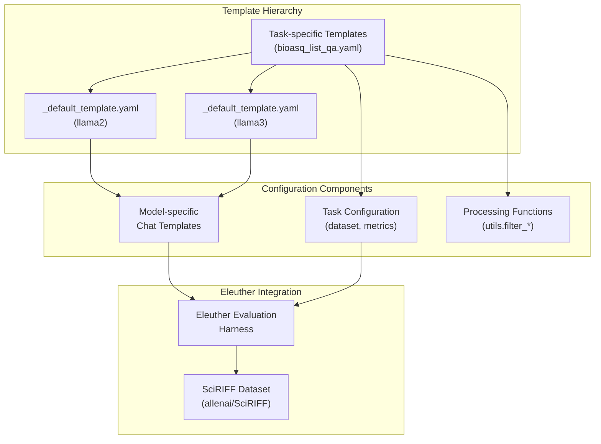
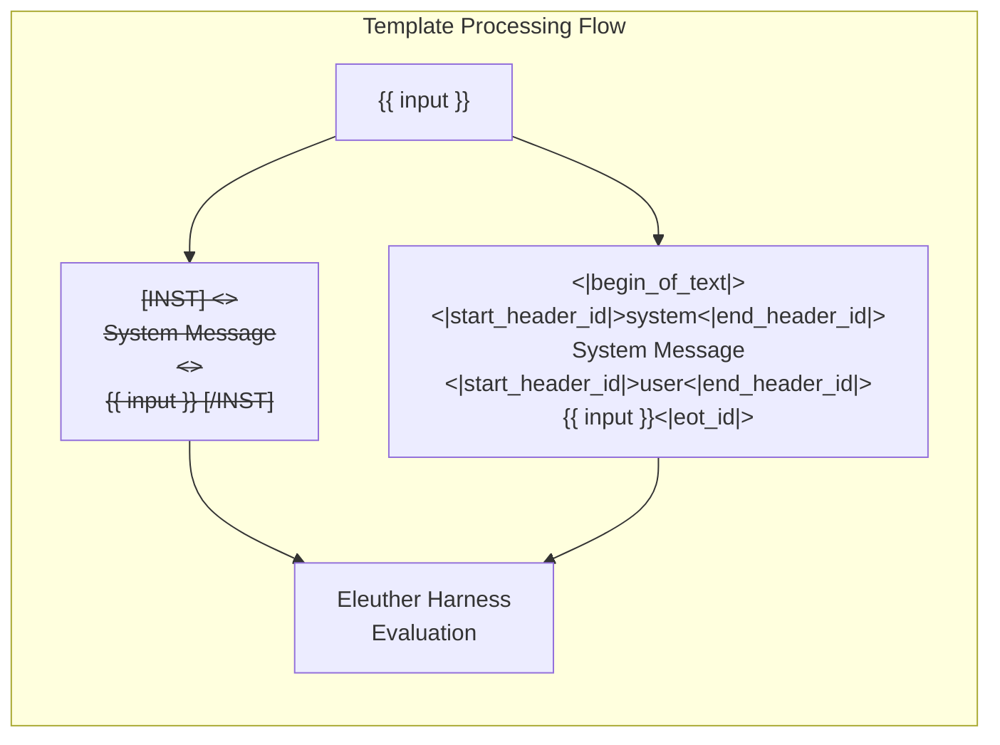
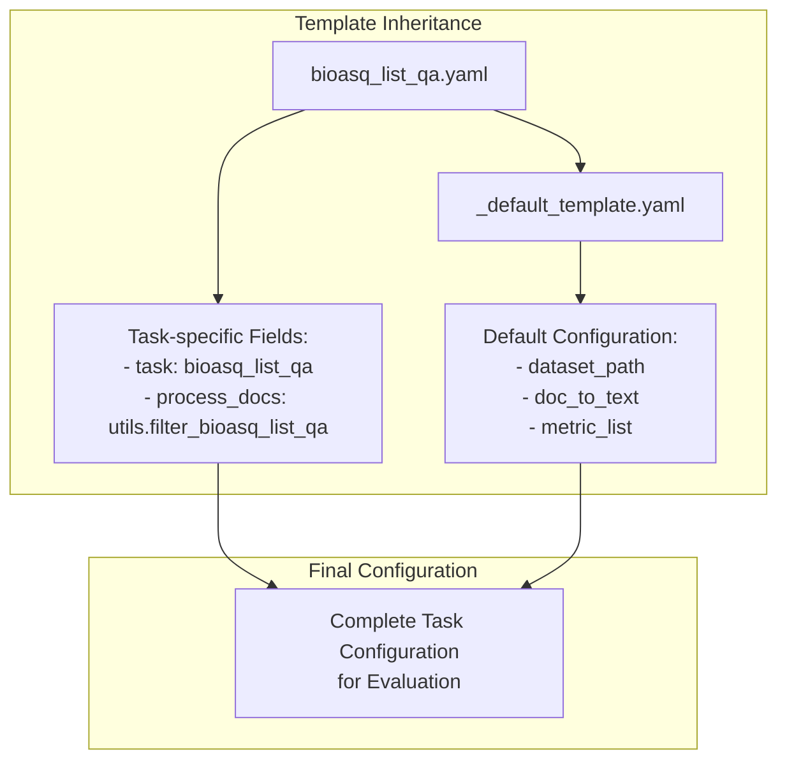
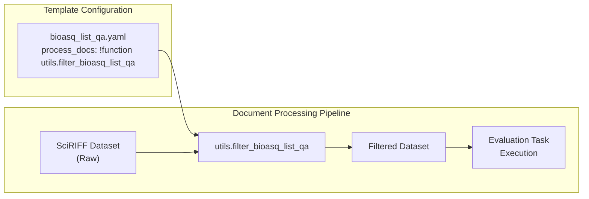

<!-- source: DeepWiki mcp.deepwiki.com · repo allenai/SciRIFF · page 6.1 Evaluation Templates · fetched 2026-10-26 -->

# Evaluation Templates

<details>
<summary>Relevant source files</summary>

The following files were used as context for generating this wiki page:

- [sciriff/eval/eleuther_templates/llama2/_default_template.yaml](sciriff/eval/eleuther_templates/llama2/_default_template.yaml)
- [sciriff/eval/eleuther_templates/llama2/bioasq_list_qa.yaml](sciriff/eval/eleuther_templates/llama2/bioasq_list_qa.yaml)
- [sciriff/eval/eleuther_templates/llama3/_default_template.yaml](sciriff/eval/eleuther_templates/llama3/_default_template.yaml)

</details>


This document describes the YAML-based evaluation template system used to configure model evaluation tasks in SciRIFF. These templates define how different models and tasks are evaluated through the Eleuther evaluation harness integration, specifying prompt formatting, metrics, and task-specific processing.

For information about the broader evaluation framework, see [Evaluation System](#3). For details on individual task implementations, see [Evaluation Tasks](#3.3).

## Template System Overview

The evaluation template system provides a hierarchical configuration structure that separates model-specific formatting (like chat templates) from task-specific evaluation logic. Templates are organized by model architecture and use YAML inheritance to reduce duplication.



Sources: [sciriff/eval/eleuther_templates/llama2/_default_template.yaml:1-15](), [sciriff/eval/eleuther_templates/llama3/_default_template.yaml:1-15](), [sciriff/eval/eleuther_templates/llama2/bioasq_list_qa.yaml:1-4]()

## Model-Specific Default Templates

Default templates define the base configuration shared across all tasks for a specific model architecture. The primary differences between model templates are the chat formatting strings used in the `doc_to_text` field.

### Llama 2 Template Structure

The Llama 2 default template uses the standard Llama 2 chat format with system instructions:

| Configuration Field | Value | Purpose |
|---------------------|-------|---------|
| `group` | `science_adapt` | Task grouping identifier |
| `dataset_path` | `allenai/SciRIFF` | Hugging Face dataset location |
| `dataset_name` | `"4096"` | Dataset configuration name |
| `validation_split` | `validation` | Data split for evaluation |
| `doc_to_text` | Llama 2 chat template | Input formatting |
| `doc_to_target` | `output` | Target field mapping |
| `metric_list` | BLEU configuration | Default metrics |

### Llama 3 Template Structure

The Llama 3 template uses the updated Llama 3 chat format with structured headers:



Sources: [sciriff/eval/eleuther_templates/llama2/_default_template.yaml:6](), [sciriff/eval/eleuther_templates/llama3/_default_template.yaml:6]()

## Task-Specific Templates

Individual evaluation tasks inherit from model default templates and add task-specific configuration. Tasks can specify custom processing functions, metrics, or override default settings.

### Template Inheritance

Task templates use YAML inheritance to extend default configurations:



Sources: [sciriff/eval/eleuther_templates/llama2/bioasq_list_qa.yaml:1-4]()

## Configuration Fields Reference

### Core Template Fields

| Field | Type | Description | Example |
|-------|------|-------------|---------|
| `include` | string | Parent template to inherit from | `_default_template.yaml` |
| `task` | string | Unique task identifier | `bioasq_list_qa` |
| `group` | list | Task grouping for organization | `[science_adapt]` |
| `dataset_path` | string | HuggingFace dataset path | `allenai/SciRIFF` |
| `dataset_name` | string | Dataset configuration | `"4096"` |
| `validation_split` | string | Data split to evaluate | `validation` |

### Text Processing Fields

| Field | Type | Description |
|-------|------|-------------|
| `doc_to_text` | string | Template for input formatting with model-specific chat format |
| `doc_to_target` | string | Field name containing expected output |
| `target_delimiter` | string | Separator for multi-part targets |
| `fewshot_delimiter` | string | Separator between few-shot examples |

### Evaluation Configuration

| Field | Type | Description |
|-------|------|-------------|
| `process_docs` | function | Custom document processing function |
| `metric_list` | list | Metrics to compute with aggregation settings |

Sources: [sciriff/eval/eleuther_templates/llama2/_default_template.yaml:1-15](), [sciriff/eval/eleuther_templates/llama2/bioasq_list_qa.yaml:1-4]()

## Processing Functions Integration

Task templates can specify custom processing functions to filter or transform datasets before evaluation. These functions are defined in utility modules and referenced using the `!function` YAML tag.



Sources: [sciriff/eval/eleuther_templates/llama2/bioasq_list_qa.yaml:3]()

## Template Directory Structure

The template system is organized by model architecture to accommodate different chat formats and tokenization requirements:

```
sciriff/eval/eleuther_templates/
├── llama2/
│   ├── _default_template.yaml
│   └── bioasq_list_qa.yaml
└── llama3/
    └── _default_template.yaml
```

This structure allows the evaluation system to automatically select the appropriate template based on the model being evaluated, ensuring proper formatting and compatibility.

Sources: [sciriff/eval/eleuther_templates/llama2/_default_template.yaml:1-15](), [sciriff/eval/eleuther_templates/llama3/_default_template.yaml:1-15](), [sciriff/eval/eleuther_templates/llama2/bioasq_list_qa.yaml:1-4]()

---

