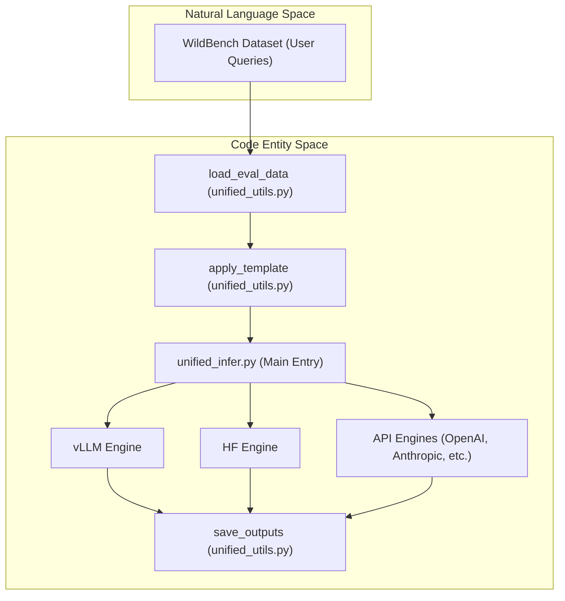
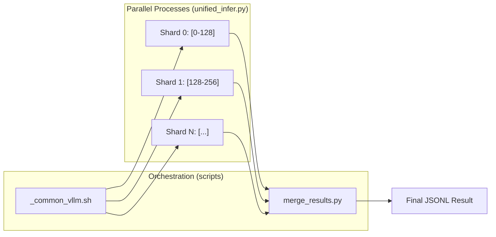

<!-- source: DeepWiki mcp.deepwiki.com · repo allenai/WildBench · page 2 Inference Pipeline · fetched 2026-10-26 -->

# Inference Pipeline

Relevant source files

The following files were used as context for generating this wiki page:

- [README.md](README.md)
- [requirements.txt](requirements.txt)
- [scripts/_common_hf.sh](scripts/_common_hf.sh)
- [scripts/_common_vllm.sh](scripts/_common_vllm.sh)
- [scripts/mistral-large-2402.sh](scripts/mistral-large-2402.sh)
- [src/unified_infer.py](src/unified_infer.py)
- [src/unified_utils.py](src/unified_utils.py)

The **Inference Pipeline** is the first major phase in the WildBench evaluation lifecycle. It handles the systematic generation of model responses to the 1024 challenging user queries in the WildBench dataset. The pipeline is designed to be engine-agnostic, supporting local execution (vLLM, HuggingFace) and a wide array of proprietary APIs through a unified interface.

### High-Level Architecture

The inference process follows a structured flow from data ingestion to sharded execution and final result consolidation.

#### Inference Workflow Diagram
This diagram illustrates the transition from the "Natural Language Space" (User Queries) to the "Code Entity Space" (Inference Engines and Scripts).

**Sources:** [src/unified_infer.py:58-121](), [src/unified_utils.py:57-121]()

---

### Core Components

The pipeline is built around three primary layers that abstract the complexities of different model backends.

#### 1. Unified Inference Engine (`unified_infer.py` & `unified_utils.py`)
The `src/unified_infer.py` script serves as the central entry point for all inference tasks [src/unified_infer.py:58-60](). It utilizes `load_eval_data` to fetch the WildBench dataset (v2) from HuggingFace [src/unified_utils.py:65-67]() and prepares the inputs. 

Key responsibilities include:
*   **Argument Parsing:** Managing model parameters like `temperature`, `top_p`, and `max_tokens` [src/unified_infer.py:15-49]().
*   **Resume Logic:** Automatically detecting existing results to skip previously processed examples [src/unified_infer.py:135-141]().
*   **Output Cleaning:** Standardizing responses by stripping special tokens (e.g., `<|endoftext|>`, `</s>`) via `clear_output` [src/unified_utils.py:125-134]().

For a deep dive into the engine's internals and provider-specific request functions, see **[unified_infer.py & unified_utils.py](#2.1)**.

#### 2. Conversation Templating
To ensure models perform optimally, the pipeline maps raw user queries into model-specific chat formats. The `apply_template` function [src/unified_utils.py:38-54]() uses a factory pattern `map_to_conv` to retrieve the correct template based on the model name [src/unified_utils.py:47]().

For details on how 50+ model families are supported, see **[Conversation Templates & Model Compatibility](#2.2)**.

#### 3. Execution Orchestration & Sharding
WildBench uses a sharding strategy to parallelize inference across multiple GPUs or to manage API rate limits. The `scripts/` directory contains shell templates that divide the 1024 examples into `n_shards` [scripts/_common_vllm.sh:37-44]().

**Inference Sharding Logic**

**Sources:** [scripts/_common_vllm.sh:44-62](), [scripts/mistral-large-2402.sh:12-24]()

For details on distributed inference and model-specific scripts, see **[Inference Scripts & Sharding](#2.3)**.

---

### Supported Backends

The pipeline supports three primary execution "engines" specified via the `--engine` flag [src/unified_infer.py:17]():

| Engine | Implementation | Target Models |
| :--- | :--- | :--- |
| `vllm` | Uses `vllm.LLM` [src/unified_infer.py:65-70]() | High-throughput local open-weight models. |
| `hf` | Uses `DecoderOnlyModelManager` [src/unified_infer.py:71-74]() | Models not yet supported by vLLM. |
| `openai`, `anthropic`, etc. | Provider-specific request functions [src/unified_utils.py:11-12]() | Proprietary API-based models. |

**Sources:** [src/unified_infer.py:65-75](), [src/unified_utils.py:21-26]()

---

