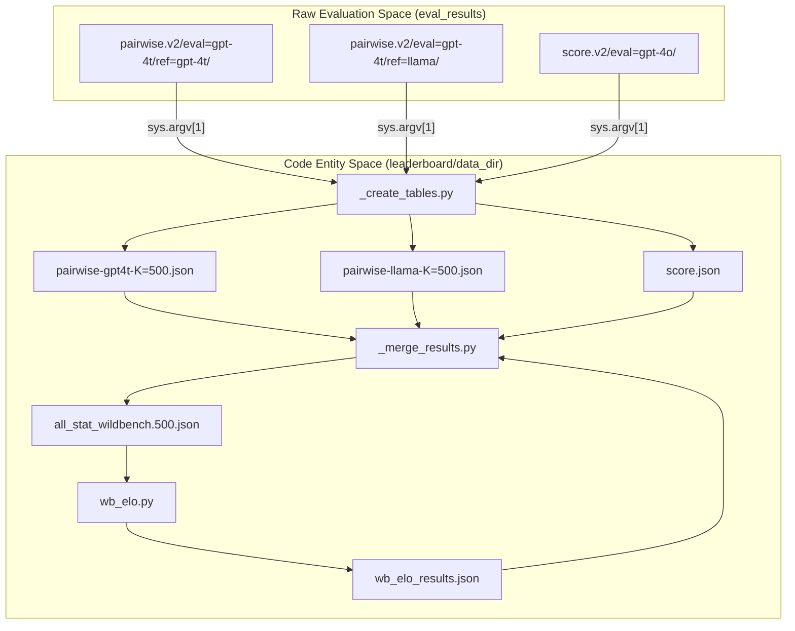
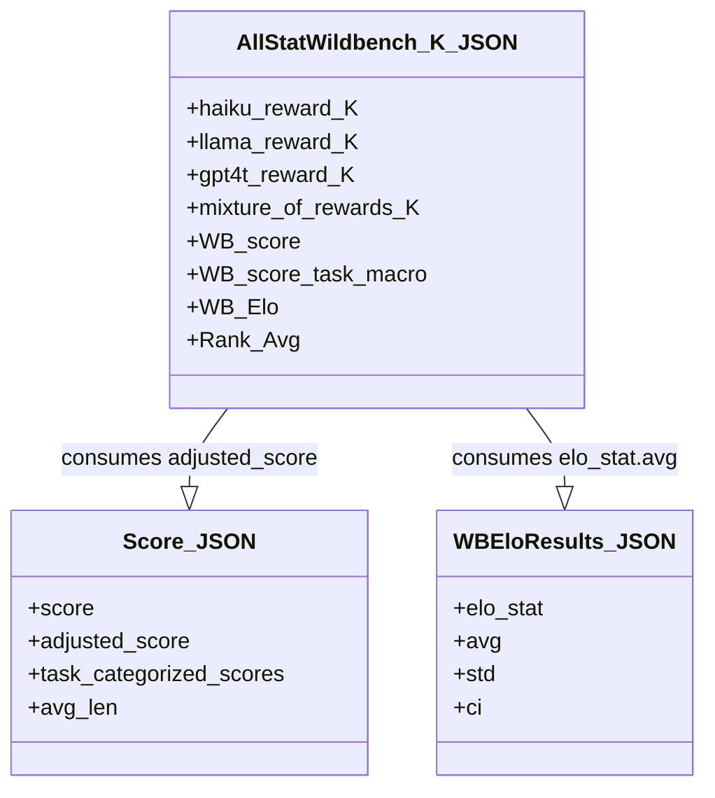

<!-- source: DeepWiki mcp.deepwiki.com · repo allenai/WildBench · page 4.1 Leaderboard Data Pipeline · fetched 2026-10-26 -->

# Leaderboard Data Pipeline

Relevant source files

The following files were used as context for generating this wiki page:

- [leaderboard/data_dir/_create_tables.py](leaderboard/data_dir/_create_tables.py)
- [leaderboard/data_dir/_merge_results.py](leaderboard/data_dir/_merge_results.py)
- [leaderboard/data_dir/all_stat_wildbench.2000.json](leaderboard/data_dir/all_stat_wildbench.2000.json)
- [leaderboard/data_dir/all_stat_wildbench.300.json](leaderboard/data_dir/all_stat_wildbench.300.json)
- [leaderboard/data_dir/all_stat_wildbench.3000.json](leaderboard/data_dir/all_stat_wildbench.3000.json)
- [leaderboard/data_dir/all_stat_wildbench.500.json](leaderboard/data_dir/all_stat_wildbench.500.json)
- [leaderboard/data_dir/score.json](leaderboard/data_dir/score.json)
- [leaderboard/data_dir/wb_elo_results.json](leaderboard/data_dir/wb_elo_results.json)
- [leaderboard/show_eval.sh](leaderboard/show_eval.sh)

The Leaderboard Data Pipeline is the final stage of the WildBench evaluation framework. It transforms raw LLM-as-a-judge evaluation results into structured metrics, calculates Elo ratings, and generates the final data files required for the public leaderboard display.

## Pipeline Orchestration: `show_eval.sh`

The entry point for the data pipeline is `leaderboard/show_eval.sh`. This script orchestrates several Python modules in a specific sequence to process both pairwise and score-based evaluations.

### Execution Modes
The script supports two primary modes via the first command-line argument:
1.  **Full Mode**: Processes pairwise comparisons across multiple length-penalty thresholds ($K$) and calculates rewards and Elo ratings.
2.  **Score-Only Mode**: Skips pairwise processing and focuses exclusively on the 1-10 scoring metrics.

### Step-by-Step Walkthrough

| Step | Component | Description |
| :--- | :--- | :--- |
| 1 | `_create_tables.py` (Parallel) | Runs pairwise reward calculations for three reference models (GPT-4 Turbo, Llama-2-70b, Claude-3 Haiku) at multiple $K$ values (-1, 500, 1000, 1500) [leaderboard/show_eval.sh:8-22](). |
| 2 | `_create_tables.py` (Score) | Processes the 1-10 score results from the primary judge (GPT-4o) [leaderboard/show_eval.sh:27](). |
| 3 | `_merge_results.py` | Consolidates individual JSON reward/score files into a unified `all_stat_wildbench.{K}.json` [leaderboard/show_eval.sh:29](). |
| 4 | `wb_elo.py` | Calculates Elo ratings based on the generated rewards using bootstrap simulation [leaderboard/show_eval.sh:33](). |
| 5 | `_merge_results.py` (Final) | Re-runs merging to include the newly calculated Elo ratings into the final stats [leaderboard/show_eval.sh:35](). |
| 6 | `show_table.py` | Displays the final leaderboard in the terminal [leaderboard/show_eval.sh:39-41](). |

**Sources:** [leaderboard/show_eval.sh:1-43]()

---

## Data Transformation Flow

The following diagram illustrates how data flows from raw judge outputs to the final leaderboard entities.

### From Results to Leaderboard Tables

**Sources:** [leaderboard/data_dir/_create_tables.py:44-75](), [leaderboard/data_dir/_merge_results.py:16-43](), [leaderboard/show_eval.sh:8-35]()

---

## Component Details

### 1. Table Generation (`_create_tables.py`)
This script processes the JSON files in `eval_results/`. It performs two critical mappings:
*   **Task Mapping**: Uses `load_dataset` to fetch WildBench v2 metadata and maps primary/secondary tags to five core categories: `Creative Tasks`, `Planning & Reasoning`, `Math & Data Analysis`, `Information/Advice seeking`, and `Coding & Debugging` [leaderboard/data_dir/_create_tables.py:8-35]().
*   **Reward Calculation**: For pairwise mode, it calculates rewards based on the `extent` (1 or 2) and `winner` (model_A, model_B, or tie). It applies the length penalty $K$: if a model wins but is longer than the reference by more than $K$ tokens, the result is demoted to a tie [leaderboard/data_dir/_create_tables.py:129-153]().

### 2. Result Consolidation (`_merge_results.py`)
This script acts as the data joiner. It reads the specific reward files (Haiku, Llama, GPT-4T) and the score file to create a comprehensive model profile [leaderboard/data_dir/_merge_results.py:17-39]().
*   **Metric Mixing**: It computes the `mixture_of_rewards` by averaging rewards from the three reference models [leaderboard/data_dir/_merge_results.py:91]().
*   **Ranking**: It calculates ranks for models based on `WB_score.task_macro` and `task_macro_reward.K` [leaderboard/data_dir/_merge_results.py:110-125]().

### 3. Elo Calculation (`wb_elo.py`)
The Elo system uses the rewards generated in previous steps to simulate matches.
*   **Bootstrapping**: It runs 128 rounds of simulation to ensure statistical robustness [leaderboard/data_dir/wb_elo_results.json:4]().
*   **Length Margin**: A `length_margin` (default 1500) is used during Elo calculation to mitigate length bias [leaderboard/data_dir/wb_elo_results.json:11]().

---

## Data Schema Association

This diagram bridges the conceptual metrics used in the leaderboard to the specific keys found in the generated JSON files.

### Metric to JSON Key Mapping

**Sources:** [leaderboard/data_dir/all_stat_wildbench.500.json:8-48](), [leaderboard/data_dir/score.json:18-32](), [leaderboard/data_dir/wb_elo_results.json:13-23]()

### Key Data Files Produced
*   **`score.json`**: Contains raw and adjusted scores (1-10 scale) per model, broken down by task category [leaderboard/data_dir/score.json:1-17]().
*   **`all_stat_wildbench.{K}.json`**: The master record for a specific length penalty $K$. It includes the `mixture_of_rewards`, `WB_score`, and `WB_Elo` [leaderboard/data_dir/all_stat_wildbench.300.json:1-49]().
*   **`wb_elo_results.json`**: Contains the final Elo ratings with confidence intervals (CI) and standard deviations [leaderboard/data_dir/wb_elo_results.json:1-23]().

**Sources:** [leaderboard/data_dir/_create_tables.py:1-200](), [leaderboard/data_dir/_merge_results.py:1-146](), [leaderboard/data_dir/score.json:1-100]()

---

