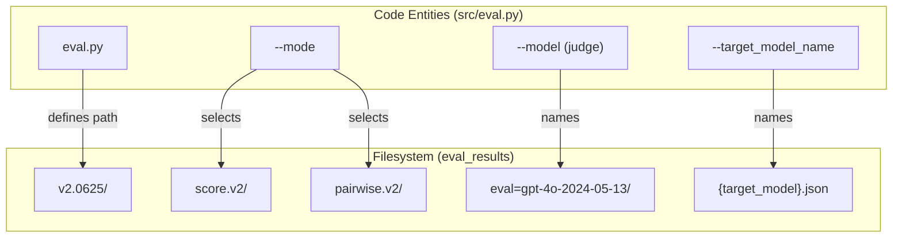
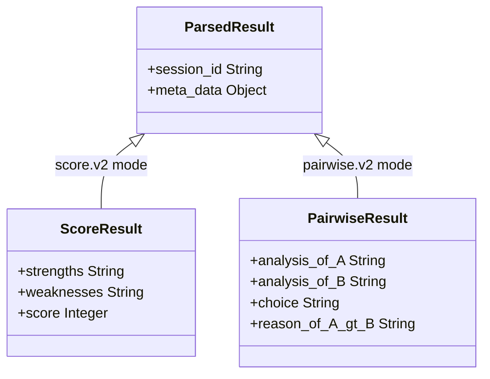

<!-- source: DeepWiki mcp.deepwiki.com · repo allenai/WildBench · page 5 Evaluation Results Archive · fetched 2026-10-26 -->

# Evaluation Results Archive

Relevant source files

The following files were used as context for generating this wiki page:

- [eval_results/v2.0522/pairwise.v2/eval=gpt-4-turbo-2024-04-09/ref=Llama-2-70b-chat-hf/command-r-plus.json](eval_results/v2.0522/pairwise.v2/eval=gpt-4-turbo-2024-04-09/ref=Llama-2-70b-chat-hf/command-r-plus.json)
- [eval_results/v2.0522/pairwise.v2/eval=gpt-4-turbo-2024-04-09/ref=Llama-2-70b-chat-hf/neo_7b_instruct_v0.1.json](eval_results/v2.0522/pairwise.v2/eval=gpt-4-turbo-2024-04-09/ref=Llama-2-70b-chat-hf/neo_7b_instruct_v0.1.json)
- [eval_results/v2.0522/pairwise.v2/eval=gpt-4-turbo-2024-04-09/ref=claude-3-haiku-20240307/command-r-plus.json](eval_results/v2.0522/pairwise.v2/eval=gpt-4-turbo-2024-04-09/ref=claude-3-haiku-20240307/command-r-plus.json)
- [eval_results/v2.0522/pairwise.v2/eval=gpt-4-turbo-2024-04-09/ref=claude-3-haiku-20240307/neo_7b_instruct_v0.1.json](eval_results/v2.0522/pairwise.v2/eval=gpt-4-turbo-2024-04-09/ref=claude-3-haiku-20240307/neo_7b_instruct_v0.1.json)
- [eval_results/v2.0522/pairwise.v2/eval=gpt-4-turbo-2024-04-09/ref=gpt-4-turbo-2024-04-09/command-r-plus.json](eval_results/v2.0522/pairwise.v2/eval=gpt-4-turbo-2024-04-09/ref=gpt-4-turbo-2024-04-09/command-r-plus.json)
- [eval_results/v2.0522/pairwise.v2/eval=gpt-4-turbo-2024-04-09/ref=gpt-4-turbo-2024-04-09/neo_7b_instruct_v0.1.json](eval_results/v2.0522/pairwise.v2/eval=gpt-4-turbo-2024-04-09/ref=gpt-4-turbo-2024-04-09/neo_7b_instruct_v0.1.json)
- [eval_results/v2.0522/score.v2/eval=gpt-4-turbo-2024-04-09/command-r-plus.json](eval_results/v2.0522/score.v2/eval=gpt-4-turbo-2024-04-09/command-r-plus.json)
- [eval_results/v2.0522/score.v2/eval=gpt-4o-2024-05-13/neo_7b_instruct_v0.1.json](eval_results/v2.0522/score.v2/eval=gpt-4o-2024-05-13/neo_7b_instruct_v0.1.json)
- [evaluation/run_all_eval_batch.sh](evaluation/run_all_eval_batch.sh)
- [evaluation/run_eval_v2_instant.score.sh](evaluation/run_eval_v2_instant.score.sh)
- [scripts/Hermes-2-Theta-Llama-3-8B.sh](scripts/Hermes-2-Theta-Llama-3-8B.sh)
- [scripts/cohere-command-r-plus.sh](scripts/cohere-command-r-plus.sh)
- [src/openai_batch_eval/check_batch_status_with_model_name.py](src/openai_batch_eval/check_batch_status_with_model_name.py)

The `eval_results/` directory serves as the primary data store for all LLM-as-a-judge outputs generated during the evaluation phase. It maintains a structured hierarchy that separates results by version, evaluation mode (score vs. pairwise), and the specific judge/reference models employed. This archive is the source of truth for the [Leaderboard System](#4) to calculate metrics such as WB-Score and Elo ratings.

## Directory Structure and Versioning

The archive is organized into versioned root directories to ensure reproducibility as judge models or evaluation templates evolve.

*   **v2.0522**: Historically associated with evaluations using `gpt-4-turbo-2024-04-09` as the primary judge [evaluation/run_all_eval_batch.sh:3-5]().
*   **v2.0625**: The current standard for scoring, utilizing `gpt-4o-2024-05-13` as the judge [evaluation/run_eval_v2_instant.score.sh:3-10]().

### Organization Hierarchy

The path pattern follows a strict convention to identify the experimental setup:
`eval_results/{version}/{mode}/eval={judge_model}/[ref={reference_model}/]{target_model}.json`

| Path Component | Description |
| :--- | :--- |
| `version` | The release version (e.g., `v2.0522`, `v2.0625`). |
| `mode` | `score.v2` for individual scoring or `pairwise.v2` for comparative evaluation. |
| `eval={judge}` | The model acting as the judge (e.g., `eval=gpt-4o-2024-05-13`). |
| `ref={reference}` | (Pairwise only) The baseline model being compared against (e.g., `ref=gpt-4-turbo-2024-04-09`). |

### Code-to-Data Relationship

The following diagram illustrates how the evaluation scripts map system entities to the physical directory structure.

**Evaluation Path Mapping**

Sources: [evaluation/run_eval_v2_instant.score.sh:10-12](), [evaluation/run_all_eval_batch.sh:8-12]()

## Result JSON Schema

Individual result files contain an array of JSON objects, where each object corresponds to a single test instance from the WildBench dataset.

### Common Fields
All result types share a metadata envelope:
*   `session_id`: Unique identifier for the WildBench prompt [eval_results/v2.0522/score.v2/eval=gpt-4o-2024-05-13/neo_7b_instruct_v0.1.json:3]().
*   `meta_data`: Contains technical execution details including `batch_req_id` (for OpenAI Batch API) and token `usage` [eval_results/v2.0522/score.v2/eval=gpt-4o-2024-05-13/neo_7b_instruct_v0.1.json:9-17]().
*   `model_output`: The raw response generated by the model under test [eval_results/v2.0522/score.v2/eval=gpt-4o-2024-05-13/neo_7b_instruct_v0.1.json:20]().

### Parsed Results Entity Association

The `parsed_result` field contains the structured output extracted from the judge's natural language response.

**Parsed Result Schema Association**

Sources: [eval_results/v2.0522/score.v2/eval=gpt-4o-2024-05-13/neo_7b_instruct_v0.1.json:4-8](), [eval_results/v2.0522/pairwise.v2/eval=gpt-4-turbo-2024-04-09/ref=gpt-4-turbo-2024-04-09/neo_7b_instruct_v0.1.json:4-11]()

## Evaluation Modes

### [Pairwise Evaluation Results](#5.1)
Pairwise results compare a target model against a fixed reference model (e.g., `gpt-4-turbo` or `Llama-2-70b-chat`). The judge provides a qualitative analysis of both responses and selects a winner using a scale from `A++` (much better) to `B++`.
*   **Path**: `eval_results/{version}/pairwise.v2/eval={judge}/ref={reference}/{model}.json`
*   **Key Fields**: `choice`, `extent`, `model_A`, `model_B`.
*   For details, see [Pairwise Evaluation Results](#5.1).

### [Score Evaluation Results](#5.2)
Score results provide an absolute quality rating (1-10) for a model's response based on a detailed rubric. This is the primary input for the WB-Score metric.
*   **Path**: `eval_results/{version}/score.v2/eval={judge}/{model}.json`
*   **Key Fields**: `score`, `strengths`, `weaknesses`.
*   For details, see [Score Evaluation Results](#5.2).

## Result Management

Results are typically generated in shards to maximize parallelism [evaluation/run_eval_v2_instant.score.sh:32-44](). Once evaluation is complete, the `src/merge_results.py` script is used to consolidate these shards into a single JSON file per model [evaluation/run_eval_v2_instant.score.sh:49]().

For API-based evaluations, the system supports the OpenAI Batch API. Results are retrieved and formatted using `src/openai_batch_eval/check_batch_status_with_model_name.py` [src/openai_batch_eval/check_batch_status_with_model_name.py:33-36](), which converts the `.batch_results.jsonl` format back into the standard WildBench JSON schema.

Sources: [evaluation/run_eval_v2_instant.score.sh:32-49](), [src/openai_batch_eval/check_batch_status_with_model_name.py:1-36]()

---

