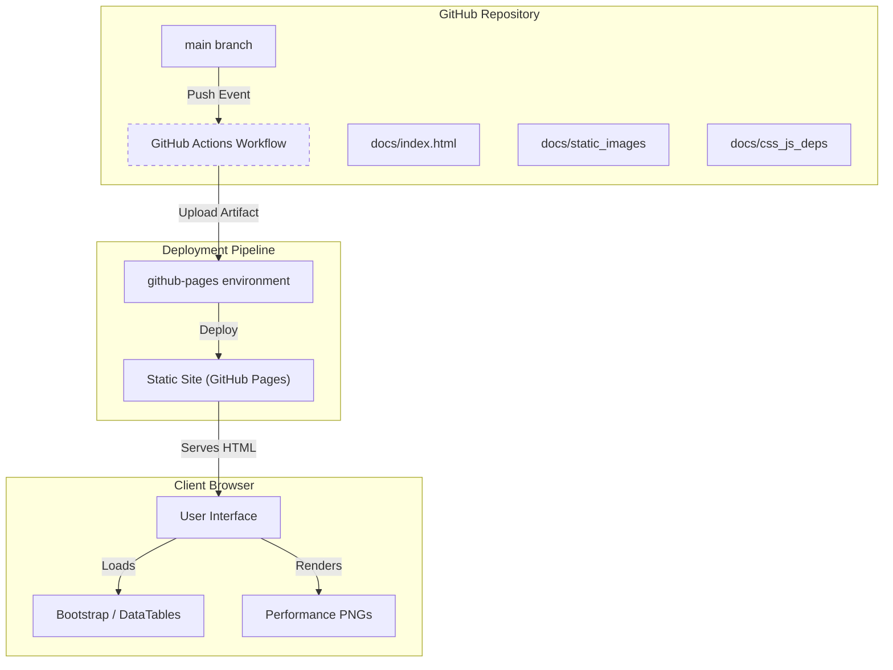

<!-- source: DeepWiki mcp.deepwiki.com · repo allenai/WildBench · page 6 Project Website (docs) · fetched 2026-10-26 -->

# Project Website (docs)

<details>
<summary>Relevant source files</summary>

The following files were used as context for generating this wiki page:

- [.github/workflows/static.yml](.github/workflows/static.yml)
- [docs/README.md](docs/README.md)
- [docs/css/addons/datatables-select.min.css](docs/css/addons/datatables-select.min.css)
- [docs/css/addons/datatables.min.css](docs/css/addons/datatables.min.css)
- [docs/css/addons/directives.min.css](docs/css/addons/directives.min.css)
- [docs/css/addons/flag.min.css](docs/css/addons/flag.min.css)
- [docs/css/addons/jquery.zmd.hierarchical-display.min.css](docs/css/addons/jquery.zmd.hierarchical-display.min.css)
- [docs/css/addons/rating.min.css](docs/css/addons/rating.min.css)
- [docs/css/animate.css](docs/css/animate.css)
- [docs/css/bootstrap.css](docs/css/bootstrap.css)
- [docs/css/bootstrap.min 2.css](docs/css/bootstrap.min 2.css)
- [docs/gray_banner.png](docs/gray_banner.png)
- [docs/index.html](docs/index.html)
- [docs/wb_corr.png](docs/wb_corr.png)
- [docs/wb_eval.png](docs/wb_eval.png)
- [docs/wb_radar.png](docs/wb_radar.png)
- [docs/wb_stat.png](docs/wb_stat.png)
- [docs/wb_table.png](docs/wb_table.png)

</details>


The `docs/` directory contains the static project website for WildBench, hosted via GitHub Pages. It serves as the public-facing leaderboard and documentation hub, providing visualizations of model performance, task-wise breakdowns, and comparative statistics.

## Overview and Architecture

The website is a single-page application (SPA) architecture built with standard web technologies. It relies on a combination of static HTML, CSS frameworks for styling, and JavaScript libraries for interactive data presentation (specifically the leaderboard table).

### Implementation Stack
- **Framework**: Bootstrap v4.4.1 for responsive layout and UI components [docs/css/bootstrap.css:1-6]().
- **Data Display**: DataTables (MDBootstrap version) for the interactive leaderboard, supporting sorting and searching [docs/index.html:74-77]().
- **Icons**: Font Awesome for UI iconography [docs/index.html:27-27]().
- **Analytics**: Google Analytics for site traffic monitoring [docs/index.html:11-18]().

### Data Flow Diagram

The following diagram illustrates how the static website is deployed and how it references internal assets.


**Sources:** [.github/workflows/static.yml:1-44](), [docs/index.html:1-100]()

## Key Components

### 1. Leaderboard Interface (`index.html`)
The primary entry point of the website is `index.html`. It initializes the leaderboard table using the `DataTable()` function on the element `#dtBasicExample` [docs/index.html:48-51](). 

Key UI features include:
- **Logo and Branding**: Displays the `wildbench_logo.png` and project title [docs/index.html:166-167]().
- **Interactive Tables**: Utilizes `bootstrap-table.min.js` and `datatables.min.js` to render the evaluation results [docs/index.html:56-56](), [docs/index.html:77-77]().
- **Navigation**: Includes links to the project paper, GitHub repository, and AI2 homepage.

### 2. Static Visualizations
The website displays several pre-rendered images that summarize the benchmark results. These are generated by the leaderboard backend (see [Leaderboard System](4.-Leaderboard-System)) and placed in `docs/` for static serving.

| Image File | Description |
| :--- | :--- |
| `wb_stat.png` | General statistics and distributions of the WildBench dataset [docs/wb_stat.png](). |
| `wb_corr.png` | Correlation heatmaps between different judge models and metrics [docs/wb_corr.png](). |
| `wb_table.png` | A static snapshot of the main leaderboard table for quick reference [docs/wb_table.png](). |
| `wb_eval.png` | Visual representation of the evaluation pipeline and scoring distribution [docs/wb_eval.png](). |
| `wb_radar.png` | Radar charts comparing model performance across different task categories [docs/wb_radar.png](). |
| `gray_banner.png` | UI asset used for the website header/banner [docs/gray_banner.png](). |

### 3. CSS and JavaScript Dependencies
The site uses a structured `docs/css/` and `docs/js/` hierarchy:
- **Styling**: `bootstrap.min.css` for layout, `style.css` for custom overrides, and `animate.css` for UI transitions [docs/index.html:26-29]().
- **Add-ons**: Specific CSS for DataTables (`datatables.min.css`) and its selection features [docs/css/addons/datatables.min.css:1-1](), [docs/css/addons/datatables-select.min.css:1-1]().
- **Scripts**: `jquery-1.10.2.min.js` serves as the foundation for the interactive components [docs/index.html:86-86]().

## Deployment Workflow

The website is automatically deployed via a GitHub Actions workflow defined in `.github/workflows/static.yml`.

### Workflow Logic
1. **Trigger**: Runs on every push to the `main` branch [`.github/workflows/static.yml:4-7`]().
2. **Permissions**: Requires `pages: write` and `id-token: write` to interact with the GitHub Pages deployment API [`.github/workflows/static.yml:13-16`]().
3. **Concurrency**: Configured to allow only one concurrent deployment to the `pages` group to prevent race conditions [`.github/workflows/static.yml:20-22`]().
4. **Steps**:
    - **Checkout**: Pulls the repository content [`.github/workflows/static.yml:32-33`]().
    - **Upload**: Packages the **entire `docs/` directory** as the deployment artifact [`.github/workflows/static.yml:36-40`]().
    - **Deploy**: Publishes the artifact to the `github-pages` environment [`.github/workflows/static.yml:41-43`]().

### Deployment Structure Diagram

This diagram maps the file system entities to the deployment process.

```mermaid
classDiagram
    class RepositoryRoot {
        +docs/
        +.github/workflows/static.yml
    }
    class DocsDirectory {
        +index.html
        +wb_radar.png
        +wb_stat.png
        +css/
        +js/
    }
    class GitHubActions {
        +actions/checkout@v4
        +actions/upload-pages-artifact@v3
        +actions/deploy-pages@v4
    }
    class GitHubPagesHost {
        +URL: allenai.github.io/WildBench/
    }

    RepositoryRoot *-- DocsDirectory : contains
    GitHubActions ..> DocsDirectory : "targets path: 'docs/'"
    GitHubActions --> GitHubPagesHost : "deploys to"
```
**Sources:** [.github/workflows/static.yml:36-40](), [docs/index.html:1-100]()

## Maintenance Note
When updating the leaderboard data, ensure that the `leaderboard/` aggregation scripts have completed and that any updated PNG visualizations (e.g., `wb_radar.png`) have been copied or symlinked into the `docs/` folder before pushing to `main`. The website does not fetch live data; it relies entirely on the static files present in the `docs/` directory at the time of deployment.

**Sources:**
- [.github/workflows/static.yml:1-44]()
- [docs/index.html:1-185]()
- [docs/css/bootstrap.css:1-64]()
- [docs/css/addons/datatables.min.css:1-1]()

---

