# Page: WildBench Overview

# WildBench Overview

<details>
<summary>Relevant source files</summary>

The following files were used as context for generating this wiki page:

- [README.md](README.md)
- [docs/WildBench_paper.pdf](docs/WildBench_paper.pdf)
- [docs/gray_banner.png](docs/gray_banner.png)
- [docs/index.html](docs/index.html)
- [docs/wb_corr.png](docs/wb_corr.png)
- [docs/wb_eval.png](docs/wb_eval.png)
- [docs/wb_radar.png](docs/wb_radar.png)
- [docs/wb_stat.png](docs/wb_stat.png)
- [docs/wb_table.png](docs/wb_table.png)
- [requirements.txt](requirements.txt)
- [scripts/_common_hf.sh](scripts/_common_hf.sh)
- [scripts/_common_vllm.sh](scripts/_common_vllm.sh)

</details>


WildBench is a comprehensive framework for benchmarking Large Language Models (LLMs) using challenging, real-world tasks derived from user interactions. It focuses on a high-quality dataset of 1,024 examples across various task categories, utilizing an LLM-as-a-judge system to provide fine-grained performance metrics.

The project is structured into three primary phases: **Inference** (generating model responses), **Evaluation** (scoring or comparing responses using GPT-4o/GPT-4-Turbo), and **Leaderboard Generation** (aggregating results into public-facing metrics).

## Core Goals
*   **Real-World Difficulty:** Evaluate models on complex tasks that reflect actual user needs in the "wild".
*   **Multi-Dimensional Metrics:** Move beyond simple accuracy to include **WB-Score** (individual quality), **WB-Reward** (pairwise comparison), and **WB-Elo** (relative ranking).
*   **Efficiency:** Support fast, sharded inference and cost-effective evaluation via the OpenAI Batch API.

## High-Level System Architecture

The following diagram illustrates how the natural language benchmarking process is mapped to the specific code entities within the repository.

### Data and Execution Flow
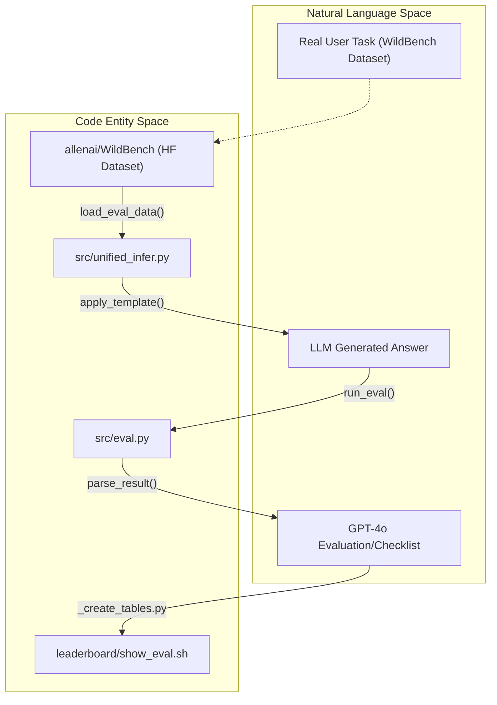
**Sources:** [README.md:152-168](), [src/unified_infer.py:1-50](), [src/eval.py:1-40]()

---

## Major Subsystems

### 1. Inference Pipeline
The inference pipeline is responsible for generating outputs from models. It supports multiple backends (vLLM, HuggingFace, and various APIs) through a unified interface.
*   **Unified Interface:** `src/unified_infer.py` acts as the entry point for all model generations.
*   **Model Orchestration:** Scripts in `scripts/` (e.g., `_common_vllm.sh`) handle environment setup and data sharding.
*   **Template Management:** `src/fastchat_conversation.py` ensures prompts are formatted correctly for over 50 model families.

For details, see [Inference Pipeline](#2).

### 2. Evaluation Pipeline
Once responses are generated, the evaluation pipeline uses LLM judges to assess quality.
*   **Judge Models:** Primarily uses `gpt-4o` or `gpt-4-turbo` as judges.
*   **Evaluation Modes:** Supports "Score" (1-10 rating) and "Pairwise" (Model A vs Model B).
*   **Batch Processing:** Extensive use of the OpenAI Batch API to reduce costs and increase throughput via `src/openai_batch_eval/`.

For details, see [Evaluation Pipeline](#3).

### 3. Leaderboard & Metrics
The leaderboard system transforms raw JSON evaluation results into the metrics seen on the public website.
*   **WB-Score:** A re-scaled 1-10 score.
*   **WB-Reward:** Derived from pairwise comparisons.
*   **WB-Elo:** A relative rating calculated using Bradley-Terry modeling in `leaderboard/wb_elo.py`.

For details, see [Leaderboard System](#4).

---

## Repository Relationship Diagram

This diagram shows how the major code components interact to move a model from initial setup to the final leaderboard.

```mermaid
graph LR
    [scripts/_common_vllm.sh] -->|"calls"| [src/unified_infer.py]
    [src/unified_infer.py] -->|"uses"| [src/fastchat_conversation.py]
    [src/unified_infer.py] -->|"saves to"| [result_dirs/wild_bench_v2/]
    
    [result_dirs/wild_bench_v2/] -->|"input for"| [src/eval.py]
    [src/eval.py] -->|"saves to"| [eval_results/]
    
    [eval_results/] -->|"aggregated by"| [leaderboard/show_eval.sh]
    [leaderboard/show_eval.sh] -->|"outputs"| [leaderboard/data_dir/]
    [leaderboard/data_dir/] -->|"rendered in"| [docs/index.html]
```
**Sources:** [README.md:32-44](), [scripts/_common_vllm.sh:24-35](), [leaderboard/show_eval.sh:1-20]()

## Quick Links to Child Pages
*   **[Getting Started & Setup](#1.1):** Installation and running your first model.
*   **[Repository Structure & Key Concepts](#1.2):** Deep dive into the directory layout and WB metrics.

**Sources:** [README.md:1-170](), [requirements.txt:1-11](), [scripts/_common_vllm.sh:1-67](), [scripts/_common_hf.sh:1-64]()

---

# Page: Getting Started & Setup

# Getting Started & Setup

<details>
<summary>Relevant source files</summary>

The following files were used as context for generating this wiki page:

- [.github/ISSUE_TEMPLATE/add-new-model.md](.github/ISSUE_TEMPLATE/add-new-model.md)
- [.github/workflows/static.yml](.github/workflows/static.yml)
- [README.md](README.md)
- [requirements.txt](requirements.txt)
- [scripts/_common_hf.sh](scripts/_common_hf.sh)
- [scripts/_common_vllm.sh](scripts/_common_vllm.sh)

</details>


This page provides a comprehensive guide for setting up the WildBench environment, running model inference, and performing evaluations. It covers the technical requirements and the workflow for adding new models to the benchmark.

## Installation and Environment Setup

WildBench requires a Python 3.10 environment. The setup involves installing the `vLLM` engine for efficient inference and several API clients for judge-based evaluation.

### Dependencies
The project relies on the following core libraries:
*   `vllm`: Primary engine for local open-weight model inference [README.md:67-67]().
*   `openai`: Used for GPT-based judges and OpenAI-compatible model inference [requirements.txt:1-1]().
*   `datasets`: To load the WildBench evaluation data from HuggingFace [requirements.txt:2-2]().
*   `tenacity`: For handling API retries during inference and evaluation [requirements.txt:3-3]().
*   `fire`: For CLI argument parsing in Python scripts [requirements.txt:11-11]().

### Setup Commands
```bash
conda create -n zeroeval python=3.10
conda activate zeroeval
pip install vllm==0.5.1
pip install -r requirements.txt
```
*Sources: [README.md:63-69](), [requirements.txt:1-11]()*

---

## Configuring API Keys

WildBench uses LLM-as-a-judge for evaluation. To run the standard evaluation pipeline, you must configure environment variables for the supported providers.

| Provider | Environment Variable | Usage |
| :--- | :--- | :--- |
| OpenAI | `OPENAI_API_KEY` | GPT-4 Turbo/GPT-4o Judges (WB-Score/WB-Reward) |
| Anthropic | `ANTHROPIC_API_KEY` | Claude-3 reference models and judges |
| Google | `GOOGLE_API_KEY` | Gemini model inference |
| Together | `TOGETHER_API_KEY` | Together.AI hosted models |

*Sources: [README.md:123-129](), [requirements.txt:1-10]()*

---

## Running Your First Inference

The inference process generates model responses for the 1024 tasks in the WildBench dataset.

### Using the vLLM Shortcut
For models supported by vLLM, use the `_common_vllm.sh` script. This script handles both single-GPU and multi-GPU (data-parallel) execution.

```bash
bash scripts/_common_vllm.sh [hf_model_id] [model_pretty_name] [num_gpus]
```

### Data Flow: Inference to Output
The diagram below illustrates how `unified_infer.py` processes the dataset and saves results.

**Inference Execution Flow**
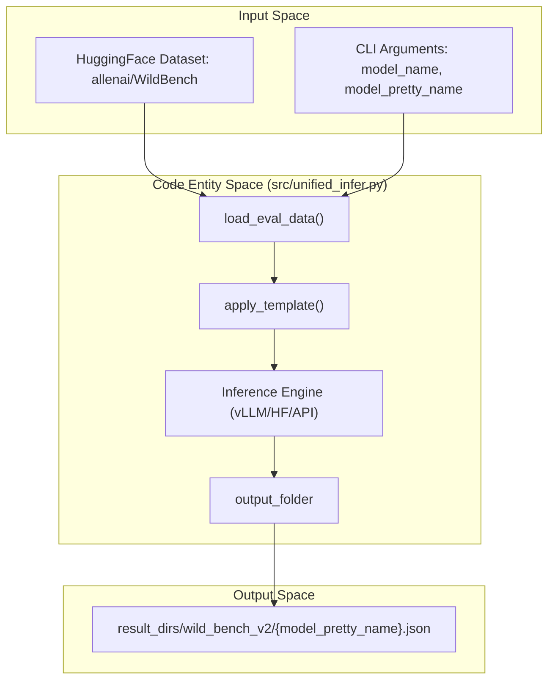

### Sharding and Merging
When `n_shards` > 1, the system spawns multiple background processes using `CUDA_VISIBLE_DEVICES` to isolate GPUs [scripts/_common_vllm.sh:44-60](). After all shards finish, `src/merge_results.py` consolidates the partial JSON files into a single model result [scripts/_common_vllm.sh:62-63]().

*Sources: [scripts/_common_vllm.sh:1-67](), [README.md:84-88]()*

---

## Evaluation and Leaderboard

Once inference is complete, the model must be evaluated by a judge (typically `gpt-4-turbo` or `gpt-4o`) to calculate the **WB-Score**.

### 1. Run Evaluation (Batch Mode)
The OpenAI Batch API is preferred for cost efficiency and high throughput.
```bash
bash evaluation/run_score_eval_batch.sh ${MODEL_PRETTY_NAME}
```
This script generates a `.jsonl` file for the OpenAI Batch API and submits it [README.md:39-39]().

### 2. Check Status
Monitor the progress of the batch job:
```bash
python src/openai_batch_eval/check_batch_status_with_model_name.py ${MODEL_PRETTY_NAME}
```
*Sources: [README.md:40-41]()*

### 3. Generate Leaderboard Table
After evaluation results are downloaded and placed in `eval_results/`, update the local leaderboard:
```bash
bash leaderboard/show_eval.sh score_only
```
*Sources: [README.md:43-43]()*

---

## Submitting a New Model

To add a model to the official leaderboard, contributors can either run the pipeline themselves or request the maintainers to do so.

### Submission via GitHub Issue
Use the **Add new model** template [GITHUB_ISSUE_TEMPLATE/add-new-model.md:1-24]().
*   **Open-weight models**: Provide the HuggingFace ID and specify if vLLM supports it.
*   **API-based models**: Provide the endpoint URL and coordinate API key access if necessary.

### Implementation Workflow
If implementing the model yourself:
1.  **Script Creation**: Create a new shell script in `scripts/` (e.g., `scripts/my-model.sh`) based on `_common_vllm.sh` or `_common_hf.sh` [README.md:97-100]().
2.  **Conversation Template**: Ensure the model's chat template is correctly mapped in `src/fastchat_conversation.py` or use the `--use_hf_conv_template` flag [README.md:101-101]().
3.  **Inference & Eval**: Run the inference and evaluation steps described above.
4.  **Pull Request**: Submit a PR including the new script in `scripts/`.

**Model Integration Flow**
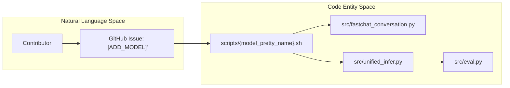

*Sources: [.github/ISSUE_TEMPLATE/add-new-model.md:10-24](), [README.md:92-132]()*

---

# Page: Repository Structure & Key Concepts

# Repository Structure & Key Concepts

<details>
<summary>Relevant source files</summary>

The following files were used as context for generating this wiki page:

- [.gitignore](.gitignore)
- [EVAL.md](EVAL.md)
- [LICENSE](LICENSE)
- [README.md](README.md)
- [requirements.txt](requirements.txt)
- [scripts/Llama-3-Instruct-8B-SimPO.sh](scripts/Llama-3-Instruct-8B-SimPO.sh)
- [scripts/Yi-1.5-9B-Chat.sh](scripts/Yi-1.5-9B-Chat.sh)
- [scripts/_common_hf.sh](scripts/_common_hf.sh)
- [scripts/_common_vllm.sh](scripts/_common_vllm.sh)
- [src/eval.py](src/eval.py)
- [src/fastchat_conversation.py](src/fastchat_conversation.py)
- [src/global_configs.py](src/global_configs.py)
- [src/upload_results.py](src/upload_results.py)

</details>


This page provides a technical map of the WildBench repository and defines the core metrics and terminology used across the inference and evaluation pipelines.

## Repository Directory Map

The repository is organized into functional modules that separate data generation (inference), evaluation (judging), and presentation (leaderboard).

| Directory | Purpose | Key Entities |
|:---|:---|:---|
| `src/` | Core Python logic for the framework. | `unified_infer.py`, `eval.py`, `fastchat_conversation.py` |
| `scripts/` | Orchestration scripts for model inference. | `_common_vllm.sh`, `_common_hf.sh`, `_common_openai.sh` |
| `evaluation/` | Shell scripts and templates for running LLM-as-a-judge. | `run_score_eval_batch.sh`, `eval_template.score.v2.md` |
| `leaderboard/` | Scripts for aggregating raw results into final metrics. | `show_eval.sh`, `wb_elo.py`, `_create_tables.py` |
| `eval_results/` | Archive of evaluation JSON files from various judges. | `v2.0522/`, `v2.0625/` |
| `result_dirs/` | Local storage for raw model outputs (before evaluation). | `wild_bench_v2/` |
| `docs/` | Static assets and HTML for the project website. | `index.html`, `wb_radar.png` |

Sources: [README.md:97-103](), [README.md:141-147](), [scripts/_common_vllm.sh:10-11](), [EVAL.md:12-15]()

## Core Terminology & Metrics

WildBench (v2) introduces specific metrics to quantify LLM performance beyond simple accuracy.

### 1. WB-Score
The **WB-Score** is an individual performance metric. A judge (e.g., GPT-4o) assigns a raw score $Y$ from 1 to 10 based on task-specific checklists [README.md:158-159]().
*   **Formula:** Re-scaled as $(Y - 5) \times 2$.
*   **Interpretation:** A score of 5 (re-scaled to 0) represents a "borderline acceptable" response [README.md:159-160]().

### 2. WB-Reward & WB-Reward-Mix
**WB-Reward** is derived from pairwise comparisons between a model and a reference [README.md:160-162]().
*   **Values:** 100 (Much Better), 50 (Slightly Better), 0 (Tie), -50 (Slightly Worse), -100 (Much Worse) [README.md:164-168]().
*   **WB-Reward-Mix:** A composite metric (Mixture of Rewards) that aggregates pairwise rewards across multiple reference models (e.g., GPT-4-Turbo, Claude-3-Haiku, and Llama-2-70b) to reduce reference bias [README.md:170-173]().

### 3. Length Penalty (K)
The parameter `K` represents the length margin used during reward calculation to mitigate "verbosity bias." If a model is significantly longer than the reference but doesn't provide superior quality, its reward is adjusted [EVAL.md:55-56]().

### 4. Sharding
To accelerate inference on 1024 examples, the workload is split into `n_shards`. Each shard runs a subset of the data (e.g., `shard_size=256`) on a specific GPU [scripts/_common_vllm.sh:37-44]().

### 5. Pretty Name
The `model_pretty_name` is a standardized identifier used for directory naming and leaderboard display, often differing from the HuggingFace `model_name` (e.g., `Llama-3-8B-Instruct` vs `meta-llama/Meta-Llama-3-8B-Instruct`) [scripts/_common_vllm.sh:1-2]().

## Pipeline Architecture

The workflow transitions from **Natural Language Space** (user queries) to **Code Entity Space** (inference engines and judges) and finally back to structured metrics.

### Inference to Evaluation Flow
The following diagram maps the transition from generating responses to scoring them.

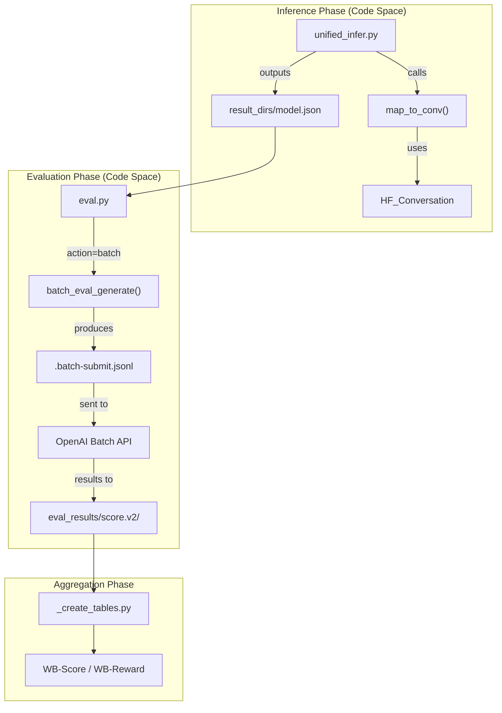
Sources: [src/unified_infer.py:1-25](), [src/fastchat_conversation.py:12-15](), [src/eval.py:35-43](), [src/eval.py:163-175](), [EVAL.md:20-28]()

### Component Relationship Diagram
This diagram illustrates how system names in documentation map to specific code entities and data structures.

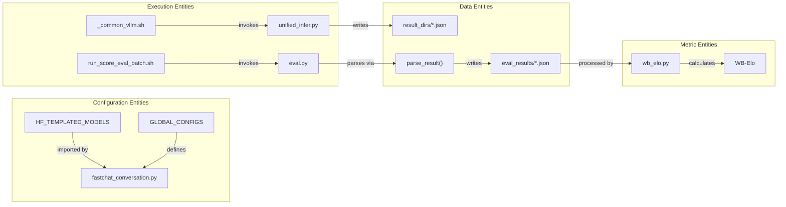
Sources: [src/fastchat_conversation.py:9-10](), [scripts/_common_vllm.sh:24-35](), [src/eval.py:101-118](), [EVAL.md:37-41](), [README.md:139-143]()

## Key Implementation Details

### Data Parallelism & Merging
When `n_shards > 1`, the system spawns background processes using `CUDA_VISIBLE_DEVICES` to isolate GPUs. After all shards complete, `src/merge_results.py` consolidates the partial JSON files into a single model output file [scripts/_common_vllm.sh:44-62]().

### Conversation Handling
The `map_to_conv` function in `src/fastchat_conversation.py` acts as a factory, selecting either a hardcoded `Conversation` template or the `HF_Conversation` class which utilizes `tokenizer.apply_chat_template` [src/fastchat_conversation.py:12-41]().

### Result Parsing
The `parse_result` function in `src/eval.py` is critical for handling LLM judge outputs. It attempts `json.loads()` first, falling back to `extract_values_from_json` using regex if the judge provides a malformed JSON string [src/eval.py:101-118]().

Sources: `src/eval.py`, `src/fastchat_conversation.py`, `scripts/_common_vllm.sh`

---

# Page: Inference Pipeline

# Inference Pipeline

<details>
<summary>Relevant source files</summary>

The following files were used as context for generating this wiki page:

- [README.md](README.md)
- [requirements.txt](requirements.txt)
- [scripts/_common_hf.sh](scripts/_common_hf.sh)
- [scripts/_common_vllm.sh](scripts/_common_vllm.sh)
- [scripts/mistral-large-2402.sh](scripts/mistral-large-2402.sh)
- [src/unified_infer.py](src/unified_infer.py)
- [src/unified_utils.py](src/unified_utils.py)

</details>


The **Inference Pipeline** is the first major phase in the WildBench evaluation lifecycle. It handles the systematic generation of model responses to the 1024 challenging user queries in the WildBench dataset. The pipeline is designed to be engine-agnostic, supporting local execution (vLLM, HuggingFace) and a wide array of proprietary APIs through a unified interface.

### High-Level Architecture

The inference process follows a structured flow from data ingestion to sharded execution and final result consolidation.

#### Inference Workflow Diagram
This diagram illustrates the transition from the "Natural Language Space" (User Queries) to the "Code Entity Space" (Inference Engines and Scripts).

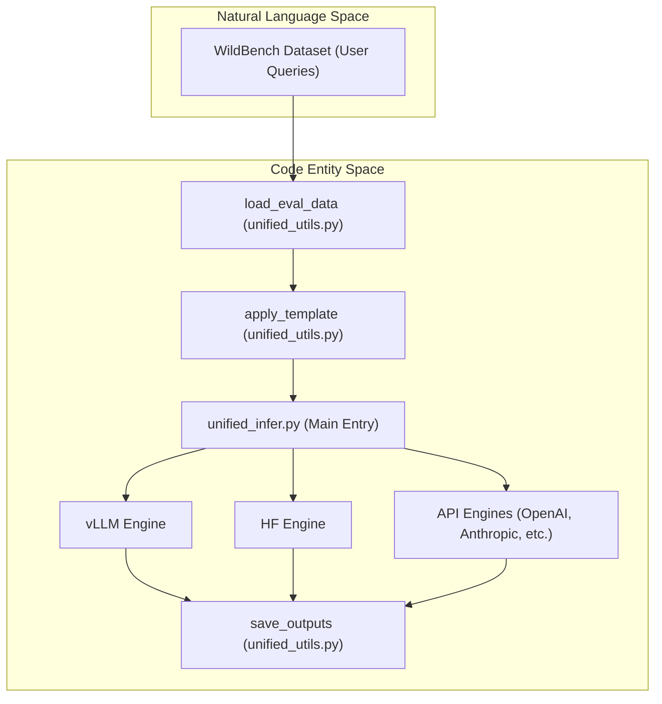
**Sources:** [src/unified_infer.py:58-121](), [src/unified_utils.py:57-121]()

---

### Core Components

The pipeline is built around three primary layers that abstract the complexities of different model backends.

#### 1. Unified Inference Engine (`unified_infer.py` & `unified_utils.py`)
The `src/unified_infer.py` script serves as the central entry point for all inference tasks [src/unified_infer.py:58-60](). It utilizes `load_eval_data` to fetch the WildBench dataset (v2) from HuggingFace [src/unified_utils.py:65-67]() and prepares the inputs. 

Key responsibilities include:
*   **Argument Parsing:** Managing model parameters like `temperature`, `top_p`, and `max_tokens` [src/unified_infer.py:15-49]().
*   **Resume Logic:** Automatically detecting existing results to skip previously processed examples [src/unified_infer.py:135-141]().
*   **Output Cleaning:** Standardizing responses by stripping special tokens (e.g., `<|endoftext|>`, `</s>`) via `clear_output` [src/unified_utils.py:125-134]().

For a deep dive into the engine's internals and provider-specific request functions, see **[unified_infer.py & unified_utils.py](#2.1)**.

#### 2. Conversation Templating
To ensure models perform optimally, the pipeline maps raw user queries into model-specific chat formats. The `apply_template` function [src/unified_utils.py:38-54]() uses a factory pattern `map_to_conv` to retrieve the correct template based on the model name [src/unified_utils.py:47]().

For details on how 50+ model families are supported, see **[Conversation Templates & Model Compatibility](#2.2)**.

#### 3. Execution Orchestration & Sharding
WildBench uses a sharding strategy to parallelize inference across multiple GPUs or to manage API rate limits. The `scripts/` directory contains shell templates that divide the 1024 examples into `n_shards` [scripts/_common_vllm.sh:37-44]().

**Inference Sharding Logic**
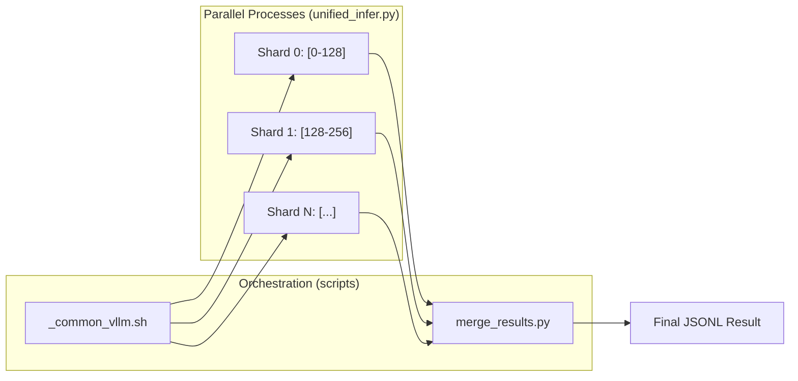
**Sources:** [scripts/_common_vllm.sh:44-62](), [scripts/mistral-large-2402.sh:12-24]()

For details on distributed inference and model-specific scripts, see **[Inference Scripts & Sharding](#2.3)**.

---

### Supported Backends

The pipeline supports three primary execution "engines" specified via the `--engine` flag [src/unified_infer.py:17]():

| Engine | Implementation | Target Models |
| :--- | :--- | :--- |
| `vllm` | Uses `vllm.LLM` [src/unified_infer.py:65-70]() | High-throughput local open-weight models. |
| `hf` | Uses `DecoderOnlyModelManager` [src/unified_infer.py:71-74]() | Models not yet supported by vLLM. |
| `openai`, `anthropic`, etc. | Provider-specific request functions [src/unified_utils.py:11-12]() | Proprietary API-based models. |

**Sources:** [src/unified_infer.py:65-75](), [src/unified_utils.py:21-26]()

---

# Page: unified_infer.py & unified_utils.py

# unified_infer.py & unified_utils.py

<details>
<summary>Relevant source files</summary>

The following files were used as context for generating this wiki page:

- [scripts/mistral-large-2402.sh](scripts/mistral-large-2402.sh)
- [src/hf_models.py](src/hf_models.py)
- [src/unified_infer.py](src/unified_infer.py)
- [src/unified_utils.py](src/unified_utils.py)

</details>


This page provides a deep dive into the core inference engine of WildBench. The system is designed to provide a "unified" interface for generating model responses across a wide variety of backends, including local open-weight models (via vLLM and HuggingFace Transformers) and various proprietary API providers.

## Core Components Overview

The inference pipeline is primarily driven by two files:
1.  `src/unified_infer.py`: The main entry point script that handles CLI arguments, model initialization, the generation loop, and result persistence [src/unified_infer.py:1-150]().
2.  `src/unified_utils.py`: A utility library containing data loading logic, conversation templating, and provider-specific API request wrappers [src/unified_utils.py:1-121]().

### Data Flow Diagram
The following diagram illustrates the flow of data from the initial dataset loading to the final saved model responses.

**Inference Data Flow**
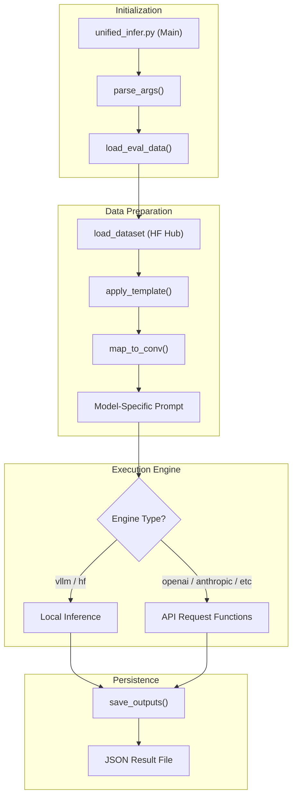
Sources: [src/unified_infer.py:58-111](), [src/unified_utils.py:38-54](), [src/unified_utils.py:57-121]()

---

## CLI Arguments and Configuration

`unified_infer.py` uses `argparse` to configure the inference run. Key arguments include:

| Argument | Type | Default | Description |
| :--- | :--- | :--- | :--- |
| `--engine` | `str` | `"vllm"` | The backend to use (`vllm`, `hf`, `openai`, `anthropic`, `google`, `cohere`, `mistral`, `together`, `reka`, `yi`) [src/unified_infer.py:17](). |
| `--model_name` | `str` | `None` | The model identifier (e.g., HF path or API model ID) [src/unified_infer.py:20](). |
| `--data_name` | `str` | `"wild_bench"` | The dataset to load [src/unified_infer.py:26](). |
| `--batch_size` | `int` | `1` | Number of samples per batch (primarily for vLLM/HF) [src/unified_infer.py:27](). |
| `--start_index` / `--end_index` | `int` | `0` / `-1` | Indices for sharding and resuming [src/unified_infer.py:34-35](). |
| `--tensor_parallel_size` | `int` | `1` | Number of GPUs for vLLM [src/unified_infer.py:23](). |

Sources: [src/unified_infer.py:15-49]()

---

## Data Loading and Templating

### `load_eval_data`
This function is responsible for fetching the evaluation dataset (usually `allenai/WildBench` v2) and extracting the conversation history [src/unified_utils.py:57-74](). It returns a list of session IDs, the raw chat history, and the templated model inputs [src/unified_utils.py:121]().

### `apply_template`
This function converts raw chat histories into the specific string format required by the model.
- For local engines (`vllm`, `hf`), it uses `map_to_conv` from `fastchat_conversation.py` to apply the correct chat template (e.g., ChatML, Llama-3, etc.) [src/unified_utils.py:42-53]().
- For API engines, it often returns `"n/a"` as the API wrappers handle the message dictionary format directly [src/unified_utils.py:43]().

Sources: [src/unified_utils.py:38-54](), [src/unified_utils.py:57-121]()

---

## Provider-Specific Request Functions

WildBench supports a wide array of proprietary models through dedicated request wrappers in `unified_utils.py`. These functions are orchestrated by `retry_handler` to manage rate limits and transient errors.

**Code-to-Provider Mapping**
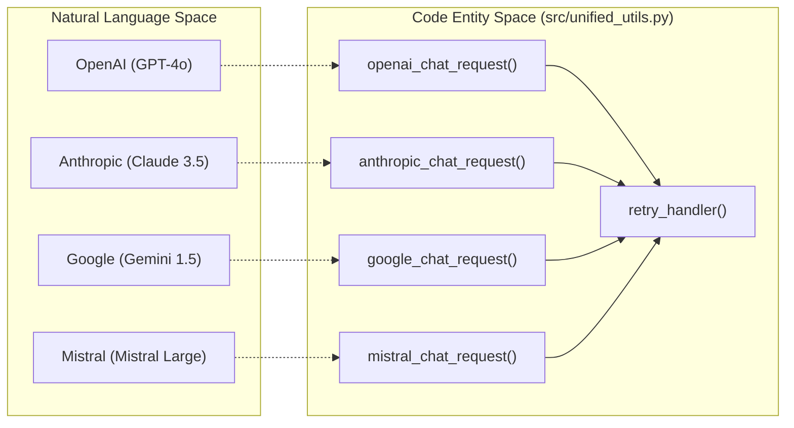
Sources: [src/unified_utils.py:145-310](), [src/unified_infer.py:11-12]()

### Key Request Wrappers:
- **`openai_chat_request`**: Supports OpenAI-compatible endpoints. It uses the `openai` library and handles both legacy (0.28.0) and modern API versions [src/unified_utils.py:145-177]().
- **`anthropic_chat_request`**: Uses the `anthropic` client for Claude models [src/unified_utils.py:228-246]().
- **`google_chat_request`**: Uses `google.generativeai` for Gemini models [src/unified_utils.py:179-204]().
- **`retry_handler`**: A decorator-like wrapper (though implemented as a higher-order function) that uses `tenacity` to provide exponential backoff for API calls [src/unified_utils.py:136-143]().

---

## Output Cleaning and Resume Logic

### Output Cleaning (`clear_output`)
To ensure consistent evaluation, `clear_output` removes common artifacts like `<|endoftext|>`, `</s>`, and `<end_of_turn>` from the generated strings [src/unified_utils.py:125-134]().

### Resume Logic
`unified_infer.py` implements a simple but effective resume mechanism:
1. It checks if the target `filepath` already exists [src/unified_infer.py:135]().
2. If it exists and `--overwrite` is not set, it loads the existing results [src/unified_infer.py:136-139]().
3. It calculates `num_skipped` based on the number of completed entries and slices the `todo_inputs` accordingly [src/unified_infer.py:140-144]().

Sources: [src/unified_utils.py:125-134](), [src/unified_infer.py:133-144]()

---

## Execution Engines

### vLLM Engine
When `--engine vllm` is used, the script initializes a `vllm.LLM` instance [src/unified_infer.py:65-70](). It uses `SamplingParams` to control generation and supports batching for high throughput [src/unified_infer.py:147-152]().

### HuggingFace Engine
When `--engine hf` is used, the script uses `DecoderOnlyModelManager` from `hf_models.py` [src/unified_infer.py:71-74](). This is typically used for models not yet supported by vLLM or for specific quantization needs like GPTQ [src/hf_models.py:153-157]().

Sources: [src/unified_infer.py:65-74](), [src/hf_models.py:97-160]()

---

# Page: Conversation Templates & Model Compatibility

# Conversation Templates & Model Compatibility

<details>
<summary>Relevant source files</summary>

The following files were used as context for generating this wiki page:

- [.gitignore](.gitignore)
- [LICENSE](LICENSE)
- [scripts/Yi-1.5-9B-Chat.sh](scripts/Yi-1.5-9B-Chat.sh)
- [scripts/mistral-large-2402.sh](scripts/mistral-large-2402.sh)
- [src/eval.py](src/eval.py)
- [src/fastchat_conversation.py](src/fastchat_conversation.py)
- [src/global_configs.py](src/global_configs.py)
- [src/unified_infer.py](src/unified_infer.py)
- [src/unified_utils.py](src/unified_utils.py)
- [src/upload_results.py](src/upload_results.py)

</details>


The WildBench inference pipeline relies on a robust templating system to format raw chat histories into model-specific prompt formats. This system handles the nuances of over 50 model families, ensuring that system prompts, user queries, and assistant responses are delineated correctly according to each model's training regime.

## Templating Architecture

The core logic for prompt formatting is contained within `src/fastchat_conversation.py`, which defines the structure for chat history and the rules for converting that history into a single string (for open-weight models) or a structured format (for APIs).

### The map_to_conv Factory
The `map_to_conv` function acts as a central dispatcher. It inspects the `model_name` and returns an appropriate conversation manager object [src/fastchat_conversation.py:12-41]().

1.  **HuggingFace Templated Models**: If a model is listed in `HF_TEMPLATED_MODELS`, it uses the `HF_Conversation` class, which leverages the model's own `tokenizer.apply_chat_template` [src/fastchat_conversation.py:13-15]().
2.  **Hardcoded Templates**: For other popular families like `gemma`, `llama-2`, `llama-3`, `mistral`, `yi`, and `qwen`, it retrieves a predefined template via `get_conv_template` [src/fastchat_conversation.py:16-37]().

### Data Flow: From Dataset to Prompt
The `apply_template` function in `src/unified_utils.py` orchestrates the transformation of chat history into model inputs [src/unified_utils.py:38-54]().

Title: Inference Templating Flow
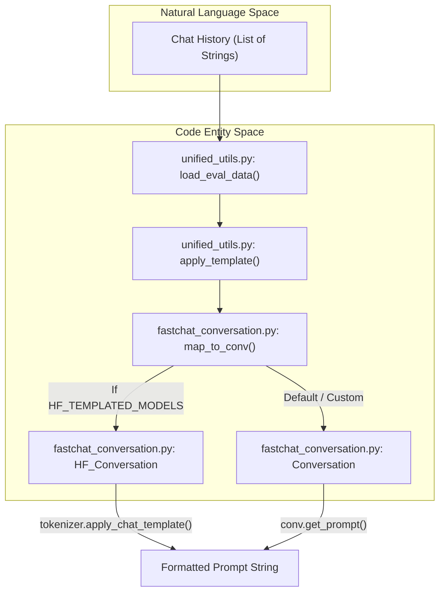
Sources: [src/unified_utils.py:38-54](), [src/unified_utils.py:119-121](), [src/fastchat_conversation.py:12-41]()

## Key Classes & Structures

### HF_Conversation
This class is a wrapper for models that provide a `chat_template` within their HuggingFace `tokenizer_config.json`.
*   **Initialization**: Loads the tokenizer using `AutoTokenizer.from_pretrained` [src/fastchat_conversation.py:48]().
*   **Method**: `get_prompt()` calls `self.hf_tokenizer.apply_chat_template` with `add_generation_prompt=True` to ensure the prompt ends with the assistant's turn header [src/fastchat_conversation.py:64-67]().

### Conversation (Dataclass)
A highly configurable dataclass that manages manual prompt construction [src/fastchat_conversation.py:99-123]().
*   **Roles**: Defines role names (e.g., `("USER", "ASSISTANT")`) [src/fastchat_conversation.py:110]().
*   **Separator Styles**: Uses the `SeparatorStyle` enum to determine how to join messages [src/fastchat_conversation.py:116]().
*   **get_prompt()**: Implements logic for various styles such as `ADD_COLON_SINGLE`, `LLAMA2`, `CHATML`, etc. [src/fastchat_conversation.py:124-170]().

### SeparatorStyle
An `IntEnum` used by the `Conversation` class to handle different formatting requirements [src/fastchat_conversation.py:73-97](). Notable styles include:
*   `LLAMA2`: Specifically for Llama-2's complex `[INST] <<SYS>>...` format [src/fastchat_conversation.py:82]().
*   `CHATML`: The `<|im_start|>` and `<|im_end|>` format used by Qwen and Yi [src/fastchat_conversation.py:85]().
*   `URIAL`: Support for Untokenized Robust Instruction Alignment [src/fastchat_conversation.py:95]().

Sources: [src/fastchat_conversation.py:43-71](), [src/fastchat_conversation.py:73-123]()

## Configuration and Stop Tokens

WildBench manages model-specific behaviors through `src/global_configs.py` and dynamic detection in `src/unified_infer.py`.

### Global Config Lists
*   **HF_TEMPLATED_MODELS**: Models that should bypass manual templates in favor of the HF tokenizer template (e.g., `zephyr-7b-gemma-v0.1`, `dbrx-instruct`) [src/global_configs.py:2]().
*   **IM_END_MODELS**: Models that use specific ChatML-style end tokens which need to be registered as stop tokens to prevent "rambling" [src/global_configs.py:3]().

### Stop Token Detection
In `src/unified_infer.py`, the engine automatically configures `stop_token_ids` to ensure generation halts correctly [src/unified_infer.py:114-131]().

Title: Stop Token Logic
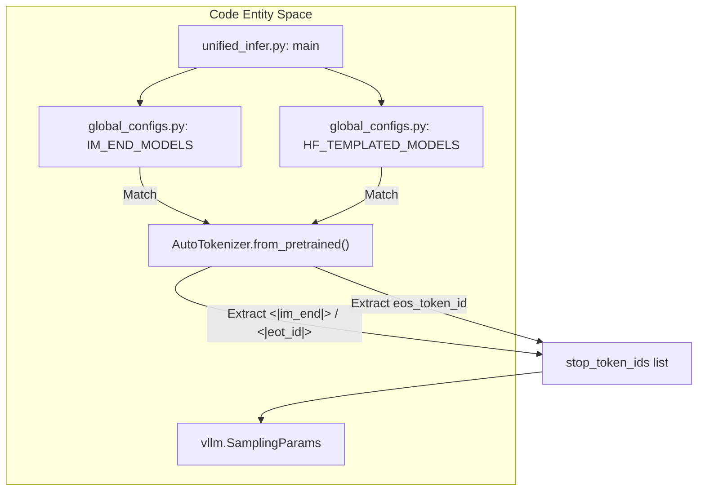

Sources: [src/global_configs.py:1-3](), [src/unified_infer.py:122-131](), [src/unified_infer.py:147-148]()

## Model Compatibility Implementation

When running inference, users can override default behaviors using CLI flags which modify the global configuration at runtime:
*   `--use_hf_conv_template`: Force-adds the model to `HF_TEMPLATED_MODELS` [src/unified_infer.py:80-81]().
*   `--use_imend_stop`: Force-adds the model to `IM_END_MODELS` [src/unified_infer.py:82-83]().

### Example: Yi-1.5 Compatibility
For the Yi-1.5 model family, the inference script `scripts/Yi-1.5-9B-Chat.sh` explicitly uses these flags to ensure the ChatML template and stop tokens are applied correctly [scripts/Yi-1.5-9B-Chat.sh:24]().

### Output Cleaning
Post-generation, `unified_utils.py` provides a `clear_output` function to strip common artifacts like `<|endoftext|>`, `</s>`, or `<pad>` that might remain if stop-token detection was incomplete [src/unified_utils.py:125-134]().

Sources: [src/unified_infer.py:80-83](), [scripts/Yi-1.5-9B-Chat.sh:24](), [src/unified_utils.py:125-134]()

---

# Page: Inference Scripts & Sharding

# Inference Scripts & Sharding

<details>
<summary>Relevant source files</summary>

The following files were used as context for generating this wiki page:

- [README.md](README.md)
- [eval_results/v2.0522/pairwise.v2/eval=gpt-4-turbo-2024-04-09/ref=Llama-2-70b-chat-hf/command-r-plus.json](eval_results/v2.0522/pairwise.v2/eval=gpt-4-turbo-2024-04-09/ref=Llama-2-70b-chat-hf/command-r-plus.json)
- [eval_results/v2.0522/pairwise.v2/eval=gpt-4-turbo-2024-04-09/ref=claude-3-haiku-20240307/command-r-plus.json](eval_results/v2.0522/pairwise.v2/eval=gpt-4-turbo-2024-04-09/ref=claude-3-haiku-20240307/command-r-plus.json)
- [eval_results/v2.0522/pairwise.v2/eval=gpt-4-turbo-2024-04-09/ref=gpt-4-turbo-2024-04-09/command-r-plus.json](eval_results/v2.0522/pairwise.v2/eval=gpt-4-turbo-2024-04-09/ref=gpt-4-turbo-2024-04-09/command-r-plus.json)
- [eval_results/v2.0522/score.v2/eval=gpt-4-turbo-2024-04-09/command-r-plus.json](eval_results/v2.0522/score.v2/eval=gpt-4-turbo-2024-04-09/command-r-plus.json)
- [requirements.txt](requirements.txt)
- [scripts/Hermes-2-Theta-Llama-3-8B.sh](scripts/Hermes-2-Theta-Llama-3-8B.sh)
- [scripts/Llama-2-13b-chat-hf.sh](scripts/Llama-2-13b-chat-hf.sh)
- [scripts/Llama-2-70b-chat-hf.sh](scripts/Llama-2-70b-chat-hf.sh)
- [scripts/Llama-2-7b-chat-hf.sh](scripts/Llama-2-7b-chat-hf.sh)
- [scripts/_common_hf.sh](scripts/_common_hf.sh)
- [scripts/_common_openai.sh](scripts/_common_openai.sh)
- [scripts/_common_vllm.sh](scripts/_common_vllm.sh)
- [scripts/claude-3-opus-20240229.sh](scripts/claude-3-opus-20240229.sh)
- [scripts/claude-3-sonnet-20240229.sh](scripts/claude-3-sonnet-20240229.sh)
- [scripts/cohere-command-r-plus.sh](scripts/cohere-command-r-plus.sh)
- [scripts/cohere-command-r.sh](scripts/cohere-command-r.sh)
- [scripts/cohere-command.sh](scripts/cohere-command.sh)
- [scripts/gemini-1.0-pro.sh](scripts/gemini-1.0-pro.sh)
- [scripts/gemini-1.5-flash.sh](scripts/gemini-1.5-flash.sh)
- [scripts/zephyr-7b-beta.sh](scripts/zephyr-7b-beta.sh)
- [src/merge_results.py](src/merge_results.py)
- [src/openai_batch_eval/check_batch_status_with_model_name.py](src/openai_batch_eval/check_batch_status_with_model_name.py)

</details>


The `scripts/` directory serves as the orchestration layer for running large-scale inference on the WildBench dataset. It manages the complexity of distributed execution across multiple GPUs and handles the integration of diverse backends (vLLM, HuggingFace, and various proprietary APIs) through a unified sharding logic.

## Common Orchestration Templates

WildBench provides standardized shell scripts that abstract the boilerplate required for different inference engines. These templates handle the logic for single-device execution versus multi-shard data parallelism.

*   **`_common_vllm.sh`**: The primary template for open-weight models supported by vLLM. It uses `--use_hf_conv_template` and `--use_imend_stop` by default [scripts/_common_vllm.sh:28-28]().
*   **`_common_hf.sh`**: A fallback template for models requiring the native HuggingFace `transformers` engine [scripts/_common_hf.sh:21-21]().
*   **`_common_openai.sh`**: A template for API-based models that use the OpenAI-compatible interface [scripts/_common_openai.sh:21-21]().

### Template Data Flow
The following diagram illustrates how a common script orchestrates the transition from user input to distributed execution.

**Inference Orchestration Flow**
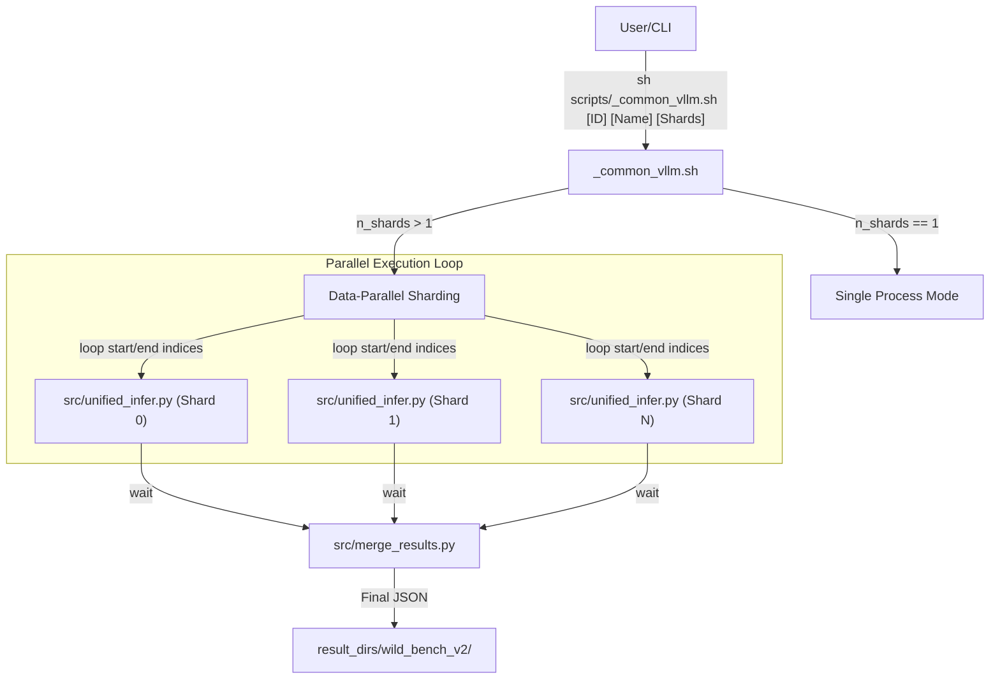
Sources: [scripts/_common_vllm.sh:16-63](), [scripts/_common_hf.sh:16-60]()

## Data-Parallelism & Sharding Logic

WildBench implements a simple but effective data-parallelism strategy. The total dataset (typically 1024 examples) is divided into equal chunks, each processed by a separate instance of `src/unified_infer.py` running in the background.

### Shard Calculation
In multi-shard mode, the scripts calculate `shard_size` by dividing the total examples by the requested `n_shards` [scripts/_common_vllm.sh:38-42]().
*   **`start_index`**: The beginning of the shard [scripts/_common_vllm.sh:48-48]().
*   **`end_index`**: The end of the shard [scripts/_common_vllm.sh:48-48]().
*   **`CUDA_VISIBLE_DEVICES`**: Isolation is achieved by assigning a specific GPU ID to each background process [scripts/_common_vllm.sh:46-46]().

### Large Model Parallelism (Tensor Parallel)
For large models that cannot fit on a single GPU (e.g., Llama-3-70B), the scripts distinguish between **Data Parallelism** (sharding the dataset) and **Tensor Parallelism** (sharding the model weights).
*   In single-shard mode, `tensor_parallel_size` is set to the total available GPUs [scripts/_common_vllm.sh:19-30]().
*   In multi-shard mode, `tensor_parallel_size` is typically set to 1 per shard, allowing multiple smaller models to run in parallel on different GPUs [scripts/_common_vllm.sh:41-53]().

| Parameter | Role | Implementation |
| :--- | :--- | :--- |
| `n_shards` | Number of parallel processes | Shell `for` loop [scripts/cohere-command.sh:12-12]() |
| `shard_size` | Examples per process | `TOTAL_EXAMPLE / n_shards` [scripts/_common_vllm.sh:42-42]() |
| `tensor_parallel_size` | GPUs per model instance | Passed to `unified_infer.py` [scripts/_common_vllm.sh:53-53]() |
| `CUDA_VISIBLE_DEVICES` | Hardware isolation | Prepended to the python command [scripts/_common_hf.sh:42-42]() |

Sources: [scripts/_common_vllm.sh:16-60](), [scripts/zephyr-7b-beta.sh:12-30]()

## Result Aggregation

Since each shard writes its output to a temporary directory (`shards_dir`), a post-processing step is required to create a single submission file.

1.  **Temporary Storage**: Each shard instance saves its results into `result_dirs/wild_bench_v2/tmp_[model_pretty_name]/` [scripts/_common_vllm.sh:43-43]().
2.  **Wait Command**: The shell script uses `wait` to ensure all background processes complete [scripts/_common_vllm.sh:61-61]().
3.  **Merge**: `src/merge_results.py` is called to collect all JSON fragments from the temporary directory and combine them into a single file named `[model_pretty_name].json` [scripts/cohere-command.sh:24-24]().
4.  **Finalization**: The merged file is moved to the main `result_dirs/wild_bench_v2/` folder for evaluation [scripts/cohere-command.sh:25-25]().

**Data Flow: From Shards to Final Result**
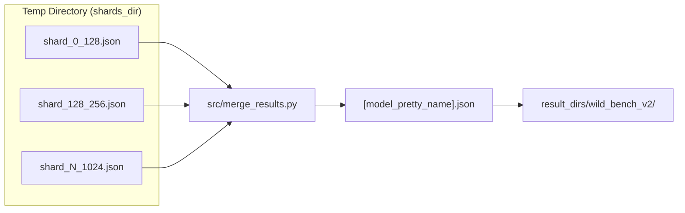
Sources: [scripts/cohere-command.sh:11-25](), [scripts/Llama-2-13b-chat-hf.sh:16-35]()

## Per-Model Scripts

While common templates exist, many models have bespoke scripts to handle specific constraints or API requirements.

*   **API Rate Limiting**: Scripts for Claude, Gemini, and Cohere often use sharding (e.g., `n_shards=8`) not for GPU isolation, but to parallelize network requests and maximize throughput within rate limits [scripts/claude-3-opus-20240229.sh:8-12]().
*   **Model Constraints**: Some models have specific `MAX_TOKENS` limits (e.g., Command-R-Plus is limited to 4000) which are hardcoded in their specific script [scripts/cohere-command-r-plus.sh:5-5]().
*   **Legacy Configurations**: Older scripts like `zephyr-7b-beta.sh` or `Llama-2-13b-chat-hf.sh` contain hardcoded shard sizes and GPU counts [scripts/zephyr-7b-beta.sh:14-15](), [scripts/Llama-2-13b-chat-hf.sh:13-14]().

Sources: [scripts/claude-3-opus-20240229.sh:1-25](), [scripts/cohere-command-r-plus.sh:1-25](), [scripts/gemini-1.0-pro.sh:1-26]()

---

# Page: Evaluation Pipeline

# Evaluation Pipeline

<details>
<summary>Relevant source files</summary>

The following files were used as context for generating this wiki page:

- [EVAL.md](EVAL.md)
- [eval_results/v2.0522/pairwise.v2/eval=gpt-4-turbo-2024-04-09/ref=Llama-2-70b-chat-hf/neo_7b_instruct_v0.1.json](eval_results/v2.0522/pairwise.v2/eval=gpt-4-turbo-2024-04-09/ref=Llama-2-70b-chat-hf/neo_7b_instruct_v0.1.json)
- [eval_results/v2.0522/pairwise.v2/eval=gpt-4-turbo-2024-04-09/ref=claude-3-haiku-20240307/neo_7b_instruct_v0.1.json](eval_results/v2.0522/pairwise.v2/eval=gpt-4-turbo-2024-04-09/ref=claude-3-haiku-20240307/neo_7b_instruct_v0.1.json)
- [eval_results/v2.0522/pairwise.v2/eval=gpt-4-turbo-2024-04-09/ref=gpt-4-turbo-2024-04-09/neo_7b_instruct_v0.1.json](eval_results/v2.0522/pairwise.v2/eval=gpt-4-turbo-2024-04-09/ref=gpt-4-turbo-2024-04-09/neo_7b_instruct_v0.1.json)
- [eval_results/v2.0522/score.v2/eval=gpt-4o-2024-05-13/neo_7b_instruct_v0.1.json](eval_results/v2.0522/score.v2/eval=gpt-4o-2024-05-13/neo_7b_instruct_v0.1.json)
- [evaluation/eval_template.pairwise.v2.md](evaluation/eval_template.pairwise.v2.md)
- [evaluation/eval_template.score.v2.md](evaluation/eval_template.score.v2.md)
- [evaluation/run_all_eval_batch.sh](evaluation/run_all_eval_batch.sh)
- [evaluation/run_eval_v2_instant.score.sh](evaluation/run_eval_v2_instant.score.sh)
- [scripts/Llama-3-Instruct-8B-SimPO.sh](scripts/Llama-3-Instruct-8B-SimPO.sh)

</details>


The WildBench evaluation pipeline implements an LLM-as-a-judge system to assess model performance across 1,024 diverse tasks. It supports two primary evaluation modes—**Score** and **Pairwise**—and provides two execution paths—**Batch** (via OpenAI Batch API) and **Instant** (via local parallel processing).

## Core Evaluation Modes

The pipeline operates in two distinct modes, governed by specific prompt templates and scoring rubrics.

| Mode | Template | Judge Logic | Output Format |
| :--- | :--- | :--- | :--- |
| **Score** | `eval_template.score.v2.md` | Single model assessment on a 1-10 scale. | JSON with `strengths`, `weaknesses`, and `score`. |
| **Pairwise** | `eval_template.pairwise.v2.md` | Comparison between a candidate and a reference model. | JSON with `choice` (A++, A+, A=B, B+, B++) and analysis. |

### Evaluation Flow Overview
The following diagram illustrates how the natural language prompts are constructed from code entities and placeholders.

**Diagram: Prompt Construction & Execution**
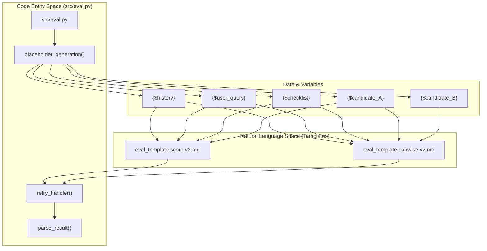
**Sources:** [src/eval.py:1-200](), [evaluation/eval_template.score.v2.md:1-67](), [evaluation/eval_template.pairwise.v2.md:1-76]()

---

## Judge Models
WildBench uses high-capability models as judges to ensure reliable evaluations.
*   **Primary Score Judge:** `gpt-4o-2024-05-13` is used for the current version (v2.0625) of WB-Score [evaluation/run_eval_v2_instant.score.sh:3-10]().
*   **Pairwise Judges:** Multiple models are used to calculate WB-Reward, including `gpt-4-turbo-2024-04-09`, `claude-3-haiku-20240307`, and `Llama-2-70b-chat-hf` [evaluation/run_all_eval_batch.sh:3-5]().

---

## Execution Paths

The pipeline provides two methods for running evaluations, depending on the scale and urgency of the task.

### 1. Batch Evaluation (Asynchronous)
This path is optimized for cost and high throughput using the OpenAI Batch API. It involves generating a `.jsonl` request file, submitting it, and polling for results.
*   **Scripts:** `run_eval_v2_batch.sh`, `submit_batch.py`, `check_batch_status_with_id.py`.
*   **Workflow:** Generate requests → Submit to OpenAI → Check status → Retrieve and format results [EVAL.md:6-42]().
*   **For details, see [Batch Evaluation via OpenAI Batch API](#3.3).**

### 2. Instant Evaluation (Synchronous)
This path uses local sharding to run evaluations in parallel across multiple background processes. It is faster for immediate results but subject to standard API rate limits.
*   **Scripts:** `run_eval_v2_instant.score.sh`, `run_eval_v2_instant.sh`.
*   **Workflow:** Calculate shards (default 8) → Spawn `src/eval.py` processes → Wait for completion → Run `src/merge_results.py` [evaluation/run_eval_v2_instant.score.sh:16-50]().
*   **For details, see [Instant (Synchronous) Evaluation](#3.4).**

**Diagram: Execution Path Logic**
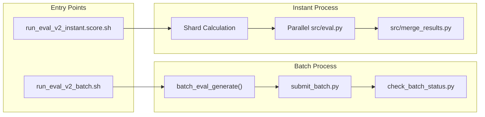
**Sources:** [evaluation/run_eval_v2_instant.score.sh:16-50](), [EVAL.md:6-42](), [src/eval.py:1-100]()

---

## Sub-System Details

### [Evaluation Templates & Judge Prompts](#3.1)
Covers the markdown templates used to prompt the judge. It explains how `{$checklist}` is injected for fine-grained evaluation and how the rubrics (1-10 for scores, choice notation for pairwise) are defined.
*   **Key Files:** `evaluation/eval_template.score.v2.md`, `evaluation/eval_template.pairwise.v2.md`.

### [eval.py: The Judge Interface](#3.2)
The core Python script that interfaces with LLM providers. It handles placeholder replacement, positional bias mitigation (randomizing A/B order in pairwise), and parsing structured JSON responses from raw model output.
*   **Key Files:** `src/eval.py`.

### [Batch Evaluation via OpenAI Batch API](#3.3)
The full asynchronous workflow. Detailed documentation on using `submit_batch.py` and monitoring tools to manage large-scale evaluation runs.
*   **Key Files:** `src/openai_batch_eval/`, `evaluation/run_all_eval_batch.sh`.

### [Instant (Synchronous) Evaluation](#3.4)
Details on the sharding mechanism used to parallelize synchronous API calls. Explains how the `total_ex` (1024) is split and how `merge_results.py` consolidates the temporary shard files.
*   **Key Files:** `evaluation/run_eval_v2_instant.score.sh`, `src/merge_results.py`.

---

# Page: Evaluation Templates & Judge Prompts

# Evaluation Templates & Judge Prompts

<details>
<summary>Relevant source files</summary>

The following files were used as context for generating this wiki page:

- [.gitignore](.gitignore)
- [LICENSE](LICENSE)
- [evaluation/eval_template.pairwise.v2.md](evaluation/eval_template.pairwise.v2.md)
- [evaluation/eval_template.score.v2.md](evaluation/eval_template.score.v2.md)
- [scripts/Yi-1.5-9B-Chat.sh](scripts/Yi-1.5-9B-Chat.sh)
- [src/eval.py](src/eval.py)
- [src/fastchat_conversation.py](src/fastchat_conversation.py)
- [src/global_configs.py](src/global_configs.py)
- [src/upload_results.py](src/upload_results.py)

</details>


This page provides a technical deep dive into the prompt engineering and template logic used by the WildBench evaluation system. WildBench employs LLM-as-a-judge using two primary paradigms: single-model scoring and pairwise comparison. These templates are designed to structure the judge's reasoning and ensure consistent JSON output for downstream parsing.

## Overview of Evaluation Templates

WildBench utilizes Markdown-based templates to instruct judge models (typically GPT-4o or GPT-4 Turbo). These templates contain specific placeholders that are dynamically populated by the evaluation script `src/eval.py` during the inference phase.

### Key Placeholder Variables
Both templates share a common set of variables injected at runtime:
*   `{$history}`: The conversation history leading up to the current query [evaluation/eval_template.score.v2.md:12]().
*   `{$user_query}`: The specific prompt or instruction provided by the user in the current turn [evaluation/eval_template.score.v2.md:19]().
*   `{$checklist}`: A set of task-specific criteria used to guide the judge [evaluation/eval_template.score.v2.md:37]().
*   `{$model_output}`: (Score mode) The response generated by the model being evaluated [evaluation/eval_template.score.v2.md:26]().
*   `{$candidate_A}` / `{$candidate_B}`: (Pairwise mode) The two competing model responses [evaluation/eval_template.pairwise.v2.md:26-33]().

### Data Flow: From Template to Judge
The following diagram illustrates how `src/eval.py` processes these templates and interacts with the judge API.

**Template Population and Judge Interaction**
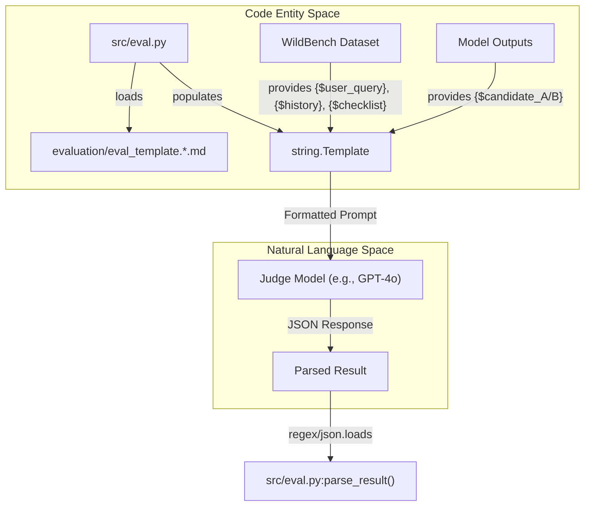
**Sources:** [src/eval.py:35-68](), [evaluation/eval_template.score.v2.md:1-40](), [evaluation/eval_template.pairwise.v2.md:1-45]()

---

## Single-Model Scoring (eval_template.score.v2.md)

The scoring template asks the judge to provide an absolute quality rating on a scale of 1-10.

### Scoring Rubric
The judge is instructed to follow a specific rubric:
*   **1-2**: Very poor, makes no sense.
*   **3-4**: Poor, does not help the user meaningfully.
*   **5-6**: Fair, but contains factual errors or hallucinations.
*   **7-8**: Good, but has room for improvement.
*   **9-10**: Perfect, provides helpful and accurate information.

**Sources:** [evaluation/eval_template.score.v2.md:50-54]()

### Output Schema
The judge is required to return a JSON object containing:
1.  `strengths`: Analysis of what the model did well.
2.  `weaknesses`: Analysis of errors or omissions.
3.  `score`: The numeric rating.

**Sources:** [evaluation/eval_template.score.v2.md:61-65]()

---

## Pairwise Comparison (eval_template.pairwise.v2.md)

The pairwise template compares two models (A and B) side-by-side. To mitigate positional bias, `src/eval.py` randomly assigns models to the "A" or "B" slot [src/eval.py:170-171]().

### Choice Notation
The judge must choose one of five labels to indicate the relative performance:
| Label | Meaning |
| :--- | :--- |
| `A++` | Response A is much better than Response B |
| `A+` | Response A is slightly better than Response B |
| `A=B` | Both responses are of equal quality |
| `B+` | Response B is slightly better than Response A |
| `B++` | Response B is much better than Response A |

**Sources:** [evaluation/eval_template.pairwise.v2.md:55-59]()

### Output Schema
The judge provides a detailed breakdown before the final choice:
*   `analysis of A/B`: Individual critiques.
*   `reason of A=B / A>B / B>A`: Comparative justifications.
*   `choice`: One of the five labels mentioned above.

**Sources:** [evaluation/eval_template.pairwise.v2.md:67-74]()

---

## Checklist Injection

Checklists are a core feature of WildBench V2. They provide the judge with specific "aspects to check" (e.g., "Is the tone professional?", "Did the model follow the formatting constraint?"). 

In `src/eval.py`, the checklist is treated as a first-class variable retrieved from the dataset [evaluation/eval_template.score.v2.md:37](). The judge is instructed to use the checklist as a guide but is permitted to identify issues outside the provided list [evaluation/eval_template.score.v2.md:41]().

---

## Implementation Details in `src/eval.py`

### Parsing and Extraction
Because LLMs sometimes include conversational filler around the JSON block, `src/eval.py` implements robust parsing logic.

*   `parse_result()`: Attempts a standard `json.loads()`. If it fails, it falls back to `extract_values_from_json()` [src/eval.py:101-118]().
*   `extract_values_from_json()`: Uses regular expressions to find keys like `score` or `choice` even if the JSON structure is malformed or missing quotes [src/eval.py:71-99]().

### Cost Computation
The script includes a `compute_cost()` function that tracks token usage and financial cost based on the judge model's specific pricing (e.g., GPT-4o, Claude-3-Haiku) [src/eval.py:120-161]().

**Judge Response Processing Pipeline**
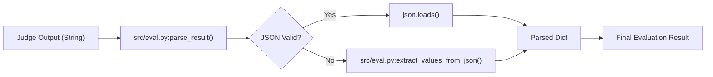
**Sources:** [src/eval.py:71-118]()

---

# Page: eval.py: The Judge Interface

# eval.py: The Judge Interface

<details>
<summary>Relevant source files</summary>

The following files were used as context for generating this wiki page:

- [.gitignore](.gitignore)
- [LICENSE](LICENSE)
- [eval_results/v2.0522/pairwise.v2/eval=gpt-4-turbo-2024-04-09/ref=Llama-2-70b-chat-hf/neo_7b_instruct_v0.1.json](eval_results/v2.0522/pairwise.v2/eval=gpt-4-turbo-2024-04-09/ref=Llama-2-70b-chat-hf/neo_7b_instruct_v0.1.json)
- [eval_results/v2.0522/pairwise.v2/eval=gpt-4-turbo-2024-04-09/ref=claude-3-haiku-20240307/neo_7b_instruct_v0.1.json](eval_results/v2.0522/pairwise.v2/eval=gpt-4-turbo-2024-04-09/ref=claude-3-haiku-20240307/neo_7b_instruct_v0.1.json)
- [eval_results/v2.0522/pairwise.v2/eval=gpt-4-turbo-2024-04-09/ref=gpt-4-turbo-2024-04-09/neo_7b_instruct_v0.1.json](eval_results/v2.0522/pairwise.v2/eval=gpt-4-turbo-2024-04-09/ref=gpt-4-turbo-2024-04-09/neo_7b_instruct_v0.1.json)
- [eval_results/v2.0522/score.v2/eval=gpt-4o-2024-05-13/neo_7b_instruct_v0.1.json](eval_results/v2.0522/score.v2/eval=gpt-4o-2024-05-13/neo_7b_instruct_v0.1.json)
- [evaluation/run_all_eval_batch.sh](evaluation/run_all_eval_batch.sh)
- [evaluation/run_eval_v2_instant.score.sh](evaluation/run_eval_v2_instant.score.sh)
- [scripts/Yi-1.5-9B-Chat.sh](scripts/Yi-1.5-9B-Chat.sh)
- [src/eval.py](src/eval.py)
- [src/fastchat_conversation.py](src/fastchat_conversation.py)
- [src/global_configs.py](src/global_configs.py)
- [src/upload_results.py](src/upload_results.py)

</details>


`src/eval.py` serves as the primary orchestration layer for synchronous evaluation in WildBench. It manages the interaction between model outputs and LLM-as-a-judge models (e.g., GPT-4o, Claude-3) by preparing prompts, handling API communication, and parsing structured results. It supports two primary evaluation modes: **Score** (individual model assessment) and **Pairwise** (comparative assessment).

### 1. Orchestration Workflow

The script handles the end-to-end evaluation loop, from CLI argument parsing to final result persistence. It is designed to work either in "Instant" mode (running synchronously via `run_eval`) or in "Batch" mode (generating JSONL files for the OpenAI Batch API).

#### Data Flow and Logic
1.  **Argument Parsing**: `get_args()` defines the execution parameters including evaluation mode, templates, and model names [src/eval.py:35-68]().
2.  **Input Loading**: It loads benchmark data from `allenai/WildBench` [src/eval.py:26-27]() and model outputs from `allenai/WildBench-V2-Model-Outputs` [src/eval.py:28-31]().
3.  **Positional Bias Mitigation**: In pairwise mode, the script randomly assigns models to positions "A" and "B" to prevent the judge from favoring a specific position [src/eval.py:169-172]().
4.  **Execution Loop**: The `run_eval` function iterates through samples, applying the `retry_handler` to manage API stability [src/eval.py:18]().
5.  **Result Processing**: Raw strings from the judge are processed via `parse_result` [src/eval.py:101-118]() and cost is calculated via `compute_cost` [src/eval.py:120-161]().

**Sources:** [src/eval.py:35-172](), [src/eval.py:18-31]()

### 2. Core Functions and Implementation

#### Placeholder Generation and Formatting
The script uses Python's `string.Template` to inject variables into the evaluation markdown templates. 
*   In **Pairwise Mode**, it maps `model_A` and `model_B` outputs to `{$candidate_A}` and `{$candidate_B}` [src/eval.py:170-172]().
*   In **Score Mode**, it maps the target model output to the relevant template placeholder [src/eval.py:173-175]().

#### Result Parsing and Regex Fallback
Judge models are instructed to return JSON. `parse_result` first attempts a standard `json.loads()` [src/eval.py:109](). If this fails due to formatting issues (e.g., missing quotes or trailing text), it triggers `extract_values_from_json`, which uses regular expressions to isolate keys like `score`, `choice`, `strengths`, and `weaknesses` [src/eval.py:71-99]().

#### Cost Tracking
The `compute_cost` function tracks token usage for various judge models. It uses `tiktoken` for OpenAI models and provides hardcoded pricing for GPT-4, GPT-4o, and Claude-3 families [src/eval.py:120-161]().

**Sources:** [src/eval.py:71-118](), [src/eval.py:120-161](), [src/eval.py:163-176]()

### 3. System Architecture Diagrams

The following diagrams illustrate the transition from user-defined CLI parameters to the execution of code logic.

**Judge Execution Flow**
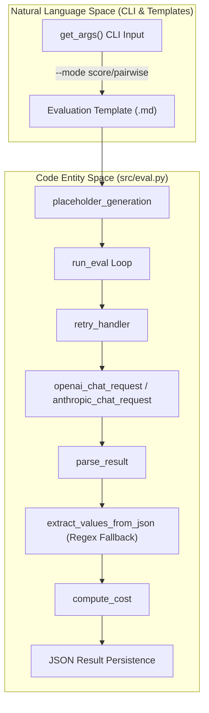
**Sources:** [src/eval.py:35-68](), [src/eval.py:101-118](), [src/eval.py:120-161](), [src/unified_utils.py:18-20]()

**Data Preparation for Evaluation**
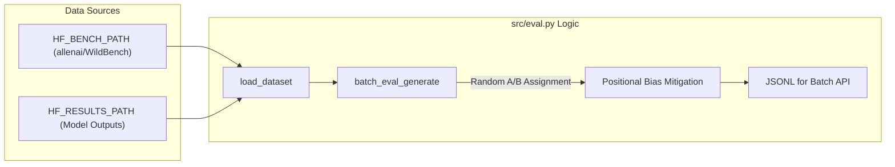
**Sources:** [src/eval.py:26-31](), [src/eval.py:163-180]()

### 4. Batch vs. Instant Evaluation

`src/eval.py` is the engine for two different execution paths defined in the `evaluation/` directory:

| Feature | Instant Mode (`run_eval_v2_instant.sh`) | Batch Mode (`run_eval_v2_batch.sh`) |
| :--- | :--- | :--- |
| **Mechanism** | Spawns multiple `src/eval.py` processes in parallel [evaluation/run_eval_v2_instant.score.sh:32-44]() | Calls `batch_eval_generate` to create a `.jsonl` file [src/eval.py:163]() |
| **Parsing** | Immediate parsing via `parse_result` | Parsing occurs after batch retrieval via `batch_results_format.py` |
| **Concurrency** | Managed by shell `&` and `wait` [evaluation/run_eval_v2_instant.score.sh:44-46]() | Managed by OpenAI/Anthropic server-side |
| **Use Case** | Quick debugging or small shards | Full 1024-sample evaluation for leaderboard submission |

**Sources:** [evaluation/run_eval_v2_instant.score.sh:32-50](), [src/eval.py:163-180]()

---

# Page: Batch Evaluation via OpenAI Batch API

# Batch Evaluation via OpenAI Batch API

<details>
<summary>Relevant source files</summary>

The following files were used as context for generating this wiki page:

- [eval_results/v2.0522/pairwise.v2/eval=gpt-4-turbo-2024-04-09/ref=Llama-2-70b-chat-hf/command-r-plus.json](eval_results/v2.0522/pairwise.v2/eval=gpt-4-turbo-2024-04-09/ref=Llama-2-70b-chat-hf/command-r-plus.json)
- [eval_results/v2.0522/pairwise.v2/eval=gpt-4-turbo-2024-04-09/ref=Llama-2-70b-chat-hf/neo_7b_instruct_v0.1.json](eval_results/v2.0522/pairwise.v2/eval=gpt-4-turbo-2024-04-09/ref=Llama-2-70b-chat-hf/neo_7b_instruct_v0.1.json)
- [eval_results/v2.0522/pairwise.v2/eval=gpt-4-turbo-2024-04-09/ref=claude-3-haiku-20240307/command-r-plus.json](eval_results/v2.0522/pairwise.v2/eval=gpt-4-turbo-2024-04-09/ref=claude-3-haiku-20240307/command-r-plus.json)
- [eval_results/v2.0522/pairwise.v2/eval=gpt-4-turbo-2024-04-09/ref=claude-3-haiku-20240307/neo_7b_instruct_v0.1.json](eval_results/v2.0522/pairwise.v2/eval=gpt-4-turbo-2024-04-09/ref=claude-3-haiku-20240307/neo_7b_instruct_v0.1.json)
- [eval_results/v2.0522/pairwise.v2/eval=gpt-4-turbo-2024-04-09/ref=gpt-4-turbo-2024-04-09/command-r-plus.json](eval_results/v2.0522/pairwise.v2/eval=gpt-4-turbo-2024-04-09/ref=gpt-4-turbo-2024-04-09/command-r-plus.json)
- [eval_results/v2.0522/pairwise.v2/eval=gpt-4-turbo-2024-04-09/ref=gpt-4-turbo-2024-04-09/neo_7b_instruct_v0.1.json](eval_results/v2.0522/pairwise.v2/eval=gpt-4-turbo-2024-04-09/ref=gpt-4-turbo-2024-04-09/neo_7b_instruct_v0.1.json)
- [eval_results/v2.0522/score.v2/eval=gpt-4-turbo-2024-04-09/command-r-plus.json](eval_results/v2.0522/score.v2/eval=gpt-4-turbo-2024-04-09/command-r-plus.json)
- [eval_results/v2.0522/score.v2/eval=gpt-4o-2024-05-13/neo_7b_instruct_v0.1.json](eval_results/v2.0522/score.v2/eval=gpt-4o-2024-05-13/neo_7b_instruct_v0.1.json)
- [evaluation/run_all_eval_batch.sh](evaluation/run_all_eval_batch.sh)
- [evaluation/run_eval_v2_batch.score.sh](evaluation/run_eval_v2_batch.score.sh)
- [evaluation/run_eval_v2_batch.sh](evaluation/run_eval_v2_batch.sh)
- [evaluation/run_eval_v2_instant.score.sh](evaluation/run_eval_v2_instant.score.sh)
- [evaluation/run_score_eval_batch.sh](evaluation/run_score_eval_batch.sh)
- [scripts/Hermes-2-Theta-Llama-3-8B.sh](scripts/Hermes-2-Theta-Llama-3-8B.sh)
- [scripts/cohere-command-r-plus.sh](scripts/cohere-command-r-plus.sh)
- [src/openai_batch_eval/batch_results_format.py](src/openai_batch_eval/batch_results_format.py)
- [src/openai_batch_eval/check_batch_status_with_id.py](src/openai_batch_eval/check_batch_status_with_id.py)
- [src/openai_batch_eval/check_batch_status_with_model_name.py](src/openai_batch_eval/check_batch_status_with_model_name.py)
- [src/openai_batch_eval/submit_batch.py](src/openai_batch_eval/submit_batch.py)

</details>


The WildBench evaluation pipeline supports an asynchronous workflow using the OpenAI Batch API. This approach is significantly more cost-effective (50% discount) and avoids the rate-limit bottlenecks associated with synchronous API calls when evaluating large models or performing extensive pairwise comparisons [evaluation/run_eval_v2_batch.score.sh:13-17]().

## Workflow Overview

The batch evaluation process consists of four primary stages:
1.  **Preparation**: Generating a `.batch-submit.jsonl` file containing all evaluation requests formatted for the OpenAI Batch API.
2.  **Submission**: Uploading the file to OpenAI and initiating the batch job.
3.  **Monitoring**: Polling the API for job completion and downloading the raw results.
4.  **Formatting**: Converting the raw OpenAI batch output into the standard WildBench JSON schema used by the leaderboard.

### Data Flow Diagram: Natural Language to Code Entities

The following diagram illustrates how evaluation requests flow from the WildBench dataset through the batch system.

**Batch Submission Data Flow**
```mermaid
graph TD
    subgraph "Natural Language Space"
        WB_Data["WildBench Dataset"]
        Prompt_Templates["Evaluation Templates (Markdown)"]
    end

    subgraph "Code Entity Space: Preparation"
        RUN_BATCH["run_eval_v2_batch.sh / run_eval_v2_batch.score.sh"]
        EVAL_PY["src/eval.py --batch_mode"]
        JSONL_OUT["$MODEL.batch-submit.jsonl"]
    end

    subgraph "OpenAI Infrastructure"
        OAI_API["OpenAI Batch API Endpoint"]
    end

    WB_Data --> EVAL_PY
    Prompt_Templates --> EVAL_PY
    RUN_BATCH -- "calls" --> EVAL_PY
    EVAL_PY -- "writes" --> JSONL_OUT
    JSONL_OUT -- "submit_batch.py" --> OAI_API
```
Sources: [evaluation/run_eval_v2_batch.score.sh:31-39](), [src/openai_batch_eval/submit_batch.py:1-10](), [evaluation/run_all_eval_batch.sh:1-12]()

---

## 1. Generating Submission Files

The generation of batch files is handled by specialized shell scripts that wrap `src/eval.py` with the `--batch_mode` flag [evaluation/run_eval_v2_batch.score.sh:31-32]().

*   **Scoring Mode**: `evaluation/run_eval_v2_batch.score.sh` generates requests for individual model scoring using a judge (defaulting to `gpt-4o-2024-05-13`) [evaluation/run_eval_v2_batch.score.sh:5-19]().
*   **Pairwise Mode**: `evaluation/run_eval_v2_batch.sh` generates requests for pairwise comparisons between the target model and a reference model (e.g., GPT-4 Turbo or Claude-3 Haiku) [evaluation/run_all_eval_batch.sh:3-5]().

The output is a `.jsonl` file where each line is a valid OpenAI Batch API request object. A `custom_id` is generated for each request to track the `session_id` and model names during post-processing [src/openai_batch_eval/batch_results_format.py:41-43]().

**Sources:** [evaluation/run_eval_v2_batch.score.sh:22-39](), [src/openai_batch_eval/batch_results_format.py:101-103]()

---

## 2. Submission and Monitoring

Once the `.jsonl` files are generated, they are submitted to OpenAI.

### Submitting Jobs
The script `src/openai_batch_eval/submit_batch.py` takes the path to the generated `.batch-submit.jsonl` and uploads it to the OpenAI `batches` endpoint [evaluation/run_all_eval_batch.sh:8-12]().

### Status Checking
Monitoring is performed using two scripts:
*   `check_batch_status_with_id.py`: Checks a specific job by its OpenAI Batch ID.
*   `check_batch_status_with_model_name.py`: Lists recent batches and filters them based on the model name stored in the batch metadata [src/openai_batch_eval/check_batch_status_with_model_name.py:9-17]().

When a batch reaches the `completed` status, `check_batch_status_with_model_name.py` automatically:
1.  Downloads the results to a `.batch_results.jsonl` file [src/openai_batch_eval/check_batch_status_with_model_name.py:24-32]().
2.  Triggers the formatting script to convert the raw output to WildBench JSON [src/openai_batch_eval/check_batch_status_with_model_name.py:33-36]().

**Sources:** [src/openai_batch_eval/check_batch_status_with_model_name.py:9-36](), [evaluation/run_all_eval_batch.sh:15]()

---

## 3. Results Formatting

The script `src/openai_batch_eval/batch_results_format.py` is the core utility for reconciling OpenAI's asynchronous output with the WildBench local results archive.

### Implementation Details
The script performs the following operations:
1.  **Mapping**: It loads the original submission file to map `custom_id` back to the original prompt and session metadata [src/openai_batch_eval/batch_results_format.py:18-25]().
2.  **Parsing**: It extracts the JSON response from the judge model's output [src/openai_batch_eval/batch_results_format.py:43-45]().
3.  **Normalization**:
    *   **Score Mode**: Extracts the `score` field and the model's response [src/openai_batch_eval/batch_results_format.py:107-113]().
    *   **Pairwise Mode**: Maps labels like `A++`, `A+`, `A=B` to numerical `extent` values (0, 1, or 2) and identifies the `winner` [src/openai_batch_eval/batch_results_format.py:70-93]().
4.  **Output**: Writes a structured JSON file to the appropriate subdirectory in `eval_results/` [src/openai_batch_eval/batch_results_format.py:122-125]().

### Data Structure Mapping
| Raw Batch Field | WildBench JSON Entity | Description |
| :--- | :--- | :--- |
| `custom_id` | `session_id` | Split by `\|\|` to retrieve original session [src/openai_batch_eval/batch_results_format.py:41-42]() |
| `response...content` | `parsed_result` | The judge's reasoning and final decision [src/openai_batch_eval/batch_results_format.py:43-52]() |
| `response...usage` | `meta_data.usage` | Token consumption for cost tracking [src/openai_batch_eval/batch_results_format.py:55]() |

**Sources:** [src/openai_batch_eval/batch_results_format.py:38-125]()

---

## 4. Summary of Batch Scripts

| Script | Purpose |
| :--- | :--- |
| `run_eval_v2_batch.sh` | Orchestrates pairwise batch file generation for multiple reference models. |
| `run_eval_v2_batch.score.sh` | Generates scoring batch files for the target model. |
| `submit_batch.py` | CLI tool to upload `.jsonl` to OpenAI API. |
| `check_batch_status_with_model_name.py` | Polling tool that downloads and formats results upon completion. |
| `batch_results_format.py` | Logic for converting raw API responses into WildBench standard schema. |

**Code Entity Relationship**
```mermaid
graph LR
    subgraph "Submission Path"
        A["run_eval_v2_batch.score.sh"] -- "calls" --> B["src/eval.py"]
        B -- "produces" --> C[".batch-submit.jsonl"]
        C -- "input to" --> D["submit_batch.py"]
    end

    subgraph "Retrieval Path"
        E["check_batch_status_with_model_name.py"] -- "downloads" --> F[".batch_results.jsonl"]
        F -- "processed by" --> G["batch_results_format.py"]
        G -- "final output" --> H["eval_results/.../$MODEL.json"]
    end
```
Sources: [evaluation/run_eval_v2_batch.score.sh:31-39](), [src/openai_batch_eval/check_batch_status_with_model_name.py:33-36](), [src/openai_batch_eval/batch_results_format.py:122-125]()

---

# Page: Instant (Synchronous) Evaluation

# Instant (Synchronous) Evaluation

<details>
<summary>Relevant source files</summary>

The following files were used as context for generating this wiki page:

- [eval_results/v2.0522/pairwise.v2/eval=gpt-4-turbo-2024-04-09/ref=Llama-2-70b-chat-hf/neo_7b_instruct_v0.1.json](eval_results/v2.0522/pairwise.v2/eval=gpt-4-turbo-2024-04-09/ref=Llama-2-70b-chat-hf/neo_7b_instruct_v0.1.json)
- [eval_results/v2.0522/pairwise.v2/eval=gpt-4-turbo-2024-04-09/ref=claude-3-haiku-20240307/neo_7b_instruct_v0.1.json](eval_results/v2.0522/pairwise.v2/eval=gpt-4-turbo-2024-04-09/ref=claude-3-haiku-20240307/neo_7b_instruct_v0.1.json)
- [eval_results/v2.0522/pairwise.v2/eval=gpt-4-turbo-2024-04-09/ref=gpt-4-turbo-2024-04-09/neo_7b_instruct_v0.1.json](eval_results/v2.0522/pairwise.v2/eval=gpt-4-turbo-2024-04-09/ref=gpt-4-turbo-2024-04-09/neo_7b_instruct_v0.1.json)
- [eval_results/v2.0522/score.v2/eval=gpt-4o-2024-05-13/neo_7b_instruct_v0.1.json](eval_results/v2.0522/score.v2/eval=gpt-4o-2024-05-13/neo_7b_instruct_v0.1.json)
- [evaluation/run_all_eval_batch.sh](evaluation/run_all_eval_batch.sh)
- [evaluation/run_all_eval_instant.sh](evaluation/run_all_eval_instant.sh)
- [evaluation/run_eval_v2_instant.score.sh](evaluation/run_eval_v2_instant.score.sh)
- [evaluation/run_eval_v2_instant.sh](evaluation/run_eval_v2_instant.sh)
- [scripts/Phi-3-medium-128k-instruct.sh](scripts/Phi-3-medium-128k-instruct.sh)
- [scripts/Phi-3-mini-128k-instruct.sh](scripts/Phi-3-mini-128k-instruct.sh)
- [scripts/Yi-1.5-34B-Chat.sh](scripts/Yi-1.5-34B-Chat.sh)

</details>


Instant (Synchronous) evaluation is the primary execution path for running LLM-as-a-judge evaluations in WildBench without using the OpenAI Batch API. It leverages local multi-processing to shard the dataset and call judge APIs (OpenAI, Anthropic, etc.) in parallel, providing immediate feedback and results consolidation.

## Orchestration Logic

The synchronous evaluation is managed by two main shell scripts: `run_eval_v2_instant.sh` for pairwise comparisons and `run_eval_v2_instant.score.sh` for individual model scoring. These scripts automate the sharding of the 1024-example WildBench dataset, spawn background processes, and merge the resulting fragments.

### Execution Workflow
1.  **Shard Calculation**: The script divides the total examples (`total_ex=1024`) by the requested `num_shards` (default 8) to determine `shard_size` [evaluation/run_eval_v2_instant.sh:9-31]().
2.  **Process Spawning**: A `for` loop iterates through the shards, launching `src/eval.py` as a background process (`&`) for each range [evaluation/run_eval_v2_instant.sh:34-48]().
3.  **Synchronization**: The shell `wait` command ensures the script pauses until all parallel judge requests are completed [evaluation/run_eval_v2_instant.sh:50]().
4.  **Consolidation**: `src/merge_results.py` is called to aggregate the individual shard files (e.g., `model.0-128.json`) into a single final result file [evaluation/run_eval_v2_instant.sh:53]().

### Data Flow Diagram: Synchronous Evaluation
This diagram illustrates the transition from script orchestration to the Python execution space.

```mermaid
graph TD
    subgraph "Shell Orchestration (Natural Language / CLI Space)"
        START["run_eval_v2_instant.sh"]
        CALC["Calculate Shards (total_ex / num_shards)"]
        LOOP["For each Shard (0..N)"]
    end

    subgraph "Python Execution (Code Entity Space)"
        EVAL_PY["src/eval.py --action eval"]
        JUDGE_CALL["Judge API Call (GPT-4o/Turbo)"]
        SHARD_OUT["eval_results/.../model.start-end.json"]
        MERGE["src/merge_results.py"]
    end

    START --> CALC
    CALC --> LOOP
    LOOP -->|"Spawn Background Process"| EVAL_PY
    EVAL_PY --> JUDGE_CALL
    JUDGE_CALL --> SHARD_OUT
    SHARD_OUT -->|"wait"| MERGE
    MERGE -->|"Final Output"| FINAL["model.json"]
```
Sources: [evaluation/run_eval_v2_instant.sh:17-54](), [evaluation/run_eval_v2_instant.score.sh:16-50]()

---

## Core Components

### run_eval_v2_instant.score.sh
This script handles the "Score" mode where a judge (defaulting to `gpt-4o-2024-05-13`) evaluates a single model's response on a scale of 1-10 [evaluation/run_eval_v2_instant.score.sh:3-22]().

*   **Template**: Uses `evaluation/eval_template.score.v2.md` [evaluation/run_eval_v2_instant.score.sh:9]().
*   **Output Path**: Saves to `eval_results/v2.0625/score.v2/eval=${gpt_eval_name}/` [evaluation/run_eval_v2_instant.score.sh:10]().

### run_eval_v2_instant.sh
This script handles "Pairwise" mode, comparing the `target_model_name` against a `ref_model_name` (defaulting to `gpt-3.5-turbo-0125`) [evaluation/run_eval_v2_instant.sh:3-27]().

*   **Template**: Uses `evaluation/eval_template.pairwise.v2.md` [evaluation/run_eval_v2_instant.sh:11]().
*   **Output Path**: Saves to `eval_results/v2.0522/pairwise.v2/eval=${gpt_eval_name}/ref=${ref_name}/` [evaluation/run_eval_v2_instant.sh:12]().

### Process Synchronization and Merging
The use of `wait` and `merge_results.py` is critical for data integrity. The merge script looks for the model name pattern within the target directory and concatenates the JSON lists found in the shard files [scripts/Phi-3-mini-128k-instruct.sh:35-37]().

Sources: [evaluation/run_eval_v2_instant.score.sh:1-50](), [evaluation/run_eval_v2_instant.sh:1-54](), [scripts/Phi-3-mini-128k-instruct.sh:35-37]()

---

## Comparison: Instant vs. Batch Mode

| Feature | Instant (Synchronous) | Batch (Asynchronous) |
| :--- | :--- | :--- |
| **Trigger** | `run_eval_v2_instant.sh` | `run_eval_v2_batch.sh` |
| **Latency** | Real-time (minutes) | Delayed (up to 24 hours) |
| **Cost** | Standard API Pricing | 50% Discount (OpenAI) |
| **Parallelism** | Local background processes | OpenAI-side queueing |
| **Reliability** | Subject to local network/timeout | High (managed by provider) |
| **Consolidation** | `merge_results.py` | `batch_results_format.py` |

Sources: [evaluation/run_all_eval_batch.sh:1-15](), [evaluation/run_all_eval_instant.sh:1-10]()

---

## Technical Implementation Details

The `src/eval.py` script is the underlying engine for these shell wrappers. When invoked in "Instant" mode, it performs the following:

1.  **Index Slicing**: Uses `--start_idx` and `--end_idx` to select a subset of the WildBench data [evaluation/run_eval_v2_instant.sh:46]().
2.  **Request Handling**: Executes requests sequentially or via internal threading within the shard, depending on `src/eval.py` internal logic.
3.  **Regex Parsing**: Attempts to parse the judge's reasoning and final score/choice from the raw text output [eval_results/v2.0522/score.v2/eval=gpt-4o-2024-05-13/neo_7b_instruct_v0.1.json:4-8]().

### Entity Relationship: Evaluation Orchestration
This diagram maps the script parameters to the code entities in `src/eval.py`.

```mermaid
classDiagram
    class run_eval_v2_instant_sh {
        +model_name
        +ref_name
        +num_shards
        +shard_size
    }
    class eval_py {
        +action: "eval"
        +mode: "pairwise" | "score"
        +target_model_name
        +start_idx
        +end_idx
    }
    class merge_results_py {
        +folder_path
        +model_name
    }

    run_eval_v2_instant_sh --> eval_py : "spawns N processes"
    eval_py --> merge_results_py : "after wait"
```
Sources: [evaluation/run_eval_v2_instant.sh:18-53](), [evaluation/run_eval_v2_instant.score.sh:17-49]()

---

# Page: Leaderboard System

# Leaderboard System

<details>
<summary>Relevant source files</summary>

The following files were used as context for generating this wiki page:

- [leaderboard/data_dir/all_stat_wildbench.2000.json](leaderboard/data_dir/all_stat_wildbench.2000.json)
- [leaderboard/data_dir/all_stat_wildbench.300.json](leaderboard/data_dir/all_stat_wildbench.300.json)
- [leaderboard/data_dir/all_stat_wildbench.3000.json](leaderboard/data_dir/all_stat_wildbench.3000.json)
- [leaderboard/data_dir/all_stat_wildbench.500.json](leaderboard/data_dir/all_stat_wildbench.500.json)
- [leaderboard/data_dir/score.json](leaderboard/data_dir/score.json)
- [leaderboard/data_dir/wb_elo_results.json](leaderboard/data_dir/wb_elo_results.json)
- [leaderboard/show_eval.sh](leaderboard/show_eval.sh)
- [leaderboard/show_table.py](leaderboard/show_table.py)

</details>


The **Leaderboard System** is the final stage of the WildBench pipeline. it aggregates raw evaluation results from `eval_results/` into a structured, multi-metric leaderboard. This system transforms individual judge scores and pairwise comparisons into standardized metrics like **WB-Score**, **WB-Reward**, and **WB-Elo**.

The orchestration is primarily handled by the `leaderboard/show_eval.sh` script, which sequences data processing, metric calculation, and table rendering.

## System Architecture

The pipeline moves from raw JSON results to consolidated statistics, finally generating a display-ready table.

### Data Flow Diagram
The following diagram illustrates how raw evaluation files are processed by the core Python entities to produce the leaderboard.

```mermaid
graph TD
    subgraph "Raw Evaluation Space (eval_results)"
        SCORE_V2["score.v2/eval=gpt-4o/*.json"]
        PAIRWISE_V2["pairwise.v2/eval=judge/ref=model/*.json"]
    end

    subgraph "Aggregation Layer (leaderboard/data_dir)"
        CREATE_TABLES["_create_tables.py"]
        MERGE_RESULTS["_merge_results.py"]
        WB_ELO["wb_elo.py"]
    end

    subgraph "Consolidated Data (leaderboard/data_dir)"
        SCORE_JSON["score.json"]
        PAIRWISE_JSON["pairwise-judge-K=N.json"]
        ALL_STAT["all_stat_wildbench.K.json"]
        ELO_RESULTS["wb_elo_results.json"]
    end

    SCORE_V2 -->|"Aggregate Scores"| CREATE_TABLES
    PAIRWISE_V2 -->|"Calculate Rewards"| CREATE_TABLES
    
    CREATE_TABLES --> SCORE_JSON
    CREATE_TABLES --> PAIRWISE_JSON
    
    SCORE_JSON --> MERGE_RESULTS
    PAIRWISE_JSON --> MERGE_RESULTS
    
    MERGE_RESULTS --> ALL_STAT
    
    ALL_STAT -->|"Bootstrap Elo"| WB_ELO
    WB_ELO --> ELO_RESULTS
    ELO_RESULTS --> MERGE_RESULTS
    
    ALL_STAT -->|"Display"| SHOW_TABLE["show_table.py"]
```
**Sources:** `leaderboard/show_eval.sh:1-43`(), `leaderboard/data_dir/_create_tables.py`(), `leaderboard/data_dir/_merge_results.py`()

## Core Components

### 1. Leaderboard Data Pipeline
The pipeline is triggered via `leaderboard/show_eval.sh`. It supports two modes: `score_only` (skipping expensive pairwise reward calculations) and the full evaluation. It runs multiple instances of `_create_tables.py` in parallel to handle different judges (GPT-4 Turbo, Llama-3, Haiku) and different length penalty constants ($K$).

For details, see [Leaderboard Data Pipeline](#4.1).

**Sources:** `leaderboard/show_eval.sh:6-24`()

### 2. WB-Elo Rating System
The Elo system, implemented in `wb_elo.py`, provides a robust ranking by simulating virtual pairwise matches derived from WB-Score data. It uses a bootstrap simulation (defaulting to 128 rounds) to calculate the mean, standard deviation, and confidence intervals for each model's rating.

For details, see [WB-Elo Rating System](#4.2).

**Sources:** `leaderboard/data_dir/wb_elo_results.json:1-12`(), `leaderboard/show_eval.sh:32-33`()

### 3. Data Files & Metrics Schema
The system produces several JSON files in `leaderboard/data_dir/`. The most critical is `all_stat_wildbench.{K}.json`, which contains a flat mapping of every model to its performance across all metrics, including task-specific scores (e.g., `WB_score.Coding & Debugging`) and aggregate ranks.

For details, see [Leaderboard Data Files & Metrics Schema](#4.3).

**Sources:** `leaderboard/data_dir/all_stat_wildbench.300.json:1-49`(), `leaderboard/data_dir/score.json:1-17`()

### 4. Table Rendering
The `show_table.py` script serves as the CLI interface for viewing the results. It supports different modes such as `main`, `taskwise_score`, and `taskwise_reward`, allowing users to filter and sort the leaderboard by specific columns like `WB_Elo` or `RewardScore_Avg`.

For details, see [show_table.py & data_utils.py](#4.4).

**Sources:** `leaderboard/show_table.py:16-27`(), `leaderboard/show_table.py:39-42`()

## Code Entity Association

This diagram maps the natural language concepts of the leaderboard to the specific Python scripts and data files that implement them.

```mermaid
graph LR
    subgraph "Logic & Execution"
        PIPELINE["show_eval.sh"]
        AGGREGATOR["_create_tables.py"]
        ELO_CALC["wb_elo.py"]
        RENDERER["show_table.py"]
    end

    subgraph "Data Entities"
        RAW_SCORES["score.json"]
        ELO_STATS["wb_elo_results.json"]
        FINAL_STATS["all_stat_wildbench.K.json"]
    end

    PIPELINE -->|"Calls"| AGGREGATOR
    PIPELINE -->|"Calls"| ELO_CALC
    PIPELINE -->|"Calls"| RENDERER

    AGGREGATOR -->|"Writes"| RAW_SCORES
    ELO_CALC -->|"Writes"| ELO_STATS
    RENDERER -->|"Reads"| FINAL_STATS
```
**Sources:** `leaderboard/show_eval.sh:27-42`(), `leaderboard/show_table.py:8-10`()

## Metric Overview

| Metric Category | Code Keys | Description |
| :--- | :--- | :--- |
| **Elo** | `WB_Elo` | Aggregated rating with bootstrap stability. |
| **Score** | `WB_score`, `WB_score.task_macro` | 1-10 normalized score from GPT-4o judge. |
| **Reward** | `mixture_of_rewards.K=N` | Pairwise win-rate against reference models with length penalty. |
| **Metadata** | `Length` | Average response length of the model. |

**Sources:** `leaderboard/data_dir/all_stat_wildbench.500.json:34-48`(), `leaderboard/show_table.py:12-13`()

---

# Page: Leaderboard Data Pipeline

# Leaderboard Data Pipeline

<details>
<summary>Relevant source files</summary>

The following files were used as context for generating this wiki page:

- [leaderboard/data_dir/_create_tables.py](leaderboard/data_dir/_create_tables.py)
- [leaderboard/data_dir/_merge_results.py](leaderboard/data_dir/_merge_results.py)
- [leaderboard/data_dir/all_stat_wildbench.2000.json](leaderboard/data_dir/all_stat_wildbench.2000.json)
- [leaderboard/data_dir/all_stat_wildbench.300.json](leaderboard/data_dir/all_stat_wildbench.300.json)
- [leaderboard/data_dir/all_stat_wildbench.3000.json](leaderboard/data_dir/all_stat_wildbench.3000.json)
- [leaderboard/data_dir/all_stat_wildbench.500.json](leaderboard/data_dir/all_stat_wildbench.500.json)
- [leaderboard/data_dir/score.json](leaderboard/data_dir/score.json)
- [leaderboard/data_dir/wb_elo_results.json](leaderboard/data_dir/wb_elo_results.json)
- [leaderboard/show_eval.sh](leaderboard/show_eval.sh)

</details>


The Leaderboard Data Pipeline is the final stage of the WildBench evaluation framework. It transforms raw LLM-as-a-judge evaluation results into structured metrics, calculates Elo ratings, and generates the final data files required for the public leaderboard display.

## Pipeline Orchestration: `show_eval.sh`

The entry point for the data pipeline is `leaderboard/show_eval.sh`. This script orchestrates several Python modules in a specific sequence to process both pairwise and score-based evaluations.

### Execution Modes
The script supports two primary modes via the first command-line argument:
1.  **Full Mode**: Processes pairwise comparisons across multiple length-penalty thresholds ($K$) and calculates rewards and Elo ratings.
2.  **Score-Only Mode**: Skips pairwise processing and focuses exclusively on the 1-10 scoring metrics.

### Step-by-Step Walkthrough

| Step | Component | Description |
| :--- | :--- | :--- |
| 1 | `_create_tables.py` (Parallel) | Runs pairwise reward calculations for three reference models (GPT-4 Turbo, Llama-2-70b, Claude-3 Haiku) at multiple $K$ values (-1, 500, 1000, 1500) [leaderboard/show_eval.sh:8-22](). |
| 2 | `_create_tables.py` (Score) | Processes the 1-10 score results from the primary judge (GPT-4o) [leaderboard/show_eval.sh:27](). |
| 3 | `_merge_results.py` | Consolidates individual JSON reward/score files into a unified `all_stat_wildbench.{K}.json` [leaderboard/show_eval.sh:29](). |
| 4 | `wb_elo.py` | Calculates Elo ratings based on the generated rewards using bootstrap simulation [leaderboard/show_eval.sh:33](). |
| 5 | `_merge_results.py` (Final) | Re-runs merging to include the newly calculated Elo ratings into the final stats [leaderboard/show_eval.sh:35](). |
| 6 | `show_table.py` | Displays the final leaderboard in the terminal [leaderboard/show_eval.sh:39-41](). |

**Sources:** [leaderboard/show_eval.sh:1-43]()

---

## Data Transformation Flow

The following diagram illustrates how data flows from raw judge outputs to the final leaderboard entities.

### From Results to Leaderboard Tables
```mermaid
graph TD
    subgraph "Raw Evaluation Space (eval_results)"
        A1["pairwise.v2/eval=gpt-4t/ref=gpt-4t/"]
        A2["pairwise.v2/eval=gpt-4t/ref=llama/"]
        A3["score.v2/eval=gpt-4o/"]
    end

    subgraph "Code Entity Space (leaderboard/data_dir)"
        B["_create_tables.py"]
        C1["pairwise-gpt4t-K=500.json"]
        C2["pairwise-llama-K=500.json"]
        C3["score.json"]
        D["_merge_results.py"]
        E["all_stat_wildbench.500.json"]
        F["wb_elo.py"]
        G["wb_elo_results.json"]
    end

    A1 -->|"sys.argv[1]"| B
    A2 -->|"sys.argv[1]"| B
    A3 -->|"sys.argv[1]"| B
    
    B --> C1
    B --> C2
    B --> C3
    
    C1 --> D
    C2 --> D
    C3 --> D
    
    D --> E
    E --> F
    F --> G
    G --> D
```
**Sources:** [leaderboard/data_dir/_create_tables.py:44-75](), [leaderboard/data_dir/_merge_results.py:16-43](), [leaderboard/show_eval.sh:8-35]()

---

## Component Details

### 1. Table Generation (`_create_tables.py`)
This script processes the JSON files in `eval_results/`. It performs two critical mappings:
*   **Task Mapping**: Uses `load_dataset` to fetch WildBench v2 metadata and maps primary/secondary tags to five core categories: `Creative Tasks`, `Planning & Reasoning`, `Math & Data Analysis`, `Information/Advice seeking`, and `Coding & Debugging` [leaderboard/data_dir/_create_tables.py:8-35]().
*   **Reward Calculation**: For pairwise mode, it calculates rewards based on the `extent` (1 or 2) and `winner` (model_A, model_B, or tie). It applies the length penalty $K$: if a model wins but is longer than the reference by more than $K$ tokens, the result is demoted to a tie [leaderboard/data_dir/_create_tables.py:129-153]().

### 2. Result Consolidation (`_merge_results.py`)
This script acts as the data joiner. It reads the specific reward files (Haiku, Llama, GPT-4T) and the score file to create a comprehensive model profile [leaderboard/data_dir/_merge_results.py:17-39]().
*   **Metric Mixing**: It computes the `mixture_of_rewards` by averaging rewards from the three reference models [leaderboard/data_dir/_merge_results.py:91]().
*   **Ranking**: It calculates ranks for models based on `WB_score.task_macro` and `task_macro_reward.K` [leaderboard/data_dir/_merge_results.py:110-125]().

### 3. Elo Calculation (`wb_elo.py`)
The Elo system uses the rewards generated in previous steps to simulate matches.
*   **Bootstrapping**: It runs 128 rounds of simulation to ensure statistical robustness [leaderboard/data_dir/wb_elo_results.json:4]().
*   **Length Margin**: A `length_margin` (default 1500) is used during Elo calculation to mitigate length bias [leaderboard/data_dir/wb_elo_results.json:11]().

---

## Data Schema Association

This diagram bridges the conceptual metrics used in the leaderboard to the specific keys found in the generated JSON files.

### Metric to JSON Key Mapping
```mermaid
classDiagram
    class AllStatWildbench_K_JSON {
        +haiku_reward_K
        +llama_reward_K
        +gpt4t_reward_K
        +mixture_of_rewards_K
        +WB_score
        +WB_score_task_macro
        +WB_Elo
        +Rank_Avg
    }
    class Score_JSON {
        +score
        +adjusted_score
        +task_categorized_scores
        +avg_len
    }
    class WBEloResults_JSON {
        +elo_stat
        +avg
        +std
        +ci
    }

    AllStatWildbench_K_JSON --|> Score_JSON : consumes adjusted_score
    AllStatWildbench_K_JSON --|> WBEloResults_JSON : consumes elo_stat.avg
```
**Sources:** [leaderboard/data_dir/all_stat_wildbench.500.json:8-48](), [leaderboard/data_dir/score.json:18-32](), [leaderboard/data_dir/wb_elo_results.json:13-23]()

### Key Data Files Produced
*   **`score.json`**: Contains raw and adjusted scores (1-10 scale) per model, broken down by task category [leaderboard/data_dir/score.json:1-17]().
*   **`all_stat_wildbench.{K}.json`**: The master record for a specific length penalty $K$. It includes the `mixture_of_rewards`, `WB_score`, and `WB_Elo` [leaderboard/data_dir/all_stat_wildbench.300.json:1-49]().
*   **`wb_elo_results.json`**: Contains the final Elo ratings with confidence intervals (CI) and standard deviations [leaderboard/data_dir/wb_elo_results.json:1-23]().

**Sources:** [leaderboard/data_dir/_create_tables.py:1-200](), [leaderboard/data_dir/_merge_results.py:1-146](), [leaderboard/data_dir/score.json:1-100]()

---

# Page: WB-Elo Rating System

# WB-Elo Rating System

<details>
<summary>Relevant source files</summary>

The following files were used as context for generating this wiki page:

- [leaderboard/data_dir/all_stat_wildbench.2000.json](leaderboard/data_dir/all_stat_wildbench.2000.json)
- [leaderboard/data_dir/all_stat_wildbench.300.json](leaderboard/data_dir/all_stat_wildbench.300.json)
- [leaderboard/data_dir/all_stat_wildbench.3000.json](leaderboard/data_dir/all_stat_wildbench.3000.json)
- [leaderboard/data_dir/all_stat_wildbench.500.json](leaderboard/data_dir/all_stat_wildbench.500.json)
- [leaderboard/data_dir/score.json](leaderboard/data_dir/score.json)
- [leaderboard/data_dir/wb_elo_results.json](leaderboard/data_dir/wb_elo_results.json)
- [leaderboard/data_utils.py](leaderboard/data_utils.py)
- [leaderboard/show_eval.sh](leaderboard/show_eval.sh)
- [leaderboard/wb_elo.py](leaderboard/wb_elo.py)

</details>


The **WB-Elo Rating System** is the core statistical engine used by WildBench to convert absolute scores (WB-Score) and pairwise comparisons into a robust, relative ranking of models. It is primarily implemented in `leaderboard/wb_elo.py` and provides a more stable metric than raw averages by using bootstrap simulations and positional-bias mitigation.

## System Architecture and Data Flow

The system operates by transforming absolute evaluation data into virtual pairwise "votes" and then iteratively updating Elo ratings across multiple rounds to produce a distribution of scores (mean, standard deviation, and confidence intervals).

### Virtual Pairwise Generation
The function `get_all_votes` [leaderboard/wb_elo.py:38-84]() converts raw scores from the judge (e.g., GPT-4o) into pairwise outcomes.
1. **Score Comparison**: If $Score_A - Score_B \ge margin$, Model A is the winner [leaderboard/wb_elo.py:67-68]().
2. **Tie Handling**: If $|Score_A - Score_B| \le tie\_margin$, the result is recorded as a tie [leaderboard/wb_elo.py:72-73]().
3. **Data Cleaning**: Responses that are empty or end with "... (truncated)" are excluded to ensure quality [leaderboard/wb_elo.py:63-66]().

### Elo Computation Logic
The core computation occurs in `compute_single_round` [leaderboard/wb_elo.py:121-196](), which performs the following steps:
* **Initialization**: Ratings are initialized either to 1000 or to existing "anchor" ratings (like Arena Elo) if provided [leaderboard/wb_elo.py:133-138]().
* **Shuffling**: Votes are randomly sampled to ensure the order of updates doesn't bias the final rating [leaderboard/wb_elo.py:131]().
* **Probability Calculation**: Uses the standard Elo formula: $E_A = \frac{1}{1 + 10^{(R_B - R_A)/400}}$ [leaderboard/wb_elo.py:151]().
* **Rating Update**: $R_A = R_A + K \cdot (S_A - E_A)$, where $S_A$ is the actual outcome (1 for win, 0.5 for tie, 0 for loss) [leaderboard/wb_elo.py:170]().

### Length Margin Parameter
To mitigate the "verbosity bias" common in LLM-as-a-judge evaluations, `wb_elo.py` includes a `length_margin` parameter. If the difference in response lengths (in characters) between two models exceeds this margin, the vote is automatically forced to a "tie" [leaderboard/wb_elo.py:154-157](). This prevents models from gaining Elo simply by producing longer outputs.

**Sources:**
- [leaderboard/wb_elo.py:38-196]()
- [leaderboard/show_eval.sh:32-33]()

---

## Implementation Details

### Multi-Process Execution
The Elo system uses `ProcessPoolExecutor` to parallelize the bootstrap rounds across multiple CPU cores, controlled by the `--num_processes` flag [leaderboard/wb_elo.py:7-8]().

### Dynamic Elo Updates
When the `dynamic` flag is set to true [leaderboard/wb_elo.py:172](), the system allows anchor models (models with pre-existing known Elo ratings) to have their ratings updated during the simulation. To prevent anchor drift, an `interval` parameter is used: every $N$ updates, the model's current Elo is averaged with its initial anchor value [leaderboard/wb_elo.py:174-175]().

### From Natural Language Space to Code Entity Space

The following diagram illustrates how raw evaluation data (natural language judgments) is ingested and processed by the Elo system.

**Data Processing Pipeline**
```mermaid
graph TD
    subgraph "Natural Language Evaluation (v2.0625)"
        A["score.v2 JSON files"] --> B["data_utils.load_eval_results()"]
    end

    subgraph "Elo Calculation (wb_elo.py)"
        B --> C["load_scores()"]
        C --> D["get_all_votes(margin, tie_margin)"]
        D --> E["compute_single_round()"]
        E --> F["Bootstrap Simulation (num_rounds=128)"]
    end

    subgraph "Results (leaderboard/data_dir)"
        F --> G["wb_elo_results.json"]
    end

    style A stroke-dasharray: 5 5
    style G stroke-width: 2px
```
**Sources:**
- [leaderboard/wb_elo.py:23-36]()
- [leaderboard/wb_elo.py:38-84]()
- [leaderboard/data_utils.py:64-90]()

---

## Output Schema: `wb_elo_results.json`

The final output is stored in `leaderboard/data_dir/wb_elo_results.json`. It contains both the configuration used for the run and the statistical summary for each model.

| Key | Description | Example Value |
| :--- | :--- | :--- |
| `avg` | Mean Elo rating across all bootstrap rounds | `1239.47` |
| `std` | Standard deviation of the rating | `6.27` |
| `median` | Median Elo rating | `1239.25` |
| `ci` | 95% Confidence Interval [lower, upper] | `[1228.26, 1252.77]` |
| `init_elo` | The anchor Elo used (if any) | `1280.0` |

**Configuration Block Example:**
```json
"config": {
    "K": 4,
    "num_rounds": 128,
    "margin": 2,
    "tie_margin": 2,
    "dynamic": true,
    "length_margin": 1500
}
```
**Sources:**
- [leaderboard/data_dir/wb_elo_results.json:1-12]()
- [leaderboard/data_dir/wb_elo_results.json:14-23]()

---

## Code Structure & Key Functions

### `leaderboard/wb_elo.py` Interaction Map

```mermaid
classDiagram
    class data_utils {
        +load_eval_results()
        +score_eval_results
    }
    class wb_elo {
        +load_scores()
        +get_all_votes(margin, tie_margin)
        +compute_single_round(votes, K, init_elos)
        +main(num_rounds, num_processes)
    }
    
    wb_elo --> data_utils : "imports score_eval_results"
    wb_elo --> ProcessPoolExecutor : "parallelizes compute_single_round"
    wb_elo ..> wb_elo_results_json : "writes final stats"
```

### Key Functions
* **`load_scores()`**: Iterates through `data_utils.score_eval_results` to populate global dictionaries `all_scores_by_id_model` and `all_outputs_by_id_model` [leaderboard/wb_elo.py:23-36]().
* **`get_all_votes()`**: The "Virtual Pairwise" generator. It iterates through every unique pair of models that responded to the same `session_id` [leaderboard/wb_elo.py:45-47]().
* **`main()`**: The entry point via `fire`. It handles the orchestration of bootstrap rounds, calculates the final statistics (mean, std, median) using `numpy`, and saves the result [leaderboard/wb_elo.py:220-270] (implied logic).

**Sources:**
- [leaderboard/wb_elo.py:1-11]()
- [leaderboard/wb_elo.py:23-84]()
- [leaderboard/data_utils.py:13-19]()

---

# Page: Leaderboard Data Files & Metrics Schema

# Leaderboard Data Files & Metrics Schema

<details>
<summary>Relevant source files</summary>

The following files were used as context for generating this wiki page:

- [leaderboard/data_dir/all_stat.json](leaderboard/data_dir/all_stat.json)
- [leaderboard/data_dir/all_stat_wildbench.-1.json](leaderboard/data_dir/all_stat_wildbench.-1.json)
- [leaderboard/data_dir/all_stat_wildbench.100.json](leaderboard/data_dir/all_stat_wildbench.100.json)
- [leaderboard/data_dir/all_stat_wildbench.1000.json](leaderboard/data_dir/all_stat_wildbench.1000.json)
- [leaderboard/data_dir/all_stat_wildbench.1500.json](leaderboard/data_dir/all_stat_wildbench.1500.json)
- [leaderboard/data_dir/all_stat_wildbench.2000.json](leaderboard/data_dir/all_stat_wildbench.2000.json)
- [leaderboard/data_dir/all_stat_wildbench.300.json](leaderboard/data_dir/all_stat_wildbench.300.json)
- [leaderboard/data_dir/all_stat_wildbench.3000.json](leaderboard/data_dir/all_stat_wildbench.3000.json)
- [leaderboard/data_dir/all_stat_wildbench.500.json](leaderboard/data_dir/all_stat_wildbench.500.json)
- [leaderboard/data_dir/pairwise-gpt4t-K=-1.json](leaderboard/data_dir/pairwise-gpt4t-K=-1.json)
- [leaderboard/data_dir/pairwise-gpt4t-K=1000.json](leaderboard/data_dir/pairwise-gpt4t-K=1000.json)
- [leaderboard/data_dir/pairwise-gpt4t-K=1500.json](leaderboard/data_dir/pairwise-gpt4t-K=1500.json)
- [leaderboard/data_dir/pairwise-haiku-K=-1.json](leaderboard/data_dir/pairwise-haiku-K=-1.json)
- [leaderboard/data_dir/pairwise-llama-K=-1.json](leaderboard/data_dir/pairwise-llama-K=-1.json)
- [leaderboard/data_dir/score-sonnet.json](leaderboard/data_dir/score-sonnet.json)
- [leaderboard/data_dir/score.json](leaderboard/data_dir/score.json)
- [leaderboard/data_dir/wb_elo_results.json](leaderboard/data_dir/wb_elo_results.json)
- [leaderboard/show_eval.sh](leaderboard/show_eval.sh)

</details>


This page serves as a technical reference for the data structures and metric schemas used within the WildBench leaderboard system. All data files reside in the `leaderboard/data_dir/` directory and are generated through a pipeline involving table creation, result merging, and Elo rating calculation.

## Data Pipeline Overview

The leaderboard data is processed in a multi-stage pipeline orchestrated by `leaderboard/show_eval.sh`. It transforms raw evaluation results into structured JSON files suitable for the web frontend.

### Data Flow and Code Entities

The following diagram illustrates how raw evaluation results are transformed into the final leaderboard data files by various script entities.

**Leaderboard Data Generation Flow**
```mermaid
graph TD
    subgraph "Raw Results Space"
        R1["eval_results/*/score.v2/"]
        R2["eval_results/*/pairwise.v2/"]
    end

    subgraph "Processing Logic"
        P1["_create_tables.py"]
        P2["_merge_results.py"]
        P3["wb_elo.py"]
    end

    subgraph "Data Storage (leaderboard/data_dir)"
        F1["score.json"]
        F2["pairwise-{judge}-K={K}.json"]
        F3["all_stat_wildbench.{K}.json"]
        F4["wb_elo_results.json"]
    end

    R1 -->|"--mode score"| P1
    R2 -->|"--mode pairwise"| P1
    P1 --> F1
    P1 --> F2
    F1 --> P2
    F2 --> P2
    P2 --> F3
    F3 --> P3
    P3 --> F4
    F4 -->|Final Merge| P2
```
**Sources:** [leaderboard/show_eval.sh:1-43]()

## Primary Data Files

### 1. `score.json`
This file contains aggregated scores based on the `score.v2` evaluation mode. It categorizes model performance across the five core WildBench tasks.

*   **Schema**:
    *   `model`: The unique identifier for the model.
    *   `score`: The raw average score (1-10 scale).
    *   `adjusted_score`: The score centered/scaled for leaderboard display.
    *   `task_categorized_scores`: A dictionary mapping task names (e.g., "Coding & Debugging") to their respective average scores.
    *   `total`: Total number of instances evaluated.
    *   `avg_len`: Average character length of model responses.

**Sources:** [leaderboard/data_dir/score.json:1-193]()

### 2. `all_stat_wildbench.{K}.json`
These files are the "Master Tables" for the leaderboard, generated for specific length penalty values ($K$). They consolidate WildBench internal metrics with external benchmark data.

*   **Key Files**: `all_stat_wildbench.100.json`, `all_stat_wildbench.500.json`, `all_stat_wildbench.1000.json`, `all_stat_wildbench.-1.json` (where -1 denotes no length penalty).
*   **Metric Schema**:
    *   `WB_score`: The main WildBench score.
    *   `{judge}_reward.K={K}`: The win-rate reward calculated against a reference model using a specific judge (gpt4t, llama, or haiku).
    *   `mixture_of_rewards.K={K}`: An aggregated reward metric across multiple judges.
    *   `Rank_Avg`: The average rank of the model across different metrics.
    *   `Arena Elo`: External data imported from `all_stat.json`.

**Sources:** [leaderboard/data_dir/all_stat_wildbench.500.json:1-150](), [leaderboard/data_dir/all_stat_wildbench.-1.json:1-145]()

### 3. `wb_elo_results.json`
Stores the results of the Bootstrap Elo rating calculation performed by `wb_elo.py`.

*   **Config Section**: Records the parameters used for the run, such as `num_rounds` (default 128), `length_margin` (default 1500), and `K` (penalty coefficient).
*   **Elo Stat Section**:
    *   `avg`: The mean Elo rating from bootstrap rounds.
    *   `std`: Standard deviation of the rating.
    *   `ci`: A list containing the [95% lower, 95% upper] confidence interval.

**Sources:** [leaderboard/data_dir/wb_elo_results.json:1-233](), [leaderboard/show_eval.sh:33-33]()

### 4. `all_stat.json`
A static reference file containing performance data from external benchmarks to allow for side-by-side comparison on the leaderboard.

*   **Benchmarks included**: Arena-Hard v0.1, AE2.0, and Chatbot Arena Elo.

**Sources:** [leaderboard/data_dir/all_stat.json:1-224]()

## Metric Definitions

The following table describes the core metrics found within the schema:

| Metric Key | Description |
| :--- | :--- |
| `WB_score` | Average score (1-10) provided by the `gpt-4o` judge. |
| `WB_score.task_macro` | The macro-average of scores across the 5 task categories. |
| `mixture_of_rewards` | The average win-rate reward across three judges: GPT-4-Turbo, Llama-3-70B, and Claude-3-Haiku. |
| `K` | The length penalty coefficient. A higher K penalizes longer responses more aggressively if they do not provide proportional quality. |
| `Rank_Avg` | Computed as `(Rank_ScoreMacro + Rank_TaskMacroReward.K) / 2`. |
| `RewardScore_Avg` | A combined metric used for sorting: `(mixture_of_rewards + (WB_score - 5) * 10)`. |

**Sources:** [leaderboard/data_dir/all_stat_wildbench.500.json:34-48](), [leaderboard/data_dir/all_stat_wildbench.1500.json:44-47]()

## Implementation of Data Aggregation

The aggregation logic is split between `_create_tables.py` and `_merge_results.py`.

**Data Aggregation Entity Map**
```mermaid
graph LR
    subgraph "leaderboard/data_dir/"
        CT["_create_tables.py"]
        MR["_merge_results.py"]
        WE["wb_elo.py"]
    end

    subgraph "Output Files"
        SCORE["score.json"]
        PAIR["pairwise-*.json"]
        WB_ALL["all_stat_wildbench.*.json"]
        ELO["wb_elo_results.json"]
    end

    CT -->|Generates| SCORE
    CT -->|Generates| PAIR
    SCORE --> MR
    PAIR --> MR
    WE -->|Generates| ELO
    ELO --> MR
    MR -->|Consolidates into| WB_ALL
```

### Script Roles
1.  **`_create_tables.py`**: Reads individual JSON files from `eval_results/` and produces the initial `score.json` and judge-specific `pairwise-{judge}-K={K}.json` files.
2.  **`_merge_results.py`**: Acts as the final joiner. It takes the scores, pairwise rewards, external benchmark stats (`all_stat.json`), and Elo ratings to produce the comprehensive `all_stat_wildbench.{K}.json`.
3.  **`wb_elo.py`**: Performs the heavy computation of Elo ratings using virtual pairwise comparisons derived from the scoring data.

**Sources:** [leaderboard/show_eval.sh:8-35]()

---

# Page: show_table.py & data_utils.py

# show_table.py & data_utils.py

<details>
<summary>Relevant source files</summary>

The following files were used as context for generating this wiki page:

- [leaderboard/data_dir/all_stat_wildbench.-1.json](leaderboard/data_dir/all_stat_wildbench.-1.json)
- [leaderboard/data_dir/all_stat_wildbench.100.json](leaderboard/data_dir/all_stat_wildbench.100.json)
- [leaderboard/data_dir/all_stat_wildbench.1000.json](leaderboard/data_dir/all_stat_wildbench.1000.json)
- [leaderboard/data_dir/all_stat_wildbench.1500.json](leaderboard/data_dir/all_stat_wildbench.1500.json)
- [leaderboard/data_utils.py](leaderboard/data_utils.py)
- [leaderboard/show_table.py](leaderboard/show_table.py)

</details>


This page details the implementation of the WildBench leaderboard rendering logic and the shared data-loading utility layer. The system is divided into `show_table.py`, which handles the CLI-based visualization and ranking of results, and `data_utils.py`, which provides a unified interface for loading benchmark data and evaluation results from the filesystem and Hugging Face Hub.

## 1. data_utils.py: Shared Data Layer

`data_utils.py` acts as the central data access layer for the WildBench evaluation pipeline [leaderboard/data_utils.py:1-11](). It manages global states for benchmark data, model length information, and evaluation results to ensure consistency across different scripts.

### Key Data Structures and Paths
The utility defines the standard locations for evaluation results and the mapping for task categorization:
*   **`BASE_SCORE_RESULTS_PATH`**: Points to the GPT-4o based scoring results (`eval_results/v2.0625/score.v2/eval=gpt-4o-2024-05-13/`) [leaderboard/data_utils.py:18-18]().
*   **`BASE_EVAL_RESULTS_PATH`**: Points to the pairwise evaluation results judged by GPT-4 Turbo (`eval_results/v2.0522/pairwise.v2/eval=gpt-4-turbo-2024-04-09/`) [leaderboard/data_utils.py:19-19]().
*   **`task_group_new`**: A mapping dictionary that consolidates granular tags (e.g., "Editing", "Brainstorming") into higher-level categories like "Creative Tasks" or "Planning & Reasoning" [leaderboard/data_utils.py:22-35]().

### Core Functions

| Function | Description | Implementation Detail |
| :--- | :--- | :--- |
| `load_benchdata()` | Loads the WildBench-V2 dataset from Hugging Face. | Uses `load_dataset("WildEval/WildBench-V2", "v2.0522")` [leaderboard/data_utils.py:46-51](). |
| `load_eval_results()` | Aggregates score and pairwise results from local JSON files. | Iterates through `BASE_SCORE_RESULTS_PATH` and subdirectories of `BASE_EVAL_RESULTS_PATH` [leaderboard/data_utils.py:64-90](). |
| `formatter(x)` | Standardizes numeric output for the leaderboard. | Rounds non-string values to 1 decimal place [leaderboard/data_utils.py:38-43](). |
| `load_infer_results(model)` | Fetches raw model responses. | Loads from `WildEval/WildBench-Results-V2.0522` [leaderboard/data_utils.py:92-96](). |

### Data Flow Diagram: Utility Loading
The following diagram illustrates how `data_utils.py` interacts with external and local storage to populate the evaluation environment.

Title: WildBench Data Loading Flow
```mermaid
graph TD
    subgraph "External Sources"
        HF_Bench["HF: WildEval/WildBench-V2"]
        HF_Results["HF: WildEval/WildBench-Results-V2.0522"]
    end

    subgraph "Local Filesystem"
        Score_Dir["eval_results/.../score.v2/"]
        Pairwise_Dir["eval_results/.../pairwise.v2/"]
    end

    subgraph "data_utils.py Entities"
        LBD["load_benchdata()"]
        LER["load_eval_results()"]
        LIR["load_infer_results()"]
        TGN["task_group_new (Mapping)"]
    end

    HF_Bench --> LBD
    HF_Results --> LIR
    Score_Dir --> LER
    Pairwise_Dir --> LER
    LBD -->|"id_to_data"| LER
    TGN -->|"Category Mapping"| LER
```
**Sources:** [leaderboard/data_utils.py:18-62](), [leaderboard/data_utils.py:64-96]()

---

## 2. show_table.py: Leaderboard Rendering

`show_table.py` is a CLI utility used to generate Markdown/GitHub-flavored tables from aggregated statistics [leaderboard/show_table.py:1-4](). It processes the JSON files generated by the pipeline (e.g., `all_stat_wildbench.{K}.json`) and applies formatting and ranking logic.

### Display Modes
The script supports three primary modes via the `mode` argument in `show_table(K, mode)` [leaderboard/show_table.py:7-7]():

1.  **`main`**: Shows the core metrics: `WB_Elo`, `RewardScore_Avg`, `WB_score.task_macro`, and `task_macro_reward.K={K}` [leaderboard/show_table.py:16-18]().
2.  **`taskwise_score`**: Focuses on the WB-Score across specific task categories (Creative, Reasoning, Math, etc.) [leaderboard/show_table.py:19-22]().
3.  **`taskwise_reward`**: Displays reward-based metrics (pairwise preferences) across task categories [leaderboard/show_table.py:23-25]().

### Implementation Logic
1.  **File Loading**: It constructs the path to the statistics file using the length penalty factor `K` [leaderboard/show_table.py:8-10]().
2.  **Column Selection**: It maintains a comprehensive list of all possible metrics [leaderboard/show_table.py:12-13]() and filters them based on the selected `mode`.
3.  **Ranking**: Models are sorted in descending order based on a `rank_column`. For `main` and `taskwise_score`, this is `WB_Elo`. For `taskwise_reward`, it uses `task_macro_reward.K={K}` [leaderboard/show_table.py:18-31]().
4.  **Tabulation**: Uses the `tabulate` library to output a GitHub-compatible table with a rank index [leaderboard/show_table.py:44-44]().

### Leaderboard Rendering Process
This diagram maps the CLI command to the internal data selection and formatting logic.

Title: show_table.py Execution Logic
```mermaid
flowchart TD
    CLI["CLI: fire.Fire(show_table)"] --> Load["Load all_stat_wildbench.{K}.json"]
    
    subgraph "Column Selection Logic"
        Load --> Mode{mode?}
        Mode -- "main" --> ColsMain["Cols: WB_Elo, RewardScore_Avg, ..."]
        Mode -- "taskwise_score" --> ColsScore["Cols: WB_score.*"]
        Mode -- "taskwise_reward" --> ColsReward["Cols: mixture_of_rewards.*"]
    end

    ColsMain --> Sort["Sort by WB_Elo (desc)"]
    ColsScore --> Sort
    ColsReward --> SortReward["Sort by task_macro_reward (desc)"]

    Sort --> Tabulate["tabulate(rows, tablefmt='github')"]
    SortReward --> Tabulate
    Tabulate --> Output["STDOUT (Markdown Table)"]
```
**Sources:** [leaderboard/show_table.py:7-44](), [leaderboard/show_table.py:49-49]()

---

## 3. Data Schema Reference

The statistics files (e.g., `all_stat_wildbench.100.json`) contain a nested dictionary where keys are model names and values are metric mappings.

### Example Data Structure
As seen in the data files, each model entry includes:
*   **External Benchmarks**: `Arena-Hard v0.1`, `AE2.0` [leaderboard/data_dir/all_stat_wildbench.100.json:3-5]().
*   **Judge-Specific Rewards**: `haiku_reward.K=100`, `llama_reward.K=100`, `gpt4t_reward.K=100` [leaderboard/data_dir/all_stat_wildbench.100.json:8-10]().
*   **Categorized WB-Scores**: `WB_score.Creative Tasks`, `WB_score.Math & Data Analysis`, etc. [leaderboard/data_dir/all_stat_wildbench.100.json:36-40]().
*   **Aggregated Meta-Metrics**: `RewardScore_Avg` (average of reward and score), `WB_Elo`, and `Rank_Avg` [leaderboard/data_dir/all_stat_wildbench.100.json:46-48]().

### Impact of K (Length Penalty)
The statistics change significantly based on the `K` value provided to `show_table.py`:
*   **`K=100`**: Aggressive length penalty [leaderboard/data_dir/all_stat_wildbench.100.json]().
*   **`K=1500`**: Moderate length penalty [leaderboard/data_dir/all_stat_wildbench.1500.json]().
*   **`K=-1`**: No length penalty (raw scores) [leaderboard/data_dir/all_stat_wildbench.-1.json]().

**Sources:** [leaderboard/data_dir/all_stat_wildbench.100.json:1-49](), [leaderboard/data_dir/all_stat_wildbench.1500.json:1-49](), [leaderboard/data_dir/all_stat_wildbench.-1.json:1-49]()

---

# Page: Evaluation Results Archive

# Evaluation Results Archive

<details>
<summary>Relevant source files</summary>

The following files were used as context for generating this wiki page:

- [eval_results/v2.0522/pairwise.v2/eval=gpt-4-turbo-2024-04-09/ref=Llama-2-70b-chat-hf/command-r-plus.json](eval_results/v2.0522/pairwise.v2/eval=gpt-4-turbo-2024-04-09/ref=Llama-2-70b-chat-hf/command-r-plus.json)
- [eval_results/v2.0522/pairwise.v2/eval=gpt-4-turbo-2024-04-09/ref=Llama-2-70b-chat-hf/neo_7b_instruct_v0.1.json](eval_results/v2.0522/pairwise.v2/eval=gpt-4-turbo-2024-04-09/ref=Llama-2-70b-chat-hf/neo_7b_instruct_v0.1.json)
- [eval_results/v2.0522/pairwise.v2/eval=gpt-4-turbo-2024-04-09/ref=claude-3-haiku-20240307/command-r-plus.json](eval_results/v2.0522/pairwise.v2/eval=gpt-4-turbo-2024-04-09/ref=claude-3-haiku-20240307/command-r-plus.json)
- [eval_results/v2.0522/pairwise.v2/eval=gpt-4-turbo-2024-04-09/ref=claude-3-haiku-20240307/neo_7b_instruct_v0.1.json](eval_results/v2.0522/pairwise.v2/eval=gpt-4-turbo-2024-04-09/ref=claude-3-haiku-20240307/neo_7b_instruct_v0.1.json)
- [eval_results/v2.0522/pairwise.v2/eval=gpt-4-turbo-2024-04-09/ref=gpt-4-turbo-2024-04-09/command-r-plus.json](eval_results/v2.0522/pairwise.v2/eval=gpt-4-turbo-2024-04-09/ref=gpt-4-turbo-2024-04-09/command-r-plus.json)
- [eval_results/v2.0522/pairwise.v2/eval=gpt-4-turbo-2024-04-09/ref=gpt-4-turbo-2024-04-09/neo_7b_instruct_v0.1.json](eval_results/v2.0522/pairwise.v2/eval=gpt-4-turbo-2024-04-09/ref=gpt-4-turbo-2024-04-09/neo_7b_instruct_v0.1.json)
- [eval_results/v2.0522/score.v2/eval=gpt-4-turbo-2024-04-09/command-r-plus.json](eval_results/v2.0522/score.v2/eval=gpt-4-turbo-2024-04-09/command-r-plus.json)
- [eval_results/v2.0522/score.v2/eval=gpt-4o-2024-05-13/neo_7b_instruct_v0.1.json](eval_results/v2.0522/score.v2/eval=gpt-4o-2024-05-13/neo_7b_instruct_v0.1.json)
- [evaluation/run_all_eval_batch.sh](evaluation/run_all_eval_batch.sh)
- [evaluation/run_eval_v2_instant.score.sh](evaluation/run_eval_v2_instant.score.sh)
- [scripts/Hermes-2-Theta-Llama-3-8B.sh](scripts/Hermes-2-Theta-Llama-3-8B.sh)
- [scripts/cohere-command-r-plus.sh](scripts/cohere-command-r-plus.sh)
- [src/openai_batch_eval/check_batch_status_with_model_name.py](src/openai_batch_eval/check_batch_status_with_model_name.py)

</details>


The `eval_results/` directory serves as the primary data store for all LLM-as-a-judge outputs generated during the evaluation phase. It maintains a structured hierarchy that separates results by version, evaluation mode (score vs. pairwise), and the specific judge/reference models employed. This archive is the source of truth for the [Leaderboard System](#4) to calculate metrics such as WB-Score and Elo ratings.

## Directory Structure and Versioning

The archive is organized into versioned root directories to ensure reproducibility as judge models or evaluation templates evolve.

*   **v2.0522**: Historically associated with evaluations using `gpt-4-turbo-2024-04-09` as the primary judge [evaluation/run_all_eval_batch.sh:3-5]().
*   **v2.0625**: The current standard for scoring, utilizing `gpt-4o-2024-05-13` as the judge [evaluation/run_eval_v2_instant.score.sh:3-10]().

### Organization Hierarchy

The path pattern follows a strict convention to identify the experimental setup:
`eval_results/{version}/{mode}/eval={judge_model}/[ref={reference_model}/]{target_model}.json`

| Path Component | Description |
| :--- | :--- |
| `version` | The release version (e.g., `v2.0522`, `v2.0625`). |
| `mode` | `score.v2` for individual scoring or `pairwise.v2` for comparative evaluation. |
| `eval={judge}` | The model acting as the judge (e.g., `eval=gpt-4o-2024-05-13`). |
| `ref={reference}` | (Pairwise only) The baseline model being compared against (e.g., `ref=gpt-4-turbo-2024-04-09`). |

### Code-to-Data Relationship

The following diagram illustrates how the evaluation scripts map system entities to the physical directory structure.

**Evaluation Path Mapping**
```mermaid
graph TD
    subgraph "Code Entities (src/eval.py)"
        E["eval.py"]
        M["--mode"]
        J["--model (judge)"]
        T["--target_model_name"]
    end

    subgraph "Filesystem (eval_results)"
        V2["v2.0625/"]
        S["score.v2/"]
        P["pairwise.v2/"]
        D["eval=gpt-4o-2024-05-13/"]
        F["{target_model}.json"]
    end

    E -->|defines path| V2
    M -->|selects| S
    M -->|selects| P
    J -->|names| D
    T -->|names| F
```
Sources: [evaluation/run_eval_v2_instant.score.sh:10-12](), [evaluation/run_all_eval_batch.sh:8-12]()

## Result JSON Schema

Individual result files contain an array of JSON objects, where each object corresponds to a single test instance from the WildBench dataset.

### Common Fields
All result types share a metadata envelope:
*   `session_id`: Unique identifier for the WildBench prompt [eval_results/v2.0522/score.v2/eval=gpt-4o-2024-05-13/neo_7b_instruct_v0.1.json:3]().
*   `meta_data`: Contains technical execution details including `batch_req_id` (for OpenAI Batch API) and token `usage` [eval_results/v2.0522/score.v2/eval=gpt-4o-2024-05-13/neo_7b_instruct_v0.1.json:9-17]().
*   `model_output`: The raw response generated by the model under test [eval_results/v2.0522/score.v2/eval=gpt-4o-2024-05-13/neo_7b_instruct_v0.1.json:20]().

### Parsed Results Entity Association

The `parsed_result` field contains the structured output extracted from the judge's natural language response.

**Parsed Result Schema Association**
```mermaid
classDiagram
    class ParsedResult {
        +session_id String
        +meta_data Object
    }
    class ScoreResult {
        +strengths String
        +weaknesses String
        +score Integer
    }
    class PairwiseResult {
        +analysis_of_A String
        +analysis_of_B String
        +choice String
        +reason_of_A_gt_B String
    }
    ParsedResult <|-- ScoreResult : score.v2 mode
    ParsedResult <|-- PairwiseResult : pairwise.v2 mode
```
Sources: [eval_results/v2.0522/score.v2/eval=gpt-4o-2024-05-13/neo_7b_instruct_v0.1.json:4-8](), [eval_results/v2.0522/pairwise.v2/eval=gpt-4-turbo-2024-04-09/ref=gpt-4-turbo-2024-04-09/neo_7b_instruct_v0.1.json:4-11]()

## Evaluation Modes

### [Pairwise Evaluation Results](#5.1)
Pairwise results compare a target model against a fixed reference model (e.g., `gpt-4-turbo` or `Llama-2-70b-chat`). The judge provides a qualitative analysis of both responses and selects a winner using a scale from `A++` (much better) to `B++`.
*   **Path**: `eval_results/{version}/pairwise.v2/eval={judge}/ref={reference}/{model}.json`
*   **Key Fields**: `choice`, `extent`, `model_A`, `model_B`.
*   For details, see [Pairwise Evaluation Results](#5.1).

### [Score Evaluation Results](#5.2)
Score results provide an absolute quality rating (1-10) for a model's response based on a detailed rubric. This is the primary input for the WB-Score metric.
*   **Path**: `eval_results/{version}/score.v2/eval={judge}/{model}.json`
*   **Key Fields**: `score`, `strengths`, `weaknesses`.
*   For details, see [Score Evaluation Results](#5.2).

## Result Management

Results are typically generated in shards to maximize parallelism [evaluation/run_eval_v2_instant.score.sh:32-44](). Once evaluation is complete, the `src/merge_results.py` script is used to consolidate these shards into a single JSON file per model [evaluation/run_eval_v2_instant.score.sh:49]().

For API-based evaluations, the system supports the OpenAI Batch API. Results are retrieved and formatted using `src/openai_batch_eval/check_batch_status_with_model_name.py` [src/openai_batch_eval/check_batch_status_with_model_name.py:33-36](), which converts the `.batch_results.jsonl` format back into the standard WildBench JSON schema.

Sources: [evaluation/run_eval_v2_instant.score.sh:32-49](), [src/openai_batch_eval/check_batch_status_with_model_name.py:1-36]()

---

# Page: Pairwise Evaluation Results

# Pairwise Evaluation Results

<details>
<summary>Relevant source files</summary>

The following files were used as context for generating this wiki page:

- [eval_results/v2.0522/pairwise.v2/eval=gpt-4-turbo-2024-04-09/ref=Llama-2-70b-chat-hf/Meta-Llama-3-70B-Instruct.json](eval_results/v2.0522/pairwise.v2/eval=gpt-4-turbo-2024-04-09/ref=Llama-2-70b-chat-hf/Meta-Llama-3-70B-Instruct.json)
- [eval_results/v2.0522/pairwise.v2/eval=gpt-4-turbo-2024-04-09/ref=Llama-2-70b-chat-hf/Nous-Hermes-2-Mixtral-8x7B-DPO.json](eval_results/v2.0522/pairwise.v2/eval=gpt-4-turbo-2024-04-09/ref=Llama-2-70b-chat-hf/Nous-Hermes-2-Mixtral-8x7B-DPO.json)
- [eval_results/v2.0522/pairwise.v2/eval=gpt-4-turbo-2024-04-09/ref=Llama-2-70b-chat-hf/command-r-plus.json](eval_results/v2.0522/pairwise.v2/eval=gpt-4-turbo-2024-04-09/ref=Llama-2-70b-chat-hf/command-r-plus.json)
- [eval_results/v2.0522/pairwise.v2/eval=gpt-4-turbo-2024-04-09/ref=Llama-2-70b-chat-hf/neo_7b_instruct_v0.1-ExPO.json](eval_results/v2.0522/pairwise.v2/eval=gpt-4-turbo-2024-04-09/ref=Llama-2-70b-chat-hf/neo_7b_instruct_v0.1-ExPO.json)
- [eval_results/v2.0522/pairwise.v2/eval=gpt-4-turbo-2024-04-09/ref=claude-3-haiku-20240307/Meta-Llama-3-70B-Instruct.json](eval_results/v2.0522/pairwise.v2/eval=gpt-4-turbo-2024-04-09/ref=claude-3-haiku-20240307/Meta-Llama-3-70B-Instruct.json)
- [eval_results/v2.0522/pairwise.v2/eval=gpt-4-turbo-2024-04-09/ref=claude-3-haiku-20240307/Nous-Hermes-2-Mixtral-8x7B-DPO.json](eval_results/v2.0522/pairwise.v2/eval=gpt-4-turbo-2024-04-09/ref=claude-3-haiku-20240307/Nous-Hermes-2-Mixtral-8x7B-DPO.json)
- [eval_results/v2.0522/pairwise.v2/eval=gpt-4-turbo-2024-04-09/ref=claude-3-haiku-20240307/command-r-plus.json](eval_results/v2.0522/pairwise.v2/eval=gpt-4-turbo-2024-04-09/ref=claude-3-haiku-20240307/command-r-plus.json)
- [eval_results/v2.0522/pairwise.v2/eval=gpt-4-turbo-2024-04-09/ref=claude-3-haiku-20240307/neo_7b_instruct_v0.1-ExPO.json](eval_results/v2.0522/pairwise.v2/eval=gpt-4-turbo-2024-04-09/ref=claude-3-haiku-20240307/neo_7b_instruct_v0.1-ExPO.json)
- [eval_results/v2.0522/pairwise.v2/eval=gpt-4-turbo-2024-04-09/ref=gpt-4-turbo-2024-04-09/Meta-Llama-3-70B-Instruct.json](eval_results/v2.0522/pairwise.v2/eval=gpt-4-turbo-2024-04-09/ref=gpt-4-turbo-2024-04-09/Meta-Llama-3-70B-Instruct.json)
- [eval_results/v2.0522/pairwise.v2/eval=gpt-4-turbo-2024-04-09/ref=gpt-4-turbo-2024-04-09/Nous-Hermes-2-Mixtral-8x7B-DPO.json](eval_results/v2.0522/pairwise.v2/eval=gpt-4-turbo-2024-04-09/ref=gpt-4-turbo-2024-04-09/Nous-Hermes-2-Mixtral-8x7B-DPO.json)
- [eval_results/v2.0522/pairwise.v2/eval=gpt-4-turbo-2024-04-09/ref=gpt-4-turbo-2024-04-09/command-r-plus.json](eval_results/v2.0522/pairwise.v2/eval=gpt-4-turbo-2024-04-09/ref=gpt-4-turbo-2024-04-09/command-r-plus.json)
- [eval_results/v2.0522/pairwise.v2/eval=gpt-4-turbo-2024-04-09/ref=gpt-4-turbo-2024-04-09/neo_7b_instruct_v0.1-ExPO.json](eval_results/v2.0522/pairwise.v2/eval=gpt-4-turbo-2024-04-09/ref=gpt-4-turbo-2024-04-09/neo_7b_instruct_v0.1-ExPO.json)
- [eval_results/v2.0522/score.v2/eval=gpt-4-turbo-2024-04-09/command-r-plus.json](eval_results/v2.0522/score.v2/eval=gpt-4-turbo-2024-04-09/command-r-plus.json)
- [scripts/Hermes-2-Theta-Llama-3-8B.sh](scripts/Hermes-2-Theta-Llama-3-8B.sh)
- [scripts/cohere-command-r-plus.sh](scripts/cohere-command-r-plus.sh)
- [src/openai_batch_eval/check_batch_status_with_model_name.py](src/openai_batch_eval/check_batch_status_with_model_name.py)

</details>


Pairwise evaluation is a core component of the WildBench assessment pipeline where a judge LLM (typically GPT-4 Turbo) compares the outputs of two models side-by-side. This "A vs B" comparison provides the foundation for calculating WB-Reward and Elo ratings.

## Directory Structure and Path Pattern

The pairwise results are archived in a hierarchical directory structure that captures the version of the evaluation suite, the judge model used, and the reference model against which candidates are compared.

**Path Pattern:**
`eval_results/{version}/pairwise.v2/eval={judge}/ref={reference}/{model}.json`

*   **`version`**: The release version of the WildBench evaluation (e.g., `v2.0522`) [eval_results/v2.0522/pairwise.v2/eval=gpt-4-turbo-2024-04-09/ref=gpt-4-turbo-2024-04-09/neo_7b_instruct_v0.1-ExPO.json:1-3]().
*   **`judge`**: The model performing the evaluation (e.g., `gpt-4-turbo-2024-04-09`).
*   **`reference`**: The model acting as `model_A` in the comparison. Common references include `gpt-4-turbo-2024-04-09`, `claude-3-haiku-20240307`, and `Llama-2-70b-chat-hf` [eval_results/v2.0522/pairwise.v2/eval=gpt-4-turbo-2024-04-09/ref=Llama-2-70b-chat-hf/neo_7b_instruct_v0.1-ExPO.json:1-21]().
*   **`model`**: The candidate model being evaluated (acting as `model_B`).

**Sources:**
- [eval_results/v2.0522/pairwise.v2/eval=gpt-4-turbo-2024-04-09/ref=gpt-4-turbo-2024-04-09/neo_7b_instruct_v0.1-ExPO.json:1-22]()
- [eval_results/v2.0522/pairwise.v2/eval=gpt-4-turbo-2024-04-09/ref=Llama-2-70b-chat-hf/neo_7b_instruct_v0.1-ExPO.json:1-50]()

---

## Result Schema (JSON)

Each `.json` file contains a list of objects, where each object represents a single evaluation session (one prompt from the dataset).

### Field Definitions

| Field | Type | Description |
| :--- | :--- | :--- |
| `session_id` | String | Unique identifier for the WildBench prompt session [eval_results/v2.0522/pairwise.v2/eval=gpt-4-turbo-2024-04-09/ref=gpt-4-turbo-2024-04-09/neo_7b_instruct_v0.1-ExPO.json:3-3]() |
| `parsed_result` | Object | The structured output from the judge LLM containing the qualitative analysis. |
| `parsed_result.choice` | String | The verdict: `A++`, `A+`, `A=B`, `B+`, or `B++` [eval_results/v2.0522/pairwise.v2/eval=gpt-4-turbo-2024-04-09/ref=gpt-4-turbo-2024-04-09/neo_7b_instruct_v0.1-ExPO.json:10-10]() |
| `parsed_result.analysis of A/B`| String | Detailed text analysis of the strengths/weaknesses of each model [eval_results/v2.0522/pairwise.v2/eval=gpt-4-turbo-2024-04-09/ref=gpt-4-turbo-2024-04-09/neo_7b_instruct_v0.1-ExPO.json:5-6]() |
| `winner` | String | The identifier of the winning model or `"tie"` [eval_results/v2.0522/pairwise.v2/eval=gpt-4-turbo-2024-04-09/ref=gpt-4-turbo-2024-04-09/neo_7b_instruct_v0.1-ExPO.json:23-23]() |
| `extent` | Integer | The strength of the win (0 for tie, 1 for `+`, 2 for `++`) [eval_results/v2.0522/pairwise.v2/eval=gpt-4-turbo-2024-04-09/ref=gpt-4-turbo-2024-04-09/neo_7b_instruct_v0.1-ExPO.json:24-24]() |
| `model_outputs` | Object | Map containing the raw text generated by both models for this session [eval_results/v2.0522/pairwise.v2/eval=gpt-4-turbo-2024-04-09/ref=gpt-4-turbo-2024-04-09/neo_7b_instruct_v0.1-ExPO.json:25-28]() |
| `meta_data` | Object | Usage statistics (tokens) and API request IDs [eval_results/v2.0522/pairwise.v2/eval=gpt-4-turbo-2024-04-09/ref=gpt-4-turbo-2024-04-09/neo_7b_instruct_v0.1-ExPO.json:12-20]() |

### Data Flow: From Evaluation to Result File

This diagram illustrates how the `src/eval.py` script generates these result files using the OpenAI Batch API or synchronous calls.

**Evaluation Process Flow**
```mermaid
graph TD
    subgraph "Code Entity Space"
        A["src/eval.py"] -- "generates" --> B["batch_req_id"]
        A -- "shuffles" --> C["random_A/B_assignment"]
        D["src/openai_batch_eval/batch_results_format.py"] -- "writes" --> E["pairwise.v2 JSON file"]
    end

    subgraph "Natural Language Space"
        F["eval_template.pairwise.v2.md"] -- "defines" --> G["choice (A++, A+, A=B, B+, B++)"]
        H["Judge LLM (e.g. GPT-4o)"] -- "outputs" --> I["analysis of A/B"]
    end

    A -- "uses" --> F
    B -- "tracked by" --> J["check_batch_status_with_model_name.py"]
    J -- "calls" --> D
    I -- "parsed into" --> E
```
**Sources:**
- [src/openai_batch_eval/check_batch_status_with_model_name.py:33-36]()
- [eval_results/v2.0522/pairwise.v2/eval=gpt-4-turbo-2024-04-09/ref=gpt-4-turbo-2024-04-09/neo_7b_instruct_v0.1-ExPO.json:4-11]()

---

## Reward Calculation Logic

The `choice` field in the pairwise results is the primary input for the leaderboard's reward calculations in `_create_tables.py`.

### Reward Mapping
WildBench uses a linear mapping from the qualitative choices to numerical reward values:
*   **A++ / B++**: Reward = 1 / -1 (Extent 2)
*   **A+ / B+**: Reward = 0.5 / -0.5 (Extent 1)
*   **A=B**: Reward = 0 (Extent 0)

### Length Penalty (K)
When calculating rewards, the system applies a length penalty `K`. If a model's response is significantly longer than the reference but doesn't provide proportional quality, its reward is penalized.

**Leaderboard Aggregation Flow**
```mermaid
graph LR
    subgraph "Code Entity Space"
        JSON["pairwise.v2/*.json"] -- "read by" --> CT["_create_tables.py"]
        CT -- "calculates" --> REW["WB-Reward"]
        CT -- "applies" --> LEN["K (length penalty)"]
        REW -- "aggregated in" --> STAT["all_stat_wildbench.{K}.json"]
    end

    subgraph "Natural Language Space"
        CHOICE["parsed_result['choice']"] -- "determines" --> REW
        OUTPUT["model_outputs"] -- "determines" --> LEN
    end
```

**Sources:**
- [eval_results/v2.0522/pairwise.v2/eval=gpt-4-turbo-2024-04-09/ref=gpt-4-turbo-2024-04-09/neo_7b_instruct_v0.1-ExPO.json:10-24]()
- [scripts/cohere-command-r-plus.sh:24-25]() (Context on merging results before eval)

---

## Example Result Analysis

In the file `eval_results/v2.0522/pairwise.v2/eval=gpt-4-turbo-2024-04-09/ref=gpt-4-turbo-2024-04-09/neo_7b_instruct_v0.1-ExPO.json`, session `ae006110bb364606` shows a comparison between GPT-4 Turbo (Model A) and Neo-7B (Model B).

1.  **Observation**: The judge notes that Model B's response is empty [eval_results/v2.0522/pairwise.v2/eval=gpt-4-turbo-2024-04-09/ref=gpt-4-turbo-2024-04-09/neo_7b_instruct_v0.1-ExPO.json:6-6]().
2.  **Verdict**: The `choice` is `A++` [eval_results/v2.0522/pairwise.v2/eval=gpt-4-turbo-2024-04-09/ref=gpt-4-turbo-2024-04-09/neo_7b_instruct_v0.1-ExPO.json:10-10]().
3.  **Metadata**: The `extent` is `2`, and the `winner` is the reference model [eval_results/v2.0522/pairwise.v2/eval=gpt-4-turbo-2024-04-09/ref=gpt-4-turbo-2024-04-09/neo_7b_instruct_v0.1-ExPO.json:23-24]().

This specific result would contribute a reward of -1 to the Neo-7B model's average (since it lost to the reference) during the table creation phase.

**Sources:**
- [eval_results/v2.0522/pairwise.v2/eval=gpt-4-turbo-2024-04-09/ref=gpt-4-turbo-2024-04-09/neo_7b_instruct_v0.1-ExPO.json:1-29]()

---

# Page: Score Evaluation Results

# Score Evaluation Results

<details>
<summary>Relevant source files</summary>

The following files were used as context for generating this wiki page:

- [eval_results/v2.0522/pairwise.v2/eval=gpt-4-turbo-2024-04-09/ref=Llama-2-70b-chat-hf/Llama-3-Instruct-8B-SimPO-ExPO.json](eval_results/v2.0522/pairwise.v2/eval=gpt-4-turbo-2024-04-09/ref=Llama-2-70b-chat-hf/Llama-3-Instruct-8B-SimPO-ExPO.json)
- [eval_results/v2.0522/pairwise.v2/eval=gpt-4-turbo-2024-04-09/ref=Llama-2-70b-chat-hf/Starling-LM-7B-beta-ExPO.json](eval_results/v2.0522/pairwise.v2/eval=gpt-4-turbo-2024-04-09/ref=Llama-2-70b-chat-hf/Starling-LM-7B-beta-ExPO.json)
- [eval_results/v2.0522/pairwise.v2/eval=gpt-4-turbo-2024-04-09/ref=Llama-2-70b-chat-hf/neo_7b_instruct_v0.1.json](eval_results/v2.0522/pairwise.v2/eval=gpt-4-turbo-2024-04-09/ref=Llama-2-70b-chat-hf/neo_7b_instruct_v0.1.json)
- [eval_results/v2.0522/pairwise.v2/eval=gpt-4-turbo-2024-04-09/ref=claude-3-haiku-20240307/Llama-3-Instruct-8B-SimPO-ExPO.json](eval_results/v2.0522/pairwise.v2/eval=gpt-4-turbo-2024-04-09/ref=claude-3-haiku-20240307/Llama-3-Instruct-8B-SimPO-ExPO.json)
- [eval_results/v2.0522/pairwise.v2/eval=gpt-4-turbo-2024-04-09/ref=claude-3-haiku-20240307/Starling-LM-7B-beta-ExPO.json](eval_results/v2.0522/pairwise.v2/eval=gpt-4-turbo-2024-04-09/ref=claude-3-haiku-20240307/Starling-LM-7B-beta-ExPO.json)
- [eval_results/v2.0522/pairwise.v2/eval=gpt-4-turbo-2024-04-09/ref=claude-3-haiku-20240307/neo_7b_instruct_v0.1.json](eval_results/v2.0522/pairwise.v2/eval=gpt-4-turbo-2024-04-09/ref=claude-3-haiku-20240307/neo_7b_instruct_v0.1.json)
- [eval_results/v2.0522/pairwise.v2/eval=gpt-4-turbo-2024-04-09/ref=gpt-4-turbo-2024-04-09/Llama-3-Instruct-8B-SimPO-ExPO.json](eval_results/v2.0522/pairwise.v2/eval=gpt-4-turbo-2024-04-09/ref=gpt-4-turbo-2024-04-09/Llama-3-Instruct-8B-SimPO-ExPO.json)
- [eval_results/v2.0522/pairwise.v2/eval=gpt-4-turbo-2024-04-09/ref=gpt-4-turbo-2024-04-09/Starling-LM-7B-beta-ExPO.json](eval_results/v2.0522/pairwise.v2/eval=gpt-4-turbo-2024-04-09/ref=gpt-4-turbo-2024-04-09/Starling-LM-7B-beta-ExPO.json)
- [eval_results/v2.0522/pairwise.v2/eval=gpt-4-turbo-2024-04-09/ref=gpt-4-turbo-2024-04-09/neo_7b_instruct_v0.1.json](eval_results/v2.0522/pairwise.v2/eval=gpt-4-turbo-2024-04-09/ref=gpt-4-turbo-2024-04-09/neo_7b_instruct_v0.1.json)
- [eval_results/v2.0522/score.v2/eval=claude-3-5-sonnet-20240620/gpt-4o-2024-05-13.json](eval_results/v2.0522/score.v2/eval=claude-3-5-sonnet-20240620/gpt-4o-2024-05-13.json)
- [eval_results/v2.0522/score.v2/eval=gpt-4-turbo-2024-04-09/Llama-3-Instruct-8B-SimPO-ExPO.json](eval_results/v2.0522/score.v2/eval=gpt-4-turbo-2024-04-09/Llama-3-Instruct-8B-SimPO-ExPO.json)
- [eval_results/v2.0522/score.v2/eval=gpt-4-turbo-2024-04-09/Starling-LM-7B-beta-ExPO.json](eval_results/v2.0522/score.v2/eval=gpt-4-turbo-2024-04-09/Starling-LM-7B-beta-ExPO.json)
- [eval_results/v2.0522/score.v2/eval=gpt-4o-2024-05-13/neo_7b_instruct_v0.1.json](eval_results/v2.0522/score.v2/eval=gpt-4o-2024-05-13/neo_7b_instruct_v0.1.json)
- [eval_results/v2.0625/score.v2/eval=claude-3-5-sonnet-20240620/claude-3-5-sonnet-20240620.json](eval_results/v2.0625/score.v2/eval=claude-3-5-sonnet-20240620/claude-3-5-sonnet-20240620.json)
- [eval_results/v2.0625/score.v2/eval=claude-3-5-sonnet-20240620/gemini-1.5-pro.json](eval_results/v2.0625/score.v2/eval=claude-3-5-sonnet-20240620/gemini-1.5-pro.json)
- [eval_results/v2.0625/score.v2/eval=claude-3-5-sonnet-20240620/gpt-4o-2024-05-13.json](eval_results/v2.0625/score.v2/eval=claude-3-5-sonnet-20240620/gpt-4o-2024-05-13.json)
- [eval_results/v2.0625/score.v2/eval=claude-3-5-sonnet-20240620/gpt-4o-mini-2024-07-18.json](eval_results/v2.0625/score.v2/eval=claude-3-5-sonnet-20240620/gpt-4o-mini-2024-07-18.json)
- [eval_results/v2.0625/score.v2/eval=gpt-4o-2024-05-13/Mistral-Large-2.json](eval_results/v2.0625/score.v2/eval=gpt-4o-2024-05-13/Mistral-Large-2.json)
- [eval_results/v2.0625/score.v2/eval=gpt-4o-2024-05-13/gemma-2-2b-it.json](eval_results/v2.0625/score.v2/eval=gpt-4o-2024-05-13/gemma-2-2b-it.json)
- [eval_results/v2.0625/score.v2/eval=gpt-4o-2024-05-13/gemma-2-9b-it-DPO.json](eval_results/v2.0625/score.v2/eval=gpt-4o-2024-05-13/gemma-2-9b-it-DPO.json)
- [evaluation/run_all_eval_batch.sh](evaluation/run_all_eval_batch.sh)
- [evaluation/run_eval_v2_instant.score.sh](evaluation/run_eval_v2_instant.score.sh)
- [scripts/Llama-3-Instruct-8B-SimPO-ExPO.sh](scripts/Llama-3-Instruct-8B-SimPO-ExPO.sh)
- [scripts/Starling-LM-7B-beta-ExPO.sh](scripts/Starling-LM-7B-beta-ExPO.sh)

</details>


This page details the structure and schema of the score-based evaluation results in WildBench. These results are generated by an LLM-as-a-judge (typically GPT-4o or GPT-4 Turbo) which assigns a numerical score (1-10) to a model's response based on a specific rubric.

## Overview and Directory Structure

Score evaluation results are stored as JSON files within the `eval_results/` directory. The path follows a versioned pattern to distinguish between different evaluation iterations and judge models.

**Path Pattern:**
`eval_results/{version}/score.v2/eval={judge}/{model}.json`

### Versioning Differences
WildBench maintains two primary versions of score results based on the judge model and evaluation date:

1.  **v2.0522**: Historically used `gpt-4-turbo-2024-04-09` as the primary judge [evaluation/run_all_eval_batch.sh:3]().
2.  **v2.0625**: The current standard (since June 13, 2024), which uses `gpt-4o-2024-05-13` as the primary judge [evaluation/run_all_eval_batch.sh:2](), [evaluation/run_eval_v2_instant.score.sh:3]().

**Sources:**
- [evaluation/run_all_eval_batch.sh:1-12]()
- [evaluation/run_eval_v2_instant.score.sh:1-12]()

---

## Data Schema

Each JSON file contains a list of objects, where each object represents the evaluation of a single conversation session.

### Field Definitions

| Field | Type | Description |
| :--- | :--- | :--- |
| `session_id` | String | Unique identifier for the WildBench task [eval_results/v2.0625/score.v2/eval=gpt-4o-2024-05-13/gemma-2-2b-it.json:3](). |
| `parsed_result` | Object | The structured output from the judge LLM. |
| `parsed_result.score`| String | The 1-10 score assigned by the judge [eval_results/v2.0625/score.v2/eval=gpt-4o-2024-05-13/gemma-2-2b-it.json:7](). |
| `parsed_result.strengths`| String | Qualitative analysis of the model's response strengths [eval_results/v2.0625/score.v2/eval=gpt-4o-2024-05-13/gemma-2-2b-it.json:5](). |
| `parsed_result.weaknesses`| String | Qualitative analysis of the model's response weaknesses [eval_results/v2.0625/score.v2/eval=gpt-4o-2024-05-13/gemma-2-2b-it.json:6](). |
| `meta_data` | Object | Metadata regarding the evaluation request. |
| `meta_data.batch_req_id`| String | The ID for the OpenAI Batch API request [eval_results/v2.0625/score.v2/eval=gpt-4o-2024-05-13/gemma-2-2b-it.json:10](). |
| `meta_data.usage` | Object | Token consumption (prompt, completion, total) [eval_results/v2.0625/score.v2/eval=gpt-4o-2024-05-13/gemma-2-2b-it.json:11-15](). |
| `model_test` | String | The name of the model being evaluated [eval_results/v2.0625/score.v2/eval=gpt-4o-2024-05-13/gemma-2-2b-it.json:18](). |
| `score` | String | Redundant top-level field for the 1-10 score [eval_results/v2.0625/score.v2/eval=gpt-4o-2024-05-13/gemma-2-2b-it.json:19](). |
| `model_output` | String | The raw response text generated by the model under test [eval_results/v2.0625/score.v2/eval=gpt-4o-2024-05-13/gemma-2-2b-it.json:20](). |

**Sources:**
- [eval_results/v2.0625/score.v2/eval=gpt-4o-2024-05-13/gemma-2-2b-it.json:1-20]()
- [eval_results/v2.0625/score.v2/eval=gpt-4o-2024-05-13/Mistral-Large-2.json:1-21]()

---

## Evaluation Data Flow

The score evaluation can be triggered via the Batch API or instantly. The following diagram illustrates the flow from raw model inference to the final score result file.

### Implementation Logic: Inference to Score Result
This diagram maps the transition from "Natural Language Space" (Judge prompts/Model outputs) to "Code Entity Space" (Evaluation scripts).

```mermaid
graph TD
    subgraph "Inference Space"
        A["Model Output (.json)"]
    end

    subgraph "Evaluation Pipeline (src/eval.py)"
        B["eval.py --mode score"]
        C["evaluation/eval_template.score.v2.md"]
        D["Judge Model (GPT-4o)"]
    end

    subgraph "Execution Modes"
        E["run_eval_v2_instant.score.sh"]
        F["run_eval_v2_batch.score.sh"]
    end

    subgraph "Result Storage"
        G["eval_results/v2.0625/score.v2/"]
        H["merge_results.py"]
    end

    A --> B
    C --> B
    B --> E
    B --> F
    E --> D
    F --> D
    D --> G
    G --> H
```

**Sources:**
- [evaluation/run_eval_v2_instant.score.sh:19-26]()
- [evaluation/run_eval_v2_instant.score.sh:49]()
- [evaluation/run_all_eval_batch.sh:12]()

---

## WB-Score Calculation

The scores stored in these JSON files are the primary input for the **WB-Score** metric. 

1.  **Parsing**: `src/eval.py` uses `parse_result` to extract the numerical score from the judge's JSON/Markdown response [eval_results/v2.0625/score.v2/eval=gpt-4o-2024-05-13/gemma-2-2b-it.json:4-8]().
2.  **Aggregation**: The scores for all 1024 instances are collected.
3.  **Averaging**: The WB-Score is typically the average of these individual scores, often segmented by task category (e.g., Coding, Creative Writing) during leaderboard generation.

### From JSON Results to Leaderboard
This diagram shows how the individual score entities are processed by the leaderboard subsystem.

```mermaid
graph LR
    subgraph "Data Entities"
        J1["model.json (score.v2)"]
    end

    subgraph "Aggregation Logic"
        L1["_create_tables.py"]
        L2["data_utils.py (load_eval_results)"]
    end

    subgraph "Final Metrics"
        M1["WB-Score"]
        M2["score.json"]
    end

    J1 --> L2
    L2 --> L1
    L1 --> M1
    L1 --> M2
```

**Sources:**
- [eval_results/v2.0625/score.v2/eval=gpt-4o-2024-05-13/Mistral-Large-2.json:2-21]()
- [evaluation/run_eval_v2_instant.score.sh:49]()

---

## Batch vs. Instant Evaluation Comparison

The codebase provides two scripts for generating these result files, differing in their execution strategy:

| Feature | `run_eval_v2_instant.score.sh` | `run_eval_v2_batch.score.sh` |
| :--- | :--- | :--- |
| **Judge Interface** | `src/eval.py` (Synchronous) | OpenAI Batch API (Asynchronous) |
| **Parallelism** | Sharding via background processes [evaluation/run_eval_v2_instant.score.sh:32-44]() | Server-side batch processing |
| **Consolidation** | Calls `src/merge_results.py` [evaluation/run_eval_v2_instant.score.sh:49]() | `batch_results_format.py` (post-retrieval) |
| **Target Folder** | `eval_results/v2.0625/score.v2/` [evaluation/run_eval_v2_instant.score.sh:10]() | `eval_results/v2.0625/score.v2/` |

**Sources:**
- [evaluation/run_eval_v2_instant.score.sh:9-50]()
- [evaluation/run_all_eval_batch.sh:8-12]()

---

# Page: Project Website (docs)

# Project Website (docs)

<details>
<summary>Relevant source files</summary>

The following files were used as context for generating this wiki page:

- [.github/workflows/static.yml](.github/workflows/static.yml)
- [docs/README.md](docs/README.md)
- [docs/css/addons/datatables-select.min.css](docs/css/addons/datatables-select.min.css)
- [docs/css/addons/datatables.min.css](docs/css/addons/datatables.min.css)
- [docs/css/addons/directives.min.css](docs/css/addons/directives.min.css)
- [docs/css/addons/flag.min.css](docs/css/addons/flag.min.css)
- [docs/css/addons/jquery.zmd.hierarchical-display.min.css](docs/css/addons/jquery.zmd.hierarchical-display.min.css)
- [docs/css/addons/rating.min.css](docs/css/addons/rating.min.css)
- [docs/css/animate.css](docs/css/animate.css)
- [docs/css/bootstrap.css](docs/css/bootstrap.css)
- [docs/css/bootstrap.min 2.css](docs/css/bootstrap.min 2.css)
- [docs/gray_banner.png](docs/gray_banner.png)
- [docs/index.html](docs/index.html)
- [docs/wb_corr.png](docs/wb_corr.png)
- [docs/wb_eval.png](docs/wb_eval.png)
- [docs/wb_radar.png](docs/wb_radar.png)
- [docs/wb_stat.png](docs/wb_stat.png)
- [docs/wb_table.png](docs/wb_table.png)

</details>


The `docs/` directory contains the static project website for WildBench, hosted via GitHub Pages. It serves as the public-facing leaderboard and documentation hub, providing visualizations of model performance, task-wise breakdowns, and comparative statistics.

## Overview and Architecture

The website is a single-page application (SPA) architecture built with standard web technologies. It relies on a combination of static HTML, CSS frameworks for styling, and JavaScript libraries for interactive data presentation (specifically the leaderboard table).

### Implementation Stack
- **Framework**: Bootstrap v4.4.1 for responsive layout and UI components [docs/css/bootstrap.css:1-6]().
- **Data Display**: DataTables (MDBootstrap version) for the interactive leaderboard, supporting sorting and searching [docs/index.html:74-77]().
- **Icons**: Font Awesome for UI iconography [docs/index.html:27-27]().
- **Analytics**: Google Analytics for site traffic monitoring [docs/index.html:11-18]().

### Data Flow Diagram

The following diagram illustrates how the static website is deployed and how it references internal assets.

```mermaid
graph TD
    subgraph "GitHub Repository"
        A["main branch"] -- "Push Event" --> B["GitHub Actions Workflow"]
        C["docs/index.html"]
        D["docs/static_images"]
        E["docs/css_js_deps"]
    end

    subgraph "Deployment Pipeline"
        B -- "Upload Artifact" --> F["github-pages environment"]
        F -- "Deploy" --> G["Static Site (GitHub Pages)"]
    end

    subgraph "Client Browser"
        G -- "Serves HTML" --> H["User Interface"]
        H -- "Loads" --> I["Bootstrap / DataTables"]
        H -- "Renders" --> J["Performance PNGs"]
    end

    style B stroke-dasharray: 5 5
```
**Sources:** [.github/workflows/static.yml:1-44](), [docs/index.html:1-100]()

## Key Components

### 1. Leaderboard Interface (`index.html`)
The primary entry point of the website is `index.html`. It initializes the leaderboard table using the `DataTable()` function on the element `#dtBasicExample` [docs/index.html:48-51](). 

Key UI features include:
- **Logo and Branding**: Displays the `wildbench_logo.png` and project title [docs/index.html:166-167]().
- **Interactive Tables**: Utilizes `bootstrap-table.min.js` and `datatables.min.js` to render the evaluation results [docs/index.html:56-56](), [docs/index.html:77-77]().
- **Navigation**: Includes links to the project paper, GitHub repository, and AI2 homepage.

### 2. Static Visualizations
The website displays several pre-rendered images that summarize the benchmark results. These are generated by the leaderboard backend (see [Leaderboard System](4.-Leaderboard-System)) and placed in `docs/` for static serving.

| Image File | Description |
| :--- | :--- |
| `wb_stat.png` | General statistics and distributions of the WildBench dataset [docs/wb_stat.png](). |
| `wb_corr.png` | Correlation heatmaps between different judge models and metrics [docs/wb_corr.png](). |
| `wb_table.png` | A static snapshot of the main leaderboard table for quick reference [docs/wb_table.png](). |
| `wb_eval.png` | Visual representation of the evaluation pipeline and scoring distribution [docs/wb_eval.png](). |
| `wb_radar.png` | Radar charts comparing model performance across different task categories [docs/wb_radar.png](). |
| `gray_banner.png` | UI asset used for the website header/banner [docs/gray_banner.png](). |

### 3. CSS and JavaScript Dependencies
The site uses a structured `docs/css/` and `docs/js/` hierarchy:
- **Styling**: `bootstrap.min.css` for layout, `style.css` for custom overrides, and `animate.css` for UI transitions [docs/index.html:26-29]().
- **Add-ons**: Specific CSS for DataTables (`datatables.min.css`) and its selection features [docs/css/addons/datatables.min.css:1-1](), [docs/css/addons/datatables-select.min.css:1-1]().
- **Scripts**: `jquery-1.10.2.min.js` serves as the foundation for the interactive components [docs/index.html:86-86]().

## Deployment Workflow

The website is automatically deployed via a GitHub Actions workflow defined in `.github/workflows/static.yml`.

### Workflow Logic
1. **Trigger**: Runs on every push to the `main` branch [`.github/workflows/static.yml:4-7`]().
2. **Permissions**: Requires `pages: write` and `id-token: write` to interact with the GitHub Pages deployment API [`.github/workflows/static.yml:13-16`]().
3. **Concurrency**: Configured to allow only one concurrent deployment to the `pages` group to prevent race conditions [`.github/workflows/static.yml:20-22`]().
4. **Steps**:
    - **Checkout**: Pulls the repository content [`.github/workflows/static.yml:32-33`]().
    - **Upload**: Packages the **entire `docs/` directory** as the deployment artifact [`.github/workflows/static.yml:36-40`]().
    - **Deploy**: Publishes the artifact to the `github-pages` environment [`.github/workflows/static.yml:41-43`]().

### Deployment Structure Diagram

This diagram maps the file system entities to the deployment process.

```mermaid
classDiagram
    class RepositoryRoot {
        +docs/
        +.github/workflows/static.yml
    }
    class DocsDirectory {
        +index.html
        +wb_radar.png
        +wb_stat.png
        +css/
        +js/
    }
    class GitHubActions {
        +actions/checkout@v4
        +actions/upload-pages-artifact@v3
        +actions/deploy-pages@v4
    }
    class GitHubPagesHost {
        +URL: allenai.github.io/WildBench/
    }

    RepositoryRoot *-- DocsDirectory : contains
    GitHubActions ..> DocsDirectory : "targets path: 'docs/'"
    GitHubActions --> GitHubPagesHost : "deploys to"
```
**Sources:** [.github/workflows/static.yml:36-40](), [docs/index.html:1-100]()

## Maintenance Note
When updating the leaderboard data, ensure that the `leaderboard/` aggregation scripts have completed and that any updated PNG visualizations (e.g., `wb_radar.png`) have been copied or symlinked into the `docs/` folder before pushing to `main`. The website does not fetch live data; it relies entirely on the static files present in the `docs/` directory at the time of deployment.

**Sources:**
- [.github/workflows/static.yml:1-44]()
- [docs/index.html:1-185]()
- [docs/css/bootstrap.css:1-64]()
- [docs/css/addons/datatables.min.css:1-1]()

---

# Page: Contributing: Adding a New Model

# Contributing: Adding a New Model

<details>
<summary>Relevant source files</summary>

The following files were used as context for generating this wiki page:

- [.github/ISSUE_TEMPLATE/add-new-model.md](.github/ISSUE_TEMPLATE/add-new-model.md)
- [.gitignore](.gitignore)
- [EVAL.md](EVAL.md)
- [LICENSE](LICENSE)
- [README.md](README.md)
- [requirements.txt](requirements.txt)
- [scripts/Llama-3-Instruct-8B-SimPO.sh](scripts/Llama-3-Instruct-8B-SimPO.sh)
- [scripts/Yi-1.5-9B-Chat.sh](scripts/Yi-1.5-9B-Chat.sh)
- [scripts/_common_hf.sh](scripts/_common_hf.sh)
- [scripts/_common_vllm.sh](scripts/_common_vllm.sh)
- [scripts/claude-3-opus-20240229.sh](scripts/claude-3-opus-20240229.sh)
- [scripts/claude-3-sonnet-20240229.sh](scripts/claude-3-sonnet-20240229.sh)
- [scripts/cohere-command-r.sh](scripts/cohere-command-r.sh)
- [scripts/cohere-command.sh](scripts/cohere-command.sh)
- [scripts/gemini-1.0-pro.sh](scripts/gemini-1.0-pro.sh)
- [scripts/gemini-1.5-flash.sh](scripts/gemini-1.5-flash.sh)
- [src/eval.py](src/eval.py)
- [src/fastchat_conversation.py](src/fastchat_conversation.py)
- [src/global_configs.py](src/global_configs.py)
- [src/upload_results.py](src/upload_results.py)

</details>


This page provides a high-level guide for contributors who wish to add new models to the WildBench benchmark. The process involves generating model responses (inference), uploading results, and triggering the evaluation pipeline.

## Overview of the Contribution Workflow

Adding a model follows a standard pipeline from environment setup to result submission. For models on HuggingFace supported by vLLM, a "Shortcut" is available to streamline the process.

### Workflow Diagram
The following diagram maps the contribution steps to the relevant scripts and code entities.

**Model Addition Lifecycle**
```mermaid
graph TD
    subgraph "Setup Phase"
        A["requirements.txt"] --> B["API Keys / Environment"]
    end

    subgraph "Inference Phase"
        B --> C["scripts/_common_*.sh"]
        C --> D["src/unified_infer.py"]
        D --> E["src/fastchat_conversation.py"]
        E --> F["result_dirs/wild_bench_v2/"]
    end

    subgraph "Submission Phase"
        F --> G["src/upload_results.py"]
        G --> H["HF: WildBench-V2-Model-Outputs"]
        H --> I["GitHub Issue: add-new-model.md"]
    end

    subgraph "Evaluation Phase"
        I --> J["evaluation/run_score_eval_batch.sh"]
        J --> K["leaderboard/show_eval.sh"]
    end
```
**Sources:** [README.md:30-44](), [README.md:53-88](), [.github/ISSUE_TEMPLATE/add-new-model.md:1-24]()

---

## 1. Inference Scripts

The first step is generating model outputs for the 1024 WildBench examples. WildBench provides common shell templates to handle different model backends.

### Open-Weight Models
Most open-weight models use the `vllm` or `hf` (HuggingFace) engines.
- **Shortcut:** Use `bash scripts/_common_vllm.sh [hf_model_id] [model_pretty_name] [num_gpus]` [README.md:82-88]().
- **Custom Templates:** If the model requires specific logic, create a new script in `scripts/` (e.g., `scripts/Yi-1.5-9B-Chat.sh`) by copying an existing template [README.md:97-100]().
- **Conversation Templates:** Ensure the model's chat template is defined in `src/fastchat_conversation.py` or use the `--use_hf_conv_template` flag [README.md:101](), [src/fastchat_conversation.py:12-41]().

For more details, see [Open-Weight Model Scripts](#7.1).

### API-Based Models
For proprietary models, WildBench supports several providers (OpenAI, Anthropic, Google, Cohere, etc.) via `src/unified_infer.py`.
- **Engine Flags:** Use `--engine` followed by `openai`, `anthropic`, `google`, `cohere`, `mistral`, `reka`, or `together` [README.md:122-129]().
- **Sharding:** API scripts often use `n_shards` to manage rate limits by splitting the 1024 examples into parallel chunks [scripts/cohere-command.sh:7-12]().

For more details, see [API-Based Model Scripts](#7.2).

**Sources:** [README.md:92-130](), [scripts/_common_vllm.sh:1-67](), [scripts/cohere-command.sh:1-26]()

---

## 2. Result Management and Upload

Once inference is complete, the results are typically stored in `result_dirs/wild_bench_v2/` as a single JSON file merged by `src/merge_results.py` [scripts/_common_vllm.sh:62-63]().

### Uploading to HuggingFace
To have results verified and published on the leaderboard, they must be uploaded to the official results repository: `allenai/WildBench-V2-Model-Outputs` [src/upload_results.py:8]().
- **Tool:** Use `src/upload_results.py` which validates that the file contains exactly 1024 samples before pushing to the Hub [src/upload_results.py:12-32]().
- **Requirement:** A `HUGGINGFACE_TOKEN` environment variable is required [src/upload_results.py:29]().

**Sources:** [src/upload_results.py:1-32](), [scripts/_common_vllm.sh:63]()

---

## 3. Evaluation and Submission

After inference, you should verify the model's performance using the evaluation pipeline.

### Running Evaluation
- **WB-Score:** Run `bash evaluation/run_score_eval_batch.sh ${MODEL_PRETTY_NAME}` to trigger GPT-4o based scoring [README.md:141-143]().
- **Local Review:** Check the status of batch jobs using `src/openai_batch_eval/check_batch_status_with_model_name.py` [README.md:41]().

### Filing a GitHub Issue
To finalize the contribution, use the "Add new model" issue template in the repository. This notifies the maintainers to review the results and update the official leaderboard [README.md:136-138]().

**Issue Template Fields:**
- HuggingFace Model ID and Pretty Name.
- Support status (vLLM/HF/API).
- Link to paper or blog post.

**Sources:** [README.md:38-44](), [README.md:139-148](), [.github/ISSUE_TEMPLATE/add-new-model.md:1-24]()

---

## Technical Reference: Code Entities

| Entity | Role | File Path |
| :--- | :--- | :--- |
| `unified_infer.py` | Main entry point for generating model responses. | [src/unified_infer.py]() |
| `map_to_conv` | Factory function for conversation templates. | [src/fastchat_conversation.py:12]() |
| `load_and_upload` | Function to push results to HuggingFace Hub. | [src/upload_results.py:12]() |
| `_common_vllm.sh` | Standard template for vLLM-supported models. | [scripts/_common_vllm.sh]() |
| `_common_hf.sh` | Standard template for native Transformers models. | [scripts/_common_hf.sh]() |

**Sources:** [src/fastchat_conversation.py:12-41](), [src/upload_results.py:12-32](), [scripts/_common_vllm.sh:1-5]()

---

# Page: Open-Weight Model Scripts

# Open-Weight Model Scripts

<details>
<summary>Relevant source files</summary>

The following files were used as context for generating this wiki page:

- [scripts/Llama-2-13b-chat-hf.sh](scripts/Llama-2-13b-chat-hf.sh)
- [scripts/Llama-2-70b-chat-hf.sh](scripts/Llama-2-70b-chat-hf.sh)
- [scripts/Llama-2-7b-chat-hf.sh](scripts/Llama-2-7b-chat-hf.sh)
- [scripts/Meta-Llama-3-70B-Instruct.sh](scripts/Meta-Llama-3-70B-Instruct.sh)
- [scripts/Meta-Llama-3-8B-Instruct.sh](scripts/Meta-Llama-3-8B-Instruct.sh)
- [scripts/Mistral-7B-Instruct-v0.1.sh](scripts/Mistral-7B-Instruct-v0.1.sh)
- [scripts/Mistral-7B-Instruct-v0.2.sh](scripts/Mistral-7B-Instruct-v0.2.sh)
- [scripts/Mixtral-8x7B-Instruct-v0.1.sh](scripts/Mixtral-8x7B-Instruct-v0.1.sh)
- [scripts/Nous-Hermes-2-Mixtral-8x7B-DPO.sh](scripts/Nous-Hermes-2-Mixtral-8x7B-DPO.sh)
- [scripts/Qwen1.5-7B-Chat@together.sh](scripts/Qwen1.5-7B-Chat@together.sh)
- [scripts/SELM-Zephyr-7B-iter-3.sh](scripts/SELM-Zephyr-7B-iter-3.sh)
- [scripts/Yi-34B-Chat.sh](scripts/Yi-34B-Chat.sh)
- [scripts/gemma-2b-it.sh](scripts/gemma-2b-it.sh)
- [scripts/gemma-7b-it.sh](scripts/gemma-7b-it.sh)
- [scripts/zephyr-7b-beta.sh](scripts/zephyr-7b-beta.sh)
- [scripts/zephyr-7b-gemma-v0.1.sh](scripts/zephyr-7b-gemma-v0.1.sh)
- [src/merge_results.py](src/merge_results.py)

</details>


This page details the implementation and usage of inference scripts for open-weight models within the WildBench repository. These scripts orchestrate the generation of model responses by interfacing with `src/unified_infer.py` using either vLLM or Hugging Face (HF) backends. They are designed to handle distributed inference through data-parallelism and tensor-parallelism.

## Overview of Inference Orchestration

Inference for open-weight models is typically managed via shell scripts located in the `scripts/` directory. These scripts configure model-specific parameters and execute the inference engine across multiple GPUs.

### Key Inference Parameters
The following parameters are standard across most open-weight scripts:
*   `TEMP`: Temperature for sampling (default: `0`) [scripts/zephyr-7b-beta.sh:3]().
*   `TOP_P`: Nucleus sampling probability (default: `1.0`) [scripts/zephyr-7b-beta.sh:3]().
*   `MAX_TOKENS`: Maximum generation length (default: `4096`) [scripts/zephyr-7b-beta.sh:3]().
*   `batch_size`: Number of concurrent requests (default: `4`) [scripts/zephyr-7b-beta.sh:4]().
*   `tensor_parallel_size`: Number of GPUs used for a single model instance (sharding the model weights) [scripts/Llama-2-70b-chat-hf.sh:15]().

### Data-Parallelism Loop Pattern
For smaller models (e.g., 7B, 13B), WildBench uses a data-parallelism pattern to speed up inference by splitting the dataset into shards and running them concurrently on separate GPUs.

1.  **Sharding Logic**: The dataset is divided into `n_shards` of size `shard_size` [scripts/zephyr-7b-beta.sh:14-15]().
2.  **Background Execution**: A `for` loop spawns multiple `unified_infer.py` processes in the background using `&` [scripts/zephyr-7b-beta.sh:17-30]().
3.  **Isolation**: `CUDA_VISIBLE_DEVICES` is used to assign each shard to a specific GPU [scripts/zephyr-7b-beta.sh:19]().
4.  **Synchronization**: The script uses `wait` to ensure all shards finish before merging [scripts/zephyr-7b-beta.sh:31]().

**Sources:** [scripts/zephyr-7b-beta.sh:11-31](), [scripts/Llama-2-7b-chat-hf.sh:11-32](), [scripts/Mistral-7B-Instruct-v0.2.sh:10-30]()

---

## Inference Data Flow

The following diagram illustrates how the shell scripts bridge the gap between high-level model configuration and the execution of `unified_infer.py`.

### Diagram: Model Script Execution Flow
```mermaid
graph TD
    subgraph "Shell Script (e.g., Llama-2-7b-chat-hf.sh)"
        A["Set model_name"] --> B["Define Shards (n_shards, shard_size)"]
        B --> C["Loop over GPUs"]
        C --> D["Spawn unified_infer.py &"]
    end

    subgraph "Python Execution Space"
        D --> E["src/unified_infer.py"]
        E --> F["load_eval_data()"]
        F --> G["apply_template()"]
        G --> H["vLLM/HF Inference Engine"]
        H --> I["Write shard.json to shards_dir/"]
    end

    I --> J["src/merge_results.py"]
    J --> K["Final model_pretty_name.json"]

    style A stroke-dasharray: 5 5
    style E stroke-width: 2px
```
**Sources:** [scripts/Llama-2-7b-chat-hf.sh:1-35](), [src/merge_results.py:7-13]()

---

## Implementation Details

### Result Merging with `merge_results.py`
When using data-parallelism, results are saved into a temporary directory (`shards_dir`). The `src/merge_results.py` script is then called to consolidate these files.

*   **Input**: Takes the directory path and the model prefix as arguments [src/merge_results.py:7-8]().
*   **Sorting**: It identifies shard files based on the naming convention `prefix.start-end.json` and sorts them by their start index to maintain dataset order [src/merge_results.py:26-39]().
*   **Output**: Produces a single JSON file containing the full list of merged results [src/merge_results.py:56-57]().

### Model-Specific Configurations
Different models require specific flags passed to `unified_infer.py`:

| Model Family | Script Example | Specific Flags / Notes |
| :--- | :--- | :--- |
| **Llama-2** | `Llama-2-7b-chat-hf.sh` | Standard vLLM/HF setup [scripts/Llama-2-7b-chat-hf.sh:20-30](). |
| **Llama-2 (Large)** | `Llama-2-70b-chat-hf.sh` | Uses `tensor_parallel_size 4` on 4 GPUs without sharding [scripts/Llama-2-70b-chat-hf.sh:4,15](). |
| **Zephyr/SELM** | `SELM-Zephyr-7B-iter-3.sh` | Uses `--use_hf_conv_template` and `--use_imend_stop` [scripts/SELM-Zephyr-7B-iter-3.sh:24](). |
| **Mixtral** | `Nous-Hermes-2-Mixtral...` | Uses `tensor_parallel_size 4` for MoE weights [scripts/Nous-Hermes-2-Mixtral-8x7B-DPO.sh:6,13](). |
| **Yi** | `Yi-34B-Chat.sh` | Standard multi-GPU setup [scripts/Yi-34B-Chat.sh:4,14](). |

**Sources:** [scripts/Llama-2-7b-chat-hf.sh:1-35](), [scripts/Llama-2-70b-chat-hf.sh:1-20](), [scripts/SELM-Zephyr-7B-iter-3.sh:24](), [src/merge_results.py:26-57]()

---

## Code Entity Mapping

This diagram maps the variables and logic found in the shell scripts to the underlying Python classes and functions.

### Diagram: Script Variable to Code Entity Mapping
```mermaid
graph LR
    subgraph "Shell Script Variables"
        VAR1["model_name"]
        VAR2["tensor_parallel_size"]
        VAR3["start_index / end_index"]
        VAR4["shards_dir"]
    end

    subgraph "src/unified_infer.py Entities"
        CLI1["--model_name"]
        CLI2["--tensor_parallel_size"]
        CLI3["--start_index / --end_index"]
    end

    subgraph "src/merge_results.py Entities"
        ARG1["sys.argv[1] (directory_path)"]
        ARG2["sys.argv[2] (prefix)"]
    end

    VAR1 --> CLI1
    VAR2 --> CLI2
    VAR3 --> CLI3
    VAR4 --> ARG1
    VAR1 -.->|Maps to| ARG2
```
**Sources:** [scripts/zephyr-7b-beta.sh:1-32](), [src/merge_results.py:7-13](), [scripts/Llama-2-13b-chat-hf.sh:20-34]()

## Usage Summary
To run inference for an open-weight model:
1.  Navigate to the root directory.
2.  Execute the desired script: `bash scripts/Llama-2-7b-chat-hf.sh`.
3.  The script will:
    *   Launch parallel shards on available GPUs [scripts/Llama-2-7b-chat-hf.sh:17-32]().
    *   Wait for completion [scripts/Llama-2-7b-chat-hf.sh:33]().
    *   Merge shards into `result_dirs/wild_bench_v2/Llama-2-7b-chat-hf.json` [scripts/Llama-2-7b-chat-hf.sh:34-35]().

**Sources:** [scripts/Llama-2-7b-chat-hf.sh:17-35](), [scripts/zephyr-7b-beta.sh:17-33]()

---

# Page: API-Based Model Scripts

# API-Based Model Scripts

<details>
<summary>Relevant source files</summary>

The following files were used as context for generating this wiki page:

- [eval_results/v2.0522/pairwise.v2/eval=gpt-4-turbo-2024-04-09/ref=Llama-2-70b-chat-hf/command-r-plus.json](eval_results/v2.0522/pairwise.v2/eval=gpt-4-turbo-2024-04-09/ref=Llama-2-70b-chat-hf/command-r-plus.json)
- [eval_results/v2.0522/pairwise.v2/eval=gpt-4-turbo-2024-04-09/ref=claude-3-haiku-20240307/command-r-plus.json](eval_results/v2.0522/pairwise.v2/eval=gpt-4-turbo-2024-04-09/ref=claude-3-haiku-20240307/command-r-plus.json)
- [eval_results/v2.0522/pairwise.v2/eval=gpt-4-turbo-2024-04-09/ref=gpt-4-turbo-2024-04-09/command-r-plus.json](eval_results/v2.0522/pairwise.v2/eval=gpt-4-turbo-2024-04-09/ref=gpt-4-turbo-2024-04-09/command-r-plus.json)
- [eval_results/v2.0522/score.v2/eval=gpt-4-turbo-2024-04-09/command-r-plus.json](eval_results/v2.0522/score.v2/eval=gpt-4-turbo-2024-04-09/command-r-plus.json)
- [scripts/Hermes-2-Theta-Llama-3-8B.sh](scripts/Hermes-2-Theta-Llama-3-8B.sh)
- [scripts/_common_openai.sh](scripts/_common_openai.sh)
- [scripts/claude-3-opus-20240229.sh](scripts/claude-3-opus-20240229.sh)
- [scripts/claude-3-sonnet-20240229.sh](scripts/claude-3-sonnet-20240229.sh)
- [scripts/cohere-command-r-plus.sh](scripts/cohere-command-r-plus.sh)
- [scripts/cohere-command-r.sh](scripts/cohere-command-r.sh)
- [scripts/cohere-command.sh](scripts/cohere-command.sh)
- [scripts/gemini-1.0-pro.sh](scripts/gemini-1.0-pro.sh)
- [scripts/gemini-1.5-flash.sh](scripts/gemini-1.5-flash.sh)
- [scripts/gemini-1.5-pro.sh](scripts/gemini-1.5-pro.sh)
- [scripts/reka-core-20240501.sh](scripts/reka-core-20240501.sh)
- [scripts/reka-edge-20240208.sh](scripts/reka-edge-20240208.sh)
- [scripts/reka-flash-20240226.sh](scripts/reka-flash-20240226.sh)
- [scripts/yi-large.sh](scripts/yi-large.sh)
- [src/openai_batch_eval/check_batch_status_with_model_name.py](src/openai_batch_eval/check_batch_status_with_model_name.py)

</details>


This page details the implementation and orchestration of inference scripts for proprietary models accessed via APIs (e.g., OpenAI, Anthropic, Google, Cohere, Reka, Yi). Unlike open-weight models that require local GPU resources for hosting, API-based models use the `unified_infer.py` engine to dispatch requests to remote endpoints while managing rate limits through sharding and parallel execution.

## Overview of API Inference Flow

The inference process for API models follows a structured pipeline:
1.  **Configuration**: Defining model identifiers and generation parameters (temperature, top_p).
2.  **Sharding**: Splitting the 1024 WildBench examples into smaller chunks to maximize throughput and manage API rate limits.
3.  **Execution**: Launching multiple `unified_infer.py` instances in the background.
4.  **Consolidation**: Using `merge_results.py` to aggregate shard files into a single JSON result.

### System Architecture: API Inference

The following diagram illustrates how the shell scripts interface with the core Python engine and external providers.

**API Inference Data Flow**
```mermaid
graph TD
    subgraph "Shell Script (e.g., scripts/yi-large.sh)"
        A["Set API_KEY"] --> B["Define n_shards & shard_size"]
        B --> C["Loop: Start Background Processes"]
    end

    subgraph "Python Execution Space"
        C -- "--engine {provider}" --> D["src/unified_infer.py"]
        D --> E["load_eval_data()"]
        E --> F["Request Loop"]
        F -- "retry_handler()" --> G["Provider API"]
    end

    subgraph "External Providers"
        G --> H["OpenAI / Anthropic / Google / etc."]
    end

    F --> I["Save Shard JSON"]
    I --> J["src/merge_results.py"]
    J --> K["Final Model Result JSON"]
```
Sources: [scripts/yi-large.sh:1-25](), [scripts/_common_openai.sh:29-52](), [src/unified_infer.py:1-50]()

---

## The Common OpenAI Template

The `scripts/_common_openai.sh` script serves as a reusable template for OpenAI-compatible models. It handles both single-process execution and data-parallelism.

### Key Logic and Sharding
The script calculates `shard_size` based on a total of 1024 examples [scripts/_common_openai.sh:30-34](). It uses a `for` loop to spawn background processes, assigning each a specific index range via `--start_index` and `--end_index` [scripts/_common_openai.sh:36-49]().

| Parameter | Default Value | Description |
| :--- | :--- | :--- |
| `TEMP` | `0` | Greedy decoding for reproducibility [scripts/_common_openai.sh:5](). |
| `TOP_P` | `1.0` | Nucleus sampling probability [scripts/_common_openai.sh:5](). |
| `MAX_TOKENS` | `4096` | Maximum output length [scripts/_common_openai.sh:5](). |
| `batch_size` | `1` | Typically set to 1 for API reliability [scripts/_common_openai.sh:6](). |

Sources: [scripts/_common_openai.sh:1-58]()

---

## Provider-Specific Implementations

While many models follow the OpenAI template, different providers require specific environment variables and engine flags in `unified_infer.py`.

### Required API Keys
Before running these scripts, the corresponding environment variable must be exported:
*   **Anthropic**: `ANTHROPIC_API_KEY` [scripts/claude-3-sonnet-20240229.sh:1]()
*   **Google**: `GOOGLE_API_KEY` [scripts/gemini-1.0-pro.sh:1]()
*   **Cohere**: `COHERE_API_KEY` [scripts/cohere-command.sh:1]()
*   **Yi**: `YI_API_KEY` [scripts/yi-large.sh:1]()

### Script Variations
Specific models may have unique constraints. For example, `cohere/command-r-plus` is restricted to 4000 tokens [scripts/cohere-command-r-plus.sh:5]().

**Model to Engine Mapping**
```mermaid
graph LR
    subgraph "Script Files"
        S1["scripts/claude-3-sonnet.sh"]
        S2["scripts/gemini-1.5-pro.sh"]
        S3["scripts/cohere-command.sh"]
        S4["scripts/reka-core.sh"]
    end

    subgraph "src/unified_infer.py --engine"
        E1["anthropic"]
        E2["google"]
        E3["cohere"]
        E4["reka"]
    end

    S1 --> E1
    S2 --> E2
    S3 --> E3
    S4 --> E4
```
Sources: [scripts/claude-3-sonnet-20240229.sh:16](), [scripts/gemini-1.5-pro.sh:16](), [scripts/cohere-command.sh:16](), [scripts/reka-core-20240501.sh:16]() (referenced via similar scripts)

---

## Sharding for Rate-Limit Management

API providers often impose requests-per-minute (RPM) limits. WildBench manages this by sharding the workload. 

1.  **Shard Calculation**: The dataset is divided (usually into 8 shards of 128 examples each) [scripts/gemini-1.0-pro.sh:8-9]().
2.  **Parallel Execution**: Background processes are launched using the `&` operator [scripts/yi-large.sh:21]().
3.  **Synchronization**: The `wait` command ensures all shards complete before merging [scripts/yi-large.sh:23]().
4.  **Merging**: `src/merge_results.py` takes the temporary directory and model name to produce the final output [scripts/yi-large.sh:24]().

### Example Execution Loop
```bash
for ((start = 0, end = (($shard_size)), gpu = $start_gpu; gpu < $n_shards+$start_gpu; start += $shard_size, end += $shard_size, gpu++)); do
    python src/unified_infer.py \
        --data_name wild_bench \
        --start_index $start --end_index $end \
        --engine google \
        --model_name $model_name \
        --output_folder $shards_dir/ &
done
wait
```
Sources: [scripts/gemini-1.5-flash.sh:12-23](), [scripts/cohere-command.sh:12-23]()

---

## Result Consolidation

After the sharded inference completes, the results are stored in a temporary directory (e.g., `result_dirs/wild_bench_v2/tmp_{model_pretty_name}`) [scripts/cohere-command-r.sh:11]().

The `merge_results.py` script performs the following:
1.  Reads all JSON files in the temporary shard directory.
2.  Sorts entries by their original index to maintain dataset order.
3.  Writes a single JSON file named `{model_pretty_name}.json` to the final `output_dir` [scripts/cohere-command-r.sh:24-25]().

Sources: [scripts/cohere-command-r.sh:11-25](), [scripts/yi-large.sh:10-25]()

---

# Page: Glossary

# Glossary

<details>
<summary>Relevant source files</summary>

The following files were used as context for generating this wiki page:

- [.gitignore](.gitignore)
- [LICENSE](LICENSE)
- [README.md](README.md)
- [eval_results/v2.0522/pairwise.v2/eval=gpt-4-turbo-2024-04-09/ref=Llama-2-70b-chat-hf/neo_7b_instruct_v0.1.json](eval_results/v2.0522/pairwise.v2/eval=gpt-4-turbo-2024-04-09/ref=Llama-2-70b-chat-hf/neo_7b_instruct_v0.1.json)
- [eval_results/v2.0522/pairwise.v2/eval=gpt-4-turbo-2024-04-09/ref=claude-3-haiku-20240307/neo_7b_instruct_v0.1.json](eval_results/v2.0522/pairwise.v2/eval=gpt-4-turbo-2024-04-09/ref=claude-3-haiku-20240307/neo_7b_instruct_v0.1.json)
- [eval_results/v2.0522/pairwise.v2/eval=gpt-4-turbo-2024-04-09/ref=gpt-4-turbo-2024-04-09/neo_7b_instruct_v0.1.json](eval_results/v2.0522/pairwise.v2/eval=gpt-4-turbo-2024-04-09/ref=gpt-4-turbo-2024-04-09/neo_7b_instruct_v0.1.json)
- [eval_results/v2.0522/score.v2/eval=gpt-4o-2024-05-13/neo_7b_instruct_v0.1.json](eval_results/v2.0522/score.v2/eval=gpt-4o-2024-05-13/neo_7b_instruct_v0.1.json)
- [evaluation/run_all_eval_batch.sh](evaluation/run_all_eval_batch.sh)
- [evaluation/run_eval_v2_instant.score.sh](evaluation/run_eval_v2_instant.score.sh)
- [leaderboard/data_dir/all_stat_wildbench.-1.json](leaderboard/data_dir/all_stat_wildbench.-1.json)
- [leaderboard/data_dir/all_stat_wildbench.100.json](leaderboard/data_dir/all_stat_wildbench.100.json)
- [leaderboard/data_dir/all_stat_wildbench.1000.json](leaderboard/data_dir/all_stat_wildbench.1000.json)
- [leaderboard/data_dir/all_stat_wildbench.1500.json](leaderboard/data_dir/all_stat_wildbench.1500.json)
- [leaderboard/data_dir/all_stat_wildbench.2000.json](leaderboard/data_dir/all_stat_wildbench.2000.json)
- [leaderboard/data_dir/all_stat_wildbench.300.json](leaderboard/data_dir/all_stat_wildbench.300.json)
- [leaderboard/data_dir/all_stat_wildbench.3000.json](leaderboard/data_dir/all_stat_wildbench.3000.json)
- [leaderboard/data_dir/all_stat_wildbench.500.json](leaderboard/data_dir/all_stat_wildbench.500.json)
- [leaderboard/data_dir/score.json](leaderboard/data_dir/score.json)
- [leaderboard/data_dir/wb_elo_results.json](leaderboard/data_dir/wb_elo_results.json)
- [leaderboard/show_eval.sh](leaderboard/show_eval.sh)
- [requirements.txt](requirements.txt)
- [scripts/Yi-1.5-9B-Chat.sh](scripts/Yi-1.5-9B-Chat.sh)
- [scripts/_common_hf.sh](scripts/_common_hf.sh)
- [scripts/_common_vllm.sh](scripts/_common_vllm.sh)
- [scripts/mistral-large-2402.sh](scripts/mistral-large-2402.sh)
- [src/eval.py](src/eval.py)
- [src/fastchat_conversation.py](src/fastchat_conversation.py)
- [src/global_configs.py](src/global_configs.py)
- [src/unified_infer.py](src/unified_infer.py)
- [src/unified_utils.py](src/unified_utils.py)
- [src/upload_results.py](src/upload_results.py)

</details>


This page provides definitions for the core terminology, domain concepts, and metrics used within the WildBench codebase. It maps high-level concepts to their technical implementations and data structures.

## Core Evaluation Concepts

### WB-Score
The primary individual performance metric. Models are scored on a scale of 1-10 by an LLM judge (typically GPT-4o). The raw score $Y$ is rescaled using the formula $(Y-5) \times 2$ to center the baseline at 0, where 5 represents a borderline acceptable response.
*   **Implementation**: Computed in `_create_tables.py` and stored in `score.json`.
*   **Source**: [README.md:158-159](), [leaderboard/data_dir/score.json:5-7]()

### WB-Reward
A pairwise comparison metric where a judge evaluates Model A against a Reference Model B.
*   **Scoring Rubric**: Much Better (100), Slightly Better (50), Tie (0), Slightly Worse (-50), Much Worse (-100).
*   **Implementation**: Parsed in `src/eval.py` using the `pairwise.v2` template.
*   **Source**: [README.md:160-168](), [src/eval.py:1-50]()

### WB-Elo
A rating derived from WB-Score data by simulating virtual pairwise battles. It uses a bootstrap simulation (default 128 rounds) to estimate model strength with confidence intervals.
*   **Implementation**: `leaderboard/wb_elo.py` calculates these values based on the `get_all_votes` logic.
*   **Data File**: `leaderboard/data_dir/wb_elo_results.json`.
*   **Source**: [leaderboard/data_dir/wb_elo_results.json:1-12](), [leaderboard/data_dir/all_stat_wildbench.300.json:48]()

### Length Penalty (K)
A parameter used to mitigate "verbosity bias" in LLM-as-a-judge evaluations. $K$ represents a character length threshold; if a model response exceeds the reference by more than $K$, it may be penalized in reward calculations.
*   **Values**: Common values include 100, 300, 500, 1000, 1500, 2000, 3000, and -1 (no penalty).
*   **Source**: [leaderboard/data_dir/all_stat_wildbench.300.json:1-10](), [leaderboard/data_dir/all_stat_wildbench.1500.json:1-10]()

---

## Technical Entities and Data Flow

### Natural Language Space to Code Entity Space

The following diagrams illustrate how abstract evaluation concepts are instantiated as specific code objects and files.

**Evaluation Execution Flow**
```mermaid
graph TD
    subgraph "Natural Language Space"
        UserQuery["User Query"]
        ModelResp["Model Response"]
        Checklist["Task Checklist"]
    end

    subgraph "Code Entity Space"
        EvalTemplate["eval_template.score.v2.md"]
        EvalPy["src/eval.py"]
        UnifiedUtils["src/unified_utils.py"]
        ResultJSON["eval_results/.../model.json"]
    end

    UserQuery -->|Injected into| EvalTemplate
    Checklist -->|Injected into| EvalTemplate
    ModelResp -->|Injected into| EvalTemplate
    
    EvalTemplate -->|Processed by| EvalPy
    EvalPy -->|Uses retry_handler| UnifiedUtils
    EvalPy -->|Writes| ResultJSON
```
**Sources**: [src/eval.py:1-100](), [src/unified_utils.py:38-54]()

**Leaderboard Aggregation Flow**
```mermaid
graph LR
    subgraph "Code Entity Space"
        RawResults["eval_results/*.json"]
        CreateTables["_create_tables.py"]
        WBElo["leaderboard/wb_elo.py"]
        ShowTable["leaderboard/show_table.py"]
        AllStat["all_stat_wildbench.K.json"]
    end

    RawResults --> CreateTables
    CreateTables -->|Aggregates| AllStat
    AllStat --> WBElo
    WBElo -->|Computes Elo| AllStat
    AllStat --> ShowTable
    ShowTable -->|CLI Output| FinalLeaderboard["Console/Wiki Table"]
```
**Sources**: [leaderboard/show_eval.sh:1-20](), [leaderboard/data_dir/all_stat_wildbench.300.json:1-50]()

---

## Terminology Reference Table

| Term | Definition | Code Pointer |
| :--- | :--- | :--- |
| **Pretty Name** | A sanitized, human-readable identifier for a model used in file paths and tables. | `args.model_pretty_name` in [src/unified_infer.py]() |
| **Engine** | The backend used for inference (e.g., `vllm`, `hf`, `openai`, `anthropic`). | `args.engine` in [src/unified_utils.py:38-42]() |
| **Checklist** | 5-10 task-specific questions generated to guide the judge. | `item["checklist"]` in [src/eval.py]() |
| **Session ID** | Unique identifier for a specific conversation/example in WildBench. | `item["session_id"]` in [src/unified_utils.py:100]() |
| **Task Macro** | An average metric calculated by first averaging within task categories, then across categories. | `WB_score.task_macro` in [leaderboard/data_dir/score.json:6]() |
| **Sharding** | Splitting the dataset into chunks for parallel inference/evaluation. | `n_shards` in [scripts/_common_vllm.sh:85-88]() |
| **Retry Handler** | A decorator using `tenacity` to handle API rate limits and failures. | `retry_handler` in [src/unified_utils.py:16-20]() |
| **Conversation Template** | Logic to format raw text into model-specific chat headers (e.g., `[INST]`). | `map_to_conv` in [src/fastchat_conversation.py]() |

---

## Data Schemas

### Result File Schema (`eval_results/`)
Individual evaluation files contain the judge's reasoning and the final metric.
*   **session_id**: Links back to the original dataset.
*   **parsed_result**: A dictionary containing `score` (for score mode) or `choice` and `extent` (for pairwise mode).
*   **model_output**: The raw text generated by the model under test.
*   **Source**: [eval_results/v2.0522/score.v2/eval=gpt-4o-2024-05-13/neo_7b_instruct_v0.1.json:1-10]()

### All-Stat Schema (`leaderboard/data_dir/`)
The consolidated metrics used to render the leaderboard.
*   **mixture_of_rewards**: A weighted combination of rewards from multiple judges (e.g., GPT-4T, Llama-3, Haiku).
*   **Rank_Avg**: The average rank of a model across multiple metrics.
*   **RewardScore_Avg**: A hybrid metric combining WB-Score and WB-Reward.
*   **Source**: [leaderboard/data_dir/all_stat_wildbench.300.json:44-47]()

**Sources**:
- [README.md:150-170]()
- [src/unified_utils.py:38-121]()
- [leaderboard/data_dir/score.json:1-15]()
- [leaderboard/data_dir/wb_elo_results.json:1-22]()