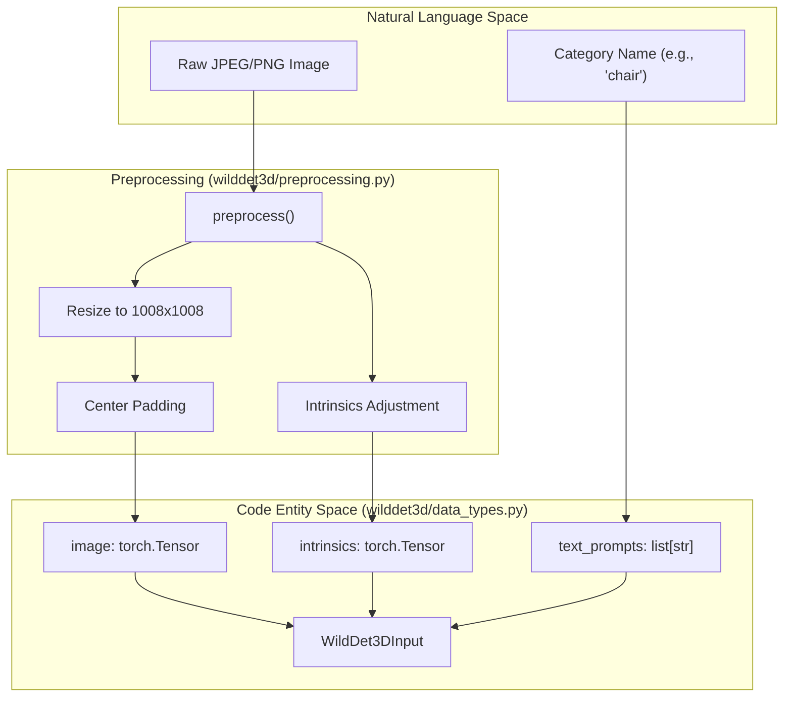
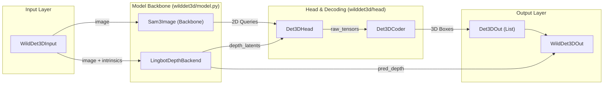

<!-- source: DeepWiki mcp.deepwiki.com · repo allenai/WildDet3D · page 2.5 Data Types & Preprocessing · fetched 2026-10-26 -->

# Data Types & Preprocessing

Relevant source files

The following files were used as context for generating this wiki page:

- [wilddet3d/__init__.py](wilddet3d/__init__.py)
- [wilddet3d/data/__init__.py](wilddet3d/data/__init__.py)

This section documents the fundamental data structures and the image preprocessing pipeline used in WildDet3D. The system relies on strictly defined dataclasses to manage the flow of multi-modal inputs (images, text, geometry) and the complex outputs of the 3D detection head. Preprocessing ensures that "in-the-wild" images of arbitrary sizes are normalized to a fixed resolution while maintaining geometric consistency for 3D inference.

## Data Types

The core data structures are defined in `wilddet3d/data_types.py`. These classes facilitate the transition from raw sensor data to structured 3D detections.

### Input Specification: `WildDet3DInput`

The `WildDet3DInput` dataclass [wilddet3d/data_types.py:10-24]() serves as the primary container for a single inference sample. It encapsulates the RGB data, camera parameters, and the multi-modal prompts required for open-vocabulary detection.

| Field | Type | Description |
| :--- | :--- | :--- |
| `image` | `torch.Tensor` | The preprocessed RGB image (typically $1008 \times 1008$). |
| `intrinsics` | `torch.Tensor` | $3 \times 3$ camera matrix used for depth projection and 3D box scaling. |
| `text_prompts` | `list[str]` | List of category names or descriptions for text-based detection. |
| `boxes_prompt` | `torch.Tensor` | Optional 2D bounding boxes used as geometric prompts (format: `[N, 4]`). |
| `points_prompt` | `torch.Tensor` | Optional 2D points used as geometric prompts (format: `[N, 2]`). |
| `masks_prompt` | `torch.Tensor` | Optional binary masks used as geometric prompts. |

### Output Specification: `WildDet3DOut` and `Det3DOut`

The model returns a `WildDet3DOut` object [wilddet3d/data_types.py:53-58](), which contains a list of detections and auxiliary geometric information. Each individual detection is encapsulated in a `Det3DOut` instance [wilddet3d/data_types.py:27-50]().

**`Det3DOut` Attributes:**
*   **2D Data:** `box2d` (coordinates), `score` (confidence), `label` (class index), and `mask` (segmentation).
*   **3D Data:** 
    *   `center3d`: The $[x, y, z]$ position in camera coordinates.
    *   `dims3d`: The $[width, height, length]$ of the object.
    *   `rotation`: The orientation (yaw) or full 6D rotation.
    *   `velocity`: Optional temporal information for tracking.

**`WildDet3DOut` Attributes:**
*   `detections`: A list of `Det3DOut` objects.
*   `predicted_intrinsics`: The camera intrinsics estimated by the `LingbotDepthBackend`.
*   `predicted_depth`: The dense depth map generated by the geometry backend.

**Sources:** [wilddet3d/data_types.py:10-58](), [wilddet3d/__init__.py:16-29]()

---

## Preprocessing Pipeline

The `preprocess()` function in `wilddet3d/preprocessing.py` is responsible for transforming raw input images into the format expected by the `WildDet3D` model [wilddet3d/preprocessing.py:10-15]().

### Image Normalization and Resizing
WildDet3D operates on a fixed resolution of **$1008 \times 1008$** pixels [wilddet3d/preprocessing.py:42-43](). This specific resolution is chosen to be divisible by the patch sizes of both the SAM3 ViT backbone and the DINOv2-based depth encoder.

1.  **Aspect Ratio Preservation:** The image is resized such that its longest side is 1008 pixels [wilddet3d/preprocessing.py:55-60]().
2.  **Center Padding:** If the original image was not square, it is zero-padded to reach the $1008 \times 1008$ target [wilddet3d/preprocessing.py:65-70]().
3.  **Tensor Conversion:** The image is normalized (0-1 range) and converted to a float32 tensor [wilddet3d/preprocessing.py:45-50]().

### Intrinsics Adjustment
Because 3D detection is sensitive to camera geometry, any spatial transformation applied to the image (scaling or padding) must be reflected in the camera intrinsics matrix $K$.

$$ K = \begin{bmatrix} f_x & 0 & c_x \\ 0 & f_y & c_y \\ 0 & 0 & 1 \end{bmatrix} $$

The `preprocess()` function updates $f_x, f_y$ based on the scaling factor and $c_x, c_y$ based on the padding offsets to ensure that the 2D-to-3D projection remains valid [wilddet3d/preprocessing.py:75-85]().

### Focal Length Heuristic
For "in-the-wild" images where camera intrinsics are unknown, the system applies a default heuristic:
*   **Default Focal Length:** $1.2 \times \max(width, height)$ [wilddet3d/preprocessing.py:30-35]().
*   **Principal Point:** Set to the image center $(W/2, H/2)$ [wilddet3d/preprocessing.py:36-38]().

### Data Flow Diagram

The following diagram illustrates the transformation of raw data into the structured `WildDet3DInput` format used by the `WildDet3DPredictor`.

**Entity Mapping: Raw Data to WildDet3DInput**

**Sources:** [wilddet3d/preprocessing.py:10-90](), [wilddet3d/data_types.py:10-24]()

---

## Internal Data Flow

During the forward pass, data is converted between various internal representations. The `WildDet3DCollator` [wilddet3d/data/__init__.py]() (documented further in section 3.2) handles the conversion from per-image datasets to the per-prompt batches required by the SAM3 architecture.

**System Architecture: Data Flow**

**Sources:** [wilddet3d/model.py:45-120](), [wilddet3d/data_types.py:53-58](), [wilddet3d/__init__.py:1-30]()

---

