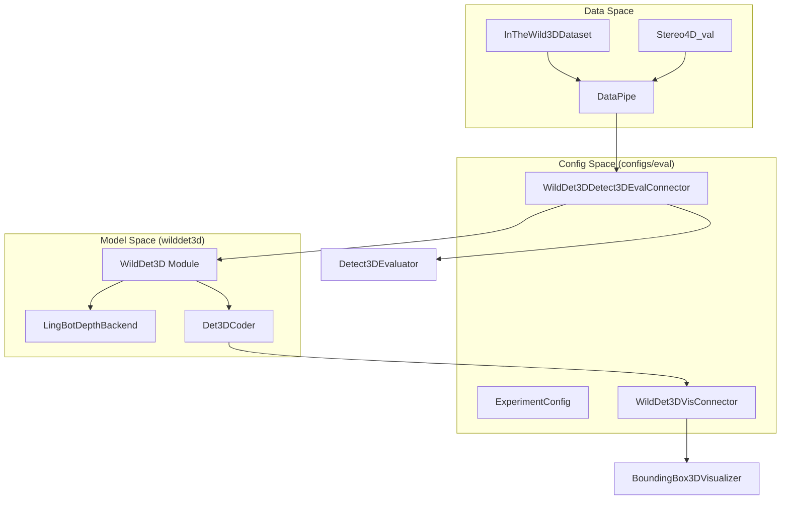
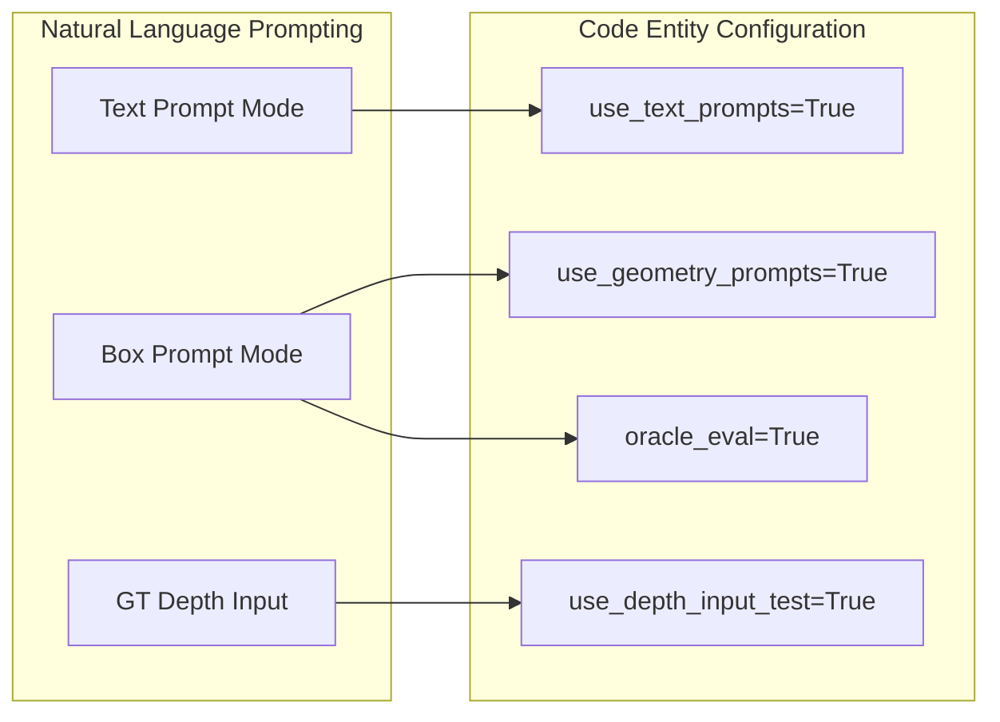

<!-- source: DeepWiki mcp.deepwiki.com · repo allenai/WildDet3D · page 4.1 Evaluation Benchmarks & Configs · fetched 2026-10-26 -->

# Evaluation Benchmarks & Configs

<details>
<summary>Relevant source files</summary>

The following files were used as context for generating this wiki page:

- [configs/eval/in_the_wild/__init__.py](configs/eval/in_the_wild/__init__.py)
- [configs/eval/in_the_wild/box_prompt.py](configs/eval/in_the_wild/box_prompt.py)
- [configs/eval/in_the_wild/box_prompt_with_depth.py](configs/eval/in_the_wild/box_prompt_with_depth.py)
- [configs/eval/in_the_wild/text.py](configs/eval/in_the_wild/text.py)
- [configs/eval/in_the_wild/text_with_depth.py](configs/eval/in_the_wild/text_with_depth.py)
- [configs/eval/stereo4d/__init__.py](configs/eval/stereo4d/__init__.py)
- [configs/eval/stereo4d/box_prompt.py](configs/eval/stereo4d/box_prompt.py)
- [configs/eval/stereo4d/box_prompt_with_depth.py](configs/eval/stereo4d/box_prompt_with_depth.py)
- [configs/eval/stereo4d/text.py](configs/eval/stereo4d/text.py)
- [configs/eval/stereo4d/text_with_depth.py](configs/eval/stereo4d/text_with_depth.py)
- [docs/EVALUATION.md](docs/EVALUATION.md)

</details>


The WildDet3D evaluation system is built upon the [vis4d](https://github.com/SysCV/vis4d) framework, providing a standardized interface for benchmarking the model across diverse datasets and prompting modes. This page documents the configuration structure and execution flow for evaluating the model on the primary benchmarks: **In-The-Wild** and **Stereo4D**.

## Evaluation Overview

Evaluation is performed using the `vis4d test` command, which orchestrates the loading of checkpoints, data pipelines, and evaluation callbacks. The system supports multiple prompting modes (Text vs. Box) and depth availability scenarios (Monocular vs. GT Depth).

### Execution Command
To run an evaluation, use the following syntax:
```bash
vis4d test --config configs/eval/<benchmark>/<mode>.py \
    --gpus 1 --ckpt ckpt/wilddet3d.pt
```
Sources: [docs/EVALUATION.md:7-11]()

---

## Configuration Naming Convention

Evaluation configurations follow a strict naming convention to denote the dataset, prompting mode, and depth requirements:

| Component | Options | Description |
| :--- | :--- | :--- |
| `<benchmark>` | `in_the_wild`, `stereo4d`, `omni3d`, `scannet`, `argoverse` | The target evaluation dataset. |
| `<prompt>` | `text`, `box_prompt` | `text`: Open-vocabulary inference; `box_prompt`: Oracle 2D boxes. |
| `[_with_depth]` | Optional suffix | If present, the model uses Ground Truth (GT) depth at test time. |

**Example Path:** `configs/eval/in_the_wild/box_prompt_with_depth.py`
Sources: [docs/EVALUATION.md:97-107]()

---

## Benchmark Details

### 1. In-The-Wild Benchmark
This benchmark evaluates WildDet3D on over 800 open-vocabulary categories derived from COCO, LVIS, and Objects365, featuring human-annotated 3D bounding boxes [configs/eval/in_the_wild/text.py:1-5]().

*   **Text Mode**: Evaluates zero-shot 3D detection using text queries. Uses monocular depth estimation by default [configs/eval/in_the_wild/text.py:9-10]().
*   **Box Prompt Mode**: Uses GT 2D boxes as geometry prompts to measure pure 3D regression quality, isolating it from 2D detection performance [configs/eval/in_the_wild/box_prompt.py:3-5]().

### 2. Stereo4D Benchmark
A zero-shot evaluation focused on dynamic 3D object detection from stereo video sequences [docs/EVALUATION.md:67-69]().

*   **Text Mode**: Open-vocabulary detection on video frames [configs/eval/stereo4d/text.py:1]().
*   **Box Prompt Mode**: Oracle 2D box prompts with monocular depth [configs/eval/stereo4d/box_prompt.py:1]().

---

## Implementation & Data Flow

The evaluation configs leverage `vis4d`'s `ExperimentConfig` to define the model state, dataset loaders, and evaluation connectors.

### Evaluation Data Flow Diagram
This diagram illustrates how the `vis4d` engine interacts with WildDet3D components during evaluation.

Title: Evaluation Data Pipeline

Sources: [configs/eval/in_the_wild/box_prompt.py:72-89](), [configs/eval/in_the_wild/box_prompt.py:105-115](), [configs/eval/in_the_wild/box_prompt.py:148-171]()

### Prompt Mode Logic
The system differentiates between standard inference and "Oracle" evaluation through specific flags in the configuration.

Title: Prompt Mode Logic Association

Sources: [configs/eval/in_the_wild/box_prompt.py:97-99](), [configs/eval/in_the_wild/box_prompt.py:112](), [configs/eval/in_the_wild/box_prompt_with_depth.py:112]()

---

## Key Configuration Parameters

The `get_config()` function in each evaluation file sets critical parameters for the model and pipeline:

| Parameter | Function / Class | Role |
| :--- | :--- | :--- |
| `oracle_eval` | `get_wilddet3d_cfg` | When `True`, the model uses GT 2D boxes as input prompts [configs/eval/in_the_wild/box_prompt.py:112](). |
| `use_depth_input_test` | `get_wilddet3d_cfg` | Enables the model to ingest GT depth maps during evaluation [configs/eval/in_the_wild/box_prompt_with_depth.py:112](). |
| `canonical_rotation` | `get_wilddet3d_cfg` | Enables rotation prediction relative to the camera's canonical frame [configs/eval/in_the_wild/text.py:111](). |
| `with_depth` | `InTheWild3DDataset` | Instructs the dataset loader to provide depth maps from disk [configs/eval/in_the_wild/text_with_depth.py:78](). |

### Evaluation Callbacks
Configs utilize `get_in_the_wild_eval_callbacks` or `get_stereo4d_eval_callbacks` to register metrics. These typically include:
1.  **Detect3DEvalConnector**: Bridges model outputs to the COCO-style 3D evaluator [configs/eval/in_the_wild/box_prompt.py:148]().
2.  **BoundingBox3DVisualizer**: Generates visual debugging output (projections of 3D boxes onto 2D images) every `vis_freq` iterations [configs/eval/in_the_wild/box_prompt.py:157-166]().

Sources: [configs/eval/in_the_wild/box_prompt.py:43-182](), [configs/eval/stereo4d/text.py:30-150](), [docs/EVALUATION.md:15-17]()

---

