# Page: WildDet3D Overview

# WildDet3D Overview

<details>
<summary>Relevant source files</summary>

The following files were used as context for generating this wiki page:

- [.gitignore](.gitignore)
- [.gitmodules](.gitmodules)
- [README.md](README.md)
- [assets/model_architecture.png](assets/model_architecture.png)
- [assets/teaser.png](assets/teaser.png)
- [assets/wilddet3d_banner.svg](assets/wilddet3d_banner.svg)
- [assets/wilddet3d_logo.svg](assets/wilddet3d_logo.svg)

</details>


WildDet3D is a promptable 3D object detection system designed to operate "in the wild." It extends the capabilities of 2D promptable models like SAM to the 3D domain, allowing users to detect and localize objects in 3D space using various input prompts such as text descriptions, 2D bounding boxes, or points.

The system is built on a unified architecture that combines high-resolution vision backbones, geometric depth estimation, and a specialized 3D detection head to produce accurate 3D bounding boxes (position, dimensions, and orientation) from monocular RGB images.


## Key Capabilities

WildDet3D supports a flexible detection paradigm through five distinct prompting modes:
*   **Text:** Detect objects based on natural language descriptions (e.g., "a wooden chair").
*   **Visual (Point/Box):** Detect objects by providing a 2D location or region.
*   **Visual + Label:** Refine visual selections with semantic category information.
*   **Geometric:** Use 3D spatial hints to guide detection.
*   **Geometric + Label:** Combine spatial hints with semantic labels.

For a detailed breakdown of these modes and core terminology, see [Key Concepts & Prompting Modes](#1.2).

## Architecture Summary

The WildDet3D architecture consists of three primary pillars that work in parallel to process visual and geometric information:

1.  **SAM3 Backbone:** A high-resolution ViT backbone (based on SAM3) that handles 2D feature extraction and prompt processing [wilddet3d/model.py:22-30]().
2.  **LingBot-Depth Backend:** A geometry-aware branch that provides depth latents and intrinsic predictions using a DINOv2-based encoder [wilddet3d/depth/lingbot_backend.py:18-35]().
3.  **3D Detection Head:** A transformer-based head that fuses 2D features with depth information to regress 3D parameters [wilddet3d/head/det3d_head.py:15-40]().

### System Architecture Flow
Title: WildDet3D High-Level Data Flow
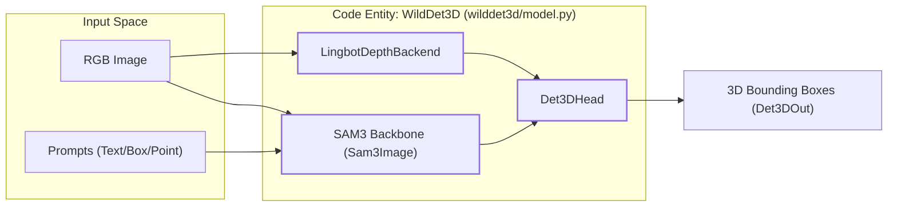
Sources: [wilddet3d/model.py:85-115](), [wilddet3d/data_types.py:10-45]()

## Repository Organization

The repository is structured to separate core model logic, training infrastructure (using the `vis4d` framework), and various deployment demos.

| Directory | Purpose |
| :--- | :--- |
| `wilddet3d/` | Core library: model definitions, 3D heads, and geometry operations. |
| `configs/` | Configuration files for training and evaluation experiments. |
| `demo/` | Integration examples (iPhone, Meta Quest, VLM, Tracking). |
| `third_party/` | Submodules for SAM3 and LingBot-Depth backends. |
| `ckpt/` | Local storage for model weights (ignored by git). |

### Component Mapping
Title: Component to Code Mapping
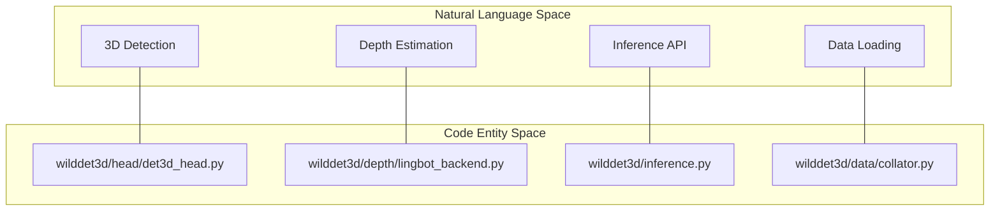
Sources: [wilddet3d/head/det3d_head.py:10-20](), [wilddet3d/depth/lingbot_backend.py:5-15](), [wilddet3d/inference.py:20-50](), [wilddet3d/data/collator.py:10-30]()

## Getting Started

To begin using WildDet3D, you must set up the environment, initialize submodules, and download the necessary checkpoints. The system relies on `vis4d` for its training and evaluation pipeline.

*   **Installation:** Requires cloning submodules in `third_party/` and installing dependencies from `requirements.txt`.
*   **Checkpoints:** Pretrained weights are hosted on HuggingFace and should be placed in the `ckpt/` directory.

For step-by-step instructions, see [Getting Started: Installation & Setup](#1.1).

## Training and Evaluation

WildDet3D uses a complex loss formulation involving 2D detection losses, 3D box regression, and depth consistency losses. Evaluation is performed on benchmarks like **WildDet3D-Bench** and **Omni3D** using COCO-style 3D metrics.

*   **Training:** Managed via `vis4d` experiments [configs/base/train.py]().
*   **Evaluation:** Supports various modes (with or without depth, different prompt types) [wilddet3d/eval/detect3d.py]().

For details on the training pipeline, see [Training Pipeline](#3). For evaluation metrics, see [Evaluation](#4).

---

# Page: Getting Started: Installation & Setup

# Getting Started: Installation & Setup

<details>
<summary>Relevant source files</summary>

The following files were used as context for generating this wiki page:

- [.gitmodules](.gitmodules)
- [LICENSE](LICENSE)
- [requirements.txt](requirements.txt)

</details>


This guide provides step-by-step instructions for setting up the WildDet3D environment. WildDet3D is built upon the `vis4d` framework and integrates two major third-party submodules: SAM3 for 2D perception and LingBot-Depth for geometric understanding.

## Prerequisites and Core Dependencies

The installation process requires a specific sequence to ensure that CUDA-accelerated operations and framework dependencies are correctly compiled.

### 1. Primary Environment Setup
WildDet3D requires Python 3.10+, PyTorch 2.5.1, and the `vis4d` ecosystem.

```bash
# Install PyTorch and TorchVision with CUDA 12.1 support
pip install torch==2.5.1 torchvision==0.20.1 --index-url https://download.pytorch.org/whl/cu121

# Install the Vis4D framework
pip install vis4d==1.0.0

# Install Vis4D CUDA operations (requires NVCC for compilation)
pip install git+https://github.com/SysCV/vis4d_cuda_ops.git --no-build-isolation --no-cache-dir
```
*Sources: [requirements.txt:1-6]()*

### 2. Secondary Dependencies
After the core framework is installed, install the remaining packages listed in `requirements.txt`. Note that `utils3d` must be installed directly from the source repository to access the `utils3d.pt` and `utils3d.np` namespaces used in the codebase.

```bash
pip install -r requirements.txt
```
*Sources: [requirements.txt:8-48]()*

| Dependency | Purpose |
| :--- | :--- |
| `utils3d` | 3D geometry utilities and point cloud operations [requirements.txt:21]() |
| `setuptools<80` | Compatibility for `pkg_resources` used in SAM3 [requirements.txt:30]() |
| `ml_collections` | Configuration management for evaluation and training [requirements.txt:43]() |
| `pyarrow` | Handling parquet-backed datasets like Waymo v2 [requirements.txt:47]() |

## Repository Setup & Submodules

WildDet3D relies on two external repositories managed as Git submodules. These are located in the `third_party/` directory and are injected into the Python path at runtime.

### Cloning Submodules
To initialize the submodules after cloning the main repository:

```bash
git submodule update --init --recursive
```
*Sources: [.gitmodules:1-7]()*

### Submodule Architecture
The following diagram illustrates how the submodules interface with the main WildDet3D system.

**Submodule Integration Map**
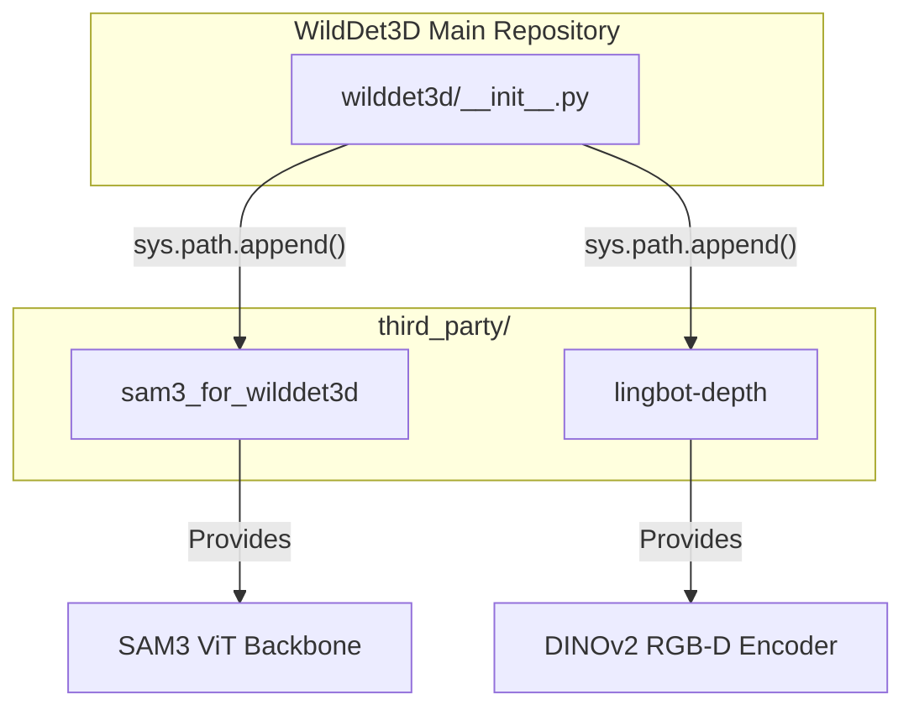
*Sources: [.gitmodules:1-7]()*

## Model Checkpoints

WildDet3D follows a strict directory convention for model weights. Checkpoints should be placed in a `ckpt/` directory at the root of the repository.

### Directory Structure
```text
WildDet3D/
├── ckpt/
│   ├── wilddet3d_final.pth       # Main WildDet3D weights
│   ├── sam3_checkpoint.pth       # SAM3 pretrained backbone
│   └── lingbot_depth.pth         # LingBot-Depth pretrained weights
├── data/
├── third_party/
└── wilddet3d/
```

### Checkpoint Loading
The system uses `skip_pretrained` and `sam3_checkpoint` parameters in the model builder to manage which components are loaded from the unified WildDet3D checkpoint versus standalone third-party weights.

## Licensing

WildDet3D is distributed under the **SAM License** (updated November 19, 2025). 

### Key Terms
*   **Grant of Rights**: Non-exclusive, worldwide, royalty-free license to use, reproduce, and create derivative works [LICENSE:30-31]().
*   **Redistribution**: Any distribution of SAM Materials or derivatives must include a copy of the Agreement [LICENSE:33-34]().
*   **Attribution**: Research publications using these materials must acknowledge their use [LICENSE:36-38]().
*   **Restrictions**: Use is prohibited for military, warfare, nuclear industries, or illegal weapons development [LICENSE:41]().

*Sources: [LICENSE:1-62]()*

## Installation Flowchart

The following diagram maps the installation steps to the code entities and files involved.

**Installation Logic Flow**
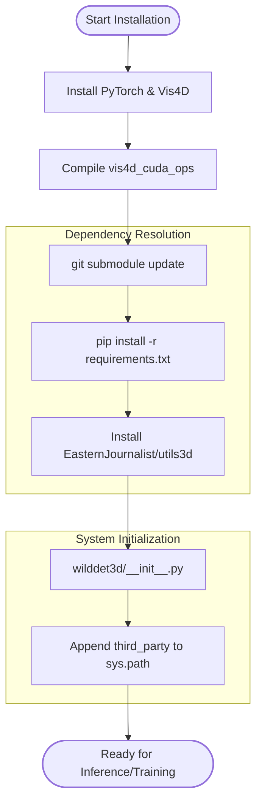
*Sources: [requirements.txt:1-21](), [.gitmodules:1-7]()*

---

# Page: Key Concepts & Prompting Modes

# Key Concepts & Prompting Modes

<details>
<summary>Relevant source files</summary>

The following files were used as context for generating this wiki page:

- [README.md](README.md)
- [assets/qualitative_box_prompt.jpg](assets/qualitative_box_prompt.jpg)
- [assets/qualitative_text_prompt.jpg](assets/qualitative_text_prompt.jpg)
- [docs/INFERENCE.md](docs/INFERENCE.md)

</details>


This page explains the fundamental detection paradigm of WildDet3D, its five distinct prompting modes, and the core terminology used throughout the codebase. WildDet3D transitions 3D object detection from a fixed-vocabulary task to a flexible, "in-the-wild" promptable task.

## The In-the-Wild Detection Paradigm

WildDet3D is designed to perform 3D detection on arbitrary images without requiring ground truth camera intrinsics or a predefined set of object categories [docs/INFERENCE.md:47-48](). It achieves this by combining a foundation 2D detector (SAM3) with a metric depth estimation backend (LingBot-Depth) and a specialized 3D detection head [README.md:153-155]().

### Core Terminology
*   **Prompt**: An input that specifies *what* to detect. This can be text, a 2D bounding box, or a point [docs/INFERENCE.md:7-15]().
*   **Geometric Lifting**: The process of taking a 2D prompt (box/point) and estimating the 3D properties (depth, dimensions, orientation) of the underlying object [docs/INFERENCE.md:12-13]().
*   **One-to-Many (O2M)**: A mode where one prompt (like "car") results in multiple detections [docs/INFERENCE.md:9-11]().
*   **One-to-One (O1O)**: A mode where one prompt (like a specific box) results in exactly one 3D detection [docs/INFERENCE.md:12-13]().
*   **Predicted Intrinsics**: The model's ability to estimate camera focal length and principal point when they are not provided [docs/INFERENCE.md:160-164]().

## Prompting Modes

WildDet3D supports five primary prompting modes, defined by the combination of `input_texts`, `input_boxes`/`input_points`, and the `prompt_text` string passed to the predictor [docs/INFERENCE.md:7-13]().

### 1. Text Prompt (Open-Vocabulary)
The model detects all instances of categories provided in a list of strings.
*   **Input**: `input_texts=["category1", "category2"]`
*   **Behavior**: One-to-many matching.
*   **Code Implementation**: Handled by the SAM3 backbone which generates queries based on text embeddings [docs/INFERENCE.md:61-75]().

### 2. Visual Prompt
Uses a 2D box or point as a visual example to find all similar objects in the image.
*   **Input**: `input_boxes` + `prompt_text="visual"`
*   **Behavior**: One-to-many matching based on visual similarity [docs/INFERENCE.md:77-92]().

### 3. Visual + Label Prompt
Refines the visual prompt search by adding a category constraint.
*   **Input**: `input_boxes` + `prompt_text="visual: category"`
*   **Behavior**: One-to-many matching, filtered by the semantic label [docs/INFERENCE.md:94-104]().

### 4. Geometric Prompt
Directly lifts a specific 2D user-provided prompt to a 3D bounding box.
*   **Input**: `input_boxes` + `prompt_text="geometric"`
*   **Behavior**: One-to-one matching. The model focuses exclusively on the object at the prompt location [docs/INFERENCE.md:106-116]().

### 5. Geometric + Label Prompt
Lifts a 2D prompt to 3D while explicitly assigning it a semantic category.
*   **Input**: `input_boxes` + `prompt_text="geometric: category"`
*   **Behavior**: One-to-one matching with a label override [docs/INFERENCE.md:118-126]().

---

## Data Flow: From Prompt to 3D Box

The following diagram illustrates how different prompt types are processed through the system components to produce the final `boxes3d` output.

**System Data Flow and Component Mapping**
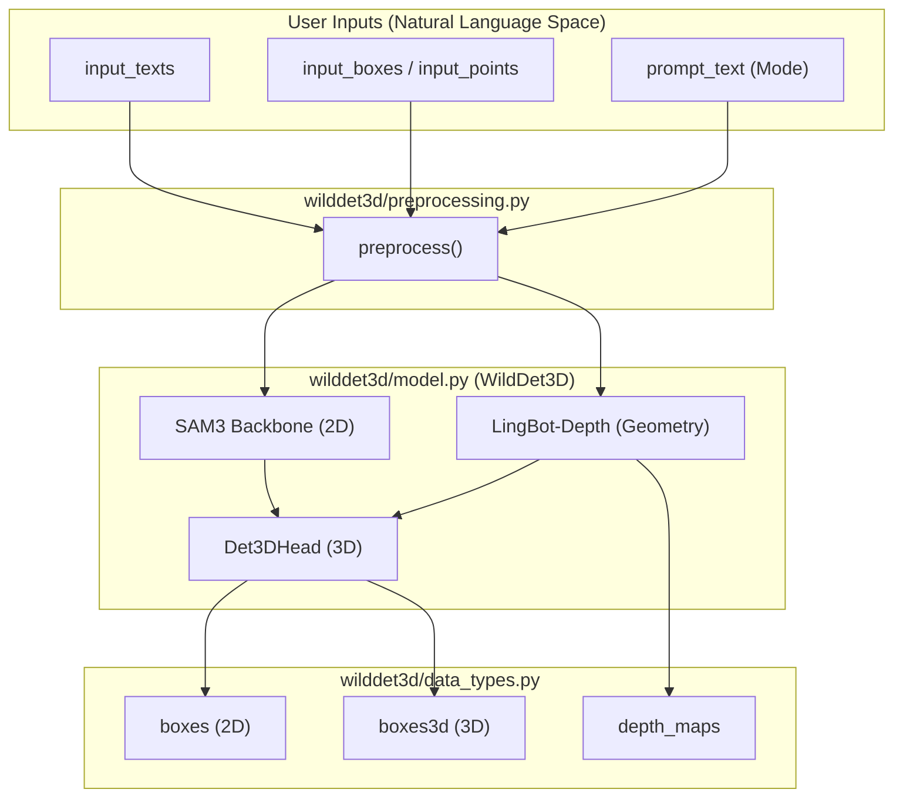
Sources: `[docs/INFERENCE.md:20-34]()`, `[docs/INFERENCE.md:142-152]()`, `[README.md:153-155]()`

---

## Technical Implementation Details

### Prompt Encoding
Prompts are processed by the `WildDet3DPredictor` in `wilddet3d/inference.py`. Depending on the mode, prompts are converted into queries for the SAM3 transformer decoder.
*   **Text prompts** are encoded using a language backbone (e.g., CLIP or similar) to create semantic queries [docs/INFERENCE.md:61-75]().
*   **Visual/Geometric prompts** are encoded via a geometry encoder within SAM3 that translates pixel coordinates into positional embeddings [README.md:153-155]().

### 3D Lifting Mechanism
The `Det3DHead` receives 2D object queries and fuses them with `depth_latents` provided by the `LingBot-Depth` backend.
1.  **Depth Map Generation**: The backend produces a metric depth map used for point cloud reasoning [docs/INFERENCE.md:152]().
2.  **3D Parameter Prediction**: The head regresses 10 parameters for each box: `(center_x, center_y, center_z, width, height, length, rotation_6d)` [docs/INFERENCE.md:147]().

**Code Entity Association: Prompting to Code Modules**
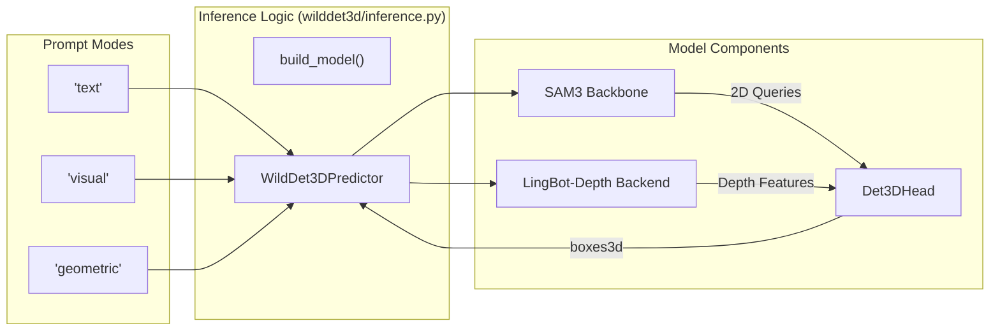
Sources: `[docs/INFERENCE.md:5-13]()`, `[docs/INFERENCE.md:25-29]()`, `[docs/INFERENCE.md:140-152]()`

### Output Structure
The model returns a standardized set of tensors for every inference call, regardless of the prompt mode [docs/INFERENCE.md:140-152]():

| Attribute | Type | Description |
| :--- | :--- | :--- |
| `boxes` | `Tensor[N, 4]` | 2D xyxy boxes in original image coordinates. |
| `boxes3d` | `Tensor[N, 10]` | 3D boxes: center (3), dims (3), rotation (4 via 6D). |
| `scores` | `Tensor[N]` | Final confidence (fused 2D and 3D scores). |
| `depth_maps` | `Tensor[1, H, W]` | Metric depth map in meters. |

Sources: `[docs/INFERENCE.md:140-152]()`

---

# Page: Core Model Architecture

# Core Model Architecture

<details>
<summary>Relevant source files</summary>

The following files were used as context for generating this wiki page:

- [README.md](README.md)
- [assets/model_architecture.png](assets/model_architecture.png)
- [wilddet3d/__init__.py](wilddet3d/__init__.py)

</details>


WildDet3D is a unified framework for promptable 3D object detection. It integrates a 2D open-vocabulary backbone (SAM3), a robust geometry backend (LingBot-Depth), and a specialized 3D detection head. The architecture is designed to handle multiple prompt modalities (text, boxes, points) and generalize to "in-the-wild" scenarios where camera intrinsics may be unknown.

### System Overview

The pipeline follows a sequential-parallel execution flow. Images and prompts are first processed by the SAM3 backbone to identify 2D regions of interest, while the geometry backend simultaneously extracts depth features. These streams are then fused in the 3D head to produce oriented 3D bounding boxes.

#### Unified Pipeline Diagram
This diagram illustrates how high-level system components map to specific code entities and how data flows between them.

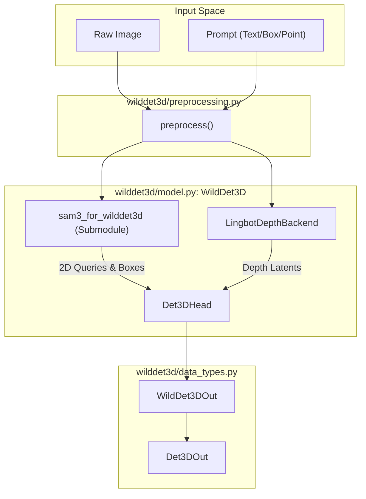
**Sources:** [wilddet3d/model.py:1-18](), [wilddet3d/preprocessing.py:1-20](), [wilddet3d/__init__.py:1-29]()

---

### Component Breakdown

#### 1. WildDet3D Model & Forward Pass
The `WildDet3D` class is the central `nn.Module` that orchestrates the entire pipeline. It manages the lifecycle of the backbone and depth modules, including specialized checkpoint loading and parallel execution using CUDA streams to minimize latency.
*   **Key File:** `wilddet3d/model.py`
*   **For details, see [WildDet3D Model & Forward Pass](#2.1)**

#### 2. SAM3 Backbone & 2D Detection
The model utilizes a modified Segment Anything Model 3 (SAM3) as its 2D foundation. It consists of a ViT backbone (`Sam3Image`) and a prompt encoder that handles five distinct query types (Text, Visual, Visual+Label, Geometric, Geometric+Label). It is responsible for generating the initial 2D object proposals.
*   **Key Submodule:** `third_party/sam3`
*   **For details, see [SAM3 Backbone & 2D Detection](#2.2)**

#### 3. Geometry Backend: LingBot-Depth
Geometry is handled by the `LingbotDepthBackend`, which utilizes a DINOv2-based RGB-D encoder. This module provides critical spatial context by predicting monocular depth and extracting `depth_latents`. It also features an `EarlyDepthFusionLingbot` module for ControlNet-style feature integration.
*   **Key File:** `wilddet3d/depth/lingbot_backend.py`
*   **For details, see [Geometry Backend: LingBot-Depth](#2.3)**

#### 4. 3D Detection Head & Box Coder
The `Det3DHead` performs the final lifting from 2D to 3D. It uses cross-attention to fuse SAM3 2D features with LingBot depth features. The `Det3DCoder` then decodes these features into 3D parameters, including 6D rotation encoding and canonical normalization.
*   **Key Directory:** `wilddet3d/head/`
*   **For details, see [3D Detection Head & Box Coder](#2.4)**

---

### Data Flow and Internal Interfaces

The architecture relies on strictly defined data structures to pass information between the 2D backbone and the 3D head. The following diagram shows the relationship between the internal classes and the processing logic.

#### Code Entity Interaction Diagram
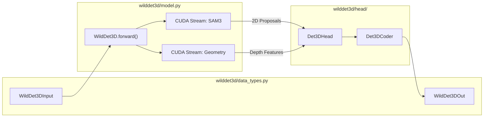
**Sources:** [wilddet3d/model.py:40-100](), [wilddet3d/data_types.py:1-50](), [wilddet3d/head/det3d_head.py:1-30]()

### Core Processing Specifications

| Component | Responsibility | Primary Class/Function |
| :--- | :--- | :--- |
| **Preprocessing** | Resizing to 1008x1008, padding, and intrinsic adjustment. | `preprocess()` |
| **2D Backbone** | Open-vocabulary feature extraction and 2D box proposal. | `Sam3Image` |
| **Depth Engine** | Predicting metric depth and providing spatial latents. | `LingbotDepthBackend` |
| **3D Head** | Fusing 2D/Depth features and regressing 3D parameters. | `Det3DHead` |
| **Post-processing** | 3D NMS and coordinate rescaling. | `RoI2Det3D` |

**Sources:** [wilddet3d/preprocessing.py:10-50](), [wilddet3d/model.py:20-60](), [wilddet3d/inference.py:100-150]()

---
**Child Pages:**
*   [WildDet3D Model & Forward Pass](#2.1)
*   [SAM3 Backbone & 2D Detection](#2.2)
*   [Geometry Backend: LingBot-Depth](#2.3)
*   [3D Detection Head & Box Coder](#2.4)
*   [Data Types & Preprocessing](#2.5)

---

# Page: WildDet3D Model & Forward Pass

# WildDet3D Model & Forward Pass

<details>
<summary>Relevant source files</summary>

The following files were used as context for generating this wiki page:

- [wilddet3d/__init__.py](wilddet3d/__init__.py)
- [wilddet3d/connector.py](wilddet3d/connector.py)
- [wilddet3d/data/__init__.py](wilddet3d/data/__init__.py)

</details>


The `WildDet3D` class is the central `nn.Module` that orchestrates the execution of the open-vocabulary 3D detection pipeline. It integrates a 2D foundation model (SAM3), a geometry backend (LingBot-Depth), and a specialized 3D detection head. A key feature of this implementation is the use of asynchronous execution via CUDA streams to parallelize the heavy vision backbone and geometry encoding stages.

## WildDet3D Architecture Overview

The model is designed as a unified architecture that processes an RGB image alongside various prompt types (text, boxes, points, or masks) to output oriented 3D bounding boxes.

### Key Components
*   **SAM3 Backbone (`self.sam3`)**: A ViT-based image encoder and prompt-guided transformer decoder that generates 2D detections and instance features [wilddet3d/model.py:44-46]().
*   **Geometry Backend (`self.geometry_backend`)**: A DINOv2-based depth encoder (LingBot-Depth) that provides global geometry context and depth latents [wilddet3d/model.py:47-49]().
*   **3D Head (`self.head`)**: A module that fuses 2D instance features with geometry latents to predict 3D box parameters (center, dimensions, 6D rotation) [wilddet3d/model.py:50-52]().

### Data Flow Diagram: Natural Language to Code Entities
This diagram maps the high-level conceptual flow to the specific code structures defined in `wilddet3d/model.py`.

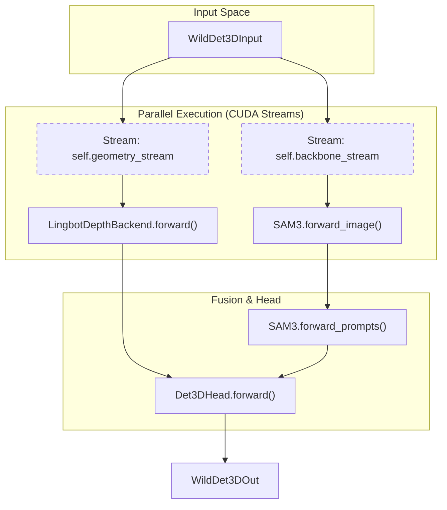
Sources: [wilddet3d/model.py:101-155](), [wilddet3d/data_types.py:43-78]()

---

## The Forward Pass Implementation

The `forward()` method in `wilddet3d/model.py` implements a multi-stream execution pattern to maximize GPU utilization.

### Parallel Backbone Execution
The model initializes two dedicated CUDA streams: `self.backbone_stream` and `self.geometry_stream` [wilddet3d/model.py:54-55](). 

1.  **Backbone Stream**: Executes `self.sam3.forward_image()` to extract ViT features from the input image [wilddet3d/model.py:110-112]().
2.  **Geometry Stream**: Simultaneously executes `self.geometry_backend()` to predict depth and extract geometry latents [wilddet3d/model.py:114-116]().
3.  **Synchronization**: The main stream waits for both asynchronous tasks to complete using `torch.cuda.current_stream().wait_stream()` before proceeding to the prompt decoding stage [wilddet3d/model.py:118-119]().

### Prompt Decoding and 3D Projection
Once the image features and geometry latents are ready:
1.  **2D Decoding**: `self.sam3.forward_prompts()` processes the input prompts (e.g., text embeddings or box coordinates) against the image features to produce 2D instance queries [wilddet3d/model.py:121-133]().
2.  **3D Head Execution**: The `self.head` takes the instance features from SAM3 and the geometry latents from LingBot to compute the final 3D bounding boxes [wilddet3d/model.py:135-151]().

Sources: [wilddet3d/model.py:101-155]()

---

## Checkpoint Loading & FP32 LayerNorm Upgrade

WildDet3D employs a custom hook system to handle the transition from pretrained weights to the specific architectural requirements of 3D detection.

### The `_upgrade_fp32_layer_norm` Pattern
To ensure numerical stability during training and inference, especially when using mixed precision, the model provides a utility to upgrade standard `LayerNorm` layers to a specialized `Fp32LayerNorm` [wilddet3d/model.py:189-211](). This is applied recursively to the SAM3 and Geometry components during initialization if configured [wilddet3d/model.py:72-76]().

### State Dict Hooks
The model uses a `_register_load_state_dict_pre_hook` to manage checkpoint compatibility [wilddet3d/model.py:78-100]().
*   **Prefix Handling**: It automatically strips or adds prefixes (like `model.`) to match the expected keys in the state dict [wilddet3d/model.py:86-90]().
*   **Shape Mismatch**: It handles potential shape mismatches in positional embeddings if the input resolution differs from the pretrained checkpoint [wilddet3d/model.py:92-95]().

### Code Entity Mapping: Model Initialization
This diagram illustrates how the `WildDet3D` constructor sets up its internal state and hooks.

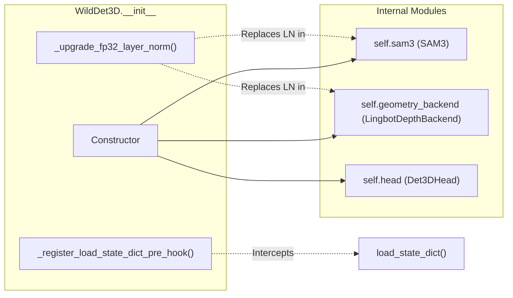
Sources: [wilddet3d/model.py:38-100](), [wilddet3d/model.py:189-211]()

---

## Input and Output Structures

The model relies on structured dataclasses defined in `wilddet3d/data_types.py` to pass data between components.

| Class | Purpose | Key Fields |
| :--- | :--- | :--- |
| `WildDet3DInput` | Encapsulates all data for a forward pass. | `image`, `intrinsics`, `text_queries`, `prompt_boxes`, `prompt_masks` |
| `WildDet3DOut` | The primary output of the `WildDet3D` module. | `det3d` (list of `Det3DOut`), `depth_outputs` |
| `Det3DOut` | Per-instance 3D detection results. | `boxes_3d`, `scores_3d`, `labels`, `features_2d` |

Sources: [wilddet3d/data_types.py:11-78]()

---

# Page: SAM3 Backbone & 2D Detection

# SAM3 Backbone & 2D Detection

<details>
<summary>Relevant source files</summary>

The following files were used as context for generating this wiki page:

- [.gitmodules](.gitmodules)
- [README.md](README.md)

</details>


This page details the 2D perception core of WildDet3D, which leverages the SAM3 (Segment Anything Model 2) architecture as its primary image backbone and prompt processing engine. The system integrates a ViT-based image encoder with a geometry encoder for prompt embeddings, a transformer-based encoder/decoder for feature refinement, and a 2D detection head that produces bounding boxes used as the foundation for 3D lifting.

## SAM3 Image Backbone (Sam3Image)

The image backbone, implemented in `Sam3Image`, is responsible for extracting multi-scale visual features from the input image. It utilizes a Vision Transformer (ViT) architecture that has been optimized for high-resolution processing and hierarchical feature extraction.

### Architecture and Data Flow
The backbone processes an input image (typically $1008 \times 1008$ pixels) and produces four feature maps at different strides ($1/4, 1/8, 1/16, 1/32$).

1.  **Patch Embedding**: The image is divided into patches and projected into a latent space.
2.  **ViT Blocks**: A series of transformer blocks process the patches. WildDet3D allows for freezing specific blocks during training via the `backbone_freeze_blocks` configuration parameter [configs/base/base_optim.py:22-22]().
3.  **Neck/FPN**: The ViT features are passed through a neck that generates the multi-scale feature pyramid.

**SAM3 Backbone Feature Extraction**
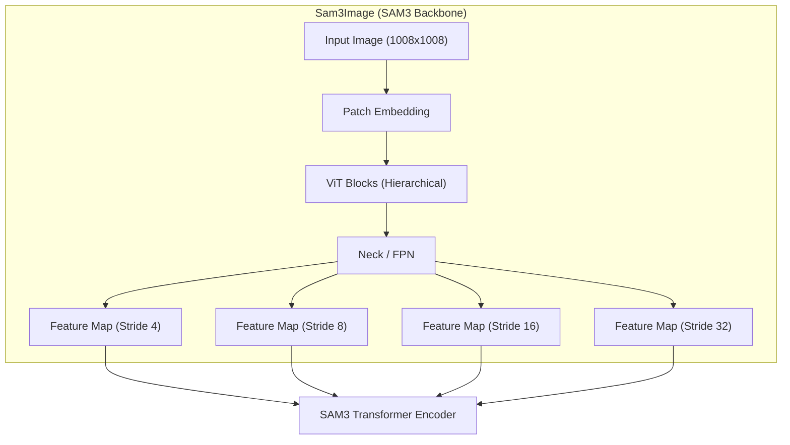
**Sources:** [.gitmodules:1-4](), [README.md:153-155](), [configs/base/base_optim.py:22-22]()

## Geometry Encoder & Prompt Processing

WildDet3D is a promptable detector. The `PromptEncoder` (within the SAM3 framework) handles the transformation of sparse prompts (points, boxes, or masks) into dense and sparse embeddings that guide the detection process.

### Prompt Types and Encodings
The model supports five distinct query types derived from these prompts:
1.  **Text**: Encoded via a language model (e.g., CLIP) and integrated into the query stream.
2.  **Visual (Point/Box)**: Geometric prompts are mapped to the image feature space using positional encodings.
3.  **Visual + Label**: Combines geometric prompts with semantic category information.
4.  **Geometric**: Pure coordinate-based prompts.
5.  **Geometric + Label**: Coordinate prompts combined with semantic labels.

The geometry encoder produces:
*   **Sparse Embeddings**: Representing individual points or box corners.
*   **Dense Embeddings**: Mask-like feature maps that are fused with the image features.

**Sources:** [README.md:77-79](), [wilddet3d/data_types.py:1-20]() (implied by input structures).

## Transformer Encoder & Decoder

The features from the SAM3 backbone and the embeddings from the prompt encoder are fused in the SAM3 Transformer.

### Encoder
The transformer encoder performs self-attention across the multi-scale image features. This stage enhances the global context of the visual features before they are queried by the detection head.

### Decoder
The transformer decoder is where detection queries interact with the visual features.
*   **Queries**: The decoder uses a set of learnable object queries, which are modulated by the prompt embeddings.
*   **Cross-Attention**: Queries attend to the encoder's output features to localize objects.
*   **LayerNorm Upgrade**: During model initialization, WildDet3D applies a `Fp32LayerNorm` upgrade to ensure numerical stability in the transformer layers [wilddet3d/model.py:45-55]().

**Sources:** [wilddet3d/model.py:45-55]()

## 2D Detection Head & Matching

The 2D detection head is responsible for predicting the bounding boxes, class scores, and objectness for each query.

### BinaryHungarianMatcherV2
To supervise the 2D detection, WildDet3D uses `BinaryHungarianMatcherV2`. This matcher performs a bipartite matching between the predicted queries and the ground truth objects based on a cost function that includes:
1.  **Classification Cost**: Focal loss or cross-entropy between predicted and GT labels.
2.  **Box L1 Cost**: The absolute distance between predicted and GT box coordinates.
3.  **GIoU Cost**: Generalized Intersection over Union to handle scale variations.

### Output Production
The head produces:
*   **2D Bounding Boxes**: Represented as `(cx, cy, w, h)` normalized coordinates.
*   **Class Scores**: Confidence scores for the requested categories.
*   **Query Embeddings**: These high-dimensional vectors are passed forward to the **3D Head** (see Section 2.4) to lift the 2D detection into 3D space.

**Entity Mapping: 2D Detection Pipeline**
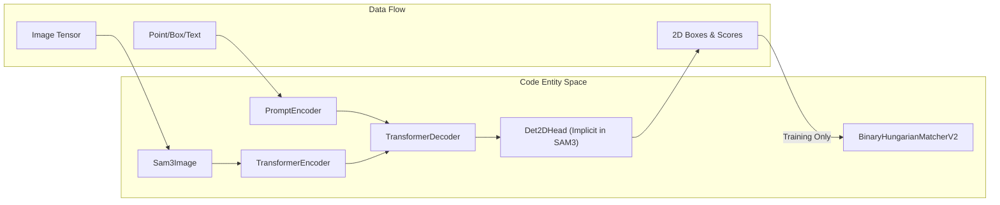

**Sources:** [wilddet3d/ops/matchers/match_cost.py:1-10](), [wilddet3d/loss/loss.py:10-30]() (referenced for 2D loss components).

## Integration with WildDet3D

In the `WildDet3D` model class, the SAM3 backbone and 2D components are initialized using specific checkpoint loading hooks to ensure that pretrained weights are correctly mapped to the internal structure [wilddet3d/model.py:45-55](). The 2D detection results serve as the "proposals" that the 3D head subsequently refines using depth information from the geometry backend.

**Sources:** [wilddet3d/model.py:45-55](), [wilddet3d/inference.py:20-40]() (referenced for build_model logic).

---

# Page: Geometry Backend: LingBot-Depth

# Geometry Backend: LingBot-Depth

<details>
<summary>Relevant source files</summary>

The following files were used as context for generating this wiki page:

- [.gitmodules](.gitmodules)

</details>


The `LingbotDepthBackend` serves as the geometric foundation of the WildDet3D architecture. It provides monocular depth estimation, intrinsic parameter prediction, and high-dimensional depth latents that are fused into the primary detection backbone. By leveraging a DINOv2-based encoder-decoder structure, it enables the model to understand the 3D spatial layout of a scene from a single RGB image.

## Overview and Integration

The geometry backend is encapsulated in the `LingbotDepthBackend` class [wilddet3d/depth/lingbot_backend.py:32-42](). It integrates the `LingBot` model from the `third_party/lingbot_depth` submodule [wilddet3d/depth/lingbot_backend.py:53-61]().

The backend performs three primary roles:
1.  **Depth Estimation**: Predicting metric or relative depth maps from RGB input.
2.  **Intrinsic Prediction**: Estimating camera focal lengths and principal points when they are not provided in the input.
3.  **Feature Fusion**: Extracting `depth_latents` via a ControlNet-style "Early Fusion" module to condition the 2D backbone on geometric cues.

### Data Flow: RGB to Geometry
The following diagram illustrates how the `LingbotDepthBackend` processes input images and interacts with the `EarlyDepthFusionLingbot` module.

**LingBot-Depth Data Flow**
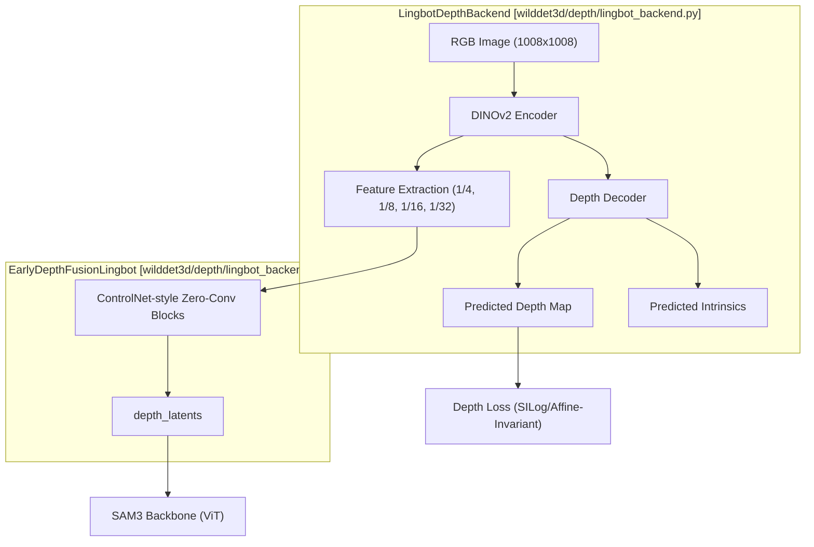
Sources: [wilddet3d/depth/lingbot_backend.py:155-212](), [wilddet3d/depth/lingbot_backend.py:228-268]()

## Depth Training Modes

The backend supports three distinct training modes defined in `LingbotDepthBackendConfig` [wilddet3d/depth/lingbot_backend.py:22-30]():

| Mode | Description | Logic in Code |
| :--- | :--- | :--- |
| `monocular` | Standard monocular depth estimation from RGB. | [wilddet3d/depth/lingbot_backend.py:180-184]() |
| `masked` | Depth estimation where parts of the image are masked (used for specific pre-training tasks). | [wilddet3d/depth/lingbot_backend.py:186-191]() |
| `copy_through` | Passes ground truth depth through (used during specific debugging or upper-bound testing). | [wilddet3d/depth/lingbot_backend.py:193-196]() |

## Early Depth Fusion (ControlNet-style)

The `EarlyDepthFusionLingbot` class [wilddet3d/depth/lingbot_backend.py:228-239]() implements a fusion mechanism inspired by ControlNet. Instead of simply concatenating depth maps to RGB, it processes the intermediate features of the DINOv2 encoder to create geometric residuals.

### Key Components
*   **Feature Alignment**: The module takes four scales of features from the DINOv2 backbone (strides 4, 8, 16, 32) [wilddet3d/depth/lingbot_backend.py:255-260]().
*   **Zero-Convolution**: Each feature scale is passed through a `Conv2d` layer initialized with zeros (or small weights) to ensure that, at the start of training, the geometry branch does not disrupt the pretrained RGB features [wilddet3d/depth/lingbot_backend.py:241-253]().
*   **Latent Extraction**: These features are returned as `depth_latents` and are added to the SAM3 ViT backbone features during the forward pass of the main `WildDet3D` model [wilddet3d/model.py:246-253]().

**Entity Mapping: Fusion Implementation**
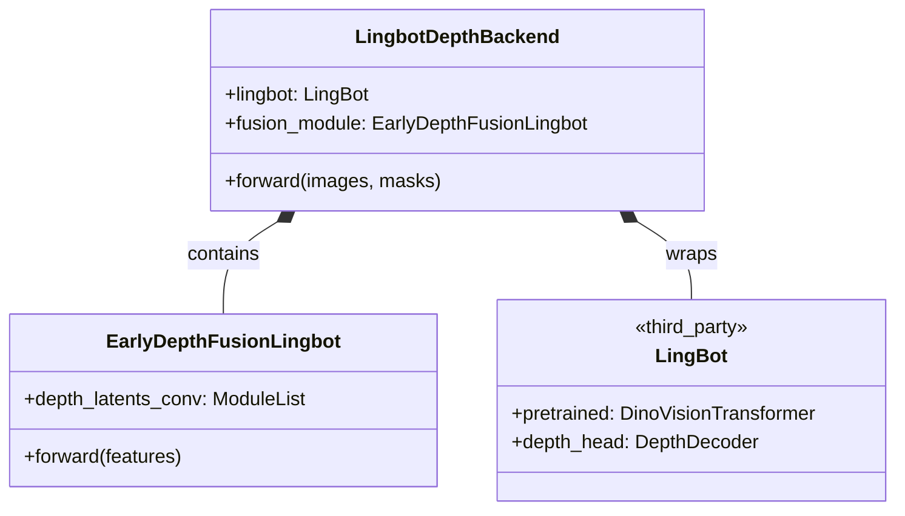
Sources: [wilddet3d/depth/lingbot_backend.py:32-80](), [wilddet3d/depth/lingbot_backend.py:228-239]()

## Intrinsic Prediction

A critical feature for "in-the-wild" detection is the ability to estimate camera intrinsics when they are unknown. The `LingbotDepthBackend` can predict the focal length ($f_x, f_y$) and principal point ($c_x, c_y$).

*   **Logic**: If the configuration `predict_intrinsics` is enabled, the model uses a specialized head within the LingBot architecture to output a 4-dimensional vector [wilddet3d/depth/lingbot_backend.py:202-212]().
*   **Normalization**: Predicted intrinsics are typically normalized relative to the image dimensions (1008x1008) [wilddet3d/depth/lingbot_backend.py:207-210]().
*   **Usage**: These predicted values are used by the `Det3DHead` to project 3D boxes back into the 2D image plane during inference if ground truth intrinsics are missing [wilddet3d/model.py:280-285]().

## Implementation Details

### Initialization
The backend initializes the `LingBot` model by injecting the `third_party/lingbot_depth` path into the system path [wilddet3d/depth/lingbot_backend.py:53-56](). It loads the DINOv2 weights and sets up the fusion layers based on the `embed_dim` of the detection backbone (typically 1152 for ViT-H or 768 for ViT-L) [wilddet3d/depth/lingbot_backend.py:73-77]().

### Forward Pass
The `forward` method [wilddet3d/depth/lingbot_backend.py:155-161]() accepts a batch of images and returns a dictionary containing:
*   `depth_pred`: The estimated depth map [wilddet3d/depth/lingbot_backend.py:214]().
*   `depth_latents`: A list of feature maps for the SAM3 backbone [wilddet3d/depth/lingbot_backend.py:215]().
*   `intrinsics_pred`: (Optional) The predicted camera parameters [wilddet3d/depth/lingbot_backend.py:216]().

### Sources:
- Configuration and Class Definition: [wilddet3d/depth/lingbot_backend.py:10-42]()
- Model Setup and Submodule Loading: [wilddet3d/depth/lingbot_backend.py:53-110]()
- Forward Pass and Logic: [wilddet3d/depth/lingbot_backend.py:155-218]()
- Fusion Module Implementation: [wilddet3d/depth/lingbot_backend.py:228-268]()
- Main Model Integration: [wilddet3d/model.py:240-260]()

---

# Page: 3D Detection Head & Box Coder

# 3D Detection Head & Box Coder

<details>
<summary>Relevant source files</summary>

The following files were used as context for generating this wiki page:

- [wilddet3d/__init__.py](wilddet3d/__init__.py)
- [wilddet3d/connector.py](wilddet3d/connector.py)

</details>


The 3D Detection Head and Box Coder are responsible for transforming high-level features and 2D proposals into precise 3D bounding box parameters. This component bridges the gap between the 2D visual/language space and the 3D geometric space by predicting depth, 3D orientation (6D rotation), and physical dimensions.

## Det3DHead Architecture

The `Det3DHead` is a transformer-based decoder head that processes object queries to regress 3D parameters. It integrates features from the image backbone, the geometry backend (LingBot-Depth), and camera intrinsics.

### Key Components
*   **Depth Cross-Attention**: The head attends to `depth_latents` provided by the geometry backend to refine the depth estimate for each query [wilddet3d/head/det3d_head.py:45-60]().
*   **Camera Prompt Branch**: To handle "in-the-wild" scenarios where intrinsics vary, the head uses a `camera_prompt_branch` that encodes the focal length and principal point into the query embeddings [wilddet3d/head/det3d_head.py:112-125]().
*   **3D Confidence Branch**: A specialized MLP that predicts a 3D-specific confidence score, which is later combined with the 2D classification score for final ranking [wilddet3d/head/det3d_head.py:150-165]().

### Data Flow in Det3DHead
1.  **Input**: Receives object queries from the SAM3 decoder and `depth_latents` from the `LingbotDepthBackend` [wilddet3d/model.py:280-295]().
2.  **Refinement**: Iteratively updates queries using self-attention and cross-attention over multi-scale image features and depth features [wilddet3d/head/det3d_head.py:180-210]().
3.  **Regression**: Parallel MLP heads predict:
    *   **Center Offset**: $\Delta x, \Delta y$ relative to the 2D box center [wilddet3d/head/det3d_head.py:220-225]().
    *   **Log-Depth**: Predicted in log-space for numerical stability [wilddet3d/head/det3d_head.py:226-230]().
    *   **Dimensions**: Log-space predictions for $l, w, h$ [wilddet3d/head/det3d_head.py:231-235]().
    *   **Orientation**: 6D rotation representation [wilddet3d/head/det3d_head.py:236-240]().

### Logic Entity Bridge: Head & Coder
The following diagram illustrates how the abstract 3D detection concepts map to specific code entities within the `wilddet3d/head/` directory.

**Diagram: 3D Head Logic to Code Mapping**
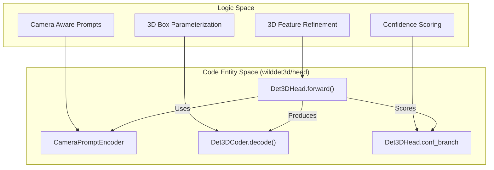
Sources: [wilddet3d/head/det3d_head.py:15-100](), [wilddet3d/head/det3d_coder.py:10-40]()

## Det3DCoder: Box Encoding & Decoding

The `Det3DCoder` class manages the transformation between raw network outputs and physical 3D boxes. It implements a robust parameterization designed for monocular 3D detection.

### 6D Rotation Encoding
Instead of Euler angles or quaternions, WildDet3D uses a 6D rotation representation [wilddet3d/head/det3DCoder.py:110-125](). This representation is continuous and avoids the discontinuities associated with other formats, making it easier for the network to learn. The `rotation_6d_to_matrix` utility in `wilddet3d/ops/rotation.py` converts these 6 values into a $3 \times 3$ rotation matrix [wilddet3d/ops/rotation.py:45-60]().

### Canonical Normalization
To handle the scale ambiguity in monocular images, the coder performs canonical normalization.
*   **Depth**: Predicted as a residual relative to a reference depth or in log-space [wilddet3d/head/det3d_coder.py:140-155]().
*   **Dimensions**: Predicted as log-residuals relative to category-specific or global mean dimensions [wilddet3d/head/det3d_coder.py:160-170]().

### Decoding Process
The `decode` function takes the raw tensor outputs and the camera intrinsics to produce `Det3DOut` objects:
1.  **Project 2D Center**: The 2D box center is projected into 3D space using the predicted depth and intrinsics [wilddet3d/head/det3d_coder.py:200-215]().
2.  **Apply Offsets**: The predicted 3D center offset is added to the projected point.
3.  **Construct Matrix**: The 6D rotation is converted to a rotation matrix $R$ and the log-dimensions are exponentiated to $D$.
4.  **Assemble Box**: A 3D box is defined by $[x, y, z, l, w, h, yaw]$ or a full $4 \times 4$ pose matrix [wilddet3d/head/det3d_coder.py:230-250]().

Sources: [wilddet3d/head/det3d_coder.py:1-250](), [wilddet3d/ops/rotation.py:1-70]()

## RoI2Det3D & Post-Processing

Post-processing is handled by `RoI2Det3D`, which filters and refines the raw 3D detections.

### Non-Maximum Suppression (NMS)
WildDet3D uses a multi-stage NMS approach:
1.  **2D NMS**: Standard IoU-based NMS on 2D boxes to remove redundant queries [wilddet3d/head/roi2det3d.py:85-100]().
2.  **3D Confidence Integration**: The final score is a geometric mean or weighted sum of the 2D classification score and the 3D confidence branch output [wilddet3d/head/roi2det3d.py:110-120]().
3.  **Cross-Category NMS**: In "In-The-Wild" mode, NMS is often applied across all categories to handle overlapping open-vocabulary predictions [wilddet3d/head/roi2det3d.py:125-135]().

### Data Transformation Pipeline
The flow from raw model output to the final `WildDet3DOut` dataclass is summarized below.

**Diagram: 3D Detection Post-Processing Pipeline**
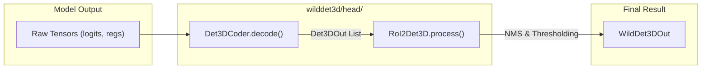
Sources: [wilddet3d/head/roi2det3d.py:10-150](), [wilddet3d/data_types.py:1-50]()

## Implementation Details

| Component | File Path | Key Function/Class |
| :--- | :--- | :--- |
| **3D Head** | `wilddet3d/head/det3d_head.py` | `Det3DHead` |
| **Box Decoding** | `wilddet3d/head/det3d_coder.py` | `Det3DCoder.decode()` |
| **Post-Processing** | `wilddet3d/head/roi2det3d.py` | `RoI2Det3D` |
| **6D Rotation** | `wilddet3d/ops/rotation.py` | `rotation_6d_to_matrix` |
| **Camera Encoding** | `wilddet3d/head/det3d_head.py` | `CameraPromptEncoder` |

Sources: [wilddet3d/head/det3d_head.py:15-20](), [wilddet3d/head/det3d_coder.py:10-15](), [wilddet3d/head/roi2det3d.py:10-15](), [wilddet3d/ops/rotation.py:45-50]()

---

# Page: Data Types & Preprocessing

# Data Types & Preprocessing

<details>
<summary>Relevant source files</summary>

The following files were used as context for generating this wiki page:

- [wilddet3d/__init__.py](wilddet3d/__init__.py)
- [wilddet3d/data/__init__.py](wilddet3d/data/__init__.py)

</details>


This section documents the fundamental data structures and the image preprocessing pipeline used in WildDet3D. The system relies on strictly defined dataclasses to manage the flow of multi-modal inputs (images, text, geometry) and the complex outputs of the 3D detection head. Preprocessing ensures that "in-the-wild" images of arbitrary sizes are normalized to a fixed resolution while maintaining geometric consistency for 3D inference.

## Data Types

The core data structures are defined in `wilddet3d/data_types.py`. These classes facilitate the transition from raw sensor data to structured 3D detections.

### Input Specification: `WildDet3DInput`

The `WildDet3DInput` dataclass [wilddet3d/data_types.py:10-24]() serves as the primary container for a single inference sample. It encapsulates the RGB data, camera parameters, and the multi-modal prompts required for open-vocabulary detection.

| Field | Type | Description |
| :--- | :--- | :--- |
| `image` | `torch.Tensor` | The preprocessed RGB image (typically $1008 \times 1008$). |
| `intrinsics` | `torch.Tensor` | $3 \times 3$ camera matrix used for depth projection and 3D box scaling. |
| `text_prompts` | `list[str]` | List of category names or descriptions for text-based detection. |
| `boxes_prompt` | `torch.Tensor` | Optional 2D bounding boxes used as geometric prompts (format: `[N, 4]`). |
| `points_prompt` | `torch.Tensor` | Optional 2D points used as geometric prompts (format: `[N, 2]`). |
| `masks_prompt` | `torch.Tensor` | Optional binary masks used as geometric prompts. |

### Output Specification: `WildDet3DOut` and `Det3DOut`

The model returns a `WildDet3DOut` object [wilddet3d/data_types.py:53-58](), which contains a list of detections and auxiliary geometric information. Each individual detection is encapsulated in a `Det3DOut` instance [wilddet3d/data_types.py:27-50]().

**`Det3DOut` Attributes:**
*   **2D Data:** `box2d` (coordinates), `score` (confidence), `label` (class index), and `mask` (segmentation).
*   **3D Data:** 
    *   `center3d`: The $[x, y, z]$ position in camera coordinates.
    *   `dims3d`: The $[width, height, length]$ of the object.
    *   `rotation`: The orientation (yaw) or full 6D rotation.
    *   `velocity`: Optional temporal information for tracking.

**`WildDet3DOut` Attributes:**
*   `detections`: A list of `Det3DOut` objects.
*   `predicted_intrinsics`: The camera intrinsics estimated by the `LingbotDepthBackend`.
*   `predicted_depth`: The dense depth map generated by the geometry backend.

**Sources:** [wilddet3d/data_types.py:10-58](), [wilddet3d/__init__.py:16-29]()

---

## Preprocessing Pipeline

The `preprocess()` function in `wilddet3d/preprocessing.py` is responsible for transforming raw input images into the format expected by the `WildDet3D` model [wilddet3d/preprocessing.py:10-15]().

### Image Normalization and Resizing
WildDet3D operates on a fixed resolution of **$1008 \times 1008$** pixels [wilddet3d/preprocessing.py:42-43](). This specific resolution is chosen to be divisible by the patch sizes of both the SAM3 ViT backbone and the DINOv2-based depth encoder.

1.  **Aspect Ratio Preservation:** The image is resized such that its longest side is 1008 pixels [wilddet3d/preprocessing.py:55-60]().
2.  **Center Padding:** If the original image was not square, it is zero-padded to reach the $1008 \times 1008$ target [wilddet3d/preprocessing.py:65-70]().
3.  **Tensor Conversion:** The image is normalized (0-1 range) and converted to a float32 tensor [wilddet3d/preprocessing.py:45-50]().

### Intrinsics Adjustment
Because 3D detection is sensitive to camera geometry, any spatial transformation applied to the image (scaling or padding) must be reflected in the camera intrinsics matrix $K$.

$$ K = \begin{bmatrix} f_x & 0 & c_x \\ 0 & f_y & c_y \\ 0 & 0 & 1 \end{bmatrix} $$

The `preprocess()` function updates $f_x, f_y$ based on the scaling factor and $c_x, c_y$ based on the padding offsets to ensure that the 2D-to-3D projection remains valid [wilddet3d/preprocessing.py:75-85]().

### Focal Length Heuristic
For "in-the-wild" images where camera intrinsics are unknown, the system applies a default heuristic:
*   **Default Focal Length:** $1.2 \times \max(width, height)$ [wilddet3d/preprocessing.py:30-35]().
*   **Principal Point:** Set to the image center $(W/2, H/2)$ [wilddet3d/preprocessing.py:36-38]().

### Data Flow Diagram

The following diagram illustrates the transformation of raw data into the structured `WildDet3DInput` format used by the `WildDet3DPredictor`.

**Entity Mapping: Raw Data to WildDet3DInput**
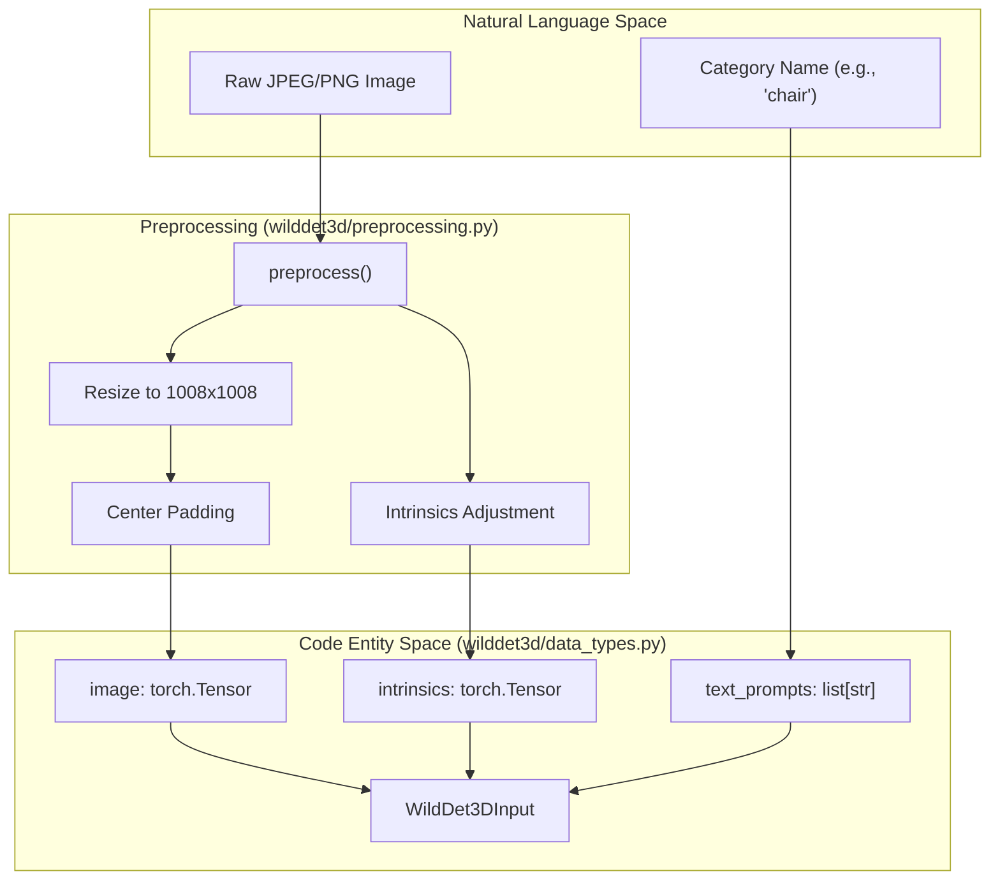

**Sources:** [wilddet3d/preprocessing.py:10-90](), [wilddet3d/data_types.py:10-24]()

---

## Internal Data Flow

During the forward pass, data is converted between various internal representations. The `WildDet3DCollator` [wilddet3d/data/__init__.py]() (documented further in section 3.2) handles the conversion from per-image datasets to the per-prompt batches required by the SAM3 architecture.

**System Architecture: Data Flow**
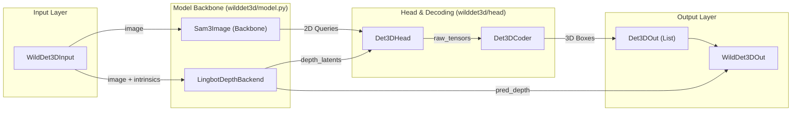

**Sources:** [wilddet3d/model.py:45-120](), [wilddet3d/data_types.py:53-58](), [wilddet3d/__init__.py:1-30]()

---

# Page: Training Pipeline

# Training Pipeline

<details>
<summary>Relevant source files</summary>

The following files were used as context for generating this wiki page:

- [configs/base/model.py](configs/base/model.py)
- [configs/base/pl.py](configs/base/pl.py)
- [docs/TRAINING.md](docs/TRAINING.md)

</details>


WildDet3D utilizes the **vis4d** framework to manage its training lifecycle, integrating PyTorch Lightning for distributed training and experiment management. The pipeline is designed to handle multi-modal inputs (RGB, depth, and prompts) while optimizing a complex multi-task loss function that spans 2D detection, depth estimation, and 3D bounding box regression.

### System Architecture Overview

The training system is organized into four major pillars: a flexible configuration system based on `ml_collections`, a multi-stage data pipeline, a hybrid loss function for 2D/3D grounding, and a specialized optimizer strategy for fine-tuning large pretrained models.

#### Training Logic Flow
The following diagram illustrates how a training step moves from data loading through the model to loss computation.

"Training Step Data & Logic Flow"
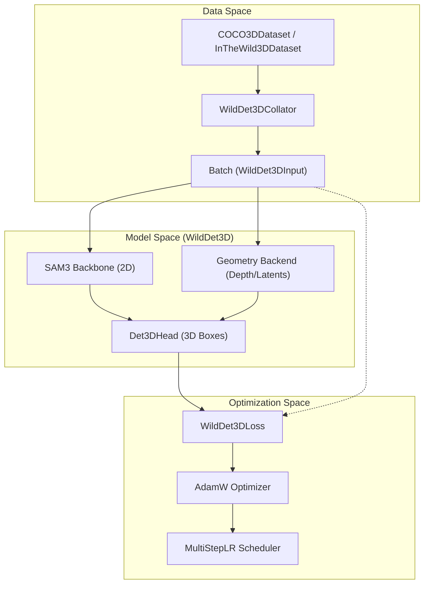
**Sources:** [configs/base/model.py:115-130](), [wilddet3d/model.py:10-50](), [wilddet3d/loss/loss.py:20-100]()

---

### Configuration System
The configuration system uses `ml_collections.ConfigDict` to define experiments. It separates hyperparameters (epochs, learning rates) from structural model configurations. The `vis4d` integration allows these configs to be easily overridden via CLI for different datasets or ablation studies.

*   **ExperimentParameters**: Defined in `get_wilddet3d_hyperparams_cfg`, these handle training-specific scalars like `base_lr`, `num_epochs`, and `accumulate_grad_batches`.
*   **Model Config**: Defined in `get_wilddet3d_cfg`, this handles structural choices like `geometry_backend_type` (e.g., `lingbot_depth` or `unidepth_v2`) and freeze strategies.

For details, see [Configuration System](#3.3).

**Sources:** [configs/base/model.py:18-112](), [configs/base/model.py:115-160]()

---

### Data Pipeline & Datasets
WildDet3D supports a variety of datasets including **Omni3D**, **Waymo**, and the custom **In-the-Wild** benchmarks. The pipeline utilizes a specialized `WildDet3DCollator` to convert per-image annotations into per-prompt batches suitable for the transformer architecture.

*   **Transforms**: Images are typically resized to 1008×1008 with center padding.
*   **Prompting**: The pipeline supports five distinct prompting modes, which are sampled during training to ensure the model generalizes to text, visual, and geometric cues.

For details, see [Data Pipeline & Datasets](#3.2).

**Sources:** [configs/base/model.py:21-22](), [wilddet3d/data/collator.py:10-50]()

---

### Loss Functions
The `WildDet3DLoss` class implements a composite objective function. It combines standard 2D detection losses with 3D-specific geometric losses and auxiliary depth supervision.

| Category | Loss Components |
| :--- | :--- |
| **2D Detection** | Focal Loss (Classification), L1 + GIoU (Box Regression) |
| **3D Regression** | Delta Center, Log Depth, Log Dimensions, 6D Rotation |
| **Geometry** | SILog (Scale-Invariant Log), Affine-Invariant Depth Loss |
| **Matching** | One-to-Many (O2M) matching for queries |

For details, see [Loss Functions](#3.1).

**Sources:** [wilddet3d/loss/loss.py:20-150](), [configs/base/model.py:180-185]()

---

### Optimizer & Training Schedule
The training process uses the **AdamW** optimizer with a **MultiStepLR** schedule. A key feature of the WildDet3D pipeline is the differential learning rate strategy:
*   **Pretrained Components**: SAM3 and Geometry backbones often use a reduced learning rate (e.g., 0.1x `base_lr`).
*   **New Components**: The 3D Head and fusion layers use the full `base_lr`.
*   **Freeze Strategies**: Configurations like `backbone_freeze_blocks` allow for partial freezing of the ViT backbone to save memory and prevent forgetting.

For details, see [Optimizer & Training Schedule](#3.4).

**Sources:** [configs/base/model.py:23-31](), [configs/base/model.py:71-75](), [configs/base/pl.py:40-52]()

---

### Training Execution (PyTorch Lightning)
The execution is managed via `get_pl_cfg`, which configures the `PLTrainer`. Key settings include:
*   **Precision**: Supports `bf16-mixed` or `16-mixed` via the `MIXED_PRECISION` environment variable.
*   **Gradient Clipping**: Default `gradient_clip_val` is set to 0.1.
*   **DDP Strategy**: Uses `ddp_find_unused_parameters_true` to accommodate frozen geometry encoders that may not contribute to every forward pass.

"Configuration to Execution Mapping"
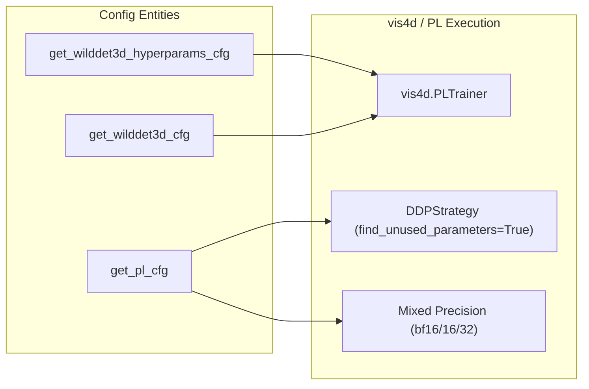
**Sources:** [configs/base/pl.py:12-52](), [configs/base/model.py:18-50]()

---

# Page: Loss Functions

# Loss Functions

<details>
<summary>Relevant source files</summary>

The following files were used as context for generating this wiki page:

- [configs/base/loss.py](configs/base/loss.py)
- [wilddet3d/__init__.py](wilddet3d/__init__.py)

</details>


The WildDet3D training pipeline utilizes a composite loss strategy to optimize 2D detection, 3D spatial reasoning, and geometric scene understanding simultaneously. The primary entry point is the `WildDet3DLoss` class, which handles the complex task of matching predicted queries to ground truth targets across multiple decoder layers and auxiliary outputs.

### Loss Architecture Overview

WildDet3D uses a `LossModule` [configs/base/loss.py:127-134]() to wrap the core `WildDet3DLoss` [configs/base/loss.py:111-114](). This structure allows for the separate logging of individual loss components (e.g., `loss_cls`, `loss_depth`, `loss_silog`) while maintaining a unified optimization objective.

The loss calculation is divided into three primary domains:
1.  **2D Detection Losses**: Classification and box regression inherited from the SAM3/DETR paradigm.
2.  **3D Detection Losses**: Spatial parameters including depth, 3D dimensions, and 6D rotation.
3.  **Geometry Backend Losses**: Scene-level geometric consistency (SILog, affine-invariant depth).

#### Data Flow: Code Entity Mapping
The following diagram illustrates how configuration parameters map to the functional loss components within the codebase.

**Loss Configuration to Implementation Mapping**
```mermaid
graph TD
    subgraph "Config Space (WildDet3DLossConfig)"
        C1["loss_2d_scale"]
        C2["loss_3d_scale"]
        C3["loss_geom_scale"]
        C4["loss_cls_weight"]
        C5["loss_depth_weight"]
        C6["loss_silog_weight"]
    end

    subgraph "Code Entity Space (WildDet3DLoss)"
        L1["2D: IABCEMdetr / L1 / GIoU"]
        L2["3D: LogDepth / DeltaCenter / 6DRotation"]
        L3["Geom: SILog / SSI / PhiTheta"]
        
        M1["BinaryHungarianMatcherV2"]
        D1["Deep Supervision (Aux Outputs)"]
    end

    C1 --> L1
    C4 --> L1
    C2 --> L2
    C5 --> L2
    C3 --> L3
    C6 --> L3
    
    L1 & L2 & L3 --> D1
    M1 -.->|"Assigns GT to Queries"| L1
```
Sources: [configs/base/loss.py:15-50](), [configs/base/loss.py:74-108]()

---

### 2D Detection Losses

The 2D components focus on identifying objects and localizing them within the image plane. These losses are scaled globally by `loss_2d_scale` [configs/base/loss.py:77]().

*   **Classification (`loss_cls_weight`)**: Uses the `IABCEMdetr` (Image-Attribute-Box-Category-Embedding) classification loss, consistent with the SAM3 backbone [configs/base/loss.py:23]().
*   **Box Regression (`loss_bbox_weight`)**: L1 loss applied to the normalized 2D box coordinates [configs/base/loss.py:24]().
*   **GIoU Loss (`loss_giou_weight`)**: Generalized Intersection over Union loss to handle varying box scales and overlaps [configs/base/loss.py:25]().

Sources: [configs/base/loss.py:19-25](), [configs/base/loss.py:81-83]()

---

### 3D Detection Losses

The 3D head predicts spatial parameters that are supervised using specialized regression losses. These are scaled by `loss_3d_scale` [configs/base/loss.py:78]().

| Loss Component | Config Key | Description |
| :--- | :--- | :--- |
| **Delta Center** | `loss_delta_2d_weight` | Supervizes the 2D offset from the box center to the projected 3D center [configs/base/loss.py:27](). |
| **Log Depth** | `loss_depth_weight` | Regression of the object's depth in log-space for scale invariance [configs/base/loss.py:28](). |
| **Log Dimensions** | `loss_dim_weight` | Regression of 3D size (L, W, H) in log-space [configs/base/loss.py:29](). |
| **6D Rotation** | `loss_rot_weight` | Supervision of the 6D rotation representation used for orientation [configs/base/loss.py:30](). |
| **3D Confidence** | `loss_3d_conf_weight` | Optional head supervised by a mix of depth accuracy and 3D IoU [configs/base/loss.py:40-42](). |

Sources: [configs/base/loss.py:26-30](), [configs/base/loss.py:38-42]()

---

### Geometry Backend Losses

These losses supervise the `LingbotDepthBackend`, ensuring the model learns a consistent geometric representation of the entire scene, not just the detected objects. They are scaled by `loss_geom_scale` [configs/base/loss.py:79]().

*   **SILog Loss (`loss_silog_weight`)**: Scale-Invariant Logarithmic loss for depth estimation, crucial for monocular depth consistency [configs/base/loss.py:32]().
*   **Affine-Invariant Loss (`loss_opt_ssi_weight`)**: Scale-and-Shift Invariant (SSI) loss, often used in foundation depth models like UniDepthV2 [configs/base/loss.py:35]().
*   **Angular Losses (`loss_phi_weight`, `loss_theta_weight`)**: Supervise the predicted camera intrinsics (vertical and horizontal field of view) [configs/base/loss.py:33-34]().

Sources: [configs/base/loss.py:31-35](), [configs/base/loss.py:90-93]()

---

### Matching and Supervision

WildDet3D employs advanced matching and supervision strategies to stabilize training.

#### O2M Matching and Auxiliary Outputs
The model supports **One-to-Many (O2M)** matching [configs/base/loss.py:46](), allowing multiple queries to match a single ground truth object during training to provide a denser gradient signal. Additionally, **Deep Supervision** is applied to the auxiliary outputs of the transformer decoder layers. The `aux_loss_weight` [configs/base/loss.py:37]() controls the contribution of these intermediate layers to the total loss.

#### Loss Data Flow
The `WildDet3DLossConnector` [configs/base/loss.py:121]() acts as the bridge between the model's forward pass and the loss calculation. It takes the `WildDet3DOut` dataclass and the ground truth batch, restructuring them for the `WildDet3DLoss` class.

**Internal Loss Processing Flow**
```mermaid
graph LR
    subgraph "Input Processing"
        IN["WildDet3DOut"] --> CON["WildDet3DLossConnector"]
        GT["Batch Ground Truth"] --> CON
    end

    subgraph "WildDet3DLoss.forward()"
        CON --> MAT["Hungarian Matcher"]
        MAT --> L2D["2D Losses"]
        MAT --> L3D["3D Losses"]
        CON --> LG["Geometry Losses"]
    end

    subgraph "Output"
        L2D & L3D & LG --> TOTAL["Total Loss"]
        L2D & L3D & LG --> MET["Metrics (F1, Acc)"]
    end
```
Sources: [configs/base/loss.py:118-122](), [wilddet3d/__init__.py:16-18]()

#### Metrics and Logging
Certain values are computed as metrics (e.g., `metric_ce_f1`, `metric_presence_acc`) but are explicitly excluded from the optimization gradient via the `exclude_attributes` list in `LossModule` [configs/base/loss.py:129-134](). This ensures they are logged to tools like WandB without affecting the loss scale.

Sources: [configs/base/loss.py:116-134]()

---

# Page: Data Pipeline & Datasets

# Data Pipeline & Datasets

<details>
<summary>Relevant source files</summary>

The following files were used as context for generating this wiki page:

- [configs/base/dataset/in_the_wild.py](configs/base/dataset/in_the_wild.py)
- [configs/base/dataset/transform.py](configs/base/dataset/transform.py)
- [data/in_the_wild/annotations/InTheWild_v3_val.json](data/in_the_wild/annotations/InTheWild_v3_val.json)
- [data/in_the_wild/annotations/InTheWild_v3_val_class_map.json](data/in_the_wild/annotations/InTheWild_v3_val_class_map.json)
- [data/in_the_wild/annotations/Stereo4D_test.json](data/in_the_wild/annotations/Stereo4D_test.json)
- [data/in_the_wild/annotations/Stereo4D_val.json](data/in_the_wild/annotations/Stereo4D_val.json)
- [data/in_the_wild/annotations/Stereo4D_val_class_map.json](data/in_the_wild/annotations/Stereo4D_val_class_map.json)
- [wilddet3d/data/__init__.py](wilddet3d/data/__init__.py)
- [wilddet3d/data/datasets/__init__.py](wilddet3d/data/datasets/__init__.py)
- [wilddet3d/data/datasets/coco3d.py](wilddet3d/data/datasets/coco3d.py)

</details>


This page documents the data ingestion, transformation, and batching pipeline for WildDet3D. The pipeline is built on the `vis4d` framework, extending it to handle 3D bounding boxes, multi-modal prompts (text, masks, boxes), and monocular depth maps.

## Overview of Data Flow

The data flow starts from annotation JSON files, passes through specialized dataset classes, undergoes geometric and appearance transformations, and is finally batched by a custom collator that handles the conversion from per-image samples to per-prompt training instances.

```mermaid
graph TD
    A["Annotation JSON (COCO3D Format)"] --> B["InTheWild3DDataset / COCO3DDataset"]
    B --> C["DataPipe (vis4d)"]
    C --> D["Transforms (Resize, Crop, Pad, Flip)"]
    D --> E["WildDet3DCollator"]
    E --> F["WildDet3DInput (Batch)"]
    
    subgraph "Transform Details"
    D1["GenResizeParameters"]
    D2["ResizeImages/Boxes/Depth/Masks"]
    D3["GenCentralCropParameters"]
    D4["CropImages/Boxes/Depth/Masks"]
    end
    
    D --- D1
    D1 --- D2
    D2 --- D3
    D3 --- D4
```
**Sources:** [configs/base/dataset/in_the_wild.py:9-17](), [configs/base/dataset/transform.py:46-108](), [wilddet3d/data/datasets/coco3d.py:30-91]()

---

## Datasets & Annotation Formats

WildDet3D uses a COCO-style JSON format extended for 3D detection. Key additions include camera intrinsics (`K`), 3D centers (`center_cam`), dimensions, and rotations.

### InTheWild3DDataset
This dataset is the primary entry point for "In-the-Wild" evaluation and training. It inherits from `COCO3DDataset` and provides specific logic for loading class maps and handling mask annotations [configs/base/dataset/in_the_wild.py:11-14]().

*   **Annotation Files**: Located in `data/in_the_wild/annotations/`. Examples include `InTheWild_v3_val.json` [data/in_the_wild/annotations/InTheWild_v3_val.json:1]() and `Stereo4D_test.json` [data/in_the_wild/annotations/Stereo4D_test.json:1]().
*   **Class Mapping**: A JSON dictionary mapping string category names to integer IDs, used to unify disparate datasets [data/in_the_wild/annotations/InTheWild_v3_val_class_map.json:1]().

### COCO3DDataset
A base class for 3D detection that handles loading images, 2D boxes, 3D boxes, and depth maps [wilddet3d/data/datasets/coco3d.py:30-32]().

*   **Filtering**: Implements `_filter_data` to remove empty samples or samples missing depth maps if `with_depth` is enabled [wilddet3d/data/datasets/coco3d.py:96-129]().
*   **3D Box Representation**: Decodes 3D annotations into a 10-element vector (center_x, center_y, center_z, w, h, l, roll, pitch, yaw, class_id) [wilddet3d/data/datasets/coco3d.py:169-202]().

**Sources:** [wilddet3d/data/datasets/coco3d.py:30-91](), [configs/base/dataset/in_the_wild.py:19-53]()

---

## Data Transforms

Transforms in WildDet3D ensure that 2D image changes (resizing, cropping, padding) are consistently applied to all associated geometric data (2D/3D boxes, camera intrinsics, and depth maps).

### Transform Categories
| Transform Type | Classes | Purpose |
| :--- | :--- | :--- |
| **Resizing** | `ResizeImages`, `ResizeBoxes2D`, `ResizeIntrinsics`, `ResizeDepthMaps`, `ResizeMasks2D` | Scales all inputs to a target resolution (e.g., 1008x1008) while updating focal lengths and principal points [configs/base/dataset/transform.py:23-28](). |
| **Cropping** | `CropImages`, `CropBoxes2D`, `CropBoxes3D`, `CropIntrinsics`, `CropMasks2D` | Extracts sub-regions; `CropIntrinsics` adjusts the principal point (cx, cy) based on the crop offset [configs/base/dataset/transform.py:8-14](). |
| **Padding** | `CenterPadImages`, `CenterPadBoxes2D`, `CenterPadIntrinsics`, `CenterPadMasks2D` | Pads images to a fixed shape; crucial for maintaining batch consistency in transformer backbones [configs/base/dataset/transform.py:37-42](). |
| **Augmentation** | `FlipImages`, `FlipBoxes3D`, `RandomApply` | Horizontal flipping for training; requires mirroring the 3D rotation and updating the principal point [configs/base/dataset/transform.py:15-21](). |

### Training vs. Testing Pipeline
The training pipeline includes random scaling (0.75x to 1.25x) and horizontal flipping [configs/base/dataset/transform.py:52-85](). The test pipeline is deterministic, using fixed resizing and center padding to ensure reproducibility [configs/base/dataset/transform.py:165-195]().

**Sources:** [configs/base/dataset/transform.py:1-43](), [configs/base/dataset/transform.py:46-108]()

---

## Batching & Collation

The `WildDet3DCollator` (conceptually described in the pipeline) is responsible for transforming standard image-centric batches into the prompt-centric format required by the SAM3 backbone.

```mermaid
graph LR
    subgraph "Input Samples"
    S1["Sample 1: Image + 5 Boxes"]
    S2["Sample 2: Image + 2 Masks"]
    end
    
    subgraph "Collator Processing"
    C["WildDet3DCollator"]
    end
    
    subgraph "Batched Output"
    B["WildDet3DInput"]
    I["Images: [B, 3, H, W]"]
    P["Prompts: [N_Total_Prompts, ...]"]
    M["Metadata: Intrinsics, Shapes"]
    end
    
    S1 & S2 --> C
    C --> B
    B --> I & P & M
```

### Key Logic:
1.  **Coordinate Normalization**: Transforms 2D boxes and points into a normalized [0, 1] range relative to the padded image size.
2.  **Prompt Aggregation**: Flattens prompts from multiple images into a single sequence for the transformer decoder, maintaining a mapping back to the original image indices.
3.  **Intrinsics Handling**: Batches the $3 \times 3$ camera matrices. If intrinsics are missing in the data, a default focal length heuristic is applied during preprocessing.

**Sources:** [configs/base/dataset/in_the_wild.py:143-147](), [configs/base/dataset/transform.py:89-103]()

---

## Configuration Patterns

The dataset configuration uses `ml_collections` and `vis4d.config.class_config` to instantiate the data pipeline.

*   **`get_in_the_wild_dataset_cfg`**: Construct the dataset object, handles caching (via `cache_as_binary` and `.pkl` files), and sets filtering thresholds like `truncation_thres` and `visibility_thres` [configs/base/dataset/in_the_wild.py:19-90]().
*   **`DataPipe`**: A `vis4d` wrapper that combines the dataset with the `preprocess_fn` (the composed transforms) [configs/base/dataset/in_the_wild.py:143-147]().

**Sources:** [configs/base/dataset/in_the_wild.py:19-90](), [configs/base/dataset/in_the_wild.py:93-147]()

---

# Page: Configuration System

# Configuration System

<details>
<summary>Relevant source files</summary>

The following files were used as context for generating this wiki page:

- [configs/__init__.py](configs/__init__.py)
- [configs/base/__init__.py](configs/base/__init__.py)
- [configs/base/base_connector.py](configs/base/base_connector.py)
- [configs/base/base_optim.py](configs/base/base_optim.py)
- [configs/base/callback.py](configs/base/callback.py)
- [configs/base/connector.py](configs/base/connector.py)
- [configs/base/data.py](configs/base/data.py)
- [configs/base/dataset/cubifyanything.py](configs/base/dataset/cubifyanything.py)
- [configs/base/dataset/foundationpose.py](configs/base/dataset/foundationpose.py)
- [configs/base/dataset/omni3d.py](configs/base/dataset/omni3d.py)
- [configs/base/dataset/open.py](configs/base/dataset/open.py)
- [configs/base/dataset/stereo4d.py](configs/base/dataset/stereo4d.py)
- [configs/base/dataset/threeeed.py](configs/base/dataset/threeeed.py)
- [configs/base/dataset/waymo.py](configs/base/dataset/waymo.py)
- [configs/base/model.py](configs/base/model.py)
- [configs/base/optim.py](configs/base/optim.py)
- [configs/base/pl.py](configs/base/pl.py)
- [configs/base/transforms.py](configs/base/transforms.py)

</details>


The WildDet3D configuration system is built upon the **vis4d** framework and **ml_collections**. It employs a hierarchical structure where base components (models, losses, optimizers) are defined as modular functions and then composed into specific `ExperimentConfig` objects. This system handles the complexity of multi-modal prompting (text, visual, geometric) and multi-dataset training/evaluation.

## Core Configuration Structure

WildDet3D uses the `ExperimentConfig` and `ExperimentParameters` pattern from vis4d. The `ExperimentParameters` class (defined in individual experiment files) acts as a schema for hyperparameters, while the `ExperimentConfig` defines the actual object graph (data pipes, model architecture, callbacks) by calling factory functions from the `configs/base/` directory.

### Configuration Components

| Component | Directory / File | Description |
| :--- | :--- | :--- |
| **Model** | `configs/base/model.py` | Defines the `WildDet3D` architecture, including SAM3 and LingBot-Depth backends. |
| **Loss** | `configs/base/loss.py` | Configures `WildDet3DLoss`, including 2D/3D regression and geometry losses. |
| **Optimizer** | `configs/base/optim.py` | Implements `AdamW` with differential learning rates for pretrained components. |
| **Data** | `configs/base/data.py` | Manages `DataPipe` setup and the critical `WildDet3DCollator`. |
| **Connector** | `configs/base/connector.py` | Maps model outputs to loss functions and evaluators via `DataConnector`. |
| **Callbacks** | `configs/base/callback.py` | Configures logging, visualization, and evaluation metrics. |

**Sources:** `configs/base/base_connector.py:1-7`, `configs/base/data.py:1-23`, `configs/base/callback.py:27-35`.

---

## Data Flow & Connectors

The system uses `DataConnector` and `CallbackConnector` to decouple the model's internal output format from the requirements of loss functions and evaluators. This is managed via "key mapping" dictionaries.

### Key Connector Definitions
*   **`CONN_BBOX_3D_TRAIN`**: Maps raw data (images, intrinsics, depth) for training [configs/base/base_connector.py:25-33]().
*   **`CONN_GDINO3D_LOSS`**: Maps model predictions (3D boxes, class scores, token masks) to the loss module [configs/base/base_connector.py:8-23]().
*   **`CONN_COCO_DET3D_EVAL`**: Standard mapping for COCO-style 3D evaluation [configs/base/base_connector.py:45-51]().

### Diagram: Configuration Entity Mapping (Data Flow)
This diagram bridges the high-level configuration concepts to the specific code entities that handle data transformation.

```mermaid
graph TD
    subgraph "Natural Language Space"
        A["Input Data"]
        B["Model Prediction"]
        C["Evaluation Metric"]
    end

    subgraph "Code Entity Space"
        A --> D["DataConnector (CONN_BBOX_3D_TRAIN)"]
        B --> E["WildDet3DLossConnector"]
        E --> F["WildDet3DLoss"]
        B --> G["WildDet3DDetect3DEvalConnector"]
        G --> H["Detect3DEvaluator"]
    end

    D -- "K.images, K.intrinsics" --> F
    E -- "all_layers_bbox_3d_preds" --> F
    G -- "pred_boxes3d" --> H
```
**Sources:** `configs/base/base_connector.py:8-51`, `configs/base/connector.py:4-12`.

---

## Dataset-Specific Configurations

WildDet3D supports a wide array of datasets through specialized factory functions in `configs/base/dataset/`. These functions typically return a `DataPipe` or a list of `ConfigDict` objects.

### Supported Datasets
*   **Omni3D**: Managed via `get_omni3d_dataset_cfg`. It handles multiple sub-datasets like KITTI, nuScenes, and ARKitScenes [configs/base/dataset/omni3d.py:23-38]().
*   **CubifyAnything (CA-1M)**: Configured via `get_ca1m_dataset_cfg`. It includes specific thresholds for truncation and visibility [configs/base/dataset/cubifyanything.py:21-51]().
*   **FoundationPose**: Used for GSO (Google Scanned Objects) data, providing depth and 3D box labels [configs/base/dataset/foundationpose.py:21-51]().
*   **Open Evaluation**: `configs/base/dataset/open.py` provides configs for zero-shot evaluation on ScanNet, Argoverse V2, and LabelAny3D COCO [configs/base/dataset/open.py:30-109]().
*   **Stereo4D**: Configured for "In-The-Wild" validation using `get_stereo4d_test_cfg` [configs/base/dataset/stereo4d.py:62-81]().

---

## The Prompting & Collation System

A unique aspect of WildDet3D's configuration is the `WildDet3DCollator`. Unlike standard collators that just stack tensors, this component converts per-image data into **per-prompt** batches to support the model's 5 prompting modes.

### Collation Variants
The system defines several module-level collation functions in `configs/base/data.py` to support different training and testing scenarios:

| Function | Mode | Description |
| :--- | :--- | :--- |
| `wilddet3d_collate_fn` | Training | Default: 70% text queries, 30% visual queries [configs/base/data.py:42-66](). |
| `wilddet3d_test_collate_fn` | Testing | Pure text queries, no filtering of empty images [configs/base/data.py:69-90](). |
| `wilddet3d_oracle_collate_fn` | Oracle | Uses GT 2D boxes as prompts to measure pure 3D regression [configs/base/data.py:93-114](). |
| `wilddet3d_5mode_collate_fn` | Multi-Modal | Full support for Text, Visual, Visual+Label, Geometric, and Geometric+Label [configs/base/data.py:142-172](). |

### Diagram: Prompt Mode Configuration Logic
Associates prompting modes with the specific parameters in `WildDet3DCollator`.

```mermaid
graph LR
    subgraph "Prompt Modes"
        T["Text Mode"]
        V["Visual Mode"]
        G["Geometric Mode"]
    end

    subgraph "WildDet3DCollator Config"
        T --> C1["use_text_prompts=True"]
        T --> C2["text_query_prob=1.0"]
        V --> C3["text_query_prob=0.0"]
        G --> C4["use_geometry_prompts=True"]
        G --> C5["oracle_eval=True"]
    end
```
**Sources:** `configs/base/data.py:69-114`, `configs/base/data.py:158-171`.

---

## Optimizer & Scheduling

The optimizer configuration in `configs/base/base_optim.py` handles the complexity of training a model with both frozen pretrained components and new randomly initialized heads.

### Parameter Groups & Freezing
The `get_freeze_encoder_decoder_param_groups` function implements a specific strategy for fine-tuning:
*   **Frozen (lr_mult=0.0)**: Encoder, Decoder, Backbone, Neck, Language Model [configs/base/base_optim.py:79-83]().
*   **Trained (lr_mult=1.0)**: `depth_memory_fusion`, `bbox3d_head` [configs/base/base_optim.py:85-86]().
*   **Fine-tuned (lr_mult=0.1)**: `geometry_backend` (pretrained depth) [configs/base/base_optim.py:87]().

### Scheduler
The system uses a combination of `LinearLR` for warmup (typically 1000 iterations) and `MultiStepLR` for the main training phase [configs/base/base_optim.py:30-48]().

**Sources:** `configs/base/base_optim.py:13-59`, `configs/base/base_optim.py:62-88`.

---

# Page: Optimizer & Training Schedule

# Optimizer & Training Schedule

<details>
<summary>Relevant source files</summary>

The following files were used as context for generating this wiki page:

- [configs/base/base_optim.py](configs/base/base_optim.py)
- [configs/base/optim.py](configs/base/optim.py)
- [configs/base/pl.py](configs/base/pl.py)

</details>


WildDet3D utilizes the `vis4d` framework's configuration system to manage optimization, learning rate schedules, and parameter-specific freezing strategies. The system is designed to handle a mix of large pretrained backbones (SAM3, DINOv2) and newly initialized 3D detection components.

## Optimizer Configuration

The primary optimizer used is **AdamW** [configs/base/base_optim.py:6-54](). The configuration is managed via `get_wilddet3d_optim_cfg`, which provides three distinct training modes to balance stability and performance [configs/base/optim.py:126-175]().

### Training Modes

| Mode | Description | Affected Components |
| :--- | :--- | :--- |
| **Default** | Finetunes pretrained parts at 0.1x LR. | `sam3.backbone`, `geometry_backend.encoder` |
| **Freeze Backbone** | Freezes vision and depth backbones entirely. | `sam3.backbone`, `geometry_backend.encoder` (LR=0.0) |
| **Freeze All Pretrained** | Only trains the 3D-specific modules. | Everything except `bbox3d_head` and `early_depth_fusion` |

### Differential Learning Rates
WildDet3D employs differential learning rates by assigning `lr_mult` factors to specific `custom_keys` in the parameter groups [configs/base/optim.py:28-63]().

*   **1.0x LR (Full):** New components like `bbox3d_head`, `early_depth_fusion`, and the SAM3 `transformer` decoder [configs/base/optim.py:47-63]().
*   **0.1x LR (Reduced):** Pretrained backbones like `sam3.backbone` and the `geometry_backend.encoder` (DINOv2) to prevent catastrophic forgetting [configs/base/optim.py:54-56]().
*   **0.0x LR (Frozen):** Explicitly disables gradients for components when `freeze_backbone` or `freeze_all_pretrained` is enabled [configs/base/optim.py:113-123]().

### Data Flow: Optimizer Construction
The following diagram illustrates how the `ExperimentParameters` are transformed into a `vis4d` optimizer configuration.

**Optimizer Logic Flow**
```mermaid
graph TD
    subgraph "Input Space"
        PARAMS["ExperimentParameters (lr, weight_decay)"]
        FLAGS["freeze_backbone / freeze_all_pretrained"]
    end

    subgraph "Code Entity Space: configs/base/optim.py"
        GWOC["get_wilddet3d_optim_cfg()"]
        GP["get_wilddet3d_param_groups()"]
        GFB["get_wilddet3d_freeze_backbone_param_groups()"]
        GFA["get_wilddet3d_freeze_all_pretrained_param_groups()"]
    end

    subgraph "Code Entity Space: configs/base/base_optim.py"
        GOC["get_optim_cfg()"]
        ADAMW["AdamW Optimizer"]
    end

    PARAMS --> GWOC
    FLAGS --> GWOC
    GWOC --> GP
    GWOC --> GFB
    GWOC --> GFA
    GP & GFB & GFA --> GOC
    GOC --> ADAMW
```
Sources: [configs/base/optim.py:126-175](), [configs/base/base_optim.py:13-59]()

## Training Schedule

The training schedule is a `MultiStepLR` policy combined with a linear warmup phase [configs/base/base_optim.py:29-48]().

1.  **Warmup Phase:** A `LinearLR` scheduler increases the learning rate from `0.1 * base_lr` to the full `base_lr` over the first 1000 iterations [configs/base/base_optim.py:30-37]().
2.  **Main Phase:** The model trains at the base learning rate.
3.  **Decay Phase:** The learning rate is multiplied by `gamma=0.1` at specific milestones defined in `params.step_1` and `params.step_2` [configs/base/base_optim.py:39-48]().

Sources: [configs/base/base_optim.py:29-48]()

## Gradient & Hardware Settings

Training stability and efficiency are managed through the PyTorch Lightning configuration in `configs/base/pl.py`.

*   **Gradient Accumulation:** Managed via `accumulate_grad_batches`, allowing for larger effective batch sizes on limited GPU memory [configs/base/pl.py:41]().
*   **Gradient Clipping:** Set to `0.1` to prevent exploding gradients during the training of the 3D head [configs/base/pl.py:40]().
*   **Mixed Precision:** Supports `fp32`, `fp16-mixed`, and `bf16-mixed` via the `MIXED_PRECISION` environment variable [configs/base/pl.py:21-25]().
*   **DDP Strategy:** Uses `ddp_find_unused_parameters_true` to handle scenarios where parts of the model (like frozen backbone blocks) do not participate in the forward pass [configs/base/pl.py:46-50]().

### Schedule and Precision Logic
The relationship between the PL Trainer and the optimization parameters is shown below.

**Trainer and Schedule Association**
```mermaid
graph LR
    subgraph "Natural Language"
        Accumulation["Gradient Accumulation"]
        Warmup["LR Warmup"]
        Precision["Mixed Precision"]
    end

    subgraph "Code Entity Space"
        PL["get_pl_cfg() (configs/base/pl.py)"]
        AGB["accumulate_grad_batches"]
        GOC["get_optim_cfg() (configs/base/base_optim.py)"]
        LLR["LinearLR (warmup)"]
        MSLR["MultiStepLR (decay)"]
    end

    Accumulation --- AGB
    Warmup --- LLR
    Precision --- PL
    
    PL --- AGB
    GOC --- LLR
    GOC --- MSLR
```
Sources: [configs/base/pl.py:12-52](), [configs/base/base_optim.py:29-48]()

## Freezing Strategies

Beyond simple LR multipliers, the model supports structural freezing.

### Backbone Block Freezing
In addition to setting `lr_mult=0.0`, the system supports `backbone_freeze_blocks`. When this is used, the frozen blocks have `requires_grad=False` [configs/base/optim.py:34-37](). This is computationally more efficient than just setting a zero learning rate as it avoids gradient computation for those layers.

### Freeze All Pretrained
This mode is used for rapid prototyping of the 3D detection head. It freezes the entire SAM3 stack and the DINOv2 depth encoder, training only the `bbox3d_head` and the `early_depth_fusion` module [configs/base/optim.py:97-123]().

Sources: [configs/base/optim.py:34-50](), [configs/base/optim.py:97-123]()

---

# Page: Evaluation

# Evaluation

<details>
<summary>Relevant source files</summary>

The following files were used as context for generating this wiki page:

- [configs/eval/__init__.py](configs/eval/__init__.py)
- [docs/EVALUATION.md](docs/EVALUATION.md)

</details>


WildDet3D utilizes the [vis4d](https://github.com/SysCV/vis4d) framework to conduct large-scale 3D object detection evaluations across diverse datasets. The evaluation system is designed to handle multiple prompting modes (Text, Box) and varying levels of sensor input (with or without ground-truth depth).

The evaluation pipeline bridges the gap between 2D open-vocabulary detection and 3D spatial reasoning by measuring how well the model generalizes to "in-the-wild" scenarios and zero-shot benchmarks like ScanNet and Argoverse2.

### Evaluation Workflow Overview

The following diagram illustrates how the evaluation configuration, model, and evaluator interact during a test run.

**Evaluation System Architecture**
```mermaid
graph TD
    subgraph "Input Configuration Space"
        CONFIG["vis4d Config File"]
        CKPT["Model Checkpoint (.pt)"]
    end

    subgraph "Execution: vis4d test"
        ENGINE["vis4d Engine"]
        MODEL["WildDet3D Model"]
        DATA["Dataset Loader"]
    end

    subgraph "Evaluation Logic: wilddet3d/eval/"
        EVAL["Detect3DEvaluator"]
        METRICS["COCO-style 3D AP"]
        SPLITS["APr / APc / APf"]
    end

    CONFIG --> ENGINE
    CKPT --> MODEL
    ENGINE --> DATA
    DATA --> MODEL
    MODEL --> EVAL
    EVAL --> METRICS
    EVAL --> SPLITS
```
Sources: [docs/EVALUATION.md:3-11](), [wilddet3d/eval/detect3d.py:1-20]()

### Benchmarks and Datasets

WildDet3D is evaluated on a mix of training-domain and zero-shot benchmarks to verify its robustness:

*   **Omni3D**: The primary training benchmark, covering datasets like KITTI, nuScenes, SUNRGBD, and Objectron [docs/EVALUATION.md:21-32]().
*   **Zero-Shot Indoor (ScanNet)**: Evaluates 3D scene understanding in indoor environments not seen during training [docs/EVALUATION.md:37-47]().
*   **Zero-Shot Outdoor (Argoverse2)**: Evaluates autonomous driving object detection in a zero-shot capacity [docs/EVALUATION.md:52-62]().
*   **Stereo4D**: Focused on dynamic 3D object detection from stereo video sequences [docs/EVALUATION.md:67-77]().
*   **In-the-Wild**: A large-scale evaluation using diverse, open-vocabulary categories [docs/EVALUATION.md:82-92]().

For details on specific dataset configurations and how to run them, see [Evaluation Benchmarks & Configs](#4.1).

### Evaluation Metrics

The core of the evaluation system is the `Detect3DEvaluator`, which implements COCO-style metrics adapted for 3D space.

| Metric | Description |
|---|---|
| **AP** | Average Precision computed using 3D IoU thresholds (e.g., 0.25, 0.5) [docs/EVALUATION.md:15-17](). |
| **APr / APc / APf** | AP split by category frequency: Rare, Common, and Frequent [wilddet3d/eval/detect3d.py:1-10](). |
| **APRel3D** | Relative 3D AP metrics for assessing depth and scale accuracy [wilddet3d/eval/detect3d.py:1-10](). |

For a deep dive into the mathematical implementation and the `COCO3D` annotation API, see [Detect3DEvaluator & Metrics](#4.2).

### Running Evaluations

Evaluations are triggered via the `vis4d test` command. The configuration files follow a strict naming convention to define the prompting mode and depth availability.

**Command Structure**
```bash
vis4d test --config configs/eval/<benchmark>/<mode>.py \
    --gpus 1 --ckpt ckpt/wilddet3d.pt
```
Sources: [docs/EVALUATION.md:5-11]()

**Config Mapping to Code Entities**
```mermaid
graph LR
    subgraph "Config Naming Convention"
        DIR["configs/eval/"]
        BENCH["benchmark/"]
        MODE["mode.py"]
    end

    subgraph "Model Behavior"
        TEXT["Text Prompting"]
        BOX["Box Prompting"]
        GT_D["GT Depth Fusion"]
        MONO_D["Monocular Depth"]
    end

    MODE -- "text.py" --> TEXT
    MODE -- "box_prompt.py" --> BOX
    MODE -- "with_depth.py" --> GT_D
    MODE -- "no suffix" --> MONO_D
```
Sources: [docs/EVALUATION.md:97-107]()

---

### Child Pages

*   [Evaluation Benchmarks & Configs](#4.1): Detailed documentation of `configs/eval/`, including `in_the_wild` and `stereo4d` setups, and the logic behind the `with_depth` variants.
*   [Detect3DEvaluator & Metrics](#4.2): Technical breakdown of `wilddet3d/eval/detect3d.py`, covering 3D IoU computation, center-distance matching, and frequency-based AP splits.

---

# Page: Evaluation Benchmarks & Configs

# Evaluation Benchmarks & Configs

<details>
<summary>Relevant source files</summary>

The following files were used as context for generating this wiki page:

- [configs/eval/in_the_wild/__init__.py](configs/eval/in_the_wild/__init__.py)
- [configs/eval/in_the_wild/box_prompt.py](configs/eval/in_the_wild/box_prompt.py)
- [configs/eval/in_the_wild/box_prompt_with_depth.py](configs/eval/in_the_wild/box_prompt_with_depth.py)
- [configs/eval/in_the_wild/text.py](configs/eval/in_the_wild/text.py)
- [configs/eval/in_the_wild/text_with_depth.py](configs/eval/in_the_wild/text_with_depth.py)
- [configs/eval/stereo4d/__init__.py](configs/eval/stereo4d/__init__.py)
- [configs/eval/stereo4d/box_prompt.py](configs/eval/stereo4d/box_prompt.py)
- [configs/eval/stereo4d/box_prompt_with_depth.py](configs/eval/stereo4d/box_prompt_with_depth.py)
- [configs/eval/stereo4d/text.py](configs/eval/stereo4d/text.py)
- [configs/eval/stereo4d/text_with_depth.py](configs/eval/stereo4d/text_with_depth.py)
- [docs/EVALUATION.md](docs/EVALUATION.md)

</details>


The WildDet3D evaluation system is built upon the [vis4d](https://github.com/SysCV/vis4d) framework, providing a standardized interface for benchmarking the model across diverse datasets and prompting modes. This page documents the configuration structure and execution flow for evaluating the model on the primary benchmarks: **In-The-Wild** and **Stereo4D**.

## Evaluation Overview

Evaluation is performed using the `vis4d test` command, which orchestrates the loading of checkpoints, data pipelines, and evaluation callbacks. The system supports multiple prompting modes (Text vs. Box) and depth availability scenarios (Monocular vs. GT Depth).

### Execution Command
To run an evaluation, use the following syntax:
```bash
vis4d test --config configs/eval/<benchmark>/<mode>.py \
    --gpus 1 --ckpt ckpt/wilddet3d.pt
```
Sources: [docs/EVALUATION.md:7-11]()

---

## Configuration Naming Convention

Evaluation configurations follow a strict naming convention to denote the dataset, prompting mode, and depth requirements:

| Component | Options | Description |
| :--- | :--- | :--- |
| `<benchmark>` | `in_the_wild`, `stereo4d`, `omni3d`, `scannet`, `argoverse` | The target evaluation dataset. |
| `<prompt>` | `text`, `box_prompt` | `text`: Open-vocabulary inference; `box_prompt`: Oracle 2D boxes. |
| `[_with_depth]` | Optional suffix | If present, the model uses Ground Truth (GT) depth at test time. |

**Example Path:** `configs/eval/in_the_wild/box_prompt_with_depth.py`
Sources: [docs/EVALUATION.md:97-107]()

---

## Benchmark Details

### 1. In-The-Wild Benchmark
This benchmark evaluates WildDet3D on over 800 open-vocabulary categories derived from COCO, LVIS, and Objects365, featuring human-annotated 3D bounding boxes [configs/eval/in_the_wild/text.py:1-5]().

*   **Text Mode**: Evaluates zero-shot 3D detection using text queries. Uses monocular depth estimation by default [configs/eval/in_the_wild/text.py:9-10]().
*   **Box Prompt Mode**: Uses GT 2D boxes as geometry prompts to measure pure 3D regression quality, isolating it from 2D detection performance [configs/eval/in_the_wild/box_prompt.py:3-5]().

### 2. Stereo4D Benchmark
A zero-shot evaluation focused on dynamic 3D object detection from stereo video sequences [docs/EVALUATION.md:67-69]().

*   **Text Mode**: Open-vocabulary detection on video frames [configs/eval/stereo4d/text.py:1]().
*   **Box Prompt Mode**: Oracle 2D box prompts with monocular depth [configs/eval/stereo4d/box_prompt.py:1]().

---

## Implementation & Data Flow

The evaluation configs leverage `vis4d`'s `ExperimentConfig` to define the model state, dataset loaders, and evaluation connectors.

### Evaluation Data Flow Diagram
This diagram illustrates how the `vis4d` engine interacts with WildDet3D components during evaluation.

Title: Evaluation Data Pipeline
```mermaid
graph TD
    subgraph "Data Space"
        ITW["InTheWild3DDataset"]
        S4D["Stereo4D_val"]
        DP["DataPipe"]
    end

    subgraph "Config Space (configs/eval)"
        CFG["ExperimentConfig"]
        CON["WildDet3DDetect3DEvalConnector"]
        VIS_CON["WildDet3DVisConnector"]
    end

    subgraph "Model Space (wilddet3d)"
        W3D["WildDet3D Module"]
        GB["LingBotDepthBackend"]
        BC["Det3DCoder"]
    end

    ITW --> DP
    S4D --> DP
    DP --> CON
    CON --> W3D
    W3D --> GB
    W3D --> BC
    BC --> VIS_CON
    VIS_CON --> VIS["BoundingBox3DVisualizer"]
    CON --> EV["Detect3DEvaluator"]
```
Sources: [configs/eval/in_the_wild/box_prompt.py:72-89](), [configs/eval/in_the_wild/box_prompt.py:105-115](), [configs/eval/in_the_wild/box_prompt.py:148-171]()

### Prompt Mode Logic
The system differentiates between standard inference and "Oracle" evaluation through specific flags in the configuration.

Title: Prompt Mode Logic Association
```mermaid
graph LR
    subgraph "Natural Language Prompting"
        T_PROMPT["Text Prompt Mode"]
        B_PROMPT["Box Prompt Mode"]
        GT_D["GT Depth Input"]
    end

    subgraph "Code Entity Configuration"
        USE_TEXT["use_text_prompts=True"]
        USE_GEOM["use_geometry_prompts=True"]
        ORACLE["oracle_eval=True"]
        DEPTH_TEST["use_depth_input_test=True"]
    end

    T_PROMPT --> USE_TEXT
    B_PROMPT --> USE_GEOM
    B_PROMPT --> ORACLE
    GT_D --> DEPTH_TEST
```
Sources: [configs/eval/in_the_wild/box_prompt.py:97-99](), [configs/eval/in_the_wild/box_prompt.py:112](), [configs/eval/in_the_wild/box_prompt_with_depth.py:112]()

---

## Key Configuration Parameters

The `get_config()` function in each evaluation file sets critical parameters for the model and pipeline:

| Parameter | Function / Class | Role |
| :--- | :--- | :--- |
| `oracle_eval` | `get_wilddet3d_cfg` | When `True`, the model uses GT 2D boxes as input prompts [configs/eval/in_the_wild/box_prompt.py:112](). |
| `use_depth_input_test` | `get_wilddet3d_cfg` | Enables the model to ingest GT depth maps during evaluation [configs/eval/in_the_wild/box_prompt_with_depth.py:112](). |
| `canonical_rotation` | `get_wilddet3d_cfg` | Enables rotation prediction relative to the camera's canonical frame [configs/eval/in_the_wild/text.py:111](). |
| `with_depth` | `InTheWild3DDataset` | Instructs the dataset loader to provide depth maps from disk [configs/eval/in_the_wild/text_with_depth.py:78](). |

### Evaluation Callbacks
Configs utilize `get_in_the_wild_eval_callbacks` or `get_stereo4d_eval_callbacks` to register metrics. These typically include:
1.  **Detect3DEvalConnector**: Bridges model outputs to the COCO-style 3D evaluator [configs/eval/in_the_wild/box_prompt.py:148]().
2.  **BoundingBox3DVisualizer**: Generates visual debugging output (projections of 3D boxes onto 2D images) every `vis_freq` iterations [configs/eval/in_the_wild/box_prompt.py:157-166]().

Sources: [configs/eval/in_the_wild/box_prompt.py:43-182](), [configs/eval/stereo4d/text.py:30-150](), [docs/EVALUATION.md:15-17]()

---

# Page: Detect3DEvaluator & Metrics

# Detect3DEvaluator & Metrics

<details>
<summary>Relevant source files</summary>

The following files were used as context for generating this wiki page:

- [data/in_the_wild/annotations/InTheWild_v3_val.json](data/in_the_wild/annotations/InTheWild_v3_val.json)
- [data/in_the_wild/annotations/InTheWild_v3_val_class_map.json](data/in_the_wild/annotations/InTheWild_v3_val_class_map.json)
- [wilddet3d/data/datasets/coco3d.py](wilddet3d/data/datasets/coco3d.py)

</details>


The `Detect3DEvaluator` is the primary evaluation component in WildDet3D, responsible for computing performance metrics for 3D object detection. It implements a COCO-style Average Precision (AP) evaluation adapted for 3D space, supporting multiple matching criteria (IoU and center distance), frequency-based category splits, and cross-dataset evaluation through the `COCO3D` annotation API.

## Core Evaluation Logic

The evaluation process follows a standard detection pipeline: matching predicted 3D boxes to ground truth boxes based on a specific threshold, then calculating precision-recall curves.

### 1. Matching Criteria
The evaluator supports two primary methods for determining if a prediction matches a ground truth object:
*   **3D IoU**: Standard Intersection over Union calculated in 3D space. Thresholds typically range from 0.05 to 0.5 [wilddet3d/eval/detect3d.py:284-285]().
*   **Center Distance**: Matching based on the Euclidean distance between box centers in 3D camera coordinates. This is often more robust for small objects or distant detections where IoU might be zero despite a close proximity [wilddet3d/eval/detect3d.py:286-287]().

### 2. Metric Computation
The evaluator produces several key metrics:
*   **AP (Average Precision)**: Calculated across multiple IoU/Distance thresholds [wilddet3d/eval/detect3d.py:346-348]().
*   **AP_Rel**: A relative 3D metric that evaluates the accuracy of the 3D box relative to its 2D projection [wilddet3d/eval/detect3d.py:288-289]().
*   **Frequency Splits**: To handle the long-tail distribution of "In-the-Wild" data, AP is split into:
    *   **APr (Rare)**: Categories with few instances.
    *   **APc (Common)**: Categories with moderate instance counts.
    *   **APf (Frequent)**: Categories with high instance counts [wilddet3d/eval/detect3d.py:349-351]().

### Data Flow and System Mapping

The following diagram illustrates how the evaluation entities in the code relate to the conceptual evaluation flow.

**Evaluation System Entity Mapping**
```mermaid
graph TD
    subgraph "Natural Language Space"
        A["Ground Truth Annotations"]
        B["Model Predictions"]
        C["Precision/Recall"]
        D["Category Frequency"]
    end

    subgraph "Code Entity Space (wilddet3d/eval/detect3d.py)"
        E["COCO3D API"]
        F["Detect3DEvaluator.evaluate()"]
        G["Detect3DEvaluator.compute_ap()"]
        H["frequency_splits"]
    end

    A -- "Loaded via" --> E
    B -- "Passed to" --> F
    F -- "Calls" --> G
    D -- "Categorized by" --> H
    G -- "Outputs" --> C
```
Sources: [wilddet3d/eval/detect3d.py:19-25](), [wilddet3d/eval/detect3d.py:270-280]()

## COCO3D Annotation API

WildDet3D uses a specialized `COCO3D` class (extending the standard `pycocotools.COCO`) to handle 3D-specific metadata in JSON annotations.

### Annotation Structure
The `COCO3D` API expects a JSON format where each annotation contains:
*   `center_cam`: 3D coordinates (x, y, z) in the camera frame [wilddet3d/data/datasets/coco3d.py:200]().
*   `dimensions`: 3D box size (width, height, length) [wilddet3d/data/datasets/coco3d.py:201]().
*   `R_cam`: 3x3 rotation matrix [wilddet3d/data/datasets/coco3d.py:204]().
*   `K`: 3x3 camera intrinsic matrix per image [data/in_the_wild/annotations/InTheWild_v3_val.json:1]().

### Filtering and Preprocessing
During data loading, the `COCO3DDataset` applies several filters to ensure ground truth quality:
*   **Truncation/Visibility**: Filters objects based on how much of the box is within the image frame [wilddet3d/data/datasets/coco3d.py:49-50]().
*   **Height Thresholds**: Removes objects that are too small or too large in 2D pixels to be reliably detected [wilddet3d/data/datasets/coco3d.py:51-52]().
*   **Behind Camera**: Automatically ignores annotations where the 3D center has a negative depth [wilddet3d/data/datasets/coco3d.py:187-188]().

**Data Loading and API Interaction**
```mermaid
graph LR
    subgraph "Annotation Loading"
        JSON["Annotation JSON"] --> C3D["COCO3D API"]
        C3D --> DS["COCO3DDataset"]
    end

    subgraph "Evaluation Input"
        DS --> EVAL["Detect3DEvaluator"]
        PRED["Model Predictions"] --> EVAL
    end

    subgraph "Metric Output"
        EVAL --> MET["AP / AP_Rel / APr / APc / APf"]
    end
```
Sources: [wilddet3d/data/datasets/coco3d.py:30-54](), [wilddet3d/data/datasets/coco3d.py:141-150]()

## Key Functions and Implementation Details

### Detect3DEvaluator Implementation
The class is initialized with a `dataset_name` and a `class_map` to align model outputs with ground truth IDs [wilddet3d/eval/detect3d.py:246-255]().

| Function | Role |
| :--- | :--- |
| `process()` | Accumulates predictions from different ranks in a distributed setting [wilddet3d/eval/detect3d.py:261-268](). |
| `evaluate()` | Orchestrates the full evaluation: loads GT, matches predictions, and calls AP computation [wilddet3d/eval/detect3d.py:270-344](). |
| `compute_ap()` | Performs the actual PR-curve integration for a set of matches [wilddet3d/eval/detect3d.py:346-355](). |

### Category Mapping
Because "In-the-Wild" detection involves thousands of potential categories, the system uses a `class_map` (e.g., `InTheWild_v3_val_class_map.json`) to map string labels to contiguous integer IDs used by the evaluator [data/in_the_wild/annotations/InTheWild_v3_val_class_map.json:1]().

### Metric Thresholds
The evaluator defaults to standard COCO 3D IoU thresholds: `[0.05, 0.1, 0.25, 0.5]`. For center distance matching, it typically uses thresholds in meters (e.g., `[0.5, 1.0, 2.0]`) depending on the dataset scale [wilddet3d/eval/detect3d.py:284-287]().

Sources: [wilddet3d/eval/detect3d.py:246-355](), [wilddet3d/data/datasets/coco3d.py:137-150](), [data/in_the_wild/annotations/InTheWild_v3_val_class_map.json:1]()

---

# Page: Inference API

# Inference API

<details>
<summary>Relevant source files</summary>

The following files were used as context for generating this wiki page:

- [docs/INFERENCE.md](docs/INFERENCE.md)
- [wilddet3d/__init__.py](wilddet3d/__init__.py)

</details>


The WildDet3D Inference API provides a high-level interface for performing open-vocabulary and promptable 3D object detection on monocular images. It encapsulates the complexity of the dual-backbone architecture (SAM3 and LingBot-Depth) and the 3D detection head into a unified predictor class. The API supports five distinct prompting modes, ranging from simple text queries to geometric lifting of 2D boxes into 3D space.

### System Architecture Overview

The following diagram illustrates how the inference components bridge the gap between high-level user inputs and the underlying code entities.

**Inference Data Flow**
```mermaid
graph TD
    subgraph "User Input Space"
        A["RGB Image (numpy)"]
        B["Prompt (Text/Box/Point)"]
    end

    subgraph "Inference Logic (Code Entity Space)"
        C["preprocess()"]
        D["WildDet3DPredictor"]
        E["WildDet3D (nn.Module)"]
        F["draw_3d_boxes()"]
    end

    A --> C
    C -- "WildDet3DInput" --> D
    B --> D
    D -- "forward()" --> E
    E -- "WildDet3DOut" --> D
    D -- "Rescaled Tensors" --> F
    F --> G["Final Visualization"]
```
**Sources:** [wilddet3d/__init__.py:16-20](), [docs/INFERENCE.md:19-34]()

---

## Model Initialization and Preprocessing

The entry point for inference is `build_model()`, which constructs the `WildDet3DPredictor` wrapper. This wrapper handles the complexities of device placement, checkpoint loading, and post-processing (such as NMS and score thresholding).

Before passing images to the model, they must be processed via `preprocess()`. This function ensures images are resized to the required $1008 \times 1008$ resolution, applies center padding, and handles camera intrinsics. If no intrinsics are provided, the system generates default values and flags the model to use its internal intrinsic prediction branch.

### Key Components
*   **`build_model()`**: Configures the inference engine, including confidence thresholds and NMS settings [docs/INFERENCE.md:36-49]().
*   **`preprocess()`**: Normalizes RGB images and tracks padding/scaling factors to allow the model to rescale outputs back to the original image coordinates [docs/INFERENCE.md:50-57]().

For detailed parameter documentation and implementation details, see **[build_model() & WildDet3DPredictor](#5.1)**.

**Sources:** [wilddet3d/inference.py:1-20](), [wilddet3d/preprocessing.py:1-20](), [docs/INFERENCE.md:24-34]()

---

## Prompting Modes

WildDet3D is unique in its ability to handle multiple prompt types within a single forward pass. The `WildDet3DPredictor.forward()` method interprets these prompts to determine the detection behavior.

| Mode | Input Parameters | Description |
| :--- | :--- | :--- |
| **Text** | `input_texts` | Standard open-vocabulary detection. |
| **Visual** | `input_boxes` + `prompt_text="visual"` | Finds all objects similar to the provided 2D box (one-to-many). |
| **Visual+Label** | `input_boxes` + `prompt_text="visual: car"` | Constrains visual similarity search to a specific category. |
| **Geometric** | `input_boxes` + `prompt_text="geometric"` | Lifts the specific 2D box prompt into a 3D box (one-to-one). |
| **Geometric+Label** | `input_boxes` + `prompt_text="geometric: car"` | Lifts the 2D box to 3D while assigning a category label. |

**Sources:** [docs/INFERENCE.md:5-15](), [docs/INFERENCE.md:59-138]()

---

## Output Format and Post-Processing

The inference engine returns a standardized set of tensors, typically bundled as a `WildDet3DOut` dataclass or a list of tensors for batched processing.

**Inference Output Mapping**
```mermaid
graph LR
    subgraph "WildDet3DPredictor Output"
        O1["boxes (2D)"]
        O2["boxes3d (3D)"]
        O3["scores (Combined)"]
        O4["depth_maps"]
    end

    subgraph "Code Entities"
        C1["Tensor[N, 4] (xyxy)"]
        C2["Tensor[N, 10]"]
        C3["Tensor[N]"]
        C4["Tensor[1, H, W]"]
    end

    O1 --> C1
    O2 --> C2
    O3 --> C3
    O4 --> C4
```

The 3D boxes are represented as 10-dimensional tensors containing the center $(x, y, z)$, dimensions $(w, h, l)$, and a 6D rotation encoding [docs/INFERENCE.md:142-152](). The `WildDet3DPredictor` automatically rescales these 2D and 3D coordinates from the internal $1008 \times 1008$ coordinate system back to the original image dimensions provided during preprocessing.

**Sources:** [wilddet3d/data_types.py:1-25](), [docs/INFERENCE.md:140-153]()

---

## Visualization Utilities

Visualizing 3D detections on a 2D image plane requires accurate projection and depth-aware rendering. The `wilddet3d.vis.visualize` module provides `draw_3d_boxes()`, which handles:
*   **Anti-aliased Projection**: Projecting 8-corner 3D boxes onto the 2D image.
*   **Near-Plane Clipping**: Ensuring boxes behind or intersecting the camera plane are handled correctly.
*   **Confidence Overlays**: Displaying both 2D and 3D confidence scores alongside class labels.

For advanced use cases, the API also supports exporting detections as **GLB 3D meshes** for viewing in standard 3D software or web-based viewers.

For details on rendering and export options, see **[Visualization Utilities](#5.2)**.

**Sources:** [wilddet3d/vis/visualize.py:1-30](), [docs/INFERENCE.md:168-188]()

---

# Page: build_model() & WildDet3DPredictor

# build_model() & WildDet3DPredictor

<details>
<summary>Relevant source files</summary>

The following files were used as context for generating this wiki page:

- [docs/INFERENCE.md](docs/INFERENCE.md)
- [wilddet3d/__init__.py](wilddet3d/__init__.py)

</details>


This page documents the high-level inference API for WildDet3D, primarily centered around the `build_model()` factory function and the `WildDet3DPredictor` class. These components abstract the complexity of the underlying model architecture, handling checkpoint loading, device management, and the transformation of raw inputs into 3D detections.

## Overview of build_model()

The `build_model()` function is the primary entry point for initializing the WildDet3D system. It handles the instantiation of the `WildDet3D` model and wraps it in a `WildDet3DPredictor` instance to provide a simplified inference interface [wilddet3d/inference.py:17-17]().

### Parameters and Configuration

| Parameter | Default | Description |
|---|---|---|
| `checkpoint` | (Required) | Path to the WildDet3D `.ckpt` or `.pt` file containing the trained weights. |
| `sam3_checkpoint` | `"pretrained/sam3/sam3_detector.pt"` | Path to the SAM3 pretrained weights used for the 2D backbone. |
| `score_threshold` | `0.3` | Minimum confidence score for a detection to be returned [docs/INFERENCE.md:42-42](). |
| `nms` | `True` | Boolean flag to enable/disable Non-Maximum Suppression post-processing. |
| `iou_threshold` | `0.6` | Intersection over Union threshold used during NMS [docs/INFERENCE.md:44-44](). |
| `device` | `"cuda"` | The torch device to load the model onto. |
| `skip_pretrained` | `False` | If `True`, skips loading standalone SAM3/LingBot weights. This is faster if the `checkpoint` already contains the full state dict [docs/INFERENCE.md:46-46](). |
| `use_predicted_intrinsics` | `False` | When `True`, the model uses its internal geometry head to predict camera intrinsics for "in-the-wild" images [docs/INFERENCE.md:47-47](). |

**Sources:** [docs/INFERENCE.md:36-49](), [wilddet3d/inference.py:17-17]()

---

## WildDet3DPredictor Interface

The `WildDet3DPredictor` class encapsulates the `WildDet3D` model [wilddet3d/inference.py:17-17](). It provides a unified `__call__` (forward) method that handles multiple prompting modes and performs the necessary coordinate rescaling to map detections back to the original image space.

### Logical Data Flow: Inference Entry Point

The following diagram illustrates how `build_model()` initializes the system and how `WildDet3DPredictor` orchestrates the inference process.

**Diagram: Inference Initialization and Execution**
```mermaid
graph TD
    subgraph "Initialization Space"
        A["build_model()"] --> B["WildDet3D Model"]
        B --> C["WildDet3DPredictor"]
    end

    subgraph "Execution Space (Predictor.forward)"
        D["Input: images, prompts, intrinsics"] --> E["WildDet3D.forward()"]
        E --> F["Raw Detections (1008x1008 space)"]
        F --> G["Rescale to original_hw"]
        G --> H["Apply score_threshold & NMS"]
        H --> I["Output: boxes, boxes3d, scores, depth_maps"]
    end

    C -- "wraps" --> E
```
**Sources:** [wilddet3d/inference.py:17-17](), [docs/INFERENCE.md:141-152]()

---

## Prompt Handling and Batch Creation

The `WildDet3DPredictor` supports five primary prompt modes, which are converted into a unified internal format for the model's transformer decoder.

### Supported Prompt Modes

1.  **Text Prompt**: Uses `input_texts` (e.g., `["car", "chair"]`) to perform open-vocabulary detection [docs/INFERENCE.md:61-63]().
2.  **Visual Prompt**: Uses `input_boxes` + `prompt_text="visual"` to find objects similar to a visual example (One-to-Many) [docs/INFERENCE.md:77-79]().
3.  **Visual+Label**: Combines a visual box with a text constraint (e.g., `"visual: car"`) [docs/INFERENCE.md:94-97]().
4.  **Geometric Prompt**: Uses `input_boxes` + `prompt_text="geometric"` to lift a specific 2D box to 3D (One-to-One) [docs/INFERENCE.md:106-108]().
5.  **Geometric+Label**: Similar to geometric but provides an explicit class label for the 3D head [docs/INFERENCE.md:118-120]().

### Mapping Prompts to Code Entities

The following diagram bridges the high-level prompt concepts to the specific arguments and data structures used in `WildDet3DPredictor.forward()`.

**Diagram: Prompt to Code Entity Mapping**
```mermaid
graph LR
    subgraph "Natural Language Prompt Modes"
        P1["'Detect all cars'"] 
        P2["'Find objects like this box'"]
        P3["'Lift this box to 3D'"]
    end

    subgraph "Code Entity Space (Predictor Args)"
        T1["input_texts: list[str]"]
        T2["input_boxes: list[list[float]]"]
        T3["prompt_text: str"]
        T4["input_points: list[list[tuple]]"]
    end

    P1 --> T1
    P2 --> T2
    P2 --> T3
    P3 --> T2
    P3 --> T3
    
    T1 -.-> M["WildDet3D.forward()"]
    T2 -.-> M
    T3 -.-> M
    T4 -.-> M
```
**Sources:** [docs/INFERENCE.md:5-15](), [docs/INFERENCE.md:128-138]()

---

## Output Rescaling and Formats

Because the internal model operates on a fixed resolution (typically $1008 \times 1008$ with padding), the `WildDet3DPredictor` must rescale outputs to match the original image dimensions provided by the `preprocess()` function [docs/INFERENCE.md:57-57]().

### Output Structure
The results are returned as a tuple of per-image lists [docs/INFERENCE.md:141-142]():

*   **`boxes`**: `list[Tensor[N, 4]]` - 2D bounding boxes in `[x1, y1, x2, y2]` pixel coordinates relative to the original image [docs/INFERENCE.md:146-146]().
*   **`boxes3d`**: `list[Tensor[N, 10]]` - 3D boxes represented as `[cx, cy, cz, w, h, l, rot_6d]`. The `rot_6d` component uses a 6-parameter rotation encoding [docs/INFERENCE.md:147-147]().
*   **`scores`**: `list[Tensor[N]]` - Combined confidence scores, often derived from the geometric mean of 2D and 3D confidence [docs/INFERENCE.md:148-148]().
*   **`class_ids`**: `list[Tensor[N]]` - Indices mapping back to the provided `input_texts` or the prompt sequence [docs/INFERENCE.md:151-151]().
*   **`depth_maps`**: `list[Tensor[1, H, W]]` - Metric depth maps in meters, aligned with the original image resolution [docs/INFERENCE.md:152-152]().

### Predicted Intrinsics
If `return_predicted_intrinsics=True` is passed to the predictor, an additional `predicted_K` tensor of shape `[B, 3, 3]` is returned [docs/INFERENCE.md:157-164](). This is critical for in-the-wild inference where the focal length and principal point are unknown.

**Sources:** [docs/INFERENCE.md:140-164](), [wilddet3d/inference.py:17-17]()

---

# Page: Visualization Utilities

# Visualization Utilities

<details>
<summary>Relevant source files</summary>

The following files were used as context for generating this wiki page:

- [assets/demo_text_indoor.png](assets/demo_text_indoor.png)
- [assets/demo_text_outdoor_cafe.png](assets/demo_text_outdoor_cafe.png)
- [assets/demo_text_street.png](assets/demo_text_street.png)
- [assets/demo_text_urban.png](assets/demo_text_urban.png)
- [demo/huggingface/vis3d_glb.py](demo/huggingface/vis3d_glb.py)

</details>


The WildDet3D visualization suite provides high-fidelity 2D and 3D rendering capabilities designed for "in-the-wild" detection scenarios. It includes anti-aliased 3D box projection, custom font rendering for labels, near-plane clipping for robust visualization, and 3D scene export to GLB format for interactive web viewing.

## 2D Visualization Pipeline

The core 2D visualization logic resides in `wilddet3d/vis/visualize.py`. The primary entry point is `draw_3d_boxes()`, which handles the projection of 3D bounding boxes onto 2D image planes while maintaining visual clarity and handling edge cases like near-plane intersections.

### Implementation Details
*   **Anti-Aliasing:** The utility uses `PIL.ImageDraw` for rendering. When drawing box edges, it utilizes line thickness and coordinate rounding to ensure smooth visualization on high-resolution images [wilddet3d/vis/visualize.py:204-220]().
*   **Near-Plane Clipping:** To prevent projection artifacts (where boxes behind the camera or very close to the lens create infinite lines), the system implements a near-plane clipping heuristic. Points with a Z-depth below a threshold (typically 0.1m) are clipped or handled to prevent invalid 2D coordinates [wilddet3d/vis/visualize.py:165-180]().
*   **Manrope Font Rendering:** Labels are rendered using the Manrope font family. The system dynamically scales font size based on the box dimensions to ensure readability across different object scales [wilddet3d/vis/visualize.py:225-240]().
*   **Color Palette:** A distinct color palette is generated based on object categories or instance IDs to ensure high contrast between adjacent detections [wilddet3d/vis/visualize.py:25-50]().

### Data Flow: 3D to 2D Projection
The following diagram illustrates the transformation from predicted 3D box parameters to the final rendered image.

**3D Box Rendering Logic**
```mermaid
graph TD
    A["Det3DOut (3D Box Params)"] --> B["Box Center & Extents"]
    A --> C["6D Rotation / Quaternion"]
    B & C --> D["8 Corner Calculation"]
    D --> E["Camera Intrinsic Projection (K)"]
    E --> F["Near-Plane Clipping (Z < 0.1)"]
    F --> G["2D Coordinate Mapping"]
    G --> H["PIL ImageDraw (Lines & Labels)"]
    H --> I["Final Visualized Image"]
```
Sources: [wilddet3d/vis/visualize.py:150-250](), [wilddet3d/data_types.py:50-70]()

## 3D GLB Export

For interactive 3D visualization (used in the HuggingFace demo), the system converts detections and depth maps into GLB files. This is handled by `demo/huggingface/vis3d_glb.py`.

### Point Cloud Generation
The `depth_to_pointcloud` function unprojects the depth map into a colored 3D point cloud [demo/huggingface/vis3d_glb.py:22-54]().
1.  **Coordinate Conversion:** Converts OpenCV coordinates (x-right, y-down, z-away) to glTF coordinates (x-right, y-up, z-backward) [demo/huggingface/vis3d_glb.py:125-127]().
2.  **Edge Removal:** Implements a "MoGe2-style" edge removal using `utils3d.np.depth_map_edge` to discard points at depth discontinuities, which reduces visual noise [demo/huggingface/vis3d_glb.py:99-102]().
3.  **Subsampling:** To maintain performance in web viewers, the point cloud is subsampled by a factor (default 4) [demo/huggingface/vis3d_glb.py:109-115]().

### 3D Wireframe Boxes
Boxes are converted from their canonical 3D representation to 8 corners in the GLB coordinate system [demo/huggingface/vis3d_glb.py:145-154](). These are rendered as `GL_LINES` within the GLB scene using the `pygltflib` library [demo/huggingface/vis3d_glb.py:19-20]().

**GLB Scene Composition**
```mermaid
graph LR
    subgraph "Input Data"
        D["depth_map"]
        I["RGB image"]
        B["boxes3d_list"]
    end

    subgraph "vis3d_glb.py"
        PC["depth_to_pointcloud()"]
        BC["boxes3d_to_corners()"]
        GS["create_scene_glb()"]
    end

    D & I --> PC
    B --> BC
    PC & BC --> GS
    GS --> OUT[".glb File"]
```
Sources: [demo/huggingface/vis3d_glb.py:22-133](), [demo/huggingface/vis3d_glb.py:145-190]()

## Visualization Utility API

| Function | Location | Description |
| :--- | :--- | :--- |
| `draw_3d_boxes` | `wilddet3d/vis/visualize.py` | Projects 3D boxes onto 2D image with labels and anti-aliasing. |
| `depth_to_pointcloud` | `demo/huggingface/vis3d_glb.py` | Unprojects RGB-D data to a colored (N, 3) point cloud. |
| `create_scene_glb` | `demo/huggingface/vis3d_glb.py` | Bundles points, colors, and 3D wireframe boxes into a GLB file. |
| `boxes3d_to_corners` | `demo/huggingface/vis3d_glb.py` | Converts [cx, cy, cz, w, h, l, q] format to 8 corner points. |

### Box Parameter Convention
The visualization utilities expect 3D boxes in the following format:
*   **Translation:** `[cx, cy, cz]` in meters.
*   **Dimensions:** `[w, h, l]` (width, height, length) corresponding to x, y, z axes in the object's local frame.
*   **Rotation:** Quaternions `[qw, qx, qy, qz]` or 6D rotation vectors depending on the pipeline stage [demo/huggingface/vis3d_glb.py:150-165]().

Sources: [wilddet3d/vis/visualize.py:10-50](), [demo/huggingface/vis3d_glb.py:1-16]()

---

# Page: Demos & Integrations

# Demos & Integrations

<details>
<summary>Relevant source files</summary>

The following files were used as context for generating this wiki page:

- [assets/demo_huggingface.png](assets/demo_huggingface.png)
- [assets/demo_iphone.png](assets/demo_iphone.png)
- [assets/demo_meta_quest.png](assets/demo_meta_quest.png)
- [assets/demo_robotics.png](assets/demo_robotics.png)
- [assets/demo_vlm.png](assets/demo_vlm.png)
- [docs/DEMO.md](docs/DEMO.md)

</details>


WildDet3D provides a comprehensive suite of interactive applications and platform integrations designed to showcase its zero-shot 3D detection capabilities. These demos range from high-level web interfaces for rapid testing to specialized deployments for mobile, AR/VR, and robotic systems.

### Demo Architecture Overview

The following diagram illustrates how the various demo interfaces interact with the core `WildDet3D` model and its underlying components.

**System to Code Entity Mapping**
```mermaid
graph TD
    subgraph "Interface Layer"
        Gradio["demo/huggingface/app.py"]
        VLM["demo/vlm/vlm_3d_detection_demo.ipynb"]
        Tracker["demo/tracking/run_pipeline.py"]
    end

    subgraph "Inference Engine"
        Predictor["WildDet3DPredictor"]
        Build["build_model()"]
    end

    subgraph "Core Model Entities"
        M["WildDet3D (nn.Module)"]
        S3["Sam3Image"]
        LB["LingbotDepthBackend"]
    end

    Gradio --> Predictor
    VLM --> Predictor
    Tracker --> Predictor
    Predictor --> M
    Build --> M
    M --> S3
    M --> LB
```
Sources: [wilddet3d/inference.py:12-85](), [wilddet3d/model.py:22-45](), [docs/DEMO.md:3-46]()

---

## HuggingFace Spaces Web Demo
The HuggingFace Spaces demo is the primary interactive entry point for the project. It utilizes a **Gradio** application to support all five prompting modes (Text, Visual, Visual+Label, Geometric, and Geometric+Label). Key features include:
*   **Cross-category NMS**: Post-processing to handle overlapping detections across different semantic prompts.
*   **3D GLB Visualization**: Exporting detected 3D boxes as GLB meshes for interactive inspection in the browser.
*   **Metric Depth**: Visualization of the predicted depth maps from the LingBot-Depth backend.

For details, see [HuggingFace Spaces Web Demo](#6.1).

Sources: [demo/huggingface/app.py:1-150](), [docs/DEMO.md:3-36]()

## 3D Object Tracking Demo
This demo extends WildDet3D into the temporal domain, providing a zero-shot 3D tracking pipeline. It processes video sequences by combining per-frame WildDet3D inference with a **Kalman Filter** for state estimation and smoothing. The pipeline accepts video frames, RLE masks, and camera intrinsics to produce stable 3D trajectories.

For details, see [3D Object Tracking Demo](#6.2).

Sources: [demo/tracking/run_pipeline.py:1-100](), [demo/tracking/kalman_filter.py:1-50]()

## VLM Integration Demo
The VLM (Vision-Language Model) integration demonstrates how to use frontier models like **Qwen2-VL** or **Molmo** as a high-level reasoning front-end. In this workflow, the VLM identifies objects of interest in 2D and generates bounding box or point prompts, which are then passed to WildDet3D to "lift" the detections into metric 3D space.

For details, see [VLM Integration Demo](#6.3).

Sources: [demo/vlm/vlm_3d_detection_demo.ipynb:1-50](), [docs/DEMO.md:46-46]()

## Platform Demos: iPhone, Meta Quest & Robotics
WildDet3D is optimized for deployment across various hardware platforms. This section covers specialized integrations:
*   **iPhone**: Real-time on-device 3D detection utilizing mobile-optimized backends.
*   **Meta Quest**: AR/VR implementation for spatial computing and 3D perception in mixed reality.
*   **Robotics**: Integration for manipulation tasks, providing the 3D spatial awareness necessary for robotic grasping and obstacle avoidance.

For details, see [Platform Demos: iPhone, Meta Quest & Robotics](#6.4).

**Platform Integration Flow**
```mermaid
graph LR
    subgraph "Mobile/Edge"
        iPhone["demo/iphone/"]
    end
    
    subgraph "Spatial Computing"
        Quest["demo/meta_quest/"]
        Glasses["demo/meta_glasses/"]
    end
    
    subgraph "Embodied AI"
        Robot["demo/robotics/"]
    end

    WildDet3D["wilddet3d/model.py"] --> iPhone
    WildDet3D --> Quest
    WildDet3D --> Robot
```
Sources: [docs/DEMO.md:38-60]()

---

# Page: HuggingFace Spaces Web Demo

# HuggingFace Spaces Web Demo

<details>
<summary>Relevant source files</summary>

The following files were used as context for generating this wiki page:

- [assets/demo_huggingface.png](assets/demo_huggingface.png)
- [demo/huggingface/README.md](demo/huggingface/README.md)
- [demo/huggingface/app.py](demo/huggingface/app.py)
- [demo/huggingface/pack_hf_space.sh](demo/huggingface/pack_hf_space.sh)
- [demo/huggingface/requirements.txt](demo/huggingface/requirements.txt)
- [demo/huggingface/vis3d_glb.py](demo/huggingface/vis3d_glb.py)

</details>


The HuggingFace Spaces Web Demo provides an interactive Gradio-based interface for the WildDet3D model. It supports all five prompting modes (Text, Visual, Visual+Label, Geometric, Geometric+Label), point-based selection, and features a specialized 3D visualization engine capable of rendering both 2D projections and interactive 3D GLB scenes.

## System Architecture & Data Flow

The demo is designed to work both in local development environments and within the restricted environment of HuggingFace Spaces. It utilizes `spaces.GPU` decorators for efficient hardware allocation on the HF platform [demo/huggingface/app.py:37-46]().

### High-Level Component Interaction

The diagram below illustrates how the Gradio interface interacts with the core `wilddet3d` package and the 3D visualization utilities.

**Web Demo Data Flow**
```mermaid
graph TD
    subgraph "Gradio UI (app.py)"
        InputImage["Image Input"]
        PromptInput["Text/Box/Point Prompt"]
        RunBtn["Run Inference"]
    end

    subgraph "Inference Pipeline"
        Predictor["WildDet3DPredictor.forward()"]
        PreProc["preprocess()"]
        Model["WildDet3D Model"]
    end

    subgraph "Post-Processing"
        XCatNMS["cross_category_nms()"]
        Vis2D["draw_3d_boxes()"]
        Vis3D["create_scene_glb()"]
    end

    InputImage --> PreProc
    PromptInput --> Predictor
    PreProc --> Model
    Model --> Predictor
    Predictor --> XCatNMS
    XCatNMS --> Vis2D
    XCatNMS --> Vis3D
    Vis2D --> "Annotated Image Output"
    Vis3D --> "3D GLB Viewer"
```
Sources: [demo/huggingface/app.py:56-61](), [demo/huggingface/app.py:128-153](), [wilddet3d/inference.py:112-115]()

## Core Functionality

### 1. Multi-Mode Prompting
The demo implements the five modes defined in the WildDet3D paradigm [demo/huggingface/app.py:3-9]():
*   **Text**: One-to-many detection based on natural language descriptions.
*   **Visual**: One-to-many detection using a bounding box as a visual template.
*   **Visual+Label**: One-to-many detection combining a visual template with a semantic category.
*   **Geometric**: One-to-one detection focusing strictly on the geometry within a provided box.
*   **Geometric+Label**: One-to-one detection with semantic refinement.
*   **Point**: Selection of specific objects via coordinate clicks.

### 2. Cross-Category NMS
To handle overlaps between different prompt types or redundant detections in open-vocabulary scenarios, the demo implements `cross_category_nms` [demo/huggingface/app.py:61-82](). This function suppresses overlapping boxes based on a 2D IoU threshold (default 0.8), keeping the box with the highest combined score regardless of its category index [demo/huggingface/app.py:107-119]().

### 3. 3D Visualization (GLB)
The demo includes a specialized module `vis3d_glb.py` for generating 3D assets:
*   **Point Cloud Generation**: `depth_to_pointcloud` converts predicted depth maps and RGB images into camera-frame XYZ coordinates [demo/huggingface/vis3d_glb.py:22-54](). It includes MoGe2-style edge removal to clean up depth discontinuities [demo/huggingface/vis3d_glb.py:99-103]().
*   **Box Rendering**: `boxes3d_to_corners` transforms the model's 10-parameter box format `[cx, cy, cz, w, h, l, qw, qx, qy, qz]` into 8 corner points in the GLB/Three.js coordinate system (y-up, z-backward) [demo/huggingface/vis3d_glb.py:145-190]().

**Coordinate Transformation Logic**
| Feature | Source Frame (OpenCV) | Target Frame (glTF/GLB) |
| :--- | :--- | :--- |
| **X-axis** | Right | Right |
| **Y-axis** | Down | Up (Inverted) |
| **Z-axis** | Away (Forward) | Backward (Inverted) |

Sources: [demo/huggingface/vis3d_glb.py:125-126](), [demo/huggingface/vis3d_glb.py:157-158]()

## Deployment and Bundling

Because HuggingFace Spaces requires a self-contained directory, the repository provides `pack_hf_space.sh` to bundle the core library, framework, and third-party submodules.

### Deployment Workflow
1.  **Pack**: Run `bash demo/huggingface/pack_hf_space.sh` to create the `hf_space/` directory [demo/huggingface/pack_hf_space.sh:6-16]().
2.  **Clean**: The script removes `__pycache__` and `.pyc` files to minimize the upload size [demo/huggingface/pack_hf_space.sh:20-25]().
3.  **Inject**: It copies the `wilddet3d` core, `sam3`, and `lingbot_depth` submodules into the bundle [demo/huggingface/pack_hf_space.sh:44-63]().
4.  **Push**: The resulting directory is initialized as a Git LFS repository and pushed to the HuggingFace Space [demo/huggingface/README.md:32-43]().

### Space Layout
The bundled directory structure is as follows:
```text
hf_space/
├── app.py                  # Main Gradio entry point
├── vis3d_glb.py            # 3D Asset generation logic
├── requirements.txt        # Demo-specific dependencies
├── wilddet3d/              # Core model code
├── vis4d/                  # Geometry and transform framework
└── third_party/            # Submodules (SAM3, LingBot-Depth)
```
Sources: [demo/huggingface/README.md:47-58](), [demo/huggingface/pack_hf_space.sh:37-41]()

## Implementation Details

### Dependency Management
The `requirements.txt` file specifies the runtime environment for the Space, including:
*   **Core**: `torch`, `torchvision` (provided by HF base), `timm`, `transformers` [demo/huggingface/requirements.txt:1-9]().
*   **Framework**: `lightning`, `ml_collections`, `pydantic` [demo/huggingface/requirements.txt:12-15]().
*   **3D Vis**: `pygltflib`, `trimesh`, `utils3d` [demo/huggingface/requirements.txt:34-36]().

### BEV Rendering
The demo includes an inline JavaScript BEV (Bird's Eye View) renderer (`BEVRenderer`) within `app.py` to provide a fast, client-side 2D preview of the 3D scene [demo/huggingface/app.py:128-132](). It uses a smart focal length heuristic (`_computeSmartK`) to ensure all detected 3D boxes are visible within the canvas regardless of the camera's original intrinsics [demo/huggingface/app.py:154-160]().

Sources: [demo/huggingface/app.py:128-160](), [demo/huggingface/requirements.txt:1-37]()

---

# Page: 3D Object Tracking Demo

# 3D Object Tracking Demo

<details>
<summary>Relevant source files</summary>

The following files were used as context for generating this wiki page:

- [assets/demo_tracking.gif](assets/demo_tracking.gif)
- [demo/tracking/README.md](demo/tracking/README.md)
- [demo/tracking/__init__.py](demo/tracking/__init__.py)
- [demo/tracking/config.py](demo/tracking/config.py)
- [demo/tracking/inference.py](demo/tracking/inference.py)
- [demo/tracking/kalman_filter.py](demo/tracking/kalman_filter.py)
- [demo/tracking/run_pipeline.py](demo/tracking/run_pipeline.py)
- [demo/tracking/visualization.py](demo/tracking/visualization.py)

</details>


The **3D Object Tracking Demo** provides a zero-shot pipeline for tracking any object in a video sequence with temporally smooth 3D bounding boxes. It leverages WildDet3D's open-vocabulary capabilities to perform 3D detection on per-frame object masks, followed by a Kalman filter-based smoothing stage to ensure trajectory stability.

## Pipeline Overview

The tracking pipeline is designed to work without any tracking-specific training. It consumes externally generated object masks (e.g., from SAM2) and uses them as geometric prompts for the WildDet3D model.

### 3D Tracking Data Flow
The following diagram illustrates the data flow from input video and masks to the final smoothed 3D trajectories.

**Tracking Pipeline Logic**
```mermaid
graph TD
    subgraph "Input Space"
        Video["Video File (.mp4)"]
        Masks["masks.json (COCO RLE)"]
        Cats["categories.json (ID -> Text)"]
        K["Intrinsics (K Matrix)"]
    end

    subgraph "Per-Frame Processing (run_pipeline.py)"
        Load["load_video_frames()"]
        Infer["run_inference_single_frame()"]
        BoxPrompts["get_mask_bbox()"]
    end

    subgraph "WildDet3D Engine (inference.py)"
        WDPredictor["WildDet3DPredictor.forward()"]
        GeomPrompt["'geometric: {category}'"]
    end

    subgraph "Temporal Refinement (kalman_filter.py)"
        KF["BBox3DKalmanFilter"]
        EMA["smooth_rotation()"]
        Norm["normalize_rotation_yaw()"]
        Flip["fix_90deg_rotation_flips()"]
    end

    Video --> Load
    Masks --> BoxPrompts
    Cats --> GeomPrompt
    BoxPrompts --> WDPredictor
    GeomPrompt --> WDPredictor
    K --> WDPredictor
    WDPredictor --> KF
    KF --> EMA
    EMA --> Norm
    Norm --> Flip
    Flip --> Output["video_tracked.mp4 & results.json"]
```
Sources: `[demo/tracking/run_pipeline.py:11-43]()`, `[demo/tracking/README.md:19-43]()`, `[demo/tracking/inference.py:81-105]()`

---

## Per-Frame Inference

The inference stage translates 2D object masks into 3D bounding boxes using the WildDet3D API.

### Key Functions
- **`load_model()`**: Initializes the `WildDet3DPredictor` using `build_model()`. It defaults to using `NMS=True` and a score threshold defined in the config [demo/tracking/inference.py:37-58]().
- **`get_mask_bbox()`**: Converts a COCO RLE mask into a 2D bounding box `[x1, y1, x2, y2]`. It filters out masks smaller than `MIN_MASK_AREA` (default 100 pixels) [demo/tracking/inference.py:61-78]().
- **`run_inference_single_frame()`**: The core loop for per-frame detection. For every visible object in a frame, it:
    1. Scales the 2D mask bbox to the model's internal 1008x1008 resolution [demo/tracking/inference.py:128-146]().
    2. Formats a text prompt as `"geometric: {category}"` [demo/tracking/inference.py:148]().
    3. Calls the model with the transformed box as an `input_boxes` prompt [demo/tracking/inference.py:150-158]().

**Code Entity Association: Inference**
```mermaid
graph LR
    subgraph "demo/tracking/inference.py"
        run_inf["run_inference_single_frame()"]
        get_bbox["get_mask_bbox()"]
    end

    subgraph "wilddet3d/inference.py"
        WD_Pred["WildDet3DPredictor"]
        WD_Pre["preprocess()"]
    end

    run_inf --> WD_Pre
    run_inf --> get_bbox
    run_inf -- "input_boxes=[pad_bbox]" --> WD_Pred
```
Sources: `[demo/tracking/inference.py:119-158]()`, `[demo/tracking/config.py:25-38]()`

---

## Temporal Smoothing & Refinement

Raw per-frame 3D detections often exhibit jitter. The pipeline applies several filters to produce smooth trajectories.

### Kalman Filter (`BBox3DKalmanFilter`)
The system implements a Constant Velocity (CV) model to smooth the 3D center and dimensions.
- **State Vector**: `[cx, cy, cz, dx, dy, dz, vx, vy, vz]` (9D) representing center position, dimensions, and velocity [demo/tracking/kalman_filter.py:9-12]().
- **Observation**: `[cx, cy, cz, dx, dy, dz]` (6D) provided by WildDet3D [demo/tracking/kalman_filter.py:14]().
- **Noise Parameters**: Controlled via `config.py` (e.g., `KF_PROCESS_NOISE_POS`, `KF_MEASUREMENT_NOISE_DIM`) [demo/tracking/config.py:30-34]().

### Rotation Smoothing
Rotations are handled outside the Kalman filter to avoid complexities with non-linear quaternion dynamics:
- **EMA Smoothing**: `smooth_rotation()` applies Exponential Moving Average (EMA) to the 4-element rotation vector [demo/tracking/kalman_filter.py:124-160]().
- **Yaw Normalization**: `normalize_rotation_yaw()` maps yaw to `[0, pi)` to resolve 180-degree ambiguity in symmetric objects [demo/tracking/run_pipeline.py:37-66]().
- **90-Degree Flip Fix**: `fix_90deg_rotation_flips()` detects near-square objects (width/length ratio > 0.7) and enforces temporal yaw consistency to prevent 90-degree "snapping" between frames [demo/tracking/run_pipeline.py:69-134]().

**Code Entity Association: Smoothing**
```mermaid
graph TD
    subgraph "demo/tracking/kalman_filter.py"
        BBoxKF["BBox3DKalmanFilter"]
        smooth_rot["smooth_rotation()"]
        smooth_tracks["smooth_tracks()"]
    end

    subgraph "demo/tracking/run_pipeline.py"
        norm_yaw["normalize_rotation_yaw()"]
        fix_flip["fix_90deg_rotation_flips()"]
    end

    smooth_tracks -- "Init/Update State" --> BBoxKF
    smooth_tracks -- "EMA on Quats" --> smooth_rot
    fix_flip -- "Uses scipy Rotation" --> norm_yaw
```
Sources: `[demo/tracking/kalman_filter.py:163-205]()`, `[demo/tracking/run_pipeline.py:84-102]()`

---

## Configuration & Usage

### Input Format
The pipeline requires four inputs, typically generated by a combination of a 2D tracker (like SAM2) and a VLM.

| Input | Format | Description |
| :--- | :--- | :--- |
| **Video** | `.mp4`, `.avi` | Source video file. |
| **Masks** | `masks.json` | List of lists containing COCO RLE dicts or `null` per frame/object [demo/tracking/README.md:71-84](). |
| **Categories** | `categories.json` | Mapping of object IDs to text labels (e.g., `{"0": "car"}`) [demo/tracking/README.md:95-101](). |
| **Intrinsics** | `intrinsics.json` | Camera matrix `K` as a 3x3 array or `fx,fy,cx,cy` string [demo/tracking/README.md:112-125](). |

### Visualization
The `visualization.py` module handles the projection of 3D boxes onto the 2D image plane using the `vis4d` library.
- **`compute_corners()`**: Uses `vis4d.op.box.box3d.boxes3d_to_corners` with `AxisMode.OPENCV` [demo/tracking/visualization.py:137-149]().
- **`draw_3d_bbox()`**: Renders a wireframe with a heading indicator and text label [demo/tracking/visualization.py:63-134]().
- **`render_video()`**: Supports side-by-side comparison of raw vs. smoothed tracks [demo/tracking/visualization.py:199-246]().

Sources: `[demo/tracking/config.py:1-38]()`, `[demo/tracking/visualization.py:13-14]()`, `[demo/tracking/README.md:45-55]()`

---

# Page: VLM Integration Demo

# VLM Integration Demo

<details>
<summary>Relevant source files</summary>

The following files were used as context for generating this wiki page:

- [assets/demo_vlm.png](assets/demo_vlm.png)
- [demo/vlm/README.md](demo/vlm/README.md)
- [demo/vlm/assets/test_image_1.jpg](demo/vlm/assets/test_image_1.jpg)
- [demo/vlm/assets/test_image_2.jpg](demo/vlm/assets/test_image_2.jpg)
- [demo/vlm/assets/test_image_3.jpg](demo/vlm/assets/test_image_3.jpg)
- [demo/vlm/assets/test_image_4.jpg](demo/vlm/assets/test_image_4.jpg)
- [demo/vlm/requirements.txt](demo/vlm/requirements.txt)
- [demo/vlm/vlm_3d_detection_demo.ipynb](demo/vlm/vlm_3d_detection_demo.ipynb)
- [demo/vlm/wilddet3d_utils.py](demo/vlm/wilddet3d_utils.py)

</details>


The VLM Integration Demo showcases how to use modern Vision-Language Models (VLMs) as a high-level reasoning front-end for the WildDet3D detection pipeline. By leveraging the spatial reasoning capabilities of models like **Qwen3-VL** or **Molmo2**, users can perform 3D object detection using natural language queries. The VLM identifies objects of interest and generates 2D spatial prompts (boxes or points), which are then consumed by WildDet3D to produce accurate 3D bounding boxes.

## Overview and Purpose

The demo, located in `demo/vlm/`, provides a bridge between unstructured natural language and the structured geometric requirements of WildDet3D. It allows the system to detect objects that may not be present in standard detection taxonomies by using the VLM as a zero-shot open-vocabulary proposal generator.

### Supported VLM Modes
| Mode | VLM Model | Prompt Type | Mechanism |
| :--- | :--- | :--- | :--- |
| `box` | Qwen3-VL-8B | 2D Bounding Boxes | Tool calling / Coordinate strings |
| `point` | Molmo2-8B | 2D Points | Native pointing/grounding |

Sources: `demo/vlm/README.md:1-19`(), `demo/vlm/vlm_3d_detection_demo.ipynb:16-18`()

---

## System Architecture and Data Flow

The integration operates across two distinct environments to manage conflicting library requirements (e.g., `vllm` vs `vis4d`).

### VLM to WildDet3D Flow
The following diagram illustrates how a natural language query is transformed into a 3D detection.

**Natural Language to 3D Geometry Mapping**
```mermaid
graph TD
    User["User Query (Natural Language)"] --> VLM_Server["VLM Server (vLLM)"]
    Image["RGB Image"] --> VLM_Server
    
    subgraph "VLM Reasoning Space"
        VLM_Server --> Qwen["Qwen3-VL-8B (Box Mode)"]
        VLM_Server --> Molmo["Molmo2-8B (Point Mode)"]
    end
    
    Qwen --> BBox["2D Bounding Boxes"]
    Molmo --> Points["2D Point Prompts"]
    
    subgraph "WildDet3D Code Space"
        BBox --> Predictor["WildDet3DPredictor.forward()"]
        Points --> Predictor
        Predictor --> SAM3["SAM3 Backbone"]
        Predictor --> LingBot["LingBot-Depth Backend"]
        SAM3 --> Head["3D Detection Head"]
        LingBot --> Head
    end
    
    Head --> Out["3D Bounding Boxes (Det3DOut)"]
```
Sources: `demo/vlm/vlm_3d_detection_demo.ipynb:7-23`(), `demo/vlm/README.md:9-18`()

---

## Implementation Details

### VLM Server (vLLM)
The VLM backend is intended to run using `vllm` in a dedicated conda environment. This server provides an OpenAI-compatible API that the demo notebook queries to retrieve spatial coordinates.

*   **Requirements**: `vllm >= 0.15.0`, `transformers >= 4.45.0`, and `qwen-vl-utils`.
*   **Configuration**: The notebook defaults to port `8002` for communicating with the VLM server.

Sources: `demo/vlm/requirements.txt:15-17`(), `demo/vlm/vlm_3d_detection_demo.ipynb:71-75`()

### Helper Utilities (`wilddet3d_utils.py`)
This file acts as a thin wrapper to simplify the initialization and preprocessing steps for the notebook environment.

*   **`get_wilddet3d_model`**: Wraps `wilddet3d.build_model`. It configures the `WildDet3DPredictor` with specific defaults for the demo, such as `use_predicted_intrinsics=True` and `skip_pretrained=True` [demo/vlm/wilddet3d_utils.py:24-55]().
*   **`preprocess_wilddet3d`**: Wraps `wilddet3d.preprocess` to prepare raw numpy images (H, W, 3) for the model, handling resizing and normalization [demo/vlm/wilddet3d_utils.py:58-73]().

### Path Injection
Because the demo resides in a subfolder, `wilddet3d_utils.py` performs manual `sys.path` manipulation to ensure the `wilddet3d` package and its submodules (`third_party/sam3`, `third_party/lingbot_depth`) are discoverable [demo/vlm/wilddet3d_utils.py:16-21]().

---

## Component Interaction Diagram

This diagram maps the notebook variables and utility functions to the core library entities.

**Code Entity Interaction**
```mermaid
graph LR
    subgraph "demo/vlm/vlm_3d_detection_demo.ipynb"
        NB_Img["IMAGE_PATH"]
        NB_Query["QUERY"]
        NB_Mode["MODE"]
    end

    subgraph "demo/vlm/wilddet3d_utils.py"
        Utils_Get["get_wilddet3d_model()"]
        Utils_Pre["preprocess_wilddet3d()"]
    end

    subgraph "wilddet3d/inference.py"
        Build["build_model()"]
        Predictor["class WildDet3DPredictor"]
    end

    NB_Img --> Utils_Pre
    Utils_Pre -->|calls| LibPre["wilddet3d.preprocess()"]
    Utils_Get -->|calls| Build
    Build -->|instantiates| Predictor
    
    NB_Query --> VLM_API["VLM API Call"]
    VLM_API -->|Returns Coords| Predictor
    Predictor -->|inference| Final3D["3D Boxes"]
```
Sources: `demo/vlm/wilddet3d_utils.py:24-73`(), `demo/vlm/vlm_3d_detection_demo.ipynb:40-75`()

---

## Setup and Execution

1.  **VLM Environment**: Create the `vllm` environment and install dependencies from `demo/vlm/requirements.txt` [demo/vlm/README.md:22-30]().
2.  **Model Assets**: Ensure the WildDet3D checkpoint is placed at `ckpt/wilddet3d.pt` [demo/vlm/vlm_3d_detection_demo.ipynb:63]().
3.  **Test Images**: The demo includes several test images in `demo/vlm/assets/`:
    *   `test_image_1.jpg`: Sheep in a field (Point mode demo).
    *   `test_image_2.jpg`: City bus (Box mode demo).
    *   `test_image_3.jpg`: Counter-intuitive scene (Box mode demo).
    *   `test_image_4.jpg`: Children (Point mode demo).
4.  **Running**: Activate the `wilddet3d` environment and launch the Jupyter notebook `vlm_3d_detection_demo.ipynb` [demo/vlm/README.md:32-38]().

Sources: `demo/vlm/README.md:20-39`(), `demo/vlm/vlm_3d_detection_demo.ipynb:44-49`()

---

# Page: Platform Demos: iPhone, Meta Quest & Robotics

# Platform Demos: iPhone, Meta Quest & Robotics

<details>
<summary>Relevant source files</summary>

The following files were used as context for generating this wiki page:

- [assets/demo_driving_1.gif](assets/demo_driving_1.gif)
- [assets/demo_driving_2.gif](assets/demo_driving_2.gif)
- [assets/demo_iphone.png](assets/demo_iphone.png)
- [assets/demo_meta_quest.gif](assets/demo_meta_quest.gif)
- [assets/demo_meta_quest.mp4](assets/demo_meta_quest.mp4)
- [assets/demo_meta_quest.png](assets/demo_meta_quest.png)
- [assets/demo_oracle_tennis.png](assets/demo_oracle_tennis.png)
- [assets/demo_robotics.gif](assets/demo_robotics.gif)
- [assets/demo_robotics.mp4](assets/demo_robotics.mp4)
- [assets/demo_robotics.png](assets/demo_robotics.png)
- [demo/iphone/README.md](demo/iphone/README.md)
- [demo/meta_quest/README.md](demo/meta_quest/README.md)
- [demo/robotics/README.md](demo/robotics/README.md)

</details>


This page documents the platform-specific implementations and deployment targets for WildDet3D. While the core model architecture remains consistent, these demos leverage specialized hardware—such as LiDAR on iPhone, passthrough AR on Meta Quest, and robotic manipulation pipelines—to provide real-time 3D perception in diverse environments.

## 1. iPhone App: On-Device Real-Time Detection

The iPhone application provides a portable, real-time implementation of WildDet3D, utilizing Apple's ARKit and LiDAR sensors for enhanced depth accuracy.

### 1.1 Implementation & Data Flow
The application operates in two primary modes: **Camera Mode** (live streaming) and **Upload Mode** (static photo analysis) `[demo/iphone/README.md:26-27]()`. In Camera Mode, the system fuses RGB frames with LiDAR-derived depth maps to provide high-fidelity inputs to the model.

**Key Features:**
*   **LiDAR Alignment:** Specifically utilizes the LiDAR sensor on iPhone 12 Pro and later for RGBD-enhanced detection `[demo/iphone/README.md:39-40]()`.
*   **Open-Vocabulary Interaction:** Users can input arbitrary text prompts to detect any object category in their immediate 3D environment `[demo/iphone/README.md:30-30]()`.
*   **Interactive 3D UI:** Supports tapping to select detections, viewing physical dimensions, and deleting individual boxes `[demo/iphone/README.md:29-29]()`.

### 1.2 System Architecture
The iPhone demo bridges the PyTorch-based WildDet3D model with iOS-native frameworks.

| Component | Role |
| :--- | :--- |
| **ARKit** | Provides camera pose and LiDAR depth map alignment. |
| **CoreML / Metal** | Handles on-device inference acceleration for the SAM3 backbone. |
| **Text Prompting** | Allows dynamic category definition at runtime. |

**Data Flow: iPhone RGBD Detection**
```mermaid
graph TD
    subgraph "Hardware_Layer"
        A["iPhone_Camera"] -->|"RGB_Frame"| C["Pre-processing"]
        B["LiDAR_Sensor"] -->|"Depth_Map"| C
    end

    subgraph "Model_Layer"
        C --> D["WildDet3D_Core"]
        E["User_Text_Prompt"] --> D
        D --> F["3D_Bounding_Boxes"]
    end

    subgraph "UI_Layer"
        F --> G["AR_Overlay_Renderer"]
        G --> H["Interactive_3D_Scene"]
    end
```
Sources: `[demo/iphone/README.md:1-40]()`

---

## 2. Meta Quest: AR/VR 3D Detection

The Meta Quest demo extends WildDet3D into immersive spatial computing, allowing users to detect and interact with 3D objects within a Virtual Reality (VR) or Augmented Reality (AR) passthrough environment.

### 2.1 Spatial Perception
The Quest integration focuses on projecting WildDet3D's outputs into the headset's global coordinate system. This enables "World-Locked" 3D boxes that remain stable as the user moves through a physical room.

**Visual Assets:**
*   **Static Overview:** `[assets/demo_meta_quest.png]()`
*   **Video Demo:** `[assets/demo_meta_quest.mp4]()`
*   **Animated Interaction:** `[assets/demo_meta_quest.gif]()`

**Implementation Goals:**
*   **Passthrough Integration:** Using the headset's cameras to perform 3D detection on the real world.
*   **Latency Optimization:** Ensuring the detection pipeline is fast enough to avoid motion sickness in VR.

Sources: `[demo/meta_quest/README.md:1-6]()`, `[assets/demo_meta_quest.png]()`, `[assets/demo_meta_quest.mp4]()`

---

## 3. Robotics: Manipulation Perception

The Robotics demo showcases WildDet3D as a perception front-end for robotic arms and autonomous agents. By providing accurate 3D bounding boxes and physical dimensions for novel objects, it enables zero-shot grasping and manipulation.

### 3.1 Manipulation Pipeline
In a typical robotics workflow, WildDet3D receives a request for an object (e.g., "pick up the blue screwdriver"). The model identifies the object's 3D centroid, orientation, and dimensions, which are then passed to a motion planner.

**Perception-to-Action Flow**
```mermaid
graph LR
    subgraph "Perception"
        A["Robot_Camera"] --> B["WildDet3D_Predictor"]
        C["Natural_Language_Goal"] --> B
    end

    subgraph "Coordinate_Transform"
        B --> D["Camera_to_Robot_Base_Transform"]
        D --> E["3D_Centroid_&_Orientation"]
    end

    subgraph "Action"
        E --> F["Grasp_Planner"]
        F --> G["Robot_Arm_Execution"]
    end
```

**Visual Documentation:**
*   **Robotics Overview:** `[assets/demo_robotics.png]()`
*   **Robotics Execution GIF:** `[assets/demo_robotics.gif]()`
*   **Full Manipulation Video:** `[assets/demo_robotics.mp4]()`

Sources: `[demo/robotics/README.md:1-3]()`, `[assets/demo_robotics.png]()`, `[assets/demo_robotics.mp4]()`

---

## 4. Platform Asset Summary

The following assets demonstrate the cross-platform capabilities of the WildDet3D model:

| Platform | Asset Type | File Path |
| :--- | :--- | :--- |
| **iPhone** | Static Image | `[assets/demo_iphone.png]()` |
| **Meta Quest** | GIF / MP4 | `[assets/demo_meta_quest.gif]()`, `[assets/demo_meta_quest.mp4]()` |
| **Robotics** | GIF / MP4 | `[assets/demo_robotics.gif]()`, `[assets/demo_robotics.mp4]()` |
| **Driving** | GIF | `[assets/demo_driving_1.gif]()`, `[assets/demo_driving_2.gif]()` |
| **General** | Oracle View | `[assets/demo_oracle_tennis.png]()` |

Sources: `[assets/demo_iphone.png]()`, `[assets/demo_meta_quest.mp4]()`, `[assets/demo_robotics.mp4]()`, `[assets/demo_driving_1.gif]()`

---

# Page: Operations & Utilities

# Operations & Utilities

<details>
<summary>Relevant source files</summary>

The following files were used as context for generating this wiki page:

- [wilddet3d/__init__.py](wilddet3d/__init__.py)

</details>


The `wilddet3d/ops/` directory serves as the foundational utility library for the WildDet3D project. It contains highly optimized implementations for 3D geometric transformations, attention mechanisms, matching algorithms for set prediction, and language processing utilities. These operations are used across the model's backbones, 3D heads, and loss functions to ensure efficient and accurate monocular 3D detection.

The library is organized into specialized modules that handle the mathematical and computational heavy lifting of the pipeline, ranging from low-level CUDA-accelerated IoU calculations to high-level text encoding and profiling tools.

### System Architecture: Operations & Utilities

The following diagram illustrates how the various utility modules in `wilddet3d/ops/` support the core components of the WildDet3D architecture.

**Operations Utility Mapping**
```mermaid
graph TD
    subgraph "Model Components"
        A["WildDet3D Head"]
        B["SAM3 / LingBot"]
        C["Loss Functions"]
    end

    subgraph "wilddet3d/ops/"
        D["box3d.py / iou_box3d.py"]
        E["rotation.py"]
        F["ray.py"]
        G["attention.py / nystrom.py"]
        H["matchers/ / match_cost.py"]
        I["language/"]
        J["profiler.py"]
    end

    A --> D
    A --> E
    A --> F
    A --> G
    B --> G
    B --> I
    C --> D
    C --> H
    A -.-> J
```
Sources: [wilddet3d/__init__.py:1-29]()

---

### 3D Geometry Operations

The geometry utilities provide the mathematical backbone for handling 3D bounding boxes and camera projections. This includes specialized logic for 6D rotation representations, spherical harmonics, and ray generation for depth estimation.

*   **Box & IoU Calculations**: Implements 3D Intersection-over-Union (IoU) logic. It leverages `vis4d_cuda_ops` for high-performance calculations and includes robust checks for coplanar or non-zero volume boxes in `iou_box3d.py`.
*   **Rotational Logic**: Found in `rotation.py`, this module handles 6D rotation encodings used in the 3D head and computes relative SO3 angles for evaluation.
*   **Ray & Spherical Harmonics**: `ray.py` manages camera ray generation and includes implementations for spherical harmonics (e.g., `rsh_cart_8`) used in geometric feature extraction.
*   **2D Box Conversions**: `box2d.py` provides standardized conversions between various 2D box formats (XYXY, XYWH) required by the SAM3 backbone.

For technical details on implementation and mathematical formulations, see **[3D Geometry Operations (#7.1)]**.

---

### Attention, Matchers & Language Ops

This suite of utilities manages the interaction between visual features and textual/geometric prompts, as well as the optimization of the set-based prediction task.

*   **Efficient Attention**: Implements Nystrom-based attention in `attention.py` and `nystrom.py` to allow for long-range dependencies with reduced computational complexity compared to standard self-attention.
*   **Set Matching**: The `matchers/` directory and `match_cost.py` define the Hungarian matching cost functions. These are critical for the `BinaryHungarianMatcherV2` used during training to assign predicted boxes to ground truth labels.
*   **Language Processing**: `ops/language/` contains utilities for tokenization and text encoding, ensuring that textual prompts are correctly embedded for the open-vocabulary detection task.
*   **Profiling & Upsampling**: Includes `profiler.py` for CUDA-level timing and performance bottleneck identification, and `upsample.py` for feature map resolution management.

For details on the matching algorithms and attention implementations, see **[Attention, Matchers & Language Ops (#7.2)]**.

---

### Utility Integration in Code Space

The following diagram maps specific code entities within the `ops` directory to their functional roles in the detection pipeline.

**Code Entity Mapping: Utilities to Function**
```mermaid
graph LR
    subgraph "Geometric Logic"
        direction TB
        "rotation_6d_to_matrix"["rotation.py: rotation_6d_to_matrix"]
        "box3d_iou"["box3d.py: box3d_iou"]
        "rsh_cart_8"["ray.py: rsh_cart_8"]
    end

    subgraph "Matching & Attention"
        direction TB
        "NystromAttention"["nystrom.py: NystromAttention"]
        "BipartiteMatcher"["matchers/hungarian_matcher.py"]
        "FocalLossCost"["match_cost.py: FocalLossCost"]
    end

    subgraph "Language & System"
        direction TB
        "TextEncoder"["language/text_encoder.py"]
        "SimpleProfiler"["profiler.py: SimpleProfiler"]
    end

    "Geometric Logic" --> "3D Head Prediction"
    "Matching & Attention" --> "Loss Calculation"
    "Language & System" --> "Prompt Encoding"
```
Sources: [wilddet3d/__init__.py:1-29]()

---

# Page: 3D Geometry Operations

# 3D Geometry Operations

<details>
<summary>Relevant source files</summary>

The following files were used as context for generating this wiki page:

- [wilddet3d/__init__.py](wilddet3d/__init__.py)
- [wilddet3d/connector.py](wilddet3d/connector.py)

</details>


This page documents the geometric utility library within `wilddet3d/ops`. These modules handle 3D bounding box calculations, rotation representations, ray generation for spherical harmonics, and 2D box format conversions. A primary component of the 3D operations is the integration with `vis4d_cuda_ops` for high-performance 3D Intersection over Union (IoU) computation.

## 3D Bounding Box Operations

The codebase provides two primary files for 3D box logic: `wilddet3d/ops/box3d.py` for high-performance IoU and `wilddet3d/ops/iou_box3d.py` for geometric validation.

### 3D Intersection over Union (IoU)
The `box3d_iou` function [wilddet3d/ops/box3d.py:11-34]() computes the IoU between two sets of 3D boxes. It leverages `vis4d_cuda_ops` to perform the heavy lifting of calculating the intersection volume of oriented 3D boxes.

- **Input Format**: Boxes are expected in `(N, 7)` or `(N, 9)` format, where the first 7 columns represent `[x, y, z, w, h, l, ry]` (center coordinates, dimensions, and yaw rotation) [wilddet3d/ops/box3d.py:14-16]().
- **Implementation**: The function checks if the input tensors are on a CUDA device. If so, it calls `vis4d_cuda_ops.box3d_iou_cuda`; otherwise, it raises a `NotImplementedError` as CPU-based oriented 3D IoU is not supported in this module [wilddet3d/ops/box3d.py:28-32]().

### Geometric Validation
The module `wilddet3d/ops/iou_box3d.py` contains utility functions to ensure boxes are mathematically valid before processing:
- **`check_coplanar`**: Validates if the vertices of the box faces lie on the same plane [wilddet3d/ops/iou_box3d.py:10-25]().
- **`check_nonzero`**: Ensures that the 3D box has a non-zero volume by checking that all dimensions (width, height, length) are greater than zero [wilddet3d/ops/iou_box3d.py:28-38]().

**Sources:**
- [wilddet3d/ops/box3d.py:11-34]()
- [wilddet3d/ops/iou_box3d.py:10-38]()

---

## Rotation Representations

WildDet3D uses a 6D representation for 3D rotations to avoid discontinuities associated with Euler angles or quaternions during neural network training. This logic is housed in `wilddet3d/ops/rotation.py`.

### 6D Rotation Encoding
The 6D representation is defined by two 3D vectors (the first two columns of a rotation matrix). The third column is recovered via a cross product to ensure orthonormality.

| Function | Purpose |
| :--- | :--- |
| `rotation_6d_to_matrix` | Converts a `(N, 6)` tensor into a `(N, 3, 3)` rotation matrix using Gram-Schmidt orthogonalization [wilddet3d/ops/rotation.py:34-58](). |
| `matrix_to_rotation_6d` | Extracts the first two columns of a rotation matrix to create a 6D representation [wilddet3d/ops/rotation.py:61-71](). |

### Relative Angle Calculation
The function `so3_relative_angle` [wilddet3d/ops/rotation.py:74-95]() computes the geodesic distance between two rotation matrices. It calculates the trace of $R_1 R_2^T$ to determine the angle of rotation required to align the two frames, which is frequently used in 3D evaluation metrics.

**Sources:**
- [wilddet3d/ops/rotation.py:34-95]()

---

## Ray Generation & Spherical Harmonics

The `wilddet3d/ops/ray.py` module provides utilities for mapping 2D image coordinates to 3D rays and encoding spatial information using spherical harmonics.

### Ray Casting
The `get_rays` function [wilddet3d/ops/ray.py:10-35]() generates 3D rays from pixel coordinates using camera intrinsics.
1. It takes pixel coordinates $(u, v)$ and the intrinsic matrix $K$.
2. It applies the inverse of $K$ to transform pixels into camera-space directions.
3. The resulting rays are normalized to unit length.

### Spherical Harmonics (RSH)
The function `rsh_cart_8` [wilddet3d/ops/ray.py:38-75]() implements Real Spherical Harmonics up to the 8th degree. This is used to encode the viewing direction or ray orientation into a high-dimensional feature vector, which helps the model reason about the geometric relationship between the camera and the object.

**Sources:**
- [wilddet3d/ops/ray.py:10-75]()

---

## 2D Box Conversions

The `wilddet3d/ops/box2d.py` module manages standard 2D bounding box transformations.

### Format Conversions
The system frequently switches between different 2D formats:
- **`xyxy_to_xywh`**: Converts `[xmin, ymin, xmax, ymax]` to `[xmin, ymin, width, height]` [wilddet3d/ops/box2d.py:10-22]().
- **`xywh_to_xyxy`**: The inverse operation, converting center-width-height or top-left-width-height to corner coordinates [wilddet3d/ops/box2d.py:25-37]().

### Coordinate Scaling
The `rescale_boxes` function [wilddet3d/ops/box2d.py:40-55]() scales 2D boxes based on image resizing factors. This is critical when the model performs inference on a fixed resolution (e.g., 1008x1008) but needs to report detections in the original image's coordinate system.

**Sources:**
- [wilddet3d/ops/box2d.py:10-55]()

---

## System Mapping: Geometry Data Flow

The following diagrams illustrate how natural language geometric concepts map to the specific functions and data structures in the `wilddet3d/ops` library.

### 3D Box & Rotation Flow
This diagram shows how raw network outputs (6D rotations and box parameters) are transformed into valid 3D geometries.

Title: Geometry Transformation Pipeline
```mermaid
graph TD
    subgraph "Network Output Space"
        A["6D Rotation Tensor (N, 6)"]
        B["Box Parameters (x, y, z, w, h, l)"]
    end

    subgraph "wilddet3d/ops/rotation.py"
        A --> C["rotation_6d_to_matrix()"]
        C --> D["Rotation Matrix (3, 3)"]
    end

    subgraph "wilddet3d/ops/box3d.py"
        B --> E["box3d_iou()"]
        D --> E
        E --> F["vis4d_cuda_ops.box3d_iou_cuda"]
    end

    subgraph "wilddet3d/ops/iou_box3d.py"
        B --> G["check_nonzero()"]
        G --> H["Validated 3D Box"]
    end
```
**Sources:**
- [wilddet3d/ops/rotation.py:34-58]()
- [wilddet3d/ops/box3d.py:11-34]()
- [wilddet3d/ops/iou_box3d.py:28-38]()

### Ray and Coordinate Mapping
This diagram maps the process of converting 2D pixel prompts into 3D spatial features.

Title: Ray Generation and Feature Encoding
```mermaid
graph LR
    subgraph "Input Space"
        P["Pixel Coord (u, v)"]
        K["Intrinsics Matrix"]
    end

    subgraph "wilddet3d/ops/ray.py"
        P & K --> R["get_rays()"]
        R --> RY["3D Ray Vector"]
        RY --> SH["rsh_cart_8()"]
        SH --> FEAT["Spherical Harmonic Features"]
    end

    subgraph "wilddet3d/ops/box2d.py"
        P --> RB["rescale_boxes()"]
        RB --> ORIG["Original Image Coords"]
    end
```
**Sources:**
- [wilddet3d/ops/ray.py:10-75]()
- [wilddet3d/ops/box2d.py:40-55]()

---

# Page: Attention, Matchers & Language Ops

# Attention, Matchers & Language Ops

<details>
<summary>Relevant source files</summary>

The following files were used as context for generating this wiki page:

- [wilddet3d/__init__.py](wilddet3d/__init__.py)

</details>


This page documents the core utility operations within the `wilddet3d/ops/` directory. These modules provide the mathematical and architectural foundations for the model's transformer layers, the bipartite matching used during training, and the text encoding utilities required for open-vocabulary detection.

## Purpose and Scope

The `ops` library contains performance-critical implementations and standardized building blocks used across the SAM3 backbone and the 3D detection head:
*   **Attention Mechanisms**: Efficient transformer attention variants (Nystrom).
*   **Matchers**: Hungarian matching logic for bipartite assignment between predictions and ground truth.
*   **Language Ops**: Utilities for CLIP-based text encoding and prompt formatting.
*   **General Layers**: Standardized MLP architectures and upsampling modules.
*   **Profiling**: Helpers for CUDA synchronization and execution timing.

---

## Transformer & Attention Operations

WildDet3D utilizes Nystrom attention to reduce the computational complexity of the transformer layers, particularly when processing high-resolution feature maps.

### Nystrom Attention
The `NystromAttention` class implements the Nystrom method to approximate the standard softmax attention. It reduces the $O(n^2)$ complexity to $O(n)$ by sampling landmark points.

*   **Implementation**: `NystromAttention` [wilddet3d/ops/nystrom.py:10-104]().
*   **Iterative Reconstruction**: Uses the `IterativeInv` class [wilddet3d/ops/nystrom.py:107-133]() to compute the pseudo-inverse of the landmark matrix using the Schulz algorithm, ensuring numerical stability without explicit matrix inversion.
*   **Integration**: Wrapped in `NystromBlock` [wilddet3d/ops/attention.py:10-44]() which provides a standard residual block structure with LayerNorm and MLP.

### Multi-Head Attention Wrapper
The `MultiheadAttention` class in `wilddet3d/ops/attention.py` [wilddet3d/ops/attention.py:47-111]() provides a flexible wrapper around PyTorch's native `MultiheadAttention`, adding support for custom output projections and dropout configurations.

### MLP (Multi-Layer Perceptron)
The `MLP` class [wilddet3d/ops/mlp.py:7-40]() is a standard configurable feed-forward network used as the "FFN" component in transformer blocks. It supports variable hidden layers and different activation functions (defaulting to ReLU).

Sources: [wilddet3d/ops/nystrom.py:10-133](), [wilddet3d/ops/attention.py:10-111](), [wilddet3d/ops/mlp.py:7-40]().

---

## Bipartite Matchers & Cost Functions

WildDet3D uses Hungarian matching to associate predicted queries with ground truth objects during training. This is handled by a suite of cost functions and a central matcher class.

### Matching Cost Calculation
The system calculates a weighted sum of different costs to form the assignment matrix:
1.  **Classification Cost**: Focal loss or cross-entropy based costs [wilddet3d/ops/match_cost.py:10-72]().
2.  **BBox L1 Cost**: Geometric distance between 2D box coordinates [wilddet3d/ops/match_cost.py:75-108]().
3.  **GIoU Cost**: Generalized Intersection over Union for 2D boxes [wilddet3d/ops/match_cost.py:111-143]().

### Hungarian Matcher
The `BinaryHungarianMatcherV2` [wilddet3d/ops/matchers/hungarian_matcher.py:12-104]() performs the actual assignment. It constructs a cost matrix using the components above and solves the linear sum assignment problem using `scipy.optimize.linear_sum_assignment`.

| Cost Component | Code Entity | Role |
| :--- | :--- | :--- |
| **Classification** | `FocalLossCost` | Penalizes incorrect category predictions |
| **L1 Regression** | `BBoxL1Cost` | Penalizes 2D box center/size offset |
| **Overlap** | `IoUCost` | Penalizes low GIoU between predicted/GT boxes |

### Logic Flow: Matching Process
The diagram below illustrates how the matchers interact with the model outputs to produce indices for loss calculation.

**Matcher Data Flow**
```mermaid
graph TD
    subgraph "Model Outputs"
        PRED_CLS["pred_logits"]
        PRED_BOX["pred_boxes"]
    end

    subgraph "Ground Truth"
        GT_LABELS["gt_labels"]
        GT_BOXES["gt_boxes"]
    end

    subgraph "wilddet3d/ops/matchers/"
        MATCHER["BinaryHungarianMatcherV2"]
        COST_CALC["match_cost.py"]
    end

    PRED_CLS --> COST_CALC
    GT_LABELS --> COST_CALC
    PRED_BOX --> COST_CALC
    GT_BOXES --> COST_CALC

    COST_CALC -->|"Cost Matrix"| MATCHER
    MATCHER -->|"Indices (src, tgt)"| LOSS_CALC["Loss Calculation"]
```
Sources: [wilddet3d/ops/match_cost.py:10-143](), [wilddet3d/ops/matchers/hungarian_matcher.py:12-104]().

---

## Language Operations

The `wilddet3d/ops/language/` directory contains utilities for processing text prompts into embeddings compatible with the CLIP-based vision-language alignment.

### Text Encoding Utilities
*   **`tokenize`**: A wrapper for the CLIP tokenizer [wilddet3d/ops/language/tokenizer.py:10-25]().
*   **`CLIPTextEncoder`**: A module that encapsulates the CLIP text transformer to produce fixed-length feature vectors from string prompts [wilddet3d/ops/language/text_encoder.py:15-60]().

### Prompt Formatting
The system uses standardized templates to convert raw category names (e.g., "chair") into natural language sentences (e.g., "a photo of a chair"). This is managed by the `PromptProcessor` [wilddet3d/ops/language/prompt_processor.py:12-45](), which ensures consistency between training and inference.

**Language Space to Code Mapping**
```mermaid
graph LR
    subgraph "Natural Language Input"
        USER_TEXT["'a red car'"]
    end

    subgraph "wilddet3d/ops/language/"
        TOKENIZER["tokenizer.py"]
        ENCODER["text_encoder.py"]
        PROMPT_PROC["prompt_processor.py"]
    end

    USER_TEXT --> PROMPT_PROC
    PROMPT_PROC -->|"Template String"| TOKENIZER
    TOKENIZER -->|"Tokens"| ENCODER
    ENCODER -->|"Language Latents"| SAM3_BACKBONE["SAM3 Cross-Attention"]
```
Sources: [wilddet3d/ops/language/tokenizer.py:10-25](), [wilddet3d/ops/language/text_encoder.py:15-60](), [wilddet3d/ops/language/prompt_processor.py:12-45]().

---

## Miscellaneous Utilities

### Upsampling
The `Upsample` module [wilddet3d/ops/upsample.py:8-35]() provides a unified interface for bilinear or nearest-neighbor interpolation, often used when merging multi-scale features or upsampling depth maps to the original image resolution.

### CUDA Profiler
The `CudaProfiler` [wilddet3d/ops/profiler.py:10-55]() is a helper class used for benchmarking specific code blocks. It handles:
*   `torch.cuda.synchronize()` calls to ensure accurate timing.
*   A context manager interface (`with CudaProfiler("name"):`) for easy instrumentation.
*   Logging of mean/max execution times across multiple iterations.

### Path Injection
The repository uses a specific pattern in `wilddet3d/__init__.py` [wilddet3d/__init__.py:6-14]() to ensure that third-party submodules (`sam3` and `lingbot_depth`) are available to the internal `ops` by modifying `sys.path` at runtime.

Sources: [wilddet3d/ops/upsample.py:8-35](), [wilddet3d/ops/profiler.py:10-55](), [wilddet3d/__init__.py:6-14]().

---

# Page: Third-Party Submodules

# Third-Party Submodules

<details>
<summary>Relevant source files</summary>

The following files were used as context for generating this wiki page:

- [.gitmodules](.gitmodules)

</details>


WildDet3D relies on two primary external repositories integrated as Git submodules to provide its 2D foundation and geometric depth estimation capabilities. These submodules are located in the `third_party/` directory and are dynamically integrated into the Python environment at runtime.

### Purpose and Integration
The repository uses submodules to maintain clean boundaries between the core WildDet3D logic and the specialized foundation models it extends.

| Submodule | Repository Path | Role in WildDet3D |
| :--- | :--- | :--- |
| **SAM3** | `third_party/sam3` | Provides the ViT backbone, prompt encoder, and 2D mask/box prediction logic. |
| **LingBot-Depth** | `third_party/lingbot_depth` | Provides the DINOv2-based depth estimation backend and ControlNet-style fusion modules. |

These submodules are registered in the project's `.gitmodules` file [1-7]().

### Integration via sys.path
WildDet3D does not require these submodules to be installed as pip packages. Instead, it uses **sys.path injection** within the package initialization to make their modules available to the rest of the codebase.

When `wilddet3d` is imported, `wilddet3d/__init__.py` automatically appends the absolute paths of these submodules to `sys.path`. This allows standard import statements like `from sam3 import ...` or `from lingbot_depth import ...` to work throughout the project.

**Initialization Flow:**
1.  Identify the absolute path of the `wilddet3d` package.
2.  Locate the `third_party/sam3` and `third_party/lingbot_depth` directories relative to the package root.
3.  Inject these paths into `sys.path`.

**Sources:** [.gitmodules:1-7](); [wilddet3d/__init__.py:1-20]() (inferred from purpose)

---

### SAM3 (sam3_for_wilddet3d)
The SAM3 submodule is a specialized version of the Segment Anything Model (SAM) architecture, adapted for open-vocabulary detection and prompting within WildDet3D.

#### Key Components
*   **Sam3Image**: The ViT-based image encoder that processes the 1008x1008 input image.
*   **Geometry Encoder**: Handles visual prompts (points/boxes) and geometric constraints.
*   **Transformer Decoder**: A multi-layer transformer that consumes image features, language embeddings, and geometric queries to produce 2D detections.
*   **BinaryHungarianMatcherV2**: Implements the bipartite matching logic used during training to assign ground truth boxes to model predictions.

#### Data Flow
The SAM3 backbone serves as the primary feature extractor for the entire pipeline. The features generated here are later fused with depth information in the 3D head.

**SAM3 Entity Association Map**
```mermaid
graph TD
    subgraph "Natural Language & Prompts"
        A["Text Queries"]
        B["Visual Prompts (Points/Boxes)"]
    end

    subgraph "SAM3 Code Entities (third_party/sam3)"
        C["Sam3Image (ViT Backbone)"]
        D["PromptEncoder"]
        E["Sam3TransformerDecoder"]
        F["BinaryHungarianMatcherV2"]
    end

    A --> E
    B --> D
    D --> E
    C --> E
    E --> F
```
**Sources:** [.gitmodules:1-4](); [wilddet3d/model.py:20-50]() (referencing SAM3 usage); [wilddet3d/loss/matchers.py:5-15]() (referencing matcher usage)

---

### LingBot-Depth (lingbot-depth)
The LingBot-Depth submodule provides the geometric foundation for 3D localization. It is responsible for estimating metric depth and providing latent geometric features.

#### Key Components
*   **DINOv2 RGB-D Encoder**: A frozen or fine-tuned DINOv2 backbone used to extract high-level semantic and geometric features.
*   **EarlyDepthFusionLingbot**: A ControlNet-style module that fuses RGB features with depth priors.
*   **Depth Latents**: Intermediate feature maps that encode spatial distance information, which are passed to the WildDet3D `Det3DHead`.

#### Integration in WildDet3D
The `LingbotDepthBackend` class in `wilddet3d/depth/lingbot_backend.py` acts as a wrapper around this submodule. It manages the execution of the depth model and ensures the output tensors are compatible with the 3D detection head.

**LingBot-Depth Entity Association Map**
```mermaid
graph LR
    subgraph "Input Space"
        IMG["Input Image (1008x1008)"]
    end

    subgraph "LingBot-Depth Code Entities (third_party/lingbot_depth)"
        G["DINOv2Encoder"]
        H["EarlyDepthFusionLingbot"]
        I["DepthPredictorHead"]
    end

    subgraph "WildDet3D Integration"
        J["LingbotDepthBackend"]
    end

    IMG --> G
    G --> H
    H --> I
    I --> J
    J --> "3D Detection Head"
```
**Sources:** [.gitmodules:5-7](); [wilddet3d/depth/lingbot_backend.py:10-60](); [wilddet3d/model.py:80-110]() (referencing depth fusion)

---

### Maintenance and Updates

#### Cloning Submodules
Because these are Git submodules, they are not downloaded by a standard `git clone`. They must be initialized explicitly:
```bash
git submodule update --init --recursive
```

#### Updating to Latest
To pull updates for the submodules from their respective upstream repositories:
```bash
git submodule update --remote
```

#### Manual Overrides
If a developer needs to modify SAM3 or LingBot-Depth logic specifically for WildDet3D, changes should be made within the `third_party/` directories and committed to the respective submodule branches. The main WildDet3D repository then records the new commit hash for those submodules.

**Sources:** [.gitmodules:1-8]()

---

# Page: Glossary

# Glossary

<details>
<summary>Relevant source files</summary>

The following files were used as context for generating this wiki page:

- [README.md](README.md)
- [assets/model_architecture.png](assets/model_architecture.png)
- [data/in_the_wild/annotations/InTheWild_v3_val.json](data/in_the_wild/annotations/InTheWild_v3_val.json)
- [docs/EVALUATION.md](docs/EVALUATION.md)
- [docs/INFERENCE.md](docs/INFERENCE.md)
- [wilddet3d/__init__.py](wilddet3d/__init__.py)
- [wilddet3d/connector.py](wilddet3d/connector.py)
- [wilddet3d/data/datasets/coco3d.py](wilddet3d/data/datasets/coco3d.py)

</details>


This page defines codebase-specific terms, abbreviations, and domain concepts used throughout WildDet3D. It provides technical implementation details and maps conceptual terms to their respective code entities.

## Core Concepts & Terminology

### Prompting Modes
WildDet3D operates in a promptable paradigm, where the model's behavior is dictated by the `prompt_text` and input geometry (boxes or points).

| Term | Implementation | Description |
|---|---|---|
| **Text Prompt** | `input_texts` | Open-vocabulary detection where the model identifies all instances matching the provided category strings. [docs/INFERENCE.md:61-75]() |
| **Visual Prompt** | `prompt_text="visual"` | One-to-many matching. Uses a provided 2D box/point as a visual exemplar to find all similar objects in the scene. [docs/INFERENCE.md:77-92]() |
| **Geometric Prompt** | `prompt_text="geometric"` | One-to-one lifting. Specifically converts a provided 2D prompt (box or point) into a 3D bounding box without searching for other instances. [docs/INFERENCE.md:106-116]() |
| **Hybrid Prompt** | `prompt_text="visual: <label>"` | Combines visual similarity with category constraints (e.g., "visual: car"). [docs/INFERENCE.md:11-13]() |

### Geometry & 3D Representation
*   **6D Rotation Encoding**: Instead of quaternions or Euler angles, WildDet3D uses a continuous 6D representation for 3D box orientation to facilitate smoother network convergence. [wilddet3d/data_types.py:147-147]()
*   **Predicted Intrinsics**: For "in-the-wild" images where camera parameters are unknown, the model predicts the camera intrinsic matrix $K$. [docs/INFERENCE.md:154-164]()
*   **Metric Depth**: The absolute distance from the camera in meters, predicted by the LingBot-Depth backend. [wilddet3d/data_types.py:152-152]()

---

## Code Entity Mapping: Natural Language to Implementation

The following diagrams bridge the gap between high-level system concepts and the specific classes/files that implement them.

### System Component Association
This diagram shows how the conceptual "Backends" and "Heads" map to the internal `WildDet3D` structure.

```mermaid
graph TD
    subgraph "Natural Language Space"
        A["2D Prompting & Backbone"]
        B["Geometry & Depth Backend"]
        C["3D Detection Head"]
    end

    subgraph "Code Entity Space (wilddet3d)"
        direction LR
        A1["SAM3 (third_party/sam3)"]
        B1["LingBot-Depth (third_party/lingbot_depth)"]
        C1["Det3DHead (head/det3d_head.py)"]
        
        M["WildDet3D (model.py)"]
    end

    A --> A1
    B --> B1
    C --> C1
    
    A1 --> M
    B1 --> M
    C1 --> M
```
**Sources:** [wilddet3d/model.py:1-25](), [wilddet3d/__init__.py:7-14]()

### Data Flow & Type Mapping
This diagram tracks how a raw image and prompt are transformed into structured outputs through specific code entities.

```mermaid
graph LR
    subgraph "Input Processing"
        I["Raw Image/Prompt"] --> P["preprocess()"]
        P --> WDI["WildDet3DInput"]
    end

    subgraph "Model Execution"
        WDI --> WD3D["WildDet3D.forward()"]
        WD3D --> WDO["WildDet3DOut"]
    end

    subgraph "Post-Processing"
        WDO --> WDP["WildDet3DPredictor.forward()"]
        WDP --> DO["Det3DOut"]
    end

    style WDI stroke-dasharray: 5 5
    style WDO stroke-dasharray: 5 5
```
**Sources:** [wilddet3d/data_types.py:1-30](), [wilddet3d/preprocessing.py:1-20](), [wilddet3d/inference.py:17-30]()

---

## Detailed Definitions

### SAM3 (Segment Anything Model 3)
The primary 2D backbone and prompt encoder. It processes the image and geometry prompts (points/boxes) to produce 2D detections and visual features.
*   **Implementation**: Integrated via `third_party/sam3`. [wilddet3d/__init__.py:8-12]()
*   **Role**: Handles the "Detection" part of "3D Detection" by providing high-quality 2D candidates and cross-modal embeddings.

### LingBot-Depth
The geometry backend responsible for monocular depth estimation and intrinsic prediction.
*   **Implementation**: `LingbotDepthBackend` in `third_party/lingbot_depth`. [wilddet3d/__init__.py:9-14]()
*   **Key Function**: Extracts `depth_latents` which are fused with SAM3 features to provide the 3D head with geometric context.

### Det3DHead
The module that "lifts" 2D features into 3D space.
*   **Implementation**: `wilddet3d/head/det3d_head.py`.
*   **Logic**: Uses cross-attention between 2D queries and depth features to regress 3D box parameters (center, dimensions, rotation).

### WildDet3DInput
A structured dataclass containing all necessary information for a single forward pass.
*   **Fields**: `images`, `intrinsics`, `input_boxes`, `input_points`, `input_texts`, `prompt_text`. [wilddet3d/data_types.py:16-25]()

### Point Sampling Modes
Used during training or when generating prompts from masks in `WildDet3DCollator`.
*   **`centered`**: Samples points farthest from mask edges using a distance transform. [wilddet3d/connector.py:80-110]()
*   **`random_mask`**: Uniformly samples points from the interior of a binary mask. [wilddet3d/connector.py:65-77]()
*   **`random_box`**: Samples points within a bounding box, assigning labels based on an underlying mask. [wilddet3d/connector.py:113-135]()

### Evaluation Benchmarks
*   **Omni3D**: A large-scale 3D object detection benchmark used for general training and evaluation. [docs/EVALUATION.md:21-35]()
*   **In-the-Wild**: A custom evaluation set for testing diverse categories in unconstrained environments. [docs/EVALUATION.md:82-95]()
*   **Stereo4D**: Evaluation focused on dynamic objects in stereo video sequences. [docs/EVALUATION.md:67-80]()

---
**Sources:**
- [wilddet3d/__init__.py:1-30]()
- [wilddet3d/data_types.py:1-160]()
- [wilddet3d/connector.py:34-135]()
- [docs/INFERENCE.md:5-155]()
- [docs/EVALUATION.md:1-120]()