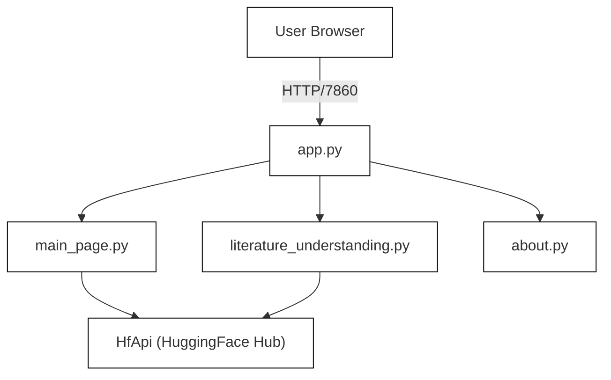
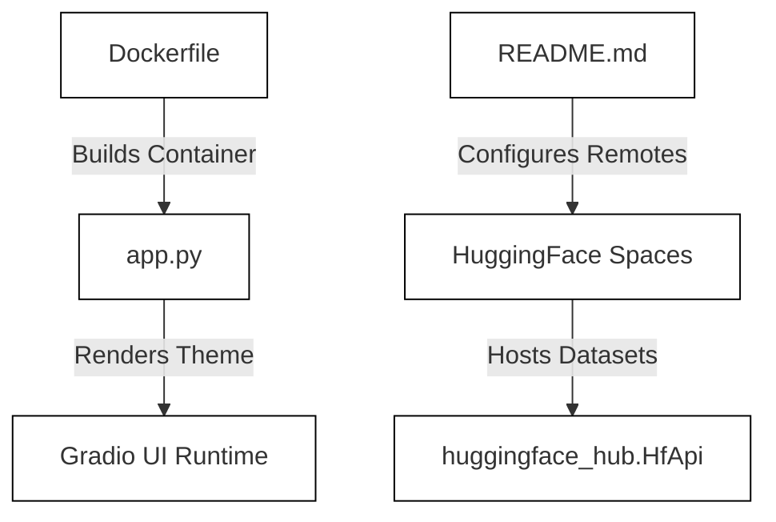

<!-- source: DeepWiki mcp.deepwiki.com · repo allenai/asta-bench-leaderboard · page 1 Overview · fetched 2026-11-09 -->

# Overview

Relevant source files

The following files were used as context for generating this wiki page:

- [.gitignore](.gitignore)
- [Dockerfile](Dockerfile)
- [README.md](README.md)
- [about.py](about.py)
- [app.py](app.py)
- [assets/favicon/favicon.ico](assets/favicon/favicon.ico)

## 1. Introduction and Purpose

The AstaBench leaderboard application is a web-based evaluation platform designed to assess and rank AI scientific agents across multiple dimensions of research capability [about.py:4-12]. Built using the [Gradio](https://gradio.app) framework and hosted via Hugging Face Spaces [README.md:31-34], the application aggregates evaluation runs, computes macro-averaged scores and costs, and provides interactive visualizations such as Pareto frontier plots and granular benchmark detail cards.

The codebase serves two primary Hugging Face deployments (`asta-bench-internal-leaderboard` and `asta-bench-leaderboard`) [README.md:31-34], distinguishing between internal datasets and public submissions through environment configuration [README.md:21-24].

*Diagram 1: High-Level Architecture & Component Assembly mapping UI modules to entry points in `app.py`.*

Sources: `app.py:1-21`, `README.md:31-34`, `about.py:4-14`

---

## 2. Gradio and HuggingFace Architecture

The application is orchestrated by [app.py](), which initializes logging, sets up a custom design theme [app.py:141-168], and injects client-side JavaScript enhancements (such as smooth scrolling, tooltip management, and modal redirect observers) [app.py:25-140]. 

Routing and page assembly are handled by importing various page builder modules into [app.py]():
- Main leaderboard [app.py:14()]
- Category-specific evaluations (Literature Understanding [app.py:15()], Code & Execution [app.py:16()], Data Analysis [app.py:17()], End-to-End Discovery [app.py:18()])
- Submission interface [app.py:19()]
- About page [app.py:20()]

The application interacts with the Hugging Face Hub using `HfApi` [app.py:10-22] to fetch dataset results dynamically based on configuration flags like `IS_INTERNAL` [README.md:21-24].

*Diagram 2: Deployment and Hosting Flow linking container definitions to HuggingFace infrastructure [Dockerfile:1-30, README.md:31-56, app.py:10-22].*

Sources: `app.py:1-22`, `Dockerfile:1-30`, `README.md:31-56`

---

## 3. Wiki Map

This technical wiki is structured into the following sections:
- **1. Overview** (Current page): Architecture, goals, and high-level structure.
- **1.1. Getting Started & Local Development**: Detailed instructions for local execution, environment variables (`IS_INTERNAL`), and dependency management. For details, see [Getting Started & Local Development](#1.1).
- **1.2. Benchmark Concepts & Scoring**: Deep dive into AstaBench categories, macro-averaging, cost calculations, Pareto frontiers, and openness/tooling taxonomies. For details, see [Benchmark Concepts & Scoring](#1.2).
- **2. Application Structure & Routing**: Routing mechanics, themes, and page builders.
- **3. Leaderboard Data & Rendering**: Data transformation pipelines and UI plotting components.
- **4. Submission System**: Agent ingestion, rate-limiting, and validation workflows.
- **5. Testing, CI & Deployment**: Test suite layout, Docker builds, and deployment workflows.
- **6. Glossary**: Definitions of core domain and codebase terms.

Sources: `app.py:1-283`, `about.py:4-114`

---

## 4. Sub-Topics Overview

### Getting Started & Local Development
Running the app locally requires configuring the `IS_INTERNAL` environment variable and executing the primary application entry point on port `7860` [README.md:21-29]. Containerized deployments are managed via a slim Python 3.10 Docker image [Dockerfile:1-30]. For further information on local setup, see [Getting Started & Local Development](#1.1).

Sources: `README.md:17-29`, `Dockerfile:1-30`

### Benchmark Concepts & Scoring
AstaBench evaluates agents across 11 benchmarks containing over 2,400 problems categorized into four key domains: Literature Understanding, Code & Execution, Data Analysis, and End-to-End Discovery [about.py:35-44]. Scores are aggregated using macro-averaging, while efficiency is tracked via cost-per-task metrics [about.py:63-71]. For details, see [Benchmark Concepts & Scoring](#1.2).

Sources: `about.py:32-74`

---

