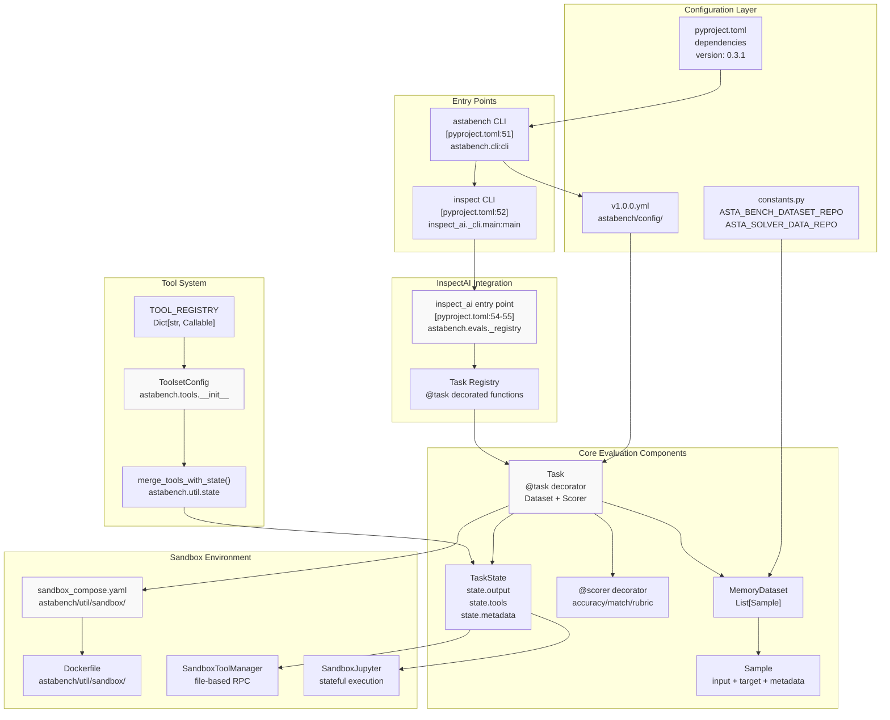
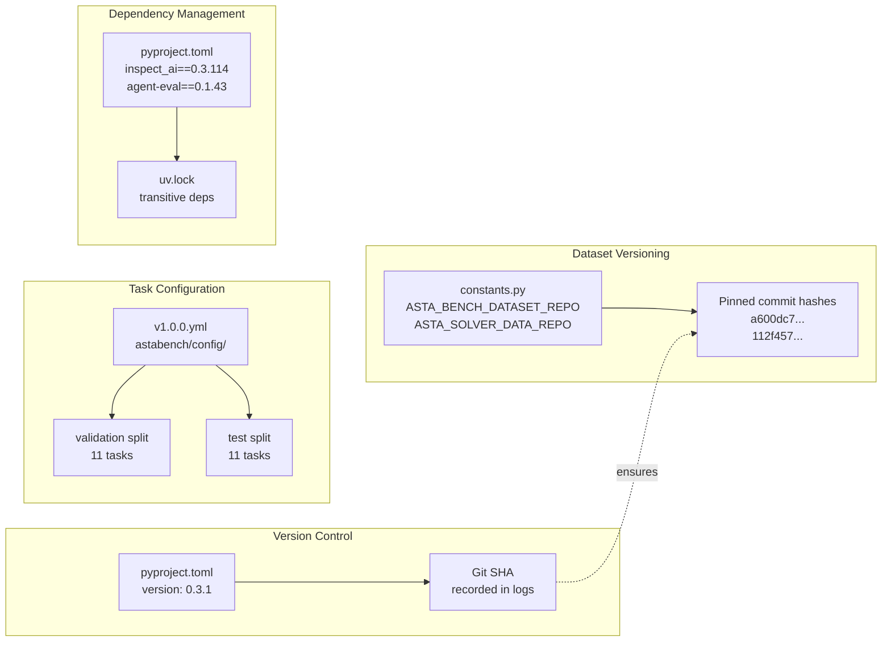
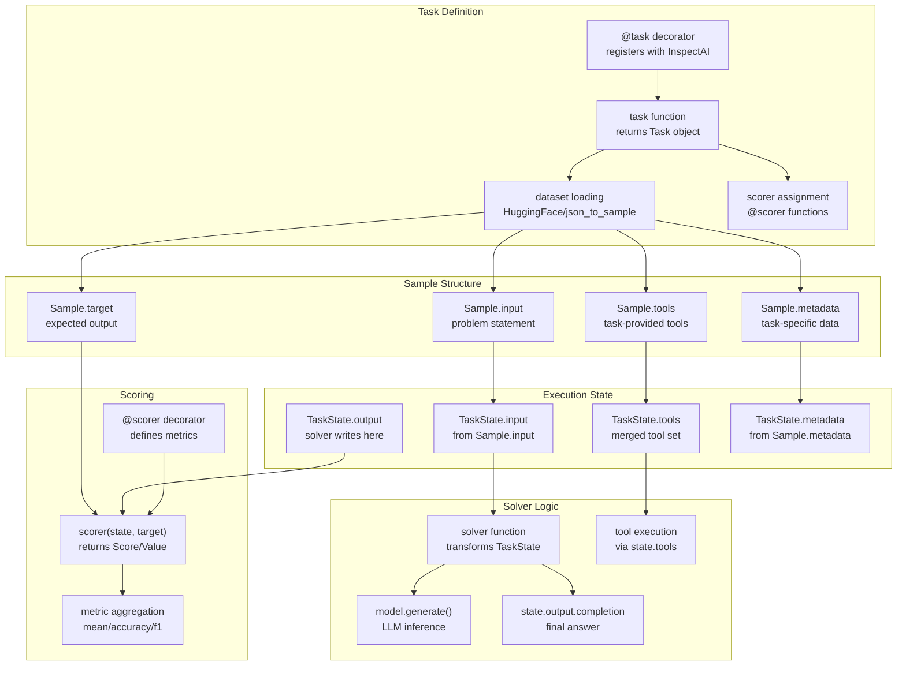
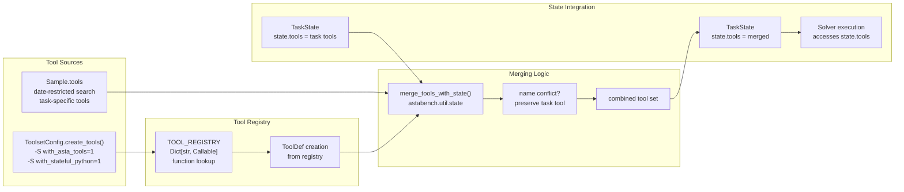
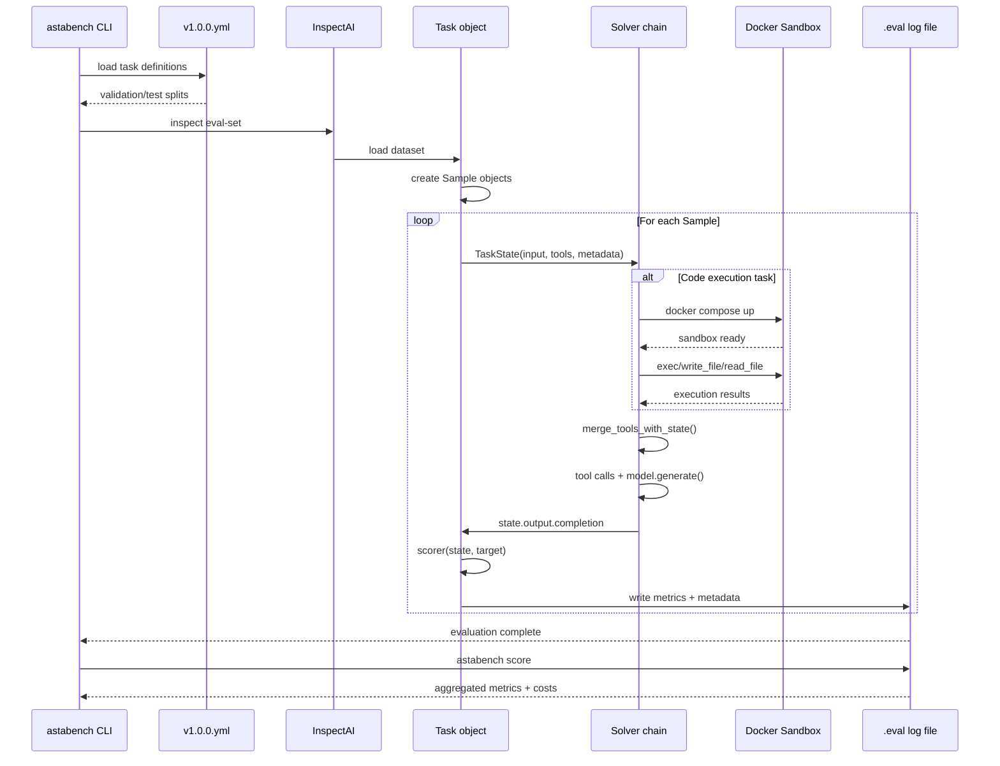

<!-- source: DeepWiki mcp.deepwiki.com · repo allenai/asta-bench · page 3 Core Framework · fetched 2026-10-26 -->

# Core Framework

<details>
<summary>Relevant source files</summary>

The following files were used as context for generating this wiki page:

- [Makefile](Makefile)
- [README.md](README.md)
- [docker/Dockerfile](docker/Dockerfile)
- [pyproject.toml](pyproject.toml)

</details>


This page describes the fundamental architecture and core systems that ASTA-Bench is built upon. It covers the InspectAI integration layer, configuration-driven task execution, the Task/Solver/Scorer evaluation pattern, tool management, and the Docker-based sandbox environment. For detailed information about specific benchmarks and their implementations, see [Evaluation Tasks](#5). For guidance on developing custom solvers, see [Solver Development](#7.2).

## Overview

ASTA-Bench is a configuration-driven evaluation framework built on top of [InspectAI](https://inspect.ai-safety-institute.org.uk). The framework uses InspectAI's Task/Solver/Scorer pattern to orchestrate evaluations, where tasks define problems and scoring metrics, solvers implement agent logic, and the framework handles execution, logging, and aggregation.

The core framework consists of five primary systems:

1. **InspectAI Integration Layer** - Plugin registration and CLI extensions
2. **Configuration System** - YAML-based task definitions and dataset versioning
3. **Task System** - Problem definition, sampling, and scoring mechanisms
4. **Tool Management** - Declarative tool configuration and state merging
5. **Sandbox Environment** - Docker-based isolated execution for code tasks

## Framework Architecture

The following diagram shows how the core framework components map to concrete code entities in the codebase:



**Sources:** [pyproject.toml:1-127](), [README.md:1-369]()

## InspectAI Integration

ASTA-Bench registers itself as an InspectAI plugin through the `[project.entry-points.inspect_ai]` section in `pyproject.toml`:

```toml
[project.entry-points.inspect_ai]
astabench = "astabench.evals._registry"
```

This entry point allows InspectAI to discover and load all tasks decorated with `@task` in the `astabench.evals` module hierarchy. The framework provides two CLI commands:

| Command | Source | Purpose |
|---------|--------|---------|
| `astabench` | [pyproject.toml:51]() | Wrapper around `inspect eval-set` with metadata tracking |
| `inspect` | [pyproject.toml:52]() | Native InspectAI CLI for direct task evaluation |

The `astabench` CLI command extends InspectAI's functionality by:
- Loading task configurations from YAML files
- Recording git SHA and environment metadata for reproducibility
- Enforcing clean git state (unless `--ignore-git` is specified)
- Providing `astabench score` for cost and metric aggregation

**Sources:** [pyproject.toml:50-55](), [README.md:113-127]()

## Configuration-Driven Execution

The framework uses a multi-layered configuration system to ensure reproducibility and version control:



The constants module pins exact repository revisions to ensure identical datasets across evaluation runs. Tasks reference these constants when loading data from HuggingFace Hub, creating a fully deterministic evaluation environment.

**Sources:** [README.md:113-120](), [pyproject.toml:5-32]()

## Task/Solver/Scorer Pattern

ASTA-Bench implements InspectAI's evaluation pattern with the following core abstractions:



A typical task implementation follows this structure:

1. Load dataset samples from HuggingFace or local JSON
2. Define scoring function(s) using `@scorer` decorator
3. Create `Task` object with dataset and scorer
4. Register with `@task` decorator for InspectAI discovery

The solver receives a `TaskState` object for each sample, executes its logic (potentially using tools and models), and writes the answer to `state.output.completion`. The scorer then compares this output against the `target` to produce metrics.

**Sources:** [README.md:232-241](), [README.md:362-367]()

## Tool Management and State Merging

The framework provides a two-tier tool system:

1. **Task-provided tools** in `Sample.tools` - Often include constraints like date restrictions for reproducibility
2. **Optional solver tools** via `ToolsetConfig` - Can be enabled/disabled via CLI flags

The `merge_tools_with_state()` function combines these tool sets, with task tools taking precedence to preserve task-specific constraints:



The `ToolsetConfig` class provides declarative configuration for optional tools:

| Tool Category | CLI Flag | Purpose |
|---------------|----------|---------|
| Asta MCP Tools | `-S with_asta_tools=1` | Literature search via Semantic Scholar |
| Stateful Python | `-S with_stateful_python=1` | Jupyter-like code execution |
| Report Editor | `-S with_report_editor=1` | Structured report composition (SQA) |
| Table Editor | `-S with_table_editor=1` | Table composition (ArxivDigestables) |
| Thinking Tool | `-S with_thinking_tool=1` | Extended reasoning tool |

**Sources:** [README.md:269-299]()

## Execution Flow

The complete evaluation pipeline orchestrates multiple systems:



Each evaluation run produces `.eval` files containing:
- Per-sample inputs, outputs, and scores
- Model usage statistics (tokens, costs)
- Tool call traces
- Task metadata and configuration
- Git SHA and environment information

**Sources:** [README.md:110-158](), [README.md:193-210]()

## Sandbox Environment

Tasks requiring code execution use Docker-based sandboxing to ensure isolation and reproducibility. The sandbox system consists of:

| Component | Location | Purpose |
|-----------|----------|---------|
| `sandbox_compose.yaml` | `astabench/util/sandbox/` | Docker Compose configuration |
| `Dockerfile` | `astabench/util/sandbox/` | Sandbox image definition |
| `SandboxToolManager` | `astabench/util/sandbox/sandbox_tool_manager.py` | File-based RPC for host-sandbox tool calls |
| `SandboxJupyter` | `astabench/util/sandbox/sandbox_jupyter.py` | Stateful Jupyter-like environment |

The sandbox provides:
- Isolated network and process namespaces per problem
- Pre-installed dependencies for all tasks (pandas, numpy, scipy, etc.)
- File-based RPC allowing sandboxed code to invoke host-side tools
- Stateful execution tracking for trajectory-based scoring

Concurrency is controlled via environment variables:

| Parameter | Purpose | Recommended Value |
|-----------|---------|-------------------|
| `--max-samples` | Parallel problems | ≤ CPU cores |
| `--max-sandboxes` | Concurrent sandboxes | Same as `--max-samples` |
| `INSPECT_DOCKER_CLI_CONCURRENCY` | Docker operation limit | 2 × `--max-samples` |

**Sources:** [README.md:193-210](), [README.md:302-304](), [pyproject.toml:104-111]()

## Dependency Management

The framework uses `uv` for deterministic dependency resolution with override capabilities to resolve conflicts between evaluation tasks:

```python
# pyproject.toml override-dependencies example
[tool.uv]
override-dependencies = [
    # sqa pins openai to a lower version than inspect requires
    "openai==1.78.0",
    
    # STORM pretends to require a lower version, but doesn't actually need it
    "datasets~=3.2.0",
]
```

Core dependencies include:

| Dependency | Version Constraint | Purpose |
|------------|-------------------|---------|
| `inspect_ai` | `==0.3.114` | Evaluation framework foundation |
| `agent-eval` | `==0.1.43` | Agent evaluation utilities |
| `datasets` | `~=3.2.0` | HuggingFace dataset loading |
| `google-genai` | `>=1.16.1` | LLM-based scoring (Gemini) |
| `mcp` | `~=1.10` | Model Context Protocol for Asta tools |

**Sources:** [pyproject.toml:10-32](), [pyproject.toml:67-74]()

## Build and Development Environment

The framework provides a Docker-based development environment defined in `docker/Dockerfile`:

```dockerfile
FROM python:3.11.3 AS astabench-base
# Installs: Docker CLI, Docker Compose, uv, cargo
# Syncs dependencies: uv sync --extra dev
# Copies codebase and re-syncs to register entry points
```

The `Makefile` provides standardized commands:

| Command | Purpose |
|---------|---------|
| `make shell` | Launch interactive Docker environment |
| `make format` | Run black formatter |
| `make flake` | Run flake8 linter |
| `make test` | Run pytest suite |
| `make test-expensive` | Run full evaluation smoke tests |

Testing uses pytest markers to categorize tests:

```python
# pyproject.toml markers
markers = [
  "expensive: mark test as expensive (skipped by default)",
  "asta_tool_api_request: mark test as requiring Asta tool key"
]
```

**Sources:** [docker/Dockerfile:1-43](), [Makefile:1-131](), [pyproject.toml:116-126]()

---

